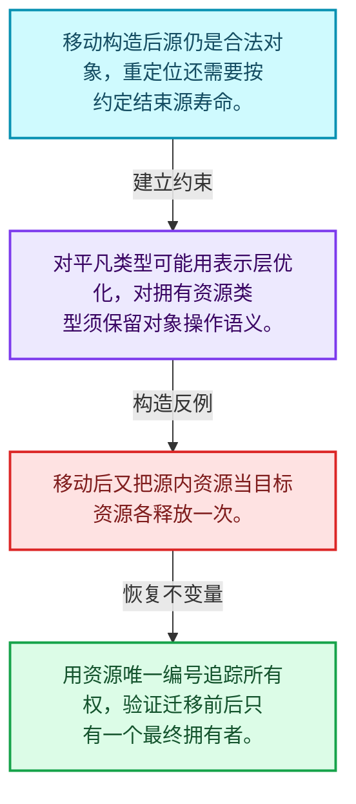
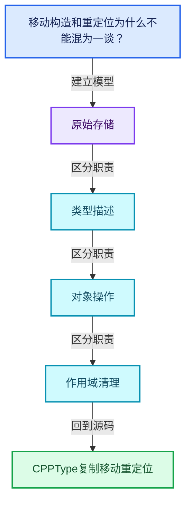
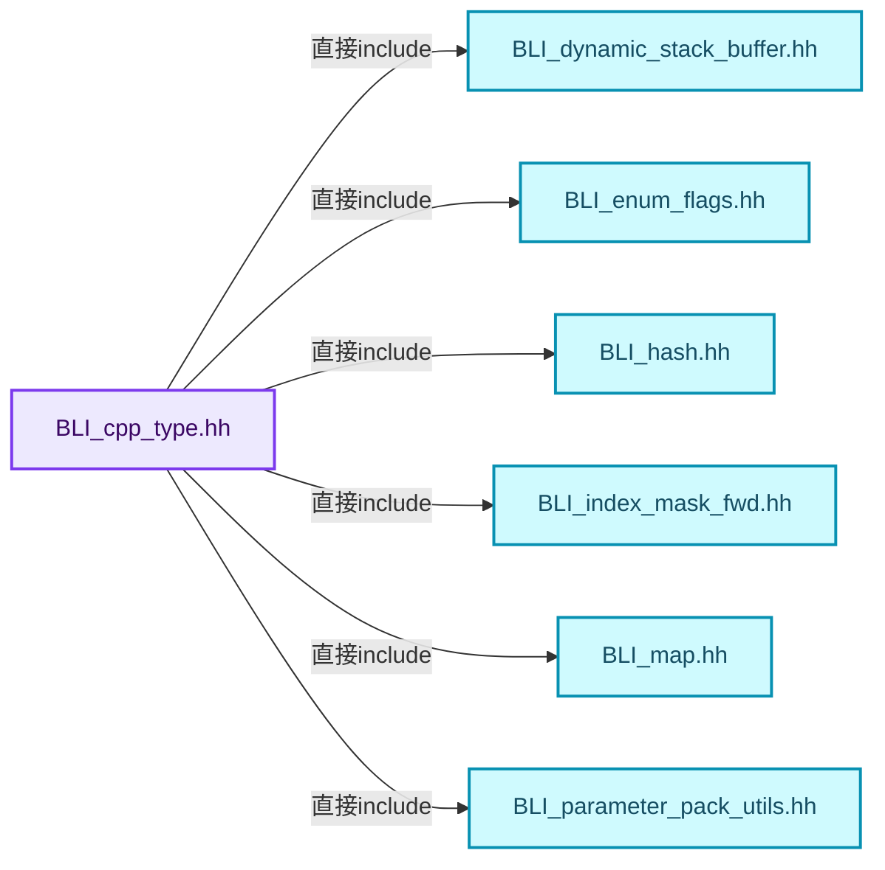
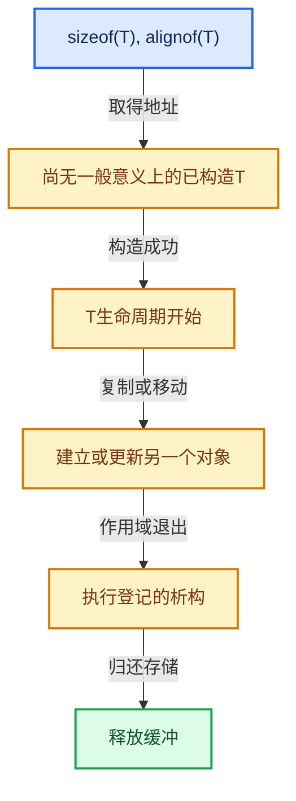

# 03-09 CPPType复制移动重定位

[方向导航](README.md) · [总目录](../README.md) · [覆盖索引](../%E6%BA%90%E7%A0%81%E7%89%88%E6%9C%AC%E4%B8%8E%E8%A6%86%E7%9B%96%E7%B4%A2%E5%BC%95.md)

> 阅读顺序：问题与数据模型 → 语法与类型 → 源码逐行 → 调用线索 → 历史与取舍 → 推演和练习。

- 基准 HEAD：`cbda6b96c26c0dee3c3b5cbb93960c4ac06a6b30`。
- 记录日期：2026-10-14。
- 教学示例状态：正文中的推演不是本机性能实测；已运行练习见验收报告。

## 一、从问题到设计

移动构造和重定位为什么不能混为一谈？

重定位还包含源对象生命周期结束；重复析构源或漏析构目标都会破坏所有权。

本篇把语法、数据语义和系统取舍连接起来。把存储分配、对象构造、类型操作和最终清理拆开建模。

### 本篇独立模型与设计推理

移动构造后源仍是合法对象，重定位还需要按约定结束源寿命。

设计取舍：对平凡类型可能用表示层优化，对拥有资源类型须保留对象操作语义。

最小反例：移动后又把源内资源当目标资源各释放一次。

推导与处理：用资源唯一编号追踪所有权，验证迁移前后只有一个最终拥有者。



### 源码范围与相邻篇章

| 文件 | 本篇逐行范围 | 基准SHA-256 |
|---|---|---|
| [source/blender/blenlib/BLI_cpp_type.hh](../../../../../source/blender/blenlib/BLI_cpp_type.hh) | L541—L808 | `c60368fa9ddd6891cb2063b203dc846355fc17d86f16005763354999d5beb1e2` |

同一主讲文件可能分多篇覆盖；超出本篇范围的符号通过覆盖索引定位。空行与纯注释保留在源码摘录中，逐行表解释有效语句与语法边界；许可证头统一保留。

前篇：[CPPType构造与析构](08-CPPType%E6%9E%84%E9%80%A0%E4%B8%8E%E6%9E%90%E6%9E%84.md).

后篇：[运行时到静态类型分派](10-%E8%BF%90%E8%A1%8C%E6%97%B6%E5%88%B0%E9%9D%99%E6%80%81%E7%B1%BB%E5%9E%8B%E5%88%86%E6%B4%BE.md).

## 二、类型、数据与阅读地图



这是概念依赖图，边表示阅读关系，不声称是运行时调用顺序。

### 直接编译依赖



箭头只表示头文件包含关系；完整调用线索见后面的符号定位表。

## 三、关键词、语法与类型角色

### 模板 template

模板把类型或常量作为生成实现的参数。读声明时先列出类型参数、非类型参数和默认值，再看使用者实际实例化了什么。模板声明本身不意味着每种T都支持其全部成员。

具体检查：把T替换为int、string、只能移动的类型，分别检查每个被调用操作是否成立。

### 依赖名称 typename

typename既可引入类型模板参数，也可告诉编译器某个依赖名称是类型。它不创建运行时对象；解析期确认语法类别与实例化期检查具体类型是不同阶段。

具体检查：区分typename T::value_type和T::size()，前者标记类型，后者是表达式。

### 只读限定 const

const约束当前访问路径可做的修改。const指针、指向const的指针、const视图对象、const元素是不同位置的限定；其他别名可能仍可修改原对象。

具体检查：分别写T* const、const T*与const T* const，并画出不可修改的层次。

### 异常边界 try与catch

try定义异常传播的局部边界。失败路径需要销毁已经成功构造的部分并释放相应存储；未构造的对象不能被析构。

具体检查：在第k次构造失败，列出已经存在的对象集合与待释放缓冲。

### 内部断言 assert

断言表达开发者预期成立的内部契约，发布构建可能关闭。它不能替代对不可信输入的完整错误处理，也不保证后续操作被运行时保护。

具体检查：对每条断言构造违反条件的输入，区分调用者错误与应向用户报告的错误。

### 类型别名 using

类型别名为已有类型建立名字，不创建运行期对象。它常把模板内部使用的类型统一暴露给泛型调用者。

具体检查：展开别名直到基础类型，区分类型别名和变量声明。

## 四、真实源码与逐行讲解

源码块保持原行内容，原始行号由小节标题及逐行表给出。表中的调用定位是静态阅读辅助；重载、模板实例化、宏展开和虚调用需结合完整声明，不能仅凭词法出现证明动态调用。

### BLI_cpp_type.hh：L541—L585

<!-- source:source/blender/blenlib/BLI_cpp_type.hh:541:585 -->

```cpp

inline void CPPType::value_initialize(void *ptr) const
{
  value_initialize_(ptr);
}

inline void CPPType::value_initialize_n(void *ptr, int64_t n) const
{
  value_initialize_n_(ptr, n);
}

inline void CPPType::value_initialize_indices(void *ptr, const IndexMask &mask) const
{
  value_initialize_indices_(ptr, mask);
}

inline void CPPType::destruct(void *ptr) const
{
  destruct_(ptr);
}

inline void CPPType::destruct_n(void *ptr, int64_t n) const
{
  destruct_n_(ptr, n);
}

inline void CPPType::destruct_indices(void *ptr, const IndexMask &mask) const
{
  destruct_indices_(ptr, mask);
}

inline void CPPType::copy_assign(const void *src, void *dst) const
{
  copy_assign_(src, dst);
}

inline void CPPType::copy_assign_n(const void *src, void *dst, int64_t n) const
{
  copy_assign_n_(src, dst, n);
}

inline void CPPType::copy_assign_indices(const void *src, void *dst, const IndexMask &mask) const
{
  copy_assign_indices_(src, dst, mask);
}
```

本段语义重点：

- `destruct_n`：对已构造的元素区间执行析构；计数必须对应真实存活对象，释放原始内存是另一操作。
- `value_initialize_n`：按值初始化对象；对基本类型的初始化行为不同于未初始化分配。

| 原始行 | 语义、约束与检查 |
|---|---|
| L542 | 出现调用或函数声明 `CPPType::value_initialize`，对应表达式为 `inline void CPPType::value_initialize(void *ptr) const`。参数求值、返回类型与重载需结合前后完整语句；静态文本引用不能证明动态目标。 |
| L543 | 连接上一行的声明或控制结构与其语句块；后续行在这个作用域中执行或声明。 |
| L544 | 出现调用或函数声明 `value_initialize_`，对应表达式为 `value_initialize_(ptr);`。参数求值、返回类型与重载需结合前后完整语句；静态文本引用不能证明动态目标。 |
| L545 | 结束当前语法单元。局部自动对象在离开其作用域时按规则销毁；这不等于所有被引用的外部数据也被释放。 |
| L547 | 本行使用 `value_initialize_n`：按值初始化对象；对基本类型的初始化行为不同于未初始化分配。 |
| L548 | 连接上一行的声明或控制结构与其语句块；后续行在这个作用域中执行或声明。 |
| L549 | 出现调用或函数声明 `value_initialize_n_`，对应表达式为 `value_initialize_n_(ptr, n);`。参数求值、返回类型与重载需结合前后完整语句；静态文本引用不能证明动态目标。 |
| L550 | 结束当前语法单元。局部自动对象在离开其作用域时按规则销毁；这不等于所有被引用的外部数据也被释放。 |
| L552 | 出现调用或函数声明 `CPPType::value_initialize_indices`，对应表达式为 `inline void CPPType::value_initialize_indices(void *ptr, const IndexMask &mask) const`。参数求值、返回类型与重载需结合前后完整语句；静态文本引用不能证明动态目标。 |
| L553 | 连接上一行的声明或控制结构与其语句块；后续行在这个作用域中执行或声明。 |
| L554 | 出现调用或函数声明 `value_initialize_indices_`，对应表达式为 `value_initialize_indices_(ptr, mask);`。参数求值、返回类型与重载需结合前后完整语句；静态文本引用不能证明动态目标。 |
| L555 | 结束当前语法单元。局部自动对象在离开其作用域时按规则销毁；这不等于所有被引用的外部数据也被释放。 |
| L557 | 出现调用或函数声明 `CPPType::destruct`，对应表达式为 `inline void CPPType::destruct(void *ptr) const`。参数求值、返回类型与重载需结合前后完整语句；静态文本引用不能证明动态目标。 |
| L558 | 连接上一行的声明或控制结构与其语句块；后续行在这个作用域中执行或声明。 |
| L559 | 出现调用或函数声明 `destruct_`，对应表达式为 `destruct_(ptr);`。参数求值、返回类型与重载需结合前后完整语句；静态文本引用不能证明动态目标。 |
| L560 | 结束当前语法单元。局部自动对象在离开其作用域时按规则销毁；这不等于所有被引用的外部数据也被释放。 |
| L562 | 本行使用 `destruct_n`：对已构造的元素区间执行析构；计数必须对应真实存活对象，释放原始内存是另一操作。 |
| L563 | 连接上一行的声明或控制结构与其语句块；后续行在这个作用域中执行或声明。 |
| L564 | 出现调用或函数声明 `destruct_n_`，对应表达式为 `destruct_n_(ptr, n);`。参数求值、返回类型与重载需结合前后完整语句；静态文本引用不能证明动态目标。 |
| L565 | 结束当前语法单元。局部自动对象在离开其作用域时按规则销毁；这不等于所有被引用的外部数据也被释放。 |
| L567 | 出现调用或函数声明 `CPPType::destruct_indices`，对应表达式为 `inline void CPPType::destruct_indices(void *ptr, const IndexMask &mask) const`。参数求值、返回类型与重载需结合前后完整语句；静态文本引用不能证明动态目标。 |
| L568 | 连接上一行的声明或控制结构与其语句块；后续行在这个作用域中执行或声明。 |
| L569 | 出现调用或函数声明 `destruct_indices_`，对应表达式为 `destruct_indices_(ptr, mask);`。参数求值、返回类型与重载需结合前后完整语句；静态文本引用不能证明动态目标。 |
| L570 | 结束当前语法单元。局部自动对象在离开其作用域时按规则销毁；这不等于所有被引用的外部数据也被释放。 |
| L572 | 出现调用或函数声明 `CPPType::copy_assign`，对应表达式为 `inline void CPPType::copy_assign(const void *src, void *dst) const`。参数求值、返回类型与重载需结合前后完整语句；静态文本引用不能证明动态目标。 |
| L573 | 连接上一行的声明或控制结构与其语句块；后续行在这个作用域中执行或声明。 |
| L574 | 出现调用或函数声明 `copy_assign_`，对应表达式为 `copy_assign_(src, dst);`。参数求值、返回类型与重载需结合前后完整语句；静态文本引用不能证明动态目标。 |
| L575 | 结束当前语法单元。局部自动对象在离开其作用域时按规则销毁；这不等于所有被引用的外部数据也被释放。 |
| L577 | 出现调用或函数声明 `CPPType::copy_assign_n`，对应表达式为 `inline void CPPType::copy_assign_n(const void *src, void *dst, int64_t n) const`。参数求值、返回类型与重载需结合前后完整语句；静态文本引用不能证明动态目标。 |
| L578 | 连接上一行的声明或控制结构与其语句块；后续行在这个作用域中执行或声明。 |
| L579 | 出现调用或函数声明 `copy_assign_n_`，对应表达式为 `copy_assign_n_(src, dst, n);`。参数求值、返回类型与重载需结合前后完整语句；静态文本引用不能证明动态目标。 |
| L580 | 结束当前语法单元。局部自动对象在离开其作用域时按规则销毁；这不等于所有被引用的外部数据也被释放。 |
| L582 | 出现调用或函数声明 `CPPType::copy_assign_indices`，对应表达式为 `inline void CPPType::copy_assign_indices(const void *src, void *dst, const IndexMask &mask) const`。参数求值、返回类型与重载需结合前后完整语句；静态文本引用不能证明动态目标。 |
| L583 | 连接上一行的声明或控制结构与其语句块；后续行在这个作用域中执行或声明。 |
| L584 | 出现调用或函数声明 `copy_assign_indices_`，对应表达式为 `copy_assign_indices_(src, dst, mask);`。参数求值、返回类型与重载需结合前后完整语句；静态文本引用不能证明动态目标。 |
| L585 | 结束当前语法单元。局部自动对象在离开其作用域时按规则销毁；这不等于所有被引用的外部数据也被释放。 |

### BLI_cpp_type.hh：L586—L631

<!-- source:source/blender/blenlib/BLI_cpp_type.hh:586:631 -->

```cpp

inline void CPPType::copy_assign_compressed(const void *src,
                                            void *dst,
                                            const IndexMask &mask) const
{
  copy_assign_compressed_(src, dst, mask);
}

inline void CPPType::copy_construct(const void *src, void *dst) const
{
  copy_construct_(src, dst);
}

inline void CPPType::copy_construct_n(const void *src, void *dst, int64_t n) const
{
  copy_construct_n_(src, dst, n);
}

inline void CPPType::copy_construct_indices(const void *src,
                                            void *dst,
                                            const IndexMask &mask) const
{
  copy_construct_indices_(src, dst, mask);
}

inline void CPPType::copy_construct_compressed(const void *src,
                                               void *dst,
                                               const IndexMask &mask) const
{
  copy_construct_compressed_(src, dst, mask);
}

inline void CPPType::move_assign(void *src, void *dst) const
{
  move_assign_(src, dst);
}

inline void CPPType::move_assign_n(void *src, void *dst, int64_t n) const
{
  move_assign_n_(src, dst, n);
}

inline void CPPType::move_assign_indices(void *src, void *dst, const IndexMask &mask) const
{
  move_assign_indices_(src, dst, mask);
}
```

| 原始行 | 语义、约束与检查 |
|---|---|
| L587 | 出现调用或函数声明 `CPPType::copy_assign_compressed`，对应表达式为 `inline void CPPType::copy_assign_compressed(const void *src,`。参数求值、返回类型与重载需结合前后完整语句；静态文本引用不能证明动态目标。 |
| L588 | 本行是连续声明或表达式的一部分：`void *dst,`。与本段前后行合读；逗号、括号和限定符决定它属于参数、初始化列表还是实际计算。 |
| L589 | 本行是连续声明或表达式的一部分：`const IndexMask &mask) const`。与本段前后行合读；逗号、括号和限定符决定它属于参数、初始化列表还是实际计算。 |
| L590 | 连接上一行的声明或控制结构与其语句块；后续行在这个作用域中执行或声明。 |
| L591 | 出现调用或函数声明 `copy_assign_compressed_`，对应表达式为 `copy_assign_compressed_(src, dst, mask);`。参数求值、返回类型与重载需结合前后完整语句；静态文本引用不能证明动态目标。 |
| L592 | 结束当前语法单元。局部自动对象在离开其作用域时按规则销毁；这不等于所有被引用的外部数据也被释放。 |
| L594 | 出现调用或函数声明 `CPPType::copy_construct`，对应表达式为 `inline void CPPType::copy_construct(const void *src, void *dst) const`。参数求值、返回类型与重载需结合前后完整语句；静态文本引用不能证明动态目标。 |
| L595 | 连接上一行的声明或控制结构与其语句块；后续行在这个作用域中执行或声明。 |
| L596 | 出现调用或函数声明 `copy_construct_`，对应表达式为 `copy_construct_(src, dst);`。参数求值、返回类型与重载需结合前后完整语句；静态文本引用不能证明动态目标。 |
| L597 | 结束当前语法单元。局部自动对象在离开其作用域时按规则销毁；这不等于所有被引用的外部数据也被释放。 |
| L599 | 出现调用或函数声明 `CPPType::copy_construct_n`，对应表达式为 `inline void CPPType::copy_construct_n(const void *src, void *dst, int64_t n) const`。参数求值、返回类型与重载需结合前后完整语句；静态文本引用不能证明动态目标。 |
| L600 | 连接上一行的声明或控制结构与其语句块；后续行在这个作用域中执行或声明。 |
| L601 | 出现调用或函数声明 `copy_construct_n_`，对应表达式为 `copy_construct_n_(src, dst, n);`。参数求值、返回类型与重载需结合前后完整语句；静态文本引用不能证明动态目标。 |
| L602 | 结束当前语法单元。局部自动对象在离开其作用域时按规则销毁；这不等于所有被引用的外部数据也被释放。 |
| L604 | 出现调用或函数声明 `CPPType::copy_construct_indices`，对应表达式为 `inline void CPPType::copy_construct_indices(const void *src,`。参数求值、返回类型与重载需结合前后完整语句；静态文本引用不能证明动态目标。 |
| L605 | 本行是连续声明或表达式的一部分：`void *dst,`。与本段前后行合读；逗号、括号和限定符决定它属于参数、初始化列表还是实际计算。 |
| L606 | 本行是连续声明或表达式的一部分：`const IndexMask &mask) const`。与本段前后行合读；逗号、括号和限定符决定它属于参数、初始化列表还是实际计算。 |
| L607 | 连接上一行的声明或控制结构与其语句块；后续行在这个作用域中执行或声明。 |
| L608 | 出现调用或函数声明 `copy_construct_indices_`，对应表达式为 `copy_construct_indices_(src, dst, mask);`。参数求值、返回类型与重载需结合前后完整语句；静态文本引用不能证明动态目标。 |
| L609 | 结束当前语法单元。局部自动对象在离开其作用域时按规则销毁；这不等于所有被引用的外部数据也被释放。 |
| L611 | 出现调用或函数声明 `CPPType::copy_construct_compressed`，对应表达式为 `inline void CPPType::copy_construct_compressed(const void *src,`。参数求值、返回类型与重载需结合前后完整语句；静态文本引用不能证明动态目标。 |
| L612 | 本行是连续声明或表达式的一部分：`void *dst,`。与本段前后行合读；逗号、括号和限定符决定它属于参数、初始化列表还是实际计算。 |
| L613 | 本行是连续声明或表达式的一部分：`const IndexMask &mask) const`。与本段前后行合读；逗号、括号和限定符决定它属于参数、初始化列表还是实际计算。 |
| L614 | 连接上一行的声明或控制结构与其语句块；后续行在这个作用域中执行或声明。 |
| L615 | 出现调用或函数声明 `copy_construct_compressed_`，对应表达式为 `copy_construct_compressed_(src, dst, mask);`。参数求值、返回类型与重载需结合前后完整语句；静态文本引用不能证明动态目标。 |
| L616 | 结束当前语法单元。局部自动对象在离开其作用域时按规则销毁；这不等于所有被引用的外部数据也被释放。 |
| L618 | 出现调用或函数声明 `CPPType::move_assign`，对应表达式为 `inline void CPPType::move_assign(void *src, void *dst) const`。参数求值、返回类型与重载需结合前后完整语句；静态文本引用不能证明动态目标。 |
| L619 | 连接上一行的声明或控制结构与其语句块；后续行在这个作用域中执行或声明。 |
| L620 | 出现调用或函数声明 `move_assign_`，对应表达式为 `move_assign_(src, dst);`。参数求值、返回类型与重载需结合前后完整语句；静态文本引用不能证明动态目标。 |
| L621 | 结束当前语法单元。局部自动对象在离开其作用域时按规则销毁；这不等于所有被引用的外部数据也被释放。 |
| L623 | 出现调用或函数声明 `CPPType::move_assign_n`，对应表达式为 `inline void CPPType::move_assign_n(void *src, void *dst, int64_t n) const`。参数求值、返回类型与重载需结合前后完整语句；静态文本引用不能证明动态目标。 |
| L624 | 连接上一行的声明或控制结构与其语句块；后续行在这个作用域中执行或声明。 |
| L625 | 出现调用或函数声明 `move_assign_n_`，对应表达式为 `move_assign_n_(src, dst, n);`。参数求值、返回类型与重载需结合前后完整语句；静态文本引用不能证明动态目标。 |
| L626 | 结束当前语法单元。局部自动对象在离开其作用域时按规则销毁；这不等于所有被引用的外部数据也被释放。 |
| L628 | 出现调用或函数声明 `CPPType::move_assign_indices`，对应表达式为 `inline void CPPType::move_assign_indices(void *src, void *dst, const IndexMask &mask) const`。参数求值、返回类型与重载需结合前后完整语句；静态文本引用不能证明动态目标。 |
| L629 | 连接上一行的声明或控制结构与其语句块；后续行在这个作用域中执行或声明。 |
| L630 | 出现调用或函数声明 `move_assign_indices_`，对应表达式为 `move_assign_indices_(src, dst, mask);`。参数求值、返回类型与重载需结合前后完整语句；静态文本引用不能证明动态目标。 |
| L631 | 结束当前语法单元。局部自动对象在离开其作用域时按规则销毁；这不等于所有被引用的外部数据也被释放。 |

### BLI_cpp_type.hh：L632—L681

<!-- source:source/blender/blenlib/BLI_cpp_type.hh:632:681 -->

```cpp

inline void CPPType::move_construct(void *src, void *dst) const
{
  move_construct_(src, dst);
}

inline void CPPType::move_construct_n(void *src, void *dst, int64_t n) const
{
  move_construct_n_(src, dst, n);
}

inline void CPPType::move_construct_indices(void *src, void *dst, const IndexMask &mask) const
{
  move_construct_indices_(src, dst, mask);
}

inline void CPPType::relocate_assign(void *src, void *dst) const
{
  relocate_assign_(src, dst);
}

inline void CPPType::relocate_assign_n(void *src, void *dst, int64_t n) const
{
  relocate_assign_n_(src, dst, n);
}

inline void CPPType::relocate_assign_indices(void *src, void *dst, const IndexMask &mask) const
{
  relocate_assign_indices_(src, dst, mask);
}

inline void CPPType::relocate_construct(void *src, void *dst) const
{
  relocate_construct_(src, dst);
}

inline void CPPType::relocate_construct_n(void *src, void *dst, int64_t n) const
{
  relocate_construct_n_(src, dst, n);
}

inline void CPPType::relocate_construct_indices(void *src, void *dst, const IndexMask &mask) const
{
  relocate_construct_indices_(src, dst, mask);
}

inline void CPPType::fill_assign_n(const void *value, void *dst, int64_t n) const
{
  fill_assign_n_(value, dst, n);
}
```

| 原始行 | 语义、约束与检查 |
|---|---|
| L633 | 出现调用或函数声明 `CPPType::move_construct`，对应表达式为 `inline void CPPType::move_construct(void *src, void *dst) const`。参数求值、返回类型与重载需结合前后完整语句；静态文本引用不能证明动态目标。 |
| L634 | 连接上一行的声明或控制结构与其语句块；后续行在这个作用域中执行或声明。 |
| L635 | 出现调用或函数声明 `move_construct_`，对应表达式为 `move_construct_(src, dst);`。参数求值、返回类型与重载需结合前后完整语句；静态文本引用不能证明动态目标。 |
| L636 | 结束当前语法单元。局部自动对象在离开其作用域时按规则销毁；这不等于所有被引用的外部数据也被释放。 |
| L638 | 出现调用或函数声明 `CPPType::move_construct_n`，对应表达式为 `inline void CPPType::move_construct_n(void *src, void *dst, int64_t n) const`。参数求值、返回类型与重载需结合前后完整语句；静态文本引用不能证明动态目标。 |
| L639 | 连接上一行的声明或控制结构与其语句块；后续行在这个作用域中执行或声明。 |
| L640 | 出现调用或函数声明 `move_construct_n_`，对应表达式为 `move_construct_n_(src, dst, n);`。参数求值、返回类型与重载需结合前后完整语句；静态文本引用不能证明动态目标。 |
| L641 | 结束当前语法单元。局部自动对象在离开其作用域时按规则销毁；这不等于所有被引用的外部数据也被释放。 |
| L643 | 出现调用或函数声明 `CPPType::move_construct_indices`，对应表达式为 `inline void CPPType::move_construct_indices(void *src, void *dst, const IndexMask &mask) const`。参数求值、返回类型与重载需结合前后完整语句；静态文本引用不能证明动态目标。 |
| L644 | 连接上一行的声明或控制结构与其语句块；后续行在这个作用域中执行或声明。 |
| L645 | 出现调用或函数声明 `move_construct_indices_`，对应表达式为 `move_construct_indices_(src, dst, mask);`。参数求值、返回类型与重载需结合前后完整语句；静态文本引用不能证明动态目标。 |
| L646 | 结束当前语法单元。局部自动对象在离开其作用域时按规则销毁；这不等于所有被引用的外部数据也被释放。 |
| L648 | 出现调用或函数声明 `CPPType::relocate_assign`，对应表达式为 `inline void CPPType::relocate_assign(void *src, void *dst) const`。参数求值、返回类型与重载需结合前后完整语句；静态文本引用不能证明动态目标。 |
| L649 | 连接上一行的声明或控制结构与其语句块；后续行在这个作用域中执行或声明。 |
| L650 | 出现调用或函数声明 `relocate_assign_`，对应表达式为 `relocate_assign_(src, dst);`。参数求值、返回类型与重载需结合前后完整语句；静态文本引用不能证明动态目标。 |
| L651 | 结束当前语法单元。局部自动对象在离开其作用域时按规则销毁；这不等于所有被引用的外部数据也被释放。 |
| L653 | 出现调用或函数声明 `CPPType::relocate_assign_n`，对应表达式为 `inline void CPPType::relocate_assign_n(void *src, void *dst, int64_t n) const`。参数求值、返回类型与重载需结合前后完整语句；静态文本引用不能证明动态目标。 |
| L654 | 连接上一行的声明或控制结构与其语句块；后续行在这个作用域中执行或声明。 |
| L655 | 出现调用或函数声明 `relocate_assign_n_`，对应表达式为 `relocate_assign_n_(src, dst, n);`。参数求值、返回类型与重载需结合前后完整语句；静态文本引用不能证明动态目标。 |
| L656 | 结束当前语法单元。局部自动对象在离开其作用域时按规则销毁；这不等于所有被引用的外部数据也被释放。 |
| L658 | 出现调用或函数声明 `CPPType::relocate_assign_indices`，对应表达式为 `inline void CPPType::relocate_assign_indices(void *src, void *dst, const IndexMask &mask) const`。参数求值、返回类型与重载需结合前后完整语句；静态文本引用不能证明动态目标。 |
| L659 | 连接上一行的声明或控制结构与其语句块；后续行在这个作用域中执行或声明。 |
| L660 | 出现调用或函数声明 `relocate_assign_indices_`，对应表达式为 `relocate_assign_indices_(src, dst, mask);`。参数求值、返回类型与重载需结合前后完整语句；静态文本引用不能证明动态目标。 |
| L661 | 结束当前语法单元。局部自动对象在离开其作用域时按规则销毁；这不等于所有被引用的外部数据也被释放。 |
| L663 | 出现调用或函数声明 `CPPType::relocate_construct`，对应表达式为 `inline void CPPType::relocate_construct(void *src, void *dst) const`。参数求值、返回类型与重载需结合前后完整语句；静态文本引用不能证明动态目标。 |
| L664 | 连接上一行的声明或控制结构与其语句块；后续行在这个作用域中执行或声明。 |
| L665 | 出现调用或函数声明 `relocate_construct_`，对应表达式为 `relocate_construct_(src, dst);`。参数求值、返回类型与重载需结合前后完整语句；静态文本引用不能证明动态目标。 |
| L666 | 结束当前语法单元。局部自动对象在离开其作用域时按规则销毁；这不等于所有被引用的外部数据也被释放。 |
| L668 | 出现调用或函数声明 `CPPType::relocate_construct_n`，对应表达式为 `inline void CPPType::relocate_construct_n(void *src, void *dst, int64_t n) const`。参数求值、返回类型与重载需结合前后完整语句；静态文本引用不能证明动态目标。 |
| L669 | 连接上一行的声明或控制结构与其语句块；后续行在这个作用域中执行或声明。 |
| L670 | 出现调用或函数声明 `relocate_construct_n_`，对应表达式为 `relocate_construct_n_(src, dst, n);`。参数求值、返回类型与重载需结合前后完整语句；静态文本引用不能证明动态目标。 |
| L671 | 结束当前语法单元。局部自动对象在离开其作用域时按规则销毁；这不等于所有被引用的外部数据也被释放。 |
| L673 | 出现调用或函数声明 `CPPType::relocate_construct_indices`，对应表达式为 `inline void CPPType::relocate_construct_indices(void *src, void *dst, const IndexMask &mask) const`。参数求值、返回类型与重载需结合前后完整语句；静态文本引用不能证明动态目标。 |
| L674 | 连接上一行的声明或控制结构与其语句块；后续行在这个作用域中执行或声明。 |
| L675 | 出现调用或函数声明 `relocate_construct_indices_`，对应表达式为 `relocate_construct_indices_(src, dst, mask);`。参数求值、返回类型与重载需结合前后完整语句；静态文本引用不能证明动态目标。 |
| L676 | 结束当前语法单元。局部自动对象在离开其作用域时按规则销毁；这不等于所有被引用的外部数据也被释放。 |
| L678 | 出现调用或函数声明 `CPPType::fill_assign_n`，对应表达式为 `inline void CPPType::fill_assign_n(const void *value, void *dst, int64_t n) const`。参数求值、返回类型与重载需结合前后完整语句；静态文本引用不能证明动态目标。 |
| L679 | 连接上一行的声明或控制结构与其语句块；后续行在这个作用域中执行或声明。 |
| L680 | 出现调用或函数声明 `fill_assign_n_`，对应表达式为 `fill_assign_n_(value, dst, n);`。参数求值、返回类型与重载需结合前后完整语句；静态文本引用不能证明动态目标。 |
| L681 | 结束当前语法单元。局部自动对象在离开其作用域时按规则销毁；这不等于所有被引用的外部数据也被释放。 |

### BLI_cpp_type.hh：L682—L728

<!-- source:source/blender/blenlib/BLI_cpp_type.hh:682:728 -->

```cpp

inline void CPPType::fill_assign_indices(const void *value, void *dst, const IndexMask &mask) const
{
  fill_assign_indices_(value, dst, mask);
}

inline void CPPType::fill_construct_n(const void *value, void *dst, int64_t n) const
{
  fill_construct_n_(value, dst, n);
}

inline void CPPType::fill_construct_indices(const void *value,
                                            void *dst,
                                            const IndexMask &mask) const
{
  fill_construct_indices_(value, dst, mask);
}

inline bool CPPType::can_exist_in_buffer(const int64_t buffer_size,
                                         const int64_t buffer_alignment) const
{
  return this->size <= buffer_size && this->alignment <= buffer_alignment;
}

inline void CPPType::print(const void *value, std::stringstream &ss) const
{
  BLI_assert(this->pointer_can_point_to_instance(value));
  print_(value, ss);
}

inline bool CPPType::is_equal(const void *a, const void *b) const
{
  return is_equal_(a, b);
}

inline bool CPPType::is_equal_or_false(const void *a, const void *b) const
{
  if (this->is_equality_comparable()) {
    return this->is_equal(a, b);
  }
  return false;
}

inline uint64_t CPPType::hash(const void *value) const
{
  return hash_(value);
}
```

本段语义重点：

- 分支证据 `this->is_equality_comparable())`：分别推演条件成立与不成立，核对相同出口处的状态。

| 原始行 | 语义、约束与检查 |
|---|---|
| L683 | 出现调用或函数声明 `CPPType::fill_assign_indices`，对应表达式为 `inline void CPPType::fill_assign_indices(const void *value, void *dst, const IndexMask &mask) const`。参数求值、返回类型与重载需结合前后完整语句；静态文本引用不能证明动态目标。 |
| L684 | 连接上一行的声明或控制结构与其语句块；后续行在这个作用域中执行或声明。 |
| L685 | 出现调用或函数声明 `fill_assign_indices_`，对应表达式为 `fill_assign_indices_(value, dst, mask);`。参数求值、返回类型与重载需结合前后完整语句；静态文本引用不能证明动态目标。 |
| L686 | 结束当前语法单元。局部自动对象在离开其作用域时按规则销毁；这不等于所有被引用的外部数据也被释放。 |
| L688 | 出现调用或函数声明 `CPPType::fill_construct_n`，对应表达式为 `inline void CPPType::fill_construct_n(const void *value, void *dst, int64_t n) const`。参数求值、返回类型与重载需结合前后完整语句；静态文本引用不能证明动态目标。 |
| L689 | 连接上一行的声明或控制结构与其语句块；后续行在这个作用域中执行或声明。 |
| L690 | 出现调用或函数声明 `fill_construct_n_`，对应表达式为 `fill_construct_n_(value, dst, n);`。参数求值、返回类型与重载需结合前后完整语句；静态文本引用不能证明动态目标。 |
| L691 | 结束当前语法单元。局部自动对象在离开其作用域时按规则销毁；这不等于所有被引用的外部数据也被释放。 |
| L693 | 出现调用或函数声明 `CPPType::fill_construct_indices`，对应表达式为 `inline void CPPType::fill_construct_indices(const void *value,`。参数求值、返回类型与重载需结合前后完整语句；静态文本引用不能证明动态目标。 |
| L694 | 本行是连续声明或表达式的一部分：`void *dst,`。与本段前后行合读；逗号、括号和限定符决定它属于参数、初始化列表还是实际计算。 |
| L695 | 本行是连续声明或表达式的一部分：`const IndexMask &mask) const`。与本段前后行合读；逗号、括号和限定符决定它属于参数、初始化列表还是实际计算。 |
| L696 | 连接上一行的声明或控制结构与其语句块；后续行在这个作用域中执行或声明。 |
| L697 | 出现调用或函数声明 `fill_construct_indices_`，对应表达式为 `fill_construct_indices_(value, dst, mask);`。参数求值、返回类型与重载需结合前后完整语句；静态文本引用不能证明动态目标。 |
| L698 | 结束当前语法单元。局部自动对象在离开其作用域时按规则销毁；这不等于所有被引用的外部数据也被释放。 |
| L700 | 出现调用或函数声明 `CPPType::can_exist_in_buffer`，对应表达式为 `inline bool CPPType::can_exist_in_buffer(const int64_t buffer_size,`。参数求值、返回类型与重载需结合前后完整语句；静态文本引用不能证明动态目标。 |
| L701 | 本行是连续声明或表达式的一部分：`const int64_t buffer_alignment) const`。与本段前后行合读；逗号、括号和限定符决定它属于参数、初始化列表还是实际计算。 |
| L702 | 连接上一行的声明或控制结构与其语句块；后续行在这个作用域中执行或声明。 |
| L703 | 返回表达式 `this->size <= buffer_size && this->alignment <= buffer_alignment`。 |
| L704 | 结束当前语法单元。局部自动对象在离开其作用域时按规则销毁；这不等于所有被引用的外部数据也被释放。 |
| L706 | 出现调用或函数声明 `CPPType::print`，对应表达式为 `inline void CPPType::print(const void *value, std::stringstream &ss) const`。参数求值、返回类型与重载需结合前后完整语句；静态文本引用不能证明动态目标。 |
| L707 | 连接上一行的声明或控制结构与其语句块；后续行在这个作用域中执行或声明。 |
| L708 | 断言约束 `BLI_assert(this->pointer_can_point_to_instance(value));`。条件是后续访问的内部前置条件；发布构建可能不执行，不能把断言当作输入修复。 |
| L709 | 出现调用或函数声明 `print_`，对应表达式为 `print_(value, ss);`。参数求值、返回类型与重载需结合前后完整语句；静态文本引用不能证明动态目标。 |
| L710 | 结束当前语法单元。局部自动对象在离开其作用域时按规则销毁；这不等于所有被引用的外部数据也被释放。 |
| L712 | 出现调用或函数声明 `CPPType::is_equal`，对应表达式为 `inline bool CPPType::is_equal(const void *a, const void *b) const`。参数求值、返回类型与重载需结合前后完整语句；静态文本引用不能证明动态目标。 |
| L713 | 连接上一行的声明或控制结构与其语句块；后续行在这个作用域中执行或声明。 |
| L714 | 返回表达式 `is_equal_(a, b)`。 |
| L715 | 结束当前语法单元。局部自动对象在离开其作用域时按规则销毁；这不等于所有被引用的外部数据也被释放。 |
| L717 | 出现调用或函数声明 `CPPType::is_equal_or_false`，对应表达式为 `inline bool CPPType::is_equal_or_false(const void *a, const void *b) const`。参数求值、返回类型与重载需结合前后完整语句；静态文本引用不能证明动态目标。 |
| L718 | 连接上一行的声明或控制结构与其语句块；后续行在这个作用域中执行或声明。 |
| L719 | 判断 `this->is_equality_comparable()`，成立时进入本分支，否则继续后续路径。 |
| L720 | 返回表达式 `this->is_equal(a, b)`。 |
| L721 | 结束当前语法单元。局部自动对象在离开其作用域时按规则销毁；这不等于所有被引用的外部数据也被释放。 |
| L722 | 返回表达式 `false`。这是本路径的布尔结果，具体成功、存在或状态含义由函数接口规定。 |
| L723 | 结束当前语法单元。局部自动对象在离开其作用域时按规则销毁；这不等于所有被引用的外部数据也被释放。 |
| L725 | 出现调用或函数声明 `CPPType::hash`，对应表达式为 `inline uint64_t CPPType::hash(const void *value) const`。参数求值、返回类型与重载需结合前后完整语句；静态文本引用不能证明动态目标。 |
| L726 | 连接上一行的声明或控制结构与其语句块；后续行在这个作用域中执行或声明。 |
| L727 | 返回表达式 `hash_(value)`。 |
| L728 | 结束当前语法单元。局部自动对象在离开其作用域时按规则销毁；这不等于所有被引用的外部数据也被释放。 |

### BLI_cpp_type.hh：L729—L774

<!-- source:source/blender/blenlib/BLI_cpp_type.hh:729:774 -->

```cpp

inline uint64_t CPPType::hash_or_fallback(const void *value, uint64_t fallback_hash) const
{
  if (this->is_hashable()) {
    return this->hash(value);
  }
  return fallback_hash;
}

inline void CPPType::hash_unique(const void *value, UniqueHashBytes &hash) const
{
  this->hash_unique_(value, hash);
}

inline const void *CPPType::default_value() const
{
  return default_value_;
}

inline uint64_t CPPType::hash() const
{
  return get_default_hash(this);
}

inline void (*CPPType::destruct_fn() const)(void *)
{
  return destruct_;
}

template<typename T> inline bool CPPType::is() const
{
  return this == &CPPType::get<std::decay_t<T>>();
}

template<typename... T> inline bool CPPType::is_any() const
{
  return (this->is<T>() || ...);
}

template<typename... Types, typename Fn> inline void CPPType::to_static_type(Fn &&fn) const
{
  if (this->to_static_type_try<Types...>(fn)) {
    return;
  }
  BLI_assert_unreachable();
}
```

本段语义重点：

- 分支证据 `this->is_hashable())`：分别推演条件成立与不成立，核对相同出口处的状态。
- 分支证据 `this->to_static_type_try<Types...>(fn))`：分别推演条件成立与不成立，核对相同出口处的状态。

| 原始行 | 语义、约束与检查 |
|---|---|
| L730 | 出现调用或函数声明 `CPPType::hash_or_fallback`，对应表达式为 `inline uint64_t CPPType::hash_or_fallback(const void *value, uint64_t fallback_hash) const`。参数求值、返回类型与重载需结合前后完整语句；静态文本引用不能证明动态目标。 |
| L731 | 连接上一行的声明或控制结构与其语句块；后续行在这个作用域中执行或声明。 |
| L732 | 判断 `this->is_hashable()`，成立时进入本分支，否则继续后续路径。 |
| L733 | 返回表达式 `this->hash(value)`。 |
| L734 | 结束当前语法单元。局部自动对象在离开其作用域时按规则销毁；这不等于所有被引用的外部数据也被释放。 |
| L735 | 返回表达式 `fallback_hash`。 |
| L736 | 结束当前语法单元。局部自动对象在离开其作用域时按规则销毁；这不等于所有被引用的外部数据也被释放。 |
| L738 | 出现调用或函数声明 `CPPType::hash_unique`，对应表达式为 `inline void CPPType::hash_unique(const void *value, UniqueHashBytes &hash) const`。参数求值、返回类型与重载需结合前后完整语句；静态文本引用不能证明动态目标。 |
| L739 | 连接上一行的声明或控制结构与其语句块；后续行在这个作用域中执行或声明。 |
| L740 | 出现调用或函数声明 `hash_unique_`，对应表达式为 `this->hash_unique_(value, hash);`。参数求值、返回类型与重载需结合前后完整语句；静态文本引用不能证明动态目标。 |
| L741 | 结束当前语法单元。局部自动对象在离开其作用域时按规则销毁；这不等于所有被引用的外部数据也被释放。 |
| L743 | 出现调用或函数声明 `CPPType::default_value`，对应表达式为 `inline const void *CPPType::default_value() const`。参数求值、返回类型与重载需结合前后完整语句；静态文本引用不能证明动态目标。 |
| L744 | 连接上一行的声明或控制结构与其语句块；后续行在这个作用域中执行或声明。 |
| L745 | 返回表达式 `default_value_`。 |
| L746 | 结束当前语法单元。局部自动对象在离开其作用域时按规则销毁；这不等于所有被引用的外部数据也被释放。 |
| L748 | 出现调用或函数声明 `CPPType::hash`，对应表达式为 `inline uint64_t CPPType::hash() const`。参数求值、返回类型与重载需结合前后完整语句；静态文本引用不能证明动态目标。 |
| L749 | 连接上一行的声明或控制结构与其语句块；后续行在这个作用域中执行或声明。 |
| L750 | 返回表达式 `get_default_hash(this)`。 |
| L751 | 结束当前语法单元。局部自动对象在离开其作用域时按规则销毁；这不等于所有被引用的外部数据也被释放。 |
| L753 | 出现调用或函数声明 `void`，对应表达式为 `inline void (*CPPType::destruct_fn() const)(void *)`。参数求值、返回类型与重载需结合前后完整语句；静态文本引用不能证明动态目标。 |
| L754 | 连接上一行的声明或控制结构与其语句块；后续行在这个作用域中执行或声明。 |
| L755 | 返回表达式 `destruct_`。 |
| L756 | 结束当前语法单元。局部自动对象在离开其作用域时按规则销毁；这不等于所有被引用的外部数据也被释放。 |
| L758 | 声明模板参数 `template<typename T> inline bool CPPType::is() const`。类型参数决定生成操作的类型，非类型参数可决定内嵌容量或编译期分支。 |
| L759 | 连接上一行的声明或控制结构与其语句块；后续行在这个作用域中执行或声明。 |
| L760 | 返回表达式 `this == &CPPType::get<std::decay_t<T>>()`。 |
| L761 | 结束当前语法单元。局部自动对象在离开其作用域时按规则销毁；这不等于所有被引用的外部数据也被释放。 |
| L763 | 声明模板参数 `template<typename... T> inline bool CPPType::is_any() const`。类型参数决定生成操作的类型，非类型参数可决定内嵌容量或编译期分支。 |
| L764 | 连接上一行的声明或控制结构与其语句块；后续行在这个作用域中执行或声明。 |
| L765 | 返回表达式 `(this->is<T>() &#124;&#124; ...)`。 |
| L766 | 结束当前语法单元。局部自动对象在离开其作用域时按规则销毁；这不等于所有被引用的外部数据也被释放。 |
| L768 | 声明模板参数 `template<typename... Types, typename Fn> inline void CPPType::to_static_type(Fn &&fn) const`。类型参数决定生成操作的类型，非类型参数可决定内嵌容量或编译期分支。 |
| L769 | 连接上一行的声明或控制结构与其语句块；后续行在这个作用域中执行或声明。 |
| L770 | 判断 `this->to_static_type_try<Types...>(fn)`，成立时进入本分支，否则继续后续路径。 |
| L771 | 结束当前函数，本路径不再执行后续语句；局部对象按作用域规则清理。 |
| L772 | 结束当前语法单元。局部自动对象在离开其作用域时按规则销毁；这不等于所有被引用的外部数据也被释放。 |
| L773 | 断言约束 `BLI_assert_unreachable();`。条件是后续访问的内部前置条件；发布构建可能不执行，不能把断言当作输入修复。 |
| L774 | 结束当前语法单元。局部自动对象在离开其作用域时按规则销毁；这不等于所有被引用的外部数据也被释放。 |

### BLI_cpp_type.hh：L775—L808

<!-- source:source/blender/blenlib/BLI_cpp_type.hh:775:808 -->

```cpp

template<typename... Types, typename Fn> inline bool CPPType::to_static_type_try(Fn &&fn) const
{
  /* Strip any reference from Fn to normalize the type used for the static map, ensuring the
   * same static is used regardless of whether fn is an lvalue or rvalue. */
  using Fn_ = std::remove_reference_t<Fn>;
  using Callback = void (*)(const Fn_ &);

  /* Use an array indexed by #CPPType::type_index instead of a #Map for faster lookup and less
   * generated code. The array can be quite a bit larger at run-time than the number of types but
   * the total number of types is fairly limited, so that should be fine. */
  static Array<Callback, 0> callback_array = [&]() {
    /* This way to compute the max generates less code than using std::max with an initializer
     * list. */
    int max_type_index = 0;
    ((max_type_index = std::max(max_type_index, CPPType::get<Types>().type_index)), ...);
    Array<Callback, 0> array(max_type_index + 1, nullptr);
    /* Using call_with_type_impl_ instead of a lambda due to an MSVC bug.  */
    ((array[CPPType::get<Types>().type_index] = call_with_type_impl_<Types, Fn_>), ...);
    return array;
  }();

  if (this->type_index >= callback_array.size()) {
    return false;
  }
  const Callback callback = callback_array[this->type_index];
  if (!callback) {
    return false;
  }
  callback(fn);
  return true;
}

}  // namespace blender
```

本段语义重点：

- `std::max`：取较大值，在容量计算中常用于同时满足请求量和增长策略。

| 原始行 | 语义、约束与检查 |
|---|---|
| L776 | 声明模板参数 `template<typename... Types, typename Fn> inline bool CPPType::to_static_type_try(Fn &&fn) const`。类型参数决定生成操作的类型，非类型参数可决定内嵌容量或编译期分支。 |
| L777 | 连接上一行的声明或控制结构与其语句块；后续行在这个作用域中执行或声明。 |
| L780 | 定义类型别名 `using Fn_ = std::remove_reference_t<Fn>`，为模板接口或内部实现统一命名；本行不分配该类型对象。 |
| L781 | 定义类型别名 `using Callback = void (*)(const Fn_ &)`，为模板接口或内部实现统一命名；本行不分配该类型对象。 |
| L786 | 把右侧 `[&]() {` 用于初始化或更新左侧 `static Array<Callback, 0> callback_array`。声明初始化与已有对象赋值应按上下文区分；有资源的类型会调用相应特殊成员。 |
| L789 | 把右侧 `0` 用于初始化或更新左侧 `int max_type_index`。声明初始化与已有对象赋值应按上下文区分；有资源的类型会调用相应特殊成员。 |
| L790 | 本行使用 `std::max`：取较大值，在容量计算中常用于同时满足请求量和增长策略。 |
| L791 | 出现调用或函数声明 `array`，对应表达式为 `Array<Callback, 0> array(max_type_index + 1, nullptr);`。参数求值、返回类型与重载需结合前后完整语句；静态文本引用不能证明动态目标。 |
| L793 | 把右侧 `call_with_type_impl_<Types, Fn_>), ...)` 用于初始化或更新左侧 `((array[CPPType::get<Types>().type_index]`。声明初始化与已有对象赋值应按上下文区分；有资源的类型会调用相应特殊成员。 |
| L794 | 返回表达式 `array`。 |
| L795 | 声明成员、局部对象或完成语句 `}()`。若为指针或引用，它本身不说明拥有；若为值对象，其构造析构由所在作用域或外层对象管理。 |
| L797 | 判断 `this->type_index >= callback_array.size()`，成立时进入本分支，否则继续后续路径。该边界影响可访问元素或可用容量，两者要按各变量的定义区分。 |
| L798 | 返回表达式 `false`。这是本路径的布尔结果，具体成功、存在或状态含义由函数接口规定。 |
| L799 | 结束当前语法单元。局部自动对象在离开其作用域时按规则销毁；这不等于所有被引用的外部数据也被释放。 |
| L800 | 把右侧 `callback_array[this->type_index]` 用于初始化或更新左侧 `const Callback callback`。声明初始化与已有对象赋值应按上下文区分；有资源的类型会调用相应特殊成员。 |
| L801 | 判断 `!callback`，成立时进入本分支，否则继续后续路径。 |
| L802 | 返回表达式 `false`。这是本路径的布尔结果，具体成功、存在或状态含义由函数接口规定。 |
| L803 | 结束当前语法单元。局部自动对象在离开其作用域时按规则销毁；这不等于所有被引用的外部数据也被释放。 |
| L804 | 出现调用或函数声明 `callback`，对应表达式为 `callback(fn);`。参数求值、返回类型与重载需结合前后完整语句；静态文本引用不能证明动态目标。 |
| L805 | 返回表达式 `true`。这是本路径的布尔结果，具体成功、存在或状态含义由函数接口规定。 |
| L806 | 结束当前语法单元。局部自动对象在离开其作用域时按规则销毁；这不等于所有被引用的外部数据也被释放。 |
| L808 | 结束当前语法单元。局部自动对象在离开其作用域时按规则销毁；这不等于所有被引用的外部数据也被释放。 |

## 五、接口定位、调用线索与生命周期

### 本篇声明与实现入口

| 源码位置 | 实际声明片段 |
|---|---|
| [BLI_cpp_type.hh:L542](../../../../../source/blender/blenlib/BLI_cpp_type.hh#L542) | `inline void CPPType::value_initialize(void *ptr) const` |
| [BLI_cpp_type.hh:L547](../../../../../source/blender/blenlib/BLI_cpp_type.hh#L547) | `inline void CPPType::value_initialize_n(void *ptr, int64_t n) const` |
| [BLI_cpp_type.hh:L552](../../../../../source/blender/blenlib/BLI_cpp_type.hh#L552) | `inline void CPPType::value_initialize_indices(void *ptr, const IndexMask &mask) const` |
| [BLI_cpp_type.hh:L557](../../../../../source/blender/blenlib/BLI_cpp_type.hh#L557) | `inline void CPPType::destruct(void *ptr) const` |
| [BLI_cpp_type.hh:L562](../../../../../source/blender/blenlib/BLI_cpp_type.hh#L562) | `inline void CPPType::destruct_n(void *ptr, int64_t n) const` |
| [BLI_cpp_type.hh:L567](../../../../../source/blender/blenlib/BLI_cpp_type.hh#L567) | `inline void CPPType::destruct_indices(void *ptr, const IndexMask &mask) const` |
| [BLI_cpp_type.hh:L572](../../../../../source/blender/blenlib/BLI_cpp_type.hh#L572) | `inline void CPPType::copy_assign(const void *src, void *dst) const` |
| [BLI_cpp_type.hh:L577](../../../../../source/blender/blenlib/BLI_cpp_type.hh#L577) | `inline void CPPType::copy_assign_n(const void *src, void *dst, int64_t n) const` |
| [BLI_cpp_type.hh:L582](../../../../../source/blender/blenlib/BLI_cpp_type.hh#L582) | `inline void CPPType::copy_assign_indices(const void *src, void *dst, const IndexMask &mask) const` |
| [BLI_cpp_type.hh:L587](../../../../../source/blender/blenlib/BLI_cpp_type.hh#L587) | `inline void CPPType::copy_assign_compressed(const void *src,` |
| [BLI_cpp_type.hh:L594](../../../../../source/blender/blenlib/BLI_cpp_type.hh#L594) | `inline void CPPType::copy_construct(const void *src, void *dst) const` |
| [BLI_cpp_type.hh:L599](../../../../../source/blender/blenlib/BLI_cpp_type.hh#L599) | `inline void CPPType::copy_construct_n(const void *src, void *dst, int64_t n) const` |
| [BLI_cpp_type.hh:L604](../../../../../source/blender/blenlib/BLI_cpp_type.hh#L604) | `inline void CPPType::copy_construct_indices(const void *src,` |
| [BLI_cpp_type.hh:L611](../../../../../source/blender/blenlib/BLI_cpp_type.hh#L611) | `inline void CPPType::copy_construct_compressed(const void *src,` |
| [BLI_cpp_type.hh:L618](../../../../../source/blender/blenlib/BLI_cpp_type.hh#L618) | `inline void CPPType::move_assign(void *src, void *dst) const` |
| [BLI_cpp_type.hh:L623](../../../../../source/blender/blenlib/BLI_cpp_type.hh#L623) | `inline void CPPType::move_assign_n(void *src, void *dst, int64_t n) const` |
| [BLI_cpp_type.hh:L628](../../../../../source/blender/blenlib/BLI_cpp_type.hh#L628) | `inline void CPPType::move_assign_indices(void *src, void *dst, const IndexMask &mask) const` |
| [BLI_cpp_type.hh:L633](../../../../../source/blender/blenlib/BLI_cpp_type.hh#L633) | `inline void CPPType::move_construct(void *src, void *dst) const` |
| [BLI_cpp_type.hh:L638](../../../../../source/blender/blenlib/BLI_cpp_type.hh#L638) | `inline void CPPType::move_construct_n(void *src, void *dst, int64_t n) const` |
| [BLI_cpp_type.hh:L643](../../../../../source/blender/blenlib/BLI_cpp_type.hh#L643) | `inline void CPPType::move_construct_indices(void *src, void *dst, const IndexMask &mask) const` |
| [BLI_cpp_type.hh:L648](../../../../../source/blender/blenlib/BLI_cpp_type.hh#L648) | `inline void CPPType::relocate_assign(void *src, void *dst) const` |
| [BLI_cpp_type.hh:L653](../../../../../source/blender/blenlib/BLI_cpp_type.hh#L653) | `inline void CPPType::relocate_assign_n(void *src, void *dst, int64_t n) const` |
| [BLI_cpp_type.hh:L658](../../../../../source/blender/blenlib/BLI_cpp_type.hh#L658) | `inline void CPPType::relocate_assign_indices(void *src, void *dst, const IndexMask &mask) const` |
| [BLI_cpp_type.hh:L663](../../../../../source/blender/blenlib/BLI_cpp_type.hh#L663) | `inline void CPPType::relocate_construct(void *src, void *dst) const` |
| [BLI_cpp_type.hh:L668](../../../../../source/blender/blenlib/BLI_cpp_type.hh#L668) | `inline void CPPType::relocate_construct_n(void *src, void *dst, int64_t n) const` |
| [BLI_cpp_type.hh:L673](../../../../../source/blender/blenlib/BLI_cpp_type.hh#L673) | `inline void CPPType::relocate_construct_indices(void *src, void *dst, const IndexMask &mask) const` |
| [BLI_cpp_type.hh:L678](../../../../../source/blender/blenlib/BLI_cpp_type.hh#L678) | `inline void CPPType::fill_assign_n(const void *value, void *dst, int64_t n) const` |
| [BLI_cpp_type.hh:L683](../../../../../source/blender/blenlib/BLI_cpp_type.hh#L683) | `inline void CPPType::fill_assign_indices(const void *value, void *dst, const IndexMask &mask) const` |
| [BLI_cpp_type.hh:L688](../../../../../source/blender/blenlib/BLI_cpp_type.hh#L688) | `inline void CPPType::fill_construct_n(const void *value, void *dst, int64_t n) const` |
| [BLI_cpp_type.hh:L693](../../../../../source/blender/blenlib/BLI_cpp_type.hh#L693) | `inline void CPPType::fill_construct_indices(const void *value,` |
| [BLI_cpp_type.hh:L700](../../../../../source/blender/blenlib/BLI_cpp_type.hh#L700) | `inline bool CPPType::can_exist_in_buffer(const int64_t buffer_size,` |
| [BLI_cpp_type.hh:L706](../../../../../source/blender/blenlib/BLI_cpp_type.hh#L706) | `inline void CPPType::print(const void *value, std::stringstream &ss) const` |
| [BLI_cpp_type.hh:L712](../../../../../source/blender/blenlib/BLI_cpp_type.hh#L712) | `inline bool CPPType::is_equal(const void *a, const void *b) const` |
| [BLI_cpp_type.hh:L717](../../../../../source/blender/blenlib/BLI_cpp_type.hh#L717) | `inline bool CPPType::is_equal_or_false(const void *a, const void *b) const` |
| [BLI_cpp_type.hh:L725](../../../../../source/blender/blenlib/BLI_cpp_type.hh#L725) | `inline uint64_t CPPType::hash(const void *value) const` |
| [BLI_cpp_type.hh:L730](../../../../../source/blender/blenlib/BLI_cpp_type.hh#L730) | `inline uint64_t CPPType::hash_or_fallback(const void *value, uint64_t fallback_hash) const` |
| [BLI_cpp_type.hh:L738](../../../../../source/blender/blenlib/BLI_cpp_type.hh#L738) | `inline void CPPType::hash_unique(const void *value, UniqueHashBytes &hash) const` |
| [BLI_cpp_type.hh:L743](../../../../../source/blender/blenlib/BLI_cpp_type.hh#L743) | `inline const void *CPPType::default_value() const` |
| [BLI_cpp_type.hh:L748](../../../../../source/blender/blenlib/BLI_cpp_type.hh#L748) | `inline uint64_t CPPType::hash() const` |
| [BLI_cpp_type.hh:L753](../../../../../source/blender/blenlib/BLI_cpp_type.hh#L753) | `inline void (*CPPType::destruct_fn() const)(void *)` |
| [BLI_cpp_type.hh:L758](../../../../../source/blender/blenlib/BLI_cpp_type.hh#L758) | `template<typename T> inline bool CPPType::is() const` |

### 同名符号出现位置

以下表提供跨文件阅读入口，包含声明、调用或测试使用；没有经过完整C++名称解析，不把它命名为已证明的运行时调用图。

| 符号 | 位置 | 文本证据 |
|---|---|---|
| `value_initialize` | [field_evaluation.cc:L511](../../../../../source/blender/functions/intern/field_evaluation.cc#L511) | `type.value_initialize(r_value);` |
| `value_initialize_indices` | [geometry_fields.cc:L661](../../../../../source/blender/blenkernel/intern/geometry_fields.cc#L661) | `dst_array.type().value_initialize_indices(dst_array.data(), valid_mask.complement(mask, memory));` |
| `value_initialize_indices` | [geometry_fields.cc:L745](../../../../../source/blender/blenkernel/intern/geometry_fields.cc#L745) | `type.value_initialize_indices(dst.data(), mask);` |
| `value_initialize_indices` | [geometry_fields.cc:L753](../../../../../source/blender/blenkernel/intern/geometry_fields.cc#L753) | `dst.type().value_initialize_indices(dst.data(), valid_mask.complement(mask, memory));` |
| `destruct` | [geometry_fields.cc:L440](../../../../../source/blender/blenkernel/intern/geometry_fields.cc#L440) | `BLI_SCOPED_DEFER([&]() { cpp_type.destruct(value); });` |
| `destruct` | [geometry_fields.cc:L796](../../../../../source/blender/blenkernel/intern/geometry_fields.cc#L796) | `BLI_SCOPED_DEFER([&]() { cpp_type.destruct(value); });` |
| `destruct` | [BLI_any.hh:L223](../../../../../source/blender/blenlib/BLI_any.hh#L223) | `info_->destruct(&buffer_);` |
| `destruct_n` | [BLI_array.hh:L202](../../../../../source/blender/blenlib/BLI_array.hh#L202) | `destruct_n(data_, size_);` |
| `destruct_n` | [BLI_array.hh:L435](../../../../../source/blender/blenlib/BLI_array.hh#L435) | `destruct_n(data_, size_);` |
| `destruct_n` | [BLI_generic_array.hh:L123](../../../../../source/blender/blenlib/BLI_generic_array.hh#L123) | `type_->destruct_n(data_, size_);` |
| `destruct_indices` | [field_evaluation.cc:L411](../../../../../source/blender/functions/intern/field_evaluation.cc#L411) | `[buffer, mask, &type]() { type.destruct_indices(buffer, mask); });` |
| `destruct_indices` | [multi_function_params.cc:L21](../../../../../source/blender/functions/intern/multi_function_params.cc#L21) | `[&type, buffer, mask = mask_]() { type.destruct_indices(buffer, mask); });` |
| `destruct_indices` | [multi_function_procedure_executor.cc:L715](../../../../../source/blender/functions/intern/multi_function_procedure_executor.cc#L715) | `type.destruct_indices(this->value_as<VariableValue_Span>()->data, mask);` |
| `copy_assign` | [BLI_cpp_type_make.hh:L96](../../../../../source/blender/blenlib/BLI_cpp_type_make.hh#L96) | `index_mask::detail::copy_assign(static_cast<const T *>(src), mask, static_cast<T *>(dst));` |
| `copy_assign` | [BLI_index_mask.hh:L613](../../../../../source/blender/blenlib/BLI_index_mask.hh#L613) | `inline void copy_assign(const Span<T> src, const IndexMask &mask, const MutableSpan<T> dst);` |
| `copy_assign` | [BLI_index_mask.hh:L1232](../../../../../source/blender/blenlib/BLI_index_mask.hh#L1232) | `BLI_NOINLINE void copy_assign(const T *__restrict src, const IndexMask &mask, T *__restrict dst)` |
| `copy_assign_n` | [BLI_generic_array.hh:L102](../../../../../source/blender/blenlib/BLI_generic_array.hh#L102) | `type_->copy_assign_n(span.data(), data_, size_);` |
| `copy_assign_n` | [BLI_generic_span.hh:L277](../../../../../source/blender/blenlib/BLI_generic_span.hh#L277) | `type_->copy_assign_n(values.data(), data_, size_);` |
| `copy_assign_n` | [generic_virtual_array.cc:L95](../../../../../source/blender/blenlib/intern/generic_virtual_array.cc#L95) | `type_->copy_assign_n(src, const_cast<void *>(info.data), size_);` |
| `copy_assign_indices` | [generic_virtual_array.cc:L166](../../../../../source/blender/blenlib/intern/generic_virtual_array.cc#L166) | `type_->copy_assign_indices(data_, dst, mask);` |
| `copy_assign_compressed` | [generic_virtual_array.cc:L178](../../../../../source/blender/blenlib/intern/generic_virtual_array.cc#L178) | `type_->copy_assign_compressed(data_, dst, mask);` |
| `copy_construct` | [mesh.cc:L1006](../../../../../source/blender/blenkernel/intern/mesh.cc#L1006) | `type.copy_construct(attribute_data[old_face_idx], new_values[new_face_idx]);` |
| `copy_construct` | [mesh.cc:L1020](../../../../../source/blender/blenkernel/intern/mesh.cc#L1020) | `type.copy_construct(attribute_data[old_vert_idx], new_values[new_vert_idx]);` |
| `copy_construct` | [mesh.cc:L1036](../../../../../source/blender/blenkernel/intern/mesh.cc#L1036) | `type.copy_construct(attribute_data[old_corner_idx], new_values[new_corner_idx]);` |
| `copy_construct_indices` | [generic_virtual_array.cc:L163](../../../../../source/blender/blenlib/intern/generic_virtual_array.cc#L163) | `type_->copy_construct_indices(data_, dst, mask);` |
| `copy_construct_compressed` | [generic_virtual_array.cc:L175](../../../../../source/blender/blenlib/intern/generic_virtual_array.cc#L175) | `type_->copy_construct_compressed(data_, dst, mask);` |
| `move_construct` | [BLI_any.hh:L189](../../../../../source/blender/blenlib/BLI_any.hh#L189) | `info_->move_construct(&buffer_, &other.buffer_);` |
| `move_construct` | [generic_virtual_array.cc:L145](../../../../../source/blender/blenlib/intern/generic_virtual_array.cc#L145) | `type_->move_construct(value, POINTER_OFFSET(data_, element_size_ * index));` |
| `move_construct` | [lazy_function_graph_executor_generic.hh:L702](../../../../../source/blender/functions/intern/lazy_function_graph_executor_generic.hh#L702) | `type.move_construct(input_data, buffer);` |
| `relocate_assign` | [BLI_generic_pointer.hh:L71](../../../../../source/blender/blenlib/BLI_generic_pointer.hh#L71) | `type_->relocate_assign(data_, &value);` |
| `relocate_assign` | [generic_virtual_array.cc:L150](../../../../../source/blender/blenlib/intern/generic_virtual_array.cc#L150) | `type_->relocate_assign(value, POINTER_OFFSET(data_, element_size_ * index));` |

### 生命周期推理图


这是审查生命周期的通用模型。具体类是否拥有数据由本篇成员、构造、析构和调用者一起证明；任何箭头都不自动代表shared_ptr。

## 六、把代码放进具体数据中推演

本方向的共同数值模型如下。本篇的专门检查是：为拥有堆资源的类型列出复制、移动、重定位前后责任。

| 步骤 | 数据或状态 | 为什么需要这一步 |
|---|---|---|
| 请求存储 | sizeof(T), alignof(T) | 空间和地址都满足类型要求 |
| 取得地址 | 尚无一般意义上的已构造T | 不能先调用T成员 |
| 构造成功 | T生命周期开始 | 登记相应清理责任 |
| 复制或移动 | 建立或更新另一个对象 | 区分初始化和赋值 |
| 作用域退出 | 执行登记的析构 | 只销毁已构造部分 |
| 归还存储 | 释放缓冲 | 与分配器来源匹配 |



图是教学推演模型；精确分支与状态更新以本篇摘录及调用契约为准。

### 本篇独立练习与参考思路

为拥有堆资源的类型列出复制、移动、重定位前后责任。

参考思路：重定位还包含源对象生命周期结束；重复析构源或漏析构目标都会破坏所有权。

将输入、预期结果和资源责任分成三张清单。先用最直接的实现给出可核对的答案，再替换成对应源码使用的表示；比较结果不变的条件，而不是只比较接口名字。

验收依据：所有存活对象地址满足对齐；构造失败不会被当作成功对象登记；所有资源均有唯一或明确共享的清理责任。

## 七、复杂度、设计取舍与其他基础库

与std::pmr::monotonic_buffer_resource比较批量存储回收，与std::any比较拥有型类型擦除；CPPType描述类型操作，本身不保存每个值。

本篇的具体取舍：重定位还包含源对象生命周期结束；重复析构源或漏析构目标都会破坏所有权。

| 观察维度 | 从源码取得证据的方法 | 本篇要避免的误判 |
|---|---|---|
| 时间 | 对循环次数、分派次数和重建频率分别计数 | 看到单次常数操作就断定整个操作序列是常数成本 |
| 内存 | 区分对象本体、容量存储、间接资源和共享控制块 | 用sizeof代替总内存 |
| 安全 | 沿构造、失败回滚、销毁与失效逐路径检查 | 把断言或非空指针当作完整安全证明 |
| 并发 | 逐字段确认锁、发布顺序和借用寿命 | 把引用计数线程安全等同数据读写线程安全 |

相关一手资料：

- [C++公开工作草案](https://eel.is/c++draft/)：持续更新的工作草案；语言与标准库语义以相应章节为准。
- [LLVM Programmer’s Manual](https://llvm.org/docs/ProgrammersManual.html)：在线版，2026-10-14查阅；仅比较设计思路，不保证与本地LLVM版本一致。

资料用于核对契约和进一步阅读；这里没有声称外部库与Blender实现相同，也没有把上游性能数字当作本机实测。

## 八、历史提交与设计演化

### 2026-04-28 · Jacques Lucke

[BLI: optimize CPPType::get and simplify registration](https://projects.blender.org/blender/blender/commit/0dce18612ad43fdce0d00c5be8ec1056905ef2d3)

完整哈希：`0dce18612ad43fdce0d00c5be8ec1056905ef2d3`。提交标题与作者日期来自本地Git对象。

提交说明原文（历史证据，不能直接作为当前API说明）：

```text
BLI: optimize CPPType::get and simplify registration

This uses the fact that we require `BLI_CPP_TYPE_REGISTER` to be called before
the corresponding `CPPType` is used. This allows the `CPPType::get` method to
just return the pointer without having to optionally lazily initialize the type.
This results in significantly less code and can potentially also improve
performance.

Due to the way this is implemented now with a global static variable, it is not
necessary to have `BLI_CPP_TYPE_MAKE` now. So only a single line is necessary to
create a `CPPType` now instead of two.

Since the types are not lazily initialized anymore, it is important to call the
register functions before tests start now. This was kind of a soft requirement
before but often worked without. Now there is an assert that checks when the
register call is missing.

This results in a 472kb smaller stripped binary size.

Pull Request: https://projects.blender.org/blender/blender/pulls/157760
```

阅读任务：先根据说明复述旧问题，提出一个自己的修复方案，再对照diff。结合本篇重点“移动构造和重定位为什么不能混为一谈？”判断方案改变的是表示、接口、生命周期还是调度。

## 九、反例、测试入口与掌握标准

仓库测试入口：

- [BLI_cpp_type_test.cc](../../../../../source/blender/blenlib/tests/BLI_cpp_type_test.cc)：阅读输入、断言与覆盖边界；本篇不把“存在测试”写成“本轮已运行”。

需要实际构造的反例：

- 空输入或没有结果需求：确认接口允许的空状态与不允许访问的操作。
- 边界位置和退化结构：把长度为1、末尾位置、重复值或深链代入真实分支。
- 生命周期结束或修改之后：检查保存的指针、引用、结果视图是否仍有效。
- 与本篇核心不变量相冲突的输入：为拥有堆资源的类型列出复制、移动、重定位前后责任。

### 可运行的教学参考程序

[reference_exercises.cc](../_tools/reference_exercises.cc)包含独立于Blender的C++20参考检查：视图、简化SmallVector、异常回滚、哈希碰撞与删除、偏移数组、拓扑映射、共享缓存、表达式、惰性分支、闭包和暴力最近邻。

参考程序有意省略生产实现的完整能力。例如SmallVector禁止复制移动容器，不支持只能移动的元素，并禁止append参数别名到自身元素；TinyMap固定8槽，不提供增长。程序通过不能替代Blender实现测试。实际运行结果、编译器与命令见验收报告。

掌握标准：离开源码解释“移动构造和重定位为什么不能混为一谈？”；独立完成上述练习；能指出一个会破坏原始存储相关约束的最小反例，并用具体代码行说明检查或修复应放在哪里。
