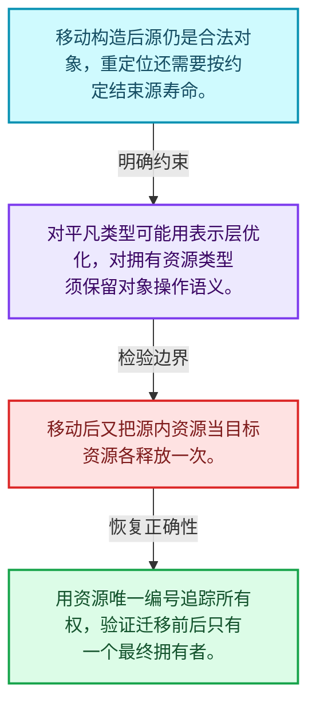
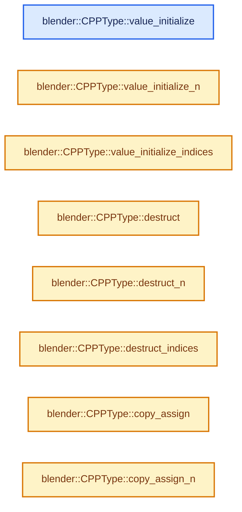
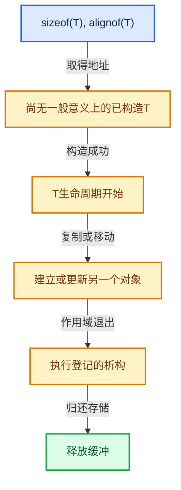

# 03-09 CPPType复制移动重定位

[方向导航](README.md) · [总目录](../README.md) · [实现索引](../%E7%AC%A6%E5%8F%B7%E4%BE%9D%E8%B5%96%E4%B8%8E%E5%AE%9E%E7%8E%B0%E7%B4%A2%E5%BC%95.md)

## 从问题到实现

移动构造和重定位为什么不能混为一谈？

重定位还包含源对象生命周期结束；重复析构源或漏析构目标都会破坏所有权。

**数据模型**

移动构造后源仍是合法对象，重定位还需要按约定结束源寿命。

**设计取舍**

对平凡类型可能用表示层优化，对拥有资源类型须保留对象操作语义。

**最小反例**

移动后又把源内资源当目标资源各释放一次。

**推导**

用资源唯一编号追踪所有权，验证迁移前后只有一个最终拥有者。

## 阅读地图与执行推演








图中的数值推演是本方向的教学模型；实际函数之间的调用边与概念分析边分别标注，不能把概念关系当作运行时调度顺序。

## 完整源码单元与就地讲解

中文讲解直接放在相关代码旁，复杂机制在代码下展开。原文折叠区保留基准行号；不需要在行号表和函数之间来回查找。类布局可分段展示，函数实现不按固定行数切开。

<!-- annotated:cb29333fc0a707 -->

```cpp

```

<details>
<summary>核对原始源码：source/blender/blenlib/BLI_cpp_type.hh · L541—L541</summary>

<!-- original:cb29333fc0a707:source/blender/blenlib/BLI_cpp_type.hh:541:541 -->

```cpp

```

</details>

<a id="f-fbcaf2a7fa47e6a2"></a>

### `blender::CPPType::value_initialize`

实现位置：[source/blender/blenlib/BLI_cpp_type.hh](../../../../../source/blender/blenlib/BLI_cpp_type.hh) · L542—L545。

接口参数：

- `void *ptr`

**教学注释版**

<!-- annotated:55d41a19b23173 -->

```cpp
inline void CPPType::value_initialize(void *ptr) const
{
  value_initialize_(ptr);
}
```

<details>
<summary>核对原始源码：source/blender/blenlib/BLI_cpp_type.hh · L542—L545</summary>

<!-- original:55d41a19b23173:source/blender/blenlib/BLI_cpp_type.hh:542:545 -->

```cpp
inline void CPPType::value_initialize(void *ptr) const
{
  value_initialize_(ptr);
}
```

</details>

**继续追踪实现**

- `value_initialize_` → [调用协议](../%E6%A8%A1%E6%9D%BF%E5%AE%8F%E4%B8%8E%E5%8A%A8%E6%80%81%E5%88%86%E6%B4%BE%E5%8D%8F%E8%AE%AE.md)：函数指针、局部可调用对象或未展开的宏；必须结合调用者环境。调用位置L544。

<!-- annotated:a7954a5366fa59 -->

```cpp

```

<details>
<summary>核对原始源码：source/blender/blenlib/BLI_cpp_type.hh · L546—L546</summary>

<!-- original:a7954a5366fa59:source/blender/blenlib/BLI_cpp_type.hh:546:546 -->

```cpp

```

</details>

<a id="f-151b9bad4e4ccf5e"></a>

### `blender::CPPType::value_initialize_n`

实现位置：[source/blender/blenlib/BLI_cpp_type.hh](../../../../../source/blender/blenlib/BLI_cpp_type.hh) · L547—L550。

接口参数：

- `void *ptr`
- `int64_t n`

**教学注释版**

<!-- annotated:72681d7701968a -->

```cpp
inline void CPPType::value_initialize_n(void *ptr, int64_t n) const
{
  value_initialize_n_(ptr, n);
}
```

<details>
<summary>核对原始源码：source/blender/blenlib/BLI_cpp_type.hh · L547—L550</summary>

<!-- original:72681d7701968a:source/blender/blenlib/BLI_cpp_type.hh:547:550 -->

```cpp
inline void CPPType::value_initialize_n(void *ptr, int64_t n) const
{
  value_initialize_n_(ptr, n);
}
```

</details>

**继续追踪实现**

- `value_initialize_n_` → [调用协议](../%E6%A8%A1%E6%9D%BF%E5%AE%8F%E4%B8%8E%E5%8A%A8%E6%80%81%E5%88%86%E6%B4%BE%E5%8D%8F%E8%AE%AE.md)：函数指针、局部可调用对象或未展开的宏；必须结合调用者环境。调用位置L549。

<!-- annotated:3930d414fd7394 -->

```cpp

```

<details>
<summary>核对原始源码：source/blender/blenlib/BLI_cpp_type.hh · L551—L551</summary>

<!-- original:3930d414fd7394:source/blender/blenlib/BLI_cpp_type.hh:551:551 -->

```cpp

```

</details>

<a id="f-8a08e958708a4989"></a>

### `blender::CPPType::value_initialize_indices`

实现位置：[source/blender/blenlib/BLI_cpp_type.hh](../../../../../source/blender/blenlib/BLI_cpp_type.hh) · L552—L555。

接口参数：

- `void *ptr`
- `const IndexMask &mask`

**教学注释版**

<!-- annotated:1b282a84e6411e -->

```cpp
inline void CPPType::value_initialize_indices(void *ptr, const IndexMask &mask) const
{
  value_initialize_indices_(ptr, mask);
}
```

<details>
<summary>核对原始源码：source/blender/blenlib/BLI_cpp_type.hh · L552—L555</summary>

<!-- original:1b282a84e6411e:source/blender/blenlib/BLI_cpp_type.hh:552:555 -->

```cpp
inline void CPPType::value_initialize_indices(void *ptr, const IndexMask &mask) const
{
  value_initialize_indices_(ptr, mask);
}
```

</details>

**继续追踪实现**

- `value_initialize_indices_` → [调用协议](../%E6%A8%A1%E6%9D%BF%E5%AE%8F%E4%B8%8E%E5%8A%A8%E6%80%81%E5%88%86%E6%B4%BE%E5%8D%8F%E8%AE%AE.md)：函数指针、局部可调用对象或未展开的宏；必须结合调用者环境。调用位置L554。

<!-- annotated:04cb08ae2f960b -->

```cpp

```

<details>
<summary>核对原始源码：source/blender/blenlib/BLI_cpp_type.hh · L556—L556</summary>

<!-- original:04cb08ae2f960b:source/blender/blenlib/BLI_cpp_type.hh:556:556 -->

```cpp

```

</details>

<a id="f-85f4f006e822b3c7"></a>

### `blender::CPPType::destruct`

实现位置：[source/blender/blenlib/BLI_cpp_type.hh](../../../../../source/blender/blenlib/BLI_cpp_type.hh) · L557—L560。

接口参数：

- `void *ptr`

**教学注释版**

<!-- annotated:57be726a55f25e -->

```cpp
inline void CPPType::destruct(void *ptr) const
{
  destruct_(ptr);
}
```

<details>
<summary>核对原始源码：source/blender/blenlib/BLI_cpp_type.hh · L557—L560</summary>

<!-- original:57be726a55f25e:source/blender/blenlib/BLI_cpp_type.hh:557:560 -->

```cpp
inline void CPPType::destruct(void *ptr) const
{
  destruct_(ptr);
}
```

</details>

**继续追踪实现**

- `destruct_` → [调用协议](../%E6%A8%A1%E6%9D%BF%E5%AE%8F%E4%B8%8E%E5%8A%A8%E6%80%81%E5%88%86%E6%B4%BE%E5%8D%8F%E8%AE%AE.md)：函数指针、局部可调用对象或未展开的宏；必须结合调用者环境。调用位置L559。

<!-- annotated:796a9f56f85366 -->

```cpp

```

<details>
<summary>核对原始源码：source/blender/blenlib/BLI_cpp_type.hh · L561—L561</summary>

<!-- original:796a9f56f85366:source/blender/blenlib/BLI_cpp_type.hh:561:561 -->

```cpp

```

</details>

<a id="f-1858ea1d7f707a74"></a>

### `blender::CPPType::destruct_n`

实现位置：[source/blender/blenlib/BLI_cpp_type.hh](../../../../../source/blender/blenlib/BLI_cpp_type.hh) · L562—L565。

接口参数：

- `void *ptr`
- `int64_t n`

**教学注释版**

<!-- annotated:7680f645da5a1a -->

```cpp
inline void CPPType::destruct_n(void *ptr, int64_t n) const
{
  destruct_n_(ptr, n);
}
```

<details>
<summary>核对原始源码：source/blender/blenlib/BLI_cpp_type.hh · L562—L565</summary>

<!-- original:7680f645da5a1a:source/blender/blenlib/BLI_cpp_type.hh:562:565 -->

```cpp
inline void CPPType::destruct_n(void *ptr, int64_t n) const
{
  destruct_n_(ptr, n);
}
```

</details>

**继续追踪实现**

- `destruct_n_` → [调用协议](../%E6%A8%A1%E6%9D%BF%E5%AE%8F%E4%B8%8E%E5%8A%A8%E6%80%81%E5%88%86%E6%B4%BE%E5%8D%8F%E8%AE%AE.md)：函数指针、局部可调用对象或未展开的宏；必须结合调用者环境。调用位置L564。

<!-- annotated:a4709b7c39f2d4 -->

```cpp

```

<details>
<summary>核对原始源码：source/blender/blenlib/BLI_cpp_type.hh · L566—L566</summary>

<!-- original:a4709b7c39f2d4:source/blender/blenlib/BLI_cpp_type.hh:566:566 -->

```cpp

```

</details>

<a id="f-399974b7f6ab3ceb"></a>

### `blender::CPPType::destruct_indices`

实现位置：[source/blender/blenlib/BLI_cpp_type.hh](../../../../../source/blender/blenlib/BLI_cpp_type.hh) · L567—L570。

接口参数：

- `void *ptr`
- `const IndexMask &mask`

**教学注释版**

<!-- annotated:1c7fc8a768e0f6 -->

```cpp
inline void CPPType::destruct_indices(void *ptr, const IndexMask &mask) const
{
  destruct_indices_(ptr, mask);
}
```

<details>
<summary>核对原始源码：source/blender/blenlib/BLI_cpp_type.hh · L567—L570</summary>

<!-- original:1c7fc8a768e0f6:source/blender/blenlib/BLI_cpp_type.hh:567:570 -->

```cpp
inline void CPPType::destruct_indices(void *ptr, const IndexMask &mask) const
{
  destruct_indices_(ptr, mask);
}
```

</details>

**继续追踪实现**

- `destruct_indices_` → [调用协议](../%E6%A8%A1%E6%9D%BF%E5%AE%8F%E4%B8%8E%E5%8A%A8%E6%80%81%E5%88%86%E6%B4%BE%E5%8D%8F%E8%AE%AE.md)：函数指针、局部可调用对象或未展开的宏；必须结合调用者环境。调用位置L569。

<!-- annotated:04613f5cc38cb5 -->

```cpp

```

<details>
<summary>核对原始源码：source/blender/blenlib/BLI_cpp_type.hh · L571—L571</summary>

<!-- original:04613f5cc38cb5:source/blender/blenlib/BLI_cpp_type.hh:571:571 -->

```cpp

```

</details>

<a id="f-08648460bfa418fe"></a>

### `blender::CPPType::copy_assign`

实现位置：[source/blender/blenlib/BLI_cpp_type.hh](../../../../../source/blender/blenlib/BLI_cpp_type.hh) · L572—L575。

接口参数：

- `const void *src`
- `void *dst`

**教学注释版**

<!-- annotated:44e5171a3f5752 -->

```cpp
inline void CPPType::copy_assign(const void *src, void *dst) const
{
  copy_assign_(src, dst);
}
```

<details>
<summary>核对原始源码：source/blender/blenlib/BLI_cpp_type.hh · L572—L575</summary>

<!-- original:44e5171a3f5752:source/blender/blenlib/BLI_cpp_type.hh:572:575 -->

```cpp
inline void CPPType::copy_assign(const void *src, void *dst) const
{
  copy_assign_(src, dst);
}
```

</details>

**继续追踪实现**

- `copy_assign_` → [调用协议](../%E6%A8%A1%E6%9D%BF%E5%AE%8F%E4%B8%8E%E5%8A%A8%E6%80%81%E5%88%86%E6%B4%BE%E5%8D%8F%E8%AE%AE.md)：函数指针、局部可调用对象或未展开的宏；必须结合调用者环境。调用位置L574。

<!-- annotated:4cfeb42e854066 -->

```cpp

```

<details>
<summary>核对原始源码：source/blender/blenlib/BLI_cpp_type.hh · L576—L576</summary>

<!-- original:4cfeb42e854066:source/blender/blenlib/BLI_cpp_type.hh:576:576 -->

```cpp

```

</details>

<a id="f-bdf812bca95da2b6"></a>

### `blender::CPPType::copy_assign_n`

实现位置：[source/blender/blenlib/BLI_cpp_type.hh](../../../../../source/blender/blenlib/BLI_cpp_type.hh) · L577—L580。

接口参数：

- `const void *src`
- `void *dst`
- `int64_t n`

**教学注释版**

<!-- annotated:865925e26efc90 -->

```cpp
inline void CPPType::copy_assign_n(const void *src, void *dst, int64_t n) const
{
  copy_assign_n_(src, dst, n);
}
```

<details>
<summary>核对原始源码：source/blender/blenlib/BLI_cpp_type.hh · L577—L580</summary>

<!-- original:865925e26efc90:source/blender/blenlib/BLI_cpp_type.hh:577:580 -->

```cpp
inline void CPPType::copy_assign_n(const void *src, void *dst, int64_t n) const
{
  copy_assign_n_(src, dst, n);
}
```

</details>

**继续追踪实现**

- `copy_assign_n_` → [调用协议](../%E6%A8%A1%E6%9D%BF%E5%AE%8F%E4%B8%8E%E5%8A%A8%E6%80%81%E5%88%86%E6%B4%BE%E5%8D%8F%E8%AE%AE.md)：函数指针、局部可调用对象或未展开的宏；必须结合调用者环境。调用位置L579。

<!-- annotated:95270da1b52033 -->

```cpp

```

<details>
<summary>核对原始源码：source/blender/blenlib/BLI_cpp_type.hh · L581—L581</summary>

<!-- original:95270da1b52033:source/blender/blenlib/BLI_cpp_type.hh:581:581 -->

```cpp

```

</details>

<a id="f-c5ba85ee3070672a"></a>

### `blender::CPPType::copy_assign_indices`

实现位置：[source/blender/blenlib/BLI_cpp_type.hh](../../../../../source/blender/blenlib/BLI_cpp_type.hh) · L582—L585。

接口参数：

- `const void *src`
- `void *dst`
- `const IndexMask &mask`

**教学注释版**

<!-- annotated:1c7104af948d50 -->

```cpp
inline void CPPType::copy_assign_indices(const void *src, void *dst, const IndexMask &mask) const
{
  copy_assign_indices_(src, dst, mask);
}
```

<details>
<summary>核对原始源码：source/blender/blenlib/BLI_cpp_type.hh · L582—L585</summary>

<!-- original:1c7104af948d50:source/blender/blenlib/BLI_cpp_type.hh:582:585 -->

```cpp
inline void CPPType::copy_assign_indices(const void *src, void *dst, const IndexMask &mask) const
{
  copy_assign_indices_(src, dst, mask);
}
```

</details>

**继续追踪实现**

- `copy_assign_indices_` → [调用协议](../%E6%A8%A1%E6%9D%BF%E5%AE%8F%E4%B8%8E%E5%8A%A8%E6%80%81%E5%88%86%E6%B4%BE%E5%8D%8F%E8%AE%AE.md)：函数指针、局部可调用对象或未展开的宏；必须结合调用者环境。调用位置L584。

<!-- annotated:19c38b0861d739 -->

```cpp

```

<details>
<summary>核对原始源码：source/blender/blenlib/BLI_cpp_type.hh · L586—L586</summary>

<!-- original:19c38b0861d739:source/blender/blenlib/BLI_cpp_type.hh:586:586 -->

```cpp

```

</details>

<a id="f-9ac673adef57e5a6"></a>

### `blender::CPPType::copy_assign_compressed`

实现位置：[source/blender/blenlib/BLI_cpp_type.hh](../../../../../source/blender/blenlib/BLI_cpp_type.hh) · L587—L592。

接口参数：

- `const void *src`
- `void *dst`
- `const IndexMask &mask`

**教学注释版**

<!-- annotated:84c07d116c47f4 -->

```cpp
inline void CPPType::copy_assign_compressed(const void *src,
                                            void *dst,
                                            const IndexMask &mask) const
{
  copy_assign_compressed_(src, dst, mask);
}
```

<details>
<summary>核对原始源码：source/blender/blenlib/BLI_cpp_type.hh · L587—L592</summary>

<!-- original:84c07d116c47f4:source/blender/blenlib/BLI_cpp_type.hh:587:592 -->

```cpp
inline void CPPType::copy_assign_compressed(const void *src,
                                            void *dst,
                                            const IndexMask &mask) const
{
  copy_assign_compressed_(src, dst, mask);
}
```

</details>

**继续追踪实现**

- `copy_assign_compressed_` → [调用协议](../%E6%A8%A1%E6%9D%BF%E5%AE%8F%E4%B8%8E%E5%8A%A8%E6%80%81%E5%88%86%E6%B4%BE%E5%8D%8F%E8%AE%AE.md)：函数指针、局部可调用对象或未展开的宏；必须结合调用者环境。调用位置L591。

<!-- annotated:fc9610d156cbf5 -->

```cpp

```

<details>
<summary>核对原始源码：source/blender/blenlib/BLI_cpp_type.hh · L593—L593</summary>

<!-- original:fc9610d156cbf5:source/blender/blenlib/BLI_cpp_type.hh:593:593 -->

```cpp

```

</details>

<a id="f-cfda413a9784073e"></a>

### `blender::CPPType::copy_construct`

实现位置：[source/blender/blenlib/BLI_cpp_type.hh](../../../../../source/blender/blenlib/BLI_cpp_type.hh) · L594—L597。

接口参数：

- `const void *src`
- `void *dst`

**教学注释版**

<!-- annotated:347dd23a1ba658 -->

```cpp
inline void CPPType::copy_construct(const void *src, void *dst) const
{
  copy_construct_(src, dst);
}
```

<details>
<summary>核对原始源码：source/blender/blenlib/BLI_cpp_type.hh · L594—L597</summary>

<!-- original:347dd23a1ba658:source/blender/blenlib/BLI_cpp_type.hh:594:597 -->

```cpp
inline void CPPType::copy_construct(const void *src, void *dst) const
{
  copy_construct_(src, dst);
}
```

</details>

**继续追踪实现**

- `copy_construct_` → [调用协议](../%E6%A8%A1%E6%9D%BF%E5%AE%8F%E4%B8%8E%E5%8A%A8%E6%80%81%E5%88%86%E6%B4%BE%E5%8D%8F%E8%AE%AE.md)：函数指针、局部可调用对象或未展开的宏；必须结合调用者环境。调用位置L596。

<!-- annotated:01688e3153fbae -->

```cpp

```

<details>
<summary>核对原始源码：source/blender/blenlib/BLI_cpp_type.hh · L598—L598</summary>

<!-- original:01688e3153fbae:source/blender/blenlib/BLI_cpp_type.hh:598:598 -->

```cpp

```

</details>

<a id="f-3676f00cc2bda6e3"></a>

### `blender::CPPType::copy_construct_n`

实现位置：[source/blender/blenlib/BLI_cpp_type.hh](../../../../../source/blender/blenlib/BLI_cpp_type.hh) · L599—L602。

接口参数：

- `const void *src`
- `void *dst`
- `int64_t n`

**教学注释版**

<!-- annotated:cdbe5f22bcea0e -->

```cpp
inline void CPPType::copy_construct_n(const void *src, void *dst, int64_t n) const
{
  copy_construct_n_(src, dst, n);
}
```

<details>
<summary>核对原始源码：source/blender/blenlib/BLI_cpp_type.hh · L599—L602</summary>

<!-- original:cdbe5f22bcea0e:source/blender/blenlib/BLI_cpp_type.hh:599:602 -->

```cpp
inline void CPPType::copy_construct_n(const void *src, void *dst, int64_t n) const
{
  copy_construct_n_(src, dst, n);
}
```

</details>

**继续追踪实现**

- `copy_construct_n_` → [调用协议](../%E6%A8%A1%E6%9D%BF%E5%AE%8F%E4%B8%8E%E5%8A%A8%E6%80%81%E5%88%86%E6%B4%BE%E5%8D%8F%E8%AE%AE.md)：函数指针、局部可调用对象或未展开的宏；必须结合调用者环境。调用位置L601。

<!-- annotated:1c157aa07b8369 -->

```cpp

```

<details>
<summary>核对原始源码：source/blender/blenlib/BLI_cpp_type.hh · L603—L603</summary>

<!-- original:1c157aa07b8369:source/blender/blenlib/BLI_cpp_type.hh:603:603 -->

```cpp

```

</details>

<a id="f-3a03a15dfd4d33a5"></a>

### `blender::CPPType::copy_construct_indices`

实现位置：[source/blender/blenlib/BLI_cpp_type.hh](../../../../../source/blender/blenlib/BLI_cpp_type.hh) · L604—L609。

接口参数：

- `const void *src`
- `void *dst`
- `const IndexMask &mask`

**教学注释版**

<!-- annotated:98cfba22c62be1 -->

```cpp
inline void CPPType::copy_construct_indices(const void *src,
                                            void *dst,
                                            const IndexMask &mask) const
{
  copy_construct_indices_(src, dst, mask);
}
```

<details>
<summary>核对原始源码：source/blender/blenlib/BLI_cpp_type.hh · L604—L609</summary>

<!-- original:98cfba22c62be1:source/blender/blenlib/BLI_cpp_type.hh:604:609 -->

```cpp
inline void CPPType::copy_construct_indices(const void *src,
                                            void *dst,
                                            const IndexMask &mask) const
{
  copy_construct_indices_(src, dst, mask);
}
```

</details>

**继续追踪实现**

- `copy_construct_indices_` → [调用协议](../%E6%A8%A1%E6%9D%BF%E5%AE%8F%E4%B8%8E%E5%8A%A8%E6%80%81%E5%88%86%E6%B4%BE%E5%8D%8F%E8%AE%AE.md)：函数指针、局部可调用对象或未展开的宏；必须结合调用者环境。调用位置L608。

<!-- annotated:94603475584263 -->

```cpp

```

<details>
<summary>核对原始源码：source/blender/blenlib/BLI_cpp_type.hh · L610—L610</summary>

<!-- original:94603475584263:source/blender/blenlib/BLI_cpp_type.hh:610:610 -->

```cpp

```

</details>

<a id="f-a23ef52383d4378c"></a>

### `blender::CPPType::copy_construct_compressed`

实现位置：[source/blender/blenlib/BLI_cpp_type.hh](../../../../../source/blender/blenlib/BLI_cpp_type.hh) · L611—L616。

接口参数：

- `const void *src`
- `void *dst`
- `const IndexMask &mask`

**教学注释版**

<!-- annotated:566f329049e046 -->

```cpp
inline void CPPType::copy_construct_compressed(const void *src,
                                               void *dst,
                                               const IndexMask &mask) const
{
  copy_construct_compressed_(src, dst, mask);
}
```

<details>
<summary>核对原始源码：source/blender/blenlib/BLI_cpp_type.hh · L611—L616</summary>

<!-- original:566f329049e046:source/blender/blenlib/BLI_cpp_type.hh:611:616 -->

```cpp
inline void CPPType::copy_construct_compressed(const void *src,
                                               void *dst,
                                               const IndexMask &mask) const
{
  copy_construct_compressed_(src, dst, mask);
}
```

</details>

**继续追踪实现**

- `copy_construct_compressed_` → [调用协议](../%E6%A8%A1%E6%9D%BF%E5%AE%8F%E4%B8%8E%E5%8A%A8%E6%80%81%E5%88%86%E6%B4%BE%E5%8D%8F%E8%AE%AE.md)：函数指针、局部可调用对象或未展开的宏；必须结合调用者环境。调用位置L615。

<!-- annotated:54c2f039201a47 -->

```cpp

```

<details>
<summary>核对原始源码：source/blender/blenlib/BLI_cpp_type.hh · L617—L617</summary>

<!-- original:54c2f039201a47:source/blender/blenlib/BLI_cpp_type.hh:617:617 -->

```cpp

```

</details>

<a id="f-6a7ee5d525710ef4"></a>

### `blender::CPPType::move_assign`

实现位置：[source/blender/blenlib/BLI_cpp_type.hh](../../../../../source/blender/blenlib/BLI_cpp_type.hh) · L618—L621。

接口参数：

- `void *src`
- `void *dst`

**教学注释版**

<!-- annotated:2a4980d68c000a -->

```cpp
inline void CPPType::move_assign(void *src, void *dst) const
{
  move_assign_(src, dst);
}
```

<details>
<summary>核对原始源码：source/blender/blenlib/BLI_cpp_type.hh · L618—L621</summary>

<!-- original:2a4980d68c000a:source/blender/blenlib/BLI_cpp_type.hh:618:621 -->

```cpp
inline void CPPType::move_assign(void *src, void *dst) const
{
  move_assign_(src, dst);
}
```

</details>

**继续追踪实现**

- `move_assign_` → [调用协议](../%E6%A8%A1%E6%9D%BF%E5%AE%8F%E4%B8%8E%E5%8A%A8%E6%80%81%E5%88%86%E6%B4%BE%E5%8D%8F%E8%AE%AE.md)：函数指针、局部可调用对象或未展开的宏；必须结合调用者环境。调用位置L620。

<!-- annotated:6451af58c6b9e8 -->

```cpp

```

<details>
<summary>核对原始源码：source/blender/blenlib/BLI_cpp_type.hh · L622—L622</summary>

<!-- original:6451af58c6b9e8:source/blender/blenlib/BLI_cpp_type.hh:622:622 -->

```cpp

```

</details>

<a id="f-954927155163eda8"></a>

### `blender::CPPType::move_assign_n`

实现位置：[source/blender/blenlib/BLI_cpp_type.hh](../../../../../source/blender/blenlib/BLI_cpp_type.hh) · L623—L626。

接口参数：

- `void *src`
- `void *dst`
- `int64_t n`

**教学注释版**

<!-- annotated:f6e0b252010b20 -->

```cpp
inline void CPPType::move_assign_n(void *src, void *dst, int64_t n) const
{
  move_assign_n_(src, dst, n);
}
```

<details>
<summary>核对原始源码：source/blender/blenlib/BLI_cpp_type.hh · L623—L626</summary>

<!-- original:f6e0b252010b20:source/blender/blenlib/BLI_cpp_type.hh:623:626 -->

```cpp
inline void CPPType::move_assign_n(void *src, void *dst, int64_t n) const
{
  move_assign_n_(src, dst, n);
}
```

</details>

**继续追踪实现**

- `move_assign_n_` → [调用协议](../%E6%A8%A1%E6%9D%BF%E5%AE%8F%E4%B8%8E%E5%8A%A8%E6%80%81%E5%88%86%E6%B4%BE%E5%8D%8F%E8%AE%AE.md)：函数指针、局部可调用对象或未展开的宏；必须结合调用者环境。调用位置L625。

<!-- annotated:4d948eb4cc08f7 -->

```cpp

```

<details>
<summary>核对原始源码：source/blender/blenlib/BLI_cpp_type.hh · L627—L627</summary>

<!-- original:4d948eb4cc08f7:source/blender/blenlib/BLI_cpp_type.hh:627:627 -->

```cpp

```

</details>

<a id="f-b5c72b351a0921ae"></a>

### `blender::CPPType::move_assign_indices`

实现位置：[source/blender/blenlib/BLI_cpp_type.hh](../../../../../source/blender/blenlib/BLI_cpp_type.hh) · L628—L631。

接口参数：

- `void *src`
- `void *dst`
- `const IndexMask &mask`

**教学注释版**

<!-- annotated:2bfea51d581904 -->

```cpp
inline void CPPType::move_assign_indices(void *src, void *dst, const IndexMask &mask) const
{
  move_assign_indices_(src, dst, mask);
}
```

<details>
<summary>核对原始源码：source/blender/blenlib/BLI_cpp_type.hh · L628—L631</summary>

<!-- original:2bfea51d581904:source/blender/blenlib/BLI_cpp_type.hh:628:631 -->

```cpp
inline void CPPType::move_assign_indices(void *src, void *dst, const IndexMask &mask) const
{
  move_assign_indices_(src, dst, mask);
}
```

</details>

**继续追踪实现**

- `move_assign_indices_` → [调用协议](../%E6%A8%A1%E6%9D%BF%E5%AE%8F%E4%B8%8E%E5%8A%A8%E6%80%81%E5%88%86%E6%B4%BE%E5%8D%8F%E8%AE%AE.md)：函数指针、局部可调用对象或未展开的宏；必须结合调用者环境。调用位置L630。

<!-- annotated:7273e672dba5ce -->

```cpp

```

<details>
<summary>核对原始源码：source/blender/blenlib/BLI_cpp_type.hh · L632—L632</summary>

<!-- original:7273e672dba5ce:source/blender/blenlib/BLI_cpp_type.hh:632:632 -->

```cpp

```

</details>

<a id="f-12275cc6e59e9740"></a>

### `blender::CPPType::move_construct`

实现位置：[source/blender/blenlib/BLI_cpp_type.hh](../../../../../source/blender/blenlib/BLI_cpp_type.hh) · L633—L636。

接口参数：

- `void *src`
- `void *dst`

**教学注释版**

<!-- annotated:ea9b76fca5c390 -->

```cpp
inline void CPPType::move_construct(void *src, void *dst) const
{
  move_construct_(src, dst);
}
```

<details>
<summary>核对原始源码：source/blender/blenlib/BLI_cpp_type.hh · L633—L636</summary>

<!-- original:ea9b76fca5c390:source/blender/blenlib/BLI_cpp_type.hh:633:636 -->

```cpp
inline void CPPType::move_construct(void *src, void *dst) const
{
  move_construct_(src, dst);
}
```

</details>

**继续追踪实现**

- `move_construct_` → [调用协议](../%E6%A8%A1%E6%9D%BF%E5%AE%8F%E4%B8%8E%E5%8A%A8%E6%80%81%E5%88%86%E6%B4%BE%E5%8D%8F%E8%AE%AE.md)：函数指针、局部可调用对象或未展开的宏；必须结合调用者环境。调用位置L635。

<!-- annotated:ef08d88707ab13 -->

```cpp

```

<details>
<summary>核对原始源码：source/blender/blenlib/BLI_cpp_type.hh · L637—L637</summary>

<!-- original:ef08d88707ab13:source/blender/blenlib/BLI_cpp_type.hh:637:637 -->

```cpp

```

</details>

<a id="f-80ac9476a9ba29f9"></a>

### `blender::CPPType::move_construct_n`

实现位置：[source/blender/blenlib/BLI_cpp_type.hh](../../../../../source/blender/blenlib/BLI_cpp_type.hh) · L638—L641。

接口参数：

- `void *src`
- `void *dst`
- `int64_t n`

**教学注释版**

<!-- annotated:28e9762ece46a1 -->

```cpp
inline void CPPType::move_construct_n(void *src, void *dst, int64_t n) const
{
  move_construct_n_(src, dst, n);
}
```

<details>
<summary>核对原始源码：source/blender/blenlib/BLI_cpp_type.hh · L638—L641</summary>

<!-- original:28e9762ece46a1:source/blender/blenlib/BLI_cpp_type.hh:638:641 -->

```cpp
inline void CPPType::move_construct_n(void *src, void *dst, int64_t n) const
{
  move_construct_n_(src, dst, n);
}
```

</details>

**继续追踪实现**

- `move_construct_n_` → [调用协议](../%E6%A8%A1%E6%9D%BF%E5%AE%8F%E4%B8%8E%E5%8A%A8%E6%80%81%E5%88%86%E6%B4%BE%E5%8D%8F%E8%AE%AE.md)：函数指针、局部可调用对象或未展开的宏；必须结合调用者环境。调用位置L640。

<!-- annotated:d32dc1c1cc675d -->

```cpp

```

<details>
<summary>核对原始源码：source/blender/blenlib/BLI_cpp_type.hh · L642—L642</summary>

<!-- original:d32dc1c1cc675d:source/blender/blenlib/BLI_cpp_type.hh:642:642 -->

```cpp

```

</details>

<a id="f-3243415a42c2b53f"></a>

### `blender::CPPType::move_construct_indices`

实现位置：[source/blender/blenlib/BLI_cpp_type.hh](../../../../../source/blender/blenlib/BLI_cpp_type.hh) · L643—L646。

接口参数：

- `void *src`
- `void *dst`
- `const IndexMask &mask`

**教学注释版**

<!-- annotated:9098cd480eac53 -->

```cpp
inline void CPPType::move_construct_indices(void *src, void *dst, const IndexMask &mask) const
{
  move_construct_indices_(src, dst, mask);
}
```

<details>
<summary>核对原始源码：source/blender/blenlib/BLI_cpp_type.hh · L643—L646</summary>

<!-- original:9098cd480eac53:source/blender/blenlib/BLI_cpp_type.hh:643:646 -->

```cpp
inline void CPPType::move_construct_indices(void *src, void *dst, const IndexMask &mask) const
{
  move_construct_indices_(src, dst, mask);
}
```

</details>

**继续追踪实现**

- `move_construct_indices_` → [调用协议](../%E6%A8%A1%E6%9D%BF%E5%AE%8F%E4%B8%8E%E5%8A%A8%E6%80%81%E5%88%86%E6%B4%BE%E5%8D%8F%E8%AE%AE.md)：函数指针、局部可调用对象或未展开的宏；必须结合调用者环境。调用位置L645。

<!-- annotated:e5f5d4b10567e4 -->

```cpp

```

<details>
<summary>核对原始源码：source/blender/blenlib/BLI_cpp_type.hh · L647—L647</summary>

<!-- original:e5f5d4b10567e4:source/blender/blenlib/BLI_cpp_type.hh:647:647 -->

```cpp

```

</details>

<a id="f-2e80f595092cf36e"></a>

### `blender::CPPType::relocate_assign`

实现位置：[source/blender/blenlib/BLI_cpp_type.hh](../../../../../source/blender/blenlib/BLI_cpp_type.hh) · L648—L651。

接口参数：

- `void *src`
- `void *dst`

**教学注释版**

<!-- annotated:a1fc982ba0c270 -->

```cpp
inline void CPPType::relocate_assign(void *src, void *dst) const
{
  relocate_assign_(src, dst);
}
```

<details>
<summary>核对原始源码：source/blender/blenlib/BLI_cpp_type.hh · L648—L651</summary>

<!-- original:a1fc982ba0c270:source/blender/blenlib/BLI_cpp_type.hh:648:651 -->

```cpp
inline void CPPType::relocate_assign(void *src, void *dst) const
{
  relocate_assign_(src, dst);
}
```

</details>

**继续追踪实现**

- `relocate_assign_` → [调用协议](../%E6%A8%A1%E6%9D%BF%E5%AE%8F%E4%B8%8E%E5%8A%A8%E6%80%81%E5%88%86%E6%B4%BE%E5%8D%8F%E8%AE%AE.md)：函数指针、局部可调用对象或未展开的宏；必须结合调用者环境。调用位置L650。

<!-- annotated:be4bb2c9872714 -->

```cpp

```

<details>
<summary>核对原始源码：source/blender/blenlib/BLI_cpp_type.hh · L652—L652</summary>

<!-- original:be4bb2c9872714:source/blender/blenlib/BLI_cpp_type.hh:652:652 -->

```cpp

```

</details>

<a id="f-a9af541e1bc5b42f"></a>

### `blender::CPPType::relocate_assign_n`

实现位置：[source/blender/blenlib/BLI_cpp_type.hh](../../../../../source/blender/blenlib/BLI_cpp_type.hh) · L653—L656。

接口参数：

- `void *src`
- `void *dst`
- `int64_t n`

**教学注释版**

<!-- annotated:33e9eb9e491a9b -->

```cpp
inline void CPPType::relocate_assign_n(void *src, void *dst, int64_t n) const
{
  relocate_assign_n_(src, dst, n);
}
```

<details>
<summary>核对原始源码：source/blender/blenlib/BLI_cpp_type.hh · L653—L656</summary>

<!-- original:33e9eb9e491a9b:source/blender/blenlib/BLI_cpp_type.hh:653:656 -->

```cpp
inline void CPPType::relocate_assign_n(void *src, void *dst, int64_t n) const
{
  relocate_assign_n_(src, dst, n);
}
```

</details>

**继续追踪实现**

- `relocate_assign_n_` → [调用协议](../%E6%A8%A1%E6%9D%BF%E5%AE%8F%E4%B8%8E%E5%8A%A8%E6%80%81%E5%88%86%E6%B4%BE%E5%8D%8F%E8%AE%AE.md)：函数指针、局部可调用对象或未展开的宏；必须结合调用者环境。调用位置L655。

<!-- annotated:8c3afcaf93faa8 -->

```cpp

```

<details>
<summary>核对原始源码：source/blender/blenlib/BLI_cpp_type.hh · L657—L657</summary>

<!-- original:8c3afcaf93faa8:source/blender/blenlib/BLI_cpp_type.hh:657:657 -->

```cpp

```

</details>

<a id="f-0c209a0835a6bf45"></a>

### `blender::CPPType::relocate_assign_indices`

实现位置：[source/blender/blenlib/BLI_cpp_type.hh](../../../../../source/blender/blenlib/BLI_cpp_type.hh) · L658—L661。

接口参数：

- `void *src`
- `void *dst`
- `const IndexMask &mask`

**教学注释版**

<!-- annotated:2de5ed3852736d -->

```cpp
inline void CPPType::relocate_assign_indices(void *src, void *dst, const IndexMask &mask) const
{
  relocate_assign_indices_(src, dst, mask);
}
```

<details>
<summary>核对原始源码：source/blender/blenlib/BLI_cpp_type.hh · L658—L661</summary>

<!-- original:2de5ed3852736d:source/blender/blenlib/BLI_cpp_type.hh:658:661 -->

```cpp
inline void CPPType::relocate_assign_indices(void *src, void *dst, const IndexMask &mask) const
{
  relocate_assign_indices_(src, dst, mask);
}
```

</details>

**继续追踪实现**

- `relocate_assign_indices_` → [调用协议](../%E6%A8%A1%E6%9D%BF%E5%AE%8F%E4%B8%8E%E5%8A%A8%E6%80%81%E5%88%86%E6%B4%BE%E5%8D%8F%E8%AE%AE.md)：函数指针、局部可调用对象或未展开的宏；必须结合调用者环境。调用位置L660。

<!-- annotated:5eedbd3d372a2b -->

```cpp

```

<details>
<summary>核对原始源码：source/blender/blenlib/BLI_cpp_type.hh · L662—L662</summary>

<!-- original:5eedbd3d372a2b:source/blender/blenlib/BLI_cpp_type.hh:662:662 -->

```cpp

```

</details>

<a id="f-0f702bbad84aaebb"></a>

### `blender::CPPType::relocate_construct`

实现位置：[source/blender/blenlib/BLI_cpp_type.hh](../../../../../source/blender/blenlib/BLI_cpp_type.hh) · L663—L666。

接口参数：

- `void *src`
- `void *dst`

**教学注释版**

<!-- annotated:c81947bae89276 -->

```cpp
inline void CPPType::relocate_construct(void *src, void *dst) const
{
  relocate_construct_(src, dst);
}
```

<details>
<summary>核对原始源码：source/blender/blenlib/BLI_cpp_type.hh · L663—L666</summary>

<!-- original:c81947bae89276:source/blender/blenlib/BLI_cpp_type.hh:663:666 -->

```cpp
inline void CPPType::relocate_construct(void *src, void *dst) const
{
  relocate_construct_(src, dst);
}
```

</details>

**继续追踪实现**

- `relocate_construct_` → [调用协议](../%E6%A8%A1%E6%9D%BF%E5%AE%8F%E4%B8%8E%E5%8A%A8%E6%80%81%E5%88%86%E6%B4%BE%E5%8D%8F%E8%AE%AE.md)：函数指针、局部可调用对象或未展开的宏；必须结合调用者环境。调用位置L665。

<!-- annotated:cd9bb487465123 -->

```cpp

```

<details>
<summary>核对原始源码：source/blender/blenlib/BLI_cpp_type.hh · L667—L667</summary>

<!-- original:cd9bb487465123:source/blender/blenlib/BLI_cpp_type.hh:667:667 -->

```cpp

```

</details>

<a id="f-3febed5919e51ed4"></a>

### `blender::CPPType::relocate_construct_n`

实现位置：[source/blender/blenlib/BLI_cpp_type.hh](../../../../../source/blender/blenlib/BLI_cpp_type.hh) · L668—L671。

接口参数：

- `void *src`
- `void *dst`
- `int64_t n`

**教学注释版**

<!-- annotated:f21440364a1483 -->

```cpp
inline void CPPType::relocate_construct_n(void *src, void *dst, int64_t n) const
{
  relocate_construct_n_(src, dst, n);
}
```

<details>
<summary>核对原始源码：source/blender/blenlib/BLI_cpp_type.hh · L668—L671</summary>

<!-- original:f21440364a1483:source/blender/blenlib/BLI_cpp_type.hh:668:671 -->

```cpp
inline void CPPType::relocate_construct_n(void *src, void *dst, int64_t n) const
{
  relocate_construct_n_(src, dst, n);
}
```

</details>

**继续追踪实现**

- `relocate_construct_n_` → [调用协议](../%E6%A8%A1%E6%9D%BF%E5%AE%8F%E4%B8%8E%E5%8A%A8%E6%80%81%E5%88%86%E6%B4%BE%E5%8D%8F%E8%AE%AE.md)：函数指针、局部可调用对象或未展开的宏；必须结合调用者环境。调用位置L670。

<!-- annotated:736a52a8d1b124 -->

```cpp

```

<details>
<summary>核对原始源码：source/blender/blenlib/BLI_cpp_type.hh · L672—L672</summary>

<!-- original:736a52a8d1b124:source/blender/blenlib/BLI_cpp_type.hh:672:672 -->

```cpp

```

</details>

<a id="f-bcebffa3275da567"></a>

### `blender::CPPType::relocate_construct_indices`

实现位置：[source/blender/blenlib/BLI_cpp_type.hh](../../../../../source/blender/blenlib/BLI_cpp_type.hh) · L673—L676。

接口参数：

- `void *src`
- `void *dst`
- `const IndexMask &mask`

**教学注释版**

<!-- annotated:055ae5cce05f70 -->

```cpp
inline void CPPType::relocate_construct_indices(void *src, void *dst, const IndexMask &mask) const
{
  relocate_construct_indices_(src, dst, mask);
}
```

<details>
<summary>核对原始源码：source/blender/blenlib/BLI_cpp_type.hh · L673—L676</summary>

<!-- original:055ae5cce05f70:source/blender/blenlib/BLI_cpp_type.hh:673:676 -->

```cpp
inline void CPPType::relocate_construct_indices(void *src, void *dst, const IndexMask &mask) const
{
  relocate_construct_indices_(src, dst, mask);
}
```

</details>

**继续追踪实现**

- `relocate_construct_indices_` → [调用协议](../%E6%A8%A1%E6%9D%BF%E5%AE%8F%E4%B8%8E%E5%8A%A8%E6%80%81%E5%88%86%E6%B4%BE%E5%8D%8F%E8%AE%AE.md)：函数指针、局部可调用对象或未展开的宏；必须结合调用者环境。调用位置L675。

<!-- annotated:9552a614384276 -->

```cpp

```

<details>
<summary>核对原始源码：source/blender/blenlib/BLI_cpp_type.hh · L677—L677</summary>

<!-- original:9552a614384276:source/blender/blenlib/BLI_cpp_type.hh:677:677 -->

```cpp

```

</details>

<a id="f-fd80e7c7f897917a"></a>

### `blender::CPPType::fill_assign_n`

实现位置：[source/blender/blenlib/BLI_cpp_type.hh](../../../../../source/blender/blenlib/BLI_cpp_type.hh) · L678—L681。

接口参数：

- `const void *value`
- `void *dst`
- `int64_t n`

**教学注释版**

<!-- annotated:0da22c89b1f2a0 -->

```cpp
inline void CPPType::fill_assign_n(const void *value, void *dst, int64_t n) const
{
  fill_assign_n_(value, dst, n);
}
```

<details>
<summary>核对原始源码：source/blender/blenlib/BLI_cpp_type.hh · L678—L681</summary>

<!-- original:0da22c89b1f2a0:source/blender/blenlib/BLI_cpp_type.hh:678:681 -->

```cpp
inline void CPPType::fill_assign_n(const void *value, void *dst, int64_t n) const
{
  fill_assign_n_(value, dst, n);
}
```

</details>

**继续追踪实现**

- `fill_assign_n_` → [调用协议](../%E6%A8%A1%E6%9D%BF%E5%AE%8F%E4%B8%8E%E5%8A%A8%E6%80%81%E5%88%86%E6%B4%BE%E5%8D%8F%E8%AE%AE.md)：函数指针、局部可调用对象或未展开的宏；必须结合调用者环境。调用位置L680。

<!-- annotated:42e0469cbb3bfb -->

```cpp

```

<details>
<summary>核对原始源码：source/blender/blenlib/BLI_cpp_type.hh · L682—L682</summary>

<!-- original:42e0469cbb3bfb:source/blender/blenlib/BLI_cpp_type.hh:682:682 -->

```cpp

```

</details>

<a id="f-284e9603995c9aa1"></a>

### `blender::CPPType::fill_assign_indices`

实现位置：[source/blender/blenlib/BLI_cpp_type.hh](../../../../../source/blender/blenlib/BLI_cpp_type.hh) · L683—L686。

接口参数：

- `const void *value`
- `void *dst`
- `const IndexMask &mask`

**教学注释版**

<!-- annotated:6f383deeb16fac -->

```cpp
inline void CPPType::fill_assign_indices(const void *value, void *dst, const IndexMask &mask) const
{
  fill_assign_indices_(value, dst, mask);
}
```

<details>
<summary>核对原始源码：source/blender/blenlib/BLI_cpp_type.hh · L683—L686</summary>

<!-- original:6f383deeb16fac:source/blender/blenlib/BLI_cpp_type.hh:683:686 -->

```cpp
inline void CPPType::fill_assign_indices(const void *value, void *dst, const IndexMask &mask) const
{
  fill_assign_indices_(value, dst, mask);
}
```

</details>

**继续追踪实现**

- `fill_assign_indices_` → [调用协议](../%E6%A8%A1%E6%9D%BF%E5%AE%8F%E4%B8%8E%E5%8A%A8%E6%80%81%E5%88%86%E6%B4%BE%E5%8D%8F%E8%AE%AE.md)：函数指针、局部可调用对象或未展开的宏；必须结合调用者环境。调用位置L685。

<!-- annotated:769ab598bed5f8 -->

```cpp

```

<details>
<summary>核对原始源码：source/blender/blenlib/BLI_cpp_type.hh · L687—L687</summary>

<!-- original:769ab598bed5f8:source/blender/blenlib/BLI_cpp_type.hh:687:687 -->

```cpp

```

</details>

<a id="f-705024b9be263717"></a>

### `blender::CPPType::fill_construct_n`

实现位置：[source/blender/blenlib/BLI_cpp_type.hh](../../../../../source/blender/blenlib/BLI_cpp_type.hh) · L688—L691。

接口参数：

- `const void *value`
- `void *dst`
- `int64_t n`

**教学注释版**

<!-- annotated:aeec259e56c5c9 -->

```cpp
inline void CPPType::fill_construct_n(const void *value, void *dst, int64_t n) const
{
  fill_construct_n_(value, dst, n);
}
```

<details>
<summary>核对原始源码：source/blender/blenlib/BLI_cpp_type.hh · L688—L691</summary>

<!-- original:aeec259e56c5c9:source/blender/blenlib/BLI_cpp_type.hh:688:691 -->

```cpp
inline void CPPType::fill_construct_n(const void *value, void *dst, int64_t n) const
{
  fill_construct_n_(value, dst, n);
}
```

</details>

**继续追踪实现**

- `fill_construct_n_` → [调用协议](../%E6%A8%A1%E6%9D%BF%E5%AE%8F%E4%B8%8E%E5%8A%A8%E6%80%81%E5%88%86%E6%B4%BE%E5%8D%8F%E8%AE%AE.md)：函数指针、局部可调用对象或未展开的宏；必须结合调用者环境。调用位置L690。

<!-- annotated:ab550af8bda7b9 -->

```cpp

```

<details>
<summary>核对原始源码：source/blender/blenlib/BLI_cpp_type.hh · L692—L692</summary>

<!-- original:ab550af8bda7b9:source/blender/blenlib/BLI_cpp_type.hh:692:692 -->

```cpp

```

</details>

<a id="f-76c7dd833335e68b"></a>

### `blender::CPPType::fill_construct_indices`

实现位置：[source/blender/blenlib/BLI_cpp_type.hh](../../../../../source/blender/blenlib/BLI_cpp_type.hh) · L693—L698。

接口参数：

- `const void *value`
- `void *dst`
- `const IndexMask &mask`

**教学注释版**

<!-- annotated:5c92b7b50c8878 -->

```cpp
inline void CPPType::fill_construct_indices(const void *value,
                                            void *dst,
                                            const IndexMask &mask) const
{
  fill_construct_indices_(value, dst, mask);
}
```

<details>
<summary>核对原始源码：source/blender/blenlib/BLI_cpp_type.hh · L693—L698</summary>

<!-- original:5c92b7b50c8878:source/blender/blenlib/BLI_cpp_type.hh:693:698 -->

```cpp
inline void CPPType::fill_construct_indices(const void *value,
                                            void *dst,
                                            const IndexMask &mask) const
{
  fill_construct_indices_(value, dst, mask);
}
```

</details>

**继续追踪实现**

- `fill_construct_indices_` → [调用协议](../%E6%A8%A1%E6%9D%BF%E5%AE%8F%E4%B8%8E%E5%8A%A8%E6%80%81%E5%88%86%E6%B4%BE%E5%8D%8F%E8%AE%AE.md)：函数指针、局部可调用对象或未展开的宏；必须结合调用者环境。调用位置L697。

<!-- annotated:b8e449f826a1df -->

```cpp

```

<details>
<summary>核对原始源码：source/blender/blenlib/BLI_cpp_type.hh · L699—L699</summary>

<!-- original:b8e449f826a1df:source/blender/blenlib/BLI_cpp_type.hh:699:699 -->

```cpp

```

</details>

<a id="f-b88c37f0bbabd288"></a>

### `blender::CPPType::can_exist_in_buffer`

实现位置：[source/blender/blenlib/BLI_cpp_type.hh](../../../../../source/blender/blenlib/BLI_cpp_type.hh) · L700—L704。

接口参数：

- `const int64_t buffer_size`
- `const int64_t buffer_alignment`

**教学注释版**

<!-- annotated:e4bde221401a25 -->

```cpp
inline bool CPPType::can_exist_in_buffer(const int64_t buffer_size,
                                         const int64_t buffer_alignment) const
{
  return this->size <= buffer_size && this->alignment <= buffer_alignment;
}
```

<details>
<summary>核对原始源码：source/blender/blenlib/BLI_cpp_type.hh · L700—L704</summary>

<!-- original:e4bde221401a25:source/blender/blenlib/BLI_cpp_type.hh:700:704 -->

```cpp
inline bool CPPType::can_exist_in_buffer(const int64_t buffer_size,
                                         const int64_t buffer_alignment) const
{
  return this->size <= buffer_size && this->alignment <= buffer_alignment;
}
```

</details>

**结果出口**

- `return this->size <= buffer_size && this->alignment <= buffer_alignment;`

**继续追踪实现**

本实现没有需要继续展开的显式调用；检查返回表达式、对象转换和调用者前置条件。

<!-- annotated:0d833547f6a5f3 -->

```cpp

```

<details>
<summary>核对原始源码：source/blender/blenlib/BLI_cpp_type.hh · L705—L705</summary>

<!-- original:0d833547f6a5f3:source/blender/blenlib/BLI_cpp_type.hh:705:705 -->

```cpp

```

</details>

<a id="f-0792ac5627e8b049"></a>

### `blender::CPPType::print`

实现位置：[source/blender/blenlib/BLI_cpp_type.hh](../../../../../source/blender/blenlib/BLI_cpp_type.hh) · L706—L710。

接口参数：

- `const void *value`
- `std::stringstream &ss`

**教学注释版**

<!-- annotated:3196d2cf265c8d -->

```cpp
inline void CPPType::print(const void *value, std::stringstream &ss) const
{
  BLI_assert(this->pointer_can_point_to_instance(value));
  print_(value, ss);
}
```

<details>
<summary>核对原始源码：source/blender/blenlib/BLI_cpp_type.hh · L706—L710</summary>

<!-- original:3196d2cf265c8d:source/blender/blenlib/BLI_cpp_type.hh:706:710 -->

```cpp
inline void CPPType::print(const void *value, std::stringstream &ss) const
{
  BLI_assert(this->pointer_can_point_to_instance(value));
  print_(value, ss);
}
```

</details>

**继续追踪实现**

- `BLI_assert` → [BLI_assert · L48](../01-%E5%9F%BA%E7%A1%80%E5%AE%B9%E5%99%A8%E4%B8%8E%E7%8E%B0%E4%BB%A3CPP/%E4%BE%9D%E8%B5%96-BLI_assert-cc98e8.md#m-57a88495704d)；[BLI_assert · L63](../01-%E5%9F%BA%E7%A1%80%E5%AE%B9%E5%99%A8%E4%B8%8E%E7%8E%B0%E4%BB%A3CPP/%E4%BE%9D%E8%B5%96-BLI_assert-cc98e8.md#m-d07050020cb5)。宏定义由构建条件选择。
- `this->pointer_can_point_to_instance` → [blender::CPPType::pointer_can_point_to_instance · L522](08-CPPType%E6%9E%84%E9%80%A0%E4%B8%8E%E6%9E%90%E6%9E%84.md#f-2e5140a882358ea2)。
- `print_` → [调用协议](../%E6%A8%A1%E6%9D%BF%E5%AE%8F%E4%B8%8E%E5%8A%A8%E6%80%81%E5%88%86%E6%B4%BE%E5%8D%8F%E8%AE%AE.md)：函数指针、局部可调用对象或未展开的宏；必须结合调用者环境。调用位置L709。

<!-- annotated:78022de996d488 -->

```cpp

```

<details>
<summary>核对原始源码：source/blender/blenlib/BLI_cpp_type.hh · L711—L711</summary>

<!-- original:78022de996d488:source/blender/blenlib/BLI_cpp_type.hh:711:711 -->

```cpp

```

</details>

<a id="f-40e64570e7a3436a"></a>

### `blender::CPPType::is_equal`

实现位置：[source/blender/blenlib/BLI_cpp_type.hh](../../../../../source/blender/blenlib/BLI_cpp_type.hh) · L712—L715。

接口参数：

- `const void *a`
- `const void *b`

**教学注释版**

<!-- annotated:f680a18aacb3a6 -->

```cpp
inline bool CPPType::is_equal(const void *a, const void *b) const
{
  return is_equal_(a, b);
}
```

<details>
<summary>核对原始源码：source/blender/blenlib/BLI_cpp_type.hh · L712—L715</summary>

<!-- original:f680a18aacb3a6:source/blender/blenlib/BLI_cpp_type.hh:712:715 -->

```cpp
inline bool CPPType::is_equal(const void *a, const void *b) const
{
  return is_equal_(a, b);
}
```

</details>

**结果出口**

- `return is_equal_(a, b);`

**继续追踪实现**

- `is_equal_` → [调用协议](../%E6%A8%A1%E6%9D%BF%E5%AE%8F%E4%B8%8E%E5%8A%A8%E6%80%81%E5%88%86%E6%B4%BE%E5%8D%8F%E8%AE%AE.md)：函数指针、局部可调用对象或未展开的宏；必须结合调用者环境。调用位置L714。

<!-- annotated:8a7eb6a34dccf1 -->

```cpp

```

<details>
<summary>核对原始源码：source/blender/blenlib/BLI_cpp_type.hh · L716—L716</summary>

<!-- original:8a7eb6a34dccf1:source/blender/blenlib/BLI_cpp_type.hh:716:716 -->

```cpp

```

</details>

<a id="f-0492816f8a6e1e91"></a>

### `blender::CPPType::is_equal_or_false`

实现位置：[source/blender/blenlib/BLI_cpp_type.hh](../../../../../source/blender/blenlib/BLI_cpp_type.hh) · L717—L723。

接口参数：

- `const void *a`
- `const void *b`

**教学注释版**

<!-- annotated:38be4a6ccadf6f -->

```cpp
inline bool CPPType::is_equal_or_false(const void *a, const void *b) const
{
  if (this->is_equality_comparable()) {
    return this->is_equal(a, b);
  }
  return false;
}
```

<details>
<summary>核对原始源码：source/blender/blenlib/BLI_cpp_type.hh · L717—L723</summary>

<!-- original:38be4a6ccadf6f:source/blender/blenlib/BLI_cpp_type.hh:717:723 -->

```cpp
inline bool CPPType::is_equal_or_false(const void *a, const void *b) const
{
  if (this->is_equality_comparable()) {
    return this->is_equal(a, b);
  }
  return false;
}
```

</details>

**结果出口**

- `return this->is_equal(a, b);`
- `return false;`

**继续追踪实现**

- `this->is_equality_comparable` → [blender::CPPType::is_equality_comparable · L507](08-CPPType%E6%9E%84%E9%80%A0%E4%B8%8E%E6%9E%90%E6%9E%84.md#f-ed982afd031c9775)。
- `this->is_equal` → [blender::CPPType::is_equal · L712](09-CPPType%E5%A4%8D%E5%88%B6%E7%A7%BB%E5%8A%A8%E9%87%8D%E5%AE%9A%E4%BD%8D.md#f-40e64570e7a3436a)。

<!-- annotated:e240a82131b961 -->

```cpp

```

<details>
<summary>核对原始源码：source/blender/blenlib/BLI_cpp_type.hh · L724—L724</summary>

<!-- original:e240a82131b961:source/blender/blenlib/BLI_cpp_type.hh:724:724 -->

```cpp

```

</details>

<a id="f-20cc5897cf92aa57"></a>

### `blender::CPPType::hash`

实现位置：[source/blender/blenlib/BLI_cpp_type.hh](../../../../../source/blender/blenlib/BLI_cpp_type.hh) · L725—L728。

接口参数：

- `const void *value`

**教学注释版**

<!-- annotated:a1fdadd375d088 -->

```cpp
inline uint64_t CPPType::hash(const void *value) const
{
  return hash_(value);
}
```

<details>
<summary>核对原始源码：source/blender/blenlib/BLI_cpp_type.hh · L725—L728</summary>

<!-- original:a1fdadd375d088:source/blender/blenlib/BLI_cpp_type.hh:725:728 -->

```cpp
inline uint64_t CPPType::hash(const void *value) const
{
  return hash_(value);
}
```

</details>

**结果出口**

- `return hash_(value);`

**继续追踪实现**

- `hash_` → [调用协议](../%E6%A8%A1%E6%9D%BF%E5%AE%8F%E4%B8%8E%E5%8A%A8%E6%80%81%E5%88%86%E6%B4%BE%E5%8D%8F%E8%AE%AE.md)：函数指针、局部可调用对象或未展开的宏；必须结合调用者环境。调用位置L727。

<!-- annotated:5b154b61c5594a -->

```cpp

```

<details>
<summary>核对原始源码：source/blender/blenlib/BLI_cpp_type.hh · L729—L729</summary>

<!-- original:5b154b61c5594a:source/blender/blenlib/BLI_cpp_type.hh:729:729 -->

```cpp

```

</details>

<a id="f-7de4a1ded0feb2bf"></a>

### `blender::CPPType::hash_or_fallback`

实现位置：[source/blender/blenlib/BLI_cpp_type.hh](../../../../../source/blender/blenlib/BLI_cpp_type.hh) · L730—L736。

接口参数：

- `const void *value`
- `uint64_t fallback_hash`

**教学注释版**

<!-- annotated:7adca985d691c3 -->

```cpp
inline uint64_t CPPType::hash_or_fallback(const void *value, uint64_t fallback_hash) const
{
  if (this->is_hashable()) {
    return this->hash(value);
  }
  return fallback_hash;
}
```

<details>
<summary>核对原始源码：source/blender/blenlib/BLI_cpp_type.hh · L730—L736</summary>

<!-- original:7adca985d691c3:source/blender/blenlib/BLI_cpp_type.hh:730:736 -->

```cpp
inline uint64_t CPPType::hash_or_fallback(const void *value, uint64_t fallback_hash) const
{
  if (this->is_hashable()) {
    return this->hash(value);
  }
  return fallback_hash;
}
```

</details>

**结果出口**

- `return this->hash(value);`
- `return fallback_hash;`

**继续追踪实现**

- `this->is_hashable` → [blender::CPPType::is_hashable · L512](08-CPPType%E6%9E%84%E9%80%A0%E4%B8%8E%E6%9E%90%E6%9E%84.md#f-b34f129b9afb9992)。
- `this->hash` → [blender::CPPType::hash · L725](09-CPPType%E5%A4%8D%E5%88%B6%E7%A7%BB%E5%8A%A8%E9%87%8D%E5%AE%9A%E4%BD%8D.md#f-20cc5897cf92aa57)；[blender::CPPType::hash · L748](09-CPPType%E5%A4%8D%E5%88%B6%E7%A7%BB%E5%8A%A8%E9%87%8D%E5%AE%9A%E4%BD%8D.md#f-01b52b46dca406ee)。同名重载需按实参类型选择。

<!-- annotated:cc83eedbf3bd40 -->

```cpp

```

<details>
<summary>核对原始源码：source/blender/blenlib/BLI_cpp_type.hh · L737—L737</summary>

<!-- original:cc83eedbf3bd40:source/blender/blenlib/BLI_cpp_type.hh:737:737 -->

```cpp

```

</details>

<a id="f-3a483970e4e17329"></a>

### `blender::CPPType::hash_unique`

实现位置：[source/blender/blenlib/BLI_cpp_type.hh](../../../../../source/blender/blenlib/BLI_cpp_type.hh) · L738—L741。

接口参数：

- `const void *value`
- `UniqueHashBytes &hash`

**教学注释版**

<!-- annotated:c59f4dcdff4952 -->

```cpp
inline void CPPType::hash_unique(const void *value, UniqueHashBytes &hash) const
{
  this->hash_unique_(value, hash);
}
```

<details>
<summary>核对原始源码：source/blender/blenlib/BLI_cpp_type.hh · L738—L741</summary>

<!-- original:c59f4dcdff4952:source/blender/blenlib/BLI_cpp_type.hh:738:741 -->

```cpp
inline void CPPType::hash_unique(const void *value, UniqueHashBytes &hash) const
{
  this->hash_unique_(value, hash);
}
```

</details>

**继续追踪实现**

- `this->hash_unique_` → [调用协议](../%E6%A8%A1%E6%9D%BF%E5%AE%8F%E4%B8%8E%E5%8A%A8%E6%80%81%E5%88%86%E6%B4%BE%E5%8D%8F%E8%AE%AE.md)：由接收对象具体类型或运行时策略提供实现。调用位置L740。

<!-- annotated:a6bf80fbcc765f -->

```cpp

```

<details>
<summary>核对原始源码：source/blender/blenlib/BLI_cpp_type.hh · L742—L742</summary>

<!-- original:a6bf80fbcc765f:source/blender/blenlib/BLI_cpp_type.hh:742:742 -->

```cpp

```

</details>

<a id="f-95e76cbe74b383e8"></a>

### `blender::CPPType::default_value`

实现位置：[source/blender/blenlib/BLI_cpp_type.hh](../../../../../source/blender/blenlib/BLI_cpp_type.hh) · L743—L746。

**教学注释版**

<!-- annotated:7b4b3076582d13 -->

```cpp
inline const void *CPPType::default_value() const
{
  return default_value_;
}
```

<details>
<summary>核对原始源码：source/blender/blenlib/BLI_cpp_type.hh · L743—L746</summary>

<!-- original:7b4b3076582d13:source/blender/blenlib/BLI_cpp_type.hh:743:746 -->

```cpp
inline const void *CPPType::default_value() const
{
  return default_value_;
}
```

</details>

**结果出口**

- `return default_value_;`

**继续追踪实现**

本实现没有需要继续展开的显式调用；检查返回表达式、对象转换和调用者前置条件。

<!-- annotated:e57685ea54f67e -->

```cpp

```

<details>
<summary>核对原始源码：source/blender/blenlib/BLI_cpp_type.hh · L747—L747</summary>

<!-- original:e57685ea54f67e:source/blender/blenlib/BLI_cpp_type.hh:747:747 -->

```cpp

```

</details>

<a id="f-01b52b46dca406ee"></a>

### `blender::CPPType::hash`

实现位置：[source/blender/blenlib/BLI_cpp_type.hh](../../../../../source/blender/blenlib/BLI_cpp_type.hh) · L748—L751。

**教学注释版**

<!-- annotated:52dfc18f1d1d5d -->

```cpp
inline uint64_t CPPType::hash() const
{
  return get_default_hash(this);
}
```

<details>
<summary>核对原始源码：source/blender/blenlib/BLI_cpp_type.hh · L748—L751</summary>

<!-- original:52dfc18f1d1d5d:source/blender/blenlib/BLI_cpp_type.hh:748:751 -->

```cpp
inline uint64_t CPPType::hash() const
{
  return get_default_hash(this);
}
```

</details>

**结果出口**

- `return get_default_hash(this);`

**继续追踪实现**

- `get_default_hash` → [blender::get_default_hash · L251](../02-%E5%93%88%E5%B8%8C%E8%A1%A8%E4%B8%8E%E5%85%B3%E8%81%94%E6%95%B0%E6%8D%AE%E7%BB%93%E6%9E%84/01-%E5%93%88%E5%B8%8C%E4%B8%8E%E7%9B%B8%E7%AD%89%E5%A5%91%E7%BA%A6.md#f-5f2c246aedf3dc0a)。

<!-- annotated:365bd39a4c1d44 -->

```cpp

```

<details>
<summary>核对原始源码：source/blender/blenlib/BLI_cpp_type.hh · L752—L752</summary>

<!-- original:365bd39a4c1d44:source/blender/blenlib/BLI_cpp_type.hh:752:752 -->

```cpp

```

</details>

<a id="f-bcbb2d5e0b01917e"></a>

### `blender::CPPType::destruct_fn`

实现位置：[source/blender/blenlib/BLI_cpp_type.hh](../../../../../source/blender/blenlib/BLI_cpp_type.hh) · L753—L756。

接口参数：

- `void *`

**教学注释版**

<!-- annotated:4612494f62bd60 -->

```cpp
inline void (*CPPType::destruct_fn() const)(void *)
{
  return destruct_;
}
```

<details>
<summary>核对原始源码：source/blender/blenlib/BLI_cpp_type.hh · L753—L756</summary>

<!-- original:4612494f62bd60:source/blender/blenlib/BLI_cpp_type.hh:753:756 -->

```cpp
inline void (*CPPType::destruct_fn() const)(void *)
{
  return destruct_;
}
```

</details>

**结果出口**

- `return destruct_;`

**继续追踪实现**

本实现没有需要继续展开的显式调用；检查返回表达式、对象转换和调用者前置条件。

<!-- annotated:fefb61daef0d82 -->

```cpp

```

<details>
<summary>核对原始源码：source/blender/blenlib/BLI_cpp_type.hh · L757—L757</summary>

<!-- original:fefb61daef0d82:source/blender/blenlib/BLI_cpp_type.hh:757:757 -->

```cpp

```

</details>

<a id="f-2e2c3ee7602530a4"></a>

### `blender::CPPType::is`

实现位置：[source/blender/blenlib/BLI_cpp_type.hh](../../../../../source/blender/blenlib/BLI_cpp_type.hh) · L758—L761。

**教学注释版**

<!-- annotated:e5a990076a8766 -->

```cpp
template<typename T> inline bool CPPType::is() const
{
  return this == &CPPType::get<std::decay_t<T>>();
}
```

<details>
<summary>核对原始源码：source/blender/blenlib/BLI_cpp_type.hh · L758—L761</summary>

<!-- original:e5a990076a8766:source/blender/blenlib/BLI_cpp_type.hh:758:761 -->

```cpp
template<typename T> inline bool CPPType::is() const
{
  return this == &CPPType::get<std::decay_t<T>>();
}
```

</details>

**结果出口**

- `return this == &CPPType::get<std::decay_t<T>>();`

**继续追踪实现**

- `CPPType::get<std::decay_t<T>>` → [blender::CPPType::get · L481](08-CPPType%E6%9E%84%E9%80%A0%E4%B8%8E%E6%9E%90%E6%9E%84.md#f-0cc10a3783d6abdb)。

<!-- annotated:ebf4b0bbaa5083 -->

```cpp

```

<details>
<summary>核对原始源码：source/blender/blenlib/BLI_cpp_type.hh · L762—L762</summary>

<!-- original:ebf4b0bbaa5083:source/blender/blenlib/BLI_cpp_type.hh:762:762 -->

```cpp

```

</details>

<a id="f-3076269297bb5d87"></a>

### `blender::CPPType::is_any`

实现位置：[source/blender/blenlib/BLI_cpp_type.hh](../../../../../source/blender/blenlib/BLI_cpp_type.hh) · L763—L766。

**教学注释版**

<!-- annotated:6d1509b3033f79 -->

```cpp
template<typename... T> inline bool CPPType::is_any() const
{
  return (this->is<T>() || ...);
}
```

<details>
<summary>核对原始源码：source/blender/blenlib/BLI_cpp_type.hh · L763—L766</summary>

<!-- original:6d1509b3033f79:source/blender/blenlib/BLI_cpp_type.hh:763:766 -->

```cpp
template<typename... T> inline bool CPPType::is_any() const
{
  return (this->is<T>() || ...);
}
```

</details>

**结果出口**

- `return (this->is<T>() || ...);`

**继续追踪实现**

- `this->is<T>` → [blender::CPPType::is · L758](09-CPPType%E5%A4%8D%E5%88%B6%E7%A7%BB%E5%8A%A8%E9%87%8D%E5%AE%9A%E4%BD%8D.md#f-2e2c3ee7602530a4)。

<!-- annotated:dc82588e5d010a -->

```cpp

```

<details>
<summary>核对原始源码：source/blender/blenlib/BLI_cpp_type.hh · L767—L767</summary>

<!-- original:dc82588e5d010a:source/blender/blenlib/BLI_cpp_type.hh:767:767 -->

```cpp

```

</details>

<a id="f-c63e6d79f19ab075"></a>

### `blender::CPPType::to_static_type`

实现位置：[source/blender/blenlib/BLI_cpp_type.hh](../../../../../source/blender/blenlib/BLI_cpp_type.hh) · L768—L774。

接口参数：

- `Fn &&fn`

**教学注释版**

<!-- annotated:2eafb38e709d22 -->

```cpp
template<typename... Types, typename Fn> inline void CPPType::to_static_type(Fn &&fn) const
{
  if (this->to_static_type_try<Types...>(fn)) {
    return;
  }
  BLI_assert_unreachable();
}
```

<details>
<summary>核对原始源码：source/blender/blenlib/BLI_cpp_type.hh · L768—L774</summary>

<!-- original:2eafb38e709d22:source/blender/blenlib/BLI_cpp_type.hh:768:774 -->

```cpp
template<typename... Types, typename Fn> inline void CPPType::to_static_type(Fn &&fn) const
{
  if (this->to_static_type_try<Types...>(fn)) {
    return;
  }
  BLI_assert_unreachable();
}
```

</details>

**继续追踪实现**

- `this->to_static_type_try<Types...>` → [blender::CPPType::to_static_type_try · L776](09-CPPType%E5%A4%8D%E5%88%B6%E7%A7%BB%E5%8A%A8%E9%87%8D%E5%AE%9A%E4%BD%8D.md#f-bd7d5b1f468949e8)。
- `BLI_assert_unreachable` → [BLI_assert_unreachable · L77](../01-%E5%9F%BA%E7%A1%80%E5%AE%B9%E5%99%A8%E4%B8%8E%E7%8E%B0%E4%BB%A3CPP/%E4%BE%9D%E8%B5%96-BLI_assert-cc98e8.md#m-7a2d91a67d8e)。宏定义由构建条件选择。

<!-- annotated:b56557993fcd2a -->

```cpp

```

<details>
<summary>核对原始源码：source/blender/blenlib/BLI_cpp_type.hh · L775—L775</summary>

<!-- original:b56557993fcd2a:source/blender/blenlib/BLI_cpp_type.hh:775:775 -->

```cpp

```

</details>

<a id="f-bd7d5b1f468949e8"></a>

### `blender::CPPType::to_static_type_try`

实现位置：[source/blender/blenlib/BLI_cpp_type.hh](../../../../../source/blender/blenlib/BLI_cpp_type.hh) · L776—L806。

接口参数：

- `Fn &&fn`

**教学注释版**

<!-- annotated:2af2bf2d72ee88 -->

```cpp
template<typename... Types, typename Fn> inline bool CPPType::to_static_type_try(Fn &&fn) const
{
  /* Strip any reference from Fn to normalize the type used for the static map, ensuring the
   * same static is used regardless of whether fn is an lvalue or rvalue. */
  using Fn_ = std::remove_reference_t<Fn>;
  using Callback = void (*)(const Fn_ &);

  /* Use an array indexed by #CPPType::type_index instead of a #Map for faster lookup and less
   * generated code. The array can be quite a bit larger at run-time than the number of types but
   * the total number of types is fairly limited, so that should be fine. */
  static Array<Callback, 0> callback_array = [&]() {
    /* This way to compute the max generates less code than using std::max with an initializer
     * list. */
    int max_type_index = 0;
    // [讲解] std::max：按比较关系选取较大值。本讲解中的增长公式同时满足最低请求和几何增长；若保存返回引用，还需注意实参寿命。
    ((max_type_index = std::max(max_type_index, CPPType::get<Types>().type_index)), ...);
    Array<Callback, 0> array(max_type_index + 1, nullptr);
    /* Using call_with_type_impl_ instead of a lambda due to an MSVC bug.  */
    ((array[CPPType::get<Types>().type_index] = call_with_type_impl_<Types, Fn_>), ...);
    return array;
  }();

  // [讲解] callback_array.size：查询固定有效长度及其索引范围。
  if (this->type_index >= callback_array.size()) {
    return false;
  }
  const Callback callback = callback_array[this->type_index];
  if (!callback) {
    return false;
  }
  callback(fn);
  return true;
}
```

<details>
<summary>核对原始源码：source/blender/blenlib/BLI_cpp_type.hh · L776—L806</summary>

<!-- original:2af2bf2d72ee88:source/blender/blenlib/BLI_cpp_type.hh:776:806 -->

```cpp
template<typename... Types, typename Fn> inline bool CPPType::to_static_type_try(Fn &&fn) const
{
  /* Strip any reference from Fn to normalize the type used for the static map, ensuring the
   * same static is used regardless of whether fn is an lvalue or rvalue. */
  using Fn_ = std::remove_reference_t<Fn>;
  using Callback = void (*)(const Fn_ &);

  /* Use an array indexed by #CPPType::type_index instead of a #Map for faster lookup and less
   * generated code. The array can be quite a bit larger at run-time than the number of types but
   * the total number of types is fairly limited, so that should be fine. */
  static Array<Callback, 0> callback_array = [&]() {
    /* This way to compute the max generates less code than using std::max with an initializer
     * list. */
    int max_type_index = 0;
    ((max_type_index = std::max(max_type_index, CPPType::get<Types>().type_index)), ...);
    Array<Callback, 0> array(max_type_index + 1, nullptr);
    /* Using call_with_type_impl_ instead of a lambda due to an MSVC bug.  */
    ((array[CPPType::get<Types>().type_index] = call_with_type_impl_<Types, Fn_>), ...);
    return array;
  }();

  if (this->type_index >= callback_array.size()) {
    return false;
  }
  const Callback callback = callback_array[this->type_index];
  if (!callback) {
    return false;
  }
  callback(fn);
  return true;
}
```

</details>

**结果出口**

- `return array;`
- `return false;`
- `return true;`

**继续追踪实现**

- `[&]() { /* This way to compute the max generates less code than using std::max with an initializer * list. */ int max_type_index = 0; ((max_type_index = std::max(max_type_index, CP …（完整表达式见本函数源码）` → [blender::() · L390](../12-%E7%A9%BA%E9%97%B4%E6%95%B0%E6%8D%AE%E7%BB%93%E6%9E%84%E4%B8%8E%E5%87%A0%E4%BD%95%E7%AE%97%E6%B3%95/%E4%BE%9D%E8%B5%96-BLI_math_vector_types-5b9874.md#f-26f597afed18e002)。
- `std::max` → [外部契约](https://eel.is/c++draft/alg.min.max)：按比较关系选取较大值。本讲解中的增长公式同时满足最低请求和几何增长；若保存返回引用，还需注意实参寿命。
- `CPPType::get<Types>` → [blender::CPPType::get · L481](08-CPPType%E6%9E%84%E9%80%A0%E4%B8%8E%E6%9E%90%E6%9E%84.md#f-0cc10a3783d6abdb)。
- `callback_array.size` → [blender::Array::size · L267](../01-%E5%9F%BA%E7%A1%80%E5%AE%B9%E5%99%A8%E4%B8%8E%E7%8E%B0%E4%BB%A3CPP/08-Array%E5%A4%8D%E5%88%B6%E7%A7%BB%E5%8A%A8%E4%B8%8E%E9%94%80%E6%AF%81.md#f-c13f1b5a44f423b2)。
- `callback` → [调用协议](../%E6%A8%A1%E6%9D%BF%E5%AE%8F%E4%B8%8E%E5%8A%A8%E6%80%81%E5%88%86%E6%B4%BE%E5%8D%8F%E8%AE%AE.md)：局部可调用对象，须结合其初始化与捕获环境。调用位置L804。

### 类型布局、声明与编译条件 · BLI_cpp_type.hh L807—L808

<!-- annotated:574b7024b00252 -->

```cpp

}  // namespace blender
```

<details>
<summary>核对原始源码：source/blender/blenlib/BLI_cpp_type.hh · L807—L808</summary>

<!-- original:574b7024b00252:source/blender/blenlib/BLI_cpp_type.hh:807:808 -->

```cpp

}  // namespace blender
```

</details>

## 语法与相关类型

### 模板 template

模板把类型或常量作为生成实现的参数。读声明时先列出类型参数、非类型参数和默认值，再看使用者实际实例化了什么。模板声明本身不意味着每种T都支持其全部成员。

把T替换为int、string、只能移动的类型，分别检查每个被调用操作是否成立。

### 依赖名称 typename

typename既可引入类型模板参数，也可告诉编译器某个依赖名称是类型。它不创建运行时对象；解析期确认语法类别与实例化期检查具体类型是不同阶段。

区分typename T::value_type和T::size()，前者标记类型，后者是表达式。

### 只读限定 const

const约束当前访问路径可做的修改。const指针、指向const的指针、const视图对象、const元素是不同位置的限定；其他别名可能仍可修改原对象。

分别写T* const、const T*与const T* const，并画出不可修改的层次。

### 异常边界 try与catch

try定义异常传播的局部边界。失败路径需要销毁已经成功构造的部分并释放相应存储；未构造的对象不能被析构。

在第k次构造失败，列出已经存在的对象集合与待释放缓冲。

### 内部断言 assert

断言表达开发者预期成立的内部契约，发布构建可能关闭。它不能替代对不可信输入的完整错误处理，也不保证后续操作被运行时保护。

对每条断言构造违反条件的输入，区分调用者错误与应向用户报告的错误。

### 类型别名 using

类型别名为已有类型建立名字，不创建运行期对象。它常把模板内部使用的类型统一暴露给泛型调用者。

展开别名直到基础类型，区分类型别名和变量声明。

## 实现练习与验证

为拥有堆资源的类型列出复制、移动、重定位前后责任。

参考推理：用资源唯一编号追踪所有权，验证迁移前后只有一个最终拥有者。

所有存活对象地址满足对齐；构造失败不会被当作成功对象登记；所有资源均有唯一或明确共享的清理责任。

## 历史、跨库比较与证据

与std::pmr::monotonic_buffer_resource比较批量存储回收，与std::any比较拥有型类型擦除；CPPType描述类型操作，本身不保存每个值。

[历史提交索引](../%E5%8E%86%E5%8F%B2%E6%8F%90%E4%BA%A4%E4%B8%8E%E8%AE%BE%E8%AE%A1%E6%BC%94%E5%8C%96%E7%B4%A2%E5%BC%95.md) · [源码基准](../%E6%BA%90%E7%A0%81%E7%89%88%E6%9C%AC%E4%B8%8E%E8%A6%86%E7%9B%96%E7%B4%A2%E5%BC%95.md) · [验收报告](../%E9%AA%8C%E6%94%B6%E6%8A%A5%E5%91%8A.md)
