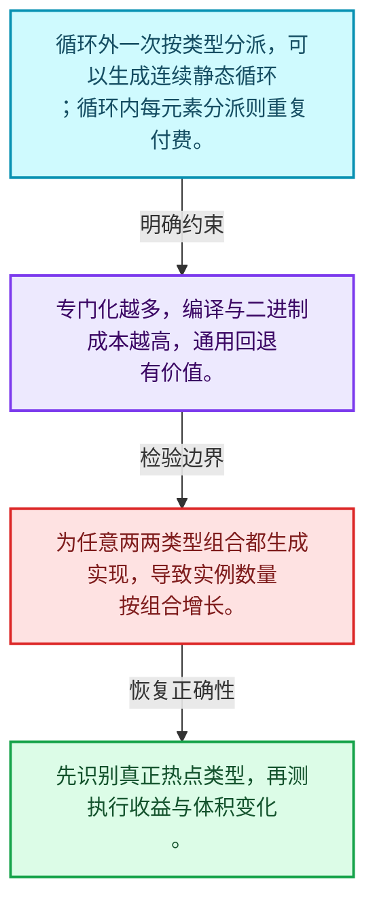
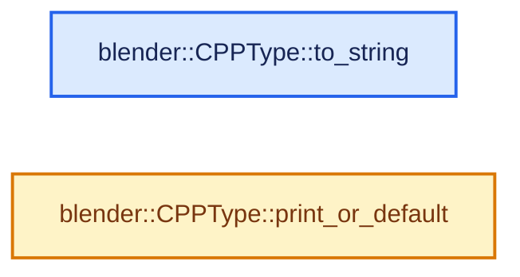
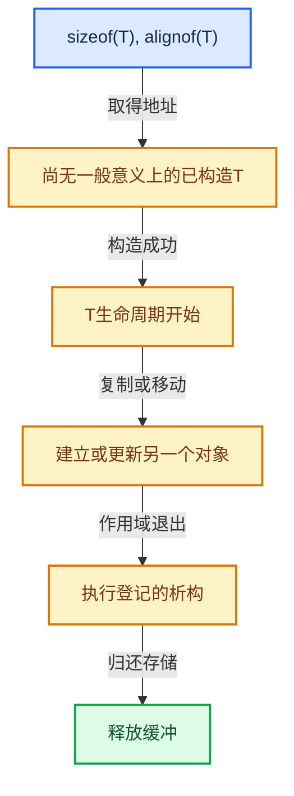

# 03-10 运行时到静态类型分派

[方向导航](README.md) · [总目录](../README.md) · [实现索引](../%E7%AC%A6%E5%8F%B7%E4%BE%9D%E8%B5%96%E4%B8%8E%E5%AE%9E%E7%8E%B0%E7%B4%A2%E5%BC%95.md)

## 从问题到实现

何时值得把运行时类型转回模板实例？

热点路径可按类型分派以便优化，通用回退控制代码体积；有限类型集合与任意类型支持不同。

**数据模型**

循环外一次按类型分派，可以生成连续静态循环；循环内每元素分派则重复付费。

**设计取舍**

专门化越多，编译与二进制成本越高，通用回退有价值。

**最小反例**

为任意两两类型组合都生成实现，导致实例数量按组合增长。

**推导**

先识别真正热点类型，再测执行收益与体积变化。

## 阅读地图与执行推演








图中的数值推演是本方向的教学模型；实际函数之间的调用边与概念分析边分别标注，不能把概念关系当作运行时调度顺序。

## 完整源码单元与就地讲解

中文讲解直接放在相关代码旁，复杂机制在代码下展开。原文折叠区保留基准行号；不需要在行号表和函数之间来回查找。类布局可分段展示，函数实现不按固定行数切开。

### 类型布局、声明与编译条件 · cpp_type.cc L1—L14

<!-- annotated:4f7dd0be0a6002 -->

```cpp
/* SPDX-FileCopyrightText: 2023 Blender Authors
 *
 * SPDX-License-Identifier: GPL-2.0-or-later */

/** \file
 * \ingroup bli
 */

#include "BLI_cpp_type.hh"

#include <sstream>

namespace blender {

```

<details>
<summary>核对原始源码：source/blender/blenlib/intern/cpp_type.cc · L1—L14</summary>

<!-- original:4f7dd0be0a6002:source/blender/blenlib/intern/cpp_type.cc:1:14 -->

```cpp
/* SPDX-FileCopyrightText: 2023 Blender Authors
 *
 * SPDX-License-Identifier: GPL-2.0-or-later */

/** \file
 * \ingroup bli
 */

#include "BLI_cpp_type.hh"

#include <sstream>

namespace blender {

```

</details>

<a id="f-f4cb60810546b32d"></a>

### `blender::CPPType::to_string`

实现位置：[source/blender/blenlib/intern/cpp_type.cc](../../../../../source/blender/blenlib/intern/cpp_type.cc) · L15—L20。

接口参数：

- `const void *value`

**教学注释版**

<!-- annotated:72152cc076fe36 -->

```cpp
std::string CPPType::to_string(const void *value) const
{
  std::stringstream ss;
  this->print(value, ss);
  return ss.str();
}
```

<details>
<summary>核对原始源码：source/blender/blenlib/intern/cpp_type.cc · L15—L20</summary>

<!-- original:72152cc076fe36:source/blender/blenlib/intern/cpp_type.cc:15:20 -->

```cpp
std::string CPPType::to_string(const void *value) const
{
  std::stringstream ss;
  this->print(value, ss);
  return ss.str();
}
```

</details>

**结果出口**

- `return ss.str();`

**继续追踪实现**

- `this->print` → [blender::CPPType::print · L706](09-CPPType%E5%A4%8D%E5%88%B6%E7%A7%BB%E5%8A%A8%E9%87%8D%E5%AE%9A%E4%BD%8D.md#f-0792ac5627e8b049)。
- `ss.str` → [外部契约](https://eel.is/c++draft/)：这个边界按实际表达式及所属类型核对参数、返回值、寿命与失败行为。这里提供接口入口，不声称已解释该第三方版本的内部实现。

<!-- annotated:b1af896c12f5fb -->

```cpp

```

<details>
<summary>核对原始源码：source/blender/blenlib/intern/cpp_type.cc · L21—L21</summary>

<!-- original:b1af896c12f5fb:source/blender/blenlib/intern/cpp_type.cc:21:21 -->

```cpp

```

</details>

<a id="f-812c39017b2c90e8"></a>

### `blender::CPPType::print_or_default`

实现位置：[source/blender/blenlib/intern/cpp_type.cc](../../../../../source/blender/blenlib/intern/cpp_type.cc) · L22—L32。

接口参数：

- `const void *value`
- `std::stringstream &ss`
- `StringRef default_value`

**教学注释版**

<!-- annotated:70f289d2c95f8e -->

```cpp
void CPPType::print_or_default(const void *value,
                               std::stringstream &ss,
                               StringRef default_value) const
{
  if (this->is_printable()) {
    this->print(value, ss);
  }
  else {
    ss << default_value;
  }
}
```

<details>
<summary>核对原始源码：source/blender/blenlib/intern/cpp_type.cc · L22—L32</summary>

<!-- original:70f289d2c95f8e:source/blender/blenlib/intern/cpp_type.cc:22:32 -->

```cpp
void CPPType::print_or_default(const void *value,
                               std::stringstream &ss,
                               StringRef default_value) const
{
  if (this->is_printable()) {
    this->print(value, ss);
  }
  else {
    ss << default_value;
  }
}
```

</details>

**继续追踪实现**

- `this->is_printable` → [blender::CPPType::is_printable · L502](08-CPPType%E6%9E%84%E9%80%A0%E4%B8%8E%E6%9E%90%E6%9E%84.md#f-0fa397dd1eec40af)。
- `this->print` → [blender::CPPType::print · L706](09-CPPType%E5%A4%8D%E5%88%B6%E7%A7%BB%E5%8A%A8%E9%87%8D%E5%AE%9A%E4%BD%8D.md#f-0792ac5627e8b049)。

### 类型布局、声明与编译条件 · cpp_type.cc L33—L34

<!-- annotated:acce4927362ab6 -->

```cpp

}  // namespace blender
```

<details>
<summary>核对原始源码：source/blender/blenlib/intern/cpp_type.cc · L33—L34</summary>

<!-- original:acce4927362ab6:source/blender/blenlib/intern/cpp_type.cc:33:34 -->

```cpp

}  // namespace blender
```

</details>

## 语法与相关类型

### 只读限定 const

const约束当前访问路径可做的修改。const指针、指向const的指针、const视图对象、const元素是不同位置的限定；其他别名可能仍可修改原对象。

分别写T* const、const T*与const T* const，并画出不可修改的层次。

## 实现练习与验证

比较逐元素动态调用和一次分派后整段循环的调用次数。

参考推理：先识别真正热点类型，再测执行收益与体积变化。

所有存活对象地址满足对齐；构造失败不会被当作成功对象登记；所有资源均有唯一或明确共享的清理责任。

## 历史、跨库比较与证据

与std::pmr::monotonic_buffer_resource比较批量存储回收，与std::any比较拥有型类型擦除；CPPType描述类型操作，本身不保存每个值。

[历史提交索引](../%E5%8E%86%E5%8F%B2%E6%8F%90%E4%BA%A4%E4%B8%8E%E8%AE%BE%E8%AE%A1%E6%BC%94%E5%8C%96%E7%B4%A2%E5%BC%95.md) · [源码基准](../%E6%BA%90%E7%A0%81%E7%89%88%E6%9C%AC%E4%B8%8E%E8%A6%86%E7%9B%96%E7%B4%A2%E5%BC%95.md) · [验收报告](../%E9%AA%8C%E6%94%B6%E6%8A%A5%E5%91%8A.md)
