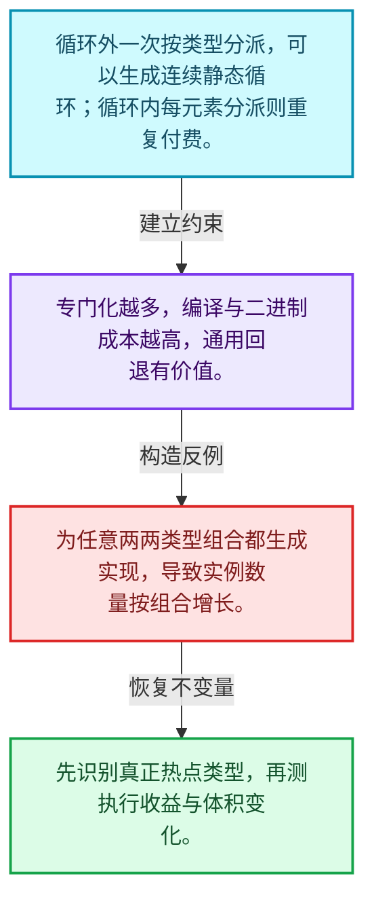
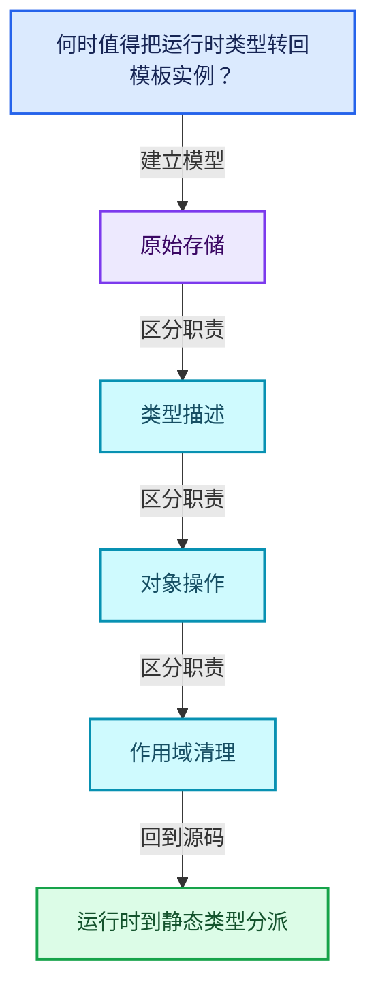
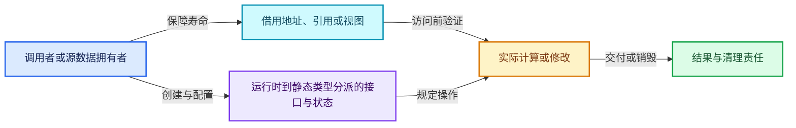
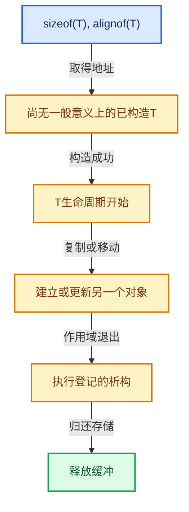

# 03-10 运行时到静态类型分派

[方向导航](README.md) · [总目录](../README.md) · [覆盖索引](../%E6%BA%90%E7%A0%81%E7%89%88%E6%9C%AC%E4%B8%8E%E8%A6%86%E7%9B%96%E7%B4%A2%E5%BC%95.md)

> 阅读顺序：问题与数据模型 → 语法与类型 → 源码逐行 → 调用线索 → 历史与取舍 → 推演和练习。

- 基准 HEAD：`cbda6b96c26c0dee3c3b5cbb93960c4ac06a6b30`。
- 记录日期：2026-10-14。
- 教学示例状态：正文中的推演不是本机性能实测；已运行练习见验收报告。

## 一、从问题到设计

何时值得把运行时类型转回模板实例？

热点路径可按类型分派以便优化，通用回退控制代码体积；有限类型集合与任意类型支持不同。

本篇把语法、数据语义和系统取舍连接起来。把存储分配、对象构造、类型操作和最终清理拆开建模。

### 本篇独立模型与设计推理

循环外一次按类型分派，可以生成连续静态循环；循环内每元素分派则重复付费。

设计取舍：专门化越多，编译与二进制成本越高，通用回退有价值。

最小反例：为任意两两类型组合都生成实现，导致实例数量按组合增长。

推导与处理：先识别真正热点类型，再测执行收益与体积变化。



### 源码范围与相邻篇章

| 文件 | 本篇逐行范围 | 基准SHA-256 |
|---|---|---|
| [source/blender/blenlib/intern/cpp_type.cc](../../../../../source/blender/blenlib/intern/cpp_type.cc) | L1—L34 | `7ccb3aa08cb49a8128c226d5a1a2bcfbe89d427739712b7a820b3cfb209fc01a` |

同一主讲文件可能分多篇覆盖；超出本篇范围的符号通过覆盖索引定位。空行与纯注释保留在源码摘录中，逐行表解释有效语句与语法边界；许可证头统一保留。

前篇：[CPPType复制移动重定位](09-CPPType%E5%A4%8D%E5%88%B6%E7%A7%BB%E5%8A%A8%E9%87%8D%E5%AE%9A%E4%BD%8D.md).

后篇：[GSpan与GArray](11-GSpan%E4%B8%8EGArray.md).

## 二、类型、数据与阅读地图



这是概念依赖图，边表示阅读关系，不声称是运行时调用顺序。

### 直接编译依赖


箭头只表示头文件包含关系；完整调用线索见后面的符号定位表。

## 三、关键词、语法与类型角色

### 只读限定 const

const约束当前访问路径可做的修改。const指针、指向const的指针、const视图对象、const元素是不同位置的限定；其他别名可能仍可修改原对象。

具体检查：分别写T* const、const T*与const T* const，并画出不可修改的层次。

## 四、真实源码与逐行讲解

源码块保持原行内容，原始行号由小节标题及逐行表给出。表中的调用定位是静态阅读辅助；重载、模板实例化、宏展开和虚调用需结合完整声明，不能仅凭词法出现证明动态调用。

### cpp_type.cc：L1—L34

<!-- source:source/blender/blenlib/intern/cpp_type.cc:1:34 -->

```cpp
/* SPDX-FileCopyrightText: 2023 Blender Authors
 *
 * SPDX-License-Identifier: GPL-2.0-or-later */

/** \file
 * \ingroup bli
 */

#include "BLI_cpp_type.hh"

#include <sstream>

namespace blender {

std::string CPPType::to_string(const void *value) const
{
  std::stringstream ss;
  this->print(value, ss);
  return ss.str();
}

void CPPType::print_or_default(const void *value,
                               std::stringstream &ss,
                               StringRef default_value) const
{
  if (this->is_printable()) {
    this->print(value, ss);
  }
  else {
    ss << default_value;
  }
}

}  // namespace blender
```

本段语义重点：

- 分支证据 `this->is_printable())`：分别推演条件成立与不成立，核对相同出口处的状态。

| 原始行 | 语义、约束与检查 |
|---|---|
| L9 | 引入编译依赖 "BLI_cpp_type.hh"；这是声明可见性关系，不表示运行时一定调用该文件的所有接口。 |
| L11 | 引入编译依赖 <sstream>；这是声明可见性关系，不表示运行时一定调用该文件的所有接口。 |
| L13 | 把后续声明放入 blender 命名空间，影响名称查找和符号归属，不创建运行时对象。 |
| L15 | 出现调用或函数声明 `CPPType::to_string`，对应表达式为 `std::string CPPType::to_string(const void *value) const`。参数求值、返回类型与重载需结合前后完整语句；静态文本引用不能证明动态目标。 |
| L16 | 连接上一行的声明或控制结构与其语句块；后续行在这个作用域中执行或声明。 |
| L17 | 声明成员、局部对象或完成语句 `std::stringstream ss`。若为指针或引用，它本身不说明拥有；若为值对象，其构造析构由所在作用域或外层对象管理。 |
| L18 | 出现调用或函数声明 `print`，对应表达式为 `this->print(value, ss);`。参数求值、返回类型与重载需结合前后完整语句；静态文本引用不能证明动态目标。 |
| L19 | 返回表达式 `ss.str()`。 |
| L20 | 结束当前语法单元。局部自动对象在离开其作用域时按规则销毁；这不等于所有被引用的外部数据也被释放。 |
| L22 | 出现调用或函数声明 `CPPType::print_or_default`，对应表达式为 `void CPPType::print_or_default(const void *value,`。参数求值、返回类型与重载需结合前后完整语句；静态文本引用不能证明动态目标。 |
| L23 | 本行是连续声明或表达式的一部分：`std::stringstream &ss,`。与本段前后行合读；逗号、括号和限定符决定它属于参数、初始化列表还是实际计算。 |
| L24 | 本行是连续声明或表达式的一部分：`StringRef default_value) const`。与本段前后行合读；逗号、括号和限定符决定它属于参数、初始化列表还是实际计算。 |
| L25 | 连接上一行的声明或控制结构与其语句块；后续行在这个作用域中执行或声明。 |
| L26 | 判断 `this->is_printable()`，成立时进入本分支，否则继续后续路径。 |
| L27 | 出现调用或函数声明 `print`，对应表达式为 `this->print(value, ss);`。参数求值、返回类型与重载需结合前后完整语句；静态文本引用不能证明动态目标。 |
| L28 | 结束当前语法单元。局部自动对象在离开其作用域时按规则销毁；这不等于所有被引用的外部数据也被释放。 |
| L29 | 处理前一条件不成立的互补路径。比较两条路径最后是否恢复同一不变量，以及是否产生不同的资源责任。 |
| L30 | 声明成员、局部对象或完成语句 `ss << default_value`。若为指针或引用，它本身不说明拥有；若为值对象，其构造析构由所在作用域或外层对象管理。 |
| L31 | 结束当前语法单元。局部自动对象在离开其作用域时按规则销毁；这不等于所有被引用的外部数据也被释放。 |
| L32 | 结束当前语法单元。局部自动对象在离开其作用域时按规则销毁；这不等于所有被引用的外部数据也被释放。 |
| L34 | 结束当前语法单元。局部自动对象在离开其作用域时按规则销毁；这不等于所有被引用的外部数据也被释放。 |

## 五、接口定位、调用线索与生命周期

### 本篇声明与实现入口

| 源码位置 | 实际声明片段 |
|---|---|
| [cpp_type.cc:L15](../../../../../source/blender/blenlib/intern/cpp_type.cc#L15) | `std::string CPPType::to_string(const void *value) const` |
| [cpp_type.cc:L22](../../../../../source/blender/blenlib/intern/cpp_type.cc#L22) | `void CPPType::print_or_default(const void *value,` |

### 同名符号出现位置

以下表提供跨文件阅读入口，包含声明、调用或测试使用；没有经过完整C++名称解析，不把它命名为已证明的运行时调用图。

| 符号 | 位置 | 文本证据 |
|---|---|---|
| `to_string` | [geometry_set.cc:L218](../../../../../source/blender/blenkernel/intern/geometry_set.cc#L218) | `parts.append(std::to_string(mesh->verts_num) + " verts");` |
| `to_string` | [geometry_set.cc:L219](../../../../../source/blender/blenkernel/intern/geometry_set.cc#L219) | `parts.append(std::to_string(mesh->edges_num) + " edges");` |
| `to_string` | [geometry_set.cc:L220](../../../../../source/blender/blenkernel/intern/geometry_set.cc#L220) | `parts.append(std::to_string(mesh->faces_num) + " faces");` |
| `print_or_default` | [BLI_cpp_type.hh:L393](../../../../../source/blender/blenlib/BLI_cpp_type.hh#L393) | `void print_or_default(const void *value, std::stringstream &ss, StringRef default_value) const;` |

### 生命周期推理图



这是审查生命周期的通用模型。具体类是否拥有数据由本篇成员、构造、析构和调用者一起证明；任何箭头都不自动代表shared_ptr。

## 六、把代码放进具体数据中推演

本方向的共同数值模型如下。本篇的专门检查是：比较逐元素动态调用和一次分派后整段循环的调用次数。

| 步骤 | 数据或状态 | 为什么需要这一步 |
|---|---|---|
| 请求存储 | sizeof(T), alignof(T) | 空间和地址都满足类型要求 |
| 取得地址 | 尚无一般意义上的已构造T | 不能先调用T成员 |
| 构造成功 | T生命周期开始 | 登记相应清理责任 |
| 复制或移动 | 建立或更新另一个对象 | 区分初始化和赋值 |
| 作用域退出 | 执行登记的析构 | 只销毁已构造部分 |
| 归还存储 | 释放缓冲 | 与分配器来源匹配 |



图是教学推演模型；精确分支与状态更新以本篇摘录及调用契约为准。

### 本篇独立练习与参考思路

比较逐元素动态调用和一次分派后整段循环的调用次数。

参考思路：热点路径可按类型分派以便优化，通用回退控制代码体积；有限类型集合与任意类型支持不同。

将输入、预期结果和资源责任分成三张清单。先用最直接的实现给出可核对的答案，再替换成对应源码使用的表示；比较结果不变的条件，而不是只比较接口名字。

验收依据：所有存活对象地址满足对齐；构造失败不会被当作成功对象登记；所有资源均有唯一或明确共享的清理责任。

## 七、复杂度、设计取舍与其他基础库

与std::pmr::monotonic_buffer_resource比较批量存储回收，与std::any比较拥有型类型擦除；CPPType描述类型操作，本身不保存每个值。

本篇的具体取舍：热点路径可按类型分派以便优化，通用回退控制代码体积；有限类型集合与任意类型支持不同。

| 观察维度 | 从源码取得证据的方法 | 本篇要避免的误判 |
|---|---|---|
| 时间 | 对循环次数、分派次数和重建频率分别计数 | 看到单次常数操作就断定整个操作序列是常数成本 |
| 内存 | 区分对象本体、容量存储、间接资源和共享控制块 | 用sizeof代替总内存 |
| 安全 | 沿构造、失败回滚、销毁与失效逐路径检查 | 把断言或非空指针当作完整安全证明 |
| 并发 | 逐字段确认锁、发布顺序和借用寿命 | 把引用计数线程安全等同数据读写线程安全 |

相关一手资料：

- [C++公开工作草案](https://eel.is/c++draft/)：持续更新的工作草案；语言与标准库语义以相应章节为准。
- [LLVM Programmer’s Manual](https://llvm.org/docs/ProgrammersManual.html)：在线版，2026-10-14查阅；仅比较设计思路，不保证与本地LLVM版本一致。

资料用于核对契约和进一步阅读；这里没有声称外部库与Blender实现相同，也没有把上游性能数字当作本机实测。

## 八、历史提交与设计演化

本篇主要讲当前接口或辅助实现，方向导航给出相关架构演化提交；没有把不涉及本篇文件的提交硬写成该实现的引入证据。

## 九、反例、测试入口与掌握标准

需要实际构造的反例：

- 空输入或没有结果需求：确认接口允许的空状态与不允许访问的操作。
- 边界位置和退化结构：把长度为1、末尾位置、重复值或深链代入真实分支。
- 生命周期结束或修改之后：检查保存的指针、引用、结果视图是否仍有效。
- 与本篇核心不变量相冲突的输入：比较逐元素动态调用和一次分派后整段循环的调用次数。

### 可运行的教学参考程序

[reference_exercises.cc](../_tools/reference_exercises.cc)包含独立于Blender的C++20参考检查：视图、简化SmallVector、异常回滚、哈希碰撞与删除、偏移数组、拓扑映射、共享缓存、表达式、惰性分支、闭包和暴力最近邻。

参考程序有意省略生产实现的完整能力。例如SmallVector禁止复制移动容器，不支持只能移动的元素，并禁止append参数别名到自身元素；TinyMap固定8槽，不提供增长。程序通过不能替代Blender实现测试。实际运行结果、编译器与命令见验收报告。

掌握标准：离开源码解释“何时值得把运行时类型转回模板实例？”；独立完成上述练习；能指出一个会破坏原始存储相关约束的最小反例，并用具体代码行说明检查或修复应放在哪里。
