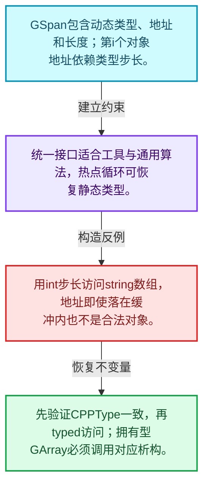
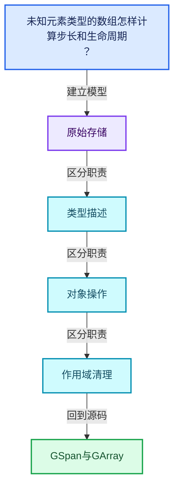
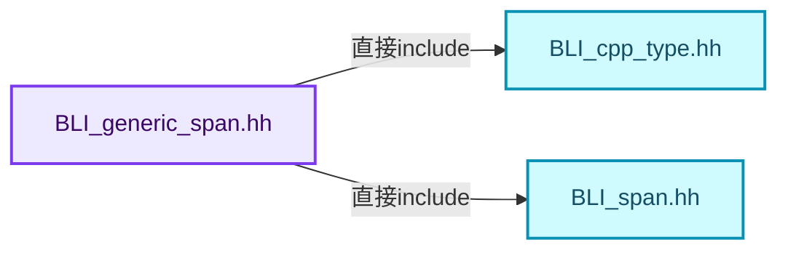
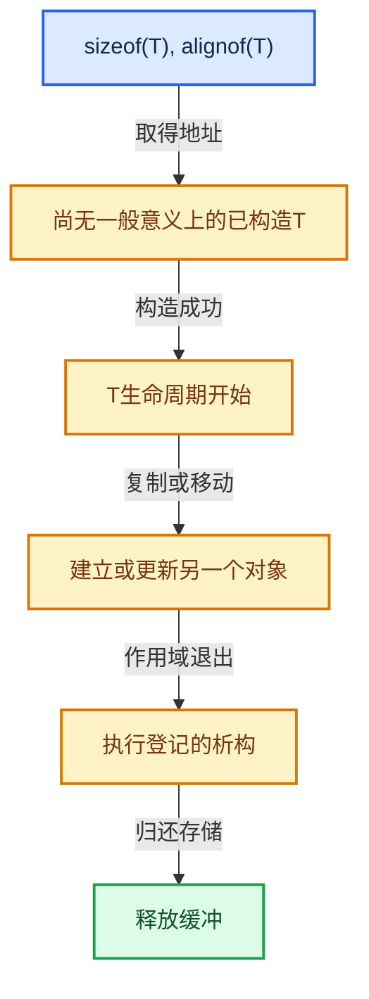

# 03-11 GSpan与GArray

[方向导航](README.md) · [总目录](../README.md) · [覆盖索引](../%E6%BA%90%E7%A0%81%E7%89%88%E6%9C%AC%E4%B8%8E%E8%A6%86%E7%9B%96%E7%B4%A2%E5%BC%95.md)

> 阅读顺序：问题与数据模型 → 语法与类型 → 源码逐行 → 调用线索 → 历史与取舍 → 推演和练习。

- 基准 HEAD：`cbda6b96c26c0dee3c3b5cbb93960c4ac06a6b30`。
- 记录日期：2026-10-14。
- 教学示例状态：正文中的推演不是本机性能实测；已运行练习见验收报告。

## 一、从问题到设计

未知元素类型的数组怎样计算步长和生命周期？

类型信息与地址长度共同构成通用视图；拥有型数组还要执行相应类型操作。

本篇把语法、数据语义和系统取舍连接起来。把存储分配、对象构造、类型操作和最终清理拆开建模。

### 本篇独立模型与设计推理

GSpan包含动态类型、地址和长度；第i个对象地址依赖类型步长。

设计取舍：统一接口适合工具与通用算法，热点循环可恢复静态类型。

最小反例：用int步长访问string数组，地址即使落在缓冲内也不是合法对象。

推导与处理：先验证CPPType一致，再typed访问；拥有型GArray必须调用对应析构。



### 源码范围与相邻篇章

| 文件 | 本篇逐行范围 | 基准SHA-256 |
|---|---|---|
| [source/blender/blenlib/BLI_generic_span.hh](../../../../../source/blender/blenlib/BLI_generic_span.hh) | L1—L281 | `e2ac971e72efc8ff4e74c91be7882d5e9234af8ff177a1adbd1a4f3bb8a3b0d4` |
| [source/blender/blenlib/BLI_generic_array.hh](../../../../../source/blender/blenlib/BLI_generic_array.hh) | L1—L262 | `4ba9ccccd5e24e66b9fceb388515df25913c43319cf6383f46b057e1fdf74e42` |

同一主讲文件可能分多篇覆盖；超出本篇范围的符号通过覆盖索引定位。空行与纯注释保留在源码摘录中，逐行表解释有效语句与语法边界；许可证头统一保留。

前篇：[运行时到静态类型分派](10-%E8%BF%90%E8%A1%8C%E6%97%B6%E5%88%B0%E9%9D%99%E6%80%81%E7%B1%BB%E5%9E%8B%E5%88%86%E6%B4%BE.md).

后篇：[异构值存储实战](12-%E5%BC%82%E6%9E%84%E5%80%BC%E5%AD%98%E5%82%A8%E5%AE%9E%E6%88%98.md).

## 二、类型、数据与阅读地图



这是概念依赖图，边表示阅读关系，不声称是运行时调用顺序。

### 直接编译依赖



箭头只表示头文件包含关系；完整调用线索见后面的符号定位表。

## 三、关键词、语法与类型角色

### 模板 template

模板把类型或常量作为生成实现的参数。读声明时先列出类型参数、非类型参数和默认值，再看使用者实际实例化了什么。模板声明本身不意味着每种T都支持其全部成员。

具体检查：把T替换为int、string、只能移动的类型，分别检查每个被调用操作是否成立。

### 依赖名称 typename

typename既可引入类型模板参数，也可告诉编译器某个依赖名称是类型。它不创建运行时对象；解析期确认语法类别与实例化期检查具体类型是不同阶段。

具体检查：区分typename T::value_type和T::size()，前者标记类型，后者是表达式。

### 只读限定 const

const约束当前访问路径可做的修改。const指针、指向const的指针、const视图对象、const元素是不同位置的限定；其他别名可能仍可修改原对象。

具体检查：分别写T* const、const T*与const T* const，并画出不可修改的层次。

### 移动转换 std::move

std::move把表达式转换为可供移动重载选择的值类别，实际资源转移发生在被选中的构造或赋值中。对const对象move可能仍调用复制，对视图move也不会获得底层数据所有权。

具体检查：记录移动构造调用次数，不用变量名或std::move的出现次数替代测量。

### 异常约定 noexcept

noexcept表达式可以依赖类型特征。违反不抛异常约定会终止程序；它不是自动捕获异常，也不是资源回滚代码。

具体检查：找出声明的条件与实际可能抛出的分配、构造操作是否一致。

### 异常边界 try与catch

try定义异常传播的局部边界。失败路径需要销毁已经成功构造的部分并释放相应存储；未构造的对象不能被析构。

具体检查：在第k次构造失败，列出已经存在的对象集合与待释放缓冲。

### 显式静态转换 static_cast

static_cast表达编译期允许的转换，不会自动验证运行时真实类型、指针寿命或索引边界。由void指针恢复T指针时，调用者仍须保证实际存储中确有合法T对象。

具体检查：标出转换前后的类型以及正确性依据来自哪里。

### 构造与new表达式

普通new可能分配并构造；placement new在给定地址构造，存储由其他机制提供。失败回滚应区分两类责任。

具体检查：追踪地址来自哪里、构造何时成功、由谁析构、由谁释放。

### 内部断言 assert

断言表达开发者预期成立的内部契约，发布构建可能关闭。它不能替代对不可信输入的完整错误处理，也不保证后续操作被运行时保护。

具体检查：对每条断言构造违反条件的输入，区分调用者错误与应向用户报告的错误。

## 四、真实源码与逐行讲解

源码块保持原行内容，原始行号由小节标题及逐行表给出。表中的调用定位是静态阅读辅助；重载、模板实例化、宏展开和虚调用需结合完整声明，不能仅凭词法出现证明动态调用。

### BLI_generic_span.hh：L1—L47

<!-- source:source/blender/blenlib/BLI_generic_span.hh:1:47 -->

```cpp
/* SPDX-FileCopyrightText: 2023 Blender Authors
 *
 * SPDX-License-Identifier: GPL-2.0-or-later */

#pragma once

/** \file
 * \ingroup bli
 */

#include "BLI_cpp_type.hh"
#include "BLI_span.hh"

namespace blender {

/**
 * A generic span. It behaves just like a Span<T>, but the type is only known at run-time.
 */
class GSpan {
 protected:
  const CPPType *type_ = nullptr;
  const void *data_ = nullptr;
  int64_t size_ = 0;

 public:
  GSpan() = default;

  GSpan(const CPPType *type, const void *buffer, int64_t size)
      : type_(type), data_(buffer), size_(size)
  {
    BLI_assert(size >= 0);
    BLI_assert(buffer != nullptr || size == 0);
    BLI_assert(size == 0 || type != nullptr);
    BLI_assert(type == nullptr || type->pointer_has_valid_alignment(buffer));
  }

  GSpan(const CPPType &type, const void *buffer, int64_t size) : GSpan(&type, buffer, size) {}

  GSpan(const CPPType &type) : type_(&type) {}

  GSpan(const CPPType *type) : type_(type) {}

  template<typename T>
  GSpan(Span<T> array)
      : GSpan(CPPType::get<T>(), static_cast<const void *>(array.data()), array.size())
  {
  }
```

本段语义重点：

- `data_`：数据或实现的存储入口；是否拥有应按该类声明和析构判定。
- `size_`：该对象记录的元素数或长度，不能直接当作容量。

| 原始行 | 语义、约束与检查 |
|---|---|
| L5 | 防止同一头文件在一个翻译单元中重复展开；不控制多个源文件之间的链接或对象寿命。 |
| L11 | 引入编译依赖 "BLI_cpp_type.hh"；这是声明可见性关系，不表示运行时一定调用该文件的所有接口。 |
| L12 | 引入编译依赖 "BLI_span.hh"；这是声明可见性关系，不表示运行时一定调用该文件的所有接口。 |
| L14 | 把后续声明放入 blender 命名空间，影响名称查找和符号归属，不创建运行时对象。 |
| L19 | 声明或定义类型 `class GSpan`。结合继承、访问权限和成员布局确认接口与拥有关系；前向声明本身没有完整对象布局。 |
| L20 | 切换成员访问权限为 protected；它是编译期接口边界，不是线程同步或内存保护。 |
| L21 | 把右侧 `nullptr` 用于初始化或更新左侧 `const CPPType *type_`。声明初始化与已有对象赋值应按上下文区分；有资源的类型会调用相应特殊成员。 |
| L22 | 建立或更新 `data_`：数据或实现的存储入口；是否拥有应按该类声明和析构判定。本行的具体值关系为 `const void *data_ = nullptr`；对照更新前后相应范围或状态是否一致。 |
| L23 | 建立或更新 `size_`：该对象记录的元素数或长度，不能直接当作容量。本行的具体值关系为 `int64_t size_ = 0`；对照更新前后相应范围或状态是否一致。 |
| L25 | 切换成员访问权限为 public；它是编译期接口边界，不是线程同步或内存保护。 |
| L26 | 显式采用编译器生成的特殊成员行为：`GSpan() = default;`。成员和基类的性质决定该操作是否可用、是否被删除及异常约定，不表示运行时给对象赋值为default。 |
| L28 | 出现调用或函数声明 `GSpan`，对应表达式为 `GSpan(const CPPType *type, const void *buffer, int64_t size)`。参数求值、返回类型与重载需结合前后完整语句；静态文本引用不能证明动态目标。 |
| L29 | 本行涉及 `data_`：数据或实现的存储入口；是否拥有应按该类声明和析构判定。按此语义解读 `: type_(type), data_(buffer), size_(size)`，不要把地址、数量或状态混用。 |
| L30 | 连接上一行的声明或控制结构与其语句块；后续行在这个作用域中执行或声明。 |
| L31 | 断言约束 `BLI_assert(size >= 0);`。条件是后续访问的内部前置条件；发布构建可能不执行，不能把断言当作输入修复。 |
| L32 | 断言约束 `BLI_assert(buffer != nullptr &#124;&#124; size == 0);`。条件是后续访问的内部前置条件；发布构建可能不执行，不能把断言当作输入修复。 |
| L33 | 断言约束 `BLI_assert(size == 0 &#124;&#124; type != nullptr);`。条件是后续访问的内部前置条件；发布构建可能不执行，不能把断言当作输入修复。 |
| L34 | 断言约束 `BLI_assert(type == nullptr &#124;&#124; type->pointer_has_valid_alignment(buffer));`。条件是后续访问的内部前置条件；发布构建可能不执行，不能把断言当作输入修复。 |
| L35 | 结束当前语法单元。局部自动对象在离开其作用域时按规则销毁；这不等于所有被引用的外部数据也被释放。 |
| L37 | 出现调用或函数声明 `GSpan`，对应表达式为 `GSpan(const CPPType &type, const void *buffer, int64_t size) : GSpan(&type, buffer, size) {}`。参数求值、返回类型与重载需结合前后完整语句；静态文本引用不能证明动态目标。 |
| L39 | 出现调用或函数声明 `GSpan`，对应表达式为 `GSpan(const CPPType &type) : type_(&type) {}`。参数求值、返回类型与重载需结合前后完整语句；静态文本引用不能证明动态目标。 |
| L41 | 出现调用或函数声明 `GSpan`，对应表达式为 `GSpan(const CPPType *type) : type_(type) {}`。参数求值、返回类型与重载需结合前后完整语句；静态文本引用不能证明动态目标。 |
| L43 | 声明模板参数 `template<typename T>`。类型参数决定生成操作的类型，非类型参数可决定内嵌容量或编译期分支。 |
| L44 | 出现调用或函数声明 `GSpan`，对应表达式为 `GSpan(Span<T> array)`。参数求值、返回类型与重载需结合前后完整语句；静态文本引用不能证明动态目标。 |
| L45 | 出现调用或函数声明 `GSpan`，对应表达式为 `: GSpan(CPPType::get<T>(), static_cast<const void *>(array.data()), array.size())`。参数求值、返回类型与重载需结合前后完整语句；静态文本引用不能证明动态目标。 |
| L46 | 连接上一行的声明或控制结构与其语句块；后续行在这个作用域中执行或声明。 |
| L47 | 结束当前语法单元。局部自动对象在离开其作用域时按规则销毁；这不等于所有被引用的外部数据也被释放。 |

### BLI_generic_span.hh：L48—L97

<!-- source:source/blender/blenlib/BLI_generic_span.hh:48:97 -->

```cpp

  template<typename T>
  GSpan(MutableSpan<T> array)
      : GSpan(CPPType::get<T>(), static_cast<const void *>(array.data()), array.size())
  {
  }

  const CPPType &type() const
  {
    BLI_assert(type_ != nullptr);
    return *type_;
  }

  const CPPType *type_ptr() const
  {
    return type_;
  }

  bool is_empty() const
  {
    return size_ == 0;
  }

  int64_t size() const
  {
    return size_;
  }

  int64_t size_in_bytes() const
  {
    return type_->size * size_;
  }

  const void *data() const
  {
    return data_;
  }

  const void *operator[](int64_t index) const
  {
    BLI_assert(index < size_);
    return POINTER_OFFSET(data_, type_->size * index);
  }

  template<typename T> Span<T> typed() const
  {
    BLI_assert(size_ == 0 || type_ != nullptr);
    BLI_assert(type_ == nullptr || type_->is<T>());
    return Span<T>(static_cast<const T *>(data_), size_);
  }
```

本段语义重点：

- `data_`：数据或实现的存储入口；是否拥有应按该类声明和析构判定。
- `size_`：该对象记录的元素数或长度，不能直接当作容量。

| 原始行 | 语义、约束与检查 |
|---|---|
| L49 | 声明模板参数 `template<typename T>`。类型参数决定生成操作的类型，非类型参数可决定内嵌容量或编译期分支。 |
| L50 | 出现调用或函数声明 `GSpan`，对应表达式为 `GSpan(MutableSpan<T> array)`。参数求值、返回类型与重载需结合前后完整语句；静态文本引用不能证明动态目标。 |
| L51 | 出现调用或函数声明 `GSpan`，对应表达式为 `: GSpan(CPPType::get<T>(), static_cast<const void *>(array.data()), array.size())`。参数求值、返回类型与重载需结合前后完整语句；静态文本引用不能证明动态目标。 |
| L52 | 连接上一行的声明或控制结构与其语句块；后续行在这个作用域中执行或声明。 |
| L53 | 结束当前语法单元。局部自动对象在离开其作用域时按规则销毁；这不等于所有被引用的外部数据也被释放。 |
| L55 | 出现调用或函数声明 `type`，对应表达式为 `const CPPType &type() const`。参数求值、返回类型与重载需结合前后完整语句；静态文本引用不能证明动态目标。 |
| L56 | 连接上一行的声明或控制结构与其语句块；后续行在这个作用域中执行或声明。 |
| L57 | 断言约束 `BLI_assert(type_ != nullptr);`。条件是后续访问的内部前置条件；发布构建可能不执行，不能把断言当作输入修复。 |
| L58 | 返回表达式 `*type_`。 |
| L59 | 结束当前语法单元。局部自动对象在离开其作用域时按规则销毁；这不等于所有被引用的外部数据也被释放。 |
| L61 | 出现调用或函数声明 `type_ptr`，对应表达式为 `const CPPType *type_ptr() const`。参数求值、返回类型与重载需结合前后完整语句；静态文本引用不能证明动态目标。 |
| L62 | 连接上一行的声明或控制结构与其语句块；后续行在这个作用域中执行或声明。 |
| L63 | 返回表达式 `type_`。 |
| L64 | 结束当前语法单元。局部自动对象在离开其作用域时按规则销毁；这不等于所有被引用的外部数据也被释放。 |
| L66 | 出现调用或函数声明 `is_empty`，对应表达式为 `bool is_empty() const`。参数求值、返回类型与重载需结合前后完整语句；静态文本引用不能证明动态目标。 |
| L67 | 连接上一行的声明或控制结构与其语句块；后续行在这个作用域中执行或声明。 |
| L68 | 返回表达式 `size_ == 0`。 |
| L69 | 结束当前语法单元。局部自动对象在离开其作用域时按规则销毁；这不等于所有被引用的外部数据也被释放。 |
| L71 | 出现调用或函数声明 `size`，对应表达式为 `int64_t size() const`。参数求值、返回类型与重载需结合前后完整语句；静态文本引用不能证明动态目标。 |
| L72 | 连接上一行的声明或控制结构与其语句块；后续行在这个作用域中执行或声明。 |
| L73 | 返回表达式 `size_`。 |
| L74 | 结束当前语法单元。局部自动对象在离开其作用域时按规则销毁；这不等于所有被引用的外部数据也被释放。 |
| L76 | 出现调用或函数声明 `size_in_bytes`，对应表达式为 `int64_t size_in_bytes() const`。参数求值、返回类型与重载需结合前后完整语句；静态文本引用不能证明动态目标。 |
| L77 | 连接上一行的声明或控制结构与其语句块；后续行在这个作用域中执行或声明。 |
| L78 | 返回表达式 `type_->size * size_`。 |
| L79 | 结束当前语法单元。局部自动对象在离开其作用域时按规则销毁；这不等于所有被引用的外部数据也被释放。 |
| L81 | 出现调用或函数声明 `data`，对应表达式为 `const void *data() const`。参数求值、返回类型与重载需结合前后完整语句；静态文本引用不能证明动态目标。 |
| L82 | 连接上一行的声明或控制结构与其语句块；后续行在这个作用域中执行或声明。 |
| L83 | 返回表达式 `data_`。 |
| L84 | 结束当前语法单元。局部自动对象在离开其作用域时按规则销毁；这不等于所有被引用的外部数据也被释放。 |
| L86 | 运算符重载声明、定义或显式调用：`const void *operator[](int64_t index) const`。结合参数和返回类型判断是赋值、索引、比较还是转换；operator=声明中的等号不是在给名为operator的变量赋值。 |
| L87 | 连接上一行的声明或控制结构与其语句块；后续行在这个作用域中执行或声明。 |
| L88 | 断言约束 `BLI_assert(index < size_);`。条件是后续访问的内部前置条件；发布构建可能不执行，不能把断言当作输入修复。 |
| L89 | 返回表达式 `POINTER_OFFSET(data_, type_->size * index)`。 |
| L90 | 结束当前语法单元。局部自动对象在离开其作用域时按规则销毁；这不等于所有被引用的外部数据也被释放。 |
| L92 | 声明模板参数 `template<typename T> Span<T> typed() const`。类型参数决定生成操作的类型，非类型参数可决定内嵌容量或编译期分支。 |
| L93 | 连接上一行的声明或控制结构与其语句块；后续行在这个作用域中执行或声明。 |
| L94 | 断言约束 `BLI_assert(size_ == 0 &#124;&#124; type_ != nullptr);`。条件是后续访问的内部前置条件；发布构建可能不执行，不能把断言当作输入修复。 |
| L95 | 断言约束 `BLI_assert(type_ == nullptr &#124;&#124; type_->is<T>());`。条件是后续访问的内部前置条件；发布构建可能不执行，不能把断言当作输入修复。 |
| L96 | 返回表达式 `Span<T>(static_cast<const T *>(data_), size_)`。 |
| L97 | 结束当前语法单元。局部自动对象在离开其作用域时按规则销毁；这不等于所有被引用的外部数据也被释放。 |

### BLI_generic_span.hh：L98—L146

<!-- source:source/blender/blenlib/BLI_generic_span.hh:98:146 -->

```cpp

  GSpan slice(const int64_t start, int64_t size) const
  {
    BLI_assert(start >= 0);
    BLI_assert(size >= 0);
    BLI_assert(start + size <= size_ || size == 0);
    return GSpan(type_, POINTER_OFFSET(data_, type_->size * start), size);
  }

  GSpan slice(const IndexRange range) const
  {
    return this->slice(range.start(), range.size());
  }

  GSpan drop_front(const int64_t n) const
  {
    BLI_assert(n >= 0);
    const int64_t new_size = std::max<int64_t>(0, size_ - n);
    return GSpan(*type_, POINTER_OFFSET(data_, type_->size * n), new_size);
  }

  GSpan drop_back(const int64_t n) const
  {
    BLI_assert(n >= 0);
    const int64_t new_size = std::max<int64_t>(0, size_ - n);
    return GSpan(*type_, data_, new_size);
  }

  GSpan take_front(const int64_t n) const
  {
    BLI_assert(n >= 0);
    const int64_t new_size = std::min<int64_t>(size_, n);
    return GSpan(*type_, data_, new_size);
  }

  GSpan take_back(const int64_t n) const
  {
    BLI_assert(n >= 0);
    const int64_t new_size = std::min<int64_t>(size_, n);
    return GSpan(*type_, POINTER_OFFSET(data_, type_->size * (size_ - new_size)), new_size);
  }
};

/**
 * A generic mutable span. It behaves just like a MutableSpan<T>, but the type is only
 * known at run-time.
 */
class GMutableSpan {
 protected:
```

本段语义重点：

- `std::max`：取较大值，在容量计算中常用于同时满足请求量和增长策略。
- `std::min`：取较小值，常用于截断范围；还要检查负值、溢出和空范围。
- `data_`：数据或实现的存储入口；是否拥有应按该类声明和析构判定。
- `size_`：该对象记录的元素数或长度，不能直接当作容量。

| 原始行 | 语义、约束与检查 |
|---|---|
| L99 | 出现调用或函数声明 `slice`，对应表达式为 `GSpan slice(const int64_t start, int64_t size) const`。参数求值、返回类型与重载需结合前后完整语句；静态文本引用不能证明动态目标。 |
| L100 | 连接上一行的声明或控制结构与其语句块；后续行在这个作用域中执行或声明。 |
| L101 | 断言约束 `BLI_assert(start >= 0);`。条件是后续访问的内部前置条件；发布构建可能不执行，不能把断言当作输入修复。 |
| L102 | 断言约束 `BLI_assert(size >= 0);`。条件是后续访问的内部前置条件；发布构建可能不执行，不能把断言当作输入修复。 |
| L103 | 断言约束 `BLI_assert(start + size <= size_ &#124;&#124; size == 0);`。条件是后续访问的内部前置条件；发布构建可能不执行，不能把断言当作输入修复。 |
| L104 | 返回表达式 `GSpan(type_, POINTER_OFFSET(data_, type_->size * start), size)`。 |
| L105 | 结束当前语法单元。局部自动对象在离开其作用域时按规则销毁；这不等于所有被引用的外部数据也被释放。 |
| L107 | 出现调用或函数声明 `slice`，对应表达式为 `GSpan slice(const IndexRange range) const`。参数求值、返回类型与重载需结合前后完整语句；静态文本引用不能证明动态目标。 |
| L108 | 连接上一行的声明或控制结构与其语句块；后续行在这个作用域中执行或声明。 |
| L109 | 返回表达式 `this->slice(range.start(), range.size())`。 |
| L110 | 结束当前语法单元。局部自动对象在离开其作用域时按规则销毁；这不等于所有被引用的外部数据也被释放。 |
| L112 | 出现调用或函数声明 `drop_front`，对应表达式为 `GSpan drop_front(const int64_t n) const`。参数求值、返回类型与重载需结合前后完整语句；静态文本引用不能证明动态目标。 |
| L113 | 连接上一行的声明或控制结构与其语句块；后续行在这个作用域中执行或声明。 |
| L114 | 断言约束 `BLI_assert(n >= 0);`。条件是后续访问的内部前置条件；发布构建可能不执行，不能把断言当作输入修复。 |
| L115 | 本行使用 `std::max`：取较大值，在容量计算中常用于同时满足请求量和增长策略。 |
| L116 | 返回表达式 `GSpan(*type_, POINTER_OFFSET(data_, type_->size * n), new_size)`。 |
| L117 | 结束当前语法单元。局部自动对象在离开其作用域时按规则销毁；这不等于所有被引用的外部数据也被释放。 |
| L119 | 出现调用或函数声明 `drop_back`，对应表达式为 `GSpan drop_back(const int64_t n) const`。参数求值、返回类型与重载需结合前后完整语句；静态文本引用不能证明动态目标。 |
| L120 | 连接上一行的声明或控制结构与其语句块；后续行在这个作用域中执行或声明。 |
| L121 | 断言约束 `BLI_assert(n >= 0);`。条件是后续访问的内部前置条件；发布构建可能不执行，不能把断言当作输入修复。 |
| L122 | 本行使用 `std::max`：取较大值，在容量计算中常用于同时满足请求量和增长策略。 |
| L123 | 返回表达式 `GSpan(*type_, data_, new_size)`。 |
| L124 | 结束当前语法单元。局部自动对象在离开其作用域时按规则销毁；这不等于所有被引用的外部数据也被释放。 |
| L126 | 出现调用或函数声明 `take_front`，对应表达式为 `GSpan take_front(const int64_t n) const`。参数求值、返回类型与重载需结合前后完整语句；静态文本引用不能证明动态目标。 |
| L127 | 连接上一行的声明或控制结构与其语句块；后续行在这个作用域中执行或声明。 |
| L128 | 断言约束 `BLI_assert(n >= 0);`。条件是后续访问的内部前置条件；发布构建可能不执行，不能把断言当作输入修复。 |
| L129 | 本行使用 `std::min`：取较小值，常用于截断范围；还要检查负值、溢出和空范围。 |
| L130 | 返回表达式 `GSpan(*type_, data_, new_size)`。 |
| L131 | 结束当前语法单元。局部自动对象在离开其作用域时按规则销毁；这不等于所有被引用的外部数据也被释放。 |
| L133 | 出现调用或函数声明 `take_back`，对应表达式为 `GSpan take_back(const int64_t n) const`。参数求值、返回类型与重载需结合前后完整语句；静态文本引用不能证明动态目标。 |
| L134 | 连接上一行的声明或控制结构与其语句块；后续行在这个作用域中执行或声明。 |
| L135 | 断言约束 `BLI_assert(n >= 0);`。条件是后续访问的内部前置条件；发布构建可能不执行，不能把断言当作输入修复。 |
| L136 | 本行使用 `std::min`：取较小值，常用于截断范围；还要检查负值、溢出和空范围。 |
| L137 | 返回表达式 `GSpan(*type_, POINTER_OFFSET(data_, type_->size * (size_ - new_size)), new_size)`。 |
| L138 | 结束当前语法单元。局部自动对象在离开其作用域时按规则销毁；这不等于所有被引用的外部数据也被释放。 |
| L139 | 结束当前语法单元。局部自动对象在离开其作用域时按规则销毁；这不等于所有被引用的外部数据也被释放。 |
| L145 | 声明或定义类型 `class GMutableSpan`。结合继承、访问权限和成员布局确认接口与拥有关系；前向声明本身没有完整对象布局。 |
| L146 | 切换成员访问权限为 protected；它是编译期接口边界，不是线程同步或内存保护。 |

### BLI_generic_span.hh：L147—L196

<!-- source:source/blender/blenlib/BLI_generic_span.hh:147:196 -->

```cpp
  const CPPType *type_ = nullptr;
  void *data_ = nullptr;
  int64_t size_ = 0;

 public:
  GMutableSpan() = default;

  GMutableSpan(const CPPType *type, void *buffer, int64_t size)
      : type_(type), data_(buffer), size_(size)
  {
    BLI_assert(size >= 0);
    BLI_assert(buffer != nullptr || size == 0);
    BLI_assert(size == 0 || type != nullptr);
    BLI_assert(type == nullptr || type->pointer_has_valid_alignment(buffer));
  }

  GMutableSpan(const CPPType &type, void *buffer, int64_t size) : GMutableSpan(&type, buffer, size)
  {
  }

  GMutableSpan(const CPPType &type) : type_(&type) {}

  GMutableSpan(const CPPType *type) : type_(type) {}

  template<typename T>
  GMutableSpan(MutableSpan<T> array)
      : GMutableSpan(CPPType::get<T>(), static_cast<void *>(array.begin()), array.size())
  {
  }

  operator GSpan() const
  {
    return GSpan(type_, data_, size_);
  }

  const CPPType &type() const
  {
    BLI_assert(type_ != nullptr);
    return *type_;
  }

  const CPPType *type_ptr() const
  {
    return type_;
  }

  bool is_empty() const
  {
    return size_ == 0;
  }
```

本段语义重点：

- `data_`：数据或实现的存储入口；是否拥有应按该类声明和析构判定。
- `size_`：该对象记录的元素数或长度，不能直接当作容量。

| 原始行 | 语义、约束与检查 |
|---|---|
| L147 | 把右侧 `nullptr` 用于初始化或更新左侧 `const CPPType *type_`。声明初始化与已有对象赋值应按上下文区分；有资源的类型会调用相应特殊成员。 |
| L148 | 建立或更新 `data_`：数据或实现的存储入口；是否拥有应按该类声明和析构判定。本行的具体值关系为 `void *data_ = nullptr`；对照更新前后相应范围或状态是否一致。 |
| L149 | 建立或更新 `size_`：该对象记录的元素数或长度，不能直接当作容量。本行的具体值关系为 `int64_t size_ = 0`；对照更新前后相应范围或状态是否一致。 |
| L151 | 切换成员访问权限为 public；它是编译期接口边界，不是线程同步或内存保护。 |
| L152 | 显式采用编译器生成的特殊成员行为：`GMutableSpan() = default;`。成员和基类的性质决定该操作是否可用、是否被删除及异常约定，不表示运行时给对象赋值为default。 |
| L154 | 出现调用或函数声明 `GMutableSpan`，对应表达式为 `GMutableSpan(const CPPType *type, void *buffer, int64_t size)`。参数求值、返回类型与重载需结合前后完整语句；静态文本引用不能证明动态目标。 |
| L155 | 本行涉及 `data_`：数据或实现的存储入口；是否拥有应按该类声明和析构判定。按此语义解读 `: type_(type), data_(buffer), size_(size)`，不要把地址、数量或状态混用。 |
| L156 | 连接上一行的声明或控制结构与其语句块；后续行在这个作用域中执行或声明。 |
| L157 | 断言约束 `BLI_assert(size >= 0);`。条件是后续访问的内部前置条件；发布构建可能不执行，不能把断言当作输入修复。 |
| L158 | 断言约束 `BLI_assert(buffer != nullptr &#124;&#124; size == 0);`。条件是后续访问的内部前置条件；发布构建可能不执行，不能把断言当作输入修复。 |
| L159 | 断言约束 `BLI_assert(size == 0 &#124;&#124; type != nullptr);`。条件是后续访问的内部前置条件；发布构建可能不执行，不能把断言当作输入修复。 |
| L160 | 断言约束 `BLI_assert(type == nullptr &#124;&#124; type->pointer_has_valid_alignment(buffer));`。条件是后续访问的内部前置条件；发布构建可能不执行，不能把断言当作输入修复。 |
| L161 | 结束当前语法单元。局部自动对象在离开其作用域时按规则销毁；这不等于所有被引用的外部数据也被释放。 |
| L163 | 出现调用或函数声明 `GMutableSpan`，对应表达式为 `GMutableSpan(const CPPType &type, void *buffer, int64_t size) : GMutableSpan(&type, buffer, size)`。参数求值、返回类型与重载需结合前后完整语句；静态文本引用不能证明动态目标。 |
| L164 | 连接上一行的声明或控制结构与其语句块；后续行在这个作用域中执行或声明。 |
| L165 | 结束当前语法单元。局部自动对象在离开其作用域时按规则销毁；这不等于所有被引用的外部数据也被释放。 |
| L167 | 出现调用或函数声明 `GMutableSpan`，对应表达式为 `GMutableSpan(const CPPType &type) : type_(&type) {}`。参数求值、返回类型与重载需结合前后完整语句；静态文本引用不能证明动态目标。 |
| L169 | 出现调用或函数声明 `GMutableSpan`，对应表达式为 `GMutableSpan(const CPPType *type) : type_(type) {}`。参数求值、返回类型与重载需结合前后完整语句；静态文本引用不能证明动态目标。 |
| L171 | 声明模板参数 `template<typename T>`。类型参数决定生成操作的类型，非类型参数可决定内嵌容量或编译期分支。 |
| L172 | 出现调用或函数声明 `GMutableSpan`，对应表达式为 `GMutableSpan(MutableSpan<T> array)`。参数求值、返回类型与重载需结合前后完整语句；静态文本引用不能证明动态目标。 |
| L173 | 出现调用或函数声明 `GMutableSpan`，对应表达式为 `: GMutableSpan(CPPType::get<T>(), static_cast<void *>(array.begin()), array.size())`。参数求值、返回类型与重载需结合前后完整语句；静态文本引用不能证明动态目标。 |
| L174 | 连接上一行的声明或控制结构与其语句块；后续行在这个作用域中执行或声明。 |
| L175 | 结束当前语法单元。局部自动对象在离开其作用域时按规则销毁；这不等于所有被引用的外部数据也被释放。 |
| L177 | 运算符重载声明、定义或显式调用：`operator GSpan() const`。结合参数和返回类型判断是赋值、索引、比较还是转换；operator=声明中的等号不是在给名为operator的变量赋值。 |
| L178 | 连接上一行的声明或控制结构与其语句块；后续行在这个作用域中执行或声明。 |
| L179 | 返回表达式 `GSpan(type_, data_, size_)`。 |
| L180 | 结束当前语法单元。局部自动对象在离开其作用域时按规则销毁；这不等于所有被引用的外部数据也被释放。 |
| L182 | 出现调用或函数声明 `type`，对应表达式为 `const CPPType &type() const`。参数求值、返回类型与重载需结合前后完整语句；静态文本引用不能证明动态目标。 |
| L183 | 连接上一行的声明或控制结构与其语句块；后续行在这个作用域中执行或声明。 |
| L184 | 断言约束 `BLI_assert(type_ != nullptr);`。条件是后续访问的内部前置条件；发布构建可能不执行，不能把断言当作输入修复。 |
| L185 | 返回表达式 `*type_`。 |
| L186 | 结束当前语法单元。局部自动对象在离开其作用域时按规则销毁；这不等于所有被引用的外部数据也被释放。 |
| L188 | 出现调用或函数声明 `type_ptr`，对应表达式为 `const CPPType *type_ptr() const`。参数求值、返回类型与重载需结合前后完整语句；静态文本引用不能证明动态目标。 |
| L189 | 连接上一行的声明或控制结构与其语句块；后续行在这个作用域中执行或声明。 |
| L190 | 返回表达式 `type_`。 |
| L191 | 结束当前语法单元。局部自动对象在离开其作用域时按规则销毁；这不等于所有被引用的外部数据也被释放。 |
| L193 | 出现调用或函数声明 `is_empty`，对应表达式为 `bool is_empty() const`。参数求值、返回类型与重载需结合前后完整语句；静态文本引用不能证明动态目标。 |
| L194 | 连接上一行的声明或控制结构与其语句块；后续行在这个作用域中执行或声明。 |
| L195 | 返回表达式 `size_ == 0`。 |
| L196 | 结束当前语法单元。局部自动对象在离开其作用域时按规则销毁；这不等于所有被引用的外部数据也被释放。 |

### BLI_generic_span.hh：L197—L245

<!-- source:source/blender/blenlib/BLI_generic_span.hh:197:245 -->

```cpp

  int64_t size() const
  {
    return size_;
  }

  int64_t size_in_bytes() const
  {
    return type_->size * size_;
  }

  void *data() const
  {
    return data_;
  }

  void *operator[](int64_t index) const
  {
    BLI_assert(index >= 0);
    BLI_assert(index < size_);
    return POINTER_OFFSET(data_, type_->size * index);
  }

  template<typename T> MutableSpan<T> typed() const
  {
    BLI_assert(size_ == 0 || type_ != nullptr);
    BLI_assert(type_ == nullptr || type_->is<T>());
    return MutableSpan<T>(static_cast<T *>(data_), size_);
  }

  GMutableSpan slice(const int64_t start, int64_t size) const
  {
    BLI_assert(start >= 0);
    BLI_assert(size >= 0);
    BLI_assert(start + size <= size_ || size == 0);
    return GMutableSpan(type_, POINTER_OFFSET(data_, type_->size * start), size);
  }

  GMutableSpan slice(IndexRange range) const
  {
    return this->slice(range.start(), range.size());
  }

  GMutableSpan drop_front(const int64_t n) const
  {
    BLI_assert(n >= 0);
    const int64_t new_size = std::max<int64_t>(0, size_ - n);
    return GMutableSpan(*type_, POINTER_OFFSET(data_, type_->size * n), new_size);
  }
```

本段语义重点：

- `std::max`：取较大值，在容量计算中常用于同时满足请求量和增长策略。
- `data_`：数据或实现的存储入口；是否拥有应按该类声明和析构判定。
- `size_`：该对象记录的元素数或长度，不能直接当作容量。

| 原始行 | 语义、约束与检查 |
|---|---|
| L198 | 出现调用或函数声明 `size`，对应表达式为 `int64_t size() const`。参数求值、返回类型与重载需结合前后完整语句；静态文本引用不能证明动态目标。 |
| L199 | 连接上一行的声明或控制结构与其语句块；后续行在这个作用域中执行或声明。 |
| L200 | 返回表达式 `size_`。 |
| L201 | 结束当前语法单元。局部自动对象在离开其作用域时按规则销毁；这不等于所有被引用的外部数据也被释放。 |
| L203 | 出现调用或函数声明 `size_in_bytes`，对应表达式为 `int64_t size_in_bytes() const`。参数求值、返回类型与重载需结合前后完整语句；静态文本引用不能证明动态目标。 |
| L204 | 连接上一行的声明或控制结构与其语句块；后续行在这个作用域中执行或声明。 |
| L205 | 返回表达式 `type_->size * size_`。 |
| L206 | 结束当前语法单元。局部自动对象在离开其作用域时按规则销毁；这不等于所有被引用的外部数据也被释放。 |
| L208 | 出现调用或函数声明 `data`，对应表达式为 `void *data() const`。参数求值、返回类型与重载需结合前后完整语句；静态文本引用不能证明动态目标。 |
| L209 | 连接上一行的声明或控制结构与其语句块；后续行在这个作用域中执行或声明。 |
| L210 | 返回表达式 `data_`。 |
| L211 | 结束当前语法单元。局部自动对象在离开其作用域时按规则销毁；这不等于所有被引用的外部数据也被释放。 |
| L213 | 运算符重载声明、定义或显式调用：`void *operator[](int64_t index) const`。结合参数和返回类型判断是赋值、索引、比较还是转换；operator=声明中的等号不是在给名为operator的变量赋值。 |
| L214 | 连接上一行的声明或控制结构与其语句块；后续行在这个作用域中执行或声明。 |
| L215 | 断言约束 `BLI_assert(index >= 0);`。条件是后续访问的内部前置条件；发布构建可能不执行，不能把断言当作输入修复。 |
| L216 | 断言约束 `BLI_assert(index < size_);`。条件是后续访问的内部前置条件；发布构建可能不执行，不能把断言当作输入修复。 |
| L217 | 返回表达式 `POINTER_OFFSET(data_, type_->size * index)`。 |
| L218 | 结束当前语法单元。局部自动对象在离开其作用域时按规则销毁；这不等于所有被引用的外部数据也被释放。 |
| L220 | 声明模板参数 `template<typename T> MutableSpan<T> typed() const`。类型参数决定生成操作的类型，非类型参数可决定内嵌容量或编译期分支。 |
| L221 | 连接上一行的声明或控制结构与其语句块；后续行在这个作用域中执行或声明。 |
| L222 | 断言约束 `BLI_assert(size_ == 0 &#124;&#124; type_ != nullptr);`。条件是后续访问的内部前置条件；发布构建可能不执行，不能把断言当作输入修复。 |
| L223 | 断言约束 `BLI_assert(type_ == nullptr &#124;&#124; type_->is<T>());`。条件是后续访问的内部前置条件；发布构建可能不执行，不能把断言当作输入修复。 |
| L224 | 返回表达式 `MutableSpan<T>(static_cast<T *>(data_), size_)`。 |
| L225 | 结束当前语法单元。局部自动对象在离开其作用域时按规则销毁；这不等于所有被引用的外部数据也被释放。 |
| L227 | 出现调用或函数声明 `slice`，对应表达式为 `GMutableSpan slice(const int64_t start, int64_t size) const`。参数求值、返回类型与重载需结合前后完整语句；静态文本引用不能证明动态目标。 |
| L228 | 连接上一行的声明或控制结构与其语句块；后续行在这个作用域中执行或声明。 |
| L229 | 断言约束 `BLI_assert(start >= 0);`。条件是后续访问的内部前置条件；发布构建可能不执行，不能把断言当作输入修复。 |
| L230 | 断言约束 `BLI_assert(size >= 0);`。条件是后续访问的内部前置条件；发布构建可能不执行，不能把断言当作输入修复。 |
| L231 | 断言约束 `BLI_assert(start + size <= size_ &#124;&#124; size == 0);`。条件是后续访问的内部前置条件；发布构建可能不执行，不能把断言当作输入修复。 |
| L232 | 返回表达式 `GMutableSpan(type_, POINTER_OFFSET(data_, type_->size * start), size)`。 |
| L233 | 结束当前语法单元。局部自动对象在离开其作用域时按规则销毁；这不等于所有被引用的外部数据也被释放。 |
| L235 | 出现调用或函数声明 `slice`，对应表达式为 `GMutableSpan slice(IndexRange range) const`。参数求值、返回类型与重载需结合前后完整语句；静态文本引用不能证明动态目标。 |
| L236 | 连接上一行的声明或控制结构与其语句块；后续行在这个作用域中执行或声明。 |
| L237 | 返回表达式 `this->slice(range.start(), range.size())`。 |
| L238 | 结束当前语法单元。局部自动对象在离开其作用域时按规则销毁；这不等于所有被引用的外部数据也被释放。 |
| L240 | 出现调用或函数声明 `drop_front`，对应表达式为 `GMutableSpan drop_front(const int64_t n) const`。参数求值、返回类型与重载需结合前后完整语句；静态文本引用不能证明动态目标。 |
| L241 | 连接上一行的声明或控制结构与其语句块；后续行在这个作用域中执行或声明。 |
| L242 | 断言约束 `BLI_assert(n >= 0);`。条件是后续访问的内部前置条件；发布构建可能不执行，不能把断言当作输入修复。 |
| L243 | 本行使用 `std::max`：取较大值，在容量计算中常用于同时满足请求量和增长策略。 |
| L244 | 返回表达式 `GMutableSpan(*type_, POINTER_OFFSET(data_, type_->size * n), new_size)`。 |
| L245 | 结束当前语法单元。局部自动对象在离开其作用域时按规则销毁；这不等于所有被引用的外部数据也被释放。 |

### BLI_generic_span.hh：L246—L281

<!-- source:source/blender/blenlib/BLI_generic_span.hh:246:281 -->

```cpp

  GMutableSpan drop_back(const int64_t n) const
  {
    BLI_assert(n >= 0);
    const int64_t new_size = std::max<int64_t>(0, size_ - n);
    return GMutableSpan(*type_, data_, new_size);
  }

  GMutableSpan take_front(const int64_t n) const
  {
    BLI_assert(n >= 0);
    const int64_t new_size = std::min<int64_t>(size_, n);
    return GMutableSpan(*type_, data_, new_size);
  }

  GMutableSpan take_back(const int64_t n) const
  {
    BLI_assert(n >= 0);
    const int64_t new_size = std::min<int64_t>(size_, n);
    return GMutableSpan(*type_, POINTER_OFFSET(data_, type_->size * (size_ - new_size)), new_size);
  }

  /**
   * Copy all values from another span into this span. This invokes undefined behavior when the
   * destination contains uninitialized data and T is not trivially copy constructible.
   * The size of both spans is expected to be the same.
   */
  void copy_from(GSpan values)
  {
    BLI_assert(type_ == &values.type());
    BLI_assert(size_ == values.size());
    type_->copy_assign_n(values.data(), data_, size_);
  }
};

}  // namespace blender
```

本段语义重点：

- `std::max`：取较大值，在容量计算中常用于同时满足请求量和增长策略。
- `std::min`：取较小值，常用于截断范围；还要检查负值、溢出和空范围。
- `data_`：数据或实现的存储入口；是否拥有应按该类声明和析构判定。
- `size_`：该对象记录的元素数或长度，不能直接当作容量。

| 原始行 | 语义、约束与检查 |
|---|---|
| L247 | 出现调用或函数声明 `drop_back`，对应表达式为 `GMutableSpan drop_back(const int64_t n) const`。参数求值、返回类型与重载需结合前后完整语句；静态文本引用不能证明动态目标。 |
| L248 | 连接上一行的声明或控制结构与其语句块；后续行在这个作用域中执行或声明。 |
| L249 | 断言约束 `BLI_assert(n >= 0);`。条件是后续访问的内部前置条件；发布构建可能不执行，不能把断言当作输入修复。 |
| L250 | 本行使用 `std::max`：取较大值，在容量计算中常用于同时满足请求量和增长策略。 |
| L251 | 返回表达式 `GMutableSpan(*type_, data_, new_size)`。 |
| L252 | 结束当前语法单元。局部自动对象在离开其作用域时按规则销毁；这不等于所有被引用的外部数据也被释放。 |
| L254 | 出现调用或函数声明 `take_front`，对应表达式为 `GMutableSpan take_front(const int64_t n) const`。参数求值、返回类型与重载需结合前后完整语句；静态文本引用不能证明动态目标。 |
| L255 | 连接上一行的声明或控制结构与其语句块；后续行在这个作用域中执行或声明。 |
| L256 | 断言约束 `BLI_assert(n >= 0);`。条件是后续访问的内部前置条件；发布构建可能不执行，不能把断言当作输入修复。 |
| L257 | 本行使用 `std::min`：取较小值，常用于截断范围；还要检查负值、溢出和空范围。 |
| L258 | 返回表达式 `GMutableSpan(*type_, data_, new_size)`。 |
| L259 | 结束当前语法单元。局部自动对象在离开其作用域时按规则销毁；这不等于所有被引用的外部数据也被释放。 |
| L261 | 出现调用或函数声明 `take_back`，对应表达式为 `GMutableSpan take_back(const int64_t n) const`。参数求值、返回类型与重载需结合前后完整语句；静态文本引用不能证明动态目标。 |
| L262 | 连接上一行的声明或控制结构与其语句块；后续行在这个作用域中执行或声明。 |
| L263 | 断言约束 `BLI_assert(n >= 0);`。条件是后续访问的内部前置条件；发布构建可能不执行，不能把断言当作输入修复。 |
| L264 | 本行使用 `std::min`：取较小值，常用于截断范围；还要检查负值、溢出和空范围。 |
| L265 | 返回表达式 `GMutableSpan(*type_, POINTER_OFFSET(data_, type_->size * (size_ - new_size)), new_size)`。 |
| L266 | 结束当前语法单元。局部自动对象在离开其作用域时按规则销毁；这不等于所有被引用的外部数据也被释放。 |
| L273 | 出现调用或函数声明 `copy_from`，对应表达式为 `void copy_from(GSpan values)`。参数求值、返回类型与重载需结合前后完整语句；静态文本引用不能证明动态目标。 |
| L274 | 连接上一行的声明或控制结构与其语句块；后续行在这个作用域中执行或声明。 |
| L275 | 断言约束 `BLI_assert(type_ == &values.type());`。条件是后续访问的内部前置条件；发布构建可能不执行，不能把断言当作输入修复。 |
| L276 | 断言约束 `BLI_assert(size_ == values.size());`。条件是后续访问的内部前置条件；发布构建可能不执行，不能把断言当作输入修复。 |
| L277 | 本行涉及 `data_`：数据或实现的存储入口；是否拥有应按该类声明和析构判定。按此语义解读 `type_->copy_assign_n(values.data(), data_, size_)`，不要把地址、数量或状态混用。 |
| L278 | 结束当前语法单元。局部自动对象在离开其作用域时按规则销毁；这不等于所有被引用的外部数据也被释放。 |
| L279 | 结束当前语法单元。局部自动对象在离开其作用域时按规则销毁；这不等于所有被引用的外部数据也被释放。 |
| L281 | 结束当前语法单元。局部自动对象在离开其作用域时按规则销毁；这不等于所有被引用的外部数据也被释放。 |

### BLI_generic_array.hh：L1—L48

<!-- source:source/blender/blenlib/BLI_generic_array.hh:1:48 -->

```cpp
/* SPDX-FileCopyrightText: 2023 Blender Authors
 *
 * SPDX-License-Identifier: GPL-2.0-or-later */

#pragma once

/** \file
 * \ingroup bli
 *
 * This is a generic counterpart to #Array, used when the type is not known at runtime.
 *
 * `GArray` should generally only be used for passing data around in dynamic contexts.
 * It does not support a few things that #Array supports:
 *  - Small object optimization / inline buffer.
 *  - Exception safety and various more specific constructors.
 */

#include "BLI_allocator.hh"
#include "BLI_cpp_type.hh"
#include "BLI_generic_span.hh"

namespace blender {

template<
    /**
     * The allocator used by this array. Should rarely be changed, except when you don't want that
     * MEM_* functions are used internally.
     */
    typename Allocator = GuardedAllocator>
class GArray {
 protected:
  /**
   * The type of the data in the array, will be null after the array is default constructed,
   * but a value should be assigned before any other interaction with the array.
   */
  const CPPType *type_ = nullptr;
  void *data_ = nullptr;
  int64_t size_ = 0;

  BLI_NO_UNIQUE_ADDRESS Allocator allocator_;

 public:
  /**
   * The default constructor creates an empty array, the only situation in which the type is
   * allowed to be null. This default constructor exists so `GArray` can be used in containers,
   * but the type should be supplied before doing anything else to the array.
   */
  GArray(Allocator allocator = {}) noexcept : allocator_(allocator) {}
```

本段语义重点：

- `data_`：数据或实现的存储入口；是否拥有应按该类声明和析构判定。
- `size_`：该对象记录的元素数或长度，不能直接当作容量。
- `allocator_`：提供存储的分配策略对象，释放必须与分配策略匹配。

| 原始行 | 语义、约束与检查 |
|---|---|
| L5 | 防止同一头文件在一个翻译单元中重复展开；不控制多个源文件之间的链接或对象寿命。 |
| L18 | 引入编译依赖 "BLI_allocator.hh"；这是声明可见性关系，不表示运行时一定调用该文件的所有接口。 |
| L19 | 引入编译依赖 "BLI_cpp_type.hh"；这是声明可见性关系，不表示运行时一定调用该文件的所有接口。 |
| L20 | 引入编译依赖 "BLI_generic_span.hh"；这是声明可见性关系，不表示运行时一定调用该文件的所有接口。 |
| L22 | 把后续声明放入 blender 命名空间，影响名称查找和符号归属，不创建运行时对象。 |
| L24 | 声明模板参数 `template<`。类型参数决定生成操作的类型，非类型参数可决定内嵌容量或编译期分支。 |
| L29 | 把右侧 `GuardedAllocator>` 用于初始化或更新左侧 `typename Allocator`。声明初始化与已有对象赋值应按上下文区分；有资源的类型会调用相应特殊成员。 |
| L30 | 声明或定义类型 `class GArray`。结合继承、访问权限和成员布局确认接口与拥有关系；前向声明本身没有完整对象布局。 |
| L31 | 切换成员访问权限为 protected；它是编译期接口边界，不是线程同步或内存保护。 |
| L36 | 把右侧 `nullptr` 用于初始化或更新左侧 `const CPPType *type_`。声明初始化与已有对象赋值应按上下文区分；有资源的类型会调用相应特殊成员。 |
| L37 | 建立或更新 `data_`：数据或实现的存储入口；是否拥有应按该类声明和析构判定。本行的具体值关系为 `void *data_ = nullptr`；对照更新前后相应范围或状态是否一致。 |
| L38 | 建立或更新 `size_`：该对象记录的元素数或长度，不能直接当作容量。本行的具体值关系为 `int64_t size_ = 0`；对照更新前后相应范围或状态是否一致。 |
| L40 | 本行涉及 `allocator_`：提供存储的分配策略对象，释放必须与分配策略匹配。按此语义解读 `BLI_NO_UNIQUE_ADDRESS Allocator allocator_`，不要把地址、数量或状态混用。 |
| L42 | 切换成员访问权限为 public；它是编译期接口边界，不是线程同步或内存保护。 |
| L48 | 建立或更新 `allocator_`：提供存储的分配策略对象，释放必须与分配策略匹配。本行的具体值关系为 `GArray(Allocator allocator = {}) noexcept : allocator_(allocator) {}`；对照更新前后相应范围或状态是否一致。 |

### BLI_generic_array.hh：L49—L94

<!-- source:source/blender/blenlib/BLI_generic_array.hh:49:94 -->

```cpp

  GArray(NoExceptConstructor, Allocator allocator = {}) noexcept : GArray(allocator) {}

  /**
   * Create and allocate a new array, with elements default constructed
   * (which does not do anything for trivial types).
   */
  GArray(const CPPType &type, int64_t size, Allocator allocator = {})
      : GArray(type, size, NoInitialization{}, allocator)
  {
    type_->default_construct_n(data_, size_);
  }

  GArray(const CPPType &type,
         const int64_t size,
         NoInitialization /*not_init_tag*/,
         Allocator allocator = {})
      : GArray(type, allocator)
  {
    BLI_assert(size >= 0);
    size_ = size;
    data_ = this->allocate(size_);
  }

  /**
   * Create an empty array with just a type.
   */
  GArray(const CPPType &type, Allocator allocator = {}) : GArray(allocator)
  {
    type_ = &type;
  }

  /**
   * Take ownership of a buffer with a provided size. The buffer should be
   * allocated with the same allocator provided to the constructor.
   */
  GArray(const CPPType &type, void *buffer, int64_t size, Allocator allocator = {})
      : GArray(type, allocator)
  {
    BLI_assert(size >= 0);
    BLI_assert(buffer != nullptr || size == 0);
    BLI_assert(type_->pointer_has_valid_alignment(buffer));

    data_ = buffer;
    size_ = size;
  }
```

本段语义重点：

- `default_construct_n`：为目标区间建立默认构造对象；基本类型默认初始化未必给出可读取的零。
- `data_`：数据或实现的存储入口；是否拥有应按该类声明和析构判定。
- `size_`：该对象记录的元素数或长度，不能直接当作容量。

| 原始行 | 语义、约束与检查 |
|---|---|
| L50 | 把右侧 `{}) noexcept : GArray(allocator) {}` 用于初始化或更新左侧 `GArray(NoExceptConstructor, Allocator allocator`。声明初始化与已有对象赋值应按上下文区分；有资源的类型会调用相应特殊成员。 |
| L56 | 把右侧 `{})` 用于初始化或更新左侧 `GArray(const CPPType &type, int64_t size, Allocator allocator`。声明初始化与已有对象赋值应按上下文区分；有资源的类型会调用相应特殊成员。 |
| L57 | 出现调用或函数声明 `GArray`，对应表达式为 `: GArray(type, size, NoInitialization{}, allocator)`。参数求值、返回类型与重载需结合前后完整语句；静态文本引用不能证明动态目标。 |
| L58 | 连接上一行的声明或控制结构与其语句块；后续行在这个作用域中执行或声明。 |
| L59 | 本行使用 `default_construct_n`：为目标区间建立默认构造对象；基本类型默认初始化未必给出可读取的零。 |
| L60 | 结束当前语法单元。局部自动对象在离开其作用域时按规则销毁；这不等于所有被引用的外部数据也被释放。 |
| L62 | 出现调用或函数声明 `GArray`，对应表达式为 `GArray(const CPPType &type,`。参数求值、返回类型与重载需结合前后完整语句；静态文本引用不能证明动态目标。 |
| L63 | 本行是连续声明或表达式的一部分：`const int64_t size,`。与本段前后行合读；逗号、括号和限定符决定它属于参数、初始化列表还是实际计算。 |
| L64 | 本行是连续声明或表达式的一部分：`NoInitialization ,`。与本段前后行合读；逗号、括号和限定符决定它属于参数、初始化列表还是实际计算。 |
| L65 | 把右侧 `{})` 用于初始化或更新左侧 `Allocator allocator`。声明初始化与已有对象赋值应按上下文区分；有资源的类型会调用相应特殊成员。 |
| L66 | 出现调用或函数声明 `GArray`，对应表达式为 `: GArray(type, allocator)`。参数求值、返回类型与重载需结合前后完整语句；静态文本引用不能证明动态目标。 |
| L67 | 连接上一行的声明或控制结构与其语句块；后续行在这个作用域中执行或声明。 |
| L68 | 断言约束 `BLI_assert(size >= 0);`。条件是后续访问的内部前置条件；发布构建可能不执行，不能把断言当作输入修复。 |
| L69 | 建立或更新 `size_`：该对象记录的元素数或长度，不能直接当作容量。本行的具体值关系为 `size_ = size`；对照更新前后相应范围或状态是否一致。 |
| L70 | 建立或更新 `data_`：数据或实现的存储入口；是否拥有应按该类声明和析构判定。本行的具体值关系为 `data_ = this->allocate(size_)`；对照更新前后相应范围或状态是否一致。 |
| L71 | 结束当前语法单元。局部自动对象在离开其作用域时按规则销毁；这不等于所有被引用的外部数据也被释放。 |
| L76 | 把右侧 `{}) : GArray(allocator)` 用于初始化或更新左侧 `GArray(const CPPType &type, Allocator allocator`。声明初始化与已有对象赋值应按上下文区分；有资源的类型会调用相应特殊成员。 |
| L77 | 连接上一行的声明或控制结构与其语句块；后续行在这个作用域中执行或声明。 |
| L78 | 把右侧 `&type` 用于初始化或更新左侧 `type_`。声明初始化与已有对象赋值应按上下文区分；有资源的类型会调用相应特殊成员。 |
| L79 | 结束当前语法单元。局部自动对象在离开其作用域时按规则销毁；这不等于所有被引用的外部数据也被释放。 |
| L85 | 把右侧 `{})` 用于初始化或更新左侧 `GArray(const CPPType &type, void *buffer, int64_t size, Allocator allocator`。声明初始化与已有对象赋值应按上下文区分；有资源的类型会调用相应特殊成员。 |
| L86 | 出现调用或函数声明 `GArray`，对应表达式为 `: GArray(type, allocator)`。参数求值、返回类型与重载需结合前后完整语句；静态文本引用不能证明动态目标。 |
| L87 | 连接上一行的声明或控制结构与其语句块；后续行在这个作用域中执行或声明。 |
| L88 | 断言约束 `BLI_assert(size >= 0);`。条件是后续访问的内部前置条件；发布构建可能不执行，不能把断言当作输入修复。 |
| L89 | 断言约束 `BLI_assert(buffer != nullptr &#124;&#124; size == 0);`。条件是后续访问的内部前置条件；发布构建可能不执行，不能把断言当作输入修复。 |
| L90 | 断言约束 `BLI_assert(type_->pointer_has_valid_alignment(buffer));`。条件是后续访问的内部前置条件；发布构建可能不执行，不能把断言当作输入修复。 |
| L92 | 建立或更新 `data_`：数据或实现的存储入口；是否拥有应按该类声明和析构判定。本行的具体值关系为 `data_ = buffer`；对照更新前后相应范围或状态是否一致。 |
| L93 | 建立或更新 `size_`：该对象记录的元素数或长度，不能直接当作容量。本行的具体值关系为 `size_ = size`；对照更新前后相应范围或状态是否一致。 |
| L94 | 结束当前语法单元。局部自动对象在离开其作用域时按规则销毁；这不等于所有被引用的外部数据也被释放。 |

### BLI_generic_array.hh：L95—L142

<!-- source:source/blender/blenlib/BLI_generic_array.hh:95:142 -->

```cpp

  /**
   * Create an array by copying values from a generic span.
   */
  GArray(const GSpan span, Allocator allocator = {}) : GArray(span.type(), span.size(), allocator)
  {
    /* Use copy assign rather than construct since the memory is already initialized. */
    type_->copy_assign_n(span.data(), data_, size_);
  }

  /**
   * Create an array by copying values from another generic array.
   */
  GArray(const GArray &other) : GArray(other.as_span(), other.allocator()) {}

  /**
   * Create an array by taking ownership of another array's data, clearing the data in the other.
   */
  GArray(GArray &&other)
      : type_(other.type_), data_(other.data_), size_(other.size_), allocator_(other.allocator_)
  {
    other.data_ = nullptr;
    other.size_ = 0;
  }

  ~GArray()
  {
    if (data_ != nullptr) {
      type_->destruct_n(data_, size_);
      this->deallocate(data_);
    }
  }

  GArray &operator=(const GArray &other)
  {
    return copy_assign_container(*this, other);
  }

  GArray &operator=(GArray &&other)
  {
    return move_assign_container(*this, std::move(other));
  }

  const CPPType &type() const
  {
    BLI_assert(type_ != nullptr);
    return *type_;
  }
```

本段语义重点：

- `destruct_n`：对已构造的元素区间执行析构；计数必须对应真实存活对象，释放原始内存是另一操作。
- `data_`：数据或实现的存储入口；是否拥有应按该类声明和析构判定。
- `size_`：该对象记录的元素数或长度，不能直接当作容量。
- `allocator_`：提供存储的分配策略对象，释放必须与分配策略匹配。

| 原始行 | 语义、约束与检查 |
|---|---|
| L99 | 把右侧 `{}) : GArray(span.type(), span.size(), allocator)` 用于初始化或更新左侧 `GArray(const GSpan span, Allocator allocator`。声明初始化与已有对象赋值应按上下文区分；有资源的类型会调用相应特殊成员。 |
| L100 | 连接上一行的声明或控制结构与其语句块；后续行在这个作用域中执行或声明。 |
| L102 | 本行涉及 `data_`：数据或实现的存储入口；是否拥有应按该类声明和析构判定。按此语义解读 `type_->copy_assign_n(span.data(), data_, size_)`，不要把地址、数量或状态混用。 |
| L103 | 结束当前语法单元。局部自动对象在离开其作用域时按规则销毁；这不等于所有被引用的外部数据也被释放。 |
| L108 | 出现调用或函数声明 `GArray`，对应表达式为 `GArray(const GArray &other) : GArray(other.as_span(), other.allocator()) {}`。参数求值、返回类型与重载需结合前后完整语句；静态文本引用不能证明动态目标。 |
| L113 | 出现调用或函数声明 `GArray`，对应表达式为 `GArray(GArray &&other)`。参数求值、返回类型与重载需结合前后完整语句；静态文本引用不能证明动态目标。 |
| L114 | 本行涉及 `data_`：数据或实现的存储入口；是否拥有应按该类声明和析构判定。按此语义解读 `: type_(other.type_), data_(other.data_), size_(other.size_), allocator_(other.allocator_)`，不要把地址、数量或状态混用。 |
| L115 | 连接上一行的声明或控制结构与其语句块；后续行在这个作用域中执行或声明。 |
| L116 | 建立或更新 `data_`：数据或实现的存储入口；是否拥有应按该类声明和析构判定。本行的具体值关系为 `other.data_ = nullptr`；对照更新前后相应范围或状态是否一致。 |
| L117 | 建立或更新 `size_`：该对象记录的元素数或长度，不能直接当作容量。本行的具体值关系为 `other.size_ = 0`；对照更新前后相应范围或状态是否一致。 |
| L118 | 结束当前语法单元。局部自动对象在离开其作用域时按规则销毁；这不等于所有被引用的外部数据也被释放。 |
| L120 | 涉及析构接口或显式析构：`~GArray()`。检查目标对象已成功构造，且资源不会在另一条清理路径再次销毁。 |
| L121 | 连接上一行的声明或控制结构与其语句块；后续行在这个作用域中执行或声明。 |
| L122 | 判断 `data_ != nullptr`，成立时进入本分支，否则继续后续路径。这里区分空地址与可用地址，但非空本身仍不能证明对象存活。 |
| L123 | 本行使用 `destruct_n`：对已构造的元素区间执行析构；计数必须对应真实存活对象，释放原始内存是另一操作。 |
| L124 | 本行涉及 `data_`：数据或实现的存储入口；是否拥有应按该类声明和析构判定。按此语义解读 `this->deallocate(data_)`，不要把地址、数量或状态混用。 |
| L125 | 结束当前语法单元。局部自动对象在离开其作用域时按规则销毁；这不等于所有被引用的外部数据也被释放。 |
| L126 | 结束当前语法单元。局部自动对象在离开其作用域时按规则销毁；这不等于所有被引用的外部数据也被释放。 |
| L128 | 运算符重载声明、定义或显式调用：`GArray &operator=(const GArray &other)`。结合参数和返回类型判断是赋值、索引、比较还是转换；operator=声明中的等号不是在给名为operator的变量赋值。 |
| L129 | 连接上一行的声明或控制结构与其语句块；后续行在这个作用域中执行或声明。 |
| L130 | 返回表达式 `copy_assign_container(*this, other)`。 |
| L131 | 结束当前语法单元。局部自动对象在离开其作用域时按规则销毁；这不等于所有被引用的外部数据也被释放。 |
| L133 | 运算符重载声明、定义或显式调用：`GArray &operator=(GArray &&other)`。结合参数和返回类型判断是赋值、索引、比较还是转换；operator=声明中的等号不是在给名为operator的变量赋值。 |
| L134 | 连接上一行的声明或控制结构与其语句块；后续行在这个作用域中执行或声明。 |
| L135 | 返回表达式 `move_assign_container(*this, std::move(other))`。 |
| L136 | 结束当前语法单元。局部自动对象在离开其作用域时按规则销毁；这不等于所有被引用的外部数据也被释放。 |
| L138 | 出现调用或函数声明 `type`，对应表达式为 `const CPPType &type() const`。参数求值、返回类型与重载需结合前后完整语句；静态文本引用不能证明动态目标。 |
| L139 | 连接上一行的声明或控制结构与其语句块；后续行在这个作用域中执行或声明。 |
| L140 | 断言约束 `BLI_assert(type_ != nullptr);`。条件是后续访问的内部前置条件；发布构建可能不执行，不能把断言当作输入修复。 |
| L141 | 返回表达式 `*type_`。 |
| L142 | 结束当前语法单元。局部自动对象在离开其作用域时按规则销毁；这不等于所有被引用的外部数据也被释放。 |

### BLI_generic_array.hh：L143—L191

<!-- source:source/blender/blenlib/BLI_generic_array.hh:143:191 -->

```cpp

  bool is_empty() const
  {
    return size_ == 0;
  }

  /**
   * Return the number of elements in the array (not the size in bytes).
   */
  int64_t size() const
  {
    return size_;
  }

  /**
   * Get a pointer to the beginning of the array.
   */
  const void *data() const
  {
    return data_;
  }
  void *data()
  {
    return data_;
  }

  const void *operator[](int64_t index) const
  {
    BLI_assert(index < size_);
    return POINTER_OFFSET(data_, type_->size * index);
  }

  void *operator[](int64_t index)
  {
    BLI_assert(index < size_);
    return POINTER_OFFSET(data_, type_->size * index);
  }

  operator GSpan() const
  {
    BLI_assert(size_ == 0 || type_ != nullptr);
    return GSpan(type_, data_, size_);
  }

  operator GMutableSpan()
  {
    BLI_assert(size_ == 0 || type_ != nullptr);
    return GMutableSpan(type_, data_, size_);
  }
```

本段语义重点：

- `data_`：数据或实现的存储入口；是否拥有应按该类声明和析构判定。
- `size_`：该对象记录的元素数或长度，不能直接当作容量。

| 原始行 | 语义、约束与检查 |
|---|---|
| L144 | 出现调用或函数声明 `is_empty`，对应表达式为 `bool is_empty() const`。参数求值、返回类型与重载需结合前后完整语句；静态文本引用不能证明动态目标。 |
| L145 | 连接上一行的声明或控制结构与其语句块；后续行在这个作用域中执行或声明。 |
| L146 | 返回表达式 `size_ == 0`。 |
| L147 | 结束当前语法单元。局部自动对象在离开其作用域时按规则销毁；这不等于所有被引用的外部数据也被释放。 |
| L152 | 出现调用或函数声明 `size`，对应表达式为 `int64_t size() const`。参数求值、返回类型与重载需结合前后完整语句；静态文本引用不能证明动态目标。 |
| L153 | 连接上一行的声明或控制结构与其语句块；后续行在这个作用域中执行或声明。 |
| L154 | 返回表达式 `size_`。 |
| L155 | 结束当前语法单元。局部自动对象在离开其作用域时按规则销毁；这不等于所有被引用的外部数据也被释放。 |
| L160 | 出现调用或函数声明 `data`，对应表达式为 `const void *data() const`。参数求值、返回类型与重载需结合前后完整语句；静态文本引用不能证明动态目标。 |
| L161 | 连接上一行的声明或控制结构与其语句块；后续行在这个作用域中执行或声明。 |
| L162 | 返回表达式 `data_`。 |
| L163 | 结束当前语法单元。局部自动对象在离开其作用域时按规则销毁；这不等于所有被引用的外部数据也被释放。 |
| L164 | 出现调用或函数声明 `data`，对应表达式为 `void *data()`。参数求值、返回类型与重载需结合前后完整语句；静态文本引用不能证明动态目标。 |
| L165 | 连接上一行的声明或控制结构与其语句块；后续行在这个作用域中执行或声明。 |
| L166 | 返回表达式 `data_`。 |
| L167 | 结束当前语法单元。局部自动对象在离开其作用域时按规则销毁；这不等于所有被引用的外部数据也被释放。 |
| L169 | 运算符重载声明、定义或显式调用：`const void *operator[](int64_t index) const`。结合参数和返回类型判断是赋值、索引、比较还是转换；operator=声明中的等号不是在给名为operator的变量赋值。 |
| L170 | 连接上一行的声明或控制结构与其语句块；后续行在这个作用域中执行或声明。 |
| L171 | 断言约束 `BLI_assert(index < size_);`。条件是后续访问的内部前置条件；发布构建可能不执行，不能把断言当作输入修复。 |
| L172 | 返回表达式 `POINTER_OFFSET(data_, type_->size * index)`。 |
| L173 | 结束当前语法单元。局部自动对象在离开其作用域时按规则销毁；这不等于所有被引用的外部数据也被释放。 |
| L175 | 运算符重载声明、定义或显式调用：`void *operator[](int64_t index)`。结合参数和返回类型判断是赋值、索引、比较还是转换；operator=声明中的等号不是在给名为operator的变量赋值。 |
| L176 | 连接上一行的声明或控制结构与其语句块；后续行在这个作用域中执行或声明。 |
| L177 | 断言约束 `BLI_assert(index < size_);`。条件是后续访问的内部前置条件；发布构建可能不执行，不能把断言当作输入修复。 |
| L178 | 返回表达式 `POINTER_OFFSET(data_, type_->size * index)`。 |
| L179 | 结束当前语法单元。局部自动对象在离开其作用域时按规则销毁；这不等于所有被引用的外部数据也被释放。 |
| L181 | 运算符重载声明、定义或显式调用：`operator GSpan() const`。结合参数和返回类型判断是赋值、索引、比较还是转换；operator=声明中的等号不是在给名为operator的变量赋值。 |
| L182 | 连接上一行的声明或控制结构与其语句块；后续行在这个作用域中执行或声明。 |
| L183 | 断言约束 `BLI_assert(size_ == 0 &#124;&#124; type_ != nullptr);`。条件是后续访问的内部前置条件；发布构建可能不执行，不能把断言当作输入修复。 |
| L184 | 返回表达式 `GSpan(type_, data_, size_)`。 |
| L185 | 结束当前语法单元。局部自动对象在离开其作用域时按规则销毁；这不等于所有被引用的外部数据也被释放。 |
| L187 | 运算符重载声明、定义或显式调用：`operator GMutableSpan()`。结合参数和返回类型判断是赋值、索引、比较还是转换；operator=声明中的等号不是在给名为operator的变量赋值。 |
| L188 | 连接上一行的声明或控制结构与其语句块；后续行在这个作用域中执行或声明。 |
| L189 | 断言约束 `BLI_assert(size_ == 0 &#124;&#124; type_ != nullptr);`。条件是后续访问的内部前置条件；发布构建可能不执行，不能把断言当作输入修复。 |
| L190 | 返回表达式 `GMutableSpan(type_, data_, size_)`。 |
| L191 | 结束当前语法单元。局部自动对象在离开其作用域时按规则销毁；这不等于所有被引用的外部数据也被释放。 |

### BLI_generic_array.hh：L192—L246

<!-- source:source/blender/blenlib/BLI_generic_array.hh:192:246 -->

```cpp

  GSpan as_span() const
  {
    return *this;
  }

  GMutableSpan as_mutable_span()
  {
    return *this;
  }

  /**
   * Access the allocator used by this array.
   */
  Allocator &allocator()
  {
    return allocator_;
  }
  const Allocator &allocator() const
  {
    return allocator_;
  }

  /**
   * Destruct values and create a new array of the given size. The values in the new array are
   * default constructed.
   */
  void reinitialize(const int64_t new_size)
  {
    BLI_assert(new_size >= 0);
    int64_t old_size = size_;

    type_->destruct_n(data_, size_);
    size_ = 0;

    if (new_size <= old_size) {
      type_->default_construct_n(data_, new_size);
    }
    else {
      void *new_data = this->allocate(new_size);
      try {
        type_->default_construct_n(new_data, new_size);
      }
      catch (...) {
        this->deallocate(new_data);
        throw;
      }
      if (this->data_) {
        this->deallocate(data_);
      }
      data_ = new_data;
    }

    size_ = new_size;
  }
```

本段语义重点：

- `destruct_n`：对已构造的元素区间执行析构；计数必须对应真实存活对象，释放原始内存是另一操作。
- `default_construct_n`：为目标区间建立默认构造对象；基本类型默认初始化未必给出可读取的零。
- `data_`：数据或实现的存储入口；是否拥有应按该类声明和析构判定。
- `size_`：该对象记录的元素数或长度，不能直接当作容量。
- `allocator_`：提供存储的分配策略对象，释放必须与分配策略匹配。

| 原始行 | 语义、约束与检查 |
|---|---|
| L193 | 出现调用或函数声明 `as_span`，对应表达式为 `GSpan as_span() const`。参数求值、返回类型与重载需结合前后完整语句；静态文本引用不能证明动态目标。 |
| L194 | 连接上一行的声明或控制结构与其语句块；后续行在这个作用域中执行或声明。 |
| L195 | 返回表达式 `*this`。返回当前对象；返回类型决定它是引用还是值，不能仅凭表达式假定复制。 |
| L196 | 结束当前语法单元。局部自动对象在离开其作用域时按规则销毁；这不等于所有被引用的外部数据也被释放。 |
| L198 | 出现调用或函数声明 `as_mutable_span`，对应表达式为 `GMutableSpan as_mutable_span()`。参数求值、返回类型与重载需结合前后完整语句；静态文本引用不能证明动态目标。 |
| L199 | 连接上一行的声明或控制结构与其语句块；后续行在这个作用域中执行或声明。 |
| L200 | 返回表达式 `*this`。返回当前对象；返回类型决定它是引用还是值，不能仅凭表达式假定复制。 |
| L201 | 结束当前语法单元。局部自动对象在离开其作用域时按规则销毁；这不等于所有被引用的外部数据也被释放。 |
| L206 | 出现调用或函数声明 `allocator`，对应表达式为 `Allocator &allocator()`。参数求值、返回类型与重载需结合前后完整语句；静态文本引用不能证明动态目标。 |
| L207 | 连接上一行的声明或控制结构与其语句块；后续行在这个作用域中执行或声明。 |
| L208 | 返回表达式 `allocator_`。 |
| L209 | 结束当前语法单元。局部自动对象在离开其作用域时按规则销毁；这不等于所有被引用的外部数据也被释放。 |
| L210 | 出现调用或函数声明 `allocator`，对应表达式为 `const Allocator &allocator() const`。参数求值、返回类型与重载需结合前后完整语句；静态文本引用不能证明动态目标。 |
| L211 | 连接上一行的声明或控制结构与其语句块；后续行在这个作用域中执行或声明。 |
| L212 | 返回表达式 `allocator_`。 |
| L213 | 结束当前语法单元。局部自动对象在离开其作用域时按规则销毁；这不等于所有被引用的外部数据也被释放。 |
| L219 | 出现调用或函数声明 `reinitialize`，对应表达式为 `void reinitialize(const int64_t new_size)`。参数求值、返回类型与重载需结合前后完整语句；静态文本引用不能证明动态目标。 |
| L220 | 连接上一行的声明或控制结构与其语句块；后续行在这个作用域中执行或声明。 |
| L221 | 断言约束 `BLI_assert(new_size >= 0);`。条件是后续访问的内部前置条件；发布构建可能不执行，不能把断言当作输入修复。 |
| L222 | 建立或更新 `size_`：该对象记录的元素数或长度，不能直接当作容量。本行的具体值关系为 `int64_t old_size = size_`；对照更新前后相应范围或状态是否一致。 |
| L224 | 本行使用 `destruct_n`：对已构造的元素区间执行析构；计数必须对应真实存活对象，释放原始内存是另一操作。 |
| L225 | 建立或更新 `size_`：该对象记录的元素数或长度，不能直接当作容量。本行的具体值关系为 `size_ = 0`；对照更新前后相应范围或状态是否一致。 |
| L227 | 判断 `new_size <= old_size`，成立时进入本分支，否则继续后续路径。该边界影响可访问元素或可用容量，两者要按各变量的定义区分。 |
| L228 | 本行使用 `default_construct_n`：为目标区间建立默认构造对象；基本类型默认初始化未必给出可读取的零。 |
| L229 | 结束当前语法单元。局部自动对象在离开其作用域时按规则销毁；这不等于所有被引用的外部数据也被释放。 |
| L230 | 处理前一条件不成立的互补路径。比较两条路径最后是否恢复同一不变量，以及是否产生不同的资源责任。 |
| L231 | 把右侧 `this->allocate(new_size)` 用于初始化或更新左侧 `void *new_data`。声明初始化与已有对象赋值应按上下文区分；有资源的类型会调用相应特殊成员。 |
| L232 | 开始可能抛异常的操作区间；下面catch负责局部回滚，需精确区分已经构造和尚未构造对象。 |
| L233 | 本行使用 `default_construct_n`：为目标区间建立默认构造对象；基本类型默认初始化未必给出可读取的零。 |
| L234 | 结束当前语法单元。局部自动对象在离开其作用域时按规则销毁；这不等于所有被引用的外部数据也被释放。 |
| L235 | 进入异常清理路径；随后应释放本路径新取得的资源，同时遵守源对象已经发生的状态变化。 |
| L236 | 出现调用或函数声明 `deallocate`，对应表达式为 `this->deallocate(new_data);`。参数求值、返回类型与重载需结合前后完整语句；静态文本引用不能证明动态目标。 |
| L237 | 继续传播异常或抛出新异常；在执行前必须完成本层负责的资源清理。 |
| L238 | 结束当前语法单元。局部自动对象在离开其作用域时按规则销毁；这不等于所有被引用的外部数据也被释放。 |
| L239 | 判断 `this->data_`，成立时进入本分支，否则继续后续路径。 |
| L240 | 本行涉及 `data_`：数据或实现的存储入口；是否拥有应按该类声明和析构判定。按此语义解读 `this->deallocate(data_)`，不要把地址、数量或状态混用。 |
| L241 | 结束当前语法单元。局部自动对象在离开其作用域时按规则销毁；这不等于所有被引用的外部数据也被释放。 |
| L242 | 建立或更新 `data_`：数据或实现的存储入口；是否拥有应按该类声明和析构判定。本行的具体值关系为 `data_ = new_data`；对照更新前后相应范围或状态是否一致。 |
| L243 | 结束当前语法单元。局部自动对象在离开其作用域时按规则销毁；这不等于所有被引用的外部数据也被释放。 |
| L245 | 建立或更新 `size_`：该对象记录的元素数或长度，不能直接当作容量。本行的具体值关系为 `size_ = new_size`；对照更新前后相应范围或状态是否一致。 |
| L246 | 结束当前语法单元。局部自动对象在离开其作用域时按规则销毁；这不等于所有被引用的外部数据也被释放。 |

### BLI_generic_array.hh：L247—L262

<!-- source:source/blender/blenlib/BLI_generic_array.hh:247:262 -->

```cpp

 private:
  void *allocate(int64_t size)
  {
    const int64_t item_size = type_->size;
    const int64_t alignment = type_->alignment;
    return allocator_.allocate(size_t(size) * item_size, alignment, AT);
  }

  void deallocate(void *ptr)
  {
    allocator_.deallocate(ptr);
  }
};

}  // namespace blender
```

本段语义重点：

- `allocator_`：提供存储的分配策略对象，释放必须与分配策略匹配。

| 原始行 | 语义、约束与检查 |
|---|---|
| L248 | 切换成员访问权限为 private；它是编译期接口边界，不是线程同步或内存保护。 |
| L249 | 出现调用或函数声明 `allocate`，对应表达式为 `void *allocate(int64_t size)`。参数求值、返回类型与重载需结合前后完整语句；静态文本引用不能证明动态目标。 |
| L250 | 连接上一行的声明或控制结构与其语句块；后续行在这个作用域中执行或声明。 |
| L251 | 把右侧 `type_->size` 用于初始化或更新左侧 `const int64_t item_size`。声明初始化与已有对象赋值应按上下文区分；有资源的类型会调用相应特殊成员。 |
| L252 | 把右侧 `type_->alignment` 用于初始化或更新左侧 `const int64_t alignment`。声明初始化与已有对象赋值应按上下文区分；有资源的类型会调用相应特殊成员。 |
| L253 | 返回表达式 `allocator_.allocate(size_t(size) * item_size, alignment, AT)`。 |
| L254 | 结束当前语法单元。局部自动对象在离开其作用域时按规则销毁；这不等于所有被引用的外部数据也被释放。 |
| L256 | 出现调用或函数声明 `deallocate`，对应表达式为 `void deallocate(void *ptr)`。参数求值、返回类型与重载需结合前后完整语句；静态文本引用不能证明动态目标。 |
| L257 | 连接上一行的声明或控制结构与其语句块；后续行在这个作用域中执行或声明。 |
| L258 | 本行涉及 `allocator_`：提供存储的分配策略对象，释放必须与分配策略匹配。按此语义解读 `allocator_.deallocate(ptr)`，不要把地址、数量或状态混用。 |
| L259 | 结束当前语法单元。局部自动对象在离开其作用域时按规则销毁；这不等于所有被引用的外部数据也被释放。 |
| L260 | 结束当前语法单元。局部自动对象在离开其作用域时按规则销毁；这不等于所有被引用的外部数据也被释放。 |
| L262 | 结束当前语法单元。局部自动对象在离开其作用域时按规则销毁；这不等于所有被引用的外部数据也被释放。 |

## 五、接口定位、调用线索与生命周期

### 本篇声明与实现入口

| 源码位置 | 实际声明片段 |
|---|---|
| [BLI_generic_span.hh:L19](../../../../../source/blender/blenlib/BLI_generic_span.hh#L19) | `class GSpan` |
| [BLI_generic_span.hh:L26](../../../../../source/blender/blenlib/BLI_generic_span.hh#L26) | `GSpan() = default;` |
| [BLI_generic_span.hh:L28](../../../../../source/blender/blenlib/BLI_generic_span.hh#L28) | `GSpan(const CPPType *type, const void *buffer, int64_t size)` |
| [BLI_generic_span.hh:L29](../../../../../source/blender/blenlib/BLI_generic_span.hh#L29) | `: type_(type), data_(buffer), size_(size)` |
| [BLI_generic_span.hh:L37](../../../../../source/blender/blenlib/BLI_generic_span.hh#L37) | `GSpan(const CPPType &type, const void *buffer, int64_t size) : GSpan(&type, buffer, size) {}` |
| [BLI_generic_span.hh:L39](../../../../../source/blender/blenlib/BLI_generic_span.hh#L39) | `GSpan(const CPPType &type) : type_(&type) {}` |
| [BLI_generic_span.hh:L41](../../../../../source/blender/blenlib/BLI_generic_span.hh#L41) | `GSpan(const CPPType *type) : type_(type) {}` |
| [BLI_generic_span.hh:L44](../../../../../source/blender/blenlib/BLI_generic_span.hh#L44) | `GSpan(Span<T> array)` |
| [BLI_generic_span.hh:L45](../../../../../source/blender/blenlib/BLI_generic_span.hh#L45) | `: GSpan(CPPType::get<T>(), static_cast<const void *>(array.data()), array.size())` |
| [BLI_generic_span.hh:L50](../../../../../source/blender/blenlib/BLI_generic_span.hh#L50) | `GSpan(MutableSpan<T> array)` |
| [BLI_generic_span.hh:L51](../../../../../source/blender/blenlib/BLI_generic_span.hh#L51) | `: GSpan(CPPType::get<T>(), static_cast<const void *>(array.data()), array.size())` |
| [BLI_generic_span.hh:L55](../../../../../source/blender/blenlib/BLI_generic_span.hh#L55) | `const CPPType &type() const` |
| [BLI_generic_span.hh:L61](../../../../../source/blender/blenlib/BLI_generic_span.hh#L61) | `const CPPType *type_ptr() const` |
| [BLI_generic_span.hh:L66](../../../../../source/blender/blenlib/BLI_generic_span.hh#L66) | `bool is_empty() const` |
| [BLI_generic_span.hh:L71](../../../../../source/blender/blenlib/BLI_generic_span.hh#L71) | `int64_t size() const` |
| [BLI_generic_span.hh:L76](../../../../../source/blender/blenlib/BLI_generic_span.hh#L76) | `int64_t size_in_bytes() const` |
| [BLI_generic_span.hh:L81](../../../../../source/blender/blenlib/BLI_generic_span.hh#L81) | `const void *data() const` |
| [BLI_generic_span.hh:L92](../../../../../source/blender/blenlib/BLI_generic_span.hh#L92) | `template<typename T> Span<T> typed() const` |
| [BLI_generic_span.hh:L99](../../../../../source/blender/blenlib/BLI_generic_span.hh#L99) | `GSpan slice(const int64_t start, int64_t size) const` |
| [BLI_generic_span.hh:L107](../../../../../source/blender/blenlib/BLI_generic_span.hh#L107) | `GSpan slice(const IndexRange range) const` |
| [BLI_generic_span.hh:L112](../../../../../source/blender/blenlib/BLI_generic_span.hh#L112) | `GSpan drop_front(const int64_t n) const` |
| [BLI_generic_span.hh:L119](../../../../../source/blender/blenlib/BLI_generic_span.hh#L119) | `GSpan drop_back(const int64_t n) const` |
| [BLI_generic_span.hh:L126](../../../../../source/blender/blenlib/BLI_generic_span.hh#L126) | `GSpan take_front(const int64_t n) const` |
| [BLI_generic_span.hh:L133](../../../../../source/blender/blenlib/BLI_generic_span.hh#L133) | `GSpan take_back(const int64_t n) const` |
| [BLI_generic_span.hh:L145](../../../../../source/blender/blenlib/BLI_generic_span.hh#L145) | `class GMutableSpan` |
| [BLI_generic_span.hh:L152](../../../../../source/blender/blenlib/BLI_generic_span.hh#L152) | `GMutableSpan() = default;` |
| [BLI_generic_span.hh:L154](../../../../../source/blender/blenlib/BLI_generic_span.hh#L154) | `GMutableSpan(const CPPType *type, void *buffer, int64_t size)` |
| [BLI_generic_span.hh:L155](../../../../../source/blender/blenlib/BLI_generic_span.hh#L155) | `: type_(type), data_(buffer), size_(size)` |
| [BLI_generic_span.hh:L163](../../../../../source/blender/blenlib/BLI_generic_span.hh#L163) | `GMutableSpan(const CPPType &type, void *buffer, int64_t size) : GMutableSpan(&type, buffer, size)` |
| [BLI_generic_span.hh:L167](../../../../../source/blender/blenlib/BLI_generic_span.hh#L167) | `GMutableSpan(const CPPType &type) : type_(&type) {}` |
| [BLI_generic_span.hh:L169](../../../../../source/blender/blenlib/BLI_generic_span.hh#L169) | `GMutableSpan(const CPPType *type) : type_(type) {}` |
| [BLI_generic_span.hh:L172](../../../../../source/blender/blenlib/BLI_generic_span.hh#L172) | `GMutableSpan(MutableSpan<T> array)` |
| [BLI_generic_span.hh:L173](../../../../../source/blender/blenlib/BLI_generic_span.hh#L173) | `: GMutableSpan(CPPType::get<T>(), static_cast<void *>(array.begin()), array.size())` |
| [BLI_generic_span.hh:L177](../../../../../source/blender/blenlib/BLI_generic_span.hh#L177) | `operator GSpan() const` |
| [BLI_generic_span.hh:L182](../../../../../source/blender/blenlib/BLI_generic_span.hh#L182) | `const CPPType &type() const` |
| [BLI_generic_span.hh:L188](../../../../../source/blender/blenlib/BLI_generic_span.hh#L188) | `const CPPType *type_ptr() const` |
| [BLI_generic_span.hh:L193](../../../../../source/blender/blenlib/BLI_generic_span.hh#L193) | `bool is_empty() const` |
| [BLI_generic_span.hh:L198](../../../../../source/blender/blenlib/BLI_generic_span.hh#L198) | `int64_t size() const` |
| [BLI_generic_span.hh:L203](../../../../../source/blender/blenlib/BLI_generic_span.hh#L203) | `int64_t size_in_bytes() const` |
| [BLI_generic_span.hh:L208](../../../../../source/blender/blenlib/BLI_generic_span.hh#L208) | `void *data() const` |
| [BLI_generic_span.hh:L220](../../../../../source/blender/blenlib/BLI_generic_span.hh#L220) | `template<typename T> MutableSpan<T> typed() const` |
| [BLI_generic_span.hh:L227](../../../../../source/blender/blenlib/BLI_generic_span.hh#L227) | `GMutableSpan slice(const int64_t start, int64_t size) const` |
| [BLI_generic_span.hh:L235](../../../../../source/blender/blenlib/BLI_generic_span.hh#L235) | `GMutableSpan slice(IndexRange range) const` |
| [BLI_generic_span.hh:L240](../../../../../source/blender/blenlib/BLI_generic_span.hh#L240) | `GMutableSpan drop_front(const int64_t n) const` |
| [BLI_generic_span.hh:L247](../../../../../source/blender/blenlib/BLI_generic_span.hh#L247) | `GMutableSpan drop_back(const int64_t n) const` |
| [BLI_generic_span.hh:L254](../../../../../source/blender/blenlib/BLI_generic_span.hh#L254) | `GMutableSpan take_front(const int64_t n) const` |
| [BLI_generic_span.hh:L261](../../../../../source/blender/blenlib/BLI_generic_span.hh#L261) | `GMutableSpan take_back(const int64_t n) const` |
| [BLI_generic_span.hh:L273](../../../../../source/blender/blenlib/BLI_generic_span.hh#L273) | `void copy_from(GSpan values)` |
| [BLI_generic_array.hh:L30](../../../../../source/blender/blenlib/BLI_generic_array.hh#L30) | `class GArray` |
| [BLI_generic_array.hh:L48](../../../../../source/blender/blenlib/BLI_generic_array.hh#L48) | `GArray(Allocator allocator = {}) noexcept : allocator_(allocator) {}` |
| [BLI_generic_array.hh:L50](../../../../../source/blender/blenlib/BLI_generic_array.hh#L50) | `GArray(NoExceptConstructor, Allocator allocator = {}) noexcept : GArray(allocator) {}` |
| [BLI_generic_array.hh:L56](../../../../../source/blender/blenlib/BLI_generic_array.hh#L56) | `GArray(const CPPType &type, int64_t size, Allocator allocator = {})` |
| [BLI_generic_array.hh:L57](../../../../../source/blender/blenlib/BLI_generic_array.hh#L57) | `: GArray(type, size, NoInitialization{}, allocator)` |
| [BLI_generic_array.hh:L62](../../../../../source/blender/blenlib/BLI_generic_array.hh#L62) | `GArray(const CPPType &type,` |
| [BLI_generic_array.hh:L66](../../../../../source/blender/blenlib/BLI_generic_array.hh#L66) | `: GArray(type, allocator)` |
| [BLI_generic_array.hh:L76](../../../../../source/blender/blenlib/BLI_generic_array.hh#L76) | `GArray(const CPPType &type, Allocator allocator = {}) : GArray(allocator)` |
| [BLI_generic_array.hh:L85](../../../../../source/blender/blenlib/BLI_generic_array.hh#L85) | `GArray(const CPPType &type, void *buffer, int64_t size, Allocator allocator = {})` |
| [BLI_generic_array.hh:L86](../../../../../source/blender/blenlib/BLI_generic_array.hh#L86) | `: GArray(type, allocator)` |
| [BLI_generic_array.hh:L99](../../../../../source/blender/blenlib/BLI_generic_array.hh#L99) | `GArray(const GSpan span, Allocator allocator = {}) : GArray(span.type(), span.size(), allocator)` |
| [BLI_generic_array.hh:L108](../../../../../source/blender/blenlib/BLI_generic_array.hh#L108) | `GArray(const GArray &other) : GArray(other.as_span(), other.allocator()) {}` |
| [BLI_generic_array.hh:L113](../../../../../source/blender/blenlib/BLI_generic_array.hh#L113) | `GArray(GArray &&other)` |
| [BLI_generic_array.hh:L114](../../../../../source/blender/blenlib/BLI_generic_array.hh#L114) | `: type_(other.type_), data_(other.data_), size_(other.size_), allocator_(other.allocator_)` |
| [BLI_generic_array.hh:L138](../../../../../source/blender/blenlib/BLI_generic_array.hh#L138) | `const CPPType &type() const` |
| [BLI_generic_array.hh:L144](../../../../../source/blender/blenlib/BLI_generic_array.hh#L144) | `bool is_empty() const` |
| [BLI_generic_array.hh:L152](../../../../../source/blender/blenlib/BLI_generic_array.hh#L152) | `int64_t size() const` |
| [BLI_generic_array.hh:L160](../../../../../source/blender/blenlib/BLI_generic_array.hh#L160) | `const void *data() const` |
| [BLI_generic_array.hh:L164](../../../../../source/blender/blenlib/BLI_generic_array.hh#L164) | `void *data()` |
| [BLI_generic_array.hh:L181](../../../../../source/blender/blenlib/BLI_generic_array.hh#L181) | `operator GSpan() const` |
| [BLI_generic_array.hh:L187](../../../../../source/blender/blenlib/BLI_generic_array.hh#L187) | `operator GMutableSpan()` |
| [BLI_generic_array.hh:L193](../../../../../source/blender/blenlib/BLI_generic_array.hh#L193) | `GSpan as_span() const` |
| [BLI_generic_array.hh:L198](../../../../../source/blender/blenlib/BLI_generic_array.hh#L198) | `GMutableSpan as_mutable_span()` |
| [BLI_generic_array.hh:L206](../../../../../source/blender/blenlib/BLI_generic_array.hh#L206) | `Allocator &allocator()` |
| [BLI_generic_array.hh:L210](../../../../../source/blender/blenlib/BLI_generic_array.hh#L210) | `const Allocator &allocator() const` |
| [BLI_generic_array.hh:L219](../../../../../source/blender/blenlib/BLI_generic_array.hh#L219) | `void reinitialize(const int64_t new_size)` |
| [BLI_generic_array.hh:L249](../../../../../source/blender/blenlib/BLI_generic_array.hh#L249) | `void *allocate(int64_t size)` |
| [BLI_generic_array.hh:L256](../../../../../source/blender/blenlib/BLI_generic_array.hh#L256) | `void deallocate(void *ptr)` |

### 同名符号出现位置

以下表提供跨文件阅读入口，包含声明、调用或测试使用；没有经过完整C++名称解析，不把它命名为已证明的运行时调用图。

| 符号 | 位置 | 文本证据 |
|---|---|---|
| `GSpan` | [BLI_array_utils.hh:L347](../../../../../source/blender/blenlib/BLI_array_utils.hh#L347) | `copy_group_to_group(src_offsets, dst_offsets, selection, GSpan(src), GMutableSpan(dst));` |
| `GSpan` | [BLI_generic_array.hh:L181](../../../../../source/blender/blenlib/BLI_generic_array.hh#L181) | `operator GSpan() const` |
| `GSpan` | [BLI_generic_array.hh:L184](../../../../../source/blender/blenlib/BLI_generic_array.hh#L184) | `return GSpan(type_, data_, size_);` |
| `type_` | [geometry_fields.cc:L73](../../../../../source/blender/blenkernel/intern/geometry_fields.cc#L73) | `type_(other.type_),` |
| `type_` | [geometry_fields.cc:L85](../../../../../source/blender/blenkernel/intern/geometry_fields.cc#L85) | `type_(type),` |
| `type_` | [geometry_fields.cc:L99](../../../../../source/blender/blenkernel/intern/geometry_fields.cc#L99) | `: type_(component.type()), domain_(domain)` |
| `type` | [BKE_attribute.hh:L82](../../../../../source/blender/blenkernel/BKE_attribute.hh#L82) | `AttributeInit(const Type type) : type(type) {}` |
| `type` | [BKE_attribute.hh:L735](../../../../../source/blender/blenkernel/BKE_attribute.hh#L735) | `if (!attribute.varray.type().is<T>()) {` |
| `type` | [BKE_geometry_fields.hh:L193](../../../../../source/blender/blenkernel/BKE_geometry_fields.hh#L193) | `GeometryComponent::Type type() const` |
| `type_ptr` | [generic_virtual_array.cc:L338](../../../../../source/blender/blenlib/intern/generic_virtual_array.cc#L338) | `: GSpan(other.type_ptr()), varray_(std::move(other.varray_)), owned_data_(other.owned_data_)` |
| `type_ptr` | [generic_virtual_array.cc:L407](../../../../../source/blender/blenlib/intern/generic_virtual_array.cc#L407) | `: GMutableSpan(other.type_ptr()),` |
| `is_empty` | [BKE_attribute.hh:L780](../../../../../source/blender/blenkernel/BKE_attribute.hh#L780) | `if (name.is_empty()) {` |
| `is_empty` | [BKE_attribute.hh:L798](../../../../../source/blender/blenkernel/BKE_attribute.hh#L798) | `if (name.is_empty()) {` |
| `is_empty` | [BKE_curves.hh:L185](../../../../../source/blender/blenkernel/BKE_curves.hh#L185) | `bool is_empty() const;` |
| `size` | [BKE_curves.hh:L599](../../../../../source/blender/blenkernel/BKE_curves.hh#L599) | `return {curve_index + points.start(), points.size() + 1};` |
| `size` | [BKE_curves.hh:L1085](../../../../../source/blender/blenkernel/BKE_curves.hh#L1085) | `return {start, curves::segments_num(points.size(), cyclic)};` |
| `size` | [BKE_mesh.hh:L308](../../../../../source/blender/blenkernel/BKE_mesh.hh#L308) | `return corner - 1 + (corner == face.start()) * face.size();` |
| `size_in_bytes` | [mesh.cc:L1290](../../../../../source/blender/blenkernel/intern/mesh.cc#L1290) | `this->face_offsets().size_in_bytes());` |
| `size_in_bytes` | [BLI_hash_tables.hh:L256](../../../../../source/blender/blenlib/BLI_hash_tables.hh#L256) | `size_in_bytes_ = hash_table.size_in_bytes();` |
| `size_in_bytes` | [BLI_map.hh:L1019](../../../../../source/blender/blenlib/BLI_map.hh#L1019) | `int64_t size_in_bytes() const` |
| `data` | [BKE_attribute.hh:L133](../../../../../source/blender/blenkernel/BKE_attribute.hh#L133) | `: AttributeInit(Type::Shared), data(data), sharing_info(&sharing_info)` |
| `data` | [BKE_attribute_storage.hh:L112](../../../../../source/blender/blenkernel/BKE_attribute_storage.hh#L112) | `const DataVariant &data() const;` |
| `data` | [BKE_attribute_storage.hh:L296](../../../../../source/blender/blenkernel/BKE_attribute_storage.hh#L296) | `inline const Attribute::DataVariant &Attribute::data() const` |
| `typed` | [BKE_attribute.hh:L318](../../../../../source/blender/blenkernel/BKE_attribute.hh#L318) | `template<typename T> AttributeReader<T> typed() const` |
| `typed` | [BKE_attribute.hh:L344](../../../../../source/blender/blenkernel/BKE_attribute.hh#L344) | `template<typename T> AttributeWriter<T> typed() const` |
| `typed` | [BLI_generic_virtual_array.hh:L174](../../../../../source/blender/blenlib/BLI_generic_virtual_array.hh#L174) | `template<typename T> VArray<T> typed() const;` |
| `slice` | [BKE_curves.hh:L1076](../../../../../source/blender/blenkernel/BKE_curves.hh#L1076) | `return offsets.slice(range);` |
| `slice` | [BKE_curves.hh:L1092](../../../../../source/blender/blenkernel/BKE_curves.hh#L1092) | `return this->runtime->evaluated_length_cache.data().as_span().slice(range);` |
| `slice` | [BKE_mesh.hh:L331](../../../../../source/blender/blenkernel/BKE_mesh.hh#L331) | `return face[corner_verts.slice(face).first_index(vert)];` |
| `drop_front` | [mesh.cc:L790](../../../../../source/blender/blenkernel/intern/mesh.cc#L790) | `face_indices.drop_front(split),` |
| `drop_front` | [mesh.cc:L1732](../../../../../source/blender/blenkernel/intern/mesh.cc#L1732) | `result.as_mutable_span().drop_front(positions.size()).fill(float3(0));` |
| `drop_front` | [mesh_normals.cc:L1337](../../../../../source/blender/blenkernel/intern/mesh_normals.cc#L1337) | `BLI_assert(local_corner_visited.as_span().drop_front(start_local_corner).contains(false));` |

### 生命周期推理图


这是审查生命周期的通用模型。具体类是否拥有数据由本篇成员、构造、析构和调用者一起证明；任何箭头都不自动代表shared_ptr。

## 六、把代码放进具体数据中推演

本方向的共同数值模型如下。本篇的专门检查是：分别创建int与string通用数组，验证步长、对齐、复制和销毁。

| 步骤 | 数据或状态 | 为什么需要这一步 |
|---|---|---|
| 请求存储 | sizeof(T), alignof(T) | 空间和地址都满足类型要求 |
| 取得地址 | 尚无一般意义上的已构造T | 不能先调用T成员 |
| 构造成功 | T生命周期开始 | 登记相应清理责任 |
| 复制或移动 | 建立或更新另一个对象 | 区分初始化和赋值 |
| 作用域退出 | 执行登记的析构 | 只销毁已构造部分 |
| 归还存储 | 释放缓冲 | 与分配器来源匹配 |



图是教学推演模型；精确分支与状态更新以本篇摘录及调用契约为准。

### 本篇独立练习与参考思路

分别创建int与string通用数组，验证步长、对齐、复制和销毁。

参考思路：类型信息与地址长度共同构成通用视图；拥有型数组还要执行相应类型操作。

将输入、预期结果和资源责任分成三张清单。先用最直接的实现给出可核对的答案，再替换成对应源码使用的表示；比较结果不变的条件，而不是只比较接口名字。

验收依据：所有存活对象地址满足对齐；构造失败不会被当作成功对象登记；所有资源均有唯一或明确共享的清理责任。

## 七、复杂度、设计取舍与其他基础库

与std::pmr::monotonic_buffer_resource比较批量存储回收，与std::any比较拥有型类型擦除；CPPType描述类型操作，本身不保存每个值。

本篇的具体取舍：类型信息与地址长度共同构成通用视图；拥有型数组还要执行相应类型操作。

| 观察维度 | 从源码取得证据的方法 | 本篇要避免的误判 |
|---|---|---|
| 时间 | 对循环次数、分派次数和重建频率分别计数 | 看到单次常数操作就断定整个操作序列是常数成本 |
| 内存 | 区分对象本体、容量存储、间接资源和共享控制块 | 用sizeof代替总内存 |
| 安全 | 沿构造、失败回滚、销毁与失效逐路径检查 | 把断言或非空指针当作完整安全证明 |
| 并发 | 逐字段确认锁、发布顺序和借用寿命 | 把引用计数线程安全等同数据读写线程安全 |

相关一手资料：

- [C++公开工作草案](https://eel.is/c++draft/)：持续更新的工作草案；语言与标准库语义以相应章节为准。
- [LLVM Programmer’s Manual](https://llvm.org/docs/ProgrammersManual.html)：在线版，2026-10-14查阅；仅比较设计思路，不保证与本地LLVM版本一致。

资料用于核对契约和进一步阅读；这里没有声称外部库与Blender实现相同，也没有把上游性能数字当作本机实测。

## 八、历史提交与设计演化

本篇主要讲当前接口或辅助实现，方向导航给出相关架构演化提交；没有把不涉及本篇文件的提交硬写成该实现的引入证据。

## 九、反例、测试入口与掌握标准

仓库测试入口：

- [BLI_generic_span_test.cc](../../../../../source/blender/blenlib/tests/BLI_generic_span_test.cc)：阅读输入、断言与覆盖边界；本篇不把“存在测试”写成“本轮已运行”。
- [BLI_generic_array_test.cc](../../../../../source/blender/blenlib/tests/BLI_generic_array_test.cc)：阅读输入、断言与覆盖边界；本篇不把“存在测试”写成“本轮已运行”。

需要实际构造的反例：

- 空输入或没有结果需求：确认接口允许的空状态与不允许访问的操作。
- 边界位置和退化结构：把长度为1、末尾位置、重复值或深链代入真实分支。
- 生命周期结束或修改之后：检查保存的指针、引用、结果视图是否仍有效。
- 与本篇核心不变量相冲突的输入：分别创建int与string通用数组，验证步长、对齐、复制和销毁。

### 可运行的教学参考程序

[reference_exercises.cc](../_tools/reference_exercises.cc)包含独立于Blender的C++20参考检查：视图、简化SmallVector、异常回滚、哈希碰撞与删除、偏移数组、拓扑映射、共享缓存、表达式、惰性分支、闭包和暴力最近邻。

参考程序有意省略生产实现的完整能力。例如SmallVector禁止复制移动容器，不支持只能移动的元素，并禁止append参数别名到自身元素；TinyMap固定8槽，不提供增长。程序通过不能替代Blender实现测试。实际运行结果、编译器与命令见验收报告。

掌握标准：离开源码解释“未知元素类型的数组怎样计算步长和生命周期？”；独立完成上述练习；能指出一个会破坏原始存储相关约束的最小反例，并用具体代码行说明检查或修复应放在哪里。
