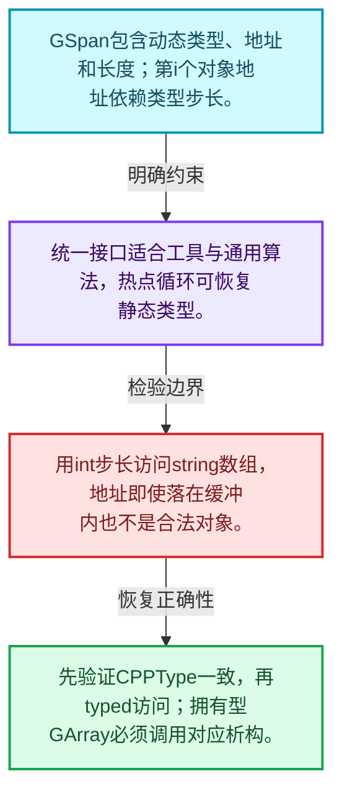
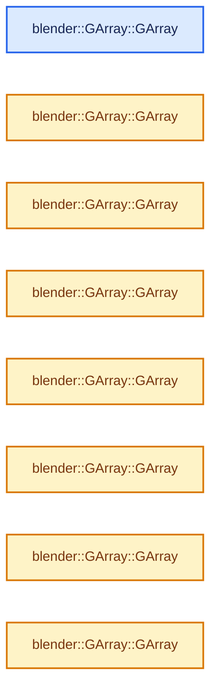
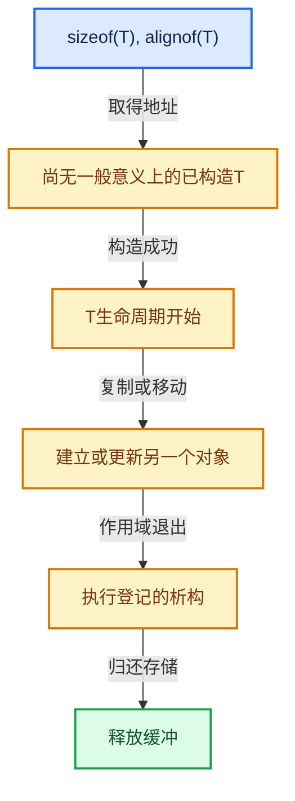

# 03-11 GSpan与GArray

[方向导航](README.md) · [总目录](../README.md) · [实现索引](../%E7%AC%A6%E5%8F%B7%E4%BE%9D%E8%B5%96%E4%B8%8E%E5%AE%9E%E7%8E%B0%E7%B4%A2%E5%BC%95.md)

## 从问题到实现

未知元素类型的数组怎样计算步长和生命周期？

类型信息与地址长度共同构成通用视图；拥有型数组还要执行相应类型操作。

**数据模型**

GSpan包含动态类型、地址和长度；第i个对象地址依赖类型步长。

**设计取舍**

统一接口适合工具与通用算法，热点循环可恢复静态类型。

**最小反例**

用int步长访问string数组，地址即使落在缓冲内也不是合法对象。

**推导**

先验证CPPType一致，再typed访问；拥有型GArray必须调用对应析构。

## 阅读地图与执行推演








图中的数值推演是本方向的教学模型；实际函数之间的调用边与概念分析边分别标注，不能把概念关系当作运行时调度顺序。

## 完整源码单元与就地讲解

中文讲解直接放在相关代码旁，复杂机制在代码下展开。原文折叠区保留基准行号；不需要在行号表和函数之间来回查找。类布局可分段展示，函数实现不按固定行数切开。

### 类型布局、声明与编译条件 · BLI_generic_array.hh L1—L47

<a id="t-b5fe05933ec1"></a>

`GArray`在这里声明的数据成员：

- `CPPType type_`
- `void data_`
- `int64_t size_`
- `BLI_NO_UNIQUE_ADDRESS allocator_`

<!-- annotated:25626cf143856f -->

```cpp
/* SPDX-FileCopyrightText: 2023 Blender Authors
 *
 * SPDX-License-Identifier: GPL-2.0-or-later */

#pragma once

/** \file
 * \ingroup bli
 *
 * This is a generic counterpart to #Array, used when the type is not known at runtime.
 *
 * `GArray` should generally only be used for passing data around in dynamic contexts.
 * It does not support a few things that #Array supports:
 *  - Small object optimization / inline buffer.
 *  - Exception safety and various more specific constructors.
 */

#include "BLI_allocator.hh"
#include "BLI_cpp_type.hh"
#include "BLI_generic_span.hh"

namespace blender {

template<
    /**
     * The allocator used by this array. Should rarely be changed, except when you don't want that
     * MEM_* functions are used internally.
     */
    typename Allocator = GuardedAllocator>
class GArray {
 protected:
  /**
   * The type of the data in the array, will be null after the array is default constructed,
   * but a value should be assigned before any other interaction with the array.
   */
  const CPPType *type_ = nullptr;
  void *data_ = nullptr;
  int64_t size_ = 0;

  BLI_NO_UNIQUE_ADDRESS Allocator allocator_;

 public:
  /**
   * The default constructor creates an empty array, the only situation in which the type is
   * allowed to be null. This default constructor exists so `GArray` can be used in containers,
   * but the type should be supplied before doing anything else to the array.
   */
```

<details>
<summary>核对原始源码：source/blender/blenlib/BLI_generic_array.hh · L1—L47</summary>

<!-- original:25626cf143856f:source/blender/blenlib/BLI_generic_array.hh:1:47 -->

```cpp
/* SPDX-FileCopyrightText: 2023 Blender Authors
 *
 * SPDX-License-Identifier: GPL-2.0-or-later */

#pragma once

/** \file
 * \ingroup bli
 *
 * This is a generic counterpart to #Array, used when the type is not known at runtime.
 *
 * `GArray` should generally only be used for passing data around in dynamic contexts.
 * It does not support a few things that #Array supports:
 *  - Small object optimization / inline buffer.
 *  - Exception safety and various more specific constructors.
 */

#include "BLI_allocator.hh"
#include "BLI_cpp_type.hh"
#include "BLI_generic_span.hh"

namespace blender {

template<
    /**
     * The allocator used by this array. Should rarely be changed, except when you don't want that
     * MEM_* functions are used internally.
     */
    typename Allocator = GuardedAllocator>
class GArray {
 protected:
  /**
   * The type of the data in the array, will be null after the array is default constructed,
   * but a value should be assigned before any other interaction with the array.
   */
  const CPPType *type_ = nullptr;
  void *data_ = nullptr;
  int64_t size_ = 0;

  BLI_NO_UNIQUE_ADDRESS Allocator allocator_;

 public:
  /**
   * The default constructor creates an empty array, the only situation in which the type is
   * allowed to be null. This default constructor exists so `GArray` can be used in containers,
   * but the type should be supplied before doing anything else to the array.
   */
```

</details>

<a id="f-7183420bd41edea3"></a>

### `blender::GArray::GArray`

实现位置：[source/blender/blenlib/BLI_generic_array.hh](../../../../../source/blender/blenlib/BLI_generic_array.hh) · L48—L48。

接口参数：

- `Allocator allocator = {}`

**教学注释版**

<!-- annotated:4dbae196b9ec98 -->

```cpp
  GArray(Allocator allocator = {}) noexcept : allocator_(allocator) {}
```

<details>
<summary>核对原始源码：source/blender/blenlib/BLI_generic_array.hh · L48—L48</summary>

<!-- original:4dbae196b9ec98:source/blender/blenlib/BLI_generic_array.hh:48:48 -->

```cpp
  GArray(Allocator allocator = {}) noexcept : allocator_(allocator) {}
```

</details>

**继续追踪实现**

本实现没有需要继续展开的显式调用；检查返回表达式、对象转换和调用者前置条件。

<!-- annotated:f6c75a91165168 -->

```cpp

```

<details>
<summary>核对原始源码：source/blender/blenlib/BLI_generic_array.hh · L49—L49</summary>

<!-- original:f6c75a91165168:source/blender/blenlib/BLI_generic_array.hh:49:49 -->

```cpp

```

</details>

<a id="f-54ba86a04812c90f"></a>

### `blender::GArray::GArray`

实现位置：[source/blender/blenlib/BLI_generic_array.hh](../../../../../source/blender/blenlib/BLI_generic_array.hh) · L50—L50。

接口参数：

- `NoExceptConstructor`
- `Allocator allocator = {}`

**教学注释版**

<!-- annotated:5ccdc4383e2a0c -->

```cpp
  GArray(NoExceptConstructor, Allocator allocator = {}) noexcept : GArray(allocator) {}
```

<details>
<summary>核对原始源码：source/blender/blenlib/BLI_generic_array.hh · L50—L50</summary>

<!-- original:5ccdc4383e2a0c:source/blender/blenlib/BLI_generic_array.hh:50:50 -->

```cpp
  GArray(NoExceptConstructor, Allocator allocator = {}) noexcept : GArray(allocator) {}
```

</details>

**继续追踪实现**

本实现没有需要继续展开的显式调用；检查返回表达式、对象转换和调用者前置条件。

### 类型布局、声明与编译条件 · BLI_generic_array.hh L51—L55

<!-- annotated:cc594e195295b8 -->

```cpp

  /**
   * Create and allocate a new array, with elements default constructed
   * (which does not do anything for trivial types).
   */
```

<details>
<summary>核对原始源码：source/blender/blenlib/BLI_generic_array.hh · L51—L55</summary>

<!-- original:cc594e195295b8:source/blender/blenlib/BLI_generic_array.hh:51:55 -->

```cpp

  /**
   * Create and allocate a new array, with elements default constructed
   * (which does not do anything for trivial types).
   */
```

</details>

<a id="f-18357249324c54dd"></a>

### `blender::GArray::GArray`

实现位置：[source/blender/blenlib/BLI_generic_array.hh](../../../../../source/blender/blenlib/BLI_generic_array.hh) · L56—L60。

接口参数：

- `const CPPType &type`
- `int64_t size`
- `Allocator allocator = {}`

**教学注释版**

<!-- annotated:992cf8863fabbd -->

```cpp
  GArray(const CPPType &type, int64_t size, Allocator allocator = {})
      : GArray(type, size, NoInitialization{}, allocator)
  {
    type_->default_construct_n(data_, size_);
  }
```

<details>
<summary>核对原始源码：source/blender/blenlib/BLI_generic_array.hh · L56—L60</summary>

<!-- original:992cf8863fabbd:source/blender/blenlib/BLI_generic_array.hh:56:60 -->

```cpp
  GArray(const CPPType &type, int64_t size, Allocator allocator = {})
      : GArray(type, size, NoInitialization{}, allocator)
  {
    type_->default_construct_n(data_, size_);
  }
```

</details>

**继续追踪实现**

- `type_->default_construct_n` → [blender::CPPType::default_construct_n · L532](08-CPPType%E6%9E%84%E9%80%A0%E4%B8%8E%E6%9E%90%E6%9E%84.md#f-ffb51b59521d5579)。

<!-- annotated:e5abcb46833a0d -->

```cpp

```

<details>
<summary>核对原始源码：source/blender/blenlib/BLI_generic_array.hh · L61—L61</summary>

<!-- original:e5abcb46833a0d:source/blender/blenlib/BLI_generic_array.hh:61:61 -->

```cpp

```

</details>

<a id="f-33241c148b83a171"></a>

### `blender::GArray::GArray`

实现位置：[source/blender/blenlib/BLI_generic_array.hh](../../../../../source/blender/blenlib/BLI_generic_array.hh) · L62—L71。

接口参数：

- `const CPPType &type`
- `const int64_t size`
- `NoInitialization`
- `Allocator allocator = {}`

**教学注释版**

<!-- annotated:db7d382196c044 -->

```cpp
  GArray(const CPPType &type,
         const int64_t size,
         NoInitialization /*not_init_tag*/,
         Allocator allocator = {})
      : GArray(type, allocator)
  {
    BLI_assert(size >= 0);
    size_ = size;
    data_ = this->allocate(size_);
  }
```

<details>
<summary>核对原始源码：source/blender/blenlib/BLI_generic_array.hh · L62—L71</summary>

<!-- original:db7d382196c044:source/blender/blenlib/BLI_generic_array.hh:62:71 -->

```cpp
  GArray(const CPPType &type,
         const int64_t size,
         NoInitialization /*not_init_tag*/,
         Allocator allocator = {})
      : GArray(type, allocator)
  {
    BLI_assert(size >= 0);
    size_ = size;
    data_ = this->allocate(size_);
  }
```

</details>

**沿实际写入检查状态**

- `size_ = size;`
- `data_ = this->allocate(size_);`

**继续追踪实现**

- `BLI_assert` → [BLI_assert · L48](../01-%E5%9F%BA%E7%A1%80%E5%AE%B9%E5%99%A8%E4%B8%8E%E7%8E%B0%E4%BB%A3CPP/%E4%BE%9D%E8%B5%96-BLI_assert-cc98e8.md#m-57a88495704d)；[BLI_assert · L63](../01-%E5%9F%BA%E7%A1%80%E5%AE%B9%E5%99%A8%E4%B8%8E%E7%8E%B0%E4%BB%A3CPP/%E4%BE%9D%E8%B5%96-BLI_assert-cc98e8.md#m-d07050020cb5)。宏定义由构建条件选择。
- `this->allocate` → [blender::GArray::allocate · L249](11-GSpan%E4%B8%8EGArray.md#f-a7d4b4dd2b1d68c6)。

### 类型布局、声明与编译条件 · BLI_generic_array.hh L72—L75

<!-- annotated:609200cd45321a -->

```cpp

  /**
   * Create an empty array with just a type.
   */
```

<details>
<summary>核对原始源码：source/blender/blenlib/BLI_generic_array.hh · L72—L75</summary>

<!-- original:609200cd45321a:source/blender/blenlib/BLI_generic_array.hh:72:75 -->

```cpp

  /**
   * Create an empty array with just a type.
   */
```

</details>

<a id="f-0faafb1b26659ab4"></a>

### `blender::GArray::GArray`

实现位置：[source/blender/blenlib/BLI_generic_array.hh](../../../../../source/blender/blenlib/BLI_generic_array.hh) · L76—L79。

接口参数：

- `const CPPType &type`
- `Allocator allocator = {}`

**教学注释版**

<!-- annotated:5f7426de854059 -->

```cpp
  GArray(const CPPType &type, Allocator allocator = {}) : GArray(allocator)
  {
    type_ = &type;
  }
```

<details>
<summary>核对原始源码：source/blender/blenlib/BLI_generic_array.hh · L76—L79</summary>

<!-- original:5f7426de854059:source/blender/blenlib/BLI_generic_array.hh:76:79 -->

```cpp
  GArray(const CPPType &type, Allocator allocator = {}) : GArray(allocator)
  {
    type_ = &type;
  }
```

</details>

**沿实际写入检查状态**

- `type_ = &type;`

**继续追踪实现**

本实现没有需要继续展开的显式调用；检查返回表达式、对象转换和调用者前置条件。

### 类型布局、声明与编译条件 · BLI_generic_array.hh L80—L84

<!-- annotated:f708ac4f146cc5 -->

```cpp

  /**
   * Take ownership of a buffer with a provided size. The buffer should be
   * allocated with the same allocator provided to the constructor.
   */
```

<details>
<summary>核对原始源码：source/blender/blenlib/BLI_generic_array.hh · L80—L84</summary>

<!-- original:f708ac4f146cc5:source/blender/blenlib/BLI_generic_array.hh:80:84 -->

```cpp

  /**
   * Take ownership of a buffer with a provided size. The buffer should be
   * allocated with the same allocator provided to the constructor.
   */
```

</details>

<a id="f-2a6391fbc5a71528"></a>

### `blender::GArray::GArray`

实现位置：[source/blender/blenlib/BLI_generic_array.hh](../../../../../source/blender/blenlib/BLI_generic_array.hh) · L85—L94。

接口参数：

- `const CPPType &type`
- `void *buffer`
- `int64_t size`
- `Allocator allocator = {}`

**教学注释版**

<!-- annotated:c7ce271219c488 -->

```cpp
  GArray(const CPPType &type, void *buffer, int64_t size, Allocator allocator = {})
      : GArray(type, allocator)
  {
    BLI_assert(size >= 0);
    BLI_assert(buffer != nullptr || size == 0);
    BLI_assert(type_->pointer_has_valid_alignment(buffer));

    data_ = buffer;
    size_ = size;
  }
```

<details>
<summary>核对原始源码：source/blender/blenlib/BLI_generic_array.hh · L85—L94</summary>

<!-- original:c7ce271219c488:source/blender/blenlib/BLI_generic_array.hh:85:94 -->

```cpp
  GArray(const CPPType &type, void *buffer, int64_t size, Allocator allocator = {})
      : GArray(type, allocator)
  {
    BLI_assert(size >= 0);
    BLI_assert(buffer != nullptr || size == 0);
    BLI_assert(type_->pointer_has_valid_alignment(buffer));

    data_ = buffer;
    size_ = size;
  }
```

</details>

**沿实际写入检查状态**

- `data_ = buffer;`
- `size_ = size;`

**继续追踪实现**

- `BLI_assert` → [BLI_assert · L48](../01-%E5%9F%BA%E7%A1%80%E5%AE%B9%E5%99%A8%E4%B8%8E%E7%8E%B0%E4%BB%A3CPP/%E4%BE%9D%E8%B5%96-BLI_assert-cc98e8.md#m-57a88495704d)；[BLI_assert · L63](../01-%E5%9F%BA%E7%A1%80%E5%AE%B9%E5%99%A8%E4%B8%8E%E7%8E%B0%E4%BB%A3CPP/%E4%BE%9D%E8%B5%96-BLI_assert-cc98e8.md#m-d07050020cb5)。宏定义由构建条件选择。
- `type_->pointer_has_valid_alignment` → [blender::CPPType::pointer_has_valid_alignment · L517](08-CPPType%E6%9E%84%E9%80%A0%E4%B8%8E%E6%9E%90%E6%9E%84.md#f-e6c3071a36daaa2d)。

### 类型布局、声明与编译条件 · BLI_generic_array.hh L95—L98

<!-- annotated:4386280764df31 -->

```cpp

  /**
   * Create an array by copying values from a generic span.
   */
```

<details>
<summary>核对原始源码：source/blender/blenlib/BLI_generic_array.hh · L95—L98</summary>

<!-- original:4386280764df31:source/blender/blenlib/BLI_generic_array.hh:95:98 -->

```cpp

  /**
   * Create an array by copying values from a generic span.
   */
```

</details>

<a id="f-15ff6ec174e95d5d"></a>

### `blender::GArray::GArray`

实现位置：[source/blender/blenlib/BLI_generic_array.hh](../../../../../source/blender/blenlib/BLI_generic_array.hh) · L99—L103。

接口参数：

- `const GSpan span`
- `Allocator allocator = {}`

**教学注释版**

<!-- annotated:b0da5a298c9465 -->

```cpp
  GArray(const GSpan span, Allocator allocator = {}) : GArray(span.type(), span.size(), allocator)
  {
    /* Use copy assign rather than construct since the memory is already initialized. */
    type_->copy_assign_n(span.data(), data_, size_);
  }
```

<details>
<summary>核对原始源码：source/blender/blenlib/BLI_generic_array.hh · L99—L103</summary>

<!-- original:b0da5a298c9465:source/blender/blenlib/BLI_generic_array.hh:99:103 -->

```cpp
  GArray(const GSpan span, Allocator allocator = {}) : GArray(span.type(), span.size(), allocator)
  {
    /* Use copy assign rather than construct since the memory is already initialized. */
    type_->copy_assign_n(span.data(), data_, size_);
  }
```

</details>

**继续追踪实现**

- `type_->copy_assign_n` → [blender::CPPType::copy_assign_n · L577](09-CPPType%E5%A4%8D%E5%88%B6%E7%A7%BB%E5%8A%A8%E9%87%8D%E5%AE%9A%E4%BD%8D.md#f-bdf812bca95da2b6)。
- `span.data` → [blender::GSpan::data · L81](11-GSpan%E4%B8%8EGArray.md#f-25f2f0038c437d19)。

### 类型布局、声明与编译条件 · BLI_generic_array.hh L104—L107

<!-- annotated:c8b57023116f41 -->

```cpp

  /**
   * Create an array by copying values from another generic array.
   */
```

<details>
<summary>核对原始源码：source/blender/blenlib/BLI_generic_array.hh · L104—L107</summary>

<!-- original:c8b57023116f41:source/blender/blenlib/BLI_generic_array.hh:104:107 -->

```cpp

  /**
   * Create an array by copying values from another generic array.
   */
```

</details>

<a id="f-7fcca6a7a5a969b2"></a>

### `blender::GArray::GArray`

实现位置：[source/blender/blenlib/BLI_generic_array.hh](../../../../../source/blender/blenlib/BLI_generic_array.hh) · L108—L108。

接口参数：

- `const GArray &other`

**教学注释版**

<!-- annotated:145e68a31d0de1 -->

```cpp
  GArray(const GArray &other) : GArray(other.as_span(), other.allocator()) {}
```

<details>
<summary>核对原始源码：source/blender/blenlib/BLI_generic_array.hh · L108—L108</summary>

<!-- original:145e68a31d0de1:source/blender/blenlib/BLI_generic_array.hh:108:108 -->

```cpp
  GArray(const GArray &other) : GArray(other.as_span(), other.allocator()) {}
```

</details>

**继续追踪实现**

本实现没有需要继续展开的显式调用；检查返回表达式、对象转换和调用者前置条件。

### 类型布局、声明与编译条件 · BLI_generic_array.hh L109—L112

<!-- annotated:70fe8d58bfcbc0 -->

```cpp

  /**
   * Create an array by taking ownership of another array's data, clearing the data in the other.
   */
```

<details>
<summary>核对原始源码：source/blender/blenlib/BLI_generic_array.hh · L109—L112</summary>

<!-- original:70fe8d58bfcbc0:source/blender/blenlib/BLI_generic_array.hh:109:112 -->

```cpp

  /**
   * Create an array by taking ownership of another array's data, clearing the data in the other.
   */
```

</details>

<a id="f-b4a6d6139574374a"></a>

### `blender::GArray::GArray`

实现位置：[source/blender/blenlib/BLI_generic_array.hh](../../../../../source/blender/blenlib/BLI_generic_array.hh) · L113—L118。

接口参数：

- `GArray &&other`

**教学注释版**

<!-- annotated:aeca6f167dff8f -->

```cpp
  GArray(GArray &&other)
      : type_(other.type_), data_(other.data_), size_(other.size_), allocator_(other.allocator_)
  {
    other.data_ = nullptr;
    other.size_ = 0;
  }
```

<details>
<summary>核对原始源码：source/blender/blenlib/BLI_generic_array.hh · L113—L118</summary>

<!-- original:aeca6f167dff8f:source/blender/blenlib/BLI_generic_array.hh:113:118 -->

```cpp
  GArray(GArray &&other)
      : type_(other.type_), data_(other.data_), size_(other.size_), allocator_(other.allocator_)
  {
    other.data_ = nullptr;
    other.size_ = 0;
  }
```

</details>

**沿实际写入检查状态**

- `other.data_ = nullptr;`
- `other.size_ = 0;`

**继续追踪实现**

本实现没有需要继续展开的显式调用；检查返回表达式、对象转换和调用者前置条件。

<!-- annotated:45d5983509f598 -->

```cpp

```

<details>
<summary>核对原始源码：source/blender/blenlib/BLI_generic_array.hh · L119—L119</summary>

<!-- original:45d5983509f598:source/blender/blenlib/BLI_generic_array.hh:119:119 -->

```cpp

```

</details>

<a id="f-52e9de70b8dc030c"></a>

### `blender::GArray::~GArray`

实现位置：[source/blender/blenlib/BLI_generic_array.hh](../../../../../source/blender/blenlib/BLI_generic_array.hh) · L120—L126。

**教学注释版**

<!-- annotated:f15c06b415bee6 -->

```cpp
  ~GArray()
  {
    if (data_ != nullptr) {
      type_->destruct_n(data_, size_);
      this->deallocate(data_);
    }
  }
```

<details>
<summary>核对原始源码：source/blender/blenlib/BLI_generic_array.hh · L120—L126</summary>

<!-- original:f15c06b415bee6:source/blender/blenlib/BLI_generic_array.hh:120:126 -->

```cpp
  ~GArray()
  {
    if (data_ != nullptr) {
      type_->destruct_n(data_, size_);
      this->deallocate(data_);
    }
  }
```

</details>

**继续追踪实现**

- `type_->destruct_n` → [blender::CPPType::destruct_n · L562](09-CPPType%E5%A4%8D%E5%88%B6%E7%A7%BB%E5%8A%A8%E9%87%8D%E5%AE%9A%E4%BD%8D.md#f-1858ea1d7f707a74)。
- `this->deallocate` → [blender::GArray::deallocate · L256](11-GSpan%E4%B8%8EGArray.md#f-7b412d648b115aab)。

<!-- annotated:731f5255dd5958 -->

```cpp

```

<details>
<summary>核对原始源码：source/blender/blenlib/BLI_generic_array.hh · L127—L127</summary>

<!-- original:731f5255dd5958:source/blender/blenlib/BLI_generic_array.hh:127:127 -->

```cpp

```

</details>

<a id="f-763fc0e5f452a4a5"></a>

### `blender::GArray::operator=`

实现位置：[source/blender/blenlib/BLI_generic_array.hh](../../../../../source/blender/blenlib/BLI_generic_array.hh) · L128—L131。

接口参数：

- `const GArray &other`

**教学注释版**

<!-- annotated:b864bb9dea845c -->

```cpp
  GArray &operator=(const GArray &other)
  {
    return copy_assign_container(*this, other);
  }
```

<details>
<summary>核对原始源码：source/blender/blenlib/BLI_generic_array.hh · L128—L131</summary>

<!-- original:b864bb9dea845c:source/blender/blenlib/BLI_generic_array.hh:128:131 -->

```cpp
  GArray &operator=(const GArray &other)
  {
    return copy_assign_container(*this, other);
  }
```

</details>

**结果出口**

- `return copy_assign_container(*this, other);`

**继续追踪实现**

- `copy_assign_container` → [blender::copy_assign_container · L284](01-%E5%AF%B9%E9%BD%90%E4%B8%8E%E6%9C%AA%E5%88%9D%E5%A7%8B%E5%8C%96%E5%AD%98%E5%82%A8.md#f-546a45b4d8b5ab44)。

<!-- annotated:6fc6b3c2b5f138 -->

```cpp

```

<details>
<summary>核对原始源码：source/blender/blenlib/BLI_generic_array.hh · L132—L132</summary>

<!-- original:6fc6b3c2b5f138:source/blender/blenlib/BLI_generic_array.hh:132:132 -->

```cpp

```

</details>

<a id="f-36d4610cf35f67a4"></a>

### `blender::GArray::operator=`

实现位置：[source/blender/blenlib/BLI_generic_array.hh](../../../../../source/blender/blenlib/BLI_generic_array.hh) · L133—L136。

接口参数：

- `GArray &&other`

**教学注释版**

<!-- annotated:f56cc8a965ed15 -->

```cpp
  GArray &operator=(GArray &&other)
  {
    // [讲解] std::move：把表达式转换成可供移动重载选择的值类别；不保证真的移动，不结束源对象寿命，对const值可能选择复制。
    return move_assign_container(*this, std::move(other));
  }
```

<details>
<summary>核对原始源码：source/blender/blenlib/BLI_generic_array.hh · L133—L136</summary>

<!-- original:f56cc8a965ed15:source/blender/blenlib/BLI_generic_array.hh:133:136 -->

```cpp
  GArray &operator=(GArray &&other)
  {
    return move_assign_container(*this, std::move(other));
  }
```

</details>

**结果出口**

- `return move_assign_container(*this, std::move(other));`

**继续追踪实现**

- `move_assign_container` → [blender::move_assign_container · L300](01-%E5%AF%B9%E9%BD%90%E4%B8%8E%E6%9C%AA%E5%88%9D%E5%A7%8B%E5%8C%96%E5%AD%98%E5%82%A8.md#f-5144b56be86e6f42)。
- `std::move` → [外部契约](https://eel.is/c++draft/utility.forward)：把表达式转换成可供移动重载选择的值类别；不保证真的移动，不结束源对象寿命，对const值可能选择复制。

<!-- annotated:aba33ea932fe5a -->

```cpp

```

<details>
<summary>核对原始源码：source/blender/blenlib/BLI_generic_array.hh · L137—L137</summary>

<!-- original:aba33ea932fe5a:source/blender/blenlib/BLI_generic_array.hh:137:137 -->

```cpp

```

</details>

<a id="f-3c4bebd424df52cc"></a>

### `blender::GArray::type`

实现位置：[source/blender/blenlib/BLI_generic_array.hh](../../../../../source/blender/blenlib/BLI_generic_array.hh) · L138—L142。

**教学注释版**

<!-- annotated:f28995f04bedf7 -->

```cpp
  const CPPType &type() const
  {
    BLI_assert(type_ != nullptr);
    return *type_;
  }
```

<details>
<summary>核对原始源码：source/blender/blenlib/BLI_generic_array.hh · L138—L142</summary>

<!-- original:f28995f04bedf7:source/blender/blenlib/BLI_generic_array.hh:138:142 -->

```cpp
  const CPPType &type() const
  {
    BLI_assert(type_ != nullptr);
    return *type_;
  }
```

</details>

**结果出口**

- `return *type_;`

**继续追踪实现**

- `BLI_assert` → [BLI_assert · L48](../01-%E5%9F%BA%E7%A1%80%E5%AE%B9%E5%99%A8%E4%B8%8E%E7%8E%B0%E4%BB%A3CPP/%E4%BE%9D%E8%B5%96-BLI_assert-cc98e8.md#m-57a88495704d)；[BLI_assert · L63](../01-%E5%9F%BA%E7%A1%80%E5%AE%B9%E5%99%A8%E4%B8%8E%E7%8E%B0%E4%BB%A3CPP/%E4%BE%9D%E8%B5%96-BLI_assert-cc98e8.md#m-d07050020cb5)。宏定义由构建条件选择。

<!-- annotated:1613220d82d3cd -->

```cpp

```

<details>
<summary>核对原始源码：source/blender/blenlib/BLI_generic_array.hh · L143—L143</summary>

<!-- original:1613220d82d3cd:source/blender/blenlib/BLI_generic_array.hh:143:143 -->

```cpp

```

</details>

<a id="f-4ccdaadbedb64690"></a>

### `blender::GArray::is_empty`

实现位置：[source/blender/blenlib/BLI_generic_array.hh](../../../../../source/blender/blenlib/BLI_generic_array.hh) · L144—L147。

**教学注释版**

<!-- annotated:307e56bdd56b50 -->

```cpp
  bool is_empty() const
  {
    return size_ == 0;
  }
```

<details>
<summary>核对原始源码：source/blender/blenlib/BLI_generic_array.hh · L144—L147</summary>

<!-- original:307e56bdd56b50:source/blender/blenlib/BLI_generic_array.hh:144:147 -->

```cpp
  bool is_empty() const
  {
    return size_ == 0;
  }
```

</details>

**结果出口**

- `return size_ == 0;`

**继续追踪实现**

本实现没有需要继续展开的显式调用；检查返回表达式、对象转换和调用者前置条件。

### 类型布局、声明与编译条件 · BLI_generic_array.hh L148—L151

<!-- annotated:4a42c62a207125 -->

```cpp

  /**
   * Return the number of elements in the array (not the size in bytes).
   */
```

<details>
<summary>核对原始源码：source/blender/blenlib/BLI_generic_array.hh · L148—L151</summary>

<!-- original:4a42c62a207125:source/blender/blenlib/BLI_generic_array.hh:148:151 -->

```cpp

  /**
   * Return the number of elements in the array (not the size in bytes).
   */
```

</details>

<a id="f-8897580a87dde189"></a>

### `blender::GArray::size`

实现位置：[source/blender/blenlib/BLI_generic_array.hh](../../../../../source/blender/blenlib/BLI_generic_array.hh) · L152—L155。

**教学注释版**

<!-- annotated:a9390c9d6ccf02 -->

```cpp
  int64_t size() const
  {
    return size_;
  }
```

<details>
<summary>核对原始源码：source/blender/blenlib/BLI_generic_array.hh · L152—L155</summary>

<!-- original:a9390c9d6ccf02:source/blender/blenlib/BLI_generic_array.hh:152:155 -->

```cpp
  int64_t size() const
  {
    return size_;
  }
```

</details>

**结果出口**

- `return size_;`

**继续追踪实现**

本实现没有需要继续展开的显式调用；检查返回表达式、对象转换和调用者前置条件。

### 类型布局、声明与编译条件 · BLI_generic_array.hh L156—L159

<!-- annotated:f247f8710e6a81 -->

```cpp

  /**
   * Get a pointer to the beginning of the array.
   */
```

<details>
<summary>核对原始源码：source/blender/blenlib/BLI_generic_array.hh · L156—L159</summary>

<!-- original:f247f8710e6a81:source/blender/blenlib/BLI_generic_array.hh:156:159 -->

```cpp

  /**
   * Get a pointer to the beginning of the array.
   */
```

</details>

<a id="f-fe965f44840f15ac"></a>

### `blender::GArray::data`

实现位置：[source/blender/blenlib/BLI_generic_array.hh](../../../../../source/blender/blenlib/BLI_generic_array.hh) · L160—L163。

**教学注释版**

<!-- annotated:ea2298c2d37c44 -->

```cpp
  const void *data() const
  {
    return data_;
  }
```

<details>
<summary>核对原始源码：source/blender/blenlib/BLI_generic_array.hh · L160—L163</summary>

<!-- original:ea2298c2d37c44:source/blender/blenlib/BLI_generic_array.hh:160:163 -->

```cpp
  const void *data() const
  {
    return data_;
  }
```

</details>

**结果出口**

- `return data_;`

**继续追踪实现**

本实现没有需要继续展开的显式调用；检查返回表达式、对象转换和调用者前置条件。

<a id="f-831c5c3abf4c5711"></a>

### `blender::GArray::data`

实现位置：[source/blender/blenlib/BLI_generic_array.hh](../../../../../source/blender/blenlib/BLI_generic_array.hh) · L164—L167。

**教学注释版**

<!-- annotated:0a4474f6d51df8 -->

```cpp
  void *data()
  {
    return data_;
  }
```

<details>
<summary>核对原始源码：source/blender/blenlib/BLI_generic_array.hh · L164—L167</summary>

<!-- original:0a4474f6d51df8:source/blender/blenlib/BLI_generic_array.hh:164:167 -->

```cpp
  void *data()
  {
    return data_;
  }
```

</details>

**结果出口**

- `return data_;`

**继续追踪实现**

本实现没有需要继续展开的显式调用；检查返回表达式、对象转换和调用者前置条件。

<!-- annotated:609ea51245ba02 -->

```cpp

```

<details>
<summary>核对原始源码：source/blender/blenlib/BLI_generic_array.hh · L168—L168</summary>

<!-- original:609ea51245ba02:source/blender/blenlib/BLI_generic_array.hh:168:168 -->

```cpp

```

</details>

<a id="f-4e3d4e23c3b378de"></a>

### `blender::GArray::operator[]`

实现位置：[source/blender/blenlib/BLI_generic_array.hh](../../../../../source/blender/blenlib/BLI_generic_array.hh) · L169—L173。

接口参数：

- `int64_t index`

**教学注释版**

<!-- annotated:d321f8f4a89f9d -->

```cpp
  const void *operator[](int64_t index) const
  {
    BLI_assert(index < size_);
    return POINTER_OFFSET(data_, type_->size * index);
  }
```

<details>
<summary>核对原始源码：source/blender/blenlib/BLI_generic_array.hh · L169—L173</summary>

<!-- original:d321f8f4a89f9d:source/blender/blenlib/BLI_generic_array.hh:169:173 -->

```cpp
  const void *operator[](int64_t index) const
  {
    BLI_assert(index < size_);
    return POINTER_OFFSET(data_, type_->size * index);
  }
```

</details>

**结果出口**

- `return POINTER_OFFSET(data_, type_->size * index);`

**继续追踪实现**

- `BLI_assert` → [BLI_assert · L48](../01-%E5%9F%BA%E7%A1%80%E5%AE%B9%E5%99%A8%E4%B8%8E%E7%8E%B0%E4%BB%A3CPP/%E4%BE%9D%E8%B5%96-BLI_assert-cc98e8.md#m-57a88495704d)；[BLI_assert · L63](../01-%E5%9F%BA%E7%A1%80%E5%AE%B9%E5%99%A8%E4%B8%8E%E7%8E%B0%E4%BB%A3CPP/%E4%BE%9D%E8%B5%96-BLI_assert-cc98e8.md#m-d07050020cb5)。宏定义由构建条件选择。
- `POINTER_OFFSET` → [POINTER_OFFSET · L316](../01-%E5%9F%BA%E7%A1%80%E5%AE%B9%E5%99%A8%E4%B8%8E%E7%8E%B0%E4%BB%A3CPP/%E4%BE%9D%E8%B5%96-BLI_utildefines-293a0a.md#m-c812e199f26c)。宏定义由构建条件选择。

<!-- annotated:740634b85738ea -->

```cpp

```

<details>
<summary>核对原始源码：source/blender/blenlib/BLI_generic_array.hh · L174—L174</summary>

<!-- original:740634b85738ea:source/blender/blenlib/BLI_generic_array.hh:174:174 -->

```cpp

```

</details>

<a id="f-66c04936ac4748d9"></a>

### `blender::GArray::operator[]`

实现位置：[source/blender/blenlib/BLI_generic_array.hh](../../../../../source/blender/blenlib/BLI_generic_array.hh) · L175—L179。

接口参数：

- `int64_t index`

**教学注释版**

<!-- annotated:97ecd08fd0b482 -->

```cpp
  void *operator[](int64_t index)
  {
    BLI_assert(index < size_);
    return POINTER_OFFSET(data_, type_->size * index);
  }
```

<details>
<summary>核对原始源码：source/blender/blenlib/BLI_generic_array.hh · L175—L179</summary>

<!-- original:97ecd08fd0b482:source/blender/blenlib/BLI_generic_array.hh:175:179 -->

```cpp
  void *operator[](int64_t index)
  {
    BLI_assert(index < size_);
    return POINTER_OFFSET(data_, type_->size * index);
  }
```

</details>

**结果出口**

- `return POINTER_OFFSET(data_, type_->size * index);`

**继续追踪实现**

- `BLI_assert` → [BLI_assert · L48](../01-%E5%9F%BA%E7%A1%80%E5%AE%B9%E5%99%A8%E4%B8%8E%E7%8E%B0%E4%BB%A3CPP/%E4%BE%9D%E8%B5%96-BLI_assert-cc98e8.md#m-57a88495704d)；[BLI_assert · L63](../01-%E5%9F%BA%E7%A1%80%E5%AE%B9%E5%99%A8%E4%B8%8E%E7%8E%B0%E4%BB%A3CPP/%E4%BE%9D%E8%B5%96-BLI_assert-cc98e8.md#m-d07050020cb5)。宏定义由构建条件选择。
- `POINTER_OFFSET` → [POINTER_OFFSET · L316](../01-%E5%9F%BA%E7%A1%80%E5%AE%B9%E5%99%A8%E4%B8%8E%E7%8E%B0%E4%BB%A3CPP/%E4%BE%9D%E8%B5%96-BLI_utildefines-293a0a.md#m-c812e199f26c)。宏定义由构建条件选择。

<!-- annotated:cfb48338dfa58c -->

```cpp

```

<details>
<summary>核对原始源码：source/blender/blenlib/BLI_generic_array.hh · L180—L180</summary>

<!-- original:cfb48338dfa58c:source/blender/blenlib/BLI_generic_array.hh:180:180 -->

```cpp

```

</details>

<a id="f-97578d7bb8d6ea87"></a>

### `blender::GArray::() const`

实现位置：[source/blender/blenlib/BLI_generic_array.hh](../../../../../source/blender/blenlib/BLI_generic_array.hh) · L181—L185。

**教学注释版**

<!-- annotated:9c1e652a618c42 -->

```cpp
  operator GSpan() const
  {
    BLI_assert(size_ == 0 || type_ != nullptr);
    return GSpan(type_, data_, size_);
  }
```

<details>
<summary>核对原始源码：source/blender/blenlib/BLI_generic_array.hh · L181—L185</summary>

<!-- original:9c1e652a618c42:source/blender/blenlib/BLI_generic_array.hh:181:185 -->

```cpp
  operator GSpan() const
  {
    BLI_assert(size_ == 0 || type_ != nullptr);
    return GSpan(type_, data_, size_);
  }
```

</details>

**结果出口**

- `return GSpan(type_, data_, size_);`

**继续追踪实现**

- `BLI_assert` → [BLI_assert · L48](../01-%E5%9F%BA%E7%A1%80%E5%AE%B9%E5%99%A8%E4%B8%8E%E7%8E%B0%E4%BB%A3CPP/%E4%BE%9D%E8%B5%96-BLI_assert-cc98e8.md#m-57a88495704d)；[BLI_assert · L63](../01-%E5%9F%BA%E7%A1%80%E5%AE%B9%E5%99%A8%E4%B8%8E%E7%8E%B0%E4%BB%A3CPP/%E4%BE%9D%E8%B5%96-BLI_assert-cc98e8.md#m-d07050020cb5)。宏定义由构建条件选择。
- `GSpan` → [blender::GSpan::GSpan · L26](11-GSpan%E4%B8%8EGArray.md#f-9d0c95702007eea6)；[blender::GSpan::GSpan · L28](11-GSpan%E4%B8%8EGArray.md#f-6650bd08c7eecc66)；[blender::GSpan::GSpan · L37](11-GSpan%E4%B8%8EGArray.md#f-bf180950832673fb)；[blender::GSpan::GSpan · L39](11-GSpan%E4%B8%8EGArray.md#f-cf949d5590ea9ab6)；[blender::GSpan::GSpan · L41](11-GSpan%E4%B8%8EGArray.md#f-a66ab52ee0842aee)；[blender::GSpan::GSpan · L43](11-GSpan%E4%B8%8EGArray.md#f-d9084fa10964390f)；[blender::GSpan::GSpan · L49](11-GSpan%E4%B8%8EGArray.md#f-76e3de3cc3d65761)。同名重载需按实参类型选择。

<!-- annotated:5338f88d687909 -->

```cpp

```

<details>
<summary>核对原始源码：source/blender/blenlib/BLI_generic_array.hh · L186—L186</summary>

<!-- original:5338f88d687909:source/blender/blenlib/BLI_generic_array.hh:186:186 -->

```cpp

```

</details>

<a id="f-627fa18ad52324b4"></a>

### `blender::GArray::()`

实现位置：[source/blender/blenlib/BLI_generic_array.hh](../../../../../source/blender/blenlib/BLI_generic_array.hh) · L187—L191。

**教学注释版**

<!-- annotated:8f155b128a2f96 -->

```cpp
  operator GMutableSpan()
  {
    BLI_assert(size_ == 0 || type_ != nullptr);
    return GMutableSpan(type_, data_, size_);
  }
```

<details>
<summary>核对原始源码：source/blender/blenlib/BLI_generic_array.hh · L187—L191</summary>

<!-- original:8f155b128a2f96:source/blender/blenlib/BLI_generic_array.hh:187:191 -->

```cpp
  operator GMutableSpan()
  {
    BLI_assert(size_ == 0 || type_ != nullptr);
    return GMutableSpan(type_, data_, size_);
  }
```

</details>

**结果出口**

- `return GMutableSpan(type_, data_, size_);`

**继续追踪实现**

- `BLI_assert` → [BLI_assert · L48](../01-%E5%9F%BA%E7%A1%80%E5%AE%B9%E5%99%A8%E4%B8%8E%E7%8E%B0%E4%BB%A3CPP/%E4%BE%9D%E8%B5%96-BLI_assert-cc98e8.md#m-57a88495704d)；[BLI_assert · L63](../01-%E5%9F%BA%E7%A1%80%E5%AE%B9%E5%99%A8%E4%B8%8E%E7%8E%B0%E4%BB%A3CPP/%E4%BE%9D%E8%B5%96-BLI_assert-cc98e8.md#m-d07050020cb5)。宏定义由构建条件选择。
- `GMutableSpan` → [blender::GMutableSpan::GMutableSpan · L152](11-GSpan%E4%B8%8EGArray.md#f-b4ef5399177eeedd)；[blender::GMutableSpan::GMutableSpan · L154](11-GSpan%E4%B8%8EGArray.md#f-6439a40f33c7a2e5)；[blender::GMutableSpan::GMutableSpan · L163](11-GSpan%E4%B8%8EGArray.md#f-6054339faadc1405)；[blender::GMutableSpan::GMutableSpan · L167](11-GSpan%E4%B8%8EGArray.md#f-d1333b42c7982310)；[blender::GMutableSpan::GMutableSpan · L169](11-GSpan%E4%B8%8EGArray.md#f-3584f997d0fe9a96)；[blender::GMutableSpan::GMutableSpan · L171](11-GSpan%E4%B8%8EGArray.md#f-3074afdbe5232417)。同名重载需按实参类型选择。

<!-- annotated:09705bb8c54b76 -->

```cpp

```

<details>
<summary>核对原始源码：source/blender/blenlib/BLI_generic_array.hh · L192—L192</summary>

<!-- original:09705bb8c54b76:source/blender/blenlib/BLI_generic_array.hh:192:192 -->

```cpp

```

</details>

<a id="f-3f8b9fae52fa4eca"></a>

### `blender::GArray::as_span`

实现位置：[source/blender/blenlib/BLI_generic_array.hh](../../../../../source/blender/blenlib/BLI_generic_array.hh) · L193—L196。

**教学注释版**

<!-- annotated:de27bdf82a3aff -->

```cpp
  GSpan as_span() const
  {
    return *this;
  }
```

<details>
<summary>核对原始源码：source/blender/blenlib/BLI_generic_array.hh · L193—L196</summary>

<!-- original:de27bdf82a3aff:source/blender/blenlib/BLI_generic_array.hh:193:196 -->

```cpp
  GSpan as_span() const
  {
    return *this;
  }
```

</details>

**结果出口**

- `return *this;`

**继续追踪实现**

本实现没有需要继续展开的显式调用；检查返回表达式、对象转换和调用者前置条件。

<!-- annotated:6222a40c665fce -->

```cpp

```

<details>
<summary>核对原始源码：source/blender/blenlib/BLI_generic_array.hh · L197—L197</summary>

<!-- original:6222a40c665fce:source/blender/blenlib/BLI_generic_array.hh:197:197 -->

```cpp

```

</details>

<a id="f-2f8508997cf678b6"></a>

### `blender::GArray::as_mutable_span`

实现位置：[source/blender/blenlib/BLI_generic_array.hh](../../../../../source/blender/blenlib/BLI_generic_array.hh) · L198—L201。

**教学注释版**

<!-- annotated:a1eb626c9d68a2 -->

```cpp
  GMutableSpan as_mutable_span()
  {
    return *this;
  }
```

<details>
<summary>核对原始源码：source/blender/blenlib/BLI_generic_array.hh · L198—L201</summary>

<!-- original:a1eb626c9d68a2:source/blender/blenlib/BLI_generic_array.hh:198:201 -->

```cpp
  GMutableSpan as_mutable_span()
  {
    return *this;
  }
```

</details>

**结果出口**

- `return *this;`

**继续追踪实现**

本实现没有需要继续展开的显式调用；检查返回表达式、对象转换和调用者前置条件。

### 类型布局、声明与编译条件 · BLI_generic_array.hh L202—L205

<!-- annotated:fde7fb70fdd660 -->

```cpp

  /**
   * Access the allocator used by this array.
   */
```

<details>
<summary>核对原始源码：source/blender/blenlib/BLI_generic_array.hh · L202—L205</summary>

<!-- original:fde7fb70fdd660:source/blender/blenlib/BLI_generic_array.hh:202:205 -->

```cpp

  /**
   * Access the allocator used by this array.
   */
```

</details>

<a id="f-ff4a88b67591331c"></a>

### `blender::GArray::allocator`

实现位置：[source/blender/blenlib/BLI_generic_array.hh](../../../../../source/blender/blenlib/BLI_generic_array.hh) · L206—L209。

**教学注释版**

<!-- annotated:52d787d735d8de -->

```cpp
  Allocator &allocator()
  {
    return allocator_;
  }
```

<details>
<summary>核对原始源码：source/blender/blenlib/BLI_generic_array.hh · L206—L209</summary>

<!-- original:52d787d735d8de:source/blender/blenlib/BLI_generic_array.hh:206:209 -->

```cpp
  Allocator &allocator()
  {
    return allocator_;
  }
```

</details>

**结果出口**

- `return allocator_;`

**继续追踪实现**

本实现没有需要继续展开的显式调用；检查返回表达式、对象转换和调用者前置条件。

<a id="f-b5bcd3b1182e656d"></a>

### `blender::GArray::allocator`

实现位置：[source/blender/blenlib/BLI_generic_array.hh](../../../../../source/blender/blenlib/BLI_generic_array.hh) · L210—L213。

**教学注释版**

<!-- annotated:3c5bb30ecbf752 -->

```cpp
  const Allocator &allocator() const
  {
    return allocator_;
  }
```

<details>
<summary>核对原始源码：source/blender/blenlib/BLI_generic_array.hh · L210—L213</summary>

<!-- original:3c5bb30ecbf752:source/blender/blenlib/BLI_generic_array.hh:210:213 -->

```cpp
  const Allocator &allocator() const
  {
    return allocator_;
  }
```

</details>

**结果出口**

- `return allocator_;`

**继续追踪实现**

本实现没有需要继续展开的显式调用；检查返回表达式、对象转换和调用者前置条件。

### 类型布局、声明与编译条件 · BLI_generic_array.hh L214—L218

<!-- annotated:2f45ae2f3c6fbf -->

```cpp

  /**
   * Destruct values and create a new array of the given size. The values in the new array are
   * default constructed.
   */
```

<details>
<summary>核对原始源码：source/blender/blenlib/BLI_generic_array.hh · L214—L218</summary>

<!-- original:2f45ae2f3c6fbf:source/blender/blenlib/BLI_generic_array.hh:214:218 -->

```cpp

  /**
   * Destruct values and create a new array of the given size. The values in the new array are
   * default constructed.
   */
```

</details>

<a id="f-9e39971b381f60e8"></a>

### `blender::GArray::reinitialize`

实现位置：[source/blender/blenlib/BLI_generic_array.hh](../../../../../source/blender/blenlib/BLI_generic_array.hh) · L219—L246。

接口参数：

- `const int64_t new_size`

**教学注释版**

<!-- annotated:d1a236a6c97b20 -->

```cpp
  void reinitialize(const int64_t new_size)
  {
    BLI_assert(new_size >= 0);
    int64_t old_size = size_;

    type_->destruct_n(data_, size_);
    size_ = 0;

    if (new_size <= old_size) {
      type_->default_construct_n(data_, new_size);
    }
    else {
      void *new_data = this->allocate(new_size);
      try {
        type_->default_construct_n(new_data, new_size);
      }
      catch (...) {
        this->deallocate(new_data);
        throw;
      }
      if (this->data_) {
        this->deallocate(data_);
      }
      data_ = new_data;
    }

    size_ = new_size;
  }
```

<details>
<summary>核对原始源码：source/blender/blenlib/BLI_generic_array.hh · L219—L246</summary>

<!-- original:d1a236a6c97b20:source/blender/blenlib/BLI_generic_array.hh:219:246 -->

```cpp
  void reinitialize(const int64_t new_size)
  {
    BLI_assert(new_size >= 0);
    int64_t old_size = size_;

    type_->destruct_n(data_, size_);
    size_ = 0;

    if (new_size <= old_size) {
      type_->default_construct_n(data_, new_size);
    }
    else {
      void *new_data = this->allocate(new_size);
      try {
        type_->default_construct_n(new_data, new_size);
      }
      catch (...) {
        this->deallocate(new_data);
        throw;
      }
      if (this->data_) {
        this->deallocate(data_);
      }
      data_ = new_data;
    }

    size_ = new_size;
  }
```

</details>

**沿实际写入检查状态**

- `size_ = 0;`
- `data_ = new_data;`
- `size_ = new_size;`

**继续追踪实现**

- `BLI_assert` → [BLI_assert · L48](../01-%E5%9F%BA%E7%A1%80%E5%AE%B9%E5%99%A8%E4%B8%8E%E7%8E%B0%E4%BB%A3CPP/%E4%BE%9D%E8%B5%96-BLI_assert-cc98e8.md#m-57a88495704d)；[BLI_assert · L63](../01-%E5%9F%BA%E7%A1%80%E5%AE%B9%E5%99%A8%E4%B8%8E%E7%8E%B0%E4%BB%A3CPP/%E4%BE%9D%E8%B5%96-BLI_assert-cc98e8.md#m-d07050020cb5)。宏定义由构建条件选择。
- `type_->destruct_n` → [blender::CPPType::destruct_n · L562](09-CPPType%E5%A4%8D%E5%88%B6%E7%A7%BB%E5%8A%A8%E9%87%8D%E5%AE%9A%E4%BD%8D.md#f-1858ea1d7f707a74)。
- `type_->default_construct_n` → [blender::CPPType::default_construct_n · L532](08-CPPType%E6%9E%84%E9%80%A0%E4%B8%8E%E6%9E%90%E6%9E%84.md#f-ffb51b59521d5579)。
- `this->allocate` → [blender::GArray::allocate · L249](11-GSpan%E4%B8%8EGArray.md#f-a7d4b4dd2b1d68c6)。
- `this->deallocate` → [blender::GArray::deallocate · L256](11-GSpan%E4%B8%8EGArray.md#f-7b412d648b115aab)。

### 类型布局、声明与编译条件 · BLI_generic_array.hh L247—L248

<!-- annotated:51ed93062a85de -->

```cpp

 private:
```

<details>
<summary>核对原始源码：source/blender/blenlib/BLI_generic_array.hh · L247—L248</summary>

<!-- original:51ed93062a85de:source/blender/blenlib/BLI_generic_array.hh:247:248 -->

```cpp

 private:
```

</details>

<a id="f-a7d4b4dd2b1d68c6"></a>

### `blender::GArray::allocate`

实现位置：[source/blender/blenlib/BLI_generic_array.hh](../../../../../source/blender/blenlib/BLI_generic_array.hh) · L249—L254。

接口参数：

- `int64_t size`

**教学注释版**

<!-- annotated:2679e90ef364f7 -->

```cpp
  void *allocate(int64_t size)
  {
    const int64_t item_size = type_->size;
    const int64_t alignment = type_->alignment;
    return allocator_.allocate(size_t(size) * item_size, alignment, AT);
  }
```

<details>
<summary>核对原始源码：source/blender/blenlib/BLI_generic_array.hh · L249—L254</summary>

<!-- original:2679e90ef364f7:source/blender/blenlib/BLI_generic_array.hh:249:254 -->

```cpp
  void *allocate(int64_t size)
  {
    const int64_t item_size = type_->size;
    const int64_t alignment = type_->alignment;
    return allocator_.allocate(size_t(size) * item_size, alignment, AT);
  }
```

</details>

**结果出口**

- `return allocator_.allocate(size_t(size) * item_size, alignment, AT);`

**继续追踪实现**

- `allocator_.allocate` → [blender::GArray::allocate · L249](11-GSpan%E4%B8%8EGArray.md#f-a7d4b4dd2b1d68c6)。

<!-- annotated:a1ddda58406638 -->

```cpp

```

<details>
<summary>核对原始源码：source/blender/blenlib/BLI_generic_array.hh · L255—L255</summary>

<!-- original:a1ddda58406638:source/blender/blenlib/BLI_generic_array.hh:255:255 -->

```cpp

```

</details>

<a id="f-7b412d648b115aab"></a>

### `blender::GArray::deallocate`

实现位置：[source/blender/blenlib/BLI_generic_array.hh](../../../../../source/blender/blenlib/BLI_generic_array.hh) · L256—L259。

接口参数：

- `void *ptr`

**教学注释版**

<!-- annotated:1bb93b2171c01a -->

```cpp
  void deallocate(void *ptr)
  {
    allocator_.deallocate(ptr);
  }
```

<details>
<summary>核对原始源码：source/blender/blenlib/BLI_generic_array.hh · L256—L259</summary>

<!-- original:1bb93b2171c01a:source/blender/blenlib/BLI_generic_array.hh:256:259 -->

```cpp
  void deallocate(void *ptr)
  {
    allocator_.deallocate(ptr);
  }
```

</details>

**继续追踪实现**

- `allocator_.deallocate` → [blender::GArray::deallocate · L256](11-GSpan%E4%B8%8EGArray.md#f-7b412d648b115aab)。

### 类型布局、声明与编译条件 · BLI_generic_array.hh L260—L262

<!-- annotated:348d6f660c340f -->

```cpp
};

}  // namespace blender
```

<details>
<summary>核对原始源码：source/blender/blenlib/BLI_generic_array.hh · L260—L262</summary>

<!-- original:348d6f660c340f:source/blender/blenlib/BLI_generic_array.hh:260:262 -->

```cpp
};

}  // namespace blender
```

</details>

### 类型布局、声明与编译条件 · BLI_generic_span.hh L1—L25

<a id="t-4ce0909aac7c"></a>

`GSpan`在这里声明的数据成员：

- `CPPType type_`
- `void data_`
- `int64_t size_`

<!-- annotated:8ac59b5e3a62be -->

```cpp
/* SPDX-FileCopyrightText: 2023 Blender Authors
 *
 * SPDX-License-Identifier: GPL-2.0-or-later */

#pragma once

/** \file
 * \ingroup bli
 */

#include "BLI_cpp_type.hh"
#include "BLI_span.hh"

namespace blender {

/**
 * A generic span. It behaves just like a Span<T>, but the type is only known at run-time.
 */
class GSpan {
 protected:
  const CPPType *type_ = nullptr;
  const void *data_ = nullptr;
  int64_t size_ = 0;

 public:
```

<details>
<summary>核对原始源码：source/blender/blenlib/BLI_generic_span.hh · L1—L25</summary>

<!-- original:8ac59b5e3a62be:source/blender/blenlib/BLI_generic_span.hh:1:25 -->

```cpp
/* SPDX-FileCopyrightText: 2023 Blender Authors
 *
 * SPDX-License-Identifier: GPL-2.0-or-later */

#pragma once

/** \file
 * \ingroup bli
 */

#include "BLI_cpp_type.hh"
#include "BLI_span.hh"

namespace blender {

/**
 * A generic span. It behaves just like a Span<T>, but the type is only known at run-time.
 */
class GSpan {
 protected:
  const CPPType *type_ = nullptr;
  const void *data_ = nullptr;
  int64_t size_ = 0;

 public:
```

</details>

<a id="f-9d0c95702007eea6"></a>

### `blender::GSpan::GSpan`

实现位置：[source/blender/blenlib/BLI_generic_span.hh](../../../../../source/blender/blenlib/BLI_generic_span.hh) · L26—L26。

**教学注释版**

<!-- annotated:36aa7cab8803a8 -->

```cpp
  GSpan() = default;
```

<details>
<summary>核对原始源码：source/blender/blenlib/BLI_generic_span.hh · L26—L26</summary>

<!-- original:36aa7cab8803a8:source/blender/blenlib/BLI_generic_span.hh:26:26 -->

```cpp
  GSpan() = default;
```

</details>

**继续追踪实现**

本实现没有需要继续展开的显式调用；检查返回表达式、对象转换和调用者前置条件。

<!-- annotated:d7a89d5c071c46 -->

```cpp

```

<details>
<summary>核对原始源码：source/blender/blenlib/BLI_generic_span.hh · L27—L27</summary>

<!-- original:d7a89d5c071c46:source/blender/blenlib/BLI_generic_span.hh:27:27 -->

```cpp

```

</details>

<a id="f-6650bd08c7eecc66"></a>

### `blender::GSpan::GSpan`

实现位置：[source/blender/blenlib/BLI_generic_span.hh](../../../../../source/blender/blenlib/BLI_generic_span.hh) · L28—L35。

接口参数：

- `const CPPType *type`
- `const void *buffer`
- `int64_t size`

**教学注释版**

<!-- annotated:93114deebc7c4d -->

```cpp
  GSpan(const CPPType *type, const void *buffer, int64_t size)
      : type_(type), data_(buffer), size_(size)
  {
    BLI_assert(size >= 0);
    BLI_assert(buffer != nullptr || size == 0);
    BLI_assert(size == 0 || type != nullptr);
    BLI_assert(type == nullptr || type->pointer_has_valid_alignment(buffer));
  }
```

<details>
<summary>核对原始源码：source/blender/blenlib/BLI_generic_span.hh · L28—L35</summary>

<!-- original:93114deebc7c4d:source/blender/blenlib/BLI_generic_span.hh:28:35 -->

```cpp
  GSpan(const CPPType *type, const void *buffer, int64_t size)
      : type_(type), data_(buffer), size_(size)
  {
    BLI_assert(size >= 0);
    BLI_assert(buffer != nullptr || size == 0);
    BLI_assert(size == 0 || type != nullptr);
    BLI_assert(type == nullptr || type->pointer_has_valid_alignment(buffer));
  }
```

</details>

**继续追踪实现**

- `BLI_assert` → [BLI_assert · L48](../01-%E5%9F%BA%E7%A1%80%E5%AE%B9%E5%99%A8%E4%B8%8E%E7%8E%B0%E4%BB%A3CPP/%E4%BE%9D%E8%B5%96-BLI_assert-cc98e8.md#m-57a88495704d)；[BLI_assert · L63](../01-%E5%9F%BA%E7%A1%80%E5%AE%B9%E5%99%A8%E4%B8%8E%E7%8E%B0%E4%BB%A3CPP/%E4%BE%9D%E8%B5%96-BLI_assert-cc98e8.md#m-d07050020cb5)。宏定义由构建条件选择。
- `type->pointer_has_valid_alignment` → [blender::CPPType::pointer_has_valid_alignment · L517](08-CPPType%E6%9E%84%E9%80%A0%E4%B8%8E%E6%9E%90%E6%9E%84.md#f-e6c3071a36daaa2d)。

<!-- annotated:9f3e64bfe3222b -->

```cpp

```

<details>
<summary>核对原始源码：source/blender/blenlib/BLI_generic_span.hh · L36—L36</summary>

<!-- original:9f3e64bfe3222b:source/blender/blenlib/BLI_generic_span.hh:36:36 -->

```cpp

```

</details>

<a id="f-bf180950832673fb"></a>

### `blender::GSpan::GSpan`

实现位置：[source/blender/blenlib/BLI_generic_span.hh](../../../../../source/blender/blenlib/BLI_generic_span.hh) · L37—L37。

接口参数：

- `const CPPType &type`
- `const void *buffer`
- `int64_t size`

**教学注释版**

<!-- annotated:e4541b316cfaea -->

```cpp
  GSpan(const CPPType &type, const void *buffer, int64_t size) : GSpan(&type, buffer, size) {}
```

<details>
<summary>核对原始源码：source/blender/blenlib/BLI_generic_span.hh · L37—L37</summary>

<!-- original:e4541b316cfaea:source/blender/blenlib/BLI_generic_span.hh:37:37 -->

```cpp
  GSpan(const CPPType &type, const void *buffer, int64_t size) : GSpan(&type, buffer, size) {}
```

</details>

**继续追踪实现**

本实现没有需要继续展开的显式调用；检查返回表达式、对象转换和调用者前置条件。

<!-- annotated:3552dfb856993a -->

```cpp

```

<details>
<summary>核对原始源码：source/blender/blenlib/BLI_generic_span.hh · L38—L38</summary>

<!-- original:3552dfb856993a:source/blender/blenlib/BLI_generic_span.hh:38:38 -->

```cpp

```

</details>

<a id="f-cf949d5590ea9ab6"></a>

### `blender::GSpan::GSpan`

实现位置：[source/blender/blenlib/BLI_generic_span.hh](../../../../../source/blender/blenlib/BLI_generic_span.hh) · L39—L39。

接口参数：

- `const CPPType &type`

**教学注释版**

<!-- annotated:437020ef732e3f -->

```cpp
  GSpan(const CPPType &type) : type_(&type) {}
```

<details>
<summary>核对原始源码：source/blender/blenlib/BLI_generic_span.hh · L39—L39</summary>

<!-- original:437020ef732e3f:source/blender/blenlib/BLI_generic_span.hh:39:39 -->

```cpp
  GSpan(const CPPType &type) : type_(&type) {}
```

</details>

**继续追踪实现**

本实现没有需要继续展开的显式调用；检查返回表达式、对象转换和调用者前置条件。

<!-- annotated:fda1800cf0c576 -->

```cpp

```

<details>
<summary>核对原始源码：source/blender/blenlib/BLI_generic_span.hh · L40—L40</summary>

<!-- original:fda1800cf0c576:source/blender/blenlib/BLI_generic_span.hh:40:40 -->

```cpp

```

</details>

<a id="f-a66ab52ee0842aee"></a>

### `blender::GSpan::GSpan`

实现位置：[source/blender/blenlib/BLI_generic_span.hh](../../../../../source/blender/blenlib/BLI_generic_span.hh) · L41—L41。

接口参数：

- `const CPPType *type`

**教学注释版**

<!-- annotated:949986811f02fe -->

```cpp
  GSpan(const CPPType *type) : type_(type) {}
```

<details>
<summary>核对原始源码：source/blender/blenlib/BLI_generic_span.hh · L41—L41</summary>

<!-- original:949986811f02fe:source/blender/blenlib/BLI_generic_span.hh:41:41 -->

```cpp
  GSpan(const CPPType *type) : type_(type) {}
```

</details>

**继续追踪实现**

本实现没有需要继续展开的显式调用；检查返回表达式、对象转换和调用者前置条件。

<!-- annotated:c03a5eede4b7f2 -->

```cpp

```

<details>
<summary>核对原始源码：source/blender/blenlib/BLI_generic_span.hh · L42—L42</summary>

<!-- original:c03a5eede4b7f2:source/blender/blenlib/BLI_generic_span.hh:42:42 -->

```cpp

```

</details>

<a id="f-d9084fa10964390f"></a>

### `blender::GSpan::GSpan`

实现位置：[source/blender/blenlib/BLI_generic_span.hh](../../../../../source/blender/blenlib/BLI_generic_span.hh) · L43—L47。

接口参数：

- `Span<T> array`

**教学注释版**

<!-- annotated:655fa88d3a0a84 -->

```cpp
  template<typename T>
  GSpan(Span<T> array)
      : GSpan(CPPType::get<T>(), static_cast<const void *>(array.data()), array.size())
  {
  }
```

<details>
<summary>核对原始源码：source/blender/blenlib/BLI_generic_span.hh · L43—L47</summary>

<!-- original:655fa88d3a0a84:source/blender/blenlib/BLI_generic_span.hh:43:47 -->

```cpp
  template<typename T>
  GSpan(Span<T> array)
      : GSpan(CPPType::get<T>(), static_cast<const void *>(array.data()), array.size())
  {
  }
```

</details>

**继续追踪实现**

本实现没有需要继续展开的显式调用；检查返回表达式、对象转换和调用者前置条件。

<!-- annotated:a83f8abaf8d359 -->

```cpp

```

<details>
<summary>核对原始源码：source/blender/blenlib/BLI_generic_span.hh · L48—L48</summary>

<!-- original:a83f8abaf8d359:source/blender/blenlib/BLI_generic_span.hh:48:48 -->

```cpp

```

</details>

<a id="f-76e3de3cc3d65761"></a>

### `blender::GSpan::GSpan`

实现位置：[source/blender/blenlib/BLI_generic_span.hh](../../../../../source/blender/blenlib/BLI_generic_span.hh) · L49—L53。

接口参数：

- `MutableSpan<T> array`

**教学注释版**

<!-- annotated:93245baa9c207c -->

```cpp
  template<typename T>
  GSpan(MutableSpan<T> array)
      : GSpan(CPPType::get<T>(), static_cast<const void *>(array.data()), array.size())
  {
  }
```

<details>
<summary>核对原始源码：source/blender/blenlib/BLI_generic_span.hh · L49—L53</summary>

<!-- original:93245baa9c207c:source/blender/blenlib/BLI_generic_span.hh:49:53 -->

```cpp
  template<typename T>
  GSpan(MutableSpan<T> array)
      : GSpan(CPPType::get<T>(), static_cast<const void *>(array.data()), array.size())
  {
  }
```

</details>

**继续追踪实现**

本实现没有需要继续展开的显式调用；检查返回表达式、对象转换和调用者前置条件。

<!-- annotated:066d2fd3e3dcfc -->

```cpp

```

<details>
<summary>核对原始源码：source/blender/blenlib/BLI_generic_span.hh · L54—L54</summary>

<!-- original:066d2fd3e3dcfc:source/blender/blenlib/BLI_generic_span.hh:54:54 -->

```cpp

```

</details>

<a id="f-4c44cc0364dcf191"></a>

### `blender::GSpan::type`

实现位置：[source/blender/blenlib/BLI_generic_span.hh](../../../../../source/blender/blenlib/BLI_generic_span.hh) · L55—L59。

**教学注释版**

<!-- annotated:56255c15c0a9ff -->

```cpp
  const CPPType &type() const
  {
    BLI_assert(type_ != nullptr);
    return *type_;
  }
```

<details>
<summary>核对原始源码：source/blender/blenlib/BLI_generic_span.hh · L55—L59</summary>

<!-- original:56255c15c0a9ff:source/blender/blenlib/BLI_generic_span.hh:55:59 -->

```cpp
  const CPPType &type() const
  {
    BLI_assert(type_ != nullptr);
    return *type_;
  }
```

</details>

**结果出口**

- `return *type_;`

**继续追踪实现**

- `BLI_assert` → [BLI_assert · L48](../01-%E5%9F%BA%E7%A1%80%E5%AE%B9%E5%99%A8%E4%B8%8E%E7%8E%B0%E4%BB%A3CPP/%E4%BE%9D%E8%B5%96-BLI_assert-cc98e8.md#m-57a88495704d)；[BLI_assert · L63](../01-%E5%9F%BA%E7%A1%80%E5%AE%B9%E5%99%A8%E4%B8%8E%E7%8E%B0%E4%BB%A3CPP/%E4%BE%9D%E8%B5%96-BLI_assert-cc98e8.md#m-d07050020cb5)。宏定义由构建条件选择。

<!-- annotated:60120920d1daa3 -->

```cpp

```

<details>
<summary>核对原始源码：source/blender/blenlib/BLI_generic_span.hh · L60—L60</summary>

<!-- original:60120920d1daa3:source/blender/blenlib/BLI_generic_span.hh:60:60 -->

```cpp

```

</details>

<a id="f-5294e3d5beb8ed8f"></a>

### `blender::GSpan::type_ptr`

实现位置：[source/blender/blenlib/BLI_generic_span.hh](../../../../../source/blender/blenlib/BLI_generic_span.hh) · L61—L64。

**教学注释版**

<!-- annotated:b2f9bb7950da2b -->

```cpp
  const CPPType *type_ptr() const
  {
    return type_;
  }
```

<details>
<summary>核对原始源码：source/blender/blenlib/BLI_generic_span.hh · L61—L64</summary>

<!-- original:b2f9bb7950da2b:source/blender/blenlib/BLI_generic_span.hh:61:64 -->

```cpp
  const CPPType *type_ptr() const
  {
    return type_;
  }
```

</details>

**结果出口**

- `return type_;`

**继续追踪实现**

本实现没有需要继续展开的显式调用；检查返回表达式、对象转换和调用者前置条件。

<!-- annotated:a510c7b25b9639 -->

```cpp

```

<details>
<summary>核对原始源码：source/blender/blenlib/BLI_generic_span.hh · L65—L65</summary>

<!-- original:a510c7b25b9639:source/blender/blenlib/BLI_generic_span.hh:65:65 -->

```cpp

```

</details>

<a id="f-30ba56eaa986966b"></a>

### `blender::GSpan::is_empty`

实现位置：[source/blender/blenlib/BLI_generic_span.hh](../../../../../source/blender/blenlib/BLI_generic_span.hh) · L66—L69。

**教学注释版**

<!-- annotated:225698bdc1adf3 -->

```cpp
  bool is_empty() const
  {
    return size_ == 0;
  }
```

<details>
<summary>核对原始源码：source/blender/blenlib/BLI_generic_span.hh · L66—L69</summary>

<!-- original:225698bdc1adf3:source/blender/blenlib/BLI_generic_span.hh:66:69 -->

```cpp
  bool is_empty() const
  {
    return size_ == 0;
  }
```

</details>

**结果出口**

- `return size_ == 0;`

**继续追踪实现**

本实现没有需要继续展开的显式调用；检查返回表达式、对象转换和调用者前置条件。

<!-- annotated:f42b69ec36ab66 -->

```cpp

```

<details>
<summary>核对原始源码：source/blender/blenlib/BLI_generic_span.hh · L70—L70</summary>

<!-- original:f42b69ec36ab66:source/blender/blenlib/BLI_generic_span.hh:70:70 -->

```cpp

```

</details>

<a id="f-c942a700d5d93de1"></a>

### `blender::GSpan::size`

实现位置：[source/blender/blenlib/BLI_generic_span.hh](../../../../../source/blender/blenlib/BLI_generic_span.hh) · L71—L74。

**教学注释版**

<!-- annotated:f8256432eed529 -->

```cpp
  int64_t size() const
  {
    return size_;
  }
```

<details>
<summary>核对原始源码：source/blender/blenlib/BLI_generic_span.hh · L71—L74</summary>

<!-- original:f8256432eed529:source/blender/blenlib/BLI_generic_span.hh:71:74 -->

```cpp
  int64_t size() const
  {
    return size_;
  }
```

</details>

**结果出口**

- `return size_;`

**继续追踪实现**

本实现没有需要继续展开的显式调用；检查返回表达式、对象转换和调用者前置条件。

<!-- annotated:ff663ef46bfbc5 -->

```cpp

```

<details>
<summary>核对原始源码：source/blender/blenlib/BLI_generic_span.hh · L75—L75</summary>

<!-- original:ff663ef46bfbc5:source/blender/blenlib/BLI_generic_span.hh:75:75 -->

```cpp

```

</details>

<a id="f-bb9e867bc32a6f4e"></a>

### `blender::GSpan::size_in_bytes`

实现位置：[source/blender/blenlib/BLI_generic_span.hh](../../../../../source/blender/blenlib/BLI_generic_span.hh) · L76—L79。

**教学注释版**

<!-- annotated:4c49dc40894d8d -->

```cpp
  int64_t size_in_bytes() const
  {
    return type_->size * size_;
  }
```

<details>
<summary>核对原始源码：source/blender/blenlib/BLI_generic_span.hh · L76—L79</summary>

<!-- original:4c49dc40894d8d:source/blender/blenlib/BLI_generic_span.hh:76:79 -->

```cpp
  int64_t size_in_bytes() const
  {
    return type_->size * size_;
  }
```

</details>

**结果出口**

- `return type_->size * size_;`

**继续追踪实现**

本实现没有需要继续展开的显式调用；检查返回表达式、对象转换和调用者前置条件。

<!-- annotated:f042d3ad4f83ad -->

```cpp

```

<details>
<summary>核对原始源码：source/blender/blenlib/BLI_generic_span.hh · L80—L80</summary>

<!-- original:f042d3ad4f83ad:source/blender/blenlib/BLI_generic_span.hh:80:80 -->

```cpp

```

</details>

<a id="f-25f2f0038c437d19"></a>

### `blender::GSpan::data`

实现位置：[source/blender/blenlib/BLI_generic_span.hh](../../../../../source/blender/blenlib/BLI_generic_span.hh) · L81—L84。

**教学注释版**

<!-- annotated:19fbfd78bbccd7 -->

```cpp
  const void *data() const
  {
    return data_;
  }
```

<details>
<summary>核对原始源码：source/blender/blenlib/BLI_generic_span.hh · L81—L84</summary>

<!-- original:19fbfd78bbccd7:source/blender/blenlib/BLI_generic_span.hh:81:84 -->

```cpp
  const void *data() const
  {
    return data_;
  }
```

</details>

**结果出口**

- `return data_;`

**继续追踪实现**

本实现没有需要继续展开的显式调用；检查返回表达式、对象转换和调用者前置条件。

<!-- annotated:b6e593947efd3e -->

```cpp

```

<details>
<summary>核对原始源码：source/blender/blenlib/BLI_generic_span.hh · L85—L85</summary>

<!-- original:b6e593947efd3e:source/blender/blenlib/BLI_generic_span.hh:85:85 -->

```cpp

```

</details>

<a id="f-6d10b3ee1228df45"></a>

### `blender::GSpan::operator[]`

实现位置：[source/blender/blenlib/BLI_generic_span.hh](../../../../../source/blender/blenlib/BLI_generic_span.hh) · L86—L90。

接口参数：

- `int64_t index`

**教学注释版**

<!-- annotated:d3940f65dbc300 -->

```cpp
  const void *operator[](int64_t index) const
  {
    BLI_assert(index < size_);
    return POINTER_OFFSET(data_, type_->size * index);
  }
```

<details>
<summary>核对原始源码：source/blender/blenlib/BLI_generic_span.hh · L86—L90</summary>

<!-- original:d3940f65dbc300:source/blender/blenlib/BLI_generic_span.hh:86:90 -->

```cpp
  const void *operator[](int64_t index) const
  {
    BLI_assert(index < size_);
    return POINTER_OFFSET(data_, type_->size * index);
  }
```

</details>

**结果出口**

- `return POINTER_OFFSET(data_, type_->size * index);`

**继续追踪实现**

- `BLI_assert` → [BLI_assert · L48](../01-%E5%9F%BA%E7%A1%80%E5%AE%B9%E5%99%A8%E4%B8%8E%E7%8E%B0%E4%BB%A3CPP/%E4%BE%9D%E8%B5%96-BLI_assert-cc98e8.md#m-57a88495704d)；[BLI_assert · L63](../01-%E5%9F%BA%E7%A1%80%E5%AE%B9%E5%99%A8%E4%B8%8E%E7%8E%B0%E4%BB%A3CPP/%E4%BE%9D%E8%B5%96-BLI_assert-cc98e8.md#m-d07050020cb5)。宏定义由构建条件选择。
- `POINTER_OFFSET` → [POINTER_OFFSET · L316](../01-%E5%9F%BA%E7%A1%80%E5%AE%B9%E5%99%A8%E4%B8%8E%E7%8E%B0%E4%BB%A3CPP/%E4%BE%9D%E8%B5%96-BLI_utildefines-293a0a.md#m-c812e199f26c)。宏定义由构建条件选择。

<!-- annotated:bff1d0b1c71c81 -->

```cpp

```

<details>
<summary>核对原始源码：source/blender/blenlib/BLI_generic_span.hh · L91—L91</summary>

<!-- original:bff1d0b1c71c81:source/blender/blenlib/BLI_generic_span.hh:91:91 -->

```cpp

```

</details>

<a id="f-aa54cf0d7a8dae2b"></a>

### `blender::GSpan::typed`

实现位置：[source/blender/blenlib/BLI_generic_span.hh](../../../../../source/blender/blenlib/BLI_generic_span.hh) · L92—L97。

**教学注释版**

<!-- annotated:c261c44b411ccf -->

```cpp
  template<typename T> Span<T> typed() const
  {
    BLI_assert(size_ == 0 || type_ != nullptr);
    BLI_assert(type_ == nullptr || type_->is<T>());
    return Span<T>(static_cast<const T *>(data_), size_);
  }
```

<details>
<summary>核对原始源码：source/blender/blenlib/BLI_generic_span.hh · L92—L97</summary>

<!-- original:c261c44b411ccf:source/blender/blenlib/BLI_generic_span.hh:92:97 -->

```cpp
  template<typename T> Span<T> typed() const
  {
    BLI_assert(size_ == 0 || type_ != nullptr);
    BLI_assert(type_ == nullptr || type_->is<T>());
    return Span<T>(static_cast<const T *>(data_), size_);
  }
```

</details>

**结果出口**

- `return Span<T>(static_cast<const T *>(data_), size_);`

**继续追踪实现**

- `BLI_assert` → [BLI_assert · L48](../01-%E5%9F%BA%E7%A1%80%E5%AE%B9%E5%99%A8%E4%B8%8E%E7%8E%B0%E4%BB%A3CPP/%E4%BE%9D%E8%B5%96-BLI_assert-cc98e8.md#m-57a88495704d)；[BLI_assert · L63](../01-%E5%9F%BA%E7%A1%80%E5%AE%B9%E5%99%A8%E4%B8%8E%E7%8E%B0%E4%BB%A3CPP/%E4%BE%9D%E8%B5%96-BLI_assert-cc98e8.md#m-d07050020cb5)。宏定义由构建条件选择。
- `type_->is<T>` → [blender::CPPType::is · L758](09-CPPType%E5%A4%8D%E5%88%B6%E7%A7%BB%E5%8A%A8%E9%87%8D%E5%AE%9A%E4%BD%8D.md#f-2e2c3ee7602530a4)。
- `Span<T>` → [blender::Span](../01-%E5%9F%BA%E7%A1%80%E5%AE%B9%E5%99%A8%E4%B8%8E%E7%8E%B0%E4%BB%A3CPP/%E4%BE%9D%E8%B5%96-BLI_span-6aa95f.md#t-8765a8e0c1d5)；[blender::Span](../01-%E5%9F%BA%E7%A1%80%E5%AE%B9%E5%99%A8%E4%B8%8E%E7%8E%B0%E4%BB%A3CPP/%E4%BE%9D%E8%B5%96-BLI_index_range-7d7cc5.md#t-86091874a1c0)；[blender::Span](../05-%E5%87%A0%E4%BD%95%E5%AD%98%E5%82%A8%E4%B8%8E%E6%8B%93%E6%89%91%E6%98%A0%E5%B0%84/%E4%BE%9D%E8%B5%96-DNA_pointcloud_types-cfb82c.md#t-112aa6ed842c)；[blender::Span](../05-%E5%87%A0%E4%BD%95%E5%AD%98%E5%82%A8%E4%B8%8E%E6%8B%93%E6%89%91%E6%98%A0%E5%B0%84/%E4%BE%9D%E8%B5%96-DNA_node_types-6708b9.md#t-49ec6fbb9b69)；[blender::Span](../05-%E5%87%A0%E4%BD%95%E5%AD%98%E5%82%A8%E4%B8%8E%E6%8B%93%E6%89%91%E6%98%A0%E5%B0%84/%E4%BE%9D%E8%B5%96-DNA_mesh_types-81f02e.md#t-184fd48fb638)；[blender::Span](../05-%E5%87%A0%E4%BD%95%E5%AD%98%E5%82%A8%E4%B8%8E%E6%8B%93%E6%89%91%E6%98%A0%E5%B0%84/%E4%BE%9D%E8%B5%96-DNA_anim_types-39c5d9.md#t-d841071994c2)；[blender::Span](../05-%E5%87%A0%E4%BD%95%E5%AD%98%E5%82%A8%E4%B8%8E%E6%8B%93%E6%89%91%E6%98%A0%E5%B0%84/%E4%BE%9D%E8%B5%96-RNA_path_fwd-79c989.md#t-4dbb08969e41)。

<!-- annotated:1db2aef86bae6a -->

```cpp

```

<details>
<summary>核对原始源码：source/blender/blenlib/BLI_generic_span.hh · L98—L98</summary>

<!-- original:1db2aef86bae6a:source/blender/blenlib/BLI_generic_span.hh:98:98 -->

```cpp

```

</details>

<a id="f-c7f535c5dacdc816"></a>

### `blender::GSpan::slice`

实现位置：[source/blender/blenlib/BLI_generic_span.hh](../../../../../source/blender/blenlib/BLI_generic_span.hh) · L99—L105。

接口参数：

- `const int64_t start`
- `int64_t size`

**教学注释版**

<!-- annotated:ebceef211906bf -->

```cpp
  GSpan slice(const int64_t start, int64_t size) const
  {
    BLI_assert(start >= 0);
    BLI_assert(size >= 0);
    BLI_assert(start + size <= size_ || size == 0);
    return GSpan(type_, POINTER_OFFSET(data_, type_->size * start), size);
  }
```

<details>
<summary>核对原始源码：source/blender/blenlib/BLI_generic_span.hh · L99—L105</summary>

<!-- original:ebceef211906bf:source/blender/blenlib/BLI_generic_span.hh:99:105 -->

```cpp
  GSpan slice(const int64_t start, int64_t size) const
  {
    BLI_assert(start >= 0);
    BLI_assert(size >= 0);
    BLI_assert(start + size <= size_ || size == 0);
    return GSpan(type_, POINTER_OFFSET(data_, type_->size * start), size);
  }
```

</details>

**结果出口**

- `return GSpan(type_, POINTER_OFFSET(data_, type_->size * start), size);`

**继续追踪实现**

- `BLI_assert` → [BLI_assert · L48](../01-%E5%9F%BA%E7%A1%80%E5%AE%B9%E5%99%A8%E4%B8%8E%E7%8E%B0%E4%BB%A3CPP/%E4%BE%9D%E8%B5%96-BLI_assert-cc98e8.md#m-57a88495704d)；[BLI_assert · L63](../01-%E5%9F%BA%E7%A1%80%E5%AE%B9%E5%99%A8%E4%B8%8E%E7%8E%B0%E4%BB%A3CPP/%E4%BE%9D%E8%B5%96-BLI_assert-cc98e8.md#m-d07050020cb5)。宏定义由构建条件选择。
- `GSpan` → [blender::GSpan::GSpan · L26](11-GSpan%E4%B8%8EGArray.md#f-9d0c95702007eea6)；[blender::GSpan::GSpan · L28](11-GSpan%E4%B8%8EGArray.md#f-6650bd08c7eecc66)；[blender::GSpan::GSpan · L37](11-GSpan%E4%B8%8EGArray.md#f-bf180950832673fb)；[blender::GSpan::GSpan · L39](11-GSpan%E4%B8%8EGArray.md#f-cf949d5590ea9ab6)；[blender::GSpan::GSpan · L41](11-GSpan%E4%B8%8EGArray.md#f-a66ab52ee0842aee)；[blender::GSpan::GSpan · L43](11-GSpan%E4%B8%8EGArray.md#f-d9084fa10964390f)；[blender::GSpan::GSpan · L49](11-GSpan%E4%B8%8EGArray.md#f-76e3de3cc3d65761)。同名重载需按实参类型选择。
- `POINTER_OFFSET` → [POINTER_OFFSET · L316](../01-%E5%9F%BA%E7%A1%80%E5%AE%B9%E5%99%A8%E4%B8%8E%E7%8E%B0%E4%BB%A3CPP/%E4%BE%9D%E8%B5%96-BLI_utildefines-293a0a.md#m-c812e199f26c)。宏定义由构建条件选择。

<!-- annotated:3bd2f74baccd91 -->

```cpp

```

<details>
<summary>核对原始源码：source/blender/blenlib/BLI_generic_span.hh · L106—L106</summary>

<!-- original:3bd2f74baccd91:source/blender/blenlib/BLI_generic_span.hh:106:106 -->

```cpp

```

</details>

<a id="f-13774c4cd5408fa2"></a>

### `blender::GSpan::slice`

实现位置：[source/blender/blenlib/BLI_generic_span.hh](../../../../../source/blender/blenlib/BLI_generic_span.hh) · L107—L110。

接口参数：

- `const IndexRange range`

**教学注释版**

<!-- annotated:2e83a7969a8839 -->

```cpp
  GSpan slice(const IndexRange range) const
  {
    // [讲解] range.start：读取连续区间或分组的边界信息。
    return this->slice(range.start(), range.size());
  }
```

<details>
<summary>核对原始源码：source/blender/blenlib/BLI_generic_span.hh · L107—L110</summary>

<!-- original:2e83a7969a8839:source/blender/blenlib/BLI_generic_span.hh:107:110 -->

```cpp
  GSpan slice(const IndexRange range) const
  {
    return this->slice(range.start(), range.size());
  }
```

</details>

**结果出口**

- `return this->slice(range.start(), range.size());`

**继续追踪实现**

- `this->slice` → [blender::GSpan::slice · L99](11-GSpan%E4%B8%8EGArray.md#f-c7f535c5dacdc816)；[blender::GSpan::slice · L107](11-GSpan%E4%B8%8EGArray.md#f-13774c4cd5408fa2)。同名重载需按实参类型选择。
- `range.start` → [blender::IndexRange::start · L243](../01-%E5%9F%BA%E7%A1%80%E5%AE%B9%E5%99%A8%E4%B8%8E%E7%8E%B0%E4%BB%A3CPP/04-IndexRange%E8%BF%9E%E7%BB%AD%E6%95%B4%E6%95%B0%E5%8C%BA%E9%97%B4.md#f-99d2195bd9cfd1f0)。
- `range.size` → [blender::IndexRange::size · L156](../01-%E5%9F%BA%E7%A1%80%E5%AE%B9%E5%99%A8%E4%B8%8E%E7%8E%B0%E4%BB%A3CPP/04-IndexRange%E8%BF%9E%E7%BB%AD%E6%95%B4%E6%95%B0%E5%8C%BA%E9%97%B4.md#f-05f66c3ebb2fdfec)。

<!-- annotated:c06ae6e01e272f -->

```cpp

```

<details>
<summary>核对原始源码：source/blender/blenlib/BLI_generic_span.hh · L111—L111</summary>

<!-- original:c06ae6e01e272f:source/blender/blenlib/BLI_generic_span.hh:111:111 -->

```cpp

```

</details>

<a id="f-4fdd4b33b123f637"></a>

### `blender::GSpan::drop_front`

实现位置：[source/blender/blenlib/BLI_generic_span.hh](../../../../../source/blender/blenlib/BLI_generic_span.hh) · L112—L117。

接口参数：

- `const int64_t n`

**教学注释版**

<!-- annotated:cedfadfc5ada69 -->

```cpp
  GSpan drop_front(const int64_t n) const
  {
    BLI_assert(n >= 0);
    // [讲解] std::max<int64_t>：按比较关系选取较大值。本讲解中的增长公式同时满足最低请求和几何增长；若保存返回引用，还需注意实参寿命。
    const int64_t new_size = std::max<int64_t>(0, size_ - n);
    return GSpan(*type_, POINTER_OFFSET(data_, type_->size * n), new_size);
  }
```

<details>
<summary>核对原始源码：source/blender/blenlib/BLI_generic_span.hh · L112—L117</summary>

<!-- original:cedfadfc5ada69:source/blender/blenlib/BLI_generic_span.hh:112:117 -->

```cpp
  GSpan drop_front(const int64_t n) const
  {
    BLI_assert(n >= 0);
    const int64_t new_size = std::max<int64_t>(0, size_ - n);
    return GSpan(*type_, POINTER_OFFSET(data_, type_->size * n), new_size);
  }
```

</details>

**结果出口**

- `return GSpan(*type_, POINTER_OFFSET(data_, type_->size * n), new_size);`

**继续追踪实现**

- `BLI_assert` → [BLI_assert · L48](../01-%E5%9F%BA%E7%A1%80%E5%AE%B9%E5%99%A8%E4%B8%8E%E7%8E%B0%E4%BB%A3CPP/%E4%BE%9D%E8%B5%96-BLI_assert-cc98e8.md#m-57a88495704d)；[BLI_assert · L63](../01-%E5%9F%BA%E7%A1%80%E5%AE%B9%E5%99%A8%E4%B8%8E%E7%8E%B0%E4%BB%A3CPP/%E4%BE%9D%E8%B5%96-BLI_assert-cc98e8.md#m-d07050020cb5)。宏定义由构建条件选择。
- `std::max<int64_t>` → [外部契约](https://eel.is/c++draft/alg.min.max)：按比较关系选取较大值。本讲解中的增长公式同时满足最低请求和几何增长；若保存返回引用，还需注意实参寿命。
- `GSpan` → [blender::GSpan::GSpan · L26](11-GSpan%E4%B8%8EGArray.md#f-9d0c95702007eea6)；[blender::GSpan::GSpan · L28](11-GSpan%E4%B8%8EGArray.md#f-6650bd08c7eecc66)；[blender::GSpan::GSpan · L37](11-GSpan%E4%B8%8EGArray.md#f-bf180950832673fb)；[blender::GSpan::GSpan · L39](11-GSpan%E4%B8%8EGArray.md#f-cf949d5590ea9ab6)；[blender::GSpan::GSpan · L41](11-GSpan%E4%B8%8EGArray.md#f-a66ab52ee0842aee)；[blender::GSpan::GSpan · L43](11-GSpan%E4%B8%8EGArray.md#f-d9084fa10964390f)；[blender::GSpan::GSpan · L49](11-GSpan%E4%B8%8EGArray.md#f-76e3de3cc3d65761)。同名重载需按实参类型选择。
- `POINTER_OFFSET` → [POINTER_OFFSET · L316](../01-%E5%9F%BA%E7%A1%80%E5%AE%B9%E5%99%A8%E4%B8%8E%E7%8E%B0%E4%BB%A3CPP/%E4%BE%9D%E8%B5%96-BLI_utildefines-293a0a.md#m-c812e199f26c)。宏定义由构建条件选择。

<!-- annotated:9a35ce5940e7be -->

```cpp

```

<details>
<summary>核对原始源码：source/blender/blenlib/BLI_generic_span.hh · L118—L118</summary>

<!-- original:9a35ce5940e7be:source/blender/blenlib/BLI_generic_span.hh:118:118 -->

```cpp

```

</details>

<a id="f-56187450e4e2ecc9"></a>

### `blender::GSpan::drop_back`

实现位置：[source/blender/blenlib/BLI_generic_span.hh](../../../../../source/blender/blenlib/BLI_generic_span.hh) · L119—L124。

接口参数：

- `const int64_t n`

**教学注释版**

<!-- annotated:13faf3d0ed9ae5 -->

```cpp
  GSpan drop_back(const int64_t n) const
  {
    BLI_assert(n >= 0);
    // [讲解] std::max<int64_t>：按比较关系选取较大值。本讲解中的增长公式同时满足最低请求和几何增长；若保存返回引用，还需注意实参寿命。
    const int64_t new_size = std::max<int64_t>(0, size_ - n);
    return GSpan(*type_, data_, new_size);
  }
```

<details>
<summary>核对原始源码：source/blender/blenlib/BLI_generic_span.hh · L119—L124</summary>

<!-- original:13faf3d0ed9ae5:source/blender/blenlib/BLI_generic_span.hh:119:124 -->

```cpp
  GSpan drop_back(const int64_t n) const
  {
    BLI_assert(n >= 0);
    const int64_t new_size = std::max<int64_t>(0, size_ - n);
    return GSpan(*type_, data_, new_size);
  }
```

</details>

**结果出口**

- `return GSpan(*type_, data_, new_size);`

**继续追踪实现**

- `BLI_assert` → [BLI_assert · L48](../01-%E5%9F%BA%E7%A1%80%E5%AE%B9%E5%99%A8%E4%B8%8E%E7%8E%B0%E4%BB%A3CPP/%E4%BE%9D%E8%B5%96-BLI_assert-cc98e8.md#m-57a88495704d)；[BLI_assert · L63](../01-%E5%9F%BA%E7%A1%80%E5%AE%B9%E5%99%A8%E4%B8%8E%E7%8E%B0%E4%BB%A3CPP/%E4%BE%9D%E8%B5%96-BLI_assert-cc98e8.md#m-d07050020cb5)。宏定义由构建条件选择。
- `std::max<int64_t>` → [外部契约](https://eel.is/c++draft/alg.min.max)：按比较关系选取较大值。本讲解中的增长公式同时满足最低请求和几何增长；若保存返回引用，还需注意实参寿命。
- `GSpan` → [blender::GSpan::GSpan · L26](11-GSpan%E4%B8%8EGArray.md#f-9d0c95702007eea6)；[blender::GSpan::GSpan · L28](11-GSpan%E4%B8%8EGArray.md#f-6650bd08c7eecc66)；[blender::GSpan::GSpan · L37](11-GSpan%E4%B8%8EGArray.md#f-bf180950832673fb)；[blender::GSpan::GSpan · L39](11-GSpan%E4%B8%8EGArray.md#f-cf949d5590ea9ab6)；[blender::GSpan::GSpan · L41](11-GSpan%E4%B8%8EGArray.md#f-a66ab52ee0842aee)；[blender::GSpan::GSpan · L43](11-GSpan%E4%B8%8EGArray.md#f-d9084fa10964390f)；[blender::GSpan::GSpan · L49](11-GSpan%E4%B8%8EGArray.md#f-76e3de3cc3d65761)。同名重载需按实参类型选择。

<!-- annotated:a7600d90e6466b -->

```cpp

```

<details>
<summary>核对原始源码：source/blender/blenlib/BLI_generic_span.hh · L125—L125</summary>

<!-- original:a7600d90e6466b:source/blender/blenlib/BLI_generic_span.hh:125:125 -->

```cpp

```

</details>

<a id="f-74aac1e521e64a50"></a>

### `blender::GSpan::take_front`

实现位置：[source/blender/blenlib/BLI_generic_span.hh](../../../../../source/blender/blenlib/BLI_generic_span.hh) · L126—L131。

接口参数：

- `const int64_t n`

**教学注释版**

<!-- annotated:0707ef49d679dc -->

```cpp
  GSpan take_front(const int64_t n) const
  {
    BLI_assert(n >= 0);
    // [讲解] std::min<int64_t>：按比较关系选取较小值；截断范围时还需先满足非负和可表示范围，min本身不会证明边界安全。
    const int64_t new_size = std::min<int64_t>(size_, n);
    return GSpan(*type_, data_, new_size);
  }
```

<details>
<summary>核对原始源码：source/blender/blenlib/BLI_generic_span.hh · L126—L131</summary>

<!-- original:0707ef49d679dc:source/blender/blenlib/BLI_generic_span.hh:126:131 -->

```cpp
  GSpan take_front(const int64_t n) const
  {
    BLI_assert(n >= 0);
    const int64_t new_size = std::min<int64_t>(size_, n);
    return GSpan(*type_, data_, new_size);
  }
```

</details>

**结果出口**

- `return GSpan(*type_, data_, new_size);`

**继续追踪实现**

- `BLI_assert` → [BLI_assert · L48](../01-%E5%9F%BA%E7%A1%80%E5%AE%B9%E5%99%A8%E4%B8%8E%E7%8E%B0%E4%BB%A3CPP/%E4%BE%9D%E8%B5%96-BLI_assert-cc98e8.md#m-57a88495704d)；[BLI_assert · L63](../01-%E5%9F%BA%E7%A1%80%E5%AE%B9%E5%99%A8%E4%B8%8E%E7%8E%B0%E4%BB%A3CPP/%E4%BE%9D%E8%B5%96-BLI_assert-cc98e8.md#m-d07050020cb5)。宏定义由构建条件选择。
- `std::min<int64_t>` → [外部契约](https://eel.is/c++draft/alg.min.max)：按比较关系选取较小值；截断范围时还需先满足非负和可表示范围，min本身不会证明边界安全。
- `GSpan` → [blender::GSpan::GSpan · L26](11-GSpan%E4%B8%8EGArray.md#f-9d0c95702007eea6)；[blender::GSpan::GSpan · L28](11-GSpan%E4%B8%8EGArray.md#f-6650bd08c7eecc66)；[blender::GSpan::GSpan · L37](11-GSpan%E4%B8%8EGArray.md#f-bf180950832673fb)；[blender::GSpan::GSpan · L39](11-GSpan%E4%B8%8EGArray.md#f-cf949d5590ea9ab6)；[blender::GSpan::GSpan · L41](11-GSpan%E4%B8%8EGArray.md#f-a66ab52ee0842aee)；[blender::GSpan::GSpan · L43](11-GSpan%E4%B8%8EGArray.md#f-d9084fa10964390f)；[blender::GSpan::GSpan · L49](11-GSpan%E4%B8%8EGArray.md#f-76e3de3cc3d65761)。同名重载需按实参类型选择。

<!-- annotated:77da58f898584d -->

```cpp

```

<details>
<summary>核对原始源码：source/blender/blenlib/BLI_generic_span.hh · L132—L132</summary>

<!-- original:77da58f898584d:source/blender/blenlib/BLI_generic_span.hh:132:132 -->

```cpp

```

</details>

<a id="f-5da03f9b93d53ea8"></a>

### `blender::GSpan::take_back`

实现位置：[source/blender/blenlib/BLI_generic_span.hh](../../../../../source/blender/blenlib/BLI_generic_span.hh) · L133—L138。

接口参数：

- `const int64_t n`

**教学注释版**

<!-- annotated:258a93274a9057 -->

```cpp
  GSpan take_back(const int64_t n) const
  {
    BLI_assert(n >= 0);
    // [讲解] std::min<int64_t>：按比较关系选取较小值；截断范围时还需先满足非负和可表示范围，min本身不会证明边界安全。
    const int64_t new_size = std::min<int64_t>(size_, n);
    return GSpan(*type_, POINTER_OFFSET(data_, type_->size * (size_ - new_size)), new_size);
  }
```

<details>
<summary>核对原始源码：source/blender/blenlib/BLI_generic_span.hh · L133—L138</summary>

<!-- original:258a93274a9057:source/blender/blenlib/BLI_generic_span.hh:133:138 -->

```cpp
  GSpan take_back(const int64_t n) const
  {
    BLI_assert(n >= 0);
    const int64_t new_size = std::min<int64_t>(size_, n);
    return GSpan(*type_, POINTER_OFFSET(data_, type_->size * (size_ - new_size)), new_size);
  }
```

</details>

**结果出口**

- `return GSpan(*type_, POINTER_OFFSET(data_, type_->size * (size_ - new_size)), new_size);`

**继续追踪实现**

- `BLI_assert` → [BLI_assert · L48](../01-%E5%9F%BA%E7%A1%80%E5%AE%B9%E5%99%A8%E4%B8%8E%E7%8E%B0%E4%BB%A3CPP/%E4%BE%9D%E8%B5%96-BLI_assert-cc98e8.md#m-57a88495704d)；[BLI_assert · L63](../01-%E5%9F%BA%E7%A1%80%E5%AE%B9%E5%99%A8%E4%B8%8E%E7%8E%B0%E4%BB%A3CPP/%E4%BE%9D%E8%B5%96-BLI_assert-cc98e8.md#m-d07050020cb5)。宏定义由构建条件选择。
- `std::min<int64_t>` → [外部契约](https://eel.is/c++draft/alg.min.max)：按比较关系选取较小值；截断范围时还需先满足非负和可表示范围，min本身不会证明边界安全。
- `GSpan` → [blender::GSpan::GSpan · L26](11-GSpan%E4%B8%8EGArray.md#f-9d0c95702007eea6)；[blender::GSpan::GSpan · L28](11-GSpan%E4%B8%8EGArray.md#f-6650bd08c7eecc66)；[blender::GSpan::GSpan · L37](11-GSpan%E4%B8%8EGArray.md#f-bf180950832673fb)；[blender::GSpan::GSpan · L39](11-GSpan%E4%B8%8EGArray.md#f-cf949d5590ea9ab6)；[blender::GSpan::GSpan · L41](11-GSpan%E4%B8%8EGArray.md#f-a66ab52ee0842aee)；[blender::GSpan::GSpan · L43](11-GSpan%E4%B8%8EGArray.md#f-d9084fa10964390f)；[blender::GSpan::GSpan · L49](11-GSpan%E4%B8%8EGArray.md#f-76e3de3cc3d65761)。同名重载需按实参类型选择。
- `POINTER_OFFSET` → [POINTER_OFFSET · L316](../01-%E5%9F%BA%E7%A1%80%E5%AE%B9%E5%99%A8%E4%B8%8E%E7%8E%B0%E4%BB%A3CPP/%E4%BE%9D%E8%B5%96-BLI_utildefines-293a0a.md#m-c812e199f26c)。宏定义由构建条件选择。

### 类型布局、声明与编译条件 · BLI_generic_span.hh L139—L151

<a id="t-d2543429f4ee"></a>

`GMutableSpan`在这里声明的数据成员：

- `CPPType type_`
- `void data_`
- `int64_t size_`

<!-- annotated:8d955511805453 -->

```cpp
};

/**
 * A generic mutable span. It behaves just like a MutableSpan<T>, but the type is only
 * known at run-time.
 */
class GMutableSpan {
 protected:
  const CPPType *type_ = nullptr;
  void *data_ = nullptr;
  int64_t size_ = 0;

 public:
```

<details>
<summary>核对原始源码：source/blender/blenlib/BLI_generic_span.hh · L139—L151</summary>

<!-- original:8d955511805453:source/blender/blenlib/BLI_generic_span.hh:139:151 -->

```cpp
};

/**
 * A generic mutable span. It behaves just like a MutableSpan<T>, but the type is only
 * known at run-time.
 */
class GMutableSpan {
 protected:
  const CPPType *type_ = nullptr;
  void *data_ = nullptr;
  int64_t size_ = 0;

 public:
```

</details>

<a id="f-b4ef5399177eeedd"></a>

### `blender::GMutableSpan::GMutableSpan`

实现位置：[source/blender/blenlib/BLI_generic_span.hh](../../../../../source/blender/blenlib/BLI_generic_span.hh) · L152—L152。

**教学注释版**

<!-- annotated:00ea63840eb343 -->

```cpp
  GMutableSpan() = default;
```

<details>
<summary>核对原始源码：source/blender/blenlib/BLI_generic_span.hh · L152—L152</summary>

<!-- original:00ea63840eb343:source/blender/blenlib/BLI_generic_span.hh:152:152 -->

```cpp
  GMutableSpan() = default;
```

</details>

**继续追踪实现**

本实现没有需要继续展开的显式调用；检查返回表达式、对象转换和调用者前置条件。

<!-- annotated:a6c1e898858fb9 -->

```cpp

```

<details>
<summary>核对原始源码：source/blender/blenlib/BLI_generic_span.hh · L153—L153</summary>

<!-- original:a6c1e898858fb9:source/blender/blenlib/BLI_generic_span.hh:153:153 -->

```cpp

```

</details>

<a id="f-6439a40f33c7a2e5"></a>

### `blender::GMutableSpan::GMutableSpan`

实现位置：[source/blender/blenlib/BLI_generic_span.hh](../../../../../source/blender/blenlib/BLI_generic_span.hh) · L154—L161。

接口参数：

- `const CPPType *type`
- `void *buffer`
- `int64_t size`

**教学注释版**

<!-- annotated:56c4dd3f74f574 -->

```cpp
  GMutableSpan(const CPPType *type, void *buffer, int64_t size)
      : type_(type), data_(buffer), size_(size)
  {
    BLI_assert(size >= 0);
    BLI_assert(buffer != nullptr || size == 0);
    BLI_assert(size == 0 || type != nullptr);
    BLI_assert(type == nullptr || type->pointer_has_valid_alignment(buffer));
  }
```

<details>
<summary>核对原始源码：source/blender/blenlib/BLI_generic_span.hh · L154—L161</summary>

<!-- original:56c4dd3f74f574:source/blender/blenlib/BLI_generic_span.hh:154:161 -->

```cpp
  GMutableSpan(const CPPType *type, void *buffer, int64_t size)
      : type_(type), data_(buffer), size_(size)
  {
    BLI_assert(size >= 0);
    BLI_assert(buffer != nullptr || size == 0);
    BLI_assert(size == 0 || type != nullptr);
    BLI_assert(type == nullptr || type->pointer_has_valid_alignment(buffer));
  }
```

</details>

**继续追踪实现**

- `BLI_assert` → [BLI_assert · L48](../01-%E5%9F%BA%E7%A1%80%E5%AE%B9%E5%99%A8%E4%B8%8E%E7%8E%B0%E4%BB%A3CPP/%E4%BE%9D%E8%B5%96-BLI_assert-cc98e8.md#m-57a88495704d)；[BLI_assert · L63](../01-%E5%9F%BA%E7%A1%80%E5%AE%B9%E5%99%A8%E4%B8%8E%E7%8E%B0%E4%BB%A3CPP/%E4%BE%9D%E8%B5%96-BLI_assert-cc98e8.md#m-d07050020cb5)。宏定义由构建条件选择。
- `type->pointer_has_valid_alignment` → [blender::CPPType::pointer_has_valid_alignment · L517](08-CPPType%E6%9E%84%E9%80%A0%E4%B8%8E%E6%9E%90%E6%9E%84.md#f-e6c3071a36daaa2d)。

<!-- annotated:5c18902f2b4f27 -->

```cpp

```

<details>
<summary>核对原始源码：source/blender/blenlib/BLI_generic_span.hh · L162—L162</summary>

<!-- original:5c18902f2b4f27:source/blender/blenlib/BLI_generic_span.hh:162:162 -->

```cpp

```

</details>

<a id="f-6054339faadc1405"></a>

### `blender::GMutableSpan::GMutableSpan`

实现位置：[source/blender/blenlib/BLI_generic_span.hh](../../../../../source/blender/blenlib/BLI_generic_span.hh) · L163—L165。

接口参数：

- `const CPPType &type`
- `void *buffer`
- `int64_t size`

**教学注释版**

<!-- annotated:b6815b8dfd710b -->

```cpp
  GMutableSpan(const CPPType &type, void *buffer, int64_t size) : GMutableSpan(&type, buffer, size)
  {
  }
```

<details>
<summary>核对原始源码：source/blender/blenlib/BLI_generic_span.hh · L163—L165</summary>

<!-- original:b6815b8dfd710b:source/blender/blenlib/BLI_generic_span.hh:163:165 -->

```cpp
  GMutableSpan(const CPPType &type, void *buffer, int64_t size) : GMutableSpan(&type, buffer, size)
  {
  }
```

</details>

**继续追踪实现**

本实现没有需要继续展开的显式调用；检查返回表达式、对象转换和调用者前置条件。

<!-- annotated:84b0c66d23735d -->

```cpp

```

<details>
<summary>核对原始源码：source/blender/blenlib/BLI_generic_span.hh · L166—L166</summary>

<!-- original:84b0c66d23735d:source/blender/blenlib/BLI_generic_span.hh:166:166 -->

```cpp

```

</details>

<a id="f-d1333b42c7982310"></a>

### `blender::GMutableSpan::GMutableSpan`

实现位置：[source/blender/blenlib/BLI_generic_span.hh](../../../../../source/blender/blenlib/BLI_generic_span.hh) · L167—L167。

接口参数：

- `const CPPType &type`

**教学注释版**

<!-- annotated:b8941c0c1f6da2 -->

```cpp
  GMutableSpan(const CPPType &type) : type_(&type) {}
```

<details>
<summary>核对原始源码：source/blender/blenlib/BLI_generic_span.hh · L167—L167</summary>

<!-- original:b8941c0c1f6da2:source/blender/blenlib/BLI_generic_span.hh:167:167 -->

```cpp
  GMutableSpan(const CPPType &type) : type_(&type) {}
```

</details>

**继续追踪实现**

本实现没有需要继续展开的显式调用；检查返回表达式、对象转换和调用者前置条件。

<!-- annotated:eedebf268351d5 -->

```cpp

```

<details>
<summary>核对原始源码：source/blender/blenlib/BLI_generic_span.hh · L168—L168</summary>

<!-- original:eedebf268351d5:source/blender/blenlib/BLI_generic_span.hh:168:168 -->

```cpp

```

</details>

<a id="f-3584f997d0fe9a96"></a>

### `blender::GMutableSpan::GMutableSpan`

实现位置：[source/blender/blenlib/BLI_generic_span.hh](../../../../../source/blender/blenlib/BLI_generic_span.hh) · L169—L169。

接口参数：

- `const CPPType *type`

**教学注释版**

<!-- annotated:6a3051599392a2 -->

```cpp
  GMutableSpan(const CPPType *type) : type_(type) {}
```

<details>
<summary>核对原始源码：source/blender/blenlib/BLI_generic_span.hh · L169—L169</summary>

<!-- original:6a3051599392a2:source/blender/blenlib/BLI_generic_span.hh:169:169 -->

```cpp
  GMutableSpan(const CPPType *type) : type_(type) {}
```

</details>

**继续追踪实现**

本实现没有需要继续展开的显式调用；检查返回表达式、对象转换和调用者前置条件。

<!-- annotated:65bd7f00f97aff -->

```cpp

```

<details>
<summary>核对原始源码：source/blender/blenlib/BLI_generic_span.hh · L170—L170</summary>

<!-- original:65bd7f00f97aff:source/blender/blenlib/BLI_generic_span.hh:170:170 -->

```cpp

```

</details>

<a id="f-3074afdbe5232417"></a>

### `blender::GMutableSpan::GMutableSpan`

实现位置：[source/blender/blenlib/BLI_generic_span.hh](../../../../../source/blender/blenlib/BLI_generic_span.hh) · L171—L175。

接口参数：

- `MutableSpan<T> array`

**教学注释版**

<!-- annotated:4109b4d3a51601 -->

```cpp
  template<typename T>
  GMutableSpan(MutableSpan<T> array)
      : GMutableSpan(CPPType::get<T>(), static_cast<void *>(array.begin()), array.size())
  {
  }
```

<details>
<summary>核对原始源码：source/blender/blenlib/BLI_generic_span.hh · L171—L175</summary>

<!-- original:4109b4d3a51601:source/blender/blenlib/BLI_generic_span.hh:171:175 -->

```cpp
  template<typename T>
  GMutableSpan(MutableSpan<T> array)
      : GMutableSpan(CPPType::get<T>(), static_cast<void *>(array.begin()), array.size())
  {
  }
```

</details>

**继续追踪实现**

本实现没有需要继续展开的显式调用；检查返回表达式、对象转换和调用者前置条件。

<!-- annotated:9a28e9dc907bdb -->

```cpp

```

<details>
<summary>核对原始源码：source/blender/blenlib/BLI_generic_span.hh · L176—L176</summary>

<!-- original:9a28e9dc907bdb:source/blender/blenlib/BLI_generic_span.hh:176:176 -->

```cpp

```

</details>

<a id="f-cfe0fd5b7efdce1e"></a>

### `blender::GMutableSpan::() const`

实现位置：[source/blender/blenlib/BLI_generic_span.hh](../../../../../source/blender/blenlib/BLI_generic_span.hh) · L177—L180。

**教学注释版**

<!-- annotated:3a801b4a3ec070 -->

```cpp
  operator GSpan() const
  {
    return GSpan(type_, data_, size_);
  }
```

<details>
<summary>核对原始源码：source/blender/blenlib/BLI_generic_span.hh · L177—L180</summary>

<!-- original:3a801b4a3ec070:source/blender/blenlib/BLI_generic_span.hh:177:180 -->

```cpp
  operator GSpan() const
  {
    return GSpan(type_, data_, size_);
  }
```

</details>

**结果出口**

- `return GSpan(type_, data_, size_);`

**继续追踪实现**

- `GSpan` → [blender::GSpan::GSpan · L26](11-GSpan%E4%B8%8EGArray.md#f-9d0c95702007eea6)；[blender::GSpan::GSpan · L28](11-GSpan%E4%B8%8EGArray.md#f-6650bd08c7eecc66)；[blender::GSpan::GSpan · L37](11-GSpan%E4%B8%8EGArray.md#f-bf180950832673fb)；[blender::GSpan::GSpan · L39](11-GSpan%E4%B8%8EGArray.md#f-cf949d5590ea9ab6)；[blender::GSpan::GSpan · L41](11-GSpan%E4%B8%8EGArray.md#f-a66ab52ee0842aee)；[blender::GSpan::GSpan · L43](11-GSpan%E4%B8%8EGArray.md#f-d9084fa10964390f)；[blender::GSpan::GSpan · L49](11-GSpan%E4%B8%8EGArray.md#f-76e3de3cc3d65761)。同名重载需按实参类型选择。

<!-- annotated:d981c620a9df70 -->

```cpp

```

<details>
<summary>核对原始源码：source/blender/blenlib/BLI_generic_span.hh · L181—L181</summary>

<!-- original:d981c620a9df70:source/blender/blenlib/BLI_generic_span.hh:181:181 -->

```cpp

```

</details>

<a id="f-74385040046c86d5"></a>

### `blender::GMutableSpan::type`

实现位置：[source/blender/blenlib/BLI_generic_span.hh](../../../../../source/blender/blenlib/BLI_generic_span.hh) · L182—L186。

**教学注释版**

<!-- annotated:a9c45e7b0e5dba -->

```cpp
  const CPPType &type() const
  {
    BLI_assert(type_ != nullptr);
    return *type_;
  }
```

<details>
<summary>核对原始源码：source/blender/blenlib/BLI_generic_span.hh · L182—L186</summary>

<!-- original:a9c45e7b0e5dba:source/blender/blenlib/BLI_generic_span.hh:182:186 -->

```cpp
  const CPPType &type() const
  {
    BLI_assert(type_ != nullptr);
    return *type_;
  }
```

</details>

**结果出口**

- `return *type_;`

**继续追踪实现**

- `BLI_assert` → [BLI_assert · L48](../01-%E5%9F%BA%E7%A1%80%E5%AE%B9%E5%99%A8%E4%B8%8E%E7%8E%B0%E4%BB%A3CPP/%E4%BE%9D%E8%B5%96-BLI_assert-cc98e8.md#m-57a88495704d)；[BLI_assert · L63](../01-%E5%9F%BA%E7%A1%80%E5%AE%B9%E5%99%A8%E4%B8%8E%E7%8E%B0%E4%BB%A3CPP/%E4%BE%9D%E8%B5%96-BLI_assert-cc98e8.md#m-d07050020cb5)。宏定义由构建条件选择。

<!-- annotated:18d4abf1f7e8c4 -->

```cpp

```

<details>
<summary>核对原始源码：source/blender/blenlib/BLI_generic_span.hh · L187—L187</summary>

<!-- original:18d4abf1f7e8c4:source/blender/blenlib/BLI_generic_span.hh:187:187 -->

```cpp

```

</details>

<a id="f-a8fc419775d9560b"></a>

### `blender::GMutableSpan::type_ptr`

实现位置：[source/blender/blenlib/BLI_generic_span.hh](../../../../../source/blender/blenlib/BLI_generic_span.hh) · L188—L191。

**教学注释版**

<!-- annotated:fa8936a6de2ecd -->

```cpp
  const CPPType *type_ptr() const
  {
    return type_;
  }
```

<details>
<summary>核对原始源码：source/blender/blenlib/BLI_generic_span.hh · L188—L191</summary>

<!-- original:fa8936a6de2ecd:source/blender/blenlib/BLI_generic_span.hh:188:191 -->

```cpp
  const CPPType *type_ptr() const
  {
    return type_;
  }
```

</details>

**结果出口**

- `return type_;`

**继续追踪实现**

本实现没有需要继续展开的显式调用；检查返回表达式、对象转换和调用者前置条件。

<!-- annotated:f62c02bb21c8ec -->

```cpp

```

<details>
<summary>核对原始源码：source/blender/blenlib/BLI_generic_span.hh · L192—L192</summary>

<!-- original:f62c02bb21c8ec:source/blender/blenlib/BLI_generic_span.hh:192:192 -->

```cpp

```

</details>

<a id="f-6fac8d7ba01608fb"></a>

### `blender::GMutableSpan::is_empty`

实现位置：[source/blender/blenlib/BLI_generic_span.hh](../../../../../source/blender/blenlib/BLI_generic_span.hh) · L193—L196。

**教学注释版**

<!-- annotated:1f31118c73dbcc -->

```cpp
  bool is_empty() const
  {
    return size_ == 0;
  }
```

<details>
<summary>核对原始源码：source/blender/blenlib/BLI_generic_span.hh · L193—L196</summary>

<!-- original:1f31118c73dbcc:source/blender/blenlib/BLI_generic_span.hh:193:196 -->

```cpp
  bool is_empty() const
  {
    return size_ == 0;
  }
```

</details>

**结果出口**

- `return size_ == 0;`

**继续追踪实现**

本实现没有需要继续展开的显式调用；检查返回表达式、对象转换和调用者前置条件。

<!-- annotated:2f1aba7bad3fec -->

```cpp

```

<details>
<summary>核对原始源码：source/blender/blenlib/BLI_generic_span.hh · L197—L197</summary>

<!-- original:2f1aba7bad3fec:source/blender/blenlib/BLI_generic_span.hh:197:197 -->

```cpp

```

</details>

<a id="f-ecf8873167fb66c8"></a>

### `blender::GMutableSpan::size`

实现位置：[source/blender/blenlib/BLI_generic_span.hh](../../../../../source/blender/blenlib/BLI_generic_span.hh) · L198—L201。

**教学注释版**

<!-- annotated:c9cb01caf6418c -->

```cpp
  int64_t size() const
  {
    return size_;
  }
```

<details>
<summary>核对原始源码：source/blender/blenlib/BLI_generic_span.hh · L198—L201</summary>

<!-- original:c9cb01caf6418c:source/blender/blenlib/BLI_generic_span.hh:198:201 -->

```cpp
  int64_t size() const
  {
    return size_;
  }
```

</details>

**结果出口**

- `return size_;`

**继续追踪实现**

本实现没有需要继续展开的显式调用；检查返回表达式、对象转换和调用者前置条件。

<!-- annotated:4c00e623894604 -->

```cpp

```

<details>
<summary>核对原始源码：source/blender/blenlib/BLI_generic_span.hh · L202—L202</summary>

<!-- original:4c00e623894604:source/blender/blenlib/BLI_generic_span.hh:202:202 -->

```cpp

```

</details>

<a id="f-78ac72dc14caccbc"></a>

### `blender::GMutableSpan::size_in_bytes`

实现位置：[source/blender/blenlib/BLI_generic_span.hh](../../../../../source/blender/blenlib/BLI_generic_span.hh) · L203—L206。

**教学注释版**

<!-- annotated:a70828c4f74550 -->

```cpp
  int64_t size_in_bytes() const
  {
    return type_->size * size_;
  }
```

<details>
<summary>核对原始源码：source/blender/blenlib/BLI_generic_span.hh · L203—L206</summary>

<!-- original:a70828c4f74550:source/blender/blenlib/BLI_generic_span.hh:203:206 -->

```cpp
  int64_t size_in_bytes() const
  {
    return type_->size * size_;
  }
```

</details>

**结果出口**

- `return type_->size * size_;`

**继续追踪实现**

本实现没有需要继续展开的显式调用；检查返回表达式、对象转换和调用者前置条件。

<!-- annotated:598d28a86da3ee -->

```cpp

```

<details>
<summary>核对原始源码：source/blender/blenlib/BLI_generic_span.hh · L207—L207</summary>

<!-- original:598d28a86da3ee:source/blender/blenlib/BLI_generic_span.hh:207:207 -->

```cpp

```

</details>

<a id="f-f951536a0bdbb159"></a>

### `blender::GMutableSpan::data`

实现位置：[source/blender/blenlib/BLI_generic_span.hh](../../../../../source/blender/blenlib/BLI_generic_span.hh) · L208—L211。

**教学注释版**

<!-- annotated:a9bf8b8dc3b9a1 -->

```cpp
  void *data() const
  {
    return data_;
  }
```

<details>
<summary>核对原始源码：source/blender/blenlib/BLI_generic_span.hh · L208—L211</summary>

<!-- original:a9bf8b8dc3b9a1:source/blender/blenlib/BLI_generic_span.hh:208:211 -->

```cpp
  void *data() const
  {
    return data_;
  }
```

</details>

**结果出口**

- `return data_;`

**继续追踪实现**

本实现没有需要继续展开的显式调用；检查返回表达式、对象转换和调用者前置条件。

<!-- annotated:51d33376e34615 -->

```cpp

```

<details>
<summary>核对原始源码：source/blender/blenlib/BLI_generic_span.hh · L212—L212</summary>

<!-- original:51d33376e34615:source/blender/blenlib/BLI_generic_span.hh:212:212 -->

```cpp

```

</details>

<a id="f-d35de295cbb18ea0"></a>

### `blender::GMutableSpan::operator[]`

实现位置：[source/blender/blenlib/BLI_generic_span.hh](../../../../../source/blender/blenlib/BLI_generic_span.hh) · L213—L218。

接口参数：

- `int64_t index`

**教学注释版**

<!-- annotated:053d02913f45ff -->

```cpp
  void *operator[](int64_t index) const
  {
    BLI_assert(index >= 0);
    BLI_assert(index < size_);
    return POINTER_OFFSET(data_, type_->size * index);
  }
```

<details>
<summary>核对原始源码：source/blender/blenlib/BLI_generic_span.hh · L213—L218</summary>

<!-- original:053d02913f45ff:source/blender/blenlib/BLI_generic_span.hh:213:218 -->

```cpp
  void *operator[](int64_t index) const
  {
    BLI_assert(index >= 0);
    BLI_assert(index < size_);
    return POINTER_OFFSET(data_, type_->size * index);
  }
```

</details>

**结果出口**

- `return POINTER_OFFSET(data_, type_->size * index);`

**继续追踪实现**

- `BLI_assert` → [BLI_assert · L48](../01-%E5%9F%BA%E7%A1%80%E5%AE%B9%E5%99%A8%E4%B8%8E%E7%8E%B0%E4%BB%A3CPP/%E4%BE%9D%E8%B5%96-BLI_assert-cc98e8.md#m-57a88495704d)；[BLI_assert · L63](../01-%E5%9F%BA%E7%A1%80%E5%AE%B9%E5%99%A8%E4%B8%8E%E7%8E%B0%E4%BB%A3CPP/%E4%BE%9D%E8%B5%96-BLI_assert-cc98e8.md#m-d07050020cb5)。宏定义由构建条件选择。
- `POINTER_OFFSET` → [POINTER_OFFSET · L316](../01-%E5%9F%BA%E7%A1%80%E5%AE%B9%E5%99%A8%E4%B8%8E%E7%8E%B0%E4%BB%A3CPP/%E4%BE%9D%E8%B5%96-BLI_utildefines-293a0a.md#m-c812e199f26c)。宏定义由构建条件选择。

<!-- annotated:26a5d8e3f67745 -->

```cpp

```

<details>
<summary>核对原始源码：source/blender/blenlib/BLI_generic_span.hh · L219—L219</summary>

<!-- original:26a5d8e3f67745:source/blender/blenlib/BLI_generic_span.hh:219:219 -->

```cpp

```

</details>

<a id="f-d66e288b393f6545"></a>

### `blender::GMutableSpan::typed`

实现位置：[source/blender/blenlib/BLI_generic_span.hh](../../../../../source/blender/blenlib/BLI_generic_span.hh) · L220—L225。

**教学注释版**

<!-- annotated:23747a4e39907f -->

```cpp
  template<typename T> MutableSpan<T> typed() const
  {
    BLI_assert(size_ == 0 || type_ != nullptr);
    BLI_assert(type_ == nullptr || type_->is<T>());
    return MutableSpan<T>(static_cast<T *>(data_), size_);
  }
```

<details>
<summary>核对原始源码：source/blender/blenlib/BLI_generic_span.hh · L220—L225</summary>

<!-- original:23747a4e39907f:source/blender/blenlib/BLI_generic_span.hh:220:225 -->

```cpp
  template<typename T> MutableSpan<T> typed() const
  {
    BLI_assert(size_ == 0 || type_ != nullptr);
    BLI_assert(type_ == nullptr || type_->is<T>());
    return MutableSpan<T>(static_cast<T *>(data_), size_);
  }
```

</details>

**结果出口**

- `return MutableSpan<T>(static_cast<T *>(data_), size_);`

**继续追踪实现**

- `BLI_assert` → [BLI_assert · L48](../01-%E5%9F%BA%E7%A1%80%E5%AE%B9%E5%99%A8%E4%B8%8E%E7%8E%B0%E4%BB%A3CPP/%E4%BE%9D%E8%B5%96-BLI_assert-cc98e8.md#m-57a88495704d)；[BLI_assert · L63](../01-%E5%9F%BA%E7%A1%80%E5%AE%B9%E5%99%A8%E4%B8%8E%E7%8E%B0%E4%BB%A3CPP/%E4%BE%9D%E8%B5%96-BLI_assert-cc98e8.md#m-d07050020cb5)。宏定义由构建条件选择。
- `type_->is<T>` → [blender::CPPType::is · L758](09-CPPType%E5%A4%8D%E5%88%B6%E7%A7%BB%E5%8A%A8%E9%87%8D%E5%AE%9A%E4%BD%8D.md#f-2e2c3ee7602530a4)。
- `MutableSpan<T>` → [blender::MutableSpan::MutableSpan · L462](../01-%E5%9F%BA%E7%A1%80%E5%AE%B9%E5%99%A8%E4%B8%8E%E7%8E%B0%E4%BB%A3CPP/06-MutableSpan%E5%8F%AF%E5%86%99%E8%A7%86%E5%9B%BE.md#f-0f07034aaffc3384)；[blender::MutableSpan::MutableSpan · L464](../01-%E5%9F%BA%E7%A1%80%E5%AE%B9%E5%99%A8%E4%B8%8E%E7%8E%B0%E4%BB%A3CPP/06-MutableSpan%E5%8F%AF%E5%86%99%E8%A7%86%E5%9B%BE.md#f-39977234ad0ce192)；[blender::MutableSpan::MutableSpan · L466](../01-%E5%9F%BA%E7%A1%80%E5%AE%B9%E5%99%A8%E4%B8%8E%E7%8E%B0%E4%BB%A3CPP/06-MutableSpan%E5%8F%AF%E5%86%99%E8%A7%86%E5%9B%BE.md#f-ee249b5042dd38aa)；[blender::MutableSpan::MutableSpan · L468](../01-%E5%9F%BA%E7%A1%80%E5%AE%B9%E5%99%A8%E4%B8%8E%E7%8E%B0%E4%BB%A3CPP/06-MutableSpan%E5%8F%AF%E5%86%99%E8%A7%86%E5%9B%BE.md#f-479c5f85921e531f)；[blender::MutableSpan::MutableSpan · L477](../01-%E5%9F%BA%E7%A1%80%E5%AE%B9%E5%99%A8%E4%B8%8E%E7%8E%B0%E4%BB%A3CPP/06-MutableSpan%E5%8F%AF%E5%86%99%E8%A7%86%E5%9B%BE.md#f-afcce5325e6f19e0)。同名重载需按实参类型选择。

<!-- annotated:e383a1214bdada -->

```cpp

```

<details>
<summary>核对原始源码：source/blender/blenlib/BLI_generic_span.hh · L226—L226</summary>

<!-- original:e383a1214bdada:source/blender/blenlib/BLI_generic_span.hh:226:226 -->

```cpp

```

</details>

<a id="f-d7f8e350bc3a5156"></a>

### `blender::GMutableSpan::slice`

实现位置：[source/blender/blenlib/BLI_generic_span.hh](../../../../../source/blender/blenlib/BLI_generic_span.hh) · L227—L233。

接口参数：

- `const int64_t start`
- `int64_t size`

**教学注释版**

<!-- annotated:cb08341131dd94 -->

```cpp
  GMutableSpan slice(const int64_t start, int64_t size) const
  {
    BLI_assert(start >= 0);
    BLI_assert(size >= 0);
    BLI_assert(start + size <= size_ || size == 0);
    return GMutableSpan(type_, POINTER_OFFSET(data_, type_->size * start), size);
  }
```

<details>
<summary>核对原始源码：source/blender/blenlib/BLI_generic_span.hh · L227—L233</summary>

<!-- original:cb08341131dd94:source/blender/blenlib/BLI_generic_span.hh:227:233 -->

```cpp
  GMutableSpan slice(const int64_t start, int64_t size) const
  {
    BLI_assert(start >= 0);
    BLI_assert(size >= 0);
    BLI_assert(start + size <= size_ || size == 0);
    return GMutableSpan(type_, POINTER_OFFSET(data_, type_->size * start), size);
  }
```

</details>

**结果出口**

- `return GMutableSpan(type_, POINTER_OFFSET(data_, type_->size * start), size);`

**继续追踪实现**

- `BLI_assert` → [BLI_assert · L48](../01-%E5%9F%BA%E7%A1%80%E5%AE%B9%E5%99%A8%E4%B8%8E%E7%8E%B0%E4%BB%A3CPP/%E4%BE%9D%E8%B5%96-BLI_assert-cc98e8.md#m-57a88495704d)；[BLI_assert · L63](../01-%E5%9F%BA%E7%A1%80%E5%AE%B9%E5%99%A8%E4%B8%8E%E7%8E%B0%E4%BB%A3CPP/%E4%BE%9D%E8%B5%96-BLI_assert-cc98e8.md#m-d07050020cb5)。宏定义由构建条件选择。
- `GMutableSpan` → [blender::GMutableSpan::GMutableSpan · L152](11-GSpan%E4%B8%8EGArray.md#f-b4ef5399177eeedd)；[blender::GMutableSpan::GMutableSpan · L154](11-GSpan%E4%B8%8EGArray.md#f-6439a40f33c7a2e5)；[blender::GMutableSpan::GMutableSpan · L163](11-GSpan%E4%B8%8EGArray.md#f-6054339faadc1405)；[blender::GMutableSpan::GMutableSpan · L167](11-GSpan%E4%B8%8EGArray.md#f-d1333b42c7982310)；[blender::GMutableSpan::GMutableSpan · L169](11-GSpan%E4%B8%8EGArray.md#f-3584f997d0fe9a96)；[blender::GMutableSpan::GMutableSpan · L171](11-GSpan%E4%B8%8EGArray.md#f-3074afdbe5232417)。同名重载需按实参类型选择。
- `POINTER_OFFSET` → [POINTER_OFFSET · L316](../01-%E5%9F%BA%E7%A1%80%E5%AE%B9%E5%99%A8%E4%B8%8E%E7%8E%B0%E4%BB%A3CPP/%E4%BE%9D%E8%B5%96-BLI_utildefines-293a0a.md#m-c812e199f26c)。宏定义由构建条件选择。

<!-- annotated:f2d740323901e4 -->

```cpp

```

<details>
<summary>核对原始源码：source/blender/blenlib/BLI_generic_span.hh · L234—L234</summary>

<!-- original:f2d740323901e4:source/blender/blenlib/BLI_generic_span.hh:234:234 -->

```cpp

```

</details>

<a id="f-b1101d4d9009fa75"></a>

### `blender::GMutableSpan::slice`

实现位置：[source/blender/blenlib/BLI_generic_span.hh](../../../../../source/blender/blenlib/BLI_generic_span.hh) · L235—L238。

接口参数：

- `IndexRange range`

**教学注释版**

<!-- annotated:af252b435c44f4 -->

```cpp
  GMutableSpan slice(IndexRange range) const
  {
    // [讲解] range.start：读取连续区间或分组的边界信息。
    return this->slice(range.start(), range.size());
  }
```

<details>
<summary>核对原始源码：source/blender/blenlib/BLI_generic_span.hh · L235—L238</summary>

<!-- original:af252b435c44f4:source/blender/blenlib/BLI_generic_span.hh:235:238 -->

```cpp
  GMutableSpan slice(IndexRange range) const
  {
    return this->slice(range.start(), range.size());
  }
```

</details>

**结果出口**

- `return this->slice(range.start(), range.size());`

**继续追踪实现**

- `this->slice` → [blender::GMutableSpan::slice · L227](11-GSpan%E4%B8%8EGArray.md#f-d7f8e350bc3a5156)；[blender::GMutableSpan::slice · L235](11-GSpan%E4%B8%8EGArray.md#f-b1101d4d9009fa75)。同名重载需按实参类型选择。
- `range.start` → [blender::IndexRange::start · L243](../01-%E5%9F%BA%E7%A1%80%E5%AE%B9%E5%99%A8%E4%B8%8E%E7%8E%B0%E4%BB%A3CPP/04-IndexRange%E8%BF%9E%E7%BB%AD%E6%95%B4%E6%95%B0%E5%8C%BA%E9%97%B4.md#f-99d2195bd9cfd1f0)。
- `range.size` → [blender::IndexRange::size · L156](../01-%E5%9F%BA%E7%A1%80%E5%AE%B9%E5%99%A8%E4%B8%8E%E7%8E%B0%E4%BB%A3CPP/04-IndexRange%E8%BF%9E%E7%BB%AD%E6%95%B4%E6%95%B0%E5%8C%BA%E9%97%B4.md#f-05f66c3ebb2fdfec)。

<!-- annotated:d5767aed305c42 -->

```cpp

```

<details>
<summary>核对原始源码：source/blender/blenlib/BLI_generic_span.hh · L239—L239</summary>

<!-- original:d5767aed305c42:source/blender/blenlib/BLI_generic_span.hh:239:239 -->

```cpp

```

</details>

<a id="f-04cf63f6499f2011"></a>

### `blender::GMutableSpan::drop_front`

实现位置：[source/blender/blenlib/BLI_generic_span.hh](../../../../../source/blender/blenlib/BLI_generic_span.hh) · L240—L245。

接口参数：

- `const int64_t n`

**教学注释版**

<!-- annotated:6c77962d501134 -->

```cpp
  GMutableSpan drop_front(const int64_t n) const
  {
    BLI_assert(n >= 0);
    // [讲解] std::max<int64_t>：按比较关系选取较大值。本讲解中的增长公式同时满足最低请求和几何增长；若保存返回引用，还需注意实参寿命。
    const int64_t new_size = std::max<int64_t>(0, size_ - n);
    return GMutableSpan(*type_, POINTER_OFFSET(data_, type_->size * n), new_size);
  }
```

<details>
<summary>核对原始源码：source/blender/blenlib/BLI_generic_span.hh · L240—L245</summary>

<!-- original:6c77962d501134:source/blender/blenlib/BLI_generic_span.hh:240:245 -->

```cpp
  GMutableSpan drop_front(const int64_t n) const
  {
    BLI_assert(n >= 0);
    const int64_t new_size = std::max<int64_t>(0, size_ - n);
    return GMutableSpan(*type_, POINTER_OFFSET(data_, type_->size * n), new_size);
  }
```

</details>

**结果出口**

- `return GMutableSpan(*type_, POINTER_OFFSET(data_, type_->size * n), new_size);`

**继续追踪实现**

- `BLI_assert` → [BLI_assert · L48](../01-%E5%9F%BA%E7%A1%80%E5%AE%B9%E5%99%A8%E4%B8%8E%E7%8E%B0%E4%BB%A3CPP/%E4%BE%9D%E8%B5%96-BLI_assert-cc98e8.md#m-57a88495704d)；[BLI_assert · L63](../01-%E5%9F%BA%E7%A1%80%E5%AE%B9%E5%99%A8%E4%B8%8E%E7%8E%B0%E4%BB%A3CPP/%E4%BE%9D%E8%B5%96-BLI_assert-cc98e8.md#m-d07050020cb5)。宏定义由构建条件选择。
- `std::max<int64_t>` → [外部契约](https://eel.is/c++draft/alg.min.max)：按比较关系选取较大值。本讲解中的增长公式同时满足最低请求和几何增长；若保存返回引用，还需注意实参寿命。
- `GMutableSpan` → [blender::GMutableSpan::GMutableSpan · L152](11-GSpan%E4%B8%8EGArray.md#f-b4ef5399177eeedd)；[blender::GMutableSpan::GMutableSpan · L154](11-GSpan%E4%B8%8EGArray.md#f-6439a40f33c7a2e5)；[blender::GMutableSpan::GMutableSpan · L163](11-GSpan%E4%B8%8EGArray.md#f-6054339faadc1405)；[blender::GMutableSpan::GMutableSpan · L167](11-GSpan%E4%B8%8EGArray.md#f-d1333b42c7982310)；[blender::GMutableSpan::GMutableSpan · L169](11-GSpan%E4%B8%8EGArray.md#f-3584f997d0fe9a96)；[blender::GMutableSpan::GMutableSpan · L171](11-GSpan%E4%B8%8EGArray.md#f-3074afdbe5232417)。同名重载需按实参类型选择。
- `POINTER_OFFSET` → [POINTER_OFFSET · L316](../01-%E5%9F%BA%E7%A1%80%E5%AE%B9%E5%99%A8%E4%B8%8E%E7%8E%B0%E4%BB%A3CPP/%E4%BE%9D%E8%B5%96-BLI_utildefines-293a0a.md#m-c812e199f26c)。宏定义由构建条件选择。

<!-- annotated:388c7684d8f90a -->

```cpp

```

<details>
<summary>核对原始源码：source/blender/blenlib/BLI_generic_span.hh · L246—L246</summary>

<!-- original:388c7684d8f90a:source/blender/blenlib/BLI_generic_span.hh:246:246 -->

```cpp

```

</details>

<a id="f-6d40d07765898686"></a>

### `blender::GMutableSpan::drop_back`

实现位置：[source/blender/blenlib/BLI_generic_span.hh](../../../../../source/blender/blenlib/BLI_generic_span.hh) · L247—L252。

接口参数：

- `const int64_t n`

**教学注释版**

<!-- annotated:fe7a71714cb3c6 -->

```cpp
  GMutableSpan drop_back(const int64_t n) const
  {
    BLI_assert(n >= 0);
    // [讲解] std::max<int64_t>：按比较关系选取较大值。本讲解中的增长公式同时满足最低请求和几何增长；若保存返回引用，还需注意实参寿命。
    const int64_t new_size = std::max<int64_t>(0, size_ - n);
    return GMutableSpan(*type_, data_, new_size);
  }
```

<details>
<summary>核对原始源码：source/blender/blenlib/BLI_generic_span.hh · L247—L252</summary>

<!-- original:fe7a71714cb3c6:source/blender/blenlib/BLI_generic_span.hh:247:252 -->

```cpp
  GMutableSpan drop_back(const int64_t n) const
  {
    BLI_assert(n >= 0);
    const int64_t new_size = std::max<int64_t>(0, size_ - n);
    return GMutableSpan(*type_, data_, new_size);
  }
```

</details>

**结果出口**

- `return GMutableSpan(*type_, data_, new_size);`

**继续追踪实现**

- `BLI_assert` → [BLI_assert · L48](../01-%E5%9F%BA%E7%A1%80%E5%AE%B9%E5%99%A8%E4%B8%8E%E7%8E%B0%E4%BB%A3CPP/%E4%BE%9D%E8%B5%96-BLI_assert-cc98e8.md#m-57a88495704d)；[BLI_assert · L63](../01-%E5%9F%BA%E7%A1%80%E5%AE%B9%E5%99%A8%E4%B8%8E%E7%8E%B0%E4%BB%A3CPP/%E4%BE%9D%E8%B5%96-BLI_assert-cc98e8.md#m-d07050020cb5)。宏定义由构建条件选择。
- `std::max<int64_t>` → [外部契约](https://eel.is/c++draft/alg.min.max)：按比较关系选取较大值。本讲解中的增长公式同时满足最低请求和几何增长；若保存返回引用，还需注意实参寿命。
- `GMutableSpan` → [blender::GMutableSpan::GMutableSpan · L152](11-GSpan%E4%B8%8EGArray.md#f-b4ef5399177eeedd)；[blender::GMutableSpan::GMutableSpan · L154](11-GSpan%E4%B8%8EGArray.md#f-6439a40f33c7a2e5)；[blender::GMutableSpan::GMutableSpan · L163](11-GSpan%E4%B8%8EGArray.md#f-6054339faadc1405)；[blender::GMutableSpan::GMutableSpan · L167](11-GSpan%E4%B8%8EGArray.md#f-d1333b42c7982310)；[blender::GMutableSpan::GMutableSpan · L169](11-GSpan%E4%B8%8EGArray.md#f-3584f997d0fe9a96)；[blender::GMutableSpan::GMutableSpan · L171](11-GSpan%E4%B8%8EGArray.md#f-3074afdbe5232417)。同名重载需按实参类型选择。

<!-- annotated:58db15150e3b88 -->

```cpp

```

<details>
<summary>核对原始源码：source/blender/blenlib/BLI_generic_span.hh · L253—L253</summary>

<!-- original:58db15150e3b88:source/blender/blenlib/BLI_generic_span.hh:253:253 -->

```cpp

```

</details>

<a id="f-25bf88950b43997d"></a>

### `blender::GMutableSpan::take_front`

实现位置：[source/blender/blenlib/BLI_generic_span.hh](../../../../../source/blender/blenlib/BLI_generic_span.hh) · L254—L259。

接口参数：

- `const int64_t n`

**教学注释版**

<!-- annotated:0563565a23f9ce -->

```cpp
  GMutableSpan take_front(const int64_t n) const
  {
    BLI_assert(n >= 0);
    // [讲解] std::min<int64_t>：按比较关系选取较小值；截断范围时还需先满足非负和可表示范围，min本身不会证明边界安全。
    const int64_t new_size = std::min<int64_t>(size_, n);
    return GMutableSpan(*type_, data_, new_size);
  }
```

<details>
<summary>核对原始源码：source/blender/blenlib/BLI_generic_span.hh · L254—L259</summary>

<!-- original:0563565a23f9ce:source/blender/blenlib/BLI_generic_span.hh:254:259 -->

```cpp
  GMutableSpan take_front(const int64_t n) const
  {
    BLI_assert(n >= 0);
    const int64_t new_size = std::min<int64_t>(size_, n);
    return GMutableSpan(*type_, data_, new_size);
  }
```

</details>

**结果出口**

- `return GMutableSpan(*type_, data_, new_size);`

**继续追踪实现**

- `BLI_assert` → [BLI_assert · L48](../01-%E5%9F%BA%E7%A1%80%E5%AE%B9%E5%99%A8%E4%B8%8E%E7%8E%B0%E4%BB%A3CPP/%E4%BE%9D%E8%B5%96-BLI_assert-cc98e8.md#m-57a88495704d)；[BLI_assert · L63](../01-%E5%9F%BA%E7%A1%80%E5%AE%B9%E5%99%A8%E4%B8%8E%E7%8E%B0%E4%BB%A3CPP/%E4%BE%9D%E8%B5%96-BLI_assert-cc98e8.md#m-d07050020cb5)。宏定义由构建条件选择。
- `std::min<int64_t>` → [外部契约](https://eel.is/c++draft/alg.min.max)：按比较关系选取较小值；截断范围时还需先满足非负和可表示范围，min本身不会证明边界安全。
- `GMutableSpan` → [blender::GMutableSpan::GMutableSpan · L152](11-GSpan%E4%B8%8EGArray.md#f-b4ef5399177eeedd)；[blender::GMutableSpan::GMutableSpan · L154](11-GSpan%E4%B8%8EGArray.md#f-6439a40f33c7a2e5)；[blender::GMutableSpan::GMutableSpan · L163](11-GSpan%E4%B8%8EGArray.md#f-6054339faadc1405)；[blender::GMutableSpan::GMutableSpan · L167](11-GSpan%E4%B8%8EGArray.md#f-d1333b42c7982310)；[blender::GMutableSpan::GMutableSpan · L169](11-GSpan%E4%B8%8EGArray.md#f-3584f997d0fe9a96)；[blender::GMutableSpan::GMutableSpan · L171](11-GSpan%E4%B8%8EGArray.md#f-3074afdbe5232417)。同名重载需按实参类型选择。

<!-- annotated:9ac13da8df801b -->

```cpp

```

<details>
<summary>核对原始源码：source/blender/blenlib/BLI_generic_span.hh · L260—L260</summary>

<!-- original:9ac13da8df801b:source/blender/blenlib/BLI_generic_span.hh:260:260 -->

```cpp

```

</details>

<a id="f-dab8f8fd0229971a"></a>

### `blender::GMutableSpan::take_back`

实现位置：[source/blender/blenlib/BLI_generic_span.hh](../../../../../source/blender/blenlib/BLI_generic_span.hh) · L261—L266。

接口参数：

- `const int64_t n`

**教学注释版**

<!-- annotated:8294e22feb524e -->

```cpp
  GMutableSpan take_back(const int64_t n) const
  {
    BLI_assert(n >= 0);
    // [讲解] std::min<int64_t>：按比较关系选取较小值；截断范围时还需先满足非负和可表示范围，min本身不会证明边界安全。
    const int64_t new_size = std::min<int64_t>(size_, n);
    return GMutableSpan(*type_, POINTER_OFFSET(data_, type_->size * (size_ - new_size)), new_size);
  }
```

<details>
<summary>核对原始源码：source/blender/blenlib/BLI_generic_span.hh · L261—L266</summary>

<!-- original:8294e22feb524e:source/blender/blenlib/BLI_generic_span.hh:261:266 -->

```cpp
  GMutableSpan take_back(const int64_t n) const
  {
    BLI_assert(n >= 0);
    const int64_t new_size = std::min<int64_t>(size_, n);
    return GMutableSpan(*type_, POINTER_OFFSET(data_, type_->size * (size_ - new_size)), new_size);
  }
```

</details>

**结果出口**

- `return GMutableSpan(*type_, POINTER_OFFSET(data_, type_->size * (size_ - new_size)), new_size);`

**继续追踪实现**

- `BLI_assert` → [BLI_assert · L48](../01-%E5%9F%BA%E7%A1%80%E5%AE%B9%E5%99%A8%E4%B8%8E%E7%8E%B0%E4%BB%A3CPP/%E4%BE%9D%E8%B5%96-BLI_assert-cc98e8.md#m-57a88495704d)；[BLI_assert · L63](../01-%E5%9F%BA%E7%A1%80%E5%AE%B9%E5%99%A8%E4%B8%8E%E7%8E%B0%E4%BB%A3CPP/%E4%BE%9D%E8%B5%96-BLI_assert-cc98e8.md#m-d07050020cb5)。宏定义由构建条件选择。
- `std::min<int64_t>` → [外部契约](https://eel.is/c++draft/alg.min.max)：按比较关系选取较小值；截断范围时还需先满足非负和可表示范围，min本身不会证明边界安全。
- `GMutableSpan` → [blender::GMutableSpan::GMutableSpan · L152](11-GSpan%E4%B8%8EGArray.md#f-b4ef5399177eeedd)；[blender::GMutableSpan::GMutableSpan · L154](11-GSpan%E4%B8%8EGArray.md#f-6439a40f33c7a2e5)；[blender::GMutableSpan::GMutableSpan · L163](11-GSpan%E4%B8%8EGArray.md#f-6054339faadc1405)；[blender::GMutableSpan::GMutableSpan · L167](11-GSpan%E4%B8%8EGArray.md#f-d1333b42c7982310)；[blender::GMutableSpan::GMutableSpan · L169](11-GSpan%E4%B8%8EGArray.md#f-3584f997d0fe9a96)；[blender::GMutableSpan::GMutableSpan · L171](11-GSpan%E4%B8%8EGArray.md#f-3074afdbe5232417)。同名重载需按实参类型选择。
- `POINTER_OFFSET` → [POINTER_OFFSET · L316](../01-%E5%9F%BA%E7%A1%80%E5%AE%B9%E5%99%A8%E4%B8%8E%E7%8E%B0%E4%BB%A3CPP/%E4%BE%9D%E8%B5%96-BLI_utildefines-293a0a.md#m-c812e199f26c)。宏定义由构建条件选择。

### 类型布局、声明与编译条件 · BLI_generic_span.hh L267—L272

<!-- annotated:20d47ea3084837 -->

```cpp

  /**
   * Copy all values from another span into this span. This invokes undefined behavior when the
   * destination contains uninitialized data and T is not trivially copy constructible.
   * The size of both spans is expected to be the same.
   */
```

<details>
<summary>核对原始源码：source/blender/blenlib/BLI_generic_span.hh · L267—L272</summary>

<!-- original:20d47ea3084837:source/blender/blenlib/BLI_generic_span.hh:267:272 -->

```cpp

  /**
   * Copy all values from another span into this span. This invokes undefined behavior when the
   * destination contains uninitialized data and T is not trivially copy constructible.
   * The size of both spans is expected to be the same.
   */
```

</details>

<a id="f-a171994cef44e883"></a>

### `blender::GMutableSpan::copy_from`

实现位置：[source/blender/blenlib/BLI_generic_span.hh](../../../../../source/blender/blenlib/BLI_generic_span.hh) · L273—L278。

接口参数：

- `GSpan values`

**教学注释版**

<!-- annotated:5b831898f78239 -->

```cpp
  void copy_from(GSpan values)
  {
    BLI_assert(type_ == &values.type());
    BLI_assert(size_ == values.size());
    type_->copy_assign_n(values.data(), data_, size_);
  }
```

<details>
<summary>核对原始源码：source/blender/blenlib/BLI_generic_span.hh · L273—L278</summary>

<!-- original:5b831898f78239:source/blender/blenlib/BLI_generic_span.hh:273:278 -->

```cpp
  void copy_from(GSpan values)
  {
    BLI_assert(type_ == &values.type());
    BLI_assert(size_ == values.size());
    type_->copy_assign_n(values.data(), data_, size_);
  }
```

</details>

**继续追踪实现**

- `BLI_assert` → [BLI_assert · L48](../01-%E5%9F%BA%E7%A1%80%E5%AE%B9%E5%99%A8%E4%B8%8E%E7%8E%B0%E4%BB%A3CPP/%E4%BE%9D%E8%B5%96-BLI_assert-cc98e8.md#m-57a88495704d)；[BLI_assert · L63](../01-%E5%9F%BA%E7%A1%80%E5%AE%B9%E5%99%A8%E4%B8%8E%E7%8E%B0%E4%BB%A3CPP/%E4%BE%9D%E8%B5%96-BLI_assert-cc98e8.md#m-d07050020cb5)。宏定义由构建条件选择。
- `values.type` → [blender::GSpan::type · L55](11-GSpan%E4%B8%8EGArray.md#f-4c44cc0364dcf191)。
- `values.size` → [blender::GSpan::size · L71](11-GSpan%E4%B8%8EGArray.md#f-c942a700d5d93de1)。
- `type_->copy_assign_n` → [blender::CPPType::copy_assign_n · L577](09-CPPType%E5%A4%8D%E5%88%B6%E7%A7%BB%E5%8A%A8%E9%87%8D%E5%AE%9A%E4%BD%8D.md#f-bdf812bca95da2b6)。
- `values.data` → [blender::GSpan::data · L81](11-GSpan%E4%B8%8EGArray.md#f-25f2f0038c437d19)。

### 类型布局、声明与编译条件 · BLI_generic_span.hh L279—L281

<!-- annotated:f2123d0986918e -->

```cpp
};

}  // namespace blender
```

<details>
<summary>核对原始源码：source/blender/blenlib/BLI_generic_span.hh · L279—L281</summary>

<!-- original:f2123d0986918e:source/blender/blenlib/BLI_generic_span.hh:279:281 -->

```cpp
};

}  // namespace blender
```

</details>

## 语法与相关类型

### 模板 template

模板把类型或常量作为生成实现的参数。读声明时先列出类型参数、非类型参数和默认值，再看使用者实际实例化了什么。模板声明本身不意味着每种T都支持其全部成员。

把T替换为int、string、只能移动的类型，分别检查每个被调用操作是否成立。

### 依赖名称 typename

typename既可引入类型模板参数，也可告诉编译器某个依赖名称是类型。它不创建运行时对象；解析期确认语法类别与实例化期检查具体类型是不同阶段。

区分typename T::value_type和T::size()，前者标记类型，后者是表达式。

### 只读限定 const

const约束当前访问路径可做的修改。const指针、指向const的指针、const视图对象、const元素是不同位置的限定；其他别名可能仍可修改原对象。

分别写T* const、const T*与const T* const，并画出不可修改的层次。

### 移动转换 std::move

std::move把表达式转换为可供移动重载选择的值类别，实际资源转移发生在被选中的构造或赋值中。对const对象move可能仍调用复制，对视图move也不会获得底层数据所有权。

记录移动构造调用次数，不用变量名或std::move的出现次数替代测量。

### 异常约定 noexcept

noexcept表达式可以依赖类型特征。违反不抛异常约定会终止程序；它不是自动捕获异常，也不是资源回滚代码。

找出声明的条件与实际可能抛出的分配、构造操作是否一致。

### 异常边界 try与catch

try定义异常传播的局部边界。失败路径需要销毁已经成功构造的部分并释放相应存储；未构造的对象不能被析构。

在第k次构造失败，列出已经存在的对象集合与待释放缓冲。

### 显式静态转换 static_cast

static_cast表达编译期允许的转换，不会自动验证运行时真实类型、指针寿命或索引边界。由void指针恢复T指针时，调用者仍须保证实际存储中确有合法T对象。

标出转换前后的类型以及正确性依据来自哪里。

### 构造与new表达式

普通new可能分配并构造；placement new在给定地址构造，存储由其他机制提供。失败回滚应区分两类责任。

追踪地址来自哪里、构造何时成功、由谁析构、由谁释放。

### 内部断言 assert

断言表达开发者预期成立的内部契约，发布构建可能关闭。它不能替代对不可信输入的完整错误处理，也不保证后续操作被运行时保护。

对每条断言构造违反条件的输入，区分调用者错误与应向用户报告的错误。

## 实现练习与验证

分别创建int与string通用数组，验证步长、对齐、复制和销毁。

参考推理：先验证CPPType一致，再typed访问；拥有型GArray必须调用对应析构。

所有存活对象地址满足对齐；构造失败不会被当作成功对象登记；所有资源均有唯一或明确共享的清理责任。

## 历史、跨库比较与证据

与std::pmr::monotonic_buffer_resource比较批量存储回收，与std::any比较拥有型类型擦除；CPPType描述类型操作，本身不保存每个值。

[历史提交索引](../%E5%8E%86%E5%8F%B2%E6%8F%90%E4%BA%A4%E4%B8%8E%E8%AE%BE%E8%AE%A1%E6%BC%94%E5%8C%96%E7%B4%A2%E5%BC%95.md) · [源码基准](../%E6%BA%90%E7%A0%81%E7%89%88%E6%9C%AC%E4%B8%8E%E8%A6%86%E7%9B%96%E7%B4%A2%E5%BC%95.md) · [验收报告](../%E9%AA%8C%E6%94%B6%E6%8A%A5%E5%91%8A.md)
