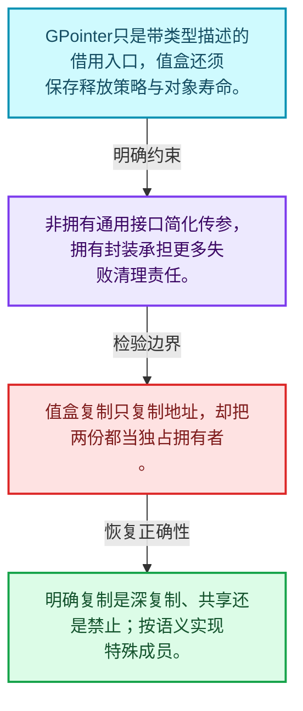
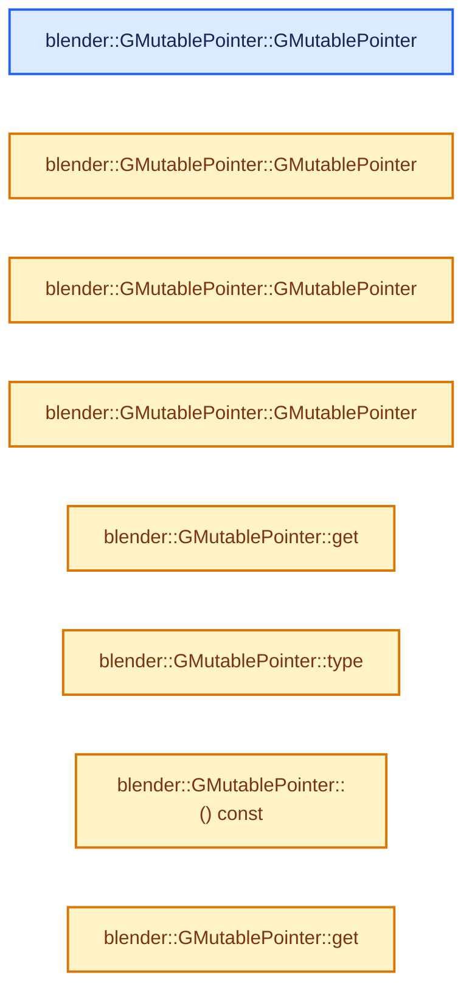
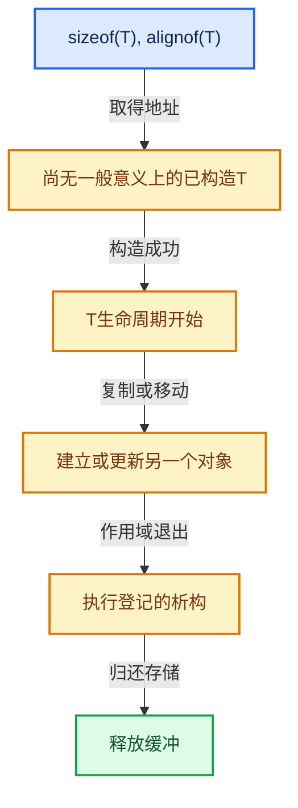

# 03-12 异构值存储实战

[方向导航](README.md) · [总目录](../README.md) · [实现索引](../%E7%AC%A6%E5%8F%B7%E4%BE%9D%E8%B5%96%E4%B8%8E%E5%AE%9E%E7%8E%B0%E7%B4%A2%E5%BC%95.md)

## 从问题到实现

如何在同一系统中保存不同类型的值？

通用指针不拥有对象；异构容器须把类型描述、存储、销毁策略和异常回滚一起管理。

**数据模型**

GPointer只是带类型描述的借用入口，值盒还须保存释放策略与对象寿命。

**设计取舍**

非拥有通用接口简化传参，拥有封装承担更多失败清理责任。

**最小反例**

值盒复制只复制地址，却把两份都当独占拥有者。

**推导**

明确复制是深复制、共享还是禁止；按语义实现特殊成员。

## 阅读地图与执行推演








图中的数值推演是本方向的教学模型；实际函数之间的调用边与概念分析边分别标注，不能把概念关系当作运行时调度顺序。

## 完整源码单元与就地讲解

中文讲解直接放在相关代码旁，复杂机制在代码下展开。原文折叠区保留基准行号；不需要在行号表和函数之间来回查找。类布局可分段展示，函数实现不按固定行数切开。

### 类型布局、声明与编译条件 · BLI_generic_pointer.hh L1—L23

<a id="t-bfab1a085cbc"></a>

`GMutablePointer`在这里声明的数据成员：

- `CPPType type_`
- `void data_`

<!-- annotated:c50599190503c7 -->

```cpp
/* SPDX-FileCopyrightText: 2023 Blender Authors
 *
 * SPDX-License-Identifier: GPL-2.0-or-later */

/** \file
 * \ingroup bli
 */

#pragma once

#include "BLI_cpp_type.hh"

namespace blender {

/**
 * A generic non-const pointer whose type is only known at runtime.
 */
class GMutablePointer {
 private:
  const CPPType *type_ = nullptr;
  void *data_ = nullptr;

 public:
```

<details>
<summary>核对原始源码：source/blender/blenlib/BLI_generic_pointer.hh · L1—L23</summary>

<!-- original:c50599190503c7:source/blender/blenlib/BLI_generic_pointer.hh:1:23 -->

```cpp
/* SPDX-FileCopyrightText: 2023 Blender Authors
 *
 * SPDX-License-Identifier: GPL-2.0-or-later */

/** \file
 * \ingroup bli
 */

#pragma once

#include "BLI_cpp_type.hh"

namespace blender {

/**
 * A generic non-const pointer whose type is only known at runtime.
 */
class GMutablePointer {
 private:
  const CPPType *type_ = nullptr;
  void *data_ = nullptr;

 public:
```

</details>

<a id="f-fbca26a6230ccee3"></a>

### `blender::GMutablePointer::GMutablePointer`

实现位置：[source/blender/blenlib/BLI_generic_pointer.hh](../../../../../source/blender/blenlib/BLI_generic_pointer.hh) · L24—L24。

**教学注释版**

<!-- annotated:8d459b59959f28 -->

```cpp
  GMutablePointer() = default;
```

<details>
<summary>核对原始源码：source/blender/blenlib/BLI_generic_pointer.hh · L24—L24</summary>

<!-- original:8d459b59959f28:source/blender/blenlib/BLI_generic_pointer.hh:24:24 -->

```cpp
  GMutablePointer() = default;
```

</details>

**继续追踪实现**

本实现没有需要继续展开的显式调用；检查返回表达式、对象转换和调用者前置条件。

<!-- annotated:ed9ccd330ba9c8 -->

```cpp

```

<details>
<summary>核对原始源码：source/blender/blenlib/BLI_generic_pointer.hh · L25—L25</summary>

<!-- original:ed9ccd330ba9c8:source/blender/blenlib/BLI_generic_pointer.hh:25:25 -->

```cpp

```

</details>

<a id="f-5642c9bb9fa7de6a"></a>

### `blender::GMutablePointer::GMutablePointer`

实现位置：[source/blender/blenlib/BLI_generic_pointer.hh](../../../../../source/blender/blenlib/BLI_generic_pointer.hh) · L26—L30。

接口参数：

- `const CPPType *type`
- `void *data = nullptr`

**教学注释版**

<!-- annotated:1d94606f97093a -->

```cpp
  GMutablePointer(const CPPType *type, void *data = nullptr) : type_(type), data_(data)
  {
    /* If there is data, there has to be a type. */
    BLI_assert(data_ == nullptr || type_ != nullptr);
  }
```

<details>
<summary>核对原始源码：source/blender/blenlib/BLI_generic_pointer.hh · L26—L30</summary>

<!-- original:1d94606f97093a:source/blender/blenlib/BLI_generic_pointer.hh:26:30 -->

```cpp
  GMutablePointer(const CPPType *type, void *data = nullptr) : type_(type), data_(data)
  {
    /* If there is data, there has to be a type. */
    BLI_assert(data_ == nullptr || type_ != nullptr);
  }
```

</details>

**继续追踪实现**

- `BLI_assert` → [BLI_assert · L48](../01-%E5%9F%BA%E7%A1%80%E5%AE%B9%E5%99%A8%E4%B8%8E%E7%8E%B0%E4%BB%A3CPP/%E4%BE%9D%E8%B5%96-BLI_assert-cc98e8.md#m-57a88495704d)；[BLI_assert · L63](../01-%E5%9F%BA%E7%A1%80%E5%AE%B9%E5%99%A8%E4%B8%8E%E7%8E%B0%E4%BB%A3CPP/%E4%BE%9D%E8%B5%96-BLI_assert-cc98e8.md#m-d07050020cb5)。宏定义由构建条件选择。

<!-- annotated:a35ff30473c41c -->

```cpp

```

<details>
<summary>核对原始源码：source/blender/blenlib/BLI_generic_pointer.hh · L31—L31</summary>

<!-- original:a35ff30473c41c:source/blender/blenlib/BLI_generic_pointer.hh:31:31 -->

```cpp

```

</details>

<a id="f-70209a293bb6ab0c"></a>

### `blender::GMutablePointer::GMutablePointer`

实现位置：[source/blender/blenlib/BLI_generic_pointer.hh](../../../../../source/blender/blenlib/BLI_generic_pointer.hh) · L32—L32。

接口参数：

- `const CPPType &type`
- `void *data = nullptr`

**教学注释版**

<!-- annotated:92d29ac204e4de -->

```cpp
  GMutablePointer(const CPPType &type, void *data = nullptr) : GMutablePointer(&type, data) {}
```

<details>
<summary>核对原始源码：source/blender/blenlib/BLI_generic_pointer.hh · L32—L32</summary>

<!-- original:92d29ac204e4de:source/blender/blenlib/BLI_generic_pointer.hh:32:32 -->

```cpp
  GMutablePointer(const CPPType &type, void *data = nullptr) : GMutablePointer(&type, data) {}
```

</details>

**继续追踪实现**

本实现没有需要继续展开的显式调用；检查返回表达式、对象转换和调用者前置条件。

<!-- annotated:6e6b81af95f8d7 -->

```cpp

```

<details>
<summary>核对原始源码：source/blender/blenlib/BLI_generic_pointer.hh · L33—L33</summary>

<!-- original:6e6b81af95f8d7:source/blender/blenlib/BLI_generic_pointer.hh:33:33 -->

```cpp

```

</details>

<a id="f-c6bc7f1e06d8061d"></a>

### `blender::GMutablePointer::GMutablePointer`

实现位置：[source/blender/blenlib/BLI_generic_pointer.hh](../../../../../source/blender/blenlib/BLI_generic_pointer.hh) · L34—L39。

接口参数：

- `T *data`

**教学注释版**

<!-- annotated:b78cabf7465d5c -->

```cpp
  template<typename T>
  GMutablePointer(T *data)
    requires(!std::is_void_v<T>)
      : GMutablePointer(&CPPType::get<T>(), data)
  {
  }
```

<details>
<summary>核对原始源码：source/blender/blenlib/BLI_generic_pointer.hh · L34—L39</summary>

<!-- original:b78cabf7465d5c:source/blender/blenlib/BLI_generic_pointer.hh:34:39 -->

```cpp
  template<typename T>
  GMutablePointer(T *data)
    requires(!std::is_void_v<T>)
      : GMutablePointer(&CPPType::get<T>(), data)
  {
  }
```

</details>

**继续追踪实现**

本实现没有需要继续展开的显式调用；检查返回表达式、对象转换和调用者前置条件。

<!-- annotated:0fa80add8e262f -->

```cpp

```

<details>
<summary>核对原始源码：source/blender/blenlib/BLI_generic_pointer.hh · L40—L40</summary>

<!-- original:0fa80add8e262f:source/blender/blenlib/BLI_generic_pointer.hh:40:40 -->

```cpp

```

</details>

<a id="f-212d33f800c0316e"></a>

### `blender::GMutablePointer::get`

实现位置：[source/blender/blenlib/BLI_generic_pointer.hh](../../../../../source/blender/blenlib/BLI_generic_pointer.hh) · L41—L44。

**教学注释版**

<!-- annotated:03276873ff1dbe -->

```cpp
  void *get() const
  {
    return data_;
  }
```

<details>
<summary>核对原始源码：source/blender/blenlib/BLI_generic_pointer.hh · L41—L44</summary>

<!-- original:03276873ff1dbe:source/blender/blenlib/BLI_generic_pointer.hh:41:44 -->

```cpp
  void *get() const
  {
    return data_;
  }
```

</details>

**结果出口**

- `return data_;`

**继续追踪实现**

本实现没有需要继续展开的显式调用；检查返回表达式、对象转换和调用者前置条件。

<!-- annotated:3023188d2a70ab -->

```cpp

```

<details>
<summary>核对原始源码：source/blender/blenlib/BLI_generic_pointer.hh · L45—L45</summary>

<!-- original:3023188d2a70ab:source/blender/blenlib/BLI_generic_pointer.hh:45:45 -->

```cpp

```

</details>

<a id="f-a083aa9dc4c7b8e1"></a>

### `blender::GMutablePointer::type`

实现位置：[source/blender/blenlib/BLI_generic_pointer.hh](../../../../../source/blender/blenlib/BLI_generic_pointer.hh) · L46—L49。

**教学注释版**

<!-- annotated:af4c276eb5f4fa -->

```cpp
  const CPPType *type() const
  {
    return type_;
  }
```

<details>
<summary>核对原始源码：source/blender/blenlib/BLI_generic_pointer.hh · L46—L49</summary>

<!-- original:af4c276eb5f4fa:source/blender/blenlib/BLI_generic_pointer.hh:46:49 -->

```cpp
  const CPPType *type() const
  {
    return type_;
  }
```

</details>

**结果出口**

- `return type_;`

**继续追踪实现**

本实现没有需要继续展开的显式调用；检查返回表达式、对象转换和调用者前置条件。

<!-- annotated:0d8190b63fc6b9 -->

```cpp

```

<details>
<summary>核对原始源码：source/blender/blenlib/BLI_generic_pointer.hh · L50—L50</summary>

<!-- original:0d8190b63fc6b9:source/blender/blenlib/BLI_generic_pointer.hh:50:50 -->

```cpp

```

</details>

<a id="f-f7d5906399876844"></a>

### `blender::GMutablePointer::() const`

实现位置：[source/blender/blenlib/BLI_generic_pointer.hh](../../../../../source/blender/blenlib/BLI_generic_pointer.hh) · L51—L54。

**教学注释版**

<!-- annotated:2680168f151e3b -->

```cpp
  operator bool() const
  {
    return data_ != nullptr;
  }
```

<details>
<summary>核对原始源码：source/blender/blenlib/BLI_generic_pointer.hh · L51—L54</summary>

<!-- original:2680168f151e3b:source/blender/blenlib/BLI_generic_pointer.hh:51:54 -->

```cpp
  operator bool() const
  {
    return data_ != nullptr;
  }
```

</details>

**结果出口**

- `return data_ != nullptr;`

**继续追踪实现**

本实现没有需要继续展开的显式调用；检查返回表达式、对象转换和调用者前置条件。

<!-- annotated:13cf1748fb6333 -->

```cpp

```

<details>
<summary>核对原始源码：source/blender/blenlib/BLI_generic_pointer.hh · L55—L55</summary>

<!-- original:13cf1748fb6333:source/blender/blenlib/BLI_generic_pointer.hh:55:55 -->

```cpp

```

</details>

<a id="f-f00e2816067f0feb"></a>

### `blender::GMutablePointer::get`

实现位置：[source/blender/blenlib/BLI_generic_pointer.hh](../../../../../source/blender/blenlib/BLI_generic_pointer.hh) · L56—L60。

**教学注释版**

<!-- annotated:53e49d32b972f1 -->

```cpp
  template<typename T> T *get() const
  {
    BLI_assert(this->is_type<T>());
    return static_cast<T *>(data_);
  }
```

<details>
<summary>核对原始源码：source/blender/blenlib/BLI_generic_pointer.hh · L56—L60</summary>

<!-- original:53e49d32b972f1:source/blender/blenlib/BLI_generic_pointer.hh:56:60 -->

```cpp
  template<typename T> T *get() const
  {
    BLI_assert(this->is_type<T>());
    return static_cast<T *>(data_);
  }
```

</details>

**结果出口**

- `return static_cast<T *>(data_);`

**继续追踪实现**

- `BLI_assert` → [BLI_assert · L48](../01-%E5%9F%BA%E7%A1%80%E5%AE%B9%E5%99%A8%E4%B8%8E%E7%8E%B0%E4%BB%A3CPP/%E4%BE%9D%E8%B5%96-BLI_assert-cc98e8.md#m-57a88495704d)；[BLI_assert · L63](../01-%E5%9F%BA%E7%A1%80%E5%AE%B9%E5%99%A8%E4%B8%8E%E7%8E%B0%E4%BB%A3CPP/%E4%BE%9D%E8%B5%96-BLI_assert-cc98e8.md#m-d07050020cb5)。宏定义由构建条件选择。
- `this->is_type<T>` → [blender::GMutablePointer::is_type · L62](12-%E5%BC%82%E6%9E%84%E5%80%BC%E5%AD%98%E5%82%A8%E5%AE%9E%E6%88%98.md#f-a052fef3142c6e2f)。

<!-- annotated:c38c8b50a850d6 -->

```cpp

```

<details>
<summary>核对原始源码：source/blender/blenlib/BLI_generic_pointer.hh · L61—L61</summary>

<!-- original:c38c8b50a850d6:source/blender/blenlib/BLI_generic_pointer.hh:61:61 -->

```cpp

```

</details>

<a id="f-a052fef3142c6e2f"></a>

### `blender::GMutablePointer::is_type`

实现位置：[source/blender/blenlib/BLI_generic_pointer.hh](../../../../../source/blender/blenlib/BLI_generic_pointer.hh) · L62—L65。

**教学注释版**

<!-- annotated:8bacf9e0ffa7c4 -->

```cpp
  template<typename T> bool is_type() const
  {
    return type_ != nullptr && type_->is<T>();
  }
```

<details>
<summary>核对原始源码：source/blender/blenlib/BLI_generic_pointer.hh · L62—L65</summary>

<!-- original:8bacf9e0ffa7c4:source/blender/blenlib/BLI_generic_pointer.hh:62:65 -->

```cpp
  template<typename T> bool is_type() const
  {
    return type_ != nullptr && type_->is<T>();
  }
```

</details>

**结果出口**

- `return type_ != nullptr && type_->is<T>();`

**继续追踪实现**

- `type_->is<T>` → [blender::CPPType::is · L758](09-CPPType%E5%A4%8D%E5%88%B6%E7%A7%BB%E5%8A%A8%E9%87%8D%E5%AE%9A%E4%BD%8D.md#f-2e2c3ee7602530a4)。

<!-- annotated:778ac760e93914 -->

```cpp

```

<details>
<summary>核对原始源码：source/blender/blenlib/BLI_generic_pointer.hh · L66—L66</summary>

<!-- original:778ac760e93914:source/blender/blenlib/BLI_generic_pointer.hh:66:66 -->

```cpp

```

</details>

<a id="f-17664e18018e87dd"></a>

### `blender::GMutablePointer::relocate_out`

实现位置：[source/blender/blenlib/BLI_generic_pointer.hh](../../../../../source/blender/blenlib/BLI_generic_pointer.hh) · L67—L75。

**教学注释版**

<!-- annotated:2fece186d16276 -->

```cpp
  template<typename T> T relocate_out()
  {
    BLI_assert(this->is_type<T>());
    T value;
    type_->relocate_assign(data_, &value);
    data_ = nullptr;
    type_ = nullptr;
    return value;
  }
```

<details>
<summary>核对原始源码：source/blender/blenlib/BLI_generic_pointer.hh · L67—L75</summary>

<!-- original:2fece186d16276:source/blender/blenlib/BLI_generic_pointer.hh:67:75 -->

```cpp
  template<typename T> T relocate_out()
  {
    BLI_assert(this->is_type<T>());
    T value;
    type_->relocate_assign(data_, &value);
    data_ = nullptr;
    type_ = nullptr;
    return value;
  }
```

</details>

**沿实际写入检查状态**

- `data_ = nullptr;`
- `type_ = nullptr;`

**结果出口**

- `return value;`

**继续追踪实现**

- `BLI_assert` → [BLI_assert · L48](../01-%E5%9F%BA%E7%A1%80%E5%AE%B9%E5%99%A8%E4%B8%8E%E7%8E%B0%E4%BB%A3CPP/%E4%BE%9D%E8%B5%96-BLI_assert-cc98e8.md#m-57a88495704d)；[BLI_assert · L63](../01-%E5%9F%BA%E7%A1%80%E5%AE%B9%E5%99%A8%E4%B8%8E%E7%8E%B0%E4%BB%A3CPP/%E4%BE%9D%E8%B5%96-BLI_assert-cc98e8.md#m-d07050020cb5)。宏定义由构建条件选择。
- `this->is_type<T>` → [blender::GMutablePointer::is_type · L62](12-%E5%BC%82%E6%9E%84%E5%80%BC%E5%AD%98%E5%82%A8%E5%AE%9E%E6%88%98.md#f-a052fef3142c6e2f)。
- `type_->relocate_assign` → [blender::CPPType::relocate_assign · L648](09-CPPType%E5%A4%8D%E5%88%B6%E7%A7%BB%E5%8A%A8%E9%87%8D%E5%AE%9A%E4%BD%8D.md#f-2e80f595092cf36e)。

<!-- annotated:b7ffc55fa11f9f -->

```cpp

```

<details>
<summary>核对原始源码：source/blender/blenlib/BLI_generic_pointer.hh · L76—L76</summary>

<!-- original:b7ffc55fa11f9f:source/blender/blenlib/BLI_generic_pointer.hh:76:76 -->

```cpp

```

</details>

<a id="f-efdf3a1db12cc0a5"></a>

### `blender::GMutablePointer::destruct`

实现位置：[source/blender/blenlib/BLI_generic_pointer.hh](../../../../../source/blender/blenlib/BLI_generic_pointer.hh) · L77—L81。

**教学注释版**

<!-- annotated:2439165f841153 -->

```cpp
  void destruct()
  {
    BLI_assert(data_ != nullptr);
    type_->destruct(data_);
  }
```

<details>
<summary>核对原始源码：source/blender/blenlib/BLI_generic_pointer.hh · L77—L81</summary>

<!-- original:2439165f841153:source/blender/blenlib/BLI_generic_pointer.hh:77:81 -->

```cpp
  void destruct()
  {
    BLI_assert(data_ != nullptr);
    type_->destruct(data_);
  }
```

</details>

**继续追踪实现**

- `BLI_assert` → [BLI_assert · L48](../01-%E5%9F%BA%E7%A1%80%E5%AE%B9%E5%99%A8%E4%B8%8E%E7%8E%B0%E4%BB%A3CPP/%E4%BE%9D%E8%B5%96-BLI_assert-cc98e8.md#m-57a88495704d)；[BLI_assert · L63](../01-%E5%9F%BA%E7%A1%80%E5%AE%B9%E5%99%A8%E4%B8%8E%E7%8E%B0%E4%BB%A3CPP/%E4%BE%9D%E8%B5%96-BLI_assert-cc98e8.md#m-d07050020cb5)。宏定义由构建条件选择。
- `type_->destruct` → [blender::CPPType::destruct · L557](09-CPPType%E5%A4%8D%E5%88%B6%E7%A7%BB%E5%8A%A8%E9%87%8D%E5%AE%9A%E4%BD%8D.md#f-85f4f006e822b3c7)。

### 类型布局、声明与编译条件 · BLI_generic_pointer.hh L82—L92

<a id="t-d8c3ffc57fa8"></a>

`GPointer`在这里声明的数据成员：

- `CPPType type_`
- `void data_`

<!-- annotated:5bd955b8e02e71 -->

```cpp
};

/**
 * A generic const pointer whose type is only known at runtime.
 */
class GPointer {
 private:
  const CPPType *type_ = nullptr;
  const void *data_ = nullptr;

 public:
```

<details>
<summary>核对原始源码：source/blender/blenlib/BLI_generic_pointer.hh · L82—L92</summary>

<!-- original:5bd955b8e02e71:source/blender/blenlib/BLI_generic_pointer.hh:82:92 -->

```cpp
};

/**
 * A generic const pointer whose type is only known at runtime.
 */
class GPointer {
 private:
  const CPPType *type_ = nullptr;
  const void *data_ = nullptr;

 public:
```

</details>

<a id="f-40f7a024c1e541df"></a>

### `blender::GPointer::GPointer`

实现位置：[source/blender/blenlib/BLI_generic_pointer.hh](../../../../../source/blender/blenlib/BLI_generic_pointer.hh) · L93—L93。

**教学注释版**

<!-- annotated:864dd5a4d97873 -->

```cpp
  GPointer() = default;
```

<details>
<summary>核对原始源码：source/blender/blenlib/BLI_generic_pointer.hh · L93—L93</summary>

<!-- original:864dd5a4d97873:source/blender/blenlib/BLI_generic_pointer.hh:93:93 -->

```cpp
  GPointer() = default;
```

</details>

**继续追踪实现**

本实现没有需要继续展开的显式调用；检查返回表达式、对象转换和调用者前置条件。

<!-- annotated:68c2b8eda02ba0 -->

```cpp

```

<details>
<summary>核对原始源码：source/blender/blenlib/BLI_generic_pointer.hh · L94—L94</summary>

<!-- original:68c2b8eda02ba0:source/blender/blenlib/BLI_generic_pointer.hh:94:94 -->

```cpp

```

</details>

<a id="f-e981128b9c36f9ef"></a>

### `blender::GPointer::GPointer`

实现位置：[source/blender/blenlib/BLI_generic_pointer.hh](../../../../../source/blender/blenlib/BLI_generic_pointer.hh) · L95—L95。

接口参数：

- `GMutablePointer ptr`

**教学注释版**

<!-- annotated:18b3ae0243af06 -->

```cpp
  GPointer(GMutablePointer ptr) : type_(ptr.type()), data_(ptr.get()) {}
```

<details>
<summary>核对原始源码：source/blender/blenlib/BLI_generic_pointer.hh · L95—L95</summary>

<!-- original:18b3ae0243af06:source/blender/blenlib/BLI_generic_pointer.hh:95:95 -->

```cpp
  GPointer(GMutablePointer ptr) : type_(ptr.type()), data_(ptr.get()) {}
```

</details>

**继续追踪实现**

本实现没有需要继续展开的显式调用；检查返回表达式、对象转换和调用者前置条件。

<!-- annotated:52eedb7e5bb59d -->

```cpp

```

<details>
<summary>核对原始源码：source/blender/blenlib/BLI_generic_pointer.hh · L96—L96</summary>

<!-- original:52eedb7e5bb59d:source/blender/blenlib/BLI_generic_pointer.hh:96:96 -->

```cpp

```

</details>

<a id="f-5d3066175455aed0"></a>

### `blender::GPointer::GPointer`

实现位置：[source/blender/blenlib/BLI_generic_pointer.hh](../../../../../source/blender/blenlib/BLI_generic_pointer.hh) · L97—L101。

接口参数：

- `const CPPType *type`
- `const void *data = nullptr`

**教学注释版**

<!-- annotated:6d233543cfe745 -->

```cpp
  GPointer(const CPPType *type, const void *data = nullptr) : type_(type), data_(data)
  {
    /* If there is data, there has to be a type. */
    BLI_assert(data_ == nullptr || type_ != nullptr);
  }
```

<details>
<summary>核对原始源码：source/blender/blenlib/BLI_generic_pointer.hh · L97—L101</summary>

<!-- original:6d233543cfe745:source/blender/blenlib/BLI_generic_pointer.hh:97:101 -->

```cpp
  GPointer(const CPPType *type, const void *data = nullptr) : type_(type), data_(data)
  {
    /* If there is data, there has to be a type. */
    BLI_assert(data_ == nullptr || type_ != nullptr);
  }
```

</details>

**继续追踪实现**

- `BLI_assert` → [BLI_assert · L48](../01-%E5%9F%BA%E7%A1%80%E5%AE%B9%E5%99%A8%E4%B8%8E%E7%8E%B0%E4%BB%A3CPP/%E4%BE%9D%E8%B5%96-BLI_assert-cc98e8.md#m-57a88495704d)；[BLI_assert · L63](../01-%E5%9F%BA%E7%A1%80%E5%AE%B9%E5%99%A8%E4%B8%8E%E7%8E%B0%E4%BB%A3CPP/%E4%BE%9D%E8%B5%96-BLI_assert-cc98e8.md#m-d07050020cb5)。宏定义由构建条件选择。

<!-- annotated:021568090b8771 -->

```cpp

```

<details>
<summary>核对原始源码：source/blender/blenlib/BLI_generic_pointer.hh · L102—L102</summary>

<!-- original:021568090b8771:source/blender/blenlib/BLI_generic_pointer.hh:102:102 -->

```cpp

```

</details>

<a id="f-9194d11793ea4a06"></a>

### `blender::GPointer::GPointer`

实现位置：[source/blender/blenlib/BLI_generic_pointer.hh](../../../../../source/blender/blenlib/BLI_generic_pointer.hh) · L103—L103。

接口参数：

- `const CPPType &type`
- `const void *data = nullptr`

**教学注释版**

<!-- annotated:fcd97ab40ca168 -->

```cpp
  GPointer(const CPPType &type, const void *data = nullptr) : type_(&type), data_(data) {}
```

<details>
<summary>核对原始源码：source/blender/blenlib/BLI_generic_pointer.hh · L103—L103</summary>

<!-- original:fcd97ab40ca168:source/blender/blenlib/BLI_generic_pointer.hh:103:103 -->

```cpp
  GPointer(const CPPType &type, const void *data = nullptr) : type_(&type), data_(data) {}
```

</details>

**继续追踪实现**

本实现没有需要继续展开的显式调用；检查返回表达式、对象转换和调用者前置条件。

<!-- annotated:c4131bab75a1c4 -->

```cpp

```

<details>
<summary>核对原始源码：source/blender/blenlib/BLI_generic_pointer.hh · L104—L104</summary>

<!-- original:c4131bab75a1c4:source/blender/blenlib/BLI_generic_pointer.hh:104:104 -->

```cpp

```

</details>

<a id="f-1a9887b65d37a9ca"></a>

### `blender::GPointer::GPointer`

实现位置：[source/blender/blenlib/BLI_generic_pointer.hh](../../../../../source/blender/blenlib/BLI_generic_pointer.hh) · L105—L110。

接口参数：

- `T *data`

**教学注释版**

<!-- annotated:610fd662f52cb5 -->

```cpp
  template<typename T>
  GPointer(T *data)
    requires(!std::is_void_v<T>)
      : GPointer(&CPPType::get<T>(), data)
  {
  }
```

<details>
<summary>核对原始源码：source/blender/blenlib/BLI_generic_pointer.hh · L105—L110</summary>

<!-- original:610fd662f52cb5:source/blender/blenlib/BLI_generic_pointer.hh:105:110 -->

```cpp
  template<typename T>
  GPointer(T *data)
    requires(!std::is_void_v<T>)
      : GPointer(&CPPType::get<T>(), data)
  {
  }
```

</details>

**继续追踪实现**

本实现没有需要继续展开的显式调用；检查返回表达式、对象转换和调用者前置条件。

<!-- annotated:59a832a4fe45c2 -->

```cpp

```

<details>
<summary>核对原始源码：source/blender/blenlib/BLI_generic_pointer.hh · L111—L111</summary>

<!-- original:59a832a4fe45c2:source/blender/blenlib/BLI_generic_pointer.hh:111:111 -->

```cpp

```

</details>

<a id="f-658818ab56931598"></a>

### `blender::GPointer::() const`

实现位置：[source/blender/blenlib/BLI_generic_pointer.hh](../../../../../source/blender/blenlib/BLI_generic_pointer.hh) · L112—L115。

**教学注释版**

<!-- annotated:8e876e492e43bd -->

```cpp
  operator bool() const
  {
    return data_ != nullptr;
  }
```

<details>
<summary>核对原始源码：source/blender/blenlib/BLI_generic_pointer.hh · L112—L115</summary>

<!-- original:8e876e492e43bd:source/blender/blenlib/BLI_generic_pointer.hh:112:115 -->

```cpp
  operator bool() const
  {
    return data_ != nullptr;
  }
```

</details>

**结果出口**

- `return data_ != nullptr;`

**继续追踪实现**

本实现没有需要继续展开的显式调用；检查返回表达式、对象转换和调用者前置条件。

<!-- annotated:1c23bd68d0a6e2 -->

```cpp

```

<details>
<summary>核对原始源码：source/blender/blenlib/BLI_generic_pointer.hh · L116—L116</summary>

<!-- original:1c23bd68d0a6e2:source/blender/blenlib/BLI_generic_pointer.hh:116:116 -->

```cpp

```

</details>

<a id="f-d98a4f1af4104afe"></a>

### `blender::GPointer::get`

实现位置：[source/blender/blenlib/BLI_generic_pointer.hh](../../../../../source/blender/blenlib/BLI_generic_pointer.hh) · L117—L120。

**教学注释版**

<!-- annotated:ef5bca1ffcea00 -->

```cpp
  const void *get() const
  {
    return data_;
  }
```

<details>
<summary>核对原始源码：source/blender/blenlib/BLI_generic_pointer.hh · L117—L120</summary>

<!-- original:ef5bca1ffcea00:source/blender/blenlib/BLI_generic_pointer.hh:117:120 -->

```cpp
  const void *get() const
  {
    return data_;
  }
```

</details>

**结果出口**

- `return data_;`

**继续追踪实现**

本实现没有需要继续展开的显式调用；检查返回表达式、对象转换和调用者前置条件。

<!-- annotated:95f12f72da5af5 -->

```cpp

```

<details>
<summary>核对原始源码：source/blender/blenlib/BLI_generic_pointer.hh · L121—L121</summary>

<!-- original:95f12f72da5af5:source/blender/blenlib/BLI_generic_pointer.hh:121:121 -->

```cpp

```

</details>

<a id="f-fab893bd990213d9"></a>

### `blender::GPointer::type`

实现位置：[source/blender/blenlib/BLI_generic_pointer.hh](../../../../../source/blender/blenlib/BLI_generic_pointer.hh) · L122—L125。

**教学注释版**

<!-- annotated:40ef896619ee58 -->

```cpp
  const CPPType *type() const
  {
    return type_;
  }
```

<details>
<summary>核对原始源码：source/blender/blenlib/BLI_generic_pointer.hh · L122—L125</summary>

<!-- original:40ef896619ee58:source/blender/blenlib/BLI_generic_pointer.hh:122:125 -->

```cpp
  const CPPType *type() const
  {
    return type_;
  }
```

</details>

**结果出口**

- `return type_;`

**继续追踪实现**

本实现没有需要继续展开的显式调用；检查返回表达式、对象转换和调用者前置条件。

<!-- annotated:7cc6cd69d30b13 -->

```cpp

```

<details>
<summary>核对原始源码：source/blender/blenlib/BLI_generic_pointer.hh · L126—L126</summary>

<!-- original:7cc6cd69d30b13:source/blender/blenlib/BLI_generic_pointer.hh:126:126 -->

```cpp

```

</details>

<a id="f-5cf9e563400cde6b"></a>

### `blender::GPointer::get`

实现位置：[source/blender/blenlib/BLI_generic_pointer.hh](../../../../../source/blender/blenlib/BLI_generic_pointer.hh) · L127—L131。

**教学注释版**

<!-- annotated:70daf2653f1fb7 -->

```cpp
  template<typename T> const T *get() const
  {
    BLI_assert(this->is_type<T>());
    return static_cast<const T *>(data_);
  }
```

<details>
<summary>核对原始源码：source/blender/blenlib/BLI_generic_pointer.hh · L127—L131</summary>

<!-- original:70daf2653f1fb7:source/blender/blenlib/BLI_generic_pointer.hh:127:131 -->

```cpp
  template<typename T> const T *get() const
  {
    BLI_assert(this->is_type<T>());
    return static_cast<const T *>(data_);
  }
```

</details>

**结果出口**

- `return static_cast<const T *>(data_);`

**继续追踪实现**

- `BLI_assert` → [BLI_assert · L48](../01-%E5%9F%BA%E7%A1%80%E5%AE%B9%E5%99%A8%E4%B8%8E%E7%8E%B0%E4%BB%A3CPP/%E4%BE%9D%E8%B5%96-BLI_assert-cc98e8.md#m-57a88495704d)；[BLI_assert · L63](../01-%E5%9F%BA%E7%A1%80%E5%AE%B9%E5%99%A8%E4%B8%8E%E7%8E%B0%E4%BB%A3CPP/%E4%BE%9D%E8%B5%96-BLI_assert-cc98e8.md#m-d07050020cb5)。宏定义由构建条件选择。
- `this->is_type<T>` → [blender::GPointer::is_type · L133](12-%E5%BC%82%E6%9E%84%E5%80%BC%E5%AD%98%E5%82%A8%E5%AE%9E%E6%88%98.md#f-4925d683e0c01d86)。

<!-- annotated:a4d6d550af6295 -->

```cpp

```

<details>
<summary>核对原始源码：source/blender/blenlib/BLI_generic_pointer.hh · L132—L132</summary>

<!-- original:a4d6d550af6295:source/blender/blenlib/BLI_generic_pointer.hh:132:132 -->

```cpp

```

</details>

<a id="f-4925d683e0c01d86"></a>

### `blender::GPointer::is_type`

实现位置：[source/blender/blenlib/BLI_generic_pointer.hh](../../../../../source/blender/blenlib/BLI_generic_pointer.hh) · L133—L136。

**教学注释版**

<!-- annotated:aaa43a742a26ca -->

```cpp
  template<typename T> bool is_type() const
  {
    return type_ != nullptr && type_->is<T>();
  }
```

<details>
<summary>核对原始源码：source/blender/blenlib/BLI_generic_pointer.hh · L133—L136</summary>

<!-- original:aaa43a742a26ca:source/blender/blenlib/BLI_generic_pointer.hh:133:136 -->

```cpp
  template<typename T> bool is_type() const
  {
    return type_ != nullptr && type_->is<T>();
  }
```

</details>

**结果出口**

- `return type_ != nullptr && type_->is<T>();`

**继续追踪实现**

- `type_->is<T>` → [blender::CPPType::is · L758](09-CPPType%E5%A4%8D%E5%88%B6%E7%A7%BB%E5%8A%A8%E9%87%8D%E5%AE%9A%E4%BD%8D.md#f-2e2c3ee7602530a4)。

### 类型布局、声明与编译条件 · BLI_generic_pointer.hh L137—L139

<!-- annotated:63f4e6c5f374bb -->

```cpp
};

}  // namespace blender
```

<details>
<summary>核对原始源码：source/blender/blenlib/BLI_generic_pointer.hh · L137—L139</summary>

<!-- original:63f4e6c5f374bb:source/blender/blenlib/BLI_generic_pointer.hh:137:139 -->

```cpp
};

}  // namespace blender
```

</details>

## 语法与相关类型

### 模板 template

模板把类型或常量作为生成实现的参数。读声明时先列出类型参数、非类型参数和默认值，再看使用者实际实例化了什么。模板声明本身不意味着每种T都支持其全部成员。

把T替换为int、string、只能移动的类型，分别检查每个被调用操作是否成立。

### 依赖名称 typename

typename既可引入类型模板参数，也可告诉编译器某个依赖名称是类型。它不创建运行时对象；解析期确认语法类别与实例化期检查具体类型是不同阶段。

区分typename T::value_type和T::size()，前者标记类型，后者是表达式。

### 约束 requires

requires表达式或requires子句限制模板参与重载的条件。它提供编译期可用性检查，不是运行时if，不能指望输入到达程序后再被这一机制验证。

构造满足和不满足约束的两个类型，观察候选被排除而不是在函数内返回错误。

### 只读限定 const

const约束当前访问路径可做的修改。const指针、指向const的指针、const视图对象、const元素是不同位置的限定；其他别名可能仍可修改原对象。

分别写T* const、const T*与const T* const，并画出不可修改的层次。

### 显式静态转换 static_cast

static_cast表达编译期允许的转换，不会自动验证运行时真实类型、指针寿命或索引边界。由void指针恢复T指针时，调用者仍须保证实际存储中确有合法T对象。

标出转换前后的类型以及正确性依据来自哪里。

### 内部断言 assert

断言表达开发者预期成立的内部契约，发布构建可能关闭。它不能替代对不可信输入的完整错误处理，也不保证后续操作被运行时保护。

对每条断言构造违反条件的输入，区分调用者错误与应向用户报告的错误。

## 实现练习与验证

设计支持int、float、string的值盒，输出所有权图和失败回滚表。

参考推理：明确复制是深复制、共享还是禁止；按语义实现特殊成员。

所有存活对象地址满足对齐；构造失败不会被当作成功对象登记；所有资源均有唯一或明确共享的清理责任。

## 历史、跨库比较与证据

与std::pmr::monotonic_buffer_resource比较批量存储回收，与std::any比较拥有型类型擦除；CPPType描述类型操作，本身不保存每个值。

[历史提交索引](../%E5%8E%86%E5%8F%B2%E6%8F%90%E4%BA%A4%E4%B8%8E%E8%AE%BE%E8%AE%A1%E6%BC%94%E5%8C%96%E7%B4%A2%E5%BC%95.md) · [源码基准](../%E6%BA%90%E7%A0%81%E7%89%88%E6%9C%AC%E4%B8%8E%E8%A6%86%E7%9B%96%E7%B4%A2%E5%BC%95.md) · [验收报告](../%E9%AA%8C%E6%94%B6%E6%8A%A5%E5%91%8A.md)
