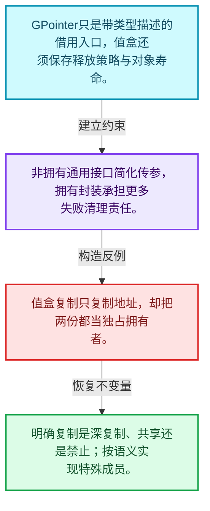
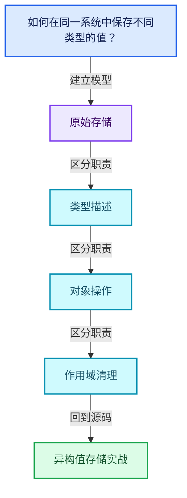
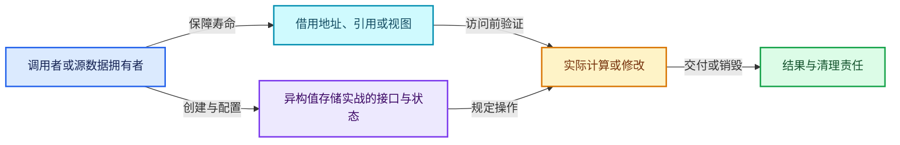
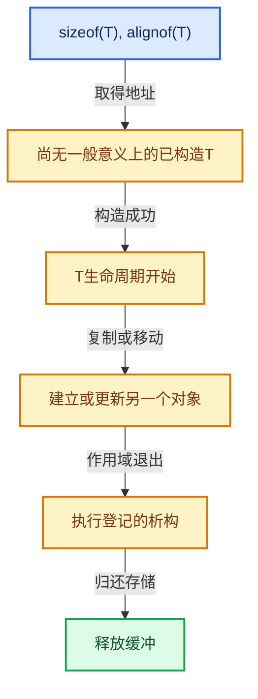

# 03-12 异构值存储实战

[方向导航](README.md) · [总目录](../README.md) · [覆盖索引](../%E6%BA%90%E7%A0%81%E7%89%88%E6%9C%AC%E4%B8%8E%E8%A6%86%E7%9B%96%E7%B4%A2%E5%BC%95.md)

> 阅读顺序：问题与数据模型 → 语法与类型 → 源码逐行 → 调用线索 → 历史与取舍 → 推演和练习。

- 基准 HEAD：`cbda6b96c26c0dee3c3b5cbb93960c4ac06a6b30`。
- 记录日期：2026-10-14。
- 教学示例状态：正文中的推演不是本机性能实测；已运行练习见验收报告。

## 一、从问题到设计

如何在同一系统中保存不同类型的值？

通用指针不拥有对象；异构容器须把类型描述、存储、销毁策略和异常回滚一起管理。

本篇把语法、数据语义和系统取舍连接起来。把存储分配、对象构造、类型操作和最终清理拆开建模。

### 本篇独立模型与设计推理

GPointer只是带类型描述的借用入口，值盒还须保存释放策略与对象寿命。

设计取舍：非拥有通用接口简化传参，拥有封装承担更多失败清理责任。

最小反例：值盒复制只复制地址，却把两份都当独占拥有者。

推导与处理：明确复制是深复制、共享还是禁止；按语义实现特殊成员。



### 源码范围与相邻篇章

| 文件 | 本篇逐行范围 | 基准SHA-256 |
|---|---|---|
| [source/blender/blenlib/BLI_generic_pointer.hh](../../../../../source/blender/blenlib/BLI_generic_pointer.hh) | L1—L139 | `3daccab8225194895d97507269a5ec6068033640909bfb9cdb0502670c16d0a5` |

同一主讲文件可能分多篇覆盖；超出本篇范围的符号通过覆盖索引定位。空行与纯注释保留在源码摘录中，逐行表解释有效语句与语法边界；许可证头统一保留。

前篇：[GSpan与GArray](11-GSpan%E4%B8%8EGArray.md).

## 二、类型、数据与阅读地图



这是概念依赖图，边表示阅读关系，不声称是运行时调用顺序。

### 直接编译依赖


箭头只表示头文件包含关系；完整调用线索见后面的符号定位表。

## 三、关键词、语法与类型角色

### 模板 template

模板把类型或常量作为生成实现的参数。读声明时先列出类型参数、非类型参数和默认值，再看使用者实际实例化了什么。模板声明本身不意味着每种T都支持其全部成员。

具体检查：把T替换为int、string、只能移动的类型，分别检查每个被调用操作是否成立。

### 依赖名称 typename

typename既可引入类型模板参数，也可告诉编译器某个依赖名称是类型。它不创建运行时对象；解析期确认语法类别与实例化期检查具体类型是不同阶段。

具体检查：区分typename T::value_type和T::size()，前者标记类型，后者是表达式。

### 约束 requires

requires表达式或requires子句限制模板参与重载的条件。它提供编译期可用性检查，不是运行时if，不能指望输入到达程序后再被这一机制验证。

具体检查：构造满足和不满足约束的两个类型，观察候选被排除而不是在函数内返回错误。

### 只读限定 const

const约束当前访问路径可做的修改。const指针、指向const的指针、const视图对象、const元素是不同位置的限定；其他别名可能仍可修改原对象。

具体检查：分别写T* const、const T*与const T* const，并画出不可修改的层次。

### 显式静态转换 static_cast

static_cast表达编译期允许的转换，不会自动验证运行时真实类型、指针寿命或索引边界。由void指针恢复T指针时，调用者仍须保证实际存储中确有合法T对象。

具体检查：标出转换前后的类型以及正确性依据来自哪里。

### 内部断言 assert

断言表达开发者预期成立的内部契约，发布构建可能关闭。它不能替代对不可信输入的完整错误处理，也不保证后续操作被运行时保护。

具体检查：对每条断言构造违反条件的输入，区分调用者错误与应向用户报告的错误。

## 四、真实源码与逐行讲解

源码块保持原行内容，原始行号由小节标题及逐行表给出。表中的调用定位是静态阅读辅助；重载、模板实例化、宏展开和虚调用需结合完整声明，不能仅凭词法出现证明动态调用。

### BLI_generic_pointer.hh：L1—L49

<!-- source:source/blender/blenlib/BLI_generic_pointer.hh:1:49 -->

```cpp
/* SPDX-FileCopyrightText: 2023 Blender Authors
 *
 * SPDX-License-Identifier: GPL-2.0-or-later */

/** \file
 * \ingroup bli
 */

#pragma once

#include "BLI_cpp_type.hh"

namespace blender {

/**
 * A generic non-const pointer whose type is only known at runtime.
 */
class GMutablePointer {
 private:
  const CPPType *type_ = nullptr;
  void *data_ = nullptr;

 public:
  GMutablePointer() = default;

  GMutablePointer(const CPPType *type, void *data = nullptr) : type_(type), data_(data)
  {
    /* If there is data, there has to be a type. */
    BLI_assert(data_ == nullptr || type_ != nullptr);
  }

  GMutablePointer(const CPPType &type, void *data = nullptr) : GMutablePointer(&type, data) {}

  template<typename T>
  GMutablePointer(T *data)
    requires(!std::is_void_v<T>)
      : GMutablePointer(&CPPType::get<T>(), data)
  {
  }

  void *get() const
  {
    return data_;
  }

  const CPPType *type() const
  {
    return type_;
  }
```

本段语义重点：

- `data_`：数据或实现的存储入口；是否拥有应按该类声明和析构判定。

| 原始行 | 语义、约束与检查 |
|---|---|
| L9 | 防止同一头文件在一个翻译单元中重复展开；不控制多个源文件之间的链接或对象寿命。 |
| L11 | 引入编译依赖 "BLI_cpp_type.hh"；这是声明可见性关系，不表示运行时一定调用该文件的所有接口。 |
| L13 | 把后续声明放入 blender 命名空间，影响名称查找和符号归属，不创建运行时对象。 |
| L18 | 声明或定义类型 `class GMutablePointer`。结合继承、访问权限和成员布局确认接口与拥有关系；前向声明本身没有完整对象布局。 |
| L19 | 切换成员访问权限为 private；它是编译期接口边界，不是线程同步或内存保护。 |
| L20 | 把右侧 `nullptr` 用于初始化或更新左侧 `const CPPType *type_`。声明初始化与已有对象赋值应按上下文区分；有资源的类型会调用相应特殊成员。 |
| L21 | 建立或更新 `data_`：数据或实现的存储入口；是否拥有应按该类声明和析构判定。本行的具体值关系为 `void *data_ = nullptr`；对照更新前后相应范围或状态是否一致。 |
| L23 | 切换成员访问权限为 public；它是编译期接口边界，不是线程同步或内存保护。 |
| L24 | 显式采用编译器生成的特殊成员行为：`GMutablePointer() = default;`。成员和基类的性质决定该操作是否可用、是否被删除及异常约定，不表示运行时给对象赋值为default。 |
| L26 | 建立或更新 `data_`：数据或实现的存储入口；是否拥有应按该类声明和析构判定。本行的具体值关系为 `GMutablePointer(const CPPType *type, void *data = nullptr) : type_(type), data_(data)`；对照更新前后相应范围或状态是否一致。 |
| L27 | 连接上一行的声明或控制结构与其语句块；后续行在这个作用域中执行或声明。 |
| L29 | 断言约束 `BLI_assert(data_ == nullptr &#124;&#124; type_ != nullptr);`。条件是后续访问的内部前置条件；发布构建可能不执行，不能把断言当作输入修复。 |
| L30 | 结束当前语法单元。局部自动对象在离开其作用域时按规则销毁；这不等于所有被引用的外部数据也被释放。 |
| L32 | 把右侧 `nullptr) : GMutablePointer(&type, data) {}` 用于初始化或更新左侧 `GMutablePointer(const CPPType &type, void *data`。声明初始化与已有对象赋值应按上下文区分；有资源的类型会调用相应特殊成员。 |
| L34 | 声明模板参数 `template<typename T>`。类型参数决定生成操作的类型，非类型参数可决定内嵌容量或编译期分支。 |
| L35 | 出现调用或函数声明 `GMutablePointer`，对应表达式为 `GMutablePointer(T *data)`。参数求值、返回类型与重载需结合前后完整语句；静态文本引用不能证明动态目标。 |
| L36 | 约束模板可用性：`requires(!std::is_void_v<T>)`。条件在编译期检查，不替代运行期的地址、长度和类型一致性验证。 |
| L37 | 出现调用或函数声明 `GMutablePointer`，对应表达式为 `: GMutablePointer(&CPPType::get<T>(), data)`。参数求值、返回类型与重载需结合前后完整语句；静态文本引用不能证明动态目标。 |
| L38 | 连接上一行的声明或控制结构与其语句块；后续行在这个作用域中执行或声明。 |
| L39 | 结束当前语法单元。局部自动对象在离开其作用域时按规则销毁；这不等于所有被引用的外部数据也被释放。 |
| L41 | 出现调用或函数声明 `get`，对应表达式为 `void *get() const`。参数求值、返回类型与重载需结合前后完整语句；静态文本引用不能证明动态目标。 |
| L42 | 连接上一行的声明或控制结构与其语句块；后续行在这个作用域中执行或声明。 |
| L43 | 返回表达式 `data_`。 |
| L44 | 结束当前语法单元。局部自动对象在离开其作用域时按规则销毁；这不等于所有被引用的外部数据也被释放。 |
| L46 | 出现调用或函数声明 `type`，对应表达式为 `const CPPType *type() const`。参数求值、返回类型与重载需结合前后完整语句；静态文本引用不能证明动态目标。 |
| L47 | 连接上一行的声明或控制结构与其语句块；后续行在这个作用域中执行或声明。 |
| L48 | 返回表达式 `type_`。 |
| L49 | 结束当前语法单元。局部自动对象在离开其作用域时按规则销毁；这不等于所有被引用的外部数据也被释放。 |

### BLI_generic_pointer.hh：L50—L95

<!-- source:source/blender/blenlib/BLI_generic_pointer.hh:50:95 -->

```cpp

  operator bool() const
  {
    return data_ != nullptr;
  }

  template<typename T> T *get() const
  {
    BLI_assert(this->is_type<T>());
    return static_cast<T *>(data_);
  }

  template<typename T> bool is_type() const
  {
    return type_ != nullptr && type_->is<T>();
  }

  template<typename T> T relocate_out()
  {
    BLI_assert(this->is_type<T>());
    T value;
    type_->relocate_assign(data_, &value);
    data_ = nullptr;
    type_ = nullptr;
    return value;
  }

  void destruct()
  {
    BLI_assert(data_ != nullptr);
    type_->destruct(data_);
  }
};

/**
 * A generic const pointer whose type is only known at runtime.
 */
class GPointer {
 private:
  const CPPType *type_ = nullptr;
  const void *data_ = nullptr;

 public:
  GPointer() = default;

  GPointer(GMutablePointer ptr) : type_(ptr.type()), data_(ptr.get()) {}
```

本段语义重点：

- `data_`：数据或实现的存储入口；是否拥有应按该类声明和析构判定。

| 原始行 | 语义、约束与检查 |
|---|---|
| L51 | 运算符重载声明、定义或显式调用：`operator bool() const`。结合参数和返回类型判断是赋值、索引、比较还是转换；operator=声明中的等号不是在给名为operator的变量赋值。 |
| L52 | 连接上一行的声明或控制结构与其语句块；后续行在这个作用域中执行或声明。 |
| L53 | 返回表达式 `data_ != nullptr`。 |
| L54 | 结束当前语法单元。局部自动对象在离开其作用域时按规则销毁；这不等于所有被引用的外部数据也被释放。 |
| L56 | 声明模板参数 `template<typename T> T *get() const`。类型参数决定生成操作的类型，非类型参数可决定内嵌容量或编译期分支。 |
| L57 | 连接上一行的声明或控制结构与其语句块；后续行在这个作用域中执行或声明。 |
| L58 | 断言约束 `BLI_assert(this->is_type<T>());`。条件是后续访问的内部前置条件；发布构建可能不执行，不能把断言当作输入修复。 |
| L59 | 返回表达式 `static_cast<T *>(data_)`。 |
| L60 | 结束当前语法单元。局部自动对象在离开其作用域时按规则销毁；这不等于所有被引用的外部数据也被释放。 |
| L62 | 声明模板参数 `template<typename T> bool is_type() const`。类型参数决定生成操作的类型，非类型参数可决定内嵌容量或编译期分支。 |
| L63 | 连接上一行的声明或控制结构与其语句块；后续行在这个作用域中执行或声明。 |
| L64 | 返回表达式 `type_ != nullptr && type_->is<T>()`。 |
| L65 | 结束当前语法单元。局部自动对象在离开其作用域时按规则销毁；这不等于所有被引用的外部数据也被释放。 |
| L67 | 声明模板参数 `template<typename T> T relocate_out()`。类型参数决定生成操作的类型，非类型参数可决定内嵌容量或编译期分支。 |
| L68 | 连接上一行的声明或控制结构与其语句块；后续行在这个作用域中执行或声明。 |
| L69 | 断言约束 `BLI_assert(this->is_type<T>());`。条件是后续访问的内部前置条件；发布构建可能不执行，不能把断言当作输入修复。 |
| L70 | 声明成员、局部对象或完成语句 `T value`。若为指针或引用，它本身不说明拥有；若为值对象，其构造析构由所在作用域或外层对象管理。 |
| L71 | 本行涉及 `data_`：数据或实现的存储入口；是否拥有应按该类声明和析构判定。按此语义解读 `type_->relocate_assign(data_, &value)`，不要把地址、数量或状态混用。 |
| L72 | 建立或更新 `data_`：数据或实现的存储入口；是否拥有应按该类声明和析构判定。本行的具体值关系为 `data_ = nullptr`；对照更新前后相应范围或状态是否一致。 |
| L73 | 把右侧 `nullptr` 用于初始化或更新左侧 `type_`。声明初始化与已有对象赋值应按上下文区分；有资源的类型会调用相应特殊成员。 |
| L74 | 返回表达式 `value`。 |
| L75 | 结束当前语法单元。局部自动对象在离开其作用域时按规则销毁；这不等于所有被引用的外部数据也被释放。 |
| L77 | 出现调用或函数声明 `destruct`，对应表达式为 `void destruct()`。参数求值、返回类型与重载需结合前后完整语句；静态文本引用不能证明动态目标。 |
| L78 | 连接上一行的声明或控制结构与其语句块；后续行在这个作用域中执行或声明。 |
| L79 | 断言约束 `BLI_assert(data_ != nullptr);`。条件是后续访问的内部前置条件；发布构建可能不执行，不能把断言当作输入修复。 |
| L80 | 本行涉及 `data_`：数据或实现的存储入口；是否拥有应按该类声明和析构判定。按此语义解读 `type_->destruct(data_)`，不要把地址、数量或状态混用。 |
| L81 | 结束当前语法单元。局部自动对象在离开其作用域时按规则销毁；这不等于所有被引用的外部数据也被释放。 |
| L82 | 结束当前语法单元。局部自动对象在离开其作用域时按规则销毁；这不等于所有被引用的外部数据也被释放。 |
| L87 | 声明或定义类型 `class GPointer`。结合继承、访问权限和成员布局确认接口与拥有关系；前向声明本身没有完整对象布局。 |
| L88 | 切换成员访问权限为 private；它是编译期接口边界，不是线程同步或内存保护。 |
| L89 | 把右侧 `nullptr` 用于初始化或更新左侧 `const CPPType *type_`。声明初始化与已有对象赋值应按上下文区分；有资源的类型会调用相应特殊成员。 |
| L90 | 建立或更新 `data_`：数据或实现的存储入口；是否拥有应按该类声明和析构判定。本行的具体值关系为 `const void *data_ = nullptr`；对照更新前后相应范围或状态是否一致。 |
| L92 | 切换成员访问权限为 public；它是编译期接口边界，不是线程同步或内存保护。 |
| L93 | 显式采用编译器生成的特殊成员行为：`GPointer() = default;`。成员和基类的性质决定该操作是否可用、是否被删除及异常约定，不表示运行时给对象赋值为default。 |
| L95 | 本行涉及 `data_`：数据或实现的存储入口；是否拥有应按该类声明和析构判定。按此语义解读 `GPointer(GMutablePointer ptr) : type_(ptr.type()), data_(ptr.get()) {}`，不要把地址、数量或状态混用。 |

### BLI_generic_pointer.hh：L96—L139

<!-- source:source/blender/blenlib/BLI_generic_pointer.hh:96:139 -->

```cpp

  GPointer(const CPPType *type, const void *data = nullptr) : type_(type), data_(data)
  {
    /* If there is data, there has to be a type. */
    BLI_assert(data_ == nullptr || type_ != nullptr);
  }

  GPointer(const CPPType &type, const void *data = nullptr) : type_(&type), data_(data) {}

  template<typename T>
  GPointer(T *data)
    requires(!std::is_void_v<T>)
      : GPointer(&CPPType::get<T>(), data)
  {
  }

  operator bool() const
  {
    return data_ != nullptr;
  }

  const void *get() const
  {
    return data_;
  }

  const CPPType *type() const
  {
    return type_;
  }

  template<typename T> const T *get() const
  {
    BLI_assert(this->is_type<T>());
    return static_cast<const T *>(data_);
  }

  template<typename T> bool is_type() const
  {
    return type_ != nullptr && type_->is<T>();
  }
};

}  // namespace blender
```

本段语义重点：

- `data_`：数据或实现的存储入口；是否拥有应按该类声明和析构判定。

| 原始行 | 语义、约束与检查 |
|---|---|
| L97 | 建立或更新 `data_`：数据或实现的存储入口；是否拥有应按该类声明和析构判定。本行的具体值关系为 `GPointer(const CPPType *type, const void *data = nullptr) : type_(type), data_(data)`；对照更新前后相应范围或状态是否一致。 |
| L98 | 连接上一行的声明或控制结构与其语句块；后续行在这个作用域中执行或声明。 |
| L100 | 断言约束 `BLI_assert(data_ == nullptr &#124;&#124; type_ != nullptr);`。条件是后续访问的内部前置条件；发布构建可能不执行，不能把断言当作输入修复。 |
| L101 | 结束当前语法单元。局部自动对象在离开其作用域时按规则销毁；这不等于所有被引用的外部数据也被释放。 |
| L103 | 建立或更新 `data_`：数据或实现的存储入口；是否拥有应按该类声明和析构判定。本行的具体值关系为 `GPointer(const CPPType &type, const void *data = nullptr) : type_(&type), data_(data) {}`；对照更新前后相应范围或状态是否一致。 |
| L105 | 声明模板参数 `template<typename T>`。类型参数决定生成操作的类型，非类型参数可决定内嵌容量或编译期分支。 |
| L106 | 出现调用或函数声明 `GPointer`，对应表达式为 `GPointer(T *data)`。参数求值、返回类型与重载需结合前后完整语句；静态文本引用不能证明动态目标。 |
| L107 | 约束模板可用性：`requires(!std::is_void_v<T>)`。条件在编译期检查，不替代运行期的地址、长度和类型一致性验证。 |
| L108 | 出现调用或函数声明 `GPointer`，对应表达式为 `: GPointer(&CPPType::get<T>(), data)`。参数求值、返回类型与重载需结合前后完整语句；静态文本引用不能证明动态目标。 |
| L109 | 连接上一行的声明或控制结构与其语句块；后续行在这个作用域中执行或声明。 |
| L110 | 结束当前语法单元。局部自动对象在离开其作用域时按规则销毁；这不等于所有被引用的外部数据也被释放。 |
| L112 | 运算符重载声明、定义或显式调用：`operator bool() const`。结合参数和返回类型判断是赋值、索引、比较还是转换；operator=声明中的等号不是在给名为operator的变量赋值。 |
| L113 | 连接上一行的声明或控制结构与其语句块；后续行在这个作用域中执行或声明。 |
| L114 | 返回表达式 `data_ != nullptr`。 |
| L115 | 结束当前语法单元。局部自动对象在离开其作用域时按规则销毁；这不等于所有被引用的外部数据也被释放。 |
| L117 | 出现调用或函数声明 `get`，对应表达式为 `const void *get() const`。参数求值、返回类型与重载需结合前后完整语句；静态文本引用不能证明动态目标。 |
| L118 | 连接上一行的声明或控制结构与其语句块；后续行在这个作用域中执行或声明。 |
| L119 | 返回表达式 `data_`。 |
| L120 | 结束当前语法单元。局部自动对象在离开其作用域时按规则销毁；这不等于所有被引用的外部数据也被释放。 |
| L122 | 出现调用或函数声明 `type`，对应表达式为 `const CPPType *type() const`。参数求值、返回类型与重载需结合前后完整语句；静态文本引用不能证明动态目标。 |
| L123 | 连接上一行的声明或控制结构与其语句块；后续行在这个作用域中执行或声明。 |
| L124 | 返回表达式 `type_`。 |
| L125 | 结束当前语法单元。局部自动对象在离开其作用域时按规则销毁；这不等于所有被引用的外部数据也被释放。 |
| L127 | 声明模板参数 `template<typename T> const T *get() const`。类型参数决定生成操作的类型，非类型参数可决定内嵌容量或编译期分支。 |
| L128 | 连接上一行的声明或控制结构与其语句块；后续行在这个作用域中执行或声明。 |
| L129 | 断言约束 `BLI_assert(this->is_type<T>());`。条件是后续访问的内部前置条件；发布构建可能不执行，不能把断言当作输入修复。 |
| L130 | 返回表达式 `static_cast<const T *>(data_)`。 |
| L131 | 结束当前语法单元。局部自动对象在离开其作用域时按规则销毁；这不等于所有被引用的外部数据也被释放。 |
| L133 | 声明模板参数 `template<typename T> bool is_type() const`。类型参数决定生成操作的类型，非类型参数可决定内嵌容量或编译期分支。 |
| L134 | 连接上一行的声明或控制结构与其语句块；后续行在这个作用域中执行或声明。 |
| L135 | 返回表达式 `type_ != nullptr && type_->is<T>()`。 |
| L136 | 结束当前语法单元。局部自动对象在离开其作用域时按规则销毁；这不等于所有被引用的外部数据也被释放。 |
| L137 | 结束当前语法单元。局部自动对象在离开其作用域时按规则销毁；这不等于所有被引用的外部数据也被释放。 |
| L139 | 结束当前语法单元。局部自动对象在离开其作用域时按规则销毁；这不等于所有被引用的外部数据也被释放。 |

## 五、接口定位、调用线索与生命周期

### 本篇声明与实现入口

| 源码位置 | 实际声明片段 |
|---|---|
| [BLI_generic_pointer.hh:L18](../../../../../source/blender/blenlib/BLI_generic_pointer.hh#L18) | `class GMutablePointer` |
| [BLI_generic_pointer.hh:L24](../../../../../source/blender/blenlib/BLI_generic_pointer.hh#L24) | `GMutablePointer() = default;` |
| [BLI_generic_pointer.hh:L26](../../../../../source/blender/blenlib/BLI_generic_pointer.hh#L26) | `GMutablePointer(const CPPType *type, void *data = nullptr) : type_(type), data_(data)` |
| [BLI_generic_pointer.hh:L32](../../../../../source/blender/blenlib/BLI_generic_pointer.hh#L32) | `GMutablePointer(const CPPType &type, void *data = nullptr) : GMutablePointer(&type, data) {}` |
| [BLI_generic_pointer.hh:L35](../../../../../source/blender/blenlib/BLI_generic_pointer.hh#L35) | `GMutablePointer(T *data)` |
| [BLI_generic_pointer.hh:L37](../../../../../source/blender/blenlib/BLI_generic_pointer.hh#L37) | `: GMutablePointer(&CPPType::get<T>(), data)` |
| [BLI_generic_pointer.hh:L41](../../../../../source/blender/blenlib/BLI_generic_pointer.hh#L41) | `void *get() const` |
| [BLI_generic_pointer.hh:L46](../../../../../source/blender/blenlib/BLI_generic_pointer.hh#L46) | `const CPPType *type() const` |
| [BLI_generic_pointer.hh:L51](../../../../../source/blender/blenlib/BLI_generic_pointer.hh#L51) | `operator bool() const` |
| [BLI_generic_pointer.hh:L56](../../../../../source/blender/blenlib/BLI_generic_pointer.hh#L56) | `template<typename T> T *get() const` |
| [BLI_generic_pointer.hh:L62](../../../../../source/blender/blenlib/BLI_generic_pointer.hh#L62) | `template<typename T> bool is_type() const` |
| [BLI_generic_pointer.hh:L67](../../../../../source/blender/blenlib/BLI_generic_pointer.hh#L67) | `template<typename T> T relocate_out()` |
| [BLI_generic_pointer.hh:L77](../../../../../source/blender/blenlib/BLI_generic_pointer.hh#L77) | `void destruct()` |
| [BLI_generic_pointer.hh:L87](../../../../../source/blender/blenlib/BLI_generic_pointer.hh#L87) | `class GPointer` |
| [BLI_generic_pointer.hh:L93](../../../../../source/blender/blenlib/BLI_generic_pointer.hh#L93) | `GPointer() = default;` |
| [BLI_generic_pointer.hh:L95](../../../../../source/blender/blenlib/BLI_generic_pointer.hh#L95) | `GPointer(GMutablePointer ptr) : type_(ptr.type()), data_(ptr.get()) {}` |
| [BLI_generic_pointer.hh:L97](../../../../../source/blender/blenlib/BLI_generic_pointer.hh#L97) | `GPointer(const CPPType *type, const void *data = nullptr) : type_(type), data_(data)` |
| [BLI_generic_pointer.hh:L103](../../../../../source/blender/blenlib/BLI_generic_pointer.hh#L103) | `GPointer(const CPPType &type, const void *data = nullptr) : type_(&type), data_(data) {}` |
| [BLI_generic_pointer.hh:L106](../../../../../source/blender/blenlib/BLI_generic_pointer.hh#L106) | `GPointer(T *data)` |
| [BLI_generic_pointer.hh:L108](../../../../../source/blender/blenlib/BLI_generic_pointer.hh#L108) | `: GPointer(&CPPType::get<T>(), data)` |
| [BLI_generic_pointer.hh:L112](../../../../../source/blender/blenlib/BLI_generic_pointer.hh#L112) | `operator bool() const` |
| [BLI_generic_pointer.hh:L117](../../../../../source/blender/blenlib/BLI_generic_pointer.hh#L117) | `const void *get() const` |
| [BLI_generic_pointer.hh:L122](../../../../../source/blender/blenlib/BLI_generic_pointer.hh#L122) | `const CPPType *type() const` |
| [BLI_generic_pointer.hh:L127](../../../../../source/blender/blenlib/BLI_generic_pointer.hh#L127) | `template<typename T> const T *get() const` |
| [BLI_generic_pointer.hh:L133](../../../../../source/blender/blenlib/BLI_generic_pointer.hh#L133) | `template<typename T> bool is_type() const` |

### 同名符号出现位置

以下表提供跨文件阅读入口，包含声明、调用或测试使用；没有经过完整C++名称解析，不把它命名为已证明的运行时调用图。

| 符号 | 位置 | 文本证据 |
|---|---|---|
| `get` | [BKE_attribute.hh:L425](../../../../../source/blender/blenkernel/BKE_attribute.hh#L425) | `GAttributeReader get() const` |
| `get` | [BKE_attribute.hh:L431](../../../../../source/blender/blenkernel/BKE_attribute.hh#L431) | `GAttributeReader get(std::optional<AttrDomain> domain, std::optional<AttrType> data_type) const;` |
| `get` | [BKE_attribute.hh:L433](../../../../../source/blender/blenkernel/BKE_attribute.hh#L433) | `GAttributeReader get(const AttrDomain domain) const` |
| `type` | [BKE_attribute.hh:L82](../../../../../source/blender/blenkernel/BKE_attribute.hh#L82) | `AttributeInit(const Type type) : type(type) {}` |
| `type` | [BKE_attribute.hh:L735](../../../../../source/blender/blenkernel/BKE_attribute.hh#L735) | `if (!attribute.varray.type().is<T>()) {` |
| `type` | [BKE_geometry_fields.hh:L193](../../../../../source/blender/blenkernel/BKE_geometry_fields.hh#L193) | `GeometryComponent::Type type() const` |
| `bool` | [BKE_attribute.hh:L140](../../../../../source/blender/blenkernel/BKE_attribute.hh#L140) | `FunctionRef<bool(StringRefNull name, const AttributeMetaData &meta_data)>;` |
| `bool` | [BKE_attribute.hh:L177](../../../../../source/blender/blenkernel/BKE_attribute.hh#L177) | `operator bool() const` |
| `bool` | [BKE_attribute.hh:L194](../../../../../source/blender/blenkernel/BKE_attribute.hh#L194) | `operator bool() const` |
| `is_type` | [deg_builder_relations.cc:L3105](../../../../../source/blender/depsgraph/intern/builder/deg_builder_relations.cc#L3105) | `if (ntree->type == NTREE_SHADER && bnode->is_type("ShaderNodeAttribute"_ustr)) {` |
| `is_type` | [geometry_nodes_bundle.cc:L396](../../../../../source/blender/nodes/intern/geometry_nodes_bundle.cc#L396) | `BLI_assert(node.is_type("NodeCombineBundle"_ustr));` |
| `is_type` | [geometry_nodes_bundle.cc:L415](../../../../../source/blender/nodes/intern/geometry_nodes_bundle.cc#L415) | `BLI_assert(node.is_type("NodeSeparateBundle"_ustr));` |
| `destruct` | [geometry_fields.cc:L440](../../../../../source/blender/blenkernel/intern/geometry_fields.cc#L440) | `BLI_SCOPED_DEFER([&]() { cpp_type.destruct(value); });` |
| `destruct` | [geometry_fields.cc:L796](../../../../../source/blender/blenkernel/intern/geometry_fields.cc#L796) | `BLI_SCOPED_DEFER([&]() { cpp_type.destruct(value); });` |
| `destruct` | [BLI_any.hh:L223](../../../../../source/blender/blenlib/BLI_any.hh#L223) | `info_->destruct(&buffer_);` |
| `GPointer` | [BKE_attribute.hh:L101](../../../../../source/blender/blenkernel/BKE_attribute.hh#L101) | `AttributeInitValue(const T &value) : AttributeInit(Type::Value), value(GPointer(&value))` |
| `GPointer` | [BKE_attribute.hh:L465](../../../../../source/blender/blenkernel/BKE_attribute.hh#L465) | `GPointer (*get_builtin_default)(const void *owner, StringRef name);` |
| `GPointer` | [geometry_fields.cc:L1106](../../../../../source/blender/blenkernel/intern/geometry_fields.cc#L1106) | `if (try_assign_single_value(attributes, name, GPointer(result_data.type(), info.data))) {` |

### 生命周期推理图



这是审查生命周期的通用模型。具体类是否拥有数据由本篇成员、构造、析构和调用者一起证明；任何箭头都不自动代表shared_ptr。

## 六、把代码放进具体数据中推演

本方向的共同数值模型如下。本篇的专门检查是：设计支持int、float、string的值盒，输出所有权图和失败回滚表。

| 步骤 | 数据或状态 | 为什么需要这一步 |
|---|---|---|
| 请求存储 | sizeof(T), alignof(T) | 空间和地址都满足类型要求 |
| 取得地址 | 尚无一般意义上的已构造T | 不能先调用T成员 |
| 构造成功 | T生命周期开始 | 登记相应清理责任 |
| 复制或移动 | 建立或更新另一个对象 | 区分初始化和赋值 |
| 作用域退出 | 执行登记的析构 | 只销毁已构造部分 |
| 归还存储 | 释放缓冲 | 与分配器来源匹配 |



图是教学推演模型；精确分支与状态更新以本篇摘录及调用契约为准。

### 本篇独立练习与参考思路

设计支持int、float、string的值盒，输出所有权图和失败回滚表。

参考思路：通用指针不拥有对象；异构容器须把类型描述、存储、销毁策略和异常回滚一起管理。

将输入、预期结果和资源责任分成三张清单。先用最直接的实现给出可核对的答案，再替换成对应源码使用的表示；比较结果不变的条件，而不是只比较接口名字。

验收依据：所有存活对象地址满足对齐；构造失败不会被当作成功对象登记；所有资源均有唯一或明确共享的清理责任。

## 七、复杂度、设计取舍与其他基础库

与std::pmr::monotonic_buffer_resource比较批量存储回收，与std::any比较拥有型类型擦除；CPPType描述类型操作，本身不保存每个值。

本篇的具体取舍：通用指针不拥有对象；异构容器须把类型描述、存储、销毁策略和异常回滚一起管理。

| 观察维度 | 从源码取得证据的方法 | 本篇要避免的误判 |
|---|---|---|
| 时间 | 对循环次数、分派次数和重建频率分别计数 | 看到单次常数操作就断定整个操作序列是常数成本 |
| 内存 | 区分对象本体、容量存储、间接资源和共享控制块 | 用sizeof代替总内存 |
| 安全 | 沿构造、失败回滚、销毁与失效逐路径检查 | 把断言或非空指针当作完整安全证明 |
| 并发 | 逐字段确认锁、发布顺序和借用寿命 | 把引用计数线程安全等同数据读写线程安全 |

相关一手资料：

- [C++公开工作草案](https://eel.is/c++draft/)：持续更新的工作草案；语言与标准库语义以相应章节为准。
- [LLVM Programmer’s Manual](https://llvm.org/docs/ProgrammersManual.html)：在线版，2026-10-14查阅；仅比较设计思路，不保证与本地LLVM版本一致。

资料用于核对契约和进一步阅读；这里没有声称外部库与Blender实现相同，也没有把上游性能数字当作本机实测。

## 八、历史提交与设计演化

本篇主要讲当前接口或辅助实现，方向导航给出相关架构演化提交；没有把不涉及本篇文件的提交硬写成该实现的引入证据。

## 九、反例、测试入口与掌握标准

需要实际构造的反例：

- 空输入或没有结果需求：确认接口允许的空状态与不允许访问的操作。
- 边界位置和退化结构：把长度为1、末尾位置、重复值或深链代入真实分支。
- 生命周期结束或修改之后：检查保存的指针、引用、结果视图是否仍有效。
- 与本篇核心不变量相冲突的输入：设计支持int、float、string的值盒，输出所有权图和失败回滚表。

### 可运行的教学参考程序

[reference_exercises.cc](../_tools/reference_exercises.cc)包含独立于Blender的C++20参考检查：视图、简化SmallVector、异常回滚、哈希碰撞与删除、偏移数组、拓扑映射、共享缓存、表达式、惰性分支、闭包和暴力最近邻。

参考程序有意省略生产实现的完整能力。例如SmallVector禁止复制移动容器，不支持只能移动的元素，并禁止append参数别名到自身元素；TinyMap固定8槽，不提供增长。程序通过不能替代Blender实现测试。实际运行结果、编译器与命令见验收报告。

掌握标准：离开源码解释“如何在同一系统中保存不同类型的值？”；独立完成上述练习；能指出一个会破坏原始存储相关约束的最小反例，并用具体代码行说明检查或修复应放在哪里。
