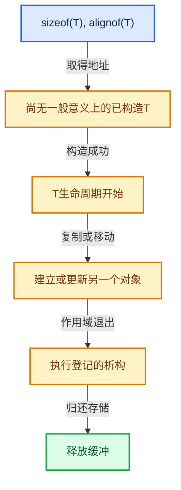

# 03-内存分配与运行时类型

[总目录](../README.md)

把存储分配、对象构造、类型操作和最终清理拆开建模。

## 前置知识与阅读层次

- [01-基础容器与现代CPP](../01-%E5%9F%BA%E7%A1%80%E5%AE%B9%E5%99%A8%E4%B8%8E%E7%8E%B0%E4%BB%A3CPP/README.md)

初读抓住数据模型，复读逐行检查，再完成反例和独立实现。方向间允许按实际问题回查，不要求机械线性阅读。

## 正文与源码范围

| 顺序 | 文档 | 主讲文件与范围 |
|---|---|---|
| 03-01 | [对齐与未初始化存储](01-%E5%AF%B9%E9%BD%90%E4%B8%8E%E6%9C%AA%E5%88%9D%E5%A7%8B%E5%8C%96%E5%AD%98%E5%82%A8.md) | BLI_memory_utils.hh:L185—L372 |
| 03-02 | [LinearAllocator布局](02-LinearAllocator%E5%B8%83%E5%B1%80.md) | BLI_linear_allocator.hh:L1—L155 |
| 03-03 | [LinearAllocator分配与扩展](03-LinearAllocator%E5%88%86%E9%85%8D%E4%B8%8E%E6%89%A9%E5%B1%95.md) | BLI_linear_allocator.hh:L156—L316 |
| 03-04 | [ChunkedList分块容器](04-ChunkedList%E5%88%86%E5%9D%97%E5%AE%B9%E5%99%A8.md) | BLI_linear_allocator_chunked_list.hh:L1—L209 |
| 03-05 | [ResourceScope销毁责任](05-ResourceScope%E9%94%80%E6%AF%81%E8%B4%A3%E4%BB%BB.md) | BLI_resource_scope.hh:L1—L243；resource_scope.cc:L1—L92 |
| 03-06 | [CPPType总体接口](06-CPPType%E6%80%BB%E4%BD%93%E6%8E%A5%E5%8F%A3.md) | BLI_cpp_type.hh:L1—L269 |
| 03-07 | [CPPType操作生成](07-CPPType%E6%93%8D%E4%BD%9C%E7%94%9F%E6%88%90.md) | BLI_cpp_type_make.hh:L1—L507 |
| 03-08 | [CPPType构造与析构](08-CPPType%E6%9E%84%E9%80%A0%E4%B8%8E%E6%9E%90%E6%9E%84.md) | BLI_cpp_type.hh:L270—L540 |
| 03-09 | [CPPType复制移动重定位](09-CPPType%E5%A4%8D%E5%88%B6%E7%A7%BB%E5%8A%A8%E9%87%8D%E5%AE%9A%E4%BD%8D.md) | BLI_cpp_type.hh:L541—L808 |
| 03-10 | [运行时到静态类型分派](10-%E8%BF%90%E8%A1%8C%E6%97%B6%E5%88%B0%E9%9D%99%E6%80%81%E7%B1%BB%E5%9E%8B%E5%88%86%E6%B4%BE.md) | cpp_type.cc:L1—L34 |
| 03-11 | [GSpan与GArray](11-GSpan%E4%B8%8EGArray.md) | BLI_generic_span.hh:L1—L281；BLI_generic_array.hh:L1—L262 |
| 03-12 | [异构值存储实战](12-%E5%BC%82%E6%9E%84%E5%80%BC%E5%AD%98%E5%82%A8%E5%AE%9E%E6%88%98.md) | BLI_generic_pointer.hh:L1—L139 |

## 本方向的数据模型

## 状态推演

## 历史入口

- [BLI: add LinearAllocator](https://projects.blender.org/blender/blender/commit/c5f4d5e448e4508586087e7ec8edfb0a2b6c38ec) · Jacques Lucke · 2020-04-24
- [Functions: Run-time type system and index mask](https://projects.blender.org/blender/blender/commit/0a907657d4d525d320e0c8518f583b7210736214) · Jacques Lucke · 2020-06-08
- [BLI: optimize memory usage in ResourceScope](https://projects.blender.org/blender/blender/commit/fe24e8e7109e5b37ad3a7c845922f1f601a96eb7) · Jacques Lucke · 2026-03-09
- [BLI: optimize CPPType::get and simplify registration](https://projects.blender.org/blender/blender/commit/0dce18612ad43fdce0d00c5be8ec1056905ef2d3) · Jacques Lucke · 2026-04-28

## 跨库比较与验收

与std::pmr::monotonic_buffer_resource比较批量存储回收，与std::any比较拥有型类型擦除；CPPType描述类型操作，本身不保存每个值。

所有存活对象地址满足对齐；构造失败不会被当作成功对象登记；所有资源均有唯一或明确共享的清理责任。

正文和源码区间已建立；自动检查结果见根目录验收报告。阅读者的掌握程度以独立练习与反例推理为准。
