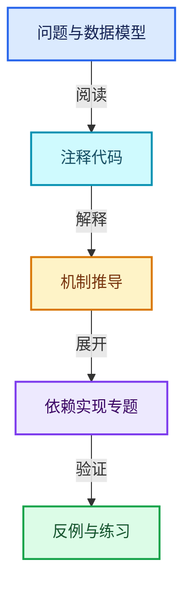
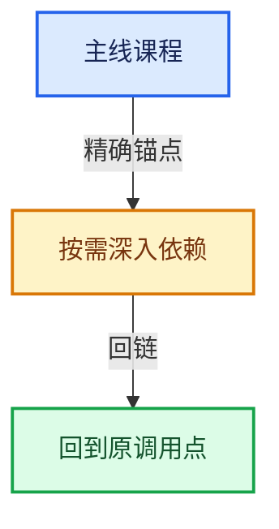

# 03-内存分配与运行时类型

[总目录](../README.md) · [实现索引](../%E7%AC%A6%E5%8F%B7%E4%BE%9D%E8%B5%96%E4%B8%8E%E5%AE%9E%E7%8E%B0%E7%B4%A2%E5%BC%95.md)

## 主线课程

- [03-01 对齐与未初始化存储](01-%E5%AF%B9%E9%BD%90%E4%B8%8E%E6%9C%AA%E5%88%9D%E5%A7%8B%E5%8C%96%E5%AD%98%E5%82%A8.md)
- [03-02 LinearAllocator布局](02-LinearAllocator%E5%B8%83%E5%B1%80.md)
- [03-03 LinearAllocator分配与扩展](03-LinearAllocator%E5%88%86%E9%85%8D%E4%B8%8E%E6%89%A9%E5%B1%95.md)
- [03-04 ChunkedList分块容器](04-ChunkedList%E5%88%86%E5%9D%97%E5%AE%B9%E5%99%A8.md)
- [03-05 ResourceScope销毁责任](05-ResourceScope%E9%94%80%E6%AF%81%E8%B4%A3%E4%BB%BB.md)
- [03-06 CPPType总体接口](06-CPPType%E6%80%BB%E4%BD%93%E6%8E%A5%E5%8F%A3.md)
- [03-07 CPPType操作生成](07-CPPType%E6%93%8D%E4%BD%9C%E7%94%9F%E6%88%90.md)
- [03-08 CPPType构造与析构](08-CPPType%E6%9E%84%E9%80%A0%E4%B8%8E%E6%9E%90%E6%9E%84.md)
- [03-09 CPPType复制移动重定位](09-CPPType%E5%A4%8D%E5%88%B6%E7%A7%BB%E5%8A%A8%E9%87%8D%E5%AE%9A%E4%BD%8D.md)
- [03-10 运行时到静态类型分派](10-%E8%BF%90%E8%A1%8C%E6%97%B6%E5%88%B0%E9%9D%99%E6%80%81%E7%B1%BB%E5%9E%8B%E5%88%86%E6%B4%BE.md)
- [03-11 GSpan与GArray](11-GSpan%E4%B8%8EGArray.md)
- [03-12 异构值存储实战](12-%E5%BC%82%E6%9E%84%E5%80%BC%E5%AD%98%E5%82%A8%E5%AE%9E%E6%88%98.md)

## 共享实现专题

- [intern/guardedalloc/MEM_guardedalloc.h](%E4%BE%9D%E8%B5%96-MEM_guardedalloc-b54eca.md)
- [intern/guardedalloc/MEM_safe_multiply.h](%E4%BE%9D%E8%B5%96-MEM_safe_multiply-8c8a79.md)
- [intern/guardedalloc/intern/leak_detector.cc](%E4%BE%9D%E8%B5%96-leak_detector-b5da14.md)
- [intern/guardedalloc/intern/mallocn.cc](%E4%BE%9D%E8%B5%96-mallocn-afdcd4.md)
- [intern/guardedalloc/intern/mallocn_guarded_impl.cc](%E4%BE%9D%E8%B5%96-mallocn_guarded_impl-6e71f1.md)
- [intern/guardedalloc/intern/mallocn_inline.hh](%E4%BE%9D%E8%B5%96-mallocn_inline-a8e1da.md)
- [intern/guardedalloc/intern/mallocn_intern.hh](%E4%BE%9D%E8%B5%96-mallocn_intern-e4d317.md)
- [intern/guardedalloc/intern/mallocn_lockfree_impl.cc](%E4%BE%9D%E8%B5%96-mallocn_lockfree_impl-53d317.md)
- [intern/guardedalloc/intern/memory_usage.cc](%E4%BE%9D%E8%B5%96-memory_usage-0a2000.md)
- [source/blender/blenlib/BLI_allocator.hh](%E4%BE%9D%E8%B5%96-BLI_allocator-e7b85a.md)
- [source/blender/blenlib/BLI_cpp_type.hh](%E4%BE%9D%E8%B5%96-BLI_cpp_type-7649cc.md)
- [source/blender/blenlib/BLI_memory_cache.hh](%E4%BE%9D%E8%B5%96-BLI_memory_cache-da9f93.md)
- [source/blender/blenlib/BLI_memory_utils.hh](%E4%BE%9D%E8%B5%96-BLI_memory_utils-e249c3.md)
- [source/blender/blenlib/intern/cpp_types.cc](%E4%BE%9D%E8%B5%96-cpp_types-77e5f3.md)
- [source/blender/blenlib/intern/filereader_memory.cc](%E4%BE%9D%E8%B5%96-filereader_memory-b2e0dc.md)
- [source/blender/blenlib/intern/memory_cache.cc](%E4%BE%9D%E8%B5%96-memory_cache-9e74ae.md)
- [source/blender/blenlib/intern/memory_counter.cc](%E4%BE%9D%E8%B5%96-memory_counter-6403e6.md)
- [source/blender/blenlib/tests/BLI_cpp_type_test.cc](%E4%BE%9D%E8%B5%96-BLI_cpp_type_test-e7b818.md)

