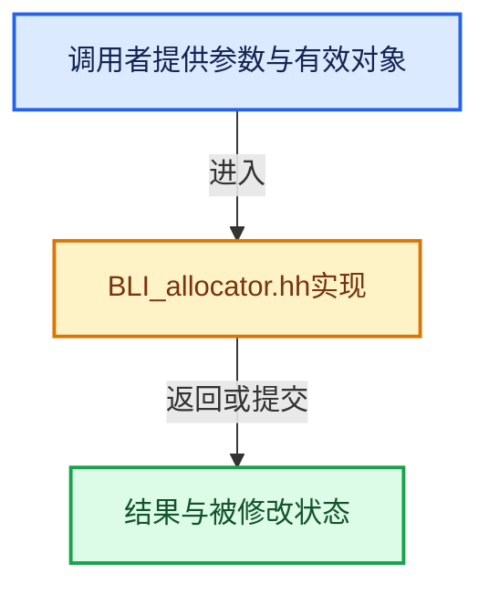

# 实现依赖专题：source/blender/blenlib/BLI_allocator.hh

[方向导航](README.md) · [符号索引](../%E7%AC%A6%E5%8F%B7%E4%BE%9D%E8%B5%96%E4%B8%8E%E5%AE%9E%E7%8E%B0%E7%B4%A2%E5%BC%95.md)

本专题从正文实际调用进入，集中保存共享实现。函数有稳定锚点，可从调用处直接跳到对应完整函数；递归与互相调用通过回链组织。

## 本文件的实现关系





## 相关类型布局与成员入口

<a id="t-ec879061c26c"></a>

### `blender::GuardedAllocator`

原始声明：[source/blender/blenlib/BLI_allocator.hh](../../../../../source/blender/blenlib/BLI_allocator.hh) · L41—L64。

以下保留类的数据声明与编译条件，成员函数实现通过后面的精确链接阅读。

<!-- annotated:9562c902e69015 -->

```cpp
class GuardedAllocator {
 public:
```

<details>
<summary>核对原始源码：source/blender/blenlib/BLI_allocator.hh · L41—L42</summary>

<!-- original:9562c902e69015:source/blender/blenlib/BLI_allocator.hh:41:42 -->

```cpp
class GuardedAllocator {
 public:
```

</details>

<!-- annotated:9068709d02a200 -->

```cpp

```

<details>
<summary>核对原始源码：source/blender/blenlib/BLI_allocator.hh · L59—L59</summary>

<!-- original:9068709d02a200:source/blender/blenlib/BLI_allocator.hh:59:59 -->

```cpp

```

</details>

<!-- annotated:3f026e0cb9eb60 -->

```cpp
};
```

<details>
<summary>核对原始源码：source/blender/blenlib/BLI_allocator.hh · L64—L64</summary>

<!-- original:3f026e0cb9eb60:source/blender/blenlib/BLI_allocator.hh:64:64 -->

```cpp
};
```

</details>

- [allocate](../01-%E5%9F%BA%E7%A1%80%E5%AE%B9%E5%99%A8%E4%B8%8E%E7%8E%B0%E4%BB%A3CPP/03-%E5%86%85%E5%AD%98%E5%B7%A5%E5%85%B7%E4%B8%8E%E5%88%86%E9%85%8D%E5%99%A8%E6%8E%A5%E5%8F%A3.md#f-a57239e6d3bd10d9)
- [allocate_zero](../01-%E5%9F%BA%E7%A1%80%E5%AE%B9%E5%99%A8%E4%B8%8E%E7%8E%B0%E4%BB%A3CPP/03-%E5%86%85%E5%AD%98%E5%B7%A5%E5%85%B7%E4%B8%8E%E5%88%86%E9%85%8D%E5%99%A8%E6%8E%A5%E5%8F%A3.md#f-ba4b11000deea5e5)
- [deallocate](../01-%E5%9F%BA%E7%A1%80%E5%AE%B9%E5%99%A8%E4%B8%8E%E7%8E%B0%E4%BB%A3CPP/03-%E5%86%85%E5%AD%98%E5%B7%A5%E5%85%B7%E4%B8%8E%E5%88%86%E9%85%8D%E5%99%A8%E6%8E%A5%E5%8F%A3.md#f-c1586978e7959acb)

## 完整成员与函数实现

## GuardedAllocator的类职责与所有权

GuardedAllocator本身没有保存每个Vector的元素列表；成员allocate/deallocate提供原始块接口。Vector持有具体Allocator对象，按模板实参静态选择成员，实现中的MEM函数指针再进行后端分派。类型T的构造和析构由Vector与memory_utils负责。类名GuardedAllocator指MEM家族入口，当前实际后端由MEM_use_lockfree_allocator或MEM_use_guarded_allocator成组设置；不要从类名反推运行时后端。
