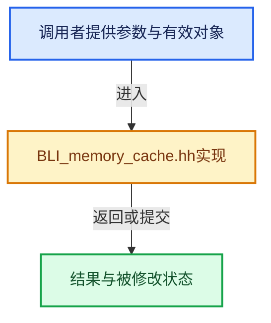

# 实现依赖专题：source/blender/blenlib/BLI_memory_cache.hh

[方向导航](README.md) · [符号索引](../%E7%AC%A6%E5%8F%B7%E4%BE%9D%E8%B5%96%E4%B8%8E%E5%AE%9E%E7%8E%B0%E7%B4%A2%E5%BC%95.md)

本专题从正文实际调用进入，集中保存共享实现。函数有稳定锚点，可从调用处直接跳到对应完整函数；递归与互相调用通过回链组织。

## 本文件的实现关系





## 完整成员与函数实现

<a id="f-9502b9f00795f10d"></a>

### `blender::memory_cache::get`

实现位置：[source/blender/blenlib/BLI_memory_cache.hh](../../../../../source/blender/blenlib/BLI_memory_cache.hh) · L71—L76。

接口参数：

- `const GenericKey &key`
- `FunctionRef<std::unique_ptr<T>()> compute_fn`

**教学注释版**

<!-- annotated:e55262a9b0f814 -->

```cpp
template<typename T>
inline std::shared_ptr<const T> get(const GenericKey &key,
                                    FunctionRef<std::unique_ptr<T>()> compute_fn)
{
  return std::dynamic_pointer_cast<const T>(get_base(key, compute_fn));
}
```

<details>
<summary>核对原始源码：source/blender/blenlib/BLI_memory_cache.hh · L71—L76</summary>

<!-- original:e55262a9b0f814:source/blender/blenlib/BLI_memory_cache.hh:71:76 -->

```cpp
template<typename T>
inline std::shared_ptr<const T> get(const GenericKey &key,
                                    FunctionRef<std::unique_ptr<T>()> compute_fn)
{
  return std::dynamic_pointer_cast<const T>(get_base(key, compute_fn));
}
```

</details>

**结果出口**

- `return std::dynamic_pointer_cast<const T>(get_base(key, compute_fn));`

**继续追踪实现**

- `std::dynamic_pointer_cast<const T>` → [外部契约](https://eel.is/c++draft/)：这个边界按实际表达式及所属类型核对参数、返回值、寿命与失败行为。这里提供接口入口，不声称已解释该第三方版本的内部实现。
- `get_base` → [blender::memory_cache::get_base · L74](%E4%BE%9D%E8%B5%96-memory_cache-9e74ae.md#f-e59bb5e8f4a5597c)。
