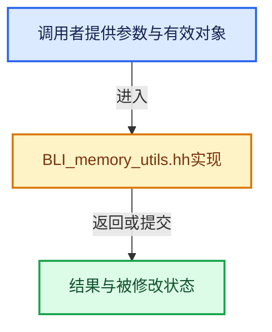

# 实现依赖专题：source/blender/blenlib/BLI_memory_utils.hh

[方向导航](README.md) · [符号索引](../%E7%AC%A6%E5%8F%B7%E4%BE%9D%E8%B5%96%E4%B8%8E%E5%AE%9E%E7%8E%B0%E7%B4%A2%E5%BC%95.md)

本专题从正文实际调用进入，集中保存共享实现。函数有稳定锚点，可从调用处直接跳到对应完整函数；递归与互相调用通过回链组织。

## 本文件的实现关系





## 相关类型布局与成员入口

<a id="t-4c0794066ddd"></a>

### `blender::AlignedBuffer`

原始声明：[source/blender/blenlib/BLI_memory_utils.hh](../../../../../source/blender/blenlib/BLI_memory_utils.hh) · L117—L147。

成员布局：

- `BLI_NO_UNIQUE_ADDRESS BufferType`

以下保留类的数据声明与编译条件，成员函数实现通过后面的精确链接阅读。

<!-- annotated:6594af2f7a4717 -->

```cpp
template<size_t Size, size_t Alignment> class AlignedBuffer {
  struct Empty {};
  struct alignas(Alignment) Sized {
    /* Don't create an empty array. This causes problems with some compilers. */
    std::byte buffer_[Size > 0 ? Size : 1];
  };

  using BufferType = std::conditional_t<Size == 0, Empty, Sized>;
  BLI_NO_UNIQUE_ADDRESS BufferType buffer_;

 public:
```

<details>
<summary>核对原始源码：source/blender/blenlib/BLI_memory_utils.hh · L117—L127</summary>

<!-- original:6594af2f7a4717:source/blender/blenlib/BLI_memory_utils.hh:117:127 -->

```cpp
template<size_t Size, size_t Alignment> class AlignedBuffer {
  struct Empty {};
  struct alignas(Alignment) Sized {
    /* Don't create an empty array. This causes problems with some compilers. */
    std::byte buffer_[Size > 0 ? Size : 1];
  };

  using BufferType = std::conditional_t<Size == 0, Empty, Sized>;
  BLI_NO_UNIQUE_ADDRESS BufferType buffer_;

 public:
```

</details>

<!-- annotated:6d1535cb4bc79a -->

```cpp

```

<details>
<summary>核对原始源码：source/blender/blenlib/BLI_memory_utils.hh · L132—L132</summary>

<!-- original:6d1535cb4bc79a:source/blender/blenlib/BLI_memory_utils.hh:132:132 -->

```cpp

```

</details>

<!-- annotated:6ef87c7437e92d -->

```cpp

```

<details>
<summary>核对原始源码：source/blender/blenlib/BLI_memory_utils.hh · L137—L137</summary>

<!-- original:6ef87c7437e92d:source/blender/blenlib/BLI_memory_utils.hh:137:137 -->

```cpp

```

</details>

<!-- annotated:0f4838b65dfeb5 -->

```cpp

```

<details>
<summary>核对原始源码：source/blender/blenlib/BLI_memory_utils.hh · L142—L142</summary>

<!-- original:0f4838b65dfeb5:source/blender/blenlib/BLI_memory_utils.hh:142:142 -->

```cpp

```

</details>

<!-- annotated:fc674a94ce06e4 -->

```cpp
};
```

<details>
<summary>核对原始源码：source/blender/blenlib/BLI_memory_utils.hh · L147—L147</summary>

<!-- original:fc674a94ce06e4:source/blender/blenlib/BLI_memory_utils.hh:147:147 -->

```cpp
};
```

</details>

- [()](../01-%E5%9F%BA%E7%A1%80%E5%AE%B9%E5%99%A8%E4%B8%8E%E7%8E%B0%E4%BB%A3CPP/01-%E5%AF%B9%E8%B1%A1%E7%94%9F%E5%91%BD%E5%91%A8%E6%9C%9F%E4%B8%8E%E5%80%BC%E7%B1%BB%E5%88%AB.md#f-f2d0c89c389deadc)
- [() const](../01-%E5%9F%BA%E7%A1%80%E5%AE%B9%E5%99%A8%E4%B8%8E%E7%8E%B0%E4%BB%A3CPP/01-%E5%AF%B9%E8%B1%A1%E7%94%9F%E5%91%BD%E5%91%A8%E6%9C%9F%E4%B8%8E%E5%80%BC%E7%B1%BB%E5%88%AB.md#f-d34418cfa8e83a5b)
- [ptr](../01-%E5%9F%BA%E7%A1%80%E5%AE%B9%E5%99%A8%E4%B8%8E%E7%8E%B0%E4%BB%A3CPP/01-%E5%AF%B9%E8%B1%A1%E7%94%9F%E5%91%BD%E5%91%A8%E6%9C%9F%E4%B8%8E%E5%80%BC%E7%B1%BB%E5%88%AB.md#f-bfe745bcb7c7811c)
- [ptr](../01-%E5%9F%BA%E7%A1%80%E5%AE%B9%E5%99%A8%E4%B8%8E%E7%8E%B0%E4%BB%A3CPP/01-%E5%AF%B9%E8%B1%A1%E7%94%9F%E5%91%BD%E5%91%A8%E6%9C%9F%E4%B8%8E%E5%80%BC%E7%B1%BB%E5%88%AB.md#f-f24632360e6cd028)

<a id="t-2cf83b451a01"></a>

### `blender::TypedBuffer`

原始声明：[source/blender/blenlib/BLI_memory_utils.hh](../../../../../source/blender/blenlib/BLI_memory_utils.hh) · L154—L220。

成员布局：

- `BLI_NO_UNIQUE_ADDRESS AlignedBuffer`

以下保留类的数据声明与编译条件，成员函数实现通过后面的精确链接阅读。

<!-- annotated:d177db529c349b -->

```cpp
template<typename T, int64_t Size = 1> class TypedBuffer {
 private:
  /** Required so that `sizeof(T)` is not required when `Size` is 0. */
```

<details>
<summary>核对原始源码：source/blender/blenlib/BLI_memory_utils.hh · L154—L156</summary>

<!-- original:d177db529c349b:source/blender/blenlib/BLI_memory_utils.hh:154:156 -->

```cpp
template<typename T, int64_t Size = 1> class TypedBuffer {
 private:
  /** Required so that `sizeof(T)` is not required when `Size` is 0. */
```

</details>

<!-- annotated:006ea2ef2fb525 -->

```cpp

  /** Required so that `alignof(T)` is not required when `Size` is 0. */
```

<details>
<summary>核对原始源码：source/blender/blenlib/BLI_memory_utils.hh · L166—L167</summary>

<!-- original:006ea2ef2fb525:source/blender/blenlib/BLI_memory_utils.hh:166:167 -->

```cpp

  /** Required so that `alignof(T)` is not required when `Size` is 0. */
```

</details>

<!-- annotated:880562d19535b3 -->

```cpp

  BLI_NO_UNIQUE_ADDRESS AlignedBuffer<get_size(), get_alignment()> buffer_;

 public:
```

<details>
<summary>核对原始源码：source/blender/blenlib/BLI_memory_utils.hh · L177—L180</summary>

<!-- original:880562d19535b3:source/blender/blenlib/BLI_memory_utils.hh:177:180 -->

```cpp

  BLI_NO_UNIQUE_ADDRESS AlignedBuffer<get_size(), get_alignment()> buffer_;

 public:
```

</details>

<!-- annotated:bed74d172e9463 -->

```cpp

```

<details>
<summary>核对原始源码：source/blender/blenlib/BLI_memory_utils.hh · L185—L185</summary>

<!-- original:bed74d172e9463:source/blender/blenlib/BLI_memory_utils.hh:185:185 -->

```cpp

```

</details>

<!-- annotated:ba9422ce5422c5 -->

```cpp

```

<details>
<summary>核对原始源码：source/blender/blenlib/BLI_memory_utils.hh · L190—L190</summary>

<!-- original:ba9422ce5422c5:source/blender/blenlib/BLI_memory_utils.hh:190:190 -->

```cpp

```

</details>

<!-- annotated:6817415a635b8e -->

```cpp

```

<details>
<summary>核对原始源码：source/blender/blenlib/BLI_memory_utils.hh · L195—L195</summary>

<!-- original:6817415a635b8e:source/blender/blenlib/BLI_memory_utils.hh:195:195 -->

```cpp

```

</details>

<!-- annotated:9e4eaff6880737 -->

```cpp

```

<details>
<summary>核对原始源码：source/blender/blenlib/BLI_memory_utils.hh · L200—L200</summary>

<!-- original:9e4eaff6880737:source/blender/blenlib/BLI_memory_utils.hh:200:200 -->

```cpp

```

</details>

<!-- annotated:eee43522c2a746 -->

```cpp

```

<details>
<summary>核对原始源码：source/blender/blenlib/BLI_memory_utils.hh · L205—L205</summary>

<!-- original:eee43522c2a746:source/blender/blenlib/BLI_memory_utils.hh:205:205 -->

```cpp

```

</details>

<!-- annotated:8985abaa605b2f -->

```cpp

```

<details>
<summary>核对原始源码：source/blender/blenlib/BLI_memory_utils.hh · L210—L210</summary>

<!-- original:8985abaa605b2f:source/blender/blenlib/BLI_memory_utils.hh:210:210 -->

```cpp

```

</details>

<!-- annotated:415cc1ae9ccef0 -->

```cpp

```

<details>
<summary>核对原始源码：source/blender/blenlib/BLI_memory_utils.hh · L215—L215</summary>

<!-- original:415cc1ae9ccef0:source/blender/blenlib/BLI_memory_utils.hh:215:215 -->

```cpp

```

</details>

<!-- annotated:b5b0826394186a -->

```cpp
};
```

<details>
<summary>核对原始源码：source/blender/blenlib/BLI_memory_utils.hh · L220—L220</summary>

<!-- original:b5b0826394186a:source/blender/blenlib/BLI_memory_utils.hh:220:220 -->

```cpp
};
```

</details>

- [get_size](../01-%E5%9F%BA%E7%A1%80%E5%AE%B9%E5%99%A8%E4%B8%8E%E7%8E%B0%E4%BB%A3CPP/01-%E5%AF%B9%E8%B1%A1%E7%94%9F%E5%91%BD%E5%91%A8%E6%9C%9F%E4%B8%8E%E5%80%BC%E7%B1%BB%E5%88%AB.md#f-01c9908024e5905f)
- [get_alignment](../01-%E5%9F%BA%E7%A1%80%E5%AE%B9%E5%99%A8%E4%B8%8E%E7%8E%B0%E4%BB%A3CPP/01-%E5%AF%B9%E8%B1%A1%E7%94%9F%E5%91%BD%E5%91%A8%E6%9C%9F%E4%B8%8E%E5%80%BC%E7%B1%BB%E5%88%AB.md#f-97f29e4dc546127f)
- [()](../01-%E5%9F%BA%E7%A1%80%E5%AE%B9%E5%99%A8%E4%B8%8E%E7%8E%B0%E4%BB%A3CPP/01-%E5%AF%B9%E8%B1%A1%E7%94%9F%E5%91%BD%E5%91%A8%E6%9C%9F%E4%B8%8E%E5%80%BC%E7%B1%BB%E5%88%AB.md#f-47e1bfca173d566c)
- [() const](01-%E5%AF%B9%E9%BD%90%E4%B8%8E%E6%9C%AA%E5%88%9D%E5%A7%8B%E5%8C%96%E5%AD%98%E5%82%A8.md#f-d3e73f96dfe929a1)
- [operator*](01-%E5%AF%B9%E9%BD%90%E4%B8%8E%E6%9C%AA%E5%88%9D%E5%A7%8B%E5%8C%96%E5%AD%98%E5%82%A8.md#f-d07a89e9073ebe61)
- [operator*](01-%E5%AF%B9%E9%BD%90%E4%B8%8E%E6%9C%AA%E5%88%9D%E5%A7%8B%E5%8C%96%E5%AD%98%E5%82%A8.md#f-7e92d190f8458cae)
- [ptr](01-%E5%AF%B9%E9%BD%90%E4%B8%8E%E6%9C%AA%E5%88%9D%E5%A7%8B%E5%8C%96%E5%AD%98%E5%82%A8.md#f-d0aaaaf3ad8ab525)
- [ptr](01-%E5%AF%B9%E9%BD%90%E4%B8%8E%E6%9C%AA%E5%88%9D%E5%A7%8B%E5%8C%96%E5%AD%98%E5%82%A8.md#f-a084c429c8af03d6)
- [ref](01-%E5%AF%B9%E9%BD%90%E4%B8%8E%E6%9C%AA%E5%88%9D%E5%A7%8B%E5%8C%96%E5%AD%98%E5%82%A8.md#f-0bc330ab3d8ae4fb)
- [ref](01-%E5%AF%B9%E9%BD%90%E4%B8%8E%E6%9C%AA%E5%88%9D%E5%A7%8B%E5%8C%96%E5%AD%98%E5%82%A8.md#f-373a7ba220c358f0)

<a id="t-3502e11e3a54"></a>

### `blender::NoInitialization`

原始声明：[source/blender/blenlib/BLI_memory_utils.hh](../../../../../source/blender/blenlib/BLI_memory_utils.hh) · L226—L226。

以下保留类的数据声明与编译条件，成员函数实现通过后面的精确链接阅读。

<!-- annotated:cf00c9f938d776 -->

```cpp
class NoInitialization {};
```

<details>
<summary>核对原始源码：source/blender/blenlib/BLI_memory_utils.hh · L226—L226</summary>

<!-- original:cf00c9f938d776:source/blender/blenlib/BLI_memory_utils.hh:226:226 -->

```cpp
class NoInitialization {};
```

</details>


<a id="t-4970c3d9f442"></a>

### `blender::NoExceptConstructor`

原始声明：[source/blender/blenlib/BLI_memory_utils.hh](../../../../../source/blender/blenlib/BLI_memory_utils.hh) · L234—L234。

以下保留类的数据声明与编译条件，成员函数实现通过后面的精确链接阅读。

<!-- annotated:0e20a8788a1f28 -->

```cpp
class NoExceptConstructor {};
```

<details>
<summary>核对原始源码：source/blender/blenlib/BLI_memory_utils.hh · L234—L234</summary>

<!-- original:0e20a8788a1f28:source/blender/blenlib/BLI_memory_utils.hh:234:234 -->

```cpp
class NoExceptConstructor {};
```

</details>


<a id="m-f6328443021d"></a>

## 宏 `BLI_SCOPED_DEFER`

<!-- annotated:2d3defe9ebca27 -->

```cpp
#define BLI_SCOPED_DEFER(function_to_defer) \
  auto BLI_SCOPED_DEFER_NAME(func) = (function_to_defer); \
  blenlib_detail::ScopedDeferHelper<decltype(BLI_SCOPED_DEFER_NAME(func))> BLI_SCOPED_DEFER_NAME( \
      helper){std::move(BLI_SCOPED_DEFER_NAME(func))};

```

<details>
<summary>核对原始源码：source/blender/blenlib/BLI_memory_utils.hh · L367—L371</summary>

<!-- original:2d3defe9ebca27:source/blender/blenlib/BLI_memory_utils.hh:367:371 -->

```cpp
#define BLI_SCOPED_DEFER(function_to_defer) \
  auto BLI_SCOPED_DEFER_NAME(func) = (function_to_defer); \
  blenlib_detail::ScopedDeferHelper<decltype(BLI_SCOPED_DEFER_NAME(func))> BLI_SCOPED_DEFER_NAME( \
      helper){std::move(BLI_SCOPED_DEFER_NAME(func))};

```

</details>

宏在预处理阶段展开，参数替换、重复求值和条件编译应直接从该定义检查。与普通函数不同，宏不会自动提供参数类型检查；构建配置选择哪个定义需结合外围条件。

## 完整成员与函数实现
