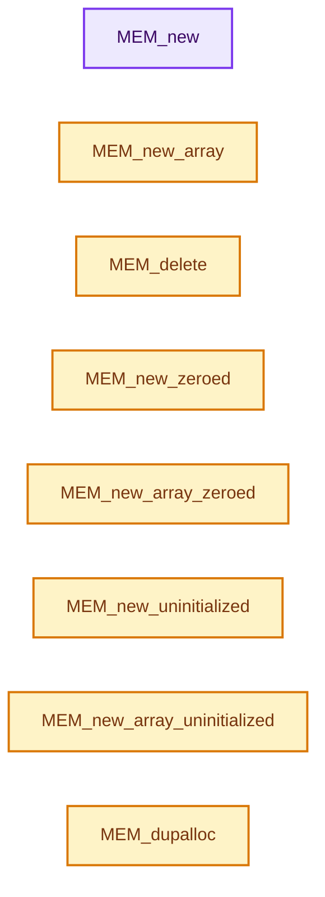

# 实现依赖专题：intern/guardedalloc/MEM_guardedalloc.h

[方向导航](README.md) · [符号索引](../%E7%AC%A6%E5%8F%B7%E4%BE%9D%E8%B5%96%E4%B8%8E%E5%AE%9E%E7%8E%B0%E7%B4%A2%E5%BC%95.md)

本专题从正文实际调用进入，集中保存共享实现。函数有稳定锚点，可从调用处直接跳到对应完整函数；递归与互相调用通过回链组织。

## 本文件的实现关系




<a id="m-813b7cd3fcff"></a>

## 宏 `MEM_realloc_uninitialized`

<!-- annotated:0dd53774e5ee43 -->

```cpp
#define MEM_realloc_uninitialized(vmemh, len) MEM_realloc_uninitialized_id(vmemh, len, __func__)
#define MEM_realloc_zeroed(vmemh, len) MEM_realloc_zeroed_id(vmemh, len, __func__)
```

<details>
<summary>核对原始源码：intern/guardedalloc/MEM_guardedalloc.h · L118—L119</summary>

<!-- original:0dd53774e5ee43:intern/guardedalloc/MEM_guardedalloc.h:118:119 -->

```cpp
#define MEM_realloc_uninitialized(vmemh, len) MEM_realloc_uninitialized_id(vmemh, len, __func__)
#define MEM_realloc_zeroed(vmemh, len) MEM_realloc_zeroed_id(vmemh, len, __func__)
```

</details>

宏在预处理阶段展开，参数替换、重复求值和条件编译应直接从该定义检查。与普通函数不同，宏不会自动提供参数类型检查；构建配置选择哪个定义需结合外围条件。

<a id="m-db4054295a6d"></a>

## 宏 `MEM_realloc_zeroed`

<!-- annotated:1119a8910e7eca -->

```cpp
#define MEM_realloc_zeroed(vmemh, len) MEM_realloc_zeroed_id(vmemh, len, __func__)

```

<details>
<summary>核对原始源码：intern/guardedalloc/MEM_guardedalloc.h · L119—L120</summary>

<!-- original:1119a8910e7eca:intern/guardedalloc/MEM_guardedalloc.h:119:120 -->

```cpp
#define MEM_realloc_zeroed(vmemh, len) MEM_realloc_zeroed_id(vmemh, len, __func__)

```

</details>

宏在预处理阶段展开，参数替换、重复求值和条件编译应直接从该定义检查。与普通函数不同，宏不会自动提供参数类型检查；构建配置选择哪个定义需结合外围条件。

<a id="m-e09c7e9cc0c0"></a>

## 宏 `MEM_SIZE_OPTIMAL`

<!-- annotated:b43170e207ddd9 -->

```cpp
#define MEM_SIZE_OPTIMAL(size) ((size) - MEM_SIZE_OVERHEAD)

```

<details>
<summary>核对原始源码：intern/guardedalloc/MEM_guardedalloc.h · L238—L239</summary>

<!-- original:b43170e207ddd9:intern/guardedalloc/MEM_guardedalloc.h:238:239 -->

```cpp
#define MEM_SIZE_OPTIMAL(size) ((size) - MEM_SIZE_OVERHEAD)

```

</details>

宏在预处理阶段展开，参数替换、重复求值和条件编译应直接从该定义检查。与普通函数不同，宏不会自动提供参数类型检查；构建配置选择哪个定义需结合外围条件。

<a id="m-eadb3bc5b902"></a>

## 宏 `MEM_SAFE_DELETE`

<!-- annotated:76d8c45b516a14 -->

```cpp
#  define MEM_SAFE_DELETE(v) \
    do { \
      if (v) { \
        MEM_delete(v); \
        (v) = nullptr; \
      } \
    } while (0)

```

<details>
<summary>核对原始源码：intern/guardedalloc/MEM_guardedalloc.h · L436—L443</summary>

<!-- original:76d8c45b516a14:intern/guardedalloc/MEM_guardedalloc.h:436:443 -->

```cpp
#  define MEM_SAFE_DELETE(v) \
    do { \
      if (v) { \
        MEM_delete(v); \
        (v) = nullptr; \
      } \
    } while (0)

```

</details>

宏在预处理阶段展开，参数替换、重复求值和条件编译应直接从该定义检查。与普通函数不同，宏不会自动提供参数类型检查；构建配置选择哪个定义需结合外围条件。

<a id="m-66e7eff3d7bc"></a>

## 宏 `MEM_SAFE_DELETE_VOID`

<!-- annotated:1973da6b4aab06 -->

```cpp
#  define MEM_SAFE_DELETE_VOID(v) \
    do { \
      if (v) { \
        MEM_delete_void(v); \
        (v) = nullptr; \
      } \
    } while (0)

```

<details>
<summary>核对原始源码：intern/guardedalloc/MEM_guardedalloc.h · L448—L455</summary>

<!-- original:1973da6b4aab06:intern/guardedalloc/MEM_guardedalloc.h:448:455 -->

```cpp
#  define MEM_SAFE_DELETE_VOID(v) \
    do { \
      if (v) { \
        MEM_delete_void(v); \
        (v) = nullptr; \
      } \
    } while (0)

```

</details>

宏在预处理阶段展开，参数替换、重复求值和条件编译应直接从该定义检查。与普通函数不同，宏不会自动提供参数类型检查；构建配置选择哪个定义需结合外围条件。

## 完整成员与函数实现

<a id="f-115f9b6784f89912"></a>

### `MEM_new`

实现位置：[intern/guardedalloc/MEM_guardedalloc.h](../../../../../intern/guardedalloc/MEM_guardedalloc.h) · L351—L361。

接口参数：

- `const char *allocation_name`

**教学注释版**

<!-- annotated:b923f125bb0122 -->

```cpp
template<typename T, typename... Args>
inline T *MEM_new(const char *allocation_name, Args &&...args)
{
  void *buffer = mem_guarded::internal::mem_mallocN_aligned_ex(
      sizeof(T),
      alignof(T),
      allocation_name,
      std::is_trivially_destructible_v<T> ? mem_guarded::internal::DestructorType::Trivial :
                                            mem_guarded::internal::DestructorType::NonTrivial);
  // [讲解] std::forward<Args>：在转发引用中恢复调用者传入的值类别；依赖推导类型，不能与无条件move互换。
  return new (buffer) T(std::forward<Args>(args)...);
}
```

<details>
<summary>核对原始源码：intern/guardedalloc/MEM_guardedalloc.h · L351—L361</summary>

<!-- original:b923f125bb0122:intern/guardedalloc/MEM_guardedalloc.h:351:361 -->

```cpp
template<typename T, typename... Args>
inline T *MEM_new(const char *allocation_name, Args &&...args)
{
  void *buffer = mem_guarded::internal::mem_mallocN_aligned_ex(
      sizeof(T),
      alignof(T),
      allocation_name,
      std::is_trivially_destructible_v<T> ? mem_guarded::internal::DestructorType::Trivial :
                                            mem_guarded::internal::DestructorType::NonTrivial);
  return new (buffer) T(std::forward<Args>(args)...);
}
```

</details>

**结果出口**

- `return new (buffer) T(std::forward<Args>(args)...);`

**继续追踪实现**

- `mem_guarded::internal::mem_mallocN_aligned_ex` → [MEM_lockfree_mallocN_aligned · L406](%E4%BE%9D%E8%B5%96-mallocn_lockfree_impl-53d317.md#f-0d9870a941cc5e2d)；[MEM_guarded_mallocN_aligned · L600](%E4%BE%9D%E8%B5%96-mallocn_guarded_impl-6e71f1.md#f-43ec041c5c806b76)。同名重载需按实参类型选择。
- `std::forward<Args>` → [外部契约](https://eel.is/c++draft/utility.forward)：在转发引用中恢复调用者传入的值类别；依赖推导类型，不能与无条件move互换。

<a id="f-56b8fe3d391af460"></a>

### `MEM_new_array`

实现位置：[intern/guardedalloc/MEM_guardedalloc.h](../../../../../intern/guardedalloc/MEM_guardedalloc.h) · L372—L389。

接口参数：

- `const size_t length`
- `const char *allocation_name`

**教学注释版**

<!-- annotated:49bd135f60a86a -->

```cpp
template<typename T> inline T *MEM_new_array(const size_t length, const char *allocation_name)
{
#  ifdef _MSC_VER
  static_assert(
      std::is_trivially_destructible_v<T>,
      "For non-trivially copyable and destructible types, use higher level types like Vector.");
#  else
  static_assert(
      mem_guarded::internal::is_trivial_after_construction<T>,
      "For non-trivially copyable and destructible types, use higher level types like Vector.");
#  endif
  T *buffer = static_cast<T *>(
      MEM_new_array_uninitialized_aligned(length, sizeof(T), alignof(T), allocation_name));
  for (size_t i = 0; i < length; i++) {
    new (buffer + i) T();
  }
  return buffer;
}
```

<details>
<summary>核对原始源码：intern/guardedalloc/MEM_guardedalloc.h · L372—L389</summary>

<!-- original:49bd135f60a86a:intern/guardedalloc/MEM_guardedalloc.h:372:389 -->

```cpp
template<typename T> inline T *MEM_new_array(const size_t length, const char *allocation_name)
{
#  ifdef _MSC_VER
  static_assert(
      std::is_trivially_destructible_v<T>,
      "For non-trivially copyable and destructible types, use higher level types like Vector.");
#  else
  static_assert(
      mem_guarded::internal::is_trivial_after_construction<T>,
      "For non-trivially copyable and destructible types, use higher level types like Vector.");
#  endif
  T *buffer = static_cast<T *>(
      MEM_new_array_uninitialized_aligned(length, sizeof(T), alignof(T), allocation_name));
  for (size_t i = 0; i < length; i++) {
    new (buffer + i) T();
  }
  return buffer;
}
```

</details>

**结果出口**

- `return buffer;`

**继续追踪实现**

- `MEM_new_array_uninitialized_aligned` → [调用协议](../%E6%A8%A1%E6%9D%BF%E5%AE%8F%E4%B8%8E%E5%8A%A8%E6%80%81%E5%88%86%E6%B4%BE%E5%8D%8F%E8%AE%AE.md)：函数指针、局部可调用对象或未展开的宏；必须结合调用者环境。调用位置L384。

<a id="f-9049ffdd1682887c"></a>

### `MEM_delete`

实现位置：[intern/guardedalloc/MEM_guardedalloc.h](../../../../../intern/guardedalloc/MEM_guardedalloc.h) · L400—L430。

接口参数：

- `const T *ptr`

**教学注释版**

<!-- annotated:7265054616355d -->

```cpp
template<typename T> inline void MEM_delete(const T *ptr)
{
  static_assert(
      !std::is_void_v<T>,
      "MEM_delete on a void pointer is not possible, `static_cast` it to the correct type");
  if (ptr == nullptr) {
    return;
  }
  const void *complete_ptr = [ptr]() {
    if constexpr (std::is_polymorphic_v<T>) {
      /* Polymorphic objects lifetime can be managed with pointers to their most derived type or
       * with pointers to any of their ancestor types in their hierarchy tree that define a virtual
       * destructor, however ancestor pointers may differ in a offset from the same derived object.
       * For freeing the correct memory allocated with #MEM_new, we need to ensure that the given
       * pointer is equal to the pointer to the most derived object, which can be obtained with
       * `dynamic_cast<void *>(ptr)`. */
      return dynamic_cast<const void *>(ptr);
    }
    else {
      return static_cast<const void *>(ptr);
    }
  }();
  /* Explicitly don't call destructor when not needed, also because it doesn't work
   * for pointers like float (*x)[2]. */
  if constexpr (!std::is_trivially_destructible_v<T>) {
    ptr->~T();
  }
  /* C++ allows destruction of `const` objects, so the pointer is allowed to be `const`. */
  mem_guarded::internal::mem_freeN_ex(const_cast<void *>(complete_ptr),
                                      mem_guarded::internal::DestructorType::NonTrivial);
}
```

<details>
<summary>核对原始源码：intern/guardedalloc/MEM_guardedalloc.h · L400—L430</summary>

<!-- original:7265054616355d:intern/guardedalloc/MEM_guardedalloc.h:400:430 -->

```cpp
template<typename T> inline void MEM_delete(const T *ptr)
{
  static_assert(
      !std::is_void_v<T>,
      "MEM_delete on a void pointer is not possible, `static_cast` it to the correct type");
  if (ptr == nullptr) {
    return;
  }
  const void *complete_ptr = [ptr]() {
    if constexpr (std::is_polymorphic_v<T>) {
      /* Polymorphic objects lifetime can be managed with pointers to their most derived type or
       * with pointers to any of their ancestor types in their hierarchy tree that define a virtual
       * destructor, however ancestor pointers may differ in a offset from the same derived object.
       * For freeing the correct memory allocated with #MEM_new, we need to ensure that the given
       * pointer is equal to the pointer to the most derived object, which can be obtained with
       * `dynamic_cast<void *>(ptr)`. */
      return dynamic_cast<const void *>(ptr);
    }
    else {
      return static_cast<const void *>(ptr);
    }
  }();
  /* Explicitly don't call destructor when not needed, also because it doesn't work
   * for pointers like float (*x)[2]. */
  if constexpr (!std::is_trivially_destructible_v<T>) {
    ptr->~T();
  }
  /* C++ allows destruction of `const` objects, so the pointer is allowed to be `const`. */
  mem_guarded::internal::mem_freeN_ex(const_cast<void *>(complete_ptr),
                                      mem_guarded::internal::DestructorType::NonTrivial);
}
```

</details>

**结果出口**

- `return dynamic_cast<const void *>(ptr);`
- `return static_cast<const void *>(ptr);`

**继续追踪实现**

- `[ptr]() { if constexpr (std::is_polymorphic_v<T>) { /* Polymorphic objects lifetime can be managed with pointers to their most derived type or * with pointers to any of their ances …（完整表达式见本函数源码）` → [() · L252](../05-%E5%87%A0%E4%BD%95%E5%AD%98%E5%82%A8%E4%B8%8E%E6%8B%93%E6%89%91%E6%98%A0%E5%B0%84/%E4%BE%9D%E8%B5%96-unique_ptr_vector-b13772.md#f-d9003f52ce0d3e97)；[() · L36](../05-%E5%87%A0%E4%BD%95%E5%AD%98%E5%82%A8%E4%B8%8E%E6%8B%93%E6%89%91%E6%98%A0%E5%B0%84/%E4%BE%9D%E8%B5%96-types_int8-f5dcfc.md#f-a098013a78cffef5)；[() · L41](../05-%E5%87%A0%E4%BD%95%E5%AD%98%E5%82%A8%E4%B8%8E%E6%8B%93%E6%89%91%E6%98%A0%E5%B0%84/%E4%BE%9D%E8%B5%96-types_int3-7d3986.md#f-d6eb8caa7c8b7b94)；[() · L41](../05-%E5%87%A0%E4%BD%95%E5%AD%98%E5%82%A8%E4%B8%8E%E6%8B%93%E6%89%91%E6%98%A0%E5%B0%84/%E4%BE%9D%E8%B5%96-types_float8-8fe1c9.md#f-13e176dd43b5ca83)；[() · L49](../05-%E5%87%A0%E4%BD%95%E5%AD%98%E5%82%A8%E4%B8%8E%E6%8B%93%E6%89%91%E6%98%A0%E5%B0%84/%E4%BE%9D%E8%B5%96-types_float3-48c65a.md#f-65fa015938047fea)。同名重载需按实参类型选择。
- `ptr->~T` → [调用协议](../%E6%A8%A1%E6%9D%BF%E5%AE%8F%E4%B8%8E%E5%8A%A8%E6%80%81%E5%88%86%E6%B4%BE%E5%8D%8F%E8%AE%AE.md)：T模板参数提供的操作协议。调用位置L425。
- `mem_guarded::internal::mem_freeN_ex` → [MEM_lockfree_freeN · L146](%E4%BE%9D%E8%B5%96-mallocn_lockfree_impl-53d317.md#f-da4b6d2cf3cb90d8)；[MEM_guarded_freeN · L1054](%E4%BE%9D%E8%B5%96-mallocn_guarded_impl-6e71f1.md#f-3bf9a51e62b87ccb)。同名重载需按实参类型选择。

<a id="f-eeb1e2a7f57dd231"></a>

### `MEM_new_zeroed`

实现位置：[intern/guardedalloc/MEM_guardedalloc.h](../../../../../intern/guardedalloc/MEM_guardedalloc.h) · L550—L559。

接口参数：

- `const char *allocation_name`

**教学注释版**

<!-- annotated:391917c8dfe040 -->

```cpp
template<typename T> inline T *MEM_new_zeroed(const char *allocation_name)
{
#  ifdef _MSC_VER
  static_assert(std::is_trivially_constructible_v<T>,
                "For non-trivial types, MEM_new must be used.");
#  else
  static_assert(std::is_trivial_v<T>, "For non-trivial types, MEM_new must be used.");
#  endif
  return static_cast<T *>(MEM_new_array_zeroed_aligned(1, sizeof(T), alignof(T), allocation_name));
}
```

<details>
<summary>核对原始源码：intern/guardedalloc/MEM_guardedalloc.h · L550—L559</summary>

<!-- original:391917c8dfe040:intern/guardedalloc/MEM_guardedalloc.h:550:559 -->

```cpp
template<typename T> inline T *MEM_new_zeroed(const char *allocation_name)
{
#  ifdef _MSC_VER
  static_assert(std::is_trivially_constructible_v<T>,
                "For non-trivial types, MEM_new must be used.");
#  else
  static_assert(std::is_trivial_v<T>, "For non-trivial types, MEM_new must be used.");
#  endif
  return static_cast<T *>(MEM_new_array_zeroed_aligned(1, sizeof(T), alignof(T), allocation_name));
}
```

</details>

**结果出口**

- `return static_cast<T *>(MEM_new_array_zeroed_aligned(1, sizeof(T), alignof(T), allocation_name));`

**继续追踪实现**

- `MEM_new_array_zeroed_aligned` → [调用协议](../%E6%A8%A1%E6%9D%BF%E5%AE%8F%E4%B8%8E%E5%8A%A8%E6%80%81%E5%88%86%E6%B4%BE%E5%8D%8F%E8%AE%AE.md)：函数指针、局部可调用对象或未展开的宏；必须结合调用者环境。调用位置L558。

<a id="f-3a0cf63fb5216500"></a>

### `MEM_new_array_zeroed`

实现位置：[intern/guardedalloc/MEM_guardedalloc.h](../../../../../intern/guardedalloc/MEM_guardedalloc.h) · L566—L577。

接口参数：

- `const size_t length`
- `const char *allocation_name`

**教学注释版**

<!-- annotated:b5f10cf67e4831 -->

```cpp
template<typename T>
inline T *MEM_new_array_zeroed(const size_t length, const char *allocation_name)
{
#  ifdef _MSC_VER
  static_assert(std::is_trivially_constructible_v<T>,
                "For non-trivial types, MEM_new must be used.");
#  else
  static_assert(std::is_trivial_v<T>, "For non-trivial types, MEM_new must be used.");
#  endif
  return static_cast<T *>(
      MEM_new_array_zeroed_aligned(length, sizeof(T), alignof(T), allocation_name));
}
```

<details>
<summary>核对原始源码：intern/guardedalloc/MEM_guardedalloc.h · L566—L577</summary>

<!-- original:b5f10cf67e4831:intern/guardedalloc/MEM_guardedalloc.h:566:577 -->

```cpp
template<typename T>
inline T *MEM_new_array_zeroed(const size_t length, const char *allocation_name)
{
#  ifdef _MSC_VER
  static_assert(std::is_trivially_constructible_v<T>,
                "For non-trivial types, MEM_new must be used.");
#  else
  static_assert(std::is_trivial_v<T>, "For non-trivial types, MEM_new must be used.");
#  endif
  return static_cast<T *>(
      MEM_new_array_zeroed_aligned(length, sizeof(T), alignof(T), allocation_name));
}
```

</details>

**结果出口**

- `return static_cast<T *>(`

**继续追踪实现**

- `MEM_new_array_zeroed_aligned` → [调用协议](../%E6%A8%A1%E6%9D%BF%E5%AE%8F%E4%B8%8E%E5%8A%A8%E6%80%81%E5%88%86%E6%B4%BE%E5%8D%8F%E8%AE%AE.md)：函数指针、局部可调用对象或未展开的宏；必须结合调用者环境。调用位置L576。

<a id="f-c773b2e5b8fe70e4"></a>

### `MEM_new_uninitialized`

实现位置：[intern/guardedalloc/MEM_guardedalloc.h](../../../../../intern/guardedalloc/MEM_guardedalloc.h) · L590—L600。

接口参数：

- `const char *allocation_name`

**教学注释版**

<!-- annotated:a04cdef1fdc9ba -->

```cpp
template<typename T> inline T *MEM_new_uninitialized(const char *allocation_name)
{
#  ifdef _MSC_VER
  static_assert(std::is_trivially_constructible_v<T>,
                "For non-trivial types, MEM_new must be used.");
#  else
  static_assert(std::is_trivial_v<T>, "For non-trivial types, MEM_new must be used.");
#  endif
  return static_cast<T *>(
      MEM_new_array_uninitialized_aligned(1, sizeof(T), alignof(T), allocation_name));
}
```

<details>
<summary>核对原始源码：intern/guardedalloc/MEM_guardedalloc.h · L590—L600</summary>

<!-- original:a04cdef1fdc9ba:intern/guardedalloc/MEM_guardedalloc.h:590:600 -->

```cpp
template<typename T> inline T *MEM_new_uninitialized(const char *allocation_name)
{
#  ifdef _MSC_VER
  static_assert(std::is_trivially_constructible_v<T>,
                "For non-trivial types, MEM_new must be used.");
#  else
  static_assert(std::is_trivial_v<T>, "For non-trivial types, MEM_new must be used.");
#  endif
  return static_cast<T *>(
      MEM_new_array_uninitialized_aligned(1, sizeof(T), alignof(T), allocation_name));
}
```

</details>

**结果出口**

- `return static_cast<T *>(`

**继续追踪实现**

- `MEM_new_array_uninitialized_aligned` → [调用协议](../%E6%A8%A1%E6%9D%BF%E5%AE%8F%E4%B8%8E%E5%8A%A8%E6%80%81%E5%88%86%E6%B4%BE%E5%8D%8F%E8%AE%AE.md)：函数指针、局部可调用对象或未展开的宏；必须结合调用者环境。调用位置L599。

<a id="f-b7103eae8eb57b05"></a>

### `MEM_new_array_uninitialized`

实现位置：[intern/guardedalloc/MEM_guardedalloc.h](../../../../../intern/guardedalloc/MEM_guardedalloc.h) · L608—L619。

接口参数：

- `const size_t length`
- `const char *allocation_name`

**教学注释版**

<!-- annotated:cb3e83d1d14c3f -->

```cpp
template<typename T>
inline T *MEM_new_array_uninitialized(const size_t length, const char *allocation_name)
{
#  ifdef _MSC_VER
  static_assert(std::is_trivially_constructible_v<T>,
                "For non-trivial types, MEM_new must be used.");
#  else
  static_assert(std::is_trivial_v<T>, "For non-trivial types, MEM_new must be used.");
#  endif
  return static_cast<T *>(
      MEM_new_array_uninitialized_aligned(length, sizeof(T), alignof(T), allocation_name));
}
```

<details>
<summary>核对原始源码：intern/guardedalloc/MEM_guardedalloc.h · L608—L619</summary>

<!-- original:cb3e83d1d14c3f:intern/guardedalloc/MEM_guardedalloc.h:608:619 -->

```cpp
template<typename T>
inline T *MEM_new_array_uninitialized(const size_t length, const char *allocation_name)
{
#  ifdef _MSC_VER
  static_assert(std::is_trivially_constructible_v<T>,
                "For non-trivial types, MEM_new must be used.");
#  else
  static_assert(std::is_trivial_v<T>, "For non-trivial types, MEM_new must be used.");
#  endif
  return static_cast<T *>(
      MEM_new_array_uninitialized_aligned(length, sizeof(T), alignof(T), allocation_name));
}
```

</details>

**结果出口**

- `return static_cast<T *>(`

**继续追踪实现**

- `MEM_new_array_uninitialized_aligned` → [调用协议](../%E6%A8%A1%E6%9D%BF%E5%AE%8F%E4%B8%8E%E5%8A%A8%E6%80%81%E5%88%86%E6%B4%BE%E5%8D%8F%E8%AE%AE.md)：函数指针、局部可调用对象或未展开的宏；必须结合调用者环境。调用位置L618。

<a id="f-78a72b71e3c57010"></a>

### `MEM_dupalloc`

实现位置：[intern/guardedalloc/MEM_guardedalloc.h](../../../../../intern/guardedalloc/MEM_guardedalloc.h) · L627—L645。

接口参数：

- `const T *other`

**教学注释版**

<!-- annotated:c686b7985db028 -->

```cpp
template<typename T> inline T *MEM_dupalloc(const T *other)
{
#  ifdef _MSC_VER
  /* TODO: Add back is_trivially_copyable_v condition, temporarily disabled
   * because of build error on MSVC. */
  static_assert(/*std::is_trivially_copyable_v<T> &&*/ std::is_trivially_destructible_v<T>,
                "MEM_dupalloc can only duplicate types that are trivially copyable and "
                "destructible, use MEM_new instead.");
#  else
  static_assert(std::is_trivially_copyable_v<T> &&
                    mem_guarded::internal::is_trivial_after_construction<T>,
                "MEM_dupalloc can only duplicate types that are trivially copyable and "
                "destructible, use MEM_new instead.");
#  endif

  static_assert(!std::is_void_v<T>);

  return static_cast<T *>(MEM_dupalloc_void(other));
}
```

<details>
<summary>核对原始源码：intern/guardedalloc/MEM_guardedalloc.h · L627—L645</summary>

<!-- original:c686b7985db028:intern/guardedalloc/MEM_guardedalloc.h:627:645 -->

```cpp
template<typename T> inline T *MEM_dupalloc(const T *other)
{
#  ifdef _MSC_VER
  /* TODO: Add back is_trivially_copyable_v condition, temporarily disabled
   * because of build error on MSVC. */
  static_assert(/*std::is_trivially_copyable_v<T> &&*/ std::is_trivially_destructible_v<T>,
                "MEM_dupalloc can only duplicate types that are trivially copyable and "
                "destructible, use MEM_new instead.");
#  else
  static_assert(std::is_trivially_copyable_v<T> &&
                    mem_guarded::internal::is_trivial_after_construction<T>,
                "MEM_dupalloc can only duplicate types that are trivially copyable and "
                "destructible, use MEM_new instead.");
#  endif

  static_assert(!std::is_void_v<T>);

  return static_cast<T *>(MEM_dupalloc_void(other));
}
```

</details>

**结果出口**

- `return static_cast<T *>(MEM_dupalloc_void(other));`

**继续追踪实现**

- `MEM_dupalloc_void` → [MEM_dupalloc_void · L139](%E4%BE%9D%E8%B5%96-mallocn-afdcd4.md#f-7a16d9233cb67bd0)。

<a id="f-642896c7c62ff8b9"></a>

### `MEM_delete_void`

实现位置：[intern/guardedalloc/MEM_guardedalloc.h](../../../../../intern/guardedalloc/MEM_guardedalloc.h) · L647—L653。

接口参数：

- `T *ptr`

**教学注释版**

<!-- annotated:4d9d717efba05a -->

```cpp
template<typename T> inline void MEM_delete_void(T *ptr)
{
  static_assert(std::is_void_v<T>,
                "MEM_delete_void only supported for void pointer, use MEM_delete instead");
  mem_guarded::internal::mem_freeN_ex(const_cast<void *>(static_cast<const void *>(ptr)),
                                      mem_guarded::internal::DestructorType::Trivial);
}
```

<details>
<summary>核对原始源码：intern/guardedalloc/MEM_guardedalloc.h · L647—L653</summary>

<!-- original:4d9d717efba05a:intern/guardedalloc/MEM_guardedalloc.h:647:653 -->

```cpp
template<typename T> inline void MEM_delete_void(T *ptr)
{
  static_assert(std::is_void_v<T>,
                "MEM_delete_void only supported for void pointer, use MEM_delete instead");
  mem_guarded::internal::mem_freeN_ex(const_cast<void *>(static_cast<const void *>(ptr)),
                                      mem_guarded::internal::DestructorType::Trivial);
}
```

</details>

**继续追踪实现**

- `mem_guarded::internal::mem_freeN_ex` → [MEM_lockfree_freeN · L146](%E4%BE%9D%E8%B5%96-mallocn_lockfree_impl-53d317.md#f-da4b6d2cf3cb90d8)；[MEM_guarded_freeN · L1054](%E4%BE%9D%E8%B5%96-mallocn_guarded_impl-6e71f1.md#f-3bf9a51e62b87ccb)。同名重载需按实参类型选择。

<a id="f-ac7bcfe6abd24e0b"></a>

### `MEM_construct_leak_detection_data`

实现位置：[intern/guardedalloc/MEM_guardedalloc.h](../../../../../intern/guardedalloc/MEM_guardedalloc.h) · L666—L672。

**教学注释版**

<!-- annotated:b81eb84918892a -->

```cpp
template<typename T, typename... Args> T &MEM_construct_leak_detection_data(Args &&...args)
{
  // [讲解] std::make_shared<T>：构造由共享控制块管理的对象；共享寿命不自动使被指对象读写线程安全，强引用环需单独处理。
  std::shared_ptr<T> data = std::make_shared<T>(std::forward<Args>(args)...);
  std::any any_data = std::make_any<std::shared_ptr<T>>(data);
  mem_guarded::internal::add_memleak_data(any_data);
  return *data;
}
```

<details>
<summary>核对原始源码：intern/guardedalloc/MEM_guardedalloc.h · L666—L672</summary>

<!-- original:b81eb84918892a:intern/guardedalloc/MEM_guardedalloc.h:666:672 -->

```cpp
template<typename T, typename... Args> T &MEM_construct_leak_detection_data(Args &&...args)
{
  std::shared_ptr<T> data = std::make_shared<T>(std::forward<Args>(args)...);
  std::any any_data = std::make_any<std::shared_ptr<T>>(data);
  mem_guarded::internal::add_memleak_data(any_data);
  return *data;
}
```

</details>

**结果出口**

- `return *data;`

**继续追踪实现**

- `std::make_shared<T>` → [外部契约](https://eel.is/c++draft/util.smartptr.shared.create)：构造由共享控制块管理的对象；共享寿命不自动使被指对象读写线程安全，强引用环需单独处理。
- `std::forward<Args>` → [外部契约](https://eel.is/c++draft/utility.forward)：在转发引用中恢复调用者传入的值类别；依赖推导类型，不能与无条件move互换。
- `std::make_any<std::shared_ptr<T>>` → [外部契约](https://eel.is/c++draft/)：这个边界按实际表达式及所属类型核对参数、返回值、寿命与失败行为。这里提供接口入口，不声称已解释该第三方版本的内部实现。
- `mem_guarded::internal::add_memleak_data` → [mem_guarded::internal::add_memleak_data · L87](%E4%BE%9D%E8%B5%96-leak_detector-b5da14.md#f-a1b8cff2bc96811c)。
