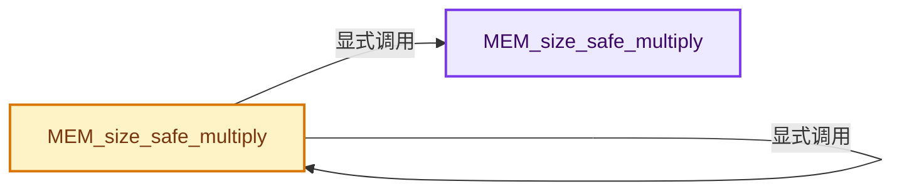

# 实现依赖专题：intern/guardedalloc/MEM_safe_multiply.h

[方向导航](README.md) · [符号索引](../%E7%AC%A6%E5%8F%B7%E4%BE%9D%E8%B5%96%E4%B8%8E%E5%AE%9E%E7%8E%B0%E7%B4%A2%E5%BC%95.md)

本专题从正文实际调用进入，集中保存共享实现。函数有稳定锚点，可从调用处直接跳到对应完整函数；递归与互相调用通过回链组织。

## 本文件的实现关系




## 完整成员与函数实现

<a id="f-e33dc768ff1985b4"></a>

### `MEM_size_safe_multiply`

实现位置：[intern/guardedalloc/MEM_safe_multiply.h](../../../../../intern/guardedalloc/MEM_safe_multiply.h) · L11—L34。

接口参数：

- `size_t a`
- `size_t b`
- `size_t *result`

**教学注释版**

<!-- annotated:815c0ccb66b693 -->

```cpp
[[nodiscard]] inline bool MEM_size_safe_multiply(size_t a, size_t b, size_t *result)
{
  /* A size_t with its high-half bits all set to 1. */
  const size_t high_bits = SIZE_MAX << (sizeof(size_t) * 8 / 2);
  const size_t product = a * b;

  if (product == 0) {
    if (a == 0 || b == 0) {
      *result = 0;
      return true;
    }
    *result = 0;
    return false;
  }

  /* If both A and B fit in N/2 bits, their product fits in N bits without
   * the possibility of overflow. Otherwise verify with a divide. */
  if ((high_bits & (a | b)) == 0 || product / b == a) {
    *result = product;
    return true;
  }
  *result = 0;
  return false;
}
```

<details>
<summary>核对原始源码：intern/guardedalloc/MEM_safe_multiply.h · L11—L34</summary>

<!-- original:815c0ccb66b693:intern/guardedalloc/MEM_safe_multiply.h:11:34 -->

```cpp
[[nodiscard]] inline bool MEM_size_safe_multiply(size_t a, size_t b, size_t *result)
{
  /* A size_t with its high-half bits all set to 1. */
  const size_t high_bits = SIZE_MAX << (sizeof(size_t) * 8 / 2);
  const size_t product = a * b;

  if (product == 0) {
    if (a == 0 || b == 0) {
      *result = 0;
      return true;
    }
    *result = 0;
    return false;
  }

  /* If both A and B fit in N/2 bits, their product fits in N bits without
   * the possibility of overflow. Otherwise verify with a divide. */
  if ((high_bits & (a | b)) == 0 || product / b == a) {
    *result = product;
    return true;
  }
  *result = 0;
  return false;
}
```

</details>

**结果出口**

- `return true;`
- `return false;`

**继续追踪实现**

本实现没有需要继续展开的显式调用；检查返回表达式、对象转换和调用者前置条件。

<a id="f-136caf3bc9f6cd0e"></a>

### `MEM_size_safe_multiply`

实现位置：[intern/guardedalloc/MEM_safe_multiply.h](../../../../../intern/guardedalloc/MEM_safe_multiply.h) · L37—L65。

接口参数：

- `int64_t a`
- `int64_t b`
- `int64_t *result`

**教学注释版**

<!-- annotated:aa94ff09948989 -->

```cpp
[[nodiscard]] inline bool MEM_size_safe_multiply(int64_t a, int64_t b, int64_t *result)
{
  /* Fast path for almost all cases. */
  if ((uint64_t(a) | uint64_t(b)) >> 31 == 0) {
    *result = a * b;
    return true;
  }

  /* Check if resulting size is within range. */
  *result = 0;
  if (a < 0 || b < 0) {
    return false;
  }
  if constexpr (sizeof(size_t) < sizeof(int64_t)) {
    if (uint64_t(a) > SIZE_MAX || uint64_t(b) > SIZE_MAX) {
      return false;
    }
  }

  /* Compute with size_t version. */
  size_t product;
  if (!MEM_size_safe_multiply(size_t(a), size_t(b), &product) ||
      uint64_t(product) > uint64_t(INT64_MAX))
  {
    return false;
  }
  *result = int64_t(product);
  return true;
}
```

<details>
<summary>核对原始源码：intern/guardedalloc/MEM_safe_multiply.h · L37—L65</summary>

<!-- original:aa94ff09948989:intern/guardedalloc/MEM_safe_multiply.h:37:65 -->

```cpp
[[nodiscard]] inline bool MEM_size_safe_multiply(int64_t a, int64_t b, int64_t *result)
{
  /* Fast path for almost all cases. */
  if ((uint64_t(a) | uint64_t(b)) >> 31 == 0) {
    *result = a * b;
    return true;
  }

  /* Check if resulting size is within range. */
  *result = 0;
  if (a < 0 || b < 0) {
    return false;
  }
  if constexpr (sizeof(size_t) < sizeof(int64_t)) {
    if (uint64_t(a) > SIZE_MAX || uint64_t(b) > SIZE_MAX) {
      return false;
    }
  }

  /* Compute with size_t version. */
  size_t product;
  if (!MEM_size_safe_multiply(size_t(a), size_t(b), &product) ||
      uint64_t(product) > uint64_t(INT64_MAX))
  {
    return false;
  }
  *result = int64_t(product);
  return true;
}
```

</details>

**结果出口**

- `return true;`
- `return false;`

**继续追踪实现**

- `MEM_size_safe_multiply` → [MEM_size_safe_multiply · L11](%E4%BE%9D%E8%B5%96-MEM_safe_multiply-8c8a79.md#f-e33dc768ff1985b4)；[MEM_size_safe_multiply · L37](%E4%BE%9D%E8%B5%96-MEM_safe_multiply-8c8a79.md#f-136caf3bc9f6cd0e)。同名重载需按实参类型选择。
