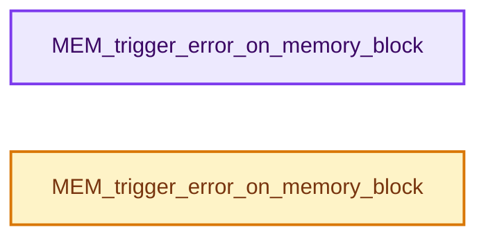
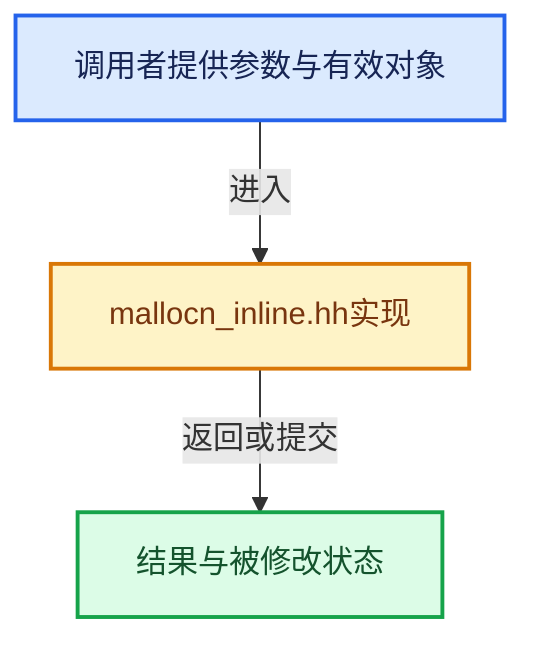

# 实现依赖专题：intern/guardedalloc/intern/mallocn_inline.hh

[方向导航](README.md) · [符号索引](../%E7%AC%A6%E5%8F%B7%E4%BE%9D%E8%B5%96%E4%B8%8E%E5%AE%9E%E7%8E%B0%E7%B4%A2%E5%BC%95.md)

本专题从正文实际调用进入，集中保存共享实现。函数有稳定锚点，可从调用处直接跳到对应完整函数；递归与互相调用通过回链组织。

## 本文件的实现关系






<a id="m-4b263984a331"></a>

## 宏 `ASAN_POISON_MEMORY_REGION`

<!-- annotated:2b38bceb26bb5f -->

```cpp
#  define ASAN_POISON_MEMORY_REGION(addr, size) (void)(0 && ((size) != 0 && (addr) != NULL))
#  define ASAN_UNPOISON_MEMORY_REGION(addr, size) (void)(0 && ((size) != 0 && (addr) != NULL))
```

<details>
<summary>核对原始源码：intern/guardedalloc/intern/mallocn_inline.hh · L27—L28</summary>

<!-- original:2b38bceb26bb5f:intern/guardedalloc/intern/mallocn_inline.hh:27:28 -->

```cpp
#  define ASAN_POISON_MEMORY_REGION(addr, size) (void)(0 && ((size) != 0 && (addr) != NULL))
#  define ASAN_UNPOISON_MEMORY_REGION(addr, size) (void)(0 && ((size) != 0 && (addr) != NULL))
```

</details>

宏在预处理阶段展开，参数替换、重复求值和条件编译应直接从该定义检查。与普通函数不同，宏不会自动提供参数类型检查；构建配置选择哪个定义需结合外围条件。

<a id="m-fab5bb0b512e"></a>

## 宏 `ASAN_UNPOISON_MEMORY_REGION`

<!-- annotated:4de55dd75d1d24 -->

```cpp
#  define ASAN_UNPOISON_MEMORY_REGION(addr, size) (void)(0 && ((size) != 0 && (addr) != NULL))
#endif
```

<details>
<summary>核对原始源码：intern/guardedalloc/intern/mallocn_inline.hh · L28—L29</summary>

<!-- original:4de55dd75d1d24:intern/guardedalloc/intern/mallocn_inline.hh:28:29 -->

```cpp
#  define ASAN_UNPOISON_MEMORY_REGION(addr, size) (void)(0 && ((size) != 0 && (addr) != NULL))
#endif
```

</details>

宏在预处理阶段展开，参数替换、重复求值和条件编译应直接从该定义检查。与普通函数不同，宏不会自动提供参数类型检查；构建配置选择哪个定义需结合外围条件。

## 完整成员与函数实现

<a id="f-557d15ff50eac9ef"></a>

### `MEM_trigger_error_on_memory_block`

实现位置：[intern/guardedalloc/intern/mallocn_inline.hh](../../../../../intern/guardedalloc/intern/mallocn_inline.hh) · L40—L61。

接口参数：

- `const void *address`
- `const size_t size`

**教学注释版**

<!-- annotated:5c559c2a9470b1 -->

```cpp
MEM_INLINE void MEM_trigger_error_on_memory_block(const void *address, const size_t size)
{
  if (address == nullptr) {
#  ifdef WITH_ASSERT_ABORT
    // [讲解] abort：终止进程，不是可供调用者catch的普通C++异常恢复路径。
    abort();
#  endif
    return;
  }

  /* Trigger ASAN error by poisoning the memory and accessing it. */
  ASAN_POISON_MEMORY_REGION(address, size);
  char *buffer = const_cast<char *>(static_cast<const char *>(address));
  const char c = *buffer;
  *buffer &= 255;
  *buffer = c;

  /* In case ASAN is set to not terminate on error, but abort on assert is requested. */
#  ifdef WITH_ASSERT_ABORT
  abort();
#  endif
  ASAN_UNPOISON_MEMORY_REGION(address, size);
}
```

<details>
<summary>核对原始源码：intern/guardedalloc/intern/mallocn_inline.hh · L40—L61</summary>

<!-- original:5c559c2a9470b1:intern/guardedalloc/intern/mallocn_inline.hh:40:61 -->

```cpp
MEM_INLINE void MEM_trigger_error_on_memory_block(const void *address, const size_t size)
{
  if (address == nullptr) {
#  ifdef WITH_ASSERT_ABORT
    abort();
#  endif
    return;
  }

  /* Trigger ASAN error by poisoning the memory and accessing it. */
  ASAN_POISON_MEMORY_REGION(address, size);
  char *buffer = const_cast<char *>(static_cast<const char *>(address));
  const char c = *buffer;
  *buffer &= 255;
  *buffer = c;

  /* In case ASAN is set to not terminate on error, but abort on assert is requested. */
#  ifdef WITH_ASSERT_ABORT
  abort();
#  endif
  ASAN_UNPOISON_MEMORY_REGION(address, size);
}
```

</details>

**继续追踪实现**

- `abort` → [外部契约](https://eel.is/c++draft/support.start.term)：终止进程，不是可供调用者catch的普通C++异常恢复路径。
- `ASAN_POISON_MEMORY_REGION` → [ASAN_POISON_MEMORY_REGION · L27](%E4%BE%9D%E8%B5%96-mallocn_inline-a8e1da.md#m-4b263984a331)。宏定义由构建条件选择。
- `ASAN_UNPOISON_MEMORY_REGION` → [ASAN_UNPOISON_MEMORY_REGION · L28](%E4%BE%9D%E8%B5%96-mallocn_inline-a8e1da.md#m-fab5bb0b512e)。宏定义由构建条件选择。

<a id="f-1d5c4efbe30e6ace"></a>

### `MEM_trigger_error_on_memory_block`

实现位置：[intern/guardedalloc/intern/mallocn_inline.hh](../../../../../intern/guardedalloc/intern/mallocn_inline.hh) · L63—L68。

接口参数：

- `const void *`
- `const size_t`

**教学注释版**

<!-- annotated:d4f0b1deba53d2 -->

```cpp
MEM_INLINE void MEM_trigger_error_on_memory_block(const void * /*address*/, const size_t /*size*/)
{
#  ifdef WITH_ASSERT_ABORT
  // [讲解] abort：终止进程，不是可供调用者catch的普通C++异常恢复路径。
  abort();
#  endif
}
```

<details>
<summary>核对原始源码：intern/guardedalloc/intern/mallocn_inline.hh · L63—L68</summary>

<!-- original:d4f0b1deba53d2:intern/guardedalloc/intern/mallocn_inline.hh:63:68 -->

```cpp
MEM_INLINE void MEM_trigger_error_on_memory_block(const void * /*address*/, const size_t /*size*/)
{
#  ifdef WITH_ASSERT_ABORT
  abort();
#  endif
}
```

</details>

**继续追踪实现**

- `abort` → [外部契约](https://eel.is/c++draft/support.start.term)：终止进程，不是可供调用者catch的普通C++异常恢复路径。
