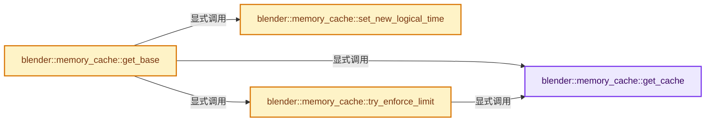

# 实现依赖专题：source/blender/blenlib/intern/memory_cache.cc

[方向导航](README.md) · [符号索引](../%E7%AC%A6%E5%8F%B7%E4%BE%9D%E8%B5%96%E4%B8%8E%E5%AE%9E%E7%8E%B0%E7%B4%A2%E5%BC%95.md)

本专题从正文实际调用进入，集中保存共享实现。函数有稳定锚点，可从调用处直接跳到对应完整函数；递归与互相调用通过回链组织。

## 本文件的实现关系




## 完整成员与函数实现

<a id="f-874b529979d469a8"></a>

### `blender::memory_cache::get_cache`

实现位置：[source/blender/blenlib/intern/memory_cache.cc](../../../../../source/blender/blenlib/intern/memory_cache.cc) · L56—L60。

**教学注释版**

<!-- annotated:817e5993ea342d -->

```cpp
static Cache &get_cache()
{
  static Cache cache;
  return cache;
}
```

<details>
<summary>核对原始源码：source/blender/blenlib/intern/memory_cache.cc · L56—L60</summary>

<!-- original:817e5993ea342d:source/blender/blenlib/intern/memory_cache.cc:56:60 -->

```cpp
static Cache &get_cache()
{
  static Cache cache;
  return cache;
}
```

</details>

**结果出口**

- `return cache;`

**继续追踪实现**

本实现没有需要继续展开的显式调用；检查返回表达式、对象转换和调用者前置条件。

<a id="f-e8d0d4e7f4cfa083"></a>

### `blender::memory_cache::set_new_logical_time`

实现位置：[source/blender/blenlib/intern/memory_cache.cc](../../../../../source/blender/blenlib/intern/memory_cache.cc) · L64—L72。

接口参数：

- `const StoredValue &stored_value`
- `const int64_t new_time`

**教学注释版**

<!-- annotated:515e2a4310e911 -->

```cpp
static void set_new_logical_time(const StoredValue &stored_value, const int64_t new_time)
{
  /* Don't want to use `std::atomic` directly in the struct, because that makes it
   * non-movable. Could also use a non-const accessor, but that may degrade performance more.
   * It's not necessary for correctness that the time is exactly the right value. */
  reinterpret_cast<std::atomic<int64_t> *>(const_cast<int64_t *>(&stored_value.last_use_time))
      ->store(new_time, std::memory_order_relaxed);
  static_assert(sizeof(int64_t) == sizeof(std::atomic<int64_t>));
}
```

<details>
<summary>核对原始源码：source/blender/blenlib/intern/memory_cache.cc · L64—L72</summary>

<!-- original:515e2a4310e911:source/blender/blenlib/intern/memory_cache.cc:64:72 -->

```cpp
static void set_new_logical_time(const StoredValue &stored_value, const int64_t new_time)
{
  /* Don't want to use `std::atomic` directly in the struct, because that makes it
   * non-movable. Could also use a non-const accessor, but that may degrade performance more.
   * It's not necessary for correctness that the time is exactly the right value. */
  reinterpret_cast<std::atomic<int64_t> *>(const_cast<int64_t *>(&stored_value.last_use_time))
      ->store(new_time, std::memory_order_relaxed);
  static_assert(sizeof(int64_t) == sizeof(std::atomic<int64_t>));
}
```

</details>

**继续追踪实现**

- `reinterpret_cast<std::atomic<int64_t> *>(const_cast<int64_t *>(&stored_value.last_use_time)) ->store` → [调用协议](../%E6%A8%A1%E6%9D%BF%E5%AE%8F%E4%B8%8E%E5%8A%A8%E6%80%81%E5%88%86%E6%B4%BE%E5%8D%8F%E8%AE%AE.md)：接收对象类型依赖auto、返回值或模板实例；不按同名猜测目标。调用位置L69。

<a id="f-e59bb5e8f4a5597c"></a>

### `blender::memory_cache::get_base`

实现位置：[source/blender/blenlib/intern/memory_cache.cc](../../../../../source/blender/blenlib/intern/memory_cache.cc) · L74—L130。

接口参数：

- `const GenericKey &key`
- `const FunctionRef<std::unique_ptr<CachedValue>()> compute_fn`

**教学注释版**

<!-- annotated:4d2de0e73e5061 -->

```cpp
std::shared_ptr<CachedValue> get_base(const GenericKey &key,
                                      const FunctionRef<std::unique_ptr<CachedValue>()> compute_fn)
{
  Cache &cache = get_cache();
  /* "Touch" the cached value so that we know that it is still used. This makes it less likely that
   * it is removed. */
  const int64_t new_time = cache.logical_time.fetch_add(1, std::memory_order_relaxed);
  {
    /* Fast path when the value is already cached. */
    CacheMap::ConstAccessor accessor;
    if (cache.map.lookup(accessor, std::ref(key))) {
      set_new_logical_time(accessor->second, new_time);
      return accessor->second.value;
    }
  }

  /* Compute value while no locks are held to avoid potential for dead-locks. Not using a lock also
   * means that the value may be computed more than once, but that's still better than locking all
   * the time. It may be possible to implement something smarter in the future. */
  std::shared_ptr<CachedValue> result = compute_fn();
  /* Result should be valid. Use exception to propagate error if necessary. */
  BLI_assert(result);

  {
    CacheMap::MutableAccessor accessor;
    const bool newly_inserted = cache.map.add(accessor, std::ref(key));
    if (!newly_inserted) {
      /* The value is available already. It was computed unnecessarily. Use the value created by
       * the other thread instead. */
      return accessor->second.value;
    }
    /* We want to store the key in the map, but the reference we got passed in may go out of scope.
     * So make a storable copy of it that we use in the map. */
    accessor->second.key = key.to_storable();
    /* Modifying the key should be fine because the new key is equal to the original key. */
    const_cast<std::reference_wrapper<const GenericKey> &>(accessor->first) = std::ref(
        *accessor->second.key);

    /* Store the value. Don't move, because we still want to return the value from the function. */
    accessor->second.value = result;
    /* Set initial logical time for the new cached entry. */
    set_new_logical_time(accessor->second, new_time);

    {
      /* Update global data of the cache. */
      std::lock_guard lock{cache.global_mutex};
      memory_counter::MemoryCounter memory_counter{cache.memory};
      accessor->second.value->count_memory(memory_counter);
      cache.keys.append(&accessor->first.get());
      cache.size_in_bytes = cache.memory.total_bytes;
    }
  }
  /* Potentially free elements from the cache. Note, even if this would free the value we just
   * added, it would still work correctly, because we already have a shared_ptr to it. */
  try_enforce_limit();
  return result;
}
```

<details>
<summary>核对原始源码：source/blender/blenlib/intern/memory_cache.cc · L74—L130</summary>

<!-- original:4d2de0e73e5061:source/blender/blenlib/intern/memory_cache.cc:74:130 -->

```cpp
std::shared_ptr<CachedValue> get_base(const GenericKey &key,
                                      const FunctionRef<std::unique_ptr<CachedValue>()> compute_fn)
{
  Cache &cache = get_cache();
  /* "Touch" the cached value so that we know that it is still used. This makes it less likely that
   * it is removed. */
  const int64_t new_time = cache.logical_time.fetch_add(1, std::memory_order_relaxed);
  {
    /* Fast path when the value is already cached. */
    CacheMap::ConstAccessor accessor;
    if (cache.map.lookup(accessor, std::ref(key))) {
      set_new_logical_time(accessor->second, new_time);
      return accessor->second.value;
    }
  }

  /* Compute value while no locks are held to avoid potential for dead-locks. Not using a lock also
   * means that the value may be computed more than once, but that's still better than locking all
   * the time. It may be possible to implement something smarter in the future. */
  std::shared_ptr<CachedValue> result = compute_fn();
  /* Result should be valid. Use exception to propagate error if necessary. */
  BLI_assert(result);

  {
    CacheMap::MutableAccessor accessor;
    const bool newly_inserted = cache.map.add(accessor, std::ref(key));
    if (!newly_inserted) {
      /* The value is available already. It was computed unnecessarily. Use the value created by
       * the other thread instead. */
      return accessor->second.value;
    }
    /* We want to store the key in the map, but the reference we got passed in may go out of scope.
     * So make a storable copy of it that we use in the map. */
    accessor->second.key = key.to_storable();
    /* Modifying the key should be fine because the new key is equal to the original key. */
    const_cast<std::reference_wrapper<const GenericKey> &>(accessor->first) = std::ref(
        *accessor->second.key);

    /* Store the value. Don't move, because we still want to return the value from the function. */
    accessor->second.value = result;
    /* Set initial logical time for the new cached entry. */
    set_new_logical_time(accessor->second, new_time);

    {
      /* Update global data of the cache. */
      std::lock_guard lock{cache.global_mutex};
      memory_counter::MemoryCounter memory_counter{cache.memory};
      accessor->second.value->count_memory(memory_counter);
      cache.keys.append(&accessor->first.get());
      cache.size_in_bytes = cache.memory.total_bytes;
    }
  }
  /* Potentially free elements from the cache. Note, even if this would free the value we just
   * added, it would still work correctly, because we already have a shared_ptr to it. */
  try_enforce_limit();
  return result;
}
```

</details>

**沿实际写入检查状态**

- `accessor->second.key = key.to_storable();`
- `accessor->second.value = result;`
- `cache.size_in_bytes = cache.memory.total_bytes;`

**结果出口**

- `return accessor->second.value;`
- `return result;`

**继续追踪实现**

- `get_cache` → [blender::memory_cache::get_cache · L56](%E4%BE%9D%E8%B5%96-memory_cache-9e74ae.md#f-874b529979d469a8)。
- `cache.logical_time.fetch_add` → [调用协议](../%E6%A8%A1%E6%9D%BF%E5%AE%8F%E4%B8%8E%E5%8A%A8%E6%80%81%E5%88%86%E6%B4%BE%E5%8D%8F%E8%AE%AE.md)：接收对象类型依赖auto、返回值或模板实例；不按同名猜测目标。调用位置L80。
- `cache.map.lookup` → [调用协议](../%E6%A8%A1%E6%9D%BF%E5%AE%8F%E4%B8%8E%E5%8A%A8%E6%80%81%E5%88%86%E6%B4%BE%E5%8D%8F%E8%AE%AE.md)：接收对象类型依赖auto、返回值或模板实例；不按同名猜测目标。调用位置L84。
- `std::ref` → [外部契约](https://eel.is/c++draft/)：这个边界按实际表达式及所属类型核对参数、返回值、寿命与失败行为。这里提供接口入口，不声称已解释该第三方版本的内部实现。
- `set_new_logical_time` → [blender::memory_cache::set_new_logical_time · L64](%E4%BE%9D%E8%B5%96-memory_cache-9e74ae.md#f-e8d0d4e7f4cfa083)。
- `compute_fn` → [调用协议](../%E6%A8%A1%E6%9D%BF%E5%AE%8F%E4%B8%8E%E5%8A%A8%E6%80%81%E5%88%86%E6%B4%BE%E5%8D%8F%E8%AE%AE.md)：局部可调用对象，须结合其初始化与捕获环境。调用位置L93。
- `BLI_assert` → [BLI_assert · L48](../01-%E5%9F%BA%E7%A1%80%E5%AE%B9%E5%99%A8%E4%B8%8E%E7%8E%B0%E4%BB%A3CPP/%E4%BE%9D%E8%B5%96-BLI_assert-cc98e8.md#m-57a88495704d)；[BLI_assert · L63](../01-%E5%9F%BA%E7%A1%80%E5%AE%B9%E5%99%A8%E4%B8%8E%E7%8E%B0%E4%BB%A3CPP/%E4%BE%9D%E8%B5%96-BLI_assert-cc98e8.md#m-d07050020cb5)。宏定义由构建条件选择。
- `cache.map.add` → [调用协议](../%E6%A8%A1%E6%9D%BF%E5%AE%8F%E4%B8%8E%E5%8A%A8%E6%80%81%E5%88%86%E6%B4%BE%E5%8D%8F%E8%AE%AE.md)：接收对象类型依赖auto、返回值或模板实例；不按同名猜测目标。调用位置L99。
- `key.to_storable` → [调用协议](../%E6%A8%A1%E6%9D%BF%E5%AE%8F%E4%B8%8E%E5%8A%A8%E6%80%81%E5%88%86%E6%B4%BE%E5%8D%8F%E8%AE%AE.md)：由接收对象具体类型或运行时策略提供实现。调用位置L107。
- `accessor->second.value->count_memory` → [调用协议](../%E6%A8%A1%E6%9D%BF%E5%AE%8F%E4%B8%8E%E5%8A%A8%E6%80%81%E5%88%86%E6%B4%BE%E5%8D%8F%E8%AE%AE.md)：接收对象类型依赖auto、返回值或模板实例；不按同名猜测目标。调用位置L121。
- `cache.keys.append` → [调用协议](../%E6%A8%A1%E6%9D%BF%E5%AE%8F%E4%B8%8E%E5%8A%A8%E6%80%81%E5%88%86%E6%B4%BE%E5%8D%8F%E8%AE%AE.md)：接收对象类型依赖auto、返回值或模板实例；不按同名猜测目标。调用位置L122。
- `accessor->first.get` → [调用协议](../%E6%A8%A1%E6%9D%BF%E5%AE%8F%E4%B8%8E%E5%8A%A8%E6%80%81%E5%88%86%E6%B4%BE%E5%8D%8F%E8%AE%AE.md)：接收对象类型依赖auto、返回值或模板实例；不按同名猜测目标。调用位置L122。
- `try_enforce_limit` → [blender::memory_cache::try_enforce_limit · L184](%E4%BE%9D%E8%B5%96-memory_cache-9e74ae.md#f-e1da4afb7122fb4d)。

<a id="f-e1da4afb7122fb4d"></a>

### `blender::memory_cache::try_enforce_limit`

实现位置：[source/blender/blenlib/intern/memory_cache.cc](../../../../../source/blender/blenlib/intern/memory_cache.cc) · L184—L277。

**教学注释版**

<!-- annotated:4c0c95567d79ce -->

```cpp
static void try_enforce_limit()
{
  Cache &cache = get_cache();
  const int64_t old_size = cache.size_in_bytes.load(std::memory_order_relaxed);
  const int64_t approximate_limit = cache.approximate_limit.load(std::memory_order_relaxed);
  if (old_size < approximate_limit) {
    /* Nothing to do, the current cache size is still within the right limits. */
    return;
  }

  std::lock_guard lock{cache.global_mutex};

  /* Gather all the keys with their latest usage times. */
  Vector<std::pair<int64_t, const GenericKey *>> keys_with_time;
  for (const GenericKey *key : cache.keys) {
    CacheMap::ConstAccessor accessor;
    if (!cache.map.lookup(accessor, *key)) {
      continue;
    }
    // [讲解] keys_with_time.append：在尾部建立新元素，必要时先扩大存储。
    keys_with_time.append({accessor->second.last_use_time, key});
  }
  /* Sort the items so that the newest keys come first. */
  std::ranges::sort(keys_with_time);
  // [讲解] keys_with_time.begin：提供当前存储或有效范围的地址。
  std::reverse(keys_with_time.begin(), keys_with_time.end());

  /* Count used memory starting at the most recently touched element. Stop at the element when the
   * amount became larger than the capacity. */
  cache.memory.reset();
  std::optional<int> first_bad_index;
  {
    MemoryCounter memory_counter{cache.memory};
    for (const int i : keys_with_time.index_range()) {
      const GenericKey &key = *keys_with_time[i].second;
      CacheMap::ConstAccessor accessor;
      if (!cache.map.lookup(accessor, key)) {
        continue;
      }
      accessor->second.value->count_memory(memory_counter);
      /* Undershoot a little bit. This typically results in more things being freed that have not
       * been used in a while. The benefit is that we have to do the decision what to free less
       * often than if we were always just freeing the minimum amount necessary. */
      if (cache.memory.total_bytes <= approximate_limit * 0.75) {
        continue;
      }
      first_bad_index = i;
      break;
    }
  }
  if (!first_bad_index) {
    return;
  }

  /* Avoid recounting memory if the last item is not way too large and the overshoot is still ok.
   * The alternative would be to subtract the last item from the counted memory again, but removing
   * from #MemoryCount is not implemented yet. */
  bool need_memory_recount = false;
  if (cache.memory.total_bytes < approximate_limit * 1.1) {
    *first_bad_index += 1;
    // [讲解] keys_with_time.size：用end_减begin_得到活元素数量。
    if (*first_bad_index == keys_with_time.size()) {
      return;
    }
  }
  else {
    need_memory_recount = true;
  }

  /* Remove elements that don't fit anymore. */
  for (const int i : keys_with_time.index_range().drop_front(*first_bad_index)) {
    const GenericKey &key = *keys_with_time[i].second;
    cache.map.remove(key);
  }

  /* Update keys vector. */
  cache.keys.clear();
  for (const int i : keys_with_time.index_range().take_front(*first_bad_index)) {
    cache.keys.append(keys_with_time[i].second);
  }

  if (need_memory_recount) {
    /* Recount memory another time, because the last count does not accurately represent the actual
     * value. */
    cache.memory.reset();
    MemoryCounter memory_counter{cache.memory};
    for (const int i : keys_with_time.index_range().take_front(*first_bad_index)) {
      const GenericKey &key = *keys_with_time[i].second;
      CacheMap::ConstAccessor accessor;
      if (!cache.map.lookup(accessor, key)) {
        continue;
      }
      accessor->second.value->count_memory(memory_counter);
    }
  }
  cache.size_in_bytes = cache.memory.total_bytes;
}
```

<details>
<summary>核对原始源码：source/blender/blenlib/intern/memory_cache.cc · L184—L277</summary>

<!-- original:4c0c95567d79ce:source/blender/blenlib/intern/memory_cache.cc:184:277 -->

```cpp
static void try_enforce_limit()
{
  Cache &cache = get_cache();
  const int64_t old_size = cache.size_in_bytes.load(std::memory_order_relaxed);
  const int64_t approximate_limit = cache.approximate_limit.load(std::memory_order_relaxed);
  if (old_size < approximate_limit) {
    /* Nothing to do, the current cache size is still within the right limits. */
    return;
  }

  std::lock_guard lock{cache.global_mutex};

  /* Gather all the keys with their latest usage times. */
  Vector<std::pair<int64_t, const GenericKey *>> keys_with_time;
  for (const GenericKey *key : cache.keys) {
    CacheMap::ConstAccessor accessor;
    if (!cache.map.lookup(accessor, *key)) {
      continue;
    }
    keys_with_time.append({accessor->second.last_use_time, key});
  }
  /* Sort the items so that the newest keys come first. */
  std::ranges::sort(keys_with_time);
  std::reverse(keys_with_time.begin(), keys_with_time.end());

  /* Count used memory starting at the most recently touched element. Stop at the element when the
   * amount became larger than the capacity. */
  cache.memory.reset();
  std::optional<int> first_bad_index;
  {
    MemoryCounter memory_counter{cache.memory};
    for (const int i : keys_with_time.index_range()) {
      const GenericKey &key = *keys_with_time[i].second;
      CacheMap::ConstAccessor accessor;
      if (!cache.map.lookup(accessor, key)) {
        continue;
      }
      accessor->second.value->count_memory(memory_counter);
      /* Undershoot a little bit. This typically results in more things being freed that have not
       * been used in a while. The benefit is that we have to do the decision what to free less
       * often than if we were always just freeing the minimum amount necessary. */
      if (cache.memory.total_bytes <= approximate_limit * 0.75) {
        continue;
      }
      first_bad_index = i;
      break;
    }
  }
  if (!first_bad_index) {
    return;
  }

  /* Avoid recounting memory if the last item is not way too large and the overshoot is still ok.
   * The alternative would be to subtract the last item from the counted memory again, but removing
   * from #MemoryCount is not implemented yet. */
  bool need_memory_recount = false;
  if (cache.memory.total_bytes < approximate_limit * 1.1) {
    *first_bad_index += 1;
    if (*first_bad_index == keys_with_time.size()) {
      return;
    }
  }
  else {
    need_memory_recount = true;
  }

  /* Remove elements that don't fit anymore. */
  for (const int i : keys_with_time.index_range().drop_front(*first_bad_index)) {
    const GenericKey &key = *keys_with_time[i].second;
    cache.map.remove(key);
  }

  /* Update keys vector. */
  cache.keys.clear();
  for (const int i : keys_with_time.index_range().take_front(*first_bad_index)) {
    cache.keys.append(keys_with_time[i].second);
  }

  if (need_memory_recount) {
    /* Recount memory another time, because the last count does not accurately represent the actual
     * value. */
    cache.memory.reset();
    MemoryCounter memory_counter{cache.memory};
    for (const int i : keys_with_time.index_range().take_front(*first_bad_index)) {
      const GenericKey &key = *keys_with_time[i].second;
      CacheMap::ConstAccessor accessor;
      if (!cache.map.lookup(accessor, key)) {
        continue;
      }
      accessor->second.value->count_memory(memory_counter);
    }
  }
  cache.size_in_bytes = cache.memory.total_bytes;
}
```

</details>

**沿实际写入检查状态**

- `first_bad_index = i;`
- `need_memory_recount = true;`
- `cache.size_in_bytes = cache.memory.total_bytes;`

**继续追踪实现**

- `get_cache` → [blender::memory_cache::get_cache · L56](%E4%BE%9D%E8%B5%96-memory_cache-9e74ae.md#f-874b529979d469a8)。
- `cache.size_in_bytes.load` → [调用协议](../%E6%A8%A1%E6%9D%BF%E5%AE%8F%E4%B8%8E%E5%8A%A8%E6%80%81%E5%88%86%E6%B4%BE%E5%8D%8F%E8%AE%AE.md)：接收对象类型依赖auto、返回值或模板实例；不按同名猜测目标。调用位置L187。
- `cache.approximate_limit.load` → [调用协议](../%E6%A8%A1%E6%9D%BF%E5%AE%8F%E4%B8%8E%E5%8A%A8%E6%80%81%E5%88%86%E6%B4%BE%E5%8D%8F%E8%AE%AE.md)：接收对象类型依赖auto、返回值或模板实例；不按同名猜测目标。调用位置L188。
- `cache.map.lookup` → [调用协议](../%E6%A8%A1%E6%9D%BF%E5%AE%8F%E4%B8%8E%E5%8A%A8%E6%80%81%E5%88%86%E6%B4%BE%E5%8D%8F%E8%AE%AE.md)：接收对象类型依赖auto、返回值或模板实例；不按同名猜测目标。调用位置L200。
- `keys_with_time.append` → [blender::Vector::append · L498](../01-%E5%9F%BA%E7%A1%80%E5%AE%B9%E5%99%A8%E4%B8%8E%E7%8E%B0%E4%BB%A3CPP/11-Vector%E6%8F%92%E5%85%A5%E5%88%A0%E9%99%A4%E4%B8%8E%E9%87%8D%E6%8E%92.md#f-5bde268a69e443ec)；[blender::Vector::append · L502](../01-%E5%9F%BA%E7%A1%80%E5%AE%B9%E5%99%A8%E4%B8%8E%E7%8E%B0%E4%BB%A3CPP/11-Vector%E6%8F%92%E5%85%A5%E5%88%A0%E9%99%A4%E4%B8%8E%E9%87%8D%E6%8E%92.md#f-591e0b15e6308532)。同名重载需按实参类型选择。
- `std::ranges::sort` → [外部契约](https://eel.is/c++draft/)：这个边界按实际表达式及所属类型核对参数、返回值、寿命与失败行为。这里提供接口入口，不声称已解释该第三方版本的内部实现。
- `std::reverse` → [外部契约](https://eel.is/c++draft/)：这个边界按实际表达式及所属类型核对参数、返回值、寿命与失败行为。这里提供接口入口，不声称已解释该第三方版本的内部实现。
- `keys_with_time.begin` → [blender::Vector::begin · L967](../01-%E5%9F%BA%E7%A1%80%E5%AE%B9%E5%99%A8%E4%B8%8E%E7%8E%B0%E4%BB%A3CPP/12-Vector%E5%BC%82%E5%B8%B8%E5%AE%89%E5%85%A8%E4%B8%8E%E8%BE%B9%E7%95%8C.md#f-64fb75a6663b953c)；[blender::Vector::begin · L976](../01-%E5%9F%BA%E7%A1%80%E5%AE%B9%E5%99%A8%E4%B8%8E%E7%8E%B0%E4%BB%A3CPP/12-Vector%E5%BC%82%E5%B8%B8%E5%AE%89%E5%85%A8%E4%B8%8E%E8%BE%B9%E7%95%8C.md#f-7c6486a8b8e8f13f)。同名重载需按实参类型选择。
- `keys_with_time.end` → [blender::Vector::end · L971](../01-%E5%9F%BA%E7%A1%80%E5%AE%B9%E5%99%A8%E4%B8%8E%E7%8E%B0%E4%BB%A3CPP/12-Vector%E5%BC%82%E5%B8%B8%E5%AE%89%E5%85%A8%E4%B8%8E%E8%BE%B9%E7%95%8C.md#f-8a6033745be8f712)；[blender::Vector::end · L980](../01-%E5%9F%BA%E7%A1%80%E5%AE%B9%E5%99%A8%E4%B8%8E%E7%8E%B0%E4%BB%A3CPP/12-Vector%E5%BC%82%E5%B8%B8%E5%AE%89%E5%85%A8%E4%B8%8E%E8%BE%B9%E7%95%8C.md#f-ebb3ada259887677)。同名重载需按实参类型选择。
- `cache.memory.reset` → [调用协议](../%E6%A8%A1%E6%9D%BF%E5%AE%8F%E4%B8%8E%E5%8A%A8%E6%80%81%E5%88%86%E6%B4%BE%E5%8D%8F%E8%AE%AE.md)：接收对象类型依赖auto、返回值或模板实例；不按同名猜测目标。调用位置L211。
- `keys_with_time.index_range` → [blender::Vector::index_range · L1026](../01-%E5%9F%BA%E7%A1%80%E5%AE%B9%E5%99%A8%E4%B8%8E%E7%8E%B0%E4%BB%A3CPP/12-Vector%E5%BC%82%E5%B8%B8%E5%AE%89%E5%85%A8%E4%B8%8E%E8%BE%B9%E7%95%8C.md#f-ac29cf36ef185ab9)。
- `accessor->second.value->count_memory` → [调用协议](../%E6%A8%A1%E6%9D%BF%E5%AE%8F%E4%B8%8E%E5%8A%A8%E6%80%81%E5%88%86%E6%B4%BE%E5%8D%8F%E8%AE%AE.md)：接收对象类型依赖auto、返回值或模板实例；不按同名猜测目标。调用位置L221。
- `keys_with_time.size` → [blender::Vector::size · L780](../01-%E5%9F%BA%E7%A1%80%E5%AE%B9%E5%99%A8%E4%B8%8E%E7%8E%B0%E4%BB%A3CPP/11-Vector%E6%8F%92%E5%85%A5%E5%88%A0%E9%99%A4%E4%B8%8E%E9%87%8D%E6%8E%92.md#f-714773731767349c)。
- `keys_with_time.index_range().drop_front` → [调用协议](../%E6%A8%A1%E6%9D%BF%E5%AE%8F%E4%B8%8E%E5%8A%A8%E6%80%81%E5%88%86%E6%B4%BE%E5%8D%8F%E8%AE%AE.md)：接收对象类型依赖auto、返回值或模板实例；不按同名猜测目标。调用位置L251。
- `cache.map.remove` → [调用协议](../%E6%A8%A1%E6%9D%BF%E5%AE%8F%E4%B8%8E%E5%8A%A8%E6%80%81%E5%88%86%E6%B4%BE%E5%8D%8F%E8%AE%AE.md)：接收对象类型依赖auto、返回值或模板实例；不按同名猜测目标。调用位置L253。
- `cache.keys.clear` → [调用协议](../%E6%A8%A1%E6%9D%BF%E5%AE%8F%E4%B8%8E%E5%8A%A8%E6%80%81%E5%88%86%E6%B4%BE%E5%8D%8F%E8%AE%AE.md)：接收对象类型依赖auto、返回值或模板实例；不按同名猜测目标。调用位置L257。
- `keys_with_time.index_range().take_front` → [调用协议](../%E6%A8%A1%E6%9D%BF%E5%AE%8F%E4%B8%8E%E5%8A%A8%E6%80%81%E5%88%86%E6%B4%BE%E5%8D%8F%E8%AE%AE.md)：接收对象类型依赖auto、返回值或模板实例；不按同名猜测目标。调用位置L258。
- `cache.keys.append` → [调用协议](../%E6%A8%A1%E6%9D%BF%E5%AE%8F%E4%B8%8E%E5%8A%A8%E6%80%81%E5%88%86%E6%B4%BE%E5%8D%8F%E8%AE%AE.md)：接收对象类型依赖auto、返回值或模板实例；不按同名猜测目标。调用位置L259。
