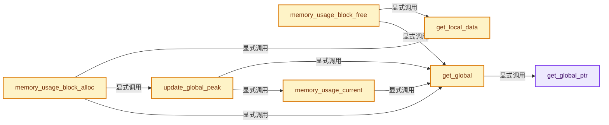

# 实现依赖专题：intern/guardedalloc/intern/memory_usage.cc

[方向导航](README.md) · [符号索引](../%E7%AC%A6%E5%8F%B7%E4%BE%9D%E8%B5%96%E4%B8%8E%E5%AE%9E%E7%8E%B0%E7%B4%A2%E5%BC%95.md)

本专题从正文实际调用进入，集中保存共享实现。函数有稳定锚点，可从调用处直接跳到对应完整函数；递归与互相调用通过回链组织。

## 本文件的实现关系




## 完整成员与函数实现

<a id="f-e413de90dbc3fec4"></a>

### `get_global_ptr`

实现位置：[intern/guardedalloc/intern/memory_usage.cc](../../../../../intern/guardedalloc/intern/memory_usage.cc) · L113—L117。

**教学注释版**

<!-- annotated:8ccfeca57980d5 -->

```cpp
static std::shared_ptr<Global> &get_global_ptr()
{
  // [讲解] std::make_shared<Global>：构造由共享控制块管理的对象；共享寿命不自动使被指对象读写线程安全，强引用环需单独处理。
  static std::shared_ptr<Global> global = std::make_shared<Global>();
  return global;
}
```

<details>
<summary>核对原始源码：intern/guardedalloc/intern/memory_usage.cc · L113—L117</summary>

<!-- original:8ccfeca57980d5:intern/guardedalloc/intern/memory_usage.cc:113:117 -->

```cpp
static std::shared_ptr<Global> &get_global_ptr()
{
  static std::shared_ptr<Global> global = std::make_shared<Global>();
  return global;
}
```

</details>

**结果出口**

- `return global;`

**继续追踪实现**

- `std::make_shared<Global>` → [外部契约](https://eel.is/c++draft/util.smartptr.shared.create)：构造由共享控制块管理的对象；共享寿命不自动使被指对象读写线程安全，强引用环需单独处理。

<a id="f-7935c961df71afb0"></a>

### `get_global`

实现位置：[intern/guardedalloc/intern/memory_usage.cc](../../../../../intern/guardedalloc/intern/memory_usage.cc) · L119—L122。

**教学注释版**

<!-- annotated:751520be7c42fb -->

```cpp
static Global &get_global()
{
  return *get_global_ptr();
}
```

<details>
<summary>核对原始源码：intern/guardedalloc/intern/memory_usage.cc · L119—L122</summary>

<!-- original:751520be7c42fb:intern/guardedalloc/intern/memory_usage.cc:119:122 -->

```cpp
static Global &get_global()
{
  return *get_global_ptr();
}
```

</details>

**结果出口**

- `return *get_global_ptr();`

**继续追踪实现**

- `get_global_ptr` → [get_global_ptr · L113](%E4%BE%9D%E8%B5%96-memory_usage-0a2000.md#f-e413de90dbc3fec4)。

<a id="f-9c01ce9095e10a6a"></a>

### `get_local_data`

实现位置：[intern/guardedalloc/intern/memory_usage.cc](../../../../../intern/guardedalloc/intern/memory_usage.cc) · L124—L129。

**教学注释版**

<!-- annotated:32d1ffb82f4449 -->

```cpp
static Local &get_local_data()
{
  static thread_local Local local;
  // [讲解] assert：检查开发者预期条件，配置可能关闭；不承担完整输入处理或自动修复。
  assert(!local.destructed);
  return local;
}
```

<details>
<summary>核对原始源码：intern/guardedalloc/intern/memory_usage.cc · L124—L129</summary>

<!-- original:32d1ffb82f4449:intern/guardedalloc/intern/memory_usage.cc:124:129 -->

```cpp
static Local &get_local_data()
{
  static thread_local Local local;
  assert(!local.destructed);
  return local;
}
```

</details>

**结果出口**

- `return local;`

**继续追踪实现**

- `assert` → [外部契约](https://eel.is/c++draft/assertions)：检查开发者预期条件，配置可能关闭；不承担完整输入处理或自动修复。

<a id="f-c9273e8ba02a848c"></a>

### `update_global_peak`

实现位置：[intern/guardedalloc/intern/memory_usage.cc](../../../../../intern/guardedalloc/intern/memory_usage.cc) · L166—L180。

**教学注释版**

<!-- annotated:b814a0d08294bd -->

```cpp
static void update_global_peak()
{
  Global &global = get_global();
  /* Update peak. */
  // [讲解] std::max<size_t>：按比较关系选取较大值。本讲解中的增长公式同时满足最低请求和几何增长；若保存返回引用，还需注意实参寿命。
  global.peak = std::max<size_t>(global.peak, memory_usage_current());

  std::lock_guard lock{global.locals_mutex};

  for (Local *local : global.locals) {
    // [讲解] assert：检查开发者预期条件，配置可能关闭；不承担完整输入处理或自动修复。
    assert(!local->destructed);
    /* Updating this makes sure that the peak is not updated too often, which would degrade
     * performance. */
    local->mem_in_use_during_peak_update = local->mem_in_use.load(std::memory_order_relaxed);
  }
}
```

<details>
<summary>核对原始源码：intern/guardedalloc/intern/memory_usage.cc · L166—L180</summary>

<!-- original:b814a0d08294bd:intern/guardedalloc/intern/memory_usage.cc:166:180 -->

```cpp
static void update_global_peak()
{
  Global &global = get_global();
  /* Update peak. */
  global.peak = std::max<size_t>(global.peak, memory_usage_current());

  std::lock_guard lock{global.locals_mutex};

  for (Local *local : global.locals) {
    assert(!local->destructed);
    /* Updating this makes sure that the peak is not updated too often, which would degrade
     * performance. */
    local->mem_in_use_during_peak_update = local->mem_in_use.load(std::memory_order_relaxed);
  }
}
```

</details>

**沿实际写入检查状态**

- `global.peak = std::max<size_t>(global.peak, memory_usage_current());`
- `local->mem_in_use_during_peak_update = local->mem_in_use.load(std::memory_order_relaxed);`

**继续追踪实现**

- `get_global` → [get_global · L119](%E4%BE%9D%E8%B5%96-memory_usage-0a2000.md#f-7935c961df71afb0)。
- `std::max<size_t>` → [外部契约](https://eel.is/c++draft/alg.min.max)：按比较关系选取较大值。本讲解中的增长公式同时满足最低请求和几何增长；若保存返回引用，还需注意实参寿命。
- `memory_usage_current` → [memory_usage_current · L242](%E4%BE%9D%E8%B5%96-memory_usage-0a2000.md#f-3597d00ae55789c3)。
- `assert` → [外部契约](https://eel.is/c++draft/assertions)：检查开发者预期条件，配置可能关闭；不承担完整输入处理或自动修复。
- `local->mem_in_use.load` → [调用协议](../%E6%A8%A1%E6%9D%BF%E5%AE%8F%E4%B8%8E%E5%8A%A8%E6%80%81%E5%88%86%E6%B4%BE%E5%8D%8F%E8%AE%AE.md)：接收对象类型依赖auto、返回值或模板实例；不按同名猜测目标。调用位置L178。

<a id="f-c61403f995d91ebf"></a>

### `memory_usage_block_alloc`

实现位置：[intern/guardedalloc/intern/memory_usage.cc](../../../../../intern/guardedalloc/intern/memory_usage.cc) · L188—L210。

接口参数：

- `const size_t size`

**教学注释版**

<!-- annotated:29f8515428e95e -->

```cpp
void memory_usage_block_alloc(const size_t size)
{
  if (use_local_counters.load(std::memory_order_relaxed)) [[likely]] {
    Local &local = get_local_data();
    /* Increase local memory counts. This does not cause thread synchronization in the majority of
     * cases, because each thread has these counters on a separate cache line. It may only cause
     * synchronization if another thread is computing the total current memory usage at the same
     * time, which is very rare compared to doing allocations. */
    local.blocks_num.fetch_add(1, std::memory_order_relaxed);
    local.mem_in_use.fetch_add(int64_t(size), std::memory_order_relaxed);

    /* If a certain amount of new memory has been allocated, update the peak. */
    if (local.mem_in_use - local.mem_in_use_during_peak_update > peak_update_threshold) {
      update_global_peak();
    }
  }
  else {
    Global &global = get_global();
    /* Increase global memory counts. */
    global.blocks_num_outside_locals.fetch_add(1, std::memory_order_relaxed);
    global.mem_in_use_outside_locals.fetch_add(int64_t(size), std::memory_order_relaxed);
  }
}
```

<details>
<summary>核对原始源码：intern/guardedalloc/intern/memory_usage.cc · L188—L210</summary>

<!-- original:29f8515428e95e:intern/guardedalloc/intern/memory_usage.cc:188:210 -->

```cpp
void memory_usage_block_alloc(const size_t size)
{
  if (use_local_counters.load(std::memory_order_relaxed)) [[likely]] {
    Local &local = get_local_data();
    /* Increase local memory counts. This does not cause thread synchronization in the majority of
     * cases, because each thread has these counters on a separate cache line. It may only cause
     * synchronization if another thread is computing the total current memory usage at the same
     * time, which is very rare compared to doing allocations. */
    local.blocks_num.fetch_add(1, std::memory_order_relaxed);
    local.mem_in_use.fetch_add(int64_t(size), std::memory_order_relaxed);

    /* If a certain amount of new memory has been allocated, update the peak. */
    if (local.mem_in_use - local.mem_in_use_during_peak_update > peak_update_threshold) {
      update_global_peak();
    }
  }
  else {
    Global &global = get_global();
    /* Increase global memory counts. */
    global.blocks_num_outside_locals.fetch_add(1, std::memory_order_relaxed);
    global.mem_in_use_outside_locals.fetch_add(int64_t(size), std::memory_order_relaxed);
  }
}
```

</details>

**继续追踪实现**

- `use_local_counters.load` → [调用协议](../%E6%A8%A1%E6%9D%BF%E5%AE%8F%E4%B8%8E%E5%8A%A8%E6%80%81%E5%88%86%E6%B4%BE%E5%8D%8F%E8%AE%AE.md)：接收对象类型依赖auto、返回值或模板实例；不按同名猜测目标。调用位置L190。
- `get_local_data` → [get_local_data · L124](%E4%BE%9D%E8%B5%96-memory_usage-0a2000.md#f-9c01ce9095e10a6a)。
- `local.blocks_num.fetch_add` → [调用协议](../%E6%A8%A1%E6%9D%BF%E5%AE%8F%E4%B8%8E%E5%8A%A8%E6%80%81%E5%88%86%E6%B4%BE%E5%8D%8F%E8%AE%AE.md)：接收对象类型依赖auto、返回值或模板实例；不按同名猜测目标。调用位置L196。
- `local.mem_in_use.fetch_add` → [调用协议](../%E6%A8%A1%E6%9D%BF%E5%AE%8F%E4%B8%8E%E5%8A%A8%E6%80%81%E5%88%86%E6%B4%BE%E5%8D%8F%E8%AE%AE.md)：接收对象类型依赖auto、返回值或模板实例；不按同名猜测目标。调用位置L197。
- `update_global_peak` → [update_global_peak · L166](%E4%BE%9D%E8%B5%96-memory_usage-0a2000.md#f-c9273e8ba02a848c)。
- `get_global` → [get_global · L119](%E4%BE%9D%E8%B5%96-memory_usage-0a2000.md#f-7935c961df71afb0)。
- `global.blocks_num_outside_locals.fetch_add` → [调用协议](../%E6%A8%A1%E6%9D%BF%E5%AE%8F%E4%B8%8E%E5%8A%A8%E6%80%81%E5%88%86%E6%B4%BE%E5%8D%8F%E8%AE%AE.md)：接收对象类型依赖auto、返回值或模板实例；不按同名猜测目标。调用位置L207。
- `global.mem_in_use_outside_locals.fetch_add` → [调用协议](../%E6%A8%A1%E6%9D%BF%E5%AE%8F%E4%B8%8E%E5%8A%A8%E6%80%81%E5%88%86%E6%B4%BE%E5%8D%8F%E8%AE%AE.md)：接收对象类型依赖auto、返回值或模板实例；不按同名猜测目标。调用位置L208。

<a id="f-9824aba7aee57b36"></a>

### `memory_usage_block_free`

实现位置：[intern/guardedalloc/intern/memory_usage.cc](../../../../../intern/guardedalloc/intern/memory_usage.cc) · L212—L227。

接口参数：

- `const size_t size`

**教学注释版**

<!-- annotated:0354a15ec2755d -->

```cpp
void memory_usage_block_free(const size_t size)
{
  if (use_local_counters) [[likely]] {
    /* Decrease local memory counts. See comment in #memory_usage_block_alloc for details regarding
     * thread synchronization. */
    Local &local = get_local_data();
    local.mem_in_use.fetch_sub(int64_t(size), std::memory_order_relaxed);
    local.blocks_num.fetch_sub(1, std::memory_order_relaxed);
  }
  else {
    Global &global = get_global();
    /* Decrease global memory counts. */
    global.blocks_num_outside_locals.fetch_sub(1, std::memory_order_relaxed);
    global.mem_in_use_outside_locals.fetch_sub(int64_t(size), std::memory_order_relaxed);
  }
}
```

<details>
<summary>核对原始源码：intern/guardedalloc/intern/memory_usage.cc · L212—L227</summary>

<!-- original:0354a15ec2755d:intern/guardedalloc/intern/memory_usage.cc:212:227 -->

```cpp
void memory_usage_block_free(const size_t size)
{
  if (use_local_counters) [[likely]] {
    /* Decrease local memory counts. See comment in #memory_usage_block_alloc for details regarding
     * thread synchronization. */
    Local &local = get_local_data();
    local.mem_in_use.fetch_sub(int64_t(size), std::memory_order_relaxed);
    local.blocks_num.fetch_sub(1, std::memory_order_relaxed);
  }
  else {
    Global &global = get_global();
    /* Decrease global memory counts. */
    global.blocks_num_outside_locals.fetch_sub(1, std::memory_order_relaxed);
    global.mem_in_use_outside_locals.fetch_sub(int64_t(size), std::memory_order_relaxed);
  }
}
```

</details>

**继续追踪实现**

- `get_local_data` → [get_local_data · L124](%E4%BE%9D%E8%B5%96-memory_usage-0a2000.md#f-9c01ce9095e10a6a)。
- `local.mem_in_use.fetch_sub` → [调用协议](../%E6%A8%A1%E6%9D%BF%E5%AE%8F%E4%B8%8E%E5%8A%A8%E6%80%81%E5%88%86%E6%B4%BE%E5%8D%8F%E8%AE%AE.md)：接收对象类型依赖auto、返回值或模板实例；不按同名猜测目标。调用位置L218。
- `local.blocks_num.fetch_sub` → [调用协议](../%E6%A8%A1%E6%9D%BF%E5%AE%8F%E4%B8%8E%E5%8A%A8%E6%80%81%E5%88%86%E6%B4%BE%E5%8D%8F%E8%AE%AE.md)：接收对象类型依赖auto、返回值或模板实例；不按同名猜测目标。调用位置L219。
- `get_global` → [get_global · L119](%E4%BE%9D%E8%B5%96-memory_usage-0a2000.md#f-7935c961df71afb0)。
- `global.blocks_num_outside_locals.fetch_sub` → [调用协议](../%E6%A8%A1%E6%9D%BF%E5%AE%8F%E4%B8%8E%E5%8A%A8%E6%80%81%E5%88%86%E6%B4%BE%E5%8D%8F%E8%AE%AE.md)：接收对象类型依赖auto、返回值或模板实例；不按同名猜测目标。调用位置L224。
- `global.mem_in_use_outside_locals.fetch_sub` → [调用协议](../%E6%A8%A1%E6%9D%BF%E5%AE%8F%E4%B8%8E%E5%8A%A8%E6%80%81%E5%88%86%E6%B4%BE%E5%8D%8F%E8%AE%AE.md)：接收对象类型依赖auto、返回值或模板实例；不按同名猜测目标。调用位置L225。

<a id="f-3597d00ae55789c3"></a>

### `memory_usage_current`

实现位置：[intern/guardedalloc/intern/memory_usage.cc](../../../../../intern/guardedalloc/intern/memory_usage.cc) · L242—L253。

**教学注释版**

<!-- annotated:5faa3d74733206 -->

```cpp
size_t memory_usage_current()
{
  Global &global = get_global();
  std::lock_guard lock{global.locals_mutex};

  /* Count the memory that's currently in use. */
  int64_t mem_in_use = global.mem_in_use_outside_locals;
  for (const Local *local : global.locals) {
    mem_in_use += local->mem_in_use;
  }
  return size_t(mem_in_use);
}
```

<details>
<summary>核对原始源码：intern/guardedalloc/intern/memory_usage.cc · L242—L253</summary>

<!-- original:5faa3d74733206:intern/guardedalloc/intern/memory_usage.cc:242:253 -->

```cpp
size_t memory_usage_current()
{
  Global &global = get_global();
  std::lock_guard lock{global.locals_mutex};

  /* Count the memory that's currently in use. */
  int64_t mem_in_use = global.mem_in_use_outside_locals;
  for (const Local *local : global.locals) {
    mem_in_use += local->mem_in_use;
  }
  return size_t(mem_in_use);
}
```

</details>

**沿实际写入检查状态**

- `mem_in_use += local->mem_in_use;`

**结果出口**

- `return size_t(mem_in_use);`

**继续追踪实现**

- `get_global` → [get_global · L119](%E4%BE%9D%E8%B5%96-memory_usage-0a2000.md#f-7935c961df71afb0)。
