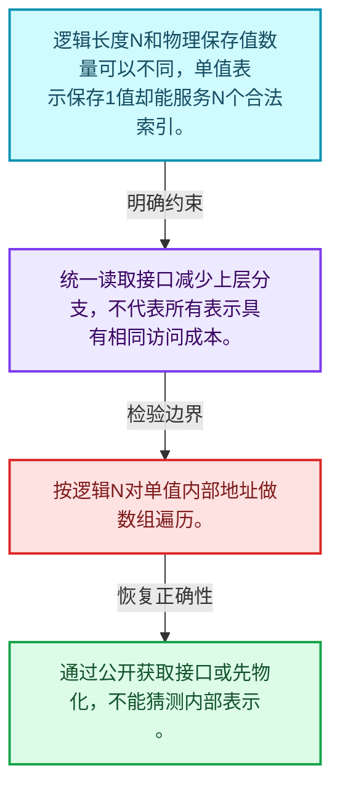
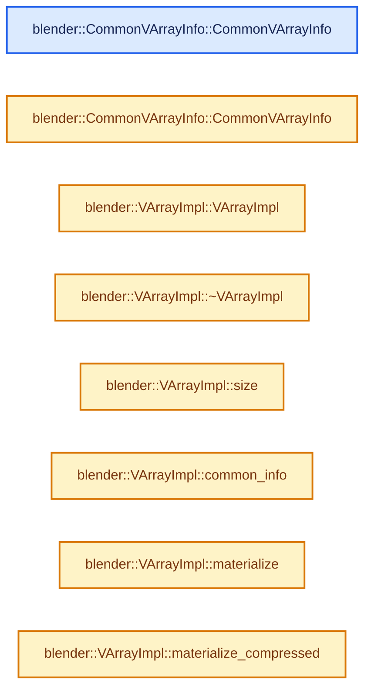
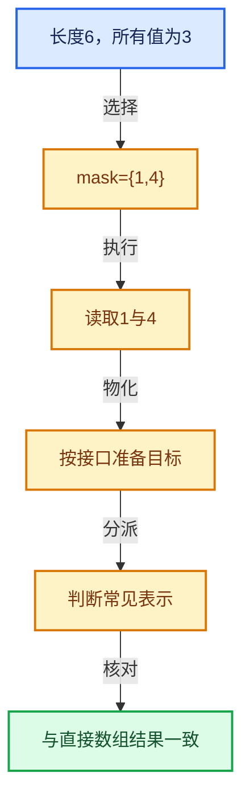

# 04-01 VArray表示与值语义

[方向导航](README.md) · [总目录](../README.md) · [实现索引](../00-课程指南/02-源码与提交索引/符号依赖与实现索引.md)

## 从问题到实现

像数组一样访问是否意味着实际有数组？

虚拟数组统一索引接口，实际表示可以是Span、单值或计算；接口统一不等于访问成本相同。

**数据模型**

逻辑长度N和物理保存值数量可以不同，单值表示保存1值却能服务N个合法索引。

**设计取舍**

统一读取接口减少上层分支，不代表所有表示具有相同访问成本。

**最小反例**

按逻辑N对单值内部地址做数组遍历。

**推导**

通过公开获取接口或先物化，不能猜测内部表示。

## 阅读地图与执行推演








图中的数值推演是本方向的教学模型；实际函数之间的调用边与概念分析边分别标注，不能把概念关系当作运行时调度顺序。

## 完整源码单元与就地讲解

中文讲解直接放在相关代码旁，复杂机制在代码下展开。原文折叠区保留基准行号；不需要在行号表和函数之间来回查找。类布局可分段展示，函数实现不按固定行数切开。

### 类型布局、声明与编译条件 · BLI_virtual_array.hh L1—L65

<a id="t-3abac6177afe"></a>

<a id="t-a54e1e0938eb"></a>

<a id="t-133157c87bbe"></a>

`CommonVArrayInfo`在这里声明的数据成员：

- `Type type`
- `bool may_have_ownership`
- `void data`

<a id="t-04df5f3c724c"></a>

<!-- annotated:4fd000fb5f744c -->

```cpp
/* SPDX-FileCopyrightText: 2023 Blender Authors
 *
 * SPDX-License-Identifier: GPL-2.0-or-later */

#pragma once

/** \file
 * \ingroup bli
 *
 * A virtual array is a data structure that behaves similarly to an array, but its elements are
 * accessed through virtual methods. This improves the decoupling of a function from its callers,
 * because it does not have to know exactly how the data is laid out in memory, or if it is stored
 * in memory at all. It could just as well be computed on the fly.
 *
 * Taking a virtual array as parameter instead of a more specific non-virtual type has some
 * tradeoffs. Access to individual elements of the individual elements is slower due to function
 * call overhead. On the other hand, potential callers don't have to convert the data into the
 * specific format required for the function. This can be a costly conversion if only few of the
 * elements are accessed in the end.
 *
 * Functions taking a virtual array as input can still optimize for different data layouts. For
 * example, they can check if the array references contiguous memory internally or if it is the
 * same value for all indices. Whether it is worth optimizing for different data layouts in a
 * function has to be decided on a case by case basis. One should always do some benchmarking to
 * see if the increased compile time and binary size is worth it.
 */

#include <functional>
#include <optional>

#include "BLI_any_derived.hh"
#include "BLI_array.hh"
#include "BLI_devirtualize_parameters.hh"
#include "BLI_index_mask.hh"
#include "BLI_span.hh"

namespace blender {

/** Forward declarations for generic virtual arrays. */
class GVArray;
class GVMutableArray;

/**
 * Used to quickly check if a varray is a span or a single value. This struct also allows
 * retrieving multiple pieces of data with a single virtual method call.
 */
struct CommonVArrayInfo {
  enum class Type : uint8_t {
    /* Is not one of the common special types below. */
    Any,
    Span,
    Single,
  };

  Type type = Type::Any;

  /** True when the #data becomes a dangling pointer when the virtual array is destructed. */
  bool may_have_ownership = true;

  /**
   * Points either to nothing, a single value, or an array of values, depending on #type.
   * If this is a span of a mutable virtual array, it is safe to cast away const.
   */
  const void *data;

```

<details>
<summary>核对原始源码：source/blender/blenlib/BLI_virtual_array.hh · L1—L65</summary>

<!-- original:4fd000fb5f744c:source/blender/blenlib/BLI_virtual_array.hh:1:65 -->

```cpp
/* SPDX-FileCopyrightText: 2023 Blender Authors
 *
 * SPDX-License-Identifier: GPL-2.0-or-later */

#pragma once

/** \file
 * \ingroup bli
 *
 * A virtual array is a data structure that behaves similarly to an array, but its elements are
 * accessed through virtual methods. This improves the decoupling of a function from its callers,
 * because it does not have to know exactly how the data is laid out in memory, or if it is stored
 * in memory at all. It could just as well be computed on the fly.
 *
 * Taking a virtual array as parameter instead of a more specific non-virtual type has some
 * tradeoffs. Access to individual elements of the individual elements is slower due to function
 * call overhead. On the other hand, potential callers don't have to convert the data into the
 * specific format required for the function. This can be a costly conversion if only few of the
 * elements are accessed in the end.
 *
 * Functions taking a virtual array as input can still optimize for different data layouts. For
 * example, they can check if the array references contiguous memory internally or if it is the
 * same value for all indices. Whether it is worth optimizing for different data layouts in a
 * function has to be decided on a case by case basis. One should always do some benchmarking to
 * see if the increased compile time and binary size is worth it.
 */

#include <functional>
#include <optional>

#include "BLI_any_derived.hh"
#include "BLI_array.hh"
#include "BLI_devirtualize_parameters.hh"
#include "BLI_index_mask.hh"
#include "BLI_span.hh"

namespace blender {

/** Forward declarations for generic virtual arrays. */
class GVArray;
class GVMutableArray;

/**
 * Used to quickly check if a varray is a span or a single value. This struct also allows
 * retrieving multiple pieces of data with a single virtual method call.
 */
struct CommonVArrayInfo {
  enum class Type : uint8_t {
    /* Is not one of the common special types below. */
    Any,
    Span,
    Single,
  };

  Type type = Type::Any;

  /** True when the #data becomes a dangling pointer when the virtual array is destructed. */
  bool may_have_ownership = true;

  /**
   * Points either to nothing, a single value, or an array of values, depending on #type.
   * If this is a span of a mutable virtual array, it is safe to cast away const.
   */
  const void *data;

```

</details>

<a id="f-a716088fcd760d27"></a>

### `blender::CommonVArrayInfo::CommonVArrayInfo`

实现位置：[source/blender/blenlib/BLI_virtual_array.hh](../../../../../source/blender/blenlib/BLI_virtual_array.hh) · L66—L66。

**教学注释版**

<!-- annotated:f0026c45ad9fd4 -->

```cpp
  CommonVArrayInfo() = default;
```

<details>
<summary>核对原始源码：source/blender/blenlib/BLI_virtual_array.hh · L66—L66</summary>

<!-- original:f0026c45ad9fd4:source/blender/blenlib/BLI_virtual_array.hh:66:66 -->

```cpp
  CommonVArrayInfo() = default;
```

</details>

**继续追踪实现**

本实现没有需要继续展开的显式调用；检查返回表达式、对象转换和调用者前置条件。

<a id="f-018a4490310fea4d"></a>

### `blender::CommonVArrayInfo::CommonVArrayInfo`

实现位置：[source/blender/blenlib/BLI_virtual_array.hh](../../../../../source/blender/blenlib/BLI_virtual_array.hh) · L67—L70。

接口参数：

- `const Type _type`
- `const bool _may_have_ownership`
- `const void *_data`

**教学注释版**

<!-- annotated:e048ea040f3291 -->

```cpp
  CommonVArrayInfo(const Type _type, const bool _may_have_ownership, const void *_data)
      : type(_type), may_have_ownership(_may_have_ownership), data(_data)
  {
  }
```

<details>
<summary>核对原始源码：source/blender/blenlib/BLI_virtual_array.hh · L67—L70</summary>

<!-- original:e048ea040f3291:source/blender/blenlib/BLI_virtual_array.hh:67:70 -->

```cpp
  CommonVArrayInfo(const Type _type, const bool _may_have_ownership, const void *_data)
      : type(_type), may_have_ownership(_may_have_ownership), data(_data)
  {
  }
```

</details>

**继续追踪实现**

本实现没有需要继续展开的显式调用；检查返回表达式、对象转换和调用者前置条件。

### 类型布局、声明与编译条件 · BLI_virtual_array.hh L71—L85

<a id="t-55fc2c8fc282"></a>

`VArrayImpl`在这里声明的数据成员：

- `int64_t size_`

<!-- annotated:d60c49f2c601e2 -->

```cpp
};

/**
 * Implements the specifics of how the elements of a virtual array are accessed. It contains a
 * bunch of virtual methods that are wrapped by #VArray.
 */
template<typename T> class VArrayImpl {
 protected:
  /**
   * Number of elements in the virtual array. All virtual arrays have a size, but in some cases it
   * may make sense to set it to the max value.
   */
  int64_t size_;

 public:
```

<details>
<summary>核对原始源码：source/blender/blenlib/BLI_virtual_array.hh · L71—L85</summary>

<!-- original:d60c49f2c601e2:source/blender/blenlib/BLI_virtual_array.hh:71:85 -->

```cpp
};

/**
 * Implements the specifics of how the elements of a virtual array are accessed. It contains a
 * bunch of virtual methods that are wrapped by #VArray.
 */
template<typename T> class VArrayImpl {
 protected:
  /**
   * Number of elements in the virtual array. All virtual arrays have a size, but in some cases it
   * may make sense to set it to the max value.
   */
  int64_t size_;

 public:
```

</details>

<a id="f-56eb0fe9b7a9e3b2"></a>

### `blender::VArrayImpl::VArrayImpl`

实现位置：[source/blender/blenlib/BLI_virtual_array.hh](../../../../../source/blender/blenlib/BLI_virtual_array.hh) · L86—L89。

接口参数：

- `const int64_t size`

**教学注释版**

<!-- annotated:c17235700198ce -->

```cpp
  VArrayImpl(const int64_t size) : size_(size)
  {
    BLI_assert(size_ >= 0);
  }
```

<details>
<summary>核对原始源码：source/blender/blenlib/BLI_virtual_array.hh · L86—L89</summary>

<!-- original:c17235700198ce:source/blender/blenlib/BLI_virtual_array.hh:86:89 -->

```cpp
  VArrayImpl(const int64_t size) : size_(size)
  {
    BLI_assert(size_ >= 0);
  }
```

</details>

**继续追踪实现**

- `BLI_assert` → [BLI_assert · L48](../90-实现依赖专题/01-BLI基础库/BLI_assert.hh.md#m-57a88495704d)；[BLI_assert · L63](../90-实现依赖专题/01-BLI基础库/BLI_assert.hh.md#m-d07050020cb5)。宏定义由构建条件选择。

<!-- annotated:9d760155a08efe -->

```cpp

```

<details>
<summary>核对原始源码：source/blender/blenlib/BLI_virtual_array.hh · L90—L90</summary>

<!-- original:9d760155a08efe:source/blender/blenlib/BLI_virtual_array.hh:90:90 -->

```cpp

```

</details>

<a id="f-642d5bc0ff8a895e"></a>

### `blender::VArrayImpl::~VArrayImpl`

实现位置：[source/blender/blenlib/BLI_virtual_array.hh](../../../../../source/blender/blenlib/BLI_virtual_array.hh) · L91—L91。

**教学注释版**

<!-- annotated:c73d928fe2d156 -->

```cpp
  virtual ~VArrayImpl() = default;
```

<details>
<summary>核对原始源码：source/blender/blenlib/BLI_virtual_array.hh · L91—L91</summary>

<!-- original:c73d928fe2d156:source/blender/blenlib/BLI_virtual_array.hh:91:91 -->

```cpp
  virtual ~VArrayImpl() = default;
```

</details>

**继续追踪实现**

本实现没有需要继续展开的显式调用；检查返回表达式、对象转换和调用者前置条件。

<!-- annotated:df5ec1d474bb11 -->

```cpp

```

<details>
<summary>核对原始源码：source/blender/blenlib/BLI_virtual_array.hh · L92—L92</summary>

<!-- original:df5ec1d474bb11:source/blender/blenlib/BLI_virtual_array.hh:92:92 -->

```cpp

```

</details>

<a id="f-fbf37f2ba6f22399"></a>

### `blender::VArrayImpl::size`

实现位置：[source/blender/blenlib/BLI_virtual_array.hh](../../../../../source/blender/blenlib/BLI_virtual_array.hh) · L93—L96。

**教学注释版**

<!-- annotated:5f784d3d888887 -->

```cpp
  int64_t size() const
  {
    return size_;
  }
```

<details>
<summary>核对原始源码：source/blender/blenlib/BLI_virtual_array.hh · L93—L96</summary>

<!-- original:5f784d3d888887:source/blender/blenlib/BLI_virtual_array.hh:93:96 -->

```cpp
  int64_t size() const
  {
    return size_;
  }
```

</details>

**结果出口**

- `return size_;`

**继续追踪实现**

本实现没有需要继续展开的显式调用；检查返回表达式、对象转换和调用者前置条件。

### 类型布局、声明与编译条件 · BLI_virtual_array.hh L97—L103

<!-- annotated:6d7c2cf4a798df -->

```cpp

  /**
   * Get the element at #index. This does not return a reference, because the value may be computed
   * on the fly.
   */
  virtual T get(int64_t index) const = 0;

```

<details>
<summary>核对原始源码：source/blender/blenlib/BLI_virtual_array.hh · L97—L103</summary>

<!-- original:6d7c2cf4a798df:source/blender/blenlib/BLI_virtual_array.hh:97:103 -->

```cpp

  /**
   * Get the element at #index. This does not return a reference, because the value may be computed
   * on the fly.
   */
  virtual T get(int64_t index) const = 0;

```

</details>

<a id="f-68078b4f5e7a53d4"></a>

### `blender::VArrayImpl::common_info`

实现位置：[source/blender/blenlib/BLI_virtual_array.hh](../../../../../source/blender/blenlib/BLI_virtual_array.hh) · L104—L107。

**教学注释版**

<!-- annotated:88e90ab4f9f8eb -->

```cpp
  virtual CommonVArrayInfo common_info() const
  {
    return {};
  }
```

<details>
<summary>核对原始源码：source/blender/blenlib/BLI_virtual_array.hh · L104—L107</summary>

<!-- original:88e90ab4f9f8eb:source/blender/blenlib/BLI_virtual_array.hh:104:107 -->

```cpp
  virtual CommonVArrayInfo common_info() const
  {
    return {};
  }
```

</details>

**结果出口**

- `return {};`

**继续追踪实现**

本实现没有需要继续展开的显式调用；检查返回表达式、对象转换和调用者前置条件。

### 类型布局、声明与编译条件 · BLI_virtual_array.hh L108—L112

<!-- annotated:a952325ff9dc0c -->

```cpp

  /**
   * Copy values from the virtual array into the provided span. The index of the value in the
   * virtual array is the same as the index in the span.
   */
```

<details>
<summary>核对原始源码：source/blender/blenlib/BLI_virtual_array.hh · L108—L112</summary>

<!-- original:a952325ff9dc0c:source/blender/blenlib/BLI_virtual_array.hh:108:112 -->

```cpp

  /**
   * Copy values from the virtual array into the provided span. The index of the value in the
   * virtual array is the same as the index in the span.
   */
```

</details>

<a id="f-1c4b235f5c046f0a"></a>

### `blender::VArrayImpl::materialize`

实现位置：[source/blender/blenlib/BLI_virtual_array.hh](../../../../../source/blender/blenlib/BLI_virtual_array.hh) · L113—L126。

接口参数：

- `const IndexMask &mask`
- `T *dst`
- `const bool dst_is_uninitialized`

**教学注释版**

<!-- annotated:dfdb28c44e4e82 -->

```cpp
  virtual void materialize(const IndexMask &mask, T *dst, const bool dst_is_uninitialized) const
  {
    if constexpr (std::is_trivially_copyable_v<T>) {
      mask.foreach_index([&](const int64_t i) { dst[i] = this->get(i); });
    }
    else {
      if (dst_is_uninitialized) {
        mask.foreach_index([&](const int64_t i) { new (dst + i) T(this->get(i)); });
      }
      else {
        mask.foreach_index([&](const int64_t i) { dst[i] = this->get(i); });
      }
    }
  }
```

<details>
<summary>核对原始源码：source/blender/blenlib/BLI_virtual_array.hh · L113—L126</summary>

<!-- original:dfdb28c44e4e82:source/blender/blenlib/BLI_virtual_array.hh:113:126 -->

```cpp
  virtual void materialize(const IndexMask &mask, T *dst, const bool dst_is_uninitialized) const
  {
    if constexpr (std::is_trivially_copyable_v<T>) {
      mask.foreach_index([&](const int64_t i) { dst[i] = this->get(i); });
    }
    else {
      if (dst_is_uninitialized) {
        mask.foreach_index([&](const int64_t i) { new (dst + i) T(this->get(i)); });
      }
      else {
        mask.foreach_index([&](const int64_t i) { dst[i] = this->get(i); });
      }
    }
  }
```

</details>

**继续追踪实现**

- `mask.foreach_index` → [blender::index_mask::IndexMask::foreach_index · L855](09-分段存储与遍历.md#f-cd6cd317e2e2812c)。
- `this->get` → [blender::VArrayImpl_For_Span::get · L217](01-VArray表示与值语义.md#f-b5d536dcfede9ac0)；[blender::VArrayImpl_For_Single::get · L325](02-VArrayImpl实现接口.md#f-62c705cc3442334e)；[blender::VArrayImpl_For_Func::get · L386](02-VArrayImpl实现接口.md#f-0dda53e7719f99d6)；[blender::VArrayImpl_For_DerivedSpan::get · L449](02-VArrayImpl实现接口.md#f-9a7d40e70a914814)；[blender::VArrayCommon::get · L560](02-VArrayImpl实现接口.md#f-dce84cee97df9ded)。同名重载需按实参类型选择。

### 类型布局、声明与编译条件 · BLI_virtual_array.hh L127—L132

<!-- annotated:ff4ab53568fcd0 -->

```cpp

  /**
   * Copy values from the virtual array into the provided span. Contrary to #materialize, the index
   * in virtual array is not the same as the index in the output span. Instead, the span is filled
   * without gaps.
   */
```

<details>
<summary>核对原始源码：source/blender/blenlib/BLI_virtual_array.hh · L127—L132</summary>

<!-- original:ff4ab53568fcd0:source/blender/blenlib/BLI_virtual_array.hh:127:132 -->

```cpp

  /**
   * Copy values from the virtual array into the provided span. Contrary to #materialize, the index
   * in virtual array is not the same as the index in the output span. Instead, the span is filled
   * without gaps.
   */
```

</details>

<a id="f-2b826bcaea11fef8"></a>

### `blender::VArrayImpl::materialize_compressed`

实现位置：[source/blender/blenlib/BLI_virtual_array.hh](../../../../../source/blender/blenlib/BLI_virtual_array.hh) · L133—L149。

接口参数：

- `const IndexMask &mask`
- `T *dst`
- `const bool dst_is_uninitialized`

**教学注释版**

<!-- annotated:f59dc4b8812c64 -->

```cpp
  virtual void materialize_compressed(const IndexMask &mask,
                                      T *dst,
                                      const bool dst_is_uninitialized) const
  {
    if constexpr (std::is_trivially_copyable_v<T>) {
      mask.foreach_index([&](const int64_t i, const int64_t pos) { dst[pos] = this->get(i); });
    }
    else {
      if (dst_is_uninitialized) {
        mask.foreach_index(
            [&](const int64_t i, const int64_t pos) { new (dst + pos) T(this->get(i)); });
      }
      else {
        mask.foreach_index([&](const int64_t i, const int64_t pos) { dst[pos] = this->get(i); });
      }
    }
  }
```

<details>
<summary>核对原始源码：source/blender/blenlib/BLI_virtual_array.hh · L133—L149</summary>

<!-- original:f59dc4b8812c64:source/blender/blenlib/BLI_virtual_array.hh:133:149 -->

```cpp
  virtual void materialize_compressed(const IndexMask &mask,
                                      T *dst,
                                      const bool dst_is_uninitialized) const
  {
    if constexpr (std::is_trivially_copyable_v<T>) {
      mask.foreach_index([&](const int64_t i, const int64_t pos) { dst[pos] = this->get(i); });
    }
    else {
      if (dst_is_uninitialized) {
        mask.foreach_index(
            [&](const int64_t i, const int64_t pos) { new (dst + pos) T(this->get(i)); });
      }
      else {
        mask.foreach_index([&](const int64_t i, const int64_t pos) { dst[pos] = this->get(i); });
      }
    }
  }
```

</details>

**继续追踪实现**

- `mask.foreach_index` → [blender::index_mask::IndexMask::foreach_index · L855](09-分段存储与遍历.md#f-cd6cd317e2e2812c)。
- `this->get` → [blender::VArrayImpl_For_Span::get · L217](01-VArray表示与值语义.md#f-b5d536dcfede9ac0)；[blender::VArrayImpl_For_Single::get · L325](02-VArrayImpl实现接口.md#f-62c705cc3442334e)；[blender::VArrayImpl_For_Func::get · L386](02-VArrayImpl实现接口.md#f-0dda53e7719f99d6)；[blender::VArrayImpl_For_DerivedSpan::get · L449](02-VArrayImpl实现接口.md#f-9a7d40e70a914814)；[blender::VArrayCommon::get · L560](02-VArrayImpl实现接口.md#f-dce84cee97df9ded)。同名重载需按实参类型选择。

### 类型布局、声明与编译条件 · BLI_virtual_array.hh L150—L156

<!-- annotated:529027f3fb3ae3 -->

```cpp

  /**
   * If this virtual wraps another #GVArray, this method should assign the wrapped array to the
   * provided reference. This allows losslessly converting between generic and typed virtual
   * arrays in all cases.
   * Return true when the virtual array was assigned and false when nothing was done.
   */
```

<details>
<summary>核对原始源码：source/blender/blenlib/BLI_virtual_array.hh · L150—L156</summary>

<!-- original:529027f3fb3ae3:source/blender/blenlib/BLI_virtual_array.hh:150:156 -->

```cpp

  /**
   * If this virtual wraps another #GVArray, this method should assign the wrapped array to the
   * provided reference. This allows losslessly converting between generic and typed virtual
   * arrays in all cases.
   * Return true when the virtual array was assigned and false when nothing was done.
   */
```

</details>

<a id="f-d1581e4df8a656dd"></a>

### `blender::VArrayImpl::try_assign_GVArray`

实现位置：[source/blender/blenlib/BLI_virtual_array.hh](../../../../../source/blender/blenlib/BLI_virtual_array.hh) · L157—L160。

接口参数：

- `GVArray &`

**教学注释版**

<!-- annotated:f190fccb705f53 -->

```cpp
  virtual bool try_assign_GVArray(GVArray & /*varray*/) const
  {
    return false;
  }
```

<details>
<summary>核对原始源码：source/blender/blenlib/BLI_virtual_array.hh · L157—L160</summary>

<!-- original:f190fccb705f53:source/blender/blenlib/BLI_virtual_array.hh:157:160 -->

```cpp
  virtual bool try_assign_GVArray(GVArray & /*varray*/) const
  {
    return false;
  }
```

</details>

**结果出口**

- `return false;`

**继续追踪实现**

本实现没有需要继续展开的显式调用；检查返回表达式、对象转换和调用者前置条件。

### 类型布局、声明与编译条件 · BLI_virtual_array.hh L161—L175

<a id="t-c7b0b4b60419"></a>

`VMutableArrayImpl`在这里声明的数据成员：

- `void set`

<!-- annotated:b5dc286d54cb65 -->

```cpp
};

/** Similar to #VArrayImpl, but adds methods that allow modifying the referenced elements. */
template<typename T> class VMutableArrayImpl : public VArrayImpl<T> {
 public:
  using VArrayImpl<T>::VArrayImpl;

  /**
   * Assign the provided #value to the #index.
   */
  virtual void set(int64_t index, T value) = 0;

  /**
   * Copy all elements from the provided span into the virtual array.
   */
```

<details>
<summary>核对原始源码：source/blender/blenlib/BLI_virtual_array.hh · L161—L175</summary>

<!-- original:b5dc286d54cb65:source/blender/blenlib/BLI_virtual_array.hh:161:175 -->

```cpp
};

/** Similar to #VArrayImpl, but adds methods that allow modifying the referenced elements. */
template<typename T> class VMutableArrayImpl : public VArrayImpl<T> {
 public:
  using VArrayImpl<T>::VArrayImpl;

  /**
   * Assign the provided #value to the #index.
   */
  virtual void set(int64_t index, T value) = 0;

  /**
   * Copy all elements from the provided span into the virtual array.
   */
```

</details>

<a id="f-664d4eb6d5a2e9b9"></a>

### `blender::VMutableArrayImpl::set_all`

实现位置：[source/blender/blenlib/BLI_virtual_array.hh](../../../../../source/blender/blenlib/BLI_virtual_array.hh) · L176—L189。

接口参数：

- `Span<T> src`

**教学注释版**

<!-- annotated:be305bc74d3f84 -->

```cpp
  virtual void set_all(Span<T> src)
  {
    const CommonVArrayInfo info = this->common_info();
    if (info.type == CommonVArrayInfo::Type::Span) {
      initialized_copy_n(
          // [讲解] src.data：返回借用范围的地址。
          src.data(), this->size_, const_cast<T *>(static_cast<const T *>(info.data)));
    }
    else {
      const int64_t size = this->size_;
      for (int64_t i = 0; i < size; i++) {
        this->set(i, src[i]);
      }
    }
  }
```

<details>
<summary>核对原始源码：source/blender/blenlib/BLI_virtual_array.hh · L176—L189</summary>

<!-- original:be305bc74d3f84:source/blender/blenlib/BLI_virtual_array.hh:176:189 -->

```cpp
  virtual void set_all(Span<T> src)
  {
    const CommonVArrayInfo info = this->common_info();
    if (info.type == CommonVArrayInfo::Type::Span) {
      initialized_copy_n(
          src.data(), this->size_, const_cast<T *>(static_cast<const T *>(info.data)));
    }
    else {
      const int64_t size = this->size_;
      for (int64_t i = 0; i < size; i++) {
        this->set(i, src[i]);
      }
    }
  }
```

</details>

**继续追踪实现**

- `this->common_info` → [blender::VArrayImpl::common_info · L104](01-VArray表示与值语义.md#f-68078b4f5e7a53d4)；[blender::VArrayImpl_For_Span::common_info · L227](01-VArray表示与值语义.md#f-fb3c90a88b5b3bd8)；[blender::VArrayImpl_For_Span_final::common_info · L281](01-VArray表示与值语义.md#f-93f2eaf44ff4a315)；[blender::VArrayImpl_For_Single::common_info · L330](02-VArrayImpl实现接口.md#f-8b3462728d95d9b1)；[blender::VArrayCommon::common_info · L602](02-VArrayImpl实现接口.md#f-087793fc5c4b8977)。同名重载需按实参类型选择。
- `initialized_copy_n` → [blender::initialized_copy_n · L48](../01-基础容器与现代CPP/01-对象生命周期与值类别.md#f-7e8b9229298df6c5)。
- `src.data` → [blender::Span::data · L219](../01-基础容器与现代CPP/05-Span只读连续视图.md#f-10c5889198935800)。
- `this->set` → [blender::VArrayImpl_For_Span::set · L222](01-VArray表示与值语义.md#f-3b037517ba01e8be)；[blender::VArrayImpl_For_DerivedSpan::set · L454](02-VArrayImpl实现接口.md#f-85b0b72dcbb29644)；[blender::VMutableArray::set · L898](03-单值与Span表示.md#f-05bfe1c89a3b807f)。同名重载需按实参类型选择。

### 类型布局、声明与编译条件 · BLI_virtual_array.hh L190—L193

<!-- annotated:e6d018c5ac5326 -->

```cpp

  /**
   * Similar to #VArrayImpl::try_assign_GVArray but for mutable virtual arrays.
   */
```

<details>
<summary>核对原始源码：source/blender/blenlib/BLI_virtual_array.hh · L190—L193</summary>

<!-- original:e6d018c5ac5326:source/blender/blenlib/BLI_virtual_array.hh:190:193 -->

```cpp

  /**
   * Similar to #VArrayImpl::try_assign_GVArray but for mutable virtual arrays.
   */
```

</details>

<a id="f-c774beb58cc32c5e"></a>

### `blender::VMutableArrayImpl::try_assign_GVMutableArray`

实现位置：[source/blender/blenlib/BLI_virtual_array.hh](../../../../../source/blender/blenlib/BLI_virtual_array.hh) · L194—L197。

接口参数：

- `GVMutableArray &`

**教学注释版**

<!-- annotated:980a6a484d9252 -->

```cpp
  virtual bool try_assign_GVMutableArray(GVMutableArray & /*varray*/) const
  {
    return false;
  }
```

<details>
<summary>核对原始源码：source/blender/blenlib/BLI_virtual_array.hh · L194—L197</summary>

<!-- original:980a6a484d9252:source/blender/blenlib/BLI_virtual_array.hh:194:197 -->

```cpp
  virtual bool try_assign_GVMutableArray(GVMutableArray & /*varray*/) const
  {
    return false;
  }
```

</details>

**结果出口**

- `return false;`

**继续追踪实现**

本实现没有需要继续展开的显式调用；检查返回表达式、对象转换和调用者前置条件。

### 类型布局、声明与编译条件 · BLI_virtual_array.hh L198—L208

<a id="t-8958f0012977"></a>

`VArrayImpl_For_Span`在这里声明的数据成员：

- `T data_`

<!-- annotated:da9b65bbfbc4a6 -->

```cpp
};

/**
 * A virtual array implementation that references that wraps a span. This implementation is used by
 * mutable and immutable spans to avoid code duplication.
 */
template<typename T> class VArrayImpl_For_Span : public VMutableArrayImpl<T> {
 protected:
  T *data_ = nullptr;

 public:
```

<details>
<summary>核对原始源码：source/blender/blenlib/BLI_virtual_array.hh · L198—L208</summary>

<!-- original:da9b65bbfbc4a6:source/blender/blenlib/BLI_virtual_array.hh:198:208 -->

```cpp
};

/**
 * A virtual array implementation that references that wraps a span. This implementation is used by
 * mutable and immutable spans to avoid code duplication.
 */
template<typename T> class VArrayImpl_For_Span : public VMutableArrayImpl<T> {
 protected:
  T *data_ = nullptr;

 public:
```

</details>

<a id="f-7745a67c5d6d396b"></a>

### `blender::VArrayImpl_For_Span::VArrayImpl_For_Span`

实现位置：[source/blender/blenlib/BLI_virtual_array.hh](../../../../../source/blender/blenlib/BLI_virtual_array.hh) · L209—L212。

接口参数：

- `const MutableSpan<T> data`

**教学注释版**

<!-- annotated:4374bf4094bc49 -->

```cpp
  VArrayImpl_For_Span(const MutableSpan<T> data)
      : VMutableArrayImpl<T>(data.size()), data_(data.data())
  {
  }
```

<details>
<summary>核对原始源码：source/blender/blenlib/BLI_virtual_array.hh · L209—L212</summary>

<!-- original:4374bf4094bc49:source/blender/blenlib/BLI_virtual_array.hh:209:212 -->

```cpp
  VArrayImpl_For_Span(const MutableSpan<T> data)
      : VMutableArrayImpl<T>(data.size()), data_(data.data())
  {
  }
```

</details>

**继续追踪实现**

本实现没有需要继续展开的显式调用；检查返回表达式、对象转换和调用者前置条件。

### 类型布局、声明与编译条件 · BLI_virtual_array.hh L213—L214

<!-- annotated:de3ba99eefae39 -->

```cpp

 protected:
```

<details>
<summary>核对原始源码：source/blender/blenlib/BLI_virtual_array.hh · L213—L214</summary>

<!-- original:de3ba99eefae39:source/blender/blenlib/BLI_virtual_array.hh:213:214 -->

```cpp

 protected:
```

</details>

<a id="f-de7b5fd99dc1a88d"></a>

### `blender::VArrayImpl_For_Span::VArrayImpl_For_Span`

实现位置：[source/blender/blenlib/BLI_virtual_array.hh](../../../../../source/blender/blenlib/BLI_virtual_array.hh) · L215—L215。

接口参数：

- `const int64_t size`

**教学注释版**

<!-- annotated:ed86829ff82a0b -->

```cpp
  VArrayImpl_For_Span(const int64_t size) : VMutableArrayImpl<T>(size) {}
```

<details>
<summary>核对原始源码：source/blender/blenlib/BLI_virtual_array.hh · L215—L215</summary>

<!-- original:ed86829ff82a0b:source/blender/blenlib/BLI_virtual_array.hh:215:215 -->

```cpp
  VArrayImpl_For_Span(const int64_t size) : VMutableArrayImpl<T>(size) {}
```

</details>

**继续追踪实现**

本实现没有需要继续展开的显式调用；检查返回表达式、对象转换和调用者前置条件。

<!-- annotated:9c22e92812087b -->

```cpp

```

<details>
<summary>核对原始源码：source/blender/blenlib/BLI_virtual_array.hh · L216—L216</summary>

<!-- original:9c22e92812087b:source/blender/blenlib/BLI_virtual_array.hh:216:216 -->

```cpp

```

</details>

<a id="f-b5d536dcfede9ac0"></a>

### `blender::VArrayImpl_For_Span::get`

实现位置：[source/blender/blenlib/BLI_virtual_array.hh](../../../../../source/blender/blenlib/BLI_virtual_array.hh) · L217—L220。

接口参数：

- `const int64_t index`

**教学注释版**

<!-- annotated:1a463ad7812531 -->

```cpp
  T get(const int64_t index) const final
  {
    return data_[index];
  }
```

<details>
<summary>核对原始源码：source/blender/blenlib/BLI_virtual_array.hh · L217—L220</summary>

<!-- original:1a463ad7812531:source/blender/blenlib/BLI_virtual_array.hh:217:220 -->

```cpp
  T get(const int64_t index) const final
  {
    return data_[index];
  }
```

</details>

**结果出口**

- `return data_[index];`

**继续追踪实现**

本实现没有需要继续展开的显式调用；检查返回表达式、对象转换和调用者前置条件。

<!-- annotated:a8d431b69f8145 -->

```cpp

```

<details>
<summary>核对原始源码：source/blender/blenlib/BLI_virtual_array.hh · L221—L221</summary>

<!-- original:a8d431b69f8145:source/blender/blenlib/BLI_virtual_array.hh:221:221 -->

```cpp

```

</details>

<a id="f-3b037517ba01e8be"></a>

### `blender::VArrayImpl_For_Span::set`

实现位置：[source/blender/blenlib/BLI_virtual_array.hh](../../../../../source/blender/blenlib/BLI_virtual_array.hh) · L222—L225。

接口参数：

- `const int64_t index`
- `T value`

**教学注释版**

<!-- annotated:20549750a17402 -->

```cpp
  void set(const int64_t index, T value) final
  {
    data_[index] = value;
  }
```

<details>
<summary>核对原始源码：source/blender/blenlib/BLI_virtual_array.hh · L222—L225</summary>

<!-- original:20549750a17402:source/blender/blenlib/BLI_virtual_array.hh:222:225 -->

```cpp
  void set(const int64_t index, T value) final
  {
    data_[index] = value;
  }
```

</details>

**沿实际写入检查状态**

- `data_[index] = value;`

**继续追踪实现**

本实现没有需要继续展开的显式调用；检查返回表达式、对象转换和调用者前置条件。

<!-- annotated:e81fd7b5637f81 -->

```cpp

```

<details>
<summary>核对原始源码：source/blender/blenlib/BLI_virtual_array.hh · L226—L226</summary>

<!-- original:e81fd7b5637f81:source/blender/blenlib/BLI_virtual_array.hh:226:226 -->

```cpp

```

</details>

<a id="f-fb3c90a88b5b3bd8"></a>

### `blender::VArrayImpl_For_Span::common_info`

实现位置：[source/blender/blenlib/BLI_virtual_array.hh](../../../../../source/blender/blenlib/BLI_virtual_array.hh) · L227—L230。

**教学注释版**

<!-- annotated:3fa358404d24c6 -->

```cpp
  CommonVArrayInfo common_info() const override
  {
    return CommonVArrayInfo(CommonVArrayInfo::Type::Span, true, data_);
  }
```

<details>
<summary>核对原始源码：source/blender/blenlib/BLI_virtual_array.hh · L227—L230</summary>

<!-- original:3fa358404d24c6:source/blender/blenlib/BLI_virtual_array.hh:227:230 -->

```cpp
  CommonVArrayInfo common_info() const override
  {
    return CommonVArrayInfo(CommonVArrayInfo::Type::Span, true, data_);
  }
```

</details>

**结果出口**

- `return CommonVArrayInfo(CommonVArrayInfo::Type::Span, true, data_);`

**继续追踪实现**

- `CommonVArrayInfo` → [blender::CommonVArrayInfo::CommonVArrayInfo · L66](01-VArray表示与值语义.md#f-a716088fcd760d27)；[blender::CommonVArrayInfo::CommonVArrayInfo · L67](01-VArray表示与值语义.md#f-018a4490310fea4d)。同名重载需按实参类型选择。

<!-- annotated:4673000ae99aa9 -->

```cpp

```

<details>
<summary>核对原始源码：source/blender/blenlib/BLI_virtual_array.hh · L231—L231</summary>

<!-- original:4673000ae99aa9:source/blender/blenlib/BLI_virtual_array.hh:231:231 -->

```cpp

```

</details>

<a id="f-e2aab136264188b6"></a>

### `blender::VArrayImpl_For_Span::materialize`

实现位置：[source/blender/blenlib/BLI_virtual_array.hh](../../../../../source/blender/blenlib/BLI_virtual_array.hh) · L232—L245。

接口参数：

- `const IndexMask &mask`
- `T *dst`
- `const bool dst_is_uninitialized`

**教学注释版**

<!-- annotated:8a408b86370ec1 -->

```cpp
  void materialize(const IndexMask &mask, T *dst, const bool dst_is_uninitialized) const override
  {
    if constexpr (std::is_trivially_copyable_v<T>) {
      index_mask::detail::copy_assign(data_, mask, dst);
    }
    else {
      if (dst_is_uninitialized) {
        mask.foreach_index([&](const int64_t i) { new (dst + i) T(data_[i]); });
      }
      else {
        mask.foreach_index([&](const int64_t i) { dst[i] = data_[i]; });
      }
    }
  }
```

<details>
<summary>核对原始源码：source/blender/blenlib/BLI_virtual_array.hh · L232—L245</summary>

<!-- original:8a408b86370ec1:source/blender/blenlib/BLI_virtual_array.hh:232:245 -->

```cpp
  void materialize(const IndexMask &mask, T *dst, const bool dst_is_uninitialized) const override
  {
    if constexpr (std::is_trivially_copyable_v<T>) {
      index_mask::detail::copy_assign(data_, mask, dst);
    }
    else {
      if (dst_is_uninitialized) {
        mask.foreach_index([&](const int64_t i) { new (dst + i) T(data_[i]); });
      }
      else {
        mask.foreach_index([&](const int64_t i) { dst[i] = data_[i]; });
      }
    }
  }
```

</details>

**继续追踪实现**

- `index_mask::detail::copy_assign` → [blender::index_mask::detail::copy_assign · L1231](12-重构历史与基准练习.md#f-be4df34f277f2f95)。
- `mask.foreach_index` → [blender::index_mask::IndexMask::foreach_index · L855](09-分段存储与遍历.md#f-cd6cd317e2e2812c)。

<!-- annotated:ce24aaee3777f7 -->

```cpp

```

<details>
<summary>核对原始源码：source/blender/blenlib/BLI_virtual_array.hh · L246—L246</summary>

<!-- original:ce24aaee3777f7:source/blender/blenlib/BLI_virtual_array.hh:246:246 -->

```cpp

```

</details>

<a id="f-c917b258eee7fcaf"></a>

### `blender::VArrayImpl_For_Span::materialize_compressed`

实现位置：[source/blender/blenlib/BLI_virtual_array.hh](../../../../../source/blender/blenlib/BLI_virtual_array.hh) · L247—L263。

接口参数：

- `const IndexMask &mask`
- `T *dst`
- `const bool dst_is_uninitialized`

**教学注释版**

<!-- annotated:98a5f1ba22a458 -->

```cpp
  void materialize_compressed(const IndexMask &mask,
                              T *dst,
                              const bool dst_is_uninitialized) const override
  {
    if constexpr (std::is_trivially_copyable_v<T>) {
      index_mask::detail::gather_assign(data_, mask, dst);
    }
    else {
      if (dst_is_uninitialized) {
        mask.foreach_index(
            [&](const int64_t i, const int64_t pos) { new (dst + pos) T(data_[i]); });
      }
      else {
        mask.foreach_index([&](const int64_t i, const int64_t pos) { dst[pos] = data_[i]; });
      }
    }
  }
```

<details>
<summary>核对原始源码：source/blender/blenlib/BLI_virtual_array.hh · L247—L263</summary>

<!-- original:98a5f1ba22a458:source/blender/blenlib/BLI_virtual_array.hh:247:263 -->

```cpp
  void materialize_compressed(const IndexMask &mask,
                              T *dst,
                              const bool dst_is_uninitialized) const override
  {
    if constexpr (std::is_trivially_copyable_v<T>) {
      index_mask::detail::gather_assign(data_, mask, dst);
    }
    else {
      if (dst_is_uninitialized) {
        mask.foreach_index(
            [&](const int64_t i, const int64_t pos) { new (dst + pos) T(data_[i]); });
      }
      else {
        mask.foreach_index([&](const int64_t i, const int64_t pos) { dst[pos] = data_[i]; });
      }
    }
  }
```

</details>

**继续追踪实现**

- `index_mask::detail::gather_assign` → [blender::index_mask::detail::gather_assign · L1239](12-重构历史与基准练习.md#f-6ca85cf84b731900)。
- `mask.foreach_index` → [blender::index_mask::IndexMask::foreach_index · L855](09-分段存储与遍历.md#f-cd6cd317e2e2812c)。

### 类型布局、声明与编译条件 · BLI_virtual_array.hh L264—L273

<a id="t-37de8ac01efd"></a>

<!-- annotated:2d20c2bc04a9fc -->

```cpp
};

/**
 * A version of #VArrayImpl_For_Span that can not be subclassed. This allows safely overwriting the
 * #may_have_ownership method.
 */
template<typename T> class VArrayImpl_For_Span_final final : public VArrayImpl_For_Span<T> {
 public:
  using VArrayImpl_For_Span<T>::VArrayImpl_For_Span;

```

<details>
<summary>核对原始源码：source/blender/blenlib/BLI_virtual_array.hh · L264—L273</summary>

<!-- original:2d20c2bc04a9fc:source/blender/blenlib/BLI_virtual_array.hh:264:273 -->

```cpp
};

/**
 * A version of #VArrayImpl_For_Span that can not be subclassed. This allows safely overwriting the
 * #may_have_ownership method.
 */
template<typename T> class VArrayImpl_For_Span_final final : public VArrayImpl_For_Span<T> {
 public:
  using VArrayImpl_For_Span<T>::VArrayImpl_For_Span;

```

</details>

<a id="f-afd3d1a01cc85400"></a>

### `blender::VArrayImpl_For_Span_final::VArrayImpl_For_Span_final`

实现位置：[source/blender/blenlib/BLI_virtual_array.hh](../../../../../source/blender/blenlib/BLI_virtual_array.hh) · L274—L278。

接口参数：

- `const Span<T> data`

**教学注释版**

<!-- annotated:86fe4b522ee317 -->

```cpp
  VArrayImpl_For_Span_final(const Span<T> data)
      /* Cast const away, because the implementation for const and non const spans is shared. */
      : VArrayImpl_For_Span<T>({const_cast<T *>(data.data()), data.size()})
  {
  }
```

<details>
<summary>核对原始源码：source/blender/blenlib/BLI_virtual_array.hh · L274—L278</summary>

<!-- original:86fe4b522ee317:source/blender/blenlib/BLI_virtual_array.hh:274:278 -->

```cpp
  VArrayImpl_For_Span_final(const Span<T> data)
      /* Cast const away, because the implementation for const and non const spans is shared. */
      : VArrayImpl_For_Span<T>({const_cast<T *>(data.data()), data.size()})
  {
  }
```

</details>

**继续追踪实现**

本实现没有需要继续展开的显式调用；检查返回表达式、对象转换和调用者前置条件。

### 类型布局、声明与编译条件 · BLI_virtual_array.hh L279—L280

<!-- annotated:0be8a399cdb757 -->

```cpp

 private:
```

<details>
<summary>核对原始源码：source/blender/blenlib/BLI_virtual_array.hh · L279—L280</summary>

<!-- original:0be8a399cdb757:source/blender/blenlib/BLI_virtual_array.hh:279:280 -->

```cpp

 private:
```

</details>

<a id="f-93f2eaf44ff4a315"></a>

### `blender::VArrayImpl_For_Span_final::common_info`

实现位置：[source/blender/blenlib/BLI_virtual_array.hh](../../../../../source/blender/blenlib/BLI_virtual_array.hh) · L281—L284。

**教学注释版**

<!-- annotated:95a4786dd08f6c -->

```cpp
  CommonVArrayInfo common_info() const final
  {
    return CommonVArrayInfo(CommonVArrayInfo::Type::Span, false, this->data_);
  }
```

<details>
<summary>核对原始源码：source/blender/blenlib/BLI_virtual_array.hh · L281—L284</summary>

<!-- original:95a4786dd08f6c:source/blender/blenlib/BLI_virtual_array.hh:281:284 -->

```cpp
  CommonVArrayInfo common_info() const final
  {
    return CommonVArrayInfo(CommonVArrayInfo::Type::Span, false, this->data_);
  }
```

</details>

**结果出口**

- `return CommonVArrayInfo(CommonVArrayInfo::Type::Span, false, this->data_);`

**继续追踪实现**

- `CommonVArrayInfo` → [blender::CommonVArrayInfo::CommonVArrayInfo · L66](01-VArray表示与值语义.md#f-a716088fcd760d27)；[blender::CommonVArrayInfo::CommonVArrayInfo · L67](01-VArray表示与值语义.md#f-018a4490310fea4d)。同名重载需按实参类型选择。

### 类型布局、声明与编译条件 · BLI_virtual_array.hh L285—L301

<a id="t-bbaf1a92e117"></a>

`VArrayImpl_For_ArrayContainer`在这里声明的数据成员：

- `Container container_`

<!-- annotated:b50bd8b27a4e34 -->

```cpp
};

template<typename T>
inline constexpr bool is_trivial_extended_v<VArrayImpl_For_Span_final<T>> = true;

/**
 * A variant of `VArrayImpl_For_Span` that owns the underlying data.
 * The `Container` type has to implement a `size()` and `data()` method.
 * The `data()` method has to return a pointer to the first element in the continuous array of
 * elements.
 */
template<typename Container, typename T = typename Container::value_type>
class VArrayImpl_For_ArrayContainer : public VArrayImpl_For_Span<T> {
 private:
  Container container_;

 public:
```

<details>
<summary>核对原始源码：source/blender/blenlib/BLI_virtual_array.hh · L285—L301</summary>

<!-- original:b50bd8b27a4e34:source/blender/blenlib/BLI_virtual_array.hh:285:301 -->

```cpp
};

template<typename T>
inline constexpr bool is_trivial_extended_v<VArrayImpl_For_Span_final<T>> = true;

/**
 * A variant of `VArrayImpl_For_Span` that owns the underlying data.
 * The `Container` type has to implement a `size()` and `data()` method.
 * The `data()` method has to return a pointer to the first element in the continuous array of
 * elements.
 */
template<typename Container, typename T = typename Container::value_type>
class VArrayImpl_For_ArrayContainer : public VArrayImpl_For_Span<T> {
 private:
  Container container_;

 public:
```

</details>

<a id="f-ce4269f221b588d3"></a>

### `blender::VArrayImpl_For_ArrayContainer::VArrayImpl_For_ArrayContainer`

实现位置：[source/blender/blenlib/BLI_virtual_array.hh](../../../../../source/blender/blenlib/BLI_virtual_array.hh) · L302—L306。

接口参数：

- `Container container`

**教学注释版**

<!-- annotated:8282ae96c5390a -->

```cpp
  VArrayImpl_For_ArrayContainer(Container container)
      : VArrayImpl_For_Span<T>(int64_t(container.size())), container_(std::move(container))
  {
    this->data_ = const_cast<T *>(container_.data());
  }
```

<details>
<summary>核对原始源码：source/blender/blenlib/BLI_virtual_array.hh · L302—L306</summary>

<!-- original:8282ae96c5390a:source/blender/blenlib/BLI_virtual_array.hh:302:306 -->

```cpp
  VArrayImpl_For_ArrayContainer(Container container)
      : VArrayImpl_For_Span<T>(int64_t(container.size())), container_(std::move(container))
  {
    this->data_ = const_cast<T *>(container_.data());
  }
```

</details>

**沿实际写入检查状态**

- `this->data_ = const_cast<T *>(container_.data());`

**继续追踪实现**

- `container_.data` → [调用协议](../00-课程指南/01-路线与规范/模板宏与动态分派协议.md)：由接收对象具体类型或运行时策略提供实现。调用位置L305。

## 语法与相关类型

### 模板 template

模板把类型或常量作为生成实现的参数。读声明时先列出类型参数、非类型参数和默认值，再看使用者实际实例化了什么。模板声明本身不意味着每种T都支持其全部成员。

把T替换为int、string、只能移动的类型，分别检查每个被调用操作是否成立。

### 依赖名称 typename

typename既可引入类型模板参数，也可告诉编译器某个依赖名称是类型。它不创建运行时对象；解析期确认语法类别与实例化期检查具体类型是不同阶段。

区分typename T::value_type和T::size()，前者标记类型，后者是表达式。

### 常量求值 constexpr

constexpr声明允许相应实体参与常量求值，但constexpr函数仍可以在运行时执行。是否常量求值由调用场景和表达式合法性共同决定。

比较constexpr变量初始化和从运行时输入调用同一函数。

### 只读限定 const

const约束当前访问路径可做的修改。const指针、指向const的指针、const视图对象、const元素是不同位置的限定；其他别名可能仍可修改原对象。

分别写T* const、const T*与const T* const，并画出不可修改的层次。

### 移动转换 std::move

std::move把表达式转换为可供移动重载选择的值类别，实际资源转移发生在被选中的构造或赋值中。对const对象move可能仍调用复制，对视图move也不会获得底层数据所有权。

记录移动构造调用次数，不用变量名或std::move的出现次数替代测量。

### 异常边界 try与catch

try定义异常传播的局部边界。失败路径需要销毁已经成功构造的部分并释放相应存储；未构造的对象不能被析构。

在第k次构造失败，列出已经存在的对象集合与待释放缓冲。

### 显式静态转换 static_cast

static_cast表达编译期允许的转换，不会自动验证运行时真实类型、指针寿命或索引边界。由void指针恢复T指针时，调用者仍须保证实际存储中确有合法T对象。

标出转换前后的类型以及正确性依据来自哪里。

### 限定转换 const_cast

const_cast可以改变访问路径的限定，但不能让本来就是const的对象合法可写。常用于复用只读实现时，仍需检查底层对象是否实际可变。

对非const对象的const引用与真正const对象分别分析修改是否合法。

### 运行时多态 virtual

虚调用根据实际动态类型选择实现；经基类指针销毁对象时通常需要相应虚析构契约。每元素虚调用和循环外一次分派有不同开销。

找出虚接口的实现类和调用频率，再讨论是否值得去虚拟化。

### 覆写检查 override

override要求函数确实覆盖基类虚函数，可捕获参数类型和const限定不匹配。它不改变基类规定的生命周期或线程约束。

故意改变一个参数或const，观察编译器如何拒绝误写的新函数。

### 构造与new表达式

普通new可能分配并构造；placement new在给定地址构造，存储由其他机制提供。失败回滚应区分两类责任。

追踪地址来自哪里、构造何时成功、由谁析构、由谁释放。

### 内部断言 assert

断言表达开发者预期成立的内部契约，发布构建可能关闭。它不能替代对不可信输入的完整错误处理，也不保证后续操作被运行时保护。

对每条断言构造违反条件的输入，区分调用者错误与应向用户报告的错误。

### 编译期分支 if constexpr

条件在实例化时决定被保留的分支，这常用于不同类型的合法操作选择。它与运行时if有不同的实例化检查规则。

找出每个分支依赖哪些类型特征，再使用满足与不满足条件的类型。

### 类型别名 using

类型别名为已有类型建立名字，不创建运行期对象。它常把模板内部使用的类型统一暴露给泛型调用者。

展开别名直到基础类型，区分类型别名和变量声明。

### 枚举与状态模型 enum

枚举把有限状态命名；enum class避免许多隐式整数转换。状态机正确性还依赖允许的转移，不能只看有哪些枚举项。

列出每个状态的进入条件和离开条件，检查终止状态是否仍可能被调度。

## 实现练习与验证

用同一求和算法处理三种表示，统计存储元素数。

参考推理：通过公开获取接口或先物化，不能猜测内部表示。

遍历结果按真实索引排序且无重复；单值、Span与计算表示在有效索引上返回一致语义。

## 历史、跨库比较与证据

对比普通Span、标准ranges惰性视图和虚拟数组时，明确随机索引能力、批量物化、类型擦除和拥有关系；接口外观相近不代表同一抽象。

[历史提交索引](../00-课程指南/02-源码与提交索引/历史提交与设计演化索引.md) · [源码基准](../00-课程指南/02-源码与提交索引/源码版本与覆盖索引.md) · [验收报告](../00-课程指南/03-验收报告/验收报告.md)
