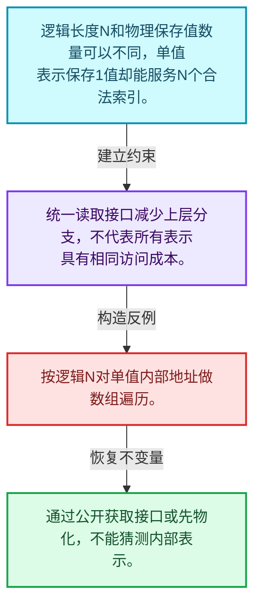
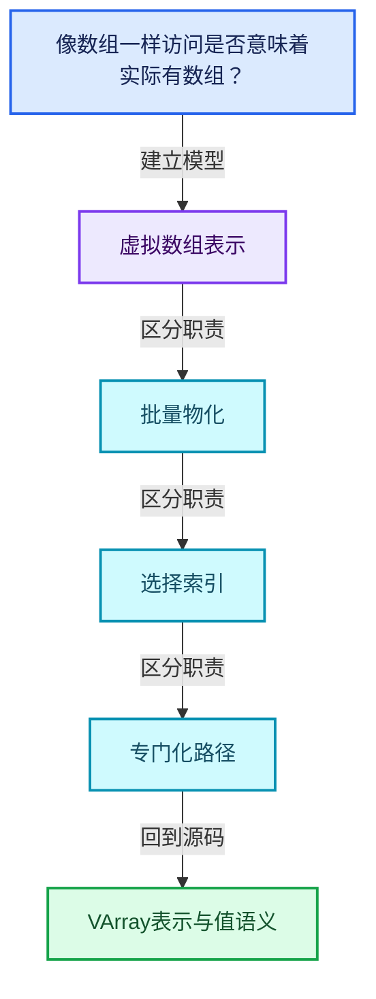
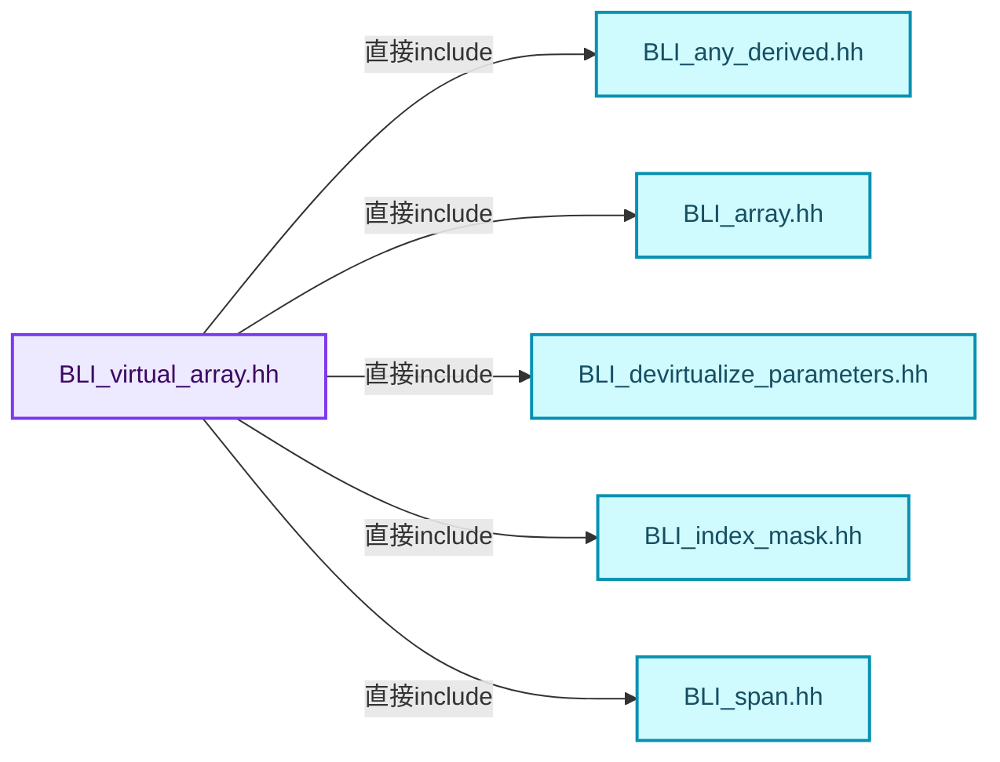
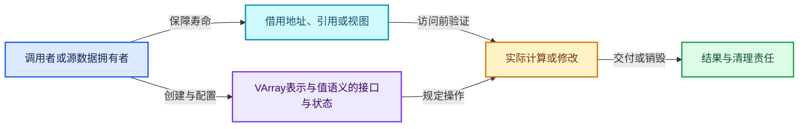
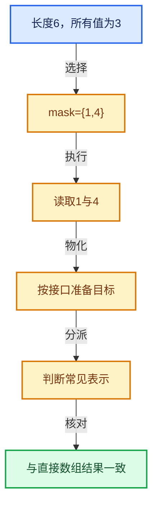

# 04-01 VArray表示与值语义

[方向导航](README.md) · [总目录](../README.md) · [覆盖索引](../%E6%BA%90%E7%A0%81%E7%89%88%E6%9C%AC%E4%B8%8E%E8%A6%86%E7%9B%96%E7%B4%A2%E5%BC%95.md)

> 阅读顺序：问题与数据模型 → 语法与类型 → 源码逐行 → 调用线索 → 历史与取舍 → 推演和练习。

- 基准 HEAD：`cbda6b96c26c0dee3c3b5cbb93960c4ac06a6b30`。
- 记录日期：2026-10-14。
- 教学示例状态：正文中的推演不是本机性能实测；已运行练习见验收报告。

## 一、从问题到设计

像数组一样访问是否意味着实际有数组？

虚拟数组统一索引接口，实际表示可以是Span、单值或计算；接口统一不等于访问成本相同。

本篇把语法、数据语义和系统取舍连接起来。表示与接口分离，元素编号与选择内部位置分离，生成成本与执行成本分离。

### 本篇独立模型与设计推理

逻辑长度N和物理保存值数量可以不同，单值表示保存1值却能服务N个合法索引。

设计取舍：统一读取接口减少上层分支，不代表所有表示具有相同访问成本。

最小反例：按逻辑N对单值内部地址做数组遍历。

推导与处理：通过公开获取接口或先物化，不能猜测内部表示。



### 源码范围与相邻篇章

| 文件 | 本篇逐行范围 | 基准SHA-256 |
|---|---|---|
| [source/blender/blenlib/BLI_virtual_array.hh](../../../../../source/blender/blenlib/BLI_virtual_array.hh) | L1—L306 | `0dad9ae245918d5aff4c98aac3248f277cd8060ca11a9acf2e59943aa18a18fe` |

同一主讲文件可能分多篇覆盖；超出本篇范围的符号通过覆盖索引定位。空行与纯注释保留在源码摘录中，逐行表解释有效语句与语法边界；许可证头统一保留。

后篇：[VArrayImpl实现接口](02-VArrayImpl%E5%AE%9E%E7%8E%B0%E6%8E%A5%E5%8F%A3.md).

## 二、类型、数据与阅读地图



这是概念依赖图，边表示阅读关系，不声称是运行时调用顺序。

### 直接编译依赖



箭头只表示头文件包含关系；完整调用线索见后面的符号定位表。

## 三、关键词、语法与类型角色

### 模板 template

模板把类型或常量作为生成实现的参数。读声明时先列出类型参数、非类型参数和默认值，再看使用者实际实例化了什么。模板声明本身不意味着每种T都支持其全部成员。

具体检查：把T替换为int、string、只能移动的类型，分别检查每个被调用操作是否成立。

### 依赖名称 typename

typename既可引入类型模板参数，也可告诉编译器某个依赖名称是类型。它不创建运行时对象；解析期确认语法类别与实例化期检查具体类型是不同阶段。

具体检查：区分typename T::value_type和T::size()，前者标记类型，后者是表达式。

### 常量求值 constexpr

constexpr声明允许相应实体参与常量求值，但constexpr函数仍可以在运行时执行。是否常量求值由调用场景和表达式合法性共同决定。

具体检查：比较constexpr变量初始化和从运行时输入调用同一函数。

### 只读限定 const

const约束当前访问路径可做的修改。const指针、指向const的指针、const视图对象、const元素是不同位置的限定；其他别名可能仍可修改原对象。

具体检查：分别写T* const、const T*与const T* const，并画出不可修改的层次。

### 移动转换 std::move

std::move把表达式转换为可供移动重载选择的值类别，实际资源转移发生在被选中的构造或赋值中。对const对象move可能仍调用复制，对视图move也不会获得底层数据所有权。

具体检查：记录移动构造调用次数，不用变量名或std::move的出现次数替代测量。

### 异常边界 try与catch

try定义异常传播的局部边界。失败路径需要销毁已经成功构造的部分并释放相应存储；未构造的对象不能被析构。

具体检查：在第k次构造失败，列出已经存在的对象集合与待释放缓冲。

### 显式静态转换 static_cast

static_cast表达编译期允许的转换，不会自动验证运行时真实类型、指针寿命或索引边界。由void指针恢复T指针时，调用者仍须保证实际存储中确有合法T对象。

具体检查：标出转换前后的类型以及正确性依据来自哪里。

### 限定转换 const_cast

const_cast可以改变访问路径的限定，但不能让本来就是const的对象合法可写。常用于复用只读实现时，仍需检查底层对象是否实际可变。

具体检查：对非const对象的const引用与真正const对象分别分析修改是否合法。

### 运行时多态 virtual

虚调用根据实际动态类型选择实现；经基类指针销毁对象时通常需要相应虚析构契约。每元素虚调用和循环外一次分派有不同开销。

具体检查：找出虚接口的实现类和调用频率，再讨论是否值得去虚拟化。

### 覆写检查 override

override要求函数确实覆盖基类虚函数，可捕获参数类型和const限定不匹配。它不改变基类规定的生命周期或线程约束。

具体检查：故意改变一个参数或const，观察编译器如何拒绝误写的新函数。

### 构造与new表达式

普通new可能分配并构造；placement new在给定地址构造，存储由其他机制提供。失败回滚应区分两类责任。

具体检查：追踪地址来自哪里、构造何时成功、由谁析构、由谁释放。

### 内部断言 assert

断言表达开发者预期成立的内部契约，发布构建可能关闭。它不能替代对不可信输入的完整错误处理，也不保证后续操作被运行时保护。

具体检查：对每条断言构造违反条件的输入，区分调用者错误与应向用户报告的错误。

### 编译期分支 if constexpr

条件在实例化时决定被保留的分支，这常用于不同类型的合法操作选择。它与运行时if有不同的实例化检查规则。

具体检查：找出每个分支依赖哪些类型特征，再使用满足与不满足条件的类型。

### 类型别名 using

类型别名为已有类型建立名字，不创建运行期对象。它常把模板内部使用的类型统一暴露给泛型调用者。

具体检查：展开别名直到基础类型，区分类型别名和变量声明。

### 枚举与状态模型 enum

枚举把有限状态命名；enum class避免许多隐式整数转换。状态机正确性还依赖允许的转移，不能只看有哪些枚举项。

具体检查：列出每个状态的进入条件和离开条件，检查终止状态是否仍可能被调度。

## 四、真实源码与逐行讲解

源码块保持原行内容，原始行号由小节标题及逐行表给出。表中的调用定位是静态阅读辅助；重载、模板实例化、宏展开和虚调用需结合完整声明，不能仅凭词法出现证明动态调用。

### BLI_virtual_array.hh：L1—L53

<!-- source:source/blender/blenlib/BLI_virtual_array.hh:1:53 -->

```cpp
/* SPDX-FileCopyrightText: 2023 Blender Authors
 *
 * SPDX-License-Identifier: GPL-2.0-or-later */

#pragma once

/** \file
 * \ingroup bli
 *
 * A virtual array is a data structure that behaves similarly to an array, but its elements are
 * accessed through virtual methods. This improves the decoupling of a function from its callers,
 * because it does not have to know exactly how the data is laid out in memory, or if it is stored
 * in memory at all. It could just as well be computed on the fly.
 *
 * Taking a virtual array as parameter instead of a more specific non-virtual type has some
 * tradeoffs. Access to individual elements of the individual elements is slower due to function
 * call overhead. On the other hand, potential callers don't have to convert the data into the
 * specific format required for the function. This can be a costly conversion if only few of the
 * elements are accessed in the end.
 *
 * Functions taking a virtual array as input can still optimize for different data layouts. For
 * example, they can check if the array references contiguous memory internally or if it is the
 * same value for all indices. Whether it is worth optimizing for different data layouts in a
 * function has to be decided on a case by case basis. One should always do some benchmarking to
 * see if the increased compile time and binary size is worth it.
 */

#include <functional>
#include <optional>

#include "BLI_any_derived.hh"
#include "BLI_array.hh"
#include "BLI_devirtualize_parameters.hh"
#include "BLI_index_mask.hh"
#include "BLI_span.hh"

namespace blender {

/** Forward declarations for generic virtual arrays. */
class GVArray;
class GVMutableArray;

/**
 * Used to quickly check if a varray is a span or a single value. This struct also allows
 * retrieving multiple pieces of data with a single virtual method call.
 */
struct CommonVArrayInfo {
  enum class Type : uint8_t {
    /* Is not one of the common special types below. */
    Any,
    Span,
    Single,
  };
```

| 原始行 | 语义、约束与检查 |
|---|---|
| L5 | 防止同一头文件在一个翻译单元中重复展开；不控制多个源文件之间的链接或对象寿命。 |
| L28 | 引入编译依赖 <functional>；这是声明可见性关系，不表示运行时一定调用该文件的所有接口。 |
| L29 | 引入编译依赖 <optional>；这是声明可见性关系，不表示运行时一定调用该文件的所有接口。 |
| L31 | 引入编译依赖 "BLI_any_derived.hh"；这是声明可见性关系，不表示运行时一定调用该文件的所有接口。 |
| L32 | 引入编译依赖 "BLI_array.hh"；这是声明可见性关系，不表示运行时一定调用该文件的所有接口。 |
| L33 | 引入编译依赖 "BLI_devirtualize_parameters.hh"；这是声明可见性关系，不表示运行时一定调用该文件的所有接口。 |
| L34 | 引入编译依赖 "BLI_index_mask.hh"；这是声明可见性关系，不表示运行时一定调用该文件的所有接口。 |
| L35 | 引入编译依赖 "BLI_span.hh"；这是声明可见性关系，不表示运行时一定调用该文件的所有接口。 |
| L37 | 把后续声明放入 blender 命名空间，影响名称查找和符号归属，不创建运行时对象。 |
| L40 | 声明或定义类型 `class GVArray`。结合继承、访问权限和成员布局确认接口与拥有关系；前向声明本身没有完整对象布局。 |
| L41 | 声明或定义类型 `class GVMutableArray`。结合继承、访问权限和成员布局确认接口与拥有关系；前向声明本身没有完整对象布局。 |
| L47 | 声明或定义类型 `struct CommonVArrayInfo`。结合继承、访问权限和成员布局确认接口与拥有关系；前向声明本身没有完整对象布局。 |
| L48 | 声明或定义类型 `enum class Type : uint8_t`。结合继承、访问权限和成员布局确认接口与拥有关系；前向声明本身没有完整对象布局。 |
| L50 | 本行是连续声明或表达式的一部分：`Any,`。与本段前后行合读；逗号、括号和限定符决定它属于参数、初始化列表还是实际计算。 |
| L51 | 本行是连续声明或表达式的一部分：`Span,`。与本段前后行合读；逗号、括号和限定符决定它属于参数、初始化列表还是实际计算。 |
| L52 | 本行是连续声明或表达式的一部分：`Single,`。与本段前后行合读；逗号、括号和限定符决定它属于参数、初始化列表还是实际计算。 |
| L53 | 结束当前语法单元。局部自动对象在离开其作用域时按规则销毁；这不等于所有被引用的外部数据也被释放。 |

### BLI_virtual_array.hh：L54—L102

<!-- source:source/blender/blenlib/BLI_virtual_array.hh:54:102 -->

```cpp

  Type type = Type::Any;

  /** True when the #data becomes a dangling pointer when the virtual array is destructed. */
  bool may_have_ownership = true;

  /**
   * Points either to nothing, a single value, or an array of values, depending on #type.
   * If this is a span of a mutable virtual array, it is safe to cast away const.
   */
  const void *data;

  CommonVArrayInfo() = default;
  CommonVArrayInfo(const Type _type, const bool _may_have_ownership, const void *_data)
      : type(_type), may_have_ownership(_may_have_ownership), data(_data)
  {
  }
};

/**
 * Implements the specifics of how the elements of a virtual array are accessed. It contains a
 * bunch of virtual methods that are wrapped by #VArray.
 */
template<typename T> class VArrayImpl {
 protected:
  /**
   * Number of elements in the virtual array. All virtual arrays have a size, but in some cases it
   * may make sense to set it to the max value.
   */
  int64_t size_;

 public:
  VArrayImpl(const int64_t size) : size_(size)
  {
    BLI_assert(size_ >= 0);
  }

  virtual ~VArrayImpl() = default;

  int64_t size() const
  {
    return size_;
  }

  /**
   * Get the element at #index. This does not return a reference, because the value may be computed
   * on the fly.
   */
  virtual T get(int64_t index) const = 0;
```

本段语义重点：

- `size_`：该对象记录的元素数或长度，不能直接当作容量。

| 原始行 | 语义、约束与检查 |
|---|---|
| L55 | 把右侧 `Type::Any` 用于初始化或更新左侧 `Type type`。声明初始化与已有对象赋值应按上下文区分；有资源的类型会调用相应特殊成员。 |
| L58 | 把右侧 `true` 用于初始化或更新左侧 `bool may_have_ownership`。声明初始化与已有对象赋值应按上下文区分；有资源的类型会调用相应特殊成员。 |
| L64 | 声明成员、局部对象或完成语句 `const void *data`。若为指针或引用，它本身不说明拥有；若为值对象，其构造析构由所在作用域或外层对象管理。 |
| L66 | 显式采用编译器生成的特殊成员行为：`CommonVArrayInfo() = default;`。成员和基类的性质决定该操作是否可用、是否被删除及异常约定，不表示运行时给对象赋值为default。 |
| L67 | 出现调用或函数声明 `CommonVArrayInfo`，对应表达式为 `CommonVArrayInfo(const Type _type, const bool _may_have_ownership, const void *_data)`。参数求值、返回类型与重载需结合前后完整语句；静态文本引用不能证明动态目标。 |
| L68 | 出现调用或函数声明 `type`，对应表达式为 `: type(_type), may_have_ownership(_may_have_ownership), data(_data)`。参数求值、返回类型与重载需结合前后完整语句；静态文本引用不能证明动态目标。 |
| L69 | 连接上一行的声明或控制结构与其语句块；后续行在这个作用域中执行或声明。 |
| L70 | 结束当前语法单元。局部自动对象在离开其作用域时按规则销毁；这不等于所有被引用的外部数据也被释放。 |
| L71 | 结束当前语法单元。局部自动对象在离开其作用域时按规则销毁；这不等于所有被引用的外部数据也被释放。 |
| L77 | 声明模板参数 `template<typename T> class VArrayImpl {`。类型参数决定生成操作的类型，非类型参数可决定内嵌容量或编译期分支。 |
| L78 | 切换成员访问权限为 protected；它是编译期接口边界，不是线程同步或内存保护。 |
| L83 | 本行涉及 `size_`：该对象记录的元素数或长度，不能直接当作容量。按此语义解读 `int64_t size_`，不要把地址、数量或状态混用。 |
| L85 | 切换成员访问权限为 public；它是编译期接口边界，不是线程同步或内存保护。 |
| L86 | 本行涉及 `size_`：该对象记录的元素数或长度，不能直接当作容量。按此语义解读 `VArrayImpl(const int64_t size) : size_(size)`，不要把地址、数量或状态混用。 |
| L87 | 连接上一行的声明或控制结构与其语句块；后续行在这个作用域中执行或声明。 |
| L88 | 断言约束 `BLI_assert(size_ >= 0);`。条件是后续访问的内部前置条件；发布构建可能不执行，不能把断言当作输入修复。 |
| L89 | 结束当前语法单元。局部自动对象在离开其作用域时按规则销毁；这不等于所有被引用的外部数据也被释放。 |
| L91 | 显式采用编译器生成的特殊成员行为：`virtual ~VArrayImpl() = default;`。成员和基类的性质决定该操作是否可用、是否被删除及异常约定，不表示运行时给对象赋值为default。 |
| L93 | 出现调用或函数声明 `size`，对应表达式为 `int64_t size() const`。参数求值、返回类型与重载需结合前后完整语句；静态文本引用不能证明动态目标。 |
| L94 | 连接上一行的声明或控制结构与其语句块；后续行在这个作用域中执行或声明。 |
| L95 | 返回表达式 `size_`。 |
| L96 | 结束当前语法单元。局部自动对象在离开其作用域时按规则销毁；这不等于所有被引用的外部数据也被释放。 |
| L102 | 纯虚接口声明：`virtual T get(int64_t index) const = 0;`。等号零标记抽象接口，需要按继承约定提供覆写；不表示执行函数并把结果设为零。 |

### BLI_virtual_array.hh：L103—L149

<!-- source:source/blender/blenlib/BLI_virtual_array.hh:103:149 -->

```cpp

  virtual CommonVArrayInfo common_info() const
  {
    return {};
  }

  /**
   * Copy values from the virtual array into the provided span. The index of the value in the
   * virtual array is the same as the index in the span.
   */
  virtual void materialize(const IndexMask &mask, T *dst, const bool dst_is_uninitialized) const
  {
    if constexpr (std::is_trivially_copyable_v<T>) {
      mask.foreach_index([&](const int64_t i) { dst[i] = this->get(i); });
    }
    else {
      if (dst_is_uninitialized) {
        mask.foreach_index([&](const int64_t i) { new (dst + i) T(this->get(i)); });
      }
      else {
        mask.foreach_index([&](const int64_t i) { dst[i] = this->get(i); });
      }
    }
  }

  /**
   * Copy values from the virtual array into the provided span. Contrary to #materialize, the index
   * in virtual array is not the same as the index in the output span. Instead, the span is filled
   * without gaps.
   */
  virtual void materialize_compressed(const IndexMask &mask,
                                      T *dst,
                                      const bool dst_is_uninitialized) const
  {
    if constexpr (std::is_trivially_copyable_v<T>) {
      mask.foreach_index([&](const int64_t i, const int64_t pos) { dst[pos] = this->get(i); });
    }
    else {
      if (dst_is_uninitialized) {
        mask.foreach_index(
            [&](const int64_t i, const int64_t pos) { new (dst + pos) T(this->get(i)); });
      }
      else {
        mask.foreach_index([&](const int64_t i, const int64_t pos) { dst[pos] = this->get(i); });
      }
    }
  }
```

本段语义重点：

- 分支证据 `dst_is_uninitialized)`：分别推演条件成立与不成立，核对相同出口处的状态。
- 分支证据 `dst_is_uninitialized)`：分别推演条件成立与不成立，核对相同出口处的状态。

| 原始行 | 语义、约束与检查 |
|---|---|
| L104 | 出现调用或函数声明 `common_info`，对应表达式为 `virtual CommonVArrayInfo common_info() const`。参数求值、返回类型与重载需结合前后完整语句；静态文本引用不能证明动态目标。 |
| L105 | 连接上一行的声明或控制结构与其语句块；后续行在这个作用域中执行或声明。 |
| L106 | 返回表达式 `{}`。 |
| L107 | 结束当前语法单元。局部自动对象在离开其作用域时按规则销毁；这不等于所有被引用的外部数据也被释放。 |
| L113 | 出现调用或函数声明 `materialize`，对应表达式为 `virtual void materialize(const IndexMask &mask, T *dst, const bool dst_is_uninitialized) const`。参数求值、返回类型与重载需结合前后完整语句；静态文本引用不能证明动态目标。 |
| L114 | 连接上一行的声明或控制结构与其语句块；后续行在这个作用域中执行或声明。 |
| L115 | 编译期条件分支 `if constexpr (std::is_trivially_copyable_v<T>)`。按实例化类型选择相应实现；被舍弃分支和运行期if具有不同检查规则，不能当作运行时输入验证。 |
| L116 | 把右侧 `this->get(i); })` 用于初始化或更新左侧 `mask.foreach_index([&](const int64_t i) { dst[i]`。声明初始化与已有对象赋值应按上下文区分；有资源的类型会调用相应特殊成员。 |
| L117 | 结束当前语法单元。局部自动对象在离开其作用域时按规则销毁；这不等于所有被引用的外部数据也被释放。 |
| L118 | 处理前一条件不成立的互补路径。比较两条路径最后是否恢复同一不变量，以及是否产生不同的资源责任。 |
| L119 | 判断 `dst_is_uninitialized`，成立时进入本分支，否则继续后续路径。 |
| L120 | 出现调用或函数声明 `foreach_index`，对应表达式为 `mask.foreach_index([&](const int64_t i) { new (dst + i) T(this->get(i)); });`。参数求值、返回类型与重载需结合前后完整语句；静态文本引用不能证明动态目标。 |
| L121 | 结束当前语法单元。局部自动对象在离开其作用域时按规则销毁；这不等于所有被引用的外部数据也被释放。 |
| L122 | 处理前一条件不成立的互补路径。比较两条路径最后是否恢复同一不变量，以及是否产生不同的资源责任。 |
| L123 | 把右侧 `this->get(i); })` 用于初始化或更新左侧 `mask.foreach_index([&](const int64_t i) { dst[i]`。声明初始化与已有对象赋值应按上下文区分；有资源的类型会调用相应特殊成员。 |
| L124 | 结束当前语法单元。局部自动对象在离开其作用域时按规则销毁；这不等于所有被引用的外部数据也被释放。 |
| L125 | 结束当前语法单元。局部自动对象在离开其作用域时按规则销毁；这不等于所有被引用的外部数据也被释放。 |
| L126 | 结束当前语法单元。局部自动对象在离开其作用域时按规则销毁；这不等于所有被引用的外部数据也被释放。 |
| L133 | 出现调用或函数声明 `materialize_compressed`，对应表达式为 `virtual void materialize_compressed(const IndexMask &mask,`。参数求值、返回类型与重载需结合前后完整语句；静态文本引用不能证明动态目标。 |
| L134 | 本行是连续声明或表达式的一部分：`T *dst,`。与本段前后行合读；逗号、括号和限定符决定它属于参数、初始化列表还是实际计算。 |
| L135 | 本行是连续声明或表达式的一部分：`const bool dst_is_uninitialized) const`。与本段前后行合读；逗号、括号和限定符决定它属于参数、初始化列表还是实际计算。 |
| L136 | 连接上一行的声明或控制结构与其语句块；后续行在这个作用域中执行或声明。 |
| L137 | 编译期条件分支 `if constexpr (std::is_trivially_copyable_v<T>)`。按实例化类型选择相应实现；被舍弃分支和运行期if具有不同检查规则，不能当作运行时输入验证。 |
| L138 | 把右侧 `this->get(i); })` 用于初始化或更新左侧 `mask.foreach_index([&](const int64_t i, const int64_t pos) { dst[pos]`。声明初始化与已有对象赋值应按上下文区分；有资源的类型会调用相应特殊成员。 |
| L139 | 结束当前语法单元。局部自动对象在离开其作用域时按规则销毁；这不等于所有被引用的外部数据也被释放。 |
| L140 | 处理前一条件不成立的互补路径。比较两条路径最后是否恢复同一不变量，以及是否产生不同的资源责任。 |
| L141 | 判断 `dst_is_uninitialized`，成立时进入本分支，否则继续后续路径。 |
| L142 | 出现调用或函数声明 `foreach_index`，对应表达式为 `mask.foreach_index(`。参数求值、返回类型与重载需结合前后完整语句；静态文本引用不能证明动态目标。 |
| L143 | 出现调用或函数声明 `new`，对应表达式为 `[&](const int64_t i, const int64_t pos) { new (dst + pos) T(this->get(i)); });`。参数求值、返回类型与重载需结合前后完整语句；静态文本引用不能证明动态目标。 |
| L144 | 结束当前语法单元。局部自动对象在离开其作用域时按规则销毁；这不等于所有被引用的外部数据也被释放。 |
| L145 | 处理前一条件不成立的互补路径。比较两条路径最后是否恢复同一不变量，以及是否产生不同的资源责任。 |
| L146 | 把右侧 `this->get(i); })` 用于初始化或更新左侧 `mask.foreach_index([&](const int64_t i, const int64_t pos) { dst[pos]`。声明初始化与已有对象赋值应按上下文区分；有资源的类型会调用相应特殊成员。 |
| L147 | 结束当前语法单元。局部自动对象在离开其作用域时按规则销毁；这不等于所有被引用的外部数据也被释放。 |
| L148 | 结束当前语法单元。局部自动对象在离开其作用域时按规则销毁；这不等于所有被引用的外部数据也被释放。 |
| L149 | 结束当前语法单元。局部自动对象在离开其作用域时按规则销毁；这不等于所有被引用的外部数据也被释放。 |

### BLI_virtual_array.hh：L150—L197

<!-- source:source/blender/blenlib/BLI_virtual_array.hh:150:197 -->

```cpp

  /**
   * If this virtual wraps another #GVArray, this method should assign the wrapped array to the
   * provided reference. This allows losslessly converting between generic and typed virtual
   * arrays in all cases.
   * Return true when the virtual array was assigned and false when nothing was done.
   */
  virtual bool try_assign_GVArray(GVArray & /*varray*/) const
  {
    return false;
  }
};

/** Similar to #VArrayImpl, but adds methods that allow modifying the referenced elements. */
template<typename T> class VMutableArrayImpl : public VArrayImpl<T> {
 public:
  using VArrayImpl<T>::VArrayImpl;

  /**
   * Assign the provided #value to the #index.
   */
  virtual void set(int64_t index, T value) = 0;

  /**
   * Copy all elements from the provided span into the virtual array.
   */
  virtual void set_all(Span<T> src)
  {
    const CommonVArrayInfo info = this->common_info();
    if (info.type == CommonVArrayInfo::Type::Span) {
      initialized_copy_n(
          src.data(), this->size_, const_cast<T *>(static_cast<const T *>(info.data)));
    }
    else {
      const int64_t size = this->size_;
      for (int64_t i = 0; i < size; i++) {
        this->set(i, src[i]);
      }
    }
  }

  /**
   * Similar to #VArrayImpl::try_assign_GVArray but for mutable virtual arrays.
   */
  virtual bool try_assign_GVMutableArray(GVMutableArray & /*varray*/) const
  {
    return false;
  }
```

本段语义重点：

- `size_`：该对象记录的元素数或长度，不能直接当作容量。

| 原始行 | 语义、约束与检查 |
|---|---|
| L157 | 出现调用或函数声明 `try_assign_GVArray`，对应表达式为 `virtual bool try_assign_GVArray(GVArray & ) const`。参数求值、返回类型与重载需结合前后完整语句；静态文本引用不能证明动态目标。 |
| L158 | 连接上一行的声明或控制结构与其语句块；后续行在这个作用域中执行或声明。 |
| L159 | 返回表达式 `false`。这是本路径的布尔结果，具体成功、存在或状态含义由函数接口规定。 |
| L160 | 结束当前语法单元。局部自动对象在离开其作用域时按规则销毁；这不等于所有被引用的外部数据也被释放。 |
| L161 | 结束当前语法单元。局部自动对象在离开其作用域时按规则销毁；这不等于所有被引用的外部数据也被释放。 |
| L164 | 声明模板参数 `template<typename T> class VMutableArrayImpl : public VArrayImpl<T> {`。类型参数决定生成操作的类型，非类型参数可决定内嵌容量或编译期分支。 |
| L165 | 切换成员访问权限为 public；它是编译期接口边界，不是线程同步或内存保护。 |
| L166 | 定义类型别名 `using VArrayImpl<T>::VArrayImpl`，为模板接口或内部实现统一命名；本行不分配该类型对象。 |
| L171 | 纯虚接口声明：`virtual void set(int64_t index, T value) = 0;`。等号零标记抽象接口，需要按继承约定提供覆写；不表示执行函数并把结果设为零。 |
| L176 | 出现调用或函数声明 `set_all`，对应表达式为 `virtual void set_all(Span<T> src)`。参数求值、返回类型与重载需结合前后完整语句；静态文本引用不能证明动态目标。 |
| L177 | 连接上一行的声明或控制结构与其语句块；后续行在这个作用域中执行或声明。 |
| L178 | 把右侧 `this->common_info()` 用于初始化或更新左侧 `const CommonVArrayInfo info`。声明初始化与已有对象赋值应按上下文区分；有资源的类型会调用相应特殊成员。 |
| L179 | 判断 `info.type == CommonVArrayInfo::Type::Span`，成立时进入本分支，否则继续后续路径。 |
| L180 | 出现调用或函数声明 `initialized_copy_n`，对应表达式为 `initialized_copy_n(`。参数求值、返回类型与重载需结合前后完整语句；静态文本引用不能证明动态目标。 |
| L181 | 本行涉及 `size_`：该对象记录的元素数或长度，不能直接当作容量。按此语义解读 `src.data(), this->size_, const_cast<T *>(static_cast<const T *>(info.data)))`，不要把地址、数量或状态混用。 |
| L182 | 结束当前语法单元。局部自动对象在离开其作用域时按规则销毁；这不等于所有被引用的外部数据也被释放。 |
| L183 | 处理前一条件不成立的互补路径。比较两条路径最后是否恢复同一不变量，以及是否产生不同的资源责任。 |
| L184 | 建立或更新 `size_`：该对象记录的元素数或长度，不能直接当作容量。本行的具体值关系为 `const int64_t size = this->size_`；对照更新前后相应范围或状态是否一致。 |
| L185 | 纯虚接口声明：`for (int64_t i = 0; i < size; i++) {`。等号零标记抽象接口，需要按继承约定提供覆写；不表示执行函数并把结果设为零。 |
| L186 | 出现调用或函数声明 `set`，对应表达式为 `this->set(i, src[i]);`。参数求值、返回类型与重载需结合前后完整语句；静态文本引用不能证明动态目标。 |
| L187 | 结束当前语法单元。局部自动对象在离开其作用域时按规则销毁；这不等于所有被引用的外部数据也被释放。 |
| L188 | 结束当前语法单元。局部自动对象在离开其作用域时按规则销毁；这不等于所有被引用的外部数据也被释放。 |
| L189 | 结束当前语法单元。局部自动对象在离开其作用域时按规则销毁；这不等于所有被引用的外部数据也被释放。 |
| L194 | 出现调用或函数声明 `try_assign_GVMutableArray`，对应表达式为 `virtual bool try_assign_GVMutableArray(GVMutableArray & ) const`。参数求值、返回类型与重载需结合前后完整语句；静态文本引用不能证明动态目标。 |
| L195 | 连接上一行的声明或控制结构与其语句块；后续行在这个作用域中执行或声明。 |
| L196 | 返回表达式 `false`。这是本路径的布尔结果，具体成功、存在或状态含义由函数接口规定。 |
| L197 | 结束当前语法单元。局部自动对象在离开其作用域时按规则销毁；这不等于所有被引用的外部数据也被释放。 |

### BLI_virtual_array.hh：L198—L245

<!-- source:source/blender/blenlib/BLI_virtual_array.hh:198:245 -->

```cpp
};

/**
 * A virtual array implementation that references that wraps a span. This implementation is used by
 * mutable and immutable spans to avoid code duplication.
 */
template<typename T> class VArrayImpl_For_Span : public VMutableArrayImpl<T> {
 protected:
  T *data_ = nullptr;

 public:
  VArrayImpl_For_Span(const MutableSpan<T> data)
      : VMutableArrayImpl<T>(data.size()), data_(data.data())
  {
  }

 protected:
  VArrayImpl_For_Span(const int64_t size) : VMutableArrayImpl<T>(size) {}

  T get(const int64_t index) const final
  {
    return data_[index];
  }

  void set(const int64_t index, T value) final
  {
    data_[index] = value;
  }

  CommonVArrayInfo common_info() const override
  {
    return CommonVArrayInfo(CommonVArrayInfo::Type::Span, true, data_);
  }

  void materialize(const IndexMask &mask, T *dst, const bool dst_is_uninitialized) const override
  {
    if constexpr (std::is_trivially_copyable_v<T>) {
      index_mask::detail::copy_assign(data_, mask, dst);
    }
    else {
      if (dst_is_uninitialized) {
        mask.foreach_index([&](const int64_t i) { new (dst + i) T(data_[i]); });
      }
      else {
        mask.foreach_index([&](const int64_t i) { dst[i] = data_[i]; });
      }
    }
  }
```

本段语义重点：

- `data_`：数据或实现的存储入口；是否拥有应按该类声明和析构判定。

| 原始行 | 语义、约束与检查 |
|---|---|
| L198 | 结束当前语法单元。局部自动对象在离开其作用域时按规则销毁；这不等于所有被引用的外部数据也被释放。 |
| L204 | 声明模板参数 `template<typename T> class VArrayImpl_For_Span : public VMutableArrayImpl<T> {`。类型参数决定生成操作的类型，非类型参数可决定内嵌容量或编译期分支。 |
| L205 | 切换成员访问权限为 protected；它是编译期接口边界，不是线程同步或内存保护。 |
| L206 | 建立或更新 `data_`：数据或实现的存储入口；是否拥有应按该类声明和析构判定。本行的具体值关系为 `T *data_ = nullptr`；对照更新前后相应范围或状态是否一致。 |
| L208 | 切换成员访问权限为 public；它是编译期接口边界，不是线程同步或内存保护。 |
| L209 | 出现调用或函数声明 `VArrayImpl_For_Span`，对应表达式为 `VArrayImpl_For_Span(const MutableSpan<T> data)`。参数求值、返回类型与重载需结合前后完整语句；静态文本引用不能证明动态目标。 |
| L210 | 本行涉及 `data_`：数据或实现的存储入口；是否拥有应按该类声明和析构判定。按此语义解读 `: VMutableArrayImpl<T>(data.size()), data_(data.data())`，不要把地址、数量或状态混用。 |
| L211 | 连接上一行的声明或控制结构与其语句块；后续行在这个作用域中执行或声明。 |
| L212 | 结束当前语法单元。局部自动对象在离开其作用域时按规则销毁；这不等于所有被引用的外部数据也被释放。 |
| L214 | 切换成员访问权限为 protected；它是编译期接口边界，不是线程同步或内存保护。 |
| L215 | 出现调用或函数声明 `VArrayImpl_For_Span`，对应表达式为 `VArrayImpl_For_Span(const int64_t size) : VMutableArrayImpl<T>(size) {}`。参数求值、返回类型与重载需结合前后完整语句；静态文本引用不能证明动态目标。 |
| L217 | 出现调用或函数声明 `get`，对应表达式为 `T get(const int64_t index) const final`。参数求值、返回类型与重载需结合前后完整语句；静态文本引用不能证明动态目标。 |
| L218 | 连接上一行的声明或控制结构与其语句块；后续行在这个作用域中执行或声明。 |
| L219 | 返回表达式 `data_[index]`。 |
| L220 | 结束当前语法单元。局部自动对象在离开其作用域时按规则销毁；这不等于所有被引用的外部数据也被释放。 |
| L222 | 出现调用或函数声明 `set`，对应表达式为 `void set(const int64_t index, T value) final`。参数求值、返回类型与重载需结合前后完整语句；静态文本引用不能证明动态目标。 |
| L223 | 连接上一行的声明或控制结构与其语句块；后续行在这个作用域中执行或声明。 |
| L224 | 建立或更新 `data_`：数据或实现的存储入口；是否拥有应按该类声明和析构判定。本行的具体值关系为 `data_[index] = value`；对照更新前后相应范围或状态是否一致。 |
| L225 | 结束当前语法单元。局部自动对象在离开其作用域时按规则销毁；这不等于所有被引用的外部数据也被释放。 |
| L227 | 出现调用或函数声明 `common_info`，对应表达式为 `CommonVArrayInfo common_info() const override`。参数求值、返回类型与重载需结合前后完整语句；静态文本引用不能证明动态目标。 |
| L228 | 连接上一行的声明或控制结构与其语句块；后续行在这个作用域中执行或声明。 |
| L229 | 返回表达式 `CommonVArrayInfo(CommonVArrayInfo::Type::Span, true, data_)`。 |
| L230 | 结束当前语法单元。局部自动对象在离开其作用域时按规则销毁；这不等于所有被引用的外部数据也被释放。 |
| L232 | 出现调用或函数声明 `materialize`，对应表达式为 `void materialize(const IndexMask &mask, T *dst, const bool dst_is_uninitialized) const override`。参数求值、返回类型与重载需结合前后完整语句；静态文本引用不能证明动态目标。 |
| L233 | 连接上一行的声明或控制结构与其语句块；后续行在这个作用域中执行或声明。 |
| L234 | 编译期条件分支 `if constexpr (std::is_trivially_copyable_v<T>)`。按实例化类型选择相应实现；被舍弃分支和运行期if具有不同检查规则，不能当作运行时输入验证。 |
| L235 | 本行涉及 `data_`：数据或实现的存储入口；是否拥有应按该类声明和析构判定。按此语义解读 `index_mask::detail::copy_assign(data_, mask, dst)`，不要把地址、数量或状态混用。 |
| L236 | 结束当前语法单元。局部自动对象在离开其作用域时按规则销毁；这不等于所有被引用的外部数据也被释放。 |
| L237 | 处理前一条件不成立的互补路径。比较两条路径最后是否恢复同一不变量，以及是否产生不同的资源责任。 |
| L238 | 判断 `dst_is_uninitialized`，成立时进入本分支，否则继续后续路径。 |
| L239 | 本行涉及 `data_`：数据或实现的存储入口；是否拥有应按该类声明和析构判定。按此语义解读 `mask.foreach_index([&](const int64_t i) { new (dst + i) T(data_[i]); })`，不要把地址、数量或状态混用。 |
| L240 | 结束当前语法单元。局部自动对象在离开其作用域时按规则销毁；这不等于所有被引用的外部数据也被释放。 |
| L241 | 处理前一条件不成立的互补路径。比较两条路径最后是否恢复同一不变量，以及是否产生不同的资源责任。 |
| L242 | 建立或更新 `data_`：数据或实现的存储入口；是否拥有应按该类声明和析构判定。本行的具体值关系为 `mask.foreach_index([&](const int64_t i) { dst[i] = data_[i]; })`；对照更新前后相应范围或状态是否一致。 |
| L243 | 结束当前语法单元。局部自动对象在离开其作用域时按规则销毁；这不等于所有被引用的外部数据也被释放。 |
| L244 | 结束当前语法单元。局部自动对象在离开其作用域时按规则销毁；这不等于所有被引用的外部数据也被释放。 |
| L245 | 结束当前语法单元。局部自动对象在离开其作用域时按规则销毁；这不等于所有被引用的外部数据也被释放。 |

### BLI_virtual_array.hh：L246—L306

<!-- source:source/blender/blenlib/BLI_virtual_array.hh:246:306 -->

```cpp

  void materialize_compressed(const IndexMask &mask,
                              T *dst,
                              const bool dst_is_uninitialized) const override
  {
    if constexpr (std::is_trivially_copyable_v<T>) {
      index_mask::detail::gather_assign(data_, mask, dst);
    }
    else {
      if (dst_is_uninitialized) {
        mask.foreach_index(
            [&](const int64_t i, const int64_t pos) { new (dst + pos) T(data_[i]); });
      }
      else {
        mask.foreach_index([&](const int64_t i, const int64_t pos) { dst[pos] = data_[i]; });
      }
    }
  }
};

/**
 * A version of #VArrayImpl_For_Span that can not be subclassed. This allows safely overwriting the
 * #may_have_ownership method.
 */
template<typename T> class VArrayImpl_For_Span_final final : public VArrayImpl_For_Span<T> {
 public:
  using VArrayImpl_For_Span<T>::VArrayImpl_For_Span;

  VArrayImpl_For_Span_final(const Span<T> data)
      /* Cast const away, because the implementation for const and non const spans is shared. */
      : VArrayImpl_For_Span<T>({const_cast<T *>(data.data()), data.size()})
  {
  }

 private:
  CommonVArrayInfo common_info() const final
  {
    return CommonVArrayInfo(CommonVArrayInfo::Type::Span, false, this->data_);
  }
};

template<typename T>
inline constexpr bool is_trivial_extended_v<VArrayImpl_For_Span_final<T>> = true;

/**
 * A variant of `VArrayImpl_For_Span` that owns the underlying data.
 * The `Container` type has to implement a `size()` and `data()` method.
 * The `data()` method has to return a pointer to the first element in the continuous array of
 * elements.
 */
template<typename Container, typename T = typename Container::value_type>
class VArrayImpl_For_ArrayContainer : public VArrayImpl_For_Span<T> {
 private:
  Container container_;

 public:
  VArrayImpl_For_ArrayContainer(Container container)
      : VArrayImpl_For_Span<T>(int64_t(container.size())), container_(std::move(container))
  {
    this->data_ = const_cast<T *>(container_.data());
  }
```

本段语义重点：

- `data_`：数据或实现的存储入口；是否拥有应按该类声明和析构判定。

| 原始行 | 语义、约束与检查 |
|---|---|
| L247 | 出现调用或函数声明 `materialize_compressed`，对应表达式为 `void materialize_compressed(const IndexMask &mask,`。参数求值、返回类型与重载需结合前后完整语句；静态文本引用不能证明动态目标。 |
| L248 | 本行是连续声明或表达式的一部分：`T *dst,`。与本段前后行合读；逗号、括号和限定符决定它属于参数、初始化列表还是实际计算。 |
| L249 | 本行是连续声明或表达式的一部分：`const bool dst_is_uninitialized) const override`。与本段前后行合读；逗号、括号和限定符决定它属于参数、初始化列表还是实际计算。 |
| L250 | 连接上一行的声明或控制结构与其语句块；后续行在这个作用域中执行或声明。 |
| L251 | 编译期条件分支 `if constexpr (std::is_trivially_copyable_v<T>)`。按实例化类型选择相应实现；被舍弃分支和运行期if具有不同检查规则，不能当作运行时输入验证。 |
| L252 | 本行涉及 `data_`：数据或实现的存储入口；是否拥有应按该类声明和析构判定。按此语义解读 `index_mask::detail::gather_assign(data_, mask, dst)`，不要把地址、数量或状态混用。 |
| L253 | 结束当前语法单元。局部自动对象在离开其作用域时按规则销毁；这不等于所有被引用的外部数据也被释放。 |
| L254 | 处理前一条件不成立的互补路径。比较两条路径最后是否恢复同一不变量，以及是否产生不同的资源责任。 |
| L255 | 判断 `dst_is_uninitialized`，成立时进入本分支，否则继续后续路径。 |
| L256 | 出现调用或函数声明 `foreach_index`，对应表达式为 `mask.foreach_index(`。参数求值、返回类型与重载需结合前后完整语句；静态文本引用不能证明动态目标。 |
| L257 | 本行涉及 `data_`：数据或实现的存储入口；是否拥有应按该类声明和析构判定。按此语义解读 `[&](const int64_t i, const int64_t pos) { new (dst + pos) T(data_[i]); })`，不要把地址、数量或状态混用。 |
| L258 | 结束当前语法单元。局部自动对象在离开其作用域时按规则销毁；这不等于所有被引用的外部数据也被释放。 |
| L259 | 处理前一条件不成立的互补路径。比较两条路径最后是否恢复同一不变量，以及是否产生不同的资源责任。 |
| L260 | 建立或更新 `data_`：数据或实现的存储入口；是否拥有应按该类声明和析构判定。本行的具体值关系为 `mask.foreach_index([&](const int64_t i, const int64_t pos) { dst[pos] = data_[i]; })`；对照更新前后相应范围或状态是否一致。 |
| L261 | 结束当前语法单元。局部自动对象在离开其作用域时按规则销毁；这不等于所有被引用的外部数据也被释放。 |
| L262 | 结束当前语法单元。局部自动对象在离开其作用域时按规则销毁；这不等于所有被引用的外部数据也被释放。 |
| L263 | 结束当前语法单元。局部自动对象在离开其作用域时按规则销毁；这不等于所有被引用的外部数据也被释放。 |
| L264 | 结束当前语法单元。局部自动对象在离开其作用域时按规则销毁；这不等于所有被引用的外部数据也被释放。 |
| L270 | 声明模板参数 `template<typename T> class VArrayImpl_For_Span_final final : public VArrayImpl_For_Span<T> {`。类型参数决定生成操作的类型，非类型参数可决定内嵌容量或编译期分支。 |
| L271 | 切换成员访问权限为 public；它是编译期接口边界，不是线程同步或内存保护。 |
| L272 | 定义类型别名 `using VArrayImpl_For_Span<T>::VArrayImpl_For_Span`，为模板接口或内部实现统一命名；本行不分配该类型对象。 |
| L274 | 出现调用或函数声明 `VArrayImpl_For_Span_final`，对应表达式为 `VArrayImpl_For_Span_final(const Span<T> data)`。参数求值、返回类型与重载需结合前后完整语句；静态文本引用不能证明动态目标。 |
| L276 | 出现调用或函数声明 `VArrayImpl_For_Span`，对应表达式为 `: VArrayImpl_For_Span<T>({const_cast<T *>(data.data()), data.size()})`。参数求值、返回类型与重载需结合前后完整语句；静态文本引用不能证明动态目标。 |
| L277 | 连接上一行的声明或控制结构与其语句块；后续行在这个作用域中执行或声明。 |
| L278 | 结束当前语法单元。局部自动对象在离开其作用域时按规则销毁；这不等于所有被引用的外部数据也被释放。 |
| L280 | 切换成员访问权限为 private；它是编译期接口边界，不是线程同步或内存保护。 |
| L281 | 出现调用或函数声明 `common_info`，对应表达式为 `CommonVArrayInfo common_info() const final`。参数求值、返回类型与重载需结合前后完整语句；静态文本引用不能证明动态目标。 |
| L282 | 连接上一行的声明或控制结构与其语句块；后续行在这个作用域中执行或声明。 |
| L283 | 返回表达式 `CommonVArrayInfo(CommonVArrayInfo::Type::Span, false, this->data_)`。 |
| L284 | 结束当前语法单元。局部自动对象在离开其作用域时按规则销毁；这不等于所有被引用的外部数据也被释放。 |
| L285 | 结束当前语法单元。局部自动对象在离开其作用域时按规则销毁；这不等于所有被引用的外部数据也被释放。 |
| L287 | 声明模板参数 `template<typename T>`。类型参数决定生成操作的类型，非类型参数可决定内嵌容量或编译期分支。 |
| L288 | 把右侧 `true` 用于初始化或更新左侧 `inline constexpr bool is_trivial_extended_v<VArrayImpl_For_Span_final<T>>`。声明初始化与已有对象赋值应按上下文区分；有资源的类型会调用相应特殊成员。 |
| L296 | 声明模板参数 `template<typename Container, typename T = typename Container::value_type>`。类型参数决定生成操作的类型，非类型参数可决定内嵌容量或编译期分支。 |
| L297 | 声明或定义类型 `class VArrayImpl_For_ArrayContainer : public VArrayImpl_For_Span<T>`。结合继承、访问权限和成员布局确认接口与拥有关系；前向声明本身没有完整对象布局。 |
| L298 | 切换成员访问权限为 private；它是编译期接口边界，不是线程同步或内存保护。 |
| L299 | 声明成员、局部对象或完成语句 `Container container_`。若为指针或引用，它本身不说明拥有；若为值对象，其构造析构由所在作用域或外层对象管理。 |
| L301 | 切换成员访问权限为 public；它是编译期接口边界，不是线程同步或内存保护。 |
| L302 | 出现调用或函数声明 `VArrayImpl_For_ArrayContainer`，对应表达式为 `VArrayImpl_For_ArrayContainer(Container container)`。参数求值、返回类型与重载需结合前后完整语句；静态文本引用不能证明动态目标。 |
| L303 | 出现调用或函数声明 `VArrayImpl_For_Span`，对应表达式为 `: VArrayImpl_For_Span<T>(int64_t(container.size())), container_(std::move(container))`。参数求值、返回类型与重载需结合前后完整语句；静态文本引用不能证明动态目标。 |
| L304 | 连接上一行的声明或控制结构与其语句块；后续行在这个作用域中执行或声明。 |
| L305 | 建立或更新 `data_`：数据或实现的存储入口；是否拥有应按该类声明和析构判定。本行的具体值关系为 `this->data_ = const_cast<T *>(container_.data())`；对照更新前后相应范围或状态是否一致。 |
| L306 | 结束当前语法单元。局部自动对象在离开其作用域时按规则销毁；这不等于所有被引用的外部数据也被释放。 |

## 五、接口定位、调用线索与生命周期

### 本篇声明与实现入口

| 源码位置 | 实际声明片段 |
|---|---|
| [BLI_virtual_array.hh:L40](../../../../../source/blender/blenlib/BLI_virtual_array.hh#L40) | `class GVArray;` |
| [BLI_virtual_array.hh:L41](../../../../../source/blender/blenlib/BLI_virtual_array.hh#L41) | `class GVMutableArray;` |
| [BLI_virtual_array.hh:L47](../../../../../source/blender/blenlib/BLI_virtual_array.hh#L47) | `struct CommonVArrayInfo` |
| [BLI_virtual_array.hh:L48](../../../../../source/blender/blenlib/BLI_virtual_array.hh#L48) | `enum class Type : uint8_t` |
| [BLI_virtual_array.hh:L66](../../../../../source/blender/blenlib/BLI_virtual_array.hh#L66) | `CommonVArrayInfo() = default;` |
| [BLI_virtual_array.hh:L67](../../../../../source/blender/blenlib/BLI_virtual_array.hh#L67) | `CommonVArrayInfo(const Type _type, const bool _may_have_ownership, const void *_data)` |
| [BLI_virtual_array.hh:L68](../../../../../source/blender/blenlib/BLI_virtual_array.hh#L68) | `: type(_type), may_have_ownership(_may_have_ownership), data(_data)` |
| [BLI_virtual_array.hh:L77](../../../../../source/blender/blenlib/BLI_virtual_array.hh#L77) | `template<typename T> class VArrayImpl` |
| [BLI_virtual_array.hh:L86](../../../../../source/blender/blenlib/BLI_virtual_array.hh#L86) | `VArrayImpl(const int64_t size) : size_(size)` |
| [BLI_virtual_array.hh:L91](../../../../../source/blender/blenlib/BLI_virtual_array.hh#L91) | `virtual ~VArrayImpl() = default;` |
| [BLI_virtual_array.hh:L93](../../../../../source/blender/blenlib/BLI_virtual_array.hh#L93) | `int64_t size() const` |
| [BLI_virtual_array.hh:L102](../../../../../source/blender/blenlib/BLI_virtual_array.hh#L102) | `virtual T get(int64_t index) const = 0;` |
| [BLI_virtual_array.hh:L104](../../../../../source/blender/blenlib/BLI_virtual_array.hh#L104) | `virtual CommonVArrayInfo common_info() const` |
| [BLI_virtual_array.hh:L113](../../../../../source/blender/blenlib/BLI_virtual_array.hh#L113) | `virtual void materialize(const IndexMask &mask, T *dst, const bool dst_is_uninitialized) const` |
| [BLI_virtual_array.hh:L133](../../../../../source/blender/blenlib/BLI_virtual_array.hh#L133) | `virtual void materialize_compressed(const IndexMask &mask,` |
| [BLI_virtual_array.hh:L157](../../../../../source/blender/blenlib/BLI_virtual_array.hh#L157) | `virtual bool try_assign_GVArray(GVArray & /*varray*/) const` |
| [BLI_virtual_array.hh:L164](../../../../../source/blender/blenlib/BLI_virtual_array.hh#L164) | `template<typename T> class VMutableArrayImpl : public VArrayImpl<T>` |
| [BLI_virtual_array.hh:L171](../../../../../source/blender/blenlib/BLI_virtual_array.hh#L171) | `virtual void set(int64_t index, T value) = 0;` |
| [BLI_virtual_array.hh:L176](../../../../../source/blender/blenlib/BLI_virtual_array.hh#L176) | `virtual void set_all(Span<T> src)` |
| [BLI_virtual_array.hh:L194](../../../../../source/blender/blenlib/BLI_virtual_array.hh#L194) | `virtual bool try_assign_GVMutableArray(GVMutableArray & /*varray*/) const` |
| [BLI_virtual_array.hh:L204](../../../../../source/blender/blenlib/BLI_virtual_array.hh#L204) | `template<typename T> class VArrayImpl_For_Span : public VMutableArrayImpl<T>` |
| [BLI_virtual_array.hh:L209](../../../../../source/blender/blenlib/BLI_virtual_array.hh#L209) | `VArrayImpl_For_Span(const MutableSpan<T> data)` |
| [BLI_virtual_array.hh:L215](../../../../../source/blender/blenlib/BLI_virtual_array.hh#L215) | `VArrayImpl_For_Span(const int64_t size) : VMutableArrayImpl<T>(size) {}` |
| [BLI_virtual_array.hh:L217](../../../../../source/blender/blenlib/BLI_virtual_array.hh#L217) | `T get(const int64_t index) const final` |
| [BLI_virtual_array.hh:L222](../../../../../source/blender/blenlib/BLI_virtual_array.hh#L222) | `void set(const int64_t index, T value) final` |
| [BLI_virtual_array.hh:L227](../../../../../source/blender/blenlib/BLI_virtual_array.hh#L227) | `CommonVArrayInfo common_info() const override` |
| [BLI_virtual_array.hh:L232](../../../../../source/blender/blenlib/BLI_virtual_array.hh#L232) | `void materialize(const IndexMask &mask, T *dst, const bool dst_is_uninitialized) const override` |
| [BLI_virtual_array.hh:L247](../../../../../source/blender/blenlib/BLI_virtual_array.hh#L247) | `void materialize_compressed(const IndexMask &mask,` |
| [BLI_virtual_array.hh:L270](../../../../../source/blender/blenlib/BLI_virtual_array.hh#L270) | `template<typename T> class VArrayImpl_For_Span_final final : public VArrayImpl_For_Span<T>` |
| [BLI_virtual_array.hh:L274](../../../../../source/blender/blenlib/BLI_virtual_array.hh#L274) | `VArrayImpl_For_Span_final(const Span<T> data)` |
| [BLI_virtual_array.hh:L281](../../../../../source/blender/blenlib/BLI_virtual_array.hh#L281) | `CommonVArrayInfo common_info() const final` |
| [BLI_virtual_array.hh:L297](../../../../../source/blender/blenlib/BLI_virtual_array.hh#L297) | `class VArrayImpl_For_ArrayContainer : public VArrayImpl_For_Span<T>` |
| [BLI_virtual_array.hh:L302](../../../../../source/blender/blenlib/BLI_virtual_array.hh#L302) | `VArrayImpl_For_ArrayContainer(Container container)` |

### 同名符号出现位置

以下表提供跨文件阅读入口，包含声明、调用或测试使用；没有经过完整C++名称解析，不把它命名为已证明的运行时调用图。

| 符号 | 位置 | 文本证据 |
|---|---|---|
| `CommonVArrayInfo` | [generic_virtual_array.cc:L512](../../../../../source/blender/blenlib/intern/generic_virtual_array.cc#L512) | `return CommonVArrayInfo(CommonVArrayInfo::Type::Span,` |
| `CommonVArrayInfo` | [generic_virtual_array.cc:L714](../../../../../source/blender/blenlib/intern/generic_virtual_array.cc#L714) | `return CommonVArrayInfo(CommonVArrayInfo::Type::Span, false, data_);` |
| `CommonVArrayInfo` | [generic_virtual_array.cc:L719](../../../../../source/blender/blenlib/intern/generic_virtual_array.cc#L719) | `return CommonVArrayInfo(CommonVArrayInfo::Type::Single, false, value_);` |
| `type` | [BKE_attribute.hh:L82](../../../../../source/blender/blenkernel/BKE_attribute.hh#L82) | `AttributeInit(const Type type) : type(type) {}` |
| `type` | [BKE_attribute.hh:L735](../../../../../source/blender/blenkernel/BKE_attribute.hh#L735) | `if (!attribute.varray.type().is<T>()) {` |
| `type` | [BKE_geometry_fields.hh:L193](../../../../../source/blender/blenkernel/BKE_geometry_fields.hh#L193) | `GeometryComponent::Type type() const` |
| `size` | [BKE_curves.hh:L599](../../../../../source/blender/blenkernel/BKE_curves.hh#L599) | `return {curve_index + points.start(), points.size() + 1};` |
| `size` | [BKE_curves.hh:L1085](../../../../../source/blender/blenkernel/BKE_curves.hh#L1085) | `return {start, curves::segments_num(points.size(), cyclic)};` |
| `size` | [BKE_mesh.hh:L308](../../../../../source/blender/blenkernel/BKE_mesh.hh#L308) | `return corner - 1 + (corner == face.start()) * face.size();` |
| `get` | [BKE_attribute.hh:L425](../../../../../source/blender/blenkernel/BKE_attribute.hh#L425) | `GAttributeReader get() const` |
| `get` | [BKE_attribute.hh:L431](../../../../../source/blender/blenkernel/BKE_attribute.hh#L431) | `GAttributeReader get(std::optional<AttrDomain> domain, std::optional<AttrType> data_type) const;` |
| `get` | [BKE_attribute.hh:L433](../../../../../source/blender/blenkernel/BKE_attribute.hh#L433) | `GAttributeReader get(const AttrDomain domain) const` |
| `common_info` | [geometry_fields.cc:L959](../../../../../source/blender/blenkernel/intern/geometry_fields.cc#L959) | `const CommonVArrayInfo attribute_info = attribute.varray.common_info();` |
| `common_info` | [geometry_fields.cc:L1103](../../../../../source/blender/blenkernel/intern/geometry_fields.cc#L1103) | `const CommonVArrayInfo info = result_data.common_info();` |
| `common_info` | [BLI_array_utils.hh:L246](../../../../../source/blender/blenlib/BLI_array_utils.hh#L246) | `const CommonVArrayInfo info = src.common_info();` |
| `materialize` | [geometry_fields.cc:L992](../../../../../source/blender/blenkernel/intern/geometry_fields.cc#L992) | `old_attribute.varray.materialize(buffer);` |
| `materialize` | [mesh_normals.cc:L87](../../../../../source/blender/blenkernel/intern/mesh_normals.cc#L87) | `data.materialize(this->ensure_vector_size(data.size()));` |
| `materialize` | [BLI_array_utils.hh:L64](../../../../../source/blender/blenlib/BLI_array_utils.hh#L64) | `src.materialize(range, dst);` |
| `materialize_compressed` | [BLI_array_utils.hh:L59](../../../../../source/blender/blenlib/BLI_array_utils.hh#L59) | `src.materialize_compressed(dst.index_range(), dst);` |
| `materialize_compressed` | [BLI_array_utils.hh:L196](../../../../../source/blender/blenlib/BLI_array_utils.hh#L196) | `src.materialize_compressed(indices, dst);` |
| `materialize_compressed` | [BLI_array_utils.hh:L201](../../../../../source/blender/blenlib/BLI_array_utils.hh#L201) | `src.materialize_compressed(indices.slice(range), dst.slice(range));` |
| `try_assign_GVArray` | [BLI_generic_virtual_array.hh:L357](../../../../../source/blender/blenlib/BLI_generic_virtual_array.hh#L357) | `bool try_assign_GVArray(GVArray &varray) const override` |
| `try_assign_GVArray` | [BLI_generic_virtual_array.hh:L486](../../../../../source/blender/blenlib/BLI_generic_virtual_array.hh#L486) | `bool try_assign_GVArray(GVArray &varray) const override` |
| `try_assign_GVArray` | [BLI_generic_virtual_array.hh:L868](../../../../../source/blender/blenlib/BLI_generic_virtual_array.hh#L868) | `if (varray.try_assign_GVArray(*this)) {` |
| `set` | [mesh.cc:L581](../../../../../source/blender/blenkernel/intern/mesh.cc#L581) | `root.varray.set(0, true);` |
| `set` | [mesh.cc:L849](../../../../../source/blender/blenkernel/intern/mesh.cc#L849) | `vert_used[vert].set();` |
| `set` | [mesh.cc:L943](../../../../../source/blender/blenkernel/intern/mesh.cc#L943) | `added_verts[vert_idx].set();` |
| `set_all` | [BLI_bit_span.hh:L366](../../../../../source/blender/blenlib/BLI_bit_span.hh#L366) | `void set_all();` |
| `set_all` | [BLI_bit_span.hh:L375](../../../../../source/blender/blenlib/BLI_bit_span.hh#L375) | `void set_all(const bool value)` |
| `set_all` | [BLI_bit_span.hh:L378](../../../../../source/blender/blenlib/BLI_bit_span.hh#L378) | `this->set_all();` |

### 生命周期推理图



这是审查生命周期的通用模型。具体类是否拥有数据由本篇成员、构造、析构和调用者一起证明；任何箭头都不自动代表shared_ptr。

## 六、把代码放进具体数据中推演

本方向的共同数值模型如下。本篇的专门检查是：用同一求和算法处理三种表示，统计存储元素数。

| 步骤 | 数据或状态 | 为什么需要这一步 |
|---|---|---|
| 输入 | 长度6，所有值为3 | 单值表示可只存一个3 |
| 选择 | mask={1,4} | 内部位置0对应全局1 |
| 执行 | 读取1与4 | 避免读取未选位置 |
| 物化 | 按接口准备目标 | 支付真实存储和复制成本 |
| 分派 | 判断常见表示 | 专门化循环可避免逐项虚调用 |
| 核对 | 与直接数组结果一致 | 表示变化不能改变元素语义 |



图是教学推演模型；精确分支与状态更新以本篇摘录及调用契约为准。

### 本篇独立练习与参考思路

用同一求和算法处理三种表示，统计存储元素数。

参考思路：虚拟数组统一索引接口，实际表示可以是Span、单值或计算；接口统一不等于访问成本相同。

将输入、预期结果和资源责任分成三张清单。先用最直接的实现给出可核对的答案，再替换成对应源码使用的表示；比较结果不变的条件，而不是只比较接口名字。

验收依据：遍历结果按真实索引排序且无重复；单值、Span与计算表示在有效索引上返回一致语义。

## 七、复杂度、设计取舍与其他基础库

对比普通Span、标准ranges惰性视图和虚拟数组时，明确随机索引能力、批量物化、类型擦除和拥有关系；接口外观相近不代表同一抽象。

本篇的具体取舍：虚拟数组统一索引接口，实际表示可以是Span、单值或计算；接口统一不等于访问成本相同。

| 观察维度 | 从源码取得证据的方法 | 本篇要避免的误判 |
|---|---|---|
| 时间 | 对循环次数、分派次数和重建频率分别计数 | 看到单次常数操作就断定整个操作序列是常数成本 |
| 内存 | 区分对象本体、容量存储、间接资源和共享控制块 | 用sizeof代替总内存 |
| 安全 | 沿构造、失败回滚、销毁与失效逐路径检查 | 把断言或非空指针当作完整安全证明 |
| 并发 | 逐字段确认锁、发布顺序和借用寿命 | 把引用计数线程安全等同数据读写线程安全 |

相关一手资料：

- [C++公开工作草案](https://eel.is/c++draft/)：持续更新的工作草案；语言与标准库语义以相应章节为准。
- [LLVM Programmer’s Manual](https://llvm.org/docs/ProgrammersManual.html)：在线版，2026-10-14查阅；仅比较设计思路，不保证与本地LLVM版本一致。

资料用于核对契约和进一步阅读；这里没有声称外部库与Blender实现相同，也没有把上游性能数字当作本机实测。

## 八、历史提交与设计演化

### 2021-11-16 · Jacques Lucke

[Geometry Nodes: refactor virtual array system](https://projects.blender.org/blender/blender/commit/d4c868da9f97a06c3457b8eafd344a23ed704874)

完整哈希：`d4c868da9f97a06c3457b8eafd344a23ed704874`。提交标题与作者日期来自本地Git对象。

提交说明原文（历史证据，不能直接作为当前API说明）：

```text
Geometry Nodes: refactor virtual array system

Goals of this refactor:
* Simplify creating virtual arrays.
* Simplify passing virtual arrays around.
* Simplify converting between typed and generic virtual arrays.
* Reduce memory allocations.

As a quick reminder, a virtual arrays is a data structure that behaves like an
array (i.e. it can be accessed using an index). However, it may not actually
be stored as array internally. The two most important implementations
of virtual arrays are those that correspond to an actual plain array and those
that have the same value for every index. However, many more
implementations exist for various reasons (interfacing with legacy attributes,
unified iterator over all points in multiple splines, ...).

With this refactor the core types (`VArray`, `GVArray`, `VMutableArray` and
`GVMutableArray`) can be used like "normal values". They typically live
on the stack. Before, they were usually inside a `std::unique_ptr`. This makes
passing them around much easier. Creation of new virtual arrays is also
much simpler now due to some constructors. Memory allocations are
reduced by making use of small object optimization inside the core types.

Previously, `VArray` was a class with virtual methods that had to be overridden
to change the behavior of a the virtual array. Now,`VArray` has a fixed size
and has no virtual methods. Instead it contains a `VArrayImpl` that is
similar to the old `VArray`. `VArrayImpl` should rarely ever be used directly,
unless a new virtual array implementation is added.

To support the small object optimization for many `VArrayImpl` classes,
a new `blender::Any` type is added. It is similar to `std::any` with two
additional features. It has an adjustable inline buffer size and alignment.
The inline buffer size of `std::any` can't be relied on and is usually too
small for our use case here. Furthermore, `blender::Any` can store
additional user-defined type information without increasing the
stack size.

Differential Revision: https://developer.blender.org/D12986
```

阅读任务：先根据说明复述旧问题，提出一个自己的修复方案，再对照diff。结合本篇重点“像数组一样访问是否意味着实际有数组？”判断方案改变的是表示、接口、生命周期还是调度。

### 2022-04-26 · Jacques Lucke

[Geometry Nodes: refactor array devirtualization](https://projects.blender.org/blender/blender/commit/ae94e36cfb2f3bc9a99b638782092d9c71d4b3c7)

完整哈希：`ae94e36cfb2f3bc9a99b638782092d9c71d4b3c7`。提交标题与作者日期来自本地Git对象。

提交说明原文（历史证据，不能直接作为当前API说明）：

```text
Geometry Nodes: refactor array devirtualization

Goals:
* Better high level control over where devirtualization occurs. There is always
  a trade-off between performance and compile-time/binary-size.
* Simplify using array devirtualization.
* Better performance for cases where devirtualization wasn't used before.

Many geometry nodes accept fields as inputs. Internally, that means that the
execution functions have to accept so called "virtual arrays" as inputs. Those
 can be e.g. actual arrays, just single values, or lazily computed arrays.
Due to these different possible virtual arrays implementations, access to
individual elements is slower than it would be if everything was just a normal
array (access does through a virtual function call). For more complex execution
functions, this overhead does not matter, but for small functions (like a simple
addition) it very much does. The virtual function call also prevents the compiler
from doing some optimizations (e.g. loop unrolling and inserting simd instructions).

The solution is to "devirtualize" the virtual arrays for small functions where the
overhead is measurable. Essentially, the function is generated many times with
different array types as input. Then there is a run-time dispatch that calls the
best implementation. We have been doing devirtualization in e.g. math nodes
for a long time already. This patch just generalizes the concept and makes it
easier to control. It also makes it easier to investigate the different trade-offs
when it comes to devirtualization.

Nodes that we've optimized using devirtualization before didn't get a speedup.
However, a couple of nodes are using devirtualization now, that didn't before.
Those got a 2-4x speedup in common cases.
* Map Range
* Random Value
* Switch
* Combine XYZ

Differential Revision: https://developer.blender.org/D14628
```

阅读任务：先根据说明复述旧问题，提出一个自己的修复方案，再对照diff。结合本篇重点“像数组一样访问是否意味着实际有数组？”判断方案改变的是表示、接口、生命周期还是调度。

### 2023-05-24 · Jacques Lucke

[BLI: refactor IndexMask for better performance and memory usage](https://projects.blender.org/blender/blender/commit/2cfcb8b0b805401a0ffb252fd41750fadb0392ab)

完整哈希：`2cfcb8b0b805401a0ffb252fd41750fadb0392ab`。提交标题与作者日期来自本地Git对象。

提交说明原文（历史证据，不能直接作为当前API说明）：

```text
BLI: refactor IndexMask for better performance and memory usage

Goals of this refactor:
* Reduce memory consumption of `IndexMask`. The old `IndexMask` uses an
  `int64_t` for each index which is more than necessary in pretty much all
  practical cases currently. Using `int32_t` might still become limiting
  in the future in case we use this to index e.g. byte buffers larger than
  a few gigabytes. We also don't want to template `IndexMask`, because
  that would cause a split in the "ecosystem", or everything would have to
  be implemented twice or templated.
* Allow for more multi-threading. The old `IndexMask` contains a single
  array. This is generally good but has the problem that it is hard to fill
  from multiple-threads when the final size is not known from the beginning.
  This is commonly the case when e.g. converting an array of bool to an
  index mask. Currently, this kind of code only runs on a single thread.
* Allow for efficient set operations like join, intersect and difference.
  It should be possible to multi-thread those operations.
* It should be possible to iterate over an `IndexMask` very efficiently.
  The most important part of that is to avoid all memory access when iterating
  over continuous ranges. For some core nodes (e.g. math nodes), we generate
  optimized code for the cases of irregular index masks and simple index ranges.

To achieve these goals, a few compromises had to made:
* Slicing of the mask (at specific indices) and random element access is
  `O(log #indices)` now, but with a low constant factor. It should be possible
  to split a mask into n approximately equally sized parts in `O(n)` though,
  making the time per split `O(1)`.
* Using range-based for loops does not work well when iterating over a nested
  data structure like the new `IndexMask`. Therefor, `foreach_*` functions with
  callbacks have to be used. To avoid extra code complexity at the call site,
  the `foreach_*` methods support multi-threading out of the box.

The new data structure splits an `IndexMask` into an arbitrary number of ordered
`IndexMaskSegment`. Each segment can contain at most `2^14 = 16384` indices. The
indices within a segment are stored as `int16_t`. Each segment has an additional
`int64_t` offset which allows storing arbitrary `int64_t` indices. This approach
has the main benefits that segments can be processed/constructed individually on
multiple threads without a serial bottleneck. Also it reduces the memory
requirements significantly.

For more details see comments in `BLI_index_mask.hh`.

I did a few tests to verify that the data structure generally improves
performance and does not cause regressions:
* Our field evaluation benchmarks take about as much as before. This is to be
  expected because we already made sure that e.g. add node evaluation is
  vectorized. The important thing here is to check that changes to the way we
  iterate over the indices still allows for auto-vectorization.
* Memory usage by a mask is about 1/4 of what it was before in the average case.
  That's mainly caused by the switch from `int64_t` to `int16_t` for indices.
  In the worst case, the memory requirements can be larger when there are many
  indices that are very far away. However, when they are far away from each other,
  that indicates that there aren't many indices in total. In common cases, memory
  usage can be way lower than 1/4 of before, because sub-ranges use static memory.
* For some more specific numbers I benchmarked `IndexMask::from_bools` in
  `index_mask_from_selection` on 10.000.000 elements at various probabilities for
  `true` at every index:
  ```
  Probability      Old        New
  0              4.6 ms     0.8 ms
  0.001          5.1 ms     1.3 ms
  0.2            8.4 ms     1.8 ms
  0.5           15.3 ms     3.0 ms
  0.8           20.1 ms     3.0 ms
  0.999         25.1 ms     1.7 ms
  1             13.5 ms     1.1 ms
  ```

Pull Request: https://projects.blender.org/blender/blender/pulls/104629
```

阅读任务：先根据说明复述旧问题，提出一个自己的修复方案，再对照diff。结合本篇重点“像数组一样访问是否意味着实际有数组？”判断方案改变的是表示、接口、生命周期还是调度。

## 九、反例、测试入口与掌握标准

仓库测试入口：

- [BLI_virtual_array_test.cc](../../../../../source/blender/blenlib/tests/BLI_virtual_array_test.cc)：阅读输入、断言与覆盖边界；本篇不把“存在测试”写成“本轮已运行”。

需要实际构造的反例：

- 空输入或没有结果需求：确认接口允许的空状态与不允许访问的操作。
- 边界位置和退化结构：把长度为1、末尾位置、重复值或深链代入真实分支。
- 生命周期结束或修改之后：检查保存的指针、引用、结果视图是否仍有效。
- 与本篇核心不变量相冲突的输入：用同一求和算法处理三种表示，统计存储元素数。

### 可运行的教学参考程序

[reference_exercises.cc](../_tools/reference_exercises.cc)包含独立于Blender的C++20参考检查：视图、简化SmallVector、异常回滚、哈希碰撞与删除、偏移数组、拓扑映射、共享缓存、表达式、惰性分支、闭包和暴力最近邻。

参考程序有意省略生产实现的完整能力。例如SmallVector禁止复制移动容器，不支持只能移动的元素，并禁止append参数别名到自身元素；TinyMap固定8槽，不提供增长。程序通过不能替代Blender实现测试。实际运行结果、编译器与命令见验收报告。

掌握标准：离开源码解释“像数组一样访问是否意味着实际有数组？”；独立完成上述练习；能指出一个会破坏虚拟数组表示相关约束的最小反例，并用具体代码行说明检查或修复应放在哪里。
