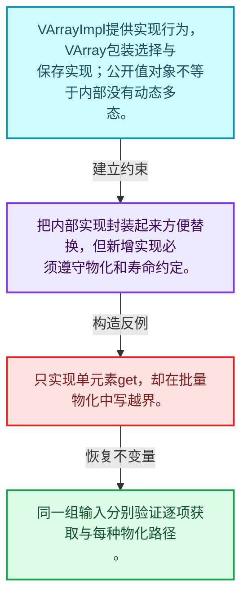
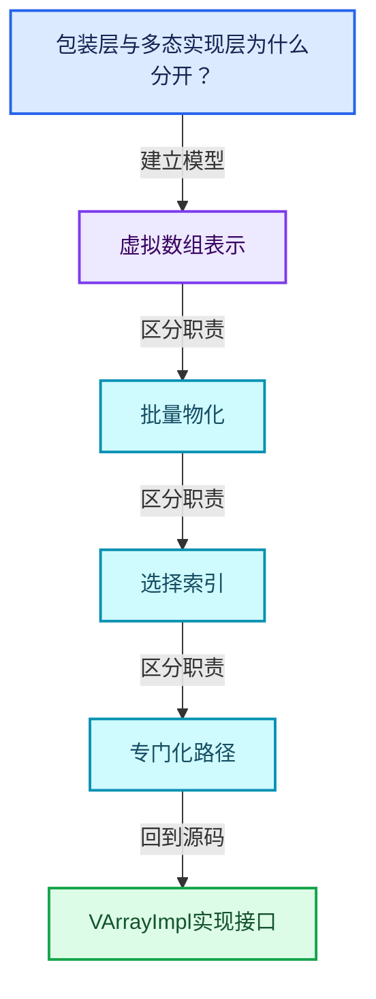
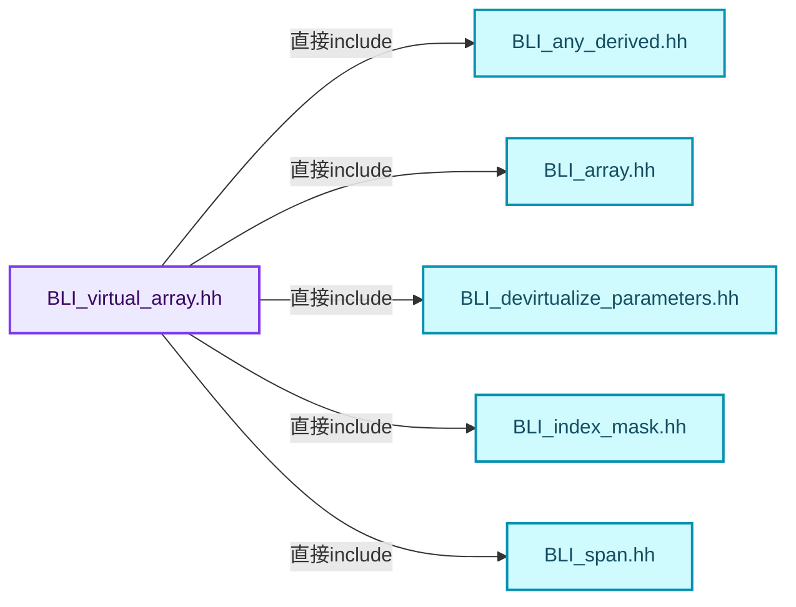
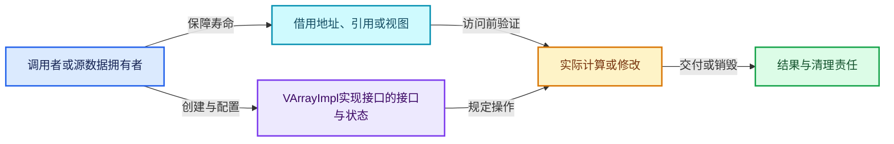
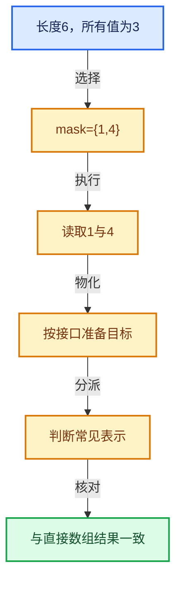

# 04-02 VArrayImpl实现接口

[方向导航](README.md) · [总目录](../README.md) · [覆盖索引](../%E6%BA%90%E7%A0%81%E7%89%88%E6%9C%AC%E4%B8%8E%E8%A6%86%E7%9B%96%E7%B4%A2%E5%BC%95.md)

> 阅读顺序：问题与数据模型 → 语法与类型 → 源码逐行 → 调用线索 → 历史与取舍 → 推演和练习。

- 基准 HEAD：`cbda6b96c26c0dee3c3b5cbb93960c4ac06a6b30`。
- 记录日期：2026-10-14。
- 教学示例状态：正文中的推演不是本机性能实测；已运行练习见验收报告。

## 一、从问题到设计

包装层与多态实现层为什么分开？

稳定的值封装便于传参，具体实现负责获取和物化；新增实现要遵守大小、类型和生命周期契约。

本篇把语法、数据语义和系统取舍连接起来。表示与接口分离，元素编号与选择内部位置分离，生成成本与执行成本分离。

### 本篇独立模型与设计推理

VArrayImpl提供实现行为，VArray包装选择与保存实现；公开值对象不等于内部没有动态多态。

设计取舍：把内部实现封装起来方便替换，但新增实现必须遵守物化和寿命约定。

最小反例：只实现单元素get，却在批量物化中写越界。

推导与处理：同一组输入分别验证逐项获取与每种物化路径。



### 源码范围与相邻篇章

| 文件 | 本篇逐行范围 | 基准SHA-256 |
|---|---|---|
| [source/blender/blenlib/BLI_virtual_array.hh](../../../../../source/blender/blenlib/BLI_virtual_array.hh) | L307—L606 | `0dad9ae245918d5aff4c98aac3248f277cd8060ca11a9acf2e59943aa18a18fe` |

同一主讲文件可能分多篇覆盖；超出本篇范围的符号通过覆盖索引定位。空行与纯注释保留在源码摘录中，逐行表解释有效语句与语法边界；许可证头统一保留。

前篇：[VArray表示与值语义](01-VArray%E8%A1%A8%E7%A4%BA%E4%B8%8E%E5%80%BC%E8%AF%AD%E4%B9%89.md).

后篇：[单值与Span表示](03-%E5%8D%95%E5%80%BC%E4%B8%8ESpan%E8%A1%A8%E7%A4%BA.md).

## 二、类型、数据与阅读地图



这是概念依赖图，边表示阅读关系，不声称是运行时调用顺序。

### 直接编译依赖



箭头只表示头文件包含关系；完整调用线索见后面的符号定位表。

## 三、关键词、语法与类型角色

### 模板 template

模板把类型或常量作为生成实现的参数。读声明时先列出类型参数、非类型参数和默认值，再看使用者实际实例化了什么。模板声明本身不意味着每种T都支持其全部成员。

具体检查：把T替换为int、string、只能移动的类型，分别检查每个被调用操作是否成立。

### 依赖名称 typename

typename既可引入类型模板参数，也可告诉编译器某个依赖名称是类型。它不创建运行时对象；解析期确认语法类别与实例化期检查具体类型是不同阶段。

具体检查：区分typename T::value_type和T::size()，前者标记类型，后者是表达式。

### 常量求值 constexpr

constexpr声明允许相应实体参与常量求值，但constexpr函数仍可以在运行时执行。是否常量求值由调用场景和表达式合法性共同决定。

具体检查：比较constexpr变量初始化和从运行时输入调用同一函数。

### 只读限定 const

const约束当前访问路径可做的修改。const指针、指向const的指针、const视图对象、const元素是不同位置的限定；其他别名可能仍可修改原对象。

具体检查：分别写T* const、const T*与const T* const，并画出不可修改的层次。

### 移动转换 std::move

std::move把表达式转换为可供移动重载选择的值类别，实际资源转移发生在被选中的构造或赋值中。对const对象move可能仍调用复制，对视图move也不会获得底层数据所有权。

具体检查：记录移动构造调用次数，不用变量名或std::move的出现次数替代测量。

### 完美转发 std::forward

std::forward在转发引用模板中恢复调用者原来的值类别。它依赖推导出的模板实参；无条件move会改变左值调用者的语义。

具体检查：对同一接口分别传入左值、临时对象和const左值，记录实际重载。

### 运行时多态 virtual

虚调用根据实际动态类型选择实现；经基类指针销毁对象时通常需要相应虚析构契约。每元素虚调用和循环外一次分派有不同开销。

具体检查：找出虚接口的实现类和调用频率，再讨论是否值得去虚拟化。

### 覆写检查 override

override要求函数确实覆盖基类虚函数，可捕获参数类型和const限定不匹配。它不改变基类规定的生命周期或线程约束。

具体检查：故意改变一个参数或const，观察编译器如何拒绝误写的新函数。

### 构造与new表达式

普通new可能分配并构造；placement new在给定地址构造，存储由其他机制提供。失败回滚应区分两类责任。

具体检查：追踪地址来自哪里、构造何时成功、由谁析构、由谁释放。

### 内部断言 assert

断言表达开发者预期成立的内部契约，发布构建可能关闭。它不能替代对不可信输入的完整错误处理，也不保证后续操作被运行时保护。

具体检查：对每条断言构造违反条件的输入，区分调用者错误与应向用户报告的错误。

### 编译期分支 if constexpr

条件在实例化时决定被保留的分支，这常用于不同类型的合法操作选择。它与运行时if有不同的实例化检查规则。

具体检查：找出每个分支依赖哪些类型特征，再使用满足与不满足条件的类型。

### 受控访问 friend

friend授予指定函数或类访问非公开成员的权限，并不意味着继承，也不自动扩展到友元的派生类。

具体检查：解释执行器为何需要访问包装器的内部映射，同时检查边界是否仍清楚。

### 共享拥有 shared_ptr

shared_ptr让控制块跟踪共享寿命，不自动使被指向对象的读写线程安全；循环拥有可能阻止销毁。

具体检查：画出强引用环并考虑是否应改变所有权方向或引入弱引用。

## 四、真实源码与逐行讲解

源码块保持原行内容，原始行号由小节标题及逐行表给出。表中的调用定位是静态阅读辅助；重载、模板实例化、宏展开和虚调用需结合完整声明，不能仅凭词法出现证明动态调用。

### BLI_virtual_array.hh：L307—L348

<!-- source:source/blender/blenlib/BLI_virtual_array.hh:307:348 -->

```cpp
};

/**
 * A virtual array implementation that returns the same value for every index. This class is final
 * so that it can be devirtualized by the compiler in some cases (e.g. when #devirtualize_varray is
 * used).
 */
template<typename T> class VArrayImpl_For_Single final : public VArrayImpl<T> {
 private:
  T value_;

 public:
  VArrayImpl_For_Single(T value, const int64_t size)
      : VArrayImpl<T>(size), value_(std::move(value))
  {
  }

 protected:
  T get(const int64_t /*index*/) const override
  {
    return value_;
  }

  CommonVArrayInfo common_info() const override
  {
    return CommonVArrayInfo(CommonVArrayInfo::Type::Single, true, &value_);
  }

  void materialize(const IndexMask &mask, T *dst, const bool dst_is_uninitialized) const override
  {
    if constexpr (std::is_trivially_copyable_v<T>) {
      index_mask::detail::fill(dst, value_, mask);
    }
    else {
      if (dst_is_uninitialized) {
        mask.foreach_index([&](const int64_t i) { new (dst + i) T(value_); });
      }
      else {
        mask.foreach_index([&](const int64_t i) { dst[i] = value_; });
      }
    }
  }
```

本段语义重点：

- 分支证据 `dst_is_uninitialized)`：分别推演条件成立与不成立，核对相同出口处的状态。

| 原始行 | 语义、约束与检查 |
|---|---|
| L307 | 结束当前语法单元。局部自动对象在离开其作用域时按规则销毁；这不等于所有被引用的外部数据也被释放。 |
| L314 | 声明模板参数 `template<typename T> class VArrayImpl_For_Single final : public VArrayImpl<T> {`。类型参数决定生成操作的类型，非类型参数可决定内嵌容量或编译期分支。 |
| L315 | 切换成员访问权限为 private；它是编译期接口边界，不是线程同步或内存保护。 |
| L316 | 声明成员、局部对象或完成语句 `T value_`。若为指针或引用，它本身不说明拥有；若为值对象，其构造析构由所在作用域或外层对象管理。 |
| L318 | 切换成员访问权限为 public；它是编译期接口边界，不是线程同步或内存保护。 |
| L319 | 出现调用或函数声明 `VArrayImpl_For_Single`，对应表达式为 `VArrayImpl_For_Single(T value, const int64_t size)`。参数求值、返回类型与重载需结合前后完整语句；静态文本引用不能证明动态目标。 |
| L320 | 出现调用或函数声明 `VArrayImpl`，对应表达式为 `: VArrayImpl<T>(size), value_(std::move(value))`。参数求值、返回类型与重载需结合前后完整语句；静态文本引用不能证明动态目标。 |
| L321 | 连接上一行的声明或控制结构与其语句块；后续行在这个作用域中执行或声明。 |
| L322 | 结束当前语法单元。局部自动对象在离开其作用域时按规则销毁；这不等于所有被引用的外部数据也被释放。 |
| L324 | 切换成员访问权限为 protected；它是编译期接口边界，不是线程同步或内存保护。 |
| L325 | 出现调用或函数声明 `get`，对应表达式为 `T get(const int64_t ) const override`。参数求值、返回类型与重载需结合前后完整语句；静态文本引用不能证明动态目标。 |
| L326 | 连接上一行的声明或控制结构与其语句块；后续行在这个作用域中执行或声明。 |
| L327 | 返回表达式 `value_`。 |
| L328 | 结束当前语法单元。局部自动对象在离开其作用域时按规则销毁；这不等于所有被引用的外部数据也被释放。 |
| L330 | 出现调用或函数声明 `common_info`，对应表达式为 `CommonVArrayInfo common_info() const override`。参数求值、返回类型与重载需结合前后完整语句；静态文本引用不能证明动态目标。 |
| L331 | 连接上一行的声明或控制结构与其语句块；后续行在这个作用域中执行或声明。 |
| L332 | 返回表达式 `CommonVArrayInfo(CommonVArrayInfo::Type::Single, true, &value_)`。 |
| L333 | 结束当前语法单元。局部自动对象在离开其作用域时按规则销毁；这不等于所有被引用的外部数据也被释放。 |
| L335 | 出现调用或函数声明 `materialize`，对应表达式为 `void materialize(const IndexMask &mask, T *dst, const bool dst_is_uninitialized) const override`。参数求值、返回类型与重载需结合前后完整语句；静态文本引用不能证明动态目标。 |
| L336 | 连接上一行的声明或控制结构与其语句块；后续行在这个作用域中执行或声明。 |
| L337 | 编译期条件分支 `if constexpr (std::is_trivially_copyable_v<T>)`。按实例化类型选择相应实现；被舍弃分支和运行期if具有不同检查规则，不能当作运行时输入验证。 |
| L338 | 出现调用或函数声明 `index_mask::detail::fill`，对应表达式为 `index_mask::detail::fill(dst, value_, mask);`。参数求值、返回类型与重载需结合前后完整语句；静态文本引用不能证明动态目标。 |
| L339 | 结束当前语法单元。局部自动对象在离开其作用域时按规则销毁；这不等于所有被引用的外部数据也被释放。 |
| L340 | 处理前一条件不成立的互补路径。比较两条路径最后是否恢复同一不变量，以及是否产生不同的资源责任。 |
| L341 | 判断 `dst_is_uninitialized`，成立时进入本分支，否则继续后续路径。 |
| L342 | 出现调用或函数声明 `foreach_index`，对应表达式为 `mask.foreach_index([&](const int64_t i) { new (dst + i) T(value_); });`。参数求值、返回类型与重载需结合前后完整语句；静态文本引用不能证明动态目标。 |
| L343 | 结束当前语法单元。局部自动对象在离开其作用域时按规则销毁；这不等于所有被引用的外部数据也被释放。 |
| L344 | 处理前一条件不成立的互补路径。比较两条路径最后是否恢复同一不变量，以及是否产生不同的资源责任。 |
| L345 | 把右侧 `value_; })` 用于初始化或更新左侧 `mask.foreach_index([&](const int64_t i) { dst[i]`。声明初始化与已有对象赋值应按上下文区分；有资源的类型会调用相应特殊成员。 |
| L346 | 结束当前语法单元。局部自动对象在离开其作用域时按规则销毁；这不等于所有被引用的外部数据也被释放。 |
| L347 | 结束当前语法单元。局部自动对象在离开其作用域时按规则销毁；这不等于所有被引用的外部数据也被释放。 |
| L348 | 结束当前语法单元。局部自动对象在离开其作用域时按规则销毁；这不等于所有被引用的外部数据也被释放。 |

### BLI_virtual_array.hh：L349—L389

<!-- source:source/blender/blenlib/BLI_virtual_array.hh:349:389 -->

```cpp

  void materialize_compressed(const IndexMask &mask,
                              T *dst,
                              const bool dst_is_uninitialized) const override
  {
    if constexpr (std::is_trivially_copyable_v<T>) {
      initialized_fill_n(dst, mask.size(), value_);
    }
    else {
      if (dst_is_uninitialized) {
        uninitialized_fill_n(dst, mask.size(), value_);
      }
      else {
        initialized_fill_n(dst, mask.size(), value_);
      }
    }
  }
};

template<typename T>
inline constexpr bool is_trivial_extended_v<VArrayImpl_For_Single<T>> = is_trivial_extended_v<T>;

/**
 * This class makes it easy to create a virtual array for an existing function or lambda. The
 * `GetFunc` should take a single `index` argument and return the value at that index.
 */
template<typename T, typename GetFunc> class VArrayImpl_For_Func final : public VArrayImpl<T> {
 private:
  GetFunc get_func_;

 public:
  VArrayImpl_For_Func(const int64_t size, GetFunc get_func)
      : VArrayImpl<T>(size), get_func_(std::move(get_func))
  {
  }

 private:
  T get(const int64_t index) const override
  {
    return get_func_(index);
  }
```

本段语义重点：

- 分支证据 `dst_is_uninitialized)`：分别推演条件成立与不成立，核对相同出口处的状态。

| 原始行 | 语义、约束与检查 |
|---|---|
| L350 | 出现调用或函数声明 `materialize_compressed`，对应表达式为 `void materialize_compressed(const IndexMask &mask,`。参数求值、返回类型与重载需结合前后完整语句；静态文本引用不能证明动态目标。 |
| L351 | 本行是连续声明或表达式的一部分：`T *dst,`。与本段前后行合读；逗号、括号和限定符决定它属于参数、初始化列表还是实际计算。 |
| L352 | 本行是连续声明或表达式的一部分：`const bool dst_is_uninitialized) const override`。与本段前后行合读；逗号、括号和限定符决定它属于参数、初始化列表还是实际计算。 |
| L353 | 连接上一行的声明或控制结构与其语句块；后续行在这个作用域中执行或声明。 |
| L354 | 编译期条件分支 `if constexpr (std::is_trivially_copyable_v<T>)`。按实例化类型选择相应实现；被舍弃分支和运行期if具有不同检查规则，不能当作运行时输入验证。 |
| L355 | 出现调用或函数声明 `initialized_fill_n`，对应表达式为 `initialized_fill_n(dst, mask.size(), value_);`。参数求值、返回类型与重载需结合前后完整语句；静态文本引用不能证明动态目标。 |
| L356 | 结束当前语法单元。局部自动对象在离开其作用域时按规则销毁；这不等于所有被引用的外部数据也被释放。 |
| L357 | 处理前一条件不成立的互补路径。比较两条路径最后是否恢复同一不变量，以及是否产生不同的资源责任。 |
| L358 | 判断 `dst_is_uninitialized`，成立时进入本分支，否则继续后续路径。 |
| L359 | 出现调用或函数声明 `uninitialized_fill_n`，对应表达式为 `uninitialized_fill_n(dst, mask.size(), value_);`。参数求值、返回类型与重载需结合前后完整语句；静态文本引用不能证明动态目标。 |
| L360 | 结束当前语法单元。局部自动对象在离开其作用域时按规则销毁；这不等于所有被引用的外部数据也被释放。 |
| L361 | 处理前一条件不成立的互补路径。比较两条路径最后是否恢复同一不变量，以及是否产生不同的资源责任。 |
| L362 | 出现调用或函数声明 `initialized_fill_n`，对应表达式为 `initialized_fill_n(dst, mask.size(), value_);`。参数求值、返回类型与重载需结合前后完整语句；静态文本引用不能证明动态目标。 |
| L363 | 结束当前语法单元。局部自动对象在离开其作用域时按规则销毁；这不等于所有被引用的外部数据也被释放。 |
| L364 | 结束当前语法单元。局部自动对象在离开其作用域时按规则销毁；这不等于所有被引用的外部数据也被释放。 |
| L365 | 结束当前语法单元。局部自动对象在离开其作用域时按规则销毁；这不等于所有被引用的外部数据也被释放。 |
| L366 | 结束当前语法单元。局部自动对象在离开其作用域时按规则销毁；这不等于所有被引用的外部数据也被释放。 |
| L368 | 声明模板参数 `template<typename T>`。类型参数决定生成操作的类型，非类型参数可决定内嵌容量或编译期分支。 |
| L369 | 把右侧 `is_trivial_extended_v<T>` 用于初始化或更新左侧 `inline constexpr bool is_trivial_extended_v<VArrayImpl_For_Single<T>>`。声明初始化与已有对象赋值应按上下文区分；有资源的类型会调用相应特殊成员。 |
| L375 | 声明模板参数 `template<typename T, typename GetFunc> class VArrayImpl_For_Func final : public VArrayImpl<T> {`。类型参数决定生成操作的类型，非类型参数可决定内嵌容量或编译期分支。 |
| L376 | 切换成员访问权限为 private；它是编译期接口边界，不是线程同步或内存保护。 |
| L377 | 声明成员、局部对象或完成语句 `GetFunc get_func_`。若为指针或引用，它本身不说明拥有；若为值对象，其构造析构由所在作用域或外层对象管理。 |
| L379 | 切换成员访问权限为 public；它是编译期接口边界，不是线程同步或内存保护。 |
| L380 | 出现调用或函数声明 `VArrayImpl_For_Func`，对应表达式为 `VArrayImpl_For_Func(const int64_t size, GetFunc get_func)`。参数求值、返回类型与重载需结合前后完整语句；静态文本引用不能证明动态目标。 |
| L381 | 出现调用或函数声明 `VArrayImpl`，对应表达式为 `: VArrayImpl<T>(size), get_func_(std::move(get_func))`。参数求值、返回类型与重载需结合前后完整语句；静态文本引用不能证明动态目标。 |
| L382 | 连接上一行的声明或控制结构与其语句块；后续行在这个作用域中执行或声明。 |
| L383 | 结束当前语法单元。局部自动对象在离开其作用域时按规则销毁；这不等于所有被引用的外部数据也被释放。 |
| L385 | 切换成员访问权限为 private；它是编译期接口边界，不是线程同步或内存保护。 |
| L386 | 出现调用或函数声明 `get`，对应表达式为 `T get(const int64_t index) const override`。参数求值、返回类型与重载需结合前后完整语句；静态文本引用不能证明动态目标。 |
| L387 | 连接上一行的声明或控制结构与其语句块；后续行在这个作用域中执行或声明。 |
| L388 | 返回表达式 `get_func_(index)`。 |
| L389 | 结束当前语法单元。局部自动对象在离开其作用域时按规则销毁；这不等于所有被引用的外部数据也被释放。 |

### BLI_virtual_array.hh：L390—L436

<!-- source:source/blender/blenlib/BLI_virtual_array.hh:390:436 -->

```cpp

  void materialize(const IndexMask &mask, T *dst, const bool dst_is_uninitialized) const override
  {
    if constexpr (std::is_trivially_copyable_v<T>) {
      mask.foreach_index([&](const int64_t i) { dst[i] = get_func_(i); });
    }
    else {
      if (dst_is_uninitialized) {
        mask.foreach_index([&](const int64_t i) { new (dst + i) T(get_func_(i)); });
      }
      else {
        mask.foreach_index([&](const int64_t i) { dst[i] = get_func_(i); });
      }
    }
  }

  void materialize_compressed(const IndexMask &mask,
                              T *dst,
                              const bool dst_is_uninitialized) const override
  {
    if constexpr (std::is_trivially_copyable_v<T>) {
      mask.foreach_index([&](const int64_t i, const int64_t pos) { dst[pos] = get_func_(i); });
    }
    else {
      if (dst_is_uninitialized) {
        mask.foreach_index(
            [&](const int64_t i, const int64_t pos) { new (dst + pos) T(get_func_(i)); });
      }
      else {
        mask.foreach_index([&](const int64_t i, const int64_t pos) { dst[pos] = get_func_(i); });
      }
    }
  }
};

/**
 * \note This is `final` so that #may_have_ownership can be implemented reliably.
 */
template<typename StructT,
         typename ElemT,
         ElemT (*GetFunc)(const StructT &),
         void (*SetFunc)(StructT &, ElemT) = nullptr>
class VArrayImpl_For_DerivedSpan final : public VMutableArrayImpl<ElemT> {
 private:
  StructT *data_;

 public:
```

本段语义重点：

- `data_`：数据或实现的存储入口；是否拥有应按该类声明和析构判定。

| 原始行 | 语义、约束与检查 |
|---|---|
| L391 | 出现调用或函数声明 `materialize`，对应表达式为 `void materialize(const IndexMask &mask, T *dst, const bool dst_is_uninitialized) const override`。参数求值、返回类型与重载需结合前后完整语句；静态文本引用不能证明动态目标。 |
| L392 | 连接上一行的声明或控制结构与其语句块；后续行在这个作用域中执行或声明。 |
| L393 | 编译期条件分支 `if constexpr (std::is_trivially_copyable_v<T>)`。按实例化类型选择相应实现；被舍弃分支和运行期if具有不同检查规则，不能当作运行时输入验证。 |
| L394 | 把右侧 `get_func_(i); })` 用于初始化或更新左侧 `mask.foreach_index([&](const int64_t i) { dst[i]`。声明初始化与已有对象赋值应按上下文区分；有资源的类型会调用相应特殊成员。 |
| L395 | 结束当前语法单元。局部自动对象在离开其作用域时按规则销毁；这不等于所有被引用的外部数据也被释放。 |
| L396 | 处理前一条件不成立的互补路径。比较两条路径最后是否恢复同一不变量，以及是否产生不同的资源责任。 |
| L397 | 判断 `dst_is_uninitialized`，成立时进入本分支，否则继续后续路径。 |
| L398 | 出现调用或函数声明 `foreach_index`，对应表达式为 `mask.foreach_index([&](const int64_t i) { new (dst + i) T(get_func_(i)); });`。参数求值、返回类型与重载需结合前后完整语句；静态文本引用不能证明动态目标。 |
| L399 | 结束当前语法单元。局部自动对象在离开其作用域时按规则销毁；这不等于所有被引用的外部数据也被释放。 |
| L400 | 处理前一条件不成立的互补路径。比较两条路径最后是否恢复同一不变量，以及是否产生不同的资源责任。 |
| L401 | 把右侧 `get_func_(i); })` 用于初始化或更新左侧 `mask.foreach_index([&](const int64_t i) { dst[i]`。声明初始化与已有对象赋值应按上下文区分；有资源的类型会调用相应特殊成员。 |
| L402 | 结束当前语法单元。局部自动对象在离开其作用域时按规则销毁；这不等于所有被引用的外部数据也被释放。 |
| L403 | 结束当前语法单元。局部自动对象在离开其作用域时按规则销毁；这不等于所有被引用的外部数据也被释放。 |
| L404 | 结束当前语法单元。局部自动对象在离开其作用域时按规则销毁；这不等于所有被引用的外部数据也被释放。 |
| L406 | 出现调用或函数声明 `materialize_compressed`，对应表达式为 `void materialize_compressed(const IndexMask &mask,`。参数求值、返回类型与重载需结合前后完整语句；静态文本引用不能证明动态目标。 |
| L407 | 本行是连续声明或表达式的一部分：`T *dst,`。与本段前后行合读；逗号、括号和限定符决定它属于参数、初始化列表还是实际计算。 |
| L408 | 本行是连续声明或表达式的一部分：`const bool dst_is_uninitialized) const override`。与本段前后行合读；逗号、括号和限定符决定它属于参数、初始化列表还是实际计算。 |
| L409 | 连接上一行的声明或控制结构与其语句块；后续行在这个作用域中执行或声明。 |
| L410 | 编译期条件分支 `if constexpr (std::is_trivially_copyable_v<T>)`。按实例化类型选择相应实现；被舍弃分支和运行期if具有不同检查规则，不能当作运行时输入验证。 |
| L411 | 把右侧 `get_func_(i); })` 用于初始化或更新左侧 `mask.foreach_index([&](const int64_t i, const int64_t pos) { dst[pos]`。声明初始化与已有对象赋值应按上下文区分；有资源的类型会调用相应特殊成员。 |
| L412 | 结束当前语法单元。局部自动对象在离开其作用域时按规则销毁；这不等于所有被引用的外部数据也被释放。 |
| L413 | 处理前一条件不成立的互补路径。比较两条路径最后是否恢复同一不变量，以及是否产生不同的资源责任。 |
| L414 | 判断 `dst_is_uninitialized`，成立时进入本分支，否则继续后续路径。 |
| L415 | 出现调用或函数声明 `foreach_index`，对应表达式为 `mask.foreach_index(`。参数求值、返回类型与重载需结合前后完整语句；静态文本引用不能证明动态目标。 |
| L416 | 出现调用或函数声明 `new`，对应表达式为 `[&](const int64_t i, const int64_t pos) { new (dst + pos) T(get_func_(i)); });`。参数求值、返回类型与重载需结合前后完整语句；静态文本引用不能证明动态目标。 |
| L417 | 结束当前语法单元。局部自动对象在离开其作用域时按规则销毁；这不等于所有被引用的外部数据也被释放。 |
| L418 | 处理前一条件不成立的互补路径。比较两条路径最后是否恢复同一不变量，以及是否产生不同的资源责任。 |
| L419 | 把右侧 `get_func_(i); })` 用于初始化或更新左侧 `mask.foreach_index([&](const int64_t i, const int64_t pos) { dst[pos]`。声明初始化与已有对象赋值应按上下文区分；有资源的类型会调用相应特殊成员。 |
| L420 | 结束当前语法单元。局部自动对象在离开其作用域时按规则销毁；这不等于所有被引用的外部数据也被释放。 |
| L421 | 结束当前语法单元。局部自动对象在离开其作用域时按规则销毁；这不等于所有被引用的外部数据也被释放。 |
| L422 | 结束当前语法单元。局部自动对象在离开其作用域时按规则销毁；这不等于所有被引用的外部数据也被释放。 |
| L423 | 结束当前语法单元。局部自动对象在离开其作用域时按规则销毁；这不等于所有被引用的外部数据也被释放。 |
| L428 | 声明模板参数 `template<typename StructT,`。类型参数决定生成操作的类型，非类型参数可决定内嵌容量或编译期分支。 |
| L429 | 本行是连续声明或表达式的一部分：`typename ElemT,`。与本段前后行合读；逗号、括号和限定符决定它属于参数、初始化列表还是实际计算。 |
| L430 | 出现调用或函数声明 `ElemT`，对应表达式为 `ElemT (*GetFunc)(const StructT &),`。参数求值、返回类型与重载需结合前后完整语句；静态文本引用不能证明动态目标。 |
| L431 | 把右侧 `nullptr>` 用于初始化或更新左侧 `void (*SetFunc)(StructT &, ElemT)`。声明初始化与已有对象赋值应按上下文区分；有资源的类型会调用相应特殊成员。 |
| L432 | 声明或定义类型 `class VArrayImpl_For_DerivedSpan final : public VMutableArrayImpl<ElemT>`。结合继承、访问权限和成员布局确认接口与拥有关系；前向声明本身没有完整对象布局。 |
| L433 | 切换成员访问权限为 private；它是编译期接口边界，不是线程同步或内存保护。 |
| L434 | 本行涉及 `data_`：数据或实现的存储入口；是否拥有应按该类声明和析构判定。按此语义解读 `StructT *data_`，不要把地址、数量或状态混用。 |
| L436 | 切换成员访问权限为 public；它是编译期接口边界，不是线程同步或内存保护。 |

### BLI_virtual_array.hh：L437—L474

<!-- source:source/blender/blenlib/BLI_virtual_array.hh:437:474 -->

```cpp
  VArrayImpl_For_DerivedSpan(const MutableSpan<StructT> data)
      : VMutableArrayImpl<ElemT>(data.size()), data_(data.data())
  {
  }

  template<typename OtherStructT,
           typename OtherElemT,
           OtherElemT (*OtherGetFunc)(const OtherStructT &),
           void (*OtherSetFunc)(OtherStructT &, OtherElemT)>
  friend class VArrayImpl_For_DerivedSpan;

 private:
  ElemT get(const int64_t index) const override
  {
    return GetFunc(data_[index]);
  }

  void set(const int64_t index, ElemT value) override
  {
    SetFunc(data_[index], std::move(value));
  }

  void materialize(const IndexMask &mask,
                   ElemT *dst,
                   const bool dst_is_uninitialized) const override
  {
    if constexpr (std::is_trivially_copyable_v<ElemT>) {
      mask.foreach_index([&](const int64_t i) { dst[i] = GetFunc(data_[i]); });
    }
    else {
      if (dst_is_uninitialized) {
        mask.foreach_index([&](const int64_t i) { new (dst + i) ElemT(GetFunc(data_[i])); });
      }
      else {
        mask.foreach_index([&](const int64_t i) { dst[i] = GetFunc(data_[i]); });
      }
    }
  }
```

本段语义重点：

- `data_`：数据或实现的存储入口；是否拥有应按该类声明和析构判定。

| 原始行 | 语义、约束与检查 |
|---|---|
| L437 | 出现调用或函数声明 `VArrayImpl_For_DerivedSpan`，对应表达式为 `VArrayImpl_For_DerivedSpan(const MutableSpan<StructT> data)`。参数求值、返回类型与重载需结合前后完整语句；静态文本引用不能证明动态目标。 |
| L438 | 本行涉及 `data_`：数据或实现的存储入口；是否拥有应按该类声明和析构判定。按此语义解读 `: VMutableArrayImpl<ElemT>(data.size()), data_(data.data())`，不要把地址、数量或状态混用。 |
| L439 | 连接上一行的声明或控制结构与其语句块；后续行在这个作用域中执行或声明。 |
| L440 | 结束当前语法单元。局部自动对象在离开其作用域时按规则销毁；这不等于所有被引用的外部数据也被释放。 |
| L442 | 声明模板参数 `template<typename OtherStructT,`。类型参数决定生成操作的类型，非类型参数可决定内嵌容量或编译期分支。 |
| L443 | 本行是连续声明或表达式的一部分：`typename OtherElemT,`。与本段前后行合读；逗号、括号和限定符决定它属于参数、初始化列表还是实际计算。 |
| L444 | 出现调用或函数声明 `OtherElemT`，对应表达式为 `OtherElemT (*OtherGetFunc)(const OtherStructT &),`。参数求值、返回类型与重载需结合前后完整语句；静态文本引用不能证明动态目标。 |
| L445 | 出现调用或函数声明 `void`，对应表达式为 `void (*OtherSetFunc)(OtherStructT &, OtherElemT)>`。参数求值、返回类型与重载需结合前后完整语句；静态文本引用不能证明动态目标。 |
| L446 | 声明成员、局部对象或完成语句 `friend class VArrayImpl_For_DerivedSpan`。若为指针或引用，它本身不说明拥有；若为值对象，其构造析构由所在作用域或外层对象管理。 |
| L448 | 切换成员访问权限为 private；它是编译期接口边界，不是线程同步或内存保护。 |
| L449 | 出现调用或函数声明 `get`，对应表达式为 `ElemT get(const int64_t index) const override`。参数求值、返回类型与重载需结合前后完整语句；静态文本引用不能证明动态目标。 |
| L450 | 连接上一行的声明或控制结构与其语句块；后续行在这个作用域中执行或声明。 |
| L451 | 返回表达式 `GetFunc(data_[index])`。 |
| L452 | 结束当前语法单元。局部自动对象在离开其作用域时按规则销毁；这不等于所有被引用的外部数据也被释放。 |
| L454 | 出现调用或函数声明 `set`，对应表达式为 `void set(const int64_t index, ElemT value) override`。参数求值、返回类型与重载需结合前后完整语句；静态文本引用不能证明动态目标。 |
| L455 | 连接上一行的声明或控制结构与其语句块；后续行在这个作用域中执行或声明。 |
| L456 | 本行涉及 `data_`：数据或实现的存储入口；是否拥有应按该类声明和析构判定。按此语义解读 `SetFunc(data_[index], std::move(value))`，不要把地址、数量或状态混用。 |
| L457 | 结束当前语法单元。局部自动对象在离开其作用域时按规则销毁；这不等于所有被引用的外部数据也被释放。 |
| L459 | 出现调用或函数声明 `materialize`，对应表达式为 `void materialize(const IndexMask &mask,`。参数求值、返回类型与重载需结合前后完整语句；静态文本引用不能证明动态目标。 |
| L460 | 本行是连续声明或表达式的一部分：`ElemT *dst,`。与本段前后行合读；逗号、括号和限定符决定它属于参数、初始化列表还是实际计算。 |
| L461 | 本行是连续声明或表达式的一部分：`const bool dst_is_uninitialized) const override`。与本段前后行合读；逗号、括号和限定符决定它属于参数、初始化列表还是实际计算。 |
| L462 | 连接上一行的声明或控制结构与其语句块；后续行在这个作用域中执行或声明。 |
| L463 | 编译期条件分支 `if constexpr (std::is_trivially_copyable_v<ElemT>)`。按实例化类型选择相应实现；被舍弃分支和运行期if具有不同检查规则，不能当作运行时输入验证。 |
| L464 | 建立或更新 `data_`：数据或实现的存储入口；是否拥有应按该类声明和析构判定。本行的具体值关系为 `mask.foreach_index([&](const int64_t i) { dst[i] = GetFunc(data_[i]); })`；对照更新前后相应范围或状态是否一致。 |
| L465 | 结束当前语法单元。局部自动对象在离开其作用域时按规则销毁；这不等于所有被引用的外部数据也被释放。 |
| L466 | 处理前一条件不成立的互补路径。比较两条路径最后是否恢复同一不变量，以及是否产生不同的资源责任。 |
| L467 | 判断 `dst_is_uninitialized`，成立时进入本分支，否则继续后续路径。 |
| L468 | 本行涉及 `data_`：数据或实现的存储入口；是否拥有应按该类声明和析构判定。按此语义解读 `mask.foreach_index([&](const int64_t i) { new (dst + i) ElemT(GetFunc(data_[i])); })`，不要把地址、数量或状态混用。 |
| L469 | 结束当前语法单元。局部自动对象在离开其作用域时按规则销毁；这不等于所有被引用的外部数据也被释放。 |
| L470 | 处理前一条件不成立的互补路径。比较两条路径最后是否恢复同一不变量，以及是否产生不同的资源责任。 |
| L471 | 建立或更新 `data_`：数据或实现的存储入口；是否拥有应按该类声明和析构判定。本行的具体值关系为 `mask.foreach_index([&](const int64_t i) { dst[i] = GetFunc(data_[i]); })`；对照更新前后相应范围或状态是否一致。 |
| L472 | 结束当前语法单元。局部自动对象在离开其作用域时按规则销毁；这不等于所有被引用的外部数据也被释放。 |
| L473 | 结束当前语法单元。局部自动对象在离开其作用域时按规则销毁；这不等于所有被引用的外部数据也被释放。 |
| L474 | 结束当前语法单元。局部自动对象在离开其作用域时按规则销毁；这不等于所有被引用的外部数据也被释放。 |

### BLI_virtual_array.hh：L475—L521

<!-- source:source/blender/blenlib/BLI_virtual_array.hh:475:521 -->

```cpp

  void materialize_compressed(const IndexMask &mask,
                              ElemT *dst,
                              const bool dst_is_uninitialized) const override
  {
    if constexpr (std::is_trivially_copyable_v<ElemT>) {
      mask.foreach_index(
          [&](const int64_t i, const int64_t pos) { dst[pos] = GetFunc(data_[i]); });
    }
    else {
      if (dst_is_uninitialized) {
        mask.foreach_index(
            [&](const int64_t i, const int64_t pos) { new (dst + pos) ElemT(GetFunc(data_[i])); });
      }
      else {
        mask.foreach_index(
            [&](const int64_t i, const int64_t pos) { dst[pos] = GetFunc(data_[i]); });
      }
    }
  }
};

template<typename StructT,
         typename ElemT,
         ElemT (*GetFunc)(const StructT &),
         void (*SetFunc)(StructT &, ElemT)>
inline constexpr bool
    is_trivial_extended_v<VArrayImpl_For_DerivedSpan<StructT, ElemT, GetFunc, SetFunc>> = true;

/**
 * Utility class to reduce code duplication for methods available on #VArray and #VMutableArray.
 * Deriving #VMutableArray from #VArray would have some issues:
 * - Static methods on #VArray would also be available on #VMutableArray.
 * - It would allow assigning a #VArray to a #VMutableArray under some circumstances which is not
 *   allowed and could result in hard to find bugs.
 */
template<typename T> class VArrayCommon {
 protected:
  AnyDerived<const VArrayImpl<T>> impl_;

  VArrayCommon() = default;

  /**
   * Wrap an existing #VArrayImpl and don't take ownership of it. This should rarely be used in
   * practice.
   */
  VArrayCommon(const VArrayImpl<T> *impl) : impl_(impl) {}
```

本段语义重点：

- `data_`：数据或实现的存储入口；是否拥有应按该类声明和析构判定。

| 原始行 | 语义、约束与检查 |
|---|---|
| L476 | 出现调用或函数声明 `materialize_compressed`，对应表达式为 `void materialize_compressed(const IndexMask &mask,`。参数求值、返回类型与重载需结合前后完整语句；静态文本引用不能证明动态目标。 |
| L477 | 本行是连续声明或表达式的一部分：`ElemT *dst,`。与本段前后行合读；逗号、括号和限定符决定它属于参数、初始化列表还是实际计算。 |
| L478 | 本行是连续声明或表达式的一部分：`const bool dst_is_uninitialized) const override`。与本段前后行合读；逗号、括号和限定符决定它属于参数、初始化列表还是实际计算。 |
| L479 | 连接上一行的声明或控制结构与其语句块；后续行在这个作用域中执行或声明。 |
| L480 | 编译期条件分支 `if constexpr (std::is_trivially_copyable_v<ElemT>)`。按实例化类型选择相应实现；被舍弃分支和运行期if具有不同检查规则，不能当作运行时输入验证。 |
| L481 | 出现调用或函数声明 `foreach_index`，对应表达式为 `mask.foreach_index(`。参数求值、返回类型与重载需结合前后完整语句；静态文本引用不能证明动态目标。 |
| L482 | 建立或更新 `data_`：数据或实现的存储入口；是否拥有应按该类声明和析构判定。本行的具体值关系为 `[&](const int64_t i, const int64_t pos) { dst[pos] = GetFunc(data_[i]); })`；对照更新前后相应范围或状态是否一致。 |
| L483 | 结束当前语法单元。局部自动对象在离开其作用域时按规则销毁；这不等于所有被引用的外部数据也被释放。 |
| L484 | 处理前一条件不成立的互补路径。比较两条路径最后是否恢复同一不变量，以及是否产生不同的资源责任。 |
| L485 | 判断 `dst_is_uninitialized`，成立时进入本分支，否则继续后续路径。 |
| L486 | 出现调用或函数声明 `foreach_index`，对应表达式为 `mask.foreach_index(`。参数求值、返回类型与重载需结合前后完整语句；静态文本引用不能证明动态目标。 |
| L487 | 本行涉及 `data_`：数据或实现的存储入口；是否拥有应按该类声明和析构判定。按此语义解读 `[&](const int64_t i, const int64_t pos) { new (dst + pos) ElemT(GetFunc(data_[i])); })`，不要把地址、数量或状态混用。 |
| L488 | 结束当前语法单元。局部自动对象在离开其作用域时按规则销毁；这不等于所有被引用的外部数据也被释放。 |
| L489 | 处理前一条件不成立的互补路径。比较两条路径最后是否恢复同一不变量，以及是否产生不同的资源责任。 |
| L490 | 出现调用或函数声明 `foreach_index`，对应表达式为 `mask.foreach_index(`。参数求值、返回类型与重载需结合前后完整语句；静态文本引用不能证明动态目标。 |
| L491 | 建立或更新 `data_`：数据或实现的存储入口；是否拥有应按该类声明和析构判定。本行的具体值关系为 `[&](const int64_t i, const int64_t pos) { dst[pos] = GetFunc(data_[i]); })`；对照更新前后相应范围或状态是否一致。 |
| L492 | 结束当前语法单元。局部自动对象在离开其作用域时按规则销毁；这不等于所有被引用的外部数据也被释放。 |
| L493 | 结束当前语法单元。局部自动对象在离开其作用域时按规则销毁；这不等于所有被引用的外部数据也被释放。 |
| L494 | 结束当前语法单元。局部自动对象在离开其作用域时按规则销毁；这不等于所有被引用的外部数据也被释放。 |
| L495 | 结束当前语法单元。局部自动对象在离开其作用域时按规则销毁；这不等于所有被引用的外部数据也被释放。 |
| L497 | 声明模板参数 `template<typename StructT,`。类型参数决定生成操作的类型，非类型参数可决定内嵌容量或编译期分支。 |
| L498 | 本行是连续声明或表达式的一部分：`typename ElemT,`。与本段前后行合读；逗号、括号和限定符决定它属于参数、初始化列表还是实际计算。 |
| L499 | 出现调用或函数声明 `ElemT`，对应表达式为 `ElemT (*GetFunc)(const StructT &),`。参数求值、返回类型与重载需结合前后完整语句；静态文本引用不能证明动态目标。 |
| L500 | 出现调用或函数声明 `void`，对应表达式为 `void (*SetFunc)(StructT &, ElemT)>`。参数求值、返回类型与重载需结合前后完整语句；静态文本引用不能证明动态目标。 |
| L501 | 本行是连续声明或表达式的一部分：`inline constexpr bool`。与本段前后行合读；逗号、括号和限定符决定它属于参数、初始化列表还是实际计算。 |
| L502 | 把右侧 `true` 用于初始化或更新左侧 `is_trivial_extended_v<VArrayImpl_For_DerivedSpan<StructT, ElemT, GetFunc, SetFunc>>`。声明初始化与已有对象赋值应按上下文区分；有资源的类型会调用相应特殊成员。 |
| L511 | 声明模板参数 `template<typename T> class VArrayCommon {`。类型参数决定生成操作的类型，非类型参数可决定内嵌容量或编译期分支。 |
| L512 | 切换成员访问权限为 protected；它是编译期接口边界，不是线程同步或内存保护。 |
| L513 | 声明成员、局部对象或完成语句 `AnyDerived<const VArrayImpl<T>> impl_`。若为指针或引用，它本身不说明拥有；若为值对象，其构造析构由所在作用域或外层对象管理。 |
| L515 | 显式采用编译器生成的特殊成员行为：`VArrayCommon() = default;`。成员和基类的性质决定该操作是否可用、是否被删除及异常约定，不表示运行时给对象赋值为default。 |
| L521 | 出现调用或函数声明 `VArrayCommon`，对应表达式为 `VArrayCommon(const VArrayImpl<T> *impl) : impl_(impl) {}`。参数求值、返回类型与重载需结合前后完整语句；静态文本引用不能证明动态目标。 |

### BLI_virtual_array.hh：L522—L563

<!-- source:source/blender/blenlib/BLI_virtual_array.hh:522:563 -->

```cpp

  /**
   * Wrap an existing #VArrayImpl that is contained in a #std::shared_ptr. This takes ownership.
   */
  VArrayCommon(std::shared_ptr<const VArrayImpl<T>> impl) : impl_(std::move(impl)) {}

  /**
   * Replace the contained #VArrayImpl.
   */
  template<typename ImplT, typename... Args> void emplace(Args &&...args)
  {
    impl_.template emplace<ImplT>(std::forward<Args>(args)...);
  }

 public:
  /** Return false when there is no virtual array implementation currently. */
  operator bool() const
  {
    return impl_;
  }

  /**
   * Get the element at a specific index.
   * \note This can't return a reference because the value may be computed on the fly. This also
   * implies that one can not use this method for assignments.
   */
  T operator[](const int64_t index) const
  {
    BLI_assert(*this);
    BLI_assert(index >= 0);
    BLI_assert(index < this->size());
    return impl_->get(index);
  }

  /**
   * Same as the #operator[] but is sometimes easier to use when one has a pointer to a virtual
   * array.
   */
  T get(const int64_t index) const
  {
    return (*this)[index];
  }
```

| 原始行 | 语义、约束与检查 |
|---|---|
| L526 | 出现调用或函数声明 `VArrayCommon`，对应表达式为 `VArrayCommon(std::shared_ptr<const VArrayImpl<T>> impl) : impl_(std::move(impl)) {}`。参数求值、返回类型与重载需结合前后完整语句；静态文本引用不能证明动态目标。 |
| L531 | 声明模板参数 `template<typename ImplT, typename... Args> void emplace(Args &&...args)`。类型参数决定生成操作的类型，非类型参数可决定内嵌容量或编译期分支。 |
| L532 | 连接上一行的声明或控制结构与其语句块；后续行在这个作用域中执行或声明。 |
| L533 | 出现调用或函数声明 `emplace`，对应表达式为 `impl_.template emplace<ImplT>(std::forward<Args>(args)...);`。参数求值、返回类型与重载需结合前后完整语句；静态文本引用不能证明动态目标。 |
| L534 | 结束当前语法单元。局部自动对象在离开其作用域时按规则销毁；这不等于所有被引用的外部数据也被释放。 |
| L536 | 切换成员访问权限为 public；它是编译期接口边界，不是线程同步或内存保护。 |
| L538 | 运算符重载声明、定义或显式调用：`operator bool() const`。结合参数和返回类型判断是赋值、索引、比较还是转换；operator=声明中的等号不是在给名为operator的变量赋值。 |
| L539 | 连接上一行的声明或控制结构与其语句块；后续行在这个作用域中执行或声明。 |
| L540 | 返回表达式 `impl_`。 |
| L541 | 结束当前语法单元。局部自动对象在离开其作用域时按规则销毁；这不等于所有被引用的外部数据也被释放。 |
| L548 | 运算符重载声明、定义或显式调用：`T operator[](const int64_t index) const`。结合参数和返回类型判断是赋值、索引、比较还是转换；operator=声明中的等号不是在给名为operator的变量赋值。 |
| L549 | 连接上一行的声明或控制结构与其语句块；后续行在这个作用域中执行或声明。 |
| L550 | 断言约束 `BLI_assert(*this);`。条件是后续访问的内部前置条件；发布构建可能不执行，不能把断言当作输入修复。 |
| L551 | 断言约束 `BLI_assert(index >= 0);`。条件是后续访问的内部前置条件；发布构建可能不执行，不能把断言当作输入修复。 |
| L552 | 断言约束 `BLI_assert(index < this->size());`。条件是后续访问的内部前置条件；发布构建可能不执行，不能把断言当作输入修复。 |
| L553 | 返回表达式 `impl_->get(index)`。 |
| L554 | 结束当前语法单元。局部自动对象在离开其作用域时按规则销毁；这不等于所有被引用的外部数据也被释放。 |
| L560 | 出现调用或函数声明 `get`，对应表达式为 `T get(const int64_t index) const`。参数求值、返回类型与重载需结合前后完整语句；静态文本引用不能证明动态目标。 |
| L561 | 连接上一行的声明或控制结构与其语句块；后续行在这个作用域中执行或声明。 |
| L562 | 返回表达式 `(*this)[index]`。 |
| L563 | 结束当前语法单元。局部自动对象在离开其作用域时按规则销毁；这不等于所有被引用的外部数据也被释放。 |

### BLI_virtual_array.hh：L564—L606

<!-- source:source/blender/blenlib/BLI_virtual_array.hh:564:606 -->

```cpp

  /**
   * Return the size of the virtual array. It's allowed to call this method even when there is no
   * virtual array. In this case 0 is returned.
   */
  int64_t size() const
  {
    if (!impl_) {
      return 0;
    }
    return impl_->size();
  }
  /**
   * Get the first element.
   */
  T first() const
  {
    return (*this)[0];
  }
  /**
   * Get the nth last element.
   */
  T last(const int64_t n = 0) const
  {
    return (*this)[this->size() - 1 - n];
  }

  /** True when the size is zero or when there is no virtual array. */
  bool is_empty() const
  {
    return this->size() == 0;
  }

  IndexRange index_range() const
  {
    return IndexRange(this->size());
  }

  CommonVArrayInfo common_info() const
  {
    BLI_assert(*this);
    return impl_->common_info();
  }
```

本段语义重点：

- 分支证据 `!impl_)`：分别推演条件成立与不成立，核对相同出口处的状态。

| 原始行 | 语义、约束与检查 |
|---|---|
| L569 | 出现调用或函数声明 `size`，对应表达式为 `int64_t size() const`。参数求值、返回类型与重载需结合前后完整语句；静态文本引用不能证明动态目标。 |
| L570 | 连接上一行的声明或控制结构与其语句块；后续行在这个作用域中执行或声明。 |
| L571 | 判断 `!impl_`，成立时进入本分支，否则继续后续路径。 |
| L572 | 返回表达式 `0`。 |
| L573 | 结束当前语法单元。局部自动对象在离开其作用域时按规则销毁；这不等于所有被引用的外部数据也被释放。 |
| L574 | 返回表达式 `impl_->size()`。 |
| L575 | 结束当前语法单元。局部自动对象在离开其作用域时按规则销毁；这不等于所有被引用的外部数据也被释放。 |
| L579 | 出现调用或函数声明 `first`，对应表达式为 `T first() const`。参数求值、返回类型与重载需结合前后完整语句；静态文本引用不能证明动态目标。 |
| L580 | 连接上一行的声明或控制结构与其语句块；后续行在这个作用域中执行或声明。 |
| L581 | 返回表达式 `(*this)[0]`。 |
| L582 | 结束当前语法单元。局部自动对象在离开其作用域时按规则销毁；这不等于所有被引用的外部数据也被释放。 |
| L586 | 把右侧 `0) const` 用于初始化或更新左侧 `T last(const int64_t n`。声明初始化与已有对象赋值应按上下文区分；有资源的类型会调用相应特殊成员。 |
| L587 | 连接上一行的声明或控制结构与其语句块；后续行在这个作用域中执行或声明。 |
| L588 | 返回表达式 `(*this)[this->size() - 1 - n]`。 |
| L589 | 结束当前语法单元。局部自动对象在离开其作用域时按规则销毁；这不等于所有被引用的外部数据也被释放。 |
| L592 | 出现调用或函数声明 `is_empty`，对应表达式为 `bool is_empty() const`。参数求值、返回类型与重载需结合前后完整语句；静态文本引用不能证明动态目标。 |
| L593 | 连接上一行的声明或控制结构与其语句块；后续行在这个作用域中执行或声明。 |
| L594 | 纯虚接口声明：`return this->size() == 0;`。等号零标记抽象接口，需要按继承约定提供覆写；不表示执行函数并把结果设为零。 |
| L595 | 结束当前语法单元。局部自动对象在离开其作用域时按规则销毁；这不等于所有被引用的外部数据也被释放。 |
| L597 | 出现调用或函数声明 `index_range`，对应表达式为 `IndexRange index_range() const`。参数求值、返回类型与重载需结合前后完整语句；静态文本引用不能证明动态目标。 |
| L598 | 连接上一行的声明或控制结构与其语句块；后续行在这个作用域中执行或声明。 |
| L599 | 返回表达式 `IndexRange(this->size())`。 |
| L600 | 结束当前语法单元。局部自动对象在离开其作用域时按规则销毁；这不等于所有被引用的外部数据也被释放。 |
| L602 | 出现调用或函数声明 `common_info`，对应表达式为 `CommonVArrayInfo common_info() const`。参数求值、返回类型与重载需结合前后完整语句；静态文本引用不能证明动态目标。 |
| L603 | 连接上一行的声明或控制结构与其语句块；后续行在这个作用域中执行或声明。 |
| L604 | 断言约束 `BLI_assert(*this);`。条件是后续访问的内部前置条件；发布构建可能不执行，不能把断言当作输入修复。 |
| L605 | 返回表达式 `impl_->common_info()`。结合函数声明检查返回值是否借用原存储，借用值不会自动延长其寿命。 |
| L606 | 结束当前语法单元。局部自动对象在离开其作用域时按规则销毁；这不等于所有被引用的外部数据也被释放。 |

## 五、接口定位、调用线索与生命周期

### 本篇声明与实现入口

| 源码位置 | 实际声明片段 |
|---|---|
| [BLI_virtual_array.hh:L314](../../../../../source/blender/blenlib/BLI_virtual_array.hh#L314) | `template<typename T> class VArrayImpl_For_Single final : public VArrayImpl<T>` |
| [BLI_virtual_array.hh:L319](../../../../../source/blender/blenlib/BLI_virtual_array.hh#L319) | `VArrayImpl_For_Single(T value, const int64_t size)` |
| [BLI_virtual_array.hh:L325](../../../../../source/blender/blenlib/BLI_virtual_array.hh#L325) | `T get(const int64_t /*index*/) const override` |
| [BLI_virtual_array.hh:L330](../../../../../source/blender/blenlib/BLI_virtual_array.hh#L330) | `CommonVArrayInfo common_info() const override` |
| [BLI_virtual_array.hh:L335](../../../../../source/blender/blenlib/BLI_virtual_array.hh#L335) | `void materialize(const IndexMask &mask, T *dst, const bool dst_is_uninitialized) const override` |
| [BLI_virtual_array.hh:L350](../../../../../source/blender/blenlib/BLI_virtual_array.hh#L350) | `void materialize_compressed(const IndexMask &mask,` |
| [BLI_virtual_array.hh:L375](../../../../../source/blender/blenlib/BLI_virtual_array.hh#L375) | `template<typename T, typename GetFunc> class VArrayImpl_For_Func final : public VArrayImpl<T>` |
| [BLI_virtual_array.hh:L380](../../../../../source/blender/blenlib/BLI_virtual_array.hh#L380) | `VArrayImpl_For_Func(const int64_t size, GetFunc get_func)` |
| [BLI_virtual_array.hh:L386](../../../../../source/blender/blenlib/BLI_virtual_array.hh#L386) | `T get(const int64_t index) const override` |
| [BLI_virtual_array.hh:L391](../../../../../source/blender/blenlib/BLI_virtual_array.hh#L391) | `void materialize(const IndexMask &mask, T *dst, const bool dst_is_uninitialized) const override` |
| [BLI_virtual_array.hh:L406](../../../../../source/blender/blenlib/BLI_virtual_array.hh#L406) | `void materialize_compressed(const IndexMask &mask,` |
| [BLI_virtual_array.hh:L430](../../../../../source/blender/blenlib/BLI_virtual_array.hh#L430) | `ElemT (*GetFunc)(const StructT &),` |
| [BLI_virtual_array.hh:L432](../../../../../source/blender/blenlib/BLI_virtual_array.hh#L432) | `class VArrayImpl_For_DerivedSpan final : public VMutableArrayImpl<ElemT>` |
| [BLI_virtual_array.hh:L437](../../../../../source/blender/blenlib/BLI_virtual_array.hh#L437) | `VArrayImpl_For_DerivedSpan(const MutableSpan<StructT> data)` |
| [BLI_virtual_array.hh:L444](../../../../../source/blender/blenlib/BLI_virtual_array.hh#L444) | `OtherElemT (*OtherGetFunc)(const OtherStructT &),` |
| [BLI_virtual_array.hh:L449](../../../../../source/blender/blenlib/BLI_virtual_array.hh#L449) | `ElemT get(const int64_t index) const override` |
| [BLI_virtual_array.hh:L454](../../../../../source/blender/blenlib/BLI_virtual_array.hh#L454) | `void set(const int64_t index, ElemT value) override` |
| [BLI_virtual_array.hh:L456](../../../../../source/blender/blenlib/BLI_virtual_array.hh#L456) | `SetFunc(data_[index], std::move(value));` |
| [BLI_virtual_array.hh:L459](../../../../../source/blender/blenlib/BLI_virtual_array.hh#L459) | `void materialize(const IndexMask &mask,` |
| [BLI_virtual_array.hh:L476](../../../../../source/blender/blenlib/BLI_virtual_array.hh#L476) | `void materialize_compressed(const IndexMask &mask,` |
| [BLI_virtual_array.hh:L499](../../../../../source/blender/blenlib/BLI_virtual_array.hh#L499) | `ElemT (*GetFunc)(const StructT &),` |
| [BLI_virtual_array.hh:L511](../../../../../source/blender/blenlib/BLI_virtual_array.hh#L511) | `template<typename T> class VArrayCommon` |
| [BLI_virtual_array.hh:L515](../../../../../source/blender/blenlib/BLI_virtual_array.hh#L515) | `VArrayCommon() = default;` |
| [BLI_virtual_array.hh:L521](../../../../../source/blender/blenlib/BLI_virtual_array.hh#L521) | `VArrayCommon(const VArrayImpl<T> *impl) : impl_(impl) {}` |
| [BLI_virtual_array.hh:L526](../../../../../source/blender/blenlib/BLI_virtual_array.hh#L526) | `VArrayCommon(std::shared_ptr<const VArrayImpl<T>> impl) : impl_(std::move(impl)) {}` |
| [BLI_virtual_array.hh:L538](../../../../../source/blender/blenlib/BLI_virtual_array.hh#L538) | `operator bool() const` |
| [BLI_virtual_array.hh:L560](../../../../../source/blender/blenlib/BLI_virtual_array.hh#L560) | `T get(const int64_t index) const` |
| [BLI_virtual_array.hh:L569](../../../../../source/blender/blenlib/BLI_virtual_array.hh#L569) | `int64_t size() const` |
| [BLI_virtual_array.hh:L579](../../../../../source/blender/blenlib/BLI_virtual_array.hh#L579) | `T first() const` |
| [BLI_virtual_array.hh:L586](../../../../../source/blender/blenlib/BLI_virtual_array.hh#L586) | `T last(const int64_t n = 0) const` |
| [BLI_virtual_array.hh:L592](../../../../../source/blender/blenlib/BLI_virtual_array.hh#L592) | `bool is_empty() const` |
| [BLI_virtual_array.hh:L597](../../../../../source/blender/blenlib/BLI_virtual_array.hh#L597) | `IndexRange index_range() const` |
| [BLI_virtual_array.hh:L602](../../../../../source/blender/blenlib/BLI_virtual_array.hh#L602) | `CommonVArrayInfo common_info() const` |

### 同名符号出现位置

以下表提供跨文件阅读入口，包含声明、调用或测试使用；没有经过完整C++名称解析，不把它命名为已证明的运行时调用图。

| 符号 | 位置 | 文本证据 |
|---|---|---|
| `get` | [BKE_attribute.hh:L425](../../../../../source/blender/blenkernel/BKE_attribute.hh#L425) | `GAttributeReader get() const` |
| `get` | [BKE_attribute.hh:L431](../../../../../source/blender/blenkernel/BKE_attribute.hh#L431) | `GAttributeReader get(std::optional<AttrDomain> domain, std::optional<AttrType> data_type) const;` |
| `get` | [BKE_attribute.hh:L433](../../../../../source/blender/blenkernel/BKE_attribute.hh#L433) | `GAttributeReader get(const AttrDomain domain) const` |
| `common_info` | [geometry_fields.cc:L959](../../../../../source/blender/blenkernel/intern/geometry_fields.cc#L959) | `const CommonVArrayInfo attribute_info = attribute.varray.common_info();` |
| `common_info` | [geometry_fields.cc:L1103](../../../../../source/blender/blenkernel/intern/geometry_fields.cc#L1103) | `const CommonVArrayInfo info = result_data.common_info();` |
| `common_info` | [BLI_array_utils.hh:L246](../../../../../source/blender/blenlib/BLI_array_utils.hh#L246) | `const CommonVArrayInfo info = src.common_info();` |
| `materialize` | [geometry_fields.cc:L992](../../../../../source/blender/blenkernel/intern/geometry_fields.cc#L992) | `old_attribute.varray.materialize(buffer);` |
| `materialize` | [mesh_normals.cc:L87](../../../../../source/blender/blenkernel/intern/mesh_normals.cc#L87) | `data.materialize(this->ensure_vector_size(data.size()));` |
| `materialize` | [BLI_array_utils.hh:L64](../../../../../source/blender/blenlib/BLI_array_utils.hh#L64) | `src.materialize(range, dst);` |
| `materialize_compressed` | [BLI_array_utils.hh:L59](../../../../../source/blender/blenlib/BLI_array_utils.hh#L59) | `src.materialize_compressed(dst.index_range(), dst);` |
| `materialize_compressed` | [BLI_array_utils.hh:L196](../../../../../source/blender/blenlib/BLI_array_utils.hh#L196) | `src.materialize_compressed(indices, dst);` |
| `materialize_compressed` | [BLI_array_utils.hh:L201](../../../../../source/blender/blenlib/BLI_array_utils.hh#L201) | `src.materialize_compressed(indices.slice(range), dst.slice(range));` |
| `set` | [mesh.cc:L581](../../../../../source/blender/blenkernel/intern/mesh.cc#L581) | `root.varray.set(0, true);` |
| `set` | [mesh.cc:L849](../../../../../source/blender/blenkernel/intern/mesh.cc#L849) | `vert_used[vert].set();` |
| `set` | [mesh.cc:L943](../../../../../source/blender/blenkernel/intern/mesh.cc#L943) | `added_verts[vert_idx].set();` |
| `bool` | [BKE_attribute.hh:L140](../../../../../source/blender/blenkernel/BKE_attribute.hh#L140) | `FunctionRef<bool(StringRefNull name, const AttributeMetaData &meta_data)>;` |
| `bool` | [BKE_attribute.hh:L177](../../../../../source/blender/blenkernel/BKE_attribute.hh#L177) | `operator bool() const` |
| `bool` | [BKE_attribute.hh:L194](../../../../../source/blender/blenkernel/BKE_attribute.hh#L194) | `operator bool() const` |
| `size` | [BKE_curves.hh:L599](../../../../../source/blender/blenkernel/BKE_curves.hh#L599) | `return {curve_index + points.start(), points.size() + 1};` |
| `size` | [BKE_curves.hh:L1085](../../../../../source/blender/blenkernel/BKE_curves.hh#L1085) | `return {start, curves::segments_num(points.size(), cyclic)};` |
| `size` | [BKE_mesh.hh:L308](../../../../../source/blender/blenkernel/BKE_mesh.hh#L308) | `return corner - 1 + (corner == face.start()) * face.size();` |
| `first` | [mesh_normals.cc:L1170](../../../../../source/blender/blenkernel/intern/mesh_normals.cc#L1170) | `return face_normals[corner_infos[local_corners_in_fan.first()].face];` |
| `first` | [mesh_normals.cc:L1199](../../../../../source/blender/blenkernel/intern/mesh_normals.cc#L1199) | `const int local_edge_first = corner_infos[local_corners_in_fan.first()].local_edge_next;` |
| `first` | [node_tree_reference_lifetimes.cc:L383](../../../../../source/blender/blenkernel/intern/node_tree_reference_lifetimes.cc#L383) | `BitVector<> found(sources.first()->group_size(), false);` |
| `last` | [BKE_curves.hh:L1102](../../../../../source/blender/blenkernel/BKE_curves.hh#L1102) | `return lengths.last();` |
| `last` | [BKE_mesh.hh:L317](../../../../../source/blender/blenkernel/BKE_mesh.hh#L317) | `if (corner == face.last()) {` |
| `last` | [mesh_mapping.cc:L309](../../../../../source/blender/blenkernel/intern/mesh_mapping.cc#L309) | `r_indices.reinitialize(r_offsets.last());` |
| `is_empty` | [BKE_attribute.hh:L780](../../../../../source/blender/blenkernel/BKE_attribute.hh#L780) | `if (name.is_empty()) {` |
| `is_empty` | [BKE_attribute.hh:L798](../../../../../source/blender/blenkernel/BKE_attribute.hh#L798) | `if (name.is_empty()) {` |
| `is_empty` | [BKE_curves.hh:L185](../../../../../source/blender/blenkernel/BKE_curves.hh#L185) | `bool is_empty() const;` |

### 生命周期推理图



这是审查生命周期的通用模型。具体类是否拥有数据由本篇成员、构造、析构和调用者一起证明；任何箭头都不自动代表shared_ptr。

## 六、把代码放进具体数据中推演

本方向的共同数值模型如下。本篇的专门检查是：写基于公式的数组，比较逐项获取与批量物化。

| 步骤 | 数据或状态 | 为什么需要这一步 |
|---|---|---|
| 输入 | 长度6，所有值为3 | 单值表示可只存一个3 |
| 选择 | mask={1,4} | 内部位置0对应全局1 |
| 执行 | 读取1与4 | 避免读取未选位置 |
| 物化 | 按接口准备目标 | 支付真实存储和复制成本 |
| 分派 | 判断常见表示 | 专门化循环可避免逐项虚调用 |
| 核对 | 与直接数组结果一致 | 表示变化不能改变元素语义 |



图是教学推演模型；精确分支与状态更新以本篇摘录及调用契约为准。

### 本篇独立练习与参考思路

写基于公式的数组，比较逐项获取与批量物化。

参考思路：稳定的值封装便于传参，具体实现负责获取和物化；新增实现要遵守大小、类型和生命周期契约。

将输入、预期结果和资源责任分成三张清单。先用最直接的实现给出可核对的答案，再替换成对应源码使用的表示；比较结果不变的条件，而不是只比较接口名字。

验收依据：遍历结果按真实索引排序且无重复；单值、Span与计算表示在有效索引上返回一致语义。

## 七、复杂度、设计取舍与其他基础库

对比普通Span、标准ranges惰性视图和虚拟数组时，明确随机索引能力、批量物化、类型擦除和拥有关系；接口外观相近不代表同一抽象。

本篇的具体取舍：稳定的值封装便于传参，具体实现负责获取和物化；新增实现要遵守大小、类型和生命周期契约。

| 观察维度 | 从源码取得证据的方法 | 本篇要避免的误判 |
|---|---|---|
| 时间 | 对循环次数、分派次数和重建频率分别计数 | 看到单次常数操作就断定整个操作序列是常数成本 |
| 内存 | 区分对象本体、容量存储、间接资源和共享控制块 | 用sizeof代替总内存 |
| 安全 | 沿构造、失败回滚、销毁与失效逐路径检查 | 把断言或非空指针当作完整安全证明 |
| 并发 | 逐字段确认锁、发布顺序和借用寿命 | 把引用计数线程安全等同数据读写线程安全 |

相关一手资料：

- [C++公开工作草案](https://eel.is/c++draft/)：持续更新的工作草案；语言与标准库语义以相应章节为准。
- [LLVM Programmer’s Manual](https://llvm.org/docs/ProgrammersManual.html)：在线版，2026-10-14查阅；仅比较设计思路，不保证与本地LLVM版本一致。

资料用于核对契约和进一步阅读；这里没有声称外部库与Blender实现相同，也没有把上游性能数字当作本机实测。

## 八、历史提交与设计演化

### 2021-11-16 · Jacques Lucke

[Geometry Nodes: refactor virtual array system](https://projects.blender.org/blender/blender/commit/d4c868da9f97a06c3457b8eafd344a23ed704874)

完整哈希：`d4c868da9f97a06c3457b8eafd344a23ed704874`。提交标题与作者日期来自本地Git对象。

提交说明原文（历史证据，不能直接作为当前API说明）：

```text
Geometry Nodes: refactor virtual array system

Goals of this refactor:
* Simplify creating virtual arrays.
* Simplify passing virtual arrays around.
* Simplify converting between typed and generic virtual arrays.
* Reduce memory allocations.

As a quick reminder, a virtual arrays is a data structure that behaves like an
array (i.e. it can be accessed using an index). However, it may not actually
be stored as array internally. The two most important implementations
of virtual arrays are those that correspond to an actual plain array and those
that have the same value for every index. However, many more
implementations exist for various reasons (interfacing with legacy attributes,
unified iterator over all points in multiple splines, ...).

With this refactor the core types (`VArray`, `GVArray`, `VMutableArray` and
`GVMutableArray`) can be used like "normal values". They typically live
on the stack. Before, they were usually inside a `std::unique_ptr`. This makes
passing them around much easier. Creation of new virtual arrays is also
much simpler now due to some constructors. Memory allocations are
reduced by making use of small object optimization inside the core types.

Previously, `VArray` was a class with virtual methods that had to be overridden
to change the behavior of a the virtual array. Now,`VArray` has a fixed size
and has no virtual methods. Instead it contains a `VArrayImpl` that is
similar to the old `VArray`. `VArrayImpl` should rarely ever be used directly,
unless a new virtual array implementation is added.

To support the small object optimization for many `VArrayImpl` classes,
a new `blender::Any` type is added. It is similar to `std::any` with two
additional features. It has an adjustable inline buffer size and alignment.
The inline buffer size of `std::any` can't be relied on and is usually too
small for our use case here. Furthermore, `blender::Any` can store
additional user-defined type information without increasing the
stack size.

Differential Revision: https://developer.blender.org/D12986
```

阅读任务：先根据说明复述旧问题，提出一个自己的修复方案，再对照diff。结合本篇重点“包装层与多态实现层为什么分开？”判断方案改变的是表示、接口、生命周期还是调度。

### 2022-04-26 · Jacques Lucke

[Geometry Nodes: refactor array devirtualization](https://projects.blender.org/blender/blender/commit/ae94e36cfb2f3bc9a99b638782092d9c71d4b3c7)

完整哈希：`ae94e36cfb2f3bc9a99b638782092d9c71d4b3c7`。提交标题与作者日期来自本地Git对象。

提交说明原文（历史证据，不能直接作为当前API说明）：

```text
Geometry Nodes: refactor array devirtualization

Goals:
* Better high level control over where devirtualization occurs. There is always
  a trade-off between performance and compile-time/binary-size.
* Simplify using array devirtualization.
* Better performance for cases where devirtualization wasn't used before.

Many geometry nodes accept fields as inputs. Internally, that means that the
execution functions have to accept so called "virtual arrays" as inputs. Those
 can be e.g. actual arrays, just single values, or lazily computed arrays.
Due to these different possible virtual arrays implementations, access to
individual elements is slower than it would be if everything was just a normal
array (access does through a virtual function call). For more complex execution
functions, this overhead does not matter, but for small functions (like a simple
addition) it very much does. The virtual function call also prevents the compiler
from doing some optimizations (e.g. loop unrolling and inserting simd instructions).

The solution is to "devirtualize" the virtual arrays for small functions where the
overhead is measurable. Essentially, the function is generated many times with
different array types as input. Then there is a run-time dispatch that calls the
best implementation. We have been doing devirtualization in e.g. math nodes
for a long time already. This patch just generalizes the concept and makes it
easier to control. It also makes it easier to investigate the different trade-offs
when it comes to devirtualization.

Nodes that we've optimized using devirtualization before didn't get a speedup.
However, a couple of nodes are using devirtualization now, that didn't before.
Those got a 2-4x speedup in common cases.
* Map Range
* Random Value
* Switch
* Combine XYZ

Differential Revision: https://developer.blender.org/D14628
```

阅读任务：先根据说明复述旧问题，提出一个自己的修复方案，再对照diff。结合本篇重点“包装层与多态实现层为什么分开？”判断方案改变的是表示、接口、生命周期还是调度。

### 2023-05-24 · Jacques Lucke

[BLI: refactor IndexMask for better performance and memory usage](https://projects.blender.org/blender/blender/commit/2cfcb8b0b805401a0ffb252fd41750fadb0392ab)

完整哈希：`2cfcb8b0b805401a0ffb252fd41750fadb0392ab`。提交标题与作者日期来自本地Git对象。

提交说明原文（历史证据，不能直接作为当前API说明）：

```text
BLI: refactor IndexMask for better performance and memory usage

Goals of this refactor:
* Reduce memory consumption of `IndexMask`. The old `IndexMask` uses an
  `int64_t` for each index which is more than necessary in pretty much all
  practical cases currently. Using `int32_t` might still become limiting
  in the future in case we use this to index e.g. byte buffers larger than
  a few gigabytes. We also don't want to template `IndexMask`, because
  that would cause a split in the "ecosystem", or everything would have to
  be implemented twice or templated.
* Allow for more multi-threading. The old `IndexMask` contains a single
  array. This is generally good but has the problem that it is hard to fill
  from multiple-threads when the final size is not known from the beginning.
  This is commonly the case when e.g. converting an array of bool to an
  index mask. Currently, this kind of code only runs on a single thread.
* Allow for efficient set operations like join, intersect and difference.
  It should be possible to multi-thread those operations.
* It should be possible to iterate over an `IndexMask` very efficiently.
  The most important part of that is to avoid all memory access when iterating
  over continuous ranges. For some core nodes (e.g. math nodes), we generate
  optimized code for the cases of irregular index masks and simple index ranges.

To achieve these goals, a few compromises had to made:
* Slicing of the mask (at specific indices) and random element access is
  `O(log #indices)` now, but with a low constant factor. It should be possible
  to split a mask into n approximately equally sized parts in `O(n)` though,
  making the time per split `O(1)`.
* Using range-based for loops does not work well when iterating over a nested
  data structure like the new `IndexMask`. Therefor, `foreach_*` functions with
  callbacks have to be used. To avoid extra code complexity at the call site,
  the `foreach_*` methods support multi-threading out of the box.

The new data structure splits an `IndexMask` into an arbitrary number of ordered
`IndexMaskSegment`. Each segment can contain at most `2^14 = 16384` indices. The
indices within a segment are stored as `int16_t`. Each segment has an additional
`int64_t` offset which allows storing arbitrary `int64_t` indices. This approach
has the main benefits that segments can be processed/constructed individually on
multiple threads without a serial bottleneck. Also it reduces the memory
requirements significantly.

For more details see comments in `BLI_index_mask.hh`.

I did a few tests to verify that the data structure generally improves
performance and does not cause regressions:
* Our field evaluation benchmarks take about as much as before. This is to be
  expected because we already made sure that e.g. add node evaluation is
  vectorized. The important thing here is to check that changes to the way we
  iterate over the indices still allows for auto-vectorization.
* Memory usage by a mask is about 1/4 of what it was before in the average case.
  That's mainly caused by the switch from `int64_t` to `int16_t` for indices.
  In the worst case, the memory requirements can be larger when there are many
  indices that are very far away. However, when they are far away from each other,
  that indicates that there aren't many indices in total. In common cases, memory
  usage can be way lower than 1/4 of before, because sub-ranges use static memory.
* For some more specific numbers I benchmarked `IndexMask::from_bools` in
  `index_mask_from_selection` on 10.000.000 elements at various probabilities for
  `true` at every index:
  ```
  Probability      Old        New
  0              4.6 ms     0.8 ms
  0.001          5.1 ms     1.3 ms
  0.2            8.4 ms     1.8 ms
  0.5           15.3 ms     3.0 ms
  0.8           20.1 ms     3.0 ms
  0.999         25.1 ms     1.7 ms
  1             13.5 ms     1.1 ms
  ```

Pull Request: https://projects.blender.org/blender/blender/pulls/104629
```

阅读任务：先根据说明复述旧问题，提出一个自己的修复方案，再对照diff。结合本篇重点“包装层与多态实现层为什么分开？”判断方案改变的是表示、接口、生命周期还是调度。

## 九、反例、测试入口与掌握标准

仓库测试入口：

- [BLI_virtual_array_test.cc](../../../../../source/blender/blenlib/tests/BLI_virtual_array_test.cc)：阅读输入、断言与覆盖边界；本篇不把“存在测试”写成“本轮已运行”。

需要实际构造的反例：

- 空输入或没有结果需求：确认接口允许的空状态与不允许访问的操作。
- 边界位置和退化结构：把长度为1、末尾位置、重复值或深链代入真实分支。
- 生命周期结束或修改之后：检查保存的指针、引用、结果视图是否仍有效。
- 与本篇核心不变量相冲突的输入：写基于公式的数组，比较逐项获取与批量物化。

### 可运行的教学参考程序

[reference_exercises.cc](../_tools/reference_exercises.cc)包含独立于Blender的C++20参考检查：视图、简化SmallVector、异常回滚、哈希碰撞与删除、偏移数组、拓扑映射、共享缓存、表达式、惰性分支、闭包和暴力最近邻。

参考程序有意省略生产实现的完整能力。例如SmallVector禁止复制移动容器，不支持只能移动的元素，并禁止append参数别名到自身元素；TinyMap固定8槽，不提供增长。程序通过不能替代Blender实现测试。实际运行结果、编译器与命令见验收报告。

掌握标准：离开源码解释“包装层与多态实现层为什么分开？”；独立完成上述练习；能指出一个会破坏虚拟数组表示相关约束的最小反例，并用具体代码行说明检查或修复应放在哪里。
