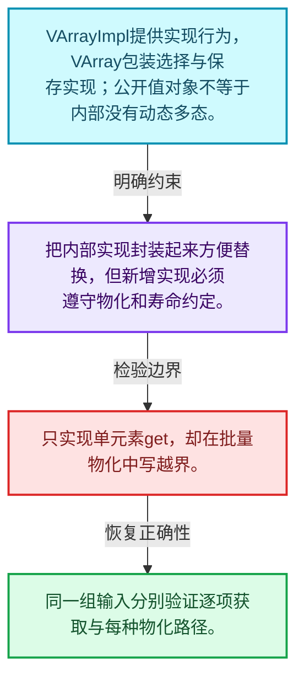
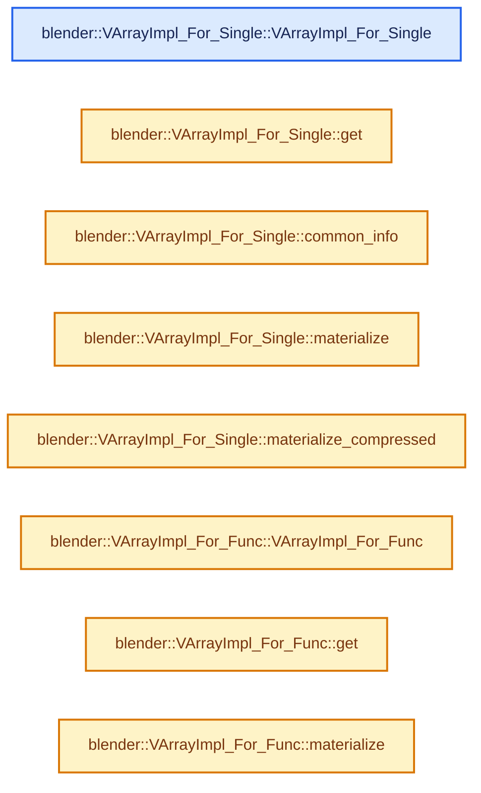
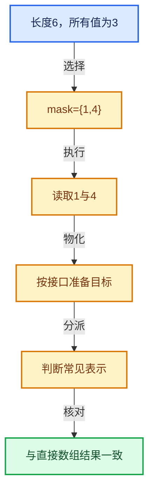

# 04-02 VArrayImpl实现接口

[方向导航](README.md) · [总目录](../README.md) · [实现索引](../%E7%AC%A6%E5%8F%B7%E4%BE%9D%E8%B5%96%E4%B8%8E%E5%AE%9E%E7%8E%B0%E7%B4%A2%E5%BC%95.md)

## 从问题到实现

包装层与多态实现层为什么分开？

稳定的值封装便于传参，具体实现负责获取和物化；新增实现要遵守大小、类型和生命周期契约。

**数据模型**

VArrayImpl提供实现行为，VArray包装选择与保存实现；公开值对象不等于内部没有动态多态。

**设计取舍**

把内部实现封装起来方便替换，但新增实现必须遵守物化和寿命约定。

**最小反例**

只实现单元素get，却在批量物化中写越界。

**推导**

同一组输入分别验证逐项获取与每种物化路径。

## 阅读地图与执行推演








图中的数值推演是本方向的教学模型；实际函数之间的调用边与概念分析边分别标注，不能把概念关系当作运行时调度顺序。

## 完整源码单元与就地讲解

中文讲解直接放在相关代码旁，复杂机制在代码下展开。原文折叠区保留基准行号；不需要在行号表和函数之间来回查找。类布局可分段展示，函数实现不按固定行数切开。

### 类型布局、声明与编译条件 · BLI_virtual_array.hh L307—L318

<a id="t-e37fe08cacb2"></a>

`VArrayImpl_For_Single`在这里声明的数据成员：

- `T value_`

<!-- annotated:f504ebeee733a7 -->

```cpp
};

/**
 * A virtual array implementation that returns the same value for every index. This class is final
 * so that it can be devirtualized by the compiler in some cases (e.g. when #devirtualize_varray is
 * used).
 */
template<typename T> class VArrayImpl_For_Single final : public VArrayImpl<T> {
 private:
  T value_;

 public:
```

<details>
<summary>核对原始源码：source/blender/blenlib/BLI_virtual_array.hh · L307—L318</summary>

<!-- original:f504ebeee733a7:source/blender/blenlib/BLI_virtual_array.hh:307:318 -->

```cpp
};

/**
 * A virtual array implementation that returns the same value for every index. This class is final
 * so that it can be devirtualized by the compiler in some cases (e.g. when #devirtualize_varray is
 * used).
 */
template<typename T> class VArrayImpl_For_Single final : public VArrayImpl<T> {
 private:
  T value_;

 public:
```

</details>

<a id="f-7ed229374a641958"></a>

### `blender::VArrayImpl_For_Single::VArrayImpl_For_Single`

实现位置：[source/blender/blenlib/BLI_virtual_array.hh](../../../../../source/blender/blenlib/BLI_virtual_array.hh) · L319—L322。

接口参数：

- `T value`
- `const int64_t size`

**教学注释版**

<!-- annotated:f4f07f913c5879 -->

```cpp
  VArrayImpl_For_Single(T value, const int64_t size)
      : VArrayImpl<T>(size), value_(std::move(value))
  {
  }
```

<details>
<summary>核对原始源码：source/blender/blenlib/BLI_virtual_array.hh · L319—L322</summary>

<!-- original:f4f07f913c5879:source/blender/blenlib/BLI_virtual_array.hh:319:322 -->

```cpp
  VArrayImpl_For_Single(T value, const int64_t size)
      : VArrayImpl<T>(size), value_(std::move(value))
  {
  }
```

</details>

**继续追踪实现**

本实现没有需要继续展开的显式调用；检查返回表达式、对象转换和调用者前置条件。

### 类型布局、声明与编译条件 · BLI_virtual_array.hh L323—L324

<!-- annotated:1030fa3871200d -->

```cpp

 protected:
```

<details>
<summary>核对原始源码：source/blender/blenlib/BLI_virtual_array.hh · L323—L324</summary>

<!-- original:1030fa3871200d:source/blender/blenlib/BLI_virtual_array.hh:323:324 -->

```cpp

 protected:
```

</details>

<a id="f-62c705cc3442334e"></a>

### `blender::VArrayImpl_For_Single::get`

实现位置：[source/blender/blenlib/BLI_virtual_array.hh](../../../../../source/blender/blenlib/BLI_virtual_array.hh) · L325—L328。

接口参数：

- `const int64_t`

**教学注释版**

<!-- annotated:12735dbe073328 -->

```cpp
  T get(const int64_t /*index*/) const override
  {
    return value_;
  }
```

<details>
<summary>核对原始源码：source/blender/blenlib/BLI_virtual_array.hh · L325—L328</summary>

<!-- original:12735dbe073328:source/blender/blenlib/BLI_virtual_array.hh:325:328 -->

```cpp
  T get(const int64_t /*index*/) const override
  {
    return value_;
  }
```

</details>

**结果出口**

- `return value_;`

**继续追踪实现**

本实现没有需要继续展开的显式调用；检查返回表达式、对象转换和调用者前置条件。

<!-- annotated:91504aded9c7bc -->

```cpp

```

<details>
<summary>核对原始源码：source/blender/blenlib/BLI_virtual_array.hh · L329—L329</summary>

<!-- original:91504aded9c7bc:source/blender/blenlib/BLI_virtual_array.hh:329:329 -->

```cpp

```

</details>

<a id="f-8b3462728d95d9b1"></a>

### `blender::VArrayImpl_For_Single::common_info`

实现位置：[source/blender/blenlib/BLI_virtual_array.hh](../../../../../source/blender/blenlib/BLI_virtual_array.hh) · L330—L333。

**教学注释版**

<!-- annotated:ab7a2683066949 -->

```cpp
  CommonVArrayInfo common_info() const override
  {
    return CommonVArrayInfo(CommonVArrayInfo::Type::Single, true, &value_);
  }
```

<details>
<summary>核对原始源码：source/blender/blenlib/BLI_virtual_array.hh · L330—L333</summary>

<!-- original:ab7a2683066949:source/blender/blenlib/BLI_virtual_array.hh:330:333 -->

```cpp
  CommonVArrayInfo common_info() const override
  {
    return CommonVArrayInfo(CommonVArrayInfo::Type::Single, true, &value_);
  }
```

</details>

**结果出口**

- `return CommonVArrayInfo(CommonVArrayInfo::Type::Single, true, &value_);`

**继续追踪实现**

- `CommonVArrayInfo` → [blender::CommonVArrayInfo::CommonVArrayInfo · L66](01-VArray%E8%A1%A8%E7%A4%BA%E4%B8%8E%E5%80%BC%E8%AF%AD%E4%B9%89.md#f-a716088fcd760d27)；[blender::CommonVArrayInfo::CommonVArrayInfo · L67](01-VArray%E8%A1%A8%E7%A4%BA%E4%B8%8E%E5%80%BC%E8%AF%AD%E4%B9%89.md#f-018a4490310fea4d)。同名重载需按实参类型选择。

<!-- annotated:a93a28d8f46256 -->

```cpp

```

<details>
<summary>核对原始源码：source/blender/blenlib/BLI_virtual_array.hh · L334—L334</summary>

<!-- original:a93a28d8f46256:source/blender/blenlib/BLI_virtual_array.hh:334:334 -->

```cpp

```

</details>

<a id="f-362c12525e25f825"></a>

### `blender::VArrayImpl_For_Single::materialize`

实现位置：[source/blender/blenlib/BLI_virtual_array.hh](../../../../../source/blender/blenlib/BLI_virtual_array.hh) · L335—L348。

接口参数：

- `const IndexMask &mask`
- `T *dst`
- `const bool dst_is_uninitialized`

**教学注释版**

<!-- annotated:8d0b913aa2c19a -->

```cpp
  void materialize(const IndexMask &mask, T *dst, const bool dst_is_uninitialized) const override
  {
    if constexpr (std::is_trivially_copyable_v<T>) {
      index_mask::detail::fill(dst, value_, mask);
    }
    else {
      if (dst_is_uninitialized) {
        mask.foreach_index([&](const int64_t i) { new (dst + i) T(value_); });
      }
      else {
        mask.foreach_index([&](const int64_t i) { dst[i] = value_; });
      }
    }
  }
```

<details>
<summary>核对原始源码：source/blender/blenlib/BLI_virtual_array.hh · L335—L348</summary>

<!-- original:8d0b913aa2c19a:source/blender/blenlib/BLI_virtual_array.hh:335:348 -->

```cpp
  void materialize(const IndexMask &mask, T *dst, const bool dst_is_uninitialized) const override
  {
    if constexpr (std::is_trivially_copyable_v<T>) {
      index_mask::detail::fill(dst, value_, mask);
    }
    else {
      if (dst_is_uninitialized) {
        mask.foreach_index([&](const int64_t i) { new (dst + i) T(value_); });
      }
      else {
        mask.foreach_index([&](const int64_t i) { dst[i] = value_; });
      }
    }
  }
```

</details>

**继续追踪实现**

- `index_mask::detail::fill` → [blender::index_mask::detail::fill · L1251](12-%E9%87%8D%E6%9E%84%E5%8E%86%E5%8F%B2%E4%B8%8E%E5%9F%BA%E5%87%86%E7%BB%83%E4%B9%A0.md#f-ea2ed6e1c98523f9)。
- `mask.foreach_index` → [blender::index_mask::IndexMask::foreach_index · L855](09-%E5%88%86%E6%AE%B5%E5%AD%98%E5%82%A8%E4%B8%8E%E9%81%8D%E5%8E%86.md#f-cd6cd317e2e2812c)。

<!-- annotated:8dac7a96d13760 -->

```cpp

```

<details>
<summary>核对原始源码：source/blender/blenlib/BLI_virtual_array.hh · L349—L349</summary>

<!-- original:8dac7a96d13760:source/blender/blenlib/BLI_virtual_array.hh:349:349 -->

```cpp

```

</details>

<a id="f-bfe3bf894410b6c7"></a>

### `blender::VArrayImpl_For_Single::materialize_compressed`

实现位置：[source/blender/blenlib/BLI_virtual_array.hh](../../../../../source/blender/blenlib/BLI_virtual_array.hh) · L350—L365。

接口参数：

- `const IndexMask &mask`
- `T *dst`
- `const bool dst_is_uninitialized`

**教学注释版**

<!-- annotated:dccc3d2e1836e7 -->

```cpp
  void materialize_compressed(const IndexMask &mask,
                              T *dst,
                              const bool dst_is_uninitialized) const override
  {
    if constexpr (std::is_trivially_copyable_v<T>) {
      initialized_fill_n(dst, mask.size(), value_);
    }
    else {
      if (dst_is_uninitialized) {
        // [讲解] uninitialized_fill_n：从同一个value复制构造目标n个T。
        uninitialized_fill_n(dst, mask.size(), value_);
      }
      else {
        initialized_fill_n(dst, mask.size(), value_);
      }
    }
  }
```

<details>
<summary>核对原始源码：source/blender/blenlib/BLI_virtual_array.hh · L350—L365</summary>

<!-- original:dccc3d2e1836e7:source/blender/blenlib/BLI_virtual_array.hh:350:365 -->

```cpp
  void materialize_compressed(const IndexMask &mask,
                              T *dst,
                              const bool dst_is_uninitialized) const override
  {
    if constexpr (std::is_trivially_copyable_v<T>) {
      initialized_fill_n(dst, mask.size(), value_);
    }
    else {
      if (dst_is_uninitialized) {
        uninitialized_fill_n(dst, mask.size(), value_);
      }
      else {
        initialized_fill_n(dst, mask.size(), value_);
      }
    }
  }
```

</details>

**继续追踪实现**

- `initialized_fill_n` → [blender::initialized_fill_n · L86](../01-%E5%9F%BA%E7%A1%80%E5%AE%B9%E5%99%A8%E4%B8%8E%E7%8E%B0%E4%BB%A3CPP/01-%E5%AF%B9%E8%B1%A1%E7%94%9F%E5%91%BD%E5%91%A8%E6%9C%9F%E4%B8%8E%E5%80%BC%E7%B1%BB%E5%88%AB.md#f-4af3bf5ccfdcee6c)。
- `mask.size` → [blender::index_mask::IndexMask::size · L743](09-%E5%88%86%E6%AE%B5%E5%AD%98%E5%82%A8%E4%B8%8E%E9%81%8D%E5%8E%86.md#f-0163b32abc9a0d9c)。
- `uninitialized_fill_n` → [blender::uninitialized_fill_n · L91](../01-%E5%9F%BA%E7%A1%80%E5%AE%B9%E5%99%A8%E4%B8%8E%E7%8E%B0%E4%BB%A3CPP/01-%E5%AF%B9%E8%B1%A1%E7%94%9F%E5%91%BD%E5%91%A8%E6%9C%9F%E4%B8%8E%E5%80%BC%E7%B1%BB%E5%88%AB.md#f-020ca78eff5f9227)。

### 类型布局、声明与编译条件 · BLI_virtual_array.hh L366—L379

<a id="t-40019843c95a"></a>

`VArrayImpl_For_Func`在这里声明的数据成员：

- `GetFunc get_func_`

<!-- annotated:59eb0cdf3abebf -->

```cpp
};

template<typename T>
inline constexpr bool is_trivial_extended_v<VArrayImpl_For_Single<T>> = is_trivial_extended_v<T>;

/**
 * This class makes it easy to create a virtual array for an existing function or lambda. The
 * `GetFunc` should take a single `index` argument and return the value at that index.
 */
template<typename T, typename GetFunc> class VArrayImpl_For_Func final : public VArrayImpl<T> {
 private:
  GetFunc get_func_;

 public:
```

<details>
<summary>核对原始源码：source/blender/blenlib/BLI_virtual_array.hh · L366—L379</summary>

<!-- original:59eb0cdf3abebf:source/blender/blenlib/BLI_virtual_array.hh:366:379 -->

```cpp
};

template<typename T>
inline constexpr bool is_trivial_extended_v<VArrayImpl_For_Single<T>> = is_trivial_extended_v<T>;

/**
 * This class makes it easy to create a virtual array for an existing function or lambda. The
 * `GetFunc` should take a single `index` argument and return the value at that index.
 */
template<typename T, typename GetFunc> class VArrayImpl_For_Func final : public VArrayImpl<T> {
 private:
  GetFunc get_func_;

 public:
```

</details>

<a id="f-a8ac022375e41bd0"></a>

### `blender::VArrayImpl_For_Func::VArrayImpl_For_Func`

实现位置：[source/blender/blenlib/BLI_virtual_array.hh](../../../../../source/blender/blenlib/BLI_virtual_array.hh) · L380—L383。

接口参数：

- `const int64_t size`
- `GetFunc get_func`

**教学注释版**

<!-- annotated:80bb7b15dd2462 -->

```cpp
  VArrayImpl_For_Func(const int64_t size, GetFunc get_func)
      : VArrayImpl<T>(size), get_func_(std::move(get_func))
  {
  }
```

<details>
<summary>核对原始源码：source/blender/blenlib/BLI_virtual_array.hh · L380—L383</summary>

<!-- original:80bb7b15dd2462:source/blender/blenlib/BLI_virtual_array.hh:380:383 -->

```cpp
  VArrayImpl_For_Func(const int64_t size, GetFunc get_func)
      : VArrayImpl<T>(size), get_func_(std::move(get_func))
  {
  }
```

</details>

**继续追踪实现**

本实现没有需要继续展开的显式调用；检查返回表达式、对象转换和调用者前置条件。

### 类型布局、声明与编译条件 · BLI_virtual_array.hh L384—L385

<!-- annotated:313fca1572a8aa -->

```cpp

 private:
```

<details>
<summary>核对原始源码：source/blender/blenlib/BLI_virtual_array.hh · L384—L385</summary>

<!-- original:313fca1572a8aa:source/blender/blenlib/BLI_virtual_array.hh:384:385 -->

```cpp

 private:
```

</details>

<a id="f-0dda53e7719f99d6"></a>

### `blender::VArrayImpl_For_Func::get`

实现位置：[source/blender/blenlib/BLI_virtual_array.hh](../../../../../source/blender/blenlib/BLI_virtual_array.hh) · L386—L389。

接口参数：

- `const int64_t index`

**教学注释版**

<!-- annotated:2a7bab8ddd668c -->

```cpp
  T get(const int64_t index) const override
  {
    return get_func_(index);
  }
```

<details>
<summary>核对原始源码：source/blender/blenlib/BLI_virtual_array.hh · L386—L389</summary>

<!-- original:2a7bab8ddd668c:source/blender/blenlib/BLI_virtual_array.hh:386:389 -->

```cpp
  T get(const int64_t index) const override
  {
    return get_func_(index);
  }
```

</details>

**结果出口**

- `return get_func_(index);`

**继续追踪实现**

- `get_func_` → [调用协议](../%E6%A8%A1%E6%9D%BF%E5%AE%8F%E4%B8%8E%E5%8A%A8%E6%80%81%E5%88%86%E6%B4%BE%E5%8D%8F%E8%AE%AE.md)：函数指针、局部可调用对象或未展开的宏；必须结合调用者环境。调用位置L388。

<!-- annotated:ddc07be5adbc09 -->

```cpp

```

<details>
<summary>核对原始源码：source/blender/blenlib/BLI_virtual_array.hh · L390—L390</summary>

<!-- original:ddc07be5adbc09:source/blender/blenlib/BLI_virtual_array.hh:390:390 -->

```cpp

```

</details>

<a id="f-35071ab6a1d4c612"></a>

### `blender::VArrayImpl_For_Func::materialize`

实现位置：[source/blender/blenlib/BLI_virtual_array.hh](../../../../../source/blender/blenlib/BLI_virtual_array.hh) · L391—L404。

接口参数：

- `const IndexMask &mask`
- `T *dst`
- `const bool dst_is_uninitialized`

**教学注释版**

<!-- annotated:e0e7fc47c1cc2b -->

```cpp
  void materialize(const IndexMask &mask, T *dst, const bool dst_is_uninitialized) const override
  {
    if constexpr (std::is_trivially_copyable_v<T>) {
      mask.foreach_index([&](const int64_t i) { dst[i] = get_func_(i); });
    }
    else {
      if (dst_is_uninitialized) {
        mask.foreach_index([&](const int64_t i) { new (dst + i) T(get_func_(i)); });
      }
      else {
        mask.foreach_index([&](const int64_t i) { dst[i] = get_func_(i); });
      }
    }
  }
```

<details>
<summary>核对原始源码：source/blender/blenlib/BLI_virtual_array.hh · L391—L404</summary>

<!-- original:e0e7fc47c1cc2b:source/blender/blenlib/BLI_virtual_array.hh:391:404 -->

```cpp
  void materialize(const IndexMask &mask, T *dst, const bool dst_is_uninitialized) const override
  {
    if constexpr (std::is_trivially_copyable_v<T>) {
      mask.foreach_index([&](const int64_t i) { dst[i] = get_func_(i); });
    }
    else {
      if (dst_is_uninitialized) {
        mask.foreach_index([&](const int64_t i) { new (dst + i) T(get_func_(i)); });
      }
      else {
        mask.foreach_index([&](const int64_t i) { dst[i] = get_func_(i); });
      }
    }
  }
```

</details>

**继续追踪实现**

- `mask.foreach_index` → [blender::index_mask::IndexMask::foreach_index · L855](09-%E5%88%86%E6%AE%B5%E5%AD%98%E5%82%A8%E4%B8%8E%E9%81%8D%E5%8E%86.md#f-cd6cd317e2e2812c)。
- `get_func_` → [调用协议](../%E6%A8%A1%E6%9D%BF%E5%AE%8F%E4%B8%8E%E5%8A%A8%E6%80%81%E5%88%86%E6%B4%BE%E5%8D%8F%E8%AE%AE.md)：函数指针、局部可调用对象或未展开的宏；必须结合调用者环境。调用位置L394。

<!-- annotated:7bc7bb248a378f -->

```cpp

```

<details>
<summary>核对原始源码：source/blender/blenlib/BLI_virtual_array.hh · L405—L405</summary>

<!-- original:7bc7bb248a378f:source/blender/blenlib/BLI_virtual_array.hh:405:405 -->

```cpp

```

</details>

<a id="f-fc50a319fd7dc3b3"></a>

### `blender::VArrayImpl_For_Func::materialize_compressed`

实现位置：[source/blender/blenlib/BLI_virtual_array.hh](../../../../../source/blender/blenlib/BLI_virtual_array.hh) · L406—L422。

接口参数：

- `const IndexMask &mask`
- `T *dst`
- `const bool dst_is_uninitialized`

**教学注释版**

<!-- annotated:04e90facf2754e -->

```cpp
  void materialize_compressed(const IndexMask &mask,
                              T *dst,
                              const bool dst_is_uninitialized) const override
  {
    if constexpr (std::is_trivially_copyable_v<T>) {
      mask.foreach_index([&](const int64_t i, const int64_t pos) { dst[pos] = get_func_(i); });
    }
    else {
      if (dst_is_uninitialized) {
        mask.foreach_index(
            [&](const int64_t i, const int64_t pos) { new (dst + pos) T(get_func_(i)); });
      }
      else {
        mask.foreach_index([&](const int64_t i, const int64_t pos) { dst[pos] = get_func_(i); });
      }
    }
  }
```

<details>
<summary>核对原始源码：source/blender/blenlib/BLI_virtual_array.hh · L406—L422</summary>

<!-- original:04e90facf2754e:source/blender/blenlib/BLI_virtual_array.hh:406:422 -->

```cpp
  void materialize_compressed(const IndexMask &mask,
                              T *dst,
                              const bool dst_is_uninitialized) const override
  {
    if constexpr (std::is_trivially_copyable_v<T>) {
      mask.foreach_index([&](const int64_t i, const int64_t pos) { dst[pos] = get_func_(i); });
    }
    else {
      if (dst_is_uninitialized) {
        mask.foreach_index(
            [&](const int64_t i, const int64_t pos) { new (dst + pos) T(get_func_(i)); });
      }
      else {
        mask.foreach_index([&](const int64_t i, const int64_t pos) { dst[pos] = get_func_(i); });
      }
    }
  }
```

</details>

**继续追踪实现**

- `mask.foreach_index` → [blender::index_mask::IndexMask::foreach_index · L855](09-%E5%88%86%E6%AE%B5%E5%AD%98%E5%82%A8%E4%B8%8E%E9%81%8D%E5%8E%86.md#f-cd6cd317e2e2812c)。
- `get_func_` → [调用协议](../%E6%A8%A1%E6%9D%BF%E5%AE%8F%E4%B8%8E%E5%8A%A8%E6%80%81%E5%88%86%E6%B4%BE%E5%8D%8F%E8%AE%AE.md)：函数指针、局部可调用对象或未展开的宏；必须结合调用者环境。调用位置L411。

### 类型布局、声明与编译条件 · BLI_virtual_array.hh L423—L436

<a id="t-14f425ff914d"></a>

`VArrayImpl_For_DerivedSpan`在这里声明的数据成员：

- `StructT data_`

<!-- annotated:fbd4c14af8ec4c -->

```cpp
};

/**
 * \note This is `final` so that #may_have_ownership can be implemented reliably.
 */
template<typename StructT,
         typename ElemT,
         ElemT (*GetFunc)(const StructT &),
         void (*SetFunc)(StructT &, ElemT) = nullptr>
class VArrayImpl_For_DerivedSpan final : public VMutableArrayImpl<ElemT> {
 private:
  StructT *data_;

 public:
```

<details>
<summary>核对原始源码：source/blender/blenlib/BLI_virtual_array.hh · L423—L436</summary>

<!-- original:fbd4c14af8ec4c:source/blender/blenlib/BLI_virtual_array.hh:423:436 -->

```cpp
};

/**
 * \note This is `final` so that #may_have_ownership can be implemented reliably.
 */
template<typename StructT,
         typename ElemT,
         ElemT (*GetFunc)(const StructT &),
         void (*SetFunc)(StructT &, ElemT) = nullptr>
class VArrayImpl_For_DerivedSpan final : public VMutableArrayImpl<ElemT> {
 private:
  StructT *data_;

 public:
```

</details>

<a id="f-115fb3d38f6b6fd4"></a>

### `blender::VArrayImpl_For_DerivedSpan::VArrayImpl_For_DerivedSpan`

实现位置：[source/blender/blenlib/BLI_virtual_array.hh](../../../../../source/blender/blenlib/BLI_virtual_array.hh) · L437—L440。

接口参数：

- `const MutableSpan<StructT> data`

**教学注释版**

<!-- annotated:84cee1a7430cdf -->

```cpp
  VArrayImpl_For_DerivedSpan(const MutableSpan<StructT> data)
      : VMutableArrayImpl<ElemT>(data.size()), data_(data.data())
  {
  }
```

<details>
<summary>核对原始源码：source/blender/blenlib/BLI_virtual_array.hh · L437—L440</summary>

<!-- original:84cee1a7430cdf:source/blender/blenlib/BLI_virtual_array.hh:437:440 -->

```cpp
  VArrayImpl_For_DerivedSpan(const MutableSpan<StructT> data)
      : VMutableArrayImpl<ElemT>(data.size()), data_(data.data())
  {
  }
```

</details>

**继续追踪实现**

本实现没有需要继续展开的显式调用；检查返回表达式、对象转换和调用者前置条件。

### 类型布局、声明与编译条件 · BLI_virtual_array.hh L441—L448

<!-- annotated:128bb0e1633d3e -->

```cpp

  template<typename OtherStructT,
           typename OtherElemT,
           OtherElemT (*OtherGetFunc)(const OtherStructT &),
           void (*OtherSetFunc)(OtherStructT &, OtherElemT)>
  friend class VArrayImpl_For_DerivedSpan;

 private:
```

<details>
<summary>核对原始源码：source/blender/blenlib/BLI_virtual_array.hh · L441—L448</summary>

<!-- original:128bb0e1633d3e:source/blender/blenlib/BLI_virtual_array.hh:441:448 -->

```cpp

  template<typename OtherStructT,
           typename OtherElemT,
           OtherElemT (*OtherGetFunc)(const OtherStructT &),
           void (*OtherSetFunc)(OtherStructT &, OtherElemT)>
  friend class VArrayImpl_For_DerivedSpan;

 private:
```

</details>

<a id="f-9a7d40e70a914814"></a>

### `blender::VArrayImpl_For_DerivedSpan::get`

实现位置：[source/blender/blenlib/BLI_virtual_array.hh](../../../../../source/blender/blenlib/BLI_virtual_array.hh) · L449—L452。

接口参数：

- `const int64_t index`

**教学注释版**

<!-- annotated:43669f9b90f166 -->

```cpp
  ElemT get(const int64_t index) const override
  {
    return GetFunc(data_[index]);
  }
```

<details>
<summary>核对原始源码：source/blender/blenlib/BLI_virtual_array.hh · L449—L452</summary>

<!-- original:43669f9b90f166:source/blender/blenlib/BLI_virtual_array.hh:449:452 -->

```cpp
  ElemT get(const int64_t index) const override
  {
    return GetFunc(data_[index]);
  }
```

</details>

**结果出口**

- `return GetFunc(data_[index]);`

**继续追踪实现**

- `GetFunc` → [调用协议](../%E6%A8%A1%E6%9D%BF%E5%AE%8F%E4%B8%8E%E5%8A%A8%E6%80%81%E5%88%86%E6%B4%BE%E5%8D%8F%E8%AE%AE.md)：函数指针、局部可调用对象或未展开的宏；必须结合调用者环境。调用位置L451。

<!-- annotated:b1443b3a7033ef -->

```cpp

```

<details>
<summary>核对原始源码：source/blender/blenlib/BLI_virtual_array.hh · L453—L453</summary>

<!-- original:b1443b3a7033ef:source/blender/blenlib/BLI_virtual_array.hh:453:453 -->

```cpp

```

</details>

<a id="f-85b0b72dcbb29644"></a>

### `blender::VArrayImpl_For_DerivedSpan::set`

实现位置：[source/blender/blenlib/BLI_virtual_array.hh](../../../../../source/blender/blenlib/BLI_virtual_array.hh) · L454—L457。

接口参数：

- `const int64_t index`
- `ElemT value`

**教学注释版**

<!-- annotated:6b4d8ed22a1cf7 -->

```cpp
  void set(const int64_t index, ElemT value) override
  {
    // [讲解] std::move：把表达式转换成可供移动重载选择的值类别；不保证真的移动，不结束源对象寿命，对const值可能选择复制。
    SetFunc(data_[index], std::move(value));
  }
```

<details>
<summary>核对原始源码：source/blender/blenlib/BLI_virtual_array.hh · L454—L457</summary>

<!-- original:6b4d8ed22a1cf7:source/blender/blenlib/BLI_virtual_array.hh:454:457 -->

```cpp
  void set(const int64_t index, ElemT value) override
  {
    SetFunc(data_[index], std::move(value));
  }
```

</details>

**继续追踪实现**

- `SetFunc` → [调用协议](../%E6%A8%A1%E6%9D%BF%E5%AE%8F%E4%B8%8E%E5%8A%A8%E6%80%81%E5%88%86%E6%B4%BE%E5%8D%8F%E8%AE%AE.md)：函数指针、局部可调用对象或未展开的宏；必须结合调用者环境。调用位置L456。
- `std::move` → [外部契约](https://eel.is/c++draft/utility.forward)：把表达式转换成可供移动重载选择的值类别；不保证真的移动，不结束源对象寿命，对const值可能选择复制。

<!-- annotated:17e4492f36b64b -->

```cpp

```

<details>
<summary>核对原始源码：source/blender/blenlib/BLI_virtual_array.hh · L458—L458</summary>

<!-- original:17e4492f36b64b:source/blender/blenlib/BLI_virtual_array.hh:458:458 -->

```cpp

```

</details>

<a id="f-a7470a0f0ca5f8ca"></a>

### `blender::VArrayImpl_For_DerivedSpan::materialize`

实现位置：[source/blender/blenlib/BLI_virtual_array.hh](../../../../../source/blender/blenlib/BLI_virtual_array.hh) · L459—L474。

接口参数：

- `const IndexMask &mask`
- `ElemT *dst`
- `const bool dst_is_uninitialized`

**教学注释版**

<!-- annotated:dccb9956d67456 -->

```cpp
  void materialize(const IndexMask &mask,
                   ElemT *dst,
                   const bool dst_is_uninitialized) const override
  {
    if constexpr (std::is_trivially_copyable_v<ElemT>) {
      mask.foreach_index([&](const int64_t i) { dst[i] = GetFunc(data_[i]); });
    }
    else {
      if (dst_is_uninitialized) {
        mask.foreach_index([&](const int64_t i) { new (dst + i) ElemT(GetFunc(data_[i])); });
      }
      else {
        mask.foreach_index([&](const int64_t i) { dst[i] = GetFunc(data_[i]); });
      }
    }
  }
```

<details>
<summary>核对原始源码：source/blender/blenlib/BLI_virtual_array.hh · L459—L474</summary>

<!-- original:dccb9956d67456:source/blender/blenlib/BLI_virtual_array.hh:459:474 -->

```cpp
  void materialize(const IndexMask &mask,
                   ElemT *dst,
                   const bool dst_is_uninitialized) const override
  {
    if constexpr (std::is_trivially_copyable_v<ElemT>) {
      mask.foreach_index([&](const int64_t i) { dst[i] = GetFunc(data_[i]); });
    }
    else {
      if (dst_is_uninitialized) {
        mask.foreach_index([&](const int64_t i) { new (dst + i) ElemT(GetFunc(data_[i])); });
      }
      else {
        mask.foreach_index([&](const int64_t i) { dst[i] = GetFunc(data_[i]); });
      }
    }
  }
```

</details>

**继续追踪实现**

- `mask.foreach_index` → [blender::index_mask::IndexMask::foreach_index · L855](09-%E5%88%86%E6%AE%B5%E5%AD%98%E5%82%A8%E4%B8%8E%E9%81%8D%E5%8E%86.md#f-cd6cd317e2e2812c)。
- `GetFunc` → [调用协议](../%E6%A8%A1%E6%9D%BF%E5%AE%8F%E4%B8%8E%E5%8A%A8%E6%80%81%E5%88%86%E6%B4%BE%E5%8D%8F%E8%AE%AE.md)：函数指针、局部可调用对象或未展开的宏；必须结合调用者环境。调用位置L464。

<!-- annotated:0336d7b7bbe7b6 -->

```cpp

```

<details>
<summary>核对原始源码：source/blender/blenlib/BLI_virtual_array.hh · L475—L475</summary>

<!-- original:0336d7b7bbe7b6:source/blender/blenlib/BLI_virtual_array.hh:475:475 -->

```cpp

```

</details>

<a id="f-404ea683b11062d6"></a>

### `blender::VArrayImpl_For_DerivedSpan::materialize_compressed`

实现位置：[source/blender/blenlib/BLI_virtual_array.hh](../../../../../source/blender/blenlib/BLI_virtual_array.hh) · L476—L494。

接口参数：

- `const IndexMask &mask`
- `ElemT *dst`
- `const bool dst_is_uninitialized`

**教学注释版**

<!-- annotated:e9349c7ffa9ad7 -->

```cpp
  void materialize_compressed(const IndexMask &mask,
                              ElemT *dst,
                              const bool dst_is_uninitialized) const override
  {
    if constexpr (std::is_trivially_copyable_v<ElemT>) {
      mask.foreach_index(
          [&](const int64_t i, const int64_t pos) { dst[pos] = GetFunc(data_[i]); });
    }
    else {
      if (dst_is_uninitialized) {
        mask.foreach_index(
            [&](const int64_t i, const int64_t pos) { new (dst + pos) ElemT(GetFunc(data_[i])); });
      }
      else {
        mask.foreach_index(
            [&](const int64_t i, const int64_t pos) { dst[pos] = GetFunc(data_[i]); });
      }
    }
  }
```

<details>
<summary>核对原始源码：source/blender/blenlib/BLI_virtual_array.hh · L476—L494</summary>

<!-- original:e9349c7ffa9ad7:source/blender/blenlib/BLI_virtual_array.hh:476:494 -->

```cpp
  void materialize_compressed(const IndexMask &mask,
                              ElemT *dst,
                              const bool dst_is_uninitialized) const override
  {
    if constexpr (std::is_trivially_copyable_v<ElemT>) {
      mask.foreach_index(
          [&](const int64_t i, const int64_t pos) { dst[pos] = GetFunc(data_[i]); });
    }
    else {
      if (dst_is_uninitialized) {
        mask.foreach_index(
            [&](const int64_t i, const int64_t pos) { new (dst + pos) ElemT(GetFunc(data_[i])); });
      }
      else {
        mask.foreach_index(
            [&](const int64_t i, const int64_t pos) { dst[pos] = GetFunc(data_[i]); });
      }
    }
  }
```

</details>

**继续追踪实现**

- `mask.foreach_index` → [blender::index_mask::IndexMask::foreach_index · L855](09-%E5%88%86%E6%AE%B5%E5%AD%98%E5%82%A8%E4%B8%8E%E9%81%8D%E5%8E%86.md#f-cd6cd317e2e2812c)。
- `GetFunc` → [调用协议](../%E6%A8%A1%E6%9D%BF%E5%AE%8F%E4%B8%8E%E5%8A%A8%E6%80%81%E5%88%86%E6%B4%BE%E5%8D%8F%E8%AE%AE.md)：函数指针、局部可调用对象或未展开的宏；必须结合调用者环境。调用位置L482。

### 类型布局、声明与编译条件 · BLI_virtual_array.hh L495—L514

<a id="t-4b7820cb970c"></a>

`VArrayCommon`在这里声明的数据成员：

- `AnyDerived<const VArrayImpl<T>> impl_`

<!-- annotated:d681c967c5ce87 -->

```cpp
};

template<typename StructT,
         typename ElemT,
         ElemT (*GetFunc)(const StructT &),
         void (*SetFunc)(StructT &, ElemT)>
inline constexpr bool
    is_trivial_extended_v<VArrayImpl_For_DerivedSpan<StructT, ElemT, GetFunc, SetFunc>> = true;

/**
 * Utility class to reduce code duplication for methods available on #VArray and #VMutableArray.
 * Deriving #VMutableArray from #VArray would have some issues:
 * - Static methods on #VArray would also be available on #VMutableArray.
 * - It would allow assigning a #VArray to a #VMutableArray under some circumstances which is not
 *   allowed and could result in hard to find bugs.
 */
template<typename T> class VArrayCommon {
 protected:
  AnyDerived<const VArrayImpl<T>> impl_;

```

<details>
<summary>核对原始源码：source/blender/blenlib/BLI_virtual_array.hh · L495—L514</summary>

<!-- original:d681c967c5ce87:source/blender/blenlib/BLI_virtual_array.hh:495:514 -->

```cpp
};

template<typename StructT,
         typename ElemT,
         ElemT (*GetFunc)(const StructT &),
         void (*SetFunc)(StructT &, ElemT)>
inline constexpr bool
    is_trivial_extended_v<VArrayImpl_For_DerivedSpan<StructT, ElemT, GetFunc, SetFunc>> = true;

/**
 * Utility class to reduce code duplication for methods available on #VArray and #VMutableArray.
 * Deriving #VMutableArray from #VArray would have some issues:
 * - Static methods on #VArray would also be available on #VMutableArray.
 * - It would allow assigning a #VArray to a #VMutableArray under some circumstances which is not
 *   allowed and could result in hard to find bugs.
 */
template<typename T> class VArrayCommon {
 protected:
  AnyDerived<const VArrayImpl<T>> impl_;

```

</details>

<a id="f-1d8435455d764938"></a>

### `blender::VArrayCommon::VArrayCommon`

实现位置：[source/blender/blenlib/BLI_virtual_array.hh](../../../../../source/blender/blenlib/BLI_virtual_array.hh) · L515—L515。

**教学注释版**

<!-- annotated:da49ab3201fcb0 -->

```cpp
  VArrayCommon() = default;
```

<details>
<summary>核对原始源码：source/blender/blenlib/BLI_virtual_array.hh · L515—L515</summary>

<!-- original:da49ab3201fcb0:source/blender/blenlib/BLI_virtual_array.hh:515:515 -->

```cpp
  VArrayCommon() = default;
```

</details>

**继续追踪实现**

本实现没有需要继续展开的显式调用；检查返回表达式、对象转换和调用者前置条件。

### 类型布局、声明与编译条件 · BLI_virtual_array.hh L516—L520

<!-- annotated:4b325b54193d29 -->

```cpp

  /**
   * Wrap an existing #VArrayImpl and don't take ownership of it. This should rarely be used in
   * practice.
   */
```

<details>
<summary>核对原始源码：source/blender/blenlib/BLI_virtual_array.hh · L516—L520</summary>

<!-- original:4b325b54193d29:source/blender/blenlib/BLI_virtual_array.hh:516:520 -->

```cpp

  /**
   * Wrap an existing #VArrayImpl and don't take ownership of it. This should rarely be used in
   * practice.
   */
```

</details>

<a id="f-48c11e1ce3c370ae"></a>

### `blender::VArrayCommon::VArrayCommon`

实现位置：[source/blender/blenlib/BLI_virtual_array.hh](../../../../../source/blender/blenlib/BLI_virtual_array.hh) · L521—L521。

接口参数：

- `const VArrayImpl<T> *impl`

**教学注释版**

<!-- annotated:1f6a695b8023db -->

```cpp
  VArrayCommon(const VArrayImpl<T> *impl) : impl_(impl) {}
```

<details>
<summary>核对原始源码：source/blender/blenlib/BLI_virtual_array.hh · L521—L521</summary>

<!-- original:1f6a695b8023db:source/blender/blenlib/BLI_virtual_array.hh:521:521 -->

```cpp
  VArrayCommon(const VArrayImpl<T> *impl) : impl_(impl) {}
```

</details>

**继续追踪实现**

本实现没有需要继续展开的显式调用；检查返回表达式、对象转换和调用者前置条件。

### 类型布局、声明与编译条件 · BLI_virtual_array.hh L522—L525

<!-- annotated:54d5c16e917cc2 -->

```cpp

  /**
   * Wrap an existing #VArrayImpl that is contained in a #std::shared_ptr. This takes ownership.
   */
```

<details>
<summary>核对原始源码：source/blender/blenlib/BLI_virtual_array.hh · L522—L525</summary>

<!-- original:54d5c16e917cc2:source/blender/blenlib/BLI_virtual_array.hh:522:525 -->

```cpp

  /**
   * Wrap an existing #VArrayImpl that is contained in a #std::shared_ptr. This takes ownership.
   */
```

</details>

<a id="f-aa8eea78ae380d31"></a>

### `blender::VArrayCommon::VArrayCommon`

实现位置：[source/blender/blenlib/BLI_virtual_array.hh](../../../../../source/blender/blenlib/BLI_virtual_array.hh) · L526—L526。

接口参数：

- `std::shared_ptr<const VArrayImpl<T>> impl`

**教学注释版**

<!-- annotated:91a4dba43ec5e8 -->

```cpp
  VArrayCommon(std::shared_ptr<const VArrayImpl<T>> impl) : impl_(std::move(impl)) {}
```

<details>
<summary>核对原始源码：source/blender/blenlib/BLI_virtual_array.hh · L526—L526</summary>

<!-- original:91a4dba43ec5e8:source/blender/blenlib/BLI_virtual_array.hh:526:526 -->

```cpp
  VArrayCommon(std::shared_ptr<const VArrayImpl<T>> impl) : impl_(std::move(impl)) {}
```

</details>

**继续追踪实现**

本实现没有需要继续展开的显式调用；检查返回表达式、对象转换和调用者前置条件。

### 类型布局、声明与编译条件 · BLI_virtual_array.hh L527—L530

<!-- annotated:3353528f08cd95 -->

```cpp

  /**
   * Replace the contained #VArrayImpl.
   */
```

<details>
<summary>核对原始源码：source/blender/blenlib/BLI_virtual_array.hh · L527—L530</summary>

<!-- original:3353528f08cd95:source/blender/blenlib/BLI_virtual_array.hh:527:530 -->

```cpp

  /**
   * Replace the contained #VArrayImpl.
   */
```

</details>

<a id="f-bd0fffea634fdbce"></a>

### `blender::VArrayCommon::emplace`

实现位置：[source/blender/blenlib/BLI_virtual_array.hh](../../../../../source/blender/blenlib/BLI_virtual_array.hh) · L531—L534。

**教学注释版**

<!-- annotated:659c01412f3e98 -->

```cpp
  template<typename ImplT, typename... Args> void emplace(Args &&...args)
  {
    // [讲解] std::forward<Args>：在转发引用中恢复调用者传入的值类别；依赖推导类型，不能与无条件move互换。
    impl_.template emplace<ImplT>(std::forward<Args>(args)...);
  }
```

<details>
<summary>核对原始源码：source/blender/blenlib/BLI_virtual_array.hh · L531—L534</summary>

<!-- original:659c01412f3e98:source/blender/blenlib/BLI_virtual_array.hh:531:534 -->

```cpp
  template<typename ImplT, typename... Args> void emplace(Args &&...args)
  {
    impl_.template emplace<ImplT>(std::forward<Args>(args)...);
  }
```

</details>

**继续追踪实现**

- `impl_.template emplace<ImplT>` → [blender::AnyDerived::emplace · L134](../01-%E5%9F%BA%E7%A1%80%E5%AE%B9%E5%99%A8%E4%B8%8E%E7%8E%B0%E4%BB%A3CPP/18-AnyDerived%E5%A4%9A%E6%80%81%E5%AF%B9%E8%B1%A1%E5%80%BC%E5%B0%81%E8%A3%85.md#f-57e6b0e71dbdff55)。
- `std::forward<Args>` → [外部契约](https://eel.is/c++draft/utility.forward)：在转发引用中恢复调用者传入的值类别；依赖推导类型，不能与无条件move互换。

### 类型布局、声明与编译条件 · BLI_virtual_array.hh L535—L537

<!-- annotated:e7c5b95b12f09f -->

```cpp

 public:
  /** Return false when there is no virtual array implementation currently. */
```

<details>
<summary>核对原始源码：source/blender/blenlib/BLI_virtual_array.hh · L535—L537</summary>

<!-- original:e7c5b95b12f09f:source/blender/blenlib/BLI_virtual_array.hh:535:537 -->

```cpp

 public:
  /** Return false when there is no virtual array implementation currently. */
```

</details>

<a id="f-047193deec782945"></a>

### `blender::VArrayCommon::() const`

实现位置：[source/blender/blenlib/BLI_virtual_array.hh](../../../../../source/blender/blenlib/BLI_virtual_array.hh) · L538—L541。

**教学注释版**

<!-- annotated:f1b959e193631f -->

```cpp
  operator bool() const
  {
    return impl_;
  }
```

<details>
<summary>核对原始源码：source/blender/blenlib/BLI_virtual_array.hh · L538—L541</summary>

<!-- original:f1b959e193631f:source/blender/blenlib/BLI_virtual_array.hh:538:541 -->

```cpp
  operator bool() const
  {
    return impl_;
  }
```

</details>

**结果出口**

- `return impl_;`

**继续追踪实现**

本实现没有需要继续展开的显式调用；检查返回表达式、对象转换和调用者前置条件。

### 类型布局、声明与编译条件 · BLI_virtual_array.hh L542—L547

<!-- annotated:ae1dd6172046e2 -->

```cpp

  /**
   * Get the element at a specific index.
   * \note This can't return a reference because the value may be computed on the fly. This also
   * implies that one can not use this method for assignments.
   */
```

<details>
<summary>核对原始源码：source/blender/blenlib/BLI_virtual_array.hh · L542—L547</summary>

<!-- original:ae1dd6172046e2:source/blender/blenlib/BLI_virtual_array.hh:542:547 -->

```cpp

  /**
   * Get the element at a specific index.
   * \note This can't return a reference because the value may be computed on the fly. This also
   * implies that one can not use this method for assignments.
   */
```

</details>

<a id="f-8192a9f439402fc9"></a>

### `blender::VArrayCommon::operator[]`

实现位置：[source/blender/blenlib/BLI_virtual_array.hh](../../../../../source/blender/blenlib/BLI_virtual_array.hh) · L548—L554。

接口参数：

- `const int64_t index`

**教学注释版**

<!-- annotated:97cb25a1630c3c -->

```cpp
  T operator[](const int64_t index) const
  {
    BLI_assert(*this);
    BLI_assert(index >= 0);
    BLI_assert(index < this->size());
    return impl_->get(index);
  }
```

<details>
<summary>核对原始源码：source/blender/blenlib/BLI_virtual_array.hh · L548—L554</summary>

<!-- original:97cb25a1630c3c:source/blender/blenlib/BLI_virtual_array.hh:548:554 -->

```cpp
  T operator[](const int64_t index) const
  {
    BLI_assert(*this);
    BLI_assert(index >= 0);
    BLI_assert(index < this->size());
    return impl_->get(index);
  }
```

</details>

**结果出口**

- `return impl_->get(index);`

**继续追踪实现**

- `BLI_assert` → [BLI_assert · L48](../01-%E5%9F%BA%E7%A1%80%E5%AE%B9%E5%99%A8%E4%B8%8E%E7%8E%B0%E4%BB%A3CPP/%E4%BE%9D%E8%B5%96-BLI_assert-cc98e8.md#m-57a88495704d)；[BLI_assert · L63](../01-%E5%9F%BA%E7%A1%80%E5%AE%B9%E5%99%A8%E4%B8%8E%E7%8E%B0%E4%BB%A3CPP/%E4%BE%9D%E8%B5%96-BLI_assert-cc98e8.md#m-d07050020cb5)。宏定义由构建条件选择。
- `this->size` → [blender::VArrayCommon::size · L569](02-VArrayImpl%E5%AE%9E%E7%8E%B0%E6%8E%A5%E5%8F%A3.md#f-a098c32ba789341e)。
- `impl_->get` → [blender::AnyDerived::get · L167](../01-%E5%9F%BA%E7%A1%80%E5%AE%B9%E5%99%A8%E4%B8%8E%E7%8E%B0%E4%BB%A3CPP/18-AnyDerived%E5%A4%9A%E6%80%81%E5%AF%B9%E8%B1%A1%E5%80%BC%E5%B0%81%E8%A3%85.md#f-ebda3f1086d3f9fc)。

### 类型布局、声明与编译条件 · BLI_virtual_array.hh L555—L559

<!-- annotated:8f5aac037773d5 -->

```cpp

  /**
   * Same as the #operator[] but is sometimes easier to use when one has a pointer to a virtual
   * array.
   */
```

<details>
<summary>核对原始源码：source/blender/blenlib/BLI_virtual_array.hh · L555—L559</summary>

<!-- original:8f5aac037773d5:source/blender/blenlib/BLI_virtual_array.hh:555:559 -->

```cpp

  /**
   * Same as the #operator[] but is sometimes easier to use when one has a pointer to a virtual
   * array.
   */
```

</details>

<a id="f-dce84cee97df9ded"></a>

### `blender::VArrayCommon::get`

实现位置：[source/blender/blenlib/BLI_virtual_array.hh](../../../../../source/blender/blenlib/BLI_virtual_array.hh) · L560—L563。

接口参数：

- `const int64_t index`

**教学注释版**

<!-- annotated:de1910d0f3decf -->

```cpp
  T get(const int64_t index) const
  {
    return (*this)[index];
  }
```

<details>
<summary>核对原始源码：source/blender/blenlib/BLI_virtual_array.hh · L560—L563</summary>

<!-- original:de1910d0f3decf:source/blender/blenlib/BLI_virtual_array.hh:560:563 -->

```cpp
  T get(const int64_t index) const
  {
    return (*this)[index];
  }
```

</details>

**结果出口**

- `return (*this)[index];`

**继续追踪实现**

本实现没有需要继续展开的显式调用；检查返回表达式、对象转换和调用者前置条件。

### 类型布局、声明与编译条件 · BLI_virtual_array.hh L564—L568

<!-- annotated:02a93644b82aa9 -->

```cpp

  /**
   * Return the size of the virtual array. It's allowed to call this method even when there is no
   * virtual array. In this case 0 is returned.
   */
```

<details>
<summary>核对原始源码：source/blender/blenlib/BLI_virtual_array.hh · L564—L568</summary>

<!-- original:02a93644b82aa9:source/blender/blenlib/BLI_virtual_array.hh:564:568 -->

```cpp

  /**
   * Return the size of the virtual array. It's allowed to call this method even when there is no
   * virtual array. In this case 0 is returned.
   */
```

</details>

<a id="f-a098c32ba789341e"></a>

### `blender::VArrayCommon::size`

实现位置：[source/blender/blenlib/BLI_virtual_array.hh](../../../../../source/blender/blenlib/BLI_virtual_array.hh) · L569—L575。

**教学注释版**

<!-- annotated:b34b588dbb46bb -->

```cpp
  int64_t size() const
  {
    if (!impl_) {
      return 0;
    }
    return impl_->size();
  }
```

<details>
<summary>核对原始源码：source/blender/blenlib/BLI_virtual_array.hh · L569—L575</summary>

<!-- original:b34b588dbb46bb:source/blender/blenlib/BLI_virtual_array.hh:569:575 -->

```cpp
  int64_t size() const
  {
    if (!impl_) {
      return 0;
    }
    return impl_->size();
  }
```

</details>

**结果出口**

- `return 0;`
- `return impl_->size();`

**继续追踪实现**

- `impl_->size` → [blender::VArrayCommon::size · L569](02-VArrayImpl%E5%AE%9E%E7%8E%B0%E6%8E%A5%E5%8F%A3.md#f-a098c32ba789341e)。

### 类型布局、声明与编译条件 · BLI_virtual_array.hh L576—L578

<!-- annotated:603d7d2fe0d0cf -->

```cpp
  /**
   * Get the first element.
   */
```

<details>
<summary>核对原始源码：source/blender/blenlib/BLI_virtual_array.hh · L576—L578</summary>

<!-- original:603d7d2fe0d0cf:source/blender/blenlib/BLI_virtual_array.hh:576:578 -->

```cpp
  /**
   * Get the first element.
   */
```

</details>

<a id="f-b613483c80286afb"></a>

### `blender::VArrayCommon::first`

实现位置：[source/blender/blenlib/BLI_virtual_array.hh](../../../../../source/blender/blenlib/BLI_virtual_array.hh) · L579—L582。

**教学注释版**

<!-- annotated:f36539cc84f885 -->

```cpp
  T first() const
  {
    return (*this)[0];
  }
```

<details>
<summary>核对原始源码：source/blender/blenlib/BLI_virtual_array.hh · L579—L582</summary>

<!-- original:f36539cc84f885:source/blender/blenlib/BLI_virtual_array.hh:579:582 -->

```cpp
  T first() const
  {
    return (*this)[0];
  }
```

</details>

**结果出口**

- `return (*this)[0];`

**继续追踪实现**

本实现没有需要继续展开的显式调用；检查返回表达式、对象转换和调用者前置条件。

### 类型布局、声明与编译条件 · BLI_virtual_array.hh L583—L585

<!-- annotated:b00b725079a2ca -->

```cpp
  /**
   * Get the nth last element.
   */
```

<details>
<summary>核对原始源码：source/blender/blenlib/BLI_virtual_array.hh · L583—L585</summary>

<!-- original:b00b725079a2ca:source/blender/blenlib/BLI_virtual_array.hh:583:585 -->

```cpp
  /**
   * Get the nth last element.
   */
```

</details>

<a id="f-e17c360c3547b9b6"></a>

### `blender::VArrayCommon::last`

实现位置：[source/blender/blenlib/BLI_virtual_array.hh](../../../../../source/blender/blenlib/BLI_virtual_array.hh) · L586—L589。

接口参数：

- `const int64_t n = 0`

**教学注释版**

<!-- annotated:a439a99b5ac45e -->

```cpp
  T last(const int64_t n = 0) const
  {
    return (*this)[this->size() - 1 - n];
  }
```

<details>
<summary>核对原始源码：source/blender/blenlib/BLI_virtual_array.hh · L586—L589</summary>

<!-- original:a439a99b5ac45e:source/blender/blenlib/BLI_virtual_array.hh:586:589 -->

```cpp
  T last(const int64_t n = 0) const
  {
    return (*this)[this->size() - 1 - n];
  }
```

</details>

**结果出口**

- `return (*this)[this->size() - 1 - n];`

**继续追踪实现**

- `this->size` → [blender::VArrayCommon::size · L569](02-VArrayImpl%E5%AE%9E%E7%8E%B0%E6%8E%A5%E5%8F%A3.md#f-a098c32ba789341e)。

### 类型布局、声明与编译条件 · BLI_virtual_array.hh L590—L591

<!-- annotated:7072010ea3349b -->

```cpp

  /** True when the size is zero or when there is no virtual array. */
```

<details>
<summary>核对原始源码：source/blender/blenlib/BLI_virtual_array.hh · L590—L591</summary>

<!-- original:7072010ea3349b:source/blender/blenlib/BLI_virtual_array.hh:590:591 -->

```cpp

  /** True when the size is zero or when there is no virtual array. */
```

</details>

<a id="f-234c8d43229160e3"></a>

### `blender::VArrayCommon::is_empty`

实现位置：[source/blender/blenlib/BLI_virtual_array.hh](../../../../../source/blender/blenlib/BLI_virtual_array.hh) · L592—L595。

**教学注释版**

<!-- annotated:2d6e33c2d5c27b -->

```cpp
  bool is_empty() const
  {
    return this->size() == 0;
  }
```

<details>
<summary>核对原始源码：source/blender/blenlib/BLI_virtual_array.hh · L592—L595</summary>

<!-- original:2d6e33c2d5c27b:source/blender/blenlib/BLI_virtual_array.hh:592:595 -->

```cpp
  bool is_empty() const
  {
    return this->size() == 0;
  }
```

</details>

**结果出口**

- `return this->size() == 0;`

**继续追踪实现**

- `this->size` → [blender::VArrayCommon::size · L569](02-VArrayImpl%E5%AE%9E%E7%8E%B0%E6%8E%A5%E5%8F%A3.md#f-a098c32ba789341e)。

<!-- annotated:e69048caf86964 -->

```cpp

```

<details>
<summary>核对原始源码：source/blender/blenlib/BLI_virtual_array.hh · L596—L596</summary>

<!-- original:e69048caf86964:source/blender/blenlib/BLI_virtual_array.hh:596:596 -->

```cpp

```

</details>

<a id="f-0d80b03598c030d3"></a>

### `blender::VArrayCommon::index_range`

实现位置：[source/blender/blenlib/BLI_virtual_array.hh](../../../../../source/blender/blenlib/BLI_virtual_array.hh) · L597—L600。

**教学注释版**

<!-- annotated:09486fe43f8c37 -->

```cpp
  IndexRange index_range() const
  {
    return IndexRange(this->size());
  }
```

<details>
<summary>核对原始源码：source/blender/blenlib/BLI_virtual_array.hh · L597—L600</summary>

<!-- original:09486fe43f8c37:source/blender/blenlib/BLI_virtual_array.hh:597:600 -->

```cpp
  IndexRange index_range() const
  {
    return IndexRange(this->size());
  }
```

</details>

**结果出口**

- `return IndexRange(this->size());`

**继续追踪实现**

- `IndexRange` → [blender::IndexRange](../01-%E5%9F%BA%E7%A1%80%E5%AE%B9%E5%99%A8%E4%B8%8E%E7%8E%B0%E4%BB%A3CPP/%E4%BE%9D%E8%B5%96-BLI_index_range-7d7cc5.md#t-caa3466d6776)；[blender::gpu::shader::parser::IndexRange](../05-%E5%87%A0%E4%BD%95%E5%AD%98%E5%82%A8%E4%B8%8E%E6%8B%93%E6%89%91%E6%98%A0%E5%B0%84/%E4%BE%9D%E8%B5%96-utils-06433d.md#t-82d2bd4ea71c)；[blender::IndexRange](../05-%E5%87%A0%E4%BD%95%E5%AD%98%E5%82%A8%E4%B8%8E%E6%8B%93%E6%89%91%E6%98%A0%E5%B0%84/%E4%BE%9D%E8%B5%96-DNA_node_types-6708b9.md#t-0448cc889d39)。
- `this->size` → [blender::VArrayCommon::size · L569](02-VArrayImpl%E5%AE%9E%E7%8E%B0%E6%8E%A5%E5%8F%A3.md#f-a098c32ba789341e)。

<!-- annotated:35c73e3fd9902e -->

```cpp

```

<details>
<summary>核对原始源码：source/blender/blenlib/BLI_virtual_array.hh · L601—L601</summary>

<!-- original:35c73e3fd9902e:source/blender/blenlib/BLI_virtual_array.hh:601:601 -->

```cpp

```

</details>

<a id="f-087793fc5c4b8977"></a>

### `blender::VArrayCommon::common_info`

实现位置：[source/blender/blenlib/BLI_virtual_array.hh](../../../../../source/blender/blenlib/BLI_virtual_array.hh) · L602—L606。

**教学注释版**

<!-- annotated:f990cfc8aef165 -->

```cpp
  CommonVArrayInfo common_info() const
  {
    BLI_assert(*this);
    return impl_->common_info();
  }
```

<details>
<summary>核对原始源码：source/blender/blenlib/BLI_virtual_array.hh · L602—L606</summary>

<!-- original:f990cfc8aef165:source/blender/blenlib/BLI_virtual_array.hh:602:606 -->

```cpp
  CommonVArrayInfo common_info() const
  {
    BLI_assert(*this);
    return impl_->common_info();
  }
```

</details>

**结果出口**

- `return impl_->common_info();`

**继续追踪实现**

- `BLI_assert` → [BLI_assert · L48](../01-%E5%9F%BA%E7%A1%80%E5%AE%B9%E5%99%A8%E4%B8%8E%E7%8E%B0%E4%BB%A3CPP/%E4%BE%9D%E8%B5%96-BLI_assert-cc98e8.md#m-57a88495704d)；[BLI_assert · L63](../01-%E5%9F%BA%E7%A1%80%E5%AE%B9%E5%99%A8%E4%B8%8E%E7%8E%B0%E4%BB%A3CPP/%E4%BE%9D%E8%B5%96-BLI_assert-cc98e8.md#m-d07050020cb5)。宏定义由构建条件选择。
- `impl_->common_info` → [blender::VArrayCommon::common_info · L602](02-VArrayImpl%E5%AE%9E%E7%8E%B0%E6%8E%A5%E5%8F%A3.md#f-087793fc5c4b8977)。

## 语法与相关类型

### 模板 template

模板把类型或常量作为生成实现的参数。读声明时先列出类型参数、非类型参数和默认值，再看使用者实际实例化了什么。模板声明本身不意味着每种T都支持其全部成员。

把T替换为int、string、只能移动的类型，分别检查每个被调用操作是否成立。

### 依赖名称 typename

typename既可引入类型模板参数，也可告诉编译器某个依赖名称是类型。它不创建运行时对象；解析期确认语法类别与实例化期检查具体类型是不同阶段。

区分typename T::value_type和T::size()，前者标记类型，后者是表达式。

### 常量求值 constexpr

constexpr声明允许相应实体参与常量求值，但constexpr函数仍可以在运行时执行。是否常量求值由调用场景和表达式合法性共同决定。

比较constexpr变量初始化和从运行时输入调用同一函数。

### 只读限定 const

const约束当前访问路径可做的修改。const指针、指向const的指针、const视图对象、const元素是不同位置的限定；其他别名可能仍可修改原对象。

分别写T* const、const T*与const T* const，并画出不可修改的层次。

### 移动转换 std::move

std::move把表达式转换为可供移动重载选择的值类别，实际资源转移发生在被选中的构造或赋值中。对const对象move可能仍调用复制，对视图move也不会获得底层数据所有权。

记录移动构造调用次数，不用变量名或std::move的出现次数替代测量。

### 完美转发 std::forward

std::forward在转发引用模板中恢复调用者原来的值类别。它依赖推导出的模板实参；无条件move会改变左值调用者的语义。

对同一接口分别传入左值、临时对象和const左值，记录实际重载。

### 运行时多态 virtual

虚调用根据实际动态类型选择实现；经基类指针销毁对象时通常需要相应虚析构契约。每元素虚调用和循环外一次分派有不同开销。

找出虚接口的实现类和调用频率，再讨论是否值得去虚拟化。

### 覆写检查 override

override要求函数确实覆盖基类虚函数，可捕获参数类型和const限定不匹配。它不改变基类规定的生命周期或线程约束。

故意改变一个参数或const，观察编译器如何拒绝误写的新函数。

### 构造与new表达式

普通new可能分配并构造；placement new在给定地址构造，存储由其他机制提供。失败回滚应区分两类责任。

追踪地址来自哪里、构造何时成功、由谁析构、由谁释放。

### 内部断言 assert

断言表达开发者预期成立的内部契约，发布构建可能关闭。它不能替代对不可信输入的完整错误处理，也不保证后续操作被运行时保护。

对每条断言构造违反条件的输入，区分调用者错误与应向用户报告的错误。

### 编译期分支 if constexpr

条件在实例化时决定被保留的分支，这常用于不同类型的合法操作选择。它与运行时if有不同的实例化检查规则。

找出每个分支依赖哪些类型特征，再使用满足与不满足条件的类型。

### 受控访问 friend

friend授予指定函数或类访问非公开成员的权限，并不意味着继承，也不自动扩展到友元的派生类。

解释执行器为何需要访问包装器的内部映射，同时检查边界是否仍清楚。

### 共享拥有 shared_ptr

shared_ptr让控制块跟踪共享寿命，不自动使被指向对象的读写线程安全；循环拥有可能阻止销毁。

画出强引用环并考虑是否应改变所有权方向或引入弱引用。

## 实现练习与验证

写基于公式的数组，比较逐项获取与批量物化。

参考推理：同一组输入分别验证逐项获取与每种物化路径。

遍历结果按真实索引排序且无重复；单值、Span与计算表示在有效索引上返回一致语义。

## 历史、跨库比较与证据

对比普通Span、标准ranges惰性视图和虚拟数组时，明确随机索引能力、批量物化、类型擦除和拥有关系；接口外观相近不代表同一抽象。

[历史提交索引](../%E5%8E%86%E5%8F%B2%E6%8F%90%E4%BA%A4%E4%B8%8E%E8%AE%BE%E8%AE%A1%E6%BC%94%E5%8C%96%E7%B4%A2%E5%BC%95.md) · [源码基准](../%E6%BA%90%E7%A0%81%E7%89%88%E6%9C%AC%E4%B8%8E%E8%A6%86%E7%9B%96%E7%B4%A2%E5%BC%95.md) · [验收报告](../%E9%AA%8C%E6%94%B6%E6%8A%A5%E5%91%8A.md)
