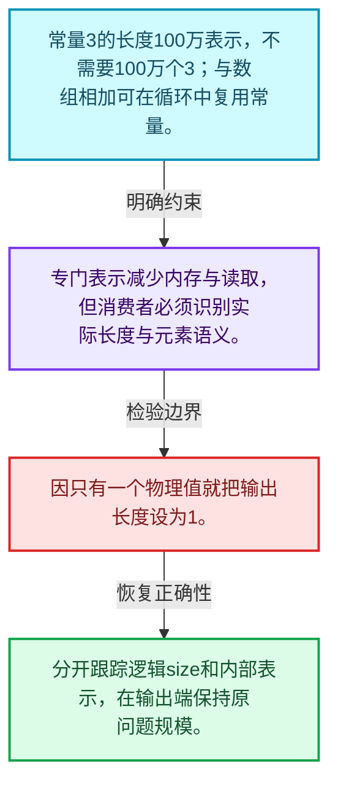
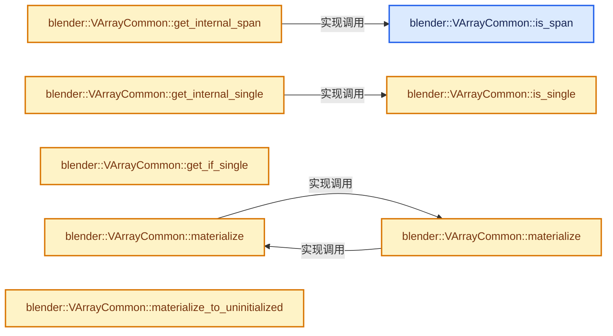
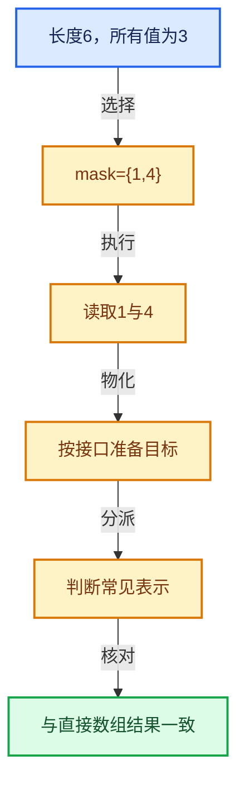

# 04-03 单值与Span表示

[方向导航](README.md) · [总目录](../README.md) · [实现索引](../00-课程指南/02-源码与提交索引/符号依赖与实现索引.md)

## 从问题到实现

常量输入怎样避免分配整个数组？

单值表示把N个相同元素压缩成一个值和长度；消费者仍必须理解长度不是实际存储数量。

**数据模型**

常量3的长度100万表示，不需要100万个3；与数组相加可在循环中复用常量。

**设计取舍**

专门表示减少内存与读取，但消费者必须识别实际长度与元素语义。

**最小反例**

因只有一个物理值就把输出长度设为1。

**推导**

分开跟踪逻辑size和内部表示，在输出端保持原问题规模。

## 阅读地图与执行推演








图中的数值推演是本方向的教学模型；实际函数之间的调用边与概念分析边分别标注，不能把概念关系当作运行时调度顺序。

## 完整源码单元与就地讲解

中文讲解直接放在相关代码旁，复杂机制在代码下展开。原文折叠区保留基准行号；不需要在行号表和函数之间来回查找。类布局可分段展示，函数实现不按固定行数切开。

### 类型布局、声明与编译条件 · BLI_virtual_array.hh L607—L608

<!-- annotated:36796add58abd0 -->

```cpp

  /** Return true when the virtual array is stored as a span internally. */
```

<details>
<summary>核对原始源码：source/blender/blenlib/BLI_virtual_array.hh · L607—L608</summary>

<!-- original:36796add58abd0:source/blender/blenlib/BLI_virtual_array.hh:607:608 -->

```cpp

  /** Return true when the virtual array is stored as a span internally. */
```

</details>

<a id="f-64290cd299f91a17"></a>

### `blender::VArrayCommon::is_span`

实现位置：[source/blender/blenlib/BLI_virtual_array.hh](../../../../../source/blender/blenlib/BLI_virtual_array.hh) · L609—L614。

**教学注释版**

<!-- annotated:506c82e4c5aff4 -->

```cpp
  bool is_span() const
  {
    BLI_assert(*this);
    const CommonVArrayInfo info = impl_->common_info();
    return info.type == CommonVArrayInfo::Type::Span;
  }
```

<details>
<summary>核对原始源码：source/blender/blenlib/BLI_virtual_array.hh · L609—L614</summary>

<!-- original:506c82e4c5aff4:source/blender/blenlib/BLI_virtual_array.hh:609:614 -->

```cpp
  bool is_span() const
  {
    BLI_assert(*this);
    const CommonVArrayInfo info = impl_->common_info();
    return info.type == CommonVArrayInfo::Type::Span;
  }
```

</details>

**结果出口**

- `return info.type == CommonVArrayInfo::Type::Span;`

**继续追踪实现**

- `BLI_assert` → [BLI_assert · L48](../90-实现依赖专题/01-BLI基础库/BLI_assert.hh.md#m-57a88495704d)；[BLI_assert · L63](../90-实现依赖专题/01-BLI基础库/BLI_assert.hh.md#m-d07050020cb5)。宏定义由构建条件选择。
- `impl_->common_info` → [blender::VArrayCommon::common_info · L602](02-VArrayImpl实现接口.md#f-087793fc5c4b8977)。

### 类型布局、声明与编译条件 · BLI_virtual_array.hh L615—L619

<!-- annotated:ee450440c5209e -->

```cpp

  /**
   * Returns the internally used span of the virtual array. This invokes undefined behavior if the
   * virtual array is not stored as a span internally.
   */
```

<details>
<summary>核对原始源码：source/blender/blenlib/BLI_virtual_array.hh · L615—L619</summary>

<!-- original:ee450440c5209e:source/blender/blenlib/BLI_virtual_array.hh:615:619 -->

```cpp

  /**
   * Returns the internally used span of the virtual array. This invokes undefined behavior if the
   * virtual array is not stored as a span internally.
   */
```

</details>

<a id="f-acfccb6ed8e0649d"></a>

### `blender::VArrayCommon::get_internal_span`

实现位置：[source/blender/blenlib/BLI_virtual_array.hh](../../../../../source/blender/blenlib/BLI_virtual_array.hh) · L620—L625。

**教学注释版**

<!-- annotated:296d5c6a1a6473 -->

```cpp
  Span<T> get_internal_span() const
  {
    BLI_assert(this->is_span());
    const CommonVArrayInfo info = impl_->common_info();
    return Span<T>(static_cast<const T *>(info.data), this->size());
  }
```

<details>
<summary>核对原始源码：source/blender/blenlib/BLI_virtual_array.hh · L620—L625</summary>

<!-- original:296d5c6a1a6473:source/blender/blenlib/BLI_virtual_array.hh:620:625 -->

```cpp
  Span<T> get_internal_span() const
  {
    BLI_assert(this->is_span());
    const CommonVArrayInfo info = impl_->common_info();
    return Span<T>(static_cast<const T *>(info.data), this->size());
  }
```

</details>

**结果出口**

- `return Span<T>(static_cast<const T *>(info.data), this->size());`

**继续追踪实现**

- `BLI_assert` → [BLI_assert · L48](../90-实现依赖专题/01-BLI基础库/BLI_assert.hh.md#m-57a88495704d)；[BLI_assert · L63](../90-实现依赖专题/01-BLI基础库/BLI_assert.hh.md#m-d07050020cb5)。宏定义由构建条件选择。
- `this->is_span` → [blender::VArrayCommon::is_span · L609](03-单值与Span表示.md#f-64290cd299f91a17)。
- `impl_->common_info` → [blender::VArrayCommon::common_info · L602](02-VArrayImpl实现接口.md#f-087793fc5c4b8977)。
- `Span<T>` → [blender::Span](../90-实现依赖专题/01-BLI基础库/BLI_span.hh.md#t-8765a8e0c1d5)；[blender::Span](../90-实现依赖专题/01-BLI基础库/BLI_index_range.hh.md#t-86091874a1c0)；[blender::Span](../90-实现依赖专题/08-其他Blender模块/makesdna/DNA_pointcloud_types.h.md#t-112aa6ed842c)；[blender::Span](../90-实现依赖专题/08-其他Blender模块/makesdna/DNA_node_types.h.md#t-49ec6fbb9b69)；[blender::Span](../90-实现依赖专题/08-其他Blender模块/makesdna/DNA_mesh_types.h.md#t-184fd48fb638)；[blender::Span](../90-实现依赖专题/08-其他Blender模块/makesdna/DNA_anim_types.h.md#t-d841071994c2)；[blender::Span](../90-实现依赖专题/08-其他Blender模块/makesrna/RNA_path_fwd.hh.md#t-4dbb08969e41)。
- `this->size` → [blender::VArrayCommon::size · L569](02-VArrayImpl实现接口.md#f-a098c32ba789341e)。

### 类型布局、声明与编译条件 · BLI_virtual_array.hh L626—L627

<!-- annotated:ba60d20ddcd14d -->

```cpp

  /** Return true when the virtual array returns the same value for every index. */
```

<details>
<summary>核对原始源码：source/blender/blenlib/BLI_virtual_array.hh · L626—L627</summary>

<!-- original:ba60d20ddcd14d:source/blender/blenlib/BLI_virtual_array.hh:626:627 -->

```cpp

  /** Return true when the virtual array returns the same value for every index. */
```

</details>

<a id="f-6ae3a68e4344a995"></a>

### `blender::VArrayCommon::is_single`

实现位置：[source/blender/blenlib/BLI_virtual_array.hh](../../../../../source/blender/blenlib/BLI_virtual_array.hh) · L628—L633。

**教学注释版**

<!-- annotated:258659338181c4 -->

```cpp
  bool is_single() const
  {
    BLI_assert(*this);
    const CommonVArrayInfo info = impl_->common_info();
    return info.type == CommonVArrayInfo::Type::Single;
  }
```

<details>
<summary>核对原始源码：source/blender/blenlib/BLI_virtual_array.hh · L628—L633</summary>

<!-- original:258659338181c4:source/blender/blenlib/BLI_virtual_array.hh:628:633 -->

```cpp
  bool is_single() const
  {
    BLI_assert(*this);
    const CommonVArrayInfo info = impl_->common_info();
    return info.type == CommonVArrayInfo::Type::Single;
  }
```

</details>

**结果出口**

- `return info.type == CommonVArrayInfo::Type::Single;`

**继续追踪实现**

- `BLI_assert` → [BLI_assert · L48](../90-实现依赖专题/01-BLI基础库/BLI_assert.hh.md#m-57a88495704d)；[BLI_assert · L63](../90-实现依赖专题/01-BLI基础库/BLI_assert.hh.md#m-d07050020cb5)。宏定义由构建条件选择。
- `impl_->common_info` → [blender::VArrayCommon::common_info · L602](02-VArrayImpl实现接口.md#f-087793fc5c4b8977)。

### 类型布局、声明与编译条件 · BLI_virtual_array.hh L634—L638

<!-- annotated:6eb6932c5ae453 -->

```cpp

  /**
   * Return the value that is returned for every index. This invokes undefined behavior if the
   * virtual array would not return the same value for every index.
   */
```

<details>
<summary>核对原始源码：source/blender/blenlib/BLI_virtual_array.hh · L634—L638</summary>

<!-- original:6eb6932c5ae453:source/blender/blenlib/BLI_virtual_array.hh:634:638 -->

```cpp

  /**
   * Return the value that is returned for every index. This invokes undefined behavior if the
   * virtual array would not return the same value for every index.
   */
```

</details>

<a id="f-00662e7a964a3e33"></a>

### `blender::VArrayCommon::get_internal_single`

实现位置：[source/blender/blenlib/BLI_virtual_array.hh](../../../../../source/blender/blenlib/BLI_virtual_array.hh) · L639—L644。

**教学注释版**

<!-- annotated:66fac4da6c07a2 -->

```cpp
  T get_internal_single() const
  {
    BLI_assert(this->is_single());
    const CommonVArrayInfo info = impl_->common_info();
    return *static_cast<const T *>(info.data);
  }
```

<details>
<summary>核对原始源码：source/blender/blenlib/BLI_virtual_array.hh · L639—L644</summary>

<!-- original:66fac4da6c07a2:source/blender/blenlib/BLI_virtual_array.hh:639:644 -->

```cpp
  T get_internal_single() const
  {
    BLI_assert(this->is_single());
    const CommonVArrayInfo info = impl_->common_info();
    return *static_cast<const T *>(info.data);
  }
```

</details>

**结果出口**

- `return *static_cast<const T *>(info.data);`

**继续追踪实现**

- `BLI_assert` → [BLI_assert · L48](../90-实现依赖专题/01-BLI基础库/BLI_assert.hh.md#m-57a88495704d)；[BLI_assert · L63](../90-实现依赖专题/01-BLI基础库/BLI_assert.hh.md#m-d07050020cb5)。宏定义由构建条件选择。
- `this->is_single` → [blender::VArrayCommon::is_single · L628](03-单值与Span表示.md#f-6ae3a68e4344a995)。
- `impl_->common_info` → [blender::VArrayCommon::common_info · L602](02-VArrayImpl实现接口.md#f-087793fc5c4b8977)。

### 类型布局、声明与编译条件 · BLI_virtual_array.hh L645—L648

<!-- annotated:250fc1ec80464f -->

```cpp

  /**
   * Return the value that is returned for every index, if the array is stored as a single value.
   */
```

<details>
<summary>核对原始源码：source/blender/blenlib/BLI_virtual_array.hh · L645—L648</summary>

<!-- original:250fc1ec80464f:source/blender/blenlib/BLI_virtual_array.hh:645:648 -->

```cpp

  /**
   * Return the value that is returned for every index, if the array is stored as a single value.
   */
```

</details>

<a id="f-779c11c4fd8e6ac3"></a>

### `blender::VArrayCommon::get_if_single`

实现位置：[source/blender/blenlib/BLI_virtual_array.hh](../../../../../source/blender/blenlib/BLI_virtual_array.hh) · L649—L656。

**教学注释版**

<!-- annotated:7b945e6c1b42d8 -->

```cpp
  std::optional<T> get_if_single() const
  {
    const CommonVArrayInfo info = impl_->common_info();
    if (info.type != CommonVArrayInfo::Type::Single) {
      return std::nullopt;
    }
    return *static_cast<const T *>(info.data);
  }
```

<details>
<summary>核对原始源码：source/blender/blenlib/BLI_virtual_array.hh · L649—L656</summary>

<!-- original:7b945e6c1b42d8:source/blender/blenlib/BLI_virtual_array.hh:649:656 -->

```cpp
  std::optional<T> get_if_single() const
  {
    const CommonVArrayInfo info = impl_->common_info();
    if (info.type != CommonVArrayInfo::Type::Single) {
      return std::nullopt;
    }
    return *static_cast<const T *>(info.data);
  }
```

</details>

**结果出口**

- `return std::nullopt;`
- `return *static_cast<const T *>(info.data);`

**继续追踪实现**

- `impl_->common_info` → [blender::VArrayCommon::common_info · L602](02-VArrayImpl实现接口.md#f-087793fc5c4b8977)。

### 类型布局、声明与编译条件 · BLI_virtual_array.hh L657—L658

<!-- annotated:e67a34a19ed183 -->

```cpp

  /** Copy the entire virtual array into a span. */
```

<details>
<summary>核对原始源码：source/blender/blenlib/BLI_virtual_array.hh · L657—L658</summary>

<!-- original:e67a34a19ed183:source/blender/blenlib/BLI_virtual_array.hh:657:658 -->

```cpp

  /** Copy the entire virtual array into a span. */
```

</details>

<a id="f-027abeb1cca6e086"></a>

### `blender::VArrayCommon::materialize`

实现位置：[source/blender/blenlib/BLI_virtual_array.hh](../../../../../source/blender/blenlib/BLI_virtual_array.hh) · L659—L662。

接口参数：

- `MutableSpan<T> r_span`

**教学注释版**

<!-- annotated:c34e5251c787d4 -->

```cpp
  void materialize(MutableSpan<T> r_span) const
  {
    this->materialize(IndexMask(this->size()), r_span);
  }
```

<details>
<summary>核对原始源码：source/blender/blenlib/BLI_virtual_array.hh · L659—L662</summary>

<!-- original:c34e5251c787d4:source/blender/blenlib/BLI_virtual_array.hh:659:662 -->

```cpp
  void materialize(MutableSpan<T> r_span) const
  {
    this->materialize(IndexMask(this->size()), r_span);
  }
```

</details>

**继续追踪实现**

- `this->materialize` → [blender::VArrayCommon::materialize · L659](03-单值与Span表示.md#f-027abeb1cca6e086)；[blender::VArrayCommon::materialize · L665](03-单值与Span表示.md#f-2b80aad83eab5a2b)。同名重载需按实参类型选择。
- `IndexMask` → [blender::index_mask::IndexMask::IndexMask · L704](09-分段存储与遍历.md#f-8c95440e4c5fec78)；[blender::index_mask::IndexMask::IndexMask · L709](09-分段存储与遍历.md#f-fdd9dc18868bc0cd)；[blender::index_mask::IndexMask::IndexMask · L722](09-分段存储与遍历.md#f-4b32f3ba3de66d05)。同名重载需按实参类型选择。
- `this->size` → [blender::VArrayCommon::size · L569](02-VArrayImpl实现接口.md#f-a098c32ba789341e)。

### 类型布局、声明与编译条件 · BLI_virtual_array.hh L663—L664

<!-- annotated:7239990901d54c -->

```cpp

  /** Copy some indices of the virtual array into a span. */
```

<details>
<summary>核对原始源码：source/blender/blenlib/BLI_virtual_array.hh · L663—L664</summary>

<!-- original:7239990901d54c:source/blender/blenlib/BLI_virtual_array.hh:663:664 -->

```cpp

  /** Copy some indices of the virtual array into a span. */
```

</details>

<a id="f-2b80aad83eab5a2b"></a>

### `blender::VArrayCommon::materialize`

实现位置：[source/blender/blenlib/BLI_virtual_array.hh](../../../../../source/blender/blenlib/BLI_virtual_array.hh) · L665—L669。

接口参数：

- `const IndexMask &mask`
- `MutableSpan<T> r_span`

**教学注释版**

<!-- annotated:b3c4f4e0e40a00 -->

```cpp
  void materialize(const IndexMask &mask, MutableSpan<T> r_span) const
  {
    BLI_assert(mask.min_array_size() <= this->size());
    // [讲解] r_span.data：返回借用范围的地址。
    impl_->materialize(mask, r_span.data(), false);
  }
```

<details>
<summary>核对原始源码：source/blender/blenlib/BLI_virtual_array.hh · L665—L669</summary>

<!-- original:b3c4f4e0e40a00:source/blender/blenlib/BLI_virtual_array.hh:665:669 -->

```cpp
  void materialize(const IndexMask &mask, MutableSpan<T> r_span) const
  {
    BLI_assert(mask.min_array_size() <= this->size());
    impl_->materialize(mask, r_span.data(), false);
  }
```

</details>

**继续追踪实现**

- `BLI_assert` → [BLI_assert · L48](../90-实现依赖专题/01-BLI基础库/BLI_assert.hh.md#m-57a88495704d)；[BLI_assert · L63](../90-实现依赖专题/01-BLI基础库/BLI_assert.hh.md#m-d07050020cb5)。宏定义由构建条件选择。
- `mask.min_array_size` → [blender::index_mask::IndexMask::min_array_size · L782](09-分段存储与遍历.md#f-f3a460d74b4fc7d6)。
- `this->size` → [blender::VArrayCommon::size · L569](02-VArrayImpl实现接口.md#f-a098c32ba789341e)。
- `impl_->materialize` → [blender::VArrayCommon::materialize · L659](03-单值与Span表示.md#f-027abeb1cca6e086)；[blender::VArrayCommon::materialize · L665](03-单值与Span表示.md#f-2b80aad83eab5a2b)。同名重载需按实参类型选择。
- `r_span.data` → [blender::MutableSpan::data · L545](../01-基础容器与现代CPP/06-MutableSpan可写视图.md#f-eb45a6e4d8211efd)。

<!-- annotated:860598d1921a88 -->

```cpp

```

<details>
<summary>核对原始源码：source/blender/blenlib/BLI_virtual_array.hh · L670—L670</summary>

<!-- original:860598d1921a88:source/blender/blenlib/BLI_virtual_array.hh:670:670 -->

```cpp

```

</details>

<a id="f-be429d5ef5fbe3e8"></a>

### `blender::VArrayCommon::materialize_to_uninitialized`

实现位置：[source/blender/blenlib/BLI_virtual_array.hh](../../../../../source/blender/blenlib/BLI_virtual_array.hh) · L671—L674。

接口参数：

- `MutableSpan<T> r_span`

**教学注释版**

<!-- annotated:edde9022db258d -->

```cpp
  void materialize_to_uninitialized(MutableSpan<T> r_span) const
  {
    this->materialize_to_uninitialized(IndexMask(this->size()), r_span);
  }
```

<details>
<summary>核对原始源码：source/blender/blenlib/BLI_virtual_array.hh · L671—L674</summary>

<!-- original:edde9022db258d:source/blender/blenlib/BLI_virtual_array.hh:671:674 -->

```cpp
  void materialize_to_uninitialized(MutableSpan<T> r_span) const
  {
    this->materialize_to_uninitialized(IndexMask(this->size()), r_span);
  }
```

</details>

**继续追踪实现**

- `this->materialize_to_uninitialized` → [blender::VArrayCommon::materialize_to_uninitialized · L671](03-单值与Span表示.md#f-be429d5ef5fbe3e8)；[blender::VArrayCommon::materialize_to_uninitialized · L676](03-单值与Span表示.md#f-48dc93aed240b8c8)。同名重载需按实参类型选择。
- `IndexMask` → [blender::index_mask::IndexMask::IndexMask · L704](09-分段存储与遍历.md#f-8c95440e4c5fec78)；[blender::index_mask::IndexMask::IndexMask · L709](09-分段存储与遍历.md#f-fdd9dc18868bc0cd)；[blender::index_mask::IndexMask::IndexMask · L722](09-分段存储与遍历.md#f-4b32f3ba3de66d05)。同名重载需按实参类型选择。
- `this->size` → [blender::VArrayCommon::size · L569](02-VArrayImpl实现接口.md#f-a098c32ba789341e)。

<!-- annotated:ab5f86a1696530 -->

```cpp

```

<details>
<summary>核对原始源码：source/blender/blenlib/BLI_virtual_array.hh · L675—L675</summary>

<!-- original:ab5f86a1696530:source/blender/blenlib/BLI_virtual_array.hh:675:675 -->

```cpp

```

</details>

<a id="f-48dc93aed240b8c8"></a>

### `blender::VArrayCommon::materialize_to_uninitialized`

实现位置：[source/blender/blenlib/BLI_virtual_array.hh](../../../../../source/blender/blenlib/BLI_virtual_array.hh) · L676—L680。

接口参数：

- `const IndexMask &mask`
- `MutableSpan<T> r_span`

**教学注释版**

<!-- annotated:caa685193abba1 -->

```cpp
  void materialize_to_uninitialized(const IndexMask &mask, MutableSpan<T> r_span) const
  {
    BLI_assert(mask.min_array_size() <= this->size());
    // [讲解] r_span.data：返回借用范围的地址。
    impl_->materialize(mask, r_span.data(), true);
  }
```

<details>
<summary>核对原始源码：source/blender/blenlib/BLI_virtual_array.hh · L676—L680</summary>

<!-- original:caa685193abba1:source/blender/blenlib/BLI_virtual_array.hh:676:680 -->

```cpp
  void materialize_to_uninitialized(const IndexMask &mask, MutableSpan<T> r_span) const
  {
    BLI_assert(mask.min_array_size() <= this->size());
    impl_->materialize(mask, r_span.data(), true);
  }
```

</details>

**继续追踪实现**

- `BLI_assert` → [BLI_assert · L48](../90-实现依赖专题/01-BLI基础库/BLI_assert.hh.md#m-57a88495704d)；[BLI_assert · L63](../90-实现依赖专题/01-BLI基础库/BLI_assert.hh.md#m-d07050020cb5)。宏定义由构建条件选择。
- `mask.min_array_size` → [blender::index_mask::IndexMask::min_array_size · L782](09-分段存储与遍历.md#f-f3a460d74b4fc7d6)。
- `this->size` → [blender::VArrayCommon::size · L569](02-VArrayImpl实现接口.md#f-a098c32ba789341e)。
- `impl_->materialize` → [blender::VArrayCommon::materialize · L659](03-单值与Span表示.md#f-027abeb1cca6e086)；[blender::VArrayCommon::materialize · L665](03-单值与Span表示.md#f-2b80aad83eab5a2b)。同名重载需按实参类型选择。
- `r_span.data` → [blender::MutableSpan::data · L545](../01-基础容器与现代CPP/06-MutableSpan可写视图.md#f-eb45a6e4d8211efd)。

### 类型布局、声明与编译条件 · BLI_virtual_array.hh L681—L682

<!-- annotated:280c69cef81ebc -->

```cpp

  /** Copy some elements of the virtual array into a span. */
```

<details>
<summary>核对原始源码：source/blender/blenlib/BLI_virtual_array.hh · L681—L682</summary>

<!-- original:280c69cef81ebc:source/blender/blenlib/BLI_virtual_array.hh:681:682 -->

```cpp

  /** Copy some elements of the virtual array into a span. */
```

</details>

<a id="f-94b54a4646bb2429"></a>

### `blender::VArrayCommon::materialize_compressed`

实现位置：[source/blender/blenlib/BLI_virtual_array.hh](../../../../../source/blender/blenlib/BLI_virtual_array.hh) · L683—L686。

接口参数：

- `const IndexMask &mask`
- `MutableSpan<T> r_span`

**教学注释版**

<!-- annotated:f502af3f2d41d4 -->

```cpp
  void materialize_compressed(const IndexMask &mask, MutableSpan<T> r_span) const
  {
    // [讲解] r_span.data：返回借用范围的地址。
    impl_->materialize_compressed(mask, r_span.data(), false);
  }
```

<details>
<summary>核对原始源码：source/blender/blenlib/BLI_virtual_array.hh · L683—L686</summary>

<!-- original:f502af3f2d41d4:source/blender/blenlib/BLI_virtual_array.hh:683:686 -->

```cpp
  void materialize_compressed(const IndexMask &mask, MutableSpan<T> r_span) const
  {
    impl_->materialize_compressed(mask, r_span.data(), false);
  }
```

</details>

**继续追踪实现**

- `impl_->materialize_compressed` → [blender::VArrayCommon::materialize_compressed · L683](03-单值与Span表示.md#f-94b54a4646bb2429)。
- `r_span.data` → [blender::MutableSpan::data · L545](../01-基础容器与现代CPP/06-MutableSpan可写视图.md#f-eb45a6e4d8211efd)。

<!-- annotated:cde212068ea08a -->

```cpp

```

<details>
<summary>核对原始源码：source/blender/blenlib/BLI_virtual_array.hh · L687—L687</summary>

<!-- original:cde212068ea08a:source/blender/blenlib/BLI_virtual_array.hh:687:687 -->

```cpp

```

</details>

<a id="f-fc7cffa7d1ec5c8a"></a>

### `blender::VArrayCommon::materialize_compressed_to_uninitialized`

实现位置：[source/blender/blenlib/BLI_virtual_array.hh](../../../../../source/blender/blenlib/BLI_virtual_array.hh) · L688—L691。

接口参数：

- `const IndexMask &mask`
- `MutableSpan<T> r_span`

**教学注释版**

<!-- annotated:8f0bdde5e603e8 -->

```cpp
  void materialize_compressed_to_uninitialized(const IndexMask &mask, MutableSpan<T> r_span) const
  {
    // [讲解] r_span.data：返回借用范围的地址。
    impl_->materialize_compressed(mask, r_span.data(), true);
  }
```

<details>
<summary>核对原始源码：source/blender/blenlib/BLI_virtual_array.hh · L688—L691</summary>

<!-- original:8f0bdde5e603e8:source/blender/blenlib/BLI_virtual_array.hh:688:691 -->

```cpp
  void materialize_compressed_to_uninitialized(const IndexMask &mask, MutableSpan<T> r_span) const
  {
    impl_->materialize_compressed(mask, r_span.data(), true);
  }
```

</details>

**继续追踪实现**

- `impl_->materialize_compressed` → [blender::VArrayCommon::materialize_compressed · L683](03-单值与Span表示.md#f-94b54a4646bb2429)。
- `r_span.data` → [blender::MutableSpan::data · L545](../01-基础容器与现代CPP/06-MutableSpan可写视图.md#f-eb45a6e4d8211efd)。

### 类型布局、声明与编译条件 · BLI_virtual_array.hh L692—L693

<!-- annotated:fac78f4a16a235 -->

```cpp

  /** See #GVArrayImpl::try_assign_GVArray. */
```

<details>
<summary>核对原始源码：source/blender/blenlib/BLI_virtual_array.hh · L692—L693</summary>

<!-- original:fac78f4a16a235:source/blender/blenlib/BLI_virtual_array.hh:692:693 -->

```cpp

  /** See #GVArrayImpl::try_assign_GVArray. */
```

</details>

<a id="f-145e7934a3bdf83e"></a>

### `blender::VArrayCommon::try_assign_GVArray`

实现位置：[source/blender/blenlib/BLI_virtual_array.hh](../../../../../source/blender/blenlib/BLI_virtual_array.hh) · L694—L697。

接口参数：

- `GVArray &varray`

**教学注释版**

<!-- annotated:ca60eeaccaaba1 -->

```cpp
  bool try_assign_GVArray(GVArray &varray) const
  {
    return impl_->try_assign_GVArray(varray);
  }
```

<details>
<summary>核对原始源码：source/blender/blenlib/BLI_virtual_array.hh · L694—L697</summary>

<!-- original:ca60eeaccaaba1:source/blender/blenlib/BLI_virtual_array.hh:694:697 -->

```cpp
  bool try_assign_GVArray(GVArray &varray) const
  {
    return impl_->try_assign_GVArray(varray);
  }
```

</details>

**结果出口**

- `return impl_->try_assign_GVArray(varray);`

**继续追踪实现**

- `impl_->try_assign_GVArray` → [blender::VArrayCommon::try_assign_GVArray · L694](03-单值与Span表示.md#f-145e7934a3bdf83e)。

<!-- annotated:5ce6d507d9802d -->

```cpp

```

<details>
<summary>核对原始源码：source/blender/blenlib/BLI_virtual_array.hh · L698—L698</summary>

<!-- original:5ce6d507d9802d:source/blender/blenlib/BLI_virtual_array.hh:698:698 -->

```cpp

```

</details>

<a id="f-249a020ca10e83ef"></a>

### `blender::VArrayCommon::get_implementation`

实现位置：[source/blender/blenlib/BLI_virtual_array.hh](../../../../../source/blender/blenlib/BLI_virtual_array.hh) · L699—L702。

**教学注释版**

<!-- annotated:37b920c6f1f6c9 -->

```cpp
  const VArrayImpl<T> *get_implementation() const
  {
    return impl_.get();
  }
```

<details>
<summary>核对原始源码：source/blender/blenlib/BLI_virtual_array.hh · L699—L702</summary>

<!-- original:37b920c6f1f6c9:source/blender/blenlib/BLI_virtual_array.hh:699:702 -->

```cpp
  const VArrayImpl<T> *get_implementation() const
  {
    return impl_.get();
  }
```

</details>

**结果出口**

- `return impl_.get();`

**继续追踪实现**

- `impl_.get` → [blender::AnyDerived::get · L167](../01-基础容器与现代CPP/18-AnyDerived多态对象值封装.md#f-ebda3f1086d3f9fc)。

### 类型布局、声明与编译条件 · BLI_virtual_array.hh L703—L728

<a id="t-b5c12cbe0f31"></a>

<a id="t-4d27c3202174"></a>

<a id="t-c48eb8464ae7"></a>

<a id="t-ca03b58299cb"></a>

<a id="t-ad8597bba36a"></a>

<!-- annotated:0c9ccf808009b4 -->

```cpp
};

template<typename T> class VMutableArray;

/**
 * Various tags to disambiguate constructors of virtual arrays.
 * Generally it is easier to use `VArray::from_*` functions to construct virtual arrays, but
 * sometimes being able to use the constructor can result in better performance. For example, when
 * constructing the virtual array directly in a vector. Without the constructor one would have to
 * construct the virtual array first and then move it into the vector.
 */
namespace varray_tag {
struct span {};
struct single_ref {};
struct single {};
}  // namespace varray_tag

/**
 * A #VArray wraps a virtual array implementation and provides easy access to its elements. It can
 * be copied and moved. While it is relatively small, it should still be passed by reference if
 * possible (other than e.g. #Span).
 */
template<typename T> class VArray : public VArrayCommon<T> {
  friend VMutableArray<T>;

 public:
```

<details>
<summary>核对原始源码：source/blender/blenlib/BLI_virtual_array.hh · L703—L728</summary>

<!-- original:0c9ccf808009b4:source/blender/blenlib/BLI_virtual_array.hh:703:728 -->

```cpp
};

template<typename T> class VMutableArray;

/**
 * Various tags to disambiguate constructors of virtual arrays.
 * Generally it is easier to use `VArray::from_*` functions to construct virtual arrays, but
 * sometimes being able to use the constructor can result in better performance. For example, when
 * constructing the virtual array directly in a vector. Without the constructor one would have to
 * construct the virtual array first and then move it into the vector.
 */
namespace varray_tag {
struct span {};
struct single_ref {};
struct single {};
}  // namespace varray_tag

/**
 * A #VArray wraps a virtual array implementation and provides easy access to its elements. It can
 * be copied and moved. While it is relatively small, it should still be passed by reference if
 * possible (other than e.g. #Span).
 */
template<typename T> class VArray : public VArrayCommon<T> {
  friend VMutableArray<T>;

 public:
```

</details>

<a id="f-d7ae0ad405cffa83"></a>

### `blender::VArray::VArray`

实现位置：[source/blender/blenlib/BLI_virtual_array.hh](../../../../../source/blender/blenlib/BLI_virtual_array.hh) · L729—L729。

**教学注释版**

<!-- annotated:5dc39a8b8e6973 -->

```cpp
  VArray() = default;
```

<details>
<summary>核对原始源码：source/blender/blenlib/BLI_virtual_array.hh · L729—L729</summary>

<!-- original:5dc39a8b8e6973:source/blender/blenlib/BLI_virtual_array.hh:729:729 -->

```cpp
  VArray() = default;
```

</details>

**继续追踪实现**

本实现没有需要继续展开的显式调用；检查返回表达式、对象转换和调用者前置条件。

<!-- annotated:964bbd25b3c7c1 -->

```cpp

```

<details>
<summary>核对原始源码：source/blender/blenlib/BLI_virtual_array.hh · L730—L730</summary>

<!-- original:964bbd25b3c7c1:source/blender/blenlib/BLI_virtual_array.hh:730:730 -->

```cpp

```

</details>

<a id="f-23fc37534533119a"></a>

### `blender::VArray::VArray`

实现位置：[source/blender/blenlib/BLI_virtual_array.hh](../../../../../source/blender/blenlib/BLI_virtual_array.hh) · L731—L731。

接口参数：

- `const VArrayImpl<T> *impl`

**教学注释版**

<!-- annotated:e8f3de957f7fcb -->

```cpp
  VArray(const VArrayImpl<T> *impl) : VArrayCommon<T>(impl) {}
```

<details>
<summary>核对原始源码：source/blender/blenlib/BLI_virtual_array.hh · L731—L731</summary>

<!-- original:e8f3de957f7fcb:source/blender/blenlib/BLI_virtual_array.hh:731:731 -->

```cpp
  VArray(const VArrayImpl<T> *impl) : VArrayCommon<T>(impl) {}
```

</details>

**继续追踪实现**

本实现没有需要继续展开的显式调用；检查返回表达式、对象转换和调用者前置条件。

<!-- annotated:df3eb1eb6b428c -->

```cpp

```

<details>
<summary>核对原始源码：source/blender/blenlib/BLI_virtual_array.hh · L732—L732</summary>

<!-- original:df3eb1eb6b428c:source/blender/blenlib/BLI_virtual_array.hh:732:732 -->

```cpp

```

</details>

<a id="f-69612c15887be77d"></a>

### `blender::VArray::VArray`

实现位置：[source/blender/blenlib/BLI_virtual_array.hh](../../../../../source/blender/blenlib/BLI_virtual_array.hh) · L733—L733。

接口参数：

- `std::shared_ptr<const VArrayImpl<T>> impl`

**教学注释版**

<!-- annotated:d40ac4793f8508 -->

```cpp
  VArray(std::shared_ptr<const VArrayImpl<T>> impl) : VArrayCommon<T>(std::move(impl)) {}
```

<details>
<summary>核对原始源码：source/blender/blenlib/BLI_virtual_array.hh · L733—L733</summary>

<!-- original:d40ac4793f8508:source/blender/blenlib/BLI_virtual_array.hh:733:733 -->

```cpp
  VArray(std::shared_ptr<const VArrayImpl<T>> impl) : VArrayCommon<T>(std::move(impl)) {}
```

</details>

**继续追踪实现**

本实现没有需要继续展开的显式调用；检查返回表达式、对象转换和调用者前置条件。

<!-- annotated:279411836d51c4 -->

```cpp

```

<details>
<summary>核对原始源码：source/blender/blenlib/BLI_virtual_array.hh · L734—L734</summary>

<!-- original:279411836d51c4:source/blender/blenlib/BLI_virtual_array.hh:734:734 -->

```cpp

```

</details>

<a id="f-75f0a06e36786df7"></a>

### `blender::VArray::VArray`

实现位置：[source/blender/blenlib/BLI_virtual_array.hh](../../../../../source/blender/blenlib/BLI_virtual_array.hh) · L735—L738。

接口参数：

- `varray_tag::span`
- `Span<T> span`

**教学注释版**

<!-- annotated:e2d108213ea73f -->

```cpp
  VArray(varray_tag::span /*tag*/, Span<T> span)
  {
    this->template emplace<VArrayImpl_For_Span_final<T>>(span);
  }
```

<details>
<summary>核对原始源码：source/blender/blenlib/BLI_virtual_array.hh · L735—L738</summary>

<!-- original:e2d108213ea73f:source/blender/blenlib/BLI_virtual_array.hh:735:738 -->

```cpp
  VArray(varray_tag::span /*tag*/, Span<T> span)
  {
    this->template emplace<VArrayImpl_For_Span_final<T>>(span);
  }
```

</details>

**继续追踪实现**

- `this->template emplace<VArrayImpl_For_Span_final<T>>` → [blender::VArrayCommon::emplace · L531](02-VArrayImpl实现接口.md#f-bd0fffea634fdbce)。

<!-- annotated:07c5979e409f91 -->

```cpp

```

<details>
<summary>核对原始源码：source/blender/blenlib/BLI_virtual_array.hh · L739—L739</summary>

<!-- original:07c5979e409f91:source/blender/blenlib/BLI_virtual_array.hh:739:739 -->

```cpp

```

</details>

<a id="f-2f6f2caa2a2d034f"></a>

### `blender::VArray::VArray`

实现位置：[source/blender/blenlib/BLI_virtual_array.hh](../../../../../source/blender/blenlib/BLI_virtual_array.hh) · L740—L743。

接口参数：

- `varray_tag::single`
- `T value`
- `const int64_t size`

**教学注释版**

<!-- annotated:0198aa20ad73d0 -->

```cpp
  VArray(varray_tag::single /*tag*/, T value, const int64_t size)
  {
    // [讲解] std::move：把表达式转换成可供移动重载选择的值类别；不保证真的移动，不结束源对象寿命，对const值可能选择复制。
    this->template emplace<VArrayImpl_For_Single<T>>(std::move(value), size);
  }
```

<details>
<summary>核对原始源码：source/blender/blenlib/BLI_virtual_array.hh · L740—L743</summary>

<!-- original:0198aa20ad73d0:source/blender/blenlib/BLI_virtual_array.hh:740:743 -->

```cpp
  VArray(varray_tag::single /*tag*/, T value, const int64_t size)
  {
    this->template emplace<VArrayImpl_For_Single<T>>(std::move(value), size);
  }
```

</details>

**继续追踪实现**

- `this->template emplace<VArrayImpl_For_Single<T>>` → [blender::VArrayCommon::emplace · L531](02-VArrayImpl实现接口.md#f-bd0fffea634fdbce)。
- `std::move` → [外部契约](https://eel.is/c++draft/utility.forward)：把表达式转换成可供移动重载选择的值类别；不保证真的移动，不结束源对象寿命，对const值可能选择复制。

### 类型布局、声明与编译条件 · BLI_virtual_array.hh L744—L747

<!-- annotated:0e4d641ef6674e -->

```cpp

  /**
   * Construct a new virtual array for a custom #VArrayImpl.
   */
```

<details>
<summary>核对原始源码：source/blender/blenlib/BLI_virtual_array.hh · L744—L747</summary>

<!-- original:0e4d641ef6674e:source/blender/blenlib/BLI_virtual_array.hh:744:747 -->

```cpp

  /**
   * Construct a new virtual array for a custom #VArrayImpl.
   */
```

</details>

<a id="f-e96d850733ac0936"></a>

### `blender::VArray::from`

实现位置：[source/blender/blenlib/BLI_virtual_array.hh](../../../../../source/blender/blenlib/BLI_virtual_array.hh) · L748—L754。

**教学注释版**

<!-- annotated:7ca613f2f5c456 -->

```cpp
  template<typename ImplT, typename... Args> static VArray from(Args &&...args)
  {
    static_assert(std::is_base_of_v<VArrayImpl<T>, ImplT>);
    VArray varray;
    // [讲解] std::forward<Args>：在转发引用中恢复调用者传入的值类别；依赖推导类型，不能与无条件move互换。
    varray.template emplace<ImplT>(std::forward<Args>(args)...);
    return varray;
  }
```

<details>
<summary>核对原始源码：source/blender/blenlib/BLI_virtual_array.hh · L748—L754</summary>

<!-- original:7ca613f2f5c456:source/blender/blenlib/BLI_virtual_array.hh:748:754 -->

```cpp
  template<typename ImplT, typename... Args> static VArray from(Args &&...args)
  {
    static_assert(std::is_base_of_v<VArrayImpl<T>, ImplT>);
    VArray varray;
    varray.template emplace<ImplT>(std::forward<Args>(args)...);
    return varray;
  }
```

</details>

**结果出口**

- `return varray;`

**继续追踪实现**

- `varray.template emplace<ImplT>` → [blender::VArrayCommon::emplace · L531](02-VArrayImpl实现接口.md#f-bd0fffea634fdbce)。
- `std::forward<Args>` → [外部契约](https://eel.is/c++draft/utility.forward)：在转发引用中恢复调用者传入的值类别；依赖推导类型，不能与无条件move互换。

### 类型布局、声明与编译条件 · BLI_virtual_array.hh L755—L758

<!-- annotated:286a8296c608dc -->

```cpp

  /**
   * Construct a new virtual array that has the same value at every index.
   */
```

<details>
<summary>核对原始源码：source/blender/blenlib/BLI_virtual_array.hh · L755—L758</summary>

<!-- original:286a8296c608dc:source/blender/blenlib/BLI_virtual_array.hh:755:758 -->

```cpp

  /**
   * Construct a new virtual array that has the same value at every index.
   */
```

</details>

<a id="f-ea0b7b864c7f4785"></a>

### `blender::VArray::from_single`

实现位置：[source/blender/blenlib/BLI_virtual_array.hh](../../../../../source/blender/blenlib/BLI_virtual_array.hh) · L759—L762。

接口参数：

- `T value`
- `const int64_t size`

**教学注释版**

<!-- annotated:f050c69da62ed8 -->

```cpp
  static VArray from_single(T value, const int64_t size)
  {
    // [讲解] std::move：把表达式转换成可供移动重载选择的值类别；不保证真的移动，不结束源对象寿命，对const值可能选择复制。
    return VArray(varray_tag::single{}, std::move(value), size);
  }
```

<details>
<summary>核对原始源码：source/blender/blenlib/BLI_virtual_array.hh · L759—L762</summary>

<!-- original:f050c69da62ed8:source/blender/blenlib/BLI_virtual_array.hh:759:762 -->

```cpp
  static VArray from_single(T value, const int64_t size)
  {
    return VArray(varray_tag::single{}, std::move(value), size);
  }
```

</details>

**结果出口**

- `return VArray(varray_tag::single{}, std::move(value), size);`

**继续追踪实现**

- `VArray` → [blender::VArray::VArray · L729](03-单值与Span表示.md#f-d7ae0ad405cffa83)；[blender::VArray::VArray · L731](03-单值与Span表示.md#f-23fc37534533119a)；[blender::VArray::VArray · L733](03-单值与Span表示.md#f-69612c15887be77d)；[blender::VArray::VArray · L735](03-单值与Span表示.md#f-75f0a06e36786df7)；[blender::VArray::VArray · L740](03-单值与Span表示.md#f-2f6f2caa2a2d034f)。同名重载需按实参类型选择。
- `std::move` → [外部契约](https://eel.is/c++draft/utility.forward)：把表达式转换成可供移动重载选择的值类别；不保证真的移动，不结束源对象寿命，对const值可能选择复制。

### 类型布局、声明与编译条件 · BLI_virtual_array.hh L763—L767

<!-- annotated:35da668da90ee6 -->

```cpp

  /**
   * Construct a new virtual array for an existing span. This does not take ownership of the
   * underlying memory.
   */
```

<details>
<summary>核对原始源码：source/blender/blenlib/BLI_virtual_array.hh · L763—L767</summary>

<!-- original:35da668da90ee6:source/blender/blenlib/BLI_virtual_array.hh:763:767 -->

```cpp

  /**
   * Construct a new virtual array for an existing span. This does not take ownership of the
   * underlying memory.
   */
```

</details>

<a id="f-d9cf90c7ec1493b6"></a>

### `blender::VArray::from_span`

实现位置：[source/blender/blenlib/BLI_virtual_array.hh](../../../../../source/blender/blenlib/BLI_virtual_array.hh) · L768—L771。

接口参数：

- `Span<T> values`

**教学注释版**

<!-- annotated:bdaa6782ae4ca6 -->

```cpp
  static VArray from_span(Span<T> values)
  {
    return VArray(varray_tag::span{}, values);
  }
```

<details>
<summary>核对原始源码：source/blender/blenlib/BLI_virtual_array.hh · L768—L771</summary>

<!-- original:bdaa6782ae4ca6:source/blender/blenlib/BLI_virtual_array.hh:768:771 -->

```cpp
  static VArray from_span(Span<T> values)
  {
    return VArray(varray_tag::span{}, values);
  }
```

</details>

**结果出口**

- `return VArray(varray_tag::span{}, values);`

**继续追踪实现**

- `VArray` → [blender::VArray::VArray · L729](03-单值与Span表示.md#f-d7ae0ad405cffa83)；[blender::VArray::VArray · L731](03-单值与Span表示.md#f-23fc37534533119a)；[blender::VArray::VArray · L733](03-单值与Span表示.md#f-69612c15887be77d)；[blender::VArray::VArray · L735](03-单值与Span表示.md#f-75f0a06e36786df7)；[blender::VArray::VArray · L740](03-单值与Span表示.md#f-2f6f2caa2a2d034f)。同名重载需按实参类型选择。

### 类型布局、声明与编译条件 · BLI_virtual_array.hh L772—L776

<!-- annotated:81682ade741f57 -->

```cpp

  /**
   * Construct a new virtual that will invoke the provided function whenever an element is
   * accessed.
   */
```

<details>
<summary>核对原始源码：source/blender/blenlib/BLI_virtual_array.hh · L772—L776</summary>

<!-- original:81682ade741f57:source/blender/blenlib/BLI_virtual_array.hh:772:776 -->

```cpp

  /**
   * Construct a new virtual that will invoke the provided function whenever an element is
   * accessed.
   */
```

</details>

<a id="f-960f6d3e81b7819d"></a>

### `blender::VArray::from_func`

实现位置：[source/blender/blenlib/BLI_virtual_array.hh](../../../../../source/blender/blenlib/BLI_virtual_array.hh) · L777—L780。

接口参数：

- `const int64_t size`
- `GetFunc get_func`

**教学注释版**

<!-- annotated:8c0d3c3539d553 -->

```cpp
  template<typename GetFunc> static VArray from_func(const int64_t size, GetFunc get_func)
  {
    // [讲解] std::move：把表达式转换成可供移动重载选择的值类别；不保证真的移动，不结束源对象寿命，对const值可能选择复制。
    return VArray::from<VArrayImpl_For_Func<T, decltype(get_func)>>(size, std::move(get_func));
  }
```

<details>
<summary>核对原始源码：source/blender/blenlib/BLI_virtual_array.hh · L777—L780</summary>

<!-- original:8c0d3c3539d553:source/blender/blenlib/BLI_virtual_array.hh:777:780 -->

```cpp
  template<typename GetFunc> static VArray from_func(const int64_t size, GetFunc get_func)
  {
    return VArray::from<VArrayImpl_For_Func<T, decltype(get_func)>>(size, std::move(get_func));
  }
```

</details>

**结果出口**

- `return VArray::from<VArrayImpl_For_Func<T, decltype(get_func)>>(size, std::move(get_func));`

**继续追踪实现**

- `VArray::from<VArrayImpl_For_Func<T, decltype(get_func)>>` → [blender::VArray::from · L748](03-单值与Span表示.md#f-e96d850733ac0936)。
- `std::move` → [外部契约](https://eel.is/c++draft/utility.forward)：把表达式转换成可供移动重载选择的值类别；不保证真的移动，不结束源对象寿命，对const值可能选择复制。

### 类型布局、声明与编译条件 · BLI_virtual_array.hh L781—L785

<!-- annotated:d2b324b7a22c99 -->

```cpp

  /**
   * Same as #from_func, but uses a std::function instead of a template. This is slower, but
   * requires less code generation. Therefore this should be used in non-performance critical code.
   */
```

<details>
<summary>核对原始源码：source/blender/blenlib/BLI_virtual_array.hh · L781—L785</summary>

<!-- original:d2b324b7a22c99:source/blender/blenlib/BLI_virtual_array.hh:781:785 -->

```cpp

  /**
   * Same as #from_func, but uses a std::function instead of a template. This is slower, but
   * requires less code generation. Therefore this should be used in non-performance critical code.
   */
```

</details>

<a id="f-00caa26198ab056c"></a>

### `blender::VArray::from_std_func`

实现位置：[source/blender/blenlib/BLI_virtual_array.hh](../../../../../source/blender/blenlib/BLI_virtual_array.hh) · L786—L789。

接口参数：

- `const int64_t size`
- `std::function<T(int64_t index)> get_func`
- `int64_t index`

**教学注释版**

<!-- annotated:4b1497e901af8f -->

```cpp
  static VArray from_std_func(const int64_t size, std::function<T(int64_t index)> get_func)
  {
    return VArray::from_func(size, get_func);
  }
```

<details>
<summary>核对原始源码：source/blender/blenlib/BLI_virtual_array.hh · L786—L789</summary>

<!-- original:4b1497e901af8f:source/blender/blenlib/BLI_virtual_array.hh:786:789 -->

```cpp
  static VArray from_std_func(const int64_t size, std::function<T(int64_t index)> get_func)
  {
    return VArray::from_func(size, get_func);
  }
```

</details>

**结果出口**

- `return VArray::from_func(size, get_func);`

**继续追踪实现**

- `VArray::from_func` → [blender::VArray::from_func · L777](03-单值与Span表示.md#f-960f6d3e81b7819d)。

### 类型布局、声明与编译条件 · BLI_virtual_array.hh L790—L794

<!-- annotated:1aaee33d425250 -->

```cpp

  /**
   * Construct a new virtual array for an existing span with a mapping function. This does not take
   * ownership of the span.
   */
```

<details>
<summary>核对原始源码：source/blender/blenlib/BLI_virtual_array.hh · L790—L794</summary>

<!-- original:1aaee33d425250:source/blender/blenlib/BLI_virtual_array.hh:790:794 -->

```cpp

  /**
   * Construct a new virtual array for an existing span with a mapping function. This does not take
   * ownership of the span.
   */
```

</details>

<a id="f-a2d48e2bb0adee05"></a>

### `blender::VArray::from_derived_span`

实现位置：[source/blender/blenlib/BLI_virtual_array.hh](../../../../../source/blender/blenlib/BLI_virtual_array.hh) · L795—L802。

接口参数：

- `Span<StructT> values`

**教学注释版**

<!-- annotated:f9cae86e0f7b17 -->

```cpp
  template<typename StructT, T (*GetFunc)(const StructT &)>
  static VArray from_derived_span(Span<StructT> values)
  {
    /* Cast const away, because the virtual array implementation for const and non const derived
     * spans is shared. */
    // [讲解] values.data：返回借用范围的地址。
    MutableSpan<StructT> span{const_cast<StructT *>(values.data()), values.size()};
    return VArray::from<VArrayImpl_For_DerivedSpan<StructT, T, GetFunc>>(span);
  }
```

<details>
<summary>核对原始源码：source/blender/blenlib/BLI_virtual_array.hh · L795—L802</summary>

<!-- original:f9cae86e0f7b17:source/blender/blenlib/BLI_virtual_array.hh:795:802 -->

```cpp
  template<typename StructT, T (*GetFunc)(const StructT &)>
  static VArray from_derived_span(Span<StructT> values)
  {
    /* Cast const away, because the virtual array implementation for const and non const derived
     * spans is shared. */
    MutableSpan<StructT> span{const_cast<StructT *>(values.data()), values.size()};
    return VArray::from<VArrayImpl_For_DerivedSpan<StructT, T, GetFunc>>(span);
  }
```

</details>

**结果出口**

- `return VArray::from<VArrayImpl_For_DerivedSpan<StructT, T, GetFunc>>(span);`

**继续追踪实现**

- `values.data` → [blender::Span::data · L219](../01-基础容器与现代CPP/05-Span只读连续视图.md#f-10c5889198935800)。
- `values.size` → [blender::Span::size · L256](../01-基础容器与现代CPP/05-Span只读连续视图.md#f-5f80fa006089c998)。
- `VArray::from<VArrayImpl_For_DerivedSpan<StructT, T, GetFunc>>` → [blender::VArray::from · L748](03-单值与Span表示.md#f-e96d850733ac0936)。

### 类型布局、声明与编译条件 · BLI_virtual_array.hh L803—L808

<!-- annotated:460f9147026212 -->

```cpp

  /**
   * Construct a new virtual array for an existing container. Every container that lays out the
   * elements in a plain array works. This takes ownership of the passed in container. If that is
   * not desired, use #from_span instead.
   */
```

<details>
<summary>核对原始源码：source/blender/blenlib/BLI_virtual_array.hh · L803—L808</summary>

<!-- original:460f9147026212:source/blender/blenlib/BLI_virtual_array.hh:803:808 -->

```cpp

  /**
   * Construct a new virtual array for an existing container. Every container that lays out the
   * elements in a plain array works. This takes ownership of the passed in container. If that is
   * not desired, use #from_span instead.
   */
```

</details>

<a id="f-0e0990c28b1aac89"></a>

### `blender::VArray::from_container`

实现位置：[source/blender/blenlib/BLI_virtual_array.hh](../../../../../source/blender/blenlib/BLI_virtual_array.hh) · L809—L812。

接口参数：

- `ContainerT container`

**教学注释版**

<!-- annotated:f85709add9a89d -->

```cpp
  template<typename ContainerT> static VArray from_container(ContainerT container)
  {
    // [讲解] std::move：把表达式转换成可供移动重载选择的值类别；不保证真的移动，不结束源对象寿命，对const值可能选择复制。
    return VArray::from<VArrayImpl_For_ArrayContainer<ContainerT>>(std::move(container));
  }
```

<details>
<summary>核对原始源码：source/blender/blenlib/BLI_virtual_array.hh · L809—L812</summary>

<!-- original:f85709add9a89d:source/blender/blenlib/BLI_virtual_array.hh:809:812 -->

```cpp
  template<typename ContainerT> static VArray from_container(ContainerT container)
  {
    return VArray::from<VArrayImpl_For_ArrayContainer<ContainerT>>(std::move(container));
  }
```

</details>

**结果出口**

- `return VArray::from<VArrayImpl_For_ArrayContainer<ContainerT>>(std::move(container));`

**继续追踪实现**

- `VArray::from<VArrayImpl_For_ArrayContainer<ContainerT>>` → [blender::VArray::from · L748](03-单值与Span表示.md#f-e96d850733ac0936)。
- `std::move` → [外部契约](https://eel.is/c++draft/utility.forward)：把表达式转换成可供移动重载选择的值类别；不保证真的移动，不结束源对象寿命，对const值可能选择复制。

### 类型布局、声明与编译条件 · BLI_virtual_array.hh L813—L819

<a id="t-89651a85d5b5"></a>

<!-- annotated:8e174572ee6a83 -->

```cpp
};

/**
 * Similar to #VArray but references a virtual array that can be modified.
 */
template<typename T> class VMutableArray : public VArrayCommon<T> {
 public:
```

<details>
<summary>核对原始源码：source/blender/blenlib/BLI_virtual_array.hh · L813—L819</summary>

<!-- original:8e174572ee6a83:source/blender/blenlib/BLI_virtual_array.hh:813:819 -->

```cpp
};

/**
 * Similar to #VArray but references a virtual array that can be modified.
 */
template<typename T> class VMutableArray : public VArrayCommon<T> {
 public:
```

</details>

<a id="f-7d00cfe7e0f39894"></a>

### `blender::VMutableArray::VMutableArray`

实现位置：[source/blender/blenlib/BLI_virtual_array.hh](../../../../../source/blender/blenlib/BLI_virtual_array.hh) · L820—L820。

**教学注释版**

<!-- annotated:14bc48ca489a74 -->

```cpp
  VMutableArray() = default;
```

<details>
<summary>核对原始源码：source/blender/blenlib/BLI_virtual_array.hh · L820—L820</summary>

<!-- original:14bc48ca489a74:source/blender/blenlib/BLI_virtual_array.hh:820:820 -->

```cpp
  VMutableArray() = default;
```

</details>

**继续追踪实现**

本实现没有需要继续展开的显式调用；检查返回表达式、对象转换和调用者前置条件。

<!-- annotated:3e87608238a720 -->

```cpp

```

<details>
<summary>核对原始源码：source/blender/blenlib/BLI_virtual_array.hh · L821—L821</summary>

<!-- original:3e87608238a720:source/blender/blenlib/BLI_virtual_array.hh:821:821 -->

```cpp

```

</details>

<a id="f-6aa931086ad8c337"></a>

### `blender::VMutableArray::VMutableArray`

实现位置：[source/blender/blenlib/BLI_virtual_array.hh](../../../../../source/blender/blenlib/BLI_virtual_array.hh) · L822—L822。

接口参数：

- `const VMutableArrayImpl<T> *impl`

**教学注释版**

<!-- annotated:1f45c1f975275f -->

```cpp
  VMutableArray(const VMutableArrayImpl<T> *impl) : VArrayCommon<T>(impl) {}
```

<details>
<summary>核对原始源码：source/blender/blenlib/BLI_virtual_array.hh · L822—L822</summary>

<!-- original:1f45c1f975275f:source/blender/blenlib/BLI_virtual_array.hh:822:822 -->

```cpp
  VMutableArray(const VMutableArrayImpl<T> *impl) : VArrayCommon<T>(impl) {}
```

</details>

**继续追踪实现**

本实现没有需要继续展开的显式调用；检查返回表达式、对象转换和调用者前置条件。

<!-- annotated:dbdae400f2b5f0 -->

```cpp

```

<details>
<summary>核对原始源码：source/blender/blenlib/BLI_virtual_array.hh · L823—L823</summary>

<!-- original:dbdae400f2b5f0:source/blender/blenlib/BLI_virtual_array.hh:823:823 -->

```cpp

```

</details>

<a id="f-501f53822265efe6"></a>

### `blender::VMutableArray::VMutableArray`

实现位置：[source/blender/blenlib/BLI_virtual_array.hh](../../../../../source/blender/blenlib/BLI_virtual_array.hh) · L824—L827。

接口参数：

- `std::shared_ptr<const VMutableArrayImpl<T>> impl`

**教学注释版**

<!-- annotated:0a11e6a2a49c84 -->

```cpp
  VMutableArray(std::shared_ptr<const VMutableArrayImpl<T>> impl)
      : VArrayCommon<T>(std::move(impl))
  {
  }
```

<details>
<summary>核对原始源码：source/blender/blenlib/BLI_virtual_array.hh · L824—L827</summary>

<!-- original:0a11e6a2a49c84:source/blender/blenlib/BLI_virtual_array.hh:824:827 -->

```cpp
  VMutableArray(std::shared_ptr<const VMutableArrayImpl<T>> impl)
      : VArrayCommon<T>(std::move(impl))
  {
  }
```

</details>

**继续追踪实现**

本实现没有需要继续展开的显式调用；检查返回表达式、对象转换和调用者前置条件。

### 类型布局、声明与编译条件 · BLI_virtual_array.hh L828—L831

<!-- annotated:fce531ce2e0b91 -->

```cpp

  /**
   * Construct a new virtual array for a custom #VMutableArrayImpl.
   */
```

<details>
<summary>核对原始源码：source/blender/blenlib/BLI_virtual_array.hh · L828—L831</summary>

<!-- original:fce531ce2e0b91:source/blender/blenlib/BLI_virtual_array.hh:828:831 -->

```cpp

  /**
   * Construct a new virtual array for a custom #VMutableArrayImpl.
   */
```

</details>

<a id="f-eeb70de90a9479c6"></a>

### `blender::VMutableArray::from`

实现位置：[source/blender/blenlib/BLI_virtual_array.hh](../../../../../source/blender/blenlib/BLI_virtual_array.hh) · L832—L838。

**教学注释版**

<!-- annotated:e8f33deea8635c -->

```cpp
  template<typename ImplT, typename... Args> static VMutableArray from(Args &&...args)
  {
    static_assert(std::is_base_of_v<VMutableArrayImpl<T>, ImplT>);
    VMutableArray varray;
    // [讲解] std::forward<Args>：在转发引用中恢复调用者传入的值类别；依赖推导类型，不能与无条件move互换。
    varray.template emplace<ImplT>(std::forward<Args>(args)...);
    return varray;
  }
```

<details>
<summary>核对原始源码：source/blender/blenlib/BLI_virtual_array.hh · L832—L838</summary>

<!-- original:e8f33deea8635c:source/blender/blenlib/BLI_virtual_array.hh:832:838 -->

```cpp
  template<typename ImplT, typename... Args> static VMutableArray from(Args &&...args)
  {
    static_assert(std::is_base_of_v<VMutableArrayImpl<T>, ImplT>);
    VMutableArray varray;
    varray.template emplace<ImplT>(std::forward<Args>(args)...);
    return varray;
  }
```

</details>

**结果出口**

- `return varray;`

**继续追踪实现**

- `varray.template emplace<ImplT>` → [blender::VArrayCommon::emplace · L531](02-VArrayImpl实现接口.md#f-bd0fffea634fdbce)。
- `std::forward<Args>` → [外部契约](https://eel.is/c++draft/utility.forward)：在转发引用中恢复调用者传入的值类别；依赖推导类型，不能与无条件move互换。

### 类型布局、声明与编译条件 · BLI_virtual_array.hh L839—L842

<!-- annotated:4bbd74dc56b4fa -->

```cpp

  /**
   * Construct a new virtual array for an existing span. This does not take ownership of the span.
   */
```

<details>
<summary>核对原始源码：source/blender/blenlib/BLI_virtual_array.hh · L839—L842</summary>

<!-- original:4bbd74dc56b4fa:source/blender/blenlib/BLI_virtual_array.hh:839:842 -->

```cpp

  /**
   * Construct a new virtual array for an existing span. This does not take ownership of the span.
   */
```

</details>

<a id="f-242830d588dac107"></a>

### `blender::VMutableArray::from_span`

实现位置：[source/blender/blenlib/BLI_virtual_array.hh](../../../../../source/blender/blenlib/BLI_virtual_array.hh) · L843—L846。

接口参数：

- `MutableSpan<T> values`

**教学注释版**

<!-- annotated:ffcf9943d70f63 -->

```cpp
  static VMutableArray from_span(MutableSpan<T> values)
  {
    return VMutableArray::from<VArrayImpl_For_Span_final<T>>(values);
  }
```

<details>
<summary>核对原始源码：source/blender/blenlib/BLI_virtual_array.hh · L843—L846</summary>

<!-- original:ffcf9943d70f63:source/blender/blenlib/BLI_virtual_array.hh:843:846 -->

```cpp
  static VMutableArray from_span(MutableSpan<T> values)
  {
    return VMutableArray::from<VArrayImpl_For_Span_final<T>>(values);
  }
```

</details>

**结果出口**

- `return VMutableArray::from<VArrayImpl_For_Span_final<T>>(values);`

**继续追踪实现**

- `VMutableArray::from<VArrayImpl_For_Span_final<T>>` → [blender::VMutableArray::from · L832](03-单值与Span表示.md#f-eeb70de90a9479c6)。

### 类型布局、声明与编译条件 · BLI_virtual_array.hh L847—L851

<!-- annotated:7e3de01f1f4114 -->

```cpp

  /**
   * Construct a new virtual array for an existing span with a mapping function. This does not take
   * ownership of the span.
   */
```

<details>
<summary>核对原始源码：source/blender/blenlib/BLI_virtual_array.hh · L847—L851</summary>

<!-- original:7e3de01f1f4114:source/blender/blenlib/BLI_virtual_array.hh:847:851 -->

```cpp

  /**
   * Construct a new virtual array for an existing span with a mapping function. This does not take
   * ownership of the span.
   */
```

</details>

<a id="f-3c53c78ff4ef22fa"></a>

### `blender::VMutableArray::from_derived_span`

实现位置：[source/blender/blenlib/BLI_virtual_array.hh](../../../../../source/blender/blenlib/BLI_virtual_array.hh) · L852—L856。

接口参数：

- `MutableSpan<StructT> values`

**教学注释版**

<!-- annotated:654c3be18e73b9 -->

```cpp
  template<typename StructT, T (*GetFunc)(const StructT &), void (*SetFunc)(StructT &, T)>
  static VMutableArray from_derived_span(MutableSpan<StructT> values)
  {
    return VMutableArray::from<VArrayImpl_For_DerivedSpan<StructT, T, GetFunc, SetFunc>>(values);
  }
```

<details>
<summary>核对原始源码：source/blender/blenlib/BLI_virtual_array.hh · L852—L856</summary>

<!-- original:654c3be18e73b9:source/blender/blenlib/BLI_virtual_array.hh:852:856 -->

```cpp
  template<typename StructT, T (*GetFunc)(const StructT &), void (*SetFunc)(StructT &, T)>
  static VMutableArray from_derived_span(MutableSpan<StructT> values)
  {
    return VMutableArray::from<VArrayImpl_For_DerivedSpan<StructT, T, GetFunc, SetFunc>>(values);
  }
```

</details>

**结果出口**

- `return VMutableArray::from<VArrayImpl_For_DerivedSpan<StructT, T, GetFunc, SetFunc>>(values);`

**继续追踪实现**

- `VMutableArray::from<VArrayImpl_For_DerivedSpan<StructT, T, GetFunc, SetFunc>>` → [blender::VMutableArray::from · L832](03-单值与Span表示.md#f-eeb70de90a9479c6)。

### 类型布局、声明与编译条件 · BLI_virtual_array.hh L857—L862

<!-- annotated:36a0f32a3f1fed -->

```cpp

  /**
   * Construct a new virtual array for an existing container. Every container that lays out the
   * elements in a plain array works. This takes ownership of the passed in container. If that is
   * not desired, use #from_span instead.
   */
```

<details>
<summary>核对原始源码：source/blender/blenlib/BLI_virtual_array.hh · L857—L862</summary>

<!-- original:36a0f32a3f1fed:source/blender/blenlib/BLI_virtual_array.hh:857:862 -->

```cpp

  /**
   * Construct a new virtual array for an existing container. Every container that lays out the
   * elements in a plain array works. This takes ownership of the passed in container. If that is
   * not desired, use #from_span instead.
   */
```

</details>

<a id="f-279cd9a8fbe2456d"></a>

### `blender::VMutableArray::from_container`

实现位置：[source/blender/blenlib/BLI_virtual_array.hh](../../../../../source/blender/blenlib/BLI_virtual_array.hh) · L863—L866。

接口参数：

- `ContainerT container`

**教学注释版**

<!-- annotated:79edb84ac45e40 -->

```cpp
  template<typename ContainerT> static VMutableArray from_container(ContainerT container)
  {
    // [讲解] std::move：把表达式转换成可供移动重载选择的值类别；不保证真的移动，不结束源对象寿命，对const值可能选择复制。
    return VMutableArray::from<VArrayImpl_For_ArrayContainer<ContainerT>>(std::move(container));
  }
```

<details>
<summary>核对原始源码：source/blender/blenlib/BLI_virtual_array.hh · L863—L866</summary>

<!-- original:79edb84ac45e40:source/blender/blenlib/BLI_virtual_array.hh:863:866 -->

```cpp
  template<typename ContainerT> static VMutableArray from_container(ContainerT container)
  {
    return VMutableArray::from<VArrayImpl_For_ArrayContainer<ContainerT>>(std::move(container));
  }
```

</details>

**结果出口**

- `return VMutableArray::from<VArrayImpl_For_ArrayContainer<ContainerT>>(std::move(container));`

**继续追踪实现**

- `VMutableArray::from<VArrayImpl_For_ArrayContainer<ContainerT>>` → [blender::VMutableArray::from · L832](03-单值与Span表示.md#f-eeb70de90a9479c6)。
- `std::move` → [外部契约](https://eel.is/c++draft/utility.forward)：把表达式转换成可供移动重载选择的值类别；不保证真的移动，不结束源对象寿命，对const值可能选择复制。

### 类型布局、声明与编译条件 · BLI_virtual_array.hh L867—L868

<!-- annotated:1d7405fe2eb88f -->

```cpp

  /** Convert to a #VArray by copying. */
```

<details>
<summary>核对原始源码：source/blender/blenlib/BLI_virtual_array.hh · L867—L868</summary>

<!-- original:1d7405fe2eb88f:source/blender/blenlib/BLI_virtual_array.hh:867:868 -->

```cpp

  /** Convert to a #VArray by copying. */
```

</details>

<a id="f-8bfdd1585c9e461e"></a>

### `blender::VMutableArray::&`

实现位置：[source/blender/blenlib/BLI_virtual_array.hh](../../../../../source/blender/blenlib/BLI_virtual_array.hh) · L869—L874。

**教学注释版**

<!-- annotated:b192956465c012 -->

```cpp
  operator VArray<T>() const &
  {
    VArray<T> varray;
    *static_cast<VArrayCommon<T> *>(&varray) = *this;
    return varray;
  }
```

<details>
<summary>核对原始源码：source/blender/blenlib/BLI_virtual_array.hh · L869—L874</summary>

<!-- original:b192956465c012:source/blender/blenlib/BLI_virtual_array.hh:869:874 -->

```cpp
  operator VArray<T>() const &
  {
    VArray<T> varray;
    *static_cast<VArrayCommon<T> *>(&varray) = *this;
    return varray;
  }
```

</details>

**结果出口**

- `return varray;`

**继续追踪实现**

本实现没有需要继续展开的显式调用；检查返回表达式、对象转换和调用者前置条件。

### 类型布局、声明与编译条件 · BLI_virtual_array.hh L875—L876

<!-- annotated:ff3935636daf68 -->

```cpp

  /** Convert to a #VArray by moving. */
```

<details>
<summary>核对原始源码：source/blender/blenlib/BLI_virtual_array.hh · L875—L876</summary>

<!-- original:ff3935636daf68:source/blender/blenlib/BLI_virtual_array.hh:875:876 -->

```cpp

  /** Convert to a #VArray by moving. */
```

</details>

<a id="f-93953292cf77077a"></a>

### `blender::VMutableArray::&&`

实现位置：[source/blender/blenlib/BLI_virtual_array.hh](../../../../../source/blender/blenlib/BLI_virtual_array.hh) · L877—L882。

**教学注释版**

<!-- annotated:66315152fc42a9 -->

```cpp
  operator VArray<T>() && noexcept
  {
    VArray<T> varray;
    // [讲解] std::move：把表达式转换成可供移动重载选择的值类别；不保证真的移动，不结束源对象寿命，对const值可能选择复制。
    *static_cast<VArrayCommon<T> *>(&varray) = std::move(*this);
    return varray;
  }
```

<details>
<summary>核对原始源码：source/blender/blenlib/BLI_virtual_array.hh · L877—L882</summary>

<!-- original:66315152fc42a9:source/blender/blenlib/BLI_virtual_array.hh:877:882 -->

```cpp
  operator VArray<T>() && noexcept
  {
    VArray<T> varray;
    *static_cast<VArrayCommon<T> *>(&varray) = std::move(*this);
    return varray;
  }
```

</details>

**结果出口**

- `return varray;`

**继续追踪实现**

- `std::move` → [外部契约](https://eel.is/c++draft/utility.forward)：把表达式转换成可供移动重载选择的值类别；不保证真的移动，不结束源对象寿命，对const值可能选择复制。

### 类型布局、声明与编译条件 · BLI_virtual_array.hh L883—L887

<!-- annotated:0bb1a76b6a0bfc -->

```cpp

  /**
   * Get access to the internal span. This invokes undefined behavior if the #is_span returned
   * false.
   */
```

<details>
<summary>核对原始源码：source/blender/blenlib/BLI_virtual_array.hh · L883—L887</summary>

<!-- original:0bb1a76b6a0bfc:source/blender/blenlib/BLI_virtual_array.hh:883:887 -->

```cpp

  /**
   * Get access to the internal span. This invokes undefined behavior if the #is_span returned
   * false.
   */
```

</details>

<a id="f-0e1976e5e506a122"></a>

### `blender::VMutableArray::get_internal_span`

实现位置：[source/blender/blenlib/BLI_virtual_array.hh](../../../../../source/blender/blenlib/BLI_virtual_array.hh) · L888—L893。

**教学注释版**

<!-- annotated:2e119595a4849b -->

```cpp
  MutableSpan<T> get_internal_span() const
  {
    BLI_assert(this->is_span());
    const CommonVArrayInfo info = this->get_impl()->common_info();
    return MutableSpan<T>(const_cast<T *>(static_cast<const T *>(info.data)), this->size());
  }
```

<details>
<summary>核对原始源码：source/blender/blenlib/BLI_virtual_array.hh · L888—L893</summary>

<!-- original:2e119595a4849b:source/blender/blenlib/BLI_virtual_array.hh:888:893 -->

```cpp
  MutableSpan<T> get_internal_span() const
  {
    BLI_assert(this->is_span());
    const CommonVArrayInfo info = this->get_impl()->common_info();
    return MutableSpan<T>(const_cast<T *>(static_cast<const T *>(info.data)), this->size());
  }
```

</details>

**结果出口**

- `return MutableSpan<T>(const_cast<T *>(static_cast<const T *>(info.data)), this->size());`

**继续追踪实现**

- `BLI_assert` → [BLI_assert · L48](../90-实现依赖专题/01-BLI基础库/BLI_assert.hh.md#m-57a88495704d)；[BLI_assert · L63](../90-实现依赖专题/01-BLI基础库/BLI_assert.hh.md#m-d07050020cb5)。宏定义由构建条件选择。
- `this->is_span` → [blender::VArrayCommon::is_span · L609](03-单值与Span表示.md#f-64290cd299f91a17)。
- `this->get_impl()->common_info` → [调用协议](../00-课程指南/01-路线与规范/模板宏与动态分派协议.md)：接收对象类型依赖auto、返回值或模板实例；不按同名猜测目标。调用位置L891。
- `this->get_impl` → [blender::VMutableArray::get_impl · L922](04-所有权与小对象优化.md#f-780a81eacf8ce915)。
- `MutableSpan<T>` → [blender::MutableSpan::MutableSpan · L462](../01-基础容器与现代CPP/06-MutableSpan可写视图.md#f-0f07034aaffc3384)；[blender::MutableSpan::MutableSpan · L464](../01-基础容器与现代CPP/06-MutableSpan可写视图.md#f-39977234ad0ce192)；[blender::MutableSpan::MutableSpan · L466](../01-基础容器与现代CPP/06-MutableSpan可写视图.md#f-ee249b5042dd38aa)；[blender::MutableSpan::MutableSpan · L468](../01-基础容器与现代CPP/06-MutableSpan可写视图.md#f-479c5f85921e531f)；[blender::MutableSpan::MutableSpan · L477](../01-基础容器与现代CPP/06-MutableSpan可写视图.md#f-afcce5325e6f19e0)。同名重载需按实参类型选择。
- `this->size` → [blender::VArrayImpl::size · L93](01-VArray表示与值语义.md#f-fbf37f2ba6f22399)；[blender::VArrayCommon::size · L569](02-VArrayImpl实现接口.md#f-a098c32ba789341e)。同名重载需按实参类型选择。

### 类型布局、声明与编译条件 · BLI_virtual_array.hh L894—L897

<!-- annotated:166869600bb644 -->

```cpp

  /**
   * Set the value at the given index.
   */
```

<details>
<summary>核对原始源码：source/blender/blenlib/BLI_virtual_array.hh · L894—L897</summary>

<!-- original:166869600bb644:source/blender/blenlib/BLI_virtual_array.hh:894:897 -->

```cpp

  /**
   * Set the value at the given index.
   */
```

</details>

<a id="f-05bfe1c89a3b807f"></a>

### `blender::VMutableArray::set`

实现位置：[source/blender/blenlib/BLI_virtual_array.hh](../../../../../source/blender/blenlib/BLI_virtual_array.hh) · L898—L903。

接口参数：

- `const int64_t index`
- `T value`

**教学注释版**

<!-- annotated:8a1ea7105a7c7e -->

```cpp
  void set(const int64_t index, T value)
  {
    BLI_assert(index >= 0);
    BLI_assert(index < this->size());
    // [讲解] std::move：把表达式转换成可供移动重载选择的值类别；不保证真的移动，不结束源对象寿命，对const值可能选择复制。
    this->get_impl()->set(index, std::move(value));
  }
```

<details>
<summary>核对原始源码：source/blender/blenlib/BLI_virtual_array.hh · L898—L903</summary>

<!-- original:8a1ea7105a7c7e:source/blender/blenlib/BLI_virtual_array.hh:898:903 -->

```cpp
  void set(const int64_t index, T value)
  {
    BLI_assert(index >= 0);
    BLI_assert(index < this->size());
    this->get_impl()->set(index, std::move(value));
  }
```

</details>

**继续追踪实现**

- `BLI_assert` → [BLI_assert · L48](../90-实现依赖专题/01-BLI基础库/BLI_assert.hh.md#m-57a88495704d)；[BLI_assert · L63](../90-实现依赖专题/01-BLI基础库/BLI_assert.hh.md#m-d07050020cb5)。宏定义由构建条件选择。
- `this->size` → [blender::VArrayImpl::size · L93](01-VArray表示与值语义.md#f-fbf37f2ba6f22399)；[blender::VArrayCommon::size · L569](02-VArrayImpl实现接口.md#f-a098c32ba789341e)。同名重载需按实参类型选择。
- `this->get_impl()->set` → [调用协议](../00-课程指南/01-路线与规范/模板宏与动态分派协议.md)：接收对象类型依赖auto、返回值或模板实例；不按同名猜测目标。调用位置L902。
- `this->get_impl` → [blender::VMutableArray::get_impl · L922](04-所有权与小对象优化.md#f-780a81eacf8ce915)。
- `std::move` → [外部契约](https://eel.is/c++draft/utility.forward)：把表达式转换成可供移动重载选择的值类别；不保证真的移动，不结束源对象寿命，对const值可能选择复制。

### 类型布局、声明与编译条件 · BLI_virtual_array.hh L904—L907

<!-- annotated:434262710ded4d -->

```cpp

  /**
   * Copy the values from the source span to all elements in the virtual array.
   */
```

<details>
<summary>核对原始源码：source/blender/blenlib/BLI_virtual_array.hh · L904—L907</summary>

<!-- original:434262710ded4d:source/blender/blenlib/BLI_virtual_array.hh:904:907 -->

```cpp

  /**
   * Copy the values from the source span to all elements in the virtual array.
   */
```

</details>

<a id="f-dad1ed84c715ae1f"></a>

### `blender::VMutableArray::set_all`

实现位置：[source/blender/blenlib/BLI_virtual_array.hh](../../../../../source/blender/blenlib/BLI_virtual_array.hh) · L908—L912。

接口参数：

- `Span<T> src`

**教学注释版**

<!-- annotated:4fbdda1a817046 -->

```cpp
  void set_all(Span<T> src)
  {
    // [讲解] src.size：查询视图长度或生成对应有效索引区间。
    BLI_assert(src.size() == this->size());
    this->get_impl()->set_all(src);
  }
```

<details>
<summary>核对原始源码：source/blender/blenlib/BLI_virtual_array.hh · L908—L912</summary>

<!-- original:4fbdda1a817046:source/blender/blenlib/BLI_virtual_array.hh:908:912 -->

```cpp
  void set_all(Span<T> src)
  {
    BLI_assert(src.size() == this->size());
    this->get_impl()->set_all(src);
  }
```

</details>

**继续追踪实现**

- `BLI_assert` → [BLI_assert · L48](../90-实现依赖专题/01-BLI基础库/BLI_assert.hh.md#m-57a88495704d)；[BLI_assert · L63](../90-实现依赖专题/01-BLI基础库/BLI_assert.hh.md#m-d07050020cb5)。宏定义由构建条件选择。
- `src.size` → [blender::Span::size · L256](../01-基础容器与现代CPP/05-Span只读连续视图.md#f-5f80fa006089c998)。
- `this->size` → [blender::VArrayImpl::size · L93](01-VArray表示与值语义.md#f-fbf37f2ba6f22399)；[blender::VArrayCommon::size · L569](02-VArrayImpl实现接口.md#f-a098c32ba789341e)。同名重载需按实参类型选择。
- `this->get_impl()->set_all` → [调用协议](../00-课程指南/01-路线与规范/模板宏与动态分派协议.md)：接收对象类型依赖auto、返回值或模板实例；不按同名猜测目标。调用位置L911。
- `this->get_impl` → [blender::VMutableArray::get_impl · L922](04-所有权与小对象优化.md#f-780a81eacf8ce915)。

## 语法与相关类型

### 模板 template

模板把类型或常量作为生成实现的参数。读声明时先列出类型参数、非类型参数和默认值，再看使用者实际实例化了什么。模板声明本身不意味着每种T都支持其全部成员。

把T替换为int、string、只能移动的类型，分别检查每个被调用操作是否成立。

### 依赖名称 typename

typename既可引入类型模板参数，也可告诉编译器某个依赖名称是类型。它不创建运行时对象；解析期确认语法类别与实例化期检查具体类型是不同阶段。

区分typename T::value_type和T::size()，前者标记类型，后者是表达式。

### 约束 requires

requires表达式或requires子句限制模板参与重载的条件。它提供编译期可用性检查，不是运行时if，不能指望输入到达程序后再被这一机制验证。

构造满足和不满足约束的两个类型，观察候选被排除而不是在函数内返回错误。

### 只读限定 const

const约束当前访问路径可做的修改。const指针、指向const的指针、const视图对象、const元素是不同位置的限定；其他别名可能仍可修改原对象。

分别写T* const、const T*与const T* const，并画出不可修改的层次。

### 移动转换 std::move

std::move把表达式转换为可供移动重载选择的值类别，实际资源转移发生在被选中的构造或赋值中。对const对象move可能仍调用复制，对视图move也不会获得底层数据所有权。

记录移动构造调用次数，不用变量名或std::move的出现次数替代测量。

### 完美转发 std::forward

std::forward在转发引用模板中恢复调用者原来的值类别。它依赖推导出的模板实参；无条件move会改变左值调用者的语义。

对同一接口分别传入左值、临时对象和const左值，记录实际重载。

### 异常约定 noexcept

noexcept表达式可以依赖类型特征。违反不抛异常约定会终止程序；它不是自动捕获异常，也不是资源回滚代码。

找出声明的条件与实际可能抛出的分配、构造操作是否一致。

### 异常边界 try与catch

try定义异常传播的局部边界。失败路径需要销毁已经成功构造的部分并释放相应存储；未构造的对象不能被析构。

在第k次构造失败，列出已经存在的对象集合与待释放缓冲。

### 显式静态转换 static_cast

static_cast表达编译期允许的转换，不会自动验证运行时真实类型、指针寿命或索引边界。由void指针恢复T指针时，调用者仍须保证实际存储中确有合法T对象。

标出转换前后的类型以及正确性依据来自哪里。

### 限定转换 const_cast

const_cast可以改变访问路径的限定，但不能让本来就是const的对象合法可写。常用于复用只读实现时，仍需检查底层对象是否实际可变。

对非const对象的const引用与真正const对象分别分析修改是否合法。

### 运行时多态 virtual

虚调用根据实际动态类型选择实现；经基类指针销毁对象时通常需要相应虚析构契约。每元素虚调用和循环外一次分派有不同开销。

找出虚接口的实现类和调用频率，再讨论是否值得去虚拟化。

### 可选值 optional

optional把不存在与存在的T区分开，T的构造和析构跟随engaged状态变化。访问前应由has_value或条件分支证明存在。

把空Field状态与合法常量零区分，不能用某个普通值代替不存在。

### 构造与new表达式

普通new可能分配并构造；placement new在给定地址构造，存储由其他机制提供。失败回滚应区分两类责任。

追踪地址来自哪里、构造何时成功、由谁析构、由谁释放。

### 内部断言 assert

断言表达开发者预期成立的内部契约，发布构建可能关闭。它不能替代对不可信输入的完整错误处理，也不保证后续操作被运行时保护。

对每条断言构造违反条件的输入，区分调用者错误与应向用户报告的错误。

### 受控访问 friend

friend授予指定函数或类访问非公开成员的权限，并不意味着继承，也不自动扩展到友元的派生类。

解释执行器为何需要访问包装器的内部映射，同时检查边界是否仍清楚。

### 共享拥有 shared_ptr

shared_ptr让控制块跟踪共享寿命，不自动使被指向对象的读写线程安全；循环拥有可能阻止销毁。

画出强引用环并考虑是否应改变所有权方向或引入弱引用。

### 拥有型可调用包装 function

std::function保存可调用目标并提供统一调用接口，复制能力与目标要求有关；FunctionRef仅借用，二者不能无条件互换。

比较同步回调与长期保存任务对拥有关系的不同要求。

## 实现练习与验证

用长度100万但只存1值的输入完成加法基线。

参考推理：分开跟踪逻辑size和内部表示，在输出端保持原问题规模。

遍历结果按真实索引排序且无重复；单值、Span与计算表示在有效索引上返回一致语义。

## 历史、跨库比较与证据

对比普通Span、标准ranges惰性视图和虚拟数组时，明确随机索引能力、批量物化、类型擦除和拥有关系；接口外观相近不代表同一抽象。

[历史提交索引](../00-课程指南/02-源码与提交索引/历史提交与设计演化索引.md) · [源码基准](../00-课程指南/02-源码与提交索引/源码版本与覆盖索引.md) · [验收报告](../00-课程指南/03-验收报告/验收报告.md)
