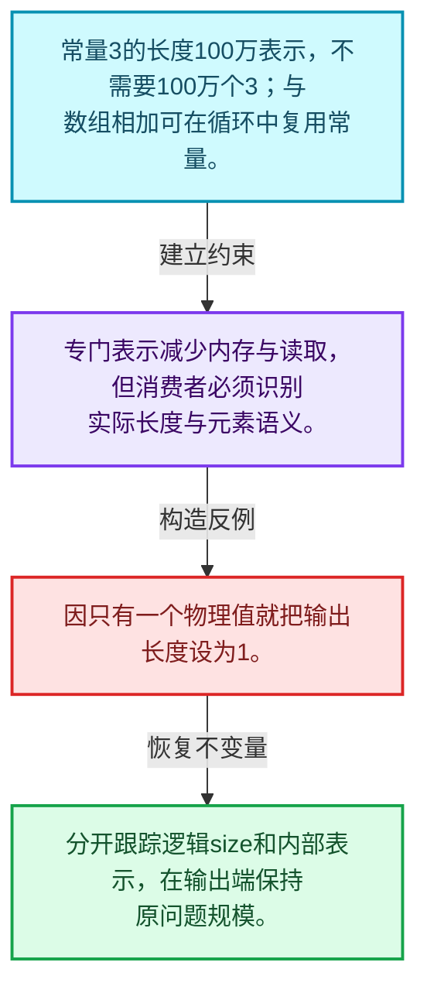
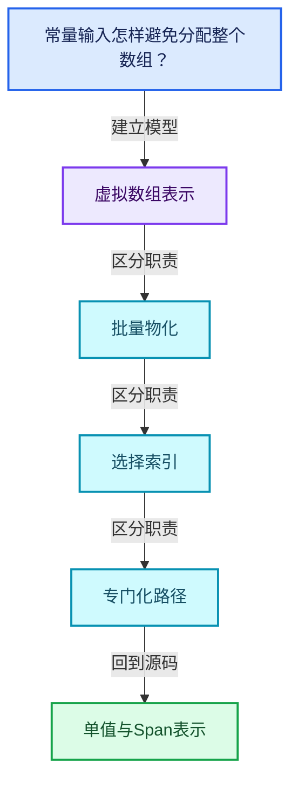
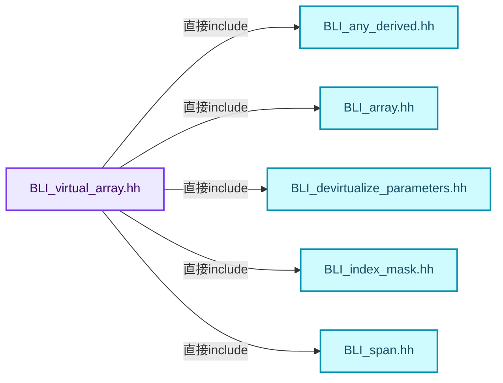
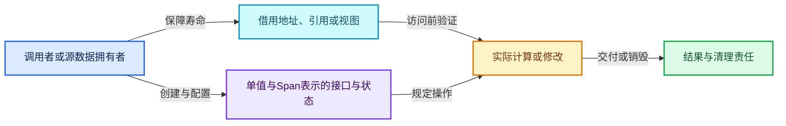
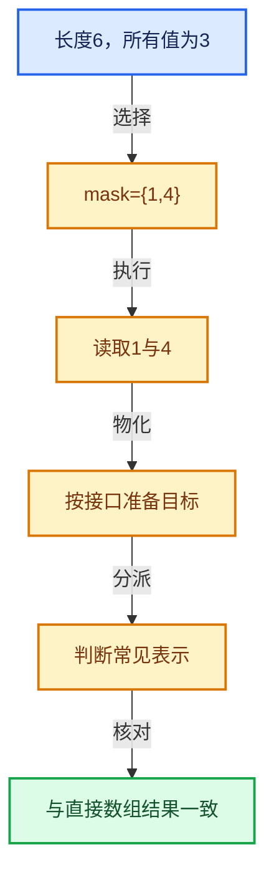

# 04-03 单值与Span表示

[方向导航](README.md) · [总目录](../README.md) · [覆盖索引](../%E6%BA%90%E7%A0%81%E7%89%88%E6%9C%AC%E4%B8%8E%E8%A6%86%E7%9B%96%E7%B4%A2%E5%BC%95.md)

> 阅读顺序：问题与数据模型 → 语法与类型 → 源码逐行 → 调用线索 → 历史与取舍 → 推演和练习。

- 基准 HEAD：`cbda6b96c26c0dee3c3b5cbb93960c4ac06a6b30`。
- 记录日期：2026-10-14。
- 教学示例状态：正文中的推演不是本机性能实测；已运行练习见验收报告。

## 一、从问题到设计

常量输入怎样避免分配整个数组？

单值表示把N个相同元素压缩成一个值和长度；消费者仍必须理解长度不是实际存储数量。

本篇把语法、数据语义和系统取舍连接起来。表示与接口分离，元素编号与选择内部位置分离，生成成本与执行成本分离。

### 本篇独立模型与设计推理

常量3的长度100万表示，不需要100万个3；与数组相加可在循环中复用常量。

设计取舍：专门表示减少内存与读取，但消费者必须识别实际长度与元素语义。

最小反例：因只有一个物理值就把输出长度设为1。

推导与处理：分开跟踪逻辑size和内部表示，在输出端保持原问题规模。



### 源码范围与相邻篇章

| 文件 | 本篇逐行范围 | 基准SHA-256 |
|---|---|---|
| [source/blender/blenlib/BLI_virtual_array.hh](../../../../../source/blender/blenlib/BLI_virtual_array.hh) | L607—L912 | `0dad9ae245918d5aff4c98aac3248f277cd8060ca11a9acf2e59943aa18a18fe` |

同一主讲文件可能分多篇覆盖；超出本篇范围的符号通过覆盖索引定位。空行与纯注释保留在源码摘录中，逐行表解释有效语句与语法边界；许可证头统一保留。

前篇：[VArrayImpl实现接口](02-VArrayImpl%E5%AE%9E%E7%8E%B0%E6%8E%A5%E5%8F%A3.md).

后篇：[所有权与小对象优化](04-%E6%89%80%E6%9C%89%E6%9D%83%E4%B8%8E%E5%B0%8F%E5%AF%B9%E8%B1%A1%E4%BC%98%E5%8C%96.md).

## 二、类型、数据与阅读地图



这是概念依赖图，边表示阅读关系，不声称是运行时调用顺序。

### 直接编译依赖



箭头只表示头文件包含关系；完整调用线索见后面的符号定位表。

## 三、关键词、语法与类型角色

### 模板 template

模板把类型或常量作为生成实现的参数。读声明时先列出类型参数、非类型参数和默认值，再看使用者实际实例化了什么。模板声明本身不意味着每种T都支持其全部成员。

具体检查：把T替换为int、string、只能移动的类型，分别检查每个被调用操作是否成立。

### 依赖名称 typename

typename既可引入类型模板参数，也可告诉编译器某个依赖名称是类型。它不创建运行时对象；解析期确认语法类别与实例化期检查具体类型是不同阶段。

具体检查：区分typename T::value_type和T::size()，前者标记类型，后者是表达式。

### 约束 requires

requires表达式或requires子句限制模板参与重载的条件。它提供编译期可用性检查，不是运行时if，不能指望输入到达程序后再被这一机制验证。

具体检查：构造满足和不满足约束的两个类型，观察候选被排除而不是在函数内返回错误。

### 只读限定 const

const约束当前访问路径可做的修改。const指针、指向const的指针、const视图对象、const元素是不同位置的限定；其他别名可能仍可修改原对象。

具体检查：分别写T* const、const T*与const T* const，并画出不可修改的层次。

### 移动转换 std::move

std::move把表达式转换为可供移动重载选择的值类别，实际资源转移发生在被选中的构造或赋值中。对const对象move可能仍调用复制，对视图move也不会获得底层数据所有权。

具体检查：记录移动构造调用次数，不用变量名或std::move的出现次数替代测量。

### 完美转发 std::forward

std::forward在转发引用模板中恢复调用者原来的值类别。它依赖推导出的模板实参；无条件move会改变左值调用者的语义。

具体检查：对同一接口分别传入左值、临时对象和const左值，记录实际重载。

### 异常约定 noexcept

noexcept表达式可以依赖类型特征。违反不抛异常约定会终止程序；它不是自动捕获异常，也不是资源回滚代码。

具体检查：找出声明的条件与实际可能抛出的分配、构造操作是否一致。

### 异常边界 try与catch

try定义异常传播的局部边界。失败路径需要销毁已经成功构造的部分并释放相应存储；未构造的对象不能被析构。

具体检查：在第k次构造失败，列出已经存在的对象集合与待释放缓冲。

### 显式静态转换 static_cast

static_cast表达编译期允许的转换，不会自动验证运行时真实类型、指针寿命或索引边界。由void指针恢复T指针时，调用者仍须保证实际存储中确有合法T对象。

具体检查：标出转换前后的类型以及正确性依据来自哪里。

### 限定转换 const_cast

const_cast可以改变访问路径的限定，但不能让本来就是const的对象合法可写。常用于复用只读实现时，仍需检查底层对象是否实际可变。

具体检查：对非const对象的const引用与真正const对象分别分析修改是否合法。

### 运行时多态 virtual

虚调用根据实际动态类型选择实现；经基类指针销毁对象时通常需要相应虚析构契约。每元素虚调用和循环外一次分派有不同开销。

具体检查：找出虚接口的实现类和调用频率，再讨论是否值得去虚拟化。

### 可选值 optional

optional把不存在与存在的T区分开，T的构造和析构跟随engaged状态变化。访问前应由has_value或条件分支证明存在。

具体检查：把空Field状态与合法常量零区分，不能用某个普通值代替不存在。

### 构造与new表达式

普通new可能分配并构造；placement new在给定地址构造，存储由其他机制提供。失败回滚应区分两类责任。

具体检查：追踪地址来自哪里、构造何时成功、由谁析构、由谁释放。

### 内部断言 assert

断言表达开发者预期成立的内部契约，发布构建可能关闭。它不能替代对不可信输入的完整错误处理，也不保证后续操作被运行时保护。

具体检查：对每条断言构造违反条件的输入，区分调用者错误与应向用户报告的错误。

### 受控访问 friend

friend授予指定函数或类访问非公开成员的权限，并不意味着继承，也不自动扩展到友元的派生类。

具体检查：解释执行器为何需要访问包装器的内部映射，同时检查边界是否仍清楚。

### 共享拥有 shared_ptr

shared_ptr让控制块跟踪共享寿命，不自动使被指向对象的读写线程安全；循环拥有可能阻止销毁。

具体检查：画出强引用环并考虑是否应改变所有权方向或引入弱引用。

### 拥有型可调用包装 function

std::function保存可调用目标并提供统一调用接口，复制能力与目标要求有关；FunctionRef仅借用，二者不能无条件互换。

具体检查：比较同步回调与长期保存任务对拥有关系的不同要求。

## 四、真实源码与逐行讲解

源码块保持原行内容，原始行号由小节标题及逐行表给出。表中的调用定位是静态阅读辅助；重载、模板实例化、宏展开和虚调用需结合完整声明，不能仅凭词法出现证明动态调用。

### BLI_virtual_array.hh：L607—L656

<!-- source:source/blender/blenlib/BLI_virtual_array.hh:607:656 -->

```cpp

  /** Return true when the virtual array is stored as a span internally. */
  bool is_span() const
  {
    BLI_assert(*this);
    const CommonVArrayInfo info = impl_->common_info();
    return info.type == CommonVArrayInfo::Type::Span;
  }

  /**
   * Returns the internally used span of the virtual array. This invokes undefined behavior if the
   * virtual array is not stored as a span internally.
   */
  Span<T> get_internal_span() const
  {
    BLI_assert(this->is_span());
    const CommonVArrayInfo info = impl_->common_info();
    return Span<T>(static_cast<const T *>(info.data), this->size());
  }

  /** Return true when the virtual array returns the same value for every index. */
  bool is_single() const
  {
    BLI_assert(*this);
    const CommonVArrayInfo info = impl_->common_info();
    return info.type == CommonVArrayInfo::Type::Single;
  }

  /**
   * Return the value that is returned for every index. This invokes undefined behavior if the
   * virtual array would not return the same value for every index.
   */
  T get_internal_single() const
  {
    BLI_assert(this->is_single());
    const CommonVArrayInfo info = impl_->common_info();
    return *static_cast<const T *>(info.data);
  }

  /**
   * Return the value that is returned for every index, if the array is stored as a single value.
   */
  std::optional<T> get_if_single() const
  {
    const CommonVArrayInfo info = impl_->common_info();
    if (info.type != CommonVArrayInfo::Type::Single) {
      return std::nullopt;
    }
    return *static_cast<const T *>(info.data);
  }
```

本段语义重点：

- 分支证据 `info.type != CommonVArrayInfo::Type::Single)`：分别推演条件成立与不成立，核对相同出口处的状态。

| 原始行 | 语义、约束与检查 |
|---|---|
| L609 | 出现调用或函数声明 `is_span`，对应表达式为 `bool is_span() const`。参数求值、返回类型与重载需结合前后完整语句；静态文本引用不能证明动态目标。 |
| L610 | 连接上一行的声明或控制结构与其语句块；后续行在这个作用域中执行或声明。 |
| L611 | 断言约束 `BLI_assert(*this);`。条件是后续访问的内部前置条件；发布构建可能不执行，不能把断言当作输入修复。 |
| L612 | 把右侧 `impl_->common_info()` 用于初始化或更新左侧 `const CommonVArrayInfo info`。声明初始化与已有对象赋值应按上下文区分；有资源的类型会调用相应特殊成员。 |
| L613 | 返回表达式 `info.type == CommonVArrayInfo::Type::Span`。 |
| L614 | 结束当前语法单元。局部自动对象在离开其作用域时按规则销毁；这不等于所有被引用的外部数据也被释放。 |
| L620 | 出现调用或函数声明 `get_internal_span`，对应表达式为 `Span<T> get_internal_span() const`。参数求值、返回类型与重载需结合前后完整语句；静态文本引用不能证明动态目标。 |
| L621 | 连接上一行的声明或控制结构与其语句块；后续行在这个作用域中执行或声明。 |
| L622 | 断言约束 `BLI_assert(this->is_span());`。条件是后续访问的内部前置条件；发布构建可能不执行，不能把断言当作输入修复。 |
| L623 | 把右侧 `impl_->common_info()` 用于初始化或更新左侧 `const CommonVArrayInfo info`。声明初始化与已有对象赋值应按上下文区分；有资源的类型会调用相应特殊成员。 |
| L624 | 返回表达式 `Span<T>(static_cast<const T *>(info.data), this->size())`。 |
| L625 | 结束当前语法单元。局部自动对象在离开其作用域时按规则销毁；这不等于所有被引用的外部数据也被释放。 |
| L628 | 出现调用或函数声明 `is_single`，对应表达式为 `bool is_single() const`。参数求值、返回类型与重载需结合前后完整语句；静态文本引用不能证明动态目标。 |
| L629 | 连接上一行的声明或控制结构与其语句块；后续行在这个作用域中执行或声明。 |
| L630 | 断言约束 `BLI_assert(*this);`。条件是后续访问的内部前置条件；发布构建可能不执行，不能把断言当作输入修复。 |
| L631 | 把右侧 `impl_->common_info()` 用于初始化或更新左侧 `const CommonVArrayInfo info`。声明初始化与已有对象赋值应按上下文区分；有资源的类型会调用相应特殊成员。 |
| L632 | 返回表达式 `info.type == CommonVArrayInfo::Type::Single`。 |
| L633 | 结束当前语法单元。局部自动对象在离开其作用域时按规则销毁；这不等于所有被引用的外部数据也被释放。 |
| L639 | 出现调用或函数声明 `get_internal_single`，对应表达式为 `T get_internal_single() const`。参数求值、返回类型与重载需结合前后完整语句；静态文本引用不能证明动态目标。 |
| L640 | 连接上一行的声明或控制结构与其语句块；后续行在这个作用域中执行或声明。 |
| L641 | 断言约束 `BLI_assert(this->is_single());`。条件是后续访问的内部前置条件；发布构建可能不执行，不能把断言当作输入修复。 |
| L642 | 把右侧 `impl_->common_info()` 用于初始化或更新左侧 `const CommonVArrayInfo info`。声明初始化与已有对象赋值应按上下文区分；有资源的类型会调用相应特殊成员。 |
| L643 | 返回表达式 `*static_cast<const T *>(info.data)`。 |
| L644 | 结束当前语法单元。局部自动对象在离开其作用域时按规则销毁；这不等于所有被引用的外部数据也被释放。 |
| L649 | 出现调用或函数声明 `get_if_single`，对应表达式为 `std::optional<T> get_if_single() const`。参数求值、返回类型与重载需结合前后完整语句；静态文本引用不能证明动态目标。 |
| L650 | 连接上一行的声明或控制结构与其语句块；后续行在这个作用域中执行或声明。 |
| L651 | 把右侧 `impl_->common_info()` 用于初始化或更新左侧 `const CommonVArrayInfo info`。声明初始化与已有对象赋值应按上下文区分；有资源的类型会调用相应特殊成员。 |
| L652 | 判断 `info.type != CommonVArrayInfo::Type::Single`，成立时进入本分支，否则继续后续路径。 |
| L653 | 返回表达式 `std::nullopt`。 |
| L654 | 结束当前语法单元。局部自动对象在离开其作用域时按规则销毁；这不等于所有被引用的外部数据也被释放。 |
| L655 | 返回表达式 `*static_cast<const T *>(info.data)`。 |
| L656 | 结束当前语法单元。局部自动对象在离开其作用域时按规则销毁；这不等于所有被引用的外部数据也被释放。 |

### BLI_virtual_array.hh：L657—L703

<!-- source:source/blender/blenlib/BLI_virtual_array.hh:657:703 -->

```cpp

  /** Copy the entire virtual array into a span. */
  void materialize(MutableSpan<T> r_span) const
  {
    this->materialize(IndexMask(this->size()), r_span);
  }

  /** Copy some indices of the virtual array into a span. */
  void materialize(const IndexMask &mask, MutableSpan<T> r_span) const
  {
    BLI_assert(mask.min_array_size() <= this->size());
    impl_->materialize(mask, r_span.data(), false);
  }

  void materialize_to_uninitialized(MutableSpan<T> r_span) const
  {
    this->materialize_to_uninitialized(IndexMask(this->size()), r_span);
  }

  void materialize_to_uninitialized(const IndexMask &mask, MutableSpan<T> r_span) const
  {
    BLI_assert(mask.min_array_size() <= this->size());
    impl_->materialize(mask, r_span.data(), true);
  }

  /** Copy some elements of the virtual array into a span. */
  void materialize_compressed(const IndexMask &mask, MutableSpan<T> r_span) const
  {
    impl_->materialize_compressed(mask, r_span.data(), false);
  }

  void materialize_compressed_to_uninitialized(const IndexMask &mask, MutableSpan<T> r_span) const
  {
    impl_->materialize_compressed(mask, r_span.data(), true);
  }

  /** See #GVArrayImpl::try_assign_GVArray. */
  bool try_assign_GVArray(GVArray &varray) const
  {
    return impl_->try_assign_GVArray(varray);
  }

  const VArrayImpl<T> *get_implementation() const
  {
    return impl_.get();
  }
};
```

| 原始行 | 语义、约束与检查 |
|---|---|
| L659 | 出现调用或函数声明 `materialize`，对应表达式为 `void materialize(MutableSpan<T> r_span) const`。参数求值、返回类型与重载需结合前后完整语句；静态文本引用不能证明动态目标。 |
| L660 | 连接上一行的声明或控制结构与其语句块；后续行在这个作用域中执行或声明。 |
| L661 | 出现调用或函数声明 `materialize`，对应表达式为 `this->materialize(IndexMask(this->size()), r_span);`。参数求值、返回类型与重载需结合前后完整语句；静态文本引用不能证明动态目标。 |
| L662 | 结束当前语法单元。局部自动对象在离开其作用域时按规则销毁；这不等于所有被引用的外部数据也被释放。 |
| L665 | 出现调用或函数声明 `materialize`，对应表达式为 `void materialize(const IndexMask &mask, MutableSpan<T> r_span) const`。参数求值、返回类型与重载需结合前后完整语句；静态文本引用不能证明动态目标。 |
| L666 | 连接上一行的声明或控制结构与其语句块；后续行在这个作用域中执行或声明。 |
| L667 | 断言约束 `BLI_assert(mask.min_array_size() <= this->size());`。条件是后续访问的内部前置条件；发布构建可能不执行，不能把断言当作输入修复。 |
| L668 | 出现调用或函数声明 `materialize`，对应表达式为 `impl_->materialize(mask, r_span.data(), false);`。参数求值、返回类型与重载需结合前后完整语句；静态文本引用不能证明动态目标。 |
| L669 | 结束当前语法单元。局部自动对象在离开其作用域时按规则销毁；这不等于所有被引用的外部数据也被释放。 |
| L671 | 出现调用或函数声明 `materialize_to_uninitialized`，对应表达式为 `void materialize_to_uninitialized(MutableSpan<T> r_span) const`。参数求值、返回类型与重载需结合前后完整语句；静态文本引用不能证明动态目标。 |
| L672 | 连接上一行的声明或控制结构与其语句块；后续行在这个作用域中执行或声明。 |
| L673 | 出现调用或函数声明 `materialize_to_uninitialized`，对应表达式为 `this->materialize_to_uninitialized(IndexMask(this->size()), r_span);`。参数求值、返回类型与重载需结合前后完整语句；静态文本引用不能证明动态目标。 |
| L674 | 结束当前语法单元。局部自动对象在离开其作用域时按规则销毁；这不等于所有被引用的外部数据也被释放。 |
| L676 | 出现调用或函数声明 `materialize_to_uninitialized`，对应表达式为 `void materialize_to_uninitialized(const IndexMask &mask, MutableSpan<T> r_span) const`。参数求值、返回类型与重载需结合前后完整语句；静态文本引用不能证明动态目标。 |
| L677 | 连接上一行的声明或控制结构与其语句块；后续行在这个作用域中执行或声明。 |
| L678 | 断言约束 `BLI_assert(mask.min_array_size() <= this->size());`。条件是后续访问的内部前置条件；发布构建可能不执行，不能把断言当作输入修复。 |
| L679 | 出现调用或函数声明 `materialize`，对应表达式为 `impl_->materialize(mask, r_span.data(), true);`。参数求值、返回类型与重载需结合前后完整语句；静态文本引用不能证明动态目标。 |
| L680 | 结束当前语法单元。局部自动对象在离开其作用域时按规则销毁；这不等于所有被引用的外部数据也被释放。 |
| L683 | 出现调用或函数声明 `materialize_compressed`，对应表达式为 `void materialize_compressed(const IndexMask &mask, MutableSpan<T> r_span) const`。参数求值、返回类型与重载需结合前后完整语句；静态文本引用不能证明动态目标。 |
| L684 | 连接上一行的声明或控制结构与其语句块；后续行在这个作用域中执行或声明。 |
| L685 | 出现调用或函数声明 `materialize_compressed`，对应表达式为 `impl_->materialize_compressed(mask, r_span.data(), false);`。参数求值、返回类型与重载需结合前后完整语句；静态文本引用不能证明动态目标。 |
| L686 | 结束当前语法单元。局部自动对象在离开其作用域时按规则销毁；这不等于所有被引用的外部数据也被释放。 |
| L688 | 出现调用或函数声明 `materialize_compressed_to_uninitialized`，对应表达式为 `void materialize_compressed_to_uninitialized(const IndexMask &mask, MutableSpan<T> r_span) const`。参数求值、返回类型与重载需结合前后完整语句；静态文本引用不能证明动态目标。 |
| L689 | 连接上一行的声明或控制结构与其语句块；后续行在这个作用域中执行或声明。 |
| L690 | 出现调用或函数声明 `materialize_compressed`，对应表达式为 `impl_->materialize_compressed(mask, r_span.data(), true);`。参数求值、返回类型与重载需结合前后完整语句；静态文本引用不能证明动态目标。 |
| L691 | 结束当前语法单元。局部自动对象在离开其作用域时按规则销毁；这不等于所有被引用的外部数据也被释放。 |
| L694 | 出现调用或函数声明 `try_assign_GVArray`，对应表达式为 `bool try_assign_GVArray(GVArray &varray) const`。参数求值、返回类型与重载需结合前后完整语句；静态文本引用不能证明动态目标。 |
| L695 | 连接上一行的声明或控制结构与其语句块；后续行在这个作用域中执行或声明。 |
| L696 | 返回表达式 `impl_->try_assign_GVArray(varray)`。 |
| L697 | 结束当前语法单元。局部自动对象在离开其作用域时按规则销毁；这不等于所有被引用的外部数据也被释放。 |
| L699 | 出现调用或函数声明 `get_implementation`，对应表达式为 `const VArrayImpl<T> *get_implementation() const`。参数求值、返回类型与重载需结合前后完整语句；静态文本引用不能证明动态目标。 |
| L700 | 连接上一行的声明或控制结构与其语句块；后续行在这个作用域中执行或声明。 |
| L701 | 返回表达式 `impl_.get()`。 |
| L702 | 结束当前语法单元。局部自动对象在离开其作用域时按规则销毁；这不等于所有被引用的外部数据也被释放。 |
| L703 | 结束当前语法单元。局部自动对象在离开其作用域时按规则销毁；这不等于所有被引用的外部数据也被释放。 |

### BLI_virtual_array.hh：L704—L754

<!-- source:source/blender/blenlib/BLI_virtual_array.hh:704:754 -->

```cpp

template<typename T> class VMutableArray;

/**
 * Various tags to disambiguate constructors of virtual arrays.
 * Generally it is easier to use `VArray::from_*` functions to construct virtual arrays, but
 * sometimes being able to use the constructor can result in better performance. For example, when
 * constructing the virtual array directly in a vector. Without the constructor one would have to
 * construct the virtual array first and then move it into the vector.
 */
namespace varray_tag {
struct span {};
struct single_ref {};
struct single {};
}  // namespace varray_tag

/**
 * A #VArray wraps a virtual array implementation and provides easy access to its elements. It can
 * be copied and moved. While it is relatively small, it should still be passed by reference if
 * possible (other than e.g. #Span).
 */
template<typename T> class VArray : public VArrayCommon<T> {
  friend VMutableArray<T>;

 public:
  VArray() = default;

  VArray(const VArrayImpl<T> *impl) : VArrayCommon<T>(impl) {}

  VArray(std::shared_ptr<const VArrayImpl<T>> impl) : VArrayCommon<T>(std::move(impl)) {}

  VArray(varray_tag::span /*tag*/, Span<T> span)
  {
    this->template emplace<VArrayImpl_For_Span_final<T>>(span);
  }

  VArray(varray_tag::single /*tag*/, T value, const int64_t size)
  {
    this->template emplace<VArrayImpl_For_Single<T>>(std::move(value), size);
  }

  /**
   * Construct a new virtual array for a custom #VArrayImpl.
   */
  template<typename ImplT, typename... Args> static VArray from(Args &&...args)
  {
    static_assert(std::is_base_of_v<VArrayImpl<T>, ImplT>);
    VArray varray;
    varray.template emplace<ImplT>(std::forward<Args>(args)...);
    return varray;
  }
```

| 原始行 | 语义、约束与检查 |
|---|---|
| L705 | 声明模板参数 `template<typename T> class VMutableArray;`。类型参数决定生成操作的类型，非类型参数可决定内嵌容量或编译期分支。 |
| L714 | 把后续声明放入 varray_tag 命名空间，影响名称查找和符号归属，不创建运行时对象。 |
| L715 | 声明或定义类型 `struct span {}`。结合继承、访问权限和成员布局确认接口与拥有关系；前向声明本身没有完整对象布局。 |
| L716 | 声明或定义类型 `struct single_ref {}`。结合继承、访问权限和成员布局确认接口与拥有关系；前向声明本身没有完整对象布局。 |
| L717 | 声明或定义类型 `struct single {}`。结合继承、访问权限和成员布局确认接口与拥有关系；前向声明本身没有完整对象布局。 |
| L718 | 结束当前语法单元。局部自动对象在离开其作用域时按规则销毁；这不等于所有被引用的外部数据也被释放。 |
| L725 | 声明模板参数 `template<typename T> class VArray : public VArrayCommon<T> {`。类型参数决定生成操作的类型，非类型参数可决定内嵌容量或编译期分支。 |
| L726 | 声明成员、局部对象或完成语句 `friend VMutableArray<T>`。若为指针或引用，它本身不说明拥有；若为值对象，其构造析构由所在作用域或外层对象管理。 |
| L728 | 切换成员访问权限为 public；它是编译期接口边界，不是线程同步或内存保护。 |
| L729 | 显式采用编译器生成的特殊成员行为：`VArray() = default;`。成员和基类的性质决定该操作是否可用、是否被删除及异常约定，不表示运行时给对象赋值为default。 |
| L731 | 出现调用或函数声明 `VArray`，对应表达式为 `VArray(const VArrayImpl<T> *impl) : VArrayCommon<T>(impl) {}`。参数求值、返回类型与重载需结合前后完整语句；静态文本引用不能证明动态目标。 |
| L733 | 出现调用或函数声明 `VArray`，对应表达式为 `VArray(std::shared_ptr<const VArrayImpl<T>> impl) : VArrayCommon<T>(std::move(impl)) {}`。参数求值、返回类型与重载需结合前后完整语句；静态文本引用不能证明动态目标。 |
| L735 | 出现调用或函数声明 `VArray`，对应表达式为 `VArray(varray_tag::span , Span<T> span)`。参数求值、返回类型与重载需结合前后完整语句；静态文本引用不能证明动态目标。 |
| L736 | 连接上一行的声明或控制结构与其语句块；后续行在这个作用域中执行或声明。 |
| L737 | 出现调用或函数声明 `emplace`，对应表达式为 `this->template emplace<VArrayImpl_For_Span_final<T>>(span);`。参数求值、返回类型与重载需结合前后完整语句；静态文本引用不能证明动态目标。 |
| L738 | 结束当前语法单元。局部自动对象在离开其作用域时按规则销毁；这不等于所有被引用的外部数据也被释放。 |
| L740 | 出现调用或函数声明 `VArray`，对应表达式为 `VArray(varray_tag::single , T value, const int64_t size)`。参数求值、返回类型与重载需结合前后完整语句；静态文本引用不能证明动态目标。 |
| L741 | 连接上一行的声明或控制结构与其语句块；后续行在这个作用域中执行或声明。 |
| L742 | 出现调用或函数声明 `emplace`，对应表达式为 `this->template emplace<VArrayImpl_For_Single<T>>(std::move(value), size);`。参数求值、返回类型与重载需结合前后完整语句；静态文本引用不能证明动态目标。 |
| L743 | 结束当前语法单元。局部自动对象在离开其作用域时按规则销毁；这不等于所有被引用的外部数据也被释放。 |
| L748 | 声明模板参数 `template<typename ImplT, typename... Args> static VArray from(Args &&...args)`。类型参数决定生成操作的类型，非类型参数可决定内嵌容量或编译期分支。 |
| L749 | 连接上一行的声明或控制结构与其语句块；后续行在这个作用域中执行或声明。 |
| L750 | 在编译期检查 `static_assert(std::is_base_of_v<VArrayImpl<T>, ImplT>);`；条件失败导致编译错误，不存在运行时错误恢复路径。 |
| L751 | 声明成员、局部对象或完成语句 `VArray varray`。若为指针或引用，它本身不说明拥有；若为值对象，其构造析构由所在作用域或外层对象管理。 |
| L752 | 出现调用或函数声明 `emplace`，对应表达式为 `varray.template emplace<ImplT>(std::forward<Args>(args)...);`。参数求值、返回类型与重载需结合前后完整语句；静态文本引用不能证明动态目标。 |
| L753 | 返回表达式 `varray`。 |
| L754 | 结束当前语法单元。局部自动对象在离开其作用域时按规则销毁；这不等于所有被引用的外部数据也被释放。 |

### BLI_virtual_array.hh：L755—L802

<!-- source:source/blender/blenlib/BLI_virtual_array.hh:755:802 -->

```cpp

  /**
   * Construct a new virtual array that has the same value at every index.
   */
  static VArray from_single(T value, const int64_t size)
  {
    return VArray(varray_tag::single{}, std::move(value), size);
  }

  /**
   * Construct a new virtual array for an existing span. This does not take ownership of the
   * underlying memory.
   */
  static VArray from_span(Span<T> values)
  {
    return VArray(varray_tag::span{}, values);
  }

  /**
   * Construct a new virtual that will invoke the provided function whenever an element is
   * accessed.
   */
  template<typename GetFunc> static VArray from_func(const int64_t size, GetFunc get_func)
  {
    return VArray::from<VArrayImpl_For_Func<T, decltype(get_func)>>(size, std::move(get_func));
  }

  /**
   * Same as #from_func, but uses a std::function instead of a template. This is slower, but
   * requires less code generation. Therefore this should be used in non-performance critical code.
   */
  static VArray from_std_func(const int64_t size, std::function<T(int64_t index)> get_func)
  {
    return VArray::from_func(size, get_func);
  }

  /**
   * Construct a new virtual array for an existing span with a mapping function. This does not take
   * ownership of the span.
   */
  template<typename StructT, T (*GetFunc)(const StructT &)>
  static VArray from_derived_span(Span<StructT> values)
  {
    /* Cast const away, because the virtual array implementation for const and non const derived
     * spans is shared. */
    MutableSpan<StructT> span{const_cast<StructT *>(values.data()), values.size()};
    return VArray::from<VArrayImpl_For_DerivedSpan<StructT, T, GetFunc>>(span);
  }
```

| 原始行 | 语义、约束与检查 |
|---|---|
| L759 | 出现调用或函数声明 `from_single`，对应表达式为 `static VArray from_single(T value, const int64_t size)`。参数求值、返回类型与重载需结合前后完整语句；静态文本引用不能证明动态目标。 |
| L760 | 连接上一行的声明或控制结构与其语句块；后续行在这个作用域中执行或声明。 |
| L761 | 返回表达式 `VArray(varray_tag::single{}, std::move(value), size)`。 |
| L762 | 结束当前语法单元。局部自动对象在离开其作用域时按规则销毁；这不等于所有被引用的外部数据也被释放。 |
| L768 | 出现调用或函数声明 `from_span`，对应表达式为 `static VArray from_span(Span<T> values)`。参数求值、返回类型与重载需结合前后完整语句；静态文本引用不能证明动态目标。 |
| L769 | 连接上一行的声明或控制结构与其语句块；后续行在这个作用域中执行或声明。 |
| L770 | 返回表达式 `VArray(varray_tag::span{}, values)`。 |
| L771 | 结束当前语法单元。局部自动对象在离开其作用域时按规则销毁；这不等于所有被引用的外部数据也被释放。 |
| L777 | 声明模板参数 `template<typename GetFunc> static VArray from_func(const int64_t size, GetFunc get_func)`。类型参数决定生成操作的类型，非类型参数可决定内嵌容量或编译期分支。 |
| L778 | 连接上一行的声明或控制结构与其语句块；后续行在这个作用域中执行或声明。 |
| L779 | 返回表达式 `VArray::from<VArrayImpl_For_Func<T, decltype(get_func)>>(size, std::move(get_func))`。 |
| L780 | 结束当前语法单元。局部自动对象在离开其作用域时按规则销毁；这不等于所有被引用的外部数据也被释放。 |
| L786 | 出现调用或函数声明 `from_std_func`，对应表达式为 `static VArray from_std_func(const int64_t size, std::function<T(int64_t index)> get_func)`。参数求值、返回类型与重载需结合前后完整语句；静态文本引用不能证明动态目标。 |
| L787 | 连接上一行的声明或控制结构与其语句块；后续行在这个作用域中执行或声明。 |
| L788 | 返回表达式 `VArray::from_func(size, get_func)`。 |
| L789 | 结束当前语法单元。局部自动对象在离开其作用域时按规则销毁；这不等于所有被引用的外部数据也被释放。 |
| L795 | 声明模板参数 `template<typename StructT, T (*GetFunc)(const StructT &)>`。类型参数决定生成操作的类型，非类型参数可决定内嵌容量或编译期分支。 |
| L796 | 出现调用或函数声明 `from_derived_span`，对应表达式为 `static VArray from_derived_span(Span<StructT> values)`。参数求值、返回类型与重载需结合前后完整语句；静态文本引用不能证明动态目标。 |
| L797 | 连接上一行的声明或控制结构与其语句块；后续行在这个作用域中执行或声明。 |
| L800 | 出现调用或函数声明 `const_cast`，对应表达式为 `MutableSpan<StructT> span{const_cast<StructT *>(values.data()), values.size()};`。参数求值、返回类型与重载需结合前后完整语句；静态文本引用不能证明动态目标。 |
| L801 | 返回表达式 `VArray::from<VArrayImpl_For_DerivedSpan<StructT, T, GetFunc>>(span)`。结合函数声明检查返回值是否借用原存储，借用值不会自动延长其寿命。 |
| L802 | 结束当前语法单元。局部自动对象在离开其作用域时按规则销毁；这不等于所有被引用的外部数据也被释放。 |

### BLI_virtual_array.hh：L803—L846

<!-- source:source/blender/blenlib/BLI_virtual_array.hh:803:846 -->

```cpp

  /**
   * Construct a new virtual array for an existing container. Every container that lays out the
   * elements in a plain array works. This takes ownership of the passed in container. If that is
   * not desired, use #from_span instead.
   */
  template<typename ContainerT> static VArray from_container(ContainerT container)
  {
    return VArray::from<VArrayImpl_For_ArrayContainer<ContainerT>>(std::move(container));
  }
};

/**
 * Similar to #VArray but references a virtual array that can be modified.
 */
template<typename T> class VMutableArray : public VArrayCommon<T> {
 public:
  VMutableArray() = default;

  VMutableArray(const VMutableArrayImpl<T> *impl) : VArrayCommon<T>(impl) {}

  VMutableArray(std::shared_ptr<const VMutableArrayImpl<T>> impl)
      : VArrayCommon<T>(std::move(impl))
  {
  }

  /**
   * Construct a new virtual array for a custom #VMutableArrayImpl.
   */
  template<typename ImplT, typename... Args> static VMutableArray from(Args &&...args)
  {
    static_assert(std::is_base_of_v<VMutableArrayImpl<T>, ImplT>);
    VMutableArray varray;
    varray.template emplace<ImplT>(std::forward<Args>(args)...);
    return varray;
  }

  /**
   * Construct a new virtual array for an existing span. This does not take ownership of the span.
   */
  static VMutableArray from_span(MutableSpan<T> values)
  {
    return VMutableArray::from<VArrayImpl_For_Span_final<T>>(values);
  }
```

| 原始行 | 语义、约束与检查 |
|---|---|
| L809 | 声明模板参数 `template<typename ContainerT> static VArray from_container(ContainerT container)`。类型参数决定生成操作的类型，非类型参数可决定内嵌容量或编译期分支。 |
| L810 | 连接上一行的声明或控制结构与其语句块；后续行在这个作用域中执行或声明。 |
| L811 | 返回表达式 `VArray::from<VArrayImpl_For_ArrayContainer<ContainerT>>(std::move(container))`。 |
| L812 | 结束当前语法单元。局部自动对象在离开其作用域时按规则销毁；这不等于所有被引用的外部数据也被释放。 |
| L813 | 结束当前语法单元。局部自动对象在离开其作用域时按规则销毁；这不等于所有被引用的外部数据也被释放。 |
| L818 | 声明模板参数 `template<typename T> class VMutableArray : public VArrayCommon<T> {`。类型参数决定生成操作的类型，非类型参数可决定内嵌容量或编译期分支。 |
| L819 | 切换成员访问权限为 public；它是编译期接口边界，不是线程同步或内存保护。 |
| L820 | 显式采用编译器生成的特殊成员行为：`VMutableArray() = default;`。成员和基类的性质决定该操作是否可用、是否被删除及异常约定，不表示运行时给对象赋值为default。 |
| L822 | 出现调用或函数声明 `VMutableArray`，对应表达式为 `VMutableArray(const VMutableArrayImpl<T> *impl) : VArrayCommon<T>(impl) {}`。参数求值、返回类型与重载需结合前后完整语句；静态文本引用不能证明动态目标。 |
| L824 | 出现调用或函数声明 `VMutableArray`，对应表达式为 `VMutableArray(std::shared_ptr<const VMutableArrayImpl<T>> impl)`。参数求值、返回类型与重载需结合前后完整语句；静态文本引用不能证明动态目标。 |
| L825 | 出现调用或函数声明 `VArrayCommon`，对应表达式为 `: VArrayCommon<T>(std::move(impl))`。参数求值、返回类型与重载需结合前后完整语句；静态文本引用不能证明动态目标。 |
| L826 | 连接上一行的声明或控制结构与其语句块；后续行在这个作用域中执行或声明。 |
| L827 | 结束当前语法单元。局部自动对象在离开其作用域时按规则销毁；这不等于所有被引用的外部数据也被释放。 |
| L832 | 声明模板参数 `template<typename ImplT, typename... Args> static VMutableArray from(Args &&...args)`。类型参数决定生成操作的类型，非类型参数可决定内嵌容量或编译期分支。 |
| L833 | 连接上一行的声明或控制结构与其语句块；后续行在这个作用域中执行或声明。 |
| L834 | 在编译期检查 `static_assert(std::is_base_of_v<VMutableArrayImpl<T>, ImplT>);`；条件失败导致编译错误，不存在运行时错误恢复路径。 |
| L835 | 声明成员、局部对象或完成语句 `VMutableArray varray`。若为指针或引用，它本身不说明拥有；若为值对象，其构造析构由所在作用域或外层对象管理。 |
| L836 | 出现调用或函数声明 `emplace`，对应表达式为 `varray.template emplace<ImplT>(std::forward<Args>(args)...);`。参数求值、返回类型与重载需结合前后完整语句；静态文本引用不能证明动态目标。 |
| L837 | 返回表达式 `varray`。 |
| L838 | 结束当前语法单元。局部自动对象在离开其作用域时按规则销毁；这不等于所有被引用的外部数据也被释放。 |
| L843 | 出现调用或函数声明 `from_span`，对应表达式为 `static VMutableArray from_span(MutableSpan<T> values)`。参数求值、返回类型与重载需结合前后完整语句；静态文本引用不能证明动态目标。 |
| L844 | 连接上一行的声明或控制结构与其语句块；后续行在这个作用域中执行或声明。 |
| L845 | 返回表达式 `VMutableArray::from<VArrayImpl_For_Span_final<T>>(values)`。 |
| L846 | 结束当前语法单元。局部自动对象在离开其作用域时按规则销毁；这不等于所有被引用的外部数据也被释放。 |

### BLI_virtual_array.hh：L847—L893

<!-- source:source/blender/blenlib/BLI_virtual_array.hh:847:893 -->

```cpp

  /**
   * Construct a new virtual array for an existing span with a mapping function. This does not take
   * ownership of the span.
   */
  template<typename StructT, T (*GetFunc)(const StructT &), void (*SetFunc)(StructT &, T)>
  static VMutableArray from_derived_span(MutableSpan<StructT> values)
  {
    return VMutableArray::from<VArrayImpl_For_DerivedSpan<StructT, T, GetFunc, SetFunc>>(values);
  }

  /**
   * Construct a new virtual array for an existing container. Every container that lays out the
   * elements in a plain array works. This takes ownership of the passed in container. If that is
   * not desired, use #from_span instead.
   */
  template<typename ContainerT> static VMutableArray from_container(ContainerT container)
  {
    return VMutableArray::from<VArrayImpl_For_ArrayContainer<ContainerT>>(std::move(container));
  }

  /** Convert to a #VArray by copying. */
  operator VArray<T>() const &
  {
    VArray<T> varray;
    *static_cast<VArrayCommon<T> *>(&varray) = *this;
    return varray;
  }

  /** Convert to a #VArray by moving. */
  operator VArray<T>() && noexcept
  {
    VArray<T> varray;
    *static_cast<VArrayCommon<T> *>(&varray) = std::move(*this);
    return varray;
  }

  /**
   * Get access to the internal span. This invokes undefined behavior if the #is_span returned
   * false.
   */
  MutableSpan<T> get_internal_span() const
  {
    BLI_assert(this->is_span());
    const CommonVArrayInfo info = this->get_impl()->common_info();
    return MutableSpan<T>(const_cast<T *>(static_cast<const T *>(info.data)), this->size());
  }
```

| 原始行 | 语义、约束与检查 |
|---|---|
| L852 | 声明模板参数 `template<typename StructT, T (*GetFunc)(const StructT &), void (*SetFunc)(StructT &, T)>`。类型参数决定生成操作的类型，非类型参数可决定内嵌容量或编译期分支。 |
| L853 | 出现调用或函数声明 `from_derived_span`，对应表达式为 `static VMutableArray from_derived_span(MutableSpan<StructT> values)`。参数求值、返回类型与重载需结合前后完整语句；静态文本引用不能证明动态目标。 |
| L854 | 连接上一行的声明或控制结构与其语句块；后续行在这个作用域中执行或声明。 |
| L855 | 返回表达式 `VMutableArray::from<VArrayImpl_For_DerivedSpan<StructT, T, GetFunc, SetFunc>>(values)`。 |
| L856 | 结束当前语法单元。局部自动对象在离开其作用域时按规则销毁；这不等于所有被引用的外部数据也被释放。 |
| L863 | 声明模板参数 `template<typename ContainerT> static VMutableArray from_container(ContainerT container)`。类型参数决定生成操作的类型，非类型参数可决定内嵌容量或编译期分支。 |
| L864 | 连接上一行的声明或控制结构与其语句块；后续行在这个作用域中执行或声明。 |
| L865 | 返回表达式 `VMutableArray::from<VArrayImpl_For_ArrayContainer<ContainerT>>(std::move(container))`。 |
| L866 | 结束当前语法单元。局部自动对象在离开其作用域时按规则销毁；这不等于所有被引用的外部数据也被释放。 |
| L869 | 运算符重载声明、定义或显式调用：`operator VArray<T>() const &`。结合参数和返回类型判断是赋值、索引、比较还是转换；operator=声明中的等号不是在给名为operator的变量赋值。 |
| L870 | 连接上一行的声明或控制结构与其语句块；后续行在这个作用域中执行或声明。 |
| L871 | 声明成员、局部对象或完成语句 `VArray<T> varray`。若为指针或引用，它本身不说明拥有；若为值对象，其构造析构由所在作用域或外层对象管理。 |
| L872 | 把右侧 `*this` 用于初始化或更新左侧 `*static_cast<VArrayCommon<T> *>(&varray)`。声明初始化与已有对象赋值应按上下文区分；有资源的类型会调用相应特殊成员。 |
| L873 | 返回表达式 `varray`。结合函数声明检查返回值是否借用原存储，借用值不会自动延长其寿命。 |
| L874 | 结束当前语法单元。局部自动对象在离开其作用域时按规则销毁；这不等于所有被引用的外部数据也被释放。 |
| L877 | 运算符重载声明、定义或显式调用：`operator VArray<T>() && noexcept`。结合参数和返回类型判断是赋值、索引、比较还是转换；operator=声明中的等号不是在给名为operator的变量赋值。 |
| L878 | 连接上一行的声明或控制结构与其语句块；后续行在这个作用域中执行或声明。 |
| L879 | 声明成员、局部对象或完成语句 `VArray<T> varray`。若为指针或引用，它本身不说明拥有；若为值对象，其构造析构由所在作用域或外层对象管理。 |
| L880 | 把右侧 `std::move(*this)` 用于初始化或更新左侧 `*static_cast<VArrayCommon<T> *>(&varray)`。声明初始化与已有对象赋值应按上下文区分；有资源的类型会调用相应特殊成员。 |
| L881 | 返回表达式 `varray`。结合函数声明检查返回值是否借用原存储，借用值不会自动延长其寿命。 |
| L882 | 结束当前语法单元。局部自动对象在离开其作用域时按规则销毁；这不等于所有被引用的外部数据也被释放。 |
| L888 | 出现调用或函数声明 `get_internal_span`，对应表达式为 `MutableSpan<T> get_internal_span() const`。参数求值、返回类型与重载需结合前后完整语句；静态文本引用不能证明动态目标。 |
| L889 | 连接上一行的声明或控制结构与其语句块；后续行在这个作用域中执行或声明。 |
| L890 | 断言约束 `BLI_assert(this->is_span());`。条件是后续访问的内部前置条件；发布构建可能不执行，不能把断言当作输入修复。 |
| L891 | 把右侧 `this->get_impl()->common_info()` 用于初始化或更新左侧 `const CommonVArrayInfo info`。声明初始化与已有对象赋值应按上下文区分；有资源的类型会调用相应特殊成员。 |
| L892 | 返回表达式 `MutableSpan<T>(const_cast<T *>(static_cast<const T *>(info.data)), this->size())`。 |
| L893 | 结束当前语法单元。局部自动对象在离开其作用域时按规则销毁；这不等于所有被引用的外部数据也被释放。 |

### BLI_virtual_array.hh：L894—L912

<!-- source:source/blender/blenlib/BLI_virtual_array.hh:894:912 -->

```cpp

  /**
   * Set the value at the given index.
   */
  void set(const int64_t index, T value)
  {
    BLI_assert(index >= 0);
    BLI_assert(index < this->size());
    this->get_impl()->set(index, std::move(value));
  }

  /**
   * Copy the values from the source span to all elements in the virtual array.
   */
  void set_all(Span<T> src)
  {
    BLI_assert(src.size() == this->size());
    this->get_impl()->set_all(src);
  }
```

| 原始行 | 语义、约束与检查 |
|---|---|
| L898 | 出现调用或函数声明 `set`，对应表达式为 `void set(const int64_t index, T value)`。参数求值、返回类型与重载需结合前后完整语句；静态文本引用不能证明动态目标。 |
| L899 | 连接上一行的声明或控制结构与其语句块；后续行在这个作用域中执行或声明。 |
| L900 | 断言约束 `BLI_assert(index >= 0);`。条件是后续访问的内部前置条件；发布构建可能不执行，不能把断言当作输入修复。 |
| L901 | 断言约束 `BLI_assert(index < this->size());`。条件是后续访问的内部前置条件；发布构建可能不执行，不能把断言当作输入修复。 |
| L902 | 出现调用或函数声明 `get_impl`，对应表达式为 `this->get_impl()->set(index, std::move(value));`。参数求值、返回类型与重载需结合前后完整语句；静态文本引用不能证明动态目标。 |
| L903 | 结束当前语法单元。局部自动对象在离开其作用域时按规则销毁；这不等于所有被引用的外部数据也被释放。 |
| L908 | 出现调用或函数声明 `set_all`，对应表达式为 `void set_all(Span<T> src)`。参数求值、返回类型与重载需结合前后完整语句；静态文本引用不能证明动态目标。 |
| L909 | 连接上一行的声明或控制结构与其语句块；后续行在这个作用域中执行或声明。 |
| L910 | 断言约束 `BLI_assert(src.size() == this->size());`。条件是后续访问的内部前置条件；发布构建可能不执行，不能把断言当作输入修复。 |
| L911 | 出现调用或函数声明 `get_impl`，对应表达式为 `this->get_impl()->set_all(src);`。参数求值、返回类型与重载需结合前后完整语句；静态文本引用不能证明动态目标。 |
| L912 | 结束当前语法单元。局部自动对象在离开其作用域时按规则销毁；这不等于所有被引用的外部数据也被释放。 |

## 五、接口定位、调用线索与生命周期

### 本篇声明与实现入口

| 源码位置 | 实际声明片段 |
|---|---|
| [BLI_virtual_array.hh:L609](../../../../../source/blender/blenlib/BLI_virtual_array.hh#L609) | `bool is_span() const` |
| [BLI_virtual_array.hh:L620](../../../../../source/blender/blenlib/BLI_virtual_array.hh#L620) | `Span<T> get_internal_span() const` |
| [BLI_virtual_array.hh:L628](../../../../../source/blender/blenlib/BLI_virtual_array.hh#L628) | `bool is_single() const` |
| [BLI_virtual_array.hh:L639](../../../../../source/blender/blenlib/BLI_virtual_array.hh#L639) | `T get_internal_single() const` |
| [BLI_virtual_array.hh:L649](../../../../../source/blender/blenlib/BLI_virtual_array.hh#L649) | `std::optional<T> get_if_single() const` |
| [BLI_virtual_array.hh:L659](../../../../../source/blender/blenlib/BLI_virtual_array.hh#L659) | `void materialize(MutableSpan<T> r_span) const` |
| [BLI_virtual_array.hh:L665](../../../../../source/blender/blenlib/BLI_virtual_array.hh#L665) | `void materialize(const IndexMask &mask, MutableSpan<T> r_span) const` |
| [BLI_virtual_array.hh:L671](../../../../../source/blender/blenlib/BLI_virtual_array.hh#L671) | `void materialize_to_uninitialized(MutableSpan<T> r_span) const` |
| [BLI_virtual_array.hh:L676](../../../../../source/blender/blenlib/BLI_virtual_array.hh#L676) | `void materialize_to_uninitialized(const IndexMask &mask, MutableSpan<T> r_span) const` |
| [BLI_virtual_array.hh:L683](../../../../../source/blender/blenlib/BLI_virtual_array.hh#L683) | `void materialize_compressed(const IndexMask &mask, MutableSpan<T> r_span) const` |
| [BLI_virtual_array.hh:L688](../../../../../source/blender/blenlib/BLI_virtual_array.hh#L688) | `void materialize_compressed_to_uninitialized(const IndexMask &mask, MutableSpan<T> r_span) const` |
| [BLI_virtual_array.hh:L694](../../../../../source/blender/blenlib/BLI_virtual_array.hh#L694) | `bool try_assign_GVArray(GVArray &varray) const` |
| [BLI_virtual_array.hh:L699](../../../../../source/blender/blenlib/BLI_virtual_array.hh#L699) | `const VArrayImpl<T> *get_implementation() const` |
| [BLI_virtual_array.hh:L705](../../../../../source/blender/blenlib/BLI_virtual_array.hh#L705) | `template<typename T> class VMutableArray;` |
| [BLI_virtual_array.hh:L715](../../../../../source/blender/blenlib/BLI_virtual_array.hh#L715) | `struct span {};` |
| [BLI_virtual_array.hh:L716](../../../../../source/blender/blenlib/BLI_virtual_array.hh#L716) | `struct single_ref {};` |
| [BLI_virtual_array.hh:L717](../../../../../source/blender/blenlib/BLI_virtual_array.hh#L717) | `struct single {};` |
| [BLI_virtual_array.hh:L725](../../../../../source/blender/blenlib/BLI_virtual_array.hh#L725) | `template<typename T> class VArray : public VArrayCommon<T>` |
| [BLI_virtual_array.hh:L729](../../../../../source/blender/blenlib/BLI_virtual_array.hh#L729) | `VArray() = default;` |
| [BLI_virtual_array.hh:L731](../../../../../source/blender/blenlib/BLI_virtual_array.hh#L731) | `VArray(const VArrayImpl<T> *impl) : VArrayCommon<T>(impl) {}` |
| [BLI_virtual_array.hh:L733](../../../../../source/blender/blenlib/BLI_virtual_array.hh#L733) | `VArray(std::shared_ptr<const VArrayImpl<T>> impl) : VArrayCommon<T>(std::move(impl)) {}` |
| [BLI_virtual_array.hh:L735](../../../../../source/blender/blenlib/BLI_virtual_array.hh#L735) | `VArray(varray_tag::span /*tag*/, Span<T> span)` |
| [BLI_virtual_array.hh:L740](../../../../../source/blender/blenlib/BLI_virtual_array.hh#L740) | `VArray(varray_tag::single /*tag*/, T value, const int64_t size)` |
| [BLI_virtual_array.hh:L759](../../../../../source/blender/blenlib/BLI_virtual_array.hh#L759) | `static VArray from_single(T value, const int64_t size)` |
| [BLI_virtual_array.hh:L768](../../../../../source/blender/blenlib/BLI_virtual_array.hh#L768) | `static VArray from_span(Span<T> values)` |
| [BLI_virtual_array.hh:L777](../../../../../source/blender/blenlib/BLI_virtual_array.hh#L777) | `template<typename GetFunc> static VArray from_func(const int64_t size, GetFunc get_func)` |
| [BLI_virtual_array.hh:L786](../../../../../source/blender/blenlib/BLI_virtual_array.hh#L786) | `static VArray from_std_func(const int64_t size, std::function<T(int64_t index)> get_func)` |
| [BLI_virtual_array.hh:L796](../../../../../source/blender/blenlib/BLI_virtual_array.hh#L796) | `static VArray from_derived_span(Span<StructT> values)` |
| [BLI_virtual_array.hh:L809](../../../../../source/blender/blenlib/BLI_virtual_array.hh#L809) | `template<typename ContainerT> static VArray from_container(ContainerT container)` |
| [BLI_virtual_array.hh:L818](../../../../../source/blender/blenlib/BLI_virtual_array.hh#L818) | `template<typename T> class VMutableArray : public VArrayCommon<T>` |
| [BLI_virtual_array.hh:L820](../../../../../source/blender/blenlib/BLI_virtual_array.hh#L820) | `VMutableArray() = default;` |
| [BLI_virtual_array.hh:L822](../../../../../source/blender/blenlib/BLI_virtual_array.hh#L822) | `VMutableArray(const VMutableArrayImpl<T> *impl) : VArrayCommon<T>(impl) {}` |
| [BLI_virtual_array.hh:L824](../../../../../source/blender/blenlib/BLI_virtual_array.hh#L824) | `VMutableArray(std::shared_ptr<const VMutableArrayImpl<T>> impl)` |
| [BLI_virtual_array.hh:L843](../../../../../source/blender/blenlib/BLI_virtual_array.hh#L843) | `static VMutableArray from_span(MutableSpan<T> values)` |
| [BLI_virtual_array.hh:L853](../../../../../source/blender/blenlib/BLI_virtual_array.hh#L853) | `static VMutableArray from_derived_span(MutableSpan<StructT> values)` |
| [BLI_virtual_array.hh:L863](../../../../../source/blender/blenlib/BLI_virtual_array.hh#L863) | `template<typename ContainerT> static VMutableArray from_container(ContainerT container)` |
| [BLI_virtual_array.hh:L888](../../../../../source/blender/blenlib/BLI_virtual_array.hh#L888) | `MutableSpan<T> get_internal_span() const` |
| [BLI_virtual_array.hh:L898](../../../../../source/blender/blenlib/BLI_virtual_array.hh#L898) | `void set(const int64_t index, T value)` |
| [BLI_virtual_array.hh:L908](../../../../../source/blender/blenlib/BLI_virtual_array.hh#L908) | `void set_all(Span<T> src)` |

### 同名符号出现位置

以下表提供跨文件阅读入口，包含声明、调用或测试使用；没有经过完整C++名称解析，不把它命名为已证明的运行时调用图。

| 符号 | 位置 | 文本证据 |
|---|---|---|
| `is_span` | [geometry_fields.cc:L945](../../../../../source/blender/blenkernel/intern/geometry_fields.cc#L945) | `if (!attribute.sharing_info &#124;&#124; !attribute.varray.is_span()) {` |
| `is_span` | [mesh_normals.cc:L83](../../../../../source/blender/blenkernel/intern/mesh_normals.cc#L83) | `if (data.is_span()) {` |
| `is_span` | [BLI_array_utils.hh:L511](../../../../../source/blender/blenlib/BLI_array_utils.hh#L511) | `if (array.is_span()) {` |
| `get_internal_span` | [geometry_fields.cc:L948](../../../../../source/blender/blenkernel/intern/geometry_fields.cc#L948) | `const AttributeInitShared init(attribute.varray.get_internal_span().data(),` |
| `get_internal_span` | [mesh_normals.cc:L84](../../../../../source/blender/blenkernel/intern/mesh_normals.cc#L84) | `this->data = data.get_internal_span();` |
| `get_internal_span` | [BLI_array_utils.hh:L512](../../../../../source/blender/blenlib/BLI_array_utils.hh#L512) | `return max_element_index(array.get_internal_span(), grain_size);` |
| `is_single` | [mesh.cc:L1845](../../../../../source/blender/blenkernel/intern/mesh.cc#L1845) | `if (material_indices.is_single()) {` |
| `is_single` | [BLI_array_utils.hh:L508](../../../../../source/blender/blenlib/BLI_array_utils.hh#L508) | `if (array.is_single()) {` |
| `is_single` | [BLI_generic_virtual_array.hh:L136](../../../../../source/blender/blenlib/BLI_generic_virtual_array.hh#L136) | `bool is_single() const;` |
| `get_internal_single` | [mesh.cc:L1846](../../../../../source/blender/blenkernel/intern/mesh.cc#L1846) | `return material_indices.get_internal_single() == index;` |
| `get_internal_single` | [BLI_generic_virtual_array.hh:L142](../../../../../source/blender/blenlib/BLI_generic_virtual_array.hh#L142) | `void get_internal_single(void *r_value) const;` |
| `get_internal_single` | [generic_virtual_array.cc:L602](../../../../../source/blender/blenlib/intern/generic_virtual_array.cc#L602) | `void GVArrayCommon::get_internal_single(void *r_value) const` |
| `get_if_single` | [mesh.cc:L2030](../../../../../source/blender/blenkernel/intern/mesh.cc#L2030) | `if (const std::optional<int> single_material_index = material_indices.get_if_single()) {` |
| `get_if_single` | [BLI_bounds.hh:L274](../../../../../source/blender/blenlib/BLI_bounds.hh#L274) | `if (const std::optional<T> value = values.get_if_single()) {` |
| `get_if_single` | [BLI_virtual_array_range_spans.hh:L43](../../../../../source/blender/blenlib/BLI_virtual_array_range_spans.hh#L43) | `else if (const std::optional<T> single_value = varray.get_if_single()) {` |
| `materialize` | [geometry_fields.cc:L992](../../../../../source/blender/blenkernel/intern/geometry_fields.cc#L992) | `old_attribute.varray.materialize(buffer);` |
| `materialize` | [mesh_normals.cc:L87](../../../../../source/blender/blenkernel/intern/mesh_normals.cc#L87) | `data.materialize(this->ensure_vector_size(data.size()));` |
| `materialize` | [BLI_array_utils.hh:L64](../../../../../source/blender/blenlib/BLI_array_utils.hh#L64) | `src.materialize(range, dst);` |
| `materialize_to_uninitialized` | [BLI_generic_virtual_array.hh:L115](../../../../../source/blender/blenlib/BLI_generic_virtual_array.hh#L115) | `void materialize_to_uninitialized(void *dst) const;` |
| `materialize_to_uninitialized` | [BLI_generic_virtual_array.hh:L116](../../../../../source/blender/blenlib/BLI_generic_virtual_array.hh#L116) | `void materialize_to_uninitialized(const IndexMask &mask, void *dst) const;` |
| `materialize_to_uninitialized` | [BLI_virtual_array_range_spans.hh:L48](../../../../../source/blender/blenlib/BLI_virtual_array_range_spans.hh#L48) | `varray.materialize_to_uninitialized(full_span);` |
| `materialize_compressed` | [BLI_array_utils.hh:L59](../../../../../source/blender/blenlib/BLI_array_utils.hh#L59) | `src.materialize_compressed(dst.index_range(), dst);` |
| `materialize_compressed` | [BLI_array_utils.hh:L196](../../../../../source/blender/blenlib/BLI_array_utils.hh#L196) | `src.materialize_compressed(indices, dst);` |
| `materialize_compressed` | [BLI_array_utils.hh:L201](../../../../../source/blender/blenlib/BLI_array_utils.hh#L201) | `src.materialize_compressed(indices.slice(range), dst.slice(range));` |
| `materialize_compressed_to_uninitialized` | [BLI_generic_virtual_array.hh:L119](../../../../../source/blender/blenlib/BLI_generic_virtual_array.hh#L119) | `void materialize_compressed_to_uninitialized(const IndexMask &mask, void *dst) const;` |
| `materialize_compressed_to_uninitialized` | [generic_virtual_array.cc:L578](../../../../../source/blender/blenlib/intern/generic_virtual_array.cc#L578) | `void GVArrayCommon::materialize_compressed_to_uninitialized(const IndexMask &mask, void *dst) const` |
| `try_assign_GVArray` | [BLI_generic_virtual_array.hh:L357](../../../../../source/blender/blenlib/BLI_generic_virtual_array.hh#L357) | `bool try_assign_GVArray(GVArray &varray) const override` |
| `try_assign_GVArray` | [BLI_generic_virtual_array.hh:L486](../../../../../source/blender/blenlib/BLI_generic_virtual_array.hh#L486) | `bool try_assign_GVArray(GVArray &varray) const override` |
| `try_assign_GVArray` | [BLI_generic_virtual_array.hh:L868](../../../../../source/blender/blenlib/BLI_generic_virtual_array.hh#L868) | `if (varray.try_assign_GVArray(*this)) {` |
| `get_implementation` | [BLI_generic_virtual_array.hh:L192](../../../../../source/blender/blenlib/BLI_generic_virtual_array.hh#L192) | `const GVArrayImpl *get_implementation() const` |
| `get_implementation` | [BLI_generic_virtual_array.hh:L229](../../../../../source/blender/blenlib/BLI_generic_virtual_array.hh#L229) | `GVMutableArrayImpl *get_implementation() const;` |
| `get_implementation` | [BLI_generic_virtual_array.hh:L309](../../../../../source/blender/blenlib/BLI_generic_virtual_array.hh#L309) | `varray_.get_implementation()->materialize(mask, static_cast<T *>(dst), dst_is_uninitialized);` |

### 生命周期推理图



这是审查生命周期的通用模型。具体类是否拥有数据由本篇成员、构造、析构和调用者一起证明；任何箭头都不自动代表shared_ptr。

## 六、把代码放进具体数据中推演

本方向的共同数值模型如下。本篇的专门检查是：用长度100万但只存1值的输入完成加法基线。

| 步骤 | 数据或状态 | 为什么需要这一步 |
|---|---|---|
| 输入 | 长度6，所有值为3 | 单值表示可只存一个3 |
| 选择 | mask={1,4} | 内部位置0对应全局1 |
| 执行 | 读取1与4 | 避免读取未选位置 |
| 物化 | 按接口准备目标 | 支付真实存储和复制成本 |
| 分派 | 判断常见表示 | 专门化循环可避免逐项虚调用 |
| 核对 | 与直接数组结果一致 | 表示变化不能改变元素语义 |



图是教学推演模型；精确分支与状态更新以本篇摘录及调用契约为准。

### 本篇独立练习与参考思路

用长度100万但只存1值的输入完成加法基线。

参考思路：单值表示把N个相同元素压缩成一个值和长度；消费者仍必须理解长度不是实际存储数量。

将输入、预期结果和资源责任分成三张清单。先用最直接的实现给出可核对的答案，再替换成对应源码使用的表示；比较结果不变的条件，而不是只比较接口名字。

验收依据：遍历结果按真实索引排序且无重复；单值、Span与计算表示在有效索引上返回一致语义。

## 七、复杂度、设计取舍与其他基础库

对比普通Span、标准ranges惰性视图和虚拟数组时，明确随机索引能力、批量物化、类型擦除和拥有关系；接口外观相近不代表同一抽象。

本篇的具体取舍：单值表示把N个相同元素压缩成一个值和长度；消费者仍必须理解长度不是实际存储数量。

| 观察维度 | 从源码取得证据的方法 | 本篇要避免的误判 |
|---|---|---|
| 时间 | 对循环次数、分派次数和重建频率分别计数 | 看到单次常数操作就断定整个操作序列是常数成本 |
| 内存 | 区分对象本体、容量存储、间接资源和共享控制块 | 用sizeof代替总内存 |
| 安全 | 沿构造、失败回滚、销毁与失效逐路径检查 | 把断言或非空指针当作完整安全证明 |
| 并发 | 逐字段确认锁、发布顺序和借用寿命 | 把引用计数线程安全等同数据读写线程安全 |

相关一手资料：

- [C++公开工作草案](https://eel.is/c++draft/)：持续更新的工作草案；语言与标准库语义以相应章节为准。
- [LLVM Programmer’s Manual](https://llvm.org/docs/ProgrammersManual.html)：在线版，2026-10-14查阅；仅比较设计思路，不保证与本地LLVM版本一致。

资料用于核对契约和进一步阅读；这里没有声称外部库与Blender实现相同，也没有把上游性能数字当作本机实测。

## 八、历史提交与设计演化

### 2021-11-16 · Jacques Lucke

[Geometry Nodes: refactor virtual array system](https://projects.blender.org/blender/blender/commit/d4c868da9f97a06c3457b8eafd344a23ed704874)

完整哈希：`d4c868da9f97a06c3457b8eafd344a23ed704874`。提交标题与作者日期来自本地Git对象。

提交说明原文（历史证据，不能直接作为当前API说明）：

```text
Geometry Nodes: refactor virtual array system

Goals of this refactor:
* Simplify creating virtual arrays.
* Simplify passing virtual arrays around.
* Simplify converting between typed and generic virtual arrays.
* Reduce memory allocations.

As a quick reminder, a virtual arrays is a data structure that behaves like an
array (i.e. it can be accessed using an index). However, it may not actually
be stored as array internally. The two most important implementations
of virtual arrays are those that correspond to an actual plain array and those
that have the same value for every index. However, many more
implementations exist for various reasons (interfacing with legacy attributes,
unified iterator over all points in multiple splines, ...).

With this refactor the core types (`VArray`, `GVArray`, `VMutableArray` and
`GVMutableArray`) can be used like "normal values". They typically live
on the stack. Before, they were usually inside a `std::unique_ptr`. This makes
passing them around much easier. Creation of new virtual arrays is also
much simpler now due to some constructors. Memory allocations are
reduced by making use of small object optimization inside the core types.

Previously, `VArray` was a class with virtual methods that had to be overridden
to change the behavior of a the virtual array. Now,`VArray` has a fixed size
and has no virtual methods. Instead it contains a `VArrayImpl` that is
similar to the old `VArray`. `VArrayImpl` should rarely ever be used directly,
unless a new virtual array implementation is added.

To support the small object optimization for many `VArrayImpl` classes,
a new `blender::Any` type is added. It is similar to `std::any` with two
additional features. It has an adjustable inline buffer size and alignment.
The inline buffer size of `std::any` can't be relied on and is usually too
small for our use case here. Furthermore, `blender::Any` can store
additional user-defined type information without increasing the
stack size.

Differential Revision: https://developer.blender.org/D12986
```

阅读任务：先根据说明复述旧问题，提出一个自己的修复方案，再对照diff。结合本篇重点“常量输入怎样避免分配整个数组？”判断方案改变的是表示、接口、生命周期还是调度。

### 2022-04-26 · Jacques Lucke

[Geometry Nodes: refactor array devirtualization](https://projects.blender.org/blender/blender/commit/ae94e36cfb2f3bc9a99b638782092d9c71d4b3c7)

完整哈希：`ae94e36cfb2f3bc9a99b638782092d9c71d4b3c7`。提交标题与作者日期来自本地Git对象。

提交说明原文（历史证据，不能直接作为当前API说明）：

```text
Geometry Nodes: refactor array devirtualization

Goals:
* Better high level control over where devirtualization occurs. There is always
  a trade-off between performance and compile-time/binary-size.
* Simplify using array devirtualization.
* Better performance for cases where devirtualization wasn't used before.

Many geometry nodes accept fields as inputs. Internally, that means that the
execution functions have to accept so called "virtual arrays" as inputs. Those
 can be e.g. actual arrays, just single values, or lazily computed arrays.
Due to these different possible virtual arrays implementations, access to
individual elements is slower than it would be if everything was just a normal
array (access does through a virtual function call). For more complex execution
functions, this overhead does not matter, but for small functions (like a simple
addition) it very much does. The virtual function call also prevents the compiler
from doing some optimizations (e.g. loop unrolling and inserting simd instructions).

The solution is to "devirtualize" the virtual arrays for small functions where the
overhead is measurable. Essentially, the function is generated many times with
different array types as input. Then there is a run-time dispatch that calls the
best implementation. We have been doing devirtualization in e.g. math nodes
for a long time already. This patch just generalizes the concept and makes it
easier to control. It also makes it easier to investigate the different trade-offs
when it comes to devirtualization.

Nodes that we've optimized using devirtualization before didn't get a speedup.
However, a couple of nodes are using devirtualization now, that didn't before.
Those got a 2-4x speedup in common cases.
* Map Range
* Random Value
* Switch
* Combine XYZ

Differential Revision: https://developer.blender.org/D14628
```

阅读任务：先根据说明复述旧问题，提出一个自己的修复方案，再对照diff。结合本篇重点“常量输入怎样避免分配整个数组？”判断方案改变的是表示、接口、生命周期还是调度。

### 2023-05-24 · Jacques Lucke

[BLI: refactor IndexMask for better performance and memory usage](https://projects.blender.org/blender/blender/commit/2cfcb8b0b805401a0ffb252fd41750fadb0392ab)

完整哈希：`2cfcb8b0b805401a0ffb252fd41750fadb0392ab`。提交标题与作者日期来自本地Git对象。

提交说明原文（历史证据，不能直接作为当前API说明）：

```text
BLI: refactor IndexMask for better performance and memory usage

Goals of this refactor:
* Reduce memory consumption of `IndexMask`. The old `IndexMask` uses an
  `int64_t` for each index which is more than necessary in pretty much all
  practical cases currently. Using `int32_t` might still become limiting
  in the future in case we use this to index e.g. byte buffers larger than
  a few gigabytes. We also don't want to template `IndexMask`, because
  that would cause a split in the "ecosystem", or everything would have to
  be implemented twice or templated.
* Allow for more multi-threading. The old `IndexMask` contains a single
  array. This is generally good but has the problem that it is hard to fill
  from multiple-threads when the final size is not known from the beginning.
  This is commonly the case when e.g. converting an array of bool to an
  index mask. Currently, this kind of code only runs on a single thread.
* Allow for efficient set operations like join, intersect and difference.
  It should be possible to multi-thread those operations.
* It should be possible to iterate over an `IndexMask` very efficiently.
  The most important part of that is to avoid all memory access when iterating
  over continuous ranges. For some core nodes (e.g. math nodes), we generate
  optimized code for the cases of irregular index masks and simple index ranges.

To achieve these goals, a few compromises had to made:
* Slicing of the mask (at specific indices) and random element access is
  `O(log #indices)` now, but with a low constant factor. It should be possible
  to split a mask into n approximately equally sized parts in `O(n)` though,
  making the time per split `O(1)`.
* Using range-based for loops does not work well when iterating over a nested
  data structure like the new `IndexMask`. Therefor, `foreach_*` functions with
  callbacks have to be used. To avoid extra code complexity at the call site,
  the `foreach_*` methods support multi-threading out of the box.

The new data structure splits an `IndexMask` into an arbitrary number of ordered
`IndexMaskSegment`. Each segment can contain at most `2^14 = 16384` indices. The
indices within a segment are stored as `int16_t`. Each segment has an additional
`int64_t` offset which allows storing arbitrary `int64_t` indices. This approach
has the main benefits that segments can be processed/constructed individually on
multiple threads without a serial bottleneck. Also it reduces the memory
requirements significantly.

For more details see comments in `BLI_index_mask.hh`.

I did a few tests to verify that the data structure generally improves
performance and does not cause regressions:
* Our field evaluation benchmarks take about as much as before. This is to be
  expected because we already made sure that e.g. add node evaluation is
  vectorized. The important thing here is to check that changes to the way we
  iterate over the indices still allows for auto-vectorization.
* Memory usage by a mask is about 1/4 of what it was before in the average case.
  That's mainly caused by the switch from `int64_t` to `int16_t` for indices.
  In the worst case, the memory requirements can be larger when there are many
  indices that are very far away. However, when they are far away from each other,
  that indicates that there aren't many indices in total. In common cases, memory
  usage can be way lower than 1/4 of before, because sub-ranges use static memory.
* For some more specific numbers I benchmarked `IndexMask::from_bools` in
  `index_mask_from_selection` on 10.000.000 elements at various probabilities for
  `true` at every index:
  ```
  Probability      Old        New
  0              4.6 ms     0.8 ms
  0.001          5.1 ms     1.3 ms
  0.2            8.4 ms     1.8 ms
  0.5           15.3 ms     3.0 ms
  0.8           20.1 ms     3.0 ms
  0.999         25.1 ms     1.7 ms
  1             13.5 ms     1.1 ms
  ```

Pull Request: https://projects.blender.org/blender/blender/pulls/104629
```

阅读任务：先根据说明复述旧问题，提出一个自己的修复方案，再对照diff。结合本篇重点“常量输入怎样避免分配整个数组？”判断方案改变的是表示、接口、生命周期还是调度。

## 九、反例、测试入口与掌握标准

仓库测试入口：

- [BLI_virtual_array_test.cc](../../../../../source/blender/blenlib/tests/BLI_virtual_array_test.cc)：阅读输入、断言与覆盖边界；本篇不把“存在测试”写成“本轮已运行”。

需要实际构造的反例：

- 空输入或没有结果需求：确认接口允许的空状态与不允许访问的操作。
- 边界位置和退化结构：把长度为1、末尾位置、重复值或深链代入真实分支。
- 生命周期结束或修改之后：检查保存的指针、引用、结果视图是否仍有效。
- 与本篇核心不变量相冲突的输入：用长度100万但只存1值的输入完成加法基线。

### 可运行的教学参考程序

[reference_exercises.cc](../_tools/reference_exercises.cc)包含独立于Blender的C++20参考检查：视图、简化SmallVector、异常回滚、哈希碰撞与删除、偏移数组、拓扑映射、共享缓存、表达式、惰性分支、闭包和暴力最近邻。

参考程序有意省略生产实现的完整能力。例如SmallVector禁止复制移动容器，不支持只能移动的元素，并禁止append参数别名到自身元素；TinyMap固定8槽，不提供增长。程序通过不能替代Blender实现测试。实际运行结果、编译器与命令见验收报告。

掌握标准：离开源码解释“常量输入怎样避免分配整个数组？”；独立完成上述练习；能指出一个会破坏虚拟数组表示相关约束的最小反例，并用具体代码行说明检查或修复应放在哪里。
