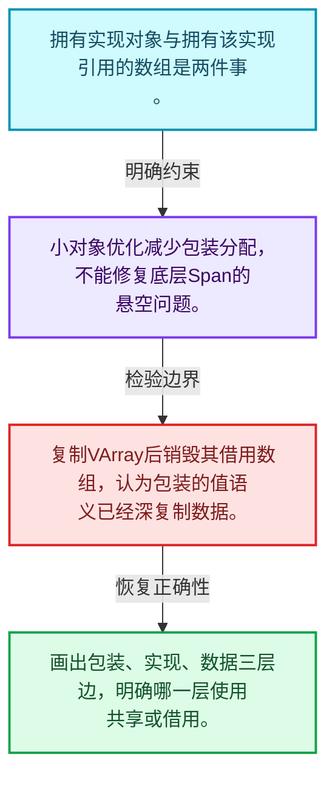
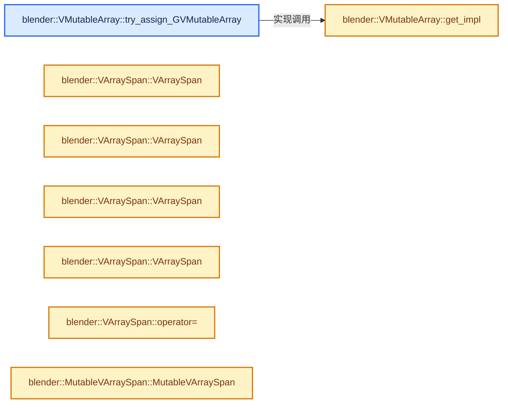
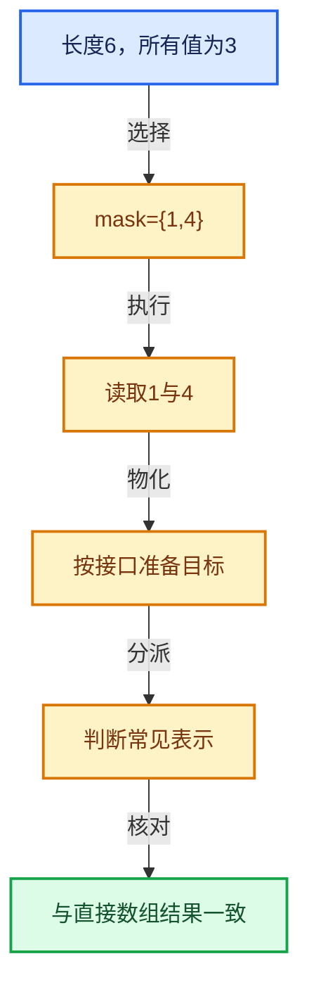

# 04-04 所有权与小对象优化

[方向导航](README.md) · [总目录](../README.md) · [实现索引](../%E7%AC%A6%E5%8F%B7%E4%BE%9D%E8%B5%96%E4%B8%8E%E5%AE%9E%E7%8E%B0%E7%B4%A2%E5%BC%95.md)

## 从问题到实现

值包装的生命周期是否保证底层元素存活？

包装可能拥有实现却借用外部Span；引用实现对象与引用数据的所有权应分开追踪。

**数据模型**

拥有实现对象与拥有该实现引用的数组是两件事。

**设计取舍**

小对象优化减少包装分配，不能修复底层Span的悬空问题。

**最小反例**

复制VArray后销毁其借用数组，认为包装的值语义已经深复制数据。

**推导**

画出包装、实现、数据三层边，明确哪一层使用共享或借用。

## 阅读地图与执行推演








图中的数值推演是本方向的教学模型；实际函数之间的调用边与概念分析边分别标注，不能把概念关系当作运行时调度顺序。

## 完整源码单元与就地讲解

中文讲解直接放在相关代码旁，复杂机制在代码下展开。原文折叠区保留基准行号；不需要在行号表和函数之间来回查找。类布局可分段展示，函数实现不按固定行数切开。

### 类型布局、声明与编译条件 · BLI_virtual_array.hh L913—L914

<!-- annotated:49044dd0e2e46f -->

```cpp

  /** See #GVMutableArrayImpl::try_assign_GVMutableArray. */
```

<details>
<summary>核对原始源码：source/blender/blenlib/BLI_virtual_array.hh · L913—L914</summary>

<!-- original:49044dd0e2e46f:source/blender/blenlib/BLI_virtual_array.hh:913:914 -->

```cpp

  /** See #GVMutableArrayImpl::try_assign_GVMutableArray. */
```

</details>

<a id="f-ef455b7aaf50f0df"></a>

### `blender::VMutableArray::try_assign_GVMutableArray`

实现位置：[source/blender/blenlib/BLI_virtual_array.hh](../../../../../source/blender/blenlib/BLI_virtual_array.hh) · L915—L918。

接口参数：

- `GVMutableArray &varray`

**教学注释版**

<!-- annotated:b6fe336e52725a -->

```cpp
  bool try_assign_GVMutableArray(GVMutableArray &varray) const
  {
    return this->get_impl()->try_assign_GVMutableArray(varray);
  }
```

<details>
<summary>核对原始源码：source/blender/blenlib/BLI_virtual_array.hh · L915—L918</summary>

<!-- original:b6fe336e52725a:source/blender/blenlib/BLI_virtual_array.hh:915:918 -->

```cpp
  bool try_assign_GVMutableArray(GVMutableArray &varray) const
  {
    return this->get_impl()->try_assign_GVMutableArray(varray);
  }
```

</details>

**结果出口**

- `return this->get_impl()->try_assign_GVMutableArray(varray);`

**继续追踪实现**

- `this->get_impl()->try_assign_GVMutableArray` → [调用协议](../%E6%A8%A1%E6%9D%BF%E5%AE%8F%E4%B8%8E%E5%8A%A8%E6%80%81%E5%88%86%E6%B4%BE%E5%8D%8F%E8%AE%AE.md)：接收对象类型依赖auto、返回值或模板实例；不按同名猜测目标。调用位置L917。
- `this->get_impl` → [blender::VMutableArray::get_impl · L922](04-%E6%89%80%E6%9C%89%E6%9D%83%E4%B8%8E%E5%B0%8F%E5%AF%B9%E8%B1%A1%E4%BC%98%E5%8C%96.md#f-780a81eacf8ce915)。

### 类型布局、声明与编译条件 · BLI_virtual_array.hh L919—L921

<!-- annotated:ab371447ecb311 -->

```cpp

 private:
  /** Utility to get the pointer to the wrapped #VMutableArrayImpl. */
```

<details>
<summary>核对原始源码：source/blender/blenlib/BLI_virtual_array.hh · L919—L921</summary>

<!-- original:ab371447ecb311:source/blender/blenlib/BLI_virtual_array.hh:919:921 -->

```cpp

 private:
  /** Utility to get the pointer to the wrapped #VMutableArrayImpl. */
```

</details>

<a id="f-780a81eacf8ce915"></a>

### `blender::VMutableArray::get_impl`

实现位置：[source/blender/blenlib/BLI_virtual_array.hh](../../../../../source/blender/blenlib/BLI_virtual_array.hh) · L922—L928。

**教学注释版**

<!-- annotated:77f3560433aaaf -->

```cpp
  VMutableArrayImpl<T> *get_impl() const
  {
    /* This cast is valid by the invariant that a #VMutableArray->impl_ is always a
     * #VMutableArrayImpl. */
    return reinterpret_cast<VMutableArrayImpl<T> *>(
        const_cast<VArrayImpl<T> *>((this->impl_.get())));
  }
```

<details>
<summary>核对原始源码：source/blender/blenlib/BLI_virtual_array.hh · L922—L928</summary>

<!-- original:77f3560433aaaf:source/blender/blenlib/BLI_virtual_array.hh:922:928 -->

```cpp
  VMutableArrayImpl<T> *get_impl() const
  {
    /* This cast is valid by the invariant that a #VMutableArray->impl_ is always a
     * #VMutableArrayImpl. */
    return reinterpret_cast<VMutableArrayImpl<T> *>(
        const_cast<VArrayImpl<T> *>((this->impl_.get())));
  }
```

</details>

**结果出口**

- `return reinterpret_cast<VMutableArrayImpl<T> *>(`

**继续追踪实现**

- `this->impl_.get` → [调用协议](../%E6%A8%A1%E6%9D%BF%E5%AE%8F%E4%B8%8E%E5%8A%A8%E6%80%81%E5%88%86%E6%B4%BE%E5%8D%8F%E8%AE%AE.md)：接收对象类型依赖auto、返回值或模板实例；不按同名猜测目标。调用位置L927。

### 类型布局、声明与编译条件 · BLI_virtual_array.hh L929—L953

<a id="t-1edd00c269e2"></a>

`VArraySpan`在这里声明的数据成员：

- `VArray<T> varray_`
- `Array<T> owned_data_`

<!-- annotated:a88a4deb09f1d8 -->

```cpp
};

template<typename T> static constexpr bool is_VArray_v = false;
template<typename T> static constexpr bool is_VArray_v<VArray<T>> = true;

template<typename T> static constexpr bool is_VMutableArray_v = false;
template<typename T> static constexpr bool is_VMutableArray_v<VMutableArray<T>> = true;

/**
 * In many cases a virtual array is a span internally. In those cases, access to individual could
 * be much more efficient than calling a virtual method. When the underlying virtual array is not a
 * span, this class allocates a new array and copies the values over.
 *
 * This should be used in those cases:
 *  - All elements in the virtual array are accessed multiple times.
 *  - In most cases, the underlying virtual array is a span, so no copy is necessary to benefit
 *    from faster access.
 *  - An API is called, that does not accept virtual arrays, but only spans.
 */
template<typename T> class VArraySpan final : public Span<T> {
 private:
  VArray<T> varray_;
  Array<T> owned_data_;

 public:
```

<details>
<summary>核对原始源码：source/blender/blenlib/BLI_virtual_array.hh · L929—L953</summary>

<!-- original:a88a4deb09f1d8:source/blender/blenlib/BLI_virtual_array.hh:929:953 -->

```cpp
};

template<typename T> static constexpr bool is_VArray_v = false;
template<typename T> static constexpr bool is_VArray_v<VArray<T>> = true;

template<typename T> static constexpr bool is_VMutableArray_v = false;
template<typename T> static constexpr bool is_VMutableArray_v<VMutableArray<T>> = true;

/**
 * In many cases a virtual array is a span internally. In those cases, access to individual could
 * be much more efficient than calling a virtual method. When the underlying virtual array is not a
 * span, this class allocates a new array and copies the values over.
 *
 * This should be used in those cases:
 *  - All elements in the virtual array are accessed multiple times.
 *  - In most cases, the underlying virtual array is a span, so no copy is necessary to benefit
 *    from faster access.
 *  - An API is called, that does not accept virtual arrays, but only spans.
 */
template<typename T> class VArraySpan final : public Span<T> {
 private:
  VArray<T> varray_;
  Array<T> owned_data_;

 public:
```

</details>

<a id="f-7f6b36035be3dc40"></a>

### `blender::VArraySpan::VArraySpan`

实现位置：[source/blender/blenlib/BLI_virtual_array.hh](../../../../../source/blender/blenlib/BLI_virtual_array.hh) · L954—L954。

**教学注释版**

<!-- annotated:0fc40c48ab518c -->

```cpp
  VArraySpan() = default;
```

<details>
<summary>核对原始源码：source/blender/blenlib/BLI_virtual_array.hh · L954—L954</summary>

<!-- original:0fc40c48ab518c:source/blender/blenlib/BLI_virtual_array.hh:954:954 -->

```cpp
  VArraySpan() = default;
```

</details>

**继续追踪实现**

本实现没有需要继续展开的显式调用；检查返回表达式、对象转换和调用者前置条件。

<!-- annotated:925a9245bf01b6 -->

```cpp

```

<details>
<summary>核对原始源码：source/blender/blenlib/BLI_virtual_array.hh · L955—L955</summary>

<!-- original:925a9245bf01b6:source/blender/blenlib/BLI_virtual_array.hh:955:955 -->

```cpp

```

</details>

<a id="f-40832e170cafb212"></a>

### `blender::VArraySpan::VArraySpan`

实现位置：[source/blender/blenlib/BLI_virtual_array.hh](../../../../../source/blender/blenlib/BLI_virtual_array.hh) · L956—L956。

接口参数：

- `const VArray<T> &varray`

**教学注释版**

<!-- annotated:46876de61b4186 -->

```cpp
  VArraySpan(const VArray<T> &varray) : VArraySpan(VArray<T>(varray)) {}
```

<details>
<summary>核对原始源码：source/blender/blenlib/BLI_virtual_array.hh · L956—L956</summary>

<!-- original:46876de61b4186:source/blender/blenlib/BLI_virtual_array.hh:956:956 -->

```cpp
  VArraySpan(const VArray<T> &varray) : VArraySpan(VArray<T>(varray)) {}
```

</details>

**继续追踪实现**

本实现没有需要继续展开的显式调用；检查返回表达式、对象转换和调用者前置条件。

<!-- annotated:9a9a778195856a -->

```cpp

```

<details>
<summary>核对原始源码：source/blender/blenlib/BLI_virtual_array.hh · L957—L957</summary>

<!-- original:9a9a778195856a:source/blender/blenlib/BLI_virtual_array.hh:957:957 -->

```cpp

```

</details>

<a id="f-3d07ad306af2ea15"></a>

### `blender::VArraySpan::VArraySpan`

实现位置：[source/blender/blenlib/BLI_virtual_array.hh](../../../../../source/blender/blenlib/BLI_virtual_array.hh) · L958—L974。

接口参数：

- `VArray<T> &&varray`

**教学注释版**

<!-- annotated:e659278bef93dd -->

```cpp
  VArraySpan(VArray<T> &&varray) : Span<T>(), varray_(std::move(varray))
  {
    if (!varray_) {
      return;
    }
    this->size_ = varray_.size();
    const CommonVArrayInfo info = varray_.common_info();
    if (info.type == CommonVArrayInfo::Type::Span) {
      this->data_ = static_cast<const T *>(info.data);
    }
    else {
      owned_data_.~Array();
      new (&owned_data_) Array<T>(varray_.size(), NoInitialization{});
      varray_.materialize_to_uninitialized(owned_data_);
      // [讲解] owned_data_.data：提供数组的借用访问入口。
      this->data_ = owned_data_.data();
    }
  }
```

<details>
<summary>核对原始源码：source/blender/blenlib/BLI_virtual_array.hh · L958—L974</summary>

<!-- original:e659278bef93dd:source/blender/blenlib/BLI_virtual_array.hh:958:974 -->

```cpp
  VArraySpan(VArray<T> &&varray) : Span<T>(), varray_(std::move(varray))
  {
    if (!varray_) {
      return;
    }
    this->size_ = varray_.size();
    const CommonVArrayInfo info = varray_.common_info();
    if (info.type == CommonVArrayInfo::Type::Span) {
      this->data_ = static_cast<const T *>(info.data);
    }
    else {
      owned_data_.~Array();
      new (&owned_data_) Array<T>(varray_.size(), NoInitialization{});
      varray_.materialize_to_uninitialized(owned_data_);
      this->data_ = owned_data_.data();
    }
  }
```

</details>

**沿实际写入检查状态**

- `this->size_ = varray_.size();`
- `this->data_ = static_cast<const T *>(info.data);`
- `this->data_ = owned_data_.data();`

**继续追踪实现**

- `varray_.size` → [blender::VArrayImpl::size · L93](01-VArray%E8%A1%A8%E7%A4%BA%E4%B8%8E%E5%80%BC%E8%AF%AD%E4%B9%89.md#f-fbf37f2ba6f22399)；[blender::VArrayCommon::size · L569](02-VArrayImpl%E5%AE%9E%E7%8E%B0%E6%8E%A5%E5%8F%A3.md#f-a098c32ba789341e)。同名重载需按实参类型选择。
- `varray_.common_info` → [blender::VArrayImpl::common_info · L104](01-VArray%E8%A1%A8%E7%A4%BA%E4%B8%8E%E5%80%BC%E8%AF%AD%E4%B9%89.md#f-68078b4f5e7a53d4)；[blender::VArrayImpl_For_Span::common_info · L227](01-VArray%E8%A1%A8%E7%A4%BA%E4%B8%8E%E5%80%BC%E8%AF%AD%E4%B9%89.md#f-fb3c90a88b5b3bd8)；[blender::VArrayImpl_For_Span_final::common_info · L281](01-VArray%E8%A1%A8%E7%A4%BA%E4%B8%8E%E5%80%BC%E8%AF%AD%E4%B9%89.md#f-93f2eaf44ff4a315)；[blender::VArrayImpl_For_Single::common_info · L330](02-VArrayImpl%E5%AE%9E%E7%8E%B0%E6%8E%A5%E5%8F%A3.md#f-8b3462728d95d9b1)；[blender::VArrayCommon::common_info · L602](02-VArrayImpl%E5%AE%9E%E7%8E%B0%E6%8E%A5%E5%8F%A3.md#f-087793fc5c4b8977)。同名重载需按实参类型选择。
- `owned_data_.~Array` → [blender::Array::~Array · L200](../01-%E5%9F%BA%E7%A1%80%E5%AE%B9%E5%99%A8%E4%B8%8E%E7%8E%B0%E4%BB%A3CPP/07-Array%E6%9E%84%E9%80%A0%E4%B8%8E%E5%AD%98%E5%82%A8.md#f-d3e841adf490c602)。
- `varray_.materialize_to_uninitialized` → [blender::VArrayCommon::materialize_to_uninitialized · L671](03-%E5%8D%95%E5%80%BC%E4%B8%8ESpan%E8%A1%A8%E7%A4%BA.md#f-be429d5ef5fbe3e8)；[blender::VArrayCommon::materialize_to_uninitialized · L676](03-%E5%8D%95%E5%80%BC%E4%B8%8ESpan%E8%A1%A8%E7%A4%BA.md#f-48dc93aed240b8c8)。同名重载需按实参类型选择。
- `owned_data_.data` → [blender::Array::data · L323](../01-%E5%9F%BA%E7%A1%80%E5%AE%B9%E5%99%A8%E4%B8%8E%E7%8E%B0%E4%BB%A3CPP/08-Array%E5%A4%8D%E5%88%B6%E7%A7%BB%E5%8A%A8%E4%B8%8E%E9%94%80%E6%AF%81.md#f-95648c799002f4ba)；[blender::Array::data · L327](../01-%E5%9F%BA%E7%A1%80%E5%AE%B9%E5%99%A8%E4%B8%8E%E7%8E%B0%E4%BB%A3CPP/08-Array%E5%A4%8D%E5%88%B6%E7%A7%BB%E5%8A%A8%E4%B8%8E%E9%94%80%E6%AF%81.md#f-50c18301f8c40f9e)。同名重载需按实参类型选择。

<!-- annotated:7a77d72517536e -->

```cpp

```

<details>
<summary>核对原始源码：source/blender/blenlib/BLI_virtual_array.hh · L975—L975</summary>

<!-- original:7a77d72517536e:source/blender/blenlib/BLI_virtual_array.hh:975:975 -->

```cpp

```

</details>

<a id="f-4ef6f24b8ef9ee54"></a>

### `blender::VArraySpan::VArraySpan`

实现位置：[source/blender/blenlib/BLI_virtual_array.hh](../../../../../source/blender/blenlib/BLI_virtual_array.hh) · L976—L992。

接口参数：

- `VArraySpan &&other`

**教学注释版**

<!-- annotated:ab947424a4e8de -->

```cpp
  VArraySpan(VArraySpan &&other)
      : varray_(std::move(other.varray_)), owned_data_(std::move(other.owned_data_))
  {
    if (!varray_) {
      return;
    }
    this->size_ = varray_.size();
    const CommonVArrayInfo info = varray_.common_info();
    if (info.type == CommonVArrayInfo::Type::Span) {
      this->data_ = static_cast<const T *>(info.data);
    }
    else {
      // [讲解] owned_data_.data：提供数组的借用访问入口。
      this->data_ = owned_data_.data();
    }
    other.data_ = nullptr;
    other.size_ = 0;
  }
```

<details>
<summary>核对原始源码：source/blender/blenlib/BLI_virtual_array.hh · L976—L992</summary>

<!-- original:ab947424a4e8de:source/blender/blenlib/BLI_virtual_array.hh:976:992 -->

```cpp
  VArraySpan(VArraySpan &&other)
      : varray_(std::move(other.varray_)), owned_data_(std::move(other.owned_data_))
  {
    if (!varray_) {
      return;
    }
    this->size_ = varray_.size();
    const CommonVArrayInfo info = varray_.common_info();
    if (info.type == CommonVArrayInfo::Type::Span) {
      this->data_ = static_cast<const T *>(info.data);
    }
    else {
      this->data_ = owned_data_.data();
    }
    other.data_ = nullptr;
    other.size_ = 0;
  }
```

</details>

**沿实际写入检查状态**

- `this->size_ = varray_.size();`
- `this->data_ = static_cast<const T *>(info.data);`
- `this->data_ = owned_data_.data();`
- `other.data_ = nullptr;`
- `other.size_ = 0;`

**继续追踪实现**

- `varray_.size` → [blender::VArrayImpl::size · L93](01-VArray%E8%A1%A8%E7%A4%BA%E4%B8%8E%E5%80%BC%E8%AF%AD%E4%B9%89.md#f-fbf37f2ba6f22399)；[blender::VArrayCommon::size · L569](02-VArrayImpl%E5%AE%9E%E7%8E%B0%E6%8E%A5%E5%8F%A3.md#f-a098c32ba789341e)。同名重载需按实参类型选择。
- `varray_.common_info` → [blender::VArrayImpl::common_info · L104](01-VArray%E8%A1%A8%E7%A4%BA%E4%B8%8E%E5%80%BC%E8%AF%AD%E4%B9%89.md#f-68078b4f5e7a53d4)；[blender::VArrayImpl_For_Span::common_info · L227](01-VArray%E8%A1%A8%E7%A4%BA%E4%B8%8E%E5%80%BC%E8%AF%AD%E4%B9%89.md#f-fb3c90a88b5b3bd8)；[blender::VArrayImpl_For_Span_final::common_info · L281](01-VArray%E8%A1%A8%E7%A4%BA%E4%B8%8E%E5%80%BC%E8%AF%AD%E4%B9%89.md#f-93f2eaf44ff4a315)；[blender::VArrayImpl_For_Single::common_info · L330](02-VArrayImpl%E5%AE%9E%E7%8E%B0%E6%8E%A5%E5%8F%A3.md#f-8b3462728d95d9b1)；[blender::VArrayCommon::common_info · L602](02-VArrayImpl%E5%AE%9E%E7%8E%B0%E6%8E%A5%E5%8F%A3.md#f-087793fc5c4b8977)。同名重载需按实参类型选择。
- `owned_data_.data` → [blender::Array::data · L323](../01-%E5%9F%BA%E7%A1%80%E5%AE%B9%E5%99%A8%E4%B8%8E%E7%8E%B0%E4%BB%A3CPP/08-Array%E5%A4%8D%E5%88%B6%E7%A7%BB%E5%8A%A8%E4%B8%8E%E9%94%80%E6%AF%81.md#f-95648c799002f4ba)；[blender::Array::data · L327](../01-%E5%9F%BA%E7%A1%80%E5%AE%B9%E5%99%A8%E4%B8%8E%E7%8E%B0%E4%BB%A3CPP/08-Array%E5%A4%8D%E5%88%B6%E7%A7%BB%E5%8A%A8%E4%B8%8E%E9%94%80%E6%AF%81.md#f-50c18301f8c40f9e)。同名重载需按实参类型选择。

<!-- annotated:b81c7471d368a8 -->

```cpp

```

<details>
<summary>核对原始源码：source/blender/blenlib/BLI_virtual_array.hh · L993—L993</summary>

<!-- original:b81c7471d368a8:source/blender/blenlib/BLI_virtual_array.hh:993:993 -->

```cpp

```

</details>

<a id="f-0ffbc0cced010b41"></a>

### `blender::VArraySpan::operator=`

实现位置：[source/blender/blenlib/BLI_virtual_array.hh](../../../../../source/blender/blenlib/BLI_virtual_array.hh) · L994—L1002。

接口参数：

- `VArraySpan &&other`

**教学注释版**

<!-- annotated:41d7634964b756 -->

```cpp
  VArraySpan &operator=(VArraySpan &&other)
  {
    if (this == &other) {
      return *this;
    }
    std::destroy_at(this);
    // [讲解] std::move：把表达式转换成可供移动重载选择的值类别；不保证真的移动，不结束源对象寿命，对const值可能选择复制。
    new (this) VArraySpan(std::move(other));
    return *this;
  }
```

<details>
<summary>核对原始源码：source/blender/blenlib/BLI_virtual_array.hh · L994—L1002</summary>

<!-- original:41d7634964b756:source/blender/blenlib/BLI_virtual_array.hh:994:1002 -->

```cpp
  VArraySpan &operator=(VArraySpan &&other)
  {
    if (this == &other) {
      return *this;
    }
    std::destroy_at(this);
    new (this) VArraySpan(std::move(other));
    return *this;
  }
```

</details>

**结果出口**

- `return *this;`

**继续追踪实现**

- `std::destroy_at` → [外部契约](https://eel.is/c++draft/)：这个边界按实际表达式及所属类型核对参数、返回值、寿命与失败行为。这里提供接口入口，不声称已解释该第三方版本的内部实现。
- `std::move` → [外部契约](https://eel.is/c++draft/utility.forward)：把表达式转换成可供移动重载选择的值类别；不保证真的移动，不结束源对象寿命，对const值可能选择复制。

### 类型布局、声明与编译条件 · BLI_virtual_array.hh L1003—L1023

<a id="t-acf17c005b76"></a>

`MutableVArraySpan`在这里声明的数据成员：

- `VMutableArray<T> varray_`
- `Array<T> owned_data_`
- `bool save_has_been_called_`
- `bool show_not_saved_warning_`

<!-- annotated:2ca52c2ae229bd -->

```cpp
};

namespace internal {
void print_mutable_varray_span_warning();
}

/**
 * Same as #VArraySpan, but for a mutable span.
 * The important thing to note is that when changing this span, the results might not be
 * immediately reflected in the underlying virtual array (only when the virtual array is a span
 * internally). The #save method can be used to write all changes to the underlying virtual array,
 * if necessary.
 */
template<typename T> class MutableVArraySpan final : public MutableSpan<T> {
 private:
  VMutableArray<T> varray_;
  Array<T> owned_data_;
  bool save_has_been_called_ = false;
  bool show_not_saved_warning_ = true;

 public:
```

<details>
<summary>核对原始源码：source/blender/blenlib/BLI_virtual_array.hh · L1003—L1023</summary>

<!-- original:2ca52c2ae229bd:source/blender/blenlib/BLI_virtual_array.hh:1003:1023 -->

```cpp
};

namespace internal {
void print_mutable_varray_span_warning();
}

/**
 * Same as #VArraySpan, but for a mutable span.
 * The important thing to note is that when changing this span, the results might not be
 * immediately reflected in the underlying virtual array (only when the virtual array is a span
 * internally). The #save method can be used to write all changes to the underlying virtual array,
 * if necessary.
 */
template<typename T> class MutableVArraySpan final : public MutableSpan<T> {
 private:
  VMutableArray<T> varray_;
  Array<T> owned_data_;
  bool save_has_been_called_ = false;
  bool show_not_saved_warning_ = true;

 public:
```

</details>

<a id="f-b7a16960b22ac17c"></a>

### `blender::MutableVArraySpan::MutableVArraySpan`

实现位置：[source/blender/blenlib/BLI_virtual_array.hh](../../../../../source/blender/blenlib/BLI_virtual_array.hh) · L1024—L1024。

**教学注释版**

<!-- annotated:682fa763cd5d79 -->

```cpp
  MutableVArraySpan() = default;
```

<details>
<summary>核对原始源码：source/blender/blenlib/BLI_virtual_array.hh · L1024—L1024</summary>

<!-- original:682fa763cd5d79:source/blender/blenlib/BLI_virtual_array.hh:1024:1024 -->

```cpp
  MutableVArraySpan() = default;
```

</details>

**继续追踪实现**

本实现没有需要继续展开的显式调用；检查返回表达式、对象转换和调用者前置条件。

### 类型布局、声明与编译条件 · BLI_virtual_array.hh L1025—L1027

<!-- annotated:065e01f54260ec -->

```cpp

  /* Create a span for any virtual array. This is cheap when the virtual array is a span itself. If
   * not, a new array has to be allocated as a wrapper for the underlying virtual array. */
```

<details>
<summary>核对原始源码：source/blender/blenlib/BLI_virtual_array.hh · L1025—L1027</summary>

<!-- original:065e01f54260ec:source/blender/blenlib/BLI_virtual_array.hh:1025:1027 -->

```cpp

  /* Create a span for any virtual array. This is cheap when the virtual array is a span itself. If
   * not, a new array has to be allocated as a wrapper for the underlying virtual array. */
```

</details>

<a id="f-a70baaa54ab27b1c"></a>

### `blender::MutableVArraySpan::MutableVArraySpan`

实现位置：[source/blender/blenlib/BLI_virtual_array.hh](../../../../../source/blender/blenlib/BLI_virtual_array.hh) · L1028—L1051。

接口参数：

- `VMutableArray<T> varray`
- `const bool copy_values_to_span = true`

**教学注释版**

<!-- annotated:7e524ec2f354c2 -->

```cpp
  MutableVArraySpan(VMutableArray<T> varray, const bool copy_values_to_span = true)
      : MutableSpan<T>(), varray_(std::move(varray))
  {
    if (!varray_) {
      return;
    }

    this->size_ = varray_.size();
    const CommonVArrayInfo info = varray_.common_info();
    if (info.type == CommonVArrayInfo::Type::Span) {
      this->data_ = const_cast<T *>(static_cast<const T *>(info.data));
    }
    else {
      if (copy_values_to_span) {
        owned_data_.~Array();
        new (&owned_data_) Array<T>(varray_.size(), NoInitialization{});
        varray_.materialize_to_uninitialized(owned_data_);
      }
      else {
        // [讲解] owned_data_.reinitialize：以新长度重建数组。
        owned_data_.reinitialize(varray_.size());
      }
      // [讲解] owned_data_.data：提供数组的借用访问入口。
      this->data_ = owned_data_.data();
    }
  }
```

<details>
<summary>核对原始源码：source/blender/blenlib/BLI_virtual_array.hh · L1028—L1051</summary>

<!-- original:7e524ec2f354c2:source/blender/blenlib/BLI_virtual_array.hh:1028:1051 -->

```cpp
  MutableVArraySpan(VMutableArray<T> varray, const bool copy_values_to_span = true)
      : MutableSpan<T>(), varray_(std::move(varray))
  {
    if (!varray_) {
      return;
    }

    this->size_ = varray_.size();
    const CommonVArrayInfo info = varray_.common_info();
    if (info.type == CommonVArrayInfo::Type::Span) {
      this->data_ = const_cast<T *>(static_cast<const T *>(info.data));
    }
    else {
      if (copy_values_to_span) {
        owned_data_.~Array();
        new (&owned_data_) Array<T>(varray_.size(), NoInitialization{});
        varray_.materialize_to_uninitialized(owned_data_);
      }
      else {
        owned_data_.reinitialize(varray_.size());
      }
      this->data_ = owned_data_.data();
    }
  }
```

</details>

**沿实际写入检查状态**

- `this->size_ = varray_.size();`
- `this->data_ = const_cast<T *>(static_cast<const T *>(info.data));`
- `this->data_ = owned_data_.data();`

**继续追踪实现**

- `varray_.size` → [blender::VArrayImpl::size · L93](01-VArray%E8%A1%A8%E7%A4%BA%E4%B8%8E%E5%80%BC%E8%AF%AD%E4%B9%89.md#f-fbf37f2ba6f22399)；[blender::VArrayCommon::size · L569](02-VArrayImpl%E5%AE%9E%E7%8E%B0%E6%8E%A5%E5%8F%A3.md#f-a098c32ba789341e)。同名重载需按实参类型选择。
- `varray_.common_info` → [blender::VArrayImpl::common_info · L104](01-VArray%E8%A1%A8%E7%A4%BA%E4%B8%8E%E5%80%BC%E8%AF%AD%E4%B9%89.md#f-68078b4f5e7a53d4)；[blender::VArrayImpl_For_Span::common_info · L227](01-VArray%E8%A1%A8%E7%A4%BA%E4%B8%8E%E5%80%BC%E8%AF%AD%E4%B9%89.md#f-fb3c90a88b5b3bd8)；[blender::VArrayImpl_For_Span_final::common_info · L281](01-VArray%E8%A1%A8%E7%A4%BA%E4%B8%8E%E5%80%BC%E8%AF%AD%E4%B9%89.md#f-93f2eaf44ff4a315)；[blender::VArrayImpl_For_Single::common_info · L330](02-VArrayImpl%E5%AE%9E%E7%8E%B0%E6%8E%A5%E5%8F%A3.md#f-8b3462728d95d9b1)；[blender::VArrayCommon::common_info · L602](02-VArrayImpl%E5%AE%9E%E7%8E%B0%E6%8E%A5%E5%8F%A3.md#f-087793fc5c4b8977)。同名重载需按实参类型选择。
- `owned_data_.~Array` → [blender::Array::~Array · L200](../01-%E5%9F%BA%E7%A1%80%E5%AE%B9%E5%99%A8%E4%B8%8E%E7%8E%B0%E4%BB%A3CPP/07-Array%E6%9E%84%E9%80%A0%E4%B8%8E%E5%AD%98%E5%82%A8.md#f-d3e841adf490c602)。
- `varray_.materialize_to_uninitialized` → [blender::VArrayCommon::materialize_to_uninitialized · L671](03-%E5%8D%95%E5%80%BC%E4%B8%8ESpan%E8%A1%A8%E7%A4%BA.md#f-be429d5ef5fbe3e8)；[blender::VArrayCommon::materialize_to_uninitialized · L676](03-%E5%8D%95%E5%80%BC%E4%B8%8ESpan%E8%A1%A8%E7%A4%BA.md#f-48dc93aed240b8c8)。同名重载需按实参类型选择。
- `owned_data_.reinitialize` → [blender::Array::reinitialize · L430](../01-%E5%9F%BA%E7%A1%80%E5%AE%B9%E5%99%A8%E4%B8%8E%E7%8E%B0%E4%BB%A3CPP/08-Array%E5%A4%8D%E5%88%B6%E7%A7%BB%E5%8A%A8%E4%B8%8E%E9%94%80%E6%AF%81.md#f-3414f619e246b688)。
- `owned_data_.data` → [blender::Array::data · L323](../01-%E5%9F%BA%E7%A1%80%E5%AE%B9%E5%99%A8%E4%B8%8E%E7%8E%B0%E4%BB%A3CPP/08-Array%E5%A4%8D%E5%88%B6%E7%A7%BB%E5%8A%A8%E4%B8%8E%E9%94%80%E6%AF%81.md#f-95648c799002f4ba)；[blender::Array::data · L327](../01-%E5%9F%BA%E7%A1%80%E5%AE%B9%E5%99%A8%E4%B8%8E%E7%8E%B0%E4%BB%A3CPP/08-Array%E5%A4%8D%E5%88%B6%E7%A7%BB%E5%8A%A8%E4%B8%8E%E9%94%80%E6%AF%81.md#f-50c18301f8c40f9e)。同名重载需按实参类型选择。

<!-- annotated:ce7aaef08b86d4 -->

```cpp

```

<details>
<summary>核对原始源码：source/blender/blenlib/BLI_virtual_array.hh · L1052—L1052</summary>

<!-- original:ce7aaef08b86d4:source/blender/blenlib/BLI_virtual_array.hh:1052:1052 -->

```cpp

```

</details>

<a id="f-4b93396fd2f7c825"></a>

### `blender::MutableVArraySpan::MutableVArraySpan`

实现位置：[source/blender/blenlib/BLI_virtual_array.hh](../../../../../source/blender/blenlib/BLI_virtual_array.hh) · L1053—L1072。

接口参数：

- `MutableVArraySpan &&other`

**教学注释版**

<!-- annotated:c0f6fae9f6f6d5 -->

```cpp
  MutableVArraySpan(MutableVArraySpan &&other)
      : varray_(std::move(other.varray_)),
        owned_data_(std::move(other.owned_data_)),
        show_not_saved_warning_(other.show_not_saved_warning_)
  {
    if (!varray_) {
      return;
    }

    this->size_ = varray_.size();
    const CommonVArrayInfo info = varray_.common_info();
    if (info.type == CommonVArrayInfo::Type::Span) {
      this->data_ = static_cast<T *>(const_cast<void *>(info.data));
    }
    else {
      // [讲解] owned_data_.data：提供数组的借用访问入口。
      this->data_ = owned_data_.data();
    }
    other.data_ = nullptr;
    other.size_ = 0;
  }
```

<details>
<summary>核对原始源码：source/blender/blenlib/BLI_virtual_array.hh · L1053—L1072</summary>

<!-- original:c0f6fae9f6f6d5:source/blender/blenlib/BLI_virtual_array.hh:1053:1072 -->

```cpp
  MutableVArraySpan(MutableVArraySpan &&other)
      : varray_(std::move(other.varray_)),
        owned_data_(std::move(other.owned_data_)),
        show_not_saved_warning_(other.show_not_saved_warning_)
  {
    if (!varray_) {
      return;
    }

    this->size_ = varray_.size();
    const CommonVArrayInfo info = varray_.common_info();
    if (info.type == CommonVArrayInfo::Type::Span) {
      this->data_ = static_cast<T *>(const_cast<void *>(info.data));
    }
    else {
      this->data_ = owned_data_.data();
    }
    other.data_ = nullptr;
    other.size_ = 0;
  }
```

</details>

**沿实际写入检查状态**

- `this->size_ = varray_.size();`
- `this->data_ = static_cast<T *>(const_cast<void *>(info.data));`
- `this->data_ = owned_data_.data();`
- `other.data_ = nullptr;`
- `other.size_ = 0;`

**继续追踪实现**

- `varray_.size` → [blender::VArrayImpl::size · L93](01-VArray%E8%A1%A8%E7%A4%BA%E4%B8%8E%E5%80%BC%E8%AF%AD%E4%B9%89.md#f-fbf37f2ba6f22399)；[blender::VArrayCommon::size · L569](02-VArrayImpl%E5%AE%9E%E7%8E%B0%E6%8E%A5%E5%8F%A3.md#f-a098c32ba789341e)。同名重载需按实参类型选择。
- `varray_.common_info` → [blender::VArrayImpl::common_info · L104](01-VArray%E8%A1%A8%E7%A4%BA%E4%B8%8E%E5%80%BC%E8%AF%AD%E4%B9%89.md#f-68078b4f5e7a53d4)；[blender::VArrayImpl_For_Span::common_info · L227](01-VArray%E8%A1%A8%E7%A4%BA%E4%B8%8E%E5%80%BC%E8%AF%AD%E4%B9%89.md#f-fb3c90a88b5b3bd8)；[blender::VArrayImpl_For_Span_final::common_info · L281](01-VArray%E8%A1%A8%E7%A4%BA%E4%B8%8E%E5%80%BC%E8%AF%AD%E4%B9%89.md#f-93f2eaf44ff4a315)；[blender::VArrayImpl_For_Single::common_info · L330](02-VArrayImpl%E5%AE%9E%E7%8E%B0%E6%8E%A5%E5%8F%A3.md#f-8b3462728d95d9b1)；[blender::VArrayCommon::common_info · L602](02-VArrayImpl%E5%AE%9E%E7%8E%B0%E6%8E%A5%E5%8F%A3.md#f-087793fc5c4b8977)。同名重载需按实参类型选择。
- `owned_data_.data` → [blender::Array::data · L323](../01-%E5%9F%BA%E7%A1%80%E5%AE%B9%E5%99%A8%E4%B8%8E%E7%8E%B0%E4%BB%A3CPP/08-Array%E5%A4%8D%E5%88%B6%E7%A7%BB%E5%8A%A8%E4%B8%8E%E9%94%80%E6%AF%81.md#f-95648c799002f4ba)；[blender::Array::data · L327](../01-%E5%9F%BA%E7%A1%80%E5%AE%B9%E5%99%A8%E4%B8%8E%E7%8E%B0%E4%BB%A3CPP/08-Array%E5%A4%8D%E5%88%B6%E7%A7%BB%E5%8A%A8%E4%B8%8E%E9%94%80%E6%AF%81.md#f-50c18301f8c40f9e)。同名重载需按实参类型选择。

<!-- annotated:37336cd25aeefe -->

```cpp

```

<details>
<summary>核对原始源码：source/blender/blenlib/BLI_virtual_array.hh · L1073—L1073</summary>

<!-- original:37336cd25aeefe:source/blender/blenlib/BLI_virtual_array.hh:1073:1073 -->

```cpp

```

</details>

<a id="f-f051a11ebe6109fe"></a>

### `blender::MutableVArraySpan::~MutableVArraySpan`

实现位置：[source/blender/blenlib/BLI_virtual_array.hh](../../../../../source/blender/blenlib/BLI_virtual_array.hh) · L1074—L1083。

**教学注释版**

<!-- annotated:f96c9bd6984a12 -->

```cpp
  ~MutableVArraySpan()
  {
    if (varray_) {
      if (show_not_saved_warning_) {
        if (!save_has_been_called_) {
          internal::print_mutable_varray_span_warning();
        }
      }
    }
  }
```

<details>
<summary>核对原始源码：source/blender/blenlib/BLI_virtual_array.hh · L1074—L1083</summary>

<!-- original:f96c9bd6984a12:source/blender/blenlib/BLI_virtual_array.hh:1074:1083 -->

```cpp
  ~MutableVArraySpan()
  {
    if (varray_) {
      if (show_not_saved_warning_) {
        if (!save_has_been_called_) {
          internal::print_mutable_varray_span_warning();
        }
      }
    }
  }
```

</details>

**继续追踪实现**

- `internal::print_mutable_varray_span_warning` → [blender::internal::print_mutable_varray_span_warning · L15](06-%E5%88%87%E7%89%87%E4%B8%8E%E7%89%A9%E5%8C%96.md#f-707a160c6711dcb2)。

<!-- annotated:302c1c4af70bcd -->

```cpp

```

<details>
<summary>核对原始源码：source/blender/blenlib/BLI_virtual_array.hh · L1084—L1084</summary>

<!-- original:302c1c4af70bcd:source/blender/blenlib/BLI_virtual_array.hh:1084:1084 -->

```cpp

```

</details>

<a id="f-f380b44d89fc1db9"></a>

### `blender::MutableVArraySpan::operator=`

实现位置：[source/blender/blenlib/BLI_virtual_array.hh](../../../../../source/blender/blenlib/BLI_virtual_array.hh) · L1085—L1093。

接口参数：

- `MutableVArraySpan &&other`

**教学注释版**

<!-- annotated:3cc46e5a047f2f -->

```cpp
  MutableVArraySpan &operator=(MutableVArraySpan &&other)
  {
    if (this == &other) {
      return *this;
    }
    std::destroy_at(this);
    // [讲解] std::move：把表达式转换成可供移动重载选择的值类别；不保证真的移动，不结束源对象寿命，对const值可能选择复制。
    new (this) MutableVArraySpan(std::move(other));
    return *this;
  }
```

<details>
<summary>核对原始源码：source/blender/blenlib/BLI_virtual_array.hh · L1085—L1093</summary>

<!-- original:3cc46e5a047f2f:source/blender/blenlib/BLI_virtual_array.hh:1085:1093 -->

```cpp
  MutableVArraySpan &operator=(MutableVArraySpan &&other)
  {
    if (this == &other) {
      return *this;
    }
    std::destroy_at(this);
    new (this) MutableVArraySpan(std::move(other));
    return *this;
  }
```

</details>

**结果出口**

- `return *this;`

**继续追踪实现**

- `std::destroy_at` → [外部契约](https://eel.is/c++draft/)：这个边界按实际表达式及所属类型核对参数、返回值、寿命与失败行为。这里提供接口入口，不声称已解释该第三方版本的内部实现。
- `std::move` → [外部契约](https://eel.is/c++draft/utility.forward)：把表达式转换成可供移动重载选择的值类别；不保证真的移动，不结束源对象寿命，对const值可能选择复制。

<!-- annotated:7758c678cf4ba2 -->

```cpp

```

<details>
<summary>核对原始源码：source/blender/blenlib/BLI_virtual_array.hh · L1094—L1094</summary>

<!-- original:7758c678cf4ba2:source/blender/blenlib/BLI_virtual_array.hh:1094:1094 -->

```cpp

```

</details>

<a id="f-e31b73c039045082"></a>

### `blender::MutableVArraySpan::varray`

实现位置：[source/blender/blenlib/BLI_virtual_array.hh](../../../../../source/blender/blenlib/BLI_virtual_array.hh) · L1095—L1098。

**教学注释版**

<!-- annotated:41c12daff3a13c -->

```cpp
  const VMutableArray<T> &varray() const
  {
    return varray_;
  }
```

<details>
<summary>核对原始源码：source/blender/blenlib/BLI_virtual_array.hh · L1095—L1098</summary>

<!-- original:41c12daff3a13c:source/blender/blenlib/BLI_virtual_array.hh:1095:1098 -->

```cpp
  const VMutableArray<T> &varray() const
  {
    return varray_;
  }
```

</details>

**结果出口**

- `return varray_;`

**继续追踪实现**

本实现没有需要继续展开的显式调用；检查返回表达式、对象转换和调用者前置条件。

### 类型布局、声明与编译条件 · BLI_virtual_array.hh L1099—L1100

<!-- annotated:fef75f5eaac676 -->

```cpp

  /* Write back all values from a temporary allocated array to the underlying virtual array. */
```

<details>
<summary>核对原始源码：source/blender/blenlib/BLI_virtual_array.hh · L1099—L1100</summary>

<!-- original:fef75f5eaac676:source/blender/blenlib/BLI_virtual_array.hh:1099:1100 -->

```cpp

  /* Write back all values from a temporary allocated array to the underlying virtual array. */
```

</details>

<a id="f-f8d37593880473b7"></a>

### `blender::MutableVArraySpan::save`

实现位置：[source/blender/blenlib/BLI_virtual_array.hh](../../../../../source/blender/blenlib/BLI_virtual_array.hh) · L1101—L1108。

**教学注释版**

<!-- annotated:f1db873103f102 -->

```cpp
  void save()
  {
    save_has_been_called_ = true;
    // [讲解] owned_data_.data：提供数组的借用访问入口。
    if (this->data_ != owned_data_.data()) {
      return;
    }
    varray_.set_all(owned_data_);
  }
```

<details>
<summary>核对原始源码：source/blender/blenlib/BLI_virtual_array.hh · L1101—L1108</summary>

<!-- original:f1db873103f102:source/blender/blenlib/BLI_virtual_array.hh:1101:1108 -->

```cpp
  void save()
  {
    save_has_been_called_ = true;
    if (this->data_ != owned_data_.data()) {
      return;
    }
    varray_.set_all(owned_data_);
  }
```

</details>

**沿实际写入检查状态**

- `save_has_been_called_ = true;`

**继续追踪实现**

- `owned_data_.data` → [blender::Array::data · L323](../01-%E5%9F%BA%E7%A1%80%E5%AE%B9%E5%99%A8%E4%B8%8E%E7%8E%B0%E4%BB%A3CPP/08-Array%E5%A4%8D%E5%88%B6%E7%A7%BB%E5%8A%A8%E4%B8%8E%E9%94%80%E6%AF%81.md#f-95648c799002f4ba)；[blender::Array::data · L327](../01-%E5%9F%BA%E7%A1%80%E5%AE%B9%E5%99%A8%E4%B8%8E%E7%8E%B0%E4%BB%A3CPP/08-Array%E5%A4%8D%E5%88%B6%E7%A7%BB%E5%8A%A8%E4%B8%8E%E9%94%80%E6%AF%81.md#f-50c18301f8c40f9e)。同名重载需按实参类型选择。
- `varray_.set_all` → [blender::VMutableArray::set_all · L908](03-%E5%8D%95%E5%80%BC%E4%B8%8ESpan%E8%A1%A8%E7%A4%BA.md#f-dad1ed84c715ae1f)。

<!-- annotated:454343976a98b5 -->

```cpp

```

<details>
<summary>核对原始源码：source/blender/blenlib/BLI_virtual_array.hh · L1109—L1109</summary>

<!-- original:454343976a98b5:source/blender/blenlib/BLI_virtual_array.hh:1109:1109 -->

```cpp

```

</details>

<a id="f-182d096768d6ad70"></a>

### `blender::MutableVArraySpan::disable_not_applied_warning`

实现位置：[source/blender/blenlib/BLI_virtual_array.hh](../../../../../source/blender/blenlib/BLI_virtual_array.hh) · L1110—L1113。

**教学注释版**

<!-- annotated:5a9dfb05b43438 -->

```cpp
  void disable_not_applied_warning()
  {
    show_not_saved_warning_ = false;
  }
```

<details>
<summary>核对原始源码：source/blender/blenlib/BLI_virtual_array.hh · L1110—L1113</summary>

<!-- original:5a9dfb05b43438:source/blender/blenlib/BLI_virtual_array.hh:1110:1113 -->

```cpp
  void disable_not_applied_warning()
  {
    show_not_saved_warning_ = false;
  }
```

</details>

**沿实际写入检查状态**

- `show_not_saved_warning_ = false;`

**继续追踪实现**

本实现没有需要继续展开的显式调用；检查返回表达式、对象转换和调用者前置条件。

### 类型布局、声明与编译条件 · BLI_virtual_array.hh L1114—L1121

<a id="t-1bc57c2d560d"></a>

`SingleAsSpan`在这里声明的数据成员：

- `T value_`
- `int64_t size_`

<!-- annotated:acd87c1d37353e -->

```cpp
};

template<typename T> class SingleAsSpan {
 private:
  T value_;
  int64_t size_;

 public:
```

<details>
<summary>核对原始源码：source/blender/blenlib/BLI_virtual_array.hh · L1114—L1121</summary>

<!-- original:acd87c1d37353e:source/blender/blenlib/BLI_virtual_array.hh:1114:1121 -->

```cpp
};

template<typename T> class SingleAsSpan {
 private:
  T value_;
  int64_t size_;

 public:
```

</details>

<a id="f-be255a0bc8ee3fdb"></a>

### `blender::SingleAsSpan::SingleAsSpan`

实现位置：[source/blender/blenlib/BLI_virtual_array.hh](../../../../../source/blender/blenlib/BLI_virtual_array.hh) · L1122—L1125。

接口参数：

- `T value`
- `int64_t size`

**教学注释版**

<!-- annotated:a1225ca64e99ff -->

```cpp
  SingleAsSpan(T value, int64_t size) : value_(std::move(value)), size_(size)
  {
    BLI_assert(size_ >= 0);
  }
```

<details>
<summary>核对原始源码：source/blender/blenlib/BLI_virtual_array.hh · L1122—L1125</summary>

<!-- original:a1225ca64e99ff:source/blender/blenlib/BLI_virtual_array.hh:1122:1125 -->

```cpp
  SingleAsSpan(T value, int64_t size) : value_(std::move(value)), size_(size)
  {
    BLI_assert(size_ >= 0);
  }
```

</details>

**继续追踪实现**

- `BLI_assert` → [BLI_assert · L48](../01-%E5%9F%BA%E7%A1%80%E5%AE%B9%E5%99%A8%E4%B8%8E%E7%8E%B0%E4%BB%A3CPP/%E4%BE%9D%E8%B5%96-BLI_assert-cc98e8.md#m-57a88495704d)；[BLI_assert · L63](../01-%E5%9F%BA%E7%A1%80%E5%AE%B9%E5%99%A8%E4%B8%8E%E7%8E%B0%E4%BB%A3CPP/%E4%BE%9D%E8%B5%96-BLI_assert-cc98e8.md#m-d07050020cb5)。宏定义由构建条件选择。

<!-- annotated:9971d1ac215c70 -->

```cpp

```

<details>
<summary>核对原始源码：source/blender/blenlib/BLI_virtual_array.hh · L1126—L1126</summary>

<!-- original:9971d1ac215c70:source/blender/blenlib/BLI_virtual_array.hh:1126:1126 -->

```cpp

```

</details>

<a id="f-39c1d292d667288b"></a>

### `blender::SingleAsSpan::SingleAsSpan`

实现位置：[source/blender/blenlib/BLI_virtual_array.hh](../../../../../source/blender/blenlib/BLI_virtual_array.hh) · L1127—L1129。

接口参数：

- `const VArray<T> &varray`

**教学注释版**

<!-- annotated:444462dd5edcfe -->

```cpp
  SingleAsSpan(const VArray<T> &varray) : SingleAsSpan(varray.get_internal_single(), varray.size())
  {
  }
```

<details>
<summary>核对原始源码：source/blender/blenlib/BLI_virtual_array.hh · L1127—L1129</summary>

<!-- original:444462dd5edcfe:source/blender/blenlib/BLI_virtual_array.hh:1127:1129 -->

```cpp
  SingleAsSpan(const VArray<T> &varray) : SingleAsSpan(varray.get_internal_single(), varray.size())
  {
  }
```

</details>

**继续追踪实现**

本实现没有需要继续展开的显式调用；检查返回表达式、对象转换和调用者前置条件。

<!-- annotated:5f31878b78561f -->

```cpp

```

<details>
<summary>核对原始源码：source/blender/blenlib/BLI_virtual_array.hh · L1130—L1130</summary>

<!-- original:5f31878b78561f:source/blender/blenlib/BLI_virtual_array.hh:1130:1130 -->

```cpp

```

</details>

<a id="f-25a70392a2e7f54a"></a>

### `blender::SingleAsSpan::operator[]`

实现位置：[source/blender/blenlib/BLI_virtual_array.hh](../../../../../source/blender/blenlib/BLI_virtual_array.hh) · L1131—L1137。

接口参数：

- `const int64_t index`

**教学注释版**

<!-- annotated:39c5dcb357b506 -->

```cpp
  const T &operator[](const int64_t index) const
  {
    BLI_assert(index >= 0);
    BLI_assert(index < size_);
    UNUSED_VARS_NDEBUG(index);
    return value_;
  }
```

<details>
<summary>核对原始源码：source/blender/blenlib/BLI_virtual_array.hh · L1131—L1137</summary>

<!-- original:39c5dcb357b506:source/blender/blenlib/BLI_virtual_array.hh:1131:1137 -->

```cpp
  const T &operator[](const int64_t index) const
  {
    BLI_assert(index >= 0);
    BLI_assert(index < size_);
    UNUSED_VARS_NDEBUG(index);
    return value_;
  }
```

</details>

**结果出口**

- `return value_;`

**继续追踪实现**

- `BLI_assert` → [BLI_assert · L48](../01-%E5%9F%BA%E7%A1%80%E5%AE%B9%E5%99%A8%E4%B8%8E%E7%8E%B0%E4%BB%A3CPP/%E4%BE%9D%E8%B5%96-BLI_assert-cc98e8.md#m-57a88495704d)；[BLI_assert · L63](../01-%E5%9F%BA%E7%A1%80%E5%AE%B9%E5%99%A8%E4%B8%8E%E7%8E%B0%E4%BB%A3CPP/%E4%BE%9D%E8%B5%96-BLI_assert-cc98e8.md#m-d07050020cb5)。宏定义由构建条件选择。
- `UNUSED_VARS_NDEBUG` → [UNUSED_VARS_NDEBUG · L526](../01-%E5%9F%BA%E7%A1%80%E5%AE%B9%E5%99%A8%E4%B8%8E%E7%8E%B0%E4%BB%A3CPP/%E4%BE%9D%E8%B5%96-BLI_utildefines-293a0a.md#m-fea439f7d366)；[UNUSED_VARS_NDEBUG · L528](../01-%E5%9F%BA%E7%A1%80%E5%AE%B9%E5%99%A8%E4%B8%8E%E7%8E%B0%E4%BB%A3CPP/%E4%BE%9D%E8%B5%96-BLI_utildefines-293a0a.md#m-a8f8cfac06c0)。宏定义由构建条件选择。

### 类型布局、声明与编译条件 · BLI_virtual_array.hh L1138—L1144

<a id="t-aa8a8b3101ae"></a>

`VArrayRef`在这里声明的数据成员：

- `VArray<T> ref_`

<!-- annotated:7eebf5d6a57c6d -->

```cpp
};

template<typename T> class VArrayRef {
 private:
  const VArray<T> &ref_;

 public:
```

<details>
<summary>核对原始源码：source/blender/blenlib/BLI_virtual_array.hh · L1138—L1144</summary>

<!-- original:7eebf5d6a57c6d:source/blender/blenlib/BLI_virtual_array.hh:1138:1144 -->

```cpp
};

template<typename T> class VArrayRef {
 private:
  const VArray<T> &ref_;

 public:
```

</details>

<a id="f-9949b2f2147d7a3e"></a>

### `blender::VArrayRef::VArrayRef`

实现位置：[source/blender/blenlib/BLI_virtual_array.hh](../../../../../source/blender/blenlib/BLI_virtual_array.hh) · L1145—L1145。

接口参数：

- `const VArray<T> &ref`

**教学注释版**

<!-- annotated:79e1ad57280a6b -->

```cpp
  VArrayRef(const VArray<T> &ref) : ref_(ref) {}
```

<details>
<summary>核对原始源码：source/blender/blenlib/BLI_virtual_array.hh · L1145—L1145</summary>

<!-- original:79e1ad57280a6b:source/blender/blenlib/BLI_virtual_array.hh:1145:1145 -->

```cpp
  VArrayRef(const VArray<T> &ref) : ref_(ref) {}
```

</details>

**继续追踪实现**

本实现没有需要继续展开的显式调用；检查返回表达式、对象转换和调用者前置条件。

<!-- annotated:5d70957f6499ff -->

```cpp

```

<details>
<summary>核对原始源码：source/blender/blenlib/BLI_virtual_array.hh · L1146—L1146</summary>

<!-- original:5d70957f6499ff:source/blender/blenlib/BLI_virtual_array.hh:1146:1146 -->

```cpp

```

</details>

<a id="f-1f5c02149a373cbc"></a>

### `blender::VArrayRef::operator[]`

实现位置：[source/blender/blenlib/BLI_virtual_array.hh](../../../../../source/blender/blenlib/BLI_virtual_array.hh) · L1147—L1150。

接口参数：

- `const int64_t index`

**教学注释版**

<!-- annotated:382a35da6a3a97 -->

```cpp
  T operator[](const int64_t index) const
  {
    return ref_[index];
  }
```

<details>
<summary>核对原始源码：source/blender/blenlib/BLI_virtual_array.hh · L1147—L1150</summary>

<!-- original:382a35da6a3a97:source/blender/blenlib/BLI_virtual_array.hh:1147:1150 -->

```cpp
  T operator[](const int64_t index) const
  {
    return ref_[index];
  }
```

</details>

**结果出口**

- `return ref_[index];`

**继续追踪实现**

本实现没有需要继续展开的显式调用；检查返回表达式、对象转换和调用者前置条件。

### 类型布局、声明与编译条件 · BLI_virtual_array.hh L1151—L1156

<a id="t-ed8b4676f47b"></a>

`VArrayDevirtualizer`在这里声明的数据成员：

- `VArray<T> varray`

<!-- annotated:e9aeffc39711ec -->

```cpp
};

/** To be used with #call_with_devirtualized_parameters. */
template<typename T, bool UseSingle, bool UseSpan> struct VArrayDevirtualizer {
  const VArray<T> &varray;

```

<details>
<summary>核对原始源码：source/blender/blenlib/BLI_virtual_array.hh · L1151—L1156</summary>

<!-- original:e9aeffc39711ec:source/blender/blenlib/BLI_virtual_array.hh:1151:1156 -->

```cpp
};

/** To be used with #call_with_devirtualized_parameters. */
template<typename T, bool UseSingle, bool UseSpan> struct VArrayDevirtualizer {
  const VArray<T> &varray;

```

</details>

<a id="f-386ae3887fe05e49"></a>

### `blender::VArrayDevirtualizer::devirtualize`

实现位置：[source/blender/blenlib/BLI_virtual_array.hh](../../../../../source/blender/blenlib/BLI_virtual_array.hh) · L1157—L1172。

接口参数：

- `const Fn &fn`

**教学注释版**

<!-- annotated:c9a679e36c1633 -->

```cpp
  template<typename Fn> bool devirtualize(const Fn &fn) const
  {
    const CommonVArrayInfo info = this->varray.common_info();
    const int64_t size = this->varray.size();
    if constexpr (UseSingle) {
      if (info.type == CommonVArrayInfo::Type::Single) {
        return fn(SingleAsSpan<T>(*static_cast<const T *>(info.data), size));
      }
    }
    if constexpr (UseSpan) {
      if (info.type == CommonVArrayInfo::Type::Span) {
        return fn(Span<T>(static_cast<const T *>(info.data), size));
      }
    }
    return false;
  }
```

<details>
<summary>核对原始源码：source/blender/blenlib/BLI_virtual_array.hh · L1157—L1172</summary>

<!-- original:c9a679e36c1633:source/blender/blenlib/BLI_virtual_array.hh:1157:1172 -->

```cpp
  template<typename Fn> bool devirtualize(const Fn &fn) const
  {
    const CommonVArrayInfo info = this->varray.common_info();
    const int64_t size = this->varray.size();
    if constexpr (UseSingle) {
      if (info.type == CommonVArrayInfo::Type::Single) {
        return fn(SingleAsSpan<T>(*static_cast<const T *>(info.data), size));
      }
    }
    if constexpr (UseSpan) {
      if (info.type == CommonVArrayInfo::Type::Span) {
        return fn(Span<T>(static_cast<const T *>(info.data), size));
      }
    }
    return false;
  }
```

</details>

**结果出口**

- `return fn(SingleAsSpan<T>(*static_cast<const T *>(info.data), size));`
- `return fn(Span<T>(static_cast<const T *>(info.data), size));`
- `return false;`

**继续追踪实现**

- `this->varray.common_info` → [调用协议](../%E6%A8%A1%E6%9D%BF%E5%AE%8F%E4%B8%8E%E5%8A%A8%E6%80%81%E5%88%86%E6%B4%BE%E5%8D%8F%E8%AE%AE.md)：接收对象类型依赖auto、返回值或模板实例；不按同名猜测目标。调用位置L1159。
- `this->varray.size` → [调用协议](../%E6%A8%A1%E6%9D%BF%E5%AE%8F%E4%B8%8E%E5%8A%A8%E6%80%81%E5%88%86%E6%B4%BE%E5%8D%8F%E8%AE%AE.md)：接收对象类型依赖auto、返回值或模板实例；不按同名猜测目标。调用位置L1160。
- `fn` → [调用协议](../%E6%A8%A1%E6%9D%BF%E5%AE%8F%E4%B8%8E%E5%8A%A8%E6%80%81%E5%88%86%E6%B4%BE%E5%8D%8F%E8%AE%AE.md)：局部可调用对象，须结合其初始化与捕获环境。调用位置L1163。
- `SingleAsSpan<T>` → [blender::SingleAsSpan::SingleAsSpan · L1122](04-%E6%89%80%E6%9C%89%E6%9D%83%E4%B8%8E%E5%B0%8F%E5%AF%B9%E8%B1%A1%E4%BC%98%E5%8C%96.md#f-be255a0bc8ee3fdb)；[blender::SingleAsSpan::SingleAsSpan · L1127](04-%E6%89%80%E6%9C%89%E6%9D%83%E4%B8%8E%E5%B0%8F%E5%AF%B9%E8%B1%A1%E4%BC%98%E5%8C%96.md#f-39c1d292d667288b)。同名重载需按实参类型选择。
- `Span<T>` → [blender::Span](../01-%E5%9F%BA%E7%A1%80%E5%AE%B9%E5%99%A8%E4%B8%8E%E7%8E%B0%E4%BB%A3CPP/%E4%BE%9D%E8%B5%96-BLI_span-6aa95f.md#t-8765a8e0c1d5)；[blender::Span](../01-%E5%9F%BA%E7%A1%80%E5%AE%B9%E5%99%A8%E4%B8%8E%E7%8E%B0%E4%BB%A3CPP/%E4%BE%9D%E8%B5%96-BLI_index_range-7d7cc5.md#t-86091874a1c0)；[blender::Span](../05-%E5%87%A0%E4%BD%95%E5%AD%98%E5%82%A8%E4%B8%8E%E6%8B%93%E6%89%91%E6%98%A0%E5%B0%84/%E4%BE%9D%E8%B5%96-DNA_pointcloud_types-cfb82c.md#t-112aa6ed842c)；[blender::Span](../05-%E5%87%A0%E4%BD%95%E5%AD%98%E5%82%A8%E4%B8%8E%E6%8B%93%E6%89%91%E6%98%A0%E5%B0%84/%E4%BE%9D%E8%B5%96-DNA_node_types-6708b9.md#t-49ec6fbb9b69)；[blender::Span](../05-%E5%87%A0%E4%BD%95%E5%AD%98%E5%82%A8%E4%B8%8E%E6%8B%93%E6%89%91%E6%98%A0%E5%B0%84/%E4%BE%9D%E8%B5%96-DNA_mesh_types-81f02e.md#t-184fd48fb638)；[blender::Span](../05-%E5%87%A0%E4%BD%95%E5%AD%98%E5%82%A8%E4%B8%8E%E6%8B%93%E6%89%91%E6%98%A0%E5%B0%84/%E4%BE%9D%E8%B5%96-DNA_anim_types-39c5d9.md#t-d841071994c2)；[blender::Span](../05-%E5%87%A0%E4%BD%95%E5%AD%98%E5%82%A8%E4%B8%8E%E6%8B%93%E6%89%91%E6%98%A0%E5%B0%84/%E4%BE%9D%E8%B5%96-RNA_path_fwd-79c989.md#t-4dbb08969e41)。

### 类型布局、声明与编译条件 · BLI_virtual_array.hh L1173—L1182

<!-- annotated:44dbc28ed21e32 -->

```cpp
};

/**
 * Generate multiple versions of the given function optimized for different virtual arrays.
 * One has to be careful with nesting multiple devirtualizations, because that results in an
 * exponential number of function instantiations (increasing compile time and binary size).
 *
 * Generally, this function should only be used when the virtual method call overhead to get an
 * element from a virtual array is significant.
 */
```

<details>
<summary>核对原始源码：source/blender/blenlib/BLI_virtual_array.hh · L1173—L1182</summary>

<!-- original:44dbc28ed21e32:source/blender/blenlib/BLI_virtual_array.hh:1173:1182 -->

```cpp
};

/**
 * Generate multiple versions of the given function optimized for different virtual arrays.
 * One has to be careful with nesting multiple devirtualizations, because that results in an
 * exponential number of function instantiations (increasing compile time and binary size).
 *
 * Generally, this function should only be used when the virtual method call overhead to get an
 * element from a virtual array is significant.
 */
```

</details>

<a id="f-e8985eebdbe1038a"></a>

### `blender::devirtualize_varray`

实现位置：[source/blender/blenlib/BLI_virtual_array.hh](../../../../../source/blender/blenlib/BLI_virtual_array.hh) · L1183—L1194。

接口参数：

- `const VArray<T> &varray`
- `const Func &func`
- `bool enable = true`

**教学注释版**

<!-- annotated:0076815fd62fb9 -->

```cpp
template<typename T, typename Func>
inline void devirtualize_varray(const VArray<T> &varray, const Func &func, bool enable = true)
{
  if (enable) {
    if (call_with_devirtualized_parameters(
            std::make_tuple(VArrayDevirtualizer<T, true, true>{varray}), func))
    {
      return;
    }
  }
  func(VArrayRef<T>(varray));
}
```

<details>
<summary>核对原始源码：source/blender/blenlib/BLI_virtual_array.hh · L1183—L1194</summary>

<!-- original:0076815fd62fb9:source/blender/blenlib/BLI_virtual_array.hh:1183:1194 -->

```cpp
template<typename T, typename Func>
inline void devirtualize_varray(const VArray<T> &varray, const Func &func, bool enable = true)
{
  if (enable) {
    if (call_with_devirtualized_parameters(
            std::make_tuple(VArrayDevirtualizer<T, true, true>{varray}), func))
    {
      return;
    }
  }
  func(VArrayRef<T>(varray));
}
```

</details>

**继续追踪实现**

- `call_with_devirtualized_parameters` → [blender::call_with_devirtualized_parameters · L54](07-%E5%8E%BB%E8%99%9A%E6%8B%9F%E5%8C%96%E4%B8%8E%E4%BC%98%E5%8C%96.md#f-d35adfc32b894260)。
- `std::make_tuple` → [外部契约](https://eel.is/c++draft/)：这个边界按实际表达式及所属类型核对参数、返回值、寿命与失败行为。这里提供接口入口，不声称已解释该第三方版本的内部实现。
- `func` → [调用协议](../%E6%A8%A1%E6%9D%BF%E5%AE%8F%E4%B8%8E%E5%8A%A8%E6%80%81%E5%88%86%E6%B4%BE%E5%8D%8F%E8%AE%AE.md)：局部可调用对象，须结合其初始化与捕获环境。调用位置L1193。
- `VArrayRef<T>` → [blender::VArrayRef::VArrayRef · L1145](04-%E6%89%80%E6%9C%89%E6%9D%83%E4%B8%8E%E5%B0%8F%E5%AF%B9%E8%B1%A1%E4%BC%98%E5%8C%96.md#f-9949b2f2147d7a3e)。

### 类型布局、声明与编译条件 · BLI_virtual_array.hh L1195—L1200

<!-- annotated:3c0cd29da10548 -->

```cpp

/**
 * Same as `devirtualize_varray`, but devirtualizes two virtual arrays at the same time.
 * This is better than nesting two calls to `devirtualize_varray`, because it instantiates fewer
 * cases.
 */
```

<details>
<summary>核对原始源码：source/blender/blenlib/BLI_virtual_array.hh · L1195—L1200</summary>

<!-- original:3c0cd29da10548:source/blender/blenlib/BLI_virtual_array.hh:1195:1200 -->

```cpp

/**
 * Same as `devirtualize_varray`, but devirtualizes two virtual arrays at the same time.
 * This is better than nesting two calls to `devirtualize_varray`, because it instantiates fewer
 * cases.
 */
```

</details>

<a id="f-bde90af1be7e0936"></a>

### `blender::devirtualize_varray2`

实现位置：[source/blender/blenlib/BLI_virtual_array.hh](../../../../../source/blender/blenlib/BLI_virtual_array.hh) · L1201—L1217。

接口参数：

- `const VArray<T1> &varray1`
- `const VArray<T2> &varray2`
- `const Func &func`
- `bool enable = true`

**教学注释版**

<!-- annotated:d7ecf7d2686583 -->

```cpp
template<typename T1, typename T2, typename Func>
inline void devirtualize_varray2(const VArray<T1> &varray1,
                                 const VArray<T2> &varray2,
                                 const Func &func,
                                 bool enable = true)
{
  if (enable) {
    if (call_with_devirtualized_parameters(
            std::make_tuple(VArrayDevirtualizer<T1, true, true>{varray1},
                            VArrayDevirtualizer<T2, true, true>{varray2}),
            func))
    {
      return;
    }
  }
  func(VArrayRef<T1>(varray1), VArrayRef<T2>(varray2));
}
```

<details>
<summary>核对原始源码：source/blender/blenlib/BLI_virtual_array.hh · L1201—L1217</summary>

<!-- original:d7ecf7d2686583:source/blender/blenlib/BLI_virtual_array.hh:1201:1217 -->

```cpp
template<typename T1, typename T2, typename Func>
inline void devirtualize_varray2(const VArray<T1> &varray1,
                                 const VArray<T2> &varray2,
                                 const Func &func,
                                 bool enable = true)
{
  if (enable) {
    if (call_with_devirtualized_parameters(
            std::make_tuple(VArrayDevirtualizer<T1, true, true>{varray1},
                            VArrayDevirtualizer<T2, true, true>{varray2}),
            func))
    {
      return;
    }
  }
  func(VArrayRef<T1>(varray1), VArrayRef<T2>(varray2));
}
```

</details>

**继续追踪实现**

- `call_with_devirtualized_parameters` → [blender::call_with_devirtualized_parameters · L54](07-%E5%8E%BB%E8%99%9A%E6%8B%9F%E5%8C%96%E4%B8%8E%E4%BC%98%E5%8C%96.md#f-d35adfc32b894260)。
- `std::make_tuple` → [外部契约](https://eel.is/c++draft/)：这个边界按实际表达式及所属类型核对参数、返回值、寿命与失败行为。这里提供接口入口，不声称已解释该第三方版本的内部实现。
- `func` → [调用协议](../%E6%A8%A1%E6%9D%BF%E5%AE%8F%E4%B8%8E%E5%8A%A8%E6%80%81%E5%88%86%E6%B4%BE%E5%8D%8F%E8%AE%AE.md)：局部可调用对象，须结合其初始化与捕获环境。调用位置L1216。
- `VArrayRef<T1>` → [blender::VArrayRef::VArrayRef · L1145](04-%E6%89%80%E6%9C%89%E6%9D%83%E4%B8%8E%E5%B0%8F%E5%AF%B9%E8%B1%A1%E4%BC%98%E5%8C%96.md#f-9949b2f2147d7a3e)。
- `VArrayRef<T2>` → [blender::VArrayRef::VArrayRef · L1145](04-%E6%89%80%E6%9C%89%E6%9D%83%E4%B8%8E%E5%B0%8F%E5%AF%B9%E8%B1%A1%E4%BC%98%E5%8C%96.md#f-9949b2f2147d7a3e)。

### 类型布局、声明与编译条件 · BLI_virtual_array.hh L1218—L1219

<!-- annotated:85044af7353ea5 -->

```cpp

}  // namespace blender
```

<details>
<summary>核对原始源码：source/blender/blenlib/BLI_virtual_array.hh · L1218—L1219</summary>

<!-- original:85044af7353ea5:source/blender/blenlib/BLI_virtual_array.hh:1218:1219 -->

```cpp

}  // namespace blender
```

</details>

## 语法与相关类型

### 模板 template

模板把类型或常量作为生成实现的参数。读声明时先列出类型参数、非类型参数和默认值，再看使用者实际实例化了什么。模板声明本身不意味着每种T都支持其全部成员。

把T替换为int、string、只能移动的类型，分别检查每个被调用操作是否成立。

### 依赖名称 typename

typename既可引入类型模板参数，也可告诉编译器某个依赖名称是类型。它不创建运行时对象；解析期确认语法类别与实例化期检查具体类型是不同阶段。

区分typename T::value_type和T::size()，前者标记类型，后者是表达式。

### 常量求值 constexpr

constexpr声明允许相应实体参与常量求值，但constexpr函数仍可以在运行时执行。是否常量求值由调用场景和表达式合法性共同决定。

比较constexpr变量初始化和从运行时输入调用同一函数。

### 只读限定 const

const约束当前访问路径可做的修改。const指针、指向const的指针、const视图对象、const元素是不同位置的限定；其他别名可能仍可修改原对象。

分别写T* const、const T*与const T* const，并画出不可修改的层次。

### 移动转换 std::move

std::move把表达式转换为可供移动重载选择的值类别，实际资源转移发生在被选中的构造或赋值中。对const对象move可能仍调用复制，对视图move也不会获得底层数据所有权。

记录移动构造调用次数，不用变量名或std::move的出现次数替代测量。

### 异常边界 try与catch

try定义异常传播的局部边界。失败路径需要销毁已经成功构造的部分并释放相应存储；未构造的对象不能被析构。

在第k次构造失败，列出已经存在的对象集合与待释放缓冲。

### 显式静态转换 static_cast

static_cast表达编译期允许的转换，不会自动验证运行时真实类型、指针寿命或索引边界。由void指针恢复T指针时，调用者仍须保证实际存储中确有合法T对象。

标出转换前后的类型以及正确性依据来自哪里。

### 表示层转换 reinterpret_cast

reinterpret_cast不能自动开始任意对象的生命周期，也不能豁免对齐和别名规则。读这类代码需要追溯原始分配与实际构造操作。

分别检查大小、对齐、生命周期和可访问类型，四项不能互相替代。

### 限定转换 const_cast

const_cast可以改变访问路径的限定，但不能让本来就是const的对象合法可写。常用于复用只读实现时，仍需检查底层对象是否实际可变。

对非const对象的const引用与真正const对象分别分析修改是否合法。

### 运行时多态 virtual

虚调用根据实际动态类型选择实现；经基类指针销毁对象时通常需要相应虚析构契约。每元素虚调用和循环外一次分派有不同开销。

找出虚接口的实现类和调用频率，再讨论是否值得去虚拟化。

### 构造与new表达式

普通new可能分配并构造；placement new在给定地址构造，存储由其他机制提供。失败回滚应区分两类责任。

追踪地址来自哪里、构造何时成功、由谁析构、由谁释放。

### 内部断言 assert

断言表达开发者预期成立的内部契约，发布构建可能关闭。它不能替代对不可信输入的完整错误处理，也不保证后续操作被运行时保护。

对每条断言构造违反条件的输入，区分调用者错误与应向用户报告的错误。

### 编译期分支 if constexpr

条件在实例化时决定被保留的分支，这常用于不同类型的合法操作选择。它与运行时if有不同的实例化检查规则。

找出每个分支依赖哪些类型特征，再使用满足与不满足条件的类型。

## 实现练习与验证

画出拥有数组与借用Span两种包装的销毁链。

参考推理：画出包装、实现、数据三层边，明确哪一层使用共享或借用。

遍历结果按真实索引排序且无重复；单值、Span与计算表示在有效索引上返回一致语义。

## 历史、跨库比较与证据

对比普通Span、标准ranges惰性视图和虚拟数组时，明确随机索引能力、批量物化、类型擦除和拥有关系；接口外观相近不代表同一抽象。

[历史提交索引](../%E5%8E%86%E5%8F%B2%E6%8F%90%E4%BA%A4%E4%B8%8E%E8%AE%BE%E8%AE%A1%E6%BC%94%E5%8C%96%E7%B4%A2%E5%BC%95.md) · [源码基准](../%E6%BA%90%E7%A0%81%E7%89%88%E6%9C%AC%E4%B8%8E%E8%A6%86%E7%9B%96%E7%B4%A2%E5%BC%95.md) · [验收报告](../%E9%AA%8C%E6%94%B6%E6%8A%A5%E5%91%8A.md)
