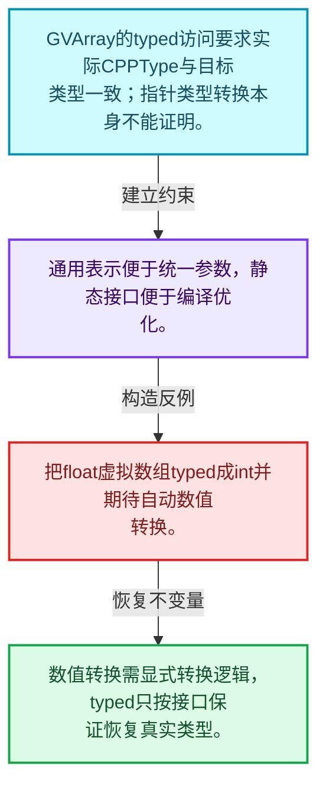
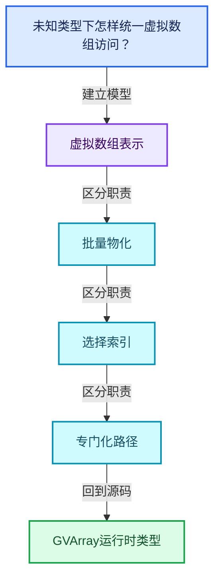
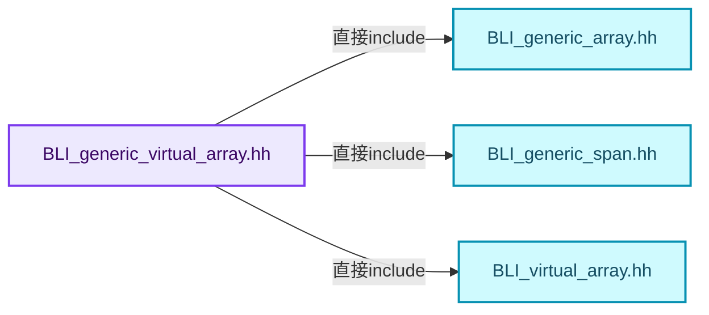
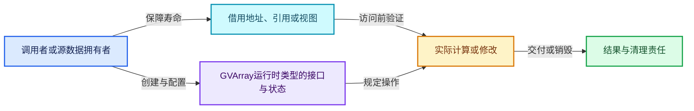
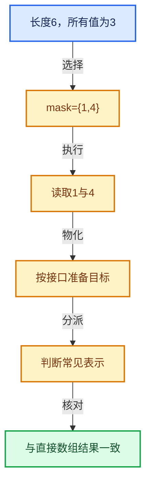

# 04-05 GVArray运行时类型

[方向导航](README.md) · [总目录](../README.md) · [覆盖索引](../%E6%BA%90%E7%A0%81%E7%89%88%E6%9C%AC%E4%B8%8E%E8%A6%86%E7%9B%96%E7%B4%A2%E5%BC%95.md)

> 阅读顺序：问题与数据模型 → 语法与类型 → 源码逐行 → 调用线索 → 历史与取舍 → 推演和练习。

- 基准 HEAD：`cbda6b96c26c0dee3c3b5cbb93960c4ac06a6b30`。
- 记录日期：2026-10-14。
- 教学示例状态：正文中的推演不是本机性能实测；已运行练习见验收报告。

## 一、从问题到设计

未知类型下怎样统一虚拟数组访问？

CPPType为读写和物化提供类型操作；typed转换需要真实类型一致，不能把强转当验证。

本篇把语法、数据语义和系统取舍连接起来。表示与接口分离，元素编号与选择内部位置分离，生成成本与执行成本分离。

### 本篇独立模型与设计推理

GVArray的typed访问要求实际CPPType与目标类型一致；指针类型转换本身不能证明。

设计取舍：通用表示便于统一参数，静态接口便于编译优化。

最小反例：把float虚拟数组typed成int并期待自动数值转换。

推导与处理：数值转换需显式转换逻辑，typed只按接口保证恢复真实类型。



### 源码范围与相邻篇章

| 文件 | 本篇逐行范围 | 基准SHA-256 |
|---|---|---|
| [source/blender/blenlib/BLI_generic_virtual_array.hh](../../../../../source/blender/blenlib/BLI_generic_virtual_array.hh) | L1—L994 | `10253f3b7a707ca8ca2a36a01638e960eab262e2e077972147ce19a15b247e9c` |
| [source/blender/blenlib/intern/generic_virtual_array.cc](../../../../../source/blender/blenlib/intern/generic_virtual_array.cc) | L1—L722 | `95df57b5ff65baf703bdcb45810b648da9dc71fceec3d32b3e067a72cc4effaa` |

同一主讲文件可能分多篇覆盖；超出本篇范围的符号通过覆盖索引定位。空行与纯注释保留在源码摘录中，逐行表解释有效语句与语法边界；许可证头统一保留。

前篇：[所有权与小对象优化](04-%E6%89%80%E6%9C%89%E6%9D%83%E4%B8%8E%E5%B0%8F%E5%AF%B9%E8%B1%A1%E4%BC%98%E5%8C%96.md).

后篇：[切片与物化](06-%E5%88%87%E7%89%87%E4%B8%8E%E7%89%A9%E5%8C%96.md).

## 二、类型、数据与阅读地图



这是概念依赖图，边表示阅读关系，不声称是运行时调用顺序。

### 直接编译依赖



箭头只表示头文件包含关系；完整调用线索见后面的符号定位表。

## 三、关键词、语法与类型角色

### 模板 template

模板把类型或常量作为生成实现的参数。读声明时先列出类型参数、非类型参数和默认值，再看使用者实际实例化了什么。模板声明本身不意味着每种T都支持其全部成员。

具体检查：把T替换为int、string、只能移动的类型，分别检查每个被调用操作是否成立。

### 依赖名称 typename

typename既可引入类型模板参数，也可告诉编译器某个依赖名称是类型。它不创建运行时对象；解析期确认语法类别与实例化期检查具体类型是不同阶段。

具体检查：区分typename T::value_type和T::size()，前者标记类型，后者是表达式。

### 常量求值 constexpr

constexpr声明允许相应实体参与常量求值，但constexpr函数仍可以在运行时执行。是否常量求值由调用场景和表达式合法性共同决定。

具体检查：比较constexpr变量初始化和从运行时输入调用同一函数。

### 只读限定 const

const约束当前访问路径可做的修改。const指针、指向const的指针、const视图对象、const元素是不同位置的限定；其他别名可能仍可修改原对象。

具体检查：分别写T* const、const T*与const T* const，并画出不可修改的层次。

### 移动转换 std::move

std::move把表达式转换为可供移动重载选择的值类别，实际资源转移发生在被选中的构造或赋值中。对const对象move可能仍调用复制，对视图move也不会获得底层数据所有权。

具体检查：记录移动构造调用次数，不用变量名或std::move的出现次数替代测量。

### 完美转发 std::forward

std::forward在转发引用模板中恢复调用者原来的值类别。它依赖推导出的模板实参；无条件move会改变左值调用者的语义。

具体检查：对同一接口分别传入左值、临时对象和const左值，记录实际重载。

### 异常约定 noexcept

noexcept表达式可以依赖类型特征。违反不抛异常约定会终止程序；它不是自动捕获异常，也不是资源回滚代码。

具体检查：找出声明的条件与实际可能抛出的分配、构造操作是否一致。

### 异常边界 try与catch

try定义异常传播的局部边界。失败路径需要销毁已经成功构造的部分并释放相应存储；未构造的对象不能被析构。

具体检查：在第k次构造失败，列出已经存在的对象集合与待释放缓冲。

### 显式静态转换 static_cast

static_cast表达编译期允许的转换，不会自动验证运行时真实类型、指针寿命或索引边界。由void指针恢复T指针时，调用者仍须保证实际存储中确有合法T对象。

具体检查：标出转换前后的类型以及正确性依据来自哪里。

### 限定转换 const_cast

const_cast可以改变访问路径的限定，但不能让本来就是const的对象合法可写。常用于复用只读实现时，仍需检查底层对象是否实际可变。

具体检查：对非const对象的const引用与真正const对象分别分析修改是否合法。

### 运行时多态 virtual

虚调用根据实际动态类型选择实现；经基类指针销毁对象时通常需要相应虚析构契约。每元素虚调用和循环外一次分派有不同开销。

具体检查：找出虚接口的实现类和调用频率，再讨论是否值得去虚拟化。

### 覆写检查 override

override要求函数确实覆盖基类虚函数，可捕获参数类型和const限定不匹配。它不改变基类规定的生命周期或线程约束。

具体检查：故意改变一个参数或const，观察编译器如何拒绝误写的新函数。

### 构造与new表达式

普通new可能分配并构造；placement new在给定地址构造，存储由其他机制提供。失败回滚应区分两类责任。

具体检查：追踪地址来自哪里、构造何时成功、由谁析构、由谁释放。

### 内部断言 assert

断言表达开发者预期成立的内部契约，发布构建可能关闭。它不能替代对不可信输入的完整错误处理，也不保证后续操作被运行时保护。

具体检查：对每条断言构造违反条件的输入，区分调用者错误与应向用户报告的错误。

### 编译期分支 if constexpr

条件在实例化时决定被保留的分支，这常用于不同类型的合法操作选择。它与运行时if有不同的实例化检查规则。

具体检查：找出每个分支依赖哪些类型特征，再使用满足与不满足条件的类型。

### 受控访问 friend

friend授予指定函数或类访问非公开成员的权限，并不意味着继承，也不自动扩展到友元的派生类。

具体检查：解释执行器为何需要访问包装器的内部映射，同时检查边界是否仍清楚。

### 共享拥有 shared_ptr

shared_ptr让控制块跟踪共享寿命，不自动使被指向对象的读写线程安全；循环拥有可能阻止销毁。

具体检查：画出强引用环并考虑是否应改变所有权方向或引入弱引用。

### 类型别名 using

类型别名为已有类型建立名字，不创建运行期对象。它常把模板内部使用的类型统一暴露给泛型调用者。

具体检查：展开别名直到基础类型，区分类型别名和变量声明。

### 拥有型可调用包装 function

std::function保存可调用目标并提供统一调用接口，复制能力与目标要求有关；FunctionRef仅借用，二者不能无条件互换。

具体检查：比较同步回调与长期保存任务对拥有关系的不同要求。

## 四、真实源码与逐行讲解

源码块保持原行内容，原始行号由小节标题及逐行表给出。表中的调用定位是静态阅读辅助；重载、模板实例化、宏展开和虚调用需结合完整声明，不能仅凭词法出现证明动态调用。

### BLI_generic_virtual_array.hh：L1—L48

<!-- source:source/blender/blenlib/BLI_generic_virtual_array.hh:1:48 -->

```cpp
/* SPDX-FileCopyrightText: 2023 Blender Authors
 *
 * SPDX-License-Identifier: GPL-2.0-or-later */

#pragma once

/** \file
 * \ingroup bli
 *
 * A generic virtual array is the same as a virtual array, except for the fact that the data type
 * is only known at runtime.
 */

#include "BLI_generic_array.hh"
#include "BLI_generic_span.hh"
#include "BLI_virtual_array.hh"

namespace blender {

/* -------------------------------------------------------------------- */
/** \name #GVArrayImpl and #GVMutableArrayImpl.
 * \{ */

class GVArray;
class GVArrayImpl;
class GVMutableArray;
class GVMutableArrayImpl;

/* A generically typed version of #VArrayImpl. */
class GVArrayImpl {
 protected:
  const CPPType *type_;
  int64_t size_;

 public:
  GVArrayImpl(const CPPType &type, int64_t size);
  virtual ~GVArrayImpl() = default;

  const CPPType &type() const;

  int64_t size() const;

  virtual void get(int64_t index, void *r_value) const;
  virtual void get_to_uninitialized(int64_t index, void *r_value) const = 0;

  virtual CommonVArrayInfo common_info() const;

  virtual void materialize(const IndexMask &mask, void *dst, bool dst_is_uninitialized) const;
```

本段语义重点：

- `size_`：该对象记录的元素数或长度，不能直接当作容量。

| 原始行 | 语义、约束与检查 |
|---|---|
| L5 | 防止同一头文件在一个翻译单元中重复展开；不控制多个源文件之间的链接或对象寿命。 |
| L14 | 引入编译依赖 "BLI_generic_array.hh"；这是声明可见性关系，不表示运行时一定调用该文件的所有接口。 |
| L15 | 引入编译依赖 "BLI_generic_span.hh"；这是声明可见性关系，不表示运行时一定调用该文件的所有接口。 |
| L16 | 引入编译依赖 "BLI_virtual_array.hh"；这是声明可见性关系，不表示运行时一定调用该文件的所有接口。 |
| L18 | 把后续声明放入 blender 命名空间，影响名称查找和符号归属，不创建运行时对象。 |
| L24 | 声明或定义类型 `class GVArray`。结合继承、访问权限和成员布局确认接口与拥有关系；前向声明本身没有完整对象布局。 |
| L25 | 声明或定义类型 `class GVArrayImpl`。结合继承、访问权限和成员布局确认接口与拥有关系；前向声明本身没有完整对象布局。 |
| L26 | 声明或定义类型 `class GVMutableArray`。结合继承、访问权限和成员布局确认接口与拥有关系；前向声明本身没有完整对象布局。 |
| L27 | 声明或定义类型 `class GVMutableArrayImpl`。结合继承、访问权限和成员布局确认接口与拥有关系；前向声明本身没有完整对象布局。 |
| L30 | 声明或定义类型 `class GVArrayImpl`。结合继承、访问权限和成员布局确认接口与拥有关系；前向声明本身没有完整对象布局。 |
| L31 | 切换成员访问权限为 protected；它是编译期接口边界，不是线程同步或内存保护。 |
| L32 | 声明成员、局部对象或完成语句 `const CPPType *type_`。若为指针或引用，它本身不说明拥有；若为值对象，其构造析构由所在作用域或外层对象管理。 |
| L33 | 本行涉及 `size_`：该对象记录的元素数或长度，不能直接当作容量。按此语义解读 `int64_t size_`，不要把地址、数量或状态混用。 |
| L35 | 切换成员访问权限为 public；它是编译期接口边界，不是线程同步或内存保护。 |
| L36 | 出现调用或函数声明 `GVArrayImpl`，对应表达式为 `GVArrayImpl(const CPPType &type, int64_t size);`。参数求值、返回类型与重载需结合前后完整语句；静态文本引用不能证明动态目标。 |
| L37 | 显式采用编译器生成的特殊成员行为：`virtual ~GVArrayImpl() = default;`。成员和基类的性质决定该操作是否可用、是否被删除及异常约定，不表示运行时给对象赋值为default。 |
| L39 | 声明接口 `const CPPType &type() const`，本行没有对应函数体；返回类型、参数限定和const/noexcept共同组成调用契约，实际行为需继续定位实现。 |
| L41 | 声明接口 `int64_t size() const`，本行没有对应函数体；返回类型、参数限定和const/noexcept共同组成调用契约，实际行为需继续定位实现。 |
| L43 | 声明接口 `virtual void get(int64_t index, void *r_value) const`，本行没有对应函数体；返回类型、参数限定和const/noexcept共同组成调用契约，实际行为需继续定位实现。 |
| L44 | 纯虚接口声明：`virtual void get_to_uninitialized(int64_t index, void *r_value) const = 0;`。等号零标记抽象接口，需要按继承约定提供覆写；不表示执行函数并把结果设为零。 |
| L46 | 声明接口 `virtual CommonVArrayInfo common_info() const`，本行没有对应函数体；返回类型、参数限定和const/noexcept共同组成调用契约，实际行为需继续定位实现。 |
| L48 | 声明接口 `virtual void materialize(const IndexMask &mask, void *dst, bool dst_is_uninitialized) const`，本行没有对应函数体；返回类型、参数限定和const/noexcept共同组成调用契约，实际行为需继续定位实现。 |

### BLI_generic_virtual_array.hh：L49—L96

<!-- source:source/blender/blenlib/BLI_generic_virtual_array.hh:49:96 -->

```cpp
  virtual void materialize_compressed(const IndexMask &mask,
                                      void *dst,
                                      bool dst_is_uninitialized) const;

  virtual bool try_assign_VArray(void *varray) const;
};

/* A generic version of #VMutableArrayImpl. */
class GVMutableArrayImpl : public GVArrayImpl {
 public:
  GVMutableArrayImpl(const CPPType &type, int64_t size) : GVArrayImpl(type, size) {}

  virtual void set_by_copy(int64_t index, const void *value);
  virtual void set_by_relocate(int64_t index, void *value);
  virtual void set_by_move(int64_t index, void *value) = 0;

  virtual void set_all(const void *src);

  virtual bool try_assign_VMutableArray(void *varray) const;
};

/** \} */

/* -------------------------------------------------------------------- */
/** \name #GVArray and #GVMutableArray
 * \{ */

namespace blenlib_detail {
struct GVArrayAnyExtraInfo {
  const GVArrayImpl *(*get_varray)(const void *buffer) =
      [](const void * /*buffer*/) -> const GVArrayImpl * { return nullptr; };

  template<typename StorageT> static constexpr GVArrayAnyExtraInfo get();
};
}  // namespace blenlib_detail

class GVMutableArray;

/**
 * Utility class to reduce code duplication between #GVArray and #GVMutableArray.
 * It pretty much follows #VArrayCommon. Don't use this class outside of this header.
 */
class GVArrayCommon {
 protected:
  AnyDerived<const GVArrayImpl, 40> impl_;

  GVArrayCommon() = default;
  GVArrayCommon(const GVArrayImpl *impl);
```

| 原始行 | 语义、约束与检查 |
|---|---|
| L49 | 出现调用或函数声明 `materialize_compressed`，对应表达式为 `virtual void materialize_compressed(const IndexMask &mask,`。参数求值、返回类型与重载需结合前后完整语句；静态文本引用不能证明动态目标。 |
| L50 | 本行是连续声明或表达式的一部分：`void *dst,`。与本段前后行合读；逗号、括号和限定符决定它属于参数、初始化列表还是实际计算。 |
| L51 | 声明成员、局部对象或完成语句 `bool dst_is_uninitialized) const`。若为指针或引用，它本身不说明拥有；若为值对象，其构造析构由所在作用域或外层对象管理。 |
| L53 | 声明接口 `virtual bool try_assign_VArray(void *varray) const`，本行没有对应函数体；返回类型、参数限定和const/noexcept共同组成调用契约，实际行为需继续定位实现。 |
| L54 | 结束当前语法单元。局部自动对象在离开其作用域时按规则销毁；这不等于所有被引用的外部数据也被释放。 |
| L57 | 声明或定义类型 `class GVMutableArrayImpl : public GVArrayImpl`。结合继承、访问权限和成员布局确认接口与拥有关系；前向声明本身没有完整对象布局。 |
| L58 | 切换成员访问权限为 public；它是编译期接口边界，不是线程同步或内存保护。 |
| L59 | 出现调用或函数声明 `GVMutableArrayImpl`，对应表达式为 `GVMutableArrayImpl(const CPPType &type, int64_t size) : GVArrayImpl(type, size) {}`。参数求值、返回类型与重载需结合前后完整语句；静态文本引用不能证明动态目标。 |
| L61 | 声明接口 `virtual void set_by_copy(int64_t index, const void *value)`，本行没有对应函数体；返回类型、参数限定和const/noexcept共同组成调用契约，实际行为需继续定位实现。 |
| L62 | 声明接口 `virtual void set_by_relocate(int64_t index, void *value)`，本行没有对应函数体；返回类型、参数限定和const/noexcept共同组成调用契约，实际行为需继续定位实现。 |
| L63 | 纯虚接口声明：`virtual void set_by_move(int64_t index, void *value) = 0;`。等号零标记抽象接口，需要按继承约定提供覆写；不表示执行函数并把结果设为零。 |
| L65 | 声明接口 `virtual void set_all(const void *src)`，本行没有对应函数体；返回类型、参数限定和const/noexcept共同组成调用契约，实际行为需继续定位实现。 |
| L67 | 声明接口 `virtual bool try_assign_VMutableArray(void *varray) const`，本行没有对应函数体；返回类型、参数限定和const/noexcept共同组成调用契约，实际行为需继续定位实现。 |
| L68 | 结束当前语法单元。局部自动对象在离开其作用域时按规则销毁；这不等于所有被引用的外部数据也被释放。 |
| L76 | 把后续声明放入 blenlib_detail 命名空间，影响名称查找和符号归属，不创建运行时对象。 |
| L77 | 声明或定义类型 `struct GVArrayAnyExtraInfo`。结合继承、访问权限和成员布局确认接口与拥有关系；前向声明本身没有完整对象布局。 |
| L78 | 把右侧 `` 用于初始化或更新左侧 `const GVArrayImpl *(*get_varray)(const void *buffer)`。声明初始化与已有对象赋值应按上下文区分；有资源的类型会调用相应特殊成员。 |
| L79 | 声明成员、局部对象或完成语句 `[](const void * ) -> const GVArrayImpl * { return nullptr; }`。若为指针或引用，它本身不说明拥有；若为值对象，其构造析构由所在作用域或外层对象管理。 |
| L81 | 声明模板参数 `template<typename StorageT> static constexpr GVArrayAnyExtraInfo get();`。类型参数决定生成操作的类型，非类型参数可决定内嵌容量或编译期分支。 |
| L82 | 结束当前语法单元。局部自动对象在离开其作用域时按规则销毁；这不等于所有被引用的外部数据也被释放。 |
| L83 | 结束当前语法单元。局部自动对象在离开其作用域时按规则销毁；这不等于所有被引用的外部数据也被释放。 |
| L85 | 声明或定义类型 `class GVMutableArray`。结合继承、访问权限和成员布局确认接口与拥有关系；前向声明本身没有完整对象布局。 |
| L91 | 声明或定义类型 `class GVArrayCommon`。结合继承、访问权限和成员布局确认接口与拥有关系；前向声明本身没有完整对象布局。 |
| L92 | 切换成员访问权限为 protected；它是编译期接口边界，不是线程同步或内存保护。 |
| L93 | 声明成员、局部对象或完成语句 `AnyDerived<const GVArrayImpl, 40> impl_`。若为指针或引用，它本身不说明拥有；若为值对象，其构造析构由所在作用域或外层对象管理。 |
| L95 | 显式采用编译器生成的特殊成员行为：`GVArrayCommon() = default;`。成员和基类的性质决定该操作是否可用、是否被删除及异常约定，不表示运行时给对象赋值为default。 |
| L96 | 出现调用或函数声明 `GVArrayCommon`，对应表达式为 `GVArrayCommon(const GVArrayImpl *impl);`。参数求值、返回类型与重载需结合前后完整语句；静态文本引用不能证明动态目标。 |

### BLI_generic_virtual_array.hh：L97—L142

<!-- source:source/blender/blenlib/BLI_generic_virtual_array.hh:97:142 -->

```cpp
  GVArrayCommon(std::shared_ptr<const GVArrayImpl> impl);

  template<typename ImplT, typename... Args> void emplace(Args &&...args);

 public:
  const CPPType &type() const;
  operator bool() const;

  int64_t size() const;
  bool is_empty() const;
  IndexRange index_range() const;

  template<typename T> bool try_assign_VArray(VArray<T> &varray) const;
  bool may_have_ownership() const;

  void materialize(void *dst) const;
  void materialize(const IndexMask &mask, void *dst) const;

  void materialize_to_uninitialized(void *dst) const;
  void materialize_to_uninitialized(const IndexMask &mask, void *dst) const;

  void materialize_compressed(const IndexMask &mask, void *dst) const;
  void materialize_compressed_to_uninitialized(const IndexMask &mask, void *dst) const;

  CommonVArrayInfo common_info() const;

  /**
   * Returns true when the virtual array is stored as a span internally.
   */
  bool is_span() const;
  /**
   * Returns the internally used span of the virtual array. This invokes undefined behavior if the
   * virtual array is not stored as a span internally.
   */
  GSpan get_internal_span() const;

  /**
   * Returns true when the virtual array returns the same value for every index.
   */
  bool is_single() const;
  /**
   * Copies the value that is used for every element into `r_value`, which is expected to point to
   * initialized memory. This invokes undefined behavior if the virtual array would not return the
   * same value for every index.
   */
  void get_internal_single(void *r_value) const;
```

| 原始行 | 语义、约束与检查 |
|---|---|
| L97 | 出现调用或函数声明 `GVArrayCommon`，对应表达式为 `GVArrayCommon(std::shared_ptr<const GVArrayImpl> impl);`。参数求值、返回类型与重载需结合前后完整语句；静态文本引用不能证明动态目标。 |
| L99 | 声明模板参数 `template<typename ImplT, typename... Args> void emplace(Args &&...args);`。类型参数决定生成操作的类型，非类型参数可决定内嵌容量或编译期分支。 |
| L101 | 切换成员访问权限为 public；它是编译期接口边界，不是线程同步或内存保护。 |
| L102 | 声明接口 `const CPPType &type() const`，本行没有对应函数体；返回类型、参数限定和const/noexcept共同组成调用契约，实际行为需继续定位实现。 |
| L103 | 运算符重载声明、定义或显式调用：`operator bool() const;`。结合参数和返回类型判断是赋值、索引、比较还是转换；operator=声明中的等号不是在给名为operator的变量赋值。 |
| L105 | 声明接口 `int64_t size() const`，本行没有对应函数体；返回类型、参数限定和const/noexcept共同组成调用契约，实际行为需继续定位实现。 |
| L106 | 声明接口 `bool is_empty() const`，本行没有对应函数体；返回类型、参数限定和const/noexcept共同组成调用契约，实际行为需继续定位实现。 |
| L107 | 声明接口 `IndexRange index_range() const`，本行没有对应函数体；返回类型、参数限定和const/noexcept共同组成调用契约，实际行为需继续定位实现。 |
| L109 | 声明模板参数 `template<typename T> bool try_assign_VArray(VArray<T> &varray) const;`。类型参数决定生成操作的类型，非类型参数可决定内嵌容量或编译期分支。 |
| L110 | 声明接口 `bool may_have_ownership() const`，本行没有对应函数体；返回类型、参数限定和const/noexcept共同组成调用契约，实际行为需继续定位实现。 |
| L112 | 声明接口 `void materialize(void *dst) const`，本行没有对应函数体；返回类型、参数限定和const/noexcept共同组成调用契约，实际行为需继续定位实现。 |
| L113 | 声明接口 `void materialize(const IndexMask &mask, void *dst) const`，本行没有对应函数体；返回类型、参数限定和const/noexcept共同组成调用契约，实际行为需继续定位实现。 |
| L115 | 声明接口 `void materialize_to_uninitialized(void *dst) const`，本行没有对应函数体；返回类型、参数限定和const/noexcept共同组成调用契约，实际行为需继续定位实现。 |
| L116 | 声明接口 `void materialize_to_uninitialized(const IndexMask &mask, void *dst) const`，本行没有对应函数体；返回类型、参数限定和const/noexcept共同组成调用契约，实际行为需继续定位实现。 |
| L118 | 声明接口 `void materialize_compressed(const IndexMask &mask, void *dst) const`，本行没有对应函数体；返回类型、参数限定和const/noexcept共同组成调用契约，实际行为需继续定位实现。 |
| L119 | 声明接口 `void materialize_compressed_to_uninitialized(const IndexMask &mask, void *dst) const`，本行没有对应函数体；返回类型、参数限定和const/noexcept共同组成调用契约，实际行为需继续定位实现。 |
| L121 | 声明接口 `CommonVArrayInfo common_info() const`，本行没有对应函数体；返回类型、参数限定和const/noexcept共同组成调用契约，实际行为需继续定位实现。 |
| L126 | 声明接口 `bool is_span() const`，本行没有对应函数体；返回类型、参数限定和const/noexcept共同组成调用契约，实际行为需继续定位实现。 |
| L131 | 声明接口 `GSpan get_internal_span() const`，本行没有对应函数体；返回类型、参数限定和const/noexcept共同组成调用契约，实际行为需继续定位实现。 |
| L136 | 声明接口 `bool is_single() const`，本行没有对应函数体；返回类型、参数限定和const/noexcept共同组成调用契约，实际行为需继续定位实现。 |
| L142 | 声明接口 `void get_internal_single(void *r_value) const`，本行没有对应函数体；返回类型、参数限定和const/noexcept共同组成调用契约，实际行为需继续定位实现。 |

### BLI_generic_virtual_array.hh：L143—L190

<!-- source:source/blender/blenlib/BLI_generic_virtual_array.hh:143:190 -->

```cpp
  /**
   * Same as `get_internal_single`, but `r_value` points to initialized memory.
   */
  void get_internal_single_to_uninitialized(void *r_value) const;

  void get(int64_t index, void *r_value) const;
  /**
   * Returns a copy of the value at the given index. Usually a typed virtual array should
   * be used instead, but sometimes this is simpler when only a few indices are needed.
   */
  template<typename T> T get(int64_t index) const;
  void get_to_uninitialized(int64_t index, void *r_value) const;
};

/** Generic version of #VArray. */
class GVArray : public GVArrayCommon {
 private:
  friend GVMutableArray;

 public:
  GVArray() = default;

  GVArray(const GVArrayImpl *impl);
  GVArray(std::shared_ptr<const GVArrayImpl> impl);

  GVArray(varray_tag::span /*tag*/, GSpan span);
  GVArray(varray_tag::single_ref /*tag*/, const CPPType &type, int64_t size, const void *value);
  GVArray(varray_tag::single /*tag*/, const CPPType &type, int64_t size, const void *value);

  template<typename T> GVArray(const VArray<T> &varray);
  template<typename T> GVArray(VArray<T> &&varray);
  template<typename T> VArray<T> typed() const;

  template<typename ImplT, typename... Args> static GVArray from(Args &&...args);

  static GVArray from_single(const CPPType &type, int64_t size, const void *value);
  static GVArray from_single_ref(const CPPType &type, int64_t size, const void *value);
  static GVArray from_single_default(const CPPType &type, int64_t size);
  static GVArray from_span(GSpan span);
  static GVArray from_garray(GArray<> array);
  static GVArray from_empty(const CPPType &type);
  template<typename GetToUninitFn>
  static GVArray from_func(const CPPType &type, int64_t size, GetToUninitFn &&get_to_uninit);
  static GVArray from_std_func(const CPPType &type,
                               int64_t size,
                               std::function<void(int64_t index, void *r_value)> get_to_uninit);

  GVArray slice(IndexRange slice) const;
```

| 原始行 | 语义、约束与检查 |
|---|---|
| L146 | 声明接口 `void get_internal_single_to_uninitialized(void *r_value) const`，本行没有对应函数体；返回类型、参数限定和const/noexcept共同组成调用契约，实际行为需继续定位实现。 |
| L148 | 声明接口 `void get(int64_t index, void *r_value) const`，本行没有对应函数体；返回类型、参数限定和const/noexcept共同组成调用契约，实际行为需继续定位实现。 |
| L153 | 声明模板参数 `template<typename T> T get(int64_t index) const;`。类型参数决定生成操作的类型，非类型参数可决定内嵌容量或编译期分支。 |
| L154 | 声明接口 `void get_to_uninitialized(int64_t index, void *r_value) const`，本行没有对应函数体；返回类型、参数限定和const/noexcept共同组成调用契约，实际行为需继续定位实现。 |
| L155 | 结束当前语法单元。局部自动对象在离开其作用域时按规则销毁；这不等于所有被引用的外部数据也被释放。 |
| L158 | 声明或定义类型 `class GVArray : public GVArrayCommon`。结合继承、访问权限和成员布局确认接口与拥有关系；前向声明本身没有完整对象布局。 |
| L159 | 切换成员访问权限为 private；它是编译期接口边界，不是线程同步或内存保护。 |
| L160 | 声明成员、局部对象或完成语句 `friend GVMutableArray`。若为指针或引用，它本身不说明拥有；若为值对象，其构造析构由所在作用域或外层对象管理。 |
| L162 | 切换成员访问权限为 public；它是编译期接口边界，不是线程同步或内存保护。 |
| L163 | 显式采用编译器生成的特殊成员行为：`GVArray() = default;`。成员和基类的性质决定该操作是否可用、是否被删除及异常约定，不表示运行时给对象赋值为default。 |
| L165 | 出现调用或函数声明 `GVArray`，对应表达式为 `GVArray(const GVArrayImpl *impl);`。参数求值、返回类型与重载需结合前后完整语句；静态文本引用不能证明动态目标。 |
| L166 | 出现调用或函数声明 `GVArray`，对应表达式为 `GVArray(std::shared_ptr<const GVArrayImpl> impl);`。参数求值、返回类型与重载需结合前后完整语句；静态文本引用不能证明动态目标。 |
| L168 | 出现调用或函数声明 `GVArray`，对应表达式为 `GVArray(varray_tag::span , GSpan span);`。参数求值、返回类型与重载需结合前后完整语句；静态文本引用不能证明动态目标。 |
| L169 | 出现调用或函数声明 `GVArray`，对应表达式为 `GVArray(varray_tag::single_ref , const CPPType &type, int64_t size, const void *value);`。参数求值、返回类型与重载需结合前后完整语句；静态文本引用不能证明动态目标。 |
| L170 | 出现调用或函数声明 `GVArray`，对应表达式为 `GVArray(varray_tag::single , const CPPType &type, int64_t size, const void *value);`。参数求值、返回类型与重载需结合前后完整语句；静态文本引用不能证明动态目标。 |
| L172 | 声明模板参数 `template<typename T> GVArray(const VArray<T> &varray);`。类型参数决定生成操作的类型，非类型参数可决定内嵌容量或编译期分支。 |
| L173 | 声明模板参数 `template<typename T> GVArray(VArray<T> &&varray);`。类型参数决定生成操作的类型，非类型参数可决定内嵌容量或编译期分支。 |
| L174 | 声明模板参数 `template<typename T> VArray<T> typed() const;`。类型参数决定生成操作的类型，非类型参数可决定内嵌容量或编译期分支。 |
| L176 | 声明模板参数 `template<typename ImplT, typename... Args> static GVArray from(Args &&...args);`。类型参数决定生成操作的类型，非类型参数可决定内嵌容量或编译期分支。 |
| L178 | 声明接口 `static GVArray from_single(const CPPType &type, int64_t size, const void *value)`，本行没有对应函数体；返回类型、参数限定和const/noexcept共同组成调用契约，实际行为需继续定位实现。 |
| L179 | 声明接口 `static GVArray from_single_ref(const CPPType &type, int64_t size, const void *value)`，本行没有对应函数体；返回类型、参数限定和const/noexcept共同组成调用契约，实际行为需继续定位实现。 |
| L180 | 声明接口 `static GVArray from_single_default(const CPPType &type, int64_t size)`，本行没有对应函数体；返回类型、参数限定和const/noexcept共同组成调用契约，实际行为需继续定位实现。 |
| L181 | 声明接口 `static GVArray from_span(GSpan span)`，本行没有对应函数体；返回类型、参数限定和const/noexcept共同组成调用契约，实际行为需继续定位实现。 |
| L182 | 声明接口 `static GVArray from_garray(GArray<> array)`，本行没有对应函数体；返回类型、参数限定和const/noexcept共同组成调用契约，实际行为需继续定位实现。 |
| L183 | 声明接口 `static GVArray from_empty(const CPPType &type)`，本行没有对应函数体；返回类型、参数限定和const/noexcept共同组成调用契约，实际行为需继续定位实现。 |
| L184 | 声明模板参数 `template<typename GetToUninitFn>`。类型参数决定生成操作的类型，非类型参数可决定内嵌容量或编译期分支。 |
| L185 | 声明接口 `static GVArray from_func(const CPPType &type, int64_t size, GetToUninitFn &&get_to_uninit)`，本行没有对应函数体；返回类型、参数限定和const/noexcept共同组成调用契约，实际行为需继续定位实现。 |
| L186 | 出现调用或函数声明 `from_std_func`，对应表达式为 `static GVArray from_std_func(const CPPType &type,`。参数求值、返回类型与重载需结合前后完整语句；静态文本引用不能证明动态目标。 |
| L187 | 本行是连续声明或表达式的一部分：`int64_t size,`。与本段前后行合读；逗号、括号和限定符决定它属于参数、初始化列表还是实际计算。 |
| L188 | 出现调用或函数声明 `void`，对应表达式为 `std::function<void(int64_t index, void *r_value)> get_to_uninit);`。参数求值、返回类型与重载需结合前后完整语句；静态文本引用不能证明动态目标。 |
| L190 | 声明接口 `GVArray slice(IndexRange slice) const`，本行没有对应函数体；返回类型、参数限定和const/noexcept共同组成调用契约，实际行为需继续定位实现。 |

### BLI_generic_virtual_array.hh：L191—L233

<!-- source:source/blender/blenlib/BLI_generic_virtual_array.hh:191:233 -->

```cpp

  const GVArrayImpl *get_implementation() const
  {
    return impl_.get();
  }
};

/** Generic version of #VMutableArray. */
class GVMutableArray : public GVArrayCommon {
 public:
  GVMutableArray() = default;
  GVMutableArray(GVMutableArrayImpl *impl);
  GVMutableArray(std::shared_ptr<GVMutableArrayImpl> impl);

  template<typename T> GVMutableArray(const VMutableArray<T> &varray);
  template<typename T> VMutableArray<T> typed() const;

  template<typename ImplT, typename... Args> static GVMutableArray from(Args &&...args);

  static GVMutableArray from_span(GMutableSpan span);

  operator GVArray() const &;
  operator GVArray() && noexcept;

  GMutableSpan get_internal_span() const;

  template<typename T> bool try_assign_VMutableArray(VMutableArray<T> &varray) const;

  void set_by_copy(int64_t index, const void *value);
  void set_by_move(int64_t index, void *value);
  void set_by_relocate(int64_t index, void *value);

  void fill(const void *value);
  /**
   * Copy the values from the source buffer to all elements in the virtual array.
   */
  void set_all(const void *src);

  GVMutableArrayImpl *get_implementation() const;

 private:
  GVMutableArrayImpl *get_impl() const;
};
```

| 原始行 | 语义、约束与检查 |
|---|---|
| L192 | 出现调用或函数声明 `get_implementation`，对应表达式为 `const GVArrayImpl *get_implementation() const`。参数求值、返回类型与重载需结合前后完整语句；静态文本引用不能证明动态目标。 |
| L193 | 连接上一行的声明或控制结构与其语句块；后续行在这个作用域中执行或声明。 |
| L194 | 返回表达式 `impl_.get()`。 |
| L195 | 结束当前语法单元。局部自动对象在离开其作用域时按规则销毁；这不等于所有被引用的外部数据也被释放。 |
| L196 | 结束当前语法单元。局部自动对象在离开其作用域时按规则销毁；这不等于所有被引用的外部数据也被释放。 |
| L199 | 声明或定义类型 `class GVMutableArray : public GVArrayCommon`。结合继承、访问权限和成员布局确认接口与拥有关系；前向声明本身没有完整对象布局。 |
| L200 | 切换成员访问权限为 public；它是编译期接口边界，不是线程同步或内存保护。 |
| L201 | 显式采用编译器生成的特殊成员行为：`GVMutableArray() = default;`。成员和基类的性质决定该操作是否可用、是否被删除及异常约定，不表示运行时给对象赋值为default。 |
| L202 | 出现调用或函数声明 `GVMutableArray`，对应表达式为 `GVMutableArray(GVMutableArrayImpl *impl);`。参数求值、返回类型与重载需结合前后完整语句；静态文本引用不能证明动态目标。 |
| L203 | 出现调用或函数声明 `GVMutableArray`，对应表达式为 `GVMutableArray(std::shared_ptr<GVMutableArrayImpl> impl);`。参数求值、返回类型与重载需结合前后完整语句；静态文本引用不能证明动态目标。 |
| L205 | 声明模板参数 `template<typename T> GVMutableArray(const VMutableArray<T> &varray);`。类型参数决定生成操作的类型，非类型参数可决定内嵌容量或编译期分支。 |
| L206 | 声明模板参数 `template<typename T> VMutableArray<T> typed() const;`。类型参数决定生成操作的类型，非类型参数可决定内嵌容量或编译期分支。 |
| L208 | 声明模板参数 `template<typename ImplT, typename... Args> static GVMutableArray from(Args &&...args);`。类型参数决定生成操作的类型，非类型参数可决定内嵌容量或编译期分支。 |
| L210 | 声明接口 `static GVMutableArray from_span(GMutableSpan span)`，本行没有对应函数体；返回类型、参数限定和const/noexcept共同组成调用契约，实际行为需继续定位实现。 |
| L212 | 运算符重载声明、定义或显式调用：`operator GVArray() const &;`。结合参数和返回类型判断是赋值、索引、比较还是转换；operator=声明中的等号不是在给名为operator的变量赋值。 |
| L213 | 运算符重载声明、定义或显式调用：`operator GVArray() && noexcept;`。结合参数和返回类型判断是赋值、索引、比较还是转换；operator=声明中的等号不是在给名为operator的变量赋值。 |
| L215 | 声明接口 `GMutableSpan get_internal_span() const`，本行没有对应函数体；返回类型、参数限定和const/noexcept共同组成调用契约，实际行为需继续定位实现。 |
| L217 | 声明模板参数 `template<typename T> bool try_assign_VMutableArray(VMutableArray<T> &varray) const;`。类型参数决定生成操作的类型，非类型参数可决定内嵌容量或编译期分支。 |
| L219 | 声明接口 `void set_by_copy(int64_t index, const void *value)`，本行没有对应函数体；返回类型、参数限定和const/noexcept共同组成调用契约，实际行为需继续定位实现。 |
| L220 | 声明接口 `void set_by_move(int64_t index, void *value)`，本行没有对应函数体；返回类型、参数限定和const/noexcept共同组成调用契约，实际行为需继续定位实现。 |
| L221 | 声明接口 `void set_by_relocate(int64_t index, void *value)`，本行没有对应函数体；返回类型、参数限定和const/noexcept共同组成调用契约，实际行为需继续定位实现。 |
| L223 | 声明接口 `void fill(const void *value)`，本行没有对应函数体；返回类型、参数限定和const/noexcept共同组成调用契约，实际行为需继续定位实现。 |
| L227 | 声明接口 `void set_all(const void *src)`，本行没有对应函数体；返回类型、参数限定和const/noexcept共同组成调用契约，实际行为需继续定位实现。 |
| L229 | 声明接口 `GVMutableArrayImpl *get_implementation() const`，本行没有对应函数体；返回类型、参数限定和const/noexcept共同组成调用契约，实际行为需继续定位实现。 |
| L231 | 切换成员访问权限为 private；它是编译期接口边界，不是线程同步或内存保护。 |
| L232 | 声明接口 `GVMutableArrayImpl *get_impl() const`，本行没有对应函数体；返回类型、参数限定和const/noexcept共同组成调用契约，实际行为需继续定位实现。 |
| L233 | 结束当前语法单元。局部自动对象在离开其作用域时按规则销毁；这不等于所有被引用的外部数据也被释放。 |

### BLI_generic_virtual_array.hh：L234—L285

<!-- source:source/blender/blenlib/BLI_generic_virtual_array.hh:234:285 -->

```cpp

/** \} */

/* -------------------------------------------------------------------- */
/** \name #GVArraySpan and #GMutableVArraySpan.
 * \{ */

/* A generic version of VArraySpan. */
class GVArraySpan : public GSpan {
 private:
  GVArray varray_;
  void *owned_data_ = nullptr;

 public:
  GVArraySpan();
  GVArraySpan(GVArray varray);
  template<typename T> GVArraySpan(VArray<T> varray) : GVArraySpan(GVArray(varray)) {}
  GVArraySpan(GVArraySpan &&other);
  ~GVArraySpan();
  GVArraySpan &operator=(GVArraySpan &&other);
};

/* A generic version of MutableVArraySpan. */
class GMutableVArraySpan : public GMutableSpan, NonCopyable, NonMovable {
 private:
  GVMutableArray varray_;
  void *owned_data_ = nullptr;
  bool save_has_been_called_ = false;
  bool show_not_saved_warning_ = true;

 public:
  GMutableVArraySpan();
  GMutableVArraySpan(GVMutableArray varray, bool copy_values_to_span = true);
  GMutableVArraySpan(GMutableVArraySpan &&other);
  ~GMutableVArraySpan();
  GMutableVArraySpan &operator=(GMutableVArraySpan &&other);

  const GVMutableArray &varray() const;

  void save();
  void disable_not_applied_warning();
};

/** \} */

/* -------------------------------------------------------------------- */
/** \name Conversions between generic and typed virtual arrays.
 * \{ */

/* Used to convert a typed virtual array into a generic one. */
template<typename T> class GVArrayImpl_For_VArray : public GVArrayImpl {
 protected:
```

| 原始行 | 语义、约束与检查 |
|---|---|
| L242 | 声明或定义类型 `class GVArraySpan : public GSpan`。结合继承、访问权限和成员布局确认接口与拥有关系；前向声明本身没有完整对象布局。 |
| L243 | 切换成员访问权限为 private；它是编译期接口边界，不是线程同步或内存保护。 |
| L244 | 声明成员、局部对象或完成语句 `GVArray varray_`。若为指针或引用，它本身不说明拥有；若为值对象，其构造析构由所在作用域或外层对象管理。 |
| L245 | 把右侧 `nullptr` 用于初始化或更新左侧 `void *owned_data_`。声明初始化与已有对象赋值应按上下文区分；有资源的类型会调用相应特殊成员。 |
| L247 | 切换成员访问权限为 public；它是编译期接口边界，不是线程同步或内存保护。 |
| L248 | 出现调用或函数声明 `GVArraySpan`，对应表达式为 `GVArraySpan();`。参数求值、返回类型与重载需结合前后完整语句；静态文本引用不能证明动态目标。 |
| L249 | 出现调用或函数声明 `GVArraySpan`，对应表达式为 `GVArraySpan(GVArray varray);`。参数求值、返回类型与重载需结合前后完整语句；静态文本引用不能证明动态目标。 |
| L250 | 声明模板参数 `template<typename T> GVArraySpan(VArray<T> varray) : GVArraySpan(GVArray(varray)) {}`。类型参数决定生成操作的类型，非类型参数可决定内嵌容量或编译期分支。 |
| L251 | 出现调用或函数声明 `GVArraySpan`，对应表达式为 `GVArraySpan(GVArraySpan &&other);`。参数求值、返回类型与重载需结合前后完整语句；静态文本引用不能证明动态目标。 |
| L252 | 涉及析构接口或显式析构：`~GVArraySpan();`。检查目标对象已成功构造，且资源不会在另一条清理路径再次销毁。 |
| L253 | 运算符重载声明、定义或显式调用：`GVArraySpan &operator=(GVArraySpan &&other);`。结合参数和返回类型判断是赋值、索引、比较还是转换；operator=声明中的等号不是在给名为operator的变量赋值。 |
| L254 | 结束当前语法单元。局部自动对象在离开其作用域时按规则销毁；这不等于所有被引用的外部数据也被释放。 |
| L257 | 声明或定义类型 `class GMutableVArraySpan : public GMutableSpan, NonCopyable, NonMovable`。结合继承、访问权限和成员布局确认接口与拥有关系；前向声明本身没有完整对象布局。 |
| L258 | 切换成员访问权限为 private；它是编译期接口边界，不是线程同步或内存保护。 |
| L259 | 声明成员、局部对象或完成语句 `GVMutableArray varray_`。若为指针或引用，它本身不说明拥有；若为值对象，其构造析构由所在作用域或外层对象管理。 |
| L260 | 把右侧 `nullptr` 用于初始化或更新左侧 `void *owned_data_`。声明初始化与已有对象赋值应按上下文区分；有资源的类型会调用相应特殊成员。 |
| L261 | 把右侧 `false` 用于初始化或更新左侧 `bool save_has_been_called_`。声明初始化与已有对象赋值应按上下文区分；有资源的类型会调用相应特殊成员。 |
| L262 | 把右侧 `true` 用于初始化或更新左侧 `bool show_not_saved_warning_`。声明初始化与已有对象赋值应按上下文区分；有资源的类型会调用相应特殊成员。 |
| L264 | 切换成员访问权限为 public；它是编译期接口边界，不是线程同步或内存保护。 |
| L265 | 出现调用或函数声明 `GMutableVArraySpan`，对应表达式为 `GMutableVArraySpan();`。参数求值、返回类型与重载需结合前后完整语句；静态文本引用不能证明动态目标。 |
| L266 | 把右侧 `true)` 用于初始化或更新左侧 `GMutableVArraySpan(GVMutableArray varray, bool copy_values_to_span`。声明初始化与已有对象赋值应按上下文区分；有资源的类型会调用相应特殊成员。 |
| L267 | 出现调用或函数声明 `GMutableVArraySpan`，对应表达式为 `GMutableVArraySpan(GMutableVArraySpan &&other);`。参数求值、返回类型与重载需结合前后完整语句；静态文本引用不能证明动态目标。 |
| L268 | 涉及析构接口或显式析构：`~GMutableVArraySpan();`。检查目标对象已成功构造，且资源不会在另一条清理路径再次销毁。 |
| L269 | 运算符重载声明、定义或显式调用：`GMutableVArraySpan &operator=(GMutableVArraySpan &&other);`。结合参数和返回类型判断是赋值、索引、比较还是转换；operator=声明中的等号不是在给名为operator的变量赋值。 |
| L271 | 声明接口 `const GVMutableArray &varray() const`，本行没有对应函数体；返回类型、参数限定和const/noexcept共同组成调用契约，实际行为需继续定位实现。 |
| L273 | 声明接口 `void save()`，本行没有对应函数体；返回类型、参数限定和const/noexcept共同组成调用契约，实际行为需继续定位实现。 |
| L274 | 声明接口 `void disable_not_applied_warning()`，本行没有对应函数体；返回类型、参数限定和const/noexcept共同组成调用契约，实际行为需继续定位实现。 |
| L275 | 结束当前语法单元。局部自动对象在离开其作用域时按规则销毁；这不等于所有被引用的外部数据也被释放。 |
| L284 | 声明模板参数 `template<typename T> class GVArrayImpl_For_VArray : public GVArrayImpl {`。类型参数决定生成操作的类型，非类型参数可决定内嵌容量或编译期分支。 |
| L285 | 切换成员访问权限为 protected；它是编译期接口边界，不是线程同步或内存保护。 |

### BLI_generic_virtual_array.hh：L286—L334

<!-- source:source/blender/blenlib/BLI_generic_virtual_array.hh:286:334 -->

```cpp
  VArray<T> varray_;

 public:
  GVArrayImpl_For_VArray(VArray<T> varray)
      : GVArrayImpl(CPPType::get<T>(), varray.size()), varray_(std::move(varray))
  {
  }

 protected:
  void get(const int64_t index, void *r_value) const override
  {
    *static_cast<T *>(r_value) = varray_[index];
  }

  void get_to_uninitialized(const int64_t index, void *r_value) const override
  {
    new (r_value) T(varray_[index]);
  }

  void materialize(const IndexMask &mask,
                   void *dst,
                   const bool dst_is_uninitialized) const override
  {
    varray_.get_implementation()->materialize(mask, static_cast<T *>(dst), dst_is_uninitialized);
  }

  void materialize_compressed(const IndexMask &mask,
                              void *dst,
                              const bool dst_is_uninitialized) const override
  {
    varray_.get_implementation()->materialize_compressed(
        mask, static_cast<T *>(dst), dst_is_uninitialized);
  }

  bool try_assign_VArray(void *varray) const override
  {
    *static_cast<VArray<T> *>(varray) = varray_;
    return true;
  }

  CommonVArrayInfo common_info() const override
  {
    return varray_.common_info();
  }
};

/* Used to convert any generic virtual array into a typed one. */
template<typename T> class VArrayImpl_For_GVArray : public VArrayImpl<T> {
 protected:
```

| 原始行 | 语义、约束与检查 |
|---|---|
| L286 | 声明成员、局部对象或完成语句 `VArray<T> varray_`。若为指针或引用，它本身不说明拥有；若为值对象，其构造析构由所在作用域或外层对象管理。 |
| L288 | 切换成员访问权限为 public；它是编译期接口边界，不是线程同步或内存保护。 |
| L289 | 出现调用或函数声明 `GVArrayImpl_For_VArray`，对应表达式为 `GVArrayImpl_For_VArray(VArray<T> varray)`。参数求值、返回类型与重载需结合前后完整语句；静态文本引用不能证明动态目标。 |
| L290 | 出现调用或函数声明 `GVArrayImpl`，对应表达式为 `: GVArrayImpl(CPPType::get<T>(), varray.size()), varray_(std::move(varray))`。参数求值、返回类型与重载需结合前后完整语句；静态文本引用不能证明动态目标。 |
| L291 | 连接上一行的声明或控制结构与其语句块；后续行在这个作用域中执行或声明。 |
| L292 | 结束当前语法单元。局部自动对象在离开其作用域时按规则销毁；这不等于所有被引用的外部数据也被释放。 |
| L294 | 切换成员访问权限为 protected；它是编译期接口边界，不是线程同步或内存保护。 |
| L295 | 出现调用或函数声明 `get`，对应表达式为 `void get(const int64_t index, void *r_value) const override`。参数求值、返回类型与重载需结合前后完整语句；静态文本引用不能证明动态目标。 |
| L296 | 连接上一行的声明或控制结构与其语句块；后续行在这个作用域中执行或声明。 |
| L297 | 把右侧 `varray_[index]` 用于初始化或更新左侧 `*static_cast<T *>(r_value)`。声明初始化与已有对象赋值应按上下文区分；有资源的类型会调用相应特殊成员。 |
| L298 | 结束当前语法单元。局部自动对象在离开其作用域时按规则销毁；这不等于所有被引用的外部数据也被释放。 |
| L300 | 出现调用或函数声明 `get_to_uninitialized`，对应表达式为 `void get_to_uninitialized(const int64_t index, void *r_value) const override`。参数求值、返回类型与重载需结合前后完整语句；静态文本引用不能证明动态目标。 |
| L301 | 连接上一行的声明或控制结构与其语句块；后续行在这个作用域中执行或声明。 |
| L302 | 出现调用或函数声明 `new`，对应表达式为 `new (r_value) T(varray_[index]);`。参数求值、返回类型与重载需结合前后完整语句；静态文本引用不能证明动态目标。 |
| L303 | 结束当前语法单元。局部自动对象在离开其作用域时按规则销毁；这不等于所有被引用的外部数据也被释放。 |
| L305 | 出现调用或函数声明 `materialize`，对应表达式为 `void materialize(const IndexMask &mask,`。参数求值、返回类型与重载需结合前后完整语句；静态文本引用不能证明动态目标。 |
| L306 | 本行是连续声明或表达式的一部分：`void *dst,`。与本段前后行合读；逗号、括号和限定符决定它属于参数、初始化列表还是实际计算。 |
| L307 | 本行是连续声明或表达式的一部分：`const bool dst_is_uninitialized) const override`。与本段前后行合读；逗号、括号和限定符决定它属于参数、初始化列表还是实际计算。 |
| L308 | 连接上一行的声明或控制结构与其语句块；后续行在这个作用域中执行或声明。 |
| L309 | 出现调用或函数声明 `get_implementation`，对应表达式为 `varray_.get_implementation()->materialize(mask, static_cast<T *>(dst), dst_is_uninitialized);`。参数求值、返回类型与重载需结合前后完整语句；静态文本引用不能证明动态目标。 |
| L310 | 结束当前语法单元。局部自动对象在离开其作用域时按规则销毁；这不等于所有被引用的外部数据也被释放。 |
| L312 | 出现调用或函数声明 `materialize_compressed`，对应表达式为 `void materialize_compressed(const IndexMask &mask,`。参数求值、返回类型与重载需结合前后完整语句；静态文本引用不能证明动态目标。 |
| L313 | 本行是连续声明或表达式的一部分：`void *dst,`。与本段前后行合读；逗号、括号和限定符决定它属于参数、初始化列表还是实际计算。 |
| L314 | 本行是连续声明或表达式的一部分：`const bool dst_is_uninitialized) const override`。与本段前后行合读；逗号、括号和限定符决定它属于参数、初始化列表还是实际计算。 |
| L315 | 连接上一行的声明或控制结构与其语句块；后续行在这个作用域中执行或声明。 |
| L316 | 出现调用或函数声明 `get_implementation`，对应表达式为 `varray_.get_implementation()->materialize_compressed(`。参数求值、返回类型与重载需结合前后完整语句；静态文本引用不能证明动态目标。 |
| L317 | 出现调用或函数声明 `static_cast`，对应表达式为 `mask, static_cast<T *>(dst), dst_is_uninitialized);`。参数求值、返回类型与重载需结合前后完整语句；静态文本引用不能证明动态目标。 |
| L318 | 结束当前语法单元。局部自动对象在离开其作用域时按规则销毁；这不等于所有被引用的外部数据也被释放。 |
| L320 | 出现调用或函数声明 `try_assign_VArray`，对应表达式为 `bool try_assign_VArray(void *varray) const override`。参数求值、返回类型与重载需结合前后完整语句；静态文本引用不能证明动态目标。 |
| L321 | 连接上一行的声明或控制结构与其语句块；后续行在这个作用域中执行或声明。 |
| L322 | 把右侧 `varray_` 用于初始化或更新左侧 `*static_cast<VArray<T> *>(varray)`。声明初始化与已有对象赋值应按上下文区分；有资源的类型会调用相应特殊成员。 |
| L323 | 返回表达式 `true`。这是本路径的布尔结果，具体成功、存在或状态含义由函数接口规定。 |
| L324 | 结束当前语法单元。局部自动对象在离开其作用域时按规则销毁；这不等于所有被引用的外部数据也被释放。 |
| L326 | 出现调用或函数声明 `common_info`，对应表达式为 `CommonVArrayInfo common_info() const override`。参数求值、返回类型与重载需结合前后完整语句；静态文本引用不能证明动态目标。 |
| L327 | 连接上一行的声明或控制结构与其语句块；后续行在这个作用域中执行或声明。 |
| L328 | 返回表达式 `varray_.common_info()`。 |
| L329 | 结束当前语法单元。局部自动对象在离开其作用域时按规则销毁；这不等于所有被引用的外部数据也被释放。 |
| L330 | 结束当前语法单元。局部自动对象在离开其作用域时按规则销毁；这不等于所有被引用的外部数据也被释放。 |
| L333 | 声明模板参数 `template<typename T> class VArrayImpl_For_GVArray : public VArrayImpl<T> {`。类型参数决定生成操作的类型，非类型参数可决定内嵌容量或编译期分支。 |
| L334 | 切换成员访问权限为 protected；它是编译期接口边界，不是线程同步或内存保护。 |

### BLI_generic_virtual_array.hh：L335—L381

<!-- source:source/blender/blenlib/BLI_generic_virtual_array.hh:335:381 -->

```cpp
  GVArray varray_;

 public:
  VArrayImpl_For_GVArray(GVArray varray) : VArrayImpl<T>(varray.size()), varray_(std::move(varray))
  {
    BLI_assert(varray_);
    BLI_assert(varray_.type().template is<T>());
  }

 protected:
  T get(const int64_t index) const override
  {
    T value;
    varray_.get(index, &value);
    return value;
  }

  CommonVArrayInfo common_info() const override
  {
    return varray_.common_info();
  }

  bool try_assign_GVArray(GVArray &varray) const override
  {
    varray = varray_;
    return true;
  }

  void materialize(const IndexMask &mask, T *dst, const bool dst_is_uninitialized) const override
  {
    varray_.get_implementation()->materialize(mask, dst, dst_is_uninitialized);
  }

  void materialize_compressed(const IndexMask &mask,
                              T *dst,
                              const bool dst_is_uninitialized) const override
  {
    varray_.get_implementation()->materialize_compressed(mask, dst, dst_is_uninitialized);
  }
};

/* Used to convert any typed virtual mutable array into a generic one. */
template<typename T> class GVMutableArrayImpl_For_VMutableArray : public GVMutableArrayImpl {
 protected:
  VMutableArray<T> varray_;

 public:
```

| 原始行 | 语义、约束与检查 |
|---|---|
| L335 | 声明成员、局部对象或完成语句 `GVArray varray_`。若为指针或引用，它本身不说明拥有；若为值对象，其构造析构由所在作用域或外层对象管理。 |
| L337 | 切换成员访问权限为 public；它是编译期接口边界，不是线程同步或内存保护。 |
| L338 | 出现调用或函数声明 `VArrayImpl_For_GVArray`，对应表达式为 `VArrayImpl_For_GVArray(GVArray varray) : VArrayImpl<T>(varray.size()), varray_(std::move(varray))`。参数求值、返回类型与重载需结合前后完整语句；静态文本引用不能证明动态目标。 |
| L339 | 连接上一行的声明或控制结构与其语句块；后续行在这个作用域中执行或声明。 |
| L340 | 断言约束 `BLI_assert(varray_);`。条件是后续访问的内部前置条件；发布构建可能不执行，不能把断言当作输入修复。 |
| L341 | 断言约束 `BLI_assert(varray_.type().template is<T>());`。条件是后续访问的内部前置条件；发布构建可能不执行，不能把断言当作输入修复。 |
| L342 | 结束当前语法单元。局部自动对象在离开其作用域时按规则销毁；这不等于所有被引用的外部数据也被释放。 |
| L344 | 切换成员访问权限为 protected；它是编译期接口边界，不是线程同步或内存保护。 |
| L345 | 出现调用或函数声明 `get`，对应表达式为 `T get(const int64_t index) const override`。参数求值、返回类型与重载需结合前后完整语句；静态文本引用不能证明动态目标。 |
| L346 | 连接上一行的声明或控制结构与其语句块；后续行在这个作用域中执行或声明。 |
| L347 | 声明成员、局部对象或完成语句 `T value`。若为指针或引用，它本身不说明拥有；若为值对象，其构造析构由所在作用域或外层对象管理。 |
| L348 | 出现调用或函数声明 `get`，对应表达式为 `varray_.get(index, &value);`。参数求值、返回类型与重载需结合前后完整语句；静态文本引用不能证明动态目标。 |
| L349 | 返回表达式 `value`。结合函数声明检查返回值是否借用原存储，借用值不会自动延长其寿命。 |
| L350 | 结束当前语法单元。局部自动对象在离开其作用域时按规则销毁；这不等于所有被引用的外部数据也被释放。 |
| L352 | 出现调用或函数声明 `common_info`，对应表达式为 `CommonVArrayInfo common_info() const override`。参数求值、返回类型与重载需结合前后完整语句；静态文本引用不能证明动态目标。 |
| L353 | 连接上一行的声明或控制结构与其语句块；后续行在这个作用域中执行或声明。 |
| L354 | 返回表达式 `varray_.common_info()`。 |
| L355 | 结束当前语法单元。局部自动对象在离开其作用域时按规则销毁；这不等于所有被引用的外部数据也被释放。 |
| L357 | 出现调用或函数声明 `try_assign_GVArray`，对应表达式为 `bool try_assign_GVArray(GVArray &varray) const override`。参数求值、返回类型与重载需结合前后完整语句；静态文本引用不能证明动态目标。 |
| L358 | 连接上一行的声明或控制结构与其语句块；后续行在这个作用域中执行或声明。 |
| L359 | 把右侧 `varray_` 用于初始化或更新左侧 `varray`。声明初始化与已有对象赋值应按上下文区分；有资源的类型会调用相应特殊成员。 |
| L360 | 返回表达式 `true`。这是本路径的布尔结果，具体成功、存在或状态含义由函数接口规定。 |
| L361 | 结束当前语法单元。局部自动对象在离开其作用域时按规则销毁；这不等于所有被引用的外部数据也被释放。 |
| L363 | 出现调用或函数声明 `materialize`，对应表达式为 `void materialize(const IndexMask &mask, T *dst, const bool dst_is_uninitialized) const override`。参数求值、返回类型与重载需结合前后完整语句；静态文本引用不能证明动态目标。 |
| L364 | 连接上一行的声明或控制结构与其语句块；后续行在这个作用域中执行或声明。 |
| L365 | 出现调用或函数声明 `get_implementation`，对应表达式为 `varray_.get_implementation()->materialize(mask, dst, dst_is_uninitialized);`。参数求值、返回类型与重载需结合前后完整语句；静态文本引用不能证明动态目标。 |
| L366 | 结束当前语法单元。局部自动对象在离开其作用域时按规则销毁；这不等于所有被引用的外部数据也被释放。 |
| L368 | 出现调用或函数声明 `materialize_compressed`，对应表达式为 `void materialize_compressed(const IndexMask &mask,`。参数求值、返回类型与重载需结合前后完整语句；静态文本引用不能证明动态目标。 |
| L369 | 本行是连续声明或表达式的一部分：`T *dst,`。与本段前后行合读；逗号、括号和限定符决定它属于参数、初始化列表还是实际计算。 |
| L370 | 本行是连续声明或表达式的一部分：`const bool dst_is_uninitialized) const override`。与本段前后行合读；逗号、括号和限定符决定它属于参数、初始化列表还是实际计算。 |
| L371 | 连接上一行的声明或控制结构与其语句块；后续行在这个作用域中执行或声明。 |
| L372 | 出现调用或函数声明 `get_implementation`，对应表达式为 `varray_.get_implementation()->materialize_compressed(mask, dst, dst_is_uninitialized);`。参数求值、返回类型与重载需结合前后完整语句；静态文本引用不能证明动态目标。 |
| L373 | 结束当前语法单元。局部自动对象在离开其作用域时按规则销毁；这不等于所有被引用的外部数据也被释放。 |
| L374 | 结束当前语法单元。局部自动对象在离开其作用域时按规则销毁；这不等于所有被引用的外部数据也被释放。 |
| L377 | 声明模板参数 `template<typename T> class GVMutableArrayImpl_For_VMutableArray : public GVMutableArrayImpl {`。类型参数决定生成操作的类型，非类型参数可决定内嵌容量或编译期分支。 |
| L378 | 切换成员访问权限为 protected；它是编译期接口边界，不是线程同步或内存保护。 |
| L379 | 声明成员、局部对象或完成语句 `VMutableArray<T> varray_`。若为指针或引用，它本身不说明拥有；若为值对象，其构造析构由所在作用域或外层对象管理。 |
| L381 | 切换成员访问权限为 public；它是编译期接口边界，不是线程同步或内存保护。 |

### BLI_generic_virtual_array.hh：L382—L432

<!-- source:source/blender/blenlib/BLI_generic_virtual_array.hh:382:432 -->

```cpp
  GVMutableArrayImpl_For_VMutableArray(VMutableArray<T> varray)
      : GVMutableArrayImpl(CPPType::get<T>(), varray.size()), varray_(std::move(varray))
  {
  }

 protected:
  void get(const int64_t index, void *r_value) const override
  {
    *static_cast<T *>(r_value) = varray_[index];
  }

  void get_to_uninitialized(const int64_t index, void *r_value) const override
  {
    new (r_value) T(varray_[index]);
  }

  CommonVArrayInfo common_info() const override
  {
    return varray_.common_info();
  }

  void set_by_copy(const int64_t index, const void *value) override
  {
    const T &value_ = *static_cast<const T *>(value);
    varray_.set(index, value_);
  }

  void set_by_relocate(const int64_t index, void *value) override
  {
    T &value_ = *static_cast<T *>(value);
    varray_.set(index, std::move(value_));
    value_.~T();
  }

  void set_by_move(const int64_t index, void *value) override
  {
    T &value_ = *static_cast<T *>(value);
    varray_.set(index, std::move(value_));
  }

  void set_all(const void *src) override
  {
    varray_.set_all(Span(static_cast<const T *>(src), size_));
  }

  void materialize(const IndexMask &mask,
                   void *dst,
                   const bool dst_is_uninitialized) const override
  {
    varray_.get_implementation()->materialize(mask, static_cast<T *>(dst), dst_is_uninitialized);
  }
```

本段语义重点：

- `size_`：该对象记录的元素数或长度，不能直接当作容量。

| 原始行 | 语义、约束与检查 |
|---|---|
| L382 | 出现调用或函数声明 `GVMutableArrayImpl_For_VMutableArray`，对应表达式为 `GVMutableArrayImpl_For_VMutableArray(VMutableArray<T> varray)`。参数求值、返回类型与重载需结合前后完整语句；静态文本引用不能证明动态目标。 |
| L383 | 出现调用或函数声明 `GVMutableArrayImpl`，对应表达式为 `: GVMutableArrayImpl(CPPType::get<T>(), varray.size()), varray_(std::move(varray))`。参数求值、返回类型与重载需结合前后完整语句；静态文本引用不能证明动态目标。 |
| L384 | 连接上一行的声明或控制结构与其语句块；后续行在这个作用域中执行或声明。 |
| L385 | 结束当前语法单元。局部自动对象在离开其作用域时按规则销毁；这不等于所有被引用的外部数据也被释放。 |
| L387 | 切换成员访问权限为 protected；它是编译期接口边界，不是线程同步或内存保护。 |
| L388 | 出现调用或函数声明 `get`，对应表达式为 `void get(const int64_t index, void *r_value) const override`。参数求值、返回类型与重载需结合前后完整语句；静态文本引用不能证明动态目标。 |
| L389 | 连接上一行的声明或控制结构与其语句块；后续行在这个作用域中执行或声明。 |
| L390 | 把右侧 `varray_[index]` 用于初始化或更新左侧 `*static_cast<T *>(r_value)`。声明初始化与已有对象赋值应按上下文区分；有资源的类型会调用相应特殊成员。 |
| L391 | 结束当前语法单元。局部自动对象在离开其作用域时按规则销毁；这不等于所有被引用的外部数据也被释放。 |
| L393 | 出现调用或函数声明 `get_to_uninitialized`，对应表达式为 `void get_to_uninitialized(const int64_t index, void *r_value) const override`。参数求值、返回类型与重载需结合前后完整语句；静态文本引用不能证明动态目标。 |
| L394 | 连接上一行的声明或控制结构与其语句块；后续行在这个作用域中执行或声明。 |
| L395 | 出现调用或函数声明 `new`，对应表达式为 `new (r_value) T(varray_[index]);`。参数求值、返回类型与重载需结合前后完整语句；静态文本引用不能证明动态目标。 |
| L396 | 结束当前语法单元。局部自动对象在离开其作用域时按规则销毁；这不等于所有被引用的外部数据也被释放。 |
| L398 | 出现调用或函数声明 `common_info`，对应表达式为 `CommonVArrayInfo common_info() const override`。参数求值、返回类型与重载需结合前后完整语句；静态文本引用不能证明动态目标。 |
| L399 | 连接上一行的声明或控制结构与其语句块；后续行在这个作用域中执行或声明。 |
| L400 | 返回表达式 `varray_.common_info()`。 |
| L401 | 结束当前语法单元。局部自动对象在离开其作用域时按规则销毁；这不等于所有被引用的外部数据也被释放。 |
| L403 | 出现调用或函数声明 `set_by_copy`，对应表达式为 `void set_by_copy(const int64_t index, const void *value) override`。参数求值、返回类型与重载需结合前后完整语句；静态文本引用不能证明动态目标。 |
| L404 | 连接上一行的声明或控制结构与其语句块；后续行在这个作用域中执行或声明。 |
| L405 | 把右侧 `*static_cast<const T *>(value)` 用于初始化或更新左侧 `const T &value_`。声明初始化与已有对象赋值应按上下文区分；有资源的类型会调用相应特殊成员。 |
| L406 | 出现调用或函数声明 `set`，对应表达式为 `varray_.set(index, value_);`。参数求值、返回类型与重载需结合前后完整语句；静态文本引用不能证明动态目标。 |
| L407 | 结束当前语法单元。局部自动对象在离开其作用域时按规则销毁；这不等于所有被引用的外部数据也被释放。 |
| L409 | 出现调用或函数声明 `set_by_relocate`，对应表达式为 `void set_by_relocate(const int64_t index, void *value) override`。参数求值、返回类型与重载需结合前后完整语句；静态文本引用不能证明动态目标。 |
| L410 | 连接上一行的声明或控制结构与其语句块；后续行在这个作用域中执行或声明。 |
| L411 | 把右侧 `*static_cast<T *>(value)` 用于初始化或更新左侧 `T &value_`。声明初始化与已有对象赋值应按上下文区分；有资源的类型会调用相应特殊成员。 |
| L412 | 出现调用或函数声明 `set`，对应表达式为 `varray_.set(index, std::move(value_));`。参数求值、返回类型与重载需结合前后完整语句；静态文本引用不能证明动态目标。 |
| L413 | 涉及析构接口或显式析构：`value_.~T();`。检查目标对象已成功构造，且资源不会在另一条清理路径再次销毁。 |
| L414 | 结束当前语法单元。局部自动对象在离开其作用域时按规则销毁；这不等于所有被引用的外部数据也被释放。 |
| L416 | 出现调用或函数声明 `set_by_move`，对应表达式为 `void set_by_move(const int64_t index, void *value) override`。参数求值、返回类型与重载需结合前后完整语句；静态文本引用不能证明动态目标。 |
| L417 | 连接上一行的声明或控制结构与其语句块；后续行在这个作用域中执行或声明。 |
| L418 | 把右侧 `*static_cast<T *>(value)` 用于初始化或更新左侧 `T &value_`。声明初始化与已有对象赋值应按上下文区分；有资源的类型会调用相应特殊成员。 |
| L419 | 出现调用或函数声明 `set`，对应表达式为 `varray_.set(index, std::move(value_));`。参数求值、返回类型与重载需结合前后完整语句；静态文本引用不能证明动态目标。 |
| L420 | 结束当前语法单元。局部自动对象在离开其作用域时按规则销毁；这不等于所有被引用的外部数据也被释放。 |
| L422 | 出现调用或函数声明 `set_all`，对应表达式为 `void set_all(const void *src) override`。参数求值、返回类型与重载需结合前后完整语句；静态文本引用不能证明动态目标。 |
| L423 | 连接上一行的声明或控制结构与其语句块；后续行在这个作用域中执行或声明。 |
| L424 | 本行涉及 `size_`：该对象记录的元素数或长度，不能直接当作容量。按此语义解读 `varray_.set_all(Span(static_cast<const T *>(src), size_))`，不要把地址、数量或状态混用。 |
| L425 | 结束当前语法单元。局部自动对象在离开其作用域时按规则销毁；这不等于所有被引用的外部数据也被释放。 |
| L427 | 出现调用或函数声明 `materialize`，对应表达式为 `void materialize(const IndexMask &mask,`。参数求值、返回类型与重载需结合前后完整语句；静态文本引用不能证明动态目标。 |
| L428 | 本行是连续声明或表达式的一部分：`void *dst,`。与本段前后行合读；逗号、括号和限定符决定它属于参数、初始化列表还是实际计算。 |
| L429 | 本行是连续声明或表达式的一部分：`const bool dst_is_uninitialized) const override`。与本段前后行合读；逗号、括号和限定符决定它属于参数、初始化列表还是实际计算。 |
| L430 | 连接上一行的声明或控制结构与其语句块；后续行在这个作用域中执行或声明。 |
| L431 | 出现调用或函数声明 `get_implementation`，对应表达式为 `varray_.get_implementation()->materialize(mask, static_cast<T *>(dst), dst_is_uninitialized);`。参数求值、返回类型与重载需结合前后完整语句；静态文本引用不能证明动态目标。 |
| L432 | 结束当前语法单元。局部自动对象在离开其作用域时按规则销毁；这不等于所有被引用的外部数据也被释放。 |

### BLI_generic_virtual_array.hh：L433—L479

<!-- source:source/blender/blenlib/BLI_generic_virtual_array.hh:433:479 -->

```cpp

  void materialize_compressed(const IndexMask &mask,
                              void *dst,
                              const bool dst_is_uninitialized) const override
  {
    varray_.get_implementation()->materialize_compressed(
        mask, static_cast<T *>(dst), dst_is_uninitialized);
  }

  bool try_assign_VArray(void *varray) const override
  {
    *static_cast<VArray<T> *>(varray) = varray_;
    return true;
  }

  bool try_assign_VMutableArray(void *varray) const override
  {
    *static_cast<VMutableArray<T> *>(varray) = varray_;
    return true;
  }
};

/* Used to convert an generic mutable virtual array into a typed one. */
template<typename T> class VMutableArrayImpl_For_GVMutableArray : public VMutableArrayImpl<T> {
 protected:
  GVMutableArray varray_;

 public:
  VMutableArrayImpl_For_GVMutableArray(GVMutableArray varray)
      : VMutableArrayImpl<T>(varray.size()), varray_(varray)
  {
    BLI_assert(varray_);
    BLI_assert(varray_.type().template is<T>());
  }

 private:
  T get(const int64_t index) const override
  {
    T value;
    varray_.get(index, &value);
    return value;
  }

  void set(const int64_t index, T value) override
  {
    varray_.set_by_relocate(index, &value);
  }
```

| 原始行 | 语义、约束与检查 |
|---|---|
| L434 | 出现调用或函数声明 `materialize_compressed`，对应表达式为 `void materialize_compressed(const IndexMask &mask,`。参数求值、返回类型与重载需结合前后完整语句；静态文本引用不能证明动态目标。 |
| L435 | 本行是连续声明或表达式的一部分：`void *dst,`。与本段前后行合读；逗号、括号和限定符决定它属于参数、初始化列表还是实际计算。 |
| L436 | 本行是连续声明或表达式的一部分：`const bool dst_is_uninitialized) const override`。与本段前后行合读；逗号、括号和限定符决定它属于参数、初始化列表还是实际计算。 |
| L437 | 连接上一行的声明或控制结构与其语句块；后续行在这个作用域中执行或声明。 |
| L438 | 出现调用或函数声明 `get_implementation`，对应表达式为 `varray_.get_implementation()->materialize_compressed(`。参数求值、返回类型与重载需结合前后完整语句；静态文本引用不能证明动态目标。 |
| L439 | 出现调用或函数声明 `static_cast`，对应表达式为 `mask, static_cast<T *>(dst), dst_is_uninitialized);`。参数求值、返回类型与重载需结合前后完整语句；静态文本引用不能证明动态目标。 |
| L440 | 结束当前语法单元。局部自动对象在离开其作用域时按规则销毁；这不等于所有被引用的外部数据也被释放。 |
| L442 | 出现调用或函数声明 `try_assign_VArray`，对应表达式为 `bool try_assign_VArray(void *varray) const override`。参数求值、返回类型与重载需结合前后完整语句；静态文本引用不能证明动态目标。 |
| L443 | 连接上一行的声明或控制结构与其语句块；后续行在这个作用域中执行或声明。 |
| L444 | 把右侧 `varray_` 用于初始化或更新左侧 `*static_cast<VArray<T> *>(varray)`。声明初始化与已有对象赋值应按上下文区分；有资源的类型会调用相应特殊成员。 |
| L445 | 返回表达式 `true`。这是本路径的布尔结果，具体成功、存在或状态含义由函数接口规定。 |
| L446 | 结束当前语法单元。局部自动对象在离开其作用域时按规则销毁；这不等于所有被引用的外部数据也被释放。 |
| L448 | 出现调用或函数声明 `try_assign_VMutableArray`，对应表达式为 `bool try_assign_VMutableArray(void *varray) const override`。参数求值、返回类型与重载需结合前后完整语句；静态文本引用不能证明动态目标。 |
| L449 | 连接上一行的声明或控制结构与其语句块；后续行在这个作用域中执行或声明。 |
| L450 | 把右侧 `varray_` 用于初始化或更新左侧 `*static_cast<VMutableArray<T> *>(varray)`。声明初始化与已有对象赋值应按上下文区分；有资源的类型会调用相应特殊成员。 |
| L451 | 返回表达式 `true`。这是本路径的布尔结果，具体成功、存在或状态含义由函数接口规定。 |
| L452 | 结束当前语法单元。局部自动对象在离开其作用域时按规则销毁；这不等于所有被引用的外部数据也被释放。 |
| L453 | 结束当前语法单元。局部自动对象在离开其作用域时按规则销毁；这不等于所有被引用的外部数据也被释放。 |
| L456 | 声明模板参数 `template<typename T> class VMutableArrayImpl_For_GVMutableArray : public VMutableArrayImpl<T> {`。类型参数决定生成操作的类型，非类型参数可决定内嵌容量或编译期分支。 |
| L457 | 切换成员访问权限为 protected；它是编译期接口边界，不是线程同步或内存保护。 |
| L458 | 声明成员、局部对象或完成语句 `GVMutableArray varray_`。若为指针或引用，它本身不说明拥有；若为值对象，其构造析构由所在作用域或外层对象管理。 |
| L460 | 切换成员访问权限为 public；它是编译期接口边界，不是线程同步或内存保护。 |
| L461 | 出现调用或函数声明 `VMutableArrayImpl_For_GVMutableArray`，对应表达式为 `VMutableArrayImpl_For_GVMutableArray(GVMutableArray varray)`。参数求值、返回类型与重载需结合前后完整语句；静态文本引用不能证明动态目标。 |
| L462 | 出现调用或函数声明 `VMutableArrayImpl`，对应表达式为 `: VMutableArrayImpl<T>(varray.size()), varray_(varray)`。参数求值、返回类型与重载需结合前后完整语句；静态文本引用不能证明动态目标。 |
| L463 | 连接上一行的声明或控制结构与其语句块；后续行在这个作用域中执行或声明。 |
| L464 | 断言约束 `BLI_assert(varray_);`。条件是后续访问的内部前置条件；发布构建可能不执行，不能把断言当作输入修复。 |
| L465 | 断言约束 `BLI_assert(varray_.type().template is<T>());`。条件是后续访问的内部前置条件；发布构建可能不执行，不能把断言当作输入修复。 |
| L466 | 结束当前语法单元。局部自动对象在离开其作用域时按规则销毁；这不等于所有被引用的外部数据也被释放。 |
| L468 | 切换成员访问权限为 private；它是编译期接口边界，不是线程同步或内存保护。 |
| L469 | 出现调用或函数声明 `get`，对应表达式为 `T get(const int64_t index) const override`。参数求值、返回类型与重载需结合前后完整语句；静态文本引用不能证明动态目标。 |
| L470 | 连接上一行的声明或控制结构与其语句块；后续行在这个作用域中执行或声明。 |
| L471 | 声明成员、局部对象或完成语句 `T value`。若为指针或引用，它本身不说明拥有；若为值对象，其构造析构由所在作用域或外层对象管理。 |
| L472 | 出现调用或函数声明 `get`，对应表达式为 `varray_.get(index, &value);`。参数求值、返回类型与重载需结合前后完整语句；静态文本引用不能证明动态目标。 |
| L473 | 返回表达式 `value`。结合函数声明检查返回值是否借用原存储，借用值不会自动延长其寿命。 |
| L474 | 结束当前语法单元。局部自动对象在离开其作用域时按规则销毁；这不等于所有被引用的外部数据也被释放。 |
| L476 | 出现调用或函数声明 `set`，对应表达式为 `void set(const int64_t index, T value) override`。参数求值、返回类型与重载需结合前后完整语句；静态文本引用不能证明动态目标。 |
| L477 | 连接上一行的声明或控制结构与其语句块；后续行在这个作用域中执行或声明。 |
| L478 | 出现调用或函数声明 `set_by_relocate`，对应表达式为 `varray_.set_by_relocate(index, &value);`。参数求值、返回类型与重载需结合前后完整语句；静态文本引用不能证明动态目标。 |
| L479 | 结束当前语法单元。局部自动对象在离开其作用域时按规则销毁；这不等于所有被引用的外部数据也被释放。 |

### BLI_generic_virtual_array.hh：L480—L528

<!-- source:source/blender/blenlib/BLI_generic_virtual_array.hh:480:528 -->

```cpp

  CommonVArrayInfo common_info() const override
  {
    return varray_.common_info();
  }

  bool try_assign_GVArray(GVArray &varray) const override
  {
    varray = varray_;
    return true;
  }

  bool try_assign_GVMutableArray(GVMutableArray &varray) const override
  {
    varray = varray_;
    return true;
  }

  void materialize(const IndexMask &mask, T *dst, const bool dst_is_uninitialized) const override
  {
    varray_.get_implementation()->materialize(mask, dst, dst_is_uninitialized);
  }

  void materialize_compressed(const IndexMask &mask,
                              T *dst,
                              const bool dst_is_uninitialized) const override
  {
    varray_.get_implementation()->materialize_compressed(mask, dst, dst_is_uninitialized);
  }
};

/** \} */

/* -------------------------------------------------------------------- */
/** \name #GVArrayImpl_For_GSpan.
 * \{ */

class GVArrayImpl_For_GSpan : public GVMutableArrayImpl {
 protected:
  void *data_ = nullptr;
  const int64_t element_size_;

 public:
  GVArrayImpl_For_GSpan(const GMutableSpan span)
      : GVMutableArrayImpl(span.type(), span.size()),
        data_(span.data()),
        element_size_(span.type().size)
  {
  }
```

本段语义重点：

- `data_`：数据或实现的存储入口；是否拥有应按该类声明和析构判定。

| 原始行 | 语义、约束与检查 |
|---|---|
| L481 | 出现调用或函数声明 `common_info`，对应表达式为 `CommonVArrayInfo common_info() const override`。参数求值、返回类型与重载需结合前后完整语句；静态文本引用不能证明动态目标。 |
| L482 | 连接上一行的声明或控制结构与其语句块；后续行在这个作用域中执行或声明。 |
| L483 | 返回表达式 `varray_.common_info()`。 |
| L484 | 结束当前语法单元。局部自动对象在离开其作用域时按规则销毁；这不等于所有被引用的外部数据也被释放。 |
| L486 | 出现调用或函数声明 `try_assign_GVArray`，对应表达式为 `bool try_assign_GVArray(GVArray &varray) const override`。参数求值、返回类型与重载需结合前后完整语句；静态文本引用不能证明动态目标。 |
| L487 | 连接上一行的声明或控制结构与其语句块；后续行在这个作用域中执行或声明。 |
| L488 | 把右侧 `varray_` 用于初始化或更新左侧 `varray`。声明初始化与已有对象赋值应按上下文区分；有资源的类型会调用相应特殊成员。 |
| L489 | 返回表达式 `true`。这是本路径的布尔结果，具体成功、存在或状态含义由函数接口规定。 |
| L490 | 结束当前语法单元。局部自动对象在离开其作用域时按规则销毁；这不等于所有被引用的外部数据也被释放。 |
| L492 | 出现调用或函数声明 `try_assign_GVMutableArray`，对应表达式为 `bool try_assign_GVMutableArray(GVMutableArray &varray) const override`。参数求值、返回类型与重载需结合前后完整语句；静态文本引用不能证明动态目标。 |
| L493 | 连接上一行的声明或控制结构与其语句块；后续行在这个作用域中执行或声明。 |
| L494 | 把右侧 `varray_` 用于初始化或更新左侧 `varray`。声明初始化与已有对象赋值应按上下文区分；有资源的类型会调用相应特殊成员。 |
| L495 | 返回表达式 `true`。这是本路径的布尔结果，具体成功、存在或状态含义由函数接口规定。 |
| L496 | 结束当前语法单元。局部自动对象在离开其作用域时按规则销毁；这不等于所有被引用的外部数据也被释放。 |
| L498 | 出现调用或函数声明 `materialize`，对应表达式为 `void materialize(const IndexMask &mask, T *dst, const bool dst_is_uninitialized) const override`。参数求值、返回类型与重载需结合前后完整语句；静态文本引用不能证明动态目标。 |
| L499 | 连接上一行的声明或控制结构与其语句块；后续行在这个作用域中执行或声明。 |
| L500 | 出现调用或函数声明 `get_implementation`，对应表达式为 `varray_.get_implementation()->materialize(mask, dst, dst_is_uninitialized);`。参数求值、返回类型与重载需结合前后完整语句；静态文本引用不能证明动态目标。 |
| L501 | 结束当前语法单元。局部自动对象在离开其作用域时按规则销毁；这不等于所有被引用的外部数据也被释放。 |
| L503 | 出现调用或函数声明 `materialize_compressed`，对应表达式为 `void materialize_compressed(const IndexMask &mask,`。参数求值、返回类型与重载需结合前后完整语句；静态文本引用不能证明动态目标。 |
| L504 | 本行是连续声明或表达式的一部分：`T *dst,`。与本段前后行合读；逗号、括号和限定符决定它属于参数、初始化列表还是实际计算。 |
| L505 | 本行是连续声明或表达式的一部分：`const bool dst_is_uninitialized) const override`。与本段前后行合读；逗号、括号和限定符决定它属于参数、初始化列表还是实际计算。 |
| L506 | 连接上一行的声明或控制结构与其语句块；后续行在这个作用域中执行或声明。 |
| L507 | 出现调用或函数声明 `get_implementation`，对应表达式为 `varray_.get_implementation()->materialize_compressed(mask, dst, dst_is_uninitialized);`。参数求值、返回类型与重载需结合前后完整语句；静态文本引用不能证明动态目标。 |
| L508 | 结束当前语法单元。局部自动对象在离开其作用域时按规则销毁；这不等于所有被引用的外部数据也被释放。 |
| L509 | 结束当前语法单元。局部自动对象在离开其作用域时按规则销毁；这不等于所有被引用的外部数据也被释放。 |
| L517 | 声明或定义类型 `class GVArrayImpl_For_GSpan : public GVMutableArrayImpl`。结合继承、访问权限和成员布局确认接口与拥有关系；前向声明本身没有完整对象布局。 |
| L518 | 切换成员访问权限为 protected；它是编译期接口边界，不是线程同步或内存保护。 |
| L519 | 建立或更新 `data_`：数据或实现的存储入口；是否拥有应按该类声明和析构判定。本行的具体值关系为 `void *data_ = nullptr`；对照更新前后相应范围或状态是否一致。 |
| L520 | 声明成员、局部对象或完成语句 `const int64_t element_size_`。若为指针或引用，它本身不说明拥有；若为值对象，其构造析构由所在作用域或外层对象管理。 |
| L522 | 切换成员访问权限为 public；它是编译期接口边界，不是线程同步或内存保护。 |
| L523 | 出现调用或函数声明 `GVArrayImpl_For_GSpan`，对应表达式为 `GVArrayImpl_For_GSpan(const GMutableSpan span)`。参数求值、返回类型与重载需结合前后完整语句；静态文本引用不能证明动态目标。 |
| L524 | 出现调用或函数声明 `GVMutableArrayImpl`，对应表达式为 `: GVMutableArrayImpl(span.type(), span.size()),`。参数求值、返回类型与重载需结合前后完整语句；静态文本引用不能证明动态目标。 |
| L525 | 本行涉及 `data_`：数据或实现的存储入口；是否拥有应按该类声明和析构判定。按此语义解读 `data_(span.data()),`，不要把地址、数量或状态混用。 |
| L526 | 出现调用或函数声明 `element_size_`，对应表达式为 `element_size_(span.type().size)`。参数求值、返回类型与重载需结合前后完整语句；静态文本引用不能证明动态目标。 |
| L527 | 连接上一行的声明或控制结构与其语句块；后续行在这个作用域中执行或声明。 |
| L528 | 结束当前语法单元。局部自动对象在离开其作用域时按规则销毁；这不等于所有被引用的外部数据也被释放。 |

### BLI_generic_virtual_array.hh：L529—L577

<!-- source:source/blender/blenlib/BLI_generic_virtual_array.hh:529:577 -->

```cpp

 protected:
  GVArrayImpl_For_GSpan(const CPPType &type, int64_t size)
      : GVMutableArrayImpl(type, size), element_size_(type.size)
  {
  }

 public:
  void get(int64_t index, void *r_value) const override;
  void get_to_uninitialized(int64_t index, void *r_value) const override;

  void set_by_copy(int64_t index, const void *value) override;
  void set_by_move(int64_t index, void *value) override;
  void set_by_relocate(int64_t index, void *value) override;

  CommonVArrayInfo common_info() const override;

  void materialize(const IndexMask &mask, void *dst, bool dst_is_uninitialized) const override;

  void materialize_compressed(const IndexMask &mask,
                              void *dst,
                              bool dst_is_uninitialized) const override;
};

class GVArrayImpl_For_GSpan_final final : public GVArrayImpl_For_GSpan {
 public:
  using GVArrayImpl_For_GSpan::GVArrayImpl_For_GSpan;

 private:
  CommonVArrayInfo common_info() const override;
};

template<> inline constexpr bool is_trivial_extended_v<GVArrayImpl_For_GSpan_final> = true;

/** \} */

/* -------------------------------------------------------------------- */
/** \name #GVArrayImpl_For_SingleValueRef.
 * \{ */

class GVArrayImpl_For_SingleValueRef : public GVArrayImpl {
 protected:
  const void *value_ = nullptr;

 public:
  GVArrayImpl_For_SingleValueRef(const CPPType &type, const int64_t size, const void *value)
      : GVArrayImpl(type, size), value_(value)
  {
  }
```

| 原始行 | 语义、约束与检查 |
|---|---|
| L530 | 切换成员访问权限为 protected；它是编译期接口边界，不是线程同步或内存保护。 |
| L531 | 出现调用或函数声明 `GVArrayImpl_For_GSpan`，对应表达式为 `GVArrayImpl_For_GSpan(const CPPType &type, int64_t size)`。参数求值、返回类型与重载需结合前后完整语句；静态文本引用不能证明动态目标。 |
| L532 | 出现调用或函数声明 `GVMutableArrayImpl`，对应表达式为 `: GVMutableArrayImpl(type, size), element_size_(type.size)`。参数求值、返回类型与重载需结合前后完整语句；静态文本引用不能证明动态目标。 |
| L533 | 连接上一行的声明或控制结构与其语句块；后续行在这个作用域中执行或声明。 |
| L534 | 结束当前语法单元。局部自动对象在离开其作用域时按规则销毁；这不等于所有被引用的外部数据也被释放。 |
| L536 | 切换成员访问权限为 public；它是编译期接口边界，不是线程同步或内存保护。 |
| L537 | 声明接口 `void get(int64_t index, void *r_value) const override`，本行没有对应函数体；返回类型、参数限定和const/noexcept共同组成调用契约，实际行为需继续定位实现。 |
| L538 | 声明接口 `void get_to_uninitialized(int64_t index, void *r_value) const override`，本行没有对应函数体；返回类型、参数限定和const/noexcept共同组成调用契约，实际行为需继续定位实现。 |
| L540 | 声明接口 `void set_by_copy(int64_t index, const void *value) override`，本行没有对应函数体；返回类型、参数限定和const/noexcept共同组成调用契约，实际行为需继续定位实现。 |
| L541 | 声明接口 `void set_by_move(int64_t index, void *value) override`，本行没有对应函数体；返回类型、参数限定和const/noexcept共同组成调用契约，实际行为需继续定位实现。 |
| L542 | 声明接口 `void set_by_relocate(int64_t index, void *value) override`，本行没有对应函数体；返回类型、参数限定和const/noexcept共同组成调用契约，实际行为需继续定位实现。 |
| L544 | 声明接口 `CommonVArrayInfo common_info() const override`，本行没有对应函数体；返回类型、参数限定和const/noexcept共同组成调用契约，实际行为需继续定位实现。 |
| L546 | 声明接口 `void materialize(const IndexMask &mask, void *dst, bool dst_is_uninitialized) const override`，本行没有对应函数体；返回类型、参数限定和const/noexcept共同组成调用契约，实际行为需继续定位实现。 |
| L548 | 出现调用或函数声明 `materialize_compressed`，对应表达式为 `void materialize_compressed(const IndexMask &mask,`。参数求值、返回类型与重载需结合前后完整语句；静态文本引用不能证明动态目标。 |
| L549 | 本行是连续声明或表达式的一部分：`void *dst,`。与本段前后行合读；逗号、括号和限定符决定它属于参数、初始化列表还是实际计算。 |
| L550 | 声明成员、局部对象或完成语句 `bool dst_is_uninitialized) const override`。若为指针或引用，它本身不说明拥有；若为值对象，其构造析构由所在作用域或外层对象管理。 |
| L551 | 结束当前语法单元。局部自动对象在离开其作用域时按规则销毁；这不等于所有被引用的外部数据也被释放。 |
| L553 | 声明或定义类型 `class GVArrayImpl_For_GSpan_final final : public GVArrayImpl_For_GSpan`。结合继承、访问权限和成员布局确认接口与拥有关系；前向声明本身没有完整对象布局。 |
| L554 | 切换成员访问权限为 public；它是编译期接口边界，不是线程同步或内存保护。 |
| L555 | 定义类型别名 `using GVArrayImpl_For_GSpan::GVArrayImpl_For_GSpan`，为模板接口或内部实现统一命名；本行不分配该类型对象。 |
| L557 | 切换成员访问权限为 private；它是编译期接口边界，不是线程同步或内存保护。 |
| L558 | 声明接口 `CommonVArrayInfo common_info() const override`，本行没有对应函数体；返回类型、参数限定和const/noexcept共同组成调用契约，实际行为需继续定位实现。 |
| L559 | 结束当前语法单元。局部自动对象在离开其作用域时按规则销毁；这不等于所有被引用的外部数据也被释放。 |
| L561 | 声明模板参数 `template<> inline constexpr bool is_trivial_extended_v<GVArrayImpl_For_GSpan_final> = true;`。类型参数决定生成操作的类型，非类型参数可决定内嵌容量或编译期分支。 |
| L569 | 声明或定义类型 `class GVArrayImpl_For_SingleValueRef : public GVArrayImpl`。结合继承、访问权限和成员布局确认接口与拥有关系；前向声明本身没有完整对象布局。 |
| L570 | 切换成员访问权限为 protected；它是编译期接口边界，不是线程同步或内存保护。 |
| L571 | 把右侧 `nullptr` 用于初始化或更新左侧 `const void *value_`。声明初始化与已有对象赋值应按上下文区分；有资源的类型会调用相应特殊成员。 |
| L573 | 切换成员访问权限为 public；它是编译期接口边界，不是线程同步或内存保护。 |
| L574 | 出现调用或函数声明 `GVArrayImpl_For_SingleValueRef`，对应表达式为 `GVArrayImpl_For_SingleValueRef(const CPPType &type, const int64_t size, const void *value)`。参数求值、返回类型与重载需结合前后完整语句；静态文本引用不能证明动态目标。 |
| L575 | 出现调用或函数声明 `GVArrayImpl`，对应表达式为 `: GVArrayImpl(type, size), value_(value)`。参数求值、返回类型与重载需结合前后完整语句；静态文本引用不能证明动态目标。 |
| L576 | 连接上一行的声明或控制结构与其语句块；后续行在这个作用域中执行或声明。 |
| L577 | 结束当前语法单元。局部自动对象在离开其作用域时按规则销毁；这不等于所有被引用的外部数据也被释放。 |

### BLI_generic_virtual_array.hh：L578—L626

<!-- source:source/blender/blenlib/BLI_generic_virtual_array.hh:578:626 -->

```cpp

 protected:
  GVArrayImpl_For_SingleValueRef(const CPPType &type, const int64_t size) : GVArrayImpl(type, size)
  {
  }

  void get(const int64_t index, void *r_value) const override;
  void get_to_uninitialized(const int64_t index, void *r_value) const override;
  CommonVArrayInfo common_info() const override;
  void materialize(const IndexMask &mask, void *dst, bool dst_is_uninitialized) const override;
  void materialize_compressed(const IndexMask &mask,
                              void *dst,
                              bool dst_is_uninitialized) const override;
};

class GVArrayImpl_For_SingleValueRef_final final : public GVArrayImpl_For_SingleValueRef {
 public:
  using GVArrayImpl_For_SingleValueRef::GVArrayImpl_For_SingleValueRef;

 private:
  CommonVArrayInfo common_info() const override;
};

template<>
inline constexpr bool is_trivial_extended_v<GVArrayImpl_For_SingleValueRef_final> = true;

/** \} */

/* -------------------------------------------------------------------- */
/** \name #GVArrayImpl_For_Func.
 * \{ */

template<typename GetToUninitFn> class GVArrayImpl_For_Func final : public GVArrayImpl {
 private:
  GetToUninitFn get_to_uninit_;

 public:
  GVArrayImpl_For_Func(const CPPType &type, const int64_t size, GetToUninitFn get_to_uninit)
      : GVArrayImpl(type, size), get_to_uninit_(std::move(get_to_uninit))
  {
  }

  void get(const int64_t index, void *r_value) const override
  {
    if (!type_->is_trivially_destructible) {
      type_->destruct(r_value);
    }
    return get_to_uninit_(index, r_value);
  }
```

本段语义重点：

- 分支证据 `!type_->is_trivially_destructible)`：分别推演条件成立与不成立，核对相同出口处的状态。

| 原始行 | 语义、约束与检查 |
|---|---|
| L579 | 切换成员访问权限为 protected；它是编译期接口边界，不是线程同步或内存保护。 |
| L580 | 出现调用或函数声明 `GVArrayImpl_For_SingleValueRef`，对应表达式为 `GVArrayImpl_For_SingleValueRef(const CPPType &type, const int64_t size) : GVArrayImpl(type, size)`。参数求值、返回类型与重载需结合前后完整语句；静态文本引用不能证明动态目标。 |
| L581 | 连接上一行的声明或控制结构与其语句块；后续行在这个作用域中执行或声明。 |
| L582 | 结束当前语法单元。局部自动对象在离开其作用域时按规则销毁；这不等于所有被引用的外部数据也被释放。 |
| L584 | 声明接口 `void get(const int64_t index, void *r_value) const override`，本行没有对应函数体；返回类型、参数限定和const/noexcept共同组成调用契约，实际行为需继续定位实现。 |
| L585 | 声明接口 `void get_to_uninitialized(const int64_t index, void *r_value) const override`，本行没有对应函数体；返回类型、参数限定和const/noexcept共同组成调用契约，实际行为需继续定位实现。 |
| L586 | 声明接口 `CommonVArrayInfo common_info() const override`，本行没有对应函数体；返回类型、参数限定和const/noexcept共同组成调用契约，实际行为需继续定位实现。 |
| L587 | 声明接口 `void materialize(const IndexMask &mask, void *dst, bool dst_is_uninitialized) const override`，本行没有对应函数体；返回类型、参数限定和const/noexcept共同组成调用契约，实际行为需继续定位实现。 |
| L588 | 出现调用或函数声明 `materialize_compressed`，对应表达式为 `void materialize_compressed(const IndexMask &mask,`。参数求值、返回类型与重载需结合前后完整语句；静态文本引用不能证明动态目标。 |
| L589 | 本行是连续声明或表达式的一部分：`void *dst,`。与本段前后行合读；逗号、括号和限定符决定它属于参数、初始化列表还是实际计算。 |
| L590 | 声明成员、局部对象或完成语句 `bool dst_is_uninitialized) const override`。若为指针或引用，它本身不说明拥有；若为值对象，其构造析构由所在作用域或外层对象管理。 |
| L591 | 结束当前语法单元。局部自动对象在离开其作用域时按规则销毁；这不等于所有被引用的外部数据也被释放。 |
| L593 | 声明或定义类型 `class GVArrayImpl_For_SingleValueRef_final final : public GVArrayImpl_For_SingleValueRef`。结合继承、访问权限和成员布局确认接口与拥有关系；前向声明本身没有完整对象布局。 |
| L594 | 切换成员访问权限为 public；它是编译期接口边界，不是线程同步或内存保护。 |
| L595 | 定义类型别名 `using GVArrayImpl_For_SingleValueRef::GVArrayImpl_For_SingleValueRef`，为模板接口或内部实现统一命名；本行不分配该类型对象。 |
| L597 | 切换成员访问权限为 private；它是编译期接口边界，不是线程同步或内存保护。 |
| L598 | 声明接口 `CommonVArrayInfo common_info() const override`，本行没有对应函数体；返回类型、参数限定和const/noexcept共同组成调用契约，实际行为需继续定位实现。 |
| L599 | 结束当前语法单元。局部自动对象在离开其作用域时按规则销毁；这不等于所有被引用的外部数据也被释放。 |
| L601 | 声明模板参数 `template<>`。类型参数决定生成操作的类型，非类型参数可决定内嵌容量或编译期分支。 |
| L602 | 把右侧 `true` 用于初始化或更新左侧 `inline constexpr bool is_trivial_extended_v<GVArrayImpl_For_SingleValueRef_final>`。声明初始化与已有对象赋值应按上下文区分；有资源的类型会调用相应特殊成员。 |
| L610 | 声明模板参数 `template<typename GetToUninitFn> class GVArrayImpl_For_Func final : public GVArrayImpl {`。类型参数决定生成操作的类型，非类型参数可决定内嵌容量或编译期分支。 |
| L611 | 切换成员访问权限为 private；它是编译期接口边界，不是线程同步或内存保护。 |
| L612 | 声明成员、局部对象或完成语句 `GetToUninitFn get_to_uninit_`。若为指针或引用，它本身不说明拥有；若为值对象，其构造析构由所在作用域或外层对象管理。 |
| L614 | 切换成员访问权限为 public；它是编译期接口边界，不是线程同步或内存保护。 |
| L615 | 出现调用或函数声明 `GVArrayImpl_For_Func`，对应表达式为 `GVArrayImpl_For_Func(const CPPType &type, const int64_t size, GetToUninitFn get_to_uninit)`。参数求值、返回类型与重载需结合前后完整语句；静态文本引用不能证明动态目标。 |
| L616 | 出现调用或函数声明 `GVArrayImpl`，对应表达式为 `: GVArrayImpl(type, size), get_to_uninit_(std::move(get_to_uninit))`。参数求值、返回类型与重载需结合前后完整语句；静态文本引用不能证明动态目标。 |
| L617 | 连接上一行的声明或控制结构与其语句块；后续行在这个作用域中执行或声明。 |
| L618 | 结束当前语法单元。局部自动对象在离开其作用域时按规则销毁；这不等于所有被引用的外部数据也被释放。 |
| L620 | 出现调用或函数声明 `get`，对应表达式为 `void get(const int64_t index, void *r_value) const override`。参数求值、返回类型与重载需结合前后完整语句；静态文本引用不能证明动态目标。 |
| L621 | 连接上一行的声明或控制结构与其语句块；后续行在这个作用域中执行或声明。 |
| L622 | 判断 `!type_->is_trivially_destructible`，成立时进入本分支，否则继续后续路径。 |
| L623 | 出现调用或函数声明 `destruct`，对应表达式为 `type_->destruct(r_value);`。参数求值、返回类型与重载需结合前后完整语句；静态文本引用不能证明动态目标。 |
| L624 | 结束当前语法单元。局部自动对象在离开其作用域时按规则销毁；这不等于所有被引用的外部数据也被释放。 |
| L625 | 返回表达式 `get_to_uninit_(index, r_value)`。 |
| L626 | 结束当前语法单元。局部自动对象在离开其作用域时按规则销毁；这不等于所有被引用的外部数据也被释放。 |

### BLI_generic_virtual_array.hh：L627—L674

<!-- source:source/blender/blenlib/BLI_generic_virtual_array.hh:627:674 -->

```cpp

  void get_to_uninitialized(const int64_t index, void *r_value) const override
  {
    return get_to_uninit_(index, r_value);
  }
};

/** \} */

/* -------------------------------------------------------------------- */
/** \name Inline methods for #GVArrayImpl.
 * \{ */

inline GVArrayImpl::GVArrayImpl(const CPPType &type, const int64_t size)
    : type_(&type), size_(size)
{
  BLI_assert(size_ >= 0);
}

inline const CPPType &GVArrayImpl::type() const
{
  return *type_;
}

inline int64_t GVArrayImpl::size() const
{
  return size_;
}

/** \} */

/* -------------------------------------------------------------------- */
/** \name Inline methods for #GVMutableArrayImpl.
 * \{ */

inline void GVMutableArray::set_by_copy(const int64_t index, const void *value)
{
  BLI_assert(index >= 0);
  BLI_assert(index < this->size());
  this->get_impl()->set_by_copy(index, value);
}

inline void GVMutableArray::set_by_move(const int64_t index, void *value)
{
  BLI_assert(index >= 0);
  BLI_assert(index < this->size());
  this->get_impl()->set_by_move(index, value);
}
```

本段语义重点：

- `size_`：该对象记录的元素数或长度，不能直接当作容量。

| 原始行 | 语义、约束与检查 |
|---|---|
| L628 | 出现调用或函数声明 `get_to_uninitialized`，对应表达式为 `void get_to_uninitialized(const int64_t index, void *r_value) const override`。参数求值、返回类型与重载需结合前后完整语句；静态文本引用不能证明动态目标。 |
| L629 | 连接上一行的声明或控制结构与其语句块；后续行在这个作用域中执行或声明。 |
| L630 | 返回表达式 `get_to_uninit_(index, r_value)`。 |
| L631 | 结束当前语法单元。局部自动对象在离开其作用域时按规则销毁；这不等于所有被引用的外部数据也被释放。 |
| L632 | 结束当前语法单元。局部自动对象在离开其作用域时按规则销毁；这不等于所有被引用的外部数据也被释放。 |
| L640 | 出现调用或函数声明 `GVArrayImpl::GVArrayImpl`，对应表达式为 `inline GVArrayImpl::GVArrayImpl(const CPPType &type, const int64_t size)`。参数求值、返回类型与重载需结合前后完整语句；静态文本引用不能证明动态目标。 |
| L641 | 本行涉及 `size_`：该对象记录的元素数或长度，不能直接当作容量。按此语义解读 `: type_(&type), size_(size)`，不要把地址、数量或状态混用。 |
| L642 | 连接上一行的声明或控制结构与其语句块；后续行在这个作用域中执行或声明。 |
| L643 | 断言约束 `BLI_assert(size_ >= 0);`。条件是后续访问的内部前置条件；发布构建可能不执行，不能把断言当作输入修复。 |
| L644 | 结束当前语法单元。局部自动对象在离开其作用域时按规则销毁；这不等于所有被引用的外部数据也被释放。 |
| L646 | 出现调用或函数声明 `GVArrayImpl::type`，对应表达式为 `inline const CPPType &GVArrayImpl::type() const`。参数求值、返回类型与重载需结合前后完整语句；静态文本引用不能证明动态目标。 |
| L647 | 连接上一行的声明或控制结构与其语句块；后续行在这个作用域中执行或声明。 |
| L648 | 返回表达式 `*type_`。 |
| L649 | 结束当前语法单元。局部自动对象在离开其作用域时按规则销毁；这不等于所有被引用的外部数据也被释放。 |
| L651 | 出现调用或函数声明 `GVArrayImpl::size`，对应表达式为 `inline int64_t GVArrayImpl::size() const`。参数求值、返回类型与重载需结合前后完整语句；静态文本引用不能证明动态目标。 |
| L652 | 连接上一行的声明或控制结构与其语句块；后续行在这个作用域中执行或声明。 |
| L653 | 返回表达式 `size_`。 |
| L654 | 结束当前语法单元。局部自动对象在离开其作用域时按规则销毁；这不等于所有被引用的外部数据也被释放。 |
| L662 | 出现调用或函数声明 `GVMutableArray::set_by_copy`，对应表达式为 `inline void GVMutableArray::set_by_copy(const int64_t index, const void *value)`。参数求值、返回类型与重载需结合前后完整语句；静态文本引用不能证明动态目标。 |
| L663 | 连接上一行的声明或控制结构与其语句块；后续行在这个作用域中执行或声明。 |
| L664 | 断言约束 `BLI_assert(index >= 0);`。条件是后续访问的内部前置条件；发布构建可能不执行，不能把断言当作输入修复。 |
| L665 | 断言约束 `BLI_assert(index < this->size());`。条件是后续访问的内部前置条件；发布构建可能不执行，不能把断言当作输入修复。 |
| L666 | 出现调用或函数声明 `get_impl`，对应表达式为 `this->get_impl()->set_by_copy(index, value);`。参数求值、返回类型与重载需结合前后完整语句；静态文本引用不能证明动态目标。 |
| L667 | 结束当前语法单元。局部自动对象在离开其作用域时按规则销毁；这不等于所有被引用的外部数据也被释放。 |
| L669 | 出现调用或函数声明 `GVMutableArray::set_by_move`，对应表达式为 `inline void GVMutableArray::set_by_move(const int64_t index, void *value)`。参数求值、返回类型与重载需结合前后完整语句；静态文本引用不能证明动态目标。 |
| L670 | 连接上一行的声明或控制结构与其语句块；后续行在这个作用域中执行或声明。 |
| L671 | 断言约束 `BLI_assert(index >= 0);`。条件是后续访问的内部前置条件；发布构建可能不执行，不能把断言当作输入修复。 |
| L672 | 断言约束 `BLI_assert(index < this->size());`。条件是后续访问的内部前置条件；发布构建可能不执行，不能把断言当作输入修复。 |
| L673 | 出现调用或函数声明 `get_impl`，对应表达式为 `this->get_impl()->set_by_move(index, value);`。参数求值、返回类型与重载需结合前后完整语句；静态文本引用不能证明动态目标。 |
| L674 | 结束当前语法单元。局部自动对象在离开其作用域时按规则销毁；这不等于所有被引用的外部数据也被释放。 |

### BLI_generic_virtual_array.hh：L675—L718

<!-- source:source/blender/blenlib/BLI_generic_virtual_array.hh:675:718 -->

```cpp

inline void GVMutableArray::set_by_relocate(const int64_t index, void *value)
{
  BLI_assert(index >= 0);
  BLI_assert(index < this->size());
  this->get_impl()->set_by_relocate(index, value);
}

template<typename T>
inline bool GVMutableArray::try_assign_VMutableArray(VMutableArray<T> &varray) const
{
  BLI_assert(impl_->type().is<T>());
  return this->get_impl()->try_assign_VMutableArray(&varray);
}

inline GVMutableArrayImpl *GVMutableArray::get_impl() const
{
  return const_cast<GVMutableArrayImpl *>(static_cast<const GVMutableArrayImpl *>(impl_.get()));
}

inline GVMutableArrayImpl *GVMutableArray::get_implementation() const
{
  return this->get_impl();
}

/** \} */

/* -------------------------------------------------------------------- */
/** \name Inline methods for #GVArrayCommon.
 * \{ */

template<typename ImplT, typename... Args> inline void GVArrayCommon::emplace(Args &&...args)
{
  impl_.emplace<ImplT>(std::forward<Args>(args)...);
}

/* Copies the value at the given index into the provided storage. The `r_value` pointer is
 * expected to point to initialized memory. */
inline void GVArrayCommon::get(const int64_t index, void *r_value) const
{
  BLI_assert(index >= 0);
  BLI_assert(index < this->size());
  impl_->get(index, r_value);
}
```

| 原始行 | 语义、约束与检查 |
|---|---|
| L676 | 出现调用或函数声明 `GVMutableArray::set_by_relocate`，对应表达式为 `inline void GVMutableArray::set_by_relocate(const int64_t index, void *value)`。参数求值、返回类型与重载需结合前后完整语句；静态文本引用不能证明动态目标。 |
| L677 | 连接上一行的声明或控制结构与其语句块；后续行在这个作用域中执行或声明。 |
| L678 | 断言约束 `BLI_assert(index >= 0);`。条件是后续访问的内部前置条件；发布构建可能不执行，不能把断言当作输入修复。 |
| L679 | 断言约束 `BLI_assert(index < this->size());`。条件是后续访问的内部前置条件；发布构建可能不执行，不能把断言当作输入修复。 |
| L680 | 出现调用或函数声明 `get_impl`，对应表达式为 `this->get_impl()->set_by_relocate(index, value);`。参数求值、返回类型与重载需结合前后完整语句；静态文本引用不能证明动态目标。 |
| L681 | 结束当前语法单元。局部自动对象在离开其作用域时按规则销毁；这不等于所有被引用的外部数据也被释放。 |
| L683 | 声明模板参数 `template<typename T>`。类型参数决定生成操作的类型，非类型参数可决定内嵌容量或编译期分支。 |
| L684 | 出现调用或函数声明 `GVMutableArray::try_assign_VMutableArray`，对应表达式为 `inline bool GVMutableArray::try_assign_VMutableArray(VMutableArray<T> &varray) const`。参数求值、返回类型与重载需结合前后完整语句；静态文本引用不能证明动态目标。 |
| L685 | 连接上一行的声明或控制结构与其语句块；后续行在这个作用域中执行或声明。 |
| L686 | 断言约束 `BLI_assert(impl_->type().is<T>());`。条件是后续访问的内部前置条件；发布构建可能不执行，不能把断言当作输入修复。 |
| L687 | 返回表达式 `this->get_impl()->try_assign_VMutableArray(&varray)`。 |
| L688 | 结束当前语法单元。局部自动对象在离开其作用域时按规则销毁；这不等于所有被引用的外部数据也被释放。 |
| L690 | 出现调用或函数声明 `GVMutableArray::get_impl`，对应表达式为 `inline GVMutableArrayImpl *GVMutableArray::get_impl() const`。参数求值、返回类型与重载需结合前后完整语句；静态文本引用不能证明动态目标。 |
| L691 | 连接上一行的声明或控制结构与其语句块；后续行在这个作用域中执行或声明。 |
| L692 | 返回表达式 `const_cast<GVMutableArrayImpl *>(static_cast<const GVMutableArrayImpl *>(impl_.get()))`。 |
| L693 | 结束当前语法单元。局部自动对象在离开其作用域时按规则销毁；这不等于所有被引用的外部数据也被释放。 |
| L695 | 出现调用或函数声明 `GVMutableArray::get_implementation`，对应表达式为 `inline GVMutableArrayImpl *GVMutableArray::get_implementation() const`。参数求值、返回类型与重载需结合前后完整语句；静态文本引用不能证明动态目标。 |
| L696 | 连接上一行的声明或控制结构与其语句块；后续行在这个作用域中执行或声明。 |
| L697 | 返回表达式 `this->get_impl()`。 |
| L698 | 结束当前语法单元。局部自动对象在离开其作用域时按规则销毁；这不等于所有被引用的外部数据也被释放。 |
| L706 | 声明模板参数 `template<typename ImplT, typename... Args> inline void GVArrayCommon::emplace(Args &&...args)`。类型参数决定生成操作的类型，非类型参数可决定内嵌容量或编译期分支。 |
| L707 | 连接上一行的声明或控制结构与其语句块；后续行在这个作用域中执行或声明。 |
| L708 | 出现调用或函数声明 `emplace`，对应表达式为 `impl_.emplace<ImplT>(std::forward<Args>(args)...);`。参数求值、返回类型与重载需结合前后完整语句；静态文本引用不能证明动态目标。 |
| L709 | 结束当前语法单元。局部自动对象在离开其作用域时按规则销毁；这不等于所有被引用的外部数据也被释放。 |
| L713 | 出现调用或函数声明 `GVArrayCommon::get`，对应表达式为 `inline void GVArrayCommon::get(const int64_t index, void *r_value) const`。参数求值、返回类型与重载需结合前后完整语句；静态文本引用不能证明动态目标。 |
| L714 | 连接上一行的声明或控制结构与其语句块；后续行在这个作用域中执行或声明。 |
| L715 | 断言约束 `BLI_assert(index >= 0);`。条件是后续访问的内部前置条件；发布构建可能不执行，不能把断言当作输入修复。 |
| L716 | 断言约束 `BLI_assert(index < this->size());`。条件是后续访问的内部前置条件；发布构建可能不执行，不能把断言当作输入修复。 |
| L717 | 出现调用或函数声明 `get`，对应表达式为 `impl_->get(index, r_value);`。参数求值、返回类型与重载需结合前后完整语句；静态文本引用不能证明动态目标。 |
| L718 | 结束当前语法单元。局部自动对象在离开其作用域时按规则销毁；这不等于所有被引用的外部数据也被释放。 |

### BLI_generic_virtual_array.hh：L719—L765

<!-- source:source/blender/blenlib/BLI_generic_virtual_array.hh:719:765 -->

```cpp

template<typename T> inline T GVArrayCommon::get(const int64_t index) const
{
  BLI_assert(index >= 0);
  BLI_assert(index < this->size());
  BLI_assert(this->type().is<T>());
  T value{};
  impl_->get(index, &value);
  return value;
}

/* Same as `get`, but `r_value` is expected to point to uninitialized memory. */
inline void GVArrayCommon::get_to_uninitialized(const int64_t index, void *r_value) const
{
  BLI_assert(index >= 0);
  BLI_assert(index < this->size());
  impl_->get_to_uninitialized(index, r_value);
}

template<typename T> inline bool GVArrayCommon::try_assign_VArray(VArray<T> &varray) const
{
  BLI_assert(impl_->type().is<T>());
  return impl_->try_assign_VArray(&varray);
}

inline const CPPType &GVArrayCommon::type() const
{
  return impl_->type();
}

inline GVArrayCommon::operator bool() const
{
  return impl_;
}

inline CommonVArrayInfo GVArrayCommon::common_info() const
{
  return impl_->common_info();
}

inline int64_t GVArrayCommon::size() const
{
  if (!impl_) {
    return 0;
  }
  return impl_->size();
}
```

本段语义重点：

- 分支证据 `!impl_)`：分别推演条件成立与不成立，核对相同出口处的状态。

| 原始行 | 语义、约束与检查 |
|---|---|
| L720 | 声明模板参数 `template<typename T> inline T GVArrayCommon::get(const int64_t index) const`。类型参数决定生成操作的类型，非类型参数可决定内嵌容量或编译期分支。 |
| L721 | 连接上一行的声明或控制结构与其语句块；后续行在这个作用域中执行或声明。 |
| L722 | 断言约束 `BLI_assert(index >= 0);`。条件是后续访问的内部前置条件；发布构建可能不执行，不能把断言当作输入修复。 |
| L723 | 断言约束 `BLI_assert(index < this->size());`。条件是后续访问的内部前置条件；发布构建可能不执行，不能把断言当作输入修复。 |
| L724 | 断言约束 `BLI_assert(this->type().is<T>());`。条件是后续访问的内部前置条件；发布构建可能不执行，不能把断言当作输入修复。 |
| L725 | 声明成员、局部对象或完成语句 `T value{}`。若为指针或引用，它本身不说明拥有；若为值对象，其构造析构由所在作用域或外层对象管理。 |
| L726 | 出现调用或函数声明 `get`，对应表达式为 `impl_->get(index, &value);`。参数求值、返回类型与重载需结合前后完整语句；静态文本引用不能证明动态目标。 |
| L727 | 返回表达式 `value`。结合函数声明检查返回值是否借用原存储，借用值不会自动延长其寿命。 |
| L728 | 结束当前语法单元。局部自动对象在离开其作用域时按规则销毁；这不等于所有被引用的外部数据也被释放。 |
| L731 | 出现调用或函数声明 `GVArrayCommon::get_to_uninitialized`，对应表达式为 `inline void GVArrayCommon::get_to_uninitialized(const int64_t index, void *r_value) const`。参数求值、返回类型与重载需结合前后完整语句；静态文本引用不能证明动态目标。 |
| L732 | 连接上一行的声明或控制结构与其语句块；后续行在这个作用域中执行或声明。 |
| L733 | 断言约束 `BLI_assert(index >= 0);`。条件是后续访问的内部前置条件；发布构建可能不执行，不能把断言当作输入修复。 |
| L734 | 断言约束 `BLI_assert(index < this->size());`。条件是后续访问的内部前置条件；发布构建可能不执行，不能把断言当作输入修复。 |
| L735 | 出现调用或函数声明 `get_to_uninitialized`，对应表达式为 `impl_->get_to_uninitialized(index, r_value);`。参数求值、返回类型与重载需结合前后完整语句；静态文本引用不能证明动态目标。 |
| L736 | 结束当前语法单元。局部自动对象在离开其作用域时按规则销毁；这不等于所有被引用的外部数据也被释放。 |
| L738 | 声明模板参数 `template<typename T> inline bool GVArrayCommon::try_assign_VArray(VArray<T> &varray) const`。类型参数决定生成操作的类型，非类型参数可决定内嵌容量或编译期分支。 |
| L739 | 连接上一行的声明或控制结构与其语句块；后续行在这个作用域中执行或声明。 |
| L740 | 断言约束 `BLI_assert(impl_->type().is<T>());`。条件是后续访问的内部前置条件；发布构建可能不执行，不能把断言当作输入修复。 |
| L741 | 返回表达式 `impl_->try_assign_VArray(&varray)`。 |
| L742 | 结束当前语法单元。局部自动对象在离开其作用域时按规则销毁；这不等于所有被引用的外部数据也被释放。 |
| L744 | 出现调用或函数声明 `GVArrayCommon::type`，对应表达式为 `inline const CPPType &GVArrayCommon::type() const`。参数求值、返回类型与重载需结合前后完整语句；静态文本引用不能证明动态目标。 |
| L745 | 连接上一行的声明或控制结构与其语句块；后续行在这个作用域中执行或声明。 |
| L746 | 返回表达式 `impl_->type()`。 |
| L747 | 结束当前语法单元。局部自动对象在离开其作用域时按规则销毁；这不等于所有被引用的外部数据也被释放。 |
| L749 | 运算符重载声明、定义或显式调用：`inline GVArrayCommon::operator bool() const`。结合参数和返回类型判断是赋值、索引、比较还是转换；operator=声明中的等号不是在给名为operator的变量赋值。 |
| L750 | 连接上一行的声明或控制结构与其语句块；后续行在这个作用域中执行或声明。 |
| L751 | 返回表达式 `impl_`。 |
| L752 | 结束当前语法单元。局部自动对象在离开其作用域时按规则销毁；这不等于所有被引用的外部数据也被释放。 |
| L754 | 出现调用或函数声明 `GVArrayCommon::common_info`，对应表达式为 `inline CommonVArrayInfo GVArrayCommon::common_info() const`。参数求值、返回类型与重载需结合前后完整语句；静态文本引用不能证明动态目标。 |
| L755 | 连接上一行的声明或控制结构与其语句块；后续行在这个作用域中执行或声明。 |
| L756 | 返回表达式 `impl_->common_info()`。 |
| L757 | 结束当前语法单元。局部自动对象在离开其作用域时按规则销毁；这不等于所有被引用的外部数据也被释放。 |
| L759 | 出现调用或函数声明 `GVArrayCommon::size`，对应表达式为 `inline int64_t GVArrayCommon::size() const`。参数求值、返回类型与重载需结合前后完整语句；静态文本引用不能证明动态目标。 |
| L760 | 连接上一行的声明或控制结构与其语句块；后续行在这个作用域中执行或声明。 |
| L761 | 判断 `!impl_`，成立时进入本分支，否则继续后续路径。 |
| L762 | 返回表达式 `0`。 |
| L763 | 结束当前语法单元。局部自动对象在离开其作用域时按规则销毁；这不等于所有被引用的外部数据也被释放。 |
| L764 | 返回表达式 `impl_->size()`。 |
| L765 | 结束当前语法单元。局部自动对象在离开其作用域时按规则销毁；这不等于所有被引用的外部数据也被释放。 |

### BLI_generic_virtual_array.hh：L766—L814

<!-- source:source/blender/blenlib/BLI_generic_virtual_array.hh:766:814 -->

```cpp

inline bool GVArrayCommon::is_empty() const
{
  return this->size() == 0;
}

/** \} */

/** To be used with #call_with_devirtualized_parameters. */
template<typename T, bool UseSingle, bool UseSpan> struct GVArrayDevirtualizer {
  const GVArrayImpl &varray_impl;

  template<typename Fn> bool devirtualize(const Fn &fn) const
  {
    const CommonVArrayInfo info = this->varray_impl.common_info();
    const int64_t size = this->varray_impl.size();
    if constexpr (UseSingle) {
      if (info.type == CommonVArrayInfo::Type::Single) {
        return fn(SingleAsSpan<T>(*static_cast<const T *>(info.data), size));
      }
    }
    if constexpr (UseSpan) {
      if (info.type == CommonVArrayInfo::Type::Span) {
        return fn(Span<T>(static_cast<const T *>(info.data), size));
      }
    }
    return false;
  }
};

/* -------------------------------------------------------------------- */
/** \name Inline methods for #GVArray.
 * \{ */

inline GVArray::GVArray(varray_tag::span /*tag*/, const GSpan span)
{
  /* Use const-cast because the underlying virtual array implementation is shared between const
   * and non const data. */
  GMutableSpan mutable_span{span.type(), const_cast<void *>(span.data()), span.size()};
  this->emplace<GVArrayImpl_For_GSpan_final>(mutable_span);
}

inline GVArray::GVArray(varray_tag::single_ref /*tag*/,
                        const CPPType &type,
                        const int64_t size,
                        const void *value)
{
  this->emplace<GVArrayImpl_For_SingleValueRef_final>(type, size, value);
}
```

本段语义重点：

- 分支证据 `info.type == CommonVArrayInfo::Type::Single)`：分别推演条件成立与不成立，核对相同出口处的状态。
- 分支证据 `info.type == CommonVArrayInfo::Type::Span)`：分别推演条件成立与不成立，核对相同出口处的状态。

| 原始行 | 语义、约束与检查 |
|---|---|
| L767 | 出现调用或函数声明 `GVArrayCommon::is_empty`，对应表达式为 `inline bool GVArrayCommon::is_empty() const`。参数求值、返回类型与重载需结合前后完整语句；静态文本引用不能证明动态目标。 |
| L768 | 连接上一行的声明或控制结构与其语句块；后续行在这个作用域中执行或声明。 |
| L769 | 纯虚接口声明：`return this->size() == 0;`。等号零标记抽象接口，需要按继承约定提供覆写；不表示执行函数并把结果设为零。 |
| L770 | 结束当前语法单元。局部自动对象在离开其作用域时按规则销毁；这不等于所有被引用的外部数据也被释放。 |
| L775 | 声明模板参数 `template<typename T, bool UseSingle, bool UseSpan> struct GVArrayDevirtualizer {`。类型参数决定生成操作的类型，非类型参数可决定内嵌容量或编译期分支。 |
| L776 | 声明成员、局部对象或完成语句 `const GVArrayImpl &varray_impl`。若为指针或引用，它本身不说明拥有；若为值对象，其构造析构由所在作用域或外层对象管理。 |
| L778 | 声明模板参数 `template<typename Fn> bool devirtualize(const Fn &fn) const`。类型参数决定生成操作的类型，非类型参数可决定内嵌容量或编译期分支。 |
| L779 | 连接上一行的声明或控制结构与其语句块；后续行在这个作用域中执行或声明。 |
| L780 | 把右侧 `this->varray_impl.common_info()` 用于初始化或更新左侧 `const CommonVArrayInfo info`。声明初始化与已有对象赋值应按上下文区分；有资源的类型会调用相应特殊成员。 |
| L781 | 把右侧 `this->varray_impl.size()` 用于初始化或更新左侧 `const int64_t size`。声明初始化与已有对象赋值应按上下文区分；有资源的类型会调用相应特殊成员。 |
| L782 | 编译期条件分支 `if constexpr (UseSingle)`。按实例化类型选择相应实现；被舍弃分支和运行期if具有不同检查规则，不能当作运行时输入验证。 |
| L783 | 判断 `info.type == CommonVArrayInfo::Type::Single`，成立时进入本分支，否则继续后续路径。 |
| L784 | 返回表达式 `fn(SingleAsSpan<T>(*static_cast<const T *>(info.data), size))`。 |
| L785 | 结束当前语法单元。局部自动对象在离开其作用域时按规则销毁；这不等于所有被引用的外部数据也被释放。 |
| L786 | 结束当前语法单元。局部自动对象在离开其作用域时按规则销毁；这不等于所有被引用的外部数据也被释放。 |
| L787 | 编译期条件分支 `if constexpr (UseSpan)`。按实例化类型选择相应实现；被舍弃分支和运行期if具有不同检查规则，不能当作运行时输入验证。 |
| L788 | 判断 `info.type == CommonVArrayInfo::Type::Span`，成立时进入本分支，否则继续后续路径。 |
| L789 | 返回表达式 `fn(Span<T>(static_cast<const T *>(info.data), size))`。 |
| L790 | 结束当前语法单元。局部自动对象在离开其作用域时按规则销毁；这不等于所有被引用的外部数据也被释放。 |
| L791 | 结束当前语法单元。局部自动对象在离开其作用域时按规则销毁；这不等于所有被引用的外部数据也被释放。 |
| L792 | 返回表达式 `false`。这是本路径的布尔结果，具体成功、存在或状态含义由函数接口规定。 |
| L793 | 结束当前语法单元。局部自动对象在离开其作用域时按规则销毁；这不等于所有被引用的外部数据也被释放。 |
| L794 | 结束当前语法单元。局部自动对象在离开其作用域时按规则销毁；这不等于所有被引用的外部数据也被释放。 |
| L800 | 出现调用或函数声明 `GVArray::GVArray`，对应表达式为 `inline GVArray::GVArray(varray_tag::span , const GSpan span)`。参数求值、返回类型与重载需结合前后完整语句；静态文本引用不能证明动态目标。 |
| L801 | 连接上一行的声明或控制结构与其语句块；后续行在这个作用域中执行或声明。 |
| L804 | 出现调用或函数声明 `type`，对应表达式为 `GMutableSpan mutable_span{span.type(), const_cast<void *>(span.data()), span.size()};`。参数求值、返回类型与重载需结合前后完整语句；静态文本引用不能证明动态目标。 |
| L805 | 出现调用或函数声明 `emplace`，对应表达式为 `this->emplace<GVArrayImpl_For_GSpan_final>(mutable_span);`。参数求值、返回类型与重载需结合前后完整语句；静态文本引用不能证明动态目标。 |
| L806 | 结束当前语法单元。局部自动对象在离开其作用域时按规则销毁；这不等于所有被引用的外部数据也被释放。 |
| L808 | 出现调用或函数声明 `GVArray::GVArray`，对应表达式为 `inline GVArray::GVArray(varray_tag::single_ref ,`。参数求值、返回类型与重载需结合前后完整语句；静态文本引用不能证明动态目标。 |
| L809 | 本行是连续声明或表达式的一部分：`const CPPType &type,`。与本段前后行合读；逗号、括号和限定符决定它属于参数、初始化列表还是实际计算。 |
| L810 | 本行是连续声明或表达式的一部分：`const int64_t size,`。与本段前后行合读；逗号、括号和限定符决定它属于参数、初始化列表还是实际计算。 |
| L811 | 本行是连续声明或表达式的一部分：`const void *value)`。与本段前后行合读；逗号、括号和限定符决定它属于参数、初始化列表还是实际计算。 |
| L812 | 连接上一行的声明或控制结构与其语句块；后续行在这个作用域中执行或声明。 |
| L813 | 出现调用或函数声明 `emplace`，对应表达式为 `this->emplace<GVArrayImpl_For_SingleValueRef_final>(type, size, value);`。参数求值、返回类型与重载需结合前后完整语句；静态文本引用不能证明动态目标。 |
| L814 | 结束当前语法单元。局部自动对象在离开其作用域时按规则销毁；这不等于所有被引用的外部数据也被释放。 |

### BLI_generic_virtual_array.hh：L815—L872

<!-- source:source/blender/blenlib/BLI_generic_virtual_array.hh:815:872 -->

```cpp

namespace blenlib_detail {
template<typename StorageT> constexpr GVArrayAnyExtraInfo GVArrayAnyExtraInfo::get()
{
  static_assert(std::is_base_of_v<GVArrayImpl, StorageT> ||
                is_same_any_v<StorageT, const GVArrayImpl *, std::shared_ptr<const GVArrayImpl>>);

  if constexpr (std::is_base_of_v<GVArrayImpl, StorageT>) {
    return {[](const void *buffer) {
      return static_cast<const GVArrayImpl *>(static_cast<const StorageT *>(buffer));
    }};
  }
  else if constexpr (std::is_same_v<StorageT, const GVArrayImpl *>) {
    return {[](const void *buffer) { return *static_cast<const StorageT *>(buffer); }};
  }
  else if constexpr (std::is_same_v<StorageT, std::shared_ptr<const GVArrayImpl>>) {
    return {[](const void *buffer) { return (static_cast<const StorageT *>(buffer))->get(); }};
  }
  else {
    BLI_assert_unreachable();
    return {};
  }
}
}  // namespace blenlib_detail

template<typename ImplT, typename... Args> inline GVArray GVArray::from(Args &&...args)
{
  static_assert(std::is_base_of_v<GVArrayImpl, ImplT>);
  GVArray varray;
  varray.template emplace<ImplT>(std::forward<Args>(args)...);
  return varray;
}

template<typename T> inline GVArray::GVArray(const VArray<T> &varray) : GVArray(VArray<T>(varray))
{
}

template<typename T> inline GVArray::GVArray(VArray<T> &&varray)
{
  if (!varray) {
    return;
  }
  const CommonVArrayInfo info = varray.common_info();
  if (info.type == CommonVArrayInfo::Type::Single) {
    *this = GVArray::from_single(CPPType::get<T>(), varray.size(), info.data);
    return;
  }
  /* Need to check for ownership, because otherwise the referenced data can be destructed when
   * #this is destructed. */
  if (info.type == CommonVArrayInfo::Type::Span && !info.may_have_ownership) {
    *this = GVArray::from_span(GSpan(CPPType::get<T>(), info.data, varray.size()));
    return;
  }
  if (varray.try_assign_GVArray(*this)) {
    return;
  }
  *this = GVArray::from<GVArrayImpl_For_VArray<T>>(std::move(varray));
}
```

本段语义重点：

- 分支证据 `!varray)`：分别推演条件成立与不成立，核对相同出口处的状态。
- 分支证据 `info.type == CommonVArrayInfo::Type::Single)`：分别推演条件成立与不成立，核对相同出口处的状态。

| 原始行 | 语义、约束与检查 |
|---|---|
| L816 | 把后续声明放入 blenlib_detail 命名空间，影响名称查找和符号归属，不创建运行时对象。 |
| L817 | 声明模板参数 `template<typename StorageT> constexpr GVArrayAnyExtraInfo GVArrayAnyExtraInfo::get()`。类型参数决定生成操作的类型，非类型参数可决定内嵌容量或编译期分支。 |
| L818 | 连接上一行的声明或控制结构与其语句块；后续行在这个作用域中执行或声明。 |
| L819 | 在编译期检查 `static_assert(std::is_base_of_v<GVArrayImpl, StorageT> &#124;&#124;`；条件失败导致编译错误，不存在运行时错误恢复路径。 |
| L820 | 声明成员、局部对象或完成语句 `is_same_any_v<StorageT, const GVArrayImpl *, std::shared_ptr<const GVArrayImpl>>)`。若为指针或引用，它本身不说明拥有；若为值对象，其构造析构由所在作用域或外层对象管理。 |
| L822 | 编译期条件分支 `if constexpr (std::is_base_of_v<GVArrayImpl, StorageT>)`。按实例化类型选择相应实现；被舍弃分支和运行期if具有不同检查规则，不能当作运行时输入验证。 |
| L823 | 返回表达式 `{[](const void *buffer) {`。 |
| L824 | 返回表达式 `static_cast<const GVArrayImpl *>(static_cast<const StorageT *>(buffer))`。结合函数声明检查返回值是否借用原存储，借用值不会自动延长其寿命。 |
| L825 | 声明成员、局部对象或完成语句 `}}`。若为指针或引用，它本身不说明拥有；若为值对象，其构造析构由所在作用域或外层对象管理。 |
| L826 | 结束当前语法单元。局部自动对象在离开其作用域时按规则销毁；这不等于所有被引用的外部数据也被释放。 |
| L827 | 出现调用或函数声明 `constexpr`，对应表达式为 `else if constexpr (std::is_same_v<StorageT, const GVArrayImpl *>) {`。参数求值、返回类型与重载需结合前后完整语句；静态文本引用不能证明动态目标。 |
| L828 | 返回表达式 `{[](const void *buffer) { return *static_cast<const StorageT *>(buffer); }}`。结合函数声明检查返回值是否借用原存储，借用值不会自动延长其寿命。 |
| L829 | 结束当前语法单元。局部自动对象在离开其作用域时按规则销毁；这不等于所有被引用的外部数据也被释放。 |
| L830 | 出现调用或函数声明 `constexpr`，对应表达式为 `else if constexpr (std::is_same_v<StorageT, std::shared_ptr<const GVArrayImpl>>) {`。参数求值、返回类型与重载需结合前后完整语句；静态文本引用不能证明动态目标。 |
| L831 | 返回表达式 `{[](const void *buffer) { return (static_cast<const StorageT *>(buffer))->get(); }}`。 |
| L832 | 结束当前语法单元。局部自动对象在离开其作用域时按规则销毁；这不等于所有被引用的外部数据也被释放。 |
| L833 | 处理前一条件不成立的互补路径。比较两条路径最后是否恢复同一不变量，以及是否产生不同的资源责任。 |
| L834 | 断言约束 `BLI_assert_unreachable();`。条件是后续访问的内部前置条件；发布构建可能不执行，不能把断言当作输入修复。 |
| L835 | 返回表达式 `{}`。 |
| L836 | 结束当前语法单元。局部自动对象在离开其作用域时按规则销毁；这不等于所有被引用的外部数据也被释放。 |
| L837 | 结束当前语法单元。局部自动对象在离开其作用域时按规则销毁；这不等于所有被引用的外部数据也被释放。 |
| L838 | 结束当前语法单元。局部自动对象在离开其作用域时按规则销毁；这不等于所有被引用的外部数据也被释放。 |
| L840 | 声明模板参数 `template<typename ImplT, typename... Args> inline GVArray GVArray::from(Args &&...args)`。类型参数决定生成操作的类型，非类型参数可决定内嵌容量或编译期分支。 |
| L841 | 连接上一行的声明或控制结构与其语句块；后续行在这个作用域中执行或声明。 |
| L842 | 在编译期检查 `static_assert(std::is_base_of_v<GVArrayImpl, ImplT>);`；条件失败导致编译错误，不存在运行时错误恢复路径。 |
| L843 | 声明成员、局部对象或完成语句 `GVArray varray`。若为指针或引用，它本身不说明拥有；若为值对象，其构造析构由所在作用域或外层对象管理。 |
| L844 | 出现调用或函数声明 `emplace`，对应表达式为 `varray.template emplace<ImplT>(std::forward<Args>(args)...);`。参数求值、返回类型与重载需结合前后完整语句；静态文本引用不能证明动态目标。 |
| L845 | 返回表达式 `varray`。 |
| L846 | 结束当前语法单元。局部自动对象在离开其作用域时按规则销毁；这不等于所有被引用的外部数据也被释放。 |
| L848 | 声明模板参数 `template<typename T> inline GVArray::GVArray(const VArray<T> &varray) : GVArray(VArray<T>(varray))`。类型参数决定生成操作的类型，非类型参数可决定内嵌容量或编译期分支。 |
| L849 | 连接上一行的声明或控制结构与其语句块；后续行在这个作用域中执行或声明。 |
| L850 | 结束当前语法单元。局部自动对象在离开其作用域时按规则销毁；这不等于所有被引用的外部数据也被释放。 |
| L852 | 声明模板参数 `template<typename T> inline GVArray::GVArray(VArray<T> &&varray)`。类型参数决定生成操作的类型，非类型参数可决定内嵌容量或编译期分支。 |
| L853 | 连接上一行的声明或控制结构与其语句块；后续行在这个作用域中执行或声明。 |
| L854 | 判断 `!varray`，成立时进入本分支，否则继续后续路径。 |
| L855 | 结束当前函数，本路径不再执行后续语句；局部对象按作用域规则清理。 |
| L856 | 结束当前语法单元。局部自动对象在离开其作用域时按规则销毁；这不等于所有被引用的外部数据也被释放。 |
| L857 | 把右侧 `varray.common_info()` 用于初始化或更新左侧 `const CommonVArrayInfo info`。声明初始化与已有对象赋值应按上下文区分；有资源的类型会调用相应特殊成员。 |
| L858 | 判断 `info.type == CommonVArrayInfo::Type::Single`，成立时进入本分支，否则继续后续路径。 |
| L859 | 把右侧 `GVArray::from_single(CPPType::get<T>(), varray.size(), info.data)` 用于初始化或更新左侧 `*this`。声明初始化与已有对象赋值应按上下文区分；有资源的类型会调用相应特殊成员。 |
| L860 | 结束当前函数，本路径不再执行后续语句；局部对象按作用域规则清理。 |
| L861 | 结束当前语法单元。局部自动对象在离开其作用域时按规则销毁；这不等于所有被引用的外部数据也被释放。 |
| L864 | 判断 `info.type == CommonVArrayInfo::Type::Span && !info.may_have_ownership`，成立时进入本分支，否则继续后续路径。 |
| L865 | 把右侧 `GVArray::from_span(GSpan(CPPType::get<T>(), info.data, varray.size()))` 用于初始化或更新左侧 `*this`。声明初始化与已有对象赋值应按上下文区分；有资源的类型会调用相应特殊成员。 |
| L866 | 结束当前函数，本路径不再执行后续语句；局部对象按作用域规则清理。 |
| L867 | 结束当前语法单元。局部自动对象在离开其作用域时按规则销毁；这不等于所有被引用的外部数据也被释放。 |
| L868 | 判断 `varray.try_assign_GVArray(*this)`，成立时进入本分支，否则继续后续路径。 |
| L869 | 结束当前函数，本路径不再执行后续语句；局部对象按作用域规则清理。 |
| L870 | 结束当前语法单元。局部自动对象在离开其作用域时按规则销毁；这不等于所有被引用的外部数据也被释放。 |
| L871 | 把右侧 `GVArray::from<GVArrayImpl_For_VArray<T>>(std::move(varray))` 用于初始化或更新左侧 `*this`。声明初始化与已有对象赋值应按上下文区分；有资源的类型会调用相应特殊成员。 |
| L872 | 结束当前语法单元。局部自动对象在离开其作用域时按规则销毁；这不等于所有被引用的外部数据也被释放。 |

### BLI_generic_virtual_array.hh：L873—L911

<!-- source:source/blender/blenlib/BLI_generic_virtual_array.hh:873:911 -->

```cpp

inline GVArray::GVArray(const GVArrayImpl *impl) : GVArrayCommon(impl) {}

inline GVArray::GVArray(std::shared_ptr<const GVArrayImpl> impl) : GVArrayCommon(std::move(impl))
{
}

inline GVArray GVArray::from_single(const CPPType &type, const int64_t size, const void *value)
{
  return GVArray(varray_tag::single{}, type, size, value);
}

inline GVArray GVArray::from_single_ref(const CPPType &type, const int64_t size, const void *value)
{
  return GVArray(varray_tag::single_ref{}, type, size, value);
}

inline GVArray GVArray::from_single_default(const CPPType &type, const int64_t size)
{
  return GVArray::from_single_ref(type, size, type.default_value());
}

inline GVArray GVArray::from_span(GSpan span)
{
  return GVArray(varray_tag::span{}, span);
}

inline GVArray GVArray::from_empty(const CPPType &type)
{
  return GVArray::from_span(GSpan(type));
}

inline GVArray GVArray::from_std_func(
    const CPPType &type,
    int64_t size,
    std::function<void(int64_t index, void *r_value)> get_to_uninit)
{
  return GVArray::from_func(type, size, std::move(get_to_uninit));
}
```

| 原始行 | 语义、约束与检查 |
|---|---|
| L874 | 出现调用或函数声明 `GVArray::GVArray`，对应表达式为 `inline GVArray::GVArray(const GVArrayImpl *impl) : GVArrayCommon(impl) {}`。参数求值、返回类型与重载需结合前后完整语句；静态文本引用不能证明动态目标。 |
| L876 | 出现调用或函数声明 `GVArray::GVArray`，对应表达式为 `inline GVArray::GVArray(std::shared_ptr<const GVArrayImpl> impl) : GVArrayCommon(std::move(impl))`。参数求值、返回类型与重载需结合前后完整语句；静态文本引用不能证明动态目标。 |
| L877 | 连接上一行的声明或控制结构与其语句块；后续行在这个作用域中执行或声明。 |
| L878 | 结束当前语法单元。局部自动对象在离开其作用域时按规则销毁；这不等于所有被引用的外部数据也被释放。 |
| L880 | 出现调用或函数声明 `GVArray::from_single`，对应表达式为 `inline GVArray GVArray::from_single(const CPPType &type, const int64_t size, const void *value)`。参数求值、返回类型与重载需结合前后完整语句；静态文本引用不能证明动态目标。 |
| L881 | 连接上一行的声明或控制结构与其语句块；后续行在这个作用域中执行或声明。 |
| L882 | 返回表达式 `GVArray(varray_tag::single{}, type, size, value)`。 |
| L883 | 结束当前语法单元。局部自动对象在离开其作用域时按规则销毁；这不等于所有被引用的外部数据也被释放。 |
| L885 | 出现调用或函数声明 `GVArray::from_single_ref`，对应表达式为 `inline GVArray GVArray::from_single_ref(const CPPType &type, const int64_t size, const void *value)`。参数求值、返回类型与重载需结合前后完整语句；静态文本引用不能证明动态目标。 |
| L886 | 连接上一行的声明或控制结构与其语句块；后续行在这个作用域中执行或声明。 |
| L887 | 返回表达式 `GVArray(varray_tag::single_ref{}, type, size, value)`。 |
| L888 | 结束当前语法单元。局部自动对象在离开其作用域时按规则销毁；这不等于所有被引用的外部数据也被释放。 |
| L890 | 出现调用或函数声明 `GVArray::from_single_default`，对应表达式为 `inline GVArray GVArray::from_single_default(const CPPType &type, const int64_t size)`。参数求值、返回类型与重载需结合前后完整语句；静态文本引用不能证明动态目标。 |
| L891 | 连接上一行的声明或控制结构与其语句块；后续行在这个作用域中执行或声明。 |
| L892 | 返回表达式 `GVArray::from_single_ref(type, size, type.default_value())`。 |
| L893 | 结束当前语法单元。局部自动对象在离开其作用域时按规则销毁；这不等于所有被引用的外部数据也被释放。 |
| L895 | 出现调用或函数声明 `GVArray::from_span`，对应表达式为 `inline GVArray GVArray::from_span(GSpan span)`。参数求值、返回类型与重载需结合前后完整语句；静态文本引用不能证明动态目标。 |
| L896 | 连接上一行的声明或控制结构与其语句块；后续行在这个作用域中执行或声明。 |
| L897 | 返回表达式 `GVArray(varray_tag::span{}, span)`。 |
| L898 | 结束当前语法单元。局部自动对象在离开其作用域时按规则销毁；这不等于所有被引用的外部数据也被释放。 |
| L900 | 出现调用或函数声明 `GVArray::from_empty`，对应表达式为 `inline GVArray GVArray::from_empty(const CPPType &type)`。参数求值、返回类型与重载需结合前后完整语句；静态文本引用不能证明动态目标。 |
| L901 | 连接上一行的声明或控制结构与其语句块；后续行在这个作用域中执行或声明。 |
| L902 | 返回表达式 `GVArray::from_span(GSpan(type))`。 |
| L903 | 结束当前语法单元。局部自动对象在离开其作用域时按规则销毁；这不等于所有被引用的外部数据也被释放。 |
| L905 | 出现调用或函数声明 `GVArray::from_std_func`，对应表达式为 `inline GVArray GVArray::from_std_func(`。参数求值、返回类型与重载需结合前后完整语句；静态文本引用不能证明动态目标。 |
| L906 | 本行是连续声明或表达式的一部分：`const CPPType &type,`。与本段前后行合读；逗号、括号和限定符决定它属于参数、初始化列表还是实际计算。 |
| L907 | 本行是连续声明或表达式的一部分：`int64_t size,`。与本段前后行合读；逗号、括号和限定符决定它属于参数、初始化列表还是实际计算。 |
| L908 | 出现调用或函数声明 `void`，对应表达式为 `std::function<void(int64_t index, void *r_value)> get_to_uninit)`。参数求值、返回类型与重载需结合前后完整语句；静态文本引用不能证明动态目标。 |
| L909 | 连接上一行的声明或控制结构与其语句块；后续行在这个作用域中执行或声明。 |
| L910 | 返回表达式 `GVArray::from_func(type, size, std::move(get_to_uninit))`。 |
| L911 | 结束当前语法单元。局部自动对象在离开其作用域时按规则销毁；这不等于所有被引用的外部数据也被释放。 |

### BLI_generic_virtual_array.hh：L912—L955

<!-- source:source/blender/blenlib/BLI_generic_virtual_array.hh:912:955 -->

```cpp

template<typename T> inline VArray<T> GVArray::typed() const
{
  if (!*this) {
    return {};
  }
  BLI_assert(impl_->type().is<T>());
  const CommonVArrayInfo info = this->common_info();
  if (info.type == CommonVArrayInfo::Type::Single) {
    return VArray<T>::from_single(*static_cast<const T *>(info.data), this->size());
  }
  /* Need to check for ownership, because otherwise the referenced data can be destructed when
   * #this is destructed. */
  if (info.type == CommonVArrayInfo::Type::Span && !info.may_have_ownership) {
    return VArray<T>::from_span(Span<T>(static_cast<const T *>(info.data), this->size()));
  }
  VArray<T> varray;
  if (this->try_assign_VArray(varray)) {
    return varray;
  }
  return VArray<T>::template from<VArrayImpl_For_GVArray<T>>(*this);
}

template<typename GetToUninitFn>
inline GVArray GVArray::from_func(const CPPType &type, int64_t size, GetToUninitFn &&get_to_uninit)
{
  return GVArray::from<GVArrayImpl_For_Func<GetToUninitFn>>(
      type, size, std::forward<GetToUninitFn>(get_to_uninit));
}

/** \} */

/* -------------------------------------------------------------------- */
/** \name Inline methods for #GVMutableArray.
 * \{ */

template<typename ImplT, typename... Args>
inline GVMutableArray GVMutableArray::from(Args &&...args)
{
  static_assert(std::is_base_of_v<GVMutableArrayImpl, ImplT>);
  GVMutableArray varray;
  varray.emplace<ImplT>(std::forward<Args>(args)...);
  return varray;
}
```

本段语义重点：

- 分支证据 `!*this)`：分别推演条件成立与不成立，核对相同出口处的状态。
- 分支证据 `info.type == CommonVArrayInfo::Type::Single)`：分别推演条件成立与不成立，核对相同出口处的状态。

| 原始行 | 语义、约束与检查 |
|---|---|
| L913 | 声明模板参数 `template<typename T> inline VArray<T> GVArray::typed() const`。类型参数决定生成操作的类型，非类型参数可决定内嵌容量或编译期分支。 |
| L914 | 连接上一行的声明或控制结构与其语句块；后续行在这个作用域中执行或声明。 |
| L915 | 判断 `!*this`，成立时进入本分支，否则继续后续路径。 |
| L916 | 返回表达式 `{}`。结合函数声明检查返回值是否借用原存储，借用值不会自动延长其寿命。 |
| L917 | 结束当前语法单元。局部自动对象在离开其作用域时按规则销毁；这不等于所有被引用的外部数据也被释放。 |
| L918 | 断言约束 `BLI_assert(impl_->type().is<T>());`。条件是后续访问的内部前置条件；发布构建可能不执行，不能把断言当作输入修复。 |
| L919 | 把右侧 `this->common_info()` 用于初始化或更新左侧 `const CommonVArrayInfo info`。声明初始化与已有对象赋值应按上下文区分；有资源的类型会调用相应特殊成员。 |
| L920 | 判断 `info.type == CommonVArrayInfo::Type::Single`，成立时进入本分支，否则继续后续路径。 |
| L921 | 返回表达式 `VArray<T>::from_single(*static_cast<const T *>(info.data), this->size())`。 |
| L922 | 结束当前语法单元。局部自动对象在离开其作用域时按规则销毁；这不等于所有被引用的外部数据也被释放。 |
| L925 | 判断 `info.type == CommonVArrayInfo::Type::Span && !info.may_have_ownership`，成立时进入本分支，否则继续后续路径。 |
| L926 | 返回表达式 `VArray<T>::from_span(Span<T>(static_cast<const T *>(info.data), this->size()))`。结合函数声明检查返回值是否借用原存储，借用值不会自动延长其寿命。 |
| L927 | 结束当前语法单元。局部自动对象在离开其作用域时按规则销毁；这不等于所有被引用的外部数据也被释放。 |
| L928 | 声明成员、局部对象或完成语句 `VArray<T> varray`。若为指针或引用，它本身不说明拥有；若为值对象，其构造析构由所在作用域或外层对象管理。 |
| L929 | 判断 `this->try_assign_VArray(varray)`，成立时进入本分支，否则继续后续路径。 |
| L930 | 返回表达式 `varray`。 |
| L931 | 结束当前语法单元。局部自动对象在离开其作用域时按规则销毁；这不等于所有被引用的外部数据也被释放。 |
| L932 | 返回表达式 `VArray<T>::template from<VArrayImpl_For_GVArray<T>>(*this)`。 |
| L933 | 结束当前语法单元。局部自动对象在离开其作用域时按规则销毁；这不等于所有被引用的外部数据也被释放。 |
| L935 | 声明模板参数 `template<typename GetToUninitFn>`。类型参数决定生成操作的类型，非类型参数可决定内嵌容量或编译期分支。 |
| L936 | 出现调用或函数声明 `GVArray::from_func`，对应表达式为 `inline GVArray GVArray::from_func(const CPPType &type, int64_t size, GetToUninitFn &&get_to_uninit)`。参数求值、返回类型与重载需结合前后完整语句；静态文本引用不能证明动态目标。 |
| L937 | 连接上一行的声明或控制结构与其语句块；后续行在这个作用域中执行或声明。 |
| L938 | 返回表达式 `GVArray::from<GVArrayImpl_For_Func<GetToUninitFn>>(`。 |
| L939 | 出现调用或函数声明 `std::forward`，对应表达式为 `type, size, std::forward<GetToUninitFn>(get_to_uninit));`。参数求值、返回类型与重载需结合前后完整语句；静态文本引用不能证明动态目标。 |
| L940 | 结束当前语法单元。局部自动对象在离开其作用域时按规则销毁；这不等于所有被引用的外部数据也被释放。 |
| L948 | 声明模板参数 `template<typename ImplT, typename... Args>`。类型参数决定生成操作的类型，非类型参数可决定内嵌容量或编译期分支。 |
| L949 | 出现调用或函数声明 `GVMutableArray::from`，对应表达式为 `inline GVMutableArray GVMutableArray::from(Args &&...args)`。参数求值、返回类型与重载需结合前后完整语句；静态文本引用不能证明动态目标。 |
| L950 | 连接上一行的声明或控制结构与其语句块；后续行在这个作用域中执行或声明。 |
| L951 | 在编译期检查 `static_assert(std::is_base_of_v<GVMutableArrayImpl, ImplT>);`；条件失败导致编译错误，不存在运行时错误恢复路径。 |
| L952 | 声明成员、局部对象或完成语句 `GVMutableArray varray`。若为指针或引用，它本身不说明拥有；若为值对象，其构造析构由所在作用域或外层对象管理。 |
| L953 | 出现调用或函数声明 `emplace`，对应表达式为 `varray.emplace<ImplT>(std::forward<Args>(args)...);`。参数求值、返回类型与重载需结合前后完整语句；静态文本引用不能证明动态目标。 |
| L954 | 返回表达式 `varray`。 |
| L955 | 结束当前语法单元。局部自动对象在离开其作用域时按规则销毁；这不等于所有被引用的外部数据也被释放。 |

### BLI_generic_virtual_array.hh：L956—L994

<!-- source:source/blender/blenlib/BLI_generic_virtual_array.hh:956:994 -->

```cpp

template<typename T> inline GVMutableArray::GVMutableArray(const VMutableArray<T> &varray)
{
  if (!varray) {
    return;
  }
  const CommonVArrayInfo info = varray.common_info();
  if (info.type == CommonVArrayInfo::Type::Span && !info.may_have_ownership) {
    *this = GVMutableArray::from_span(
        GMutableSpan(CPPType::get<T>(), const_cast<void *>(info.data), varray.size()));
    return;
  }
  if (varray.try_assign_GVMutableArray(*this)) {
    return;
  }
  *this = GVMutableArray::from<GVMutableArrayImpl_For_VMutableArray<T>>(varray);
}

template<typename T> inline VMutableArray<T> GVMutableArray::typed() const
{
  if (!*this) {
    return {};
  }
  BLI_assert(this->type().is<T>());
  const CommonVArrayInfo info = this->common_info();
  if (info.type == CommonVArrayInfo::Type::Span && !info.may_have_ownership) {
    return VMutableArray<T>::from_span(
        MutableSpan<T>(const_cast<T *>(static_cast<const T *>(info.data)), this->size()));
  }
  VMutableArray<T> varray;
  if (this->try_assign_VMutableArray(varray)) {
    return varray;
  }
  return VMutableArray<T>::template from<VMutableArrayImpl_For_GVMutableArray<T>>(*this);
}

/** \} */

}  // namespace blender
```

本段语义重点：

- 分支证据 `!varray)`：分别推演条件成立与不成立，核对相同出口处的状态。
- 分支证据 `info.type == CommonVArrayInfo::Type::Span && !info.may_have_ownership)`：分别推演条件成立与不成立，核对相同出口处的状态。

| 原始行 | 语义、约束与检查 |
|---|---|
| L957 | 声明模板参数 `template<typename T> inline GVMutableArray::GVMutableArray(const VMutableArray<T> &varray)`。类型参数决定生成操作的类型，非类型参数可决定内嵌容量或编译期分支。 |
| L958 | 连接上一行的声明或控制结构与其语句块；后续行在这个作用域中执行或声明。 |
| L959 | 判断 `!varray`，成立时进入本分支，否则继续后续路径。 |
| L960 | 结束当前函数，本路径不再执行后续语句；局部对象按作用域规则清理。 |
| L961 | 结束当前语法单元。局部自动对象在离开其作用域时按规则销毁；这不等于所有被引用的外部数据也被释放。 |
| L962 | 把右侧 `varray.common_info()` 用于初始化或更新左侧 `const CommonVArrayInfo info`。声明初始化与已有对象赋值应按上下文区分；有资源的类型会调用相应特殊成员。 |
| L963 | 判断 `info.type == CommonVArrayInfo::Type::Span && !info.may_have_ownership`，成立时进入本分支，否则继续后续路径。 |
| L964 | 把右侧 `GVMutableArray::from_span(` 用于初始化或更新左侧 `*this`。声明初始化与已有对象赋值应按上下文区分；有资源的类型会调用相应特殊成员。 |
| L965 | 出现调用或函数声明 `GMutableSpan`，对应表达式为 `GMutableSpan(CPPType::get<T>(), const_cast<void *>(info.data), varray.size()));`。参数求值、返回类型与重载需结合前后完整语句；静态文本引用不能证明动态目标。 |
| L966 | 结束当前函数，本路径不再执行后续语句；局部对象按作用域规则清理。 |
| L967 | 结束当前语法单元。局部自动对象在离开其作用域时按规则销毁；这不等于所有被引用的外部数据也被释放。 |
| L968 | 判断 `varray.try_assign_GVMutableArray(*this)`，成立时进入本分支，否则继续后续路径。 |
| L969 | 结束当前函数，本路径不再执行后续语句；局部对象按作用域规则清理。 |
| L970 | 结束当前语法单元。局部自动对象在离开其作用域时按规则销毁；这不等于所有被引用的外部数据也被释放。 |
| L971 | 把右侧 `GVMutableArray::from<GVMutableArrayImpl_For_VMutableArray<T>>(varray)` 用于初始化或更新左侧 `*this`。声明初始化与已有对象赋值应按上下文区分；有资源的类型会调用相应特殊成员。 |
| L972 | 结束当前语法单元。局部自动对象在离开其作用域时按规则销毁；这不等于所有被引用的外部数据也被释放。 |
| L974 | 声明模板参数 `template<typename T> inline VMutableArray<T> GVMutableArray::typed() const`。类型参数决定生成操作的类型，非类型参数可决定内嵌容量或编译期分支。 |
| L975 | 连接上一行的声明或控制结构与其语句块；后续行在这个作用域中执行或声明。 |
| L976 | 判断 `!*this`，成立时进入本分支，否则继续后续路径。 |
| L977 | 返回表达式 `{}`。结合函数声明检查返回值是否借用原存储，借用值不会自动延长其寿命。 |
| L978 | 结束当前语法单元。局部自动对象在离开其作用域时按规则销毁；这不等于所有被引用的外部数据也被释放。 |
| L979 | 断言约束 `BLI_assert(this->type().is<T>());`。条件是后续访问的内部前置条件；发布构建可能不执行，不能把断言当作输入修复。 |
| L980 | 把右侧 `this->common_info()` 用于初始化或更新左侧 `const CommonVArrayInfo info`。声明初始化与已有对象赋值应按上下文区分；有资源的类型会调用相应特殊成员。 |
| L981 | 判断 `info.type == CommonVArrayInfo::Type::Span && !info.may_have_ownership`，成立时进入本分支，否则继续后续路径。 |
| L982 | 返回表达式 `VMutableArray<T>::from_span(`。结合函数声明检查返回值是否借用原存储，借用值不会自动延长其寿命。 |
| L983 | 出现调用或函数声明 `MutableSpan`，对应表达式为 `MutableSpan<T>(const_cast<T *>(static_cast<const T *>(info.data)), this->size()));`。参数求值、返回类型与重载需结合前后完整语句；静态文本引用不能证明动态目标。 |
| L984 | 结束当前语法单元。局部自动对象在离开其作用域时按规则销毁；这不等于所有被引用的外部数据也被释放。 |
| L985 | 声明成员、局部对象或完成语句 `VMutableArray<T> varray`。若为指针或引用，它本身不说明拥有；若为值对象，其构造析构由所在作用域或外层对象管理。 |
| L986 | 判断 `this->try_assign_VMutableArray(varray)`，成立时进入本分支，否则继续后续路径。 |
| L987 | 返回表达式 `varray`。 |
| L988 | 结束当前语法单元。局部自动对象在离开其作用域时按规则销毁；这不等于所有被引用的外部数据也被释放。 |
| L989 | 返回表达式 `VMutableArray<T>::template from<VMutableArrayImpl_For_GVMutableArray<T>>(*this)`。 |
| L990 | 结束当前语法单元。局部自动对象在离开其作用域时按规则销毁；这不等于所有被引用的外部数据也被释放。 |
| L994 | 结束当前语法单元。局部自动对象在离开其作用域时按规则销毁；这不等于所有被引用的外部数据也被释放。 |

### generic_virtual_array.cc：L1—L53

<!-- source:source/blender/blenlib/intern/generic_virtual_array.cc:1:53 -->

```cpp
/* SPDX-FileCopyrightText: 2023 Blender Authors
 *
 * SPDX-License-Identifier: GPL-2.0-or-later */

/** \file
 * \ingroup bli
 */

#include <iostream>

#include "BLI_generic_virtual_array.hh"

namespace blender {

/* -------------------------------------------------------------------- */
/** \name #GVArrayImpl
 * \{ */

void GVArrayImpl::materialize(const IndexMask &mask,
                              void *dst,
                              const bool dst_is_uninitialized) const
{
  if (dst_is_uninitialized) {
    mask.foreach_index_optimized<int64_t>([&](const int64_t i) {
      void *elem_dst = POINTER_OFFSET(dst, type_->size * i);
      this->get_to_uninitialized(i, elem_dst);
    });
  }
  else {
    mask.foreach_index_optimized<int64_t>([&](const int64_t i) {
      void *elem_dst = POINTER_OFFSET(dst, type_->size * i);
      this->get(i, elem_dst);
    });
  }
}

void GVArrayImpl::materialize_compressed(const IndexMask &mask,
                                         void *dst,
                                         const bool dst_is_uninitialized) const
{
  if (dst_is_uninitialized) {
    mask.foreach_index_optimized<int64_t>([&](const int64_t i, const int64_t pos) {
      void *elem_dst = POINTER_OFFSET(dst, type_->size * pos);
      this->get_to_uninitialized(i, elem_dst);
    });
  }
  else {
    mask.foreach_index_optimized<int64_t>([&](const int64_t i, const int64_t pos) {
      void *elem_dst = POINTER_OFFSET(dst, type_->size * pos);
      this->get(i, elem_dst);
    });
  }
}
```

本段语义重点：

- 分支证据 `dst_is_uninitialized)`：分别推演条件成立与不成立，核对相同出口处的状态。
- 分支证据 `dst_is_uninitialized)`：分别推演条件成立与不成立，核对相同出口处的状态。

| 原始行 | 语义、约束与检查 |
|---|---|
| L9 | 引入编译依赖 <iostream>；这是声明可见性关系，不表示运行时一定调用该文件的所有接口。 |
| L11 | 引入编译依赖 "BLI_generic_virtual_array.hh"；这是声明可见性关系，不表示运行时一定调用该文件的所有接口。 |
| L13 | 把后续声明放入 blender 命名空间，影响名称查找和符号归属，不创建运行时对象。 |
| L19 | 出现调用或函数声明 `GVArrayImpl::materialize`，对应表达式为 `void GVArrayImpl::materialize(const IndexMask &mask,`。参数求值、返回类型与重载需结合前后完整语句；静态文本引用不能证明动态目标。 |
| L20 | 本行是连续声明或表达式的一部分：`void *dst,`。与本段前后行合读；逗号、括号和限定符决定它属于参数、初始化列表还是实际计算。 |
| L21 | 本行是连续声明或表达式的一部分：`const bool dst_is_uninitialized) const`。与本段前后行合读；逗号、括号和限定符决定它属于参数、初始化列表还是实际计算。 |
| L22 | 连接上一行的声明或控制结构与其语句块；后续行在这个作用域中执行或声明。 |
| L23 | 判断 `dst_is_uninitialized`，成立时进入本分支，否则继续后续路径。 |
| L24 | 出现调用或函数声明 `foreach_index_optimized`，对应表达式为 `mask.foreach_index_optimized<int64_t>([&](const int64_t i) {`。参数求值、返回类型与重载需结合前后完整语句；静态文本引用不能证明动态目标。 |
| L25 | 把右侧 `POINTER_OFFSET(dst, type_->size * i)` 用于初始化或更新左侧 `void *elem_dst`。声明初始化与已有对象赋值应按上下文区分；有资源的类型会调用相应特殊成员。 |
| L26 | 出现调用或函数声明 `get_to_uninitialized`，对应表达式为 `this->get_to_uninitialized(i, elem_dst);`。参数求值、返回类型与重载需结合前后完整语句；静态文本引用不能证明动态目标。 |
| L27 | 结束当前语法单元。局部自动对象在离开其作用域时按规则销毁；这不等于所有被引用的外部数据也被释放。 |
| L28 | 结束当前语法单元。局部自动对象在离开其作用域时按规则销毁；这不等于所有被引用的外部数据也被释放。 |
| L29 | 处理前一条件不成立的互补路径。比较两条路径最后是否恢复同一不变量，以及是否产生不同的资源责任。 |
| L30 | 出现调用或函数声明 `foreach_index_optimized`，对应表达式为 `mask.foreach_index_optimized<int64_t>([&](const int64_t i) {`。参数求值、返回类型与重载需结合前后完整语句；静态文本引用不能证明动态目标。 |
| L31 | 把右侧 `POINTER_OFFSET(dst, type_->size * i)` 用于初始化或更新左侧 `void *elem_dst`。声明初始化与已有对象赋值应按上下文区分；有资源的类型会调用相应特殊成员。 |
| L32 | 出现调用或函数声明 `get`，对应表达式为 `this->get(i, elem_dst);`。参数求值、返回类型与重载需结合前后完整语句；静态文本引用不能证明动态目标。 |
| L33 | 结束当前语法单元。局部自动对象在离开其作用域时按规则销毁；这不等于所有被引用的外部数据也被释放。 |
| L34 | 结束当前语法单元。局部自动对象在离开其作用域时按规则销毁；这不等于所有被引用的外部数据也被释放。 |
| L35 | 结束当前语法单元。局部自动对象在离开其作用域时按规则销毁；这不等于所有被引用的外部数据也被释放。 |
| L37 | 出现调用或函数声明 `GVArrayImpl::materialize_compressed`，对应表达式为 `void GVArrayImpl::materialize_compressed(const IndexMask &mask,`。参数求值、返回类型与重载需结合前后完整语句；静态文本引用不能证明动态目标。 |
| L38 | 本行是连续声明或表达式的一部分：`void *dst,`。与本段前后行合读；逗号、括号和限定符决定它属于参数、初始化列表还是实际计算。 |
| L39 | 本行是连续声明或表达式的一部分：`const bool dst_is_uninitialized) const`。与本段前后行合读；逗号、括号和限定符决定它属于参数、初始化列表还是实际计算。 |
| L40 | 连接上一行的声明或控制结构与其语句块；后续行在这个作用域中执行或声明。 |
| L41 | 判断 `dst_is_uninitialized`，成立时进入本分支，否则继续后续路径。 |
| L42 | 出现调用或函数声明 `foreach_index_optimized`，对应表达式为 `mask.foreach_index_optimized<int64_t>([&](const int64_t i, const int64_t pos) {`。参数求值、返回类型与重载需结合前后完整语句；静态文本引用不能证明动态目标。 |
| L43 | 把右侧 `POINTER_OFFSET(dst, type_->size * pos)` 用于初始化或更新左侧 `void *elem_dst`。声明初始化与已有对象赋值应按上下文区分；有资源的类型会调用相应特殊成员。 |
| L44 | 出现调用或函数声明 `get_to_uninitialized`，对应表达式为 `this->get_to_uninitialized(i, elem_dst);`。参数求值、返回类型与重载需结合前后完整语句；静态文本引用不能证明动态目标。 |
| L45 | 结束当前语法单元。局部自动对象在离开其作用域时按规则销毁；这不等于所有被引用的外部数据也被释放。 |
| L46 | 结束当前语法单元。局部自动对象在离开其作用域时按规则销毁；这不等于所有被引用的外部数据也被释放。 |
| L47 | 处理前一条件不成立的互补路径。比较两条路径最后是否恢复同一不变量，以及是否产生不同的资源责任。 |
| L48 | 出现调用或函数声明 `foreach_index_optimized`，对应表达式为 `mask.foreach_index_optimized<int64_t>([&](const int64_t i, const int64_t pos) {`。参数求值、返回类型与重载需结合前后完整语句；静态文本引用不能证明动态目标。 |
| L49 | 把右侧 `POINTER_OFFSET(dst, type_->size * pos)` 用于初始化或更新左侧 `void *elem_dst`。声明初始化与已有对象赋值应按上下文区分；有资源的类型会调用相应特殊成员。 |
| L50 | 出现调用或函数声明 `get`，对应表达式为 `this->get(i, elem_dst);`。参数求值、返回类型与重载需结合前后完整语句；静态文本引用不能证明动态目标。 |
| L51 | 结束当前语法单元。局部自动对象在离开其作用域时按规则销毁；这不等于所有被引用的外部数据也被释放。 |
| L52 | 结束当前语法单元。局部自动对象在离开其作用域时按规则销毁；这不等于所有被引用的外部数据也被释放。 |
| L53 | 结束当前语法单元。局部自动对象在离开其作用域时按规则销毁；这不等于所有被引用的外部数据也被释放。 |

### generic_virtual_array.cc：L54—L102

<!-- source:source/blender/blenlib/intern/generic_virtual_array.cc:54:102 -->

```cpp

void GVArrayImpl::get(const int64_t index, void *r_value) const
{
  type_->destruct(r_value);
  this->get_to_uninitialized(index, r_value);
}

CommonVArrayInfo GVArrayImpl::common_info() const
{
  return {};
}

bool GVArrayImpl::try_assign_VArray(void * /*varray*/) const
{
  return false;
}

/** \} */

/* -------------------------------------------------------------------- */
/** \name #GVMutableArrayImpl
 * \{ */

void GVMutableArrayImpl::set_by_copy(const int64_t index, const void *value)
{
  BUFFER_FOR_CPP_TYPE_VALUE(*type_, buffer);
  type_->copy_construct(value, buffer);
  this->set_by_move(index, buffer);
  type_->destruct(buffer);
}

void GVMutableArrayImpl::set_by_relocate(const int64_t index, void *value)
{
  this->set_by_move(index, value);
  type_->destruct(value);
}

void GVMutableArrayImpl::set_all(const void *src)
{
  const CommonVArrayInfo info = this->common_info();
  if (info.type == CommonVArrayInfo::Type::Span) {
    type_->copy_assign_n(src, const_cast<void *>(info.data), size_);
  }
  else {
    for (int64_t i : IndexRange(size_)) {
      this->set_by_copy(i, POINTER_OFFSET(src, type_->size * i));
    }
  }
}
```

本段语义重点：

- `size_`：该对象记录的元素数或长度，不能直接当作容量。

| 原始行 | 语义、约束与检查 |
|---|---|
| L55 | 出现调用或函数声明 `GVArrayImpl::get`，对应表达式为 `void GVArrayImpl::get(const int64_t index, void *r_value) const`。参数求值、返回类型与重载需结合前后完整语句；静态文本引用不能证明动态目标。 |
| L56 | 连接上一行的声明或控制结构与其语句块；后续行在这个作用域中执行或声明。 |
| L57 | 出现调用或函数声明 `destruct`，对应表达式为 `type_->destruct(r_value);`。参数求值、返回类型与重载需结合前后完整语句；静态文本引用不能证明动态目标。 |
| L58 | 出现调用或函数声明 `get_to_uninitialized`，对应表达式为 `this->get_to_uninitialized(index, r_value);`。参数求值、返回类型与重载需结合前后完整语句；静态文本引用不能证明动态目标。 |
| L59 | 结束当前语法单元。局部自动对象在离开其作用域时按规则销毁；这不等于所有被引用的外部数据也被释放。 |
| L61 | 出现调用或函数声明 `GVArrayImpl::common_info`，对应表达式为 `CommonVArrayInfo GVArrayImpl::common_info() const`。参数求值、返回类型与重载需结合前后完整语句；静态文本引用不能证明动态目标。 |
| L62 | 连接上一行的声明或控制结构与其语句块；后续行在这个作用域中执行或声明。 |
| L63 | 返回表达式 `{}`。 |
| L64 | 结束当前语法单元。局部自动对象在离开其作用域时按规则销毁；这不等于所有被引用的外部数据也被释放。 |
| L66 | 出现调用或函数声明 `GVArrayImpl::try_assign_VArray`，对应表达式为 `bool GVArrayImpl::try_assign_VArray(void * ) const`。参数求值、返回类型与重载需结合前后完整语句；静态文本引用不能证明动态目标。 |
| L67 | 连接上一行的声明或控制结构与其语句块；后续行在这个作用域中执行或声明。 |
| L68 | 返回表达式 `false`。这是本路径的布尔结果，具体成功、存在或状态含义由函数接口规定。 |
| L69 | 结束当前语法单元。局部自动对象在离开其作用域时按规则销毁；这不等于所有被引用的外部数据也被释放。 |
| L77 | 出现调用或函数声明 `GVMutableArrayImpl::set_by_copy`，对应表达式为 `void GVMutableArrayImpl::set_by_copy(const int64_t index, const void *value)`。参数求值、返回类型与重载需结合前后完整语句；静态文本引用不能证明动态目标。 |
| L78 | 连接上一行的声明或控制结构与其语句块；后续行在这个作用域中执行或声明。 |
| L79 | 出现调用或函数声明 `BUFFER_FOR_CPP_TYPE_VALUE`，对应表达式为 `BUFFER_FOR_CPP_TYPE_VALUE(*type_, buffer);`。参数求值、返回类型与重载需结合前后完整语句；静态文本引用不能证明动态目标。 |
| L80 | 出现调用或函数声明 `copy_construct`，对应表达式为 `type_->copy_construct(value, buffer);`。参数求值、返回类型与重载需结合前后完整语句；静态文本引用不能证明动态目标。 |
| L81 | 出现调用或函数声明 `set_by_move`，对应表达式为 `this->set_by_move(index, buffer);`。参数求值、返回类型与重载需结合前后完整语句；静态文本引用不能证明动态目标。 |
| L82 | 出现调用或函数声明 `destruct`，对应表达式为 `type_->destruct(buffer);`。参数求值、返回类型与重载需结合前后完整语句；静态文本引用不能证明动态目标。 |
| L83 | 结束当前语法单元。局部自动对象在离开其作用域时按规则销毁；这不等于所有被引用的外部数据也被释放。 |
| L85 | 出现调用或函数声明 `GVMutableArrayImpl::set_by_relocate`，对应表达式为 `void GVMutableArrayImpl::set_by_relocate(const int64_t index, void *value)`。参数求值、返回类型与重载需结合前后完整语句；静态文本引用不能证明动态目标。 |
| L86 | 连接上一行的声明或控制结构与其语句块；后续行在这个作用域中执行或声明。 |
| L87 | 出现调用或函数声明 `set_by_move`，对应表达式为 `this->set_by_move(index, value);`。参数求值、返回类型与重载需结合前后完整语句；静态文本引用不能证明动态目标。 |
| L88 | 出现调用或函数声明 `destruct`，对应表达式为 `type_->destruct(value);`。参数求值、返回类型与重载需结合前后完整语句；静态文本引用不能证明动态目标。 |
| L89 | 结束当前语法单元。局部自动对象在离开其作用域时按规则销毁；这不等于所有被引用的外部数据也被释放。 |
| L91 | 出现调用或函数声明 `GVMutableArrayImpl::set_all`，对应表达式为 `void GVMutableArrayImpl::set_all(const void *src)`。参数求值、返回类型与重载需结合前后完整语句；静态文本引用不能证明动态目标。 |
| L92 | 连接上一行的声明或控制结构与其语句块；后续行在这个作用域中执行或声明。 |
| L93 | 把右侧 `this->common_info()` 用于初始化或更新左侧 `const CommonVArrayInfo info`。声明初始化与已有对象赋值应按上下文区分；有资源的类型会调用相应特殊成员。 |
| L94 | 判断 `info.type == CommonVArrayInfo::Type::Span`，成立时进入本分支，否则继续后续路径。 |
| L95 | 本行涉及 `size_`：该对象记录的元素数或长度，不能直接当作容量。按此语义解读 `type_->copy_assign_n(src, const_cast<void *>(info.data), size_)`，不要把地址、数量或状态混用。 |
| L96 | 结束当前语法单元。局部自动对象在离开其作用域时按规则销毁；这不等于所有被引用的外部数据也被释放。 |
| L97 | 处理前一条件不成立的互补路径。比较两条路径最后是否恢复同一不变量，以及是否产生不同的资源责任。 |
| L98 | 按 `for (int64_t i : IndexRange(size_))` 指定的范围或条件重复执行。对照循环变量与真实元素编号；循环内调用成本乘以实际迭代次数。 |
| L99 | 出现调用或函数声明 `set_by_copy`，对应表达式为 `this->set_by_copy(i, POINTER_OFFSET(src, type_->size * i));`。参数求值、返回类型与重载需结合前后完整语句；静态文本引用不能证明动态目标。 |
| L100 | 结束当前语法单元。局部自动对象在离开其作用域时按规则销毁；这不等于所有被引用的外部数据也被释放。 |
| L101 | 结束当前语法单元。局部自动对象在离开其作用域时按规则销毁；这不等于所有被引用的外部数据也被释放。 |
| L102 | 结束当前语法单元。局部自动对象在离开其作用域时按规则销毁；这不等于所有被引用的外部数据也被释放。 |

### generic_virtual_array.cc：L103—L151

<!-- source:source/blender/blenlib/intern/generic_virtual_array.cc:103:151 -->

```cpp

void GVMutableArray::fill(const void *value)
{
  const CommonVArrayInfo info = this->common_info();
  if (info.type == CommonVArrayInfo::Type::Span) {
    this->type().fill_assign_n(value, const_cast<void *>(info.data), this->size());
  }
  else {
    for (int64_t i : IndexRange(this->size())) {
      this->set_by_copy(i, value);
    }
  }
}

bool GVMutableArrayImpl::try_assign_VMutableArray(void * /*varray*/) const
{
  return false;
}

/** \} */

/* -------------------------------------------------------------------- */
/** \name #GVArrayImpl_For_GSpan
 * \{ */

void GVArrayImpl_For_GSpan::get(const int64_t index, void *r_value) const
{
  type_->copy_assign(POINTER_OFFSET(data_, element_size_ * index), r_value);
}

void GVArrayImpl_For_GSpan::get_to_uninitialized(const int64_t index, void *r_value) const
{
  type_->copy_construct(POINTER_OFFSET(data_, element_size_ * index), r_value);
}

void GVArrayImpl_For_GSpan::set_by_copy(const int64_t index, const void *value)
{
  type_->copy_assign(value, POINTER_OFFSET(data_, element_size_ * index));
}

void GVArrayImpl_For_GSpan::set_by_move(const int64_t index, void *value)
{
  type_->move_construct(value, POINTER_OFFSET(data_, element_size_ * index));
}

void GVArrayImpl_For_GSpan::set_by_relocate(const int64_t index, void *value)
{
  type_->relocate_assign(value, POINTER_OFFSET(data_, element_size_ * index));
}
```

本段语义重点：

- `data_`：数据或实现的存储入口；是否拥有应按该类声明和析构判定。

| 原始行 | 语义、约束与检查 |
|---|---|
| L104 | 出现调用或函数声明 `GVMutableArray::fill`，对应表达式为 `void GVMutableArray::fill(const void *value)`。参数求值、返回类型与重载需结合前后完整语句；静态文本引用不能证明动态目标。 |
| L105 | 连接上一行的声明或控制结构与其语句块；后续行在这个作用域中执行或声明。 |
| L106 | 把右侧 `this->common_info()` 用于初始化或更新左侧 `const CommonVArrayInfo info`。声明初始化与已有对象赋值应按上下文区分；有资源的类型会调用相应特殊成员。 |
| L107 | 判断 `info.type == CommonVArrayInfo::Type::Span`，成立时进入本分支，否则继续后续路径。 |
| L108 | 出现调用或函数声明 `type`，对应表达式为 `this->type().fill_assign_n(value, const_cast<void *>(info.data), this->size());`。参数求值、返回类型与重载需结合前后完整语句；静态文本引用不能证明动态目标。 |
| L109 | 结束当前语法单元。局部自动对象在离开其作用域时按规则销毁；这不等于所有被引用的外部数据也被释放。 |
| L110 | 处理前一条件不成立的互补路径。比较两条路径最后是否恢复同一不变量，以及是否产生不同的资源责任。 |
| L111 | 按 `for (int64_t i : IndexRange(this->size()))` 指定的范围或条件重复执行。对照循环变量与真实元素编号；循环内调用成本乘以实际迭代次数。 |
| L112 | 出现调用或函数声明 `set_by_copy`，对应表达式为 `this->set_by_copy(i, value);`。参数求值、返回类型与重载需结合前后完整语句；静态文本引用不能证明动态目标。 |
| L113 | 结束当前语法单元。局部自动对象在离开其作用域时按规则销毁；这不等于所有被引用的外部数据也被释放。 |
| L114 | 结束当前语法单元。局部自动对象在离开其作用域时按规则销毁；这不等于所有被引用的外部数据也被释放。 |
| L115 | 结束当前语法单元。局部自动对象在离开其作用域时按规则销毁；这不等于所有被引用的外部数据也被释放。 |
| L117 | 出现调用或函数声明 `GVMutableArrayImpl::try_assign_VMutableArray`，对应表达式为 `bool GVMutableArrayImpl::try_assign_VMutableArray(void * ) const`。参数求值、返回类型与重载需结合前后完整语句；静态文本引用不能证明动态目标。 |
| L118 | 连接上一行的声明或控制结构与其语句块；后续行在这个作用域中执行或声明。 |
| L119 | 返回表达式 `false`。这是本路径的布尔结果，具体成功、存在或状态含义由函数接口规定。 |
| L120 | 结束当前语法单元。局部自动对象在离开其作用域时按规则销毁；这不等于所有被引用的外部数据也被释放。 |
| L128 | 出现调用或函数声明 `GVArrayImpl_For_GSpan::get`，对应表达式为 `void GVArrayImpl_For_GSpan::get(const int64_t index, void *r_value) const`。参数求值、返回类型与重载需结合前后完整语句；静态文本引用不能证明动态目标。 |
| L129 | 连接上一行的声明或控制结构与其语句块；后续行在这个作用域中执行或声明。 |
| L130 | 本行涉及 `data_`：数据或实现的存储入口；是否拥有应按该类声明和析构判定。按此语义解读 `type_->copy_assign(POINTER_OFFSET(data_, element_size_ * index), r_value)`，不要把地址、数量或状态混用。 |
| L131 | 结束当前语法单元。局部自动对象在离开其作用域时按规则销毁；这不等于所有被引用的外部数据也被释放。 |
| L133 | 出现调用或函数声明 `GVArrayImpl_For_GSpan::get_to_uninitialized`，对应表达式为 `void GVArrayImpl_For_GSpan::get_to_uninitialized(const int64_t index, void *r_value) const`。参数求值、返回类型与重载需结合前后完整语句；静态文本引用不能证明动态目标。 |
| L134 | 连接上一行的声明或控制结构与其语句块；后续行在这个作用域中执行或声明。 |
| L135 | 本行涉及 `data_`：数据或实现的存储入口；是否拥有应按该类声明和析构判定。按此语义解读 `type_->copy_construct(POINTER_OFFSET(data_, element_size_ * index), r_value)`，不要把地址、数量或状态混用。 |
| L136 | 结束当前语法单元。局部自动对象在离开其作用域时按规则销毁；这不等于所有被引用的外部数据也被释放。 |
| L138 | 出现调用或函数声明 `GVArrayImpl_For_GSpan::set_by_copy`，对应表达式为 `void GVArrayImpl_For_GSpan::set_by_copy(const int64_t index, const void *value)`。参数求值、返回类型与重载需结合前后完整语句；静态文本引用不能证明动态目标。 |
| L139 | 连接上一行的声明或控制结构与其语句块；后续行在这个作用域中执行或声明。 |
| L140 | 本行涉及 `data_`：数据或实现的存储入口；是否拥有应按该类声明和析构判定。按此语义解读 `type_->copy_assign(value, POINTER_OFFSET(data_, element_size_ * index))`，不要把地址、数量或状态混用。 |
| L141 | 结束当前语法单元。局部自动对象在离开其作用域时按规则销毁；这不等于所有被引用的外部数据也被释放。 |
| L143 | 出现调用或函数声明 `GVArrayImpl_For_GSpan::set_by_move`，对应表达式为 `void GVArrayImpl_For_GSpan::set_by_move(const int64_t index, void *value)`。参数求值、返回类型与重载需结合前后完整语句；静态文本引用不能证明动态目标。 |
| L144 | 连接上一行的声明或控制结构与其语句块；后续行在这个作用域中执行或声明。 |
| L145 | 本行涉及 `data_`：数据或实现的存储入口；是否拥有应按该类声明和析构判定。按此语义解读 `type_->move_construct(value, POINTER_OFFSET(data_, element_size_ * index))`，不要把地址、数量或状态混用。 |
| L146 | 结束当前语法单元。局部自动对象在离开其作用域时按规则销毁；这不等于所有被引用的外部数据也被释放。 |
| L148 | 出现调用或函数声明 `GVArrayImpl_For_GSpan::set_by_relocate`，对应表达式为 `void GVArrayImpl_For_GSpan::set_by_relocate(const int64_t index, void *value)`。参数求值、返回类型与重载需结合前后完整语句；静态文本引用不能证明动态目标。 |
| L149 | 连接上一行的声明或控制结构与其语句块；后续行在这个作用域中执行或声明。 |
| L150 | 本行涉及 `data_`：数据或实现的存储入口；是否拥有应按该类声明和析构判定。按此语义解读 `type_->relocate_assign(value, POINTER_OFFSET(data_, element_size_ * index))`，不要把地址、数量或状态混用。 |
| L151 | 结束当前语法单元。局部自动对象在离开其作用域时按规则销毁；这不等于所有被引用的外部数据也被释放。 |

### generic_virtual_array.cc：L152—L198

<!-- source:source/blender/blenlib/intern/generic_virtual_array.cc:152:198 -->

```cpp

CommonVArrayInfo GVArrayImpl_For_GSpan::common_info() const
{
  return CommonVArrayInfo{CommonVArrayInfo::Type::Span, true, data_};
}

void GVArrayImpl_For_GSpan::materialize(const IndexMask &mask,
                                        void *dst,
                                        const bool dst_is_uninitialized) const
{
  if (dst_is_uninitialized) {
    type_->copy_construct_indices(data_, dst, mask);
  }
  else {
    type_->copy_assign_indices(data_, dst, mask);
  }
}

void GVArrayImpl_For_GSpan::materialize_compressed(const IndexMask &mask,
                                                   void *dst,
                                                   const bool dst_is_uninitialized) const
{
  if (dst_is_uninitialized) {
    type_->copy_construct_compressed(data_, dst, mask);
  }
  else {
    type_->copy_assign_compressed(data_, dst, mask);
  }
}

/** \} */

/* -------------------------------------------------------------------- */
/** \name #GVArrayImpl_For_SingleValueRef
 * \{ */

/* Generic virtual array where each element has the same value. The value is not owned. */

void GVArrayImpl_For_SingleValueRef::get(const int64_t /*index*/, void *r_value) const
{
  type_->copy_assign(value_, r_value);
}
void GVArrayImpl_For_SingleValueRef::get_to_uninitialized(const int64_t /*index*/,
                                                          void *r_value) const
{
  type_->copy_construct(value_, r_value);
}
```

本段语义重点：

- `data_`：数据或实现的存储入口；是否拥有应按该类声明和析构判定。

| 原始行 | 语义、约束与检查 |
|---|---|
| L153 | 出现调用或函数声明 `GVArrayImpl_For_GSpan::common_info`，对应表达式为 `CommonVArrayInfo GVArrayImpl_For_GSpan::common_info() const`。参数求值、返回类型与重载需结合前后完整语句；静态文本引用不能证明动态目标。 |
| L154 | 连接上一行的声明或控制结构与其语句块；后续行在这个作用域中执行或声明。 |
| L155 | 返回表达式 `CommonVArrayInfo{CommonVArrayInfo::Type::Span, true, data_}`。 |
| L156 | 结束当前语法单元。局部自动对象在离开其作用域时按规则销毁；这不等于所有被引用的外部数据也被释放。 |
| L158 | 出现调用或函数声明 `GVArrayImpl_For_GSpan::materialize`，对应表达式为 `void GVArrayImpl_For_GSpan::materialize(const IndexMask &mask,`。参数求值、返回类型与重载需结合前后完整语句；静态文本引用不能证明动态目标。 |
| L159 | 本行是连续声明或表达式的一部分：`void *dst,`。与本段前后行合读；逗号、括号和限定符决定它属于参数、初始化列表还是实际计算。 |
| L160 | 本行是连续声明或表达式的一部分：`const bool dst_is_uninitialized) const`。与本段前后行合读；逗号、括号和限定符决定它属于参数、初始化列表还是实际计算。 |
| L161 | 连接上一行的声明或控制结构与其语句块；后续行在这个作用域中执行或声明。 |
| L162 | 判断 `dst_is_uninitialized`，成立时进入本分支，否则继续后续路径。 |
| L163 | 本行涉及 `data_`：数据或实现的存储入口；是否拥有应按该类声明和析构判定。按此语义解读 `type_->copy_construct_indices(data_, dst, mask)`，不要把地址、数量或状态混用。 |
| L164 | 结束当前语法单元。局部自动对象在离开其作用域时按规则销毁；这不等于所有被引用的外部数据也被释放。 |
| L165 | 处理前一条件不成立的互补路径。比较两条路径最后是否恢复同一不变量，以及是否产生不同的资源责任。 |
| L166 | 本行涉及 `data_`：数据或实现的存储入口；是否拥有应按该类声明和析构判定。按此语义解读 `type_->copy_assign_indices(data_, dst, mask)`，不要把地址、数量或状态混用。 |
| L167 | 结束当前语法单元。局部自动对象在离开其作用域时按规则销毁；这不等于所有被引用的外部数据也被释放。 |
| L168 | 结束当前语法单元。局部自动对象在离开其作用域时按规则销毁；这不等于所有被引用的外部数据也被释放。 |
| L170 | 出现调用或函数声明 `GVArrayImpl_For_GSpan::materialize_compressed`，对应表达式为 `void GVArrayImpl_For_GSpan::materialize_compressed(const IndexMask &mask,`。参数求值、返回类型与重载需结合前后完整语句；静态文本引用不能证明动态目标。 |
| L171 | 本行是连续声明或表达式的一部分：`void *dst,`。与本段前后行合读；逗号、括号和限定符决定它属于参数、初始化列表还是实际计算。 |
| L172 | 本行是连续声明或表达式的一部分：`const bool dst_is_uninitialized) const`。与本段前后行合读；逗号、括号和限定符决定它属于参数、初始化列表还是实际计算。 |
| L173 | 连接上一行的声明或控制结构与其语句块；后续行在这个作用域中执行或声明。 |
| L174 | 判断 `dst_is_uninitialized`，成立时进入本分支，否则继续后续路径。 |
| L175 | 本行涉及 `data_`：数据或实现的存储入口；是否拥有应按该类声明和析构判定。按此语义解读 `type_->copy_construct_compressed(data_, dst, mask)`，不要把地址、数量或状态混用。 |
| L176 | 结束当前语法单元。局部自动对象在离开其作用域时按规则销毁；这不等于所有被引用的外部数据也被释放。 |
| L177 | 处理前一条件不成立的互补路径。比较两条路径最后是否恢复同一不变量，以及是否产生不同的资源责任。 |
| L178 | 本行涉及 `data_`：数据或实现的存储入口；是否拥有应按该类声明和析构判定。按此语义解读 `type_->copy_assign_compressed(data_, dst, mask)`，不要把地址、数量或状态混用。 |
| L179 | 结束当前语法单元。局部自动对象在离开其作用域时按规则销毁；这不等于所有被引用的外部数据也被释放。 |
| L180 | 结束当前语法单元。局部自动对象在离开其作用域时按规则销毁；这不等于所有被引用的外部数据也被释放。 |
| L190 | 出现调用或函数声明 `GVArrayImpl_For_SingleValueRef::get`，对应表达式为 `void GVArrayImpl_For_SingleValueRef::get(const int64_t , void *r_value) const`。参数求值、返回类型与重载需结合前后完整语句；静态文本引用不能证明动态目标。 |
| L191 | 连接上一行的声明或控制结构与其语句块；后续行在这个作用域中执行或声明。 |
| L192 | 出现调用或函数声明 `copy_assign`，对应表达式为 `type_->copy_assign(value_, r_value);`。参数求值、返回类型与重载需结合前后完整语句；静态文本引用不能证明动态目标。 |
| L193 | 结束当前语法单元。局部自动对象在离开其作用域时按规则销毁；这不等于所有被引用的外部数据也被释放。 |
| L194 | 出现调用或函数声明 `GVArrayImpl_For_SingleValueRef::get_to_uninitialized`，对应表达式为 `void GVArrayImpl_For_SingleValueRef::get_to_uninitialized(const int64_t ,`。参数求值、返回类型与重载需结合前后完整语句；静态文本引用不能证明动态目标。 |
| L195 | 本行是连续声明或表达式的一部分：`void *r_value) const`。与本段前后行合读；逗号、括号和限定符决定它属于参数、初始化列表还是实际计算。 |
| L196 | 连接上一行的声明或控制结构与其语句块；后续行在这个作用域中执行或声明。 |
| L197 | 出现调用或函数声明 `copy_construct`，对应表达式为 `type_->copy_construct(value_, r_value);`。参数求值、返回类型与重载需结合前后完整语句；静态文本引用不能证明动态目标。 |
| L198 | 结束当前语法单元。局部自动对象在离开其作用域时按规则销毁；这不等于所有被引用的外部数据也被释放。 |

### generic_virtual_array.cc：L199—L245

<!-- source:source/blender/blenlib/intern/generic_virtual_array.cc:199:245 -->

```cpp

CommonVArrayInfo GVArrayImpl_For_SingleValueRef::common_info() const
{
  return CommonVArrayInfo{CommonVArrayInfo::Type::Single, true, value_};
}

void GVArrayImpl_For_SingleValueRef::materialize(const IndexMask &mask,
                                                 void *dst,
                                                 const bool dst_is_uninitialized) const
{
  if (dst_is_uninitialized) {
    type_->fill_construct_indices(value_, dst, mask);
  }
  else {
    type_->fill_assign_indices(value_, dst, mask);
  }
}

void GVArrayImpl_For_SingleValueRef::materialize_compressed(const IndexMask &mask,
                                                            void *dst,
                                                            const bool dst_is_uninitialized) const
{
  if (dst_is_uninitialized) {
    type_->fill_construct_n(value_, dst, mask.size());
  }
  else {
    type_->fill_assign_n(value_, dst, mask.size());
  }
}

/** \} */

/* -------------------------------------------------------------------- */
/** \name #GVArrayImpl_For_SingleValue
 * \{ */

/* Same as GVArrayImpl_For_SingleValueRef, but the value is owned. */
class GVArrayImpl_For_SingleValue : public GVArrayImpl_For_SingleValueRef,
                                    NonCopyable,
                                    NonMovable {
 public:
  GVArrayImpl_For_SingleValue(const CPPType &type, const int64_t size, const void *value)
      : GVArrayImpl_For_SingleValueRef(type, size)
  {
    value_ = MEM_new_uninitialized_aligned(type.size, type.alignment, __func__);
    type.copy_construct(value, const_cast<void *>(value_));
  }
```

本段语义重点：

- 分支证据 `dst_is_uninitialized)`：分别推演条件成立与不成立，核对相同出口处的状态。
- 分支证据 `dst_is_uninitialized)`：分别推演条件成立与不成立，核对相同出口处的状态。

| 原始行 | 语义、约束与检查 |
|---|---|
| L200 | 出现调用或函数声明 `GVArrayImpl_For_SingleValueRef::common_info`，对应表达式为 `CommonVArrayInfo GVArrayImpl_For_SingleValueRef::common_info() const`。参数求值、返回类型与重载需结合前后完整语句；静态文本引用不能证明动态目标。 |
| L201 | 连接上一行的声明或控制结构与其语句块；后续行在这个作用域中执行或声明。 |
| L202 | 返回表达式 `CommonVArrayInfo{CommonVArrayInfo::Type::Single, true, value_}`。 |
| L203 | 结束当前语法单元。局部自动对象在离开其作用域时按规则销毁；这不等于所有被引用的外部数据也被释放。 |
| L205 | 出现调用或函数声明 `GVArrayImpl_For_SingleValueRef::materialize`，对应表达式为 `void GVArrayImpl_For_SingleValueRef::materialize(const IndexMask &mask,`。参数求值、返回类型与重载需结合前后完整语句；静态文本引用不能证明动态目标。 |
| L206 | 本行是连续声明或表达式的一部分：`void *dst,`。与本段前后行合读；逗号、括号和限定符决定它属于参数、初始化列表还是实际计算。 |
| L207 | 本行是连续声明或表达式的一部分：`const bool dst_is_uninitialized) const`。与本段前后行合读；逗号、括号和限定符决定它属于参数、初始化列表还是实际计算。 |
| L208 | 连接上一行的声明或控制结构与其语句块；后续行在这个作用域中执行或声明。 |
| L209 | 判断 `dst_is_uninitialized`，成立时进入本分支，否则继续后续路径。 |
| L210 | 出现调用或函数声明 `fill_construct_indices`，对应表达式为 `type_->fill_construct_indices(value_, dst, mask);`。参数求值、返回类型与重载需结合前后完整语句；静态文本引用不能证明动态目标。 |
| L211 | 结束当前语法单元。局部自动对象在离开其作用域时按规则销毁；这不等于所有被引用的外部数据也被释放。 |
| L212 | 处理前一条件不成立的互补路径。比较两条路径最后是否恢复同一不变量，以及是否产生不同的资源责任。 |
| L213 | 出现调用或函数声明 `fill_assign_indices`，对应表达式为 `type_->fill_assign_indices(value_, dst, mask);`。参数求值、返回类型与重载需结合前后完整语句；静态文本引用不能证明动态目标。 |
| L214 | 结束当前语法单元。局部自动对象在离开其作用域时按规则销毁；这不等于所有被引用的外部数据也被释放。 |
| L215 | 结束当前语法单元。局部自动对象在离开其作用域时按规则销毁；这不等于所有被引用的外部数据也被释放。 |
| L217 | 出现调用或函数声明 `GVArrayImpl_For_SingleValueRef::materialize_compressed`，对应表达式为 `void GVArrayImpl_For_SingleValueRef::materialize_compressed(const IndexMask &mask,`。参数求值、返回类型与重载需结合前后完整语句；静态文本引用不能证明动态目标。 |
| L218 | 本行是连续声明或表达式的一部分：`void *dst,`。与本段前后行合读；逗号、括号和限定符决定它属于参数、初始化列表还是实际计算。 |
| L219 | 本行是连续声明或表达式的一部分：`const bool dst_is_uninitialized) const`。与本段前后行合读；逗号、括号和限定符决定它属于参数、初始化列表还是实际计算。 |
| L220 | 连接上一行的声明或控制结构与其语句块；后续行在这个作用域中执行或声明。 |
| L221 | 判断 `dst_is_uninitialized`，成立时进入本分支，否则继续后续路径。 |
| L222 | 出现调用或函数声明 `fill_construct_n`，对应表达式为 `type_->fill_construct_n(value_, dst, mask.size());`。参数求值、返回类型与重载需结合前后完整语句；静态文本引用不能证明动态目标。 |
| L223 | 结束当前语法单元。局部自动对象在离开其作用域时按规则销毁；这不等于所有被引用的外部数据也被释放。 |
| L224 | 处理前一条件不成立的互补路径。比较两条路径最后是否恢复同一不变量，以及是否产生不同的资源责任。 |
| L225 | 出现调用或函数声明 `fill_assign_n`，对应表达式为 `type_->fill_assign_n(value_, dst, mask.size());`。参数求值、返回类型与重载需结合前后完整语句；静态文本引用不能证明动态目标。 |
| L226 | 结束当前语法单元。局部自动对象在离开其作用域时按规则销毁；这不等于所有被引用的外部数据也被释放。 |
| L227 | 结束当前语法单元。局部自动对象在离开其作用域时按规则销毁；这不等于所有被引用的外部数据也被释放。 |
| L236 | 声明或定义类型 `class GVArrayImpl_For_SingleValue : public GVArrayImpl_For_SingleValueRef,`。结合继承、访问权限和成员布局确认接口与拥有关系；前向声明本身没有完整对象布局。 |
| L237 | 本行是连续声明或表达式的一部分：`NonCopyable,`。与本段前后行合读；逗号、括号和限定符决定它属于参数、初始化列表还是实际计算。 |
| L238 | 本行是连续声明或表达式的一部分：`NonMovable {`。与本段前后行合读；逗号、括号和限定符决定它属于参数、初始化列表还是实际计算。 |
| L239 | 切换成员访问权限为 public；它是编译期接口边界，不是线程同步或内存保护。 |
| L240 | 出现调用或函数声明 `GVArrayImpl_For_SingleValue`，对应表达式为 `GVArrayImpl_For_SingleValue(const CPPType &type, const int64_t size, const void *value)`。参数求值、返回类型与重载需结合前后完整语句；静态文本引用不能证明动态目标。 |
| L241 | 出现调用或函数声明 `GVArrayImpl_For_SingleValueRef`，对应表达式为 `: GVArrayImpl_For_SingleValueRef(type, size)`。参数求值、返回类型与重载需结合前后完整语句；静态文本引用不能证明动态目标。 |
| L242 | 连接上一行的声明或控制结构与其语句块；后续行在这个作用域中执行或声明。 |
| L243 | 把右侧 `MEM_new_uninitialized_aligned(type.size, type.alignment, __func__)` 用于初始化或更新左侧 `value_`。声明初始化与已有对象赋值应按上下文区分；有资源的类型会调用相应特殊成员。 |
| L244 | 出现调用或函数声明 `copy_construct`，对应表达式为 `type.copy_construct(value, const_cast<void *>(value_));`。参数求值、返回类型与重载需结合前后完整语句；静态文本引用不能证明动态目标。 |
| L245 | 结束当前语法单元。局部自动对象在离开其作用域时按规则销毁；这不等于所有被引用的外部数据也被释放。 |

### generic_virtual_array.cc：L246—L295

<!-- source:source/blender/blenlib/intern/generic_virtual_array.cc:246:295 -->

```cpp

  ~GVArrayImpl_For_SingleValue() override
  {
    type_->destruct(const_cast<void *>(value_));
    MEM_delete_void(const_cast<void *>(value_));
  }
};

/** \} */

/* -------------------------------------------------------------------- */
/** \name #GVArrayImpl_For_SmallTrivialSingleValue
 * \{ */

/**
 * Contains an inline buffer that can store a single value of a trivial type.
 * This avoids the allocation that would be done by #GVArrayImpl_For_SingleValue.
 */
template<int BufferSize> class GVArrayImpl_For_SmallTrivialSingleValue : public GVArrayImpl {
 private:
  AlignedBuffer<BufferSize, 8> buffer_;

 public:
  GVArrayImpl_For_SmallTrivialSingleValue(const CPPType &type,
                                          const int64_t size,
                                          const void *value)
      : GVArrayImpl(type, size)
  {
    BLI_assert(type.is_trivial);
    BLI_assert(type.alignment <= 8);
    BLI_assert(type.size <= BufferSize);
    type.copy_construct(value, &buffer_);
  }

 private:
  void get(const int64_t index, void *r_value) const final
  {
    this->get_to_uninitialized(index, r_value);
  }
  void get_to_uninitialized(const int64_t /*index*/, void *r_value) const final
  {
    memcpy(r_value, &buffer_, type_->size);
  }

  void materialize(const IndexMask &mask,
                   void *dst,
                   const bool /*dst_is_uninitialized*/) const final
  {
    type_->fill_construct_indices(buffer_, dst, mask);
  }
```

本段语义重点：

- `memcpy`：按字节复制表示；必须由类型性质和生命周期规则证明可用，不能泛化到任意拥有资源对象。

| 原始行 | 语义、约束与检查 |
|---|---|
| L247 | 涉及析构接口或显式析构：`~GVArrayImpl_For_SingleValue() override`。检查目标对象已成功构造，且资源不会在另一条清理路径再次销毁。 |
| L248 | 连接上一行的声明或控制结构与其语句块；后续行在这个作用域中执行或声明。 |
| L249 | 出现调用或函数声明 `destruct`，对应表达式为 `type_->destruct(const_cast<void *>(value_));`。参数求值、返回类型与重载需结合前后完整语句；静态文本引用不能证明动态目标。 |
| L250 | 出现调用或函数声明 `MEM_delete_void`，对应表达式为 `MEM_delete_void(const_cast<void *>(value_));`。参数求值、返回类型与重载需结合前后完整语句；静态文本引用不能证明动态目标。 |
| L251 | 结束当前语法单元。局部自动对象在离开其作用域时按规则销毁；这不等于所有被引用的外部数据也被释放。 |
| L252 | 结束当前语法单元。局部自动对象在离开其作用域时按规则销毁；这不等于所有被引用的外部数据也被释放。 |
| L264 | 声明模板参数 `template<int BufferSize> class GVArrayImpl_For_SmallTrivialSingleValue : public GVArrayImpl {`。类型参数决定生成操作的类型，非类型参数可决定内嵌容量或编译期分支。 |
| L265 | 切换成员访问权限为 private；它是编译期接口边界，不是线程同步或内存保护。 |
| L266 | 声明成员、局部对象或完成语句 `AlignedBuffer<BufferSize, 8> buffer_`。若为指针或引用，它本身不说明拥有；若为值对象，其构造析构由所在作用域或外层对象管理。 |
| L268 | 切换成员访问权限为 public；它是编译期接口边界，不是线程同步或内存保护。 |
| L269 | 出现调用或函数声明 `GVArrayImpl_For_SmallTrivialSingleValue`，对应表达式为 `GVArrayImpl_For_SmallTrivialSingleValue(const CPPType &type,`。参数求值、返回类型与重载需结合前后完整语句；静态文本引用不能证明动态目标。 |
| L270 | 本行是连续声明或表达式的一部分：`const int64_t size,`。与本段前后行合读；逗号、括号和限定符决定它属于参数、初始化列表还是实际计算。 |
| L271 | 本行是连续声明或表达式的一部分：`const void *value)`。与本段前后行合读；逗号、括号和限定符决定它属于参数、初始化列表还是实际计算。 |
| L272 | 出现调用或函数声明 `GVArrayImpl`，对应表达式为 `: GVArrayImpl(type, size)`。参数求值、返回类型与重载需结合前后完整语句；静态文本引用不能证明动态目标。 |
| L273 | 连接上一行的声明或控制结构与其语句块；后续行在这个作用域中执行或声明。 |
| L274 | 断言约束 `BLI_assert(type.is_trivial);`。条件是后续访问的内部前置条件；发布构建可能不执行，不能把断言当作输入修复。 |
| L275 | 断言约束 `BLI_assert(type.alignment <= 8);`。条件是后续访问的内部前置条件；发布构建可能不执行，不能把断言当作输入修复。 |
| L276 | 断言约束 `BLI_assert(type.size <= BufferSize);`。条件是后续访问的内部前置条件；发布构建可能不执行，不能把断言当作输入修复。 |
| L277 | 出现调用或函数声明 `copy_construct`，对应表达式为 `type.copy_construct(value, &buffer_);`。参数求值、返回类型与重载需结合前后完整语句；静态文本引用不能证明动态目标。 |
| L278 | 结束当前语法单元。局部自动对象在离开其作用域时按规则销毁；这不等于所有被引用的外部数据也被释放。 |
| L280 | 切换成员访问权限为 private；它是编译期接口边界，不是线程同步或内存保护。 |
| L281 | 出现调用或函数声明 `get`，对应表达式为 `void get(const int64_t index, void *r_value) const final`。参数求值、返回类型与重载需结合前后完整语句；静态文本引用不能证明动态目标。 |
| L282 | 连接上一行的声明或控制结构与其语句块；后续行在这个作用域中执行或声明。 |
| L283 | 出现调用或函数声明 `get_to_uninitialized`，对应表达式为 `this->get_to_uninitialized(index, r_value);`。参数求值、返回类型与重载需结合前后完整语句；静态文本引用不能证明动态目标。 |
| L284 | 结束当前语法单元。局部自动对象在离开其作用域时按规则销毁；这不等于所有被引用的外部数据也被释放。 |
| L285 | 出现调用或函数声明 `get_to_uninitialized`，对应表达式为 `void get_to_uninitialized(const int64_t , void *r_value) const final`。参数求值、返回类型与重载需结合前后完整语句；静态文本引用不能证明动态目标。 |
| L286 | 连接上一行的声明或控制结构与其语句块；后续行在这个作用域中执行或声明。 |
| L287 | 本行使用 `memcpy`：按字节复制表示；必须由类型性质和生命周期规则证明可用，不能泛化到任意拥有资源对象。 |
| L288 | 结束当前语法单元。局部自动对象在离开其作用域时按规则销毁；这不等于所有被引用的外部数据也被释放。 |
| L290 | 出现调用或函数声明 `materialize`，对应表达式为 `void materialize(const IndexMask &mask,`。参数求值、返回类型与重载需结合前后完整语句；静态文本引用不能证明动态目标。 |
| L291 | 本行是连续声明或表达式的一部分：`void *dst,`。与本段前后行合读；逗号、括号和限定符决定它属于参数、初始化列表还是实际计算。 |
| L292 | 本行是连续声明或表达式的一部分：`const bool ) const final`。与本段前后行合读；逗号、括号和限定符决定它属于参数、初始化列表还是实际计算。 |
| L293 | 连接上一行的声明或控制结构与其语句块；后续行在这个作用域中执行或声明。 |
| L294 | 出现调用或函数声明 `fill_construct_indices`，对应表达式为 `type_->fill_construct_indices(buffer_, dst, mask);`。参数求值、返回类型与重载需结合前后完整语句；静态文本引用不能证明动态目标。 |
| L295 | 结束当前语法单元。局部自动对象在离开其作用域时按规则销毁；这不等于所有被引用的外部数据也被释放。 |

### generic_virtual_array.cc：L296—L335

<!-- source:source/blender/blenlib/intern/generic_virtual_array.cc:296:335 -->

```cpp

  void materialize_compressed(const IndexMask &mask,
                              void *dst,
                              const bool /*dst_is_uninitialized*/) const final
  {
    type_->fill_construct_n(buffer_, dst, mask.size());
  }

  CommonVArrayInfo common_info() const final
  {
    return CommonVArrayInfo{CommonVArrayInfo::Type::Single, true, &buffer_};
  }
};

/** \} */

/* -------------------------------------------------------------------- */
/** \name #GVArraySpan
 * \{ */

GVArraySpan::GVArraySpan() = default;

GVArraySpan::GVArraySpan(GVArray varray)
    : GSpan(varray ? &varray.type() : nullptr), varray_(std::move(varray))
{
  if (!varray_) {
    return;
  }

  size_ = varray_.size();
  const CommonVArrayInfo info = varray_.common_info();
  if (info.type == CommonVArrayInfo::Type::Span) {
    data_ = info.data;
  }
  else {
    owned_data_ = MEM_new_uninitialized_aligned(type_->size * size_, type_->alignment, __func__);
    varray_.materialize_to_uninitialized(IndexRange(size_), owned_data_);
    data_ = owned_data_;
  }
}
```

本段语义重点：

- `data_`：数据或实现的存储入口；是否拥有应按该类声明和析构判定。
- `size_`：该对象记录的元素数或长度，不能直接当作容量。

| 原始行 | 语义、约束与检查 |
|---|---|
| L297 | 出现调用或函数声明 `materialize_compressed`，对应表达式为 `void materialize_compressed(const IndexMask &mask,`。参数求值、返回类型与重载需结合前后完整语句；静态文本引用不能证明动态目标。 |
| L298 | 本行是连续声明或表达式的一部分：`void *dst,`。与本段前后行合读；逗号、括号和限定符决定它属于参数、初始化列表还是实际计算。 |
| L299 | 本行是连续声明或表达式的一部分：`const bool ) const final`。与本段前后行合读；逗号、括号和限定符决定它属于参数、初始化列表还是实际计算。 |
| L300 | 连接上一行的声明或控制结构与其语句块；后续行在这个作用域中执行或声明。 |
| L301 | 出现调用或函数声明 `fill_construct_n`，对应表达式为 `type_->fill_construct_n(buffer_, dst, mask.size());`。参数求值、返回类型与重载需结合前后完整语句；静态文本引用不能证明动态目标。 |
| L302 | 结束当前语法单元。局部自动对象在离开其作用域时按规则销毁；这不等于所有被引用的外部数据也被释放。 |
| L304 | 出现调用或函数声明 `common_info`，对应表达式为 `CommonVArrayInfo common_info() const final`。参数求值、返回类型与重载需结合前后完整语句；静态文本引用不能证明动态目标。 |
| L305 | 连接上一行的声明或控制结构与其语句块；后续行在这个作用域中执行或声明。 |
| L306 | 返回表达式 `CommonVArrayInfo{CommonVArrayInfo::Type::Single, true, &buffer_}`。 |
| L307 | 结束当前语法单元。局部自动对象在离开其作用域时按规则销毁；这不等于所有被引用的外部数据也被释放。 |
| L308 | 结束当前语法单元。局部自动对象在离开其作用域时按规则销毁；这不等于所有被引用的外部数据也被释放。 |
| L316 | 显式采用编译器生成的特殊成员行为：`GVArraySpan::GVArraySpan() = default;`。成员和基类的性质决定该操作是否可用、是否被删除及异常约定，不表示运行时给对象赋值为default。 |
| L318 | 出现调用或函数声明 `GVArraySpan::GVArraySpan`，对应表达式为 `GVArraySpan::GVArraySpan(GVArray varray)`。参数求值、返回类型与重载需结合前后完整语句；静态文本引用不能证明动态目标。 |
| L319 | 出现调用或函数声明 `GSpan`，对应表达式为 `: GSpan(varray ? &varray.type() : nullptr), varray_(std::move(varray))`。参数求值、返回类型与重载需结合前后完整语句；静态文本引用不能证明动态目标。 |
| L320 | 连接上一行的声明或控制结构与其语句块；后续行在这个作用域中执行或声明。 |
| L321 | 判断 `!varray_`，成立时进入本分支，否则继续后续路径。 |
| L322 | 结束当前函数，本路径不再执行后续语句；局部对象按作用域规则清理。 |
| L323 | 结束当前语法单元。局部自动对象在离开其作用域时按规则销毁；这不等于所有被引用的外部数据也被释放。 |
| L325 | 建立或更新 `size_`：该对象记录的元素数或长度，不能直接当作容量。本行的具体值关系为 `size_ = varray_.size()`；对照更新前后相应范围或状态是否一致。 |
| L326 | 把右侧 `varray_.common_info()` 用于初始化或更新左侧 `const CommonVArrayInfo info`。声明初始化与已有对象赋值应按上下文区分；有资源的类型会调用相应特殊成员。 |
| L327 | 判断 `info.type == CommonVArrayInfo::Type::Span`，成立时进入本分支，否则继续后续路径。 |
| L328 | 建立或更新 `data_`：数据或实现的存储入口；是否拥有应按该类声明和析构判定。本行的具体值关系为 `data_ = info.data`；对照更新前后相应范围或状态是否一致。 |
| L329 | 结束当前语法单元。局部自动对象在离开其作用域时按规则销毁；这不等于所有被引用的外部数据也被释放。 |
| L330 | 处理前一条件不成立的互补路径。比较两条路径最后是否恢复同一不变量，以及是否产生不同的资源责任。 |
| L331 | 建立或更新 `size_`：该对象记录的元素数或长度，不能直接当作容量。本行的具体值关系为 `owned_data_ = MEM_new_uninitialized_aligned(type_->size * size_, type_->alignment, __func__)`；对照更新前后相应范围或状态是否一致。 |
| L332 | 本行涉及 `size_`：该对象记录的元素数或长度，不能直接当作容量。按此语义解读 `varray_.materialize_to_uninitialized(IndexRange(size_), owned_data_)`，不要把地址、数量或状态混用。 |
| L333 | 建立或更新 `data_`：数据或实现的存储入口；是否拥有应按该类声明和析构判定。本行的具体值关系为 `data_ = owned_data_`；对照更新前后相应范围或状态是否一致。 |
| L334 | 结束当前语法单元。局部自动对象在离开其作用域时按规则销毁；这不等于所有被引用的外部数据也被释放。 |
| L335 | 结束当前语法单元。局部自动对象在离开其作用域时按规则销毁；这不等于所有被引用的外部数据也被释放。 |

### generic_virtual_array.cc：L336—L381

<!-- source:source/blender/blenlib/intern/generic_virtual_array.cc:336:381 -->

```cpp

GVArraySpan::GVArraySpan(GVArraySpan &&other)
    : GSpan(other.type_ptr()), varray_(std::move(other.varray_)), owned_data_(other.owned_data_)
{
  if (!varray_) {
    return;
  }

  size_ = varray_.size();
  const CommonVArrayInfo info = varray_.common_info();
  if (info.type == CommonVArrayInfo::Type::Span) {
    data_ = info.data;
  }
  else {
    data_ = owned_data_;
  }
  other.owned_data_ = nullptr;
  other.data_ = nullptr;
  other.size_ = 0;
}

GVArraySpan::~GVArraySpan()
{
  if (owned_data_ != nullptr) {
    type_->destruct_n(owned_data_, size_);
    MEM_delete_void(owned_data_);
  }
}

GVArraySpan &GVArraySpan::operator=(GVArraySpan &&other)
{
  if (this == &other) {
    return *this;
  }
  std::destroy_at(this);
  new (this) GVArraySpan(std::move(other));
  return *this;
}

/** \} */

/* -------------------------------------------------------------------- */
/** \name #GMutableVArraySpan
 * \{ */

GMutableVArraySpan::GMutableVArraySpan() = default;
```

本段语义重点：

- `destruct_n`：对已构造的元素区间执行析构；计数必须对应真实存活对象，释放原始内存是另一操作。
- `data_`：数据或实现的存储入口；是否拥有应按该类声明和析构判定。
- `size_`：该对象记录的元素数或长度，不能直接当作容量。

| 原始行 | 语义、约束与检查 |
|---|---|
| L337 | 出现调用或函数声明 `GVArraySpan::GVArraySpan`，对应表达式为 `GVArraySpan::GVArraySpan(GVArraySpan &&other)`。参数求值、返回类型与重载需结合前后完整语句；静态文本引用不能证明动态目标。 |
| L338 | 出现调用或函数声明 `GSpan`，对应表达式为 `: GSpan(other.type_ptr()), varray_(std::move(other.varray_)), owned_data_(other.owned_data_)`。参数求值、返回类型与重载需结合前后完整语句；静态文本引用不能证明动态目标。 |
| L339 | 连接上一行的声明或控制结构与其语句块；后续行在这个作用域中执行或声明。 |
| L340 | 判断 `!varray_`，成立时进入本分支，否则继续后续路径。 |
| L341 | 结束当前函数，本路径不再执行后续语句；局部对象按作用域规则清理。 |
| L342 | 结束当前语法单元。局部自动对象在离开其作用域时按规则销毁；这不等于所有被引用的外部数据也被释放。 |
| L344 | 建立或更新 `size_`：该对象记录的元素数或长度，不能直接当作容量。本行的具体值关系为 `size_ = varray_.size()`；对照更新前后相应范围或状态是否一致。 |
| L345 | 把右侧 `varray_.common_info()` 用于初始化或更新左侧 `const CommonVArrayInfo info`。声明初始化与已有对象赋值应按上下文区分；有资源的类型会调用相应特殊成员。 |
| L346 | 判断 `info.type == CommonVArrayInfo::Type::Span`，成立时进入本分支，否则继续后续路径。 |
| L347 | 建立或更新 `data_`：数据或实现的存储入口；是否拥有应按该类声明和析构判定。本行的具体值关系为 `data_ = info.data`；对照更新前后相应范围或状态是否一致。 |
| L348 | 结束当前语法单元。局部自动对象在离开其作用域时按规则销毁；这不等于所有被引用的外部数据也被释放。 |
| L349 | 处理前一条件不成立的互补路径。比较两条路径最后是否恢复同一不变量，以及是否产生不同的资源责任。 |
| L350 | 建立或更新 `data_`：数据或实现的存储入口；是否拥有应按该类声明和析构判定。本行的具体值关系为 `data_ = owned_data_`；对照更新前后相应范围或状态是否一致。 |
| L351 | 结束当前语法单元。局部自动对象在离开其作用域时按规则销毁；这不等于所有被引用的外部数据也被释放。 |
| L352 | 把右侧 `nullptr` 用于初始化或更新左侧 `other.owned_data_`。声明初始化与已有对象赋值应按上下文区分；有资源的类型会调用相应特殊成员。 |
| L353 | 建立或更新 `data_`：数据或实现的存储入口；是否拥有应按该类声明和析构判定。本行的具体值关系为 `other.data_ = nullptr`；对照更新前后相应范围或状态是否一致。 |
| L354 | 建立或更新 `size_`：该对象记录的元素数或长度，不能直接当作容量。本行的具体值关系为 `other.size_ = 0`；对照更新前后相应范围或状态是否一致。 |
| L355 | 结束当前语法单元。局部自动对象在离开其作用域时按规则销毁；这不等于所有被引用的外部数据也被释放。 |
| L357 | 涉及析构接口或显式析构：`GVArraySpan::~GVArraySpan()`。检查目标对象已成功构造，且资源不会在另一条清理路径再次销毁。 |
| L358 | 连接上一行的声明或控制结构与其语句块；后续行在这个作用域中执行或声明。 |
| L359 | 判断 `owned_data_ != nullptr`，成立时进入本分支，否则继续后续路径。这里区分空地址与可用地址，但非空本身仍不能证明对象存活。 |
| L360 | 本行使用 `destruct_n`：对已构造的元素区间执行析构；计数必须对应真实存活对象，释放原始内存是另一操作。 |
| L361 | 出现调用或函数声明 `MEM_delete_void`，对应表达式为 `MEM_delete_void(owned_data_);`。参数求值、返回类型与重载需结合前后完整语句；静态文本引用不能证明动态目标。 |
| L362 | 结束当前语法单元。局部自动对象在离开其作用域时按规则销毁；这不等于所有被引用的外部数据也被释放。 |
| L363 | 结束当前语法单元。局部自动对象在离开其作用域时按规则销毁；这不等于所有被引用的外部数据也被释放。 |
| L365 | 运算符重载声明、定义或显式调用：`GVArraySpan &GVArraySpan::operator=(GVArraySpan &&other)`。结合参数和返回类型判断是赋值、索引、比较还是转换；operator=声明中的等号不是在给名为operator的变量赋值。 |
| L366 | 连接上一行的声明或控制结构与其语句块；后续行在这个作用域中执行或声明。 |
| L367 | 判断 `this == &other`，成立时进入本分支，否则继续后续路径。 |
| L368 | 返回表达式 `*this`。返回当前对象；返回类型决定它是引用还是值，不能仅凭表达式假定复制。 |
| L369 | 结束当前语法单元。局部自动对象在离开其作用域时按规则销毁；这不等于所有被引用的外部数据也被释放。 |
| L370 | 出现调用或函数声明 `std::destroy_at`，对应表达式为 `std::destroy_at(this);`。参数求值、返回类型与重载需结合前后完整语句；静态文本引用不能证明动态目标。 |
| L371 | 出现调用或函数声明 `new`，对应表达式为 `new (this) GVArraySpan(std::move(other));`。参数求值、返回类型与重载需结合前后完整语句；静态文本引用不能证明动态目标。 |
| L372 | 返回表达式 `*this`。返回当前对象；返回类型决定它是引用还是值，不能仅凭表达式假定复制。 |
| L373 | 结束当前语法单元。局部自动对象在离开其作用域时按规则销毁；这不等于所有被引用的外部数据也被释放。 |
| L381 | 显式采用编译器生成的特殊成员行为：`GMutableVArraySpan::GMutableVArraySpan() = default;`。成员和基类的性质决定该操作是否可用、是否被删除及异常约定，不表示运行时给对象赋值为default。 |

### generic_virtual_array.cc：L382—L426

<!-- source:source/blender/blenlib/intern/generic_virtual_array.cc:382:426 -->

```cpp

GMutableVArraySpan::GMutableVArraySpan(GVMutableArray varray, const bool copy_values_to_span)
    : GMutableSpan(varray ? &varray.type() : nullptr), varray_(std::move(varray))
{
  if (!varray_) {
    return;
  }
  size_ = varray_.size();
  const CommonVArrayInfo info = varray_.common_info();
  if (info.type == CommonVArrayInfo::Type::Span) {
    data_ = const_cast<void *>(info.data);
  }
  else {
    owned_data_ = MEM_new_uninitialized_aligned(type_->size * size_, type_->alignment, __func__);
    if (copy_values_to_span) {
      varray_.materialize_to_uninitialized(IndexRange(size_), owned_data_);
    }
    else {
      type_->default_construct_n(owned_data_, size_);
    }
    data_ = owned_data_;
  }
}

GMutableVArraySpan::GMutableVArraySpan(GMutableVArraySpan &&other)
    : GMutableSpan(other.type_ptr()),
      varray_(std::move(other.varray_)),
      owned_data_(other.owned_data_),
      show_not_saved_warning_(other.show_not_saved_warning_)
{
  if (!varray_) {
    return;
  }
  size_ = varray_.size();
  const CommonVArrayInfo info = varray_.common_info();
  if (info.type == CommonVArrayInfo::Type::Span) {
    data_ = const_cast<void *>(info.data);
  }
  else {
    data_ = owned_data_;
  }
  other.owned_data_ = nullptr;
  other.data_ = nullptr;
  other.size_ = 0;
}
```

本段语义重点：

- `default_construct_n`：为目标区间建立默认构造对象；基本类型默认初始化未必给出可读取的零。
- `data_`：数据或实现的存储入口；是否拥有应按该类声明和析构判定。
- `size_`：该对象记录的元素数或长度，不能直接当作容量。

| 原始行 | 语义、约束与检查 |
|---|---|
| L383 | 出现调用或函数声明 `GMutableVArraySpan::GMutableVArraySpan`，对应表达式为 `GMutableVArraySpan::GMutableVArraySpan(GVMutableArray varray, const bool copy_values_to_span)`。参数求值、返回类型与重载需结合前后完整语句；静态文本引用不能证明动态目标。 |
| L384 | 出现调用或函数声明 `GMutableSpan`，对应表达式为 `: GMutableSpan(varray ? &varray.type() : nullptr), varray_(std::move(varray))`。参数求值、返回类型与重载需结合前后完整语句；静态文本引用不能证明动态目标。 |
| L385 | 连接上一行的声明或控制结构与其语句块；后续行在这个作用域中执行或声明。 |
| L386 | 判断 `!varray_`，成立时进入本分支，否则继续后续路径。 |
| L387 | 结束当前函数，本路径不再执行后续语句；局部对象按作用域规则清理。 |
| L388 | 结束当前语法单元。局部自动对象在离开其作用域时按规则销毁；这不等于所有被引用的外部数据也被释放。 |
| L389 | 建立或更新 `size_`：该对象记录的元素数或长度，不能直接当作容量。本行的具体值关系为 `size_ = varray_.size()`；对照更新前后相应范围或状态是否一致。 |
| L390 | 把右侧 `varray_.common_info()` 用于初始化或更新左侧 `const CommonVArrayInfo info`。声明初始化与已有对象赋值应按上下文区分；有资源的类型会调用相应特殊成员。 |
| L391 | 判断 `info.type == CommonVArrayInfo::Type::Span`，成立时进入本分支，否则继续后续路径。 |
| L392 | 建立或更新 `data_`：数据或实现的存储入口；是否拥有应按该类声明和析构判定。本行的具体值关系为 `data_ = const_cast<void *>(info.data)`；对照更新前后相应范围或状态是否一致。 |
| L393 | 结束当前语法单元。局部自动对象在离开其作用域时按规则销毁；这不等于所有被引用的外部数据也被释放。 |
| L394 | 处理前一条件不成立的互补路径。比较两条路径最后是否恢复同一不变量，以及是否产生不同的资源责任。 |
| L395 | 建立或更新 `size_`：该对象记录的元素数或长度，不能直接当作容量。本行的具体值关系为 `owned_data_ = MEM_new_uninitialized_aligned(type_->size * size_, type_->alignment, __func__)`；对照更新前后相应范围或状态是否一致。 |
| L396 | 判断 `copy_values_to_span`，成立时进入本分支，否则继续后续路径。 |
| L397 | 本行涉及 `size_`：该对象记录的元素数或长度，不能直接当作容量。按此语义解读 `varray_.materialize_to_uninitialized(IndexRange(size_), owned_data_)`，不要把地址、数量或状态混用。 |
| L398 | 结束当前语法单元。局部自动对象在离开其作用域时按规则销毁；这不等于所有被引用的外部数据也被释放。 |
| L399 | 处理前一条件不成立的互补路径。比较两条路径最后是否恢复同一不变量，以及是否产生不同的资源责任。 |
| L400 | 本行使用 `default_construct_n`：为目标区间建立默认构造对象；基本类型默认初始化未必给出可读取的零。 |
| L401 | 结束当前语法单元。局部自动对象在离开其作用域时按规则销毁；这不等于所有被引用的外部数据也被释放。 |
| L402 | 建立或更新 `data_`：数据或实现的存储入口；是否拥有应按该类声明和析构判定。本行的具体值关系为 `data_ = owned_data_`；对照更新前后相应范围或状态是否一致。 |
| L403 | 结束当前语法单元。局部自动对象在离开其作用域时按规则销毁；这不等于所有被引用的外部数据也被释放。 |
| L404 | 结束当前语法单元。局部自动对象在离开其作用域时按规则销毁；这不等于所有被引用的外部数据也被释放。 |
| L406 | 出现调用或函数声明 `GMutableVArraySpan::GMutableVArraySpan`，对应表达式为 `GMutableVArraySpan::GMutableVArraySpan(GMutableVArraySpan &&other)`。参数求值、返回类型与重载需结合前后完整语句；静态文本引用不能证明动态目标。 |
| L407 | 出现调用或函数声明 `GMutableSpan`，对应表达式为 `: GMutableSpan(other.type_ptr()),`。参数求值、返回类型与重载需结合前后完整语句；静态文本引用不能证明动态目标。 |
| L408 | 出现调用或函数声明 `varray_`，对应表达式为 `varray_(std::move(other.varray_)),`。参数求值、返回类型与重载需结合前后完整语句；静态文本引用不能证明动态目标。 |
| L409 | 出现调用或函数声明 `owned_data_`，对应表达式为 `owned_data_(other.owned_data_),`。参数求值、返回类型与重载需结合前后完整语句；静态文本引用不能证明动态目标。 |
| L410 | 出现调用或函数声明 `show_not_saved_warning_`，对应表达式为 `show_not_saved_warning_(other.show_not_saved_warning_)`。参数求值、返回类型与重载需结合前后完整语句；静态文本引用不能证明动态目标。 |
| L411 | 连接上一行的声明或控制结构与其语句块；后续行在这个作用域中执行或声明。 |
| L412 | 判断 `!varray_`，成立时进入本分支，否则继续后续路径。 |
| L413 | 结束当前函数，本路径不再执行后续语句；局部对象按作用域规则清理。 |
| L414 | 结束当前语法单元。局部自动对象在离开其作用域时按规则销毁；这不等于所有被引用的外部数据也被释放。 |
| L415 | 建立或更新 `size_`：该对象记录的元素数或长度，不能直接当作容量。本行的具体值关系为 `size_ = varray_.size()`；对照更新前后相应范围或状态是否一致。 |
| L416 | 把右侧 `varray_.common_info()` 用于初始化或更新左侧 `const CommonVArrayInfo info`。声明初始化与已有对象赋值应按上下文区分；有资源的类型会调用相应特殊成员。 |
| L417 | 判断 `info.type == CommonVArrayInfo::Type::Span`，成立时进入本分支，否则继续后续路径。 |
| L418 | 建立或更新 `data_`：数据或实现的存储入口；是否拥有应按该类声明和析构判定。本行的具体值关系为 `data_ = const_cast<void *>(info.data)`；对照更新前后相应范围或状态是否一致。 |
| L419 | 结束当前语法单元。局部自动对象在离开其作用域时按规则销毁；这不等于所有被引用的外部数据也被释放。 |
| L420 | 处理前一条件不成立的互补路径。比较两条路径最后是否恢复同一不变量，以及是否产生不同的资源责任。 |
| L421 | 建立或更新 `data_`：数据或实现的存储入口；是否拥有应按该类声明和析构判定。本行的具体值关系为 `data_ = owned_data_`；对照更新前后相应范围或状态是否一致。 |
| L422 | 结束当前语法单元。局部自动对象在离开其作用域时按规则销毁；这不等于所有被引用的外部数据也被释放。 |
| L423 | 把右侧 `nullptr` 用于初始化或更新左侧 `other.owned_data_`。声明初始化与已有对象赋值应按上下文区分；有资源的类型会调用相应特殊成员。 |
| L424 | 建立或更新 `data_`：数据或实现的存储入口；是否拥有应按该类声明和析构判定。本行的具体值关系为 `other.data_ = nullptr`；对照更新前后相应范围或状态是否一致。 |
| L425 | 建立或更新 `size_`：该对象记录的元素数或长度，不能直接当作容量。本行的具体值关系为 `other.size_ = 0`；对照更新前后相应范围或状态是否一致。 |
| L426 | 结束当前语法单元。局部自动对象在离开其作用域时按规则销毁；这不等于所有被引用的外部数据也被释放。 |

### generic_virtual_array.cc：L427—L470

<!-- source:source/blender/blenlib/intern/generic_virtual_array.cc:427:470 -->

```cpp

GMutableVArraySpan::~GMutableVArraySpan()
{
  if (varray_) {
    if (show_not_saved_warning_) {
      if (!save_has_been_called_) {
        std::cout << "Warning: Call `save()` to make sure that changes persist in all cases.\n";
      }
    }
  }
  if (owned_data_ != nullptr) {
    type_->destruct_n(owned_data_, size_);
    MEM_delete_void(owned_data_);
  }
}

GMutableVArraySpan &GMutableVArraySpan::operator=(GMutableVArraySpan &&other)
{
  if (this == &other) {
    return *this;
  }
  std::destroy_at(this);
  new (this) GMutableVArraySpan(std::move(other));
  return *this;
}

void GMutableVArraySpan::save()
{
  save_has_been_called_ = true;
  if (data_ != owned_data_) {
    return;
  }
  varray_.set_all(owned_data_);
}

void GMutableVArraySpan::disable_not_applied_warning()
{
  show_not_saved_warning_ = false;
}

const GVMutableArray &GMutableVArraySpan::varray() const
{
  return varray_;
}
```

本段语义重点：

- `destruct_n`：对已构造的元素区间执行析构；计数必须对应真实存活对象，释放原始内存是另一操作。
- `data_`：数据或实现的存储入口；是否拥有应按该类声明和析构判定。
- `size_`：该对象记录的元素数或长度，不能直接当作容量。

| 原始行 | 语义、约束与检查 |
|---|---|
| L428 | 涉及析构接口或显式析构：`GMutableVArraySpan::~GMutableVArraySpan()`。检查目标对象已成功构造，且资源不会在另一条清理路径再次销毁。 |
| L429 | 连接上一行的声明或控制结构与其语句块；后续行在这个作用域中执行或声明。 |
| L430 | 判断 `varray_`，成立时进入本分支，否则继续后续路径。 |
| L431 | 判断 `show_not_saved_warning_`，成立时进入本分支，否则继续后续路径。 |
| L432 | 判断 `!save_has_been_called_`，成立时进入本分支，否则继续后续路径。 |
| L433 | 出现调用或函数声明 `ˋsave`，对应表达式为 `std::cout << "Warning: Call ˋsave()ˋ to make sure that changes persist in all cases.\n";`。参数求值、返回类型与重载需结合前后完整语句；静态文本引用不能证明动态目标。 |
| L434 | 结束当前语法单元。局部自动对象在离开其作用域时按规则销毁；这不等于所有被引用的外部数据也被释放。 |
| L435 | 结束当前语法单元。局部自动对象在离开其作用域时按规则销毁；这不等于所有被引用的外部数据也被释放。 |
| L436 | 结束当前语法单元。局部自动对象在离开其作用域时按规则销毁；这不等于所有被引用的外部数据也被释放。 |
| L437 | 判断 `owned_data_ != nullptr`，成立时进入本分支，否则继续后续路径。这里区分空地址与可用地址，但非空本身仍不能证明对象存活。 |
| L438 | 本行使用 `destruct_n`：对已构造的元素区间执行析构；计数必须对应真实存活对象，释放原始内存是另一操作。 |
| L439 | 出现调用或函数声明 `MEM_delete_void`，对应表达式为 `MEM_delete_void(owned_data_);`。参数求值、返回类型与重载需结合前后完整语句；静态文本引用不能证明动态目标。 |
| L440 | 结束当前语法单元。局部自动对象在离开其作用域时按规则销毁；这不等于所有被引用的外部数据也被释放。 |
| L441 | 结束当前语法单元。局部自动对象在离开其作用域时按规则销毁；这不等于所有被引用的外部数据也被释放。 |
| L443 | 运算符重载声明、定义或显式调用：`GMutableVArraySpan &GMutableVArraySpan::operator=(GMutableVArraySpan &&other)`。结合参数和返回类型判断是赋值、索引、比较还是转换；operator=声明中的等号不是在给名为operator的变量赋值。 |
| L444 | 连接上一行的声明或控制结构与其语句块；后续行在这个作用域中执行或声明。 |
| L445 | 判断 `this == &other`，成立时进入本分支，否则继续后续路径。 |
| L446 | 返回表达式 `*this`。返回当前对象；返回类型决定它是引用还是值，不能仅凭表达式假定复制。 |
| L447 | 结束当前语法单元。局部自动对象在离开其作用域时按规则销毁；这不等于所有被引用的外部数据也被释放。 |
| L448 | 出现调用或函数声明 `std::destroy_at`，对应表达式为 `std::destroy_at(this);`。参数求值、返回类型与重载需结合前后完整语句；静态文本引用不能证明动态目标。 |
| L449 | 出现调用或函数声明 `new`，对应表达式为 `new (this) GMutableVArraySpan(std::move(other));`。参数求值、返回类型与重载需结合前后完整语句；静态文本引用不能证明动态目标。 |
| L450 | 返回表达式 `*this`。返回当前对象；返回类型决定它是引用还是值，不能仅凭表达式假定复制。 |
| L451 | 结束当前语法单元。局部自动对象在离开其作用域时按规则销毁；这不等于所有被引用的外部数据也被释放。 |
| L453 | 出现调用或函数声明 `GMutableVArraySpan::save`，对应表达式为 `void GMutableVArraySpan::save()`。参数求值、返回类型与重载需结合前后完整语句；静态文本引用不能证明动态目标。 |
| L454 | 连接上一行的声明或控制结构与其语句块；后续行在这个作用域中执行或声明。 |
| L455 | 把右侧 `true` 用于初始化或更新左侧 `save_has_been_called_`。声明初始化与已有对象赋值应按上下文区分；有资源的类型会调用相应特殊成员。 |
| L456 | 判断 `data_ != owned_data_`，成立时进入本分支，否则继续后续路径。 |
| L457 | 结束当前函数，本路径不再执行后续语句；局部对象按作用域规则清理。 |
| L458 | 结束当前语法单元。局部自动对象在离开其作用域时按规则销毁；这不等于所有被引用的外部数据也被释放。 |
| L459 | 出现调用或函数声明 `set_all`，对应表达式为 `varray_.set_all(owned_data_);`。参数求值、返回类型与重载需结合前后完整语句；静态文本引用不能证明动态目标。 |
| L460 | 结束当前语法单元。局部自动对象在离开其作用域时按规则销毁；这不等于所有被引用的外部数据也被释放。 |
| L462 | 出现调用或函数声明 `GMutableVArraySpan::disable_not_applied_warning`，对应表达式为 `void GMutableVArraySpan::disable_not_applied_warning()`。参数求值、返回类型与重载需结合前后完整语句；静态文本引用不能证明动态目标。 |
| L463 | 连接上一行的声明或控制结构与其语句块；后续行在这个作用域中执行或声明。 |
| L464 | 把右侧 `false` 用于初始化或更新左侧 `show_not_saved_warning_`。声明初始化与已有对象赋值应按上下文区分；有资源的类型会调用相应特殊成员。 |
| L465 | 结束当前语法单元。局部自动对象在离开其作用域时按规则销毁；这不等于所有被引用的外部数据也被释放。 |
| L467 | 出现调用或函数声明 `GMutableVArraySpan::varray`，对应表达式为 `const GVMutableArray &GMutableVArraySpan::varray() const`。参数求值、返回类型与重载需结合前后完整语句；静态文本引用不能证明动态目标。 |
| L468 | 连接上一行的声明或控制结构与其语句块；后续行在这个作用域中执行或声明。 |
| L469 | 返回表达式 `varray_`。 |
| L470 | 结束当前语法单元。局部自动对象在离开其作用域时按规则销毁；这不等于所有被引用的外部数据也被释放。 |

### generic_virtual_array.cc：L471—L522

<!-- source:source/blender/blenlib/intern/generic_virtual_array.cc:471:522 -->

```cpp

/** \} */

/* -------------------------------------------------------------------- */
/** \name #GVArrayImpl_For_SlicedGVArray
 * \{ */

class GVArrayImpl_For_SlicedGVArray : public GVArrayImpl {
 protected:
  GVArray varray_;
  int64_t offset_;
  IndexRange slice_;

 public:
  GVArrayImpl_For_SlicedGVArray(GVArray varray, const IndexRange slice)
      : GVArrayImpl(varray.type(), slice.size()),
        varray_(std::move(varray)),
        offset_(slice.start()),
        slice_(slice)
  {
    BLI_assert(slice.one_after_last() <= varray_.size());
  }

  void get(const int64_t index, void *r_value) const override
  {
    varray_.get(index + offset_, r_value);
  }

  void get_to_uninitialized(const int64_t index, void *r_value) const override
  {
    varray_.get_to_uninitialized(index + offset_, r_value);
  }

  CommonVArrayInfo common_info() const override
  {
    const CommonVArrayInfo internal_info = varray_.common_info();
    switch (internal_info.type) {
      case CommonVArrayInfo::Type::Any: {
        return {};
      }
      case CommonVArrayInfo::Type::Span: {
        return CommonVArrayInfo(CommonVArrayInfo::Type::Span,
                                internal_info.may_have_ownership,
                                POINTER_OFFSET(internal_info.data, type_->size * offset_));
      }
      case CommonVArrayInfo::Type::Single: {
        return internal_info;
      }
    }
    BLI_assert_unreachable();
    return {};
  }
```

| 原始行 | 语义、约束与检查 |
|---|---|
| L478 | 声明或定义类型 `class GVArrayImpl_For_SlicedGVArray : public GVArrayImpl`。结合继承、访问权限和成员布局确认接口与拥有关系；前向声明本身没有完整对象布局。 |
| L479 | 切换成员访问权限为 protected；它是编译期接口边界，不是线程同步或内存保护。 |
| L480 | 声明成员、局部对象或完成语句 `GVArray varray_`。若为指针或引用，它本身不说明拥有；若为值对象，其构造析构由所在作用域或外层对象管理。 |
| L481 | 声明成员、局部对象或完成语句 `int64_t offset_`。若为指针或引用，它本身不说明拥有；若为值对象，其构造析构由所在作用域或外层对象管理。 |
| L482 | 声明成员、局部对象或完成语句 `IndexRange slice_`。若为指针或引用，它本身不说明拥有；若为值对象，其构造析构由所在作用域或外层对象管理。 |
| L484 | 切换成员访问权限为 public；它是编译期接口边界，不是线程同步或内存保护。 |
| L485 | 出现调用或函数声明 `GVArrayImpl_For_SlicedGVArray`，对应表达式为 `GVArrayImpl_For_SlicedGVArray(GVArray varray, const IndexRange slice)`。参数求值、返回类型与重载需结合前后完整语句；静态文本引用不能证明动态目标。 |
| L486 | 出现调用或函数声明 `GVArrayImpl`，对应表达式为 `: GVArrayImpl(varray.type(), slice.size()),`。参数求值、返回类型与重载需结合前后完整语句；静态文本引用不能证明动态目标。 |
| L487 | 出现调用或函数声明 `varray_`，对应表达式为 `varray_(std::move(varray)),`。参数求值、返回类型与重载需结合前后完整语句；静态文本引用不能证明动态目标。 |
| L488 | 出现调用或函数声明 `offset_`，对应表达式为 `offset_(slice.start()),`。参数求值、返回类型与重载需结合前后完整语句；静态文本引用不能证明动态目标。 |
| L489 | 出现调用或函数声明 `slice_`，对应表达式为 `slice_(slice)`。参数求值、返回类型与重载需结合前后完整语句；静态文本引用不能证明动态目标。 |
| L490 | 连接上一行的声明或控制结构与其语句块；后续行在这个作用域中执行或声明。 |
| L491 | 断言约束 `BLI_assert(slice.one_after_last() <= varray_.size());`。条件是后续访问的内部前置条件；发布构建可能不执行，不能把断言当作输入修复。 |
| L492 | 结束当前语法单元。局部自动对象在离开其作用域时按规则销毁；这不等于所有被引用的外部数据也被释放。 |
| L494 | 出现调用或函数声明 `get`，对应表达式为 `void get(const int64_t index, void *r_value) const override`。参数求值、返回类型与重载需结合前后完整语句；静态文本引用不能证明动态目标。 |
| L495 | 连接上一行的声明或控制结构与其语句块；后续行在这个作用域中执行或声明。 |
| L496 | 出现调用或函数声明 `get`，对应表达式为 `varray_.get(index + offset_, r_value);`。参数求值、返回类型与重载需结合前后完整语句；静态文本引用不能证明动态目标。 |
| L497 | 结束当前语法单元。局部自动对象在离开其作用域时按规则销毁；这不等于所有被引用的外部数据也被释放。 |
| L499 | 出现调用或函数声明 `get_to_uninitialized`，对应表达式为 `void get_to_uninitialized(const int64_t index, void *r_value) const override`。参数求值、返回类型与重载需结合前后完整语句；静态文本引用不能证明动态目标。 |
| L500 | 连接上一行的声明或控制结构与其语句块；后续行在这个作用域中执行或声明。 |
| L501 | 出现调用或函数声明 `get_to_uninitialized`，对应表达式为 `varray_.get_to_uninitialized(index + offset_, r_value);`。参数求值、返回类型与重载需结合前后完整语句；静态文本引用不能证明动态目标。 |
| L502 | 结束当前语法单元。局部自动对象在离开其作用域时按规则销毁；这不等于所有被引用的外部数据也被释放。 |
| L504 | 出现调用或函数声明 `common_info`，对应表达式为 `CommonVArrayInfo common_info() const override`。参数求值、返回类型与重载需结合前后完整语句；静态文本引用不能证明动态目标。 |
| L505 | 连接上一行的声明或控制结构与其语句块；后续行在这个作用域中执行或声明。 |
| L506 | 把右侧 `varray_.common_info()` 用于初始化或更新左侧 `const CommonVArrayInfo internal_info`。声明初始化与已有对象赋值应按上下文区分；有资源的类型会调用相应特殊成员。 |
| L507 | 按 switch (internal_info.type) 选择状态处理路径；每个case的break、return或贯穿行为决定下一步。 |
| L508 | 进入枚举或判别值对应分支 case CommonVArrayInfo::Type::Any: {；结合状态定义和后续更新判断允许的转移。 |
| L509 | 返回表达式 `{}`。 |
| L510 | 结束当前语法单元。局部自动对象在离开其作用域时按规则销毁；这不等于所有被引用的外部数据也被释放。 |
| L511 | 进入枚举或判别值对应分支 case CommonVArrayInfo::Type::Span: {；结合状态定义和后续更新判断允许的转移。 |
| L512 | 返回表达式 `CommonVArrayInfo(CommonVArrayInfo::Type::Span,`。 |
| L513 | 本行是连续声明或表达式的一部分：`internal_info.may_have_ownership,`。与本段前后行合读；逗号、括号和限定符决定它属于参数、初始化列表还是实际计算。 |
| L514 | 出现调用或函数声明 `POINTER_OFFSET`，对应表达式为 `POINTER_OFFSET(internal_info.data, type_->size * offset_));`。参数求值、返回类型与重载需结合前后完整语句；静态文本引用不能证明动态目标。 |
| L515 | 结束当前语法单元。局部自动对象在离开其作用域时按规则销毁；这不等于所有被引用的外部数据也被释放。 |
| L516 | 进入枚举或判别值对应分支 case CommonVArrayInfo::Type::Single: {；结合状态定义和后续更新判断允许的转移。 |
| L517 | 返回表达式 `internal_info`。 |
| L518 | 结束当前语法单元。局部自动对象在离开其作用域时按规则销毁；这不等于所有被引用的外部数据也被释放。 |
| L519 | 结束当前语法单元。局部自动对象在离开其作用域时按规则销毁；这不等于所有被引用的外部数据也被释放。 |
| L520 | 断言约束 `BLI_assert_unreachable();`。条件是后续访问的内部前置条件；发布构建可能不执行，不能把断言当作输入修复。 |
| L521 | 返回表达式 `{}`。 |
| L522 | 结束当前语法单元。局部自动对象在离开其作用域时按规则销毁；这不等于所有被引用的外部数据也被释放。 |

### generic_virtual_array.cc：L523—L571

<!-- source:source/blender/blenlib/intern/generic_virtual_array.cc:523:571 -->

```cpp

  void materialize(const IndexMask &mask, void *dst, const bool dst_is_uninitialized) const final
  {
    IndexMaskMemory memory;
    const IndexMask shifted_mask = mask.shift(offset_, memory);
    void *shifted_dst = POINTER_OFFSET(dst, -offset_ * type_->size);
    varray_.get_implementation()->materialize(shifted_mask, shifted_dst, dst_is_uninitialized);
  }

  void materialize_compressed(const IndexMask &mask,
                              void *dst,
                              const bool dst_is_uninitialized) const final
  {
    IndexMaskMemory memory;
    const IndexMask shifted_mask = mask.shift(offset_, memory);
    varray_.get_implementation()->materialize_compressed(shifted_mask, dst, dst_is_uninitialized);
  }
};

/** \} */

/* -------------------------------------------------------------------- */
/** \name #GVArrayCommon
 * \{ */

GVArrayCommon::GVArrayCommon(const GVArrayImpl *impl) : impl_(impl) {}

GVArrayCommon::GVArrayCommon(std::shared_ptr<const GVArrayImpl> impl) : impl_(std::move(impl)) {}

void GVArrayCommon::materialize(void *dst) const
{
  this->materialize(IndexMask(impl_->size()), dst);
}

void GVArrayCommon::materialize(const IndexMask &mask, void *dst) const
{
  impl_->materialize(mask, dst, false);
}

void GVArrayCommon::materialize_to_uninitialized(void *dst) const
{
  this->materialize_to_uninitialized(IndexMask(impl_->size()), dst);
}

void GVArrayCommon::materialize_to_uninitialized(const IndexMask &mask, void *dst) const
{
  BLI_assert(mask.min_array_size() <= impl_->size());
  impl_->materialize(mask, dst, true);
}
```

| 原始行 | 语义、约束与检查 |
|---|---|
| L524 | 出现调用或函数声明 `materialize`，对应表达式为 `void materialize(const IndexMask &mask, void *dst, const bool dst_is_uninitialized) const final`。参数求值、返回类型与重载需结合前后完整语句；静态文本引用不能证明动态目标。 |
| L525 | 连接上一行的声明或控制结构与其语句块；后续行在这个作用域中执行或声明。 |
| L526 | 声明成员、局部对象或完成语句 `IndexMaskMemory memory`。若为指针或引用，它本身不说明拥有；若为值对象，其构造析构由所在作用域或外层对象管理。 |
| L527 | 把右侧 `mask.shift(offset_, memory)` 用于初始化或更新左侧 `const IndexMask shifted_mask`。声明初始化与已有对象赋值应按上下文区分；有资源的类型会调用相应特殊成员。 |
| L528 | 把右侧 `POINTER_OFFSET(dst, -offset_ * type_->size)` 用于初始化或更新左侧 `void *shifted_dst`。声明初始化与已有对象赋值应按上下文区分；有资源的类型会调用相应特殊成员。 |
| L529 | 出现调用或函数声明 `get_implementation`，对应表达式为 `varray_.get_implementation()->materialize(shifted_mask, shifted_dst, dst_is_uninitialized);`。参数求值、返回类型与重载需结合前后完整语句；静态文本引用不能证明动态目标。 |
| L530 | 结束当前语法单元。局部自动对象在离开其作用域时按规则销毁；这不等于所有被引用的外部数据也被释放。 |
| L532 | 出现调用或函数声明 `materialize_compressed`，对应表达式为 `void materialize_compressed(const IndexMask &mask,`。参数求值、返回类型与重载需结合前后完整语句；静态文本引用不能证明动态目标。 |
| L533 | 本行是连续声明或表达式的一部分：`void *dst,`。与本段前后行合读；逗号、括号和限定符决定它属于参数、初始化列表还是实际计算。 |
| L534 | 本行是连续声明或表达式的一部分：`const bool dst_is_uninitialized) const final`。与本段前后行合读；逗号、括号和限定符决定它属于参数、初始化列表还是实际计算。 |
| L535 | 连接上一行的声明或控制结构与其语句块；后续行在这个作用域中执行或声明。 |
| L536 | 声明成员、局部对象或完成语句 `IndexMaskMemory memory`。若为指针或引用，它本身不说明拥有；若为值对象，其构造析构由所在作用域或外层对象管理。 |
| L537 | 把右侧 `mask.shift(offset_, memory)` 用于初始化或更新左侧 `const IndexMask shifted_mask`。声明初始化与已有对象赋值应按上下文区分；有资源的类型会调用相应特殊成员。 |
| L538 | 出现调用或函数声明 `get_implementation`，对应表达式为 `varray_.get_implementation()->materialize_compressed(shifted_mask, dst, dst_is_uninitialized);`。参数求值、返回类型与重载需结合前后完整语句；静态文本引用不能证明动态目标。 |
| L539 | 结束当前语法单元。局部自动对象在离开其作用域时按规则销毁；这不等于所有被引用的外部数据也被释放。 |
| L540 | 结束当前语法单元。局部自动对象在离开其作用域时按规则销毁；这不等于所有被引用的外部数据也被释放。 |
| L548 | 出现调用或函数声明 `GVArrayCommon::GVArrayCommon`，对应表达式为 `GVArrayCommon::GVArrayCommon(const GVArrayImpl *impl) : impl_(impl) {}`。参数求值、返回类型与重载需结合前后完整语句；静态文本引用不能证明动态目标。 |
| L550 | 出现调用或函数声明 `GVArrayCommon::GVArrayCommon`，对应表达式为 `GVArrayCommon::GVArrayCommon(std::shared_ptr<const GVArrayImpl> impl) : impl_(std::move(impl)) {}`。参数求值、返回类型与重载需结合前后完整语句；静态文本引用不能证明动态目标。 |
| L552 | 出现调用或函数声明 `GVArrayCommon::materialize`，对应表达式为 `void GVArrayCommon::materialize(void *dst) const`。参数求值、返回类型与重载需结合前后完整语句；静态文本引用不能证明动态目标。 |
| L553 | 连接上一行的声明或控制结构与其语句块；后续行在这个作用域中执行或声明。 |
| L554 | 出现调用或函数声明 `materialize`，对应表达式为 `this->materialize(IndexMask(impl_->size()), dst);`。参数求值、返回类型与重载需结合前后完整语句；静态文本引用不能证明动态目标。 |
| L555 | 结束当前语法单元。局部自动对象在离开其作用域时按规则销毁；这不等于所有被引用的外部数据也被释放。 |
| L557 | 出现调用或函数声明 `GVArrayCommon::materialize`，对应表达式为 `void GVArrayCommon::materialize(const IndexMask &mask, void *dst) const`。参数求值、返回类型与重载需结合前后完整语句；静态文本引用不能证明动态目标。 |
| L558 | 连接上一行的声明或控制结构与其语句块；后续行在这个作用域中执行或声明。 |
| L559 | 出现调用或函数声明 `materialize`，对应表达式为 `impl_->materialize(mask, dst, false);`。参数求值、返回类型与重载需结合前后完整语句；静态文本引用不能证明动态目标。 |
| L560 | 结束当前语法单元。局部自动对象在离开其作用域时按规则销毁；这不等于所有被引用的外部数据也被释放。 |
| L562 | 出现调用或函数声明 `GVArrayCommon::materialize_to_uninitialized`，对应表达式为 `void GVArrayCommon::materialize_to_uninitialized(void *dst) const`。参数求值、返回类型与重载需结合前后完整语句；静态文本引用不能证明动态目标。 |
| L563 | 连接上一行的声明或控制结构与其语句块；后续行在这个作用域中执行或声明。 |
| L564 | 出现调用或函数声明 `materialize_to_uninitialized`，对应表达式为 `this->materialize_to_uninitialized(IndexMask(impl_->size()), dst);`。参数求值、返回类型与重载需结合前后完整语句；静态文本引用不能证明动态目标。 |
| L565 | 结束当前语法单元。局部自动对象在离开其作用域时按规则销毁；这不等于所有被引用的外部数据也被释放。 |
| L567 | 出现调用或函数声明 `GVArrayCommon::materialize_to_uninitialized`，对应表达式为 `void GVArrayCommon::materialize_to_uninitialized(const IndexMask &mask, void *dst) const`。参数求值、返回类型与重载需结合前后完整语句；静态文本引用不能证明动态目标。 |
| L568 | 连接上一行的声明或控制结构与其语句块；后续行在这个作用域中执行或声明。 |
| L569 | 断言约束 `BLI_assert(mask.min_array_size() <= impl_->size());`。条件是后续访问的内部前置条件；发布构建可能不执行，不能把断言当作输入修复。 |
| L570 | 出现调用或函数声明 `materialize`，对应表达式为 `impl_->materialize(mask, dst, true);`。参数求值、返回类型与重载需结合前后完整语句；静态文本引用不能证明动态目标。 |
| L571 | 结束当前语法单元。局部自动对象在离开其作用域时按规则销毁；这不等于所有被引用的外部数据也被释放。 |

### generic_virtual_array.cc：L572—L618

<!-- source:source/blender/blenlib/intern/generic_virtual_array.cc:572:618 -->

```cpp

void GVArrayCommon::materialize_compressed(const IndexMask &mask, void *dst) const
{
  impl_->materialize_compressed(mask, dst, false);
}

void GVArrayCommon::materialize_compressed_to_uninitialized(const IndexMask &mask, void *dst) const
{
  impl_->materialize_compressed(mask, dst, true);
}

bool GVArrayCommon::is_span() const
{
  const CommonVArrayInfo info = impl_->common_info();
  return info.type == CommonVArrayInfo::Type::Span;
}

GSpan GVArrayCommon::get_internal_span() const
{
  BLI_assert(this->is_span());
  const CommonVArrayInfo info = impl_->common_info();
  return GSpan(this->type(), info.data, this->size());
}

bool GVArrayCommon::is_single() const
{
  const CommonVArrayInfo info = impl_->common_info();
  return info.type == CommonVArrayInfo::Type::Single;
}

void GVArrayCommon::get_internal_single(void *r_value) const
{
  BLI_assert(this->is_single());
  const CommonVArrayInfo info = impl_->common_info();
  this->type().copy_assign(info.data, r_value);
}

void GVArrayCommon::get_internal_single_to_uninitialized(void *r_value) const
{
  impl_->type().default_construct(r_value);
  this->get_internal_single(r_value);
}

IndexRange GVArrayCommon::index_range() const
{
  return IndexRange(this->size());
}
```

| 原始行 | 语义、约束与检查 |
|---|---|
| L573 | 出现调用或函数声明 `GVArrayCommon::materialize_compressed`，对应表达式为 `void GVArrayCommon::materialize_compressed(const IndexMask &mask, void *dst) const`。参数求值、返回类型与重载需结合前后完整语句；静态文本引用不能证明动态目标。 |
| L574 | 连接上一行的声明或控制结构与其语句块；后续行在这个作用域中执行或声明。 |
| L575 | 出现调用或函数声明 `materialize_compressed`，对应表达式为 `impl_->materialize_compressed(mask, dst, false);`。参数求值、返回类型与重载需结合前后完整语句；静态文本引用不能证明动态目标。 |
| L576 | 结束当前语法单元。局部自动对象在离开其作用域时按规则销毁；这不等于所有被引用的外部数据也被释放。 |
| L578 | 出现调用或函数声明 `GVArrayCommon::materialize_compressed_to_uninitialized`，对应表达式为 `void GVArrayCommon::materialize_compressed_to_uninitialized(const IndexMask &mask, void *dst) const`。参数求值、返回类型与重载需结合前后完整语句；静态文本引用不能证明动态目标。 |
| L579 | 连接上一行的声明或控制结构与其语句块；后续行在这个作用域中执行或声明。 |
| L580 | 出现调用或函数声明 `materialize_compressed`，对应表达式为 `impl_->materialize_compressed(mask, dst, true);`。参数求值、返回类型与重载需结合前后完整语句；静态文本引用不能证明动态目标。 |
| L581 | 结束当前语法单元。局部自动对象在离开其作用域时按规则销毁；这不等于所有被引用的外部数据也被释放。 |
| L583 | 出现调用或函数声明 `GVArrayCommon::is_span`，对应表达式为 `bool GVArrayCommon::is_span() const`。参数求值、返回类型与重载需结合前后完整语句；静态文本引用不能证明动态目标。 |
| L584 | 连接上一行的声明或控制结构与其语句块；后续行在这个作用域中执行或声明。 |
| L585 | 把右侧 `impl_->common_info()` 用于初始化或更新左侧 `const CommonVArrayInfo info`。声明初始化与已有对象赋值应按上下文区分；有资源的类型会调用相应特殊成员。 |
| L586 | 返回表达式 `info.type == CommonVArrayInfo::Type::Span`。 |
| L587 | 结束当前语法单元。局部自动对象在离开其作用域时按规则销毁；这不等于所有被引用的外部数据也被释放。 |
| L589 | 出现调用或函数声明 `GVArrayCommon::get_internal_span`，对应表达式为 `GSpan GVArrayCommon::get_internal_span() const`。参数求值、返回类型与重载需结合前后完整语句；静态文本引用不能证明动态目标。 |
| L590 | 连接上一行的声明或控制结构与其语句块；后续行在这个作用域中执行或声明。 |
| L591 | 断言约束 `BLI_assert(this->is_span());`。条件是后续访问的内部前置条件；发布构建可能不执行，不能把断言当作输入修复。 |
| L592 | 把右侧 `impl_->common_info()` 用于初始化或更新左侧 `const CommonVArrayInfo info`。声明初始化与已有对象赋值应按上下文区分；有资源的类型会调用相应特殊成员。 |
| L593 | 返回表达式 `GSpan(this->type(), info.data, this->size())`。 |
| L594 | 结束当前语法单元。局部自动对象在离开其作用域时按规则销毁；这不等于所有被引用的外部数据也被释放。 |
| L596 | 出现调用或函数声明 `GVArrayCommon::is_single`，对应表达式为 `bool GVArrayCommon::is_single() const`。参数求值、返回类型与重载需结合前后完整语句；静态文本引用不能证明动态目标。 |
| L597 | 连接上一行的声明或控制结构与其语句块；后续行在这个作用域中执行或声明。 |
| L598 | 把右侧 `impl_->common_info()` 用于初始化或更新左侧 `const CommonVArrayInfo info`。声明初始化与已有对象赋值应按上下文区分；有资源的类型会调用相应特殊成员。 |
| L599 | 返回表达式 `info.type == CommonVArrayInfo::Type::Single`。 |
| L600 | 结束当前语法单元。局部自动对象在离开其作用域时按规则销毁；这不等于所有被引用的外部数据也被释放。 |
| L602 | 出现调用或函数声明 `GVArrayCommon::get_internal_single`，对应表达式为 `void GVArrayCommon::get_internal_single(void *r_value) const`。参数求值、返回类型与重载需结合前后完整语句；静态文本引用不能证明动态目标。 |
| L603 | 连接上一行的声明或控制结构与其语句块；后续行在这个作用域中执行或声明。 |
| L604 | 断言约束 `BLI_assert(this->is_single());`。条件是后续访问的内部前置条件；发布构建可能不执行，不能把断言当作输入修复。 |
| L605 | 把右侧 `impl_->common_info()` 用于初始化或更新左侧 `const CommonVArrayInfo info`。声明初始化与已有对象赋值应按上下文区分；有资源的类型会调用相应特殊成员。 |
| L606 | 出现调用或函数声明 `type`，对应表达式为 `this->type().copy_assign(info.data, r_value);`。参数求值、返回类型与重载需结合前后完整语句；静态文本引用不能证明动态目标。 |
| L607 | 结束当前语法单元。局部自动对象在离开其作用域时按规则销毁；这不等于所有被引用的外部数据也被释放。 |
| L609 | 出现调用或函数声明 `GVArrayCommon::get_internal_single_to_uninitialized`，对应表达式为 `void GVArrayCommon::get_internal_single_to_uninitialized(void *r_value) const`。参数求值、返回类型与重载需结合前后完整语句；静态文本引用不能证明动态目标。 |
| L610 | 连接上一行的声明或控制结构与其语句块；后续行在这个作用域中执行或声明。 |
| L611 | 出现调用或函数声明 `type`，对应表达式为 `impl_->type().default_construct(r_value);`。参数求值、返回类型与重载需结合前后完整语句；静态文本引用不能证明动态目标。 |
| L612 | 出现调用或函数声明 `get_internal_single`，对应表达式为 `this->get_internal_single(r_value);`。参数求值、返回类型与重载需结合前后完整语句；静态文本引用不能证明动态目标。 |
| L613 | 结束当前语法单元。局部自动对象在离开其作用域时按规则销毁；这不等于所有被引用的外部数据也被释放。 |
| L615 | 出现调用或函数声明 `GVArrayCommon::index_range`，对应表达式为 `IndexRange GVArrayCommon::index_range() const`。参数求值、返回类型与重载需结合前后完整语句；静态文本引用不能证明动态目标。 |
| L616 | 连接上一行的声明或控制结构与其语句块；后续行在这个作用域中执行或声明。 |
| L617 | 返回表达式 `IndexRange(this->size())`。 |
| L618 | 结束当前语法单元。局部自动对象在离开其作用域时按规则销毁；这不等于所有被引用的外部数据也被释放。 |

### generic_virtual_array.cc：L619—L664

<!-- source:source/blender/blenlib/intern/generic_virtual_array.cc:619:664 -->

```cpp

/** \} */

/* -------------------------------------------------------------------- */
/** \name #GVArray
 * \{ */

GVArray::GVArray(varray_tag::single /*tag*/, const CPPType &type, int64_t size, const void *value)
{
  if (type.is_trivial && type.size <= 16 && type.alignment <= 8) {
    this->emplace<GVArrayImpl_For_SmallTrivialSingleValue<16>>(type, size, value);
  }
  else {
    this->emplace<GVArrayImpl_For_SingleValue>(type, size, value);
  }
}

class GVArrayImpl_For_GArray : public GVArrayImpl_For_GSpan {
 protected:
  GArray<> array_;

 public:
  GVArrayImpl_For_GArray(GArray<> array)
      : GVArrayImpl_For_GSpan(array.as_mutable_span()), array_(std::move(array))
  {
  }
};

GVArray GVArray::from_garray(GArray<> array)
{
  return GVArray::from<GVArrayImpl_For_GArray>(std::move(array));
}

GVArray GVArray::slice(IndexRange slice) const
{
  const CommonVArrayInfo info = this->common_info();
  if (info.type == CommonVArrayInfo::Type::Single) {
    return GVArray::from_single(this->type(), slice.size(), info.data);
  }
  /* Need to check for ownership, because otherwise the referenced data can be destructed when
   * #this is destructed. */
  if (info.type == CommonVArrayInfo::Type::Span && !info.may_have_ownership) {
    return GVArray::from_span(GSpan(this->type(), info.data, this->size()).slice(slice));
  }
  return GVArray::from<GVArrayImpl_For_SlicedGVArray>(*this, slice);
}
```

本段语义重点：

- 分支证据 `type.is_trivial && type.size <= 16 && type.alignment <= 8)`：分别推演条件成立与不成立，核对相同出口处的状态。
- 分支证据 `info.type == CommonVArrayInfo::Type::Single)`：分别推演条件成立与不成立，核对相同出口处的状态。

| 原始行 | 语义、约束与检查 |
|---|---|
| L626 | 出现调用或函数声明 `GVArray::GVArray`，对应表达式为 `GVArray::GVArray(varray_tag::single , const CPPType &type, int64_t size, const void *value)`。参数求值、返回类型与重载需结合前后完整语句；静态文本引用不能证明动态目标。 |
| L627 | 连接上一行的声明或控制结构与其语句块；后续行在这个作用域中执行或声明。 |
| L628 | 判断 `type.is_trivial && type.size <= 16 && type.alignment <= 8`，成立时进入本分支，否则继续后续路径。该边界影响可访问元素或可用容量，两者要按各变量的定义区分。 |
| L629 | 出现调用或函数声明 `emplace`，对应表达式为 `this->emplace<GVArrayImpl_For_SmallTrivialSingleValue<16>>(type, size, value);`。参数求值、返回类型与重载需结合前后完整语句；静态文本引用不能证明动态目标。 |
| L630 | 结束当前语法单元。局部自动对象在离开其作用域时按规则销毁；这不等于所有被引用的外部数据也被释放。 |
| L631 | 处理前一条件不成立的互补路径。比较两条路径最后是否恢复同一不变量，以及是否产生不同的资源责任。 |
| L632 | 出现调用或函数声明 `emplace`，对应表达式为 `this->emplace<GVArrayImpl_For_SingleValue>(type, size, value);`。参数求值、返回类型与重载需结合前后完整语句；静态文本引用不能证明动态目标。 |
| L633 | 结束当前语法单元。局部自动对象在离开其作用域时按规则销毁；这不等于所有被引用的外部数据也被释放。 |
| L634 | 结束当前语法单元。局部自动对象在离开其作用域时按规则销毁；这不等于所有被引用的外部数据也被释放。 |
| L636 | 声明或定义类型 `class GVArrayImpl_For_GArray : public GVArrayImpl_For_GSpan`。结合继承、访问权限和成员布局确认接口与拥有关系；前向声明本身没有完整对象布局。 |
| L637 | 切换成员访问权限为 protected；它是编译期接口边界，不是线程同步或内存保护。 |
| L638 | 声明成员、局部对象或完成语句 `GArray<> array_`。若为指针或引用，它本身不说明拥有；若为值对象，其构造析构由所在作用域或外层对象管理。 |
| L640 | 切换成员访问权限为 public；它是编译期接口边界，不是线程同步或内存保护。 |
| L641 | 出现调用或函数声明 `GVArrayImpl_For_GArray`，对应表达式为 `GVArrayImpl_For_GArray(GArray<> array)`。参数求值、返回类型与重载需结合前后完整语句；静态文本引用不能证明动态目标。 |
| L642 | 出现调用或函数声明 `GVArrayImpl_For_GSpan`，对应表达式为 `: GVArrayImpl_For_GSpan(array.as_mutable_span()), array_(std::move(array))`。参数求值、返回类型与重载需结合前后完整语句；静态文本引用不能证明动态目标。 |
| L643 | 连接上一行的声明或控制结构与其语句块；后续行在这个作用域中执行或声明。 |
| L644 | 结束当前语法单元。局部自动对象在离开其作用域时按规则销毁；这不等于所有被引用的外部数据也被释放。 |
| L645 | 结束当前语法单元。局部自动对象在离开其作用域时按规则销毁；这不等于所有被引用的外部数据也被释放。 |
| L647 | 出现调用或函数声明 `GVArray::from_garray`，对应表达式为 `GVArray GVArray::from_garray(GArray<> array)`。参数求值、返回类型与重载需结合前后完整语句；静态文本引用不能证明动态目标。 |
| L648 | 连接上一行的声明或控制结构与其语句块；后续行在这个作用域中执行或声明。 |
| L649 | 返回表达式 `GVArray::from<GVArrayImpl_For_GArray>(std::move(array))`。 |
| L650 | 结束当前语法单元。局部自动对象在离开其作用域时按规则销毁；这不等于所有被引用的外部数据也被释放。 |
| L652 | 出现调用或函数声明 `GVArray::slice`，对应表达式为 `GVArray GVArray::slice(IndexRange slice) const`。参数求值、返回类型与重载需结合前后完整语句；静态文本引用不能证明动态目标。 |
| L653 | 连接上一行的声明或控制结构与其语句块；后续行在这个作用域中执行或声明。 |
| L654 | 把右侧 `this->common_info()` 用于初始化或更新左侧 `const CommonVArrayInfo info`。声明初始化与已有对象赋值应按上下文区分；有资源的类型会调用相应特殊成员。 |
| L655 | 判断 `info.type == CommonVArrayInfo::Type::Single`，成立时进入本分支，否则继续后续路径。 |
| L656 | 返回表达式 `GVArray::from_single(this->type(), slice.size(), info.data)`。 |
| L657 | 结束当前语法单元。局部自动对象在离开其作用域时按规则销毁；这不等于所有被引用的外部数据也被释放。 |
| L660 | 判断 `info.type == CommonVArrayInfo::Type::Span && !info.may_have_ownership`，成立时进入本分支，否则继续后续路径。 |
| L661 | 返回表达式 `GVArray::from_span(GSpan(this->type(), info.data, this->size()).slice(slice))`。结合函数声明检查返回值是否借用原存储，借用值不会自动延长其寿命。 |
| L662 | 结束当前语法单元。局部自动对象在离开其作用域时按规则销毁；这不等于所有被引用的外部数据也被释放。 |
| L663 | 返回表达式 `GVArray::from<GVArrayImpl_For_SlicedGVArray>(*this, slice)`。 |
| L664 | 结束当前语法单元。局部自动对象在离开其作用域时按规则销毁；这不等于所有被引用的外部数据也被释放。 |

### generic_virtual_array.cc：L665—L722

<!-- source:source/blender/blenlib/intern/generic_virtual_array.cc:665:722 -->

```cpp

/** \} */

/* -------------------------------------------------------------------- */
/** \name #GVMutableArray
 * \{ */

GVMutableArray::GVMutableArray(GVMutableArrayImpl *impl) : GVArrayCommon(impl) {}

GVMutableArray::GVMutableArray(std::shared_ptr<GVMutableArrayImpl> impl)
    : GVArrayCommon(std::move(impl))
{
}

GVMutableArray GVMutableArray::from_span(GMutableSpan span)
{
  return GVMutableArray::from<GVArrayImpl_For_GSpan_final>(span);
}

GVMutableArray::operator GVArray() const &
{
  GVArray varray;
  *static_cast<GVArrayCommon *>(&varray) = *this;
  return varray;
}

GVMutableArray::operator GVArray() && noexcept
{
  GVArray varray;
  *static_cast<GVArrayCommon *>(&varray) = std::move(*this);
  return varray;
}

void GVMutableArray::set_all(const void *src)
{
  this->get_impl()->set_all(src);
}

GMutableSpan GVMutableArray::get_internal_span() const
{
  BLI_assert(this->is_span());
  const CommonVArrayInfo info = impl_->common_info();
  return GMutableSpan(this->type(), const_cast<void *>(info.data), this->size());
}

/** \} */

CommonVArrayInfo GVArrayImpl_For_GSpan_final::common_info() const
{
  return CommonVArrayInfo(CommonVArrayInfo::Type::Span, false, data_);
}

CommonVArrayInfo GVArrayImpl_For_SingleValueRef_final::common_info() const
{
  return CommonVArrayInfo(CommonVArrayInfo::Type::Single, false, value_);
}

}  // namespace blender
```

本段语义重点：

- `data_`：数据或实现的存储入口；是否拥有应按该类声明和析构判定。

| 原始行 | 语义、约束与检查 |
|---|---|
| L672 | 出现调用或函数声明 `GVMutableArray::GVMutableArray`，对应表达式为 `GVMutableArray::GVMutableArray(GVMutableArrayImpl *impl) : GVArrayCommon(impl) {}`。参数求值、返回类型与重载需结合前后完整语句；静态文本引用不能证明动态目标。 |
| L674 | 出现调用或函数声明 `GVMutableArray::GVMutableArray`，对应表达式为 `GVMutableArray::GVMutableArray(std::shared_ptr<GVMutableArrayImpl> impl)`。参数求值、返回类型与重载需结合前后完整语句；静态文本引用不能证明动态目标。 |
| L675 | 出现调用或函数声明 `GVArrayCommon`，对应表达式为 `: GVArrayCommon(std::move(impl))`。参数求值、返回类型与重载需结合前后完整语句；静态文本引用不能证明动态目标。 |
| L676 | 连接上一行的声明或控制结构与其语句块；后续行在这个作用域中执行或声明。 |
| L677 | 结束当前语法单元。局部自动对象在离开其作用域时按规则销毁；这不等于所有被引用的外部数据也被释放。 |
| L679 | 出现调用或函数声明 `GVMutableArray::from_span`，对应表达式为 `GVMutableArray GVMutableArray::from_span(GMutableSpan span)`。参数求值、返回类型与重载需结合前后完整语句；静态文本引用不能证明动态目标。 |
| L680 | 连接上一行的声明或控制结构与其语句块；后续行在这个作用域中执行或声明。 |
| L681 | 返回表达式 `GVMutableArray::from<GVArrayImpl_For_GSpan_final>(span)`。 |
| L682 | 结束当前语法单元。局部自动对象在离开其作用域时按规则销毁；这不等于所有被引用的外部数据也被释放。 |
| L684 | 运算符重载声明、定义或显式调用：`GVMutableArray::operator GVArray() const &`。结合参数和返回类型判断是赋值、索引、比较还是转换；operator=声明中的等号不是在给名为operator的变量赋值。 |
| L685 | 连接上一行的声明或控制结构与其语句块；后续行在这个作用域中执行或声明。 |
| L686 | 声明成员、局部对象或完成语句 `GVArray varray`。若为指针或引用，它本身不说明拥有；若为值对象，其构造析构由所在作用域或外层对象管理。 |
| L687 | 把右侧 `*this` 用于初始化或更新左侧 `*static_cast<GVArrayCommon *>(&varray)`。声明初始化与已有对象赋值应按上下文区分；有资源的类型会调用相应特殊成员。 |
| L688 | 返回表达式 `varray`。结合函数声明检查返回值是否借用原存储，借用值不会自动延长其寿命。 |
| L689 | 结束当前语法单元。局部自动对象在离开其作用域时按规则销毁；这不等于所有被引用的外部数据也被释放。 |
| L691 | 运算符重载声明、定义或显式调用：`GVMutableArray::operator GVArray() && noexcept`。结合参数和返回类型判断是赋值、索引、比较还是转换；operator=声明中的等号不是在给名为operator的变量赋值。 |
| L692 | 连接上一行的声明或控制结构与其语句块；后续行在这个作用域中执行或声明。 |
| L693 | 声明成员、局部对象或完成语句 `GVArray varray`。若为指针或引用，它本身不说明拥有；若为值对象，其构造析构由所在作用域或外层对象管理。 |
| L694 | 把右侧 `std::move(*this)` 用于初始化或更新左侧 `*static_cast<GVArrayCommon *>(&varray)`。声明初始化与已有对象赋值应按上下文区分；有资源的类型会调用相应特殊成员。 |
| L695 | 返回表达式 `varray`。结合函数声明检查返回值是否借用原存储，借用值不会自动延长其寿命。 |
| L696 | 结束当前语法单元。局部自动对象在离开其作用域时按规则销毁；这不等于所有被引用的外部数据也被释放。 |
| L698 | 出现调用或函数声明 `GVMutableArray::set_all`，对应表达式为 `void GVMutableArray::set_all(const void *src)`。参数求值、返回类型与重载需结合前后完整语句；静态文本引用不能证明动态目标。 |
| L699 | 连接上一行的声明或控制结构与其语句块；后续行在这个作用域中执行或声明。 |
| L700 | 出现调用或函数声明 `get_impl`，对应表达式为 `this->get_impl()->set_all(src);`。参数求值、返回类型与重载需结合前后完整语句；静态文本引用不能证明动态目标。 |
| L701 | 结束当前语法单元。局部自动对象在离开其作用域时按规则销毁；这不等于所有被引用的外部数据也被释放。 |
| L703 | 出现调用或函数声明 `GVMutableArray::get_internal_span`，对应表达式为 `GMutableSpan GVMutableArray::get_internal_span() const`。参数求值、返回类型与重载需结合前后完整语句；静态文本引用不能证明动态目标。 |
| L704 | 连接上一行的声明或控制结构与其语句块；后续行在这个作用域中执行或声明。 |
| L705 | 断言约束 `BLI_assert(this->is_span());`。条件是后续访问的内部前置条件；发布构建可能不执行，不能把断言当作输入修复。 |
| L706 | 把右侧 `impl_->common_info()` 用于初始化或更新左侧 `const CommonVArrayInfo info`。声明初始化与已有对象赋值应按上下文区分；有资源的类型会调用相应特殊成员。 |
| L707 | 返回表达式 `GMutableSpan(this->type(), const_cast<void *>(info.data), this->size())`。 |
| L708 | 结束当前语法单元。局部自动对象在离开其作用域时按规则销毁；这不等于所有被引用的外部数据也被释放。 |
| L712 | 出现调用或函数声明 `GVArrayImpl_For_GSpan_final::common_info`，对应表达式为 `CommonVArrayInfo GVArrayImpl_For_GSpan_final::common_info() const`。参数求值、返回类型与重载需结合前后完整语句；静态文本引用不能证明动态目标。 |
| L713 | 连接上一行的声明或控制结构与其语句块；后续行在这个作用域中执行或声明。 |
| L714 | 返回表达式 `CommonVArrayInfo(CommonVArrayInfo::Type::Span, false, data_)`。 |
| L715 | 结束当前语法单元。局部自动对象在离开其作用域时按规则销毁；这不等于所有被引用的外部数据也被释放。 |
| L717 | 出现调用或函数声明 `GVArrayImpl_For_SingleValueRef_final::common_info`，对应表达式为 `CommonVArrayInfo GVArrayImpl_For_SingleValueRef_final::common_info() const`。参数求值、返回类型与重载需结合前后完整语句；静态文本引用不能证明动态目标。 |
| L718 | 连接上一行的声明或控制结构与其语句块；后续行在这个作用域中执行或声明。 |
| L719 | 返回表达式 `CommonVArrayInfo(CommonVArrayInfo::Type::Single, false, value_)`。 |
| L720 | 结束当前语法单元。局部自动对象在离开其作用域时按规则销毁；这不等于所有被引用的外部数据也被释放。 |
| L722 | 结束当前语法单元。局部自动对象在离开其作用域时按规则销毁；这不等于所有被引用的外部数据也被释放。 |

## 五、接口定位、调用线索与生命周期

### 本篇声明与实现入口

| 源码位置 | 实际声明片段 |
|---|---|
| [BLI_generic_virtual_array.hh:L24](../../../../../source/blender/blenlib/BLI_generic_virtual_array.hh#L24) | `class GVArray;` |
| [BLI_generic_virtual_array.hh:L25](../../../../../source/blender/blenlib/BLI_generic_virtual_array.hh#L25) | `class GVArrayImpl;` |
| [BLI_generic_virtual_array.hh:L26](../../../../../source/blender/blenlib/BLI_generic_virtual_array.hh#L26) | `class GVMutableArray;` |
| [BLI_generic_virtual_array.hh:L27](../../../../../source/blender/blenlib/BLI_generic_virtual_array.hh#L27) | `class GVMutableArrayImpl;` |
| [BLI_generic_virtual_array.hh:L30](../../../../../source/blender/blenlib/BLI_generic_virtual_array.hh#L30) | `class GVArrayImpl` |
| [BLI_generic_virtual_array.hh:L36](../../../../../source/blender/blenlib/BLI_generic_virtual_array.hh#L36) | `GVArrayImpl(const CPPType &type, int64_t size);` |
| [BLI_generic_virtual_array.hh:L37](../../../../../source/blender/blenlib/BLI_generic_virtual_array.hh#L37) | `virtual ~GVArrayImpl() = default;` |
| [BLI_generic_virtual_array.hh:L39](../../../../../source/blender/blenlib/BLI_generic_virtual_array.hh#L39) | `const CPPType &type() const;` |
| [BLI_generic_virtual_array.hh:L41](../../../../../source/blender/blenlib/BLI_generic_virtual_array.hh#L41) | `int64_t size() const;` |
| [BLI_generic_virtual_array.hh:L43](../../../../../source/blender/blenlib/BLI_generic_virtual_array.hh#L43) | `virtual void get(int64_t index, void *r_value) const;` |
| [BLI_generic_virtual_array.hh:L44](../../../../../source/blender/blenlib/BLI_generic_virtual_array.hh#L44) | `virtual void get_to_uninitialized(int64_t index, void *r_value) const = 0;` |
| [BLI_generic_virtual_array.hh:L46](../../../../../source/blender/blenlib/BLI_generic_virtual_array.hh#L46) | `virtual CommonVArrayInfo common_info() const;` |
| [BLI_generic_virtual_array.hh:L48](../../../../../source/blender/blenlib/BLI_generic_virtual_array.hh#L48) | `virtual void materialize(const IndexMask &mask, void *dst, bool dst_is_uninitialized) const;` |
| [BLI_generic_virtual_array.hh:L49](../../../../../source/blender/blenlib/BLI_generic_virtual_array.hh#L49) | `virtual void materialize_compressed(const IndexMask &mask,` |
| [BLI_generic_virtual_array.hh:L53](../../../../../source/blender/blenlib/BLI_generic_virtual_array.hh#L53) | `virtual bool try_assign_VArray(void *varray) const;` |
| [BLI_generic_virtual_array.hh:L57](../../../../../source/blender/blenlib/BLI_generic_virtual_array.hh#L57) | `class GVMutableArrayImpl : public GVArrayImpl` |
| [BLI_generic_virtual_array.hh:L59](../../../../../source/blender/blenlib/BLI_generic_virtual_array.hh#L59) | `GVMutableArrayImpl(const CPPType &type, int64_t size) : GVArrayImpl(type, size) {}` |
| [BLI_generic_virtual_array.hh:L61](../../../../../source/blender/blenlib/BLI_generic_virtual_array.hh#L61) | `virtual void set_by_copy(int64_t index, const void *value);` |
| [BLI_generic_virtual_array.hh:L62](../../../../../source/blender/blenlib/BLI_generic_virtual_array.hh#L62) | `virtual void set_by_relocate(int64_t index, void *value);` |
| [BLI_generic_virtual_array.hh:L63](../../../../../source/blender/blenlib/BLI_generic_virtual_array.hh#L63) | `virtual void set_by_move(int64_t index, void *value) = 0;` |
| [BLI_generic_virtual_array.hh:L65](../../../../../source/blender/blenlib/BLI_generic_virtual_array.hh#L65) | `virtual void set_all(const void *src);` |
| [BLI_generic_virtual_array.hh:L67](../../../../../source/blender/blenlib/BLI_generic_virtual_array.hh#L67) | `virtual bool try_assign_VMutableArray(void *varray) const;` |
| [BLI_generic_virtual_array.hh:L77](../../../../../source/blender/blenlib/BLI_generic_virtual_array.hh#L77) | `struct GVArrayAnyExtraInfo` |
| [BLI_generic_virtual_array.hh:L81](../../../../../source/blender/blenlib/BLI_generic_virtual_array.hh#L81) | `template<typename StorageT> static constexpr GVArrayAnyExtraInfo get();` |
| [BLI_generic_virtual_array.hh:L85](../../../../../source/blender/blenlib/BLI_generic_virtual_array.hh#L85) | `class GVMutableArray;` |
| [BLI_generic_virtual_array.hh:L91](../../../../../source/blender/blenlib/BLI_generic_virtual_array.hh#L91) | `class GVArrayCommon` |
| [BLI_generic_virtual_array.hh:L95](../../../../../source/blender/blenlib/BLI_generic_virtual_array.hh#L95) | `GVArrayCommon() = default;` |
| [BLI_generic_virtual_array.hh:L96](../../../../../source/blender/blenlib/BLI_generic_virtual_array.hh#L96) | `GVArrayCommon(const GVArrayImpl *impl);` |
| [BLI_generic_virtual_array.hh:L97](../../../../../source/blender/blenlib/BLI_generic_virtual_array.hh#L97) | `GVArrayCommon(std::shared_ptr<const GVArrayImpl> impl);` |
| [BLI_generic_virtual_array.hh:L102](../../../../../source/blender/blenlib/BLI_generic_virtual_array.hh#L102) | `const CPPType &type() const;` |
| [BLI_generic_virtual_array.hh:L103](../../../../../source/blender/blenlib/BLI_generic_virtual_array.hh#L103) | `operator bool() const;` |
| [BLI_generic_virtual_array.hh:L105](../../../../../source/blender/blenlib/BLI_generic_virtual_array.hh#L105) | `int64_t size() const;` |
| [BLI_generic_virtual_array.hh:L106](../../../../../source/blender/blenlib/BLI_generic_virtual_array.hh#L106) | `bool is_empty() const;` |
| [BLI_generic_virtual_array.hh:L107](../../../../../source/blender/blenlib/BLI_generic_virtual_array.hh#L107) | `IndexRange index_range() const;` |
| [BLI_generic_virtual_array.hh:L109](../../../../../source/blender/blenlib/BLI_generic_virtual_array.hh#L109) | `template<typename T> bool try_assign_VArray(VArray<T> &varray) const;` |
| [BLI_generic_virtual_array.hh:L110](../../../../../source/blender/blenlib/BLI_generic_virtual_array.hh#L110) | `bool may_have_ownership() const;` |
| [BLI_generic_virtual_array.hh:L112](../../../../../source/blender/blenlib/BLI_generic_virtual_array.hh#L112) | `void materialize(void *dst) const;` |
| [BLI_generic_virtual_array.hh:L113](../../../../../source/blender/blenlib/BLI_generic_virtual_array.hh#L113) | `void materialize(const IndexMask &mask, void *dst) const;` |
| [BLI_generic_virtual_array.hh:L115](../../../../../source/blender/blenlib/BLI_generic_virtual_array.hh#L115) | `void materialize_to_uninitialized(void *dst) const;` |
| [BLI_generic_virtual_array.hh:L116](../../../../../source/blender/blenlib/BLI_generic_virtual_array.hh#L116) | `void materialize_to_uninitialized(const IndexMask &mask, void *dst) const;` |
| [BLI_generic_virtual_array.hh:L118](../../../../../source/blender/blenlib/BLI_generic_virtual_array.hh#L118) | `void materialize_compressed(const IndexMask &mask, void *dst) const;` |
| [BLI_generic_virtual_array.hh:L119](../../../../../source/blender/blenlib/BLI_generic_virtual_array.hh#L119) | `void materialize_compressed_to_uninitialized(const IndexMask &mask, void *dst) const;` |
| [BLI_generic_virtual_array.hh:L121](../../../../../source/blender/blenlib/BLI_generic_virtual_array.hh#L121) | `CommonVArrayInfo common_info() const;` |
| [BLI_generic_virtual_array.hh:L126](../../../../../source/blender/blenlib/BLI_generic_virtual_array.hh#L126) | `bool is_span() const;` |
| [BLI_generic_virtual_array.hh:L131](../../../../../source/blender/blenlib/BLI_generic_virtual_array.hh#L131) | `GSpan get_internal_span() const;` |
| [BLI_generic_virtual_array.hh:L136](../../../../../source/blender/blenlib/BLI_generic_virtual_array.hh#L136) | `bool is_single() const;` |
| [BLI_generic_virtual_array.hh:L142](../../../../../source/blender/blenlib/BLI_generic_virtual_array.hh#L142) | `void get_internal_single(void *r_value) const;` |
| [BLI_generic_virtual_array.hh:L146](../../../../../source/blender/blenlib/BLI_generic_virtual_array.hh#L146) | `void get_internal_single_to_uninitialized(void *r_value) const;` |
| [BLI_generic_virtual_array.hh:L148](../../../../../source/blender/blenlib/BLI_generic_virtual_array.hh#L148) | `void get(int64_t index, void *r_value) const;` |
| [BLI_generic_virtual_array.hh:L153](../../../../../source/blender/blenlib/BLI_generic_virtual_array.hh#L153) | `template<typename T> T get(int64_t index) const;` |
| [BLI_generic_virtual_array.hh:L154](../../../../../source/blender/blenlib/BLI_generic_virtual_array.hh#L154) | `void get_to_uninitialized(int64_t index, void *r_value) const;` |
| [BLI_generic_virtual_array.hh:L158](../../../../../source/blender/blenlib/BLI_generic_virtual_array.hh#L158) | `class GVArray : public GVArrayCommon` |
| [BLI_generic_virtual_array.hh:L163](../../../../../source/blender/blenlib/BLI_generic_virtual_array.hh#L163) | `GVArray() = default;` |
| [BLI_generic_virtual_array.hh:L165](../../../../../source/blender/blenlib/BLI_generic_virtual_array.hh#L165) | `GVArray(const GVArrayImpl *impl);` |
| [BLI_generic_virtual_array.hh:L166](../../../../../source/blender/blenlib/BLI_generic_virtual_array.hh#L166) | `GVArray(std::shared_ptr<const GVArrayImpl> impl);` |
| [BLI_generic_virtual_array.hh:L168](../../../../../source/blender/blenlib/BLI_generic_virtual_array.hh#L168) | `GVArray(varray_tag::span /*tag*/, GSpan span);` |
| [BLI_generic_virtual_array.hh:L169](../../../../../source/blender/blenlib/BLI_generic_virtual_array.hh#L169) | `GVArray(varray_tag::single_ref /*tag*/, const CPPType &type, int64_t size, const void *value);` |
| [BLI_generic_virtual_array.hh:L170](../../../../../source/blender/blenlib/BLI_generic_virtual_array.hh#L170) | `GVArray(varray_tag::single /*tag*/, const CPPType &type, int64_t size, const void *value);` |
| [BLI_generic_virtual_array.hh:L172](../../../../../source/blender/blenlib/BLI_generic_virtual_array.hh#L172) | `template<typename T> GVArray(const VArray<T> &varray);` |
| [BLI_generic_virtual_array.hh:L173](../../../../../source/blender/blenlib/BLI_generic_virtual_array.hh#L173) | `template<typename T> GVArray(VArray<T> &&varray);` |
| [BLI_generic_virtual_array.hh:L174](../../../../../source/blender/blenlib/BLI_generic_virtual_array.hh#L174) | `template<typename T> VArray<T> typed() const;` |
| [BLI_generic_virtual_array.hh:L178](../../../../../source/blender/blenlib/BLI_generic_virtual_array.hh#L178) | `static GVArray from_single(const CPPType &type, int64_t size, const void *value);` |
| [BLI_generic_virtual_array.hh:L179](../../../../../source/blender/blenlib/BLI_generic_virtual_array.hh#L179) | `static GVArray from_single_ref(const CPPType &type, int64_t size, const void *value);` |
| [BLI_generic_virtual_array.hh:L180](../../../../../source/blender/blenlib/BLI_generic_virtual_array.hh#L180) | `static GVArray from_single_default(const CPPType &type, int64_t size);` |
| [BLI_generic_virtual_array.hh:L181](../../../../../source/blender/blenlib/BLI_generic_virtual_array.hh#L181) | `static GVArray from_span(GSpan span);` |
| [BLI_generic_virtual_array.hh:L182](../../../../../source/blender/blenlib/BLI_generic_virtual_array.hh#L182) | `static GVArray from_garray(GArray<> array);` |
| [BLI_generic_virtual_array.hh:L183](../../../../../source/blender/blenlib/BLI_generic_virtual_array.hh#L183) | `static GVArray from_empty(const CPPType &type);` |
| [BLI_generic_virtual_array.hh:L185](../../../../../source/blender/blenlib/BLI_generic_virtual_array.hh#L185) | `static GVArray from_func(const CPPType &type, int64_t size, GetToUninitFn &&get_to_uninit);` |
| [BLI_generic_virtual_array.hh:L186](../../../../../source/blender/blenlib/BLI_generic_virtual_array.hh#L186) | `static GVArray from_std_func(const CPPType &type,` |
| [BLI_generic_virtual_array.hh:L190](../../../../../source/blender/blenlib/BLI_generic_virtual_array.hh#L190) | `GVArray slice(IndexRange slice) const;` |
| [BLI_generic_virtual_array.hh:L192](../../../../../source/blender/blenlib/BLI_generic_virtual_array.hh#L192) | `const GVArrayImpl *get_implementation() const` |
| [BLI_generic_virtual_array.hh:L199](../../../../../source/blender/blenlib/BLI_generic_virtual_array.hh#L199) | `class GVMutableArray : public GVArrayCommon` |
| [BLI_generic_virtual_array.hh:L201](../../../../../source/blender/blenlib/BLI_generic_virtual_array.hh#L201) | `GVMutableArray() = default;` |
| [BLI_generic_virtual_array.hh:L202](../../../../../source/blender/blenlib/BLI_generic_virtual_array.hh#L202) | `GVMutableArray(GVMutableArrayImpl *impl);` |
| [BLI_generic_virtual_array.hh:L203](../../../../../source/blender/blenlib/BLI_generic_virtual_array.hh#L203) | `GVMutableArray(std::shared_ptr<GVMutableArrayImpl> impl);` |
| [BLI_generic_virtual_array.hh:L205](../../../../../source/blender/blenlib/BLI_generic_virtual_array.hh#L205) | `template<typename T> GVMutableArray(const VMutableArray<T> &varray);` |
| [BLI_generic_virtual_array.hh:L206](../../../../../source/blender/blenlib/BLI_generic_virtual_array.hh#L206) | `template<typename T> VMutableArray<T> typed() const;` |
| [BLI_generic_virtual_array.hh:L210](../../../../../source/blender/blenlib/BLI_generic_virtual_array.hh#L210) | `static GVMutableArray from_span(GMutableSpan span);` |
| [BLI_generic_virtual_array.hh:L212](../../../../../source/blender/blenlib/BLI_generic_virtual_array.hh#L212) | `operator GVArray() const &;` |
| [BLI_generic_virtual_array.hh:L213](../../../../../source/blender/blenlib/BLI_generic_virtual_array.hh#L213) | `operator GVArray() && noexcept;` |
| [BLI_generic_virtual_array.hh:L215](../../../../../source/blender/blenlib/BLI_generic_virtual_array.hh#L215) | `GMutableSpan get_internal_span() const;` |
| [BLI_generic_virtual_array.hh:L217](../../../../../source/blender/blenlib/BLI_generic_virtual_array.hh#L217) | `template<typename T> bool try_assign_VMutableArray(VMutableArray<T> &varray) const;` |
| [BLI_generic_virtual_array.hh:L219](../../../../../source/blender/blenlib/BLI_generic_virtual_array.hh#L219) | `void set_by_copy(int64_t index, const void *value);` |
| [BLI_generic_virtual_array.hh:L220](../../../../../source/blender/blenlib/BLI_generic_virtual_array.hh#L220) | `void set_by_move(int64_t index, void *value);` |
| [BLI_generic_virtual_array.hh:L221](../../../../../source/blender/blenlib/BLI_generic_virtual_array.hh#L221) | `void set_by_relocate(int64_t index, void *value);` |
| [BLI_generic_virtual_array.hh:L223](../../../../../source/blender/blenlib/BLI_generic_virtual_array.hh#L223) | `void fill(const void *value);` |
| [BLI_generic_virtual_array.hh:L227](../../../../../source/blender/blenlib/BLI_generic_virtual_array.hh#L227) | `void set_all(const void *src);` |
| [BLI_generic_virtual_array.hh:L229](../../../../../source/blender/blenlib/BLI_generic_virtual_array.hh#L229) | `GVMutableArrayImpl *get_implementation() const;` |
| [BLI_generic_virtual_array.hh:L232](../../../../../source/blender/blenlib/BLI_generic_virtual_array.hh#L232) | `GVMutableArrayImpl *get_impl() const;` |
| [BLI_generic_virtual_array.hh:L242](../../../../../source/blender/blenlib/BLI_generic_virtual_array.hh#L242) | `class GVArraySpan : public GSpan` |
| [BLI_generic_virtual_array.hh:L248](../../../../../source/blender/blenlib/BLI_generic_virtual_array.hh#L248) | `GVArraySpan();` |
| [BLI_generic_virtual_array.hh:L249](../../../../../source/blender/blenlib/BLI_generic_virtual_array.hh#L249) | `GVArraySpan(GVArray varray);` |
| [BLI_generic_virtual_array.hh:L250](../../../../../source/blender/blenlib/BLI_generic_virtual_array.hh#L250) | `template<typename T> GVArraySpan(VArray<T> varray) : GVArraySpan(GVArray(varray)) {}` |
| [BLI_generic_virtual_array.hh:L251](../../../../../source/blender/blenlib/BLI_generic_virtual_array.hh#L251) | `GVArraySpan(GVArraySpan &&other);` |
| [BLI_generic_virtual_array.hh:L257](../../../../../source/blender/blenlib/BLI_generic_virtual_array.hh#L257) | `class GMutableVArraySpan : public GMutableSpan, NonCopyable, NonMovable` |
| [BLI_generic_virtual_array.hh:L265](../../../../../source/blender/blenlib/BLI_generic_virtual_array.hh#L265) | `GMutableVArraySpan();` |
| [BLI_generic_virtual_array.hh:L266](../../../../../source/blender/blenlib/BLI_generic_virtual_array.hh#L266) | `GMutableVArraySpan(GVMutableArray varray, bool copy_values_to_span = true);` |
| [BLI_generic_virtual_array.hh:L267](../../../../../source/blender/blenlib/BLI_generic_virtual_array.hh#L267) | `GMutableVArraySpan(GMutableVArraySpan &&other);` |
| [BLI_generic_virtual_array.hh:L271](../../../../../source/blender/blenlib/BLI_generic_virtual_array.hh#L271) | `const GVMutableArray &varray() const;` |
| [BLI_generic_virtual_array.hh:L273](../../../../../source/blender/blenlib/BLI_generic_virtual_array.hh#L273) | `void save();` |
| [BLI_generic_virtual_array.hh:L274](../../../../../source/blender/blenlib/BLI_generic_virtual_array.hh#L274) | `void disable_not_applied_warning();` |
| [BLI_generic_virtual_array.hh:L284](../../../../../source/blender/blenlib/BLI_generic_virtual_array.hh#L284) | `template<typename T> class GVArrayImpl_For_VArray : public GVArrayImpl` |
| [BLI_generic_virtual_array.hh:L289](../../../../../source/blender/blenlib/BLI_generic_virtual_array.hh#L289) | `GVArrayImpl_For_VArray(VArray<T> varray)` |
| [BLI_generic_virtual_array.hh:L290](../../../../../source/blender/blenlib/BLI_generic_virtual_array.hh#L290) | `: GVArrayImpl(CPPType::get<T>(), varray.size()), varray_(std::move(varray))` |
| [BLI_generic_virtual_array.hh:L295](../../../../../source/blender/blenlib/BLI_generic_virtual_array.hh#L295) | `void get(const int64_t index, void *r_value) const override` |
| [BLI_generic_virtual_array.hh:L300](../../../../../source/blender/blenlib/BLI_generic_virtual_array.hh#L300) | `void get_to_uninitialized(const int64_t index, void *r_value) const override` |
| [BLI_generic_virtual_array.hh:L305](../../../../../source/blender/blenlib/BLI_generic_virtual_array.hh#L305) | `void materialize(const IndexMask &mask,` |
| [BLI_generic_virtual_array.hh:L312](../../../../../source/blender/blenlib/BLI_generic_virtual_array.hh#L312) | `void materialize_compressed(const IndexMask &mask,` |
| [BLI_generic_virtual_array.hh:L320](../../../../../source/blender/blenlib/BLI_generic_virtual_array.hh#L320) | `bool try_assign_VArray(void *varray) const override` |
| [BLI_generic_virtual_array.hh:L326](../../../../../source/blender/blenlib/BLI_generic_virtual_array.hh#L326) | `CommonVArrayInfo common_info() const override` |
| [BLI_generic_virtual_array.hh:L333](../../../../../source/blender/blenlib/BLI_generic_virtual_array.hh#L333) | `template<typename T> class VArrayImpl_For_GVArray : public VArrayImpl<T>` |
| [BLI_generic_virtual_array.hh:L338](../../../../../source/blender/blenlib/BLI_generic_virtual_array.hh#L338) | `VArrayImpl_For_GVArray(GVArray varray) : VArrayImpl<T>(varray.size()), varray_(std::move(varray))` |
| [BLI_generic_virtual_array.hh:L345](../../../../../source/blender/blenlib/BLI_generic_virtual_array.hh#L345) | `T get(const int64_t index) const override` |
| [BLI_generic_virtual_array.hh:L352](../../../../../source/blender/blenlib/BLI_generic_virtual_array.hh#L352) | `CommonVArrayInfo common_info() const override` |
| [BLI_generic_virtual_array.hh:L357](../../../../../source/blender/blenlib/BLI_generic_virtual_array.hh#L357) | `bool try_assign_GVArray(GVArray &varray) const override` |
| [BLI_generic_virtual_array.hh:L363](../../../../../source/blender/blenlib/BLI_generic_virtual_array.hh#L363) | `void materialize(const IndexMask &mask, T *dst, const bool dst_is_uninitialized) const override` |
| [BLI_generic_virtual_array.hh:L368](../../../../../source/blender/blenlib/BLI_generic_virtual_array.hh#L368) | `void materialize_compressed(const IndexMask &mask,` |
| [BLI_generic_virtual_array.hh:L377](../../../../../source/blender/blenlib/BLI_generic_virtual_array.hh#L377) | `template<typename T> class GVMutableArrayImpl_For_VMutableArray : public GVMutableArrayImpl` |
| [BLI_generic_virtual_array.hh:L382](../../../../../source/blender/blenlib/BLI_generic_virtual_array.hh#L382) | `GVMutableArrayImpl_For_VMutableArray(VMutableArray<T> varray)` |
| [BLI_generic_virtual_array.hh:L383](../../../../../source/blender/blenlib/BLI_generic_virtual_array.hh#L383) | `: GVMutableArrayImpl(CPPType::get<T>(), varray.size()), varray_(std::move(varray))` |
| [BLI_generic_virtual_array.hh:L388](../../../../../source/blender/blenlib/BLI_generic_virtual_array.hh#L388) | `void get(const int64_t index, void *r_value) const override` |
| [BLI_generic_virtual_array.hh:L393](../../../../../source/blender/blenlib/BLI_generic_virtual_array.hh#L393) | `void get_to_uninitialized(const int64_t index, void *r_value) const override` |
| [BLI_generic_virtual_array.hh:L398](../../../../../source/blender/blenlib/BLI_generic_virtual_array.hh#L398) | `CommonVArrayInfo common_info() const override` |
| [BLI_generic_virtual_array.hh:L403](../../../../../source/blender/blenlib/BLI_generic_virtual_array.hh#L403) | `void set_by_copy(const int64_t index, const void *value) override` |
| [BLI_generic_virtual_array.hh:L409](../../../../../source/blender/blenlib/BLI_generic_virtual_array.hh#L409) | `void set_by_relocate(const int64_t index, void *value) override` |
| [BLI_generic_virtual_array.hh:L416](../../../../../source/blender/blenlib/BLI_generic_virtual_array.hh#L416) | `void set_by_move(const int64_t index, void *value) override` |
| [BLI_generic_virtual_array.hh:L422](../../../../../source/blender/blenlib/BLI_generic_virtual_array.hh#L422) | `void set_all(const void *src) override` |
| [BLI_generic_virtual_array.hh:L427](../../../../../source/blender/blenlib/BLI_generic_virtual_array.hh#L427) | `void materialize(const IndexMask &mask,` |
| [BLI_generic_virtual_array.hh:L434](../../../../../source/blender/blenlib/BLI_generic_virtual_array.hh#L434) | `void materialize_compressed(const IndexMask &mask,` |
| [BLI_generic_virtual_array.hh:L442](../../../../../source/blender/blenlib/BLI_generic_virtual_array.hh#L442) | `bool try_assign_VArray(void *varray) const override` |
| [BLI_generic_virtual_array.hh:L448](../../../../../source/blender/blenlib/BLI_generic_virtual_array.hh#L448) | `bool try_assign_VMutableArray(void *varray) const override` |
| [BLI_generic_virtual_array.hh:L456](../../../../../source/blender/blenlib/BLI_generic_virtual_array.hh#L456) | `template<typename T> class VMutableArrayImpl_For_GVMutableArray : public VMutableArrayImpl<T>` |
| [BLI_generic_virtual_array.hh:L461](../../../../../source/blender/blenlib/BLI_generic_virtual_array.hh#L461) | `VMutableArrayImpl_For_GVMutableArray(GVMutableArray varray)` |
| [BLI_generic_virtual_array.hh:L469](../../../../../source/blender/blenlib/BLI_generic_virtual_array.hh#L469) | `T get(const int64_t index) const override` |
| [BLI_generic_virtual_array.hh:L476](../../../../../source/blender/blenlib/BLI_generic_virtual_array.hh#L476) | `void set(const int64_t index, T value) override` |
| [BLI_generic_virtual_array.hh:L481](../../../../../source/blender/blenlib/BLI_generic_virtual_array.hh#L481) | `CommonVArrayInfo common_info() const override` |
| [BLI_generic_virtual_array.hh:L486](../../../../../source/blender/blenlib/BLI_generic_virtual_array.hh#L486) | `bool try_assign_GVArray(GVArray &varray) const override` |
| [BLI_generic_virtual_array.hh:L492](../../../../../source/blender/blenlib/BLI_generic_virtual_array.hh#L492) | `bool try_assign_GVMutableArray(GVMutableArray &varray) const override` |
| [BLI_generic_virtual_array.hh:L498](../../../../../source/blender/blenlib/BLI_generic_virtual_array.hh#L498) | `void materialize(const IndexMask &mask, T *dst, const bool dst_is_uninitialized) const override` |
| [BLI_generic_virtual_array.hh:L503](../../../../../source/blender/blenlib/BLI_generic_virtual_array.hh#L503) | `void materialize_compressed(const IndexMask &mask,` |
| [BLI_generic_virtual_array.hh:L517](../../../../../source/blender/blenlib/BLI_generic_virtual_array.hh#L517) | `class GVArrayImpl_For_GSpan : public GVMutableArrayImpl` |
| [BLI_generic_virtual_array.hh:L523](../../../../../source/blender/blenlib/BLI_generic_virtual_array.hh#L523) | `GVArrayImpl_For_GSpan(const GMutableSpan span)` |
| [BLI_generic_virtual_array.hh:L524](../../../../../source/blender/blenlib/BLI_generic_virtual_array.hh#L524) | `: GVMutableArrayImpl(span.type(), span.size()),` |
| [BLI_generic_virtual_array.hh:L531](../../../../../source/blender/blenlib/BLI_generic_virtual_array.hh#L531) | `GVArrayImpl_For_GSpan(const CPPType &type, int64_t size)` |
| [BLI_generic_virtual_array.hh:L532](../../../../../source/blender/blenlib/BLI_generic_virtual_array.hh#L532) | `: GVMutableArrayImpl(type, size), element_size_(type.size)` |
| [BLI_generic_virtual_array.hh:L537](../../../../../source/blender/blenlib/BLI_generic_virtual_array.hh#L537) | `void get(int64_t index, void *r_value) const override;` |
| [BLI_generic_virtual_array.hh:L538](../../../../../source/blender/blenlib/BLI_generic_virtual_array.hh#L538) | `void get_to_uninitialized(int64_t index, void *r_value) const override;` |
| [BLI_generic_virtual_array.hh:L540](../../../../../source/blender/blenlib/BLI_generic_virtual_array.hh#L540) | `void set_by_copy(int64_t index, const void *value) override;` |
| [BLI_generic_virtual_array.hh:L541](../../../../../source/blender/blenlib/BLI_generic_virtual_array.hh#L541) | `void set_by_move(int64_t index, void *value) override;` |
| [BLI_generic_virtual_array.hh:L542](../../../../../source/blender/blenlib/BLI_generic_virtual_array.hh#L542) | `void set_by_relocate(int64_t index, void *value) override;` |
| [BLI_generic_virtual_array.hh:L544](../../../../../source/blender/blenlib/BLI_generic_virtual_array.hh#L544) | `CommonVArrayInfo common_info() const override;` |
| [BLI_generic_virtual_array.hh:L546](../../../../../source/blender/blenlib/BLI_generic_virtual_array.hh#L546) | `void materialize(const IndexMask &mask, void *dst, bool dst_is_uninitialized) const override;` |
| [BLI_generic_virtual_array.hh:L548](../../../../../source/blender/blenlib/BLI_generic_virtual_array.hh#L548) | `void materialize_compressed(const IndexMask &mask,` |
| [BLI_generic_virtual_array.hh:L553](../../../../../source/blender/blenlib/BLI_generic_virtual_array.hh#L553) | `class GVArrayImpl_For_GSpan_final final : public GVArrayImpl_For_GSpan` |
| [BLI_generic_virtual_array.hh:L558](../../../../../source/blender/blenlib/BLI_generic_virtual_array.hh#L558) | `CommonVArrayInfo common_info() const override;` |
| [BLI_generic_virtual_array.hh:L569](../../../../../source/blender/blenlib/BLI_generic_virtual_array.hh#L569) | `class GVArrayImpl_For_SingleValueRef : public GVArrayImpl` |
| [BLI_generic_virtual_array.hh:L574](../../../../../source/blender/blenlib/BLI_generic_virtual_array.hh#L574) | `GVArrayImpl_For_SingleValueRef(const CPPType &type, const int64_t size, const void *value)` |
| [BLI_generic_virtual_array.hh:L575](../../../../../source/blender/blenlib/BLI_generic_virtual_array.hh#L575) | `: GVArrayImpl(type, size), value_(value)` |
| [BLI_generic_virtual_array.hh:L580](../../../../../source/blender/blenlib/BLI_generic_virtual_array.hh#L580) | `GVArrayImpl_For_SingleValueRef(const CPPType &type, const int64_t size) : GVArrayImpl(type, size)` |
| [BLI_generic_virtual_array.hh:L584](../../../../../source/blender/blenlib/BLI_generic_virtual_array.hh#L584) | `void get(const int64_t index, void *r_value) const override;` |
| [BLI_generic_virtual_array.hh:L585](../../../../../source/blender/blenlib/BLI_generic_virtual_array.hh#L585) | `void get_to_uninitialized(const int64_t index, void *r_value) const override;` |
| [BLI_generic_virtual_array.hh:L586](../../../../../source/blender/blenlib/BLI_generic_virtual_array.hh#L586) | `CommonVArrayInfo common_info() const override;` |
| [BLI_generic_virtual_array.hh:L587](../../../../../source/blender/blenlib/BLI_generic_virtual_array.hh#L587) | `void materialize(const IndexMask &mask, void *dst, bool dst_is_uninitialized) const override;` |
| [BLI_generic_virtual_array.hh:L588](../../../../../source/blender/blenlib/BLI_generic_virtual_array.hh#L588) | `void materialize_compressed(const IndexMask &mask,` |
| [BLI_generic_virtual_array.hh:L593](../../../../../source/blender/blenlib/BLI_generic_virtual_array.hh#L593) | `class GVArrayImpl_For_SingleValueRef_final final : public GVArrayImpl_For_SingleValueRef` |
| [BLI_generic_virtual_array.hh:L598](../../../../../source/blender/blenlib/BLI_generic_virtual_array.hh#L598) | `CommonVArrayInfo common_info() const override;` |
| [BLI_generic_virtual_array.hh:L610](../../../../../source/blender/blenlib/BLI_generic_virtual_array.hh#L610) | `template<typename GetToUninitFn> class GVArrayImpl_For_Func final : public GVArrayImpl` |
| [BLI_generic_virtual_array.hh:L615](../../../../../source/blender/blenlib/BLI_generic_virtual_array.hh#L615) | `GVArrayImpl_For_Func(const CPPType &type, const int64_t size, GetToUninitFn get_to_uninit)` |
| [BLI_generic_virtual_array.hh:L616](../../../../../source/blender/blenlib/BLI_generic_virtual_array.hh#L616) | `: GVArrayImpl(type, size), get_to_uninit_(std::move(get_to_uninit))` |
| [BLI_generic_virtual_array.hh:L620](../../../../../source/blender/blenlib/BLI_generic_virtual_array.hh#L620) | `void get(const int64_t index, void *r_value) const override` |
| [BLI_generic_virtual_array.hh:L628](../../../../../source/blender/blenlib/BLI_generic_virtual_array.hh#L628) | `void get_to_uninitialized(const int64_t index, void *r_value) const override` |
| [BLI_generic_virtual_array.hh:L640](../../../../../source/blender/blenlib/BLI_generic_virtual_array.hh#L640) | `inline GVArrayImpl::GVArrayImpl(const CPPType &type, const int64_t size)` |
| [BLI_generic_virtual_array.hh:L641](../../../../../source/blender/blenlib/BLI_generic_virtual_array.hh#L641) | `: type_(&type), size_(size)` |
| [BLI_generic_virtual_array.hh:L646](../../../../../source/blender/blenlib/BLI_generic_virtual_array.hh#L646) | `inline const CPPType &GVArrayImpl::type() const` |
| [BLI_generic_virtual_array.hh:L651](../../../../../source/blender/blenlib/BLI_generic_virtual_array.hh#L651) | `inline int64_t GVArrayImpl::size() const` |
| [BLI_generic_virtual_array.hh:L662](../../../../../source/blender/blenlib/BLI_generic_virtual_array.hh#L662) | `inline void GVMutableArray::set_by_copy(const int64_t index, const void *value)` |
| [BLI_generic_virtual_array.hh:L669](../../../../../source/blender/blenlib/BLI_generic_virtual_array.hh#L669) | `inline void GVMutableArray::set_by_move(const int64_t index, void *value)` |
| [BLI_generic_virtual_array.hh:L676](../../../../../source/blender/blenlib/BLI_generic_virtual_array.hh#L676) | `inline void GVMutableArray::set_by_relocate(const int64_t index, void *value)` |
| [BLI_generic_virtual_array.hh:L684](../../../../../source/blender/blenlib/BLI_generic_virtual_array.hh#L684) | `inline bool GVMutableArray::try_assign_VMutableArray(VMutableArray<T> &varray) const` |
| [BLI_generic_virtual_array.hh:L690](../../../../../source/blender/blenlib/BLI_generic_virtual_array.hh#L690) | `inline GVMutableArrayImpl *GVMutableArray::get_impl() const` |
| [BLI_generic_virtual_array.hh:L695](../../../../../source/blender/blenlib/BLI_generic_virtual_array.hh#L695) | `inline GVMutableArrayImpl *GVMutableArray::get_implementation() const` |
| [BLI_generic_virtual_array.hh:L713](../../../../../source/blender/blenlib/BLI_generic_virtual_array.hh#L713) | `inline void GVArrayCommon::get(const int64_t index, void *r_value) const` |
| [BLI_generic_virtual_array.hh:L720](../../../../../source/blender/blenlib/BLI_generic_virtual_array.hh#L720) | `template<typename T> inline T GVArrayCommon::get(const int64_t index) const` |
| [BLI_generic_virtual_array.hh:L731](../../../../../source/blender/blenlib/BLI_generic_virtual_array.hh#L731) | `inline void GVArrayCommon::get_to_uninitialized(const int64_t index, void *r_value) const` |
| [BLI_generic_virtual_array.hh:L738](../../../../../source/blender/blenlib/BLI_generic_virtual_array.hh#L738) | `template<typename T> inline bool GVArrayCommon::try_assign_VArray(VArray<T> &varray) const` |
| [BLI_generic_virtual_array.hh:L744](../../../../../source/blender/blenlib/BLI_generic_virtual_array.hh#L744) | `inline const CPPType &GVArrayCommon::type() const` |
| [BLI_generic_virtual_array.hh:L749](../../../../../source/blender/blenlib/BLI_generic_virtual_array.hh#L749) | `inline GVArrayCommon::operator bool() const` |
| [BLI_generic_virtual_array.hh:L754](../../../../../source/blender/blenlib/BLI_generic_virtual_array.hh#L754) | `inline CommonVArrayInfo GVArrayCommon::common_info() const` |
| [BLI_generic_virtual_array.hh:L759](../../../../../source/blender/blenlib/BLI_generic_virtual_array.hh#L759) | `inline int64_t GVArrayCommon::size() const` |
| [BLI_generic_virtual_array.hh:L767](../../../../../source/blender/blenlib/BLI_generic_virtual_array.hh#L767) | `inline bool GVArrayCommon::is_empty() const` |
| [BLI_generic_virtual_array.hh:L775](../../../../../source/blender/blenlib/BLI_generic_virtual_array.hh#L775) | `template<typename T, bool UseSingle, bool UseSpan> struct GVArrayDevirtualizer` |
| [BLI_generic_virtual_array.hh:L778](../../../../../source/blender/blenlib/BLI_generic_virtual_array.hh#L778) | `template<typename Fn> bool devirtualize(const Fn &fn) const` |
| [BLI_generic_virtual_array.hh:L800](../../../../../source/blender/blenlib/BLI_generic_virtual_array.hh#L800) | `inline GVArray::GVArray(varray_tag::span /*tag*/, const GSpan span)` |
| [BLI_generic_virtual_array.hh:L808](../../../../../source/blender/blenlib/BLI_generic_virtual_array.hh#L808) | `inline GVArray::GVArray(varray_tag::single_ref /*tag*/,` |
| [BLI_generic_virtual_array.hh:L817](../../../../../source/blender/blenlib/BLI_generic_virtual_array.hh#L817) | `template<typename StorageT> constexpr GVArrayAnyExtraInfo GVArrayAnyExtraInfo::get()` |
| [BLI_generic_virtual_array.hh:L827](../../../../../source/blender/blenlib/BLI_generic_virtual_array.hh#L827) | `else if constexpr (std::is_same_v<StorageT, const GVArrayImpl *>)` |
| [BLI_generic_virtual_array.hh:L830](../../../../../source/blender/blenlib/BLI_generic_virtual_array.hh#L830) | `else if constexpr (std::is_same_v<StorageT, std::shared_ptr<const GVArrayImpl>>)` |
| [BLI_generic_virtual_array.hh:L848](../../../../../source/blender/blenlib/BLI_generic_virtual_array.hh#L848) | `template<typename T> inline GVArray::GVArray(const VArray<T> &varray) : GVArray(VArray<T>(varray))` |
| [BLI_generic_virtual_array.hh:L852](../../../../../source/blender/blenlib/BLI_generic_virtual_array.hh#L852) | `template<typename T> inline GVArray::GVArray(VArray<T> &&varray)` |
| [BLI_generic_virtual_array.hh:L874](../../../../../source/blender/blenlib/BLI_generic_virtual_array.hh#L874) | `inline GVArray::GVArray(const GVArrayImpl *impl) : GVArrayCommon(impl) {}` |
| [BLI_generic_virtual_array.hh:L876](../../../../../source/blender/blenlib/BLI_generic_virtual_array.hh#L876) | `inline GVArray::GVArray(std::shared_ptr<const GVArrayImpl> impl) : GVArrayCommon(std::move(impl))` |
| [BLI_generic_virtual_array.hh:L880](../../../../../source/blender/blenlib/BLI_generic_virtual_array.hh#L880) | `inline GVArray GVArray::from_single(const CPPType &type, const int64_t size, const void *value)` |
| [BLI_generic_virtual_array.hh:L885](../../../../../source/blender/blenlib/BLI_generic_virtual_array.hh#L885) | `inline GVArray GVArray::from_single_ref(const CPPType &type, const int64_t size, const void *value)` |
| [BLI_generic_virtual_array.hh:L890](../../../../../source/blender/blenlib/BLI_generic_virtual_array.hh#L890) | `inline GVArray GVArray::from_single_default(const CPPType &type, const int64_t size)` |
| [BLI_generic_virtual_array.hh:L895](../../../../../source/blender/blenlib/BLI_generic_virtual_array.hh#L895) | `inline GVArray GVArray::from_span(GSpan span)` |
| [BLI_generic_virtual_array.hh:L900](../../../../../source/blender/blenlib/BLI_generic_virtual_array.hh#L900) | `inline GVArray GVArray::from_empty(const CPPType &type)` |
| [BLI_generic_virtual_array.hh:L905](../../../../../source/blender/blenlib/BLI_generic_virtual_array.hh#L905) | `inline GVArray GVArray::from_std_func(` |
| [BLI_generic_virtual_array.hh:L913](../../../../../source/blender/blenlib/BLI_generic_virtual_array.hh#L913) | `template<typename T> inline VArray<T> GVArray::typed() const` |
| [BLI_generic_virtual_array.hh:L936](../../../../../source/blender/blenlib/BLI_generic_virtual_array.hh#L936) | `inline GVArray GVArray::from_func(const CPPType &type, int64_t size, GetToUninitFn &&get_to_uninit)` |
| [BLI_generic_virtual_array.hh:L949](../../../../../source/blender/blenlib/BLI_generic_virtual_array.hh#L949) | `inline GVMutableArray GVMutableArray::from(Args &&...args)` |
| [BLI_generic_virtual_array.hh:L957](../../../../../source/blender/blenlib/BLI_generic_virtual_array.hh#L957) | `template<typename T> inline GVMutableArray::GVMutableArray(const VMutableArray<T> &varray)` |
| [BLI_generic_virtual_array.hh:L965](../../../../../source/blender/blenlib/BLI_generic_virtual_array.hh#L965) | `GMutableSpan(CPPType::get<T>(), const_cast<void *>(info.data), varray.size()));` |
| [BLI_generic_virtual_array.hh:L974](../../../../../source/blender/blenlib/BLI_generic_virtual_array.hh#L974) | `template<typename T> inline VMutableArray<T> GVMutableArray::typed() const` |
| [generic_virtual_array.cc:L19](../../../../../source/blender/blenlib/intern/generic_virtual_array.cc#L19) | `void GVArrayImpl::materialize(const IndexMask &mask,` |
| [generic_virtual_array.cc:L37](../../../../../source/blender/blenlib/intern/generic_virtual_array.cc#L37) | `void GVArrayImpl::materialize_compressed(const IndexMask &mask,` |
| [generic_virtual_array.cc:L55](../../../../../source/blender/blenlib/intern/generic_virtual_array.cc#L55) | `void GVArrayImpl::get(const int64_t index, void *r_value) const` |
| [generic_virtual_array.cc:L61](../../../../../source/blender/blenlib/intern/generic_virtual_array.cc#L61) | `CommonVArrayInfo GVArrayImpl::common_info() const` |
| [generic_virtual_array.cc:L66](../../../../../source/blender/blenlib/intern/generic_virtual_array.cc#L66) | `bool GVArrayImpl::try_assign_VArray(void * /*varray*/) const` |
| [generic_virtual_array.cc:L77](../../../../../source/blender/blenlib/intern/generic_virtual_array.cc#L77) | `void GVMutableArrayImpl::set_by_copy(const int64_t index, const void *value)` |
| [generic_virtual_array.cc:L79](../../../../../source/blender/blenlib/intern/generic_virtual_array.cc#L79) | `BUFFER_FOR_CPP_TYPE_VALUE(*type_, buffer);` |
| [generic_virtual_array.cc:L85](../../../../../source/blender/blenlib/intern/generic_virtual_array.cc#L85) | `void GVMutableArrayImpl::set_by_relocate(const int64_t index, void *value)` |
| [generic_virtual_array.cc:L91](../../../../../source/blender/blenlib/intern/generic_virtual_array.cc#L91) | `void GVMutableArrayImpl::set_all(const void *src)` |
| [generic_virtual_array.cc:L104](../../../../../source/blender/blenlib/intern/generic_virtual_array.cc#L104) | `void GVMutableArray::fill(const void *value)` |
| [generic_virtual_array.cc:L117](../../../../../source/blender/blenlib/intern/generic_virtual_array.cc#L117) | `bool GVMutableArrayImpl::try_assign_VMutableArray(void * /*varray*/) const` |
| [generic_virtual_array.cc:L128](../../../../../source/blender/blenlib/intern/generic_virtual_array.cc#L128) | `void GVArrayImpl_For_GSpan::get(const int64_t index, void *r_value) const` |
| [generic_virtual_array.cc:L133](../../../../../source/blender/blenlib/intern/generic_virtual_array.cc#L133) | `void GVArrayImpl_For_GSpan::get_to_uninitialized(const int64_t index, void *r_value) const` |
| [generic_virtual_array.cc:L138](../../../../../source/blender/blenlib/intern/generic_virtual_array.cc#L138) | `void GVArrayImpl_For_GSpan::set_by_copy(const int64_t index, const void *value)` |
| [generic_virtual_array.cc:L143](../../../../../source/blender/blenlib/intern/generic_virtual_array.cc#L143) | `void GVArrayImpl_For_GSpan::set_by_move(const int64_t index, void *value)` |
| [generic_virtual_array.cc:L148](../../../../../source/blender/blenlib/intern/generic_virtual_array.cc#L148) | `void GVArrayImpl_For_GSpan::set_by_relocate(const int64_t index, void *value)` |
| [generic_virtual_array.cc:L153](../../../../../source/blender/blenlib/intern/generic_virtual_array.cc#L153) | `CommonVArrayInfo GVArrayImpl_For_GSpan::common_info() const` |
| [generic_virtual_array.cc:L158](../../../../../source/blender/blenlib/intern/generic_virtual_array.cc#L158) | `void GVArrayImpl_For_GSpan::materialize(const IndexMask &mask,` |
| [generic_virtual_array.cc:L170](../../../../../source/blender/blenlib/intern/generic_virtual_array.cc#L170) | `void GVArrayImpl_For_GSpan::materialize_compressed(const IndexMask &mask,` |
| [generic_virtual_array.cc:L190](../../../../../source/blender/blenlib/intern/generic_virtual_array.cc#L190) | `void GVArrayImpl_For_SingleValueRef::get(const int64_t /*index*/, void *r_value) const` |
| [generic_virtual_array.cc:L194](../../../../../source/blender/blenlib/intern/generic_virtual_array.cc#L194) | `void GVArrayImpl_For_SingleValueRef::get_to_uninitialized(const int64_t /*index*/,` |
| [generic_virtual_array.cc:L200](../../../../../source/blender/blenlib/intern/generic_virtual_array.cc#L200) | `CommonVArrayInfo GVArrayImpl_For_SingleValueRef::common_info() const` |
| [generic_virtual_array.cc:L205](../../../../../source/blender/blenlib/intern/generic_virtual_array.cc#L205) | `void GVArrayImpl_For_SingleValueRef::materialize(const IndexMask &mask,` |
| [generic_virtual_array.cc:L217](../../../../../source/blender/blenlib/intern/generic_virtual_array.cc#L217) | `void GVArrayImpl_For_SingleValueRef::materialize_compressed(const IndexMask &mask,` |
| [generic_virtual_array.cc:L236](../../../../../source/blender/blenlib/intern/generic_virtual_array.cc#L236) | `class GVArrayImpl_For_SingleValue : public GVArrayImpl_For_SingleValueRef,` |
| [generic_virtual_array.cc:L240](../../../../../source/blender/blenlib/intern/generic_virtual_array.cc#L240) | `GVArrayImpl_For_SingleValue(const CPPType &type, const int64_t size, const void *value)` |
| [generic_virtual_array.cc:L241](../../../../../source/blender/blenlib/intern/generic_virtual_array.cc#L241) | `: GVArrayImpl_For_SingleValueRef(type, size)` |
| [generic_virtual_array.cc:L250](../../../../../source/blender/blenlib/intern/generic_virtual_array.cc#L250) | `MEM_delete_void(const_cast<void *>(value_));` |
| [generic_virtual_array.cc:L264](../../../../../source/blender/blenlib/intern/generic_virtual_array.cc#L264) | `template<int BufferSize> class GVArrayImpl_For_SmallTrivialSingleValue : public GVArrayImpl` |
| [generic_virtual_array.cc:L269](../../../../../source/blender/blenlib/intern/generic_virtual_array.cc#L269) | `GVArrayImpl_For_SmallTrivialSingleValue(const CPPType &type,` |
| [generic_virtual_array.cc:L272](../../../../../source/blender/blenlib/intern/generic_virtual_array.cc#L272) | `: GVArrayImpl(type, size)` |
| [generic_virtual_array.cc:L281](../../../../../source/blender/blenlib/intern/generic_virtual_array.cc#L281) | `void get(const int64_t index, void *r_value) const final` |
| [generic_virtual_array.cc:L285](../../../../../source/blender/blenlib/intern/generic_virtual_array.cc#L285) | `void get_to_uninitialized(const int64_t /*index*/, void *r_value) const final` |
| [generic_virtual_array.cc:L290](../../../../../source/blender/blenlib/intern/generic_virtual_array.cc#L290) | `void materialize(const IndexMask &mask,` |
| [generic_virtual_array.cc:L297](../../../../../source/blender/blenlib/intern/generic_virtual_array.cc#L297) | `void materialize_compressed(const IndexMask &mask,` |
| [generic_virtual_array.cc:L304](../../../../../source/blender/blenlib/intern/generic_virtual_array.cc#L304) | `CommonVArrayInfo common_info() const final` |
| [generic_virtual_array.cc:L319](../../../../../source/blender/blenlib/intern/generic_virtual_array.cc#L319) | `: GSpan(varray ? &varray.type() : nullptr), varray_(std::move(varray))` |
| [generic_virtual_array.cc:L338](../../../../../source/blender/blenlib/intern/generic_virtual_array.cc#L338) | `: GSpan(other.type_ptr()), varray_(std::move(other.varray_)), owned_data_(other.owned_data_)` |
| [generic_virtual_array.cc:L361](../../../../../source/blender/blenlib/intern/generic_virtual_array.cc#L361) | `MEM_delete_void(owned_data_);` |
| [generic_virtual_array.cc:L384](../../../../../source/blender/blenlib/intern/generic_virtual_array.cc#L384) | `: GMutableSpan(varray ? &varray.type() : nullptr), varray_(std::move(varray))` |
| [generic_virtual_array.cc:L407](../../../../../source/blender/blenlib/intern/generic_virtual_array.cc#L407) | `: GMutableSpan(other.type_ptr()),` |
| [generic_virtual_array.cc:L439](../../../../../source/blender/blenlib/intern/generic_virtual_array.cc#L439) | `MEM_delete_void(owned_data_);` |
| [generic_virtual_array.cc:L453](../../../../../source/blender/blenlib/intern/generic_virtual_array.cc#L453) | `void GMutableVArraySpan::save()` |
| [generic_virtual_array.cc:L462](../../../../../source/blender/blenlib/intern/generic_virtual_array.cc#L462) | `void GMutableVArraySpan::disable_not_applied_warning()` |
| [generic_virtual_array.cc:L467](../../../../../source/blender/blenlib/intern/generic_virtual_array.cc#L467) | `const GVMutableArray &GMutableVArraySpan::varray() const` |
| [generic_virtual_array.cc:L478](../../../../../source/blender/blenlib/intern/generic_virtual_array.cc#L478) | `class GVArrayImpl_For_SlicedGVArray : public GVArrayImpl` |
| [generic_virtual_array.cc:L485](../../../../../source/blender/blenlib/intern/generic_virtual_array.cc#L485) | `GVArrayImpl_For_SlicedGVArray(GVArray varray, const IndexRange slice)` |
| [generic_virtual_array.cc:L486](../../../../../source/blender/blenlib/intern/generic_virtual_array.cc#L486) | `: GVArrayImpl(varray.type(), slice.size()),` |
| [generic_virtual_array.cc:L494](../../../../../source/blender/blenlib/intern/generic_virtual_array.cc#L494) | `void get(const int64_t index, void *r_value) const override` |
| [generic_virtual_array.cc:L499](../../../../../source/blender/blenlib/intern/generic_virtual_array.cc#L499) | `void get_to_uninitialized(const int64_t index, void *r_value) const override` |
| [generic_virtual_array.cc:L504](../../../../../source/blender/blenlib/intern/generic_virtual_array.cc#L504) | `CommonVArrayInfo common_info() const override` |
| [generic_virtual_array.cc:L514](../../../../../source/blender/blenlib/intern/generic_virtual_array.cc#L514) | `POINTER_OFFSET(internal_info.data, type_->size * offset_));` |
| [generic_virtual_array.cc:L524](../../../../../source/blender/blenlib/intern/generic_virtual_array.cc#L524) | `void materialize(const IndexMask &mask, void *dst, const bool dst_is_uninitialized) const final` |
| [generic_virtual_array.cc:L532](../../../../../source/blender/blenlib/intern/generic_virtual_array.cc#L532) | `void materialize_compressed(const IndexMask &mask,` |
| [generic_virtual_array.cc:L552](../../../../../source/blender/blenlib/intern/generic_virtual_array.cc#L552) | `void GVArrayCommon::materialize(void *dst) const` |
| [generic_virtual_array.cc:L557](../../../../../source/blender/blenlib/intern/generic_virtual_array.cc#L557) | `void GVArrayCommon::materialize(const IndexMask &mask, void *dst) const` |
| [generic_virtual_array.cc:L562](../../../../../source/blender/blenlib/intern/generic_virtual_array.cc#L562) | `void GVArrayCommon::materialize_to_uninitialized(void *dst) const` |
| [generic_virtual_array.cc:L567](../../../../../source/blender/blenlib/intern/generic_virtual_array.cc#L567) | `void GVArrayCommon::materialize_to_uninitialized(const IndexMask &mask, void *dst) const` |
| [generic_virtual_array.cc:L573](../../../../../source/blender/blenlib/intern/generic_virtual_array.cc#L573) | `void GVArrayCommon::materialize_compressed(const IndexMask &mask, void *dst) const` |
| [generic_virtual_array.cc:L578](../../../../../source/blender/blenlib/intern/generic_virtual_array.cc#L578) | `void GVArrayCommon::materialize_compressed_to_uninitialized(const IndexMask &mask, void *dst) const` |
| [generic_virtual_array.cc:L583](../../../../../source/blender/blenlib/intern/generic_virtual_array.cc#L583) | `bool GVArrayCommon::is_span() const` |
| [generic_virtual_array.cc:L589](../../../../../source/blender/blenlib/intern/generic_virtual_array.cc#L589) | `GSpan GVArrayCommon::get_internal_span() const` |
| [generic_virtual_array.cc:L596](../../../../../source/blender/blenlib/intern/generic_virtual_array.cc#L596) | `bool GVArrayCommon::is_single() const` |
| [generic_virtual_array.cc:L602](../../../../../source/blender/blenlib/intern/generic_virtual_array.cc#L602) | `void GVArrayCommon::get_internal_single(void *r_value) const` |
| [generic_virtual_array.cc:L609](../../../../../source/blender/blenlib/intern/generic_virtual_array.cc#L609) | `void GVArrayCommon::get_internal_single_to_uninitialized(void *r_value) const` |
| [generic_virtual_array.cc:L615](../../../../../source/blender/blenlib/intern/generic_virtual_array.cc#L615) | `IndexRange GVArrayCommon::index_range() const` |
| [generic_virtual_array.cc:L636](../../../../../source/blender/blenlib/intern/generic_virtual_array.cc#L636) | `class GVArrayImpl_For_GArray : public GVArrayImpl_For_GSpan` |
| [generic_virtual_array.cc:L641](../../../../../source/blender/blenlib/intern/generic_virtual_array.cc#L641) | `GVArrayImpl_For_GArray(GArray<> array)` |
| [generic_virtual_array.cc:L642](../../../../../source/blender/blenlib/intern/generic_virtual_array.cc#L642) | `: GVArrayImpl_For_GSpan(array.as_mutable_span()), array_(std::move(array))` |
| [generic_virtual_array.cc:L647](../../../../../source/blender/blenlib/intern/generic_virtual_array.cc#L647) | `GVArray GVArray::from_garray(GArray<> array)` |
| [generic_virtual_array.cc:L652](../../../../../source/blender/blenlib/intern/generic_virtual_array.cc#L652) | `GVArray GVArray::slice(IndexRange slice) const` |
| [generic_virtual_array.cc:L675](../../../../../source/blender/blenlib/intern/generic_virtual_array.cc#L675) | `: GVArrayCommon(std::move(impl))` |
| [generic_virtual_array.cc:L679](../../../../../source/blender/blenlib/intern/generic_virtual_array.cc#L679) | `GVMutableArray GVMutableArray::from_span(GMutableSpan span)` |
| [generic_virtual_array.cc:L684](../../../../../source/blender/blenlib/intern/generic_virtual_array.cc#L684) | `GVMutableArray::operator GVArray() const &` |
| [generic_virtual_array.cc:L691](../../../../../source/blender/blenlib/intern/generic_virtual_array.cc#L691) | `GVMutableArray::operator GVArray() && noexcept` |
| [generic_virtual_array.cc:L698](../../../../../source/blender/blenlib/intern/generic_virtual_array.cc#L698) | `void GVMutableArray::set_all(const void *src)` |
| [generic_virtual_array.cc:L703](../../../../../source/blender/blenlib/intern/generic_virtual_array.cc#L703) | `GMutableSpan GVMutableArray::get_internal_span() const` |
| [generic_virtual_array.cc:L712](../../../../../source/blender/blenlib/intern/generic_virtual_array.cc#L712) | `CommonVArrayInfo GVArrayImpl_For_GSpan_final::common_info() const` |
| [generic_virtual_array.cc:L717](../../../../../source/blender/blenlib/intern/generic_virtual_array.cc#L717) | `CommonVArrayInfo GVArrayImpl_For_SingleValueRef_final::common_info() const` |

### 同名符号出现位置

以下表提供跨文件阅读入口，包含声明、调用或测试使用；没有经过完整C++名称解析，不把它命名为已证明的运行时调用图。

| 符号 | 位置 | 文本证据 |
|---|---|---|
| `GVArrayImpl` | [generic_virtual_array.cc:L272](../../../../../source/blender/blenlib/intern/generic_virtual_array.cc#L272) | `: GVArrayImpl(type, size)` |
| `GVArrayImpl` | [generic_virtual_array.cc:L486](../../../../../source/blender/blenlib/intern/generic_virtual_array.cc#L486) | `: GVArrayImpl(varray.type(), slice.size()),` |
| `type` | [BKE_attribute.hh:L82](../../../../../source/blender/blenkernel/BKE_attribute.hh#L82) | `AttributeInit(const Type type) : type(type) {}` |
| `type` | [BKE_attribute.hh:L735](../../../../../source/blender/blenkernel/BKE_attribute.hh#L735) | `if (!attribute.varray.type().is<T>()) {` |
| `type` | [BKE_geometry_fields.hh:L193](../../../../../source/blender/blenkernel/BKE_geometry_fields.hh#L193) | `GeometryComponent::Type type() const` |
| `size` | [BKE_curves.hh:L599](../../../../../source/blender/blenkernel/BKE_curves.hh#L599) | `return {curve_index + points.start(), points.size() + 1};` |
| `size` | [BKE_curves.hh:L1085](../../../../../source/blender/blenkernel/BKE_curves.hh#L1085) | `return {start, curves::segments_num(points.size(), cyclic)};` |
| `size` | [BKE_mesh.hh:L308](../../../../../source/blender/blenkernel/BKE_mesh.hh#L308) | `return corner - 1 + (corner == face.start()) * face.size();` |
| `get` | [BKE_attribute.hh:L425](../../../../../source/blender/blenkernel/BKE_attribute.hh#L425) | `GAttributeReader get() const` |
| `get` | [BKE_attribute.hh:L431](../../../../../source/blender/blenkernel/BKE_attribute.hh#L431) | `GAttributeReader get(std::optional<AttrDomain> domain, std::optional<AttrType> data_type) const;` |
| `get` | [BKE_attribute.hh:L433](../../../../../source/blender/blenkernel/BKE_attribute.hh#L433) | `GAttributeReader get(const AttrDomain domain) const` |
| `get_to_uninitialized` | [geometry_fields.cc:L441](../../../../../source/blender/blenkernel/intern/geometry_fields.cc#L441) | `reader.varray.get_to_uninitialized(layer_index, value);` |
| `get_to_uninitialized` | [geometry_fields.cc:L797](../../../../../source/blender/blenkernel/intern/geometry_fields.cc#L797) | `values.get_to_uninitialized(layer_index, value);` |
| `get_to_uninitialized` | [generic_virtual_array.cc:L26](../../../../../source/blender/blenlib/intern/generic_virtual_array.cc#L26) | `this->get_to_uninitialized(i, elem_dst);` |
| `common_info` | [geometry_fields.cc:L959](../../../../../source/blender/blenkernel/intern/geometry_fields.cc#L959) | `const CommonVArrayInfo attribute_info = attribute.varray.common_info();` |
| `common_info` | [geometry_fields.cc:L1103](../../../../../source/blender/blenkernel/intern/geometry_fields.cc#L1103) | `const CommonVArrayInfo info = result_data.common_info();` |
| `common_info` | [BLI_array_utils.hh:L246](../../../../../source/blender/blenlib/BLI_array_utils.hh#L246) | `const CommonVArrayInfo info = src.common_info();` |
| `materialize` | [geometry_fields.cc:L992](../../../../../source/blender/blenkernel/intern/geometry_fields.cc#L992) | `old_attribute.varray.materialize(buffer);` |
| `materialize` | [mesh_normals.cc:L87](../../../../../source/blender/blenkernel/intern/mesh_normals.cc#L87) | `data.materialize(this->ensure_vector_size(data.size()));` |
| `materialize` | [BLI_array_utils.hh:L64](../../../../../source/blender/blenlib/BLI_array_utils.hh#L64) | `src.materialize(range, dst);` |
| `materialize_compressed` | [BLI_array_utils.hh:L59](../../../../../source/blender/blenlib/BLI_array_utils.hh#L59) | `src.materialize_compressed(dst.index_range(), dst);` |
| `materialize_compressed` | [BLI_array_utils.hh:L196](../../../../../source/blender/blenlib/BLI_array_utils.hh#L196) | `src.materialize_compressed(indices, dst);` |
| `materialize_compressed` | [BLI_array_utils.hh:L201](../../../../../source/blender/blenlib/BLI_array_utils.hh#L201) | `src.materialize_compressed(indices.slice(range), dst.slice(range));` |
| `try_assign_VArray` | [generic_virtual_array.cc:L66](../../../../../source/blender/blenlib/intern/generic_virtual_array.cc#L66) | `bool GVArrayImpl::try_assign_VArray(void * ) const` |
| `set_by_copy` | [generic_virtual_array.cc:L77](../../../../../source/blender/blenlib/intern/generic_virtual_array.cc#L77) | `void GVMutableArrayImpl::set_by_copy(const int64_t index, const void *value)` |
| `set_by_copy` | [generic_virtual_array.cc:L99](../../../../../source/blender/blenlib/intern/generic_virtual_array.cc#L99) | `this->set_by_copy(i, POINTER_OFFSET(src, type_->size * i));` |
| `set_by_copy` | [generic_virtual_array.cc:L112](../../../../../source/blender/blenlib/intern/generic_virtual_array.cc#L112) | `this->set_by_copy(i, value);` |
| `set_by_relocate` | [generic_virtual_array.cc:L85](../../../../../source/blender/blenlib/intern/generic_virtual_array.cc#L85) | `void GVMutableArrayImpl::set_by_relocate(const int64_t index, void *value)` |
| `set_by_relocate` | [generic_virtual_array.cc:L148](../../../../../source/blender/blenlib/intern/generic_virtual_array.cc#L148) | `void GVArrayImpl_For_GSpan::set_by_relocate(const int64_t index, void *value)` |
| `set_by_relocate` | [field_evaluation.cc:L496](../../../../../source/blender/functions/intern/field_evaluation.cc#L496) | `dst_varray.set_by_relocate(i, buffer);` |

### 生命周期推理图



这是审查生命周期的通用模型。具体类是否拥有数据由本篇成员、构造、析构和调用者一起证明；任何箭头都不自动代表shared_ptr。

## 六、把代码放进具体数据中推演

本方向的共同数值模型如下。本篇的专门检查是：尝试正确和错误类型转换，说明断言与生产输入校验的区别。

| 步骤 | 数据或状态 | 为什么需要这一步 |
|---|---|---|
| 输入 | 长度6，所有值为3 | 单值表示可只存一个3 |
| 选择 | mask={1,4} | 内部位置0对应全局1 |
| 执行 | 读取1与4 | 避免读取未选位置 |
| 物化 | 按接口准备目标 | 支付真实存储和复制成本 |
| 分派 | 判断常见表示 | 专门化循环可避免逐项虚调用 |
| 核对 | 与直接数组结果一致 | 表示变化不能改变元素语义 |



图是教学推演模型；精确分支与状态更新以本篇摘录及调用契约为准。

### 本篇独立练习与参考思路

尝试正确和错误类型转换，说明断言与生产输入校验的区别。

参考思路：CPPType为读写和物化提供类型操作；typed转换需要真实类型一致，不能把强转当验证。

将输入、预期结果和资源责任分成三张清单。先用最直接的实现给出可核对的答案，再替换成对应源码使用的表示；比较结果不变的条件，而不是只比较接口名字。

验收依据：遍历结果按真实索引排序且无重复；单值、Span与计算表示在有效索引上返回一致语义。

## 七、复杂度、设计取舍与其他基础库

对比普通Span、标准ranges惰性视图和虚拟数组时，明确随机索引能力、批量物化、类型擦除和拥有关系；接口外观相近不代表同一抽象。

本篇的具体取舍：CPPType为读写和物化提供类型操作；typed转换需要真实类型一致，不能把强转当验证。

| 观察维度 | 从源码取得证据的方法 | 本篇要避免的误判 |
|---|---|---|
| 时间 | 对循环次数、分派次数和重建频率分别计数 | 看到单次常数操作就断定整个操作序列是常数成本 |
| 内存 | 区分对象本体、容量存储、间接资源和共享控制块 | 用sizeof代替总内存 |
| 安全 | 沿构造、失败回滚、销毁与失效逐路径检查 | 把断言或非空指针当作完整安全证明 |
| 并发 | 逐字段确认锁、发布顺序和借用寿命 | 把引用计数线程安全等同数据读写线程安全 |

相关一手资料：

- [C++公开工作草案](https://eel.is/c++draft/)：持续更新的工作草案；语言与标准库语义以相应章节为准。
- [LLVM Programmer’s Manual](https://llvm.org/docs/ProgrammersManual.html)：在线版，2026-10-14查阅；仅比较设计思路，不保证与本地LLVM版本一致。

资料用于核对契约和进一步阅读；这里没有声称外部库与Blender实现相同，也没有把上游性能数字当作本机实测。

## 八、历史提交与设计演化

### 2021-11-16 · Jacques Lucke

[Geometry Nodes: refactor virtual array system](https://projects.blender.org/blender/blender/commit/d4c868da9f97a06c3457b8eafd344a23ed704874)

完整哈希：`d4c868da9f97a06c3457b8eafd344a23ed704874`。提交标题与作者日期来自本地Git对象。

提交说明原文（历史证据，不能直接作为当前API说明）：

```text
Geometry Nodes: refactor virtual array system

Goals of this refactor:
* Simplify creating virtual arrays.
* Simplify passing virtual arrays around.
* Simplify converting between typed and generic virtual arrays.
* Reduce memory allocations.

As a quick reminder, a virtual arrays is a data structure that behaves like an
array (i.e. it can be accessed using an index). However, it may not actually
be stored as array internally. The two most important implementations
of virtual arrays are those that correspond to an actual plain array and those
that have the same value for every index. However, many more
implementations exist for various reasons (interfacing with legacy attributes,
unified iterator over all points in multiple splines, ...).

With this refactor the core types (`VArray`, `GVArray`, `VMutableArray` and
`GVMutableArray`) can be used like "normal values". They typically live
on the stack. Before, they were usually inside a `std::unique_ptr`. This makes
passing them around much easier. Creation of new virtual arrays is also
much simpler now due to some constructors. Memory allocations are
reduced by making use of small object optimization inside the core types.

Previously, `VArray` was a class with virtual methods that had to be overridden
to change the behavior of a the virtual array. Now,`VArray` has a fixed size
and has no virtual methods. Instead it contains a `VArrayImpl` that is
similar to the old `VArray`. `VArrayImpl` should rarely ever be used directly,
unless a new virtual array implementation is added.

To support the small object optimization for many `VArrayImpl` classes,
a new `blender::Any` type is added. It is similar to `std::any` with two
additional features. It has an adjustable inline buffer size and alignment.
The inline buffer size of `std::any` can't be relied on and is usually too
small for our use case here. Furthermore, `blender::Any` can store
additional user-defined type information without increasing the
stack size.

Differential Revision: https://developer.blender.org/D12986
```

阅读任务：先根据说明复述旧问题，提出一个自己的修复方案，再对照diff。结合本篇重点“未知类型下怎样统一虚拟数组访问？”判断方案改变的是表示、接口、生命周期还是调度。

### 2023-05-24 · Jacques Lucke

[BLI: refactor IndexMask for better performance and memory usage](https://projects.blender.org/blender/blender/commit/2cfcb8b0b805401a0ffb252fd41750fadb0392ab)

完整哈希：`2cfcb8b0b805401a0ffb252fd41750fadb0392ab`。提交标题与作者日期来自本地Git对象。

提交说明原文（历史证据，不能直接作为当前API说明）：

```text
BLI: refactor IndexMask for better performance and memory usage

Goals of this refactor:
* Reduce memory consumption of `IndexMask`. The old `IndexMask` uses an
  `int64_t` for each index which is more than necessary in pretty much all
  practical cases currently. Using `int32_t` might still become limiting
  in the future in case we use this to index e.g. byte buffers larger than
  a few gigabytes. We also don't want to template `IndexMask`, because
  that would cause a split in the "ecosystem", or everything would have to
  be implemented twice or templated.
* Allow for more multi-threading. The old `IndexMask` contains a single
  array. This is generally good but has the problem that it is hard to fill
  from multiple-threads when the final size is not known from the beginning.
  This is commonly the case when e.g. converting an array of bool to an
  index mask. Currently, this kind of code only runs on a single thread.
* Allow for efficient set operations like join, intersect and difference.
  It should be possible to multi-thread those operations.
* It should be possible to iterate over an `IndexMask` very efficiently.
  The most important part of that is to avoid all memory access when iterating
  over continuous ranges. For some core nodes (e.g. math nodes), we generate
  optimized code for the cases of irregular index masks and simple index ranges.

To achieve these goals, a few compromises had to made:
* Slicing of the mask (at specific indices) and random element access is
  `O(log #indices)` now, but with a low constant factor. It should be possible
  to split a mask into n approximately equally sized parts in `O(n)` though,
  making the time per split `O(1)`.
* Using range-based for loops does not work well when iterating over a nested
  data structure like the new `IndexMask`. Therefor, `foreach_*` functions with
  callbacks have to be used. To avoid extra code complexity at the call site,
  the `foreach_*` methods support multi-threading out of the box.

The new data structure splits an `IndexMask` into an arbitrary number of ordered
`IndexMaskSegment`. Each segment can contain at most `2^14 = 16384` indices. The
indices within a segment are stored as `int16_t`. Each segment has an additional
`int64_t` offset which allows storing arbitrary `int64_t` indices. This approach
has the main benefits that segments can be processed/constructed individually on
multiple threads without a serial bottleneck. Also it reduces the memory
requirements significantly.

For more details see comments in `BLI_index_mask.hh`.

I did a few tests to verify that the data structure generally improves
performance and does not cause regressions:
* Our field evaluation benchmarks take about as much as before. This is to be
  expected because we already made sure that e.g. add node evaluation is
  vectorized. The important thing here is to check that changes to the way we
  iterate over the indices still allows for auto-vectorization.
* Memory usage by a mask is about 1/4 of what it was before in the average case.
  That's mainly caused by the switch from `int64_t` to `int16_t` for indices.
  In the worst case, the memory requirements can be larger when there are many
  indices that are very far away. However, when they are far away from each other,
  that indicates that there aren't many indices in total. In common cases, memory
  usage can be way lower than 1/4 of before, because sub-ranges use static memory.
* For some more specific numbers I benchmarked `IndexMask::from_bools` in
  `index_mask_from_selection` on 10.000.000 elements at various probabilities for
  `true` at every index:
  ```
  Probability      Old        New
  0              4.6 ms     0.8 ms
  0.001          5.1 ms     1.3 ms
  0.2            8.4 ms     1.8 ms
  0.5           15.3 ms     3.0 ms
  0.8           20.1 ms     3.0 ms
  0.999         25.1 ms     1.7 ms
  1             13.5 ms     1.1 ms
  ```

Pull Request: https://projects.blender.org/blender/blender/pulls/104629
```

阅读任务：先根据说明复述旧问题，提出一个自己的修复方案，再对照diff。结合本篇重点“未知类型下怎样统一虚拟数组访问？”判断方案改变的是表示、接口、生命周期还是调度。

## 九、反例、测试入口与掌握标准

需要实际构造的反例：

- 空输入或没有结果需求：确认接口允许的空状态与不允许访问的操作。
- 边界位置和退化结构：把长度为1、末尾位置、重复值或深链代入真实分支。
- 生命周期结束或修改之后：检查保存的指针、引用、结果视图是否仍有效。
- 与本篇核心不变量相冲突的输入：尝试正确和错误类型转换，说明断言与生产输入校验的区别。

### 可运行的教学参考程序

[reference_exercises.cc](../_tools/reference_exercises.cc)包含独立于Blender的C++20参考检查：视图、简化SmallVector、异常回滚、哈希碰撞与删除、偏移数组、拓扑映射、共享缓存、表达式、惰性分支、闭包和暴力最近邻。

参考程序有意省略生产实现的完整能力。例如SmallVector禁止复制移动容器，不支持只能移动的元素，并禁止append参数别名到自身元素；TinyMap固定8槽，不提供增长。程序通过不能替代Blender实现测试。实际运行结果、编译器与命令见验收报告。

掌握标准：离开源码解释“未知类型下怎样统一虚拟数组访问？”；独立完成上述练习；能指出一个会破坏虚拟数组表示相关约束的最小反例，并用具体代码行说明检查或修复应放在哪里。
