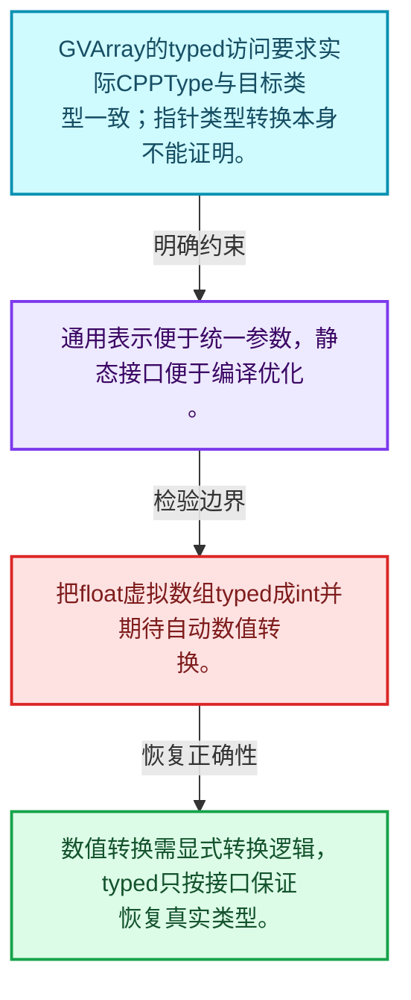
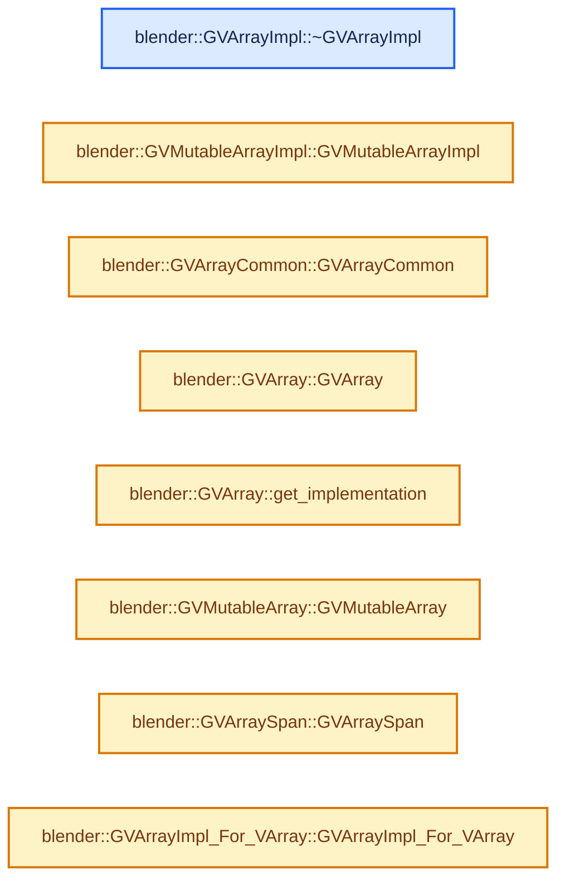
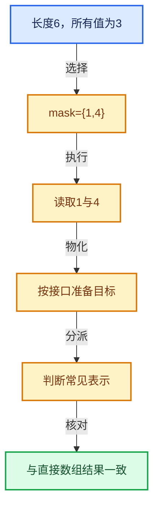

# 04-05 GVArray运行时类型

[方向导航](README.md) · [总目录](../README.md) · [实现索引](../%E7%AC%A6%E5%8F%B7%E4%BE%9D%E8%B5%96%E4%B8%8E%E5%AE%9E%E7%8E%B0%E7%B4%A2%E5%BC%95.md)

## 从问题到实现

未知类型下怎样统一虚拟数组访问？

CPPType为读写和物化提供类型操作；typed转换需要真实类型一致，不能把强转当验证。

**数据模型**

GVArray的typed访问要求实际CPPType与目标类型一致；指针类型转换本身不能证明。

**设计取舍**

通用表示便于统一参数，静态接口便于编译优化。

**最小反例**

把float虚拟数组typed成int并期待自动数值转换。

**推导**

数值转换需显式转换逻辑，typed只按接口保证恢复真实类型。

## 阅读地图与执行推演








图中的数值推演是本方向的教学模型；实际函数之间的调用边与概念分析边分别标注，不能把概念关系当作运行时调度顺序。

## 完整源码单元与就地讲解

中文讲解直接放在相关代码旁，复杂机制在代码下展开。原文折叠区保留基准行号；不需要在行号表和函数之间来回查找。类布局可分段展示，函数实现不按固定行数切开。

### 类型布局、声明与编译条件 · BLI_generic_virtual_array.hh L1—L36

<a id="t-0037814deafa"></a>

<a id="t-3f71395a6e3f"></a>

`GVArrayImpl`在这里声明的数据成员：

- `CPPType type_`
- `int64_t size_`

<a id="t-f45fa17f089b"></a>

<a id="t-1bb91291dfc9"></a>

<a id="t-e63b5de2dde2"></a>

`GVArrayImpl`在这里声明的数据成员：

- `CPPType type_`
- `int64_t size_`

<!-- annotated:44c7c119ee86e3 -->

```cpp
/* SPDX-FileCopyrightText: 2023 Blender Authors
 *
 * SPDX-License-Identifier: GPL-2.0-or-later */

#pragma once

/** \file
 * \ingroup bli
 *
 * A generic virtual array is the same as a virtual array, except for the fact that the data type
 * is only known at runtime.
 */

#include "BLI_generic_array.hh"
#include "BLI_generic_span.hh"
#include "BLI_virtual_array.hh"

namespace blender {

/* -------------------------------------------------------------------- */
/** \name #GVArrayImpl and #GVMutableArrayImpl.
 * \{ */

class GVArray;
class GVArrayImpl;
class GVMutableArray;
class GVMutableArrayImpl;

/* A generically typed version of #VArrayImpl. */
class GVArrayImpl {
 protected:
  const CPPType *type_;
  int64_t size_;

 public:
  GVArrayImpl(const CPPType &type, int64_t size);
```

<details>
<summary>核对原始源码：source/blender/blenlib/BLI_generic_virtual_array.hh · L1—L36</summary>

<!-- original:44c7c119ee86e3:source/blender/blenlib/BLI_generic_virtual_array.hh:1:36 -->

```cpp
/* SPDX-FileCopyrightText: 2023 Blender Authors
 *
 * SPDX-License-Identifier: GPL-2.0-or-later */

#pragma once

/** \file
 * \ingroup bli
 *
 * A generic virtual array is the same as a virtual array, except for the fact that the data type
 * is only known at runtime.
 */

#include "BLI_generic_array.hh"
#include "BLI_generic_span.hh"
#include "BLI_virtual_array.hh"

namespace blender {

/* -------------------------------------------------------------------- */
/** \name #GVArrayImpl and #GVMutableArrayImpl.
 * \{ */

class GVArray;
class GVArrayImpl;
class GVMutableArray;
class GVMutableArrayImpl;

/* A generically typed version of #VArrayImpl. */
class GVArrayImpl {
 protected:
  const CPPType *type_;
  int64_t size_;

 public:
  GVArrayImpl(const CPPType &type, int64_t size);
```

</details>

<a id="f-4423a8b32c24181e"></a>

### `blender::GVArrayImpl::~GVArrayImpl`

实现位置：[source/blender/blenlib/BLI_generic_virtual_array.hh](../../../../../source/blender/blenlib/BLI_generic_virtual_array.hh) · L37—L37。

**教学注释版**

<!-- annotated:fc8c71dbeb9bec -->

```cpp
  virtual ~GVArrayImpl() = default;
```

<details>
<summary>核对原始源码：source/blender/blenlib/BLI_generic_virtual_array.hh · L37—L37</summary>

<!-- original:fc8c71dbeb9bec:source/blender/blenlib/BLI_generic_virtual_array.hh:37:37 -->

```cpp
  virtual ~GVArrayImpl() = default;
```

</details>

**继续追踪实现**

本实现没有需要继续展开的显式调用；检查返回表达式、对象转换和调用者前置条件。

### 类型布局、声明与编译条件 · BLI_generic_virtual_array.hh L38—L58

<a id="t-4cbc03045adb"></a>

<!-- annotated:7ce37850ac378f -->

```cpp

  const CPPType &type() const;

  int64_t size() const;

  virtual void get(int64_t index, void *r_value) const;
  virtual void get_to_uninitialized(int64_t index, void *r_value) const = 0;

  virtual CommonVArrayInfo common_info() const;

  virtual void materialize(const IndexMask &mask, void *dst, bool dst_is_uninitialized) const;
  virtual void materialize_compressed(const IndexMask &mask,
                                      void *dst,
                                      bool dst_is_uninitialized) const;

  virtual bool try_assign_VArray(void *varray) const;
};

/* A generic version of #VMutableArrayImpl. */
class GVMutableArrayImpl : public GVArrayImpl {
 public:
```

<details>
<summary>核对原始源码：source/blender/blenlib/BLI_generic_virtual_array.hh · L38—L58</summary>

<!-- original:7ce37850ac378f:source/blender/blenlib/BLI_generic_virtual_array.hh:38:58 -->

```cpp

  const CPPType &type() const;

  int64_t size() const;

  virtual void get(int64_t index, void *r_value) const;
  virtual void get_to_uninitialized(int64_t index, void *r_value) const = 0;

  virtual CommonVArrayInfo common_info() const;

  virtual void materialize(const IndexMask &mask, void *dst, bool dst_is_uninitialized) const;
  virtual void materialize_compressed(const IndexMask &mask,
                                      void *dst,
                                      bool dst_is_uninitialized) const;

  virtual bool try_assign_VArray(void *varray) const;
};

/* A generic version of #VMutableArrayImpl. */
class GVMutableArrayImpl : public GVArrayImpl {
 public:
```

</details>

<a id="f-e0634e756247fff4"></a>

### `blender::GVMutableArrayImpl::GVMutableArrayImpl`

实现位置：[source/blender/blenlib/BLI_generic_virtual_array.hh](../../../../../source/blender/blenlib/BLI_generic_virtual_array.hh) · L59—L59。

接口参数：

- `const CPPType &type`
- `int64_t size`

**教学注释版**

<!-- annotated:e08201ed7443de -->

```cpp
  GVMutableArrayImpl(const CPPType &type, int64_t size) : GVArrayImpl(type, size) {}
```

<details>
<summary>核对原始源码：source/blender/blenlib/BLI_generic_virtual_array.hh · L59—L59</summary>

<!-- original:e08201ed7443de:source/blender/blenlib/BLI_generic_virtual_array.hh:59:59 -->

```cpp
  GVMutableArrayImpl(const CPPType &type, int64_t size) : GVArrayImpl(type, size) {}
```

</details>

**继续追踪实现**

本实现没有需要继续展开的显式调用；检查返回表达式、对象转换和调用者前置条件。

### 类型布局、声明与编译条件 · BLI_generic_virtual_array.hh L60—L94

<a id="t-8eebaf3dc8bd"></a>

`GVArrayAnyExtraInfo`在这里声明的数据成员：

- `GVArrayImpl get_varray`

<a id="t-6e9e86e901ed"></a>

<a id="t-acbaf2fe114a"></a>

`GVArrayCommon`在这里声明的数据成员：

- `AnyDerived<const GVArrayImpl, 40> impl_`

<!-- annotated:e1eabda8bca1ed -->

```cpp

  virtual void set_by_copy(int64_t index, const void *value);
  virtual void set_by_relocate(int64_t index, void *value);
  virtual void set_by_move(int64_t index, void *value) = 0;

  virtual void set_all(const void *src);

  virtual bool try_assign_VMutableArray(void *varray) const;
};

/** \} */

/* -------------------------------------------------------------------- */
/** \name #GVArray and #GVMutableArray
 * \{ */

namespace blenlib_detail {
struct GVArrayAnyExtraInfo {
  const GVArrayImpl *(*get_varray)(const void *buffer) =
      [](const void * /*buffer*/) -> const GVArrayImpl * { return nullptr; };

  template<typename StorageT> static constexpr GVArrayAnyExtraInfo get();
};
}  // namespace blenlib_detail

class GVMutableArray;

/**
 * Utility class to reduce code duplication between #GVArray and #GVMutableArray.
 * It pretty much follows #VArrayCommon. Don't use this class outside of this header.
 */
class GVArrayCommon {
 protected:
  AnyDerived<const GVArrayImpl, 40> impl_;

```

<details>
<summary>核对原始源码：source/blender/blenlib/BLI_generic_virtual_array.hh · L60—L94</summary>

<!-- original:e1eabda8bca1ed:source/blender/blenlib/BLI_generic_virtual_array.hh:60:94 -->

```cpp

  virtual void set_by_copy(int64_t index, const void *value);
  virtual void set_by_relocate(int64_t index, void *value);
  virtual void set_by_move(int64_t index, void *value) = 0;

  virtual void set_all(const void *src);

  virtual bool try_assign_VMutableArray(void *varray) const;
};

/** \} */

/* -------------------------------------------------------------------- */
/** \name #GVArray and #GVMutableArray
 * \{ */

namespace blenlib_detail {
struct GVArrayAnyExtraInfo {
  const GVArrayImpl *(*get_varray)(const void *buffer) =
      [](const void * /*buffer*/) -> const GVArrayImpl * { return nullptr; };

  template<typename StorageT> static constexpr GVArrayAnyExtraInfo get();
};
}  // namespace blenlib_detail

class GVMutableArray;

/**
 * Utility class to reduce code duplication between #GVArray and #GVMutableArray.
 * It pretty much follows #VArrayCommon. Don't use this class outside of this header.
 */
class GVArrayCommon {
 protected:
  AnyDerived<const GVArrayImpl, 40> impl_;

```

</details>

<a id="f-b1b8889f91d37cdc"></a>

### `blender::GVArrayCommon::GVArrayCommon`

实现位置：[source/blender/blenlib/BLI_generic_virtual_array.hh](../../../../../source/blender/blenlib/BLI_generic_virtual_array.hh) · L95—L95。

**教学注释版**

<!-- annotated:419fd1ccfc4f01 -->

```cpp
  GVArrayCommon() = default;
```

<details>
<summary>核对原始源码：source/blender/blenlib/BLI_generic_virtual_array.hh · L95—L95</summary>

<!-- original:419fd1ccfc4f01:source/blender/blenlib/BLI_generic_virtual_array.hh:95:95 -->

```cpp
  GVArrayCommon() = default;
```

</details>

**继续追踪实现**

本实现没有需要继续展开的显式调用；检查返回表达式、对象转换和调用者前置条件。

### 类型布局、声明与编译条件 · BLI_generic_virtual_array.hh L96—L162

<a id="t-ebc8aff76f9b"></a>

<!-- annotated:fd690f904d7326 -->

```cpp
  GVArrayCommon(const GVArrayImpl *impl);
  GVArrayCommon(std::shared_ptr<const GVArrayImpl> impl);

  template<typename ImplT, typename... Args> void emplace(Args &&...args);

 public:
  const CPPType &type() const;
  operator bool() const;

  int64_t size() const;
  bool is_empty() const;
  IndexRange index_range() const;

  template<typename T> bool try_assign_VArray(VArray<T> &varray) const;
  bool may_have_ownership() const;

  void materialize(void *dst) const;
  void materialize(const IndexMask &mask, void *dst) const;

  void materialize_to_uninitialized(void *dst) const;
  void materialize_to_uninitialized(const IndexMask &mask, void *dst) const;

  void materialize_compressed(const IndexMask &mask, void *dst) const;
  void materialize_compressed_to_uninitialized(const IndexMask &mask, void *dst) const;

  CommonVArrayInfo common_info() const;

  /**
   * Returns true when the virtual array is stored as a span internally.
   */
  bool is_span() const;
  /**
   * Returns the internally used span of the virtual array. This invokes undefined behavior if the
   * virtual array is not stored as a span internally.
   */
  GSpan get_internal_span() const;

  /**
   * Returns true when the virtual array returns the same value for every index.
   */
  bool is_single() const;
  /**
   * Copies the value that is used for every element into `r_value`, which is expected to point to
   * initialized memory. This invokes undefined behavior if the virtual array would not return the
   * same value for every index.
   */
  void get_internal_single(void *r_value) const;
  /**
   * Same as `get_internal_single`, but `r_value` points to initialized memory.
   */
  void get_internal_single_to_uninitialized(void *r_value) const;

  void get(int64_t index, void *r_value) const;
  /**
   * Returns a copy of the value at the given index. Usually a typed virtual array should
   * be used instead, but sometimes this is simpler when only a few indices are needed.
   */
  template<typename T> T get(int64_t index) const;
  void get_to_uninitialized(int64_t index, void *r_value) const;
};

/** Generic version of #VArray. */
class GVArray : public GVArrayCommon {
 private:
  friend GVMutableArray;

 public:
```

<details>
<summary>核对原始源码：source/blender/blenlib/BLI_generic_virtual_array.hh · L96—L162</summary>

<!-- original:fd690f904d7326:source/blender/blenlib/BLI_generic_virtual_array.hh:96:162 -->

```cpp
  GVArrayCommon(const GVArrayImpl *impl);
  GVArrayCommon(std::shared_ptr<const GVArrayImpl> impl);

  template<typename ImplT, typename... Args> void emplace(Args &&...args);

 public:
  const CPPType &type() const;
  operator bool() const;

  int64_t size() const;
  bool is_empty() const;
  IndexRange index_range() const;

  template<typename T> bool try_assign_VArray(VArray<T> &varray) const;
  bool may_have_ownership() const;

  void materialize(void *dst) const;
  void materialize(const IndexMask &mask, void *dst) const;

  void materialize_to_uninitialized(void *dst) const;
  void materialize_to_uninitialized(const IndexMask &mask, void *dst) const;

  void materialize_compressed(const IndexMask &mask, void *dst) const;
  void materialize_compressed_to_uninitialized(const IndexMask &mask, void *dst) const;

  CommonVArrayInfo common_info() const;

  /**
   * Returns true when the virtual array is stored as a span internally.
   */
  bool is_span() const;
  /**
   * Returns the internally used span of the virtual array. This invokes undefined behavior if the
   * virtual array is not stored as a span internally.
   */
  GSpan get_internal_span() const;

  /**
   * Returns true when the virtual array returns the same value for every index.
   */
  bool is_single() const;
  /**
   * Copies the value that is used for every element into `r_value`, which is expected to point to
   * initialized memory. This invokes undefined behavior if the virtual array would not return the
   * same value for every index.
   */
  void get_internal_single(void *r_value) const;
  /**
   * Same as `get_internal_single`, but `r_value` points to initialized memory.
   */
  void get_internal_single_to_uninitialized(void *r_value) const;

  void get(int64_t index, void *r_value) const;
  /**
   * Returns a copy of the value at the given index. Usually a typed virtual array should
   * be used instead, but sometimes this is simpler when only a few indices are needed.
   */
  template<typename T> T get(int64_t index) const;
  void get_to_uninitialized(int64_t index, void *r_value) const;
};

/** Generic version of #VArray. */
class GVArray : public GVArrayCommon {
 private:
  friend GVMutableArray;

 public:
```

</details>

<a id="f-64f7cbf5d9f0e955"></a>

### `blender::GVArray::GVArray`

实现位置：[source/blender/blenlib/BLI_generic_virtual_array.hh](../../../../../source/blender/blenlib/BLI_generic_virtual_array.hh) · L163—L163。

**教学注释版**

<!-- annotated:71daff5cee62ff -->

```cpp
  GVArray() = default;
```

<details>
<summary>核对原始源码：source/blender/blenlib/BLI_generic_virtual_array.hh · L163—L163</summary>

<!-- original:71daff5cee62ff:source/blender/blenlib/BLI_generic_virtual_array.hh:163:163 -->

```cpp
  GVArray() = default;
```

</details>

**继续追踪实现**

本实现没有需要继续展开的显式调用；检查返回表达式、对象转换和调用者前置条件。

### 类型布局、声明与编译条件 · BLI_generic_virtual_array.hh L164—L191

<!-- annotated:7f2af523dffc38 -->

```cpp

  GVArray(const GVArrayImpl *impl);
  GVArray(std::shared_ptr<const GVArrayImpl> impl);

  GVArray(varray_tag::span /*tag*/, GSpan span);
  GVArray(varray_tag::single_ref /*tag*/, const CPPType &type, int64_t size, const void *value);
  GVArray(varray_tag::single /*tag*/, const CPPType &type, int64_t size, const void *value);

  template<typename T> GVArray(const VArray<T> &varray);
  template<typename T> GVArray(VArray<T> &&varray);
  template<typename T> VArray<T> typed() const;

  template<typename ImplT, typename... Args> static GVArray from(Args &&...args);

  static GVArray from_single(const CPPType &type, int64_t size, const void *value);
  static GVArray from_single_ref(const CPPType &type, int64_t size, const void *value);
  static GVArray from_single_default(const CPPType &type, int64_t size);
  static GVArray from_span(GSpan span);
  static GVArray from_garray(GArray<> array);
  static GVArray from_empty(const CPPType &type);
  template<typename GetToUninitFn>
  static GVArray from_func(const CPPType &type, int64_t size, GetToUninitFn &&get_to_uninit);
  static GVArray from_std_func(const CPPType &type,
                               int64_t size,
                               std::function<void(int64_t index, void *r_value)> get_to_uninit);

  GVArray slice(IndexRange slice) const;

```

<details>
<summary>核对原始源码：source/blender/blenlib/BLI_generic_virtual_array.hh · L164—L191</summary>

<!-- original:7f2af523dffc38:source/blender/blenlib/BLI_generic_virtual_array.hh:164:191 -->

```cpp

  GVArray(const GVArrayImpl *impl);
  GVArray(std::shared_ptr<const GVArrayImpl> impl);

  GVArray(varray_tag::span /*tag*/, GSpan span);
  GVArray(varray_tag::single_ref /*tag*/, const CPPType &type, int64_t size, const void *value);
  GVArray(varray_tag::single /*tag*/, const CPPType &type, int64_t size, const void *value);

  template<typename T> GVArray(const VArray<T> &varray);
  template<typename T> GVArray(VArray<T> &&varray);
  template<typename T> VArray<T> typed() const;

  template<typename ImplT, typename... Args> static GVArray from(Args &&...args);

  static GVArray from_single(const CPPType &type, int64_t size, const void *value);
  static GVArray from_single_ref(const CPPType &type, int64_t size, const void *value);
  static GVArray from_single_default(const CPPType &type, int64_t size);
  static GVArray from_span(GSpan span);
  static GVArray from_garray(GArray<> array);
  static GVArray from_empty(const CPPType &type);
  template<typename GetToUninitFn>
  static GVArray from_func(const CPPType &type, int64_t size, GetToUninitFn &&get_to_uninit);
  static GVArray from_std_func(const CPPType &type,
                               int64_t size,
                               std::function<void(int64_t index, void *r_value)> get_to_uninit);

  GVArray slice(IndexRange slice) const;

```

</details>

<a id="f-6ffca701d1b3b981"></a>

### `blender::GVArray::get_implementation`

实现位置：[source/blender/blenlib/BLI_generic_virtual_array.hh](../../../../../source/blender/blenlib/BLI_generic_virtual_array.hh) · L192—L195。

**教学注释版**

<!-- annotated:83b3297dd86500 -->

```cpp
  const GVArrayImpl *get_implementation() const
  {
    return impl_.get();
  }
```

<details>
<summary>核对原始源码：source/blender/blenlib/BLI_generic_virtual_array.hh · L192—L195</summary>

<!-- original:83b3297dd86500:source/blender/blenlib/BLI_generic_virtual_array.hh:192:195 -->

```cpp
  const GVArrayImpl *get_implementation() const
  {
    return impl_.get();
  }
```

</details>

**结果出口**

- `return impl_.get();`

**继续追踪实现**

- `impl_.get` → [调用协议](../%E6%A8%A1%E6%9D%BF%E5%AE%8F%E4%B8%8E%E5%8A%A8%E6%80%81%E5%88%86%E6%B4%BE%E5%8D%8F%E8%AE%AE.md)：接收对象类型依赖auto、返回值或模板实例；不按同名猜测目标。调用位置L194。

### 类型布局、声明与编译条件 · BLI_generic_virtual_array.hh L196—L200

<a id="t-e6b6bbe7f21c"></a>

<!-- annotated:5fa062f7600687 -->

```cpp
};

/** Generic version of #VMutableArray. */
class GVMutableArray : public GVArrayCommon {
 public:
```

<details>
<summary>核对原始源码：source/blender/blenlib/BLI_generic_virtual_array.hh · L196—L200</summary>

<!-- original:5fa062f7600687:source/blender/blenlib/BLI_generic_virtual_array.hh:196:200 -->

```cpp
};

/** Generic version of #VMutableArray. */
class GVMutableArray : public GVArrayCommon {
 public:
```

</details>

<a id="f-755e1cf8dfa41c20"></a>

### `blender::GVMutableArray::GVMutableArray`

实现位置：[source/blender/blenlib/BLI_generic_virtual_array.hh](../../../../../source/blender/blenlib/BLI_generic_virtual_array.hh) · L201—L201。

**教学注释版**

<!-- annotated:645d94af27b42f -->

```cpp
  GVMutableArray() = default;
```

<details>
<summary>核对原始源码：source/blender/blenlib/BLI_generic_virtual_array.hh · L201—L201</summary>

<!-- original:645d94af27b42f:source/blender/blenlib/BLI_generic_virtual_array.hh:201:201 -->

```cpp
  GVMutableArray() = default;
```

</details>

**继续追踪实现**

本实现没有需要继续展开的显式调用；检查返回表达式、对象转换和调用者前置条件。

### 类型布局、声明与编译条件 · BLI_generic_virtual_array.hh L202—L249

<a id="t-231ca0de7a32"></a>

`GVArraySpan`在这里声明的数据成员：

- `GVArray varray_`
- `void owned_data_`

<!-- annotated:3288896fc08577 -->

```cpp
  GVMutableArray(GVMutableArrayImpl *impl);
  GVMutableArray(std::shared_ptr<GVMutableArrayImpl> impl);

  template<typename T> GVMutableArray(const VMutableArray<T> &varray);
  template<typename T> VMutableArray<T> typed() const;

  template<typename ImplT, typename... Args> static GVMutableArray from(Args &&...args);

  static GVMutableArray from_span(GMutableSpan span);

  operator GVArray() const &;
  operator GVArray() && noexcept;

  GMutableSpan get_internal_span() const;

  template<typename T> bool try_assign_VMutableArray(VMutableArray<T> &varray) const;

  void set_by_copy(int64_t index, const void *value);
  void set_by_move(int64_t index, void *value);
  void set_by_relocate(int64_t index, void *value);

  void fill(const void *value);
  /**
   * Copy the values from the source buffer to all elements in the virtual array.
   */
  void set_all(const void *src);

  GVMutableArrayImpl *get_implementation() const;

 private:
  GVMutableArrayImpl *get_impl() const;
};

/** \} */

/* -------------------------------------------------------------------- */
/** \name #GVArraySpan and #GMutableVArraySpan.
 * \{ */

/* A generic version of VArraySpan. */
class GVArraySpan : public GSpan {
 private:
  GVArray varray_;
  void *owned_data_ = nullptr;

 public:
  GVArraySpan();
  GVArraySpan(GVArray varray);
```

<details>
<summary>核对原始源码：source/blender/blenlib/BLI_generic_virtual_array.hh · L202—L249</summary>

<!-- original:3288896fc08577:source/blender/blenlib/BLI_generic_virtual_array.hh:202:249 -->

```cpp
  GVMutableArray(GVMutableArrayImpl *impl);
  GVMutableArray(std::shared_ptr<GVMutableArrayImpl> impl);

  template<typename T> GVMutableArray(const VMutableArray<T> &varray);
  template<typename T> VMutableArray<T> typed() const;

  template<typename ImplT, typename... Args> static GVMutableArray from(Args &&...args);

  static GVMutableArray from_span(GMutableSpan span);

  operator GVArray() const &;
  operator GVArray() && noexcept;

  GMutableSpan get_internal_span() const;

  template<typename T> bool try_assign_VMutableArray(VMutableArray<T> &varray) const;

  void set_by_copy(int64_t index, const void *value);
  void set_by_move(int64_t index, void *value);
  void set_by_relocate(int64_t index, void *value);

  void fill(const void *value);
  /**
   * Copy the values from the source buffer to all elements in the virtual array.
   */
  void set_all(const void *src);

  GVMutableArrayImpl *get_implementation() const;

 private:
  GVMutableArrayImpl *get_impl() const;
};

/** \} */

/* -------------------------------------------------------------------- */
/** \name #GVArraySpan and #GMutableVArraySpan.
 * \{ */

/* A generic version of VArraySpan. */
class GVArraySpan : public GSpan {
 private:
  GVArray varray_;
  void *owned_data_ = nullptr;

 public:
  GVArraySpan();
  GVArraySpan(GVArray varray);
```

</details>

<a id="f-b479de195b07e6f3"></a>

### `blender::GVArraySpan::GVArraySpan`

实现位置：[source/blender/blenlib/BLI_generic_virtual_array.hh](../../../../../source/blender/blenlib/BLI_generic_virtual_array.hh) · L250—L250。

接口参数：

- `VArray<T> varray`

**教学注释版**

<!-- annotated:842e4abe197cb5 -->

```cpp
  template<typename T> GVArraySpan(VArray<T> varray) : GVArraySpan(GVArray(varray)) {}
```

<details>
<summary>核对原始源码：source/blender/blenlib/BLI_generic_virtual_array.hh · L250—L250</summary>

<!-- original:842e4abe197cb5:source/blender/blenlib/BLI_generic_virtual_array.hh:250:250 -->

```cpp
  template<typename T> GVArraySpan(VArray<T> varray) : GVArraySpan(GVArray(varray)) {}
```

</details>

**继续追踪实现**

本实现没有需要继续展开的显式调用；检查返回表达式、对象转换和调用者前置条件。

### 类型布局、声明与编译条件 · BLI_generic_virtual_array.hh L251—L288

<a id="t-a8b07a9bce07"></a>

`GMutableVArraySpan`在这里声明的数据成员：

- `GVMutableArray varray_`
- `void owned_data_`
- `bool save_has_been_called_`
- `bool show_not_saved_warning_`
- `GMutableVArraySpan operator=`
- `GVMutableArray varray`
- `void save`
- `void disable_not_applied_warning`

<a id="t-f116c700e848"></a>

`GVArrayImpl_For_VArray`在这里声明的数据成员：

- `VArray<T> varray_`

<!-- annotated:9449b884fff546 -->

```cpp
  GVArraySpan(GVArraySpan &&other);
  ~GVArraySpan();
  GVArraySpan &operator=(GVArraySpan &&other);
};

/* A generic version of MutableVArraySpan. */
class GMutableVArraySpan : public GMutableSpan, NonCopyable, NonMovable {
 private:
  GVMutableArray varray_;
  void *owned_data_ = nullptr;
  bool save_has_been_called_ = false;
  bool show_not_saved_warning_ = true;

 public:
  GMutableVArraySpan();
  GMutableVArraySpan(GVMutableArray varray, bool copy_values_to_span = true);
  GMutableVArraySpan(GMutableVArraySpan &&other);
  ~GMutableVArraySpan();
  GMutableVArraySpan &operator=(GMutableVArraySpan &&other);

  const GVMutableArray &varray() const;

  void save();
  void disable_not_applied_warning();
};

/** \} */

/* -------------------------------------------------------------------- */
/** \name Conversions between generic and typed virtual arrays.
 * \{ */

/* Used to convert a typed virtual array into a generic one. */
template<typename T> class GVArrayImpl_For_VArray : public GVArrayImpl {
 protected:
  VArray<T> varray_;

 public:
```

<details>
<summary>核对原始源码：source/blender/blenlib/BLI_generic_virtual_array.hh · L251—L288</summary>

<!-- original:9449b884fff546:source/blender/blenlib/BLI_generic_virtual_array.hh:251:288 -->

```cpp
  GVArraySpan(GVArraySpan &&other);
  ~GVArraySpan();
  GVArraySpan &operator=(GVArraySpan &&other);
};

/* A generic version of MutableVArraySpan. */
class GMutableVArraySpan : public GMutableSpan, NonCopyable, NonMovable {
 private:
  GVMutableArray varray_;
  void *owned_data_ = nullptr;
  bool save_has_been_called_ = false;
  bool show_not_saved_warning_ = true;

 public:
  GMutableVArraySpan();
  GMutableVArraySpan(GVMutableArray varray, bool copy_values_to_span = true);
  GMutableVArraySpan(GMutableVArraySpan &&other);
  ~GMutableVArraySpan();
  GMutableVArraySpan &operator=(GMutableVArraySpan &&other);

  const GVMutableArray &varray() const;

  void save();
  void disable_not_applied_warning();
};

/** \} */

/* -------------------------------------------------------------------- */
/** \name Conversions between generic and typed virtual arrays.
 * \{ */

/* Used to convert a typed virtual array into a generic one. */
template<typename T> class GVArrayImpl_For_VArray : public GVArrayImpl {
 protected:
  VArray<T> varray_;

 public:
```

</details>

<a id="f-102f12c7aa2920ab"></a>

### `blender::GVArrayImpl_For_VArray::GVArrayImpl_For_VArray`

实现位置：[source/blender/blenlib/BLI_generic_virtual_array.hh](../../../../../source/blender/blenlib/BLI_generic_virtual_array.hh) · L289—L292。

接口参数：

- `VArray<T> varray`

**教学注释版**

<!-- annotated:0aa7e9f1c8975b -->

```cpp
  GVArrayImpl_For_VArray(VArray<T> varray)
      : GVArrayImpl(CPPType::get<T>(), varray.size()), varray_(std::move(varray))
  {
  }
```

<details>
<summary>核对原始源码：source/blender/blenlib/BLI_generic_virtual_array.hh · L289—L292</summary>

<!-- original:0aa7e9f1c8975b:source/blender/blenlib/BLI_generic_virtual_array.hh:289:292 -->

```cpp
  GVArrayImpl_For_VArray(VArray<T> varray)
      : GVArrayImpl(CPPType::get<T>(), varray.size()), varray_(std::move(varray))
  {
  }
```

</details>

**继续追踪实现**

本实现没有需要继续展开的显式调用；检查返回表达式、对象转换和调用者前置条件。

### 类型布局、声明与编译条件 · BLI_generic_virtual_array.hh L293—L294

<!-- annotated:7e0ca1d82adbd5 -->

```cpp

 protected:
```

<details>
<summary>核对原始源码：source/blender/blenlib/BLI_generic_virtual_array.hh · L293—L294</summary>

<!-- original:7e0ca1d82adbd5:source/blender/blenlib/BLI_generic_virtual_array.hh:293:294 -->

```cpp

 protected:
```

</details>

<a id="f-b1dc5f5c9b362838"></a>

### `blender::GVArrayImpl_For_VArray::get`

实现位置：[source/blender/blenlib/BLI_generic_virtual_array.hh](../../../../../source/blender/blenlib/BLI_generic_virtual_array.hh) · L295—L298。

接口参数：

- `const int64_t index`
- `void *r_value`

**教学注释版**

<!-- annotated:d8c256db55dae4 -->

```cpp
  void get(const int64_t index, void *r_value) const override
  {
    *static_cast<T *>(r_value) = varray_[index];
  }
```

<details>
<summary>核对原始源码：source/blender/blenlib/BLI_generic_virtual_array.hh · L295—L298</summary>

<!-- original:d8c256db55dae4:source/blender/blenlib/BLI_generic_virtual_array.hh:295:298 -->

```cpp
  void get(const int64_t index, void *r_value) const override
  {
    *static_cast<T *>(r_value) = varray_[index];
  }
```

</details>

**继续追踪实现**

本实现没有需要继续展开的显式调用；检查返回表达式、对象转换和调用者前置条件。

<!-- annotated:5cdf6a46fd241f -->

```cpp

```

<details>
<summary>核对原始源码：source/blender/blenlib/BLI_generic_virtual_array.hh · L299—L299</summary>

<!-- original:5cdf6a46fd241f:source/blender/blenlib/BLI_generic_virtual_array.hh:299:299 -->

```cpp

```

</details>

<a id="f-0a49b2ca66ab4ad6"></a>

### `blender::GVArrayImpl_For_VArray::get_to_uninitialized`

实现位置：[source/blender/blenlib/BLI_generic_virtual_array.hh](../../../../../source/blender/blenlib/BLI_generic_virtual_array.hh) · L300—L303。

接口参数：

- `const int64_t index`
- `void *r_value`

**教学注释版**

<!-- annotated:31fd85f6f179af -->

```cpp
  void get_to_uninitialized(const int64_t index, void *r_value) const override
  {
    new (r_value) T(varray_[index]);
  }
```

<details>
<summary>核对原始源码：source/blender/blenlib/BLI_generic_virtual_array.hh · L300—L303</summary>

<!-- original:31fd85f6f179af:source/blender/blenlib/BLI_generic_virtual_array.hh:300:303 -->

```cpp
  void get_to_uninitialized(const int64_t index, void *r_value) const override
  {
    new (r_value) T(varray_[index]);
  }
```

</details>

**继续追踪实现**

本实现没有需要继续展开的显式调用；检查返回表达式、对象转换和调用者前置条件。

<!-- annotated:f5f163c1c15247 -->

```cpp

```

<details>
<summary>核对原始源码：source/blender/blenlib/BLI_generic_virtual_array.hh · L304—L304</summary>

<!-- original:f5f163c1c15247:source/blender/blenlib/BLI_generic_virtual_array.hh:304:304 -->

```cpp

```

</details>

<a id="f-507b6065108ad9d9"></a>

### `blender::GVArrayImpl_For_VArray::materialize`

实现位置：[source/blender/blenlib/BLI_generic_virtual_array.hh](../../../../../source/blender/blenlib/BLI_generic_virtual_array.hh) · L305—L310。

接口参数：

- `const IndexMask &mask`
- `void *dst`
- `const bool dst_is_uninitialized`

**教学注释版**

<!-- annotated:ae3349a25161a2 -->

```cpp
  void materialize(const IndexMask &mask,
                   void *dst,
                   const bool dst_is_uninitialized) const override
  {
    varray_.get_implementation()->materialize(mask, static_cast<T *>(dst), dst_is_uninitialized);
  }
```

<details>
<summary>核对原始源码：source/blender/blenlib/BLI_generic_virtual_array.hh · L305—L310</summary>

<!-- original:ae3349a25161a2:source/blender/blenlib/BLI_generic_virtual_array.hh:305:310 -->

```cpp
  void materialize(const IndexMask &mask,
                   void *dst,
                   const bool dst_is_uninitialized) const override
  {
    varray_.get_implementation()->materialize(mask, static_cast<T *>(dst), dst_is_uninitialized);
  }
```

</details>

**继续追踪实现**

- `varray_.get_implementation()->materialize` → [调用协议](../%E6%A8%A1%E6%9D%BF%E5%AE%8F%E4%B8%8E%E5%8A%A8%E6%80%81%E5%88%86%E6%B4%BE%E5%8D%8F%E8%AE%AE.md)：接收对象类型依赖auto、返回值或模板实例；不按同名猜测目标。调用位置L309。
- `varray_.get_implementation` → [blender::GVArray::get_implementation · L192](05-GVArray%E8%BF%90%E8%A1%8C%E6%97%B6%E7%B1%BB%E5%9E%8B.md#f-6ffca701d1b3b981)；[blender::GVMutableArray::get_implementation · L695](05-GVArray%E8%BF%90%E8%A1%8C%E6%97%B6%E7%B1%BB%E5%9E%8B.md#f-00cf64c9a9fed688)。同名重载需按实参类型选择。

<!-- annotated:bf221cbe3492b7 -->

```cpp

```

<details>
<summary>核对原始源码：source/blender/blenlib/BLI_generic_virtual_array.hh · L311—L311</summary>

<!-- original:bf221cbe3492b7:source/blender/blenlib/BLI_generic_virtual_array.hh:311:311 -->

```cpp

```

</details>

<a id="f-8f720e5e19fbb193"></a>

### `blender::GVArrayImpl_For_VArray::materialize_compressed`

实现位置：[source/blender/blenlib/BLI_generic_virtual_array.hh](../../../../../source/blender/blenlib/BLI_generic_virtual_array.hh) · L312—L318。

接口参数：

- `const IndexMask &mask`
- `void *dst`
- `const bool dst_is_uninitialized`

**教学注释版**

<!-- annotated:db5979162b1ea6 -->

```cpp
  void materialize_compressed(const IndexMask &mask,
                              void *dst,
                              const bool dst_is_uninitialized) const override
  {
    varray_.get_implementation()->materialize_compressed(
        mask, static_cast<T *>(dst), dst_is_uninitialized);
  }
```

<details>
<summary>核对原始源码：source/blender/blenlib/BLI_generic_virtual_array.hh · L312—L318</summary>

<!-- original:db5979162b1ea6:source/blender/blenlib/BLI_generic_virtual_array.hh:312:318 -->

```cpp
  void materialize_compressed(const IndexMask &mask,
                              void *dst,
                              const bool dst_is_uninitialized) const override
  {
    varray_.get_implementation()->materialize_compressed(
        mask, static_cast<T *>(dst), dst_is_uninitialized);
  }
```

</details>

**继续追踪实现**

- `varray_.get_implementation()->materialize_compressed` → [调用协议](../%E6%A8%A1%E6%9D%BF%E5%AE%8F%E4%B8%8E%E5%8A%A8%E6%80%81%E5%88%86%E6%B4%BE%E5%8D%8F%E8%AE%AE.md)：接收对象类型依赖auto、返回值或模板实例；不按同名猜测目标。调用位置L316。
- `varray_.get_implementation` → [blender::GVArray::get_implementation · L192](05-GVArray%E8%BF%90%E8%A1%8C%E6%97%B6%E7%B1%BB%E5%9E%8B.md#f-6ffca701d1b3b981)；[blender::GVMutableArray::get_implementation · L695](05-GVArray%E8%BF%90%E8%A1%8C%E6%97%B6%E7%B1%BB%E5%9E%8B.md#f-00cf64c9a9fed688)。同名重载需按实参类型选择。

<!-- annotated:3b138451123f2b -->

```cpp

```

<details>
<summary>核对原始源码：source/blender/blenlib/BLI_generic_virtual_array.hh · L319—L319</summary>

<!-- original:3b138451123f2b:source/blender/blenlib/BLI_generic_virtual_array.hh:319:319 -->

```cpp

```

</details>

<a id="f-52d073e17919611b"></a>

### `blender::GVArrayImpl_For_VArray::try_assign_VArray`

实现位置：[source/blender/blenlib/BLI_generic_virtual_array.hh](../../../../../source/blender/blenlib/BLI_generic_virtual_array.hh) · L320—L324。

接口参数：

- `void *varray`

**教学注释版**

<!-- annotated:7d2126c36f4cae -->

```cpp
  bool try_assign_VArray(void *varray) const override
  {
    *static_cast<VArray<T> *>(varray) = varray_;
    return true;
  }
```

<details>
<summary>核对原始源码：source/blender/blenlib/BLI_generic_virtual_array.hh · L320—L324</summary>

<!-- original:7d2126c36f4cae:source/blender/blenlib/BLI_generic_virtual_array.hh:320:324 -->

```cpp
  bool try_assign_VArray(void *varray) const override
  {
    *static_cast<VArray<T> *>(varray) = varray_;
    return true;
  }
```

</details>

**结果出口**

- `return true;`

**继续追踪实现**

本实现没有需要继续展开的显式调用；检查返回表达式、对象转换和调用者前置条件。

<!-- annotated:5c5e6ab2b30a3b -->

```cpp

```

<details>
<summary>核对原始源码：source/blender/blenlib/BLI_generic_virtual_array.hh · L325—L325</summary>

<!-- original:5c5e6ab2b30a3b:source/blender/blenlib/BLI_generic_virtual_array.hh:325:325 -->

```cpp

```

</details>

<a id="f-234755181abe3b17"></a>

### `blender::GVArrayImpl_For_VArray::common_info`

实现位置：[source/blender/blenlib/BLI_generic_virtual_array.hh](../../../../../source/blender/blenlib/BLI_generic_virtual_array.hh) · L326—L329。

**教学注释版**

<!-- annotated:692398fa1c08bf -->

```cpp
  CommonVArrayInfo common_info() const override
  {
    return varray_.common_info();
  }
```

<details>
<summary>核对原始源码：source/blender/blenlib/BLI_generic_virtual_array.hh · L326—L329</summary>

<!-- original:692398fa1c08bf:source/blender/blenlib/BLI_generic_virtual_array.hh:326:329 -->

```cpp
  CommonVArrayInfo common_info() const override
  {
    return varray_.common_info();
  }
```

</details>

**结果出口**

- `return varray_.common_info();`

**继续追踪实现**

- `varray_.common_info` → [blender::GVArrayImpl_For_VArray::common_info · L326](05-GVArray%E8%BF%90%E8%A1%8C%E6%97%B6%E7%B1%BB%E5%9E%8B.md#f-234755181abe3b17)。

### 类型布局、声明与编译条件 · BLI_generic_virtual_array.hh L330—L337

<a id="t-789332dd62ef"></a>

`VArrayImpl_For_GVArray`在这里声明的数据成员：

- `GVArray varray_`

<!-- annotated:0b29d036e2d05d -->

```cpp
};

/* Used to convert any generic virtual array into a typed one. */
template<typename T> class VArrayImpl_For_GVArray : public VArrayImpl<T> {
 protected:
  GVArray varray_;

 public:
```

<details>
<summary>核对原始源码：source/blender/blenlib/BLI_generic_virtual_array.hh · L330—L337</summary>

<!-- original:0b29d036e2d05d:source/blender/blenlib/BLI_generic_virtual_array.hh:330:337 -->

```cpp
};

/* Used to convert any generic virtual array into a typed one. */
template<typename T> class VArrayImpl_For_GVArray : public VArrayImpl<T> {
 protected:
  GVArray varray_;

 public:
```

</details>

<a id="f-da0f7c96ec618516"></a>

### `blender::VArrayImpl_For_GVArray::VArrayImpl_For_GVArray`

实现位置：[source/blender/blenlib/BLI_generic_virtual_array.hh](../../../../../source/blender/blenlib/BLI_generic_virtual_array.hh) · L338—L342。

接口参数：

- `GVArray varray`

**教学注释版**

<!-- annotated:b50fe818cce3a3 -->

```cpp
  VArrayImpl_For_GVArray(GVArray varray) : VArrayImpl<T>(varray.size()), varray_(std::move(varray))
  {
    BLI_assert(varray_);
    BLI_assert(varray_.type().template is<T>());
  }
```

<details>
<summary>核对原始源码：source/blender/blenlib/BLI_generic_virtual_array.hh · L338—L342</summary>

<!-- original:b50fe818cce3a3:source/blender/blenlib/BLI_generic_virtual_array.hh:338:342 -->

```cpp
  VArrayImpl_For_GVArray(GVArray varray) : VArrayImpl<T>(varray.size()), varray_(std::move(varray))
  {
    BLI_assert(varray_);
    BLI_assert(varray_.type().template is<T>());
  }
```

</details>

**继续追踪实现**

- `BLI_assert` → [BLI_assert · L48](../01-%E5%9F%BA%E7%A1%80%E5%AE%B9%E5%99%A8%E4%B8%8E%E7%8E%B0%E4%BB%A3CPP/%E4%BE%9D%E8%B5%96-BLI_assert-cc98e8.md#m-57a88495704d)；[BLI_assert · L63](../01-%E5%9F%BA%E7%A1%80%E5%AE%B9%E5%99%A8%E4%B8%8E%E7%8E%B0%E4%BB%A3CPP/%E4%BE%9D%E8%B5%96-BLI_assert-cc98e8.md#m-d07050020cb5)。宏定义由构建条件选择。
- `varray_.type().template is<T>` → [调用协议](../%E6%A8%A1%E6%9D%BF%E5%AE%8F%E4%B8%8E%E5%8A%A8%E6%80%81%E5%88%86%E6%B4%BE%E5%8D%8F%E8%AE%AE.md)：接收对象类型依赖auto、返回值或模板实例；不按同名猜测目标。调用位置L341。
- `varray_.type` → [blender::GVArrayImpl::type · L646](05-GVArray%E8%BF%90%E8%A1%8C%E6%97%B6%E7%B1%BB%E5%9E%8B.md#f-cd6180e689f8f58f)；[blender::GVArrayCommon::type · L744](05-GVArray%E8%BF%90%E8%A1%8C%E6%97%B6%E7%B1%BB%E5%9E%8B.md#f-3b02e0dea8c95656)。同名重载需按实参类型选择。

### 类型布局、声明与编译条件 · BLI_generic_virtual_array.hh L343—L344

<!-- annotated:2e5521edcce006 -->

```cpp

 protected:
```

<details>
<summary>核对原始源码：source/blender/blenlib/BLI_generic_virtual_array.hh · L343—L344</summary>

<!-- original:2e5521edcce006:source/blender/blenlib/BLI_generic_virtual_array.hh:343:344 -->

```cpp

 protected:
```

</details>

<a id="f-d8bb24f77c251248"></a>

### `blender::VArrayImpl_For_GVArray::get`

实现位置：[source/blender/blenlib/BLI_generic_virtual_array.hh](../../../../../source/blender/blenlib/BLI_generic_virtual_array.hh) · L345—L350。

接口参数：

- `const int64_t index`

**教学注释版**

<!-- annotated:15c6bc56634f15 -->

```cpp
  T get(const int64_t index) const override
  {
    T value;
    varray_.get(index, &value);
    return value;
  }
```

<details>
<summary>核对原始源码：source/blender/blenlib/BLI_generic_virtual_array.hh · L345—L350</summary>

<!-- original:15c6bc56634f15:source/blender/blenlib/BLI_generic_virtual_array.hh:345:350 -->

```cpp
  T get(const int64_t index) const override
  {
    T value;
    varray_.get(index, &value);
    return value;
  }
```

</details>

**结果出口**

- `return value;`

**继续追踪实现**

- `varray_.get` → [blender::VArrayImpl_For_GVArray::get · L345](05-GVArray%E8%BF%90%E8%A1%8C%E6%97%B6%E7%B1%BB%E5%9E%8B.md#f-d8bb24f77c251248)。

<!-- annotated:2859d928a9e5d2 -->

```cpp

```

<details>
<summary>核对原始源码：source/blender/blenlib/BLI_generic_virtual_array.hh · L351—L351</summary>

<!-- original:2859d928a9e5d2:source/blender/blenlib/BLI_generic_virtual_array.hh:351:351 -->

```cpp

```

</details>

<a id="f-99a5494ea39f947e"></a>

### `blender::VArrayImpl_For_GVArray::common_info`

实现位置：[source/blender/blenlib/BLI_generic_virtual_array.hh](../../../../../source/blender/blenlib/BLI_generic_virtual_array.hh) · L352—L355。

**教学注释版**

<!-- annotated:a35f80f29877ec -->

```cpp
  CommonVArrayInfo common_info() const override
  {
    return varray_.common_info();
  }
```

<details>
<summary>核对原始源码：source/blender/blenlib/BLI_generic_virtual_array.hh · L352—L355</summary>

<!-- original:a35f80f29877ec:source/blender/blenlib/BLI_generic_virtual_array.hh:352:355 -->

```cpp
  CommonVArrayInfo common_info() const override
  {
    return varray_.common_info();
  }
```

</details>

**结果出口**

- `return varray_.common_info();`

**继续追踪实现**

- `varray_.common_info` → [blender::VArrayImpl_For_GVArray::common_info · L352](05-GVArray%E8%BF%90%E8%A1%8C%E6%97%B6%E7%B1%BB%E5%9E%8B.md#f-99a5494ea39f947e)。

<!-- annotated:4b11412dce23ea -->

```cpp

```

<details>
<summary>核对原始源码：source/blender/blenlib/BLI_generic_virtual_array.hh · L356—L356</summary>

<!-- original:4b11412dce23ea:source/blender/blenlib/BLI_generic_virtual_array.hh:356:356 -->

```cpp

```

</details>

<a id="f-eb95a72fae366bef"></a>

### `blender::VArrayImpl_For_GVArray::try_assign_GVArray`

实现位置：[source/blender/blenlib/BLI_generic_virtual_array.hh](../../../../../source/blender/blenlib/BLI_generic_virtual_array.hh) · L357—L361。

接口参数：

- `GVArray &varray`

**教学注释版**

<!-- annotated:3ed560b2d5ce03 -->

```cpp
  bool try_assign_GVArray(GVArray &varray) const override
  {
    varray = varray_;
    return true;
  }
```

<details>
<summary>核对原始源码：source/blender/blenlib/BLI_generic_virtual_array.hh · L357—L361</summary>

<!-- original:3ed560b2d5ce03:source/blender/blenlib/BLI_generic_virtual_array.hh:357:361 -->

```cpp
  bool try_assign_GVArray(GVArray &varray) const override
  {
    varray = varray_;
    return true;
  }
```

</details>

**沿实际写入检查状态**

- `varray = varray_;`

**结果出口**

- `return true;`

**继续追踪实现**

本实现没有需要继续展开的显式调用；检查返回表达式、对象转换和调用者前置条件。

<!-- annotated:f6217b4ccd51d1 -->

```cpp

```

<details>
<summary>核对原始源码：source/blender/blenlib/BLI_generic_virtual_array.hh · L362—L362</summary>

<!-- original:f6217b4ccd51d1:source/blender/blenlib/BLI_generic_virtual_array.hh:362:362 -->

```cpp

```

</details>

<a id="f-d2e8020ff868f610"></a>

### `blender::VArrayImpl_For_GVArray::materialize`

实现位置：[source/blender/blenlib/BLI_generic_virtual_array.hh](../../../../../source/blender/blenlib/BLI_generic_virtual_array.hh) · L363—L366。

接口参数：

- `const IndexMask &mask`
- `T *dst`
- `const bool dst_is_uninitialized`

**教学注释版**

<!-- annotated:9dfc64f347f3db -->

```cpp
  void materialize(const IndexMask &mask, T *dst, const bool dst_is_uninitialized) const override
  {
    varray_.get_implementation()->materialize(mask, dst, dst_is_uninitialized);
  }
```

<details>
<summary>核对原始源码：source/blender/blenlib/BLI_generic_virtual_array.hh · L363—L366</summary>

<!-- original:9dfc64f347f3db:source/blender/blenlib/BLI_generic_virtual_array.hh:363:366 -->

```cpp
  void materialize(const IndexMask &mask, T *dst, const bool dst_is_uninitialized) const override
  {
    varray_.get_implementation()->materialize(mask, dst, dst_is_uninitialized);
  }
```

</details>

**继续追踪实现**

- `varray_.get_implementation()->materialize` → [调用协议](../%E6%A8%A1%E6%9D%BF%E5%AE%8F%E4%B8%8E%E5%8A%A8%E6%80%81%E5%88%86%E6%B4%BE%E5%8D%8F%E8%AE%AE.md)：接收对象类型依赖auto、返回值或模板实例；不按同名猜测目标。调用位置L365。
- `varray_.get_implementation` → [blender::GVArray::get_implementation · L192](05-GVArray%E8%BF%90%E8%A1%8C%E6%97%B6%E7%B1%BB%E5%9E%8B.md#f-6ffca701d1b3b981)。

<!-- annotated:d25543315b7b78 -->

```cpp

```

<details>
<summary>核对原始源码：source/blender/blenlib/BLI_generic_virtual_array.hh · L367—L367</summary>

<!-- original:d25543315b7b78:source/blender/blenlib/BLI_generic_virtual_array.hh:367:367 -->

```cpp

```

</details>

<a id="f-a0a6f421939fd7d7"></a>

### `blender::VArrayImpl_For_GVArray::materialize_compressed`

实现位置：[source/blender/blenlib/BLI_generic_virtual_array.hh](../../../../../source/blender/blenlib/BLI_generic_virtual_array.hh) · L368—L373。

接口参数：

- `const IndexMask &mask`
- `T *dst`
- `const bool dst_is_uninitialized`

**教学注释版**

<!-- annotated:6a462f588d02d8 -->

```cpp
  void materialize_compressed(const IndexMask &mask,
                              T *dst,
                              const bool dst_is_uninitialized) const override
  {
    varray_.get_implementation()->materialize_compressed(mask, dst, dst_is_uninitialized);
  }
```

<details>
<summary>核对原始源码：source/blender/blenlib/BLI_generic_virtual_array.hh · L368—L373</summary>

<!-- original:6a462f588d02d8:source/blender/blenlib/BLI_generic_virtual_array.hh:368:373 -->

```cpp
  void materialize_compressed(const IndexMask &mask,
                              T *dst,
                              const bool dst_is_uninitialized) const override
  {
    varray_.get_implementation()->materialize_compressed(mask, dst, dst_is_uninitialized);
  }
```

</details>

**继续追踪实现**

- `varray_.get_implementation()->materialize_compressed` → [调用协议](../%E6%A8%A1%E6%9D%BF%E5%AE%8F%E4%B8%8E%E5%8A%A8%E6%80%81%E5%88%86%E6%B4%BE%E5%8D%8F%E8%AE%AE.md)：接收对象类型依赖auto、返回值或模板实例；不按同名猜测目标。调用位置L372。
- `varray_.get_implementation` → [blender::GVArray::get_implementation · L192](05-GVArray%E8%BF%90%E8%A1%8C%E6%97%B6%E7%B1%BB%E5%9E%8B.md#f-6ffca701d1b3b981)。

### 类型布局、声明与编译条件 · BLI_generic_virtual_array.hh L374—L381

<a id="t-9079ceec3ff5"></a>

`GVMutableArrayImpl_For_VMutableArray`在这里声明的数据成员：

- `VMutableArray<T> varray_`

<!-- annotated:3ddc8169c7cd45 -->

```cpp
};

/* Used to convert any typed virtual mutable array into a generic one. */
template<typename T> class GVMutableArrayImpl_For_VMutableArray : public GVMutableArrayImpl {
 protected:
  VMutableArray<T> varray_;

 public:
```

<details>
<summary>核对原始源码：source/blender/blenlib/BLI_generic_virtual_array.hh · L374—L381</summary>

<!-- original:3ddc8169c7cd45:source/blender/blenlib/BLI_generic_virtual_array.hh:374:381 -->

```cpp
};

/* Used to convert any typed virtual mutable array into a generic one. */
template<typename T> class GVMutableArrayImpl_For_VMutableArray : public GVMutableArrayImpl {
 protected:
  VMutableArray<T> varray_;

 public:
```

</details>

<a id="f-ea1fec6ff81f1398"></a>

### `blender::GVMutableArrayImpl_For_VMutableArray::GVMutableArrayImpl_For_VMutableArray`

实现位置：[source/blender/blenlib/BLI_generic_virtual_array.hh](../../../../../source/blender/blenlib/BLI_generic_virtual_array.hh) · L382—L385。

接口参数：

- `VMutableArray<T> varray`

**教学注释版**

<!-- annotated:3d1b931fc88851 -->

```cpp
  GVMutableArrayImpl_For_VMutableArray(VMutableArray<T> varray)
      : GVMutableArrayImpl(CPPType::get<T>(), varray.size()), varray_(std::move(varray))
  {
  }
```

<details>
<summary>核对原始源码：source/blender/blenlib/BLI_generic_virtual_array.hh · L382—L385</summary>

<!-- original:3d1b931fc88851:source/blender/blenlib/BLI_generic_virtual_array.hh:382:385 -->

```cpp
  GVMutableArrayImpl_For_VMutableArray(VMutableArray<T> varray)
      : GVMutableArrayImpl(CPPType::get<T>(), varray.size()), varray_(std::move(varray))
  {
  }
```

</details>

**继续追踪实现**

本实现没有需要继续展开的显式调用；检查返回表达式、对象转换和调用者前置条件。

### 类型布局、声明与编译条件 · BLI_generic_virtual_array.hh L386—L387

<!-- annotated:ce398da42bd418 -->

```cpp

 protected:
```

<details>
<summary>核对原始源码：source/blender/blenlib/BLI_generic_virtual_array.hh · L386—L387</summary>

<!-- original:ce398da42bd418:source/blender/blenlib/BLI_generic_virtual_array.hh:386:387 -->

```cpp

 protected:
```

</details>

<a id="f-2a09f313f4eb8628"></a>

### `blender::GVMutableArrayImpl_For_VMutableArray::get`

实现位置：[source/blender/blenlib/BLI_generic_virtual_array.hh](../../../../../source/blender/blenlib/BLI_generic_virtual_array.hh) · L388—L391。

接口参数：

- `const int64_t index`
- `void *r_value`

**教学注释版**

<!-- annotated:734a2753f9e1a1 -->

```cpp
  void get(const int64_t index, void *r_value) const override
  {
    *static_cast<T *>(r_value) = varray_[index];
  }
```

<details>
<summary>核对原始源码：source/blender/blenlib/BLI_generic_virtual_array.hh · L388—L391</summary>

<!-- original:734a2753f9e1a1:source/blender/blenlib/BLI_generic_virtual_array.hh:388:391 -->

```cpp
  void get(const int64_t index, void *r_value) const override
  {
    *static_cast<T *>(r_value) = varray_[index];
  }
```

</details>

**继续追踪实现**

本实现没有需要继续展开的显式调用；检查返回表达式、对象转换和调用者前置条件。

<!-- annotated:7c7c7ba7f9601e -->

```cpp

```

<details>
<summary>核对原始源码：source/blender/blenlib/BLI_generic_virtual_array.hh · L392—L392</summary>

<!-- original:7c7c7ba7f9601e:source/blender/blenlib/BLI_generic_virtual_array.hh:392:392 -->

```cpp

```

</details>

<a id="f-ea50e6026d6918ab"></a>

### `blender::GVMutableArrayImpl_For_VMutableArray::get_to_uninitialized`

实现位置：[source/blender/blenlib/BLI_generic_virtual_array.hh](../../../../../source/blender/blenlib/BLI_generic_virtual_array.hh) · L393—L396。

接口参数：

- `const int64_t index`
- `void *r_value`

**教学注释版**

<!-- annotated:6d64dc8ce684d1 -->

```cpp
  void get_to_uninitialized(const int64_t index, void *r_value) const override
  {
    new (r_value) T(varray_[index]);
  }
```

<details>
<summary>核对原始源码：source/blender/blenlib/BLI_generic_virtual_array.hh · L393—L396</summary>

<!-- original:6d64dc8ce684d1:source/blender/blenlib/BLI_generic_virtual_array.hh:393:396 -->

```cpp
  void get_to_uninitialized(const int64_t index, void *r_value) const override
  {
    new (r_value) T(varray_[index]);
  }
```

</details>

**继续追踪实现**

本实现没有需要继续展开的显式调用；检查返回表达式、对象转换和调用者前置条件。

<!-- annotated:a8c445f2c94829 -->

```cpp

```

<details>
<summary>核对原始源码：source/blender/blenlib/BLI_generic_virtual_array.hh · L397—L397</summary>

<!-- original:a8c445f2c94829:source/blender/blenlib/BLI_generic_virtual_array.hh:397:397 -->

```cpp

```

</details>

<a id="f-5f0b15448c6851ed"></a>

### `blender::GVMutableArrayImpl_For_VMutableArray::common_info`

实现位置：[source/blender/blenlib/BLI_generic_virtual_array.hh](../../../../../source/blender/blenlib/BLI_generic_virtual_array.hh) · L398—L401。

**教学注释版**

<!-- annotated:9a8bc0ed8ae508 -->

```cpp
  CommonVArrayInfo common_info() const override
  {
    return varray_.common_info();
  }
```

<details>
<summary>核对原始源码：source/blender/blenlib/BLI_generic_virtual_array.hh · L398—L401</summary>

<!-- original:9a8bc0ed8ae508:source/blender/blenlib/BLI_generic_virtual_array.hh:398:401 -->

```cpp
  CommonVArrayInfo common_info() const override
  {
    return varray_.common_info();
  }
```

</details>

**结果出口**

- `return varray_.common_info();`

**继续追踪实现**

- `varray_.common_info` → [blender::GVMutableArrayImpl_For_VMutableArray::common_info · L398](05-GVArray%E8%BF%90%E8%A1%8C%E6%97%B6%E7%B1%BB%E5%9E%8B.md#f-5f0b15448c6851ed)。

<!-- annotated:36351b075e14c0 -->

```cpp

```

<details>
<summary>核对原始源码：source/blender/blenlib/BLI_generic_virtual_array.hh · L402—L402</summary>

<!-- original:36351b075e14c0:source/blender/blenlib/BLI_generic_virtual_array.hh:402:402 -->

```cpp

```

</details>

<a id="f-d33ae315f9f08472"></a>

### `blender::GVMutableArrayImpl_For_VMutableArray::set_by_copy`

实现位置：[source/blender/blenlib/BLI_generic_virtual_array.hh](../../../../../source/blender/blenlib/BLI_generic_virtual_array.hh) · L403—L407。

接口参数：

- `const int64_t index`
- `const void *value`

**教学注释版**

<!-- annotated:b6a96bea4a3a1b -->

```cpp
  void set_by_copy(const int64_t index, const void *value) override
  {
    const T &value_ = *static_cast<const T *>(value);
    varray_.set(index, value_);
  }
```

<details>
<summary>核对原始源码：source/blender/blenlib/BLI_generic_virtual_array.hh · L403—L407</summary>

<!-- original:b6a96bea4a3a1b:source/blender/blenlib/BLI_generic_virtual_array.hh:403:407 -->

```cpp
  void set_by_copy(const int64_t index, const void *value) override
  {
    const T &value_ = *static_cast<const T *>(value);
    varray_.set(index, value_);
  }
```

</details>

**继续追踪实现**

- `varray_.set` → [blender::VMutableArray::set · L898](03-%E5%8D%95%E5%80%BC%E4%B8%8ESpan%E8%A1%A8%E7%A4%BA.md#f-05bfe1c89a3b807f)。

<!-- annotated:d3d32e4ad3fb04 -->

```cpp

```

<details>
<summary>核对原始源码：source/blender/blenlib/BLI_generic_virtual_array.hh · L408—L408</summary>

<!-- original:d3d32e4ad3fb04:source/blender/blenlib/BLI_generic_virtual_array.hh:408:408 -->

```cpp

```

</details>

<a id="f-7f014ad16c000ff9"></a>

### `blender::GVMutableArrayImpl_For_VMutableArray::set_by_relocate`

实现位置：[source/blender/blenlib/BLI_generic_virtual_array.hh](../../../../../source/blender/blenlib/BLI_generic_virtual_array.hh) · L409—L414。

接口参数：

- `const int64_t index`
- `void *value`

**教学注释版**

<!-- annotated:ccf20da7621083 -->

```cpp
  void set_by_relocate(const int64_t index, void *value) override
  {
    T &value_ = *static_cast<T *>(value);
    // [讲解] std::move：把表达式转换成可供移动重载选择的值类别；不保证真的移动，不结束源对象寿命，对const值可能选择复制。
    varray_.set(index, std::move(value_));
    value_.~T();
  }
```

<details>
<summary>核对原始源码：source/blender/blenlib/BLI_generic_virtual_array.hh · L409—L414</summary>

<!-- original:ccf20da7621083:source/blender/blenlib/BLI_generic_virtual_array.hh:409:414 -->

```cpp
  void set_by_relocate(const int64_t index, void *value) override
  {
    T &value_ = *static_cast<T *>(value);
    varray_.set(index, std::move(value_));
    value_.~T();
  }
```

</details>

**继续追踪实现**

- `varray_.set` → [blender::VMutableArray::set · L898](03-%E5%8D%95%E5%80%BC%E4%B8%8ESpan%E8%A1%A8%E7%A4%BA.md#f-05bfe1c89a3b807f)。
- `std::move` → [外部契约](https://eel.is/c++draft/utility.forward)：把表达式转换成可供移动重载选择的值类别；不保证真的移动，不结束源对象寿命，对const值可能选择复制。
- `value_.~T` → [调用协议](../%E6%A8%A1%E6%9D%BF%E5%AE%8F%E4%B8%8E%E5%8A%A8%E6%80%81%E5%88%86%E6%B4%BE%E5%8D%8F%E8%AE%AE.md)：T模板参数提供的操作协议。调用位置L413。

<!-- annotated:ada551a3f91f43 -->

```cpp

```

<details>
<summary>核对原始源码：source/blender/blenlib/BLI_generic_virtual_array.hh · L415—L415</summary>

<!-- original:ada551a3f91f43:source/blender/blenlib/BLI_generic_virtual_array.hh:415:415 -->

```cpp

```

</details>

<a id="f-f20f1270a648972d"></a>

### `blender::GVMutableArrayImpl_For_VMutableArray::set_by_move`

实现位置：[source/blender/blenlib/BLI_generic_virtual_array.hh](../../../../../source/blender/blenlib/BLI_generic_virtual_array.hh) · L416—L420。

接口参数：

- `const int64_t index`
- `void *value`

**教学注释版**

<!-- annotated:b195fd4e359099 -->

```cpp
  void set_by_move(const int64_t index, void *value) override
  {
    T &value_ = *static_cast<T *>(value);
    // [讲解] std::move：把表达式转换成可供移动重载选择的值类别；不保证真的移动，不结束源对象寿命，对const值可能选择复制。
    varray_.set(index, std::move(value_));
  }
```

<details>
<summary>核对原始源码：source/blender/blenlib/BLI_generic_virtual_array.hh · L416—L420</summary>

<!-- original:b195fd4e359099:source/blender/blenlib/BLI_generic_virtual_array.hh:416:420 -->

```cpp
  void set_by_move(const int64_t index, void *value) override
  {
    T &value_ = *static_cast<T *>(value);
    varray_.set(index, std::move(value_));
  }
```

</details>

**继续追踪实现**

- `varray_.set` → [blender::VMutableArray::set · L898](03-%E5%8D%95%E5%80%BC%E4%B8%8ESpan%E8%A1%A8%E7%A4%BA.md#f-05bfe1c89a3b807f)。
- `std::move` → [外部契约](https://eel.is/c++draft/utility.forward)：把表达式转换成可供移动重载选择的值类别；不保证真的移动，不结束源对象寿命，对const值可能选择复制。

<!-- annotated:8c766ba26abdbf -->

```cpp

```

<details>
<summary>核对原始源码：source/blender/blenlib/BLI_generic_virtual_array.hh · L421—L421</summary>

<!-- original:8c766ba26abdbf:source/blender/blenlib/BLI_generic_virtual_array.hh:421:421 -->

```cpp

```

</details>

<a id="f-58276720253116f0"></a>

### `blender::GVMutableArrayImpl_For_VMutableArray::set_all`

实现位置：[source/blender/blenlib/BLI_generic_virtual_array.hh](../../../../../source/blender/blenlib/BLI_generic_virtual_array.hh) · L422—L425。

接口参数：

- `const void *src`

**教学注释版**

<!-- annotated:ff3095546d1d5e -->

```cpp
  void set_all(const void *src) override
  {
    varray_.set_all(Span(static_cast<const T *>(src), size_));
  }
```

<details>
<summary>核对原始源码：source/blender/blenlib/BLI_generic_virtual_array.hh · L422—L425</summary>

<!-- original:ff3095546d1d5e:source/blender/blenlib/BLI_generic_virtual_array.hh:422:425 -->

```cpp
  void set_all(const void *src) override
  {
    varray_.set_all(Span(static_cast<const T *>(src), size_));
  }
```

</details>

**继续追踪实现**

- `varray_.set_all` → [blender::VMutableArray::set_all · L908](03-%E5%8D%95%E5%80%BC%E4%B8%8ESpan%E8%A1%A8%E7%A4%BA.md#f-dad1ed84c715ae1f)。
- `Span` → [blender::Span](../01-%E5%9F%BA%E7%A1%80%E5%AE%B9%E5%99%A8%E4%B8%8E%E7%8E%B0%E4%BB%A3CPP/%E4%BE%9D%E8%B5%96-BLI_span-6aa95f.md#t-8765a8e0c1d5)；[blender::Span](../01-%E5%9F%BA%E7%A1%80%E5%AE%B9%E5%99%A8%E4%B8%8E%E7%8E%B0%E4%BB%A3CPP/%E4%BE%9D%E8%B5%96-BLI_index_range-7d7cc5.md#t-86091874a1c0)；[blender::Span](../05-%E5%87%A0%E4%BD%95%E5%AD%98%E5%82%A8%E4%B8%8E%E6%8B%93%E6%89%91%E6%98%A0%E5%B0%84/%E4%BE%9D%E8%B5%96-DNA_pointcloud_types-cfb82c.md#t-112aa6ed842c)；[blender::Span](../05-%E5%87%A0%E4%BD%95%E5%AD%98%E5%82%A8%E4%B8%8E%E6%8B%93%E6%89%91%E6%98%A0%E5%B0%84/%E4%BE%9D%E8%B5%96-DNA_node_types-6708b9.md#t-49ec6fbb9b69)；[blender::Span](../05-%E5%87%A0%E4%BD%95%E5%AD%98%E5%82%A8%E4%B8%8E%E6%8B%93%E6%89%91%E6%98%A0%E5%B0%84/%E4%BE%9D%E8%B5%96-DNA_mesh_types-81f02e.md#t-184fd48fb638)；[blender::Span](../05-%E5%87%A0%E4%BD%95%E5%AD%98%E5%82%A8%E4%B8%8E%E6%8B%93%E6%89%91%E6%98%A0%E5%B0%84/%E4%BE%9D%E8%B5%96-DNA_anim_types-39c5d9.md#t-d841071994c2)；[blender::Span](../05-%E5%87%A0%E4%BD%95%E5%AD%98%E5%82%A8%E4%B8%8E%E6%8B%93%E6%89%91%E6%98%A0%E5%B0%84/%E4%BE%9D%E8%B5%96-RNA_path_fwd-79c989.md#t-4dbb08969e41)。

<!-- annotated:ff9ce037ab3e5d -->

```cpp

```

<details>
<summary>核对原始源码：source/blender/blenlib/BLI_generic_virtual_array.hh · L426—L426</summary>

<!-- original:ff9ce037ab3e5d:source/blender/blenlib/BLI_generic_virtual_array.hh:426:426 -->

```cpp

```

</details>

<a id="f-3e6650d328631bf4"></a>

### `blender::GVMutableArrayImpl_For_VMutableArray::materialize`

实现位置：[source/blender/blenlib/BLI_generic_virtual_array.hh](../../../../../source/blender/blenlib/BLI_generic_virtual_array.hh) · L427—L432。

接口参数：

- `const IndexMask &mask`
- `void *dst`
- `const bool dst_is_uninitialized`

**教学注释版**

<!-- annotated:d04391babe2a69 -->

```cpp
  void materialize(const IndexMask &mask,
                   void *dst,
                   const bool dst_is_uninitialized) const override
  {
    varray_.get_implementation()->materialize(mask, static_cast<T *>(dst), dst_is_uninitialized);
  }
```

<details>
<summary>核对原始源码：source/blender/blenlib/BLI_generic_virtual_array.hh · L427—L432</summary>

<!-- original:d04391babe2a69:source/blender/blenlib/BLI_generic_virtual_array.hh:427:432 -->

```cpp
  void materialize(const IndexMask &mask,
                   void *dst,
                   const bool dst_is_uninitialized) const override
  {
    varray_.get_implementation()->materialize(mask, static_cast<T *>(dst), dst_is_uninitialized);
  }
```

</details>

**继续追踪实现**

- `varray_.get_implementation()->materialize` → [调用协议](../%E6%A8%A1%E6%9D%BF%E5%AE%8F%E4%B8%8E%E5%8A%A8%E6%80%81%E5%88%86%E6%B4%BE%E5%8D%8F%E8%AE%AE.md)：接收对象类型依赖auto、返回值或模板实例；不按同名猜测目标。调用位置L431。
- `varray_.get_implementation` → [blender::GVArray::get_implementation · L192](05-GVArray%E8%BF%90%E8%A1%8C%E6%97%B6%E7%B1%BB%E5%9E%8B.md#f-6ffca701d1b3b981)；[blender::GVMutableArray::get_implementation · L695](05-GVArray%E8%BF%90%E8%A1%8C%E6%97%B6%E7%B1%BB%E5%9E%8B.md#f-00cf64c9a9fed688)。同名重载需按实参类型选择。

<!-- annotated:c62cf80a72bba0 -->

```cpp

```

<details>
<summary>核对原始源码：source/blender/blenlib/BLI_generic_virtual_array.hh · L433—L433</summary>

<!-- original:c62cf80a72bba0:source/blender/blenlib/BLI_generic_virtual_array.hh:433:433 -->

```cpp

```

</details>

<a id="f-b1298f0ed70f10f6"></a>

### `blender::GVMutableArrayImpl_For_VMutableArray::materialize_compressed`

实现位置：[source/blender/blenlib/BLI_generic_virtual_array.hh](../../../../../source/blender/blenlib/BLI_generic_virtual_array.hh) · L434—L440。

接口参数：

- `const IndexMask &mask`
- `void *dst`
- `const bool dst_is_uninitialized`

**教学注释版**

<!-- annotated:62153777b4ac76 -->

```cpp
  void materialize_compressed(const IndexMask &mask,
                              void *dst,
                              const bool dst_is_uninitialized) const override
  {
    varray_.get_implementation()->materialize_compressed(
        mask, static_cast<T *>(dst), dst_is_uninitialized);
  }
```

<details>
<summary>核对原始源码：source/blender/blenlib/BLI_generic_virtual_array.hh · L434—L440</summary>

<!-- original:62153777b4ac76:source/blender/blenlib/BLI_generic_virtual_array.hh:434:440 -->

```cpp
  void materialize_compressed(const IndexMask &mask,
                              void *dst,
                              const bool dst_is_uninitialized) const override
  {
    varray_.get_implementation()->materialize_compressed(
        mask, static_cast<T *>(dst), dst_is_uninitialized);
  }
```

</details>

**继续追踪实现**

- `varray_.get_implementation()->materialize_compressed` → [调用协议](../%E6%A8%A1%E6%9D%BF%E5%AE%8F%E4%B8%8E%E5%8A%A8%E6%80%81%E5%88%86%E6%B4%BE%E5%8D%8F%E8%AE%AE.md)：接收对象类型依赖auto、返回值或模板实例；不按同名猜测目标。调用位置L438。
- `varray_.get_implementation` → [blender::GVArray::get_implementation · L192](05-GVArray%E8%BF%90%E8%A1%8C%E6%97%B6%E7%B1%BB%E5%9E%8B.md#f-6ffca701d1b3b981)；[blender::GVMutableArray::get_implementation · L695](05-GVArray%E8%BF%90%E8%A1%8C%E6%97%B6%E7%B1%BB%E5%9E%8B.md#f-00cf64c9a9fed688)。同名重载需按实参类型选择。

<!-- annotated:f66f2d4c459226 -->

```cpp

```

<details>
<summary>核对原始源码：source/blender/blenlib/BLI_generic_virtual_array.hh · L441—L441</summary>

<!-- original:f66f2d4c459226:source/blender/blenlib/BLI_generic_virtual_array.hh:441:441 -->

```cpp

```

</details>

<a id="f-efa78c8e959ab611"></a>

### `blender::GVMutableArrayImpl_For_VMutableArray::try_assign_VArray`

实现位置：[source/blender/blenlib/BLI_generic_virtual_array.hh](../../../../../source/blender/blenlib/BLI_generic_virtual_array.hh) · L442—L446。

接口参数：

- `void *varray`

**教学注释版**

<!-- annotated:9a8fce6782558c -->

```cpp
  bool try_assign_VArray(void *varray) const override
  {
    *static_cast<VArray<T> *>(varray) = varray_;
    return true;
  }
```

<details>
<summary>核对原始源码：source/blender/blenlib/BLI_generic_virtual_array.hh · L442—L446</summary>

<!-- original:9a8fce6782558c:source/blender/blenlib/BLI_generic_virtual_array.hh:442:446 -->

```cpp
  bool try_assign_VArray(void *varray) const override
  {
    *static_cast<VArray<T> *>(varray) = varray_;
    return true;
  }
```

</details>

**结果出口**

- `return true;`

**继续追踪实现**

本实现没有需要继续展开的显式调用；检查返回表达式、对象转换和调用者前置条件。

<!-- annotated:b8bb9622485523 -->

```cpp

```

<details>
<summary>核对原始源码：source/blender/blenlib/BLI_generic_virtual_array.hh · L447—L447</summary>

<!-- original:b8bb9622485523:source/blender/blenlib/BLI_generic_virtual_array.hh:447:447 -->

```cpp

```

</details>

<a id="f-58d0863c0e5c6904"></a>

### `blender::GVMutableArrayImpl_For_VMutableArray::try_assign_VMutableArray`

实现位置：[source/blender/blenlib/BLI_generic_virtual_array.hh](../../../../../source/blender/blenlib/BLI_generic_virtual_array.hh) · L448—L452。

接口参数：

- `void *varray`

**教学注释版**

<!-- annotated:fa474fb9560767 -->

```cpp
  bool try_assign_VMutableArray(void *varray) const override
  {
    *static_cast<VMutableArray<T> *>(varray) = varray_;
    return true;
  }
```

<details>
<summary>核对原始源码：source/blender/blenlib/BLI_generic_virtual_array.hh · L448—L452</summary>

<!-- original:fa474fb9560767:source/blender/blenlib/BLI_generic_virtual_array.hh:448:452 -->

```cpp
  bool try_assign_VMutableArray(void *varray) const override
  {
    *static_cast<VMutableArray<T> *>(varray) = varray_;
    return true;
  }
```

</details>

**结果出口**

- `return true;`

**继续追踪实现**

本实现没有需要继续展开的显式调用；检查返回表达式、对象转换和调用者前置条件。

### 类型布局、声明与编译条件 · BLI_generic_virtual_array.hh L453—L460

<a id="t-3be55e867fbe"></a>

`VMutableArrayImpl_For_GVMutableArray`在这里声明的数据成员：

- `GVMutableArray varray_`

<!-- annotated:08ad8ab40fed54 -->

```cpp
};

/* Used to convert an generic mutable virtual array into a typed one. */
template<typename T> class VMutableArrayImpl_For_GVMutableArray : public VMutableArrayImpl<T> {
 protected:
  GVMutableArray varray_;

 public:
```

<details>
<summary>核对原始源码：source/blender/blenlib/BLI_generic_virtual_array.hh · L453—L460</summary>

<!-- original:08ad8ab40fed54:source/blender/blenlib/BLI_generic_virtual_array.hh:453:460 -->

```cpp
};

/* Used to convert an generic mutable virtual array into a typed one. */
template<typename T> class VMutableArrayImpl_For_GVMutableArray : public VMutableArrayImpl<T> {
 protected:
  GVMutableArray varray_;

 public:
```

</details>

<a id="f-0abc55aa53ce84b4"></a>

### `blender::VMutableArrayImpl_For_GVMutableArray::VMutableArrayImpl_For_GVMutableArray`

实现位置：[source/blender/blenlib/BLI_generic_virtual_array.hh](../../../../../source/blender/blenlib/BLI_generic_virtual_array.hh) · L461—L466。

接口参数：

- `GVMutableArray varray`

**教学注释版**

<!-- annotated:422a6098ba950d -->

```cpp
  VMutableArrayImpl_For_GVMutableArray(GVMutableArray varray)
      : VMutableArrayImpl<T>(varray.size()), varray_(varray)
  {
    BLI_assert(varray_);
    BLI_assert(varray_.type().template is<T>());
  }
```

<details>
<summary>核对原始源码：source/blender/blenlib/BLI_generic_virtual_array.hh · L461—L466</summary>

<!-- original:422a6098ba950d:source/blender/blenlib/BLI_generic_virtual_array.hh:461:466 -->

```cpp
  VMutableArrayImpl_For_GVMutableArray(GVMutableArray varray)
      : VMutableArrayImpl<T>(varray.size()), varray_(varray)
  {
    BLI_assert(varray_);
    BLI_assert(varray_.type().template is<T>());
  }
```

</details>

**继续追踪实现**

- `BLI_assert` → [BLI_assert · L48](../01-%E5%9F%BA%E7%A1%80%E5%AE%B9%E5%99%A8%E4%B8%8E%E7%8E%B0%E4%BB%A3CPP/%E4%BE%9D%E8%B5%96-BLI_assert-cc98e8.md#m-57a88495704d)；[BLI_assert · L63](../01-%E5%9F%BA%E7%A1%80%E5%AE%B9%E5%99%A8%E4%B8%8E%E7%8E%B0%E4%BB%A3CPP/%E4%BE%9D%E8%B5%96-BLI_assert-cc98e8.md#m-d07050020cb5)。宏定义由构建条件选择。
- `varray_.type().template is<T>` → [调用协议](../%E6%A8%A1%E6%9D%BF%E5%AE%8F%E4%B8%8E%E5%8A%A8%E6%80%81%E5%88%86%E6%B4%BE%E5%8D%8F%E8%AE%AE.md)：接收对象类型依赖auto、返回值或模板实例；不按同名猜测目标。调用位置L465。
- `varray_.type` → [blender::GVArrayImpl::type · L646](05-GVArray%E8%BF%90%E8%A1%8C%E6%97%B6%E7%B1%BB%E5%9E%8B.md#f-cd6180e689f8f58f)；[blender::GVArrayCommon::type · L744](05-GVArray%E8%BF%90%E8%A1%8C%E6%97%B6%E7%B1%BB%E5%9E%8B.md#f-3b02e0dea8c95656)。同名重载需按实参类型选择。

### 类型布局、声明与编译条件 · BLI_generic_virtual_array.hh L467—L468

<!-- annotated:7834c8a23d838f -->

```cpp

 private:
```

<details>
<summary>核对原始源码：source/blender/blenlib/BLI_generic_virtual_array.hh · L467—L468</summary>

<!-- original:7834c8a23d838f:source/blender/blenlib/BLI_generic_virtual_array.hh:467:468 -->

```cpp

 private:
```

</details>

<a id="f-68e9f7023c27846a"></a>

### `blender::VMutableArrayImpl_For_GVMutableArray::get`

实现位置：[source/blender/blenlib/BLI_generic_virtual_array.hh](../../../../../source/blender/blenlib/BLI_generic_virtual_array.hh) · L469—L474。

接口参数：

- `const int64_t index`

**教学注释版**

<!-- annotated:4beb5037392980 -->

```cpp
  T get(const int64_t index) const override
  {
    T value;
    varray_.get(index, &value);
    return value;
  }
```

<details>
<summary>核对原始源码：source/blender/blenlib/BLI_generic_virtual_array.hh · L469—L474</summary>

<!-- original:4beb5037392980:source/blender/blenlib/BLI_generic_virtual_array.hh:469:474 -->

```cpp
  T get(const int64_t index) const override
  {
    T value;
    varray_.get(index, &value);
    return value;
  }
```

</details>

**结果出口**

- `return value;`

**继续追踪实现**

- `varray_.get` → [blender::VMutableArrayImpl_For_GVMutableArray::get · L469](05-GVArray%E8%BF%90%E8%A1%8C%E6%97%B6%E7%B1%BB%E5%9E%8B.md#f-68e9f7023c27846a)。

<!-- annotated:d4f45b4b4c1ad6 -->

```cpp

```

<details>
<summary>核对原始源码：source/blender/blenlib/BLI_generic_virtual_array.hh · L475—L475</summary>

<!-- original:d4f45b4b4c1ad6:source/blender/blenlib/BLI_generic_virtual_array.hh:475:475 -->

```cpp

```

</details>

<a id="f-379ccd388ddf362d"></a>

### `blender::VMutableArrayImpl_For_GVMutableArray::set`

实现位置：[source/blender/blenlib/BLI_generic_virtual_array.hh](../../../../../source/blender/blenlib/BLI_generic_virtual_array.hh) · L476—L479。

接口参数：

- `const int64_t index`
- `T value`

**教学注释版**

<!-- annotated:09f04f3660c41b -->

```cpp
  void set(const int64_t index, T value) override
  {
    varray_.set_by_relocate(index, &value);
  }
```

<details>
<summary>核对原始源码：source/blender/blenlib/BLI_generic_virtual_array.hh · L476—L479</summary>

<!-- original:09f04f3660c41b:source/blender/blenlib/BLI_generic_virtual_array.hh:476:479 -->

```cpp
  void set(const int64_t index, T value) override
  {
    varray_.set_by_relocate(index, &value);
  }
```

</details>

**继续追踪实现**

- `varray_.set_by_relocate` → [blender::GVMutableArray::set_by_relocate · L676](05-GVArray%E8%BF%90%E8%A1%8C%E6%97%B6%E7%B1%BB%E5%9E%8B.md#f-82717e356f72d9d0)。

<!-- annotated:98dcfbb505e008 -->

```cpp

```

<details>
<summary>核对原始源码：source/blender/blenlib/BLI_generic_virtual_array.hh · L480—L480</summary>

<!-- original:98dcfbb505e008:source/blender/blenlib/BLI_generic_virtual_array.hh:480:480 -->

```cpp

```

</details>

<a id="f-c51144f73f5a6fc7"></a>

### `blender::VMutableArrayImpl_For_GVMutableArray::common_info`

实现位置：[source/blender/blenlib/BLI_generic_virtual_array.hh](../../../../../source/blender/blenlib/BLI_generic_virtual_array.hh) · L481—L484。

**教学注释版**

<!-- annotated:b18b913d07e0ef -->

```cpp
  CommonVArrayInfo common_info() const override
  {
    return varray_.common_info();
  }
```

<details>
<summary>核对原始源码：source/blender/blenlib/BLI_generic_virtual_array.hh · L481—L484</summary>

<!-- original:b18b913d07e0ef:source/blender/blenlib/BLI_generic_virtual_array.hh:481:484 -->

```cpp
  CommonVArrayInfo common_info() const override
  {
    return varray_.common_info();
  }
```

</details>

**结果出口**

- `return varray_.common_info();`

**继续追踪实现**

- `varray_.common_info` → [blender::VMutableArrayImpl_For_GVMutableArray::common_info · L481](05-GVArray%E8%BF%90%E8%A1%8C%E6%97%B6%E7%B1%BB%E5%9E%8B.md#f-c51144f73f5a6fc7)。

<!-- annotated:1390c0b085da94 -->

```cpp

```

<details>
<summary>核对原始源码：source/blender/blenlib/BLI_generic_virtual_array.hh · L485—L485</summary>

<!-- original:1390c0b085da94:source/blender/blenlib/BLI_generic_virtual_array.hh:485:485 -->

```cpp

```

</details>

<a id="f-b1a3711797daffae"></a>

### `blender::VMutableArrayImpl_For_GVMutableArray::try_assign_GVArray`

实现位置：[source/blender/blenlib/BLI_generic_virtual_array.hh](../../../../../source/blender/blenlib/BLI_generic_virtual_array.hh) · L486—L490。

接口参数：

- `GVArray &varray`

**教学注释版**

<!-- annotated:51bf1715c3bfa3 -->

```cpp
  bool try_assign_GVArray(GVArray &varray) const override
  {
    varray = varray_;
    return true;
  }
```

<details>
<summary>核对原始源码：source/blender/blenlib/BLI_generic_virtual_array.hh · L486—L490</summary>

<!-- original:51bf1715c3bfa3:source/blender/blenlib/BLI_generic_virtual_array.hh:486:490 -->

```cpp
  bool try_assign_GVArray(GVArray &varray) const override
  {
    varray = varray_;
    return true;
  }
```

</details>

**沿实际写入检查状态**

- `varray = varray_;`

**结果出口**

- `return true;`

**继续追踪实现**

本实现没有需要继续展开的显式调用；检查返回表达式、对象转换和调用者前置条件。

<!-- annotated:fcd6019ec9aa63 -->

```cpp

```

<details>
<summary>核对原始源码：source/blender/blenlib/BLI_generic_virtual_array.hh · L491—L491</summary>

<!-- original:fcd6019ec9aa63:source/blender/blenlib/BLI_generic_virtual_array.hh:491:491 -->

```cpp

```

</details>

<a id="f-bf948ac1c698b368"></a>

### `blender::VMutableArrayImpl_For_GVMutableArray::try_assign_GVMutableArray`

实现位置：[source/blender/blenlib/BLI_generic_virtual_array.hh](../../../../../source/blender/blenlib/BLI_generic_virtual_array.hh) · L492—L496。

接口参数：

- `GVMutableArray &varray`

**教学注释版**

<!-- annotated:0d3fc3c9a667a8 -->

```cpp
  bool try_assign_GVMutableArray(GVMutableArray &varray) const override
  {
    varray = varray_;
    return true;
  }
```

<details>
<summary>核对原始源码：source/blender/blenlib/BLI_generic_virtual_array.hh · L492—L496</summary>

<!-- original:0d3fc3c9a667a8:source/blender/blenlib/BLI_generic_virtual_array.hh:492:496 -->

```cpp
  bool try_assign_GVMutableArray(GVMutableArray &varray) const override
  {
    varray = varray_;
    return true;
  }
```

</details>

**沿实际写入检查状态**

- `varray = varray_;`

**结果出口**

- `return true;`

**继续追踪实现**

本实现没有需要继续展开的显式调用；检查返回表达式、对象转换和调用者前置条件。

<!-- annotated:bcec060e749577 -->

```cpp

```

<details>
<summary>核对原始源码：source/blender/blenlib/BLI_generic_virtual_array.hh · L497—L497</summary>

<!-- original:bcec060e749577:source/blender/blenlib/BLI_generic_virtual_array.hh:497:497 -->

```cpp

```

</details>

<a id="f-fffa63e92b8966ac"></a>

### `blender::VMutableArrayImpl_For_GVMutableArray::materialize`

实现位置：[source/blender/blenlib/BLI_generic_virtual_array.hh](../../../../../source/blender/blenlib/BLI_generic_virtual_array.hh) · L498—L501。

接口参数：

- `const IndexMask &mask`
- `T *dst`
- `const bool dst_is_uninitialized`

**教学注释版**

<!-- annotated:65ab39e7aabb60 -->

```cpp
  void materialize(const IndexMask &mask, T *dst, const bool dst_is_uninitialized) const override
  {
    varray_.get_implementation()->materialize(mask, dst, dst_is_uninitialized);
  }
```

<details>
<summary>核对原始源码：source/blender/blenlib/BLI_generic_virtual_array.hh · L498—L501</summary>

<!-- original:65ab39e7aabb60:source/blender/blenlib/BLI_generic_virtual_array.hh:498:501 -->

```cpp
  void materialize(const IndexMask &mask, T *dst, const bool dst_is_uninitialized) const override
  {
    varray_.get_implementation()->materialize(mask, dst, dst_is_uninitialized);
  }
```

</details>

**继续追踪实现**

- `varray_.get_implementation()->materialize` → [调用协议](../%E6%A8%A1%E6%9D%BF%E5%AE%8F%E4%B8%8E%E5%8A%A8%E6%80%81%E5%88%86%E6%B4%BE%E5%8D%8F%E8%AE%AE.md)：接收对象类型依赖auto、返回值或模板实例；不按同名猜测目标。调用位置L500。
- `varray_.get_implementation` → [blender::GVMutableArray::get_implementation · L695](05-GVArray%E8%BF%90%E8%A1%8C%E6%97%B6%E7%B1%BB%E5%9E%8B.md#f-00cf64c9a9fed688)。

<!-- annotated:412b9a287e485a -->

```cpp

```

<details>
<summary>核对原始源码：source/blender/blenlib/BLI_generic_virtual_array.hh · L502—L502</summary>

<!-- original:412b9a287e485a:source/blender/blenlib/BLI_generic_virtual_array.hh:502:502 -->

```cpp

```

</details>

<a id="f-3414b4d7432efd33"></a>

### `blender::VMutableArrayImpl_For_GVMutableArray::materialize_compressed`

实现位置：[source/blender/blenlib/BLI_generic_virtual_array.hh](../../../../../source/blender/blenlib/BLI_generic_virtual_array.hh) · L503—L508。

接口参数：

- `const IndexMask &mask`
- `T *dst`
- `const bool dst_is_uninitialized`

**教学注释版**

<!-- annotated:e8f37eb8b808dc -->

```cpp
  void materialize_compressed(const IndexMask &mask,
                              T *dst,
                              const bool dst_is_uninitialized) const override
  {
    varray_.get_implementation()->materialize_compressed(mask, dst, dst_is_uninitialized);
  }
```

<details>
<summary>核对原始源码：source/blender/blenlib/BLI_generic_virtual_array.hh · L503—L508</summary>

<!-- original:e8f37eb8b808dc:source/blender/blenlib/BLI_generic_virtual_array.hh:503:508 -->

```cpp
  void materialize_compressed(const IndexMask &mask,
                              T *dst,
                              const bool dst_is_uninitialized) const override
  {
    varray_.get_implementation()->materialize_compressed(mask, dst, dst_is_uninitialized);
  }
```

</details>

**继续追踪实现**

- `varray_.get_implementation()->materialize_compressed` → [调用协议](../%E6%A8%A1%E6%9D%BF%E5%AE%8F%E4%B8%8E%E5%8A%A8%E6%80%81%E5%88%86%E6%B4%BE%E5%8D%8F%E8%AE%AE.md)：接收对象类型依赖auto、返回值或模板实例；不按同名猜测目标。调用位置L507。
- `varray_.get_implementation` → [blender::GVMutableArray::get_implementation · L695](05-GVArray%E8%BF%90%E8%A1%8C%E6%97%B6%E7%B1%BB%E5%9E%8B.md#f-00cf64c9a9fed688)。

### 类型布局、声明与编译条件 · BLI_generic_virtual_array.hh L509—L522

<a id="t-fe76ac752292"></a>

`GVArrayImpl_For_GSpan`在这里声明的数据成员：

- `void data_`
- `int64_t element_size_`

<!-- annotated:29e843d2553177 -->

```cpp
};

/** \} */

/* -------------------------------------------------------------------- */
/** \name #GVArrayImpl_For_GSpan.
 * \{ */

class GVArrayImpl_For_GSpan : public GVMutableArrayImpl {
 protected:
  void *data_ = nullptr;
  const int64_t element_size_;

 public:
```

<details>
<summary>核对原始源码：source/blender/blenlib/BLI_generic_virtual_array.hh · L509—L522</summary>

<!-- original:29e843d2553177:source/blender/blenlib/BLI_generic_virtual_array.hh:509:522 -->

```cpp
};

/** \} */

/* -------------------------------------------------------------------- */
/** \name #GVArrayImpl_For_GSpan.
 * \{ */

class GVArrayImpl_For_GSpan : public GVMutableArrayImpl {
 protected:
  void *data_ = nullptr;
  const int64_t element_size_;

 public:
```

</details>

<a id="f-290820d47bb48aa8"></a>

### `blender::GVArrayImpl_For_GSpan::GVArrayImpl_For_GSpan`

实现位置：[source/blender/blenlib/BLI_generic_virtual_array.hh](../../../../../source/blender/blenlib/BLI_generic_virtual_array.hh) · L523—L528。

接口参数：

- `const GMutableSpan span`

**教学注释版**

<!-- annotated:3ec76f54e0aed2 -->

```cpp
  GVArrayImpl_For_GSpan(const GMutableSpan span)
      : GVMutableArrayImpl(span.type(), span.size()),
        data_(span.data()),
        element_size_(span.type().size)
  {
  }
```

<details>
<summary>核对原始源码：source/blender/blenlib/BLI_generic_virtual_array.hh · L523—L528</summary>

<!-- original:3ec76f54e0aed2:source/blender/blenlib/BLI_generic_virtual_array.hh:523:528 -->

```cpp
  GVArrayImpl_For_GSpan(const GMutableSpan span)
      : GVMutableArrayImpl(span.type(), span.size()),
        data_(span.data()),
        element_size_(span.type().size)
  {
  }
```

</details>

**继续追踪实现**

本实现没有需要继续展开的显式调用；检查返回表达式、对象转换和调用者前置条件。

### 类型布局、声明与编译条件 · BLI_generic_virtual_array.hh L529—L530

<!-- annotated:4f6dd9da78ab1a -->

```cpp

 protected:
```

<details>
<summary>核对原始源码：source/blender/blenlib/BLI_generic_virtual_array.hh · L529—L530</summary>

<!-- original:4f6dd9da78ab1a:source/blender/blenlib/BLI_generic_virtual_array.hh:529:530 -->

```cpp

 protected:
```

</details>

<a id="f-1710634f692c04df"></a>

### `blender::GVArrayImpl_For_GSpan::GVArrayImpl_For_GSpan`

实现位置：[source/blender/blenlib/BLI_generic_virtual_array.hh](../../../../../source/blender/blenlib/BLI_generic_virtual_array.hh) · L531—L534。

接口参数：

- `const CPPType &type`
- `int64_t size`

**教学注释版**

<!-- annotated:a3e75ec22ae7b9 -->

```cpp
  GVArrayImpl_For_GSpan(const CPPType &type, int64_t size)
      : GVMutableArrayImpl(type, size), element_size_(type.size)
  {
  }
```

<details>
<summary>核对原始源码：source/blender/blenlib/BLI_generic_virtual_array.hh · L531—L534</summary>

<!-- original:a3e75ec22ae7b9:source/blender/blenlib/BLI_generic_virtual_array.hh:531:534 -->

```cpp
  GVArrayImpl_For_GSpan(const CPPType &type, int64_t size)
      : GVMutableArrayImpl(type, size), element_size_(type.size)
  {
  }
```

</details>

**继续追踪实现**

本实现没有需要继续展开的显式调用；检查返回表达式、对象转换和调用者前置条件。

### 类型布局、声明与编译条件 · BLI_generic_virtual_array.hh L535—L573

<a id="t-01a4af75a044"></a>

`GVArrayImpl_For_GSpan_final`在这里声明的数据成员：

- `CommonVArrayInfo common_info`

<a id="t-043588bc1a6c"></a>

`GVArrayImpl_For_SingleValueRef`在这里声明的数据成员：

- `void value_`

<!-- annotated:b63918425e163b -->

```cpp

 public:
  void get(int64_t index, void *r_value) const override;
  void get_to_uninitialized(int64_t index, void *r_value) const override;

  void set_by_copy(int64_t index, const void *value) override;
  void set_by_move(int64_t index, void *value) override;
  void set_by_relocate(int64_t index, void *value) override;

  CommonVArrayInfo common_info() const override;

  void materialize(const IndexMask &mask, void *dst, bool dst_is_uninitialized) const override;

  void materialize_compressed(const IndexMask &mask,
                              void *dst,
                              bool dst_is_uninitialized) const override;
};

class GVArrayImpl_For_GSpan_final final : public GVArrayImpl_For_GSpan {
 public:
  using GVArrayImpl_For_GSpan::GVArrayImpl_For_GSpan;

 private:
  CommonVArrayInfo common_info() const override;
};

template<> inline constexpr bool is_trivial_extended_v<GVArrayImpl_For_GSpan_final> = true;

/** \} */

/* -------------------------------------------------------------------- */
/** \name #GVArrayImpl_For_SingleValueRef.
 * \{ */

class GVArrayImpl_For_SingleValueRef : public GVArrayImpl {
 protected:
  const void *value_ = nullptr;

 public:
```

<details>
<summary>核对原始源码：source/blender/blenlib/BLI_generic_virtual_array.hh · L535—L573</summary>

<!-- original:b63918425e163b:source/blender/blenlib/BLI_generic_virtual_array.hh:535:573 -->

```cpp

 public:
  void get(int64_t index, void *r_value) const override;
  void get_to_uninitialized(int64_t index, void *r_value) const override;

  void set_by_copy(int64_t index, const void *value) override;
  void set_by_move(int64_t index, void *value) override;
  void set_by_relocate(int64_t index, void *value) override;

  CommonVArrayInfo common_info() const override;

  void materialize(const IndexMask &mask, void *dst, bool dst_is_uninitialized) const override;

  void materialize_compressed(const IndexMask &mask,
                              void *dst,
                              bool dst_is_uninitialized) const override;
};

class GVArrayImpl_For_GSpan_final final : public GVArrayImpl_For_GSpan {
 public:
  using GVArrayImpl_For_GSpan::GVArrayImpl_For_GSpan;

 private:
  CommonVArrayInfo common_info() const override;
};

template<> inline constexpr bool is_trivial_extended_v<GVArrayImpl_For_GSpan_final> = true;

/** \} */

/* -------------------------------------------------------------------- */
/** \name #GVArrayImpl_For_SingleValueRef.
 * \{ */

class GVArrayImpl_For_SingleValueRef : public GVArrayImpl {
 protected:
  const void *value_ = nullptr;

 public:
```

</details>

<a id="f-5e84818f31238d8f"></a>

### `blender::GVArrayImpl_For_SingleValueRef::GVArrayImpl_For_SingleValueRef`

实现位置：[source/blender/blenlib/BLI_generic_virtual_array.hh](../../../../../source/blender/blenlib/BLI_generic_virtual_array.hh) · L574—L577。

接口参数：

- `const CPPType &type`
- `const int64_t size`
- `const void *value`

**教学注释版**

<!-- annotated:1dbb90fa8f5150 -->

```cpp
  GVArrayImpl_For_SingleValueRef(const CPPType &type, const int64_t size, const void *value)
      : GVArrayImpl(type, size), value_(value)
  {
  }
```

<details>
<summary>核对原始源码：source/blender/blenlib/BLI_generic_virtual_array.hh · L574—L577</summary>

<!-- original:1dbb90fa8f5150:source/blender/blenlib/BLI_generic_virtual_array.hh:574:577 -->

```cpp
  GVArrayImpl_For_SingleValueRef(const CPPType &type, const int64_t size, const void *value)
      : GVArrayImpl(type, size), value_(value)
  {
  }
```

</details>

**继续追踪实现**

本实现没有需要继续展开的显式调用；检查返回表达式、对象转换和调用者前置条件。

### 类型布局、声明与编译条件 · BLI_generic_virtual_array.hh L578—L579

<!-- annotated:79148ea196e1bb -->

```cpp

 protected:
```

<details>
<summary>核对原始源码：source/blender/blenlib/BLI_generic_virtual_array.hh · L578—L579</summary>

<!-- original:79148ea196e1bb:source/blender/blenlib/BLI_generic_virtual_array.hh:578:579 -->

```cpp

 protected:
```

</details>

<a id="f-b8ffcbe05cdad3bf"></a>

### `blender::GVArrayImpl_For_SingleValueRef::GVArrayImpl_For_SingleValueRef`

实现位置：[source/blender/blenlib/BLI_generic_virtual_array.hh](../../../../../source/blender/blenlib/BLI_generic_virtual_array.hh) · L580—L582。

接口参数：

- `const CPPType &type`
- `const int64_t size`

**教学注释版**

<!-- annotated:2e499fe31c97cd -->

```cpp
  GVArrayImpl_For_SingleValueRef(const CPPType &type, const int64_t size) : GVArrayImpl(type, size)
  {
  }
```

<details>
<summary>核对原始源码：source/blender/blenlib/BLI_generic_virtual_array.hh · L580—L582</summary>

<!-- original:2e499fe31c97cd:source/blender/blenlib/BLI_generic_virtual_array.hh:580:582 -->

```cpp
  GVArrayImpl_For_SingleValueRef(const CPPType &type, const int64_t size) : GVArrayImpl(type, size)
  {
  }
```

</details>

**继续追踪实现**

本实现没有需要继续展开的显式调用；检查返回表达式、对象转换和调用者前置条件。

### 类型布局、声明与编译条件 · BLI_generic_virtual_array.hh L583—L614

<a id="t-9a1494d58f0f"></a>

`GVArrayImpl_For_SingleValueRef_final`在这里声明的数据成员：

- `CommonVArrayInfo common_info`

<a id="t-bece8339ff82"></a>

`GVArrayImpl_For_Func`在这里声明的数据成员：

- `GetToUninitFn get_to_uninit_`

<!-- annotated:9c83cdbcfc732f -->

```cpp

  void get(const int64_t index, void *r_value) const override;
  void get_to_uninitialized(const int64_t index, void *r_value) const override;
  CommonVArrayInfo common_info() const override;
  void materialize(const IndexMask &mask, void *dst, bool dst_is_uninitialized) const override;
  void materialize_compressed(const IndexMask &mask,
                              void *dst,
                              bool dst_is_uninitialized) const override;
};

class GVArrayImpl_For_SingleValueRef_final final : public GVArrayImpl_For_SingleValueRef {
 public:
  using GVArrayImpl_For_SingleValueRef::GVArrayImpl_For_SingleValueRef;

 private:
  CommonVArrayInfo common_info() const override;
};

template<>
inline constexpr bool is_trivial_extended_v<GVArrayImpl_For_SingleValueRef_final> = true;

/** \} */

/* -------------------------------------------------------------------- */
/** \name #GVArrayImpl_For_Func.
 * \{ */

template<typename GetToUninitFn> class GVArrayImpl_For_Func final : public GVArrayImpl {
 private:
  GetToUninitFn get_to_uninit_;

 public:
```

<details>
<summary>核对原始源码：source/blender/blenlib/BLI_generic_virtual_array.hh · L583—L614</summary>

<!-- original:9c83cdbcfc732f:source/blender/blenlib/BLI_generic_virtual_array.hh:583:614 -->

```cpp

  void get(const int64_t index, void *r_value) const override;
  void get_to_uninitialized(const int64_t index, void *r_value) const override;
  CommonVArrayInfo common_info() const override;
  void materialize(const IndexMask &mask, void *dst, bool dst_is_uninitialized) const override;
  void materialize_compressed(const IndexMask &mask,
                              void *dst,
                              bool dst_is_uninitialized) const override;
};

class GVArrayImpl_For_SingleValueRef_final final : public GVArrayImpl_For_SingleValueRef {
 public:
  using GVArrayImpl_For_SingleValueRef::GVArrayImpl_For_SingleValueRef;

 private:
  CommonVArrayInfo common_info() const override;
};

template<>
inline constexpr bool is_trivial_extended_v<GVArrayImpl_For_SingleValueRef_final> = true;

/** \} */

/* -------------------------------------------------------------------- */
/** \name #GVArrayImpl_For_Func.
 * \{ */

template<typename GetToUninitFn> class GVArrayImpl_For_Func final : public GVArrayImpl {
 private:
  GetToUninitFn get_to_uninit_;

 public:
```

</details>

<a id="f-e6906b14b2be6b6f"></a>

### `blender::GVArrayImpl_For_Func::GVArrayImpl_For_Func`

实现位置：[source/blender/blenlib/BLI_generic_virtual_array.hh](../../../../../source/blender/blenlib/BLI_generic_virtual_array.hh) · L615—L618。

接口参数：

- `const CPPType &type`
- `const int64_t size`
- `GetToUninitFn get_to_uninit`

**教学注释版**

<!-- annotated:31eb94e6d5665e -->

```cpp
  GVArrayImpl_For_Func(const CPPType &type, const int64_t size, GetToUninitFn get_to_uninit)
      : GVArrayImpl(type, size), get_to_uninit_(std::move(get_to_uninit))
  {
  }
```

<details>
<summary>核对原始源码：source/blender/blenlib/BLI_generic_virtual_array.hh · L615—L618</summary>

<!-- original:31eb94e6d5665e:source/blender/blenlib/BLI_generic_virtual_array.hh:615:618 -->

```cpp
  GVArrayImpl_For_Func(const CPPType &type, const int64_t size, GetToUninitFn get_to_uninit)
      : GVArrayImpl(type, size), get_to_uninit_(std::move(get_to_uninit))
  {
  }
```

</details>

**继续追踪实现**

本实现没有需要继续展开的显式调用；检查返回表达式、对象转换和调用者前置条件。

<!-- annotated:427f75ed65f6e3 -->

```cpp

```

<details>
<summary>核对原始源码：source/blender/blenlib/BLI_generic_virtual_array.hh · L619—L619</summary>

<!-- original:427f75ed65f6e3:source/blender/blenlib/BLI_generic_virtual_array.hh:619:619 -->

```cpp

```

</details>

<a id="f-a77b0cb9c1e536ee"></a>

### `blender::GVArrayImpl_For_Func::get`

实现位置：[source/blender/blenlib/BLI_generic_virtual_array.hh](../../../../../source/blender/blenlib/BLI_generic_virtual_array.hh) · L620—L626。

接口参数：

- `const int64_t index`
- `void *r_value`

**教学注释版**

<!-- annotated:08f59e4505d9cf -->

```cpp
  void get(const int64_t index, void *r_value) const override
  {
    if (!type_->is_trivially_destructible) {
      type_->destruct(r_value);
    }
    return get_to_uninit_(index, r_value);
  }
```

<details>
<summary>核对原始源码：source/blender/blenlib/BLI_generic_virtual_array.hh · L620—L626</summary>

<!-- original:08f59e4505d9cf:source/blender/blenlib/BLI_generic_virtual_array.hh:620:626 -->

```cpp
  void get(const int64_t index, void *r_value) const override
  {
    if (!type_->is_trivially_destructible) {
      type_->destruct(r_value);
    }
    return get_to_uninit_(index, r_value);
  }
```

</details>

**结果出口**

- `return get_to_uninit_(index, r_value);`

**继续追踪实现**

- `type_->destruct` → [调用协议](../%E6%A8%A1%E6%9D%BF%E5%AE%8F%E4%B8%8E%E5%8A%A8%E6%80%81%E5%88%86%E6%B4%BE%E5%8D%8F%E8%AE%AE.md)：接收对象类型依赖auto、返回值或模板实例；不按同名猜测目标。调用位置L623。
- `get_to_uninit_` → [调用协议](../%E6%A8%A1%E6%9D%BF%E5%AE%8F%E4%B8%8E%E5%8A%A8%E6%80%81%E5%88%86%E6%B4%BE%E5%8D%8F%E8%AE%AE.md)：函数指针、局部可调用对象或未展开的宏；必须结合调用者环境。调用位置L625。

<!-- annotated:c770e6a6c5c43b -->

```cpp

```

<details>
<summary>核对原始源码：source/blender/blenlib/BLI_generic_virtual_array.hh · L627—L627</summary>

<!-- original:c770e6a6c5c43b:source/blender/blenlib/BLI_generic_virtual_array.hh:627:627 -->

```cpp

```

</details>

<a id="f-25cbe78da5343b95"></a>

### `blender::GVArrayImpl_For_Func::get_to_uninitialized`

实现位置：[source/blender/blenlib/BLI_generic_virtual_array.hh](../../../../../source/blender/blenlib/BLI_generic_virtual_array.hh) · L628—L631。

接口参数：

- `const int64_t index`
- `void *r_value`

**教学注释版**

<!-- annotated:50f83ec9dca374 -->

```cpp
  void get_to_uninitialized(const int64_t index, void *r_value) const override
  {
    return get_to_uninit_(index, r_value);
  }
```

<details>
<summary>核对原始源码：source/blender/blenlib/BLI_generic_virtual_array.hh · L628—L631</summary>

<!-- original:50f83ec9dca374:source/blender/blenlib/BLI_generic_virtual_array.hh:628:631 -->

```cpp
  void get_to_uninitialized(const int64_t index, void *r_value) const override
  {
    return get_to_uninit_(index, r_value);
  }
```

</details>

**结果出口**

- `return get_to_uninit_(index, r_value);`

**继续追踪实现**

- `get_to_uninit_` → [调用协议](../%E6%A8%A1%E6%9D%BF%E5%AE%8F%E4%B8%8E%E5%8A%A8%E6%80%81%E5%88%86%E6%B4%BE%E5%8D%8F%E8%AE%AE.md)：函数指针、局部可调用对象或未展开的宏；必须结合调用者环境。调用位置L630。

### 类型布局、声明与编译条件 · BLI_generic_virtual_array.hh L632—L639

<!-- annotated:fafd3b69bea2de -->

```cpp
};

/** \} */

/* -------------------------------------------------------------------- */
/** \name Inline methods for #GVArrayImpl.
 * \{ */

```

<details>
<summary>核对原始源码：source/blender/blenlib/BLI_generic_virtual_array.hh · L632—L639</summary>

<!-- original:fafd3b69bea2de:source/blender/blenlib/BLI_generic_virtual_array.hh:632:639 -->

```cpp
};

/** \} */

/* -------------------------------------------------------------------- */
/** \name Inline methods for #GVArrayImpl.
 * \{ */

```

</details>

<a id="f-cd78d341806fa634"></a>

### `blender::GVArrayImpl::GVArrayImpl`

实现位置：[source/blender/blenlib/BLI_generic_virtual_array.hh](../../../../../source/blender/blenlib/BLI_generic_virtual_array.hh) · L640—L644。

接口参数：

- `const CPPType &type`
- `const int64_t size`

**教学注释版**

<!-- annotated:d821a26aa2ff2f -->

```cpp
inline GVArrayImpl::GVArrayImpl(const CPPType &type, const int64_t size)
    : type_(&type), size_(size)
{
  BLI_assert(size_ >= 0);
}
```

<details>
<summary>核对原始源码：source/blender/blenlib/BLI_generic_virtual_array.hh · L640—L644</summary>

<!-- original:d821a26aa2ff2f:source/blender/blenlib/BLI_generic_virtual_array.hh:640:644 -->

```cpp
inline GVArrayImpl::GVArrayImpl(const CPPType &type, const int64_t size)
    : type_(&type), size_(size)
{
  BLI_assert(size_ >= 0);
}
```

</details>

**继续追踪实现**

- `BLI_assert` → [BLI_assert · L48](../01-%E5%9F%BA%E7%A1%80%E5%AE%B9%E5%99%A8%E4%B8%8E%E7%8E%B0%E4%BB%A3CPP/%E4%BE%9D%E8%B5%96-BLI_assert-cc98e8.md#m-57a88495704d)；[BLI_assert · L63](../01-%E5%9F%BA%E7%A1%80%E5%AE%B9%E5%99%A8%E4%B8%8E%E7%8E%B0%E4%BB%A3CPP/%E4%BE%9D%E8%B5%96-BLI_assert-cc98e8.md#m-d07050020cb5)。宏定义由构建条件选择。

<!-- annotated:ce7cadddda1ee9 -->

```cpp

```

<details>
<summary>核对原始源码：source/blender/blenlib/BLI_generic_virtual_array.hh · L645—L645</summary>

<!-- original:ce7cadddda1ee9:source/blender/blenlib/BLI_generic_virtual_array.hh:645:645 -->

```cpp

```

</details>

<a id="f-cd6180e689f8f58f"></a>

### `blender::GVArrayImpl::type`

实现位置：[source/blender/blenlib/BLI_generic_virtual_array.hh](../../../../../source/blender/blenlib/BLI_generic_virtual_array.hh) · L646—L649。

**教学注释版**

<!-- annotated:74c2debcd3d897 -->

```cpp
inline const CPPType &GVArrayImpl::type() const
{
  return *type_;
}
```

<details>
<summary>核对原始源码：source/blender/blenlib/BLI_generic_virtual_array.hh · L646—L649</summary>

<!-- original:74c2debcd3d897:source/blender/blenlib/BLI_generic_virtual_array.hh:646:649 -->

```cpp
inline const CPPType &GVArrayImpl::type() const
{
  return *type_;
}
```

</details>

**结果出口**

- `return *type_;`

**继续追踪实现**

本实现没有需要继续展开的显式调用；检查返回表达式、对象转换和调用者前置条件。

<!-- annotated:343b0acd8f549e -->

```cpp

```

<details>
<summary>核对原始源码：source/blender/blenlib/BLI_generic_virtual_array.hh · L650—L650</summary>

<!-- original:343b0acd8f549e:source/blender/blenlib/BLI_generic_virtual_array.hh:650:650 -->

```cpp

```

</details>

<a id="f-f23d3d1f3b110f1e"></a>

### `blender::GVArrayImpl::size`

实现位置：[source/blender/blenlib/BLI_generic_virtual_array.hh](../../../../../source/blender/blenlib/BLI_generic_virtual_array.hh) · L651—L654。

**教学注释版**

<!-- annotated:de40d9bab4a253 -->

```cpp
inline int64_t GVArrayImpl::size() const
{
  return size_;
}
```

<details>
<summary>核对原始源码：source/blender/blenlib/BLI_generic_virtual_array.hh · L651—L654</summary>

<!-- original:de40d9bab4a253:source/blender/blenlib/BLI_generic_virtual_array.hh:651:654 -->

```cpp
inline int64_t GVArrayImpl::size() const
{
  return size_;
}
```

</details>

**结果出口**

- `return size_;`

**继续追踪实现**

本实现没有需要继续展开的显式调用；检查返回表达式、对象转换和调用者前置条件。

### 类型布局、声明与编译条件 · BLI_generic_virtual_array.hh L655—L661

<!-- annotated:d05e7d7daed730 -->

```cpp

/** \} */

/* -------------------------------------------------------------------- */
/** \name Inline methods for #GVMutableArrayImpl.
 * \{ */

```

<details>
<summary>核对原始源码：source/blender/blenlib/BLI_generic_virtual_array.hh · L655—L661</summary>

<!-- original:d05e7d7daed730:source/blender/blenlib/BLI_generic_virtual_array.hh:655:661 -->

```cpp

/** \} */

/* -------------------------------------------------------------------- */
/** \name Inline methods for #GVMutableArrayImpl.
 * \{ */

```

</details>

<a id="f-f544e119875f7082"></a>

### `blender::GVMutableArray::set_by_copy`

实现位置：[source/blender/blenlib/BLI_generic_virtual_array.hh](../../../../../source/blender/blenlib/BLI_generic_virtual_array.hh) · L662—L667。

接口参数：

- `const int64_t index`
- `const void *value`

**教学注释版**

<!-- annotated:396fb33fef956e -->

```cpp
inline void GVMutableArray::set_by_copy(const int64_t index, const void *value)
{
  BLI_assert(index >= 0);
  BLI_assert(index < this->size());
  this->get_impl()->set_by_copy(index, value);
}
```

<details>
<summary>核对原始源码：source/blender/blenlib/BLI_generic_virtual_array.hh · L662—L667</summary>

<!-- original:396fb33fef956e:source/blender/blenlib/BLI_generic_virtual_array.hh:662:667 -->

```cpp
inline void GVMutableArray::set_by_copy(const int64_t index, const void *value)
{
  BLI_assert(index >= 0);
  BLI_assert(index < this->size());
  this->get_impl()->set_by_copy(index, value);
}
```

</details>

**继续追踪实现**

- `BLI_assert` → [BLI_assert · L48](../01-%E5%9F%BA%E7%A1%80%E5%AE%B9%E5%99%A8%E4%B8%8E%E7%8E%B0%E4%BB%A3CPP/%E4%BE%9D%E8%B5%96-BLI_assert-cc98e8.md#m-57a88495704d)；[BLI_assert · L63](../01-%E5%9F%BA%E7%A1%80%E5%AE%B9%E5%99%A8%E4%B8%8E%E7%8E%B0%E4%BB%A3CPP/%E4%BE%9D%E8%B5%96-BLI_assert-cc98e8.md#m-d07050020cb5)。宏定义由构建条件选择。
- `this->size` → [blender::GVArrayImpl::size · L651](05-GVArray%E8%BF%90%E8%A1%8C%E6%97%B6%E7%B1%BB%E5%9E%8B.md#f-f23d3d1f3b110f1e)；[blender::GVArrayCommon::size · L759](05-GVArray%E8%BF%90%E8%A1%8C%E6%97%B6%E7%B1%BB%E5%9E%8B.md#f-0856784f4e4fd3c9)。同名重载需按实参类型选择。
- `this->get_impl()->set_by_copy` → [调用协议](../%E6%A8%A1%E6%9D%BF%E5%AE%8F%E4%B8%8E%E5%8A%A8%E6%80%81%E5%88%86%E6%B4%BE%E5%8D%8F%E8%AE%AE.md)：接收对象类型依赖auto、返回值或模板实例；不按同名猜测目标。调用位置L666。
- `this->get_impl` → [blender::GVMutableArray::get_impl · L690](05-GVArray%E8%BF%90%E8%A1%8C%E6%97%B6%E7%B1%BB%E5%9E%8B.md#f-f8cd81d9d8dd534e)。

<!-- annotated:a16a38c75d096c -->

```cpp

```

<details>
<summary>核对原始源码：source/blender/blenlib/BLI_generic_virtual_array.hh · L668—L668</summary>

<!-- original:a16a38c75d096c:source/blender/blenlib/BLI_generic_virtual_array.hh:668:668 -->

```cpp

```

</details>

<a id="f-a34bb333d4b7b82a"></a>

### `blender::GVMutableArray::set_by_move`

实现位置：[source/blender/blenlib/BLI_generic_virtual_array.hh](../../../../../source/blender/blenlib/BLI_generic_virtual_array.hh) · L669—L674。

接口参数：

- `const int64_t index`
- `void *value`

**教学注释版**

<!-- annotated:04acd845c8075a -->

```cpp
inline void GVMutableArray::set_by_move(const int64_t index, void *value)
{
  BLI_assert(index >= 0);
  BLI_assert(index < this->size());
  this->get_impl()->set_by_move(index, value);
}
```

<details>
<summary>核对原始源码：source/blender/blenlib/BLI_generic_virtual_array.hh · L669—L674</summary>

<!-- original:04acd845c8075a:source/blender/blenlib/BLI_generic_virtual_array.hh:669:674 -->

```cpp
inline void GVMutableArray::set_by_move(const int64_t index, void *value)
{
  BLI_assert(index >= 0);
  BLI_assert(index < this->size());
  this->get_impl()->set_by_move(index, value);
}
```

</details>

**继续追踪实现**

- `BLI_assert` → [BLI_assert · L48](../01-%E5%9F%BA%E7%A1%80%E5%AE%B9%E5%99%A8%E4%B8%8E%E7%8E%B0%E4%BB%A3CPP/%E4%BE%9D%E8%B5%96-BLI_assert-cc98e8.md#m-57a88495704d)；[BLI_assert · L63](../01-%E5%9F%BA%E7%A1%80%E5%AE%B9%E5%99%A8%E4%B8%8E%E7%8E%B0%E4%BB%A3CPP/%E4%BE%9D%E8%B5%96-BLI_assert-cc98e8.md#m-d07050020cb5)。宏定义由构建条件选择。
- `this->size` → [blender::GVArrayImpl::size · L651](05-GVArray%E8%BF%90%E8%A1%8C%E6%97%B6%E7%B1%BB%E5%9E%8B.md#f-f23d3d1f3b110f1e)；[blender::GVArrayCommon::size · L759](05-GVArray%E8%BF%90%E8%A1%8C%E6%97%B6%E7%B1%BB%E5%9E%8B.md#f-0856784f4e4fd3c9)。同名重载需按实参类型选择。
- `this->get_impl()->set_by_move` → [调用协议](../%E6%A8%A1%E6%9D%BF%E5%AE%8F%E4%B8%8E%E5%8A%A8%E6%80%81%E5%88%86%E6%B4%BE%E5%8D%8F%E8%AE%AE.md)：接收对象类型依赖auto、返回值或模板实例；不按同名猜测目标。调用位置L673。
- `this->get_impl` → [blender::GVMutableArray::get_impl · L690](05-GVArray%E8%BF%90%E8%A1%8C%E6%97%B6%E7%B1%BB%E5%9E%8B.md#f-f8cd81d9d8dd534e)。

<!-- annotated:878495fd3b56bb -->

```cpp

```

<details>
<summary>核对原始源码：source/blender/blenlib/BLI_generic_virtual_array.hh · L675—L675</summary>

<!-- original:878495fd3b56bb:source/blender/blenlib/BLI_generic_virtual_array.hh:675:675 -->

```cpp

```

</details>

<a id="f-82717e356f72d9d0"></a>

### `blender::GVMutableArray::set_by_relocate`

实现位置：[source/blender/blenlib/BLI_generic_virtual_array.hh](../../../../../source/blender/blenlib/BLI_generic_virtual_array.hh) · L676—L681。

接口参数：

- `const int64_t index`
- `void *value`

**教学注释版**

<!-- annotated:d2c40c471f30e3 -->

```cpp
inline void GVMutableArray::set_by_relocate(const int64_t index, void *value)
{
  BLI_assert(index >= 0);
  BLI_assert(index < this->size());
  this->get_impl()->set_by_relocate(index, value);
}
```

<details>
<summary>核对原始源码：source/blender/blenlib/BLI_generic_virtual_array.hh · L676—L681</summary>

<!-- original:d2c40c471f30e3:source/blender/blenlib/BLI_generic_virtual_array.hh:676:681 -->

```cpp
inline void GVMutableArray::set_by_relocate(const int64_t index, void *value)
{
  BLI_assert(index >= 0);
  BLI_assert(index < this->size());
  this->get_impl()->set_by_relocate(index, value);
}
```

</details>

**继续追踪实现**

- `BLI_assert` → [BLI_assert · L48](../01-%E5%9F%BA%E7%A1%80%E5%AE%B9%E5%99%A8%E4%B8%8E%E7%8E%B0%E4%BB%A3CPP/%E4%BE%9D%E8%B5%96-BLI_assert-cc98e8.md#m-57a88495704d)；[BLI_assert · L63](../01-%E5%9F%BA%E7%A1%80%E5%AE%B9%E5%99%A8%E4%B8%8E%E7%8E%B0%E4%BB%A3CPP/%E4%BE%9D%E8%B5%96-BLI_assert-cc98e8.md#m-d07050020cb5)。宏定义由构建条件选择。
- `this->size` → [blender::GVArrayImpl::size · L651](05-GVArray%E8%BF%90%E8%A1%8C%E6%97%B6%E7%B1%BB%E5%9E%8B.md#f-f23d3d1f3b110f1e)；[blender::GVArrayCommon::size · L759](05-GVArray%E8%BF%90%E8%A1%8C%E6%97%B6%E7%B1%BB%E5%9E%8B.md#f-0856784f4e4fd3c9)。同名重载需按实参类型选择。
- `this->get_impl()->set_by_relocate` → [调用协议](../%E6%A8%A1%E6%9D%BF%E5%AE%8F%E4%B8%8E%E5%8A%A8%E6%80%81%E5%88%86%E6%B4%BE%E5%8D%8F%E8%AE%AE.md)：接收对象类型依赖auto、返回值或模板实例；不按同名猜测目标。调用位置L680。
- `this->get_impl` → [blender::GVMutableArray::get_impl · L690](05-GVArray%E8%BF%90%E8%A1%8C%E6%97%B6%E7%B1%BB%E5%9E%8B.md#f-f8cd81d9d8dd534e)。

<!-- annotated:5337608659cc03 -->

```cpp

```

<details>
<summary>核对原始源码：source/blender/blenlib/BLI_generic_virtual_array.hh · L682—L682</summary>

<!-- original:5337608659cc03:source/blender/blenlib/BLI_generic_virtual_array.hh:682:682 -->

```cpp

```

</details>

<a id="f-a6f247b69e2c3829"></a>

### `blender::GVMutableArray::try_assign_VMutableArray`

实现位置：[source/blender/blenlib/BLI_generic_virtual_array.hh](../../../../../source/blender/blenlib/BLI_generic_virtual_array.hh) · L683—L688。

接口参数：

- `VMutableArray<T> &varray`

**教学注释版**

<!-- annotated:92f9e5cb4cfd64 -->

```cpp
template<typename T>
inline bool GVMutableArray::try_assign_VMutableArray(VMutableArray<T> &varray) const
{
  BLI_assert(impl_->type().is<T>());
  return this->get_impl()->try_assign_VMutableArray(&varray);
}
```

<details>
<summary>核对原始源码：source/blender/blenlib/BLI_generic_virtual_array.hh · L683—L688</summary>

<!-- original:92f9e5cb4cfd64:source/blender/blenlib/BLI_generic_virtual_array.hh:683:688 -->

```cpp
template<typename T>
inline bool GVMutableArray::try_assign_VMutableArray(VMutableArray<T> &varray) const
{
  BLI_assert(impl_->type().is<T>());
  return this->get_impl()->try_assign_VMutableArray(&varray);
}
```

</details>

**结果出口**

- `return this->get_impl()->try_assign_VMutableArray(&varray);`

**继续追踪实现**

- `BLI_assert` → [BLI_assert · L48](../01-%E5%9F%BA%E7%A1%80%E5%AE%B9%E5%99%A8%E4%B8%8E%E7%8E%B0%E4%BB%A3CPP/%E4%BE%9D%E8%B5%96-BLI_assert-cc98e8.md#m-57a88495704d)；[BLI_assert · L63](../01-%E5%9F%BA%E7%A1%80%E5%AE%B9%E5%99%A8%E4%B8%8E%E7%8E%B0%E4%BB%A3CPP/%E4%BE%9D%E8%B5%96-BLI_assert-cc98e8.md#m-d07050020cb5)。宏定义由构建条件选择。
- `impl_->type().is<T>` → [调用协议](../%E6%A8%A1%E6%9D%BF%E5%AE%8F%E4%B8%8E%E5%8A%A8%E6%80%81%E5%88%86%E6%B4%BE%E5%8D%8F%E8%AE%AE.md)：接收对象类型依赖auto、返回值或模板实例；不按同名猜测目标。调用位置L686。
- `impl_->type` → [调用协议](../%E6%A8%A1%E6%9D%BF%E5%AE%8F%E4%B8%8E%E5%8A%A8%E6%80%81%E5%88%86%E6%B4%BE%E5%8D%8F%E8%AE%AE.md)：接收对象类型依赖auto、返回值或模板实例；不按同名猜测目标。调用位置L686。
- `this->get_impl()->try_assign_VMutableArray` → [调用协议](../%E6%A8%A1%E6%9D%BF%E5%AE%8F%E4%B8%8E%E5%8A%A8%E6%80%81%E5%88%86%E6%B4%BE%E5%8D%8F%E8%AE%AE.md)：接收对象类型依赖auto、返回值或模板实例；不按同名猜测目标。调用位置L687。
- `this->get_impl` → [blender::GVMutableArray::get_impl · L690](05-GVArray%E8%BF%90%E8%A1%8C%E6%97%B6%E7%B1%BB%E5%9E%8B.md#f-f8cd81d9d8dd534e)。

<!-- annotated:f22e8805c5887f -->

```cpp

```

<details>
<summary>核对原始源码：source/blender/blenlib/BLI_generic_virtual_array.hh · L689—L689</summary>

<!-- original:f22e8805c5887f:source/blender/blenlib/BLI_generic_virtual_array.hh:689:689 -->

```cpp

```

</details>

<a id="f-f8cd81d9d8dd534e"></a>

### `blender::GVMutableArray::get_impl`

实现位置：[source/blender/blenlib/BLI_generic_virtual_array.hh](../../../../../source/blender/blenlib/BLI_generic_virtual_array.hh) · L690—L693。

**教学注释版**

<!-- annotated:4214c51ee0af19 -->

```cpp
inline GVMutableArrayImpl *GVMutableArray::get_impl() const
{
  return const_cast<GVMutableArrayImpl *>(static_cast<const GVMutableArrayImpl *>(impl_.get()));
}
```

<details>
<summary>核对原始源码：source/blender/blenlib/BLI_generic_virtual_array.hh · L690—L693</summary>

<!-- original:4214c51ee0af19:source/blender/blenlib/BLI_generic_virtual_array.hh:690:693 -->

```cpp
inline GVMutableArrayImpl *GVMutableArray::get_impl() const
{
  return const_cast<GVMutableArrayImpl *>(static_cast<const GVMutableArrayImpl *>(impl_.get()));
}
```

</details>

**结果出口**

- `return const_cast<GVMutableArrayImpl *>(static_cast<const GVMutableArrayImpl *>(impl_.get()));`

**继续追踪实现**

- `impl_.get` → [调用协议](../%E6%A8%A1%E6%9D%BF%E5%AE%8F%E4%B8%8E%E5%8A%A8%E6%80%81%E5%88%86%E6%B4%BE%E5%8D%8F%E8%AE%AE.md)：接收对象类型依赖auto、返回值或模板实例；不按同名猜测目标。调用位置L692。

<!-- annotated:8ba4def20feb20 -->

```cpp

```

<details>
<summary>核对原始源码：source/blender/blenlib/BLI_generic_virtual_array.hh · L694—L694</summary>

<!-- original:8ba4def20feb20:source/blender/blenlib/BLI_generic_virtual_array.hh:694:694 -->

```cpp

```

</details>

<a id="f-00cf64c9a9fed688"></a>

### `blender::GVMutableArray::get_implementation`

实现位置：[source/blender/blenlib/BLI_generic_virtual_array.hh](../../../../../source/blender/blenlib/BLI_generic_virtual_array.hh) · L695—L698。

**教学注释版**

<!-- annotated:22665a21cb578d -->

```cpp
inline GVMutableArrayImpl *GVMutableArray::get_implementation() const
{
  return this->get_impl();
}
```

<details>
<summary>核对原始源码：source/blender/blenlib/BLI_generic_virtual_array.hh · L695—L698</summary>

<!-- original:22665a21cb578d:source/blender/blenlib/BLI_generic_virtual_array.hh:695:698 -->

```cpp
inline GVMutableArrayImpl *GVMutableArray::get_implementation() const
{
  return this->get_impl();
}
```

</details>

**结果出口**

- `return this->get_impl();`

**继续追踪实现**

- `this->get_impl` → [blender::GVMutableArray::get_impl · L690](05-GVArray%E8%BF%90%E8%A1%8C%E6%97%B6%E7%B1%BB%E5%9E%8B.md#f-f8cd81d9d8dd534e)。

### 类型布局、声明与编译条件 · BLI_generic_virtual_array.hh L699—L705

<!-- annotated:123205ad7293bd -->

```cpp

/** \} */

/* -------------------------------------------------------------------- */
/** \name Inline methods for #GVArrayCommon.
 * \{ */

```

<details>
<summary>核对原始源码：source/blender/blenlib/BLI_generic_virtual_array.hh · L699—L705</summary>

<!-- original:123205ad7293bd:source/blender/blenlib/BLI_generic_virtual_array.hh:699:705 -->

```cpp

/** \} */

/* -------------------------------------------------------------------- */
/** \name Inline methods for #GVArrayCommon.
 * \{ */

```

</details>

<a id="f-f0a1f1400cf15e73"></a>

### `blender::GVArrayCommon::emplace`

实现位置：[source/blender/blenlib/BLI_generic_virtual_array.hh](../../../../../source/blender/blenlib/BLI_generic_virtual_array.hh) · L706—L709。

**教学注释版**

<!-- annotated:56c18aa4facf65 -->

```cpp
template<typename ImplT, typename... Args> inline void GVArrayCommon::emplace(Args &&...args)
{
  // [讲解] std::forward<Args>：在转发引用中恢复调用者传入的值类别；依赖推导类型，不能与无条件move互换。
  impl_.emplace<ImplT>(std::forward<Args>(args)...);
}
```

<details>
<summary>核对原始源码：source/blender/blenlib/BLI_generic_virtual_array.hh · L706—L709</summary>

<!-- original:56c18aa4facf65:source/blender/blenlib/BLI_generic_virtual_array.hh:706:709 -->

```cpp
template<typename ImplT, typename... Args> inline void GVArrayCommon::emplace(Args &&...args)
{
  impl_.emplace<ImplT>(std::forward<Args>(args)...);
}
```

</details>

**继续追踪实现**

- `impl_.emplace<ImplT>` → [blender::AnyDerived::emplace · L134](../01-%E5%9F%BA%E7%A1%80%E5%AE%B9%E5%99%A8%E4%B8%8E%E7%8E%B0%E4%BB%A3CPP/18-AnyDerived%E5%A4%9A%E6%80%81%E5%AF%B9%E8%B1%A1%E5%80%BC%E5%B0%81%E8%A3%85.md#f-57e6b0e71dbdff55)。
- `std::forward<Args>` → [外部契约](https://eel.is/c++draft/utility.forward)：在转发引用中恢复调用者传入的值类别；依赖推导类型，不能与无条件move互换。

### 类型布局、声明与编译条件 · BLI_generic_virtual_array.hh L710—L712

<!-- annotated:8435938ab27251 -->

```cpp

/* Copies the value at the given index into the provided storage. The `r_value` pointer is
 * expected to point to initialized memory. */
```

<details>
<summary>核对原始源码：source/blender/blenlib/BLI_generic_virtual_array.hh · L710—L712</summary>

<!-- original:8435938ab27251:source/blender/blenlib/BLI_generic_virtual_array.hh:710:712 -->

```cpp

/* Copies the value at the given index into the provided storage. The `r_value` pointer is
 * expected to point to initialized memory. */
```

</details>

<a id="f-1d82b6393ee549e4"></a>

### `blender::GVArrayCommon::get`

实现位置：[source/blender/blenlib/BLI_generic_virtual_array.hh](../../../../../source/blender/blenlib/BLI_generic_virtual_array.hh) · L713—L718。

接口参数：

- `const int64_t index`
- `void *r_value`

**教学注释版**

<!-- annotated:af3bd2f3b00447 -->

```cpp
inline void GVArrayCommon::get(const int64_t index, void *r_value) const
{
  BLI_assert(index >= 0);
  BLI_assert(index < this->size());
  impl_->get(index, r_value);
}
```

<details>
<summary>核对原始源码：source/blender/blenlib/BLI_generic_virtual_array.hh · L713—L718</summary>

<!-- original:af3bd2f3b00447:source/blender/blenlib/BLI_generic_virtual_array.hh:713:718 -->

```cpp
inline void GVArrayCommon::get(const int64_t index, void *r_value) const
{
  BLI_assert(index >= 0);
  BLI_assert(index < this->size());
  impl_->get(index, r_value);
}
```

</details>

**继续追踪实现**

- `BLI_assert` → [BLI_assert · L48](../01-%E5%9F%BA%E7%A1%80%E5%AE%B9%E5%99%A8%E4%B8%8E%E7%8E%B0%E4%BB%A3CPP/%E4%BE%9D%E8%B5%96-BLI_assert-cc98e8.md#m-57a88495704d)；[BLI_assert · L63](../01-%E5%9F%BA%E7%A1%80%E5%AE%B9%E5%99%A8%E4%B8%8E%E7%8E%B0%E4%BB%A3CPP/%E4%BE%9D%E8%B5%96-BLI_assert-cc98e8.md#m-d07050020cb5)。宏定义由构建条件选择。
- `this->size` → [blender::GVArrayCommon::size · L759](05-GVArray%E8%BF%90%E8%A1%8C%E6%97%B6%E7%B1%BB%E5%9E%8B.md#f-0856784f4e4fd3c9)。
- `impl_->get` → [blender::AnyDerived::get · L167](../01-%E5%9F%BA%E7%A1%80%E5%AE%B9%E5%99%A8%E4%B8%8E%E7%8E%B0%E4%BB%A3CPP/18-AnyDerived%E5%A4%9A%E6%80%81%E5%AF%B9%E8%B1%A1%E5%80%BC%E5%B0%81%E8%A3%85.md#f-ebda3f1086d3f9fc)。

<!-- annotated:0ce3479daca739 -->

```cpp

```

<details>
<summary>核对原始源码：source/blender/blenlib/BLI_generic_virtual_array.hh · L719—L719</summary>

<!-- original:0ce3479daca739:source/blender/blenlib/BLI_generic_virtual_array.hh:719:719 -->

```cpp

```

</details>

<a id="f-edb10a209a2dac3e"></a>

### `blender::GVArrayCommon::get`

实现位置：[source/blender/blenlib/BLI_generic_virtual_array.hh](../../../../../source/blender/blenlib/BLI_generic_virtual_array.hh) · L720—L728。

接口参数：

- `const int64_t index`

**教学注释版**

<!-- annotated:908a5ce4101713 -->

```cpp
template<typename T> inline T GVArrayCommon::get(const int64_t index) const
{
  BLI_assert(index >= 0);
  BLI_assert(index < this->size());
  BLI_assert(this->type().is<T>());
  T value{};
  impl_->get(index, &value);
  return value;
}
```

<details>
<summary>核对原始源码：source/blender/blenlib/BLI_generic_virtual_array.hh · L720—L728</summary>

<!-- original:908a5ce4101713:source/blender/blenlib/BLI_generic_virtual_array.hh:720:728 -->

```cpp
template<typename T> inline T GVArrayCommon::get(const int64_t index) const
{
  BLI_assert(index >= 0);
  BLI_assert(index < this->size());
  BLI_assert(this->type().is<T>());
  T value{};
  impl_->get(index, &value);
  return value;
}
```

</details>

**结果出口**

- `return value;`

**继续追踪实现**

- `BLI_assert` → [BLI_assert · L48](../01-%E5%9F%BA%E7%A1%80%E5%AE%B9%E5%99%A8%E4%B8%8E%E7%8E%B0%E4%BB%A3CPP/%E4%BE%9D%E8%B5%96-BLI_assert-cc98e8.md#m-57a88495704d)；[BLI_assert · L63](../01-%E5%9F%BA%E7%A1%80%E5%AE%B9%E5%99%A8%E4%B8%8E%E7%8E%B0%E4%BB%A3CPP/%E4%BE%9D%E8%B5%96-BLI_assert-cc98e8.md#m-d07050020cb5)。宏定义由构建条件选择。
- `this->size` → [blender::GVArrayCommon::size · L759](05-GVArray%E8%BF%90%E8%A1%8C%E6%97%B6%E7%B1%BB%E5%9E%8B.md#f-0856784f4e4fd3c9)。
- `this->type().is<T>` → [调用协议](../%E6%A8%A1%E6%9D%BF%E5%AE%8F%E4%B8%8E%E5%8A%A8%E6%80%81%E5%88%86%E6%B4%BE%E5%8D%8F%E8%AE%AE.md)：接收对象类型依赖auto、返回值或模板实例；不按同名猜测目标。调用位置L724。
- `this->type` → [blender::GVArrayCommon::type · L744](05-GVArray%E8%BF%90%E8%A1%8C%E6%97%B6%E7%B1%BB%E5%9E%8B.md#f-3b02e0dea8c95656)。
- `impl_->get` → [blender::AnyDerived::get · L167](../01-%E5%9F%BA%E7%A1%80%E5%AE%B9%E5%99%A8%E4%B8%8E%E7%8E%B0%E4%BB%A3CPP/18-AnyDerived%E5%A4%9A%E6%80%81%E5%AF%B9%E8%B1%A1%E5%80%BC%E5%B0%81%E8%A3%85.md#f-ebda3f1086d3f9fc)。

### 类型布局、声明与编译条件 · BLI_generic_virtual_array.hh L729—L730

<!-- annotated:7fef65d4f45a98 -->

```cpp

/* Same as `get`, but `r_value` is expected to point to uninitialized memory. */
```

<details>
<summary>核对原始源码：source/blender/blenlib/BLI_generic_virtual_array.hh · L729—L730</summary>

<!-- original:7fef65d4f45a98:source/blender/blenlib/BLI_generic_virtual_array.hh:729:730 -->

```cpp

/* Same as `get`, but `r_value` is expected to point to uninitialized memory. */
```

</details>

<a id="f-4552f48d024ca567"></a>

### `blender::GVArrayCommon::get_to_uninitialized`

实现位置：[source/blender/blenlib/BLI_generic_virtual_array.hh](../../../../../source/blender/blenlib/BLI_generic_virtual_array.hh) · L731—L736。

接口参数：

- `const int64_t index`
- `void *r_value`

**教学注释版**

<!-- annotated:4515650e59501d -->

```cpp
inline void GVArrayCommon::get_to_uninitialized(const int64_t index, void *r_value) const
{
  BLI_assert(index >= 0);
  BLI_assert(index < this->size());
  impl_->get_to_uninitialized(index, r_value);
}
```

<details>
<summary>核对原始源码：source/blender/blenlib/BLI_generic_virtual_array.hh · L731—L736</summary>

<!-- original:4515650e59501d:source/blender/blenlib/BLI_generic_virtual_array.hh:731:736 -->

```cpp
inline void GVArrayCommon::get_to_uninitialized(const int64_t index, void *r_value) const
{
  BLI_assert(index >= 0);
  BLI_assert(index < this->size());
  impl_->get_to_uninitialized(index, r_value);
}
```

</details>

**继续追踪实现**

- `BLI_assert` → [BLI_assert · L48](../01-%E5%9F%BA%E7%A1%80%E5%AE%B9%E5%99%A8%E4%B8%8E%E7%8E%B0%E4%BB%A3CPP/%E4%BE%9D%E8%B5%96-BLI_assert-cc98e8.md#m-57a88495704d)；[BLI_assert · L63](../01-%E5%9F%BA%E7%A1%80%E5%AE%B9%E5%99%A8%E4%B8%8E%E7%8E%B0%E4%BB%A3CPP/%E4%BE%9D%E8%B5%96-BLI_assert-cc98e8.md#m-d07050020cb5)。宏定义由构建条件选择。
- `this->size` → [blender::GVArrayCommon::size · L759](05-GVArray%E8%BF%90%E8%A1%8C%E6%97%B6%E7%B1%BB%E5%9E%8B.md#f-0856784f4e4fd3c9)。
- `impl_->get_to_uninitialized` → [blender::GVArrayCommon::get_to_uninitialized · L731](05-GVArray%E8%BF%90%E8%A1%8C%E6%97%B6%E7%B1%BB%E5%9E%8B.md#f-4552f48d024ca567)。

<!-- annotated:49cf260e14b08c -->

```cpp

```

<details>
<summary>核对原始源码：source/blender/blenlib/BLI_generic_virtual_array.hh · L737—L737</summary>

<!-- original:49cf260e14b08c:source/blender/blenlib/BLI_generic_virtual_array.hh:737:737 -->

```cpp

```

</details>

<a id="f-705f92ec047b4c3d"></a>

### `blender::GVArrayCommon::try_assign_VArray`

实现位置：[source/blender/blenlib/BLI_generic_virtual_array.hh](../../../../../source/blender/blenlib/BLI_generic_virtual_array.hh) · L738—L742。

接口参数：

- `VArray<T> &varray`

**教学注释版**

<!-- annotated:da3ff387615191 -->

```cpp
template<typename T> inline bool GVArrayCommon::try_assign_VArray(VArray<T> &varray) const
{
  BLI_assert(impl_->type().is<T>());
  return impl_->try_assign_VArray(&varray);
}
```

<details>
<summary>核对原始源码：source/blender/blenlib/BLI_generic_virtual_array.hh · L738—L742</summary>

<!-- original:da3ff387615191:source/blender/blenlib/BLI_generic_virtual_array.hh:738:742 -->

```cpp
template<typename T> inline bool GVArrayCommon::try_assign_VArray(VArray<T> &varray) const
{
  BLI_assert(impl_->type().is<T>());
  return impl_->try_assign_VArray(&varray);
}
```

</details>

**结果出口**

- `return impl_->try_assign_VArray(&varray);`

**继续追踪实现**

- `BLI_assert` → [BLI_assert · L48](../01-%E5%9F%BA%E7%A1%80%E5%AE%B9%E5%99%A8%E4%B8%8E%E7%8E%B0%E4%BB%A3CPP/%E4%BE%9D%E8%B5%96-BLI_assert-cc98e8.md#m-57a88495704d)；[BLI_assert · L63](../01-%E5%9F%BA%E7%A1%80%E5%AE%B9%E5%99%A8%E4%B8%8E%E7%8E%B0%E4%BB%A3CPP/%E4%BE%9D%E8%B5%96-BLI_assert-cc98e8.md#m-d07050020cb5)。宏定义由构建条件选择。
- `impl_->type().is<T>` → [调用协议](../%E6%A8%A1%E6%9D%BF%E5%AE%8F%E4%B8%8E%E5%8A%A8%E6%80%81%E5%88%86%E6%B4%BE%E5%8D%8F%E8%AE%AE.md)：接收对象类型依赖auto、返回值或模板实例；不按同名猜测目标。调用位置L740。
- `impl_->type` → [blender::GVArrayImpl::type · L646](05-GVArray%E8%BF%90%E8%A1%8C%E6%97%B6%E7%B1%BB%E5%9E%8B.md#f-cd6180e689f8f58f)；[blender::GVArrayCommon::type · L744](05-GVArray%E8%BF%90%E8%A1%8C%E6%97%B6%E7%B1%BB%E5%9E%8B.md#f-3b02e0dea8c95656)。同名重载需按实参类型选择。
- `impl_->try_assign_VArray` → [blender::GVArrayCommon::try_assign_VArray · L738](05-GVArray%E8%BF%90%E8%A1%8C%E6%97%B6%E7%B1%BB%E5%9E%8B.md#f-705f92ec047b4c3d)。

<!-- annotated:e3c7aef02947db -->

```cpp

```

<details>
<summary>核对原始源码：source/blender/blenlib/BLI_generic_virtual_array.hh · L743—L743</summary>

<!-- original:e3c7aef02947db:source/blender/blenlib/BLI_generic_virtual_array.hh:743:743 -->

```cpp

```

</details>

<a id="f-3b02e0dea8c95656"></a>

### `blender::GVArrayCommon::type`

实现位置：[source/blender/blenlib/BLI_generic_virtual_array.hh](../../../../../source/blender/blenlib/BLI_generic_virtual_array.hh) · L744—L747。

**教学注释版**

<!-- annotated:7a3bde2b8cc698 -->

```cpp
inline const CPPType &GVArrayCommon::type() const
{
  return impl_->type();
}
```

<details>
<summary>核对原始源码：source/blender/blenlib/BLI_generic_virtual_array.hh · L744—L747</summary>

<!-- original:7a3bde2b8cc698:source/blender/blenlib/BLI_generic_virtual_array.hh:744:747 -->

```cpp
inline const CPPType &GVArrayCommon::type() const
{
  return impl_->type();
}
```

</details>

**结果出口**

- `return impl_->type();`

**继续追踪实现**

- `impl_->type` → [blender::GVArrayImpl::type · L646](05-GVArray%E8%BF%90%E8%A1%8C%E6%97%B6%E7%B1%BB%E5%9E%8B.md#f-cd6180e689f8f58f)；[blender::GVArrayCommon::type · L744](05-GVArray%E8%BF%90%E8%A1%8C%E6%97%B6%E7%B1%BB%E5%9E%8B.md#f-3b02e0dea8c95656)。同名重载需按实参类型选择。

<!-- annotated:c25348ebef1c82 -->

```cpp

```

<details>
<summary>核对原始源码：source/blender/blenlib/BLI_generic_virtual_array.hh · L748—L748</summary>

<!-- original:c25348ebef1c82:source/blender/blenlib/BLI_generic_virtual_array.hh:748:748 -->

```cpp

```

</details>

<a id="f-58c53f74b4fd3ab8"></a>

### `blender::bool`

实现位置：[source/blender/blenlib/BLI_generic_virtual_array.hh](../../../../../source/blender/blenlib/BLI_generic_virtual_array.hh) · L749—L752。

**教学注释版**

<!-- annotated:422c4f10740e83 -->

```cpp
inline GVArrayCommon::operator bool() const
{
  return impl_;
}
```

<details>
<summary>核对原始源码：source/blender/blenlib/BLI_generic_virtual_array.hh · L749—L752</summary>

<!-- original:422c4f10740e83:source/blender/blenlib/BLI_generic_virtual_array.hh:749:752 -->

```cpp
inline GVArrayCommon::operator bool() const
{
  return impl_;
}
```

</details>

**结果出口**

- `return impl_;`

**继续追踪实现**

本实现没有需要继续展开的显式调用；检查返回表达式、对象转换和调用者前置条件。

<!-- annotated:720a89fc55b589 -->

```cpp

```

<details>
<summary>核对原始源码：source/blender/blenlib/BLI_generic_virtual_array.hh · L753—L753</summary>

<!-- original:720a89fc55b589:source/blender/blenlib/BLI_generic_virtual_array.hh:753:753 -->

```cpp

```

</details>

<a id="f-6e36f872f4ef34e2"></a>

### `blender::GVArrayCommon::common_info`

实现位置：[source/blender/blenlib/BLI_generic_virtual_array.hh](../../../../../source/blender/blenlib/BLI_generic_virtual_array.hh) · L754—L757。

**教学注释版**

<!-- annotated:0eaffe54c3a8eb -->

```cpp
inline CommonVArrayInfo GVArrayCommon::common_info() const
{
  return impl_->common_info();
}
```

<details>
<summary>核对原始源码：source/blender/blenlib/BLI_generic_virtual_array.hh · L754—L757</summary>

<!-- original:0eaffe54c3a8eb:source/blender/blenlib/BLI_generic_virtual_array.hh:754:757 -->

```cpp
inline CommonVArrayInfo GVArrayCommon::common_info() const
{
  return impl_->common_info();
}
```

</details>

**结果出口**

- `return impl_->common_info();`

**继续追踪实现**

- `impl_->common_info` → [blender::GVArrayCommon::common_info · L754](05-GVArray%E8%BF%90%E8%A1%8C%E6%97%B6%E7%B1%BB%E5%9E%8B.md#f-6e36f872f4ef34e2)。

<!-- annotated:84cf7746e7d4b6 -->

```cpp

```

<details>
<summary>核对原始源码：source/blender/blenlib/BLI_generic_virtual_array.hh · L758—L758</summary>

<!-- original:84cf7746e7d4b6:source/blender/blenlib/BLI_generic_virtual_array.hh:758:758 -->

```cpp

```

</details>

<a id="f-0856784f4e4fd3c9"></a>

### `blender::GVArrayCommon::size`

实现位置：[source/blender/blenlib/BLI_generic_virtual_array.hh](../../../../../source/blender/blenlib/BLI_generic_virtual_array.hh) · L759—L765。

**教学注释版**

<!-- annotated:8b20a5f7ceaedd -->

```cpp
inline int64_t GVArrayCommon::size() const
{
  if (!impl_) {
    return 0;
  }
  return impl_->size();
}
```

<details>
<summary>核对原始源码：source/blender/blenlib/BLI_generic_virtual_array.hh · L759—L765</summary>

<!-- original:8b20a5f7ceaedd:source/blender/blenlib/BLI_generic_virtual_array.hh:759:765 -->

```cpp
inline int64_t GVArrayCommon::size() const
{
  if (!impl_) {
    return 0;
  }
  return impl_->size();
}
```

</details>

**结果出口**

- `return 0;`
- `return impl_->size();`

**继续追踪实现**

- `impl_->size` → [blender::GVArrayImpl::size · L651](05-GVArray%E8%BF%90%E8%A1%8C%E6%97%B6%E7%B1%BB%E5%9E%8B.md#f-f23d3d1f3b110f1e)；[blender::GVArrayCommon::size · L759](05-GVArray%E8%BF%90%E8%A1%8C%E6%97%B6%E7%B1%BB%E5%9E%8B.md#f-0856784f4e4fd3c9)。同名重载需按实参类型选择。

<!-- annotated:37669c99a01ea7 -->

```cpp

```

<details>
<summary>核对原始源码：source/blender/blenlib/BLI_generic_virtual_array.hh · L766—L766</summary>

<!-- original:37669c99a01ea7:source/blender/blenlib/BLI_generic_virtual_array.hh:766:766 -->

```cpp

```

</details>

<a id="f-c1da602ffc5555f9"></a>

### `blender::GVArrayCommon::is_empty`

实现位置：[source/blender/blenlib/BLI_generic_virtual_array.hh](../../../../../source/blender/blenlib/BLI_generic_virtual_array.hh) · L767—L770。

**教学注释版**

<!-- annotated:5efc4951b4a85d -->

```cpp
inline bool GVArrayCommon::is_empty() const
{
  return this->size() == 0;
}
```

<details>
<summary>核对原始源码：source/blender/blenlib/BLI_generic_virtual_array.hh · L767—L770</summary>

<!-- original:5efc4951b4a85d:source/blender/blenlib/BLI_generic_virtual_array.hh:767:770 -->

```cpp
inline bool GVArrayCommon::is_empty() const
{
  return this->size() == 0;
}
```

</details>

**结果出口**

- `return this->size() == 0;`

**继续追踪实现**

- `this->size` → [blender::GVArrayCommon::size · L759](05-GVArray%E8%BF%90%E8%A1%8C%E6%97%B6%E7%B1%BB%E5%9E%8B.md#f-0856784f4e4fd3c9)。

### 类型布局、声明与编译条件 · BLI_generic_virtual_array.hh L771—L777

<a id="t-33937f4f05cd"></a>

`GVArrayDevirtualizer`在这里声明的数据成员：

- `GVArrayImpl varray_impl`

<!-- annotated:11cbfbb04a3fe3 -->

```cpp

/** \} */

/** To be used with #call_with_devirtualized_parameters. */
template<typename T, bool UseSingle, bool UseSpan> struct GVArrayDevirtualizer {
  const GVArrayImpl &varray_impl;

```

<details>
<summary>核对原始源码：source/blender/blenlib/BLI_generic_virtual_array.hh · L771—L777</summary>

<!-- original:11cbfbb04a3fe3:source/blender/blenlib/BLI_generic_virtual_array.hh:771:777 -->

```cpp

/** \} */

/** To be used with #call_with_devirtualized_parameters. */
template<typename T, bool UseSingle, bool UseSpan> struct GVArrayDevirtualizer {
  const GVArrayImpl &varray_impl;

```

</details>

<a id="f-b780878ab0170e3c"></a>

### `blender::GVArrayDevirtualizer::devirtualize`

实现位置：[source/blender/blenlib/BLI_generic_virtual_array.hh](../../../../../source/blender/blenlib/BLI_generic_virtual_array.hh) · L778—L793。

接口参数：

- `const Fn &fn`

**教学注释版**

<!-- annotated:8560159e26f68a -->

```cpp
  template<typename Fn> bool devirtualize(const Fn &fn) const
  {
    const CommonVArrayInfo info = this->varray_impl.common_info();
    const int64_t size = this->varray_impl.size();
    if constexpr (UseSingle) {
      if (info.type == CommonVArrayInfo::Type::Single) {
        return fn(SingleAsSpan<T>(*static_cast<const T *>(info.data), size));
      }
    }
    if constexpr (UseSpan) {
      if (info.type == CommonVArrayInfo::Type::Span) {
        return fn(Span<T>(static_cast<const T *>(info.data), size));
      }
    }
    return false;
  }
```

<details>
<summary>核对原始源码：source/blender/blenlib/BLI_generic_virtual_array.hh · L778—L793</summary>

<!-- original:8560159e26f68a:source/blender/blenlib/BLI_generic_virtual_array.hh:778:793 -->

```cpp
  template<typename Fn> bool devirtualize(const Fn &fn) const
  {
    const CommonVArrayInfo info = this->varray_impl.common_info();
    const int64_t size = this->varray_impl.size();
    if constexpr (UseSingle) {
      if (info.type == CommonVArrayInfo::Type::Single) {
        return fn(SingleAsSpan<T>(*static_cast<const T *>(info.data), size));
      }
    }
    if constexpr (UseSpan) {
      if (info.type == CommonVArrayInfo::Type::Span) {
        return fn(Span<T>(static_cast<const T *>(info.data), size));
      }
    }
    return false;
  }
```

</details>

**结果出口**

- `return fn(SingleAsSpan<T>(*static_cast<const T *>(info.data), size));`
- `return fn(Span<T>(static_cast<const T *>(info.data), size));`
- `return false;`

**继续追踪实现**

- `this->varray_impl.common_info` → [调用协议](../%E6%A8%A1%E6%9D%BF%E5%AE%8F%E4%B8%8E%E5%8A%A8%E6%80%81%E5%88%86%E6%B4%BE%E5%8D%8F%E8%AE%AE.md)：接收对象类型依赖auto、返回值或模板实例；不按同名猜测目标。调用位置L780。
- `this->varray_impl.size` → [调用协议](../%E6%A8%A1%E6%9D%BF%E5%AE%8F%E4%B8%8E%E5%8A%A8%E6%80%81%E5%88%86%E6%B4%BE%E5%8D%8F%E8%AE%AE.md)：接收对象类型依赖auto、返回值或模板实例；不按同名猜测目标。调用位置L781。
- `fn` → [调用协议](../%E6%A8%A1%E6%9D%BF%E5%AE%8F%E4%B8%8E%E5%8A%A8%E6%80%81%E5%88%86%E6%B4%BE%E5%8D%8F%E8%AE%AE.md)：局部可调用对象，须结合其初始化与捕获环境。调用位置L784。
- `SingleAsSpan<T>` → [blender::SingleAsSpan::SingleAsSpan · L1122](04-%E6%89%80%E6%9C%89%E6%9D%83%E4%B8%8E%E5%B0%8F%E5%AF%B9%E8%B1%A1%E4%BC%98%E5%8C%96.md#f-be255a0bc8ee3fdb)；[blender::SingleAsSpan::SingleAsSpan · L1127](04-%E6%89%80%E6%9C%89%E6%9D%83%E4%B8%8E%E5%B0%8F%E5%AF%B9%E8%B1%A1%E4%BC%98%E5%8C%96.md#f-39c1d292d667288b)。同名重载需按实参类型选择。
- `Span<T>` → [blender::Span](../01-%E5%9F%BA%E7%A1%80%E5%AE%B9%E5%99%A8%E4%B8%8E%E7%8E%B0%E4%BB%A3CPP/%E4%BE%9D%E8%B5%96-BLI_span-6aa95f.md#t-8765a8e0c1d5)；[blender::Span](../01-%E5%9F%BA%E7%A1%80%E5%AE%B9%E5%99%A8%E4%B8%8E%E7%8E%B0%E4%BB%A3CPP/%E4%BE%9D%E8%B5%96-BLI_index_range-7d7cc5.md#t-86091874a1c0)；[blender::Span](../05-%E5%87%A0%E4%BD%95%E5%AD%98%E5%82%A8%E4%B8%8E%E6%8B%93%E6%89%91%E6%98%A0%E5%B0%84/%E4%BE%9D%E8%B5%96-DNA_pointcloud_types-cfb82c.md#t-112aa6ed842c)；[blender::Span](../05-%E5%87%A0%E4%BD%95%E5%AD%98%E5%82%A8%E4%B8%8E%E6%8B%93%E6%89%91%E6%98%A0%E5%B0%84/%E4%BE%9D%E8%B5%96-DNA_node_types-6708b9.md#t-49ec6fbb9b69)；[blender::Span](../05-%E5%87%A0%E4%BD%95%E5%AD%98%E5%82%A8%E4%B8%8E%E6%8B%93%E6%89%91%E6%98%A0%E5%B0%84/%E4%BE%9D%E8%B5%96-DNA_mesh_types-81f02e.md#t-184fd48fb638)；[blender::Span](../05-%E5%87%A0%E4%BD%95%E5%AD%98%E5%82%A8%E4%B8%8E%E6%8B%93%E6%89%91%E6%98%A0%E5%B0%84/%E4%BE%9D%E8%B5%96-DNA_anim_types-39c5d9.md#t-d841071994c2)；[blender::Span](../05-%E5%87%A0%E4%BD%95%E5%AD%98%E5%82%A8%E4%B8%8E%E6%8B%93%E6%89%91%E6%98%A0%E5%B0%84/%E4%BE%9D%E8%B5%96-RNA_path_fwd-79c989.md#t-4dbb08969e41)。

### 类型布局、声明与编译条件 · BLI_generic_virtual_array.hh L794—L799

<!-- annotated:cda91cdc5bac57 -->

```cpp
};

/* -------------------------------------------------------------------- */
/** \name Inline methods for #GVArray.
 * \{ */

```

<details>
<summary>核对原始源码：source/blender/blenlib/BLI_generic_virtual_array.hh · L794—L799</summary>

<!-- original:cda91cdc5bac57:source/blender/blenlib/BLI_generic_virtual_array.hh:794:799 -->

```cpp
};

/* -------------------------------------------------------------------- */
/** \name Inline methods for #GVArray.
 * \{ */

```

</details>

<a id="f-92ab30090a1a4c9d"></a>

### `blender::GVArray::GVArray`

实现位置：[source/blender/blenlib/BLI_generic_virtual_array.hh](../../../../../source/blender/blenlib/BLI_generic_virtual_array.hh) · L800—L806。

接口参数：

- `varray_tag::span`
- `const GSpan span`

**教学注释版**

<!-- annotated:ba9ba041277811 -->

```cpp
inline GVArray::GVArray(varray_tag::span /*tag*/, const GSpan span)
{
  /* Use const-cast because the underlying virtual array implementation is shared between const
   * and non const data. */
  GMutableSpan mutable_span{span.type(), const_cast<void *>(span.data()), span.size()};
  this->emplace<GVArrayImpl_For_GSpan_final>(mutable_span);
}
```

<details>
<summary>核对原始源码：source/blender/blenlib/BLI_generic_virtual_array.hh · L800—L806</summary>

<!-- original:ba9ba041277811:source/blender/blenlib/BLI_generic_virtual_array.hh:800:806 -->

```cpp
inline GVArray::GVArray(varray_tag::span /*tag*/, const GSpan span)
{
  /* Use const-cast because the underlying virtual array implementation is shared between const
   * and non const data. */
  GMutableSpan mutable_span{span.type(), const_cast<void *>(span.data()), span.size()};
  this->emplace<GVArrayImpl_For_GSpan_final>(mutable_span);
}
```

</details>

**继续追踪实现**

- `span.type` → [blender::GSpan::type · L55](../03-%E5%86%85%E5%AD%98%E5%88%86%E9%85%8D%E4%B8%8E%E8%BF%90%E8%A1%8C%E6%97%B6%E7%B1%BB%E5%9E%8B/11-GSpan%E4%B8%8EGArray.md#f-4c44cc0364dcf191)。
- `span.data` → [blender::GSpan::data · L81](../03-%E5%86%85%E5%AD%98%E5%88%86%E9%85%8D%E4%B8%8E%E8%BF%90%E8%A1%8C%E6%97%B6%E7%B1%BB%E5%9E%8B/11-GSpan%E4%B8%8EGArray.md#f-25f2f0038c437d19)。
- `span.size` → [blender::GSpan::size · L71](../03-%E5%86%85%E5%AD%98%E5%88%86%E9%85%8D%E4%B8%8E%E8%BF%90%E8%A1%8C%E6%97%B6%E7%B1%BB%E5%9E%8B/11-GSpan%E4%B8%8EGArray.md#f-c942a700d5d93de1)。
- `this->emplace<GVArrayImpl_For_GSpan_final>` → [blender::GVArrayCommon::emplace · L706](05-GVArray%E8%BF%90%E8%A1%8C%E6%97%B6%E7%B1%BB%E5%9E%8B.md#f-f0a1f1400cf15e73)。

<!-- annotated:b0d4ad5ef25405 -->

```cpp

```

<details>
<summary>核对原始源码：source/blender/blenlib/BLI_generic_virtual_array.hh · L807—L807</summary>

<!-- original:b0d4ad5ef25405:source/blender/blenlib/BLI_generic_virtual_array.hh:807:807 -->

```cpp

```

</details>

<a id="f-ffdfb9685892d387"></a>

### `blender::GVArray::GVArray`

实现位置：[source/blender/blenlib/BLI_generic_virtual_array.hh](../../../../../source/blender/blenlib/BLI_generic_virtual_array.hh) · L808—L814。

接口参数：

- `varray_tag::single_ref`
- `const CPPType &type`
- `const int64_t size`
- `const void *value`

**教学注释版**

<!-- annotated:149e12a3f7b9d6 -->

```cpp
inline GVArray::GVArray(varray_tag::single_ref /*tag*/,
                        const CPPType &type,
                        const int64_t size,
                        const void *value)
{
  this->emplace<GVArrayImpl_For_SingleValueRef_final>(type, size, value);
}
```

<details>
<summary>核对原始源码：source/blender/blenlib/BLI_generic_virtual_array.hh · L808—L814</summary>

<!-- original:149e12a3f7b9d6:source/blender/blenlib/BLI_generic_virtual_array.hh:808:814 -->

```cpp
inline GVArray::GVArray(varray_tag::single_ref /*tag*/,
                        const CPPType &type,
                        const int64_t size,
                        const void *value)
{
  this->emplace<GVArrayImpl_For_SingleValueRef_final>(type, size, value);
}
```

</details>

**继续追踪实现**

- `this->emplace<GVArrayImpl_For_SingleValueRef_final>` → [blender::GVArrayCommon::emplace · L706](05-GVArray%E8%BF%90%E8%A1%8C%E6%97%B6%E7%B1%BB%E5%9E%8B.md#f-f0a1f1400cf15e73)。

### 类型布局、声明与编译条件 · BLI_generic_virtual_array.hh L815—L816

<!-- annotated:d17a899fa10df3 -->

```cpp

namespace blenlib_detail {
```

<details>
<summary>核对原始源码：source/blender/blenlib/BLI_generic_virtual_array.hh · L815—L816</summary>

<!-- original:d17a899fa10df3:source/blender/blenlib/BLI_generic_virtual_array.hh:815:816 -->

```cpp

namespace blenlib_detail {
```

</details>

<a id="f-c3fe669b0f479b98"></a>

### `blender::blenlib_detail::GVArrayAnyExtraInfo::get`

实现位置：[source/blender/blenlib/BLI_generic_virtual_array.hh](../../../../../source/blender/blenlib/BLI_generic_virtual_array.hh) · L817—L837。

**教学注释版**

<!-- annotated:0f77268596560c -->

```cpp
template<typename StorageT> constexpr GVArrayAnyExtraInfo GVArrayAnyExtraInfo::get()
{
  static_assert(std::is_base_of_v<GVArrayImpl, StorageT> ||
                is_same_any_v<StorageT, const GVArrayImpl *, std::shared_ptr<const GVArrayImpl>>);

  if constexpr (std::is_base_of_v<GVArrayImpl, StorageT>) {
    return {[](const void *buffer) {
      return static_cast<const GVArrayImpl *>(static_cast<const StorageT *>(buffer));
    }};
  }
  else if constexpr (std::is_same_v<StorageT, const GVArrayImpl *>) {
    return {[](const void *buffer) { return *static_cast<const StorageT *>(buffer); }};
  }
  else if constexpr (std::is_same_v<StorageT, std::shared_ptr<const GVArrayImpl>>) {
    return {[](const void *buffer) { return (static_cast<const StorageT *>(buffer))->get(); }};
  }
  else {
    BLI_assert_unreachable();
    return {};
  }
}
```

<details>
<summary>核对原始源码：source/blender/blenlib/BLI_generic_virtual_array.hh · L817—L837</summary>

<!-- original:0f77268596560c:source/blender/blenlib/BLI_generic_virtual_array.hh:817:837 -->

```cpp
template<typename StorageT> constexpr GVArrayAnyExtraInfo GVArrayAnyExtraInfo::get()
{
  static_assert(std::is_base_of_v<GVArrayImpl, StorageT> ||
                is_same_any_v<StorageT, const GVArrayImpl *, std::shared_ptr<const GVArrayImpl>>);

  if constexpr (std::is_base_of_v<GVArrayImpl, StorageT>) {
    return {[](const void *buffer) {
      return static_cast<const GVArrayImpl *>(static_cast<const StorageT *>(buffer));
    }};
  }
  else if constexpr (std::is_same_v<StorageT, const GVArrayImpl *>) {
    return {[](const void *buffer) { return *static_cast<const StorageT *>(buffer); }};
  }
  else if constexpr (std::is_same_v<StorageT, std::shared_ptr<const GVArrayImpl>>) {
    return {[](const void *buffer) { return (static_cast<const StorageT *>(buffer))->get(); }};
  }
  else {
    BLI_assert_unreachable();
    return {};
  }
}
```

</details>

**结果出口**

- `return {[](const void *buffer) {`
- `return static_cast<const GVArrayImpl *>(static_cast<const StorageT *>(buffer));`
- `return {[](const void *buffer) { return *static_cast<const StorageT *>(buffer); }};`
- `return {[](const void *buffer) { return (static_cast<const StorageT *>(buffer))->get(); }};`
- `return {};`

**继续追踪实现**

- `(static_cast<const StorageT *>(buffer))->get` → [调用协议](../%E6%A8%A1%E6%9D%BF%E5%AE%8F%E4%B8%8E%E5%8A%A8%E6%80%81%E5%88%86%E6%B4%BE%E5%8D%8F%E8%AE%AE.md)：接收对象类型依赖auto、返回值或模板实例；不按同名猜测目标。调用位置L831。
- `BLI_assert_unreachable` → [BLI_assert_unreachable · L77](../01-%E5%9F%BA%E7%A1%80%E5%AE%B9%E5%99%A8%E4%B8%8E%E7%8E%B0%E4%BB%A3CPP/%E4%BE%9D%E8%B5%96-BLI_assert-cc98e8.md#m-7a2d91a67d8e)。宏定义由构建条件选择。

### 类型布局、声明与编译条件 · BLI_generic_virtual_array.hh L838—L839

<!-- annotated:cae2415f5d6f7a -->

```cpp
}  // namespace blenlib_detail

```

<details>
<summary>核对原始源码：source/blender/blenlib/BLI_generic_virtual_array.hh · L838—L839</summary>

<!-- original:cae2415f5d6f7a:source/blender/blenlib/BLI_generic_virtual_array.hh:838:839 -->

```cpp
}  // namespace blenlib_detail

```

</details>

<a id="f-6cde33ece049b395"></a>

### `blender::GVArray::from`

实现位置：[source/blender/blenlib/BLI_generic_virtual_array.hh](../../../../../source/blender/blenlib/BLI_generic_virtual_array.hh) · L840—L846。

**教学注释版**

<!-- annotated:1e3402b61f8838 -->

```cpp
template<typename ImplT, typename... Args> inline GVArray GVArray::from(Args &&...args)
{
  static_assert(std::is_base_of_v<GVArrayImpl, ImplT>);
  GVArray varray;
  // [讲解] std::forward<Args>：在转发引用中恢复调用者传入的值类别；依赖推导类型，不能与无条件move互换。
  varray.template emplace<ImplT>(std::forward<Args>(args)...);
  return varray;
}
```

<details>
<summary>核对原始源码：source/blender/blenlib/BLI_generic_virtual_array.hh · L840—L846</summary>

<!-- original:1e3402b61f8838:source/blender/blenlib/BLI_generic_virtual_array.hh:840:846 -->

```cpp
template<typename ImplT, typename... Args> inline GVArray GVArray::from(Args &&...args)
{
  static_assert(std::is_base_of_v<GVArrayImpl, ImplT>);
  GVArray varray;
  varray.template emplace<ImplT>(std::forward<Args>(args)...);
  return varray;
}
```

</details>

**结果出口**

- `return varray;`

**继续追踪实现**

- `varray.template emplace<ImplT>` → [blender::GVArrayCommon::emplace · L706](05-GVArray%E8%BF%90%E8%A1%8C%E6%97%B6%E7%B1%BB%E5%9E%8B.md#f-f0a1f1400cf15e73)。
- `std::forward<Args>` → [外部契约](https://eel.is/c++draft/utility.forward)：在转发引用中恢复调用者传入的值类别；依赖推导类型，不能与无条件move互换。

<!-- annotated:67929a3e444864 -->

```cpp

```

<details>
<summary>核对原始源码：source/blender/blenlib/BLI_generic_virtual_array.hh · L847—L847</summary>

<!-- original:67929a3e444864:source/blender/blenlib/BLI_generic_virtual_array.hh:847:847 -->

```cpp

```

</details>

<a id="f-9750722bb98b7336"></a>

### `blender::GVArray::GVArray`

实现位置：[source/blender/blenlib/BLI_generic_virtual_array.hh](../../../../../source/blender/blenlib/BLI_generic_virtual_array.hh) · L848—L850。

接口参数：

- `const VArray<T> &varray`

**教学注释版**

<!-- annotated:de9a2f2f5be778 -->

```cpp
template<typename T> inline GVArray::GVArray(const VArray<T> &varray) : GVArray(VArray<T>(varray))
{
}
```

<details>
<summary>核对原始源码：source/blender/blenlib/BLI_generic_virtual_array.hh · L848—L850</summary>

<!-- original:de9a2f2f5be778:source/blender/blenlib/BLI_generic_virtual_array.hh:848:850 -->

```cpp
template<typename T> inline GVArray::GVArray(const VArray<T> &varray) : GVArray(VArray<T>(varray))
{
}
```

</details>

**继续追踪实现**

本实现没有需要继续展开的显式调用；检查返回表达式、对象转换和调用者前置条件。

<!-- annotated:e6990e2f523004 -->

```cpp

```

<details>
<summary>核对原始源码：source/blender/blenlib/BLI_generic_virtual_array.hh · L851—L851</summary>

<!-- original:e6990e2f523004:source/blender/blenlib/BLI_generic_virtual_array.hh:851:851 -->

```cpp

```

</details>

<a id="f-570ef42684f1d635"></a>

### `blender::GVArray::GVArray`

实现位置：[source/blender/blenlib/BLI_generic_virtual_array.hh](../../../../../source/blender/blenlib/BLI_generic_virtual_array.hh) · L852—L872。

接口参数：

- `VArray<T> &&varray`

**教学注释版**

<!-- annotated:ad5ccc819ea25f -->

```cpp
template<typename T> inline GVArray::GVArray(VArray<T> &&varray)
{
  if (!varray) {
    return;
  }
  const CommonVArrayInfo info = varray.common_info();
  if (info.type == CommonVArrayInfo::Type::Single) {
    *this = GVArray::from_single(CPPType::get<T>(), varray.size(), info.data);
    return;
  }
  /* Need to check for ownership, because otherwise the referenced data can be destructed when
   * #this is destructed. */
  if (info.type == CommonVArrayInfo::Type::Span && !info.may_have_ownership) {
    *this = GVArray::from_span(GSpan(CPPType::get<T>(), info.data, varray.size()));
    return;
  }
  if (varray.try_assign_GVArray(*this)) {
    return;
  }
  // [讲解] std::move：把表达式转换成可供移动重载选择的值类别；不保证真的移动，不结束源对象寿命，对const值可能选择复制。
  *this = GVArray::from<GVArrayImpl_For_VArray<T>>(std::move(varray));
}
```

<details>
<summary>核对原始源码：source/blender/blenlib/BLI_generic_virtual_array.hh · L852—L872</summary>

<!-- original:ad5ccc819ea25f:source/blender/blenlib/BLI_generic_virtual_array.hh:852:872 -->

```cpp
template<typename T> inline GVArray::GVArray(VArray<T> &&varray)
{
  if (!varray) {
    return;
  }
  const CommonVArrayInfo info = varray.common_info();
  if (info.type == CommonVArrayInfo::Type::Single) {
    *this = GVArray::from_single(CPPType::get<T>(), varray.size(), info.data);
    return;
  }
  /* Need to check for ownership, because otherwise the referenced data can be destructed when
   * #this is destructed. */
  if (info.type == CommonVArrayInfo::Type::Span && !info.may_have_ownership) {
    *this = GVArray::from_span(GSpan(CPPType::get<T>(), info.data, varray.size()));
    return;
  }
  if (varray.try_assign_GVArray(*this)) {
    return;
  }
  *this = GVArray::from<GVArrayImpl_For_VArray<T>>(std::move(varray));
}
```

</details>

**继续追踪实现**

- `varray.common_info` → [blender::GVArrayCommon::common_info · L754](05-GVArray%E8%BF%90%E8%A1%8C%E6%97%B6%E7%B1%BB%E5%9E%8B.md#f-6e36f872f4ef34e2)。
- `GVArray::from_single` → [blender::GVArray::from_single · L880](05-GVArray%E8%BF%90%E8%A1%8C%E6%97%B6%E7%B1%BB%E5%9E%8B.md#f-1c85e09520e47c5a)。
- `CPPType::get<T>` → [blender::CPPType::get · L481](../03-%E5%86%85%E5%AD%98%E5%88%86%E9%85%8D%E4%B8%8E%E8%BF%90%E8%A1%8C%E6%97%B6%E7%B1%BB%E5%9E%8B/08-CPPType%E6%9E%84%E9%80%A0%E4%B8%8E%E6%9E%90%E6%9E%84.md#f-0cc10a3783d6abdb)；[blender::GVArrayCommon::get · L713](05-GVArray%E8%BF%90%E8%A1%8C%E6%97%B6%E7%B1%BB%E5%9E%8B.md#f-1d82b6393ee549e4)；[blender::GVArrayCommon::get · L720](05-GVArray%E8%BF%90%E8%A1%8C%E6%97%B6%E7%B1%BB%E5%9E%8B.md#f-edb10a209a2dac3e)。同名重载需按实参类型选择。
- `varray.size` → [blender::GVArrayImpl::size · L651](05-GVArray%E8%BF%90%E8%A1%8C%E6%97%B6%E7%B1%BB%E5%9E%8B.md#f-f23d3d1f3b110f1e)；[blender::GVArrayCommon::size · L759](05-GVArray%E8%BF%90%E8%A1%8C%E6%97%B6%E7%B1%BB%E5%9E%8B.md#f-0856784f4e4fd3c9)。同名重载需按实参类型选择。
- `GVArray::from_span` → [blender::GVArray::from_span · L895](05-GVArray%E8%BF%90%E8%A1%8C%E6%97%B6%E7%B1%BB%E5%9E%8B.md#f-e8b978ca15febb67)。
- `GSpan` → [blender::GSpan::GSpan · L26](../03-%E5%86%85%E5%AD%98%E5%88%86%E9%85%8D%E4%B8%8E%E8%BF%90%E8%A1%8C%E6%97%B6%E7%B1%BB%E5%9E%8B/11-GSpan%E4%B8%8EGArray.md#f-9d0c95702007eea6)；[blender::GSpan::GSpan · L28](../03-%E5%86%85%E5%AD%98%E5%88%86%E9%85%8D%E4%B8%8E%E8%BF%90%E8%A1%8C%E6%97%B6%E7%B1%BB%E5%9E%8B/11-GSpan%E4%B8%8EGArray.md#f-6650bd08c7eecc66)；[blender::GSpan::GSpan · L37](../03-%E5%86%85%E5%AD%98%E5%88%86%E9%85%8D%E4%B8%8E%E8%BF%90%E8%A1%8C%E6%97%B6%E7%B1%BB%E5%9E%8B/11-GSpan%E4%B8%8EGArray.md#f-bf180950832673fb)；[blender::GSpan::GSpan · L39](../03-%E5%86%85%E5%AD%98%E5%88%86%E9%85%8D%E4%B8%8E%E8%BF%90%E8%A1%8C%E6%97%B6%E7%B1%BB%E5%9E%8B/11-GSpan%E4%B8%8EGArray.md#f-cf949d5590ea9ab6)；[blender::GSpan::GSpan · L41](../03-%E5%86%85%E5%AD%98%E5%88%86%E9%85%8D%E4%B8%8E%E8%BF%90%E8%A1%8C%E6%97%B6%E7%B1%BB%E5%9E%8B/11-GSpan%E4%B8%8EGArray.md#f-a66ab52ee0842aee)；[blender::GSpan::GSpan · L43](../03-%E5%86%85%E5%AD%98%E5%88%86%E9%85%8D%E4%B8%8E%E8%BF%90%E8%A1%8C%E6%97%B6%E7%B1%BB%E5%9E%8B/11-GSpan%E4%B8%8EGArray.md#f-d9084fa10964390f)；[blender::GSpan::GSpan · L49](../03-%E5%86%85%E5%AD%98%E5%88%86%E9%85%8D%E4%B8%8E%E8%BF%90%E8%A1%8C%E6%97%B6%E7%B1%BB%E5%9E%8B/11-GSpan%E4%B8%8EGArray.md#f-76e3de3cc3d65761)。同名重载需按实参类型选择。
- `varray.try_assign_GVArray` → [blender::VArrayImpl_For_GVArray::try_assign_GVArray · L357](05-GVArray%E8%BF%90%E8%A1%8C%E6%97%B6%E7%B1%BB%E5%9E%8B.md#f-eb95a72fae366bef)；[blender::VMutableArrayImpl_For_GVMutableArray::try_assign_GVArray · L486](05-GVArray%E8%BF%90%E8%A1%8C%E6%97%B6%E7%B1%BB%E5%9E%8B.md#f-b1a3711797daffae)。同名重载需按实参类型选择。
- `GVArray::from<GVArrayImpl_For_VArray<T>>` → [blender::GVArray::from · L840](05-GVArray%E8%BF%90%E8%A1%8C%E6%97%B6%E7%B1%BB%E5%9E%8B.md#f-6cde33ece049b395)；[blender::GVMutableArray::from · L948](05-GVArray%E8%BF%90%E8%A1%8C%E6%97%B6%E7%B1%BB%E5%9E%8B.md#f-50ec35cb9127911e)。同名重载需按实参类型选择。
- `std::move` → [外部契约](https://eel.is/c++draft/utility.forward)：把表达式转换成可供移动重载选择的值类别；不保证真的移动，不结束源对象寿命，对const值可能选择复制。

<!-- annotated:6feb4a2a1d0c4b -->

```cpp

```

<details>
<summary>核对原始源码：source/blender/blenlib/BLI_generic_virtual_array.hh · L873—L873</summary>

<!-- original:6feb4a2a1d0c4b:source/blender/blenlib/BLI_generic_virtual_array.hh:873:873 -->

```cpp

```

</details>

<a id="f-ae91aa8c66a4a0d1"></a>

### `blender::GVArray::GVArray`

实现位置：[source/blender/blenlib/BLI_generic_virtual_array.hh](../../../../../source/blender/blenlib/BLI_generic_virtual_array.hh) · L874—L874。

接口参数：

- `const GVArrayImpl *impl`

**教学注释版**

<!-- annotated:37be7edc894871 -->

```cpp
inline GVArray::GVArray(const GVArrayImpl *impl) : GVArrayCommon(impl) {}
```

<details>
<summary>核对原始源码：source/blender/blenlib/BLI_generic_virtual_array.hh · L874—L874</summary>

<!-- original:37be7edc894871:source/blender/blenlib/BLI_generic_virtual_array.hh:874:874 -->

```cpp
inline GVArray::GVArray(const GVArrayImpl *impl) : GVArrayCommon(impl) {}
```

</details>

**继续追踪实现**

本实现没有需要继续展开的显式调用；检查返回表达式、对象转换和调用者前置条件。

<!-- annotated:d3c3fbe69f4820 -->

```cpp

```

<details>
<summary>核对原始源码：source/blender/blenlib/BLI_generic_virtual_array.hh · L875—L875</summary>

<!-- original:d3c3fbe69f4820:source/blender/blenlib/BLI_generic_virtual_array.hh:875:875 -->

```cpp

```

</details>

<a id="f-3397bbb4ba5e7ea4"></a>

### `blender::GVArray::GVArray`

实现位置：[source/blender/blenlib/BLI_generic_virtual_array.hh](../../../../../source/blender/blenlib/BLI_generic_virtual_array.hh) · L876—L878。

接口参数：

- `std::shared_ptr<const GVArrayImpl> impl`

**教学注释版**

<!-- annotated:a5471e8f6331b9 -->

```cpp
inline GVArray::GVArray(std::shared_ptr<const GVArrayImpl> impl) : GVArrayCommon(std::move(impl))
{
}
```

<details>
<summary>核对原始源码：source/blender/blenlib/BLI_generic_virtual_array.hh · L876—L878</summary>

<!-- original:a5471e8f6331b9:source/blender/blenlib/BLI_generic_virtual_array.hh:876:878 -->

```cpp
inline GVArray::GVArray(std::shared_ptr<const GVArrayImpl> impl) : GVArrayCommon(std::move(impl))
{
}
```

</details>

**继续追踪实现**

本实现没有需要继续展开的显式调用；检查返回表达式、对象转换和调用者前置条件。

<!-- annotated:8e63828984a0b9 -->

```cpp

```

<details>
<summary>核对原始源码：source/blender/blenlib/BLI_generic_virtual_array.hh · L879—L879</summary>

<!-- original:8e63828984a0b9:source/blender/blenlib/BLI_generic_virtual_array.hh:879:879 -->

```cpp

```

</details>

<a id="f-1c85e09520e47c5a"></a>

### `blender::GVArray::from_single`

实现位置：[source/blender/blenlib/BLI_generic_virtual_array.hh](../../../../../source/blender/blenlib/BLI_generic_virtual_array.hh) · L880—L883。

接口参数：

- `const CPPType &type`
- `const int64_t size`
- `const void *value`

**教学注释版**

<!-- annotated:472505a57bc2f6 -->

```cpp
inline GVArray GVArray::from_single(const CPPType &type, const int64_t size, const void *value)
{
  return GVArray(varray_tag::single{}, type, size, value);
}
```

<details>
<summary>核对原始源码：source/blender/blenlib/BLI_generic_virtual_array.hh · L880—L883</summary>

<!-- original:472505a57bc2f6:source/blender/blenlib/BLI_generic_virtual_array.hh:880:883 -->

```cpp
inline GVArray GVArray::from_single(const CPPType &type, const int64_t size, const void *value)
{
  return GVArray(varray_tag::single{}, type, size, value);
}
```

</details>

**结果出口**

- `return GVArray(varray_tag::single{}, type, size, value);`

**继续追踪实现**

- `GVArray` → [blender::GVArray::GVArray · L800](05-GVArray%E8%BF%90%E8%A1%8C%E6%97%B6%E7%B1%BB%E5%9E%8B.md#f-92ab30090a1a4c9d)；[blender::GVArray::GVArray · L808](05-GVArray%E8%BF%90%E8%A1%8C%E6%97%B6%E7%B1%BB%E5%9E%8B.md#f-ffdfb9685892d387)；[blender::GVArray::GVArray · L848](05-GVArray%E8%BF%90%E8%A1%8C%E6%97%B6%E7%B1%BB%E5%9E%8B.md#f-9750722bb98b7336)；[blender::GVArray::GVArray · L852](05-GVArray%E8%BF%90%E8%A1%8C%E6%97%B6%E7%B1%BB%E5%9E%8B.md#f-570ef42684f1d635)；[blender::GVArray::GVArray · L874](05-GVArray%E8%BF%90%E8%A1%8C%E6%97%B6%E7%B1%BB%E5%9E%8B.md#f-ae91aa8c66a4a0d1)；[blender::GVArray::GVArray · L876](05-GVArray%E8%BF%90%E8%A1%8C%E6%97%B6%E7%B1%BB%E5%9E%8B.md#f-3397bbb4ba5e7ea4)。同名重载需按实参类型选择。

<!-- annotated:3df5f185c40f3f -->

```cpp

```

<details>
<summary>核对原始源码：source/blender/blenlib/BLI_generic_virtual_array.hh · L884—L884</summary>

<!-- original:3df5f185c40f3f:source/blender/blenlib/BLI_generic_virtual_array.hh:884:884 -->

```cpp

```

</details>

<a id="f-8208f854554701e4"></a>

### `blender::GVArray::from_single_ref`

实现位置：[source/blender/blenlib/BLI_generic_virtual_array.hh](../../../../../source/blender/blenlib/BLI_generic_virtual_array.hh) · L885—L888。

接口参数：

- `const CPPType &type`
- `const int64_t size`
- `const void *value`

**教学注释版**

<!-- annotated:d28f21f3dc4997 -->

```cpp
inline GVArray GVArray::from_single_ref(const CPPType &type, const int64_t size, const void *value)
{
  return GVArray(varray_tag::single_ref{}, type, size, value);
}
```

<details>
<summary>核对原始源码：source/blender/blenlib/BLI_generic_virtual_array.hh · L885—L888</summary>

<!-- original:d28f21f3dc4997:source/blender/blenlib/BLI_generic_virtual_array.hh:885:888 -->

```cpp
inline GVArray GVArray::from_single_ref(const CPPType &type, const int64_t size, const void *value)
{
  return GVArray(varray_tag::single_ref{}, type, size, value);
}
```

</details>

**结果出口**

- `return GVArray(varray_tag::single_ref{}, type, size, value);`

**继续追踪实现**

- `GVArray` → [blender::GVArray::GVArray · L800](05-GVArray%E8%BF%90%E8%A1%8C%E6%97%B6%E7%B1%BB%E5%9E%8B.md#f-92ab30090a1a4c9d)；[blender::GVArray::GVArray · L808](05-GVArray%E8%BF%90%E8%A1%8C%E6%97%B6%E7%B1%BB%E5%9E%8B.md#f-ffdfb9685892d387)；[blender::GVArray::GVArray · L848](05-GVArray%E8%BF%90%E8%A1%8C%E6%97%B6%E7%B1%BB%E5%9E%8B.md#f-9750722bb98b7336)；[blender::GVArray::GVArray · L852](05-GVArray%E8%BF%90%E8%A1%8C%E6%97%B6%E7%B1%BB%E5%9E%8B.md#f-570ef42684f1d635)；[blender::GVArray::GVArray · L874](05-GVArray%E8%BF%90%E8%A1%8C%E6%97%B6%E7%B1%BB%E5%9E%8B.md#f-ae91aa8c66a4a0d1)；[blender::GVArray::GVArray · L876](05-GVArray%E8%BF%90%E8%A1%8C%E6%97%B6%E7%B1%BB%E5%9E%8B.md#f-3397bbb4ba5e7ea4)。同名重载需按实参类型选择。

<!-- annotated:5cb4f695599529 -->

```cpp

```

<details>
<summary>核对原始源码：source/blender/blenlib/BLI_generic_virtual_array.hh · L889—L889</summary>

<!-- original:5cb4f695599529:source/blender/blenlib/BLI_generic_virtual_array.hh:889:889 -->

```cpp

```

</details>

<a id="f-c4a824ac76fa9b56"></a>

### `blender::GVArray::from_single_default`

实现位置：[source/blender/blenlib/BLI_generic_virtual_array.hh](../../../../../source/blender/blenlib/BLI_generic_virtual_array.hh) · L890—L893。

接口参数：

- `const CPPType &type`
- `const int64_t size`

**教学注释版**

<!-- annotated:d4389dd945ca0a -->

```cpp
inline GVArray GVArray::from_single_default(const CPPType &type, const int64_t size)
{
  return GVArray::from_single_ref(type, size, type.default_value());
}
```

<details>
<summary>核对原始源码：source/blender/blenlib/BLI_generic_virtual_array.hh · L890—L893</summary>

<!-- original:d4389dd945ca0a:source/blender/blenlib/BLI_generic_virtual_array.hh:890:893 -->

```cpp
inline GVArray GVArray::from_single_default(const CPPType &type, const int64_t size)
{
  return GVArray::from_single_ref(type, size, type.default_value());
}
```

</details>

**结果出口**

- `return GVArray::from_single_ref(type, size, type.default_value());`

**继续追踪实现**

- `GVArray::from_single_ref` → [blender::GVArray::from_single_ref · L885](05-GVArray%E8%BF%90%E8%A1%8C%E6%97%B6%E7%B1%BB%E5%9E%8B.md#f-8208f854554701e4)。
- `type.default_value` → [blender::CPPType::default_value · L743](../03-%E5%86%85%E5%AD%98%E5%88%86%E9%85%8D%E4%B8%8E%E8%BF%90%E8%A1%8C%E6%97%B6%E7%B1%BB%E5%9E%8B/09-CPPType%E5%A4%8D%E5%88%B6%E7%A7%BB%E5%8A%A8%E9%87%8D%E5%AE%9A%E4%BD%8D.md#f-95e76cbe74b383e8)。

<!-- annotated:7afb55e259f304 -->

```cpp

```

<details>
<summary>核对原始源码：source/blender/blenlib/BLI_generic_virtual_array.hh · L894—L894</summary>

<!-- original:7afb55e259f304:source/blender/blenlib/BLI_generic_virtual_array.hh:894:894 -->

```cpp

```

</details>

<a id="f-e8b978ca15febb67"></a>

### `blender::GVArray::from_span`

实现位置：[source/blender/blenlib/BLI_generic_virtual_array.hh](../../../../../source/blender/blenlib/BLI_generic_virtual_array.hh) · L895—L898。

接口参数：

- `GSpan span`

**教学注释版**

<!-- annotated:f8407bb284a46a -->

```cpp
inline GVArray GVArray::from_span(GSpan span)
{
  return GVArray(varray_tag::span{}, span);
}
```

<details>
<summary>核对原始源码：source/blender/blenlib/BLI_generic_virtual_array.hh · L895—L898</summary>

<!-- original:f8407bb284a46a:source/blender/blenlib/BLI_generic_virtual_array.hh:895:898 -->

```cpp
inline GVArray GVArray::from_span(GSpan span)
{
  return GVArray(varray_tag::span{}, span);
}
```

</details>

**结果出口**

- `return GVArray(varray_tag::span{}, span);`

**继续追踪实现**

- `GVArray` → [blender::GVArray::GVArray · L800](05-GVArray%E8%BF%90%E8%A1%8C%E6%97%B6%E7%B1%BB%E5%9E%8B.md#f-92ab30090a1a4c9d)；[blender::GVArray::GVArray · L808](05-GVArray%E8%BF%90%E8%A1%8C%E6%97%B6%E7%B1%BB%E5%9E%8B.md#f-ffdfb9685892d387)；[blender::GVArray::GVArray · L848](05-GVArray%E8%BF%90%E8%A1%8C%E6%97%B6%E7%B1%BB%E5%9E%8B.md#f-9750722bb98b7336)；[blender::GVArray::GVArray · L852](05-GVArray%E8%BF%90%E8%A1%8C%E6%97%B6%E7%B1%BB%E5%9E%8B.md#f-570ef42684f1d635)；[blender::GVArray::GVArray · L874](05-GVArray%E8%BF%90%E8%A1%8C%E6%97%B6%E7%B1%BB%E5%9E%8B.md#f-ae91aa8c66a4a0d1)；[blender::GVArray::GVArray · L876](05-GVArray%E8%BF%90%E8%A1%8C%E6%97%B6%E7%B1%BB%E5%9E%8B.md#f-3397bbb4ba5e7ea4)。同名重载需按实参类型选择。

<!-- annotated:0bf04a8fef2f4c -->

```cpp

```

<details>
<summary>核对原始源码：source/blender/blenlib/BLI_generic_virtual_array.hh · L899—L899</summary>

<!-- original:0bf04a8fef2f4c:source/blender/blenlib/BLI_generic_virtual_array.hh:899:899 -->

```cpp

```

</details>

<a id="f-91ae3fb22624bee4"></a>

### `blender::GVArray::from_empty`

实现位置：[source/blender/blenlib/BLI_generic_virtual_array.hh](../../../../../source/blender/blenlib/BLI_generic_virtual_array.hh) · L900—L903。

接口参数：

- `const CPPType &type`

**教学注释版**

<!-- annotated:4f764823f7cb99 -->

```cpp
inline GVArray GVArray::from_empty(const CPPType &type)
{
  return GVArray::from_span(GSpan(type));
}
```

<details>
<summary>核对原始源码：source/blender/blenlib/BLI_generic_virtual_array.hh · L900—L903</summary>

<!-- original:4f764823f7cb99:source/blender/blenlib/BLI_generic_virtual_array.hh:900:903 -->

```cpp
inline GVArray GVArray::from_empty(const CPPType &type)
{
  return GVArray::from_span(GSpan(type));
}
```

</details>

**结果出口**

- `return GVArray::from_span(GSpan(type));`

**继续追踪实现**

- `GVArray::from_span` → [blender::GVArray::from_span · L895](05-GVArray%E8%BF%90%E8%A1%8C%E6%97%B6%E7%B1%BB%E5%9E%8B.md#f-e8b978ca15febb67)。
- `GSpan` → [blender::GSpan::GSpan · L26](../03-%E5%86%85%E5%AD%98%E5%88%86%E9%85%8D%E4%B8%8E%E8%BF%90%E8%A1%8C%E6%97%B6%E7%B1%BB%E5%9E%8B/11-GSpan%E4%B8%8EGArray.md#f-9d0c95702007eea6)；[blender::GSpan::GSpan · L28](../03-%E5%86%85%E5%AD%98%E5%88%86%E9%85%8D%E4%B8%8E%E8%BF%90%E8%A1%8C%E6%97%B6%E7%B1%BB%E5%9E%8B/11-GSpan%E4%B8%8EGArray.md#f-6650bd08c7eecc66)；[blender::GSpan::GSpan · L37](../03-%E5%86%85%E5%AD%98%E5%88%86%E9%85%8D%E4%B8%8E%E8%BF%90%E8%A1%8C%E6%97%B6%E7%B1%BB%E5%9E%8B/11-GSpan%E4%B8%8EGArray.md#f-bf180950832673fb)；[blender::GSpan::GSpan · L39](../03-%E5%86%85%E5%AD%98%E5%88%86%E9%85%8D%E4%B8%8E%E8%BF%90%E8%A1%8C%E6%97%B6%E7%B1%BB%E5%9E%8B/11-GSpan%E4%B8%8EGArray.md#f-cf949d5590ea9ab6)；[blender::GSpan::GSpan · L41](../03-%E5%86%85%E5%AD%98%E5%88%86%E9%85%8D%E4%B8%8E%E8%BF%90%E8%A1%8C%E6%97%B6%E7%B1%BB%E5%9E%8B/11-GSpan%E4%B8%8EGArray.md#f-a66ab52ee0842aee)；[blender::GSpan::GSpan · L43](../03-%E5%86%85%E5%AD%98%E5%88%86%E9%85%8D%E4%B8%8E%E8%BF%90%E8%A1%8C%E6%97%B6%E7%B1%BB%E5%9E%8B/11-GSpan%E4%B8%8EGArray.md#f-d9084fa10964390f)；[blender::GSpan::GSpan · L49](../03-%E5%86%85%E5%AD%98%E5%88%86%E9%85%8D%E4%B8%8E%E8%BF%90%E8%A1%8C%E6%97%B6%E7%B1%BB%E5%9E%8B/11-GSpan%E4%B8%8EGArray.md#f-76e3de3cc3d65761)。同名重载需按实参类型选择。

<!-- annotated:bf0a302317c1f0 -->

```cpp

```

<details>
<summary>核对原始源码：source/blender/blenlib/BLI_generic_virtual_array.hh · L904—L904</summary>

<!-- original:bf0a302317c1f0:source/blender/blenlib/BLI_generic_virtual_array.hh:904:904 -->

```cpp

```

</details>

<a id="f-0a328b199673260a"></a>

### `blender::GVArray::from_std_func`

实现位置：[source/blender/blenlib/BLI_generic_virtual_array.hh](../../../../../source/blender/blenlib/BLI_generic_virtual_array.hh) · L905—L911。

接口参数：

- `const CPPType &type`
- `int64_t size`
- `std::function<void(int64_t index, void *r_value)> get_to_uninit`
- `int64_t index`
- `void *r_value`

**教学注释版**

<!-- annotated:0e1df5160b2b42 -->

```cpp
inline GVArray GVArray::from_std_func(
    const CPPType &type,
    int64_t size,
    std::function<void(int64_t index, void *r_value)> get_to_uninit)
{
  // [讲解] std::move：把表达式转换成可供移动重载选择的值类别；不保证真的移动，不结束源对象寿命，对const值可能选择复制。
  return GVArray::from_func(type, size, std::move(get_to_uninit));
}
```

<details>
<summary>核对原始源码：source/blender/blenlib/BLI_generic_virtual_array.hh · L905—L911</summary>

<!-- original:0e1df5160b2b42:source/blender/blenlib/BLI_generic_virtual_array.hh:905:911 -->

```cpp
inline GVArray GVArray::from_std_func(
    const CPPType &type,
    int64_t size,
    std::function<void(int64_t index, void *r_value)> get_to_uninit)
{
  return GVArray::from_func(type, size, std::move(get_to_uninit));
}
```

</details>

**结果出口**

- `return GVArray::from_func(type, size, std::move(get_to_uninit));`

**继续追踪实现**

- `GVArray::from_func` → [blender::GVArray::from_func · L935](05-GVArray%E8%BF%90%E8%A1%8C%E6%97%B6%E7%B1%BB%E5%9E%8B.md#f-5284f38409debf59)。
- `std::move` → [外部契约](https://eel.is/c++draft/utility.forward)：把表达式转换成可供移动重载选择的值类别；不保证真的移动，不结束源对象寿命，对const值可能选择复制。

<!-- annotated:fa1a89118acca4 -->

```cpp

```

<details>
<summary>核对原始源码：source/blender/blenlib/BLI_generic_virtual_array.hh · L912—L912</summary>

<!-- original:fa1a89118acca4:source/blender/blenlib/BLI_generic_virtual_array.hh:912:912 -->

```cpp

```

</details>

<a id="f-c17d1cd75ef41a17"></a>

### `blender::GVArray::typed`

实现位置：[source/blender/blenlib/BLI_generic_virtual_array.hh](../../../../../source/blender/blenlib/BLI_generic_virtual_array.hh) · L913—L933。

**教学注释版**

<!-- annotated:0a8df9ad1fc9b3 -->

```cpp
template<typename T> inline VArray<T> GVArray::typed() const
{
  if (!*this) {
    return {};
  }
  BLI_assert(impl_->type().is<T>());
  const CommonVArrayInfo info = this->common_info();
  if (info.type == CommonVArrayInfo::Type::Single) {
    return VArray<T>::from_single(*static_cast<const T *>(info.data), this->size());
  }
  /* Need to check for ownership, because otherwise the referenced data can be destructed when
   * #this is destructed. */
  if (info.type == CommonVArrayInfo::Type::Span && !info.may_have_ownership) {
    return VArray<T>::from_span(Span<T>(static_cast<const T *>(info.data), this->size()));
  }
  VArray<T> varray;
  if (this->try_assign_VArray(varray)) {
    return varray;
  }
  return VArray<T>::template from<VArrayImpl_For_GVArray<T>>(*this);
}
```

<details>
<summary>核对原始源码：source/blender/blenlib/BLI_generic_virtual_array.hh · L913—L933</summary>

<!-- original:0a8df9ad1fc9b3:source/blender/blenlib/BLI_generic_virtual_array.hh:913:933 -->

```cpp
template<typename T> inline VArray<T> GVArray::typed() const
{
  if (!*this) {
    return {};
  }
  BLI_assert(impl_->type().is<T>());
  const CommonVArrayInfo info = this->common_info();
  if (info.type == CommonVArrayInfo::Type::Single) {
    return VArray<T>::from_single(*static_cast<const T *>(info.data), this->size());
  }
  /* Need to check for ownership, because otherwise the referenced data can be destructed when
   * #this is destructed. */
  if (info.type == CommonVArrayInfo::Type::Span && !info.may_have_ownership) {
    return VArray<T>::from_span(Span<T>(static_cast<const T *>(info.data), this->size()));
  }
  VArray<T> varray;
  if (this->try_assign_VArray(varray)) {
    return varray;
  }
  return VArray<T>::template from<VArrayImpl_For_GVArray<T>>(*this);
}
```

</details>

**结果出口**

- `return {};`
- `return VArray<T>::from_single(*static_cast<const T *>(info.data), this->size());`
- `return VArray<T>::from_span(Span<T>(static_cast<const T *>(info.data), this->size()));`
- `return varray;`
- `return VArray<T>::template from<VArrayImpl_For_GVArray<T>>(*this);`

**继续追踪实现**

- `BLI_assert` → [BLI_assert · L48](../01-%E5%9F%BA%E7%A1%80%E5%AE%B9%E5%99%A8%E4%B8%8E%E7%8E%B0%E4%BB%A3CPP/%E4%BE%9D%E8%B5%96-BLI_assert-cc98e8.md#m-57a88495704d)；[BLI_assert · L63](../01-%E5%9F%BA%E7%A1%80%E5%AE%B9%E5%99%A8%E4%B8%8E%E7%8E%B0%E4%BB%A3CPP/%E4%BE%9D%E8%B5%96-BLI_assert-cc98e8.md#m-d07050020cb5)。宏定义由构建条件选择。
- `impl_->type().is<T>` → [调用协议](../%E6%A8%A1%E6%9D%BF%E5%AE%8F%E4%B8%8E%E5%8A%A8%E6%80%81%E5%88%86%E6%B4%BE%E5%8D%8F%E8%AE%AE.md)：接收对象类型依赖auto、返回值或模板实例；不按同名猜测目标。调用位置L918。
- `impl_->type` → [调用协议](../%E6%A8%A1%E6%9D%BF%E5%AE%8F%E4%B8%8E%E5%8A%A8%E6%80%81%E5%88%86%E6%B4%BE%E5%8D%8F%E8%AE%AE.md)：接收对象类型依赖auto、返回值或模板实例；不按同名猜测目标。调用位置L918。
- `this->common_info` → [blender::GVArrayCommon::common_info · L754](05-GVArray%E8%BF%90%E8%A1%8C%E6%97%B6%E7%B1%BB%E5%9E%8B.md#f-6e36f872f4ef34e2)。
- `VArray<T>::from_single` → [blender::GVArray::from_single · L880](05-GVArray%E8%BF%90%E8%A1%8C%E6%97%B6%E7%B1%BB%E5%9E%8B.md#f-1c85e09520e47c5a)。
- `this->size` → [blender::GVArrayImpl::size · L651](05-GVArray%E8%BF%90%E8%A1%8C%E6%97%B6%E7%B1%BB%E5%9E%8B.md#f-f23d3d1f3b110f1e)；[blender::GVArrayCommon::size · L759](05-GVArray%E8%BF%90%E8%A1%8C%E6%97%B6%E7%B1%BB%E5%9E%8B.md#f-0856784f4e4fd3c9)。同名重载需按实参类型选择。
- `VArray<T>::from_span` → [blender::GVArray::from_span · L895](05-GVArray%E8%BF%90%E8%A1%8C%E6%97%B6%E7%B1%BB%E5%9E%8B.md#f-e8b978ca15febb67)。
- `Span<T>` → [blender::Span · L214](../01-%E5%9F%BA%E7%A1%80%E5%AE%B9%E5%99%A8%E4%B8%8E%E7%8E%B0%E4%BB%A3CPP/15-StringRef%E5%AD%97%E7%AC%A6%E4%B8%B2%E8%A7%86%E5%9B%BE.md#f-eea723436ab634ed)。
- `this->try_assign_VArray` → [blender::GVArrayCommon::try_assign_VArray · L738](05-GVArray%E8%BF%90%E8%A1%8C%E6%97%B6%E7%B1%BB%E5%9E%8B.md#f-705f92ec047b4c3d)。
- `VArray<T>::template from<VArrayImpl_For_GVArray<T>>` → [blender::VArray::VArray · L729](03-%E5%8D%95%E5%80%BC%E4%B8%8ESpan%E8%A1%A8%E7%A4%BA.md#f-d7ae0ad405cffa83)；[blender::VArray::VArray · L731](03-%E5%8D%95%E5%80%BC%E4%B8%8ESpan%E8%A1%A8%E7%A4%BA.md#f-23fc37534533119a)；[blender::VArray::VArray · L733](03-%E5%8D%95%E5%80%BC%E4%B8%8ESpan%E8%A1%A8%E7%A4%BA.md#f-69612c15887be77d)；[blender::VArray::VArray · L735](03-%E5%8D%95%E5%80%BC%E4%B8%8ESpan%E8%A1%A8%E7%A4%BA.md#f-75f0a06e36786df7)；[blender::VArray::VArray · L740](03-%E5%8D%95%E5%80%BC%E4%B8%8ESpan%E8%A1%A8%E7%A4%BA.md#f-2f6f2caa2a2d034f)。同名重载需按实参类型选择。

<!-- annotated:218b82a8b652c0 -->

```cpp

```

<details>
<summary>核对原始源码：source/blender/blenlib/BLI_generic_virtual_array.hh · L934—L934</summary>

<!-- original:218b82a8b652c0:source/blender/blenlib/BLI_generic_virtual_array.hh:934:934 -->

```cpp

```

</details>

<a id="f-5284f38409debf59"></a>

### `blender::GVArray::from_func`

实现位置：[source/blender/blenlib/BLI_generic_virtual_array.hh](../../../../../source/blender/blenlib/BLI_generic_virtual_array.hh) · L935—L940。

接口参数：

- `const CPPType &type`
- `int64_t size`
- `GetToUninitFn &&get_to_uninit`

**教学注释版**

<!-- annotated:0ab5fe0ce72a06 -->

```cpp
template<typename GetToUninitFn>
inline GVArray GVArray::from_func(const CPPType &type, int64_t size, GetToUninitFn &&get_to_uninit)
{
  return GVArray::from<GVArrayImpl_For_Func<GetToUninitFn>>(
      // [讲解] std::forward<GetToUninitFn>：在转发引用中恢复调用者传入的值类别；依赖推导类型，不能与无条件move互换。
      type, size, std::forward<GetToUninitFn>(get_to_uninit));
}
```

<details>
<summary>核对原始源码：source/blender/blenlib/BLI_generic_virtual_array.hh · L935—L940</summary>

<!-- original:0ab5fe0ce72a06:source/blender/blenlib/BLI_generic_virtual_array.hh:935:940 -->

```cpp
template<typename GetToUninitFn>
inline GVArray GVArray::from_func(const CPPType &type, int64_t size, GetToUninitFn &&get_to_uninit)
{
  return GVArray::from<GVArrayImpl_For_Func<GetToUninitFn>>(
      type, size, std::forward<GetToUninitFn>(get_to_uninit));
}
```

</details>

**结果出口**

- `return GVArray::from<GVArrayImpl_For_Func<GetToUninitFn>>(`

**继续追踪实现**

- `GVArray::from<GVArrayImpl_For_Func<GetToUninitFn>>` → [blender::GVArray::from · L840](05-GVArray%E8%BF%90%E8%A1%8C%E6%97%B6%E7%B1%BB%E5%9E%8B.md#f-6cde33ece049b395)；[blender::GVMutableArray::from · L948](05-GVArray%E8%BF%90%E8%A1%8C%E6%97%B6%E7%B1%BB%E5%9E%8B.md#f-50ec35cb9127911e)。同名重载需按实参类型选择。
- `std::forward<GetToUninitFn>` → [外部契约](https://eel.is/c++draft/utility.forward)：在转发引用中恢复调用者传入的值类别；依赖推导类型，不能与无条件move互换。

### 类型布局、声明与编译条件 · BLI_generic_virtual_array.hh L941—L947

<!-- annotated:5e7b8bbe38cd40 -->

```cpp

/** \} */

/* -------------------------------------------------------------------- */
/** \name Inline methods for #GVMutableArray.
 * \{ */

```

<details>
<summary>核对原始源码：source/blender/blenlib/BLI_generic_virtual_array.hh · L941—L947</summary>

<!-- original:5e7b8bbe38cd40:source/blender/blenlib/BLI_generic_virtual_array.hh:941:947 -->

```cpp

/** \} */

/* -------------------------------------------------------------------- */
/** \name Inline methods for #GVMutableArray.
 * \{ */

```

</details>

<a id="f-50ec35cb9127911e"></a>

### `blender::GVMutableArray::from`

实现位置：[source/blender/blenlib/BLI_generic_virtual_array.hh](../../../../../source/blender/blenlib/BLI_generic_virtual_array.hh) · L948—L955。

**教学注释版**

<!-- annotated:dba9e90dd5affe -->

```cpp
template<typename ImplT, typename... Args>
inline GVMutableArray GVMutableArray::from(Args &&...args)
{
  static_assert(std::is_base_of_v<GVMutableArrayImpl, ImplT>);
  GVMutableArray varray;
  // [讲解] std::forward<Args>：在转发引用中恢复调用者传入的值类别；依赖推导类型，不能与无条件move互换。
  varray.emplace<ImplT>(std::forward<Args>(args)...);
  return varray;
}
```

<details>
<summary>核对原始源码：source/blender/blenlib/BLI_generic_virtual_array.hh · L948—L955</summary>

<!-- original:dba9e90dd5affe:source/blender/blenlib/BLI_generic_virtual_array.hh:948:955 -->

```cpp
template<typename ImplT, typename... Args>
inline GVMutableArray GVMutableArray::from(Args &&...args)
{
  static_assert(std::is_base_of_v<GVMutableArrayImpl, ImplT>);
  GVMutableArray varray;
  varray.emplace<ImplT>(std::forward<Args>(args)...);
  return varray;
}
```

</details>

**结果出口**

- `return varray;`

**继续追踪实现**

- `varray.emplace<ImplT>` → [blender::GVArrayCommon::emplace · L706](05-GVArray%E8%BF%90%E8%A1%8C%E6%97%B6%E7%B1%BB%E5%9E%8B.md#f-f0a1f1400cf15e73)。
- `std::forward<Args>` → [外部契约](https://eel.is/c++draft/utility.forward)：在转发引用中恢复调用者传入的值类别；依赖推导类型，不能与无条件move互换。

<!-- annotated:fe8f815c815949 -->

```cpp

```

<details>
<summary>核对原始源码：source/blender/blenlib/BLI_generic_virtual_array.hh · L956—L956</summary>

<!-- original:fe8f815c815949:source/blender/blenlib/BLI_generic_virtual_array.hh:956:956 -->

```cpp

```

</details>

<a id="f-f8e068df1e409cfc"></a>

### `blender::GVMutableArray::GVMutableArray`

实现位置：[source/blender/blenlib/BLI_generic_virtual_array.hh](../../../../../source/blender/blenlib/BLI_generic_virtual_array.hh) · L957—L972。

接口参数：

- `const VMutableArray<T> &varray`

**教学注释版**

<!-- annotated:00cb85d68b79f5 -->

```cpp
template<typename T> inline GVMutableArray::GVMutableArray(const VMutableArray<T> &varray)
{
  if (!varray) {
    return;
  }
  const CommonVArrayInfo info = varray.common_info();
  if (info.type == CommonVArrayInfo::Type::Span && !info.may_have_ownership) {
    *this = GVMutableArray::from_span(
        GMutableSpan(CPPType::get<T>(), const_cast<void *>(info.data), varray.size()));
    return;
  }
  if (varray.try_assign_GVMutableArray(*this)) {
    return;
  }
  *this = GVMutableArray::from<GVMutableArrayImpl_For_VMutableArray<T>>(varray);
}
```

<details>
<summary>核对原始源码：source/blender/blenlib/BLI_generic_virtual_array.hh · L957—L972</summary>

<!-- original:00cb85d68b79f5:source/blender/blenlib/BLI_generic_virtual_array.hh:957:972 -->

```cpp
template<typename T> inline GVMutableArray::GVMutableArray(const VMutableArray<T> &varray)
{
  if (!varray) {
    return;
  }
  const CommonVArrayInfo info = varray.common_info();
  if (info.type == CommonVArrayInfo::Type::Span && !info.may_have_ownership) {
    *this = GVMutableArray::from_span(
        GMutableSpan(CPPType::get<T>(), const_cast<void *>(info.data), varray.size()));
    return;
  }
  if (varray.try_assign_GVMutableArray(*this)) {
    return;
  }
  *this = GVMutableArray::from<GVMutableArrayImpl_For_VMutableArray<T>>(varray);
}
```

</details>

**继续追踪实现**

- `varray.common_info` → [blender::GVArrayCommon::common_info · L754](05-GVArray%E8%BF%90%E8%A1%8C%E6%97%B6%E7%B1%BB%E5%9E%8B.md#f-6e36f872f4ef34e2)。
- `GVMutableArray::from_span` → [blender::GVArray::from_span · L895](05-GVArray%E8%BF%90%E8%A1%8C%E6%97%B6%E7%B1%BB%E5%9E%8B.md#f-e8b978ca15febb67)。
- `GMutableSpan` → [blender::GMutableSpan::GMutableSpan · L152](../03-%E5%86%85%E5%AD%98%E5%88%86%E9%85%8D%E4%B8%8E%E8%BF%90%E8%A1%8C%E6%97%B6%E7%B1%BB%E5%9E%8B/11-GSpan%E4%B8%8EGArray.md#f-b4ef5399177eeedd)；[blender::GMutableSpan::GMutableSpan · L154](../03-%E5%86%85%E5%AD%98%E5%88%86%E9%85%8D%E4%B8%8E%E8%BF%90%E8%A1%8C%E6%97%B6%E7%B1%BB%E5%9E%8B/11-GSpan%E4%B8%8EGArray.md#f-6439a40f33c7a2e5)；[blender::GMutableSpan::GMutableSpan · L163](../03-%E5%86%85%E5%AD%98%E5%88%86%E9%85%8D%E4%B8%8E%E8%BF%90%E8%A1%8C%E6%97%B6%E7%B1%BB%E5%9E%8B/11-GSpan%E4%B8%8EGArray.md#f-6054339faadc1405)；[blender::GMutableSpan::GMutableSpan · L167](../03-%E5%86%85%E5%AD%98%E5%88%86%E9%85%8D%E4%B8%8E%E8%BF%90%E8%A1%8C%E6%97%B6%E7%B1%BB%E5%9E%8B/11-GSpan%E4%B8%8EGArray.md#f-d1333b42c7982310)；[blender::GMutableSpan::GMutableSpan · L169](../03-%E5%86%85%E5%AD%98%E5%88%86%E9%85%8D%E4%B8%8E%E8%BF%90%E8%A1%8C%E6%97%B6%E7%B1%BB%E5%9E%8B/11-GSpan%E4%B8%8EGArray.md#f-3584f997d0fe9a96)；[blender::GMutableSpan::GMutableSpan · L171](../03-%E5%86%85%E5%AD%98%E5%88%86%E9%85%8D%E4%B8%8E%E8%BF%90%E8%A1%8C%E6%97%B6%E7%B1%BB%E5%9E%8B/11-GSpan%E4%B8%8EGArray.md#f-3074afdbe5232417)。同名重载需按实参类型选择。
- `CPPType::get<T>` → [blender::CPPType::get · L481](../03-%E5%86%85%E5%AD%98%E5%88%86%E9%85%8D%E4%B8%8E%E8%BF%90%E8%A1%8C%E6%97%B6%E7%B1%BB%E5%9E%8B/08-CPPType%E6%9E%84%E9%80%A0%E4%B8%8E%E6%9E%90%E6%9E%84.md#f-0cc10a3783d6abdb)；[blender::GVArrayCommon::get · L713](05-GVArray%E8%BF%90%E8%A1%8C%E6%97%B6%E7%B1%BB%E5%9E%8B.md#f-1d82b6393ee549e4)；[blender::GVArrayCommon::get · L720](05-GVArray%E8%BF%90%E8%A1%8C%E6%97%B6%E7%B1%BB%E5%9E%8B.md#f-edb10a209a2dac3e)。同名重载需按实参类型选择。
- `varray.size` → [blender::GVArrayImpl::size · L651](05-GVArray%E8%BF%90%E8%A1%8C%E6%97%B6%E7%B1%BB%E5%9E%8B.md#f-f23d3d1f3b110f1e)；[blender::GVArrayCommon::size · L759](05-GVArray%E8%BF%90%E8%A1%8C%E6%97%B6%E7%B1%BB%E5%9E%8B.md#f-0856784f4e4fd3c9)。同名重载需按实参类型选择。
- `varray.try_assign_GVMutableArray` → [blender::VMutableArray::try_assign_GVMutableArray · L915](04-%E6%89%80%E6%9C%89%E6%9D%83%E4%B8%8E%E5%B0%8F%E5%AF%B9%E8%B1%A1%E4%BC%98%E5%8C%96.md#f-ef455b7aaf50f0df)。
- `GVMutableArray::from<GVMutableArrayImpl_For_VMutableArray<T>>` → [blender::GVArray::from · L840](05-GVArray%E8%BF%90%E8%A1%8C%E6%97%B6%E7%B1%BB%E5%9E%8B.md#f-6cde33ece049b395)；[blender::GVMutableArray::from · L948](05-GVArray%E8%BF%90%E8%A1%8C%E6%97%B6%E7%B1%BB%E5%9E%8B.md#f-50ec35cb9127911e)。同名重载需按实参类型选择。

<!-- annotated:e6f5ed713e8d14 -->

```cpp

```

<details>
<summary>核对原始源码：source/blender/blenlib/BLI_generic_virtual_array.hh · L973—L973</summary>

<!-- original:e6f5ed713e8d14:source/blender/blenlib/BLI_generic_virtual_array.hh:973:973 -->

```cpp

```

</details>

<a id="f-414a70d820eeffdc"></a>

### `blender::GVMutableArray::typed`

实现位置：[source/blender/blenlib/BLI_generic_virtual_array.hh](../../../../../source/blender/blenlib/BLI_generic_virtual_array.hh) · L974—L990。

**教学注释版**

<!-- annotated:8553f6a46da4bf -->

```cpp
template<typename T> inline VMutableArray<T> GVMutableArray::typed() const
{
  if (!*this) {
    return {};
  }
  BLI_assert(this->type().is<T>());
  const CommonVArrayInfo info = this->common_info();
  if (info.type == CommonVArrayInfo::Type::Span && !info.may_have_ownership) {
    return VMutableArray<T>::from_span(
        MutableSpan<T>(const_cast<T *>(static_cast<const T *>(info.data)), this->size()));
  }
  VMutableArray<T> varray;
  if (this->try_assign_VMutableArray(varray)) {
    return varray;
  }
  return VMutableArray<T>::template from<VMutableArrayImpl_For_GVMutableArray<T>>(*this);
}
```

<details>
<summary>核对原始源码：source/blender/blenlib/BLI_generic_virtual_array.hh · L974—L990</summary>

<!-- original:8553f6a46da4bf:source/blender/blenlib/BLI_generic_virtual_array.hh:974:990 -->

```cpp
template<typename T> inline VMutableArray<T> GVMutableArray::typed() const
{
  if (!*this) {
    return {};
  }
  BLI_assert(this->type().is<T>());
  const CommonVArrayInfo info = this->common_info();
  if (info.type == CommonVArrayInfo::Type::Span && !info.may_have_ownership) {
    return VMutableArray<T>::from_span(
        MutableSpan<T>(const_cast<T *>(static_cast<const T *>(info.data)), this->size()));
  }
  VMutableArray<T> varray;
  if (this->try_assign_VMutableArray(varray)) {
    return varray;
  }
  return VMutableArray<T>::template from<VMutableArrayImpl_For_GVMutableArray<T>>(*this);
}
```

</details>

**结果出口**

- `return {};`
- `return VMutableArray<T>::from_span(`
- `return varray;`
- `return VMutableArray<T>::template from<VMutableArrayImpl_For_GVMutableArray<T>>(*this);`

**继续追踪实现**

- `BLI_assert` → [BLI_assert · L48](../01-%E5%9F%BA%E7%A1%80%E5%AE%B9%E5%99%A8%E4%B8%8E%E7%8E%B0%E4%BB%A3CPP/%E4%BE%9D%E8%B5%96-BLI_assert-cc98e8.md#m-57a88495704d)；[BLI_assert · L63](../01-%E5%9F%BA%E7%A1%80%E5%AE%B9%E5%99%A8%E4%B8%8E%E7%8E%B0%E4%BB%A3CPP/%E4%BE%9D%E8%B5%96-BLI_assert-cc98e8.md#m-d07050020cb5)。宏定义由构建条件选择。
- `this->type().is<T>` → [调用协议](../%E6%A8%A1%E6%9D%BF%E5%AE%8F%E4%B8%8E%E5%8A%A8%E6%80%81%E5%88%86%E6%B4%BE%E5%8D%8F%E8%AE%AE.md)：接收对象类型依赖auto、返回值或模板实例；不按同名猜测目标。调用位置L979。
- `this->type` → [blender::GVArrayImpl::type · L646](05-GVArray%E8%BF%90%E8%A1%8C%E6%97%B6%E7%B1%BB%E5%9E%8B.md#f-cd6180e689f8f58f)；[blender::GVArrayCommon::type · L744](05-GVArray%E8%BF%90%E8%A1%8C%E6%97%B6%E7%B1%BB%E5%9E%8B.md#f-3b02e0dea8c95656)。同名重载需按实参类型选择。
- `this->common_info` → [blender::GVArrayCommon::common_info · L754](05-GVArray%E8%BF%90%E8%A1%8C%E6%97%B6%E7%B1%BB%E5%9E%8B.md#f-6e36f872f4ef34e2)。
- `VMutableArray<T>::from_span` → [blender::GVArray::from_span · L895](05-GVArray%E8%BF%90%E8%A1%8C%E6%97%B6%E7%B1%BB%E5%9E%8B.md#f-e8b978ca15febb67)。
- `MutableSpan<T>` → [blender::MutableSpan::MutableSpan · L462](../01-%E5%9F%BA%E7%A1%80%E5%AE%B9%E5%99%A8%E4%B8%8E%E7%8E%B0%E4%BB%A3CPP/06-MutableSpan%E5%8F%AF%E5%86%99%E8%A7%86%E5%9B%BE.md#f-0f07034aaffc3384)；[blender::MutableSpan::MutableSpan · L464](../01-%E5%9F%BA%E7%A1%80%E5%AE%B9%E5%99%A8%E4%B8%8E%E7%8E%B0%E4%BB%A3CPP/06-MutableSpan%E5%8F%AF%E5%86%99%E8%A7%86%E5%9B%BE.md#f-39977234ad0ce192)；[blender::MutableSpan::MutableSpan · L466](../01-%E5%9F%BA%E7%A1%80%E5%AE%B9%E5%99%A8%E4%B8%8E%E7%8E%B0%E4%BB%A3CPP/06-MutableSpan%E5%8F%AF%E5%86%99%E8%A7%86%E5%9B%BE.md#f-ee249b5042dd38aa)；[blender::MutableSpan::MutableSpan · L468](../01-%E5%9F%BA%E7%A1%80%E5%AE%B9%E5%99%A8%E4%B8%8E%E7%8E%B0%E4%BB%A3CPP/06-MutableSpan%E5%8F%AF%E5%86%99%E8%A7%86%E5%9B%BE.md#f-479c5f85921e531f)；[blender::MutableSpan::MutableSpan · L477](../01-%E5%9F%BA%E7%A1%80%E5%AE%B9%E5%99%A8%E4%B8%8E%E7%8E%B0%E4%BB%A3CPP/06-MutableSpan%E5%8F%AF%E5%86%99%E8%A7%86%E5%9B%BE.md#f-afcce5325e6f19e0)。同名重载需按实参类型选择。
- `this->size` → [blender::GVArrayImpl::size · L651](05-GVArray%E8%BF%90%E8%A1%8C%E6%97%B6%E7%B1%BB%E5%9E%8B.md#f-f23d3d1f3b110f1e)；[blender::GVArrayCommon::size · L759](05-GVArray%E8%BF%90%E8%A1%8C%E6%97%B6%E7%B1%BB%E5%9E%8B.md#f-0856784f4e4fd3c9)。同名重载需按实参类型选择。
- `this->try_assign_VMutableArray` → [blender::GVMutableArray::try_assign_VMutableArray · L683](05-GVArray%E8%BF%90%E8%A1%8C%E6%97%B6%E7%B1%BB%E5%9E%8B.md#f-a6f247b69e2c3829)。
- `VMutableArray<T>::template from<VMutableArrayImpl_For_GVMutableArray<T>>` → [blender::VMutableArray::VMutableArray · L820](03-%E5%8D%95%E5%80%BC%E4%B8%8ESpan%E8%A1%A8%E7%A4%BA.md#f-7d00cfe7e0f39894)；[blender::VMutableArray::VMutableArray · L822](03-%E5%8D%95%E5%80%BC%E4%B8%8ESpan%E8%A1%A8%E7%A4%BA.md#f-6aa931086ad8c337)；[blender::VMutableArray::VMutableArray · L824](03-%E5%8D%95%E5%80%BC%E4%B8%8ESpan%E8%A1%A8%E7%A4%BA.md#f-501f53822265efe6)。同名重载需按实参类型选择。

### 类型布局、声明与编译条件 · BLI_generic_virtual_array.hh L991—L994

<!-- annotated:631a2cfcdd620f -->

```cpp

/** \} */

}  // namespace blender
```

<details>
<summary>核对原始源码：source/blender/blenlib/BLI_generic_virtual_array.hh · L991—L994</summary>

<!-- original:631a2cfcdd620f:source/blender/blenlib/BLI_generic_virtual_array.hh:991:994 -->

```cpp

/** \} */

}  // namespace blender
```

</details>

### 类型布局、声明与编译条件 · generic_virtual_array.cc L1—L18

<!-- annotated:35d9a55900432c -->

```cpp
/* SPDX-FileCopyrightText: 2023 Blender Authors
 *
 * SPDX-License-Identifier: GPL-2.0-or-later */

/** \file
 * \ingroup bli
 */

#include <iostream>

#include "BLI_generic_virtual_array.hh"

namespace blender {

/* -------------------------------------------------------------------- */
/** \name #GVArrayImpl
 * \{ */

```

<details>
<summary>核对原始源码：source/blender/blenlib/intern/generic_virtual_array.cc · L1—L18</summary>

<!-- original:35d9a55900432c:source/blender/blenlib/intern/generic_virtual_array.cc:1:18 -->

```cpp
/* SPDX-FileCopyrightText: 2023 Blender Authors
 *
 * SPDX-License-Identifier: GPL-2.0-or-later */

/** \file
 * \ingroup bli
 */

#include <iostream>

#include "BLI_generic_virtual_array.hh"

namespace blender {

/* -------------------------------------------------------------------- */
/** \name #GVArrayImpl
 * \{ */

```

</details>

<a id="f-8056e4a3c4fa3885"></a>

### `blender::GVArrayImpl::materialize`

实现位置：[source/blender/blenlib/intern/generic_virtual_array.cc](../../../../../source/blender/blenlib/intern/generic_virtual_array.cc) · L19—L35。

接口参数：

- `const IndexMask &mask`
- `void *dst`
- `const bool dst_is_uninitialized`

**教学注释版**

<!-- annotated:1f40c732f2a389 -->

```cpp
void GVArrayImpl::materialize(const IndexMask &mask,
                              void *dst,
                              const bool dst_is_uninitialized) const
{
  if (dst_is_uninitialized) {
    mask.foreach_index_optimized<int64_t>([&](const int64_t i) {
      void *elem_dst = POINTER_OFFSET(dst, type_->size * i);
      this->get_to_uninitialized(i, elem_dst);
    });
  }
  else {
    mask.foreach_index_optimized<int64_t>([&](const int64_t i) {
      void *elem_dst = POINTER_OFFSET(dst, type_->size * i);
      this->get(i, elem_dst);
    });
  }
}
```

<details>
<summary>核对原始源码：source/blender/blenlib/intern/generic_virtual_array.cc · L19—L35</summary>

<!-- original:1f40c732f2a389:source/blender/blenlib/intern/generic_virtual_array.cc:19:35 -->

```cpp
void GVArrayImpl::materialize(const IndexMask &mask,
                              void *dst,
                              const bool dst_is_uninitialized) const
{
  if (dst_is_uninitialized) {
    mask.foreach_index_optimized<int64_t>([&](const int64_t i) {
      void *elem_dst = POINTER_OFFSET(dst, type_->size * i);
      this->get_to_uninitialized(i, elem_dst);
    });
  }
  else {
    mask.foreach_index_optimized<int64_t>([&](const int64_t i) {
      void *elem_dst = POINTER_OFFSET(dst, type_->size * i);
      this->get(i, elem_dst);
    });
  }
}
```

</details>

**继续追踪实现**

- `mask.foreach_index_optimized<int64_t>` → [blender::index_mask::IndexMask::foreach_index_optimized · L937](12-%E9%87%8D%E6%9E%84%E5%8E%86%E5%8F%B2%E4%B8%8E%E5%9F%BA%E5%87%86%E7%BB%83%E4%B9%A0.md#f-a2c3e7876407eaaf)。
- `POINTER_OFFSET` → [POINTER_OFFSET · L316](../01-%E5%9F%BA%E7%A1%80%E5%AE%B9%E5%99%A8%E4%B8%8E%E7%8E%B0%E4%BB%A3CPP/%E4%BE%9D%E8%B5%96-BLI_utildefines-293a0a.md#m-c812e199f26c)。宏定义由构建条件选择。
- `this->get_to_uninitialized` → [blender::GVArrayImpl_For_GSpan::get_to_uninitialized · L133](05-GVArray%E8%BF%90%E8%A1%8C%E6%97%B6%E7%B1%BB%E5%9E%8B.md#f-4f0d272272959642)；[blender::GVArrayImpl_For_SingleValueRef::get_to_uninitialized · L194](05-GVArray%E8%BF%90%E8%A1%8C%E6%97%B6%E7%B1%BB%E5%9E%8B.md#f-90dfa9913fe053ac)。同名重载需按实参类型选择。
- `this->get` → [blender::GVArrayImpl::get · L55](05-GVArray%E8%BF%90%E8%A1%8C%E6%97%B6%E7%B1%BB%E5%9E%8B.md#f-c7354dce945e059b)。

<!-- annotated:81f5a2718911b0 -->

```cpp

```

<details>
<summary>核对原始源码：source/blender/blenlib/intern/generic_virtual_array.cc · L36—L36</summary>

<!-- original:81f5a2718911b0:source/blender/blenlib/intern/generic_virtual_array.cc:36:36 -->

```cpp

```

</details>

<a id="f-d078b16d7e8c679f"></a>

### `blender::GVArrayImpl::materialize_compressed`

实现位置：[source/blender/blenlib/intern/generic_virtual_array.cc](../../../../../source/blender/blenlib/intern/generic_virtual_array.cc) · L37—L53。

接口参数：

- `const IndexMask &mask`
- `void *dst`
- `const bool dst_is_uninitialized`

**教学注释版**

<!-- annotated:d7f5bcebaada54 -->

```cpp
void GVArrayImpl::materialize_compressed(const IndexMask &mask,
                                         void *dst,
                                         const bool dst_is_uninitialized) const
{
  if (dst_is_uninitialized) {
    mask.foreach_index_optimized<int64_t>([&](const int64_t i, const int64_t pos) {
      void *elem_dst = POINTER_OFFSET(dst, type_->size * pos);
      this->get_to_uninitialized(i, elem_dst);
    });
  }
  else {
    mask.foreach_index_optimized<int64_t>([&](const int64_t i, const int64_t pos) {
      void *elem_dst = POINTER_OFFSET(dst, type_->size * pos);
      this->get(i, elem_dst);
    });
  }
}
```

<details>
<summary>核对原始源码：source/blender/blenlib/intern/generic_virtual_array.cc · L37—L53</summary>

<!-- original:d7f5bcebaada54:source/blender/blenlib/intern/generic_virtual_array.cc:37:53 -->

```cpp
void GVArrayImpl::materialize_compressed(const IndexMask &mask,
                                         void *dst,
                                         const bool dst_is_uninitialized) const
{
  if (dst_is_uninitialized) {
    mask.foreach_index_optimized<int64_t>([&](const int64_t i, const int64_t pos) {
      void *elem_dst = POINTER_OFFSET(dst, type_->size * pos);
      this->get_to_uninitialized(i, elem_dst);
    });
  }
  else {
    mask.foreach_index_optimized<int64_t>([&](const int64_t i, const int64_t pos) {
      void *elem_dst = POINTER_OFFSET(dst, type_->size * pos);
      this->get(i, elem_dst);
    });
  }
}
```

</details>

**继续追踪实现**

- `mask.foreach_index_optimized<int64_t>` → [blender::index_mask::IndexMask::foreach_index_optimized · L937](12-%E9%87%8D%E6%9E%84%E5%8E%86%E5%8F%B2%E4%B8%8E%E5%9F%BA%E5%87%86%E7%BB%83%E4%B9%A0.md#f-a2c3e7876407eaaf)。
- `POINTER_OFFSET` → [POINTER_OFFSET · L316](../01-%E5%9F%BA%E7%A1%80%E5%AE%B9%E5%99%A8%E4%B8%8E%E7%8E%B0%E4%BB%A3CPP/%E4%BE%9D%E8%B5%96-BLI_utildefines-293a0a.md#m-c812e199f26c)。宏定义由构建条件选择。
- `this->get_to_uninitialized` → [blender::GVArrayImpl_For_GSpan::get_to_uninitialized · L133](05-GVArray%E8%BF%90%E8%A1%8C%E6%97%B6%E7%B1%BB%E5%9E%8B.md#f-4f0d272272959642)；[blender::GVArrayImpl_For_SingleValueRef::get_to_uninitialized · L194](05-GVArray%E8%BF%90%E8%A1%8C%E6%97%B6%E7%B1%BB%E5%9E%8B.md#f-90dfa9913fe053ac)。同名重载需按实参类型选择。
- `this->get` → [blender::GVArrayImpl::get · L55](05-GVArray%E8%BF%90%E8%A1%8C%E6%97%B6%E7%B1%BB%E5%9E%8B.md#f-c7354dce945e059b)。

<!-- annotated:828e63fc4b2d86 -->

```cpp

```

<details>
<summary>核对原始源码：source/blender/blenlib/intern/generic_virtual_array.cc · L54—L54</summary>

<!-- original:828e63fc4b2d86:source/blender/blenlib/intern/generic_virtual_array.cc:54:54 -->

```cpp

```

</details>

<a id="f-c7354dce945e059b"></a>

### `blender::GVArrayImpl::get`

实现位置：[source/blender/blenlib/intern/generic_virtual_array.cc](../../../../../source/blender/blenlib/intern/generic_virtual_array.cc) · L55—L59。

接口参数：

- `const int64_t index`
- `void *r_value`

**教学注释版**

<!-- annotated:751261c08efcad -->

```cpp
void GVArrayImpl::get(const int64_t index, void *r_value) const
{
  type_->destruct(r_value);
  this->get_to_uninitialized(index, r_value);
}
```

<details>
<summary>核对原始源码：source/blender/blenlib/intern/generic_virtual_array.cc · L55—L59</summary>

<!-- original:751261c08efcad:source/blender/blenlib/intern/generic_virtual_array.cc:55:59 -->

```cpp
void GVArrayImpl::get(const int64_t index, void *r_value) const
{
  type_->destruct(r_value);
  this->get_to_uninitialized(index, r_value);
}
```

</details>

**继续追踪实现**

- `type_->destruct` → [调用协议](../%E6%A8%A1%E6%9D%BF%E5%AE%8F%E4%B8%8E%E5%8A%A8%E6%80%81%E5%88%86%E6%B4%BE%E5%8D%8F%E8%AE%AE.md)：接收对象类型依赖auto、返回值或模板实例；不按同名猜测目标。调用位置L57。
- `this->get_to_uninitialized` → [blender::GVArrayImpl_For_GSpan::get_to_uninitialized · L133](05-GVArray%E8%BF%90%E8%A1%8C%E6%97%B6%E7%B1%BB%E5%9E%8B.md#f-4f0d272272959642)；[blender::GVArrayImpl_For_SingleValueRef::get_to_uninitialized · L194](05-GVArray%E8%BF%90%E8%A1%8C%E6%97%B6%E7%B1%BB%E5%9E%8B.md#f-90dfa9913fe053ac)。同名重载需按实参类型选择。

<!-- annotated:166e6b58ea216c -->

```cpp

```

<details>
<summary>核对原始源码：source/blender/blenlib/intern/generic_virtual_array.cc · L60—L60</summary>

<!-- original:166e6b58ea216c:source/blender/blenlib/intern/generic_virtual_array.cc:60:60 -->

```cpp

```

</details>

<a id="f-05cf2613df5cf341"></a>

### `blender::GVArrayImpl::common_info`

实现位置：[source/blender/blenlib/intern/generic_virtual_array.cc](../../../../../source/blender/blenlib/intern/generic_virtual_array.cc) · L61—L64。

**教学注释版**

<!-- annotated:9fd249c9246446 -->

```cpp
CommonVArrayInfo GVArrayImpl::common_info() const
{
  return {};
}
```

<details>
<summary>核对原始源码：source/blender/blenlib/intern/generic_virtual_array.cc · L61—L64</summary>

<!-- original:9fd249c9246446:source/blender/blenlib/intern/generic_virtual_array.cc:61:64 -->

```cpp
CommonVArrayInfo GVArrayImpl::common_info() const
{
  return {};
}
```

</details>

**结果出口**

- `return {};`

**继续追踪实现**

本实现没有需要继续展开的显式调用；检查返回表达式、对象转换和调用者前置条件。

<!-- annotated:155858d00af590 -->

```cpp

```

<details>
<summary>核对原始源码：source/blender/blenlib/intern/generic_virtual_array.cc · L65—L65</summary>

<!-- original:155858d00af590:source/blender/blenlib/intern/generic_virtual_array.cc:65:65 -->

```cpp

```

</details>

<a id="f-ef251914d5073c40"></a>

### `blender::GVArrayImpl::try_assign_VArray`

实现位置：[source/blender/blenlib/intern/generic_virtual_array.cc](../../../../../source/blender/blenlib/intern/generic_virtual_array.cc) · L66—L69。

接口参数：

- `void *`

**教学注释版**

<!-- annotated:19b02a19a32678 -->

```cpp
bool GVArrayImpl::try_assign_VArray(void * /*varray*/) const
{
  return false;
}
```

<details>
<summary>核对原始源码：source/blender/blenlib/intern/generic_virtual_array.cc · L66—L69</summary>

<!-- original:19b02a19a32678:source/blender/blenlib/intern/generic_virtual_array.cc:66:69 -->

```cpp
bool GVArrayImpl::try_assign_VArray(void * /*varray*/) const
{
  return false;
}
```

</details>

**结果出口**

- `return false;`

**继续追踪实现**

本实现没有需要继续展开的显式调用；检查返回表达式、对象转换和调用者前置条件。

### 类型布局、声明与编译条件 · generic_virtual_array.cc L70—L76

<!-- annotated:8c0dcf41dce0f8 -->

```cpp

/** \} */

/* -------------------------------------------------------------------- */
/** \name #GVMutableArrayImpl
 * \{ */

```

<details>
<summary>核对原始源码：source/blender/blenlib/intern/generic_virtual_array.cc · L70—L76</summary>

<!-- original:8c0dcf41dce0f8:source/blender/blenlib/intern/generic_virtual_array.cc:70:76 -->

```cpp

/** \} */

/* -------------------------------------------------------------------- */
/** \name #GVMutableArrayImpl
 * \{ */

```

</details>

<a id="f-f9c4e210455779c1"></a>

### `blender::GVMutableArrayImpl::set_by_copy`

实现位置：[source/blender/blenlib/intern/generic_virtual_array.cc](../../../../../source/blender/blenlib/intern/generic_virtual_array.cc) · L77—L83。

接口参数：

- `const int64_t index`
- `const void *value`

**教学注释版**

<!-- annotated:5a7483fa396418 -->

```cpp
void GVMutableArrayImpl::set_by_copy(const int64_t index, const void *value)
{
  BUFFER_FOR_CPP_TYPE_VALUE(*type_, buffer);
  type_->copy_construct(value, buffer);
  this->set_by_move(index, buffer);
  type_->destruct(buffer);
}
```

<details>
<summary>核对原始源码：source/blender/blenlib/intern/generic_virtual_array.cc · L77—L83</summary>

<!-- original:5a7483fa396418:source/blender/blenlib/intern/generic_virtual_array.cc:77:83 -->

```cpp
void GVMutableArrayImpl::set_by_copy(const int64_t index, const void *value)
{
  BUFFER_FOR_CPP_TYPE_VALUE(*type_, buffer);
  type_->copy_construct(value, buffer);
  this->set_by_move(index, buffer);
  type_->destruct(buffer);
}
```

</details>

**继续追踪实现**

- `BUFFER_FOR_CPP_TYPE_VALUE` → [BUFFER_FOR_CPP_TYPE_VALUE · L460](../03-%E5%86%85%E5%AD%98%E5%88%86%E9%85%8D%E4%B8%8E%E8%BF%90%E8%A1%8C%E6%97%B6%E7%B1%BB%E5%9E%8B/%E4%BE%9D%E8%B5%96-BLI_cpp_type-7649cc.md#m-ef0157733591)。宏定义由构建条件选择。
- `type_->copy_construct` → [调用协议](../%E6%A8%A1%E6%9D%BF%E5%AE%8F%E4%B8%8E%E5%8A%A8%E6%80%81%E5%88%86%E6%B4%BE%E5%8D%8F%E8%AE%AE.md)：接收对象类型依赖auto、返回值或模板实例；不按同名猜测目标。调用位置L80。
- `this->set_by_move` → [blender::GVArrayImpl_For_GSpan::set_by_move · L143](05-GVArray%E8%BF%90%E8%A1%8C%E6%97%B6%E7%B1%BB%E5%9E%8B.md#f-27e6bad1464913d4)。
- `type_->destruct` → [调用协议](../%E6%A8%A1%E6%9D%BF%E5%AE%8F%E4%B8%8E%E5%8A%A8%E6%80%81%E5%88%86%E6%B4%BE%E5%8D%8F%E8%AE%AE.md)：接收对象类型依赖auto、返回值或模板实例；不按同名猜测目标。调用位置L82。

<!-- annotated:9215ab964439c5 -->

```cpp

```

<details>
<summary>核对原始源码：source/blender/blenlib/intern/generic_virtual_array.cc · L84—L84</summary>

<!-- original:9215ab964439c5:source/blender/blenlib/intern/generic_virtual_array.cc:84:84 -->

```cpp

```

</details>

<a id="f-938dea40428e8ed7"></a>

### `blender::GVMutableArrayImpl::set_by_relocate`

实现位置：[source/blender/blenlib/intern/generic_virtual_array.cc](../../../../../source/blender/blenlib/intern/generic_virtual_array.cc) · L85—L89。

接口参数：

- `const int64_t index`
- `void *value`

**教学注释版**

<!-- annotated:1af8ff83217176 -->

```cpp
void GVMutableArrayImpl::set_by_relocate(const int64_t index, void *value)
{
  this->set_by_move(index, value);
  type_->destruct(value);
}
```

<details>
<summary>核对原始源码：source/blender/blenlib/intern/generic_virtual_array.cc · L85—L89</summary>

<!-- original:1af8ff83217176:source/blender/blenlib/intern/generic_virtual_array.cc:85:89 -->

```cpp
void GVMutableArrayImpl::set_by_relocate(const int64_t index, void *value)
{
  this->set_by_move(index, value);
  type_->destruct(value);
}
```

</details>

**继续追踪实现**

- `this->set_by_move` → [blender::GVArrayImpl_For_GSpan::set_by_move · L143](05-GVArray%E8%BF%90%E8%A1%8C%E6%97%B6%E7%B1%BB%E5%9E%8B.md#f-27e6bad1464913d4)。
- `type_->destruct` → [调用协议](../%E6%A8%A1%E6%9D%BF%E5%AE%8F%E4%B8%8E%E5%8A%A8%E6%80%81%E5%88%86%E6%B4%BE%E5%8D%8F%E8%AE%AE.md)：接收对象类型依赖auto、返回值或模板实例；不按同名猜测目标。调用位置L88。

<!-- annotated:3801153ad7dd2c -->

```cpp

```

<details>
<summary>核对原始源码：source/blender/blenlib/intern/generic_virtual_array.cc · L90—L90</summary>

<!-- original:3801153ad7dd2c:source/blender/blenlib/intern/generic_virtual_array.cc:90:90 -->

```cpp

```

</details>

<a id="f-5354504ab4ba2ac4"></a>

### `blender::GVMutableArrayImpl::set_all`

实现位置：[source/blender/blenlib/intern/generic_virtual_array.cc](../../../../../source/blender/blenlib/intern/generic_virtual_array.cc) · L91—L102。

接口参数：

- `const void *src`

**教学注释版**

<!-- annotated:5510183081a33e -->

```cpp
void GVMutableArrayImpl::set_all(const void *src)
{
  const CommonVArrayInfo info = this->common_info();
  if (info.type == CommonVArrayInfo::Type::Span) {
    type_->copy_assign_n(src, const_cast<void *>(info.data), size_);
  }
  else {
    for (int64_t i : IndexRange(size_)) {
      this->set_by_copy(i, POINTER_OFFSET(src, type_->size * i));
    }
  }
}
```

<details>
<summary>核对原始源码：source/blender/blenlib/intern/generic_virtual_array.cc · L91—L102</summary>

<!-- original:5510183081a33e:source/blender/blenlib/intern/generic_virtual_array.cc:91:102 -->

```cpp
void GVMutableArrayImpl::set_all(const void *src)
{
  const CommonVArrayInfo info = this->common_info();
  if (info.type == CommonVArrayInfo::Type::Span) {
    type_->copy_assign_n(src, const_cast<void *>(info.data), size_);
  }
  else {
    for (int64_t i : IndexRange(size_)) {
      this->set_by_copy(i, POINTER_OFFSET(src, type_->size * i));
    }
  }
}
```

</details>

**继续追踪实现**

- `this->common_info` → [blender::GVArrayImpl::common_info · L61](05-GVArray%E8%BF%90%E8%A1%8C%E6%97%B6%E7%B1%BB%E5%9E%8B.md#f-05cf2613df5cf341)；[blender::GVArrayImpl_For_GSpan::common_info · L153](05-GVArray%E8%BF%90%E8%A1%8C%E6%97%B6%E7%B1%BB%E5%9E%8B.md#f-6c4a162c38b6415f)；[blender::GVArrayImpl_For_SingleValueRef::common_info · L200](05-GVArray%E8%BF%90%E8%A1%8C%E6%97%B6%E7%B1%BB%E5%9E%8B.md#f-834c569e1dd69e0f)；[blender::GVArrayImpl_For_GSpan_final::common_info · L712](05-GVArray%E8%BF%90%E8%A1%8C%E6%97%B6%E7%B1%BB%E5%9E%8B.md#f-8b760d26627d58a7)；[blender::GVArrayImpl_For_SingleValueRef_final::common_info · L717](05-GVArray%E8%BF%90%E8%A1%8C%E6%97%B6%E7%B1%BB%E5%9E%8B.md#f-3e14cde911ade0d0)。同名重载需按实参类型选择。
- `type_->copy_assign_n` → [调用协议](../%E6%A8%A1%E6%9D%BF%E5%AE%8F%E4%B8%8E%E5%8A%A8%E6%80%81%E5%88%86%E6%B4%BE%E5%8D%8F%E8%AE%AE.md)：接收对象类型依赖auto、返回值或模板实例；不按同名猜测目标。调用位置L95。
- `IndexRange` → [blender::IndexRange](../01-%E5%9F%BA%E7%A1%80%E5%AE%B9%E5%99%A8%E4%B8%8E%E7%8E%B0%E4%BB%A3CPP/%E4%BE%9D%E8%B5%96-BLI_index_range-7d7cc5.md#t-caa3466d6776)；[blender::gpu::shader::parser::IndexRange](../05-%E5%87%A0%E4%BD%95%E5%AD%98%E5%82%A8%E4%B8%8E%E6%8B%93%E6%89%91%E6%98%A0%E5%B0%84/%E4%BE%9D%E8%B5%96-utils-06433d.md#t-82d2bd4ea71c)；[blender::IndexRange](../05-%E5%87%A0%E4%BD%95%E5%AD%98%E5%82%A8%E4%B8%8E%E6%8B%93%E6%89%91%E6%98%A0%E5%B0%84/%E4%BE%9D%E8%B5%96-DNA_node_types-6708b9.md#t-0448cc889d39)。
- `this->set_by_copy` → [blender::GVMutableArrayImpl::set_by_copy · L77](05-GVArray%E8%BF%90%E8%A1%8C%E6%97%B6%E7%B1%BB%E5%9E%8B.md#f-f9c4e210455779c1)。
- `POINTER_OFFSET` → [POINTER_OFFSET · L316](../01-%E5%9F%BA%E7%A1%80%E5%AE%B9%E5%99%A8%E4%B8%8E%E7%8E%B0%E4%BB%A3CPP/%E4%BE%9D%E8%B5%96-BLI_utildefines-293a0a.md#m-c812e199f26c)。宏定义由构建条件选择。

<!-- annotated:7da168434e90f7 -->

```cpp

```

<details>
<summary>核对原始源码：source/blender/blenlib/intern/generic_virtual_array.cc · L103—L103</summary>

<!-- original:7da168434e90f7:source/blender/blenlib/intern/generic_virtual_array.cc:103:103 -->

```cpp

```

</details>

<a id="f-25598b64f372a93e"></a>

### `blender::GVMutableArray::fill`

实现位置：[source/blender/blenlib/intern/generic_virtual_array.cc](../../../../../source/blender/blenlib/intern/generic_virtual_array.cc) · L104—L115。

接口参数：

- `const void *value`

**教学注释版**

<!-- annotated:50cef2622eb2c7 -->

```cpp
void GVMutableArray::fill(const void *value)
{
  const CommonVArrayInfo info = this->common_info();
  if (info.type == CommonVArrayInfo::Type::Span) {
    this->type().fill_assign_n(value, const_cast<void *>(info.data), this->size());
  }
  else {
    for (int64_t i : IndexRange(this->size())) {
      this->set_by_copy(i, value);
    }
  }
}
```

<details>
<summary>核对原始源码：source/blender/blenlib/intern/generic_virtual_array.cc · L104—L115</summary>

<!-- original:50cef2622eb2c7:source/blender/blenlib/intern/generic_virtual_array.cc:104:115 -->

```cpp
void GVMutableArray::fill(const void *value)
{
  const CommonVArrayInfo info = this->common_info();
  if (info.type == CommonVArrayInfo::Type::Span) {
    this->type().fill_assign_n(value, const_cast<void *>(info.data), this->size());
  }
  else {
    for (int64_t i : IndexRange(this->size())) {
      this->set_by_copy(i, value);
    }
  }
}
```

</details>

**继续追踪实现**

- `this->common_info` → [blender::GVArrayImpl::common_info · L61](05-GVArray%E8%BF%90%E8%A1%8C%E6%97%B6%E7%B1%BB%E5%9E%8B.md#f-05cf2613df5cf341)；[blender::GVArrayImpl_For_GSpan::common_info · L153](05-GVArray%E8%BF%90%E8%A1%8C%E6%97%B6%E7%B1%BB%E5%9E%8B.md#f-6c4a162c38b6415f)；[blender::GVArrayImpl_For_SingleValueRef::common_info · L200](05-GVArray%E8%BF%90%E8%A1%8C%E6%97%B6%E7%B1%BB%E5%9E%8B.md#f-834c569e1dd69e0f)；[blender::GVArrayImpl_For_GSpan_final::common_info · L712](05-GVArray%E8%BF%90%E8%A1%8C%E6%97%B6%E7%B1%BB%E5%9E%8B.md#f-8b760d26627d58a7)；[blender::GVArrayImpl_For_SingleValueRef_final::common_info · L717](05-GVArray%E8%BF%90%E8%A1%8C%E6%97%B6%E7%B1%BB%E5%9E%8B.md#f-3e14cde911ade0d0)。同名重载需按实参类型选择。
- `this->type().fill_assign_n` → [调用协议](../%E6%A8%A1%E6%9D%BF%E5%AE%8F%E4%B8%8E%E5%8A%A8%E6%80%81%E5%88%86%E6%B4%BE%E5%8D%8F%E8%AE%AE.md)：接收对象类型依赖auto、返回值或模板实例；不按同名猜测目标。调用位置L108。
- `this->type` → [blender::GVArrayImpl::type · L646](05-GVArray%E8%BF%90%E8%A1%8C%E6%97%B6%E7%B1%BB%E5%9E%8B.md#f-cd6180e689f8f58f)；[blender::GVArrayCommon::type · L744](05-GVArray%E8%BF%90%E8%A1%8C%E6%97%B6%E7%B1%BB%E5%9E%8B.md#f-3b02e0dea8c95656)；[blender::AttributeOwner::type · L65](../05-%E5%87%A0%E4%BD%95%E5%AD%98%E5%82%A8%E4%B8%8E%E6%8B%93%E6%89%91%E6%98%A0%E5%B0%84/%E4%BE%9D%E8%B5%96-attribute-2d9c29.md#f-bb6f5c58325d639c)。同名重载需按实参类型选择。
- `this->size` → [blender::Bounds<T>::size · L543](../12-%E7%A9%BA%E9%97%B4%E6%95%B0%E6%8D%AE%E7%BB%93%E6%9E%84%E4%B8%8E%E5%87%A0%E4%BD%95%E7%AE%97%E6%B3%95/07-Bounds%E4%B8%8EBVH%E5%AF%B9%E6%AF%94.md#f-fcce88c0824fcd97)；[blender::GVArrayImpl::size · L651](05-GVArray%E8%BF%90%E8%A1%8C%E6%97%B6%E7%B1%BB%E5%9E%8B.md#f-f23d3d1f3b110f1e)；[blender::GVArrayCommon::size · L759](05-GVArray%E8%BF%90%E8%A1%8C%E6%97%B6%E7%B1%BB%E5%9E%8B.md#f-0856784f4e4fd3c9)；[blender::StringRefBase::size · L196](../01-%E5%9F%BA%E7%A1%80%E5%AE%B9%E5%99%A8%E4%B8%8E%E7%8E%B0%E4%BB%A3CPP/15-StringRef%E5%AD%97%E7%AC%A6%E4%B8%B2%E8%A7%86%E5%9B%BE.md#f-60d4631c74931d2e)；[blender::KDTreeNew<T>::size · L493](../12-%E7%A9%BA%E9%97%B4%E6%95%B0%E6%8D%AE%E7%BB%93%E6%9E%84%E4%B8%8E%E5%87%A0%E4%BD%95%E7%AE%97%E6%B3%95/05-K%E8%BF%91%E9%82%BB%E4%B8%8E%E8%8C%83%E5%9B%B4%E6%9F%A5%E8%AF%A2.md#f-233c05ce6d5c8d39)；[blender::MainAllIDsIterator::size · L1291](../05-%E5%87%A0%E4%BD%95%E5%AD%98%E5%82%A8%E4%B8%8E%E6%8B%93%E6%89%91%E6%98%A0%E5%B0%84/%E4%BE%9D%E8%B5%96-main-ffa8b3.md#f-520d1311c646452f)；[blender::GLSourcesBaked::size · L1541](../05-%E5%87%A0%E4%BD%95%E5%AD%98%E5%82%A8%E4%B8%8E%E6%8B%93%E6%89%91%E6%98%A0%E5%B0%84/%E4%BE%9D%E8%B5%96-gl_shader-766737.md#f-5b5b539d533c6792)。同名重载需按实参类型选择。
- `IndexRange` → [blender::IndexRange](../01-%E5%9F%BA%E7%A1%80%E5%AE%B9%E5%99%A8%E4%B8%8E%E7%8E%B0%E4%BB%A3CPP/%E4%BE%9D%E8%B5%96-BLI_index_range-7d7cc5.md#t-caa3466d6776)；[blender::gpu::shader::parser::IndexRange](../05-%E5%87%A0%E4%BD%95%E5%AD%98%E5%82%A8%E4%B8%8E%E6%8B%93%E6%89%91%E6%98%A0%E5%B0%84/%E4%BE%9D%E8%B5%96-utils-06433d.md#t-82d2bd4ea71c)；[blender::IndexRange](../05-%E5%87%A0%E4%BD%95%E5%AD%98%E5%82%A8%E4%B8%8E%E6%8B%93%E6%89%91%E6%98%A0%E5%B0%84/%E4%BE%9D%E8%B5%96-DNA_node_types-6708b9.md#t-0448cc889d39)。
- `this->set_by_copy` → [blender::GVMutableArray::set_by_copy · L662](05-GVArray%E8%BF%90%E8%A1%8C%E6%97%B6%E7%B1%BB%E5%9E%8B.md#f-f544e119875f7082)。

<!-- annotated:b6681644c1b797 -->

```cpp

```

<details>
<summary>核对原始源码：source/blender/blenlib/intern/generic_virtual_array.cc · L116—L116</summary>

<!-- original:b6681644c1b797:source/blender/blenlib/intern/generic_virtual_array.cc:116:116 -->

```cpp

```

</details>

<a id="f-22ffb4823b6078d9"></a>

### `blender::GVMutableArrayImpl::try_assign_VMutableArray`

实现位置：[source/blender/blenlib/intern/generic_virtual_array.cc](../../../../../source/blender/blenlib/intern/generic_virtual_array.cc) · L117—L120。

接口参数：

- `void *`

**教学注释版**

<!-- annotated:0bbad5e8a9686a -->

```cpp
bool GVMutableArrayImpl::try_assign_VMutableArray(void * /*varray*/) const
{
  return false;
}
```

<details>
<summary>核对原始源码：source/blender/blenlib/intern/generic_virtual_array.cc · L117—L120</summary>

<!-- original:0bbad5e8a9686a:source/blender/blenlib/intern/generic_virtual_array.cc:117:120 -->

```cpp
bool GVMutableArrayImpl::try_assign_VMutableArray(void * /*varray*/) const
{
  return false;
}
```

</details>

**结果出口**

- `return false;`

**继续追踪实现**

本实现没有需要继续展开的显式调用；检查返回表达式、对象转换和调用者前置条件。

### 类型布局、声明与编译条件 · generic_virtual_array.cc L121—L127

<!-- annotated:939d8f6fce2fe4 -->

```cpp

/** \} */

/* -------------------------------------------------------------------- */
/** \name #GVArrayImpl_For_GSpan
 * \{ */

```

<details>
<summary>核对原始源码：source/blender/blenlib/intern/generic_virtual_array.cc · L121—L127</summary>

<!-- original:939d8f6fce2fe4:source/blender/blenlib/intern/generic_virtual_array.cc:121:127 -->

```cpp

/** \} */

/* -------------------------------------------------------------------- */
/** \name #GVArrayImpl_For_GSpan
 * \{ */

```

</details>

<a id="f-f1934587bbbfdc36"></a>

### `blender::GVArrayImpl_For_GSpan::get`

实现位置：[source/blender/blenlib/intern/generic_virtual_array.cc](../../../../../source/blender/blenlib/intern/generic_virtual_array.cc) · L128—L131。

接口参数：

- `const int64_t index`
- `void *r_value`

**教学注释版**

<!-- annotated:e9b3677fcc9ea6 -->

```cpp
void GVArrayImpl_For_GSpan::get(const int64_t index, void *r_value) const
{
  type_->copy_assign(POINTER_OFFSET(data_, element_size_ * index), r_value);
}
```

<details>
<summary>核对原始源码：source/blender/blenlib/intern/generic_virtual_array.cc · L128—L131</summary>

<!-- original:e9b3677fcc9ea6:source/blender/blenlib/intern/generic_virtual_array.cc:128:131 -->

```cpp
void GVArrayImpl_For_GSpan::get(const int64_t index, void *r_value) const
{
  type_->copy_assign(POINTER_OFFSET(data_, element_size_ * index), r_value);
}
```

</details>

**继续追踪实现**

- `type_->copy_assign` → [调用协议](../%E6%A8%A1%E6%9D%BF%E5%AE%8F%E4%B8%8E%E5%8A%A8%E6%80%81%E5%88%86%E6%B4%BE%E5%8D%8F%E8%AE%AE.md)：接收对象类型依赖auto、返回值或模板实例；不按同名猜测目标。调用位置L130。
- `POINTER_OFFSET` → [POINTER_OFFSET · L316](../01-%E5%9F%BA%E7%A1%80%E5%AE%B9%E5%99%A8%E4%B8%8E%E7%8E%B0%E4%BB%A3CPP/%E4%BE%9D%E8%B5%96-BLI_utildefines-293a0a.md#m-c812e199f26c)。宏定义由构建条件选择。

<!-- annotated:5f4a3c8bf3e9a7 -->

```cpp

```

<details>
<summary>核对原始源码：source/blender/blenlib/intern/generic_virtual_array.cc · L132—L132</summary>

<!-- original:5f4a3c8bf3e9a7:source/blender/blenlib/intern/generic_virtual_array.cc:132:132 -->

```cpp

```

</details>

<a id="f-4f0d272272959642"></a>

### `blender::GVArrayImpl_For_GSpan::get_to_uninitialized`

实现位置：[source/blender/blenlib/intern/generic_virtual_array.cc](../../../../../source/blender/blenlib/intern/generic_virtual_array.cc) · L133—L136。

接口参数：

- `const int64_t index`
- `void *r_value`

**教学注释版**

<!-- annotated:d10f6baf84f387 -->

```cpp
void GVArrayImpl_For_GSpan::get_to_uninitialized(const int64_t index, void *r_value) const
{
  type_->copy_construct(POINTER_OFFSET(data_, element_size_ * index), r_value);
}
```

<details>
<summary>核对原始源码：source/blender/blenlib/intern/generic_virtual_array.cc · L133—L136</summary>

<!-- original:d10f6baf84f387:source/blender/blenlib/intern/generic_virtual_array.cc:133:136 -->

```cpp
void GVArrayImpl_For_GSpan::get_to_uninitialized(const int64_t index, void *r_value) const
{
  type_->copy_construct(POINTER_OFFSET(data_, element_size_ * index), r_value);
}
```

</details>

**继续追踪实现**

- `type_->copy_construct` → [调用协议](../%E6%A8%A1%E6%9D%BF%E5%AE%8F%E4%B8%8E%E5%8A%A8%E6%80%81%E5%88%86%E6%B4%BE%E5%8D%8F%E8%AE%AE.md)：接收对象类型依赖auto、返回值或模板实例；不按同名猜测目标。调用位置L135。
- `POINTER_OFFSET` → [POINTER_OFFSET · L316](../01-%E5%9F%BA%E7%A1%80%E5%AE%B9%E5%99%A8%E4%B8%8E%E7%8E%B0%E4%BB%A3CPP/%E4%BE%9D%E8%B5%96-BLI_utildefines-293a0a.md#m-c812e199f26c)。宏定义由构建条件选择。

<!-- annotated:113d436c7c1407 -->

```cpp

```

<details>
<summary>核对原始源码：source/blender/blenlib/intern/generic_virtual_array.cc · L137—L137</summary>

<!-- original:113d436c7c1407:source/blender/blenlib/intern/generic_virtual_array.cc:137:137 -->

```cpp

```

</details>

<a id="f-d75d7436f11d9b40"></a>

### `blender::GVArrayImpl_For_GSpan::set_by_copy`

实现位置：[source/blender/blenlib/intern/generic_virtual_array.cc](../../../../../source/blender/blenlib/intern/generic_virtual_array.cc) · L138—L141。

接口参数：

- `const int64_t index`
- `const void *value`

**教学注释版**

<!-- annotated:8105eaa9a6086b -->

```cpp
void GVArrayImpl_For_GSpan::set_by_copy(const int64_t index, const void *value)
{
  type_->copy_assign(value, POINTER_OFFSET(data_, element_size_ * index));
}
```

<details>
<summary>核对原始源码：source/blender/blenlib/intern/generic_virtual_array.cc · L138—L141</summary>

<!-- original:8105eaa9a6086b:source/blender/blenlib/intern/generic_virtual_array.cc:138:141 -->

```cpp
void GVArrayImpl_For_GSpan::set_by_copy(const int64_t index, const void *value)
{
  type_->copy_assign(value, POINTER_OFFSET(data_, element_size_ * index));
}
```

</details>

**继续追踪实现**

- `type_->copy_assign` → [调用协议](../%E6%A8%A1%E6%9D%BF%E5%AE%8F%E4%B8%8E%E5%8A%A8%E6%80%81%E5%88%86%E6%B4%BE%E5%8D%8F%E8%AE%AE.md)：接收对象类型依赖auto、返回值或模板实例；不按同名猜测目标。调用位置L140。
- `POINTER_OFFSET` → [POINTER_OFFSET · L316](../01-%E5%9F%BA%E7%A1%80%E5%AE%B9%E5%99%A8%E4%B8%8E%E7%8E%B0%E4%BB%A3CPP/%E4%BE%9D%E8%B5%96-BLI_utildefines-293a0a.md#m-c812e199f26c)。宏定义由构建条件选择。

<!-- annotated:a2c315bd18aaf1 -->

```cpp

```

<details>
<summary>核对原始源码：source/blender/blenlib/intern/generic_virtual_array.cc · L142—L142</summary>

<!-- original:a2c315bd18aaf1:source/blender/blenlib/intern/generic_virtual_array.cc:142:142 -->

```cpp

```

</details>

<a id="f-27e6bad1464913d4"></a>

### `blender::GVArrayImpl_For_GSpan::set_by_move`

实现位置：[source/blender/blenlib/intern/generic_virtual_array.cc](../../../../../source/blender/blenlib/intern/generic_virtual_array.cc) · L143—L146。

接口参数：

- `const int64_t index`
- `void *value`

**教学注释版**

<!-- annotated:25bfe8d1082531 -->

```cpp
void GVArrayImpl_For_GSpan::set_by_move(const int64_t index, void *value)
{
  type_->move_construct(value, POINTER_OFFSET(data_, element_size_ * index));
}
```

<details>
<summary>核对原始源码：source/blender/blenlib/intern/generic_virtual_array.cc · L143—L146</summary>

<!-- original:25bfe8d1082531:source/blender/blenlib/intern/generic_virtual_array.cc:143:146 -->

```cpp
void GVArrayImpl_For_GSpan::set_by_move(const int64_t index, void *value)
{
  type_->move_construct(value, POINTER_OFFSET(data_, element_size_ * index));
}
```

</details>

**继续追踪实现**

- `type_->move_construct` → [调用协议](../%E6%A8%A1%E6%9D%BF%E5%AE%8F%E4%B8%8E%E5%8A%A8%E6%80%81%E5%88%86%E6%B4%BE%E5%8D%8F%E8%AE%AE.md)：接收对象类型依赖auto、返回值或模板实例；不按同名猜测目标。调用位置L145。
- `POINTER_OFFSET` → [POINTER_OFFSET · L316](../01-%E5%9F%BA%E7%A1%80%E5%AE%B9%E5%99%A8%E4%B8%8E%E7%8E%B0%E4%BB%A3CPP/%E4%BE%9D%E8%B5%96-BLI_utildefines-293a0a.md#m-c812e199f26c)。宏定义由构建条件选择。

<!-- annotated:9f770823100f69 -->

```cpp

```

<details>
<summary>核对原始源码：source/blender/blenlib/intern/generic_virtual_array.cc · L147—L147</summary>

<!-- original:9f770823100f69:source/blender/blenlib/intern/generic_virtual_array.cc:147:147 -->

```cpp

```

</details>

<a id="f-31b0979711eadd24"></a>

### `blender::GVArrayImpl_For_GSpan::set_by_relocate`

实现位置：[source/blender/blenlib/intern/generic_virtual_array.cc](../../../../../source/blender/blenlib/intern/generic_virtual_array.cc) · L148—L151。

接口参数：

- `const int64_t index`
- `void *value`

**教学注释版**

<!-- annotated:15ce86da9c1d22 -->

```cpp
void GVArrayImpl_For_GSpan::set_by_relocate(const int64_t index, void *value)
{
  type_->relocate_assign(value, POINTER_OFFSET(data_, element_size_ * index));
}
```

<details>
<summary>核对原始源码：source/blender/blenlib/intern/generic_virtual_array.cc · L148—L151</summary>

<!-- original:15ce86da9c1d22:source/blender/blenlib/intern/generic_virtual_array.cc:148:151 -->

```cpp
void GVArrayImpl_For_GSpan::set_by_relocate(const int64_t index, void *value)
{
  type_->relocate_assign(value, POINTER_OFFSET(data_, element_size_ * index));
}
```

</details>

**继续追踪实现**

- `type_->relocate_assign` → [调用协议](../%E6%A8%A1%E6%9D%BF%E5%AE%8F%E4%B8%8E%E5%8A%A8%E6%80%81%E5%88%86%E6%B4%BE%E5%8D%8F%E8%AE%AE.md)：接收对象类型依赖auto、返回值或模板实例；不按同名猜测目标。调用位置L150。
- `POINTER_OFFSET` → [POINTER_OFFSET · L316](../01-%E5%9F%BA%E7%A1%80%E5%AE%B9%E5%99%A8%E4%B8%8E%E7%8E%B0%E4%BB%A3CPP/%E4%BE%9D%E8%B5%96-BLI_utildefines-293a0a.md#m-c812e199f26c)。宏定义由构建条件选择。

<!-- annotated:9bb05b0d8c6541 -->

```cpp

```

<details>
<summary>核对原始源码：source/blender/blenlib/intern/generic_virtual_array.cc · L152—L152</summary>

<!-- original:9bb05b0d8c6541:source/blender/blenlib/intern/generic_virtual_array.cc:152:152 -->

```cpp

```

</details>

<a id="f-6c4a162c38b6415f"></a>

### `blender::GVArrayImpl_For_GSpan::common_info`

实现位置：[source/blender/blenlib/intern/generic_virtual_array.cc](../../../../../source/blender/blenlib/intern/generic_virtual_array.cc) · L153—L156。

**教学注释版**

<!-- annotated:c7a2d19138ad75 -->

```cpp
CommonVArrayInfo GVArrayImpl_For_GSpan::common_info() const
{
  return CommonVArrayInfo{CommonVArrayInfo::Type::Span, true, data_};
}
```

<details>
<summary>核对原始源码：source/blender/blenlib/intern/generic_virtual_array.cc · L153—L156</summary>

<!-- original:c7a2d19138ad75:source/blender/blenlib/intern/generic_virtual_array.cc:153:156 -->

```cpp
CommonVArrayInfo GVArrayImpl_For_GSpan::common_info() const
{
  return CommonVArrayInfo{CommonVArrayInfo::Type::Span, true, data_};
}
```

</details>

**结果出口**

- `return CommonVArrayInfo{CommonVArrayInfo::Type::Span, true, data_};`

**继续追踪实现**

本实现没有需要继续展开的显式调用；检查返回表达式、对象转换和调用者前置条件。

<!-- annotated:1a35be2c98ba36 -->

```cpp

```

<details>
<summary>核对原始源码：source/blender/blenlib/intern/generic_virtual_array.cc · L157—L157</summary>

<!-- original:1a35be2c98ba36:source/blender/blenlib/intern/generic_virtual_array.cc:157:157 -->

```cpp

```

</details>

<a id="f-de62223d780ae37a"></a>

### `blender::GVArrayImpl_For_GSpan::materialize`

实现位置：[source/blender/blenlib/intern/generic_virtual_array.cc](../../../../../source/blender/blenlib/intern/generic_virtual_array.cc) · L158—L168。

接口参数：

- `const IndexMask &mask`
- `void *dst`
- `const bool dst_is_uninitialized`

**教学注释版**

<!-- annotated:ff4fc9194547e3 -->

```cpp
void GVArrayImpl_For_GSpan::materialize(const IndexMask &mask,
                                        void *dst,
                                        const bool dst_is_uninitialized) const
{
  if (dst_is_uninitialized) {
    type_->copy_construct_indices(data_, dst, mask);
  }
  else {
    type_->copy_assign_indices(data_, dst, mask);
  }
}
```

<details>
<summary>核对原始源码：source/blender/blenlib/intern/generic_virtual_array.cc · L158—L168</summary>

<!-- original:ff4fc9194547e3:source/blender/blenlib/intern/generic_virtual_array.cc:158:168 -->

```cpp
void GVArrayImpl_For_GSpan::materialize(const IndexMask &mask,
                                        void *dst,
                                        const bool dst_is_uninitialized) const
{
  if (dst_is_uninitialized) {
    type_->copy_construct_indices(data_, dst, mask);
  }
  else {
    type_->copy_assign_indices(data_, dst, mask);
  }
}
```

</details>

**继续追踪实现**

- `type_->copy_construct_indices` → [调用协议](../%E6%A8%A1%E6%9D%BF%E5%AE%8F%E4%B8%8E%E5%8A%A8%E6%80%81%E5%88%86%E6%B4%BE%E5%8D%8F%E8%AE%AE.md)：接收对象类型依赖auto、返回值或模板实例；不按同名猜测目标。调用位置L163。
- `type_->copy_assign_indices` → [调用协议](../%E6%A8%A1%E6%9D%BF%E5%AE%8F%E4%B8%8E%E5%8A%A8%E6%80%81%E5%88%86%E6%B4%BE%E5%8D%8F%E8%AE%AE.md)：接收对象类型依赖auto、返回值或模板实例；不按同名猜测目标。调用位置L166。

<!-- annotated:0e430bcadbc93d -->

```cpp

```

<details>
<summary>核对原始源码：source/blender/blenlib/intern/generic_virtual_array.cc · L169—L169</summary>

<!-- original:0e430bcadbc93d:source/blender/blenlib/intern/generic_virtual_array.cc:169:169 -->

```cpp

```

</details>

<a id="f-f92cb2674c526935"></a>

### `blender::GVArrayImpl_For_GSpan::materialize_compressed`

实现位置：[source/blender/blenlib/intern/generic_virtual_array.cc](../../../../../source/blender/blenlib/intern/generic_virtual_array.cc) · L170—L180。

接口参数：

- `const IndexMask &mask`
- `void *dst`
- `const bool dst_is_uninitialized`

**教学注释版**

<!-- annotated:42b9f251c18153 -->

```cpp
void GVArrayImpl_For_GSpan::materialize_compressed(const IndexMask &mask,
                                                   void *dst,
                                                   const bool dst_is_uninitialized) const
{
  if (dst_is_uninitialized) {
    type_->copy_construct_compressed(data_, dst, mask);
  }
  else {
    type_->copy_assign_compressed(data_, dst, mask);
  }
}
```

<details>
<summary>核对原始源码：source/blender/blenlib/intern/generic_virtual_array.cc · L170—L180</summary>

<!-- original:42b9f251c18153:source/blender/blenlib/intern/generic_virtual_array.cc:170:180 -->

```cpp
void GVArrayImpl_For_GSpan::materialize_compressed(const IndexMask &mask,
                                                   void *dst,
                                                   const bool dst_is_uninitialized) const
{
  if (dst_is_uninitialized) {
    type_->copy_construct_compressed(data_, dst, mask);
  }
  else {
    type_->copy_assign_compressed(data_, dst, mask);
  }
}
```

</details>

**继续追踪实现**

- `type_->copy_construct_compressed` → [调用协议](../%E6%A8%A1%E6%9D%BF%E5%AE%8F%E4%B8%8E%E5%8A%A8%E6%80%81%E5%88%86%E6%B4%BE%E5%8D%8F%E8%AE%AE.md)：接收对象类型依赖auto、返回值或模板实例；不按同名猜测目标。调用位置L175。
- `type_->copy_assign_compressed` → [调用协议](../%E6%A8%A1%E6%9D%BF%E5%AE%8F%E4%B8%8E%E5%8A%A8%E6%80%81%E5%88%86%E6%B4%BE%E5%8D%8F%E8%AE%AE.md)：接收对象类型依赖auto、返回值或模板实例；不按同名猜测目标。调用位置L178。

### 类型布局、声明与编译条件 · generic_virtual_array.cc L181—L189

<!-- annotated:3c87826dccba47 -->

```cpp

/** \} */

/* -------------------------------------------------------------------- */
/** \name #GVArrayImpl_For_SingleValueRef
 * \{ */

/* Generic virtual array where each element has the same value. The value is not owned. */

```

<details>
<summary>核对原始源码：source/blender/blenlib/intern/generic_virtual_array.cc · L181—L189</summary>

<!-- original:3c87826dccba47:source/blender/blenlib/intern/generic_virtual_array.cc:181:189 -->

```cpp

/** \} */

/* -------------------------------------------------------------------- */
/** \name #GVArrayImpl_For_SingleValueRef
 * \{ */

/* Generic virtual array where each element has the same value. The value is not owned. */

```

</details>

<a id="f-9bd488af126f8344"></a>

### `blender::GVArrayImpl_For_SingleValueRef::get`

实现位置：[source/blender/blenlib/intern/generic_virtual_array.cc](../../../../../source/blender/blenlib/intern/generic_virtual_array.cc) · L190—L193。

接口参数：

- `const int64_t`
- `void *r_value`

**教学注释版**

<!-- annotated:5ded40c89b9abe -->

```cpp
void GVArrayImpl_For_SingleValueRef::get(const int64_t /*index*/, void *r_value) const
{
  type_->copy_assign(value_, r_value);
}
```

<details>
<summary>核对原始源码：source/blender/blenlib/intern/generic_virtual_array.cc · L190—L193</summary>

<!-- original:5ded40c89b9abe:source/blender/blenlib/intern/generic_virtual_array.cc:190:193 -->

```cpp
void GVArrayImpl_For_SingleValueRef::get(const int64_t /*index*/, void *r_value) const
{
  type_->copy_assign(value_, r_value);
}
```

</details>

**继续追踪实现**

- `type_->copy_assign` → [调用协议](../%E6%A8%A1%E6%9D%BF%E5%AE%8F%E4%B8%8E%E5%8A%A8%E6%80%81%E5%88%86%E6%B4%BE%E5%8D%8F%E8%AE%AE.md)：接收对象类型依赖auto、返回值或模板实例；不按同名猜测目标。调用位置L192。

<a id="f-90dfa9913fe053ac"></a>

### `blender::GVArrayImpl_For_SingleValueRef::get_to_uninitialized`

实现位置：[source/blender/blenlib/intern/generic_virtual_array.cc](../../../../../source/blender/blenlib/intern/generic_virtual_array.cc) · L194—L198。

接口参数：

- `const int64_t`
- `void *r_value`

**教学注释版**

<!-- annotated:6a0d3c1340d0c6 -->

```cpp
void GVArrayImpl_For_SingleValueRef::get_to_uninitialized(const int64_t /*index*/,
                                                          void *r_value) const
{
  type_->copy_construct(value_, r_value);
}
```

<details>
<summary>核对原始源码：source/blender/blenlib/intern/generic_virtual_array.cc · L194—L198</summary>

<!-- original:6a0d3c1340d0c6:source/blender/blenlib/intern/generic_virtual_array.cc:194:198 -->

```cpp
void GVArrayImpl_For_SingleValueRef::get_to_uninitialized(const int64_t /*index*/,
                                                          void *r_value) const
{
  type_->copy_construct(value_, r_value);
}
```

</details>

**继续追踪实现**

- `type_->copy_construct` → [调用协议](../%E6%A8%A1%E6%9D%BF%E5%AE%8F%E4%B8%8E%E5%8A%A8%E6%80%81%E5%88%86%E6%B4%BE%E5%8D%8F%E8%AE%AE.md)：接收对象类型依赖auto、返回值或模板实例；不按同名猜测目标。调用位置L197。

<!-- annotated:ce57aa1a261911 -->

```cpp

```

<details>
<summary>核对原始源码：source/blender/blenlib/intern/generic_virtual_array.cc · L199—L199</summary>

<!-- original:ce57aa1a261911:source/blender/blenlib/intern/generic_virtual_array.cc:199:199 -->

```cpp

```

</details>

<a id="f-834c569e1dd69e0f"></a>

### `blender::GVArrayImpl_For_SingleValueRef::common_info`

实现位置：[source/blender/blenlib/intern/generic_virtual_array.cc](../../../../../source/blender/blenlib/intern/generic_virtual_array.cc) · L200—L203。

**教学注释版**

<!-- annotated:8c1bf2314aaa02 -->

```cpp
CommonVArrayInfo GVArrayImpl_For_SingleValueRef::common_info() const
{
  return CommonVArrayInfo{CommonVArrayInfo::Type::Single, true, value_};
}
```

<details>
<summary>核对原始源码：source/blender/blenlib/intern/generic_virtual_array.cc · L200—L203</summary>

<!-- original:8c1bf2314aaa02:source/blender/blenlib/intern/generic_virtual_array.cc:200:203 -->

```cpp
CommonVArrayInfo GVArrayImpl_For_SingleValueRef::common_info() const
{
  return CommonVArrayInfo{CommonVArrayInfo::Type::Single, true, value_};
}
```

</details>

**结果出口**

- `return CommonVArrayInfo{CommonVArrayInfo::Type::Single, true, value_};`

**继续追踪实现**

本实现没有需要继续展开的显式调用；检查返回表达式、对象转换和调用者前置条件。

<!-- annotated:9a84de749e5522 -->

```cpp

```

<details>
<summary>核对原始源码：source/blender/blenlib/intern/generic_virtual_array.cc · L204—L204</summary>

<!-- original:9a84de749e5522:source/blender/blenlib/intern/generic_virtual_array.cc:204:204 -->

```cpp

```

</details>

<a id="f-8867a7c873b3f753"></a>

### `blender::GVArrayImpl_For_SingleValueRef::materialize`

实现位置：[source/blender/blenlib/intern/generic_virtual_array.cc](../../../../../source/blender/blenlib/intern/generic_virtual_array.cc) · L205—L215。

接口参数：

- `const IndexMask &mask`
- `void *dst`
- `const bool dst_is_uninitialized`

**教学注释版**

<!-- annotated:337f9b934cb3b1 -->

```cpp
void GVArrayImpl_For_SingleValueRef::materialize(const IndexMask &mask,
                                                 void *dst,
                                                 const bool dst_is_uninitialized) const
{
  if (dst_is_uninitialized) {
    type_->fill_construct_indices(value_, dst, mask);
  }
  else {
    type_->fill_assign_indices(value_, dst, mask);
  }
}
```

<details>
<summary>核对原始源码：source/blender/blenlib/intern/generic_virtual_array.cc · L205—L215</summary>

<!-- original:337f9b934cb3b1:source/blender/blenlib/intern/generic_virtual_array.cc:205:215 -->

```cpp
void GVArrayImpl_For_SingleValueRef::materialize(const IndexMask &mask,
                                                 void *dst,
                                                 const bool dst_is_uninitialized) const
{
  if (dst_is_uninitialized) {
    type_->fill_construct_indices(value_, dst, mask);
  }
  else {
    type_->fill_assign_indices(value_, dst, mask);
  }
}
```

</details>

**继续追踪实现**

- `type_->fill_construct_indices` → [调用协议](../%E6%A8%A1%E6%9D%BF%E5%AE%8F%E4%B8%8E%E5%8A%A8%E6%80%81%E5%88%86%E6%B4%BE%E5%8D%8F%E8%AE%AE.md)：接收对象类型依赖auto、返回值或模板实例；不按同名猜测目标。调用位置L210。
- `type_->fill_assign_indices` → [调用协议](../%E6%A8%A1%E6%9D%BF%E5%AE%8F%E4%B8%8E%E5%8A%A8%E6%80%81%E5%88%86%E6%B4%BE%E5%8D%8F%E8%AE%AE.md)：接收对象类型依赖auto、返回值或模板实例；不按同名猜测目标。调用位置L213。

<!-- annotated:1d8d2f84a0ded3 -->

```cpp

```

<details>
<summary>核对原始源码：source/blender/blenlib/intern/generic_virtual_array.cc · L216—L216</summary>

<!-- original:1d8d2f84a0ded3:source/blender/blenlib/intern/generic_virtual_array.cc:216:216 -->

```cpp

```

</details>

<a id="f-f6d2f603ed416c39"></a>

### `blender::GVArrayImpl_For_SingleValueRef::materialize_compressed`

实现位置：[source/blender/blenlib/intern/generic_virtual_array.cc](../../../../../source/blender/blenlib/intern/generic_virtual_array.cc) · L217—L227。

接口参数：

- `const IndexMask &mask`
- `void *dst`
- `const bool dst_is_uninitialized`

**教学注释版**

<!-- annotated:68c9c5d27d9b51 -->

```cpp
void GVArrayImpl_For_SingleValueRef::materialize_compressed(const IndexMask &mask,
                                                            void *dst,
                                                            const bool dst_is_uninitialized) const
{
  if (dst_is_uninitialized) {
    type_->fill_construct_n(value_, dst, mask.size());
  }
  else {
    type_->fill_assign_n(value_, dst, mask.size());
  }
}
```

<details>
<summary>核对原始源码：source/blender/blenlib/intern/generic_virtual_array.cc · L217—L227</summary>

<!-- original:68c9c5d27d9b51:source/blender/blenlib/intern/generic_virtual_array.cc:217:227 -->

```cpp
void GVArrayImpl_For_SingleValueRef::materialize_compressed(const IndexMask &mask,
                                                            void *dst,
                                                            const bool dst_is_uninitialized) const
{
  if (dst_is_uninitialized) {
    type_->fill_construct_n(value_, dst, mask.size());
  }
  else {
    type_->fill_assign_n(value_, dst, mask.size());
  }
}
```

</details>

**继续追踪实现**

- `type_->fill_construct_n` → [调用协议](../%E6%A8%A1%E6%9D%BF%E5%AE%8F%E4%B8%8E%E5%8A%A8%E6%80%81%E5%88%86%E6%B4%BE%E5%8D%8F%E8%AE%AE.md)：接收对象类型依赖auto、返回值或模板实例；不按同名猜测目标。调用位置L222。
- `mask.size` → [blender::index_mask::IndexMask::size · L743](09-%E5%88%86%E6%AE%B5%E5%AD%98%E5%82%A8%E4%B8%8E%E9%81%8D%E5%8E%86.md#f-0163b32abc9a0d9c)。
- `type_->fill_assign_n` → [调用协议](../%E6%A8%A1%E6%9D%BF%E5%AE%8F%E4%B8%8E%E5%8A%A8%E6%80%81%E5%88%86%E6%B4%BE%E5%8D%8F%E8%AE%AE.md)：接收对象类型依赖auto、返回值或模板实例；不按同名猜测目标。调用位置L225。

### 类型布局、声明与编译条件 · generic_virtual_array.cc L228—L239

<a id="t-6cd2cfd4305b"></a>

<!-- annotated:e863578a153c82 -->

```cpp

/** \} */

/* -------------------------------------------------------------------- */
/** \name #GVArrayImpl_For_SingleValue
 * \{ */

/* Same as GVArrayImpl_For_SingleValueRef, but the value is owned. */
class GVArrayImpl_For_SingleValue : public GVArrayImpl_For_SingleValueRef,
                                    NonCopyable,
                                    NonMovable {
 public:
```

<details>
<summary>核对原始源码：source/blender/blenlib/intern/generic_virtual_array.cc · L228—L239</summary>

<!-- original:e863578a153c82:source/blender/blenlib/intern/generic_virtual_array.cc:228:239 -->

```cpp

/** \} */

/* -------------------------------------------------------------------- */
/** \name #GVArrayImpl_For_SingleValue
 * \{ */

/* Same as GVArrayImpl_For_SingleValueRef, but the value is owned. */
class GVArrayImpl_For_SingleValue : public GVArrayImpl_For_SingleValueRef,
                                    NonCopyable,
                                    NonMovable {
 public:
```

</details>

<a id="f-04520dbbc5f5ed42"></a>

### `blender::GVArrayImpl_For_SingleValue::GVArrayImpl_For_SingleValue`

实现位置：[source/blender/blenlib/intern/generic_virtual_array.cc](../../../../../source/blender/blenlib/intern/generic_virtual_array.cc) · L240—L245。

接口参数：

- `const CPPType &type`
- `const int64_t size`
- `const void *value`

**教学注释版**

<!-- annotated:01210a88a21fe7 -->

```cpp
  GVArrayImpl_For_SingleValue(const CPPType &type, const int64_t size, const void *value)
      : GVArrayImpl_For_SingleValueRef(type, size)
  {
    // [讲解] MEM_new_uninitialized_aligned：把公开MEM分配接口转交给当前选择的对齐分配后端。
    value_ = MEM_new_uninitialized_aligned(type.size, type.alignment, __func__);
    type.copy_construct(value, const_cast<void *>(value_));
  }
```

<details>
<summary>核对原始源码：source/blender/blenlib/intern/generic_virtual_array.cc · L240—L245</summary>

<!-- original:01210a88a21fe7:source/blender/blenlib/intern/generic_virtual_array.cc:240:245 -->

```cpp
  GVArrayImpl_For_SingleValue(const CPPType &type, const int64_t size, const void *value)
      : GVArrayImpl_For_SingleValueRef(type, size)
  {
    value_ = MEM_new_uninitialized_aligned(type.size, type.alignment, __func__);
    type.copy_construct(value, const_cast<void *>(value_));
  }
```

</details>

**沿实际写入检查状态**

- `value_ = MEM_new_uninitialized_aligned(type.size, type.alignment, __func__);`

**继续追踪实现**

- `MEM_new_uninitialized_aligned` → [MEM_new_uninitialized_aligned · L134](../03-%E5%86%85%E5%AD%98%E5%88%86%E9%85%8D%E4%B8%8E%E8%BF%90%E8%A1%8C%E6%97%B6%E7%B1%BB%E5%9E%8B/%E4%BE%9D%E8%B5%96-mallocn-afdcd4.md#f-9f3d21bd7da93c68)。
- `type.copy_construct` → [blender::CPPType::copy_construct · L594](../03-%E5%86%85%E5%AD%98%E5%88%86%E9%85%8D%E4%B8%8E%E8%BF%90%E8%A1%8C%E6%97%B6%E7%B1%BB%E5%9E%8B/09-CPPType%E5%A4%8D%E5%88%B6%E7%A7%BB%E5%8A%A8%E9%87%8D%E5%AE%9A%E4%BD%8D.md#f-cfda413a9784073e)。

<!-- annotated:b0a139c8bafffb -->

```cpp

```

<details>
<summary>核对原始源码：source/blender/blenlib/intern/generic_virtual_array.cc · L246—L246</summary>

<!-- original:b0a139c8bafffb:source/blender/blenlib/intern/generic_virtual_array.cc:246:246 -->

```cpp

```

</details>

<a id="f-4de9d992f2afdd1b"></a>

### `blender::GVArrayImpl_For_SingleValue::~GVArrayImpl_For_SingleValue`

实现位置：[source/blender/blenlib/intern/generic_virtual_array.cc](../../../../../source/blender/blenlib/intern/generic_virtual_array.cc) · L247—L251。

**教学注释版**

<!-- annotated:ee9f0ec848de92 -->

```cpp
  ~GVArrayImpl_For_SingleValue() override
  {
    type_->destruct(const_cast<void *>(value_));
    // [讲解] MEM_delete_void：以原始存储释放约定调用当前后端。
    MEM_delete_void(const_cast<void *>(value_));
  }
```

<details>
<summary>核对原始源码：source/blender/blenlib/intern/generic_virtual_array.cc · L247—L251</summary>

<!-- original:ee9f0ec848de92:source/blender/blenlib/intern/generic_virtual_array.cc:247:251 -->

```cpp
  ~GVArrayImpl_For_SingleValue() override
  {
    type_->destruct(const_cast<void *>(value_));
    MEM_delete_void(const_cast<void *>(value_));
  }
```

</details>

**继续追踪实现**

- `type_->destruct` → [调用协议](../%E6%A8%A1%E6%9D%BF%E5%AE%8F%E4%B8%8E%E5%8A%A8%E6%80%81%E5%88%86%E6%B4%BE%E5%8D%8F%E8%AE%AE.md)：接收对象类型依赖auto、返回值或模板实例；不按同名猜测目标。调用位置L249。
- `MEM_delete_void` → [MEM_delete_void · L647](../03-%E5%86%85%E5%AD%98%E5%88%86%E9%85%8D%E4%B8%8E%E8%BF%90%E8%A1%8C%E6%97%B6%E7%B1%BB%E5%9E%8B/%E4%BE%9D%E8%B5%96-MEM_guardedalloc-b54eca.md#f-642896c7c62ff8b9)；[MEM_delete_void · L109](../03-%E5%86%85%E5%AD%98%E5%88%86%E9%85%8D%E4%B8%8E%E8%BF%90%E8%A1%8C%E6%97%B6%E7%B1%BB%E5%9E%8B/%E4%BE%9D%E8%B5%96-mallocn-afdcd4.md#f-9a07b26421f2bee6)。同名重载需按实参类型选择。

### 类型布局、声明与编译条件 · generic_virtual_array.cc L252—L268

<a id="t-30fd36fc9396"></a>

`GVArrayImpl_For_SmallTrivialSingleValue`在这里声明的数据成员：

- `AlignedBuffer<BufferSize, 8> buffer_`

<!-- annotated:cd121884532f01 -->

```cpp
};

/** \} */

/* -------------------------------------------------------------------- */
/** \name #GVArrayImpl_For_SmallTrivialSingleValue
 * \{ */

/**
 * Contains an inline buffer that can store a single value of a trivial type.
 * This avoids the allocation that would be done by #GVArrayImpl_For_SingleValue.
 */
template<int BufferSize> class GVArrayImpl_For_SmallTrivialSingleValue : public GVArrayImpl {
 private:
  AlignedBuffer<BufferSize, 8> buffer_;

 public:
```

<details>
<summary>核对原始源码：source/blender/blenlib/intern/generic_virtual_array.cc · L252—L268</summary>

<!-- original:cd121884532f01:source/blender/blenlib/intern/generic_virtual_array.cc:252:268 -->

```cpp
};

/** \} */

/* -------------------------------------------------------------------- */
/** \name #GVArrayImpl_For_SmallTrivialSingleValue
 * \{ */

/**
 * Contains an inline buffer that can store a single value of a trivial type.
 * This avoids the allocation that would be done by #GVArrayImpl_For_SingleValue.
 */
template<int BufferSize> class GVArrayImpl_For_SmallTrivialSingleValue : public GVArrayImpl {
 private:
  AlignedBuffer<BufferSize, 8> buffer_;

 public:
```

</details>

<a id="f-b9b54b01e49e7ac2"></a>

### `blender::GVArrayImpl_For_SmallTrivialSingleValue::GVArrayImpl_For_SmallTrivialSingleValue`

实现位置：[source/blender/blenlib/intern/generic_virtual_array.cc](../../../../../source/blender/blenlib/intern/generic_virtual_array.cc) · L269—L278。

接口参数：

- `const CPPType &type`
- `const int64_t size`
- `const void *value`

**教学注释版**

<!-- annotated:5ee54049200cb9 -->

```cpp
  GVArrayImpl_For_SmallTrivialSingleValue(const CPPType &type,
                                          const int64_t size,
                                          const void *value)
      : GVArrayImpl(type, size)
  {
    BLI_assert(type.is_trivial);
    BLI_assert(type.alignment <= 8);
    BLI_assert(type.size <= BufferSize);
    type.copy_construct(value, &buffer_);
  }
```

<details>
<summary>核对原始源码：source/blender/blenlib/intern/generic_virtual_array.cc · L269—L278</summary>

<!-- original:5ee54049200cb9:source/blender/blenlib/intern/generic_virtual_array.cc:269:278 -->

```cpp
  GVArrayImpl_For_SmallTrivialSingleValue(const CPPType &type,
                                          const int64_t size,
                                          const void *value)
      : GVArrayImpl(type, size)
  {
    BLI_assert(type.is_trivial);
    BLI_assert(type.alignment <= 8);
    BLI_assert(type.size <= BufferSize);
    type.copy_construct(value, &buffer_);
  }
```

</details>

**继续追踪实现**

- `BLI_assert` → [BLI_assert · L48](../01-%E5%9F%BA%E7%A1%80%E5%AE%B9%E5%99%A8%E4%B8%8E%E7%8E%B0%E4%BB%A3CPP/%E4%BE%9D%E8%B5%96-BLI_assert-cc98e8.md#m-57a88495704d)；[BLI_assert · L63](../01-%E5%9F%BA%E7%A1%80%E5%AE%B9%E5%99%A8%E4%B8%8E%E7%8E%B0%E4%BB%A3CPP/%E4%BE%9D%E8%B5%96-BLI_assert-cc98e8.md#m-d07050020cb5)。宏定义由构建条件选择。
- `type.copy_construct` → [blender::CPPType::copy_construct · L594](../03-%E5%86%85%E5%AD%98%E5%88%86%E9%85%8D%E4%B8%8E%E8%BF%90%E8%A1%8C%E6%97%B6%E7%B1%BB%E5%9E%8B/09-CPPType%E5%A4%8D%E5%88%B6%E7%A7%BB%E5%8A%A8%E9%87%8D%E5%AE%9A%E4%BD%8D.md#f-cfda413a9784073e)。

### 类型布局、声明与编译条件 · generic_virtual_array.cc L279—L280

<!-- annotated:a24f8d5cb58b26 -->

```cpp

 private:
```

<details>
<summary>核对原始源码：source/blender/blenlib/intern/generic_virtual_array.cc · L279—L280</summary>

<!-- original:a24f8d5cb58b26:source/blender/blenlib/intern/generic_virtual_array.cc:279:280 -->

```cpp

 private:
```

</details>

<a id="f-577b7c1ac921c09e"></a>

### `blender::GVArrayImpl_For_SmallTrivialSingleValue::get`

实现位置：[source/blender/blenlib/intern/generic_virtual_array.cc](../../../../../source/blender/blenlib/intern/generic_virtual_array.cc) · L281—L284。

接口参数：

- `const int64_t index`
- `void *r_value`

**教学注释版**

<!-- annotated:dfedb25be9b3de -->

```cpp
  void get(const int64_t index, void *r_value) const final
  {
    this->get_to_uninitialized(index, r_value);
  }
```

<details>
<summary>核对原始源码：source/blender/blenlib/intern/generic_virtual_array.cc · L281—L284</summary>

<!-- original:dfedb25be9b3de:source/blender/blenlib/intern/generic_virtual_array.cc:281:284 -->

```cpp
  void get(const int64_t index, void *r_value) const final
  {
    this->get_to_uninitialized(index, r_value);
  }
```

</details>

**继续追踪实现**

- `this->get_to_uninitialized` → [blender::GVArrayImpl_For_SmallTrivialSingleValue::get_to_uninitialized · L285](05-GVArray%E8%BF%90%E8%A1%8C%E6%97%B6%E7%B1%BB%E5%9E%8B.md#f-77cfeec2b64185d8)。

<a id="f-77cfeec2b64185d8"></a>

### `blender::GVArrayImpl_For_SmallTrivialSingleValue::get_to_uninitialized`

实现位置：[source/blender/blenlib/intern/generic_virtual_array.cc](../../../../../source/blender/blenlib/intern/generic_virtual_array.cc) · L285—L288。

接口参数：

- `const int64_t`
- `void *r_value`

**教学注释版**

<!-- annotated:52a3ef040b8e5d -->

```cpp
  void get_to_uninitialized(const int64_t /*index*/, void *r_value) const final
  {
    // [讲解] memcpy：复制字节，源与目标不应重叠。类型生命周期、对齐和可复制表示须由调用者证明，不是任意对象的复制构造。
    memcpy(r_value, &buffer_, type_->size);
  }
```

<details>
<summary>核对原始源码：source/blender/blenlib/intern/generic_virtual_array.cc · L285—L288</summary>

<!-- original:52a3ef040b8e5d:source/blender/blenlib/intern/generic_virtual_array.cc:285:288 -->

```cpp
  void get_to_uninitialized(const int64_t /*index*/, void *r_value) const final
  {
    memcpy(r_value, &buffer_, type_->size);
  }
```

</details>

**继续追踪实现**

- `memcpy` → [外部契约](https://eel.is/c++draft/cstring.syn)：复制字节，源与目标不应重叠。类型生命周期、对齐和可复制表示须由调用者证明，不是任意对象的复制构造。

<!-- annotated:44a955103e6979 -->

```cpp

```

<details>
<summary>核对原始源码：source/blender/blenlib/intern/generic_virtual_array.cc · L289—L289</summary>

<!-- original:44a955103e6979:source/blender/blenlib/intern/generic_virtual_array.cc:289:289 -->

```cpp

```

</details>

<a id="f-c183e4f4f2302249"></a>

### `blender::GVArrayImpl_For_SmallTrivialSingleValue::materialize`

实现位置：[source/blender/blenlib/intern/generic_virtual_array.cc](../../../../../source/blender/blenlib/intern/generic_virtual_array.cc) · L290—L295。

接口参数：

- `const IndexMask &mask`
- `void *dst`
- `const bool`

**教学注释版**

<!-- annotated:55ccdb0511ea4c -->

```cpp
  void materialize(const IndexMask &mask,
                   void *dst,
                   const bool /*dst_is_uninitialized*/) const final
  {
    type_->fill_construct_indices(buffer_, dst, mask);
  }
```

<details>
<summary>核对原始源码：source/blender/blenlib/intern/generic_virtual_array.cc · L290—L295</summary>

<!-- original:55ccdb0511ea4c:source/blender/blenlib/intern/generic_virtual_array.cc:290:295 -->

```cpp
  void materialize(const IndexMask &mask,
                   void *dst,
                   const bool /*dst_is_uninitialized*/) const final
  {
    type_->fill_construct_indices(buffer_, dst, mask);
  }
```

</details>

**继续追踪实现**

- `type_->fill_construct_indices` → [调用协议](../%E6%A8%A1%E6%9D%BF%E5%AE%8F%E4%B8%8E%E5%8A%A8%E6%80%81%E5%88%86%E6%B4%BE%E5%8D%8F%E8%AE%AE.md)：接收对象类型依赖auto、返回值或模板实例；不按同名猜测目标。调用位置L294。

<!-- annotated:ab64b832f5311c -->

```cpp

```

<details>
<summary>核对原始源码：source/blender/blenlib/intern/generic_virtual_array.cc · L296—L296</summary>

<!-- original:ab64b832f5311c:source/blender/blenlib/intern/generic_virtual_array.cc:296:296 -->

```cpp

```

</details>

<a id="f-358d4eb1f799e731"></a>

### `blender::GVArrayImpl_For_SmallTrivialSingleValue::materialize_compressed`

实现位置：[source/blender/blenlib/intern/generic_virtual_array.cc](../../../../../source/blender/blenlib/intern/generic_virtual_array.cc) · L297—L302。

接口参数：

- `const IndexMask &mask`
- `void *dst`
- `const bool`

**教学注释版**

<!-- annotated:8d67431676df5a -->

```cpp
  void materialize_compressed(const IndexMask &mask,
                              void *dst,
                              const bool /*dst_is_uninitialized*/) const final
  {
    type_->fill_construct_n(buffer_, dst, mask.size());
  }
```

<details>
<summary>核对原始源码：source/blender/blenlib/intern/generic_virtual_array.cc · L297—L302</summary>

<!-- original:8d67431676df5a:source/blender/blenlib/intern/generic_virtual_array.cc:297:302 -->

```cpp
  void materialize_compressed(const IndexMask &mask,
                              void *dst,
                              const bool /*dst_is_uninitialized*/) const final
  {
    type_->fill_construct_n(buffer_, dst, mask.size());
  }
```

</details>

**继续追踪实现**

- `type_->fill_construct_n` → [调用协议](../%E6%A8%A1%E6%9D%BF%E5%AE%8F%E4%B8%8E%E5%8A%A8%E6%80%81%E5%88%86%E6%B4%BE%E5%8D%8F%E8%AE%AE.md)：接收对象类型依赖auto、返回值或模板实例；不按同名猜测目标。调用位置L301。
- `mask.size` → [blender::index_mask::IndexMask::size · L743](09-%E5%88%86%E6%AE%B5%E5%AD%98%E5%82%A8%E4%B8%8E%E9%81%8D%E5%8E%86.md#f-0163b32abc9a0d9c)。

<!-- annotated:47ad220e2a2ff9 -->

```cpp

```

<details>
<summary>核对原始源码：source/blender/blenlib/intern/generic_virtual_array.cc · L303—L303</summary>

<!-- original:47ad220e2a2ff9:source/blender/blenlib/intern/generic_virtual_array.cc:303:303 -->

```cpp

```

</details>

<a id="f-39e37899b65bc707"></a>

### `blender::GVArrayImpl_For_SmallTrivialSingleValue::common_info`

实现位置：[source/blender/blenlib/intern/generic_virtual_array.cc](../../../../../source/blender/blenlib/intern/generic_virtual_array.cc) · L304—L307。

**教学注释版**

<!-- annotated:67d409ac729c0a -->

```cpp
  CommonVArrayInfo common_info() const final
  {
    return CommonVArrayInfo{CommonVArrayInfo::Type::Single, true, &buffer_};
  }
```

<details>
<summary>核对原始源码：source/blender/blenlib/intern/generic_virtual_array.cc · L304—L307</summary>

<!-- original:67d409ac729c0a:source/blender/blenlib/intern/generic_virtual_array.cc:304:307 -->

```cpp
  CommonVArrayInfo common_info() const final
  {
    return CommonVArrayInfo{CommonVArrayInfo::Type::Single, true, &buffer_};
  }
```

</details>

**结果出口**

- `return CommonVArrayInfo{CommonVArrayInfo::Type::Single, true, &buffer_};`

**继续追踪实现**

本实现没有需要继续展开的显式调用；检查返回表达式、对象转换和调用者前置条件。

### 类型布局、声明与编译条件 · generic_virtual_array.cc L308—L315

<!-- annotated:06681ecca1d62b -->

```cpp
};

/** \} */

/* -------------------------------------------------------------------- */
/** \name #GVArraySpan
 * \{ */

```

<details>
<summary>核对原始源码：source/blender/blenlib/intern/generic_virtual_array.cc · L308—L315</summary>

<!-- original:06681ecca1d62b:source/blender/blenlib/intern/generic_virtual_array.cc:308:315 -->

```cpp
};

/** \} */

/* -------------------------------------------------------------------- */
/** \name #GVArraySpan
 * \{ */

```

</details>

<a id="f-9b90d28a9eb6532a"></a>

### `blender::GVArraySpan`

实现位置：[source/blender/blenlib/intern/generic_virtual_array.cc](../../../../../source/blender/blenlib/intern/generic_virtual_array.cc) · L316—L316。

**教学注释版**

<!-- annotated:fe34861d7a9144 -->

```cpp
GVArraySpan::GVArraySpan() = default;
```

<details>
<summary>核对原始源码：source/blender/blenlib/intern/generic_virtual_array.cc · L316—L316</summary>

<!-- original:fe34861d7a9144:source/blender/blenlib/intern/generic_virtual_array.cc:316:316 -->

```cpp
GVArraySpan::GVArraySpan() = default;
```

</details>

**继续追踪实现**

本实现没有需要继续展开的显式调用；检查返回表达式、对象转换和调用者前置条件。

<!-- annotated:f2bf8c071d4394 -->

```cpp

```

<details>
<summary>核对原始源码：source/blender/blenlib/intern/generic_virtual_array.cc · L317—L317</summary>

<!-- original:f2bf8c071d4394:source/blender/blenlib/intern/generic_virtual_array.cc:317:317 -->

```cpp

```

</details>

<a id="f-680772c86d476c76"></a>

### `blender::GVArraySpan::GVArraySpan`

实现位置：[source/blender/blenlib/intern/generic_virtual_array.cc](../../../../../source/blender/blenlib/intern/generic_virtual_array.cc) · L318—L335。

接口参数：

- `GVArray varray`

**教学注释版**

<!-- annotated:c90f6cd253e49c -->

```cpp
GVArraySpan::GVArraySpan(GVArray varray)
    : GSpan(varray ? &varray.type() : nullptr), varray_(std::move(varray))
{
  if (!varray_) {
    return;
  }

  size_ = varray_.size();
  const CommonVArrayInfo info = varray_.common_info();
  if (info.type == CommonVArrayInfo::Type::Span) {
    data_ = info.data;
  }
  else {
    // [讲解] MEM_new_uninitialized_aligned：把公开MEM分配接口转交给当前选择的对齐分配后端。
    owned_data_ = MEM_new_uninitialized_aligned(type_->size * size_, type_->alignment, __func__);
    varray_.materialize_to_uninitialized(IndexRange(size_), owned_data_);
    data_ = owned_data_;
  }
}
```

<details>
<summary>核对原始源码：source/blender/blenlib/intern/generic_virtual_array.cc · L318—L335</summary>

<!-- original:c90f6cd253e49c:source/blender/blenlib/intern/generic_virtual_array.cc:318:335 -->

```cpp
GVArraySpan::GVArraySpan(GVArray varray)
    : GSpan(varray ? &varray.type() : nullptr), varray_(std::move(varray))
{
  if (!varray_) {
    return;
  }

  size_ = varray_.size();
  const CommonVArrayInfo info = varray_.common_info();
  if (info.type == CommonVArrayInfo::Type::Span) {
    data_ = info.data;
  }
  else {
    owned_data_ = MEM_new_uninitialized_aligned(type_->size * size_, type_->alignment, __func__);
    varray_.materialize_to_uninitialized(IndexRange(size_), owned_data_);
    data_ = owned_data_;
  }
}
```

</details>

**沿实际写入检查状态**

- `size_ = varray_.size();`
- `data_ = info.data;`
- `owned_data_ = MEM_new_uninitialized_aligned(type_->size * size_, type_->alignment, __func__);`
- `data_ = owned_data_;`

**继续追踪实现**

- `varray_.size` → [调用协议](../%E6%A8%A1%E6%9D%BF%E5%AE%8F%E4%B8%8E%E5%8A%A8%E6%80%81%E5%88%86%E6%B4%BE%E5%8D%8F%E8%AE%AE.md)：接收对象类型依赖auto、返回值或模板实例；不按同名猜测目标。调用位置L325。
- `varray_.common_info` → [调用协议](../%E6%A8%A1%E6%9D%BF%E5%AE%8F%E4%B8%8E%E5%8A%A8%E6%80%81%E5%88%86%E6%B4%BE%E5%8D%8F%E8%AE%AE.md)：接收对象类型依赖auto、返回值或模板实例；不按同名猜测目标。调用位置L326。
- `MEM_new_uninitialized_aligned` → [MEM_new_uninitialized_aligned · L134](../03-%E5%86%85%E5%AD%98%E5%88%86%E9%85%8D%E4%B8%8E%E8%BF%90%E8%A1%8C%E6%97%B6%E7%B1%BB%E5%9E%8B/%E4%BE%9D%E8%B5%96-mallocn-afdcd4.md#f-9f3d21bd7da93c68)。
- `varray_.materialize_to_uninitialized` → [调用协议](../%E6%A8%A1%E6%9D%BF%E5%AE%8F%E4%B8%8E%E5%8A%A8%E6%80%81%E5%88%86%E6%B4%BE%E5%8D%8F%E8%AE%AE.md)：接收对象类型依赖auto、返回值或模板实例；不按同名猜测目标。调用位置L332。
- `IndexRange` → [blender::IndexRange](../01-%E5%9F%BA%E7%A1%80%E5%AE%B9%E5%99%A8%E4%B8%8E%E7%8E%B0%E4%BB%A3CPP/%E4%BE%9D%E8%B5%96-BLI_index_range-7d7cc5.md#t-caa3466d6776)；[blender::gpu::shader::parser::IndexRange](../05-%E5%87%A0%E4%BD%95%E5%AD%98%E5%82%A8%E4%B8%8E%E6%8B%93%E6%89%91%E6%98%A0%E5%B0%84/%E4%BE%9D%E8%B5%96-utils-06433d.md#t-82d2bd4ea71c)；[blender::IndexRange](../05-%E5%87%A0%E4%BD%95%E5%AD%98%E5%82%A8%E4%B8%8E%E6%8B%93%E6%89%91%E6%98%A0%E5%B0%84/%E4%BE%9D%E8%B5%96-DNA_node_types-6708b9.md#t-0448cc889d39)。

<!-- annotated:b9ea1923518a31 -->

```cpp

```

<details>
<summary>核对原始源码：source/blender/blenlib/intern/generic_virtual_array.cc · L336—L336</summary>

<!-- original:b9ea1923518a31:source/blender/blenlib/intern/generic_virtual_array.cc:336:336 -->

```cpp

```

</details>

<a id="f-c34c4668d266d8db"></a>

### `blender::GVArraySpan::GVArraySpan`

实现位置：[source/blender/blenlib/intern/generic_virtual_array.cc](../../../../../source/blender/blenlib/intern/generic_virtual_array.cc) · L337—L355。

接口参数：

- `GVArraySpan &&other`

**教学注释版**

<!-- annotated:a4d606a7e7423d -->

```cpp
GVArraySpan::GVArraySpan(GVArraySpan &&other)
    : GSpan(other.type_ptr()), varray_(std::move(other.varray_)), owned_data_(other.owned_data_)
{
  if (!varray_) {
    return;
  }

  size_ = varray_.size();
  const CommonVArrayInfo info = varray_.common_info();
  if (info.type == CommonVArrayInfo::Type::Span) {
    data_ = info.data;
  }
  else {
    data_ = owned_data_;
  }
  other.owned_data_ = nullptr;
  other.data_ = nullptr;
  other.size_ = 0;
}
```

<details>
<summary>核对原始源码：source/blender/blenlib/intern/generic_virtual_array.cc · L337—L355</summary>

<!-- original:a4d606a7e7423d:source/blender/blenlib/intern/generic_virtual_array.cc:337:355 -->

```cpp
GVArraySpan::GVArraySpan(GVArraySpan &&other)
    : GSpan(other.type_ptr()), varray_(std::move(other.varray_)), owned_data_(other.owned_data_)
{
  if (!varray_) {
    return;
  }

  size_ = varray_.size();
  const CommonVArrayInfo info = varray_.common_info();
  if (info.type == CommonVArrayInfo::Type::Span) {
    data_ = info.data;
  }
  else {
    data_ = owned_data_;
  }
  other.owned_data_ = nullptr;
  other.data_ = nullptr;
  other.size_ = 0;
}
```

</details>

**沿实际写入检查状态**

- `size_ = varray_.size();`
- `data_ = info.data;`
- `data_ = owned_data_;`
- `other.owned_data_ = nullptr;`
- `other.data_ = nullptr;`
- `other.size_ = 0;`

**继续追踪实现**

- `varray_.size` → [调用协议](../%E6%A8%A1%E6%9D%BF%E5%AE%8F%E4%B8%8E%E5%8A%A8%E6%80%81%E5%88%86%E6%B4%BE%E5%8D%8F%E8%AE%AE.md)：接收对象类型依赖auto、返回值或模板实例；不按同名猜测目标。调用位置L344。
- `varray_.common_info` → [调用协议](../%E6%A8%A1%E6%9D%BF%E5%AE%8F%E4%B8%8E%E5%8A%A8%E6%80%81%E5%88%86%E6%B4%BE%E5%8D%8F%E8%AE%AE.md)：接收对象类型依赖auto、返回值或模板实例；不按同名猜测目标。调用位置L345。

<!-- annotated:2db3eec7a41def -->

```cpp

```

<details>
<summary>核对原始源码：source/blender/blenlib/intern/generic_virtual_array.cc · L356—L356</summary>

<!-- original:2db3eec7a41def:source/blender/blenlib/intern/generic_virtual_array.cc:356:356 -->

```cpp

```

</details>

<a id="f-fd4c937062fd1c65"></a>

### `blender::GVArraySpan::~GVArraySpan`

实现位置：[source/blender/blenlib/intern/generic_virtual_array.cc](../../../../../source/blender/blenlib/intern/generic_virtual_array.cc) · L357—L363。

**教学注释版**

<!-- annotated:804c1a8acecdf6 -->

```cpp
GVArraySpan::~GVArraySpan()
{
  if (owned_data_ != nullptr) {
    type_->destruct_n(owned_data_, size_);
    // [讲解] MEM_delete_void：以原始存储释放约定调用当前后端。
    MEM_delete_void(owned_data_);
  }
}
```

<details>
<summary>核对原始源码：source/blender/blenlib/intern/generic_virtual_array.cc · L357—L363</summary>

<!-- original:804c1a8acecdf6:source/blender/blenlib/intern/generic_virtual_array.cc:357:363 -->

```cpp
GVArraySpan::~GVArraySpan()
{
  if (owned_data_ != nullptr) {
    type_->destruct_n(owned_data_, size_);
    MEM_delete_void(owned_data_);
  }
}
```

</details>

**继续追踪实现**

- `type_->destruct_n` → [调用协议](../%E6%A8%A1%E6%9D%BF%E5%AE%8F%E4%B8%8E%E5%8A%A8%E6%80%81%E5%88%86%E6%B4%BE%E5%8D%8F%E8%AE%AE.md)：接收对象类型依赖auto、返回值或模板实例；不按同名猜测目标。调用位置L360。
- `MEM_delete_void` → [MEM_delete_void · L647](../03-%E5%86%85%E5%AD%98%E5%88%86%E9%85%8D%E4%B8%8E%E8%BF%90%E8%A1%8C%E6%97%B6%E7%B1%BB%E5%9E%8B/%E4%BE%9D%E8%B5%96-MEM_guardedalloc-b54eca.md#f-642896c7c62ff8b9)；[MEM_delete_void · L109](../03-%E5%86%85%E5%AD%98%E5%88%86%E9%85%8D%E4%B8%8E%E8%BF%90%E8%A1%8C%E6%97%B6%E7%B1%BB%E5%9E%8B/%E4%BE%9D%E8%B5%96-mallocn-afdcd4.md#f-9a07b26421f2bee6)。同名重载需按实参类型选择。

<!-- annotated:c58bf401fbcdc4 -->

```cpp

```

<details>
<summary>核对原始源码：source/blender/blenlib/intern/generic_virtual_array.cc · L364—L364</summary>

<!-- original:c58bf401fbcdc4:source/blender/blenlib/intern/generic_virtual_array.cc:364:364 -->

```cpp

```

</details>

<a id="f-d3e70ed0cdd8b72c"></a>

### `blender::GVArraySpan::operator=`

实现位置：[source/blender/blenlib/intern/generic_virtual_array.cc](../../../../../source/blender/blenlib/intern/generic_virtual_array.cc) · L365—L373。

接口参数：

- `GVArraySpan &&other`

**教学注释版**

<!-- annotated:d2fd2de9e64757 -->

```cpp
GVArraySpan &GVArraySpan::operator=(GVArraySpan &&other)
{
  if (this == &other) {
    return *this;
  }
  std::destroy_at(this);
  // [讲解] std::move：把表达式转换成可供移动重载选择的值类别；不保证真的移动，不结束源对象寿命，对const值可能选择复制。
  new (this) GVArraySpan(std::move(other));
  return *this;
}
```

<details>
<summary>核对原始源码：source/blender/blenlib/intern/generic_virtual_array.cc · L365—L373</summary>

<!-- original:d2fd2de9e64757:source/blender/blenlib/intern/generic_virtual_array.cc:365:373 -->

```cpp
GVArraySpan &GVArraySpan::operator=(GVArraySpan &&other)
{
  if (this == &other) {
    return *this;
  }
  std::destroy_at(this);
  new (this) GVArraySpan(std::move(other));
  return *this;
}
```

</details>

**结果出口**

- `return *this;`

**继续追踪实现**

- `std::destroy_at` → [外部契约](https://eel.is/c++draft/)：这个边界按实际表达式及所属类型核对参数、返回值、寿命与失败行为。这里提供接口入口，不声称已解释该第三方版本的内部实现。
- `std::move` → [外部契约](https://eel.is/c++draft/utility.forward)：把表达式转换成可供移动重载选择的值类别；不保证真的移动，不结束源对象寿命，对const值可能选择复制。

### 类型布局、声明与编译条件 · generic_virtual_array.cc L374—L380

<!-- annotated:dbd495a22f9dd3 -->

```cpp

/** \} */

/* -------------------------------------------------------------------- */
/** \name #GMutableVArraySpan
 * \{ */

```

<details>
<summary>核对原始源码：source/blender/blenlib/intern/generic_virtual_array.cc · L374—L380</summary>

<!-- original:dbd495a22f9dd3:source/blender/blenlib/intern/generic_virtual_array.cc:374:380 -->

```cpp

/** \} */

/* -------------------------------------------------------------------- */
/** \name #GMutableVArraySpan
 * \{ */

```

</details>

<a id="f-57bad71443a7a1d9"></a>

### `blender::GMutableVArraySpan`

实现位置：[source/blender/blenlib/intern/generic_virtual_array.cc](../../../../../source/blender/blenlib/intern/generic_virtual_array.cc) · L381—L381。

**教学注释版**

<!-- annotated:8a7686884dc2f6 -->

```cpp
GMutableVArraySpan::GMutableVArraySpan() = default;
```

<details>
<summary>核对原始源码：source/blender/blenlib/intern/generic_virtual_array.cc · L381—L381</summary>

<!-- original:8a7686884dc2f6:source/blender/blenlib/intern/generic_virtual_array.cc:381:381 -->

```cpp
GMutableVArraySpan::GMutableVArraySpan() = default;
```

</details>

**继续追踪实现**

本实现没有需要继续展开的显式调用；检查返回表达式、对象转换和调用者前置条件。

<!-- annotated:c59da340eb8968 -->

```cpp

```

<details>
<summary>核对原始源码：source/blender/blenlib/intern/generic_virtual_array.cc · L382—L382</summary>

<!-- original:c59da340eb8968:source/blender/blenlib/intern/generic_virtual_array.cc:382:382 -->

```cpp

```

</details>

<a id="f-5e5a2221cd407d39"></a>

### `blender::GMutableVArraySpan::GMutableVArraySpan`

实现位置：[source/blender/blenlib/intern/generic_virtual_array.cc](../../../../../source/blender/blenlib/intern/generic_virtual_array.cc) · L383—L404。

接口参数：

- `GVMutableArray varray`
- `const bool copy_values_to_span`

**教学注释版**

<!-- annotated:1857b01c82f1c6 -->

```cpp
GMutableVArraySpan::GMutableVArraySpan(GVMutableArray varray, const bool copy_values_to_span)
    : GMutableSpan(varray ? &varray.type() : nullptr), varray_(std::move(varray))
{
  if (!varray_) {
    return;
  }
  size_ = varray_.size();
  const CommonVArrayInfo info = varray_.common_info();
  if (info.type == CommonVArrayInfo::Type::Span) {
    data_ = const_cast<void *>(info.data);
  }
  else {
    // [讲解] MEM_new_uninitialized_aligned：把公开MEM分配接口转交给当前选择的对齐分配后端。
    owned_data_ = MEM_new_uninitialized_aligned(type_->size * size_, type_->alignment, __func__);
    if (copy_values_to_span) {
      varray_.materialize_to_uninitialized(IndexRange(size_), owned_data_);
    }
    else {
      type_->default_construct_n(owned_data_, size_);
    }
    data_ = owned_data_;
  }
}
```

<details>
<summary>核对原始源码：source/blender/blenlib/intern/generic_virtual_array.cc · L383—L404</summary>

<!-- original:1857b01c82f1c6:source/blender/blenlib/intern/generic_virtual_array.cc:383:404 -->

```cpp
GMutableVArraySpan::GMutableVArraySpan(GVMutableArray varray, const bool copy_values_to_span)
    : GMutableSpan(varray ? &varray.type() : nullptr), varray_(std::move(varray))
{
  if (!varray_) {
    return;
  }
  size_ = varray_.size();
  const CommonVArrayInfo info = varray_.common_info();
  if (info.type == CommonVArrayInfo::Type::Span) {
    data_ = const_cast<void *>(info.data);
  }
  else {
    owned_data_ = MEM_new_uninitialized_aligned(type_->size * size_, type_->alignment, __func__);
    if (copy_values_to_span) {
      varray_.materialize_to_uninitialized(IndexRange(size_), owned_data_);
    }
    else {
      type_->default_construct_n(owned_data_, size_);
    }
    data_ = owned_data_;
  }
}
```

</details>

**沿实际写入检查状态**

- `size_ = varray_.size();`
- `data_ = const_cast<void *>(info.data);`
- `owned_data_ = MEM_new_uninitialized_aligned(type_->size * size_, type_->alignment, __func__);`
- `data_ = owned_data_;`

**继续追踪实现**

- `varray_.size` → [调用协议](../%E6%A8%A1%E6%9D%BF%E5%AE%8F%E4%B8%8E%E5%8A%A8%E6%80%81%E5%88%86%E6%B4%BE%E5%8D%8F%E8%AE%AE.md)：接收对象类型依赖auto、返回值或模板实例；不按同名猜测目标。调用位置L389。
- `varray_.common_info` → [调用协议](../%E6%A8%A1%E6%9D%BF%E5%AE%8F%E4%B8%8E%E5%8A%A8%E6%80%81%E5%88%86%E6%B4%BE%E5%8D%8F%E8%AE%AE.md)：接收对象类型依赖auto、返回值或模板实例；不按同名猜测目标。调用位置L390。
- `MEM_new_uninitialized_aligned` → [MEM_new_uninitialized_aligned · L134](../03-%E5%86%85%E5%AD%98%E5%88%86%E9%85%8D%E4%B8%8E%E8%BF%90%E8%A1%8C%E6%97%B6%E7%B1%BB%E5%9E%8B/%E4%BE%9D%E8%B5%96-mallocn-afdcd4.md#f-9f3d21bd7da93c68)。
- `varray_.materialize_to_uninitialized` → [调用协议](../%E6%A8%A1%E6%9D%BF%E5%AE%8F%E4%B8%8E%E5%8A%A8%E6%80%81%E5%88%86%E6%B4%BE%E5%8D%8F%E8%AE%AE.md)：接收对象类型依赖auto、返回值或模板实例；不按同名猜测目标。调用位置L397。
- `IndexRange` → [blender::IndexRange](../01-%E5%9F%BA%E7%A1%80%E5%AE%B9%E5%99%A8%E4%B8%8E%E7%8E%B0%E4%BB%A3CPP/%E4%BE%9D%E8%B5%96-BLI_index_range-7d7cc5.md#t-caa3466d6776)；[blender::gpu::shader::parser::IndexRange](../05-%E5%87%A0%E4%BD%95%E5%AD%98%E5%82%A8%E4%B8%8E%E6%8B%93%E6%89%91%E6%98%A0%E5%B0%84/%E4%BE%9D%E8%B5%96-utils-06433d.md#t-82d2bd4ea71c)；[blender::IndexRange](../05-%E5%87%A0%E4%BD%95%E5%AD%98%E5%82%A8%E4%B8%8E%E6%8B%93%E6%89%91%E6%98%A0%E5%B0%84/%E4%BE%9D%E8%B5%96-DNA_node_types-6708b9.md#t-0448cc889d39)。
- `type_->default_construct_n` → [调用协议](../%E6%A8%A1%E6%9D%BF%E5%AE%8F%E4%B8%8E%E5%8A%A8%E6%80%81%E5%88%86%E6%B4%BE%E5%8D%8F%E8%AE%AE.md)：接收对象类型依赖auto、返回值或模板实例；不按同名猜测目标。调用位置L400。

<!-- annotated:f9d0cb4ea55840 -->

```cpp

```

<details>
<summary>核对原始源码：source/blender/blenlib/intern/generic_virtual_array.cc · L405—L405</summary>

<!-- original:f9d0cb4ea55840:source/blender/blenlib/intern/generic_virtual_array.cc:405:405 -->

```cpp

```

</details>

<a id="f-8b56ed5f8db9b680"></a>

### `blender::GMutableVArraySpan::GMutableVArraySpan`

实现位置：[source/blender/blenlib/intern/generic_virtual_array.cc](../../../../../source/blender/blenlib/intern/generic_virtual_array.cc) · L406—L426。

接口参数：

- `GMutableVArraySpan &&other`

**教学注释版**

<!-- annotated:91126b4cfb06ed -->

```cpp
GMutableVArraySpan::GMutableVArraySpan(GMutableVArraySpan &&other)
    : GMutableSpan(other.type_ptr()),
      varray_(std::move(other.varray_)),
      owned_data_(other.owned_data_),
      show_not_saved_warning_(other.show_not_saved_warning_)
{
  if (!varray_) {
    return;
  }
  size_ = varray_.size();
  const CommonVArrayInfo info = varray_.common_info();
  if (info.type == CommonVArrayInfo::Type::Span) {
    data_ = const_cast<void *>(info.data);
  }
  else {
    data_ = owned_data_;
  }
  other.owned_data_ = nullptr;
  other.data_ = nullptr;
  other.size_ = 0;
}
```

<details>
<summary>核对原始源码：source/blender/blenlib/intern/generic_virtual_array.cc · L406—L426</summary>

<!-- original:91126b4cfb06ed:source/blender/blenlib/intern/generic_virtual_array.cc:406:426 -->

```cpp
GMutableVArraySpan::GMutableVArraySpan(GMutableVArraySpan &&other)
    : GMutableSpan(other.type_ptr()),
      varray_(std::move(other.varray_)),
      owned_data_(other.owned_data_),
      show_not_saved_warning_(other.show_not_saved_warning_)
{
  if (!varray_) {
    return;
  }
  size_ = varray_.size();
  const CommonVArrayInfo info = varray_.common_info();
  if (info.type == CommonVArrayInfo::Type::Span) {
    data_ = const_cast<void *>(info.data);
  }
  else {
    data_ = owned_data_;
  }
  other.owned_data_ = nullptr;
  other.data_ = nullptr;
  other.size_ = 0;
}
```

</details>

**沿实际写入检查状态**

- `size_ = varray_.size();`
- `data_ = const_cast<void *>(info.data);`
- `data_ = owned_data_;`
- `other.owned_data_ = nullptr;`
- `other.data_ = nullptr;`
- `other.size_ = 0;`

**继续追踪实现**

- `varray_.size` → [调用协议](../%E6%A8%A1%E6%9D%BF%E5%AE%8F%E4%B8%8E%E5%8A%A8%E6%80%81%E5%88%86%E6%B4%BE%E5%8D%8F%E8%AE%AE.md)：接收对象类型依赖auto、返回值或模板实例；不按同名猜测目标。调用位置L415。
- `varray_.common_info` → [调用协议](../%E6%A8%A1%E6%9D%BF%E5%AE%8F%E4%B8%8E%E5%8A%A8%E6%80%81%E5%88%86%E6%B4%BE%E5%8D%8F%E8%AE%AE.md)：接收对象类型依赖auto、返回值或模板实例；不按同名猜测目标。调用位置L416。

<!-- annotated:522e8d57b65e72 -->

```cpp

```

<details>
<summary>核对原始源码：source/blender/blenlib/intern/generic_virtual_array.cc · L427—L427</summary>

<!-- original:522e8d57b65e72:source/blender/blenlib/intern/generic_virtual_array.cc:427:427 -->

```cpp

```

</details>

<a id="f-21dd1ff2c057612f"></a>

### `blender::GMutableVArraySpan::~GMutableVArraySpan`

实现位置：[source/blender/blenlib/intern/generic_virtual_array.cc](../../../../../source/blender/blenlib/intern/generic_virtual_array.cc) · L428—L441。

**教学注释版**

<!-- annotated:72cc6305dc2b25 -->

```cpp
GMutableVArraySpan::~GMutableVArraySpan()
{
  if (varray_) {
    if (show_not_saved_warning_) {
      if (!save_has_been_called_) {
        std::cout << "Warning: Call `save()` to make sure that changes persist in all cases.\n";
      }
    }
  }
  if (owned_data_ != nullptr) {
    type_->destruct_n(owned_data_, size_);
    // [讲解] MEM_delete_void：以原始存储释放约定调用当前后端。
    MEM_delete_void(owned_data_);
  }
}
```

<details>
<summary>核对原始源码：source/blender/blenlib/intern/generic_virtual_array.cc · L428—L441</summary>

<!-- original:72cc6305dc2b25:source/blender/blenlib/intern/generic_virtual_array.cc:428:441 -->

```cpp
GMutableVArraySpan::~GMutableVArraySpan()
{
  if (varray_) {
    if (show_not_saved_warning_) {
      if (!save_has_been_called_) {
        std::cout << "Warning: Call `save()` to make sure that changes persist in all cases.\n";
      }
    }
  }
  if (owned_data_ != nullptr) {
    type_->destruct_n(owned_data_, size_);
    MEM_delete_void(owned_data_);
  }
}
```

</details>

**继续追踪实现**

- `type_->destruct_n` → [调用协议](../%E6%A8%A1%E6%9D%BF%E5%AE%8F%E4%B8%8E%E5%8A%A8%E6%80%81%E5%88%86%E6%B4%BE%E5%8D%8F%E8%AE%AE.md)：接收对象类型依赖auto、返回值或模板实例；不按同名猜测目标。调用位置L438。
- `MEM_delete_void` → [MEM_delete_void · L647](../03-%E5%86%85%E5%AD%98%E5%88%86%E9%85%8D%E4%B8%8E%E8%BF%90%E8%A1%8C%E6%97%B6%E7%B1%BB%E5%9E%8B/%E4%BE%9D%E8%B5%96-MEM_guardedalloc-b54eca.md#f-642896c7c62ff8b9)；[MEM_delete_void · L109](../03-%E5%86%85%E5%AD%98%E5%88%86%E9%85%8D%E4%B8%8E%E8%BF%90%E8%A1%8C%E6%97%B6%E7%B1%BB%E5%9E%8B/%E4%BE%9D%E8%B5%96-mallocn-afdcd4.md#f-9a07b26421f2bee6)。同名重载需按实参类型选择。

<!-- annotated:1710f38c3607f4 -->

```cpp

```

<details>
<summary>核对原始源码：source/blender/blenlib/intern/generic_virtual_array.cc · L442—L442</summary>

<!-- original:1710f38c3607f4:source/blender/blenlib/intern/generic_virtual_array.cc:442:442 -->

```cpp

```

</details>

<a id="f-742e17bbeff59699"></a>

### `blender::GMutableVArraySpan::operator=`

实现位置：[source/blender/blenlib/intern/generic_virtual_array.cc](../../../../../source/blender/blenlib/intern/generic_virtual_array.cc) · L443—L451。

接口参数：

- `GMutableVArraySpan &&other`

**教学注释版**

<!-- annotated:1065addcfa0f0e -->

```cpp
GMutableVArraySpan &GMutableVArraySpan::operator=(GMutableVArraySpan &&other)
{
  if (this == &other) {
    return *this;
  }
  std::destroy_at(this);
  // [讲解] std::move：把表达式转换成可供移动重载选择的值类别；不保证真的移动，不结束源对象寿命，对const值可能选择复制。
  new (this) GMutableVArraySpan(std::move(other));
  return *this;
}
```

<details>
<summary>核对原始源码：source/blender/blenlib/intern/generic_virtual_array.cc · L443—L451</summary>

<!-- original:1065addcfa0f0e:source/blender/blenlib/intern/generic_virtual_array.cc:443:451 -->

```cpp
GMutableVArraySpan &GMutableVArraySpan::operator=(GMutableVArraySpan &&other)
{
  if (this == &other) {
    return *this;
  }
  std::destroy_at(this);
  new (this) GMutableVArraySpan(std::move(other));
  return *this;
}
```

</details>

**结果出口**

- `return *this;`

**继续追踪实现**

- `std::destroy_at` → [外部契约](https://eel.is/c++draft/)：这个边界按实际表达式及所属类型核对参数、返回值、寿命与失败行为。这里提供接口入口，不声称已解释该第三方版本的内部实现。
- `std::move` → [外部契约](https://eel.is/c++draft/utility.forward)：把表达式转换成可供移动重载选择的值类别；不保证真的移动，不结束源对象寿命，对const值可能选择复制。

<!-- annotated:790d352abf8d7e -->

```cpp

```

<details>
<summary>核对原始源码：source/blender/blenlib/intern/generic_virtual_array.cc · L452—L452</summary>

<!-- original:790d352abf8d7e:source/blender/blenlib/intern/generic_virtual_array.cc:452:452 -->

```cpp

```

</details>

<a id="f-5f2d8d70d31ba596"></a>

### `blender::GMutableVArraySpan::save`

实现位置：[source/blender/blenlib/intern/generic_virtual_array.cc](../../../../../source/blender/blenlib/intern/generic_virtual_array.cc) · L453—L460。

**教学注释版**

<!-- annotated:eb489205f85edd -->

```cpp
void GMutableVArraySpan::save()
{
  save_has_been_called_ = true;
  if (data_ != owned_data_) {
    return;
  }
  varray_.set_all(owned_data_);
}
```

<details>
<summary>核对原始源码：source/blender/blenlib/intern/generic_virtual_array.cc · L453—L460</summary>

<!-- original:eb489205f85edd:source/blender/blenlib/intern/generic_virtual_array.cc:453:460 -->

```cpp
void GMutableVArraySpan::save()
{
  save_has_been_called_ = true;
  if (data_ != owned_data_) {
    return;
  }
  varray_.set_all(owned_data_);
}
```

</details>

**沿实际写入检查状态**

- `save_has_been_called_ = true;`

**继续追踪实现**

- `varray_.set_all` → [调用协议](../%E6%A8%A1%E6%9D%BF%E5%AE%8F%E4%B8%8E%E5%8A%A8%E6%80%81%E5%88%86%E6%B4%BE%E5%8D%8F%E8%AE%AE.md)：接收对象类型依赖auto、返回值或模板实例；不按同名猜测目标。调用位置L459。

<!-- annotated:1850ea08416266 -->

```cpp

```

<details>
<summary>核对原始源码：source/blender/blenlib/intern/generic_virtual_array.cc · L461—L461</summary>

<!-- original:1850ea08416266:source/blender/blenlib/intern/generic_virtual_array.cc:461:461 -->

```cpp

```

</details>

<a id="f-7c16e0eca8ad4d6b"></a>

### `blender::GMutableVArraySpan::disable_not_applied_warning`

实现位置：[source/blender/blenlib/intern/generic_virtual_array.cc](../../../../../source/blender/blenlib/intern/generic_virtual_array.cc) · L462—L465。

**教学注释版**

<!-- annotated:e0d1ea2be071d6 -->

```cpp
void GMutableVArraySpan::disable_not_applied_warning()
{
  show_not_saved_warning_ = false;
}
```

<details>
<summary>核对原始源码：source/blender/blenlib/intern/generic_virtual_array.cc · L462—L465</summary>

<!-- original:e0d1ea2be071d6:source/blender/blenlib/intern/generic_virtual_array.cc:462:465 -->

```cpp
void GMutableVArraySpan::disable_not_applied_warning()
{
  show_not_saved_warning_ = false;
}
```

</details>

**沿实际写入检查状态**

- `show_not_saved_warning_ = false;`

**继续追踪实现**

本实现没有需要继续展开的显式调用；检查返回表达式、对象转换和调用者前置条件。

<!-- annotated:af70d0c3052106 -->

```cpp

```

<details>
<summary>核对原始源码：source/blender/blenlib/intern/generic_virtual_array.cc · L466—L466</summary>

<!-- original:af70d0c3052106:source/blender/blenlib/intern/generic_virtual_array.cc:466:466 -->

```cpp

```

</details>

<a id="f-d6ed1d26620cf41c"></a>

### `blender::GMutableVArraySpan::varray`

实现位置：[source/blender/blenlib/intern/generic_virtual_array.cc](../../../../../source/blender/blenlib/intern/generic_virtual_array.cc) · L467—L470。

**教学注释版**

<!-- annotated:0f9351285e6c5d -->

```cpp
const GVMutableArray &GMutableVArraySpan::varray() const
{
  return varray_;
}
```

<details>
<summary>核对原始源码：source/blender/blenlib/intern/generic_virtual_array.cc · L467—L470</summary>

<!-- original:0f9351285e6c5d:source/blender/blenlib/intern/generic_virtual_array.cc:467:470 -->

```cpp
const GVMutableArray &GMutableVArraySpan::varray() const
{
  return varray_;
}
```

</details>

**结果出口**

- `return varray_;`

**继续追踪实现**

本实现没有需要继续展开的显式调用；检查返回表达式、对象转换和调用者前置条件。

### 类型布局、声明与编译条件 · generic_virtual_array.cc L471—L484

<a id="t-f544d2dc0289"></a>

`GVArrayImpl_For_SlicedGVArray`在这里声明的数据成员：

- `GVArray varray_`
- `int64_t offset_`
- `IndexRange slice_`

<!-- annotated:244cf20e654f9b -->

```cpp

/** \} */

/* -------------------------------------------------------------------- */
/** \name #GVArrayImpl_For_SlicedGVArray
 * \{ */

class GVArrayImpl_For_SlicedGVArray : public GVArrayImpl {
 protected:
  GVArray varray_;
  int64_t offset_;
  IndexRange slice_;

 public:
```

<details>
<summary>核对原始源码：source/blender/blenlib/intern/generic_virtual_array.cc · L471—L484</summary>

<!-- original:244cf20e654f9b:source/blender/blenlib/intern/generic_virtual_array.cc:471:484 -->

```cpp

/** \} */

/* -------------------------------------------------------------------- */
/** \name #GVArrayImpl_For_SlicedGVArray
 * \{ */

class GVArrayImpl_For_SlicedGVArray : public GVArrayImpl {
 protected:
  GVArray varray_;
  int64_t offset_;
  IndexRange slice_;

 public:
```

</details>

<a id="f-c07eaa0cabb17438"></a>

### `blender::GVArrayImpl_For_SlicedGVArray::GVArrayImpl_For_SlicedGVArray`

实现位置：[source/blender/blenlib/intern/generic_virtual_array.cc](../../../../../source/blender/blenlib/intern/generic_virtual_array.cc) · L485—L492。

接口参数：

- `GVArray varray`
- `const IndexRange slice`

**教学注释版**

<!-- annotated:9e5711cd70b8a7 -->

```cpp
  GVArrayImpl_For_SlicedGVArray(GVArray varray, const IndexRange slice)
      : GVArrayImpl(varray.type(), slice.size()),
        varray_(std::move(varray)),
        offset_(slice.start()),
        slice_(slice)
  {
    // [讲解] slice.one_after_last：读取连续区间或分组的边界信息。
    BLI_assert(slice.one_after_last() <= varray_.size());
  }
```

<details>
<summary>核对原始源码：source/blender/blenlib/intern/generic_virtual_array.cc · L485—L492</summary>

<!-- original:9e5711cd70b8a7:source/blender/blenlib/intern/generic_virtual_array.cc:485:492 -->

```cpp
  GVArrayImpl_For_SlicedGVArray(GVArray varray, const IndexRange slice)
      : GVArrayImpl(varray.type(), slice.size()),
        varray_(std::move(varray)),
        offset_(slice.start()),
        slice_(slice)
  {
    BLI_assert(slice.one_after_last() <= varray_.size());
  }
```

</details>

**继续追踪实现**

- `BLI_assert` → [BLI_assert · L48](../01-%E5%9F%BA%E7%A1%80%E5%AE%B9%E5%99%A8%E4%B8%8E%E7%8E%B0%E4%BB%A3CPP/%E4%BE%9D%E8%B5%96-BLI_assert-cc98e8.md#m-57a88495704d)；[BLI_assert · L63](../01-%E5%9F%BA%E7%A1%80%E5%AE%B9%E5%99%A8%E4%B8%8E%E7%8E%B0%E4%BB%A3CPP/%E4%BE%9D%E8%B5%96-BLI_assert-cc98e8.md#m-d07050020cb5)。宏定义由构建条件选择。
- `slice.one_after_last` → [blender::IndexRange::one_after_last · L235](../01-%E5%9F%BA%E7%A1%80%E5%AE%B9%E5%99%A8%E4%B8%8E%E7%8E%B0%E4%BB%A3CPP/04-IndexRange%E8%BF%9E%E7%BB%AD%E6%95%B4%E6%95%B0%E5%8C%BA%E9%97%B4.md#f-ed04bec9c731fc86)。
- `varray_.size` → [调用协议](../%E6%A8%A1%E6%9D%BF%E5%AE%8F%E4%B8%8E%E5%8A%A8%E6%80%81%E5%88%86%E6%B4%BE%E5%8D%8F%E8%AE%AE.md)：由接收对象具体类型或运行时策略提供实现。调用位置L491。

<!-- annotated:bd944c9a3cc18d -->

```cpp

```

<details>
<summary>核对原始源码：source/blender/blenlib/intern/generic_virtual_array.cc · L493—L493</summary>

<!-- original:bd944c9a3cc18d:source/blender/blenlib/intern/generic_virtual_array.cc:493:493 -->

```cpp

```

</details>

<a id="f-c5d4297cc6f59df8"></a>

### `blender::GVArrayImpl_For_SlicedGVArray::get`

实现位置：[source/blender/blenlib/intern/generic_virtual_array.cc](../../../../../source/blender/blenlib/intern/generic_virtual_array.cc) · L494—L497。

接口参数：

- `const int64_t index`
- `void *r_value`

**教学注释版**

<!-- annotated:6fef4427e68f57 -->

```cpp
  void get(const int64_t index, void *r_value) const override
  {
    varray_.get(index + offset_, r_value);
  }
```

<details>
<summary>核对原始源码：source/blender/blenlib/intern/generic_virtual_array.cc · L494—L497</summary>

<!-- original:6fef4427e68f57:source/blender/blenlib/intern/generic_virtual_array.cc:494:497 -->

```cpp
  void get(const int64_t index, void *r_value) const override
  {
    varray_.get(index + offset_, r_value);
  }
```

</details>

**继续追踪实现**

- `varray_.get` → [blender::GVArrayImpl_For_SlicedGVArray::get · L494](05-GVArray%E8%BF%90%E8%A1%8C%E6%97%B6%E7%B1%BB%E5%9E%8B.md#f-c5d4297cc6f59df8)。

<!-- annotated:2e923545be2e65 -->

```cpp

```

<details>
<summary>核对原始源码：source/blender/blenlib/intern/generic_virtual_array.cc · L498—L498</summary>

<!-- original:2e923545be2e65:source/blender/blenlib/intern/generic_virtual_array.cc:498:498 -->

```cpp

```

</details>

<a id="f-754a9075440e5046"></a>

### `blender::GVArrayImpl_For_SlicedGVArray::get_to_uninitialized`

实现位置：[source/blender/blenlib/intern/generic_virtual_array.cc](../../../../../source/blender/blenlib/intern/generic_virtual_array.cc) · L499—L502。

接口参数：

- `const int64_t index`
- `void *r_value`

**教学注释版**

<!-- annotated:fc4a854c09dbfd -->

```cpp
  void get_to_uninitialized(const int64_t index, void *r_value) const override
  {
    varray_.get_to_uninitialized(index + offset_, r_value);
  }
```

<details>
<summary>核对原始源码：source/blender/blenlib/intern/generic_virtual_array.cc · L499—L502</summary>

<!-- original:fc4a854c09dbfd:source/blender/blenlib/intern/generic_virtual_array.cc:499:502 -->

```cpp
  void get_to_uninitialized(const int64_t index, void *r_value) const override
  {
    varray_.get_to_uninitialized(index + offset_, r_value);
  }
```

</details>

**继续追踪实现**

- `varray_.get_to_uninitialized` → [blender::GVArrayImpl_For_SlicedGVArray::get_to_uninitialized · L499](05-GVArray%E8%BF%90%E8%A1%8C%E6%97%B6%E7%B1%BB%E5%9E%8B.md#f-754a9075440e5046)。

<!-- annotated:ed92441ecc13c8 -->

```cpp

```

<details>
<summary>核对原始源码：source/blender/blenlib/intern/generic_virtual_array.cc · L503—L503</summary>

<!-- original:ed92441ecc13c8:source/blender/blenlib/intern/generic_virtual_array.cc:503:503 -->

```cpp

```

</details>

<a id="f-2ce071a68f18d77f"></a>

### `blender::GVArrayImpl_For_SlicedGVArray::common_info`

实现位置：[source/blender/blenlib/intern/generic_virtual_array.cc](../../../../../source/blender/blenlib/intern/generic_virtual_array.cc) · L504—L522。

**教学注释版**

<!-- annotated:f0399b96270a97 -->

```cpp
  CommonVArrayInfo common_info() const override
  {
    const CommonVArrayInfo internal_info = varray_.common_info();
    switch (internal_info.type) {
      case CommonVArrayInfo::Type::Any: {
        return {};
      }
      case CommonVArrayInfo::Type::Span: {
        return CommonVArrayInfo(CommonVArrayInfo::Type::Span,
                                internal_info.may_have_ownership,
                                POINTER_OFFSET(internal_info.data, type_->size * offset_));
      }
      case CommonVArrayInfo::Type::Single: {
        return internal_info;
      }
    }
    BLI_assert_unreachable();
    return {};
  }
```

<details>
<summary>核对原始源码：source/blender/blenlib/intern/generic_virtual_array.cc · L504—L522</summary>

<!-- original:f0399b96270a97:source/blender/blenlib/intern/generic_virtual_array.cc:504:522 -->

```cpp
  CommonVArrayInfo common_info() const override
  {
    const CommonVArrayInfo internal_info = varray_.common_info();
    switch (internal_info.type) {
      case CommonVArrayInfo::Type::Any: {
        return {};
      }
      case CommonVArrayInfo::Type::Span: {
        return CommonVArrayInfo(CommonVArrayInfo::Type::Span,
                                internal_info.may_have_ownership,
                                POINTER_OFFSET(internal_info.data, type_->size * offset_));
      }
      case CommonVArrayInfo::Type::Single: {
        return internal_info;
      }
    }
    BLI_assert_unreachable();
    return {};
  }
```

</details>

**结果出口**

- `return {};`
- `return CommonVArrayInfo(CommonVArrayInfo::Type::Span,`
- `return internal_info;`

**继续追踪实现**

- `varray_.common_info` → [blender::GVArrayImpl_For_SlicedGVArray::common_info · L504](05-GVArray%E8%BF%90%E8%A1%8C%E6%97%B6%E7%B1%BB%E5%9E%8B.md#f-2ce071a68f18d77f)。
- `CommonVArrayInfo` → [blender::CommonVArrayInfo::CommonVArrayInfo · L66](01-VArray%E8%A1%A8%E7%A4%BA%E4%B8%8E%E5%80%BC%E8%AF%AD%E4%B9%89.md#f-a716088fcd760d27)；[blender::CommonVArrayInfo::CommonVArrayInfo · L67](01-VArray%E8%A1%A8%E7%A4%BA%E4%B8%8E%E5%80%BC%E8%AF%AD%E4%B9%89.md#f-018a4490310fea4d)。同名重载需按实参类型选择。
- `POINTER_OFFSET` → [POINTER_OFFSET · L316](../01-%E5%9F%BA%E7%A1%80%E5%AE%B9%E5%99%A8%E4%B8%8E%E7%8E%B0%E4%BB%A3CPP/%E4%BE%9D%E8%B5%96-BLI_utildefines-293a0a.md#m-c812e199f26c)。宏定义由构建条件选择。
- `BLI_assert_unreachable` → [BLI_assert_unreachable · L77](../01-%E5%9F%BA%E7%A1%80%E5%AE%B9%E5%99%A8%E4%B8%8E%E7%8E%B0%E4%BB%A3CPP/%E4%BE%9D%E8%B5%96-BLI_assert-cc98e8.md#m-7a2d91a67d8e)。宏定义由构建条件选择。

<!-- annotated:5c9770cb34763f -->

```cpp

```

<details>
<summary>核对原始源码：source/blender/blenlib/intern/generic_virtual_array.cc · L523—L523</summary>

<!-- original:5c9770cb34763f:source/blender/blenlib/intern/generic_virtual_array.cc:523:523 -->

```cpp

```

</details>

<a id="f-75c9f56d972bada9"></a>

### `blender::GVArrayImpl_For_SlicedGVArray::materialize`

实现位置：[source/blender/blenlib/intern/generic_virtual_array.cc](../../../../../source/blender/blenlib/intern/generic_virtual_array.cc) · L524—L530。

接口参数：

- `const IndexMask &mask`
- `void *dst`
- `const bool dst_is_uninitialized`

**教学注释版**

<!-- annotated:2e8386aa1da01d -->

```cpp
  void materialize(const IndexMask &mask, void *dst, const bool dst_is_uninitialized) const final
  {
    IndexMaskMemory memory;
    const IndexMask shifted_mask = mask.shift(offset_, memory);
    void *shifted_dst = POINTER_OFFSET(dst, -offset_ * type_->size);
    varray_.get_implementation()->materialize(shifted_mask, shifted_dst, dst_is_uninitialized);
  }
```

<details>
<summary>核对原始源码：source/blender/blenlib/intern/generic_virtual_array.cc · L524—L530</summary>

<!-- original:2e8386aa1da01d:source/blender/blenlib/intern/generic_virtual_array.cc:524:530 -->

```cpp
  void materialize(const IndexMask &mask, void *dst, const bool dst_is_uninitialized) const final
  {
    IndexMaskMemory memory;
    const IndexMask shifted_mask = mask.shift(offset_, memory);
    void *shifted_dst = POINTER_OFFSET(dst, -offset_ * type_->size);
    varray_.get_implementation()->materialize(shifted_mask, shifted_dst, dst_is_uninitialized);
  }
```

</details>

**继续追踪实现**

- `mask.shift` → [blender::index_mask::IndexMask::shift · L205](10-IndexMask%E6%9E%84%E5%BB%BA%E4%B8%8E%E5%B9%B6%E8%A1%8C.md#f-cca6002a18fe18fd)。
- `POINTER_OFFSET` → [POINTER_OFFSET · L316](../01-%E5%9F%BA%E7%A1%80%E5%AE%B9%E5%99%A8%E4%B8%8E%E7%8E%B0%E4%BB%A3CPP/%E4%BE%9D%E8%B5%96-BLI_utildefines-293a0a.md#m-c812e199f26c)。宏定义由构建条件选择。
- `varray_.get_implementation()->materialize` → [调用协议](../%E6%A8%A1%E6%9D%BF%E5%AE%8F%E4%B8%8E%E5%8A%A8%E6%80%81%E5%88%86%E6%B4%BE%E5%8D%8F%E8%AE%AE.md)：接收对象类型依赖auto、返回值或模板实例；不按同名猜测目标。调用位置L529。
- `varray_.get_implementation` → [blender::GVArray::get_implementation · L192](05-GVArray%E8%BF%90%E8%A1%8C%E6%97%B6%E7%B1%BB%E5%9E%8B.md#f-6ffca701d1b3b981)。

<!-- annotated:e24f406818113f -->

```cpp

```

<details>
<summary>核对原始源码：source/blender/blenlib/intern/generic_virtual_array.cc · L531—L531</summary>

<!-- original:e24f406818113f:source/blender/blenlib/intern/generic_virtual_array.cc:531:531 -->

```cpp

```

</details>

<a id="f-50532611177ebc0e"></a>

### `blender::GVArrayImpl_For_SlicedGVArray::materialize_compressed`

实现位置：[source/blender/blenlib/intern/generic_virtual_array.cc](../../../../../source/blender/blenlib/intern/generic_virtual_array.cc) · L532—L539。

接口参数：

- `const IndexMask &mask`
- `void *dst`
- `const bool dst_is_uninitialized`

**教学注释版**

<!-- annotated:3c3f35ce0de01c -->

```cpp
  void materialize_compressed(const IndexMask &mask,
                              void *dst,
                              const bool dst_is_uninitialized) const final
  {
    IndexMaskMemory memory;
    const IndexMask shifted_mask = mask.shift(offset_, memory);
    varray_.get_implementation()->materialize_compressed(shifted_mask, dst, dst_is_uninitialized);
  }
```

<details>
<summary>核对原始源码：source/blender/blenlib/intern/generic_virtual_array.cc · L532—L539</summary>

<!-- original:3c3f35ce0de01c:source/blender/blenlib/intern/generic_virtual_array.cc:532:539 -->

```cpp
  void materialize_compressed(const IndexMask &mask,
                              void *dst,
                              const bool dst_is_uninitialized) const final
  {
    IndexMaskMemory memory;
    const IndexMask shifted_mask = mask.shift(offset_, memory);
    varray_.get_implementation()->materialize_compressed(shifted_mask, dst, dst_is_uninitialized);
  }
```

</details>

**继续追踪实现**

- `mask.shift` → [blender::index_mask::IndexMask::shift · L205](10-IndexMask%E6%9E%84%E5%BB%BA%E4%B8%8E%E5%B9%B6%E8%A1%8C.md#f-cca6002a18fe18fd)。
- `varray_.get_implementation()->materialize_compressed` → [调用协议](../%E6%A8%A1%E6%9D%BF%E5%AE%8F%E4%B8%8E%E5%8A%A8%E6%80%81%E5%88%86%E6%B4%BE%E5%8D%8F%E8%AE%AE.md)：接收对象类型依赖auto、返回值或模板实例；不按同名猜测目标。调用位置L538。
- `varray_.get_implementation` → [blender::GVArray::get_implementation · L192](05-GVArray%E8%BF%90%E8%A1%8C%E6%97%B6%E7%B1%BB%E5%9E%8B.md#f-6ffca701d1b3b981)。

### 类型布局、声明与编译条件 · generic_virtual_array.cc L540—L547

<!-- annotated:f5d735fe0c9d68 -->

```cpp
};

/** \} */

/* -------------------------------------------------------------------- */
/** \name #GVArrayCommon
 * \{ */

```

<details>
<summary>核对原始源码：source/blender/blenlib/intern/generic_virtual_array.cc · L540—L547</summary>

<!-- original:f5d735fe0c9d68:source/blender/blenlib/intern/generic_virtual_array.cc:540:547 -->

```cpp
};

/** \} */

/* -------------------------------------------------------------------- */
/** \name #GVArrayCommon
 * \{ */

```

</details>

<a id="f-f195eac313171d3c"></a>

### `blender::GVArrayCommon::GVArrayCommon`

实现位置：[source/blender/blenlib/intern/generic_virtual_array.cc](../../../../../source/blender/blenlib/intern/generic_virtual_array.cc) · L548—L548。

接口参数：

- `const GVArrayImpl *impl`

**教学注释版**

<!-- annotated:7831ece43a62f4 -->

```cpp
GVArrayCommon::GVArrayCommon(const GVArrayImpl *impl) : impl_(impl) {}
```

<details>
<summary>核对原始源码：source/blender/blenlib/intern/generic_virtual_array.cc · L548—L548</summary>

<!-- original:7831ece43a62f4:source/blender/blenlib/intern/generic_virtual_array.cc:548:548 -->

```cpp
GVArrayCommon::GVArrayCommon(const GVArrayImpl *impl) : impl_(impl) {}
```

</details>

**继续追踪实现**

本实现没有需要继续展开的显式调用；检查返回表达式、对象转换和调用者前置条件。

<!-- annotated:63108a1c584ba5 -->

```cpp

```

<details>
<summary>核对原始源码：source/blender/blenlib/intern/generic_virtual_array.cc · L549—L549</summary>

<!-- original:63108a1c584ba5:source/blender/blenlib/intern/generic_virtual_array.cc:549:549 -->

```cpp

```

</details>

<a id="f-414669db68021a8d"></a>

### `blender::GVArrayCommon::GVArrayCommon`

实现位置：[source/blender/blenlib/intern/generic_virtual_array.cc](../../../../../source/blender/blenlib/intern/generic_virtual_array.cc) · L550—L550。

接口参数：

- `std::shared_ptr<const GVArrayImpl> impl`

**教学注释版**

<!-- annotated:ca98c8b94930cc -->

```cpp
GVArrayCommon::GVArrayCommon(std::shared_ptr<const GVArrayImpl> impl) : impl_(std::move(impl)) {}
```

<details>
<summary>核对原始源码：source/blender/blenlib/intern/generic_virtual_array.cc · L550—L550</summary>

<!-- original:ca98c8b94930cc:source/blender/blenlib/intern/generic_virtual_array.cc:550:550 -->

```cpp
GVArrayCommon::GVArrayCommon(std::shared_ptr<const GVArrayImpl> impl) : impl_(std::move(impl)) {}
```

</details>

**继续追踪实现**

本实现没有需要继续展开的显式调用；检查返回表达式、对象转换和调用者前置条件。

<!-- annotated:d168a78fed0f0e -->

```cpp

```

<details>
<summary>核对原始源码：source/blender/blenlib/intern/generic_virtual_array.cc · L551—L551</summary>

<!-- original:d168a78fed0f0e:source/blender/blenlib/intern/generic_virtual_array.cc:551:551 -->

```cpp

```

</details>

<a id="f-17121b3b54df2314"></a>

### `blender::GVArrayCommon::materialize`

实现位置：[source/blender/blenlib/intern/generic_virtual_array.cc](../../../../../source/blender/blenlib/intern/generic_virtual_array.cc) · L552—L555。

接口参数：

- `void *dst`

**教学注释版**

<!-- annotated:0027d7847929cb -->

```cpp
void GVArrayCommon::materialize(void *dst) const
{
  this->materialize(IndexMask(impl_->size()), dst);
}
```

<details>
<summary>核对原始源码：source/blender/blenlib/intern/generic_virtual_array.cc · L552—L555</summary>

<!-- original:0027d7847929cb:source/blender/blenlib/intern/generic_virtual_array.cc:552:555 -->

```cpp
void GVArrayCommon::materialize(void *dst) const
{
  this->materialize(IndexMask(impl_->size()), dst);
}
```

</details>

**继续追踪实现**

- `this->materialize` → [blender::GVArrayCommon::materialize · L552](05-GVArray%E8%BF%90%E8%A1%8C%E6%97%B6%E7%B1%BB%E5%9E%8B.md#f-17121b3b54df2314)；[blender::GVArrayCommon::materialize · L557](05-GVArray%E8%BF%90%E8%A1%8C%E6%97%B6%E7%B1%BB%E5%9E%8B.md#f-5327fee1c9a8f46d)。同名重载需按实参类型选择。
- `IndexMask` → [blender::index_mask::IndexMask::IndexMask · L704](09-%E5%88%86%E6%AE%B5%E5%AD%98%E5%82%A8%E4%B8%8E%E9%81%8D%E5%8E%86.md#f-8c95440e4c5fec78)；[blender::index_mask::IndexMask::IndexMask · L709](09-%E5%88%86%E6%AE%B5%E5%AD%98%E5%82%A8%E4%B8%8E%E9%81%8D%E5%8E%86.md#f-fdd9dc18868bc0cd)；[blender::index_mask::IndexMask::IndexMask · L722](09-%E5%88%86%E6%AE%B5%E5%AD%98%E5%82%A8%E4%B8%8E%E9%81%8D%E5%8E%86.md#f-4b32f3ba3de66d05)。同名重载需按实参类型选择。
- `impl_->size` → [调用协议](../%E6%A8%A1%E6%9D%BF%E5%AE%8F%E4%B8%8E%E5%8A%A8%E6%80%81%E5%88%86%E6%B4%BE%E5%8D%8F%E8%AE%AE.md)：接收对象类型依赖auto、返回值或模板实例；不按同名猜测目标。调用位置L554。

<!-- annotated:b51a478df02b16 -->

```cpp

```

<details>
<summary>核对原始源码：source/blender/blenlib/intern/generic_virtual_array.cc · L556—L556</summary>

<!-- original:b51a478df02b16:source/blender/blenlib/intern/generic_virtual_array.cc:556:556 -->

```cpp

```

</details>

<a id="f-5327fee1c9a8f46d"></a>

### `blender::GVArrayCommon::materialize`

实现位置：[source/blender/blenlib/intern/generic_virtual_array.cc](../../../../../source/blender/blenlib/intern/generic_virtual_array.cc) · L557—L560。

接口参数：

- `const IndexMask &mask`
- `void *dst`

**教学注释版**

<!-- annotated:bcee8abd86e1de -->

```cpp
void GVArrayCommon::materialize(const IndexMask &mask, void *dst) const
{
  impl_->materialize(mask, dst, false);
}
```

<details>
<summary>核对原始源码：source/blender/blenlib/intern/generic_virtual_array.cc · L557—L560</summary>

<!-- original:bcee8abd86e1de:source/blender/blenlib/intern/generic_virtual_array.cc:557:560 -->

```cpp
void GVArrayCommon::materialize(const IndexMask &mask, void *dst) const
{
  impl_->materialize(mask, dst, false);
}
```

</details>

**继续追踪实现**

- `impl_->materialize` → [调用协议](../%E6%A8%A1%E6%9D%BF%E5%AE%8F%E4%B8%8E%E5%8A%A8%E6%80%81%E5%88%86%E6%B4%BE%E5%8D%8F%E8%AE%AE.md)：接收对象类型依赖auto、返回值或模板实例；不按同名猜测目标。调用位置L559。

<!-- annotated:2fe245555d7af5 -->

```cpp

```

<details>
<summary>核对原始源码：source/blender/blenlib/intern/generic_virtual_array.cc · L561—L561</summary>

<!-- original:2fe245555d7af5:source/blender/blenlib/intern/generic_virtual_array.cc:561:561 -->

```cpp

```

</details>

<a id="f-0ef617099e7a1b09"></a>

### `blender::GVArrayCommon::materialize_to_uninitialized`

实现位置：[source/blender/blenlib/intern/generic_virtual_array.cc](../../../../../source/blender/blenlib/intern/generic_virtual_array.cc) · L562—L565。

接口参数：

- `void *dst`

**教学注释版**

<!-- annotated:2110c164e48294 -->

```cpp
void GVArrayCommon::materialize_to_uninitialized(void *dst) const
{
  this->materialize_to_uninitialized(IndexMask(impl_->size()), dst);
}
```

<details>
<summary>核对原始源码：source/blender/blenlib/intern/generic_virtual_array.cc · L562—L565</summary>

<!-- original:2110c164e48294:source/blender/blenlib/intern/generic_virtual_array.cc:562:565 -->

```cpp
void GVArrayCommon::materialize_to_uninitialized(void *dst) const
{
  this->materialize_to_uninitialized(IndexMask(impl_->size()), dst);
}
```

</details>

**继续追踪实现**

- `this->materialize_to_uninitialized` → [blender::GVArrayCommon::materialize_to_uninitialized · L562](05-GVArray%E8%BF%90%E8%A1%8C%E6%97%B6%E7%B1%BB%E5%9E%8B.md#f-0ef617099e7a1b09)；[blender::GVArrayCommon::materialize_to_uninitialized · L567](05-GVArray%E8%BF%90%E8%A1%8C%E6%97%B6%E7%B1%BB%E5%9E%8B.md#f-9111da5be58c2dee)。同名重载需按实参类型选择。
- `IndexMask` → [blender::index_mask::IndexMask::IndexMask · L704](09-%E5%88%86%E6%AE%B5%E5%AD%98%E5%82%A8%E4%B8%8E%E9%81%8D%E5%8E%86.md#f-8c95440e4c5fec78)；[blender::index_mask::IndexMask::IndexMask · L709](09-%E5%88%86%E6%AE%B5%E5%AD%98%E5%82%A8%E4%B8%8E%E9%81%8D%E5%8E%86.md#f-fdd9dc18868bc0cd)；[blender::index_mask::IndexMask::IndexMask · L722](09-%E5%88%86%E6%AE%B5%E5%AD%98%E5%82%A8%E4%B8%8E%E9%81%8D%E5%8E%86.md#f-4b32f3ba3de66d05)。同名重载需按实参类型选择。
- `impl_->size` → [调用协议](../%E6%A8%A1%E6%9D%BF%E5%AE%8F%E4%B8%8E%E5%8A%A8%E6%80%81%E5%88%86%E6%B4%BE%E5%8D%8F%E8%AE%AE.md)：接收对象类型依赖auto、返回值或模板实例；不按同名猜测目标。调用位置L564。

<!-- annotated:453df9204dacb9 -->

```cpp

```

<details>
<summary>核对原始源码：source/blender/blenlib/intern/generic_virtual_array.cc · L566—L566</summary>

<!-- original:453df9204dacb9:source/blender/blenlib/intern/generic_virtual_array.cc:566:566 -->

```cpp

```

</details>

<a id="f-9111da5be58c2dee"></a>

### `blender::GVArrayCommon::materialize_to_uninitialized`

实现位置：[source/blender/blenlib/intern/generic_virtual_array.cc](../../../../../source/blender/blenlib/intern/generic_virtual_array.cc) · L567—L571。

接口参数：

- `const IndexMask &mask`
- `void *dst`

**教学注释版**

<!-- annotated:2961694d1ccb9c -->

```cpp
void GVArrayCommon::materialize_to_uninitialized(const IndexMask &mask, void *dst) const
{
  BLI_assert(mask.min_array_size() <= impl_->size());
  impl_->materialize(mask, dst, true);
}
```

<details>
<summary>核对原始源码：source/blender/blenlib/intern/generic_virtual_array.cc · L567—L571</summary>

<!-- original:2961694d1ccb9c:source/blender/blenlib/intern/generic_virtual_array.cc:567:571 -->

```cpp
void GVArrayCommon::materialize_to_uninitialized(const IndexMask &mask, void *dst) const
{
  BLI_assert(mask.min_array_size() <= impl_->size());
  impl_->materialize(mask, dst, true);
}
```

</details>

**继续追踪实现**

- `BLI_assert` → [BLI_assert · L48](../01-%E5%9F%BA%E7%A1%80%E5%AE%B9%E5%99%A8%E4%B8%8E%E7%8E%B0%E4%BB%A3CPP/%E4%BE%9D%E8%B5%96-BLI_assert-cc98e8.md#m-57a88495704d)；[BLI_assert · L63](../01-%E5%9F%BA%E7%A1%80%E5%AE%B9%E5%99%A8%E4%B8%8E%E7%8E%B0%E4%BB%A3CPP/%E4%BE%9D%E8%B5%96-BLI_assert-cc98e8.md#m-d07050020cb5)。宏定义由构建条件选择。
- `mask.min_array_size` → [blender::index_mask::IndexMask::min_array_size · L782](09-%E5%88%86%E6%AE%B5%E5%AD%98%E5%82%A8%E4%B8%8E%E9%81%8D%E5%8E%86.md#f-f3a460d74b4fc7d6)。
- `impl_->size` → [调用协议](../%E6%A8%A1%E6%9D%BF%E5%AE%8F%E4%B8%8E%E5%8A%A8%E6%80%81%E5%88%86%E6%B4%BE%E5%8D%8F%E8%AE%AE.md)：接收对象类型依赖auto、返回值或模板实例；不按同名猜测目标。调用位置L569。
- `impl_->materialize` → [调用协议](../%E6%A8%A1%E6%9D%BF%E5%AE%8F%E4%B8%8E%E5%8A%A8%E6%80%81%E5%88%86%E6%B4%BE%E5%8D%8F%E8%AE%AE.md)：接收对象类型依赖auto、返回值或模板实例；不按同名猜测目标。调用位置L570。

<!-- annotated:2fec6d7b85d613 -->

```cpp

```

<details>
<summary>核对原始源码：source/blender/blenlib/intern/generic_virtual_array.cc · L572—L572</summary>

<!-- original:2fec6d7b85d613:source/blender/blenlib/intern/generic_virtual_array.cc:572:572 -->

```cpp

```

</details>

<a id="f-e63760258b55d128"></a>

### `blender::GVArrayCommon::materialize_compressed`

实现位置：[source/blender/blenlib/intern/generic_virtual_array.cc](../../../../../source/blender/blenlib/intern/generic_virtual_array.cc) · L573—L576。

接口参数：

- `const IndexMask &mask`
- `void *dst`

**教学注释版**

<!-- annotated:dbf4e15a3f6e41 -->

```cpp
void GVArrayCommon::materialize_compressed(const IndexMask &mask, void *dst) const
{
  impl_->materialize_compressed(mask, dst, false);
}
```

<details>
<summary>核对原始源码：source/blender/blenlib/intern/generic_virtual_array.cc · L573—L576</summary>

<!-- original:dbf4e15a3f6e41:source/blender/blenlib/intern/generic_virtual_array.cc:573:576 -->

```cpp
void GVArrayCommon::materialize_compressed(const IndexMask &mask, void *dst) const
{
  impl_->materialize_compressed(mask, dst, false);
}
```

</details>

**继续追踪实现**

- `impl_->materialize_compressed` → [调用协议](../%E6%A8%A1%E6%9D%BF%E5%AE%8F%E4%B8%8E%E5%8A%A8%E6%80%81%E5%88%86%E6%B4%BE%E5%8D%8F%E8%AE%AE.md)：接收对象类型依赖auto、返回值或模板实例；不按同名猜测目标。调用位置L575。

<!-- annotated:7a13fcc402ea35 -->

```cpp

```

<details>
<summary>核对原始源码：source/blender/blenlib/intern/generic_virtual_array.cc · L577—L577</summary>

<!-- original:7a13fcc402ea35:source/blender/blenlib/intern/generic_virtual_array.cc:577:577 -->

```cpp

```

</details>

<a id="f-21579865c629c41f"></a>

### `blender::GVArrayCommon::materialize_compressed_to_uninitialized`

实现位置：[source/blender/blenlib/intern/generic_virtual_array.cc](../../../../../source/blender/blenlib/intern/generic_virtual_array.cc) · L578—L581。

接口参数：

- `const IndexMask &mask`
- `void *dst`

**教学注释版**

<!-- annotated:09c6923fec7314 -->

```cpp
void GVArrayCommon::materialize_compressed_to_uninitialized(const IndexMask &mask, void *dst) const
{
  impl_->materialize_compressed(mask, dst, true);
}
```

<details>
<summary>核对原始源码：source/blender/blenlib/intern/generic_virtual_array.cc · L578—L581</summary>

<!-- original:09c6923fec7314:source/blender/blenlib/intern/generic_virtual_array.cc:578:581 -->

```cpp
void GVArrayCommon::materialize_compressed_to_uninitialized(const IndexMask &mask, void *dst) const
{
  impl_->materialize_compressed(mask, dst, true);
}
```

</details>

**继续追踪实现**

- `impl_->materialize_compressed` → [调用协议](../%E6%A8%A1%E6%9D%BF%E5%AE%8F%E4%B8%8E%E5%8A%A8%E6%80%81%E5%88%86%E6%B4%BE%E5%8D%8F%E8%AE%AE.md)：接收对象类型依赖auto、返回值或模板实例；不按同名猜测目标。调用位置L580。

<!-- annotated:bd98e2ecc70407 -->

```cpp

```

<details>
<summary>核对原始源码：source/blender/blenlib/intern/generic_virtual_array.cc · L582—L582</summary>

<!-- original:bd98e2ecc70407:source/blender/blenlib/intern/generic_virtual_array.cc:582:582 -->

```cpp

```

</details>

<a id="f-9e55c2a04e9917ef"></a>

### `blender::GVArrayCommon::is_span`

实现位置：[source/blender/blenlib/intern/generic_virtual_array.cc](../../../../../source/blender/blenlib/intern/generic_virtual_array.cc) · L583—L587。

**教学注释版**

<!-- annotated:11120055ce65a0 -->

```cpp
bool GVArrayCommon::is_span() const
{
  const CommonVArrayInfo info = impl_->common_info();
  return info.type == CommonVArrayInfo::Type::Span;
}
```

<details>
<summary>核对原始源码：source/blender/blenlib/intern/generic_virtual_array.cc · L583—L587</summary>

<!-- original:11120055ce65a0:source/blender/blenlib/intern/generic_virtual_array.cc:583:587 -->

```cpp
bool GVArrayCommon::is_span() const
{
  const CommonVArrayInfo info = impl_->common_info();
  return info.type == CommonVArrayInfo::Type::Span;
}
```

</details>

**结果出口**

- `return info.type == CommonVArrayInfo::Type::Span;`

**继续追踪实现**

- `impl_->common_info` → [调用协议](../%E6%A8%A1%E6%9D%BF%E5%AE%8F%E4%B8%8E%E5%8A%A8%E6%80%81%E5%88%86%E6%B4%BE%E5%8D%8F%E8%AE%AE.md)：接收对象类型依赖auto、返回值或模板实例；不按同名猜测目标。调用位置L585。

<!-- annotated:4f60210214d1a9 -->

```cpp

```

<details>
<summary>核对原始源码：source/blender/blenlib/intern/generic_virtual_array.cc · L588—L588</summary>

<!-- original:4f60210214d1a9:source/blender/blenlib/intern/generic_virtual_array.cc:588:588 -->

```cpp

```

</details>

<a id="f-4d436117b63aa0fc"></a>

### `blender::GVArrayCommon::get_internal_span`

实现位置：[source/blender/blenlib/intern/generic_virtual_array.cc](../../../../../source/blender/blenlib/intern/generic_virtual_array.cc) · L589—L594。

**教学注释版**

<!-- annotated:1ae7d7a59f3ba8 -->

```cpp
GSpan GVArrayCommon::get_internal_span() const
{
  BLI_assert(this->is_span());
  const CommonVArrayInfo info = impl_->common_info();
  return GSpan(this->type(), info.data, this->size());
}
```

<details>
<summary>核对原始源码：source/blender/blenlib/intern/generic_virtual_array.cc · L589—L594</summary>

<!-- original:1ae7d7a59f3ba8:source/blender/blenlib/intern/generic_virtual_array.cc:589:594 -->

```cpp
GSpan GVArrayCommon::get_internal_span() const
{
  BLI_assert(this->is_span());
  const CommonVArrayInfo info = impl_->common_info();
  return GSpan(this->type(), info.data, this->size());
}
```

</details>

**结果出口**

- `return GSpan(this->type(), info.data, this->size());`

**继续追踪实现**

- `BLI_assert` → [BLI_assert · L48](../01-%E5%9F%BA%E7%A1%80%E5%AE%B9%E5%99%A8%E4%B8%8E%E7%8E%B0%E4%BB%A3CPP/%E4%BE%9D%E8%B5%96-BLI_assert-cc98e8.md#m-57a88495704d)；[BLI_assert · L63](../01-%E5%9F%BA%E7%A1%80%E5%AE%B9%E5%99%A8%E4%B8%8E%E7%8E%B0%E4%BB%A3CPP/%E4%BE%9D%E8%B5%96-BLI_assert-cc98e8.md#m-d07050020cb5)。宏定义由构建条件选择。
- `this->is_span` → [blender::GVArrayCommon::is_span · L583](05-GVArray%E8%BF%90%E8%A1%8C%E6%97%B6%E7%B1%BB%E5%9E%8B.md#f-9e55c2a04e9917ef)。
- `impl_->common_info` → [调用协议](../%E6%A8%A1%E6%9D%BF%E5%AE%8F%E4%B8%8E%E5%8A%A8%E6%80%81%E5%88%86%E6%B4%BE%E5%8D%8F%E8%AE%AE.md)：接收对象类型依赖auto、返回值或模板实例；不按同名猜测目标。调用位置L592。
- `GSpan` → [blender::GSpan::GSpan · L26](../03-%E5%86%85%E5%AD%98%E5%88%86%E9%85%8D%E4%B8%8E%E8%BF%90%E8%A1%8C%E6%97%B6%E7%B1%BB%E5%9E%8B/11-GSpan%E4%B8%8EGArray.md#f-9d0c95702007eea6)；[blender::GSpan::GSpan · L28](../03-%E5%86%85%E5%AD%98%E5%88%86%E9%85%8D%E4%B8%8E%E8%BF%90%E8%A1%8C%E6%97%B6%E7%B1%BB%E5%9E%8B/11-GSpan%E4%B8%8EGArray.md#f-6650bd08c7eecc66)；[blender::GSpan::GSpan · L37](../03-%E5%86%85%E5%AD%98%E5%88%86%E9%85%8D%E4%B8%8E%E8%BF%90%E8%A1%8C%E6%97%B6%E7%B1%BB%E5%9E%8B/11-GSpan%E4%B8%8EGArray.md#f-bf180950832673fb)；[blender::GSpan::GSpan · L39](../03-%E5%86%85%E5%AD%98%E5%88%86%E9%85%8D%E4%B8%8E%E8%BF%90%E8%A1%8C%E6%97%B6%E7%B1%BB%E5%9E%8B/11-GSpan%E4%B8%8EGArray.md#f-cf949d5590ea9ab6)；[blender::GSpan::GSpan · L41](../03-%E5%86%85%E5%AD%98%E5%88%86%E9%85%8D%E4%B8%8E%E8%BF%90%E8%A1%8C%E6%97%B6%E7%B1%BB%E5%9E%8B/11-GSpan%E4%B8%8EGArray.md#f-a66ab52ee0842aee)；[blender::GSpan::GSpan · L43](../03-%E5%86%85%E5%AD%98%E5%88%86%E9%85%8D%E4%B8%8E%E8%BF%90%E8%A1%8C%E6%97%B6%E7%B1%BB%E5%9E%8B/11-GSpan%E4%B8%8EGArray.md#f-d9084fa10964390f)；[blender::GSpan::GSpan · L49](../03-%E5%86%85%E5%AD%98%E5%88%86%E9%85%8D%E4%B8%8E%E8%BF%90%E8%A1%8C%E6%97%B6%E7%B1%BB%E5%9E%8B/11-GSpan%E4%B8%8EGArray.md#f-76e3de3cc3d65761)。同名重载需按实参类型选择。
- `this->type` → [blender::GVArrayCommon::type · L744](05-GVArray%E8%BF%90%E8%A1%8C%E6%97%B6%E7%B1%BB%E5%9E%8B.md#f-3b02e0dea8c95656)。
- `this->size` → [blender::GVArrayCommon::size · L759](05-GVArray%E8%BF%90%E8%A1%8C%E6%97%B6%E7%B1%BB%E5%9E%8B.md#f-0856784f4e4fd3c9)。

<!-- annotated:5e311cee7f6bc1 -->

```cpp

```

<details>
<summary>核对原始源码：source/blender/blenlib/intern/generic_virtual_array.cc · L595—L595</summary>

<!-- original:5e311cee7f6bc1:source/blender/blenlib/intern/generic_virtual_array.cc:595:595 -->

```cpp

```

</details>

<a id="f-12dadf2e2bd191c4"></a>

### `blender::GVArrayCommon::is_single`

实现位置：[source/blender/blenlib/intern/generic_virtual_array.cc](../../../../../source/blender/blenlib/intern/generic_virtual_array.cc) · L596—L600。

**教学注释版**

<!-- annotated:a696b6af406e86 -->

```cpp
bool GVArrayCommon::is_single() const
{
  const CommonVArrayInfo info = impl_->common_info();
  return info.type == CommonVArrayInfo::Type::Single;
}
```

<details>
<summary>核对原始源码：source/blender/blenlib/intern/generic_virtual_array.cc · L596—L600</summary>

<!-- original:a696b6af406e86:source/blender/blenlib/intern/generic_virtual_array.cc:596:600 -->

```cpp
bool GVArrayCommon::is_single() const
{
  const CommonVArrayInfo info = impl_->common_info();
  return info.type == CommonVArrayInfo::Type::Single;
}
```

</details>

**结果出口**

- `return info.type == CommonVArrayInfo::Type::Single;`

**继续追踪实现**

- `impl_->common_info` → [调用协议](../%E6%A8%A1%E6%9D%BF%E5%AE%8F%E4%B8%8E%E5%8A%A8%E6%80%81%E5%88%86%E6%B4%BE%E5%8D%8F%E8%AE%AE.md)：接收对象类型依赖auto、返回值或模板实例；不按同名猜测目标。调用位置L598。

<!-- annotated:ae6286eb62a7d9 -->

```cpp

```

<details>
<summary>核对原始源码：source/blender/blenlib/intern/generic_virtual_array.cc · L601—L601</summary>

<!-- original:ae6286eb62a7d9:source/blender/blenlib/intern/generic_virtual_array.cc:601:601 -->

```cpp

```

</details>

<a id="f-88fec63a67b9e1c4"></a>

### `blender::GVArrayCommon::get_internal_single`

实现位置：[source/blender/blenlib/intern/generic_virtual_array.cc](../../../../../source/blender/blenlib/intern/generic_virtual_array.cc) · L602—L607。

接口参数：

- `void *r_value`

**教学注释版**

<!-- annotated:79bd37cf4029b9 -->

```cpp
void GVArrayCommon::get_internal_single(void *r_value) const
{
  BLI_assert(this->is_single());
  const CommonVArrayInfo info = impl_->common_info();
  this->type().copy_assign(info.data, r_value);
}
```

<details>
<summary>核对原始源码：source/blender/blenlib/intern/generic_virtual_array.cc · L602—L607</summary>

<!-- original:79bd37cf4029b9:source/blender/blenlib/intern/generic_virtual_array.cc:602:607 -->

```cpp
void GVArrayCommon::get_internal_single(void *r_value) const
{
  BLI_assert(this->is_single());
  const CommonVArrayInfo info = impl_->common_info();
  this->type().copy_assign(info.data, r_value);
}
```

</details>

**继续追踪实现**

- `BLI_assert` → [BLI_assert · L48](../01-%E5%9F%BA%E7%A1%80%E5%AE%B9%E5%99%A8%E4%B8%8E%E7%8E%B0%E4%BB%A3CPP/%E4%BE%9D%E8%B5%96-BLI_assert-cc98e8.md#m-57a88495704d)；[BLI_assert · L63](../01-%E5%9F%BA%E7%A1%80%E5%AE%B9%E5%99%A8%E4%B8%8E%E7%8E%B0%E4%BB%A3CPP/%E4%BE%9D%E8%B5%96-BLI_assert-cc98e8.md#m-d07050020cb5)。宏定义由构建条件选择。
- `this->is_single` → [blender::GVArrayCommon::is_single · L596](05-GVArray%E8%BF%90%E8%A1%8C%E6%97%B6%E7%B1%BB%E5%9E%8B.md#f-12dadf2e2bd191c4)。
- `impl_->common_info` → [调用协议](../%E6%A8%A1%E6%9D%BF%E5%AE%8F%E4%B8%8E%E5%8A%A8%E6%80%81%E5%88%86%E6%B4%BE%E5%8D%8F%E8%AE%AE.md)：接收对象类型依赖auto、返回值或模板实例；不按同名猜测目标。调用位置L605。
- `this->type().copy_assign` → [调用协议](../%E6%A8%A1%E6%9D%BF%E5%AE%8F%E4%B8%8E%E5%8A%A8%E6%80%81%E5%88%86%E6%B4%BE%E5%8D%8F%E8%AE%AE.md)：接收对象类型依赖auto、返回值或模板实例；不按同名猜测目标。调用位置L606。
- `this->type` → [blender::GVArrayCommon::type · L744](05-GVArray%E8%BF%90%E8%A1%8C%E6%97%B6%E7%B1%BB%E5%9E%8B.md#f-3b02e0dea8c95656)。

<!-- annotated:b0aa8d5525b2cc -->

```cpp

```

<details>
<summary>核对原始源码：source/blender/blenlib/intern/generic_virtual_array.cc · L608—L608</summary>

<!-- original:b0aa8d5525b2cc:source/blender/blenlib/intern/generic_virtual_array.cc:608:608 -->

```cpp

```

</details>

<a id="f-3859d151c7e25317"></a>

### `blender::GVArrayCommon::get_internal_single_to_uninitialized`

实现位置：[source/blender/blenlib/intern/generic_virtual_array.cc](../../../../../source/blender/blenlib/intern/generic_virtual_array.cc) · L609—L613。

接口参数：

- `void *r_value`

**教学注释版**

<!-- annotated:46aaa4782e459d -->

```cpp
void GVArrayCommon::get_internal_single_to_uninitialized(void *r_value) const
{
  impl_->type().default_construct(r_value);
  this->get_internal_single(r_value);
}
```

<details>
<summary>核对原始源码：source/blender/blenlib/intern/generic_virtual_array.cc · L609—L613</summary>

<!-- original:46aaa4782e459d:source/blender/blenlib/intern/generic_virtual_array.cc:609:613 -->

```cpp
void GVArrayCommon::get_internal_single_to_uninitialized(void *r_value) const
{
  impl_->type().default_construct(r_value);
  this->get_internal_single(r_value);
}
```

</details>

**继续追踪实现**

- `impl_->type().default_construct` → [调用协议](../%E6%A8%A1%E6%9D%BF%E5%AE%8F%E4%B8%8E%E5%8A%A8%E6%80%81%E5%88%86%E6%B4%BE%E5%8D%8F%E8%AE%AE.md)：接收对象类型依赖auto、返回值或模板实例；不按同名猜测目标。调用位置L611。
- `impl_->type` → [调用协议](../%E6%A8%A1%E6%9D%BF%E5%AE%8F%E4%B8%8E%E5%8A%A8%E6%80%81%E5%88%86%E6%B4%BE%E5%8D%8F%E8%AE%AE.md)：接收对象类型依赖auto、返回值或模板实例；不按同名猜测目标。调用位置L611。
- `this->get_internal_single` → [blender::GVArrayCommon::get_internal_single · L602](05-GVArray%E8%BF%90%E8%A1%8C%E6%97%B6%E7%B1%BB%E5%9E%8B.md#f-88fec63a67b9e1c4)。

<!-- annotated:2b7508054ac9fe -->

```cpp

```

<details>
<summary>核对原始源码：source/blender/blenlib/intern/generic_virtual_array.cc · L614—L614</summary>

<!-- original:2b7508054ac9fe:source/blender/blenlib/intern/generic_virtual_array.cc:614:614 -->

```cpp

```

</details>

<a id="f-7c884dad91d86bf8"></a>

### `blender::GVArrayCommon::index_range`

实现位置：[source/blender/blenlib/intern/generic_virtual_array.cc](../../../../../source/blender/blenlib/intern/generic_virtual_array.cc) · L615—L618。

**教学注释版**

<!-- annotated:cfcf2d1a7d8372 -->

```cpp
IndexRange GVArrayCommon::index_range() const
{
  return IndexRange(this->size());
}
```

<details>
<summary>核对原始源码：source/blender/blenlib/intern/generic_virtual_array.cc · L615—L618</summary>

<!-- original:cfcf2d1a7d8372:source/blender/blenlib/intern/generic_virtual_array.cc:615:618 -->

```cpp
IndexRange GVArrayCommon::index_range() const
{
  return IndexRange(this->size());
}
```

</details>

**结果出口**

- `return IndexRange(this->size());`

**继续追踪实现**

- `IndexRange` → [blender::IndexRange](../01-%E5%9F%BA%E7%A1%80%E5%AE%B9%E5%99%A8%E4%B8%8E%E7%8E%B0%E4%BB%A3CPP/%E4%BE%9D%E8%B5%96-BLI_index_range-7d7cc5.md#t-caa3466d6776)；[blender::gpu::shader::parser::IndexRange](../05-%E5%87%A0%E4%BD%95%E5%AD%98%E5%82%A8%E4%B8%8E%E6%8B%93%E6%89%91%E6%98%A0%E5%B0%84/%E4%BE%9D%E8%B5%96-utils-06433d.md#t-82d2bd4ea71c)；[blender::IndexRange](../05-%E5%87%A0%E4%BD%95%E5%AD%98%E5%82%A8%E4%B8%8E%E6%8B%93%E6%89%91%E6%98%A0%E5%B0%84/%E4%BE%9D%E8%B5%96-DNA_node_types-6708b9.md#t-0448cc889d39)。
- `this->size` → [blender::GVArrayCommon::size · L759](05-GVArray%E8%BF%90%E8%A1%8C%E6%97%B6%E7%B1%BB%E5%9E%8B.md#f-0856784f4e4fd3c9)。

### 类型布局、声明与编译条件 · generic_virtual_array.cc L619—L625

<!-- annotated:a972067b3e4204 -->

```cpp

/** \} */

/* -------------------------------------------------------------------- */
/** \name #GVArray
 * \{ */

```

<details>
<summary>核对原始源码：source/blender/blenlib/intern/generic_virtual_array.cc · L619—L625</summary>

<!-- original:a972067b3e4204:source/blender/blenlib/intern/generic_virtual_array.cc:619:625 -->

```cpp

/** \} */

/* -------------------------------------------------------------------- */
/** \name #GVArray
 * \{ */

```

</details>

<a id="f-fac576444532110b"></a>

### `blender::GVArray::GVArray`

实现位置：[source/blender/blenlib/intern/generic_virtual_array.cc](../../../../../source/blender/blenlib/intern/generic_virtual_array.cc) · L626—L634。

接口参数：

- `varray_tag::single`
- `const CPPType &type`
- `int64_t size`
- `const void *value`

**教学注释版**

<!-- annotated:08a986402088be -->

```cpp
GVArray::GVArray(varray_tag::single /*tag*/, const CPPType &type, int64_t size, const void *value)
{
  if (type.is_trivial && type.size <= 16 && type.alignment <= 8) {
    this->emplace<GVArrayImpl_For_SmallTrivialSingleValue<16>>(type, size, value);
  }
  else {
    this->emplace<GVArrayImpl_For_SingleValue>(type, size, value);
  }
}
```

<details>
<summary>核对原始源码：source/blender/blenlib/intern/generic_virtual_array.cc · L626—L634</summary>

<!-- original:08a986402088be:source/blender/blenlib/intern/generic_virtual_array.cc:626:634 -->

```cpp
GVArray::GVArray(varray_tag::single /*tag*/, const CPPType &type, int64_t size, const void *value)
{
  if (type.is_trivial && type.size <= 16 && type.alignment <= 8) {
    this->emplace<GVArrayImpl_For_SmallTrivialSingleValue<16>>(type, size, value);
  }
  else {
    this->emplace<GVArrayImpl_For_SingleValue>(type, size, value);
  }
}
```

</details>

**继续追踪实现**

- `this->emplace<GVArrayImpl_For_SmallTrivialSingleValue<16>>` → [blender::GVArrayCommon::emplace · L706](05-GVArray%E8%BF%90%E8%A1%8C%E6%97%B6%E7%B1%BB%E5%9E%8B.md#f-f0a1f1400cf15e73)。
- `this->emplace<GVArrayImpl_For_SingleValue>` → [blender::GVArrayCommon::emplace · L706](05-GVArray%E8%BF%90%E8%A1%8C%E6%97%B6%E7%B1%BB%E5%9E%8B.md#f-f0a1f1400cf15e73)。

### 类型布局、声明与编译条件 · generic_virtual_array.cc L635—L640

<a id="t-0922477753f0"></a>

`GVArrayImpl_For_GArray`在这里声明的数据成员：

- `GArray<> array_`

<!-- annotated:e58bd029039f3e -->

```cpp

class GVArrayImpl_For_GArray : public GVArrayImpl_For_GSpan {
 protected:
  GArray<> array_;

 public:
```

<details>
<summary>核对原始源码：source/blender/blenlib/intern/generic_virtual_array.cc · L635—L640</summary>

<!-- original:e58bd029039f3e:source/blender/blenlib/intern/generic_virtual_array.cc:635:640 -->

```cpp

class GVArrayImpl_For_GArray : public GVArrayImpl_For_GSpan {
 protected:
  GArray<> array_;

 public:
```

</details>

<a id="f-130a211d0adae633"></a>

### `blender::GVArrayImpl_For_GArray::GVArrayImpl_For_GArray`

实现位置：[source/blender/blenlib/intern/generic_virtual_array.cc](../../../../../source/blender/blenlib/intern/generic_virtual_array.cc) · L641—L644。

接口参数：

- `GArray<> array`

**教学注释版**

<!-- annotated:bc0a2fb46a42a8 -->

```cpp
  GVArrayImpl_For_GArray(GArray<> array)
      : GVArrayImpl_For_GSpan(array.as_mutable_span()), array_(std::move(array))
  {
  }
```

<details>
<summary>核对原始源码：source/blender/blenlib/intern/generic_virtual_array.cc · L641—L644</summary>

<!-- original:bc0a2fb46a42a8:source/blender/blenlib/intern/generic_virtual_array.cc:641:644 -->

```cpp
  GVArrayImpl_For_GArray(GArray<> array)
      : GVArrayImpl_For_GSpan(array.as_mutable_span()), array_(std::move(array))
  {
  }
```

</details>

**继续追踪实现**

本实现没有需要继续展开的显式调用；检查返回表达式、对象转换和调用者前置条件。

### 类型布局、声明与编译条件 · generic_virtual_array.cc L645—L646

<!-- annotated:11ca449dacd81e -->

```cpp
};

```

<details>
<summary>核对原始源码：source/blender/blenlib/intern/generic_virtual_array.cc · L645—L646</summary>

<!-- original:11ca449dacd81e:source/blender/blenlib/intern/generic_virtual_array.cc:645:646 -->

```cpp
};

```

</details>

<a id="f-1b814aa9b1fb3a37"></a>

### `blender::GVArray::from_garray`

实现位置：[source/blender/blenlib/intern/generic_virtual_array.cc](../../../../../source/blender/blenlib/intern/generic_virtual_array.cc) · L647—L650。

接口参数：

- `GArray<> array`

**教学注释版**

<!-- annotated:c8c2fc48680863 -->

```cpp
GVArray GVArray::from_garray(GArray<> array)
{
  // [讲解] std::move：把表达式转换成可供移动重载选择的值类别；不保证真的移动，不结束源对象寿命，对const值可能选择复制。
  return GVArray::from<GVArrayImpl_For_GArray>(std::move(array));
}
```

<details>
<summary>核对原始源码：source/blender/blenlib/intern/generic_virtual_array.cc · L647—L650</summary>

<!-- original:c8c2fc48680863:source/blender/blenlib/intern/generic_virtual_array.cc:647:650 -->

```cpp
GVArray GVArray::from_garray(GArray<> array)
{
  return GVArray::from<GVArrayImpl_For_GArray>(std::move(array));
}
```

</details>

**结果出口**

- `return GVArray::from<GVArrayImpl_For_GArray>(std::move(array));`

**继续追踪实现**

- `GVArray::from<GVArrayImpl_For_GArray>` → [blender::GVArray::from · L840](05-GVArray%E8%BF%90%E8%A1%8C%E6%97%B6%E7%B1%BB%E5%9E%8B.md#f-6cde33ece049b395)。
- `std::move` → [外部契约](https://eel.is/c++draft/utility.forward)：把表达式转换成可供移动重载选择的值类别；不保证真的移动，不结束源对象寿命，对const值可能选择复制。

<!-- annotated:310de68176a5f7 -->

```cpp

```

<details>
<summary>核对原始源码：source/blender/blenlib/intern/generic_virtual_array.cc · L651—L651</summary>

<!-- original:310de68176a5f7:source/blender/blenlib/intern/generic_virtual_array.cc:651:651 -->

```cpp

```

</details>

<a id="f-78ff2fe92b17a34c"></a>

### `blender::GVArray::slice`

实现位置：[source/blender/blenlib/intern/generic_virtual_array.cc](../../../../../source/blender/blenlib/intern/generic_virtual_array.cc) · L652—L664。

接口参数：

- `IndexRange slice`

**教学注释版**

<!-- annotated:a8f12d92344fc6 -->

```cpp
GVArray GVArray::slice(IndexRange slice) const
{
  const CommonVArrayInfo info = this->common_info();
  if (info.type == CommonVArrayInfo::Type::Single) {
    // [讲解] slice.size：读取连续区间或分组的边界信息。
    return GVArray::from_single(this->type(), slice.size(), info.data);
  }
  /* Need to check for ownership, because otherwise the referenced data can be destructed when
   * #this is destructed. */
  if (info.type == CommonVArrayInfo::Type::Span && !info.may_have_ownership) {
    return GVArray::from_span(GSpan(this->type(), info.data, this->size()).slice(slice));
  }
  return GVArray::from<GVArrayImpl_For_SlicedGVArray>(*this, slice);
}
```

<details>
<summary>核对原始源码：source/blender/blenlib/intern/generic_virtual_array.cc · L652—L664</summary>

<!-- original:a8f12d92344fc6:source/blender/blenlib/intern/generic_virtual_array.cc:652:664 -->

```cpp
GVArray GVArray::slice(IndexRange slice) const
{
  const CommonVArrayInfo info = this->common_info();
  if (info.type == CommonVArrayInfo::Type::Single) {
    return GVArray::from_single(this->type(), slice.size(), info.data);
  }
  /* Need to check for ownership, because otherwise the referenced data can be destructed when
   * #this is destructed. */
  if (info.type == CommonVArrayInfo::Type::Span && !info.may_have_ownership) {
    return GVArray::from_span(GSpan(this->type(), info.data, this->size()).slice(slice));
  }
  return GVArray::from<GVArrayImpl_For_SlicedGVArray>(*this, slice);
}
```

</details>

**结果出口**

- `return GVArray::from_single(this->type(), slice.size(), info.data);`
- `return GVArray::from_span(GSpan(this->type(), info.data, this->size()).slice(slice));`
- `return GVArray::from<GVArrayImpl_For_SlicedGVArray>(*this, slice);`

**继续追踪实现**

- `this->common_info` → [blender::GVArrayImpl::common_info · L61](05-GVArray%E8%BF%90%E8%A1%8C%E6%97%B6%E7%B1%BB%E5%9E%8B.md#f-05cf2613df5cf341)；[blender::GVArrayImpl_For_GSpan::common_info · L153](05-GVArray%E8%BF%90%E8%A1%8C%E6%97%B6%E7%B1%BB%E5%9E%8B.md#f-6c4a162c38b6415f)；[blender::GVArrayImpl_For_SingleValueRef::common_info · L200](05-GVArray%E8%BF%90%E8%A1%8C%E6%97%B6%E7%B1%BB%E5%9E%8B.md#f-834c569e1dd69e0f)；[blender::GVArrayImpl_For_GSpan_final::common_info · L712](05-GVArray%E8%BF%90%E8%A1%8C%E6%97%B6%E7%B1%BB%E5%9E%8B.md#f-8b760d26627d58a7)；[blender::GVArrayImpl_For_SingleValueRef_final::common_info · L717](05-GVArray%E8%BF%90%E8%A1%8C%E6%97%B6%E7%B1%BB%E5%9E%8B.md#f-3e14cde911ade0d0)。同名重载需按实参类型选择。
- `GVArray::from_single` → [blender::GVArray::from_single · L880](05-GVArray%E8%BF%90%E8%A1%8C%E6%97%B6%E7%B1%BB%E5%9E%8B.md#f-1c85e09520e47c5a)。
- `this->type` → [blender::GVArrayImpl::type · L646](05-GVArray%E8%BF%90%E8%A1%8C%E6%97%B6%E7%B1%BB%E5%9E%8B.md#f-cd6180e689f8f58f)；[blender::GVArrayCommon::type · L744](05-GVArray%E8%BF%90%E8%A1%8C%E6%97%B6%E7%B1%BB%E5%9E%8B.md#f-3b02e0dea8c95656)；[blender::AttributeOwner::type · L65](../05-%E5%87%A0%E4%BD%95%E5%AD%98%E5%82%A8%E4%B8%8E%E6%8B%93%E6%89%91%E6%98%A0%E5%B0%84/%E4%BE%9D%E8%B5%96-attribute-2d9c29.md#f-bb6f5c58325d639c)。同名重载需按实参类型选择。
- `slice.size` → [blender::IndexRange::size · L156](../01-%E5%9F%BA%E7%A1%80%E5%AE%B9%E5%99%A8%E4%B8%8E%E7%8E%B0%E4%BB%A3CPP/04-IndexRange%E8%BF%9E%E7%BB%AD%E6%95%B4%E6%95%B0%E5%8C%BA%E9%97%B4.md#f-05f66c3ebb2fdfec)。
- `GVArray::from_span` → [blender::GVMutableArray::from_span · L679](05-GVArray%E8%BF%90%E8%A1%8C%E6%97%B6%E7%B1%BB%E5%9E%8B.md#f-ad97783cbbc9da66)。
- `GSpan(this->type(), info.data, this->size()).slice` → [调用协议](../%E6%A8%A1%E6%9D%BF%E5%AE%8F%E4%B8%8E%E5%8A%A8%E6%80%81%E5%88%86%E6%B4%BE%E5%8D%8F%E8%AE%AE.md)：接收对象类型依赖auto、返回值或模板实例；不按同名猜测目标。调用位置L661。
- `GSpan` → [blender::GSpan::GSpan · L26](../03-%E5%86%85%E5%AD%98%E5%88%86%E9%85%8D%E4%B8%8E%E8%BF%90%E8%A1%8C%E6%97%B6%E7%B1%BB%E5%9E%8B/11-GSpan%E4%B8%8EGArray.md#f-9d0c95702007eea6)；[blender::GSpan::GSpan · L28](../03-%E5%86%85%E5%AD%98%E5%88%86%E9%85%8D%E4%B8%8E%E8%BF%90%E8%A1%8C%E6%97%B6%E7%B1%BB%E5%9E%8B/11-GSpan%E4%B8%8EGArray.md#f-6650bd08c7eecc66)；[blender::GSpan::GSpan · L37](../03-%E5%86%85%E5%AD%98%E5%88%86%E9%85%8D%E4%B8%8E%E8%BF%90%E8%A1%8C%E6%97%B6%E7%B1%BB%E5%9E%8B/11-GSpan%E4%B8%8EGArray.md#f-bf180950832673fb)；[blender::GSpan::GSpan · L39](../03-%E5%86%85%E5%AD%98%E5%88%86%E9%85%8D%E4%B8%8E%E8%BF%90%E8%A1%8C%E6%97%B6%E7%B1%BB%E5%9E%8B/11-GSpan%E4%B8%8EGArray.md#f-cf949d5590ea9ab6)；[blender::GSpan::GSpan · L41](../03-%E5%86%85%E5%AD%98%E5%88%86%E9%85%8D%E4%B8%8E%E8%BF%90%E8%A1%8C%E6%97%B6%E7%B1%BB%E5%9E%8B/11-GSpan%E4%B8%8EGArray.md#f-a66ab52ee0842aee)；[blender::GSpan::GSpan · L43](../03-%E5%86%85%E5%AD%98%E5%88%86%E9%85%8D%E4%B8%8E%E8%BF%90%E8%A1%8C%E6%97%B6%E7%B1%BB%E5%9E%8B/11-GSpan%E4%B8%8EGArray.md#f-d9084fa10964390f)；[blender::GSpan::GSpan · L49](../03-%E5%86%85%E5%AD%98%E5%88%86%E9%85%8D%E4%B8%8E%E8%BF%90%E8%A1%8C%E6%97%B6%E7%B1%BB%E5%9E%8B/11-GSpan%E4%B8%8EGArray.md#f-76e3de3cc3d65761)。同名重载需按实参类型选择。
- `this->size` → [blender::Bounds<T>::size · L543](../12-%E7%A9%BA%E9%97%B4%E6%95%B0%E6%8D%AE%E7%BB%93%E6%9E%84%E4%B8%8E%E5%87%A0%E4%BD%95%E7%AE%97%E6%B3%95/07-Bounds%E4%B8%8EBVH%E5%AF%B9%E6%AF%94.md#f-fcce88c0824fcd97)；[blender::GVArrayImpl::size · L651](05-GVArray%E8%BF%90%E8%A1%8C%E6%97%B6%E7%B1%BB%E5%9E%8B.md#f-f23d3d1f3b110f1e)；[blender::GVArrayCommon::size · L759](05-GVArray%E8%BF%90%E8%A1%8C%E6%97%B6%E7%B1%BB%E5%9E%8B.md#f-0856784f4e4fd3c9)；[blender::StringRefBase::size · L196](../01-%E5%9F%BA%E7%A1%80%E5%AE%B9%E5%99%A8%E4%B8%8E%E7%8E%B0%E4%BB%A3CPP/15-StringRef%E5%AD%97%E7%AC%A6%E4%B8%B2%E8%A7%86%E5%9B%BE.md#f-60d4631c74931d2e)；[blender::KDTreeNew<T>::size · L493](../12-%E7%A9%BA%E9%97%B4%E6%95%B0%E6%8D%AE%E7%BB%93%E6%9E%84%E4%B8%8E%E5%87%A0%E4%BD%95%E7%AE%97%E6%B3%95/05-K%E8%BF%91%E9%82%BB%E4%B8%8E%E8%8C%83%E5%9B%B4%E6%9F%A5%E8%AF%A2.md#f-233c05ce6d5c8d39)；[blender::MainAllIDsIterator::size · L1291](../05-%E5%87%A0%E4%BD%95%E5%AD%98%E5%82%A8%E4%B8%8E%E6%8B%93%E6%89%91%E6%98%A0%E5%B0%84/%E4%BE%9D%E8%B5%96-main-ffa8b3.md#f-520d1311c646452f)；[blender::GLSourcesBaked::size · L1541](../05-%E5%87%A0%E4%BD%95%E5%AD%98%E5%82%A8%E4%B8%8E%E6%8B%93%E6%89%91%E6%98%A0%E5%B0%84/%E4%BE%9D%E8%B5%96-gl_shader-766737.md#f-5b5b539d533c6792)。同名重载需按实参类型选择。
- `GVArray::from<GVArrayImpl_For_SlicedGVArray>` → [blender::GVArray::from · L840](05-GVArray%E8%BF%90%E8%A1%8C%E6%97%B6%E7%B1%BB%E5%9E%8B.md#f-6cde33ece049b395)。

### 类型布局、声明与编译条件 · generic_virtual_array.cc L665—L671

<!-- annotated:8f710a315ca54d -->

```cpp

/** \} */

/* -------------------------------------------------------------------- */
/** \name #GVMutableArray
 * \{ */

```

<details>
<summary>核对原始源码：source/blender/blenlib/intern/generic_virtual_array.cc · L665—L671</summary>

<!-- original:8f710a315ca54d:source/blender/blenlib/intern/generic_virtual_array.cc:665:671 -->

```cpp

/** \} */

/* -------------------------------------------------------------------- */
/** \name #GVMutableArray
 * \{ */

```

</details>

<a id="f-e40ab62ee36c8354"></a>

### `blender::GVMutableArray::GVMutableArray`

实现位置：[source/blender/blenlib/intern/generic_virtual_array.cc](../../../../../source/blender/blenlib/intern/generic_virtual_array.cc) · L672—L672。

接口参数：

- `GVMutableArrayImpl *impl`

**教学注释版**

<!-- annotated:4a8cbb720f28bc -->

```cpp
GVMutableArray::GVMutableArray(GVMutableArrayImpl *impl) : GVArrayCommon(impl) {}
```

<details>
<summary>核对原始源码：source/blender/blenlib/intern/generic_virtual_array.cc · L672—L672</summary>

<!-- original:4a8cbb720f28bc:source/blender/blenlib/intern/generic_virtual_array.cc:672:672 -->

```cpp
GVMutableArray::GVMutableArray(GVMutableArrayImpl *impl) : GVArrayCommon(impl) {}
```

</details>

**继续追踪实现**

本实现没有需要继续展开的显式调用；检查返回表达式、对象转换和调用者前置条件。

<!-- annotated:21a4417e7869b8 -->

```cpp

```

<details>
<summary>核对原始源码：source/blender/blenlib/intern/generic_virtual_array.cc · L673—L673</summary>

<!-- original:21a4417e7869b8:source/blender/blenlib/intern/generic_virtual_array.cc:673:673 -->

```cpp

```

</details>

<a id="f-1da1448a133440b8"></a>

### `blender::GVMutableArray::GVMutableArray`

实现位置：[source/blender/blenlib/intern/generic_virtual_array.cc](../../../../../source/blender/blenlib/intern/generic_virtual_array.cc) · L674—L677。

接口参数：

- `std::shared_ptr<GVMutableArrayImpl> impl`

**教学注释版**

<!-- annotated:30a573a8d4ec3e -->

```cpp
GVMutableArray::GVMutableArray(std::shared_ptr<GVMutableArrayImpl> impl)
    : GVArrayCommon(std::move(impl))
{
}
```

<details>
<summary>核对原始源码：source/blender/blenlib/intern/generic_virtual_array.cc · L674—L677</summary>

<!-- original:30a573a8d4ec3e:source/blender/blenlib/intern/generic_virtual_array.cc:674:677 -->

```cpp
GVMutableArray::GVMutableArray(std::shared_ptr<GVMutableArrayImpl> impl)
    : GVArrayCommon(std::move(impl))
{
}
```

</details>

**继续追踪实现**

本实现没有需要继续展开的显式调用；检查返回表达式、对象转换和调用者前置条件。

<!-- annotated:ebe42df02bad87 -->

```cpp

```

<details>
<summary>核对原始源码：source/blender/blenlib/intern/generic_virtual_array.cc · L678—L678</summary>

<!-- original:ebe42df02bad87:source/blender/blenlib/intern/generic_virtual_array.cc:678:678 -->

```cpp

```

</details>

<a id="f-ad97783cbbc9da66"></a>

### `blender::GVMutableArray::from_span`

实现位置：[source/blender/blenlib/intern/generic_virtual_array.cc](../../../../../source/blender/blenlib/intern/generic_virtual_array.cc) · L679—L682。

接口参数：

- `GMutableSpan span`

**教学注释版**

<!-- annotated:a3d2cd1585e42a -->

```cpp
GVMutableArray GVMutableArray::from_span(GMutableSpan span)
{
  return GVMutableArray::from<GVArrayImpl_For_GSpan_final>(span);
}
```

<details>
<summary>核对原始源码：source/blender/blenlib/intern/generic_virtual_array.cc · L679—L682</summary>

<!-- original:a3d2cd1585e42a:source/blender/blenlib/intern/generic_virtual_array.cc:679:682 -->

```cpp
GVMutableArray GVMutableArray::from_span(GMutableSpan span)
{
  return GVMutableArray::from<GVArrayImpl_For_GSpan_final>(span);
}
```

</details>

**结果出口**

- `return GVMutableArray::from<GVArrayImpl_For_GSpan_final>(span);`

**继续追踪实现**

- `GVMutableArray::from<GVArrayImpl_For_GSpan_final>` → [blender::GVMutableArray::from · L948](05-GVArray%E8%BF%90%E8%A1%8C%E6%97%B6%E7%B1%BB%E5%9E%8B.md#f-50ec35cb9127911e)。

<!-- annotated:1fdc79e7287f75 -->

```cpp

```

<details>
<summary>核对原始源码：source/blender/blenlib/intern/generic_virtual_array.cc · L683—L683</summary>

<!-- original:1fdc79e7287f75:source/blender/blenlib/intern/generic_virtual_array.cc:683:683 -->

```cpp

```

</details>

<a id="f-50676f22af6a0c2d"></a>

### `blender::&`

实现位置：[source/blender/blenlib/intern/generic_virtual_array.cc](../../../../../source/blender/blenlib/intern/generic_virtual_array.cc) · L684—L689。

**教学注释版**

<!-- annotated:df6053759589ad -->

```cpp
GVMutableArray::operator GVArray() const &
{
  GVArray varray;
  *static_cast<GVArrayCommon *>(&varray) = *this;
  return varray;
}
```

<details>
<summary>核对原始源码：source/blender/blenlib/intern/generic_virtual_array.cc · L684—L689</summary>

<!-- original:df6053759589ad:source/blender/blenlib/intern/generic_virtual_array.cc:684:689 -->

```cpp
GVMutableArray::operator GVArray() const &
{
  GVArray varray;
  *static_cast<GVArrayCommon *>(&varray) = *this;
  return varray;
}
```

</details>

**结果出口**

- `return varray;`

**继续追踪实现**

本实现没有需要继续展开的显式调用；检查返回表达式、对象转换和调用者前置条件。

<!-- annotated:8606c401783baa -->

```cpp

```

<details>
<summary>核对原始源码：source/blender/blenlib/intern/generic_virtual_array.cc · L690—L690</summary>

<!-- original:8606c401783baa:source/blender/blenlib/intern/generic_virtual_array.cc:690:690 -->

```cpp

```

</details>

<a id="f-8cec7184dfda5c15"></a>

### `blender::&&`

实现位置：[source/blender/blenlib/intern/generic_virtual_array.cc](../../../../../source/blender/blenlib/intern/generic_virtual_array.cc) · L691—L696。

**教学注释版**

<!-- annotated:81a350108f2ca4 -->

```cpp
GVMutableArray::operator GVArray() && noexcept
{
  GVArray varray;
  // [讲解] std::move：把表达式转换成可供移动重载选择的值类别；不保证真的移动，不结束源对象寿命，对const值可能选择复制。
  *static_cast<GVArrayCommon *>(&varray) = std::move(*this);
  return varray;
}
```

<details>
<summary>核对原始源码：source/blender/blenlib/intern/generic_virtual_array.cc · L691—L696</summary>

<!-- original:81a350108f2ca4:source/blender/blenlib/intern/generic_virtual_array.cc:691:696 -->

```cpp
GVMutableArray::operator GVArray() && noexcept
{
  GVArray varray;
  *static_cast<GVArrayCommon *>(&varray) = std::move(*this);
  return varray;
}
```

</details>

**结果出口**

- `return varray;`

**继续追踪实现**

- `std::move` → [外部契约](https://eel.is/c++draft/utility.forward)：把表达式转换成可供移动重载选择的值类别；不保证真的移动，不结束源对象寿命，对const值可能选择复制。

<!-- annotated:87e9ecf409d27a -->

```cpp

```

<details>
<summary>核对原始源码：source/blender/blenlib/intern/generic_virtual_array.cc · L697—L697</summary>

<!-- original:87e9ecf409d27a:source/blender/blenlib/intern/generic_virtual_array.cc:697:697 -->

```cpp

```

</details>

<a id="f-712893acb9492cff"></a>

### `blender::GVMutableArray::set_all`

实现位置：[source/blender/blenlib/intern/generic_virtual_array.cc](../../../../../source/blender/blenlib/intern/generic_virtual_array.cc) · L698—L701。

接口参数：

- `const void *src`

**教学注释版**

<!-- annotated:ec8d38c7423d8f -->

```cpp
void GVMutableArray::set_all(const void *src)
{
  this->get_impl()->set_all(src);
}
```

<details>
<summary>核对原始源码：source/blender/blenlib/intern/generic_virtual_array.cc · L698—L701</summary>

<!-- original:ec8d38c7423d8f:source/blender/blenlib/intern/generic_virtual_array.cc:698:701 -->

```cpp
void GVMutableArray::set_all(const void *src)
{
  this->get_impl()->set_all(src);
}
```

</details>

**继续追踪实现**

- `this->get_impl()->set_all` → [调用协议](../%E6%A8%A1%E6%9D%BF%E5%AE%8F%E4%B8%8E%E5%8A%A8%E6%80%81%E5%88%86%E6%B4%BE%E5%8D%8F%E8%AE%AE.md)：接收对象类型依赖auto、返回值或模板实例；不按同名猜测目标。调用位置L700。
- `this->get_impl` → [blender::GVMutableArray::get_impl · L690](05-GVArray%E8%BF%90%E8%A1%8C%E6%97%B6%E7%B1%BB%E5%9E%8B.md#f-f8cd81d9d8dd534e)。

<!-- annotated:0081c85046c99c -->

```cpp

```

<details>
<summary>核对原始源码：source/blender/blenlib/intern/generic_virtual_array.cc · L702—L702</summary>

<!-- original:0081c85046c99c:source/blender/blenlib/intern/generic_virtual_array.cc:702:702 -->

```cpp

```

</details>

<a id="f-1f2931ad1abf0605"></a>

### `blender::GVMutableArray::get_internal_span`

实现位置：[source/blender/blenlib/intern/generic_virtual_array.cc](../../../../../source/blender/blenlib/intern/generic_virtual_array.cc) · L703—L708。

**教学注释版**

<!-- annotated:f50be164f188ec -->

```cpp
GMutableSpan GVMutableArray::get_internal_span() const
{
  BLI_assert(this->is_span());
  const CommonVArrayInfo info = impl_->common_info();
  return GMutableSpan(this->type(), const_cast<void *>(info.data), this->size());
}
```

<details>
<summary>核对原始源码：source/blender/blenlib/intern/generic_virtual_array.cc · L703—L708</summary>

<!-- original:f50be164f188ec:source/blender/blenlib/intern/generic_virtual_array.cc:703:708 -->

```cpp
GMutableSpan GVMutableArray::get_internal_span() const
{
  BLI_assert(this->is_span());
  const CommonVArrayInfo info = impl_->common_info();
  return GMutableSpan(this->type(), const_cast<void *>(info.data), this->size());
}
```

</details>

**结果出口**

- `return GMutableSpan(this->type(), const_cast<void *>(info.data), this->size());`

**继续追踪实现**

- `BLI_assert` → [BLI_assert · L48](../01-%E5%9F%BA%E7%A1%80%E5%AE%B9%E5%99%A8%E4%B8%8E%E7%8E%B0%E4%BB%A3CPP/%E4%BE%9D%E8%B5%96-BLI_assert-cc98e8.md#m-57a88495704d)；[BLI_assert · L63](../01-%E5%9F%BA%E7%A1%80%E5%AE%B9%E5%99%A8%E4%B8%8E%E7%8E%B0%E4%BB%A3CPP/%E4%BE%9D%E8%B5%96-BLI_assert-cc98e8.md#m-d07050020cb5)。宏定义由构建条件选择。
- `this->is_span` → [blender::GVArrayCommon::is_span · L583](05-GVArray%E8%BF%90%E8%A1%8C%E6%97%B6%E7%B1%BB%E5%9E%8B.md#f-9e55c2a04e9917ef)。
- `impl_->common_info` → [调用协议](../%E6%A8%A1%E6%9D%BF%E5%AE%8F%E4%B8%8E%E5%8A%A8%E6%80%81%E5%88%86%E6%B4%BE%E5%8D%8F%E8%AE%AE.md)：接收对象类型依赖auto、返回值或模板实例；不按同名猜测目标。调用位置L706。
- `GMutableSpan` → [blender::GMutableSpan::GMutableSpan · L152](../03-%E5%86%85%E5%AD%98%E5%88%86%E9%85%8D%E4%B8%8E%E8%BF%90%E8%A1%8C%E6%97%B6%E7%B1%BB%E5%9E%8B/11-GSpan%E4%B8%8EGArray.md#f-b4ef5399177eeedd)；[blender::GMutableSpan::GMutableSpan · L154](../03-%E5%86%85%E5%AD%98%E5%88%86%E9%85%8D%E4%B8%8E%E8%BF%90%E8%A1%8C%E6%97%B6%E7%B1%BB%E5%9E%8B/11-GSpan%E4%B8%8EGArray.md#f-6439a40f33c7a2e5)；[blender::GMutableSpan::GMutableSpan · L163](../03-%E5%86%85%E5%AD%98%E5%88%86%E9%85%8D%E4%B8%8E%E8%BF%90%E8%A1%8C%E6%97%B6%E7%B1%BB%E5%9E%8B/11-GSpan%E4%B8%8EGArray.md#f-6054339faadc1405)；[blender::GMutableSpan::GMutableSpan · L167](../03-%E5%86%85%E5%AD%98%E5%88%86%E9%85%8D%E4%B8%8E%E8%BF%90%E8%A1%8C%E6%97%B6%E7%B1%BB%E5%9E%8B/11-GSpan%E4%B8%8EGArray.md#f-d1333b42c7982310)；[blender::GMutableSpan::GMutableSpan · L169](../03-%E5%86%85%E5%AD%98%E5%88%86%E9%85%8D%E4%B8%8E%E8%BF%90%E8%A1%8C%E6%97%B6%E7%B1%BB%E5%9E%8B/11-GSpan%E4%B8%8EGArray.md#f-3584f997d0fe9a96)；[blender::GMutableSpan::GMutableSpan · L171](../03-%E5%86%85%E5%AD%98%E5%88%86%E9%85%8D%E4%B8%8E%E8%BF%90%E8%A1%8C%E6%97%B6%E7%B1%BB%E5%9E%8B/11-GSpan%E4%B8%8EGArray.md#f-3074afdbe5232417)。同名重载需按实参类型选择。
- `this->type` → [blender::GVArrayImpl::type · L646](05-GVArray%E8%BF%90%E8%A1%8C%E6%97%B6%E7%B1%BB%E5%9E%8B.md#f-cd6180e689f8f58f)；[blender::GVArrayCommon::type · L744](05-GVArray%E8%BF%90%E8%A1%8C%E6%97%B6%E7%B1%BB%E5%9E%8B.md#f-3b02e0dea8c95656)；[blender::AttributeOwner::type · L65](../05-%E5%87%A0%E4%BD%95%E5%AD%98%E5%82%A8%E4%B8%8E%E6%8B%93%E6%89%91%E6%98%A0%E5%B0%84/%E4%BE%9D%E8%B5%96-attribute-2d9c29.md#f-bb6f5c58325d639c)。同名重载需按实参类型选择。
- `this->size` → [blender::Bounds<T>::size · L543](../12-%E7%A9%BA%E9%97%B4%E6%95%B0%E6%8D%AE%E7%BB%93%E6%9E%84%E4%B8%8E%E5%87%A0%E4%BD%95%E7%AE%97%E6%B3%95/07-Bounds%E4%B8%8EBVH%E5%AF%B9%E6%AF%94.md#f-fcce88c0824fcd97)；[blender::GVArrayImpl::size · L651](05-GVArray%E8%BF%90%E8%A1%8C%E6%97%B6%E7%B1%BB%E5%9E%8B.md#f-f23d3d1f3b110f1e)；[blender::GVArrayCommon::size · L759](05-GVArray%E8%BF%90%E8%A1%8C%E6%97%B6%E7%B1%BB%E5%9E%8B.md#f-0856784f4e4fd3c9)；[blender::StringRefBase::size · L196](../01-%E5%9F%BA%E7%A1%80%E5%AE%B9%E5%99%A8%E4%B8%8E%E7%8E%B0%E4%BB%A3CPP/15-StringRef%E5%AD%97%E7%AC%A6%E4%B8%B2%E8%A7%86%E5%9B%BE.md#f-60d4631c74931d2e)；[blender::KDTreeNew<T>::size · L493](../12-%E7%A9%BA%E9%97%B4%E6%95%B0%E6%8D%AE%E7%BB%93%E6%9E%84%E4%B8%8E%E5%87%A0%E4%BD%95%E7%AE%97%E6%B3%95/05-K%E8%BF%91%E9%82%BB%E4%B8%8E%E8%8C%83%E5%9B%B4%E6%9F%A5%E8%AF%A2.md#f-233c05ce6d5c8d39)；[blender::MainAllIDsIterator::size · L1291](../05-%E5%87%A0%E4%BD%95%E5%AD%98%E5%82%A8%E4%B8%8E%E6%8B%93%E6%89%91%E6%98%A0%E5%B0%84/%E4%BE%9D%E8%B5%96-main-ffa8b3.md#f-520d1311c646452f)；[blender::GLSourcesBaked::size · L1541](../05-%E5%87%A0%E4%BD%95%E5%AD%98%E5%82%A8%E4%B8%8E%E6%8B%93%E6%89%91%E6%98%A0%E5%B0%84/%E4%BE%9D%E8%B5%96-gl_shader-766737.md#f-5b5b539d533c6792)。同名重载需按实参类型选择。

### 类型布局、声明与编译条件 · generic_virtual_array.cc L709—L711

<!-- annotated:301d482c85b368 -->

```cpp

/** \} */

```

<details>
<summary>核对原始源码：source/blender/blenlib/intern/generic_virtual_array.cc · L709—L711</summary>

<!-- original:301d482c85b368:source/blender/blenlib/intern/generic_virtual_array.cc:709:711 -->

```cpp

/** \} */

```

</details>

<a id="f-8b760d26627d58a7"></a>

### `blender::GVArrayImpl_For_GSpan_final::common_info`

实现位置：[source/blender/blenlib/intern/generic_virtual_array.cc](../../../../../source/blender/blenlib/intern/generic_virtual_array.cc) · L712—L715。

**教学注释版**

<!-- annotated:6167ed41f928f8 -->

```cpp
CommonVArrayInfo GVArrayImpl_For_GSpan_final::common_info() const
{
  return CommonVArrayInfo(CommonVArrayInfo::Type::Span, false, data_);
}
```

<details>
<summary>核对原始源码：source/blender/blenlib/intern/generic_virtual_array.cc · L712—L715</summary>

<!-- original:6167ed41f928f8:source/blender/blenlib/intern/generic_virtual_array.cc:712:715 -->

```cpp
CommonVArrayInfo GVArrayImpl_For_GSpan_final::common_info() const
{
  return CommonVArrayInfo(CommonVArrayInfo::Type::Span, false, data_);
}
```

</details>

**结果出口**

- `return CommonVArrayInfo(CommonVArrayInfo::Type::Span, false, data_);`

**继续追踪实现**

- `CommonVArrayInfo` → [blender::CommonVArrayInfo::CommonVArrayInfo · L66](01-VArray%E8%A1%A8%E7%A4%BA%E4%B8%8E%E5%80%BC%E8%AF%AD%E4%B9%89.md#f-a716088fcd760d27)；[blender::CommonVArrayInfo::CommonVArrayInfo · L67](01-VArray%E8%A1%A8%E7%A4%BA%E4%B8%8E%E5%80%BC%E8%AF%AD%E4%B9%89.md#f-018a4490310fea4d)。同名重载需按实参类型选择。

<!-- annotated:9879f065b81e53 -->

```cpp

```

<details>
<summary>核对原始源码：source/blender/blenlib/intern/generic_virtual_array.cc · L716—L716</summary>

<!-- original:9879f065b81e53:source/blender/blenlib/intern/generic_virtual_array.cc:716:716 -->

```cpp

```

</details>

<a id="f-3e14cde911ade0d0"></a>

### `blender::GVArrayImpl_For_SingleValueRef_final::common_info`

实现位置：[source/blender/blenlib/intern/generic_virtual_array.cc](../../../../../source/blender/blenlib/intern/generic_virtual_array.cc) · L717—L720。

**教学注释版**

<!-- annotated:867f118f7493d2 -->

```cpp
CommonVArrayInfo GVArrayImpl_For_SingleValueRef_final::common_info() const
{
  return CommonVArrayInfo(CommonVArrayInfo::Type::Single, false, value_);
}
```

<details>
<summary>核对原始源码：source/blender/blenlib/intern/generic_virtual_array.cc · L717—L720</summary>

<!-- original:867f118f7493d2:source/blender/blenlib/intern/generic_virtual_array.cc:717:720 -->

```cpp
CommonVArrayInfo GVArrayImpl_For_SingleValueRef_final::common_info() const
{
  return CommonVArrayInfo(CommonVArrayInfo::Type::Single, false, value_);
}
```

</details>

**结果出口**

- `return CommonVArrayInfo(CommonVArrayInfo::Type::Single, false, value_);`

**继续追踪实现**

- `CommonVArrayInfo` → [blender::CommonVArrayInfo::CommonVArrayInfo · L66](01-VArray%E8%A1%A8%E7%A4%BA%E4%B8%8E%E5%80%BC%E8%AF%AD%E4%B9%89.md#f-a716088fcd760d27)；[blender::CommonVArrayInfo::CommonVArrayInfo · L67](01-VArray%E8%A1%A8%E7%A4%BA%E4%B8%8E%E5%80%BC%E8%AF%AD%E4%B9%89.md#f-018a4490310fea4d)。同名重载需按实参类型选择。

### 类型布局、声明与编译条件 · generic_virtual_array.cc L721—L722

<!-- annotated:2f12eb52ded650 -->

```cpp

}  // namespace blender
```

<details>
<summary>核对原始源码：source/blender/blenlib/intern/generic_virtual_array.cc · L721—L722</summary>

<!-- original:2f12eb52ded650:source/blender/blenlib/intern/generic_virtual_array.cc:721:722 -->

```cpp

}  // namespace blender
```

</details>

## 语法与相关类型

### 模板 template

模板把类型或常量作为生成实现的参数。读声明时先列出类型参数、非类型参数和默认值，再看使用者实际实例化了什么。模板声明本身不意味着每种T都支持其全部成员。

把T替换为int、string、只能移动的类型，分别检查每个被调用操作是否成立。

### 依赖名称 typename

typename既可引入类型模板参数，也可告诉编译器某个依赖名称是类型。它不创建运行时对象；解析期确认语法类别与实例化期检查具体类型是不同阶段。

区分typename T::value_type和T::size()，前者标记类型，后者是表达式。

### 常量求值 constexpr

constexpr声明允许相应实体参与常量求值，但constexpr函数仍可以在运行时执行。是否常量求值由调用场景和表达式合法性共同决定。

比较constexpr变量初始化和从运行时输入调用同一函数。

### 只读限定 const

const约束当前访问路径可做的修改。const指针、指向const的指针、const视图对象、const元素是不同位置的限定；其他别名可能仍可修改原对象。

分别写T* const、const T*与const T* const，并画出不可修改的层次。

### 移动转换 std::move

std::move把表达式转换为可供移动重载选择的值类别，实际资源转移发生在被选中的构造或赋值中。对const对象move可能仍调用复制，对视图move也不会获得底层数据所有权。

记录移动构造调用次数，不用变量名或std::move的出现次数替代测量。

### 完美转发 std::forward

std::forward在转发引用模板中恢复调用者原来的值类别。它依赖推导出的模板实参；无条件move会改变左值调用者的语义。

对同一接口分别传入左值、临时对象和const左值，记录实际重载。

### 异常约定 noexcept

noexcept表达式可以依赖类型特征。违反不抛异常约定会终止程序；它不是自动捕获异常，也不是资源回滚代码。

找出声明的条件与实际可能抛出的分配、构造操作是否一致。

### 异常边界 try与catch

try定义异常传播的局部边界。失败路径需要销毁已经成功构造的部分并释放相应存储；未构造的对象不能被析构。

在第k次构造失败，列出已经存在的对象集合与待释放缓冲。

### 显式静态转换 static_cast

static_cast表达编译期允许的转换，不会自动验证运行时真实类型、指针寿命或索引边界。由void指针恢复T指针时，调用者仍须保证实际存储中确有合法T对象。

标出转换前后的类型以及正确性依据来自哪里。

### 限定转换 const_cast

const_cast可以改变访问路径的限定，但不能让本来就是const的对象合法可写。常用于复用只读实现时，仍需检查底层对象是否实际可变。

对非const对象的const引用与真正const对象分别分析修改是否合法。

### 运行时多态 virtual

虚调用根据实际动态类型选择实现；经基类指针销毁对象时通常需要相应虚析构契约。每元素虚调用和循环外一次分派有不同开销。

找出虚接口的实现类和调用频率，再讨论是否值得去虚拟化。

### 覆写检查 override

override要求函数确实覆盖基类虚函数，可捕获参数类型和const限定不匹配。它不改变基类规定的生命周期或线程约束。

故意改变一个参数或const，观察编译器如何拒绝误写的新函数。

### 构造与new表达式

普通new可能分配并构造；placement new在给定地址构造，存储由其他机制提供。失败回滚应区分两类责任。

追踪地址来自哪里、构造何时成功、由谁析构、由谁释放。

### 内部断言 assert

断言表达开发者预期成立的内部契约，发布构建可能关闭。它不能替代对不可信输入的完整错误处理，也不保证后续操作被运行时保护。

对每条断言构造违反条件的输入，区分调用者错误与应向用户报告的错误。

### 编译期分支 if constexpr

条件在实例化时决定被保留的分支，这常用于不同类型的合法操作选择。它与运行时if有不同的实例化检查规则。

找出每个分支依赖哪些类型特征，再使用满足与不满足条件的类型。

### 受控访问 friend

friend授予指定函数或类访问非公开成员的权限，并不意味着继承，也不自动扩展到友元的派生类。

解释执行器为何需要访问包装器的内部映射，同时检查边界是否仍清楚。

### 共享拥有 shared_ptr

shared_ptr让控制块跟踪共享寿命，不自动使被指向对象的读写线程安全；循环拥有可能阻止销毁。

画出强引用环并考虑是否应改变所有权方向或引入弱引用。

### 类型别名 using

类型别名为已有类型建立名字，不创建运行期对象。它常把模板内部使用的类型统一暴露给泛型调用者。

展开别名直到基础类型，区分类型别名和变量声明。

### 拥有型可调用包装 function

std::function保存可调用目标并提供统一调用接口，复制能力与目标要求有关；FunctionRef仅借用，二者不能无条件互换。

比较同步回调与长期保存任务对拥有关系的不同要求。

## 实现练习与验证

尝试正确和错误类型转换，说明断言与生产输入校验的区别。

参考推理：数值转换需显式转换逻辑，typed只按接口保证恢复真实类型。

遍历结果按真实索引排序且无重复；单值、Span与计算表示在有效索引上返回一致语义。

## 历史、跨库比较与证据

对比普通Span、标准ranges惰性视图和虚拟数组时，明确随机索引能力、批量物化、类型擦除和拥有关系；接口外观相近不代表同一抽象。

[历史提交索引](../%E5%8E%86%E5%8F%B2%E6%8F%90%E4%BA%A4%E4%B8%8E%E8%AE%BE%E8%AE%A1%E6%BC%94%E5%8C%96%E7%B4%A2%E5%BC%95.md) · [源码基准](../%E6%BA%90%E7%A0%81%E7%89%88%E6%9C%AC%E4%B8%8E%E8%A6%86%E7%9B%96%E7%B4%A2%E5%BC%95.md) · [验收报告](../%E9%AA%8C%E6%94%B6%E6%8A%A5%E5%91%8A.md)
