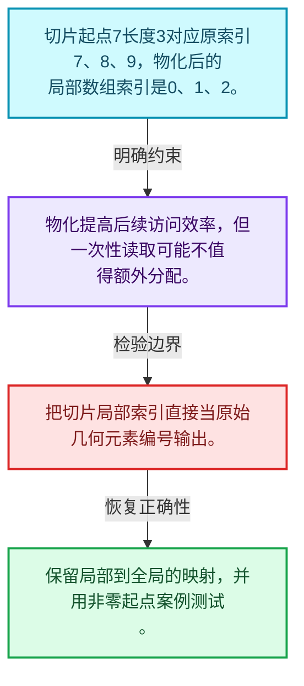
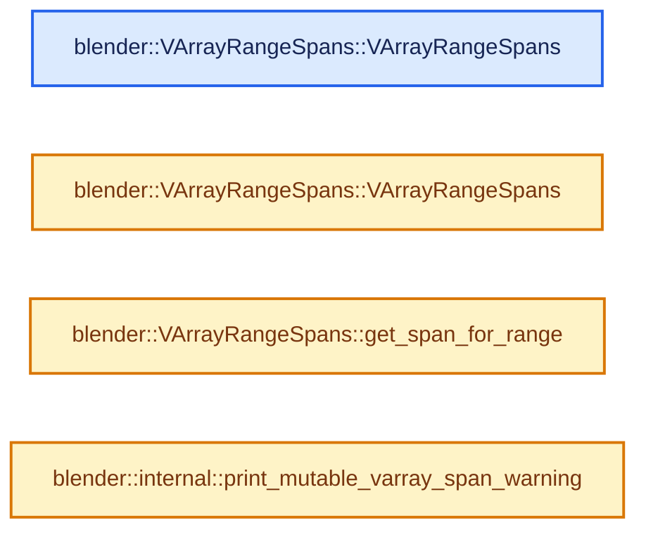
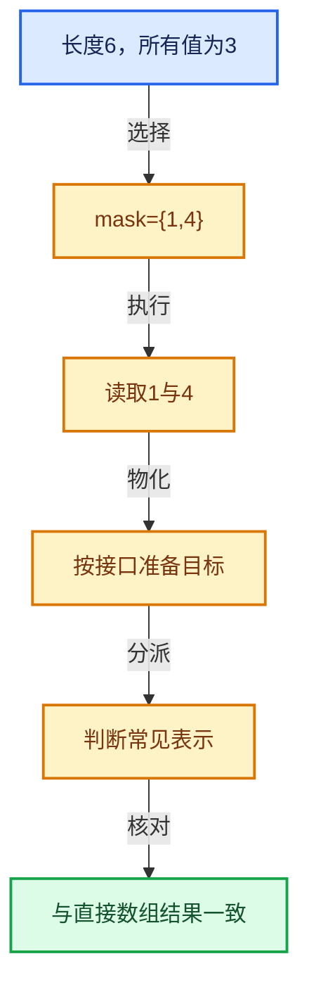

# 04-06 切片与物化

[方向导航](README.md) · [总目录](../README.md) · [实现索引](../00-课程指南/02-源码与提交索引/符号依赖与实现索引.md)

## 从问题到实现

何时值得把惰性表示变成连续数据？

物化支付分配和计算换取连续访问；切片必须处理索引偏移和原数据寿命。

**数据模型**

切片起点7长度3对应原索引7、8、9，物化后的局部数组索引是0、1、2。

**设计取舍**

物化提高后续访问效率，但一次性读取可能不值得额外分配。

**最小反例**

把切片局部索引直接当原始几何元素编号输出。

**推导**

保留局部到全局的映射，并用非零起点案例测试。

## 阅读地图与执行推演








图中的数值推演是本方向的教学模型；实际函数之间的调用边与概念分析边分别标注，不能把概念关系当作运行时调度顺序。

## 完整源码单元与就地讲解

中文讲解直接放在相关代码旁，复杂机制在代码下展开。原文折叠区保留基准行号；不需要在行号表和函数之间来回查找。类布局可分段展示，函数实现不按固定行数切开。

### 类型布局、声明与编译条件 · BLI_virtual_array_range_spans.hh L1—L27

<a id="t-e74a4c5ecc77"></a>

`VArrayRangeSpans`在这里声明的数据成员：

- `int64_t max_span_size_`
- `std::optional<Span<T>> full_span_`
- `std::optional<Span<T>> chunk_span_`

<!-- annotated:95ed150dc81a89 -->

```cpp
/* SPDX-FileCopyrightText: 2026 Blender Authors
 *
 * SPDX-License-Identifier: GPL-2.0-or-later */

/** \file
 * \ingroup bli
 */

#pragma once

#include "BLI_resource_scope.hh"
#include "BLI_virtual_array.hh"

namespace blender {

/**
 * This allows efficiently accessing a single-value virtual array as span, assuming that only ever
 * a partial span is necessary. Specifically, this is more efficient than materializing the full
 * single-value #VArray into a large array.
 */
template<typename T> class VArrayRangeSpans {
 private:
  int64_t max_span_size_ = 0;
  std::optional<Span<T>> full_span_;
  std::optional<Span<T>> chunk_span_;

 public:
```

<details>
<summary>核对原始源码：source/blender/blenlib/BLI_virtual_array_range_spans.hh · L1—L27</summary>

<!-- original:95ed150dc81a89:source/blender/blenlib/BLI_virtual_array_range_spans.hh:1:27 -->

```cpp
/* SPDX-FileCopyrightText: 2026 Blender Authors
 *
 * SPDX-License-Identifier: GPL-2.0-or-later */

/** \file
 * \ingroup bli
 */

#pragma once

#include "BLI_resource_scope.hh"
#include "BLI_virtual_array.hh"

namespace blender {

/**
 * This allows efficiently accessing a single-value virtual array as span, assuming that only ever
 * a partial span is necessary. Specifically, this is more efficient than materializing the full
 * single-value #VArray into a large array.
 */
template<typename T> class VArrayRangeSpans {
 private:
  int64_t max_span_size_ = 0;
  std::optional<Span<T>> full_span_;
  std::optional<Span<T>> chunk_span_;

 public:
```

</details>

<a id="f-883606f894b2ca14"></a>

### `blender::VArrayRangeSpans::VArrayRangeSpans`

实现位置：[source/blender/blenlib/BLI_virtual_array_range_spans.hh](../../../../../source/blender/blenlib/BLI_virtual_array_range_spans.hh) · L28—L28。

**教学注释版**

<!-- annotated:a961f4002217b2 -->

```cpp
  VArrayRangeSpans() = default;
```

<details>
<summary>核对原始源码：source/blender/blenlib/BLI_virtual_array_range_spans.hh · L28—L28</summary>

<!-- original:a961f4002217b2:source/blender/blenlib/BLI_virtual_array_range_spans.hh:28:28 -->

```cpp
  VArrayRangeSpans() = default;
```

</details>

**继续追踪实现**

本实现没有需要继续展开的显式调用；检查返回表达式、对象转换和调用者前置条件。

<!-- annotated:57f0b2ccba0728 -->

```cpp

```

<details>
<summary>核对原始源码：source/blender/blenlib/BLI_virtual_array_range_spans.hh · L29—L29</summary>

<!-- original:57f0b2ccba0728:source/blender/blenlib/BLI_virtual_array_range_spans.hh:29:29 -->

```cpp

```

</details>

<a id="f-c21b06a125d10188"></a>

### `blender::VArrayRangeSpans::VArrayRangeSpans`

实现位置：[source/blender/blenlib/BLI_virtual_array_range_spans.hh](../../../../../source/blender/blenlib/BLI_virtual_array_range_spans.hh) · L30—L52。

接口参数：

- `ResourceScope &scope`
- `const VArray<T> &varray`
- `const int max_range_size`

**教学注释版**

<!-- annotated:4244e643935cfb -->

```cpp
  VArrayRangeSpans(ResourceScope &scope, const VArray<T> &varray, const int max_range_size)
      : max_span_size_(max_range_size)
  {
    if (varray.is_span()) {
      /* This copy is generally very cheap. */
      if (varray.common_info().may_have_ownership) {
        const VArray<T> &owned_varray = scope.construct<VArray<T>>(varray);
        full_span_ = owned_varray.get_internal_span();
      }
      else {
        full_span_ = varray.get_internal_span();
      }
    }
    else if (const std::optional<T> single_value = varray.get_if_single()) {
      chunk_span_ = scope.allocator().construct_array<T>(max_range_size, *single_value);
    }
    else {
      MutableSpan<T> full_span = scope.allocator().allocate_array<T>(varray.size());
      varray.materialize_to_uninitialized(full_span);
      full_span_ = full_span;
      // [讲解] full_span.data：返回借用范围的地址。
      scope.add_destruct_call([full_span]() { destruct_n(full_span.data(), full_span.size()); });
    }
  }
```

<details>
<summary>核对原始源码：source/blender/blenlib/BLI_virtual_array_range_spans.hh · L30—L52</summary>

<!-- original:4244e643935cfb:source/blender/blenlib/BLI_virtual_array_range_spans.hh:30:52 -->

```cpp
  VArrayRangeSpans(ResourceScope &scope, const VArray<T> &varray, const int max_range_size)
      : max_span_size_(max_range_size)
  {
    if (varray.is_span()) {
      /* This copy is generally very cheap. */
      if (varray.common_info().may_have_ownership) {
        const VArray<T> &owned_varray = scope.construct<VArray<T>>(varray);
        full_span_ = owned_varray.get_internal_span();
      }
      else {
        full_span_ = varray.get_internal_span();
      }
    }
    else if (const std::optional<T> single_value = varray.get_if_single()) {
      chunk_span_ = scope.allocator().construct_array<T>(max_range_size, *single_value);
    }
    else {
      MutableSpan<T> full_span = scope.allocator().allocate_array<T>(varray.size());
      varray.materialize_to_uninitialized(full_span);
      full_span_ = full_span;
      scope.add_destruct_call([full_span]() { destruct_n(full_span.data(), full_span.size()); });
    }
  }
```

</details>

**沿实际写入检查状态**

- `full_span_ = owned_varray.get_internal_span();`
- `full_span_ = varray.get_internal_span();`
- `chunk_span_ = scope.allocator().construct_array<T>(max_range_size, *single_value);`
- `full_span_ = full_span;`

**继续追踪实现**

- `varray.is_span` → [调用协议](../00-课程指南/01-路线与规范/模板宏与动态分派协议.md)：由接收对象具体类型或运行时策略提供实现。调用位置L33。
- `varray.common_info` → [调用协议](../00-课程指南/01-路线与规范/模板宏与动态分派协议.md)：由接收对象具体类型或运行时策略提供实现。调用位置L35。
- `scope.construct<VArray<T>>` → [blender::ResourceScope::construct · L219](../03-内存分配与运行时类型/05-ResourceScope销毁责任.md#f-5b24624bb64539d5)。
- `owned_varray.get_internal_span` → [调用协议](../00-课程指南/01-路线与规范/模板宏与动态分派协议.md)：由接收对象具体类型或运行时策略提供实现。调用位置L37。
- `varray.get_internal_span` → [调用协议](../00-课程指南/01-路线与规范/模板宏与动态分派协议.md)：由接收对象具体类型或运行时策略提供实现。调用位置L40。
- `varray.get_if_single` → [blender::VArrayCommon::get_if_single · L649](03-单值与Span表示.md#f-779c11c4fd8e6ac3)。
- `scope.allocator().construct_array<T>` → [调用协议](../00-课程指南/01-路线与规范/模板宏与动态分派协议.md)：接收对象类型依赖auto、返回值或模板实例；不按同名猜测目标。调用位置L44。
- `scope.allocator` → [blender::ResourceScope::allocator · L236](../03-内存分配与运行时类型/05-ResourceScope销毁责任.md#f-7ccba69e393aa150)。
- `scope.allocator().allocate_array<T>` → [调用协议](../00-课程指南/01-路线与规范/模板宏与动态分派协议.md)：接收对象类型依赖auto、返回值或模板实例；不按同名猜测目标。调用位置L47。
- `varray.size` → [调用协议](../00-课程指南/01-路线与规范/模板宏与动态分派协议.md)：由接收对象具体类型或运行时策略提供实现。调用位置L47。
- `varray.materialize_to_uninitialized` → [调用协议](../00-课程指南/01-路线与规范/模板宏与动态分派协议.md)：由接收对象具体类型或运行时策略提供实现。调用位置L48。
- `scope.add_destruct_call` → [blender::ResourceScope::add_destruct_call · L212](../03-内存分配与运行时类型/05-ResourceScope销毁责任.md#f-086b76d60c137c86)。
- `destruct_n` → [调用协议](../00-课程指南/01-路线与规范/模板宏与动态分派协议.md)：函数指针、局部可调用对象或未展开的宏；必须结合调用者环境。调用位置L50。
- `full_span.data` → [blender::MutableSpan::data · L545](../01-基础容器与现代CPP/06-MutableSpan可写视图.md#f-eb45a6e4d8211efd)。
- `full_span.size` → [blender::MutableSpan::size · L499](../01-基础容器与现代CPP/06-MutableSpan可写视图.md#f-1de6a66839c304a8)。

<!-- annotated:9149795cfa6bca -->

```cpp

```

<details>
<summary>核对原始源码：source/blender/blenlib/BLI_virtual_array_range_spans.hh · L53—L53</summary>

<!-- original:9149795cfa6bca:source/blender/blenlib/BLI_virtual_array_range_spans.hh:53:53 -->

```cpp

```

</details>

<a id="f-c74e84a9228263b8"></a>

### `blender::VArrayRangeSpans::get_span_for_range`

实现位置：[source/blender/blenlib/BLI_virtual_array_range_spans.hh](../../../../../source/blender/blenlib/BLI_virtual_array_range_spans.hh) · L54—L63。

接口参数：

- `const IndexRange range`

**教学注释版**

<!-- annotated:f77bf15c721ad5 -->

```cpp
  Span<T> get_span_for_range(const IndexRange range) const
  {
    BLI_assert(full_span_ || chunk_span_);
    // [讲解] range.size：读取连续区间或分组的边界信息。
    const int range_size = range.size();
    BLI_assert(range_size <= max_span_size_);
    if (full_span_) {
      return full_span_->slice(range);
    }
    return chunk_span_->take_front(range_size);
  }
```

<details>
<summary>核对原始源码：source/blender/blenlib/BLI_virtual_array_range_spans.hh · L54—L63</summary>

<!-- original:f77bf15c721ad5:source/blender/blenlib/BLI_virtual_array_range_spans.hh:54:63 -->

```cpp
  Span<T> get_span_for_range(const IndexRange range) const
  {
    BLI_assert(full_span_ || chunk_span_);
    const int range_size = range.size();
    BLI_assert(range_size <= max_span_size_);
    if (full_span_) {
      return full_span_->slice(range);
    }
    return chunk_span_->take_front(range_size);
  }
```

</details>

**结果出口**

- `return full_span_->slice(range);`
- `return chunk_span_->take_front(range_size);`

**继续追踪实现**

- `BLI_assert` → [BLI_assert · L48](../90-实现依赖专题/01-BLI基础库/BLI_assert.hh.md#m-57a88495704d)；[BLI_assert · L63](../90-实现依赖专题/01-BLI基础库/BLI_assert.hh.md#m-d07050020cb5)。宏定义由构建条件选择。
- `range.size` → [blender::IndexRange::size · L156](../01-基础容器与现代CPP/04-IndexRange连续整数区间.md#f-05f66c3ebb2fdfec)。
- `full_span_->slice` → [外部契约](https://eel.is/c++draft/)：这个边界按实际表达式及所属类型核对参数、返回值、寿命与失败行为。这里提供接口入口，不声称已解释该第三方版本的内部实现。
- `chunk_span_->take_front` → [外部契约](https://eel.is/c++draft/)：这个边界按实际表达式及所属类型核对参数、返回值、寿命与失败行为。这里提供接口入口，不声称已解释该第三方版本的内部实现。

### 类型布局、声明与编译条件 · BLI_virtual_array_range_spans.hh L64—L66

<!-- annotated:a6e7e711ac01d0 -->

```cpp
};

}  // namespace blender
```

<details>
<summary>核对原始源码：source/blender/blenlib/BLI_virtual_array_range_spans.hh · L64—L66</summary>

<!-- original:a6e7e711ac01d0:source/blender/blenlib/BLI_virtual_array_range_spans.hh:64:66 -->

```cpp
};

}  // namespace blender
```

</details>

### 类型布局、声明与编译条件 · virtual_array.cc L1—L14

<!-- annotated:262cc85a3a3e42 -->

```cpp
/* SPDX-FileCopyrightText: 2023 Blender Authors
 *
 * SPDX-License-Identifier: GPL-2.0-or-later */

/** \file
 * \ingroup bli
 */

#include "BLI_virtual_array.hh"

#include <iostream>

namespace blender {

```

<details>
<summary>核对原始源码：source/blender/blenlib/intern/virtual_array.cc · L1—L14</summary>

<!-- original:262cc85a3a3e42:source/blender/blenlib/intern/virtual_array.cc:1:14 -->

```cpp
/* SPDX-FileCopyrightText: 2023 Blender Authors
 *
 * SPDX-License-Identifier: GPL-2.0-or-later */

/** \file
 * \ingroup bli
 */

#include "BLI_virtual_array.hh"

#include <iostream>

namespace blender {

```

</details>

<a id="f-707a160c6711dcb2"></a>

### `blender::internal::print_mutable_varray_span_warning`

实现位置：[source/blender/blenlib/intern/virtual_array.cc](../../../../../source/blender/blenlib/intern/virtual_array.cc) · L15—L18。

**教学注释版**

<!-- annotated:54c86986f3dc1c -->

```cpp
void internal::print_mutable_varray_span_warning()
{
  std::cout << "Warning: Call `save()` to make sure that changes persist in all cases.\n";
}
```

<details>
<summary>核对原始源码：source/blender/blenlib/intern/virtual_array.cc · L15—L18</summary>

<!-- original:54c86986f3dc1c:source/blender/blenlib/intern/virtual_array.cc:15:18 -->

```cpp
void internal::print_mutable_varray_span_warning()
{
  std::cout << "Warning: Call `save()` to make sure that changes persist in all cases.\n";
}
```

</details>

**继续追踪实现**

本实现没有需要继续展开的显式调用；检查返回表达式、对象转换和调用者前置条件。

### 类型布局、声明与编译条件 · virtual_array.cc L19—L20

<!-- annotated:ce247b1f01d25e -->

```cpp

}  // namespace blender
```

<details>
<summary>核对原始源码：source/blender/blenlib/intern/virtual_array.cc · L19—L20</summary>

<!-- original:ce247b1f01d25e:source/blender/blenlib/intern/virtual_array.cc:19:20 -->

```cpp

}  // namespace blender
```

</details>

## 语法与相关类型

### 模板 template

模板把类型或常量作为生成实现的参数。读声明时先列出类型参数、非类型参数和默认值，再看使用者实际实例化了什么。模板声明本身不意味着每种T都支持其全部成员。

把T替换为int、string、只能移动的类型，分别检查每个被调用操作是否成立。

### 依赖名称 typename

typename既可引入类型模板参数，也可告诉编译器某个依赖名称是类型。它不创建运行时对象；解析期确认语法类别与实例化期检查具体类型是不同阶段。

区分typename T::value_type和T::size()，前者标记类型，后者是表达式。

### 只读限定 const

const约束当前访问路径可做的修改。const指针、指向const的指针、const视图对象、const元素是不同位置的限定；其他别名可能仍可修改原对象。

分别写T* const、const T*与const T* const，并画出不可修改的层次。

### 运行时多态 virtual

虚调用根据实际动态类型选择实现；经基类指针销毁对象时通常需要相应虚析构契约。每元素虚调用和循环外一次分派有不同开销。

找出虚接口的实现类和调用频率，再讨论是否值得去虚拟化。

### 可选值 optional

optional把不存在与存在的T区分开，T的构造和析构跟随engaged状态变化。访问前应由has_value或条件分支证明存在。

把空Field状态与合法常量零区分，不能用某个普通值代替不存在。

### 内部断言 assert

断言表达开发者预期成立的内部契约，发布构建可能关闭。它不能替代对不可信输入的完整错误处理，也不保证后续操作被运行时保护。

对每条断言构造违反条件的输入，区分调用者错误与应向用户报告的错误。

## 实现练习与验证

切片起点7长度3，逐元素对照直接计算和物化结果。

参考推理：保留局部到全局的映射，并用非零起点案例测试。

遍历结果按真实索引排序且无重复；单值、Span与计算表示在有效索引上返回一致语义。

## 历史、跨库比较与证据

对比普通Span、标准ranges惰性视图和虚拟数组时，明确随机索引能力、批量物化、类型擦除和拥有关系；接口外观相近不代表同一抽象。

[历史提交索引](../00-课程指南/02-源码与提交索引/历史提交与设计演化索引.md) · [源码基准](../00-课程指南/02-源码与提交索引/源码版本与覆盖索引.md) · [验收报告](../00-课程指南/03-验收报告/验收报告.md)
