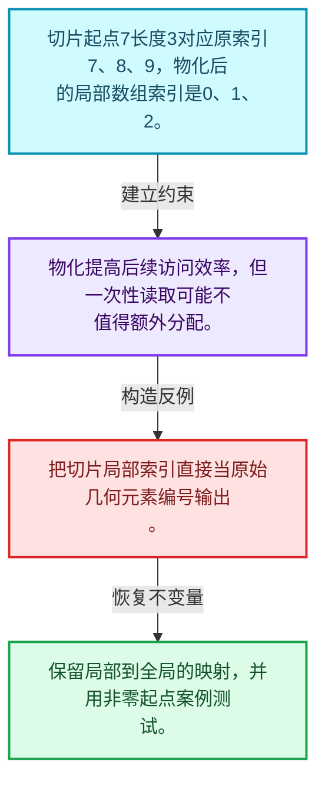
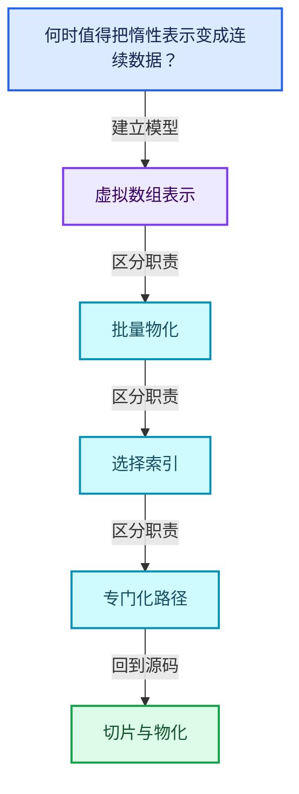
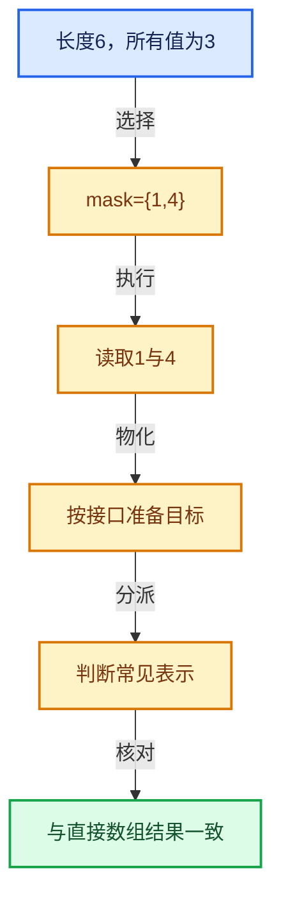

# 04-06 切片与物化

[方向导航](README.md) · [总目录](../README.md) · [覆盖索引](../%E6%BA%90%E7%A0%81%E7%89%88%E6%9C%AC%E4%B8%8E%E8%A6%86%E7%9B%96%E7%B4%A2%E5%BC%95.md)

> 阅读顺序：问题与数据模型 → 语法与类型 → 源码逐行 → 调用线索 → 历史与取舍 → 推演和练习。

- 基准 HEAD：`cbda6b96c26c0dee3c3b5cbb93960c4ac06a6b30`。
- 记录日期：2026-10-14。
- 教学示例状态：正文中的推演不是本机性能实测；已运行练习见验收报告。

## 一、从问题到设计

何时值得把惰性表示变成连续数据？

物化支付分配和计算换取连续访问；切片必须处理索引偏移和原数据寿命。

本篇把语法、数据语义和系统取舍连接起来。表示与接口分离，元素编号与选择内部位置分离，生成成本与执行成本分离。

### 本篇独立模型与设计推理

切片起点7长度3对应原索引7、8、9，物化后的局部数组索引是0、1、2。

设计取舍：物化提高后续访问效率，但一次性读取可能不值得额外分配。

最小反例：把切片局部索引直接当原始几何元素编号输出。

推导与处理：保留局部到全局的映射，并用非零起点案例测试。



### 源码范围与相邻篇章

| 文件 | 本篇逐行范围 | 基准SHA-256 |
|---|---|---|
| [source/blender/blenlib/intern/virtual_array.cc](../../../../../source/blender/blenlib/intern/virtual_array.cc) | L1—L20 | `b6c5639bd121e0a94fddf484e30bfef9e4abc54a78c993181860193129bbe52d` |
| [source/blender/blenlib/BLI_virtual_array_range_spans.hh](../../../../../source/blender/blenlib/BLI_virtual_array_range_spans.hh) | L1—L66 | `c73b83a128a5b690e26a92bab8e52f23b19ed82f421bda1ded6d0e9cac5bc90d` |

同一主讲文件可能分多篇覆盖；超出本篇范围的符号通过覆盖索引定位。空行与纯注释保留在源码摘录中，逐行表解释有效语句与语法边界；许可证头统一保留。

前篇：[GVArray运行时类型](05-GVArray%E8%BF%90%E8%A1%8C%E6%97%B6%E7%B1%BB%E5%9E%8B.md).

后篇：[去虚拟化与优化](07-%E5%8E%BB%E8%99%9A%E6%8B%9F%E5%8C%96%E4%B8%8E%E4%BC%98%E5%8C%96.md).

## 二、类型、数据与阅读地图



这是概念依赖图，边表示阅读关系，不声称是运行时调用顺序。

### 直接编译依赖


箭头只表示头文件包含关系；完整调用线索见后面的符号定位表。

## 三、关键词、语法与类型角色

### 模板 template

模板把类型或常量作为生成实现的参数。读声明时先列出类型参数、非类型参数和默认值，再看使用者实际实例化了什么。模板声明本身不意味着每种T都支持其全部成员。

具体检查：把T替换为int、string、只能移动的类型，分别检查每个被调用操作是否成立。

### 依赖名称 typename

typename既可引入类型模板参数，也可告诉编译器某个依赖名称是类型。它不创建运行时对象；解析期确认语法类别与实例化期检查具体类型是不同阶段。

具体检查：区分typename T::value_type和T::size()，前者标记类型，后者是表达式。

### 只读限定 const

const约束当前访问路径可做的修改。const指针、指向const的指针、const视图对象、const元素是不同位置的限定；其他别名可能仍可修改原对象。

具体检查：分别写T* const、const T*与const T* const，并画出不可修改的层次。

### 运行时多态 virtual

虚调用根据实际动态类型选择实现；经基类指针销毁对象时通常需要相应虚析构契约。每元素虚调用和循环外一次分派有不同开销。

具体检查：找出虚接口的实现类和调用频率，再讨论是否值得去虚拟化。

### 可选值 optional

optional把不存在与存在的T区分开，T的构造和析构跟随engaged状态变化。访问前应由has_value或条件分支证明存在。

具体检查：把空Field状态与合法常量零区分，不能用某个普通值代替不存在。

### 内部断言 assert

断言表达开发者预期成立的内部契约，发布构建可能关闭。它不能替代对不可信输入的完整错误处理，也不保证后续操作被运行时保护。

具体检查：对每条断言构造违反条件的输入，区分调用者错误与应向用户报告的错误。

## 四、真实源码与逐行讲解

源码块保持原行内容，原始行号由小节标题及逐行表给出。表中的调用定位是静态阅读辅助；重载、模板实例化、宏展开和虚调用需结合完整声明，不能仅凭词法出现证明动态调用。

### virtual_array.cc：L1—L20

<!-- source:source/blender/blenlib/intern/virtual_array.cc:1:20 -->

```cpp
/* SPDX-FileCopyrightText: 2023 Blender Authors
 *
 * SPDX-License-Identifier: GPL-2.0-or-later */

/** \file
 * \ingroup bli
 */

#include "BLI_virtual_array.hh"

#include <iostream>

namespace blender {

void internal::print_mutable_varray_span_warning()
{
  std::cout << "Warning: Call `save()` to make sure that changes persist in all cases.\n";
}

}  // namespace blender
```

| 原始行 | 语义、约束与检查 |
|---|---|
| L9 | 引入编译依赖 "BLI_virtual_array.hh"；这是声明可见性关系，不表示运行时一定调用该文件的所有接口。 |
| L11 | 引入编译依赖 <iostream>；这是声明可见性关系，不表示运行时一定调用该文件的所有接口。 |
| L13 | 把后续声明放入 blender 命名空间，影响名称查找和符号归属，不创建运行时对象。 |
| L15 | 出现调用或函数声明 `internal::print_mutable_varray_span_warning`，对应表达式为 `void internal::print_mutable_varray_span_warning()`。参数求值、返回类型与重载需结合前后完整语句；静态文本引用不能证明动态目标。 |
| L16 | 连接上一行的声明或控制结构与其语句块；后续行在这个作用域中执行或声明。 |
| L17 | 出现调用或函数声明 `ˋsave`，对应表达式为 `std::cout << "Warning: Call ˋsave()ˋ to make sure that changes persist in all cases.\n";`。参数求值、返回类型与重载需结合前后完整语句；静态文本引用不能证明动态目标。 |
| L18 | 结束当前语法单元。局部自动对象在离开其作用域时按规则销毁；这不等于所有被引用的外部数据也被释放。 |
| L20 | 结束当前语法单元。局部自动对象在离开其作用域时按规则销毁；这不等于所有被引用的外部数据也被释放。 |

### BLI_virtual_array_range_spans.hh：L1—L52

<!-- source:source/blender/blenlib/BLI_virtual_array_range_spans.hh:1:52 -->

```cpp
/* SPDX-FileCopyrightText: 2026 Blender Authors
 *
 * SPDX-License-Identifier: GPL-2.0-or-later */

/** \file
 * \ingroup bli
 */

#pragma once

#include "BLI_resource_scope.hh"
#include "BLI_virtual_array.hh"

namespace blender {

/**
 * This allows efficiently accessing a single-value virtual array as span, assuming that only ever
 * a partial span is necessary. Specifically, this is more efficient than materializing the full
 * single-value #VArray into a large array.
 */
template<typename T> class VArrayRangeSpans {
 private:
  int64_t max_span_size_ = 0;
  std::optional<Span<T>> full_span_;
  std::optional<Span<T>> chunk_span_;

 public:
  VArrayRangeSpans() = default;

  VArrayRangeSpans(ResourceScope &scope, const VArray<T> &varray, const int max_range_size)
      : max_span_size_(max_range_size)
  {
    if (varray.is_span()) {
      /* This copy is generally very cheap. */
      if (varray.common_info().may_have_ownership) {
        const VArray<T> &owned_varray = scope.construct<VArray<T>>(varray);
        full_span_ = owned_varray.get_internal_span();
      }
      else {
        full_span_ = varray.get_internal_span();
      }
    }
    else if (const std::optional<T> single_value = varray.get_if_single()) {
      chunk_span_ = scope.allocator().construct_array<T>(max_range_size, *single_value);
    }
    else {
      MutableSpan<T> full_span = scope.allocator().allocate_array<T>(varray.size());
      varray.materialize_to_uninitialized(full_span);
      full_span_ = full_span;
      scope.add_destruct_call([full_span]() { destruct_n(full_span.data(), full_span.size()); });
    }
  }
```

本段语义重点：

- `destruct_n`：对已构造的元素区间执行析构；计数必须对应真实存活对象，释放原始内存是另一操作。

| 原始行 | 语义、约束与检查 |
|---|---|
| L9 | 防止同一头文件在一个翻译单元中重复展开；不控制多个源文件之间的链接或对象寿命。 |
| L11 | 引入编译依赖 "BLI_resource_scope.hh"；这是声明可见性关系，不表示运行时一定调用该文件的所有接口。 |
| L12 | 引入编译依赖 "BLI_virtual_array.hh"；这是声明可见性关系，不表示运行时一定调用该文件的所有接口。 |
| L14 | 把后续声明放入 blender 命名空间，影响名称查找和符号归属，不创建运行时对象。 |
| L21 | 声明模板参数 `template<typename T> class VArrayRangeSpans {`。类型参数决定生成操作的类型，非类型参数可决定内嵌容量或编译期分支。 |
| L22 | 切换成员访问权限为 private；它是编译期接口边界，不是线程同步或内存保护。 |
| L23 | 把右侧 `0` 用于初始化或更新左侧 `int64_t max_span_size_`。声明初始化与已有对象赋值应按上下文区分；有资源的类型会调用相应特殊成员。 |
| L24 | 声明成员、局部对象或完成语句 `std::optional<Span<T>> full_span_`。若为指针或引用，它本身不说明拥有；若为值对象，其构造析构由所在作用域或外层对象管理。 |
| L25 | 声明成员、局部对象或完成语句 `std::optional<Span<T>> chunk_span_`。若为指针或引用，它本身不说明拥有；若为值对象，其构造析构由所在作用域或外层对象管理。 |
| L27 | 切换成员访问权限为 public；它是编译期接口边界，不是线程同步或内存保护。 |
| L28 | 显式采用编译器生成的特殊成员行为：`VArrayRangeSpans() = default;`。成员和基类的性质决定该操作是否可用、是否被删除及异常约定，不表示运行时给对象赋值为default。 |
| L30 | 出现调用或函数声明 `VArrayRangeSpans`，对应表达式为 `VArrayRangeSpans(ResourceScope &scope, const VArray<T> &varray, const int max_range_size)`。参数求值、返回类型与重载需结合前后完整语句；静态文本引用不能证明动态目标。 |
| L31 | 出现调用或函数声明 `max_span_size_`，对应表达式为 `: max_span_size_(max_range_size)`。参数求值、返回类型与重载需结合前后完整语句；静态文本引用不能证明动态目标。 |
| L32 | 连接上一行的声明或控制结构与其语句块；后续行在这个作用域中执行或声明。 |
| L33 | 判断 `varray.is_span()`，成立时进入本分支，否则继续后续路径。 |
| L35 | 判断 `varray.common_info().may_have_ownership`，成立时进入本分支，否则继续后续路径。 |
| L36 | 把右侧 `scope.construct<VArray<T>>(varray)` 用于初始化或更新左侧 `const VArray<T> &owned_varray`。声明初始化与已有对象赋值应按上下文区分；有资源的类型会调用相应特殊成员。 |
| L37 | 把右侧 `owned_varray.get_internal_span()` 用于初始化或更新左侧 `full_span_`。声明初始化与已有对象赋值应按上下文区分；有资源的类型会调用相应特殊成员。 |
| L38 | 结束当前语法单元。局部自动对象在离开其作用域时按规则销毁；这不等于所有被引用的外部数据也被释放。 |
| L39 | 处理前一条件不成立的互补路径。比较两条路径最后是否恢复同一不变量，以及是否产生不同的资源责任。 |
| L40 | 把右侧 `varray.get_internal_span()` 用于初始化或更新左侧 `full_span_`。声明初始化与已有对象赋值应按上下文区分；有资源的类型会调用相应特殊成员。 |
| L41 | 结束当前语法单元。局部自动对象在离开其作用域时按规则销毁；这不等于所有被引用的外部数据也被释放。 |
| L42 | 结束当前语法单元。局部自动对象在离开其作用域时按规则销毁；这不等于所有被引用的外部数据也被释放。 |
| L43 | 判断 `const std::optional<T> single_value = varray.get_if_single()`，成立时进入本分支，否则继续后续路径。 |
| L44 | 把右侧 `scope.allocator().construct_array<T>(max_range_size, *single_value)` 用于初始化或更新左侧 `chunk_span_`。声明初始化与已有对象赋值应按上下文区分；有资源的类型会调用相应特殊成员。 |
| L45 | 结束当前语法单元。局部自动对象在离开其作用域时按规则销毁；这不等于所有被引用的外部数据也被释放。 |
| L46 | 处理前一条件不成立的互补路径。比较两条路径最后是否恢复同一不变量，以及是否产生不同的资源责任。 |
| L47 | 把右侧 `scope.allocator().allocate_array<T>(varray.size())` 用于初始化或更新左侧 `MutableSpan<T> full_span`。声明初始化与已有对象赋值应按上下文区分；有资源的类型会调用相应特殊成员。 |
| L48 | 出现调用或函数声明 `materialize_to_uninitialized`，对应表达式为 `varray.materialize_to_uninitialized(full_span);`。参数求值、返回类型与重载需结合前后完整语句；静态文本引用不能证明动态目标。 |
| L49 | 把右侧 `full_span` 用于初始化或更新左侧 `full_span_`。声明初始化与已有对象赋值应按上下文区分；有资源的类型会调用相应特殊成员。 |
| L50 | 本行使用 `destruct_n`：对已构造的元素区间执行析构；计数必须对应真实存活对象，释放原始内存是另一操作。 |
| L51 | 结束当前语法单元。局部自动对象在离开其作用域时按规则销毁；这不等于所有被引用的外部数据也被释放。 |
| L52 | 结束当前语法单元。局部自动对象在离开其作用域时按规则销毁；这不等于所有被引用的外部数据也被释放。 |

### BLI_virtual_array_range_spans.hh：L53—L66

<!-- source:source/blender/blenlib/BLI_virtual_array_range_spans.hh:53:66 -->

```cpp

  Span<T> get_span_for_range(const IndexRange range) const
  {
    BLI_assert(full_span_ || chunk_span_);
    const int range_size = range.size();
    BLI_assert(range_size <= max_span_size_);
    if (full_span_) {
      return full_span_->slice(range);
    }
    return chunk_span_->take_front(range_size);
  }
};

}  // namespace blender
```

本段语义重点：

- 分支证据 `full_span_)`：分别推演条件成立与不成立，核对相同出口处的状态。

| 原始行 | 语义、约束与检查 |
|---|---|
| L54 | 出现调用或函数声明 `get_span_for_range`，对应表达式为 `Span<T> get_span_for_range(const IndexRange range) const`。参数求值、返回类型与重载需结合前后完整语句；静态文本引用不能证明动态目标。 |
| L55 | 连接上一行的声明或控制结构与其语句块；后续行在这个作用域中执行或声明。 |
| L56 | 断言约束 `BLI_assert(full_span_ &#124;&#124; chunk_span_);`。条件是后续访问的内部前置条件；发布构建可能不执行，不能把断言当作输入修复。 |
| L57 | 把右侧 `range.size()` 用于初始化或更新左侧 `const int range_size`。声明初始化与已有对象赋值应按上下文区分；有资源的类型会调用相应特殊成员。 |
| L58 | 断言约束 `BLI_assert(range_size <= max_span_size_);`。条件是后续访问的内部前置条件；发布构建可能不执行，不能把断言当作输入修复。 |
| L59 | 判断 `full_span_`，成立时进入本分支，否则继续后续路径。 |
| L60 | 返回表达式 `full_span_->slice(range)`。 |
| L61 | 结束当前语法单元。局部自动对象在离开其作用域时按规则销毁；这不等于所有被引用的外部数据也被释放。 |
| L62 | 返回表达式 `chunk_span_->take_front(range_size)`。 |
| L63 | 结束当前语法单元。局部自动对象在离开其作用域时按规则销毁；这不等于所有被引用的外部数据也被释放。 |
| L64 | 结束当前语法单元。局部自动对象在离开其作用域时按规则销毁；这不等于所有被引用的外部数据也被释放。 |
| L66 | 结束当前语法单元。局部自动对象在离开其作用域时按规则销毁；这不等于所有被引用的外部数据也被释放。 |

## 五、接口定位、调用线索与生命周期

### 本篇声明与实现入口

| 源码位置 | 实际声明片段 |
|---|---|
| [virtual_array.cc:L15](../../../../../source/blender/blenlib/intern/virtual_array.cc#L15) | `void internal::print_mutable_varray_span_warning()` |
| [BLI_virtual_array_range_spans.hh:L21](../../../../../source/blender/blenlib/BLI_virtual_array_range_spans.hh#L21) | `template<typename T> class VArrayRangeSpans` |
| [BLI_virtual_array_range_spans.hh:L28](../../../../../source/blender/blenlib/BLI_virtual_array_range_spans.hh#L28) | `VArrayRangeSpans() = default;` |
| [BLI_virtual_array_range_spans.hh:L30](../../../../../source/blender/blenlib/BLI_virtual_array_range_spans.hh#L30) | `VArrayRangeSpans(ResourceScope &scope, const VArray<T> &varray, const int max_range_size)` |
| [BLI_virtual_array_range_spans.hh:L31](../../../../../source/blender/blenlib/BLI_virtual_array_range_spans.hh#L31) | `: max_span_size_(max_range_size)` |
| [BLI_virtual_array_range_spans.hh:L43](../../../../../source/blender/blenlib/BLI_virtual_array_range_spans.hh#L43) | `else if (const std::optional<T> single_value = varray.get_if_single())` |
| [BLI_virtual_array_range_spans.hh:L54](../../../../../source/blender/blenlib/BLI_virtual_array_range_spans.hh#L54) | `Span<T> get_span_for_range(const IndexRange range) const` |

### 同名符号出现位置

以下表提供跨文件阅读入口，包含声明、调用或测试使用；没有经过完整C++名称解析，不把它命名为已证明的运行时调用图。

| 符号 | 位置 | 文本证据 |
|---|---|---|
| `print_mutable_varray_span_warning` | [BLI_virtual_array.hh:L1006](../../../../../source/blender/blenlib/BLI_virtual_array.hh#L1006) | `void print_mutable_varray_span_warning();` |
| `print_mutable_varray_span_warning` | [BLI_virtual_array.hh:L1079](../../../../../source/blender/blenlib/BLI_virtual_array.hh#L1079) | `internal::print_mutable_varray_span_warning();` |

### 生命周期推理图


这是审查生命周期的通用模型。具体类是否拥有数据由本篇成员、构造、析构和调用者一起证明；任何箭头都不自动代表shared_ptr。

## 六、把代码放进具体数据中推演

本方向的共同数值模型如下。本篇的专门检查是：切片起点7长度3，逐元素对照直接计算和物化结果。

| 步骤 | 数据或状态 | 为什么需要这一步 |
|---|---|---|
| 输入 | 长度6，所有值为3 | 单值表示可只存一个3 |
| 选择 | mask={1,4} | 内部位置0对应全局1 |
| 执行 | 读取1与4 | 避免读取未选位置 |
| 物化 | 按接口准备目标 | 支付真实存储和复制成本 |
| 分派 | 判断常见表示 | 专门化循环可避免逐项虚调用 |
| 核对 | 与直接数组结果一致 | 表示变化不能改变元素语义 |



图是教学推演模型；精确分支与状态更新以本篇摘录及调用契约为准。

### 本篇独立练习与参考思路

切片起点7长度3，逐元素对照直接计算和物化结果。

参考思路：物化支付分配和计算换取连续访问；切片必须处理索引偏移和原数据寿命。

将输入、预期结果和资源责任分成三张清单。先用最直接的实现给出可核对的答案，再替换成对应源码使用的表示；比较结果不变的条件，而不是只比较接口名字。

验收依据：遍历结果按真实索引排序且无重复；单值、Span与计算表示在有效索引上返回一致语义。

## 七、复杂度、设计取舍与其他基础库

对比普通Span、标准ranges惰性视图和虚拟数组时，明确随机索引能力、批量物化、类型擦除和拥有关系；接口外观相近不代表同一抽象。

本篇的具体取舍：物化支付分配和计算换取连续访问；切片必须处理索引偏移和原数据寿命。

| 观察维度 | 从源码取得证据的方法 | 本篇要避免的误判 |
|---|---|---|
| 时间 | 对循环次数、分派次数和重建频率分别计数 | 看到单次常数操作就断定整个操作序列是常数成本 |
| 内存 | 区分对象本体、容量存储、间接资源和共享控制块 | 用sizeof代替总内存 |
| 安全 | 沿构造、失败回滚、销毁与失效逐路径检查 | 把断言或非空指针当作完整安全证明 |
| 并发 | 逐字段确认锁、发布顺序和借用寿命 | 把引用计数线程安全等同数据读写线程安全 |

相关一手资料：

- [C++公开工作草案](https://eel.is/c++draft/)：持续更新的工作草案；语言与标准库语义以相应章节为准。
- [LLVM Programmer’s Manual](https://llvm.org/docs/ProgrammersManual.html)：在线版，2026-10-14查阅；仅比较设计思路，不保证与本地LLVM版本一致。

资料用于核对契约和进一步阅读；这里没有声称外部库与Blender实现相同，也没有把上游性能数字当作本机实测。

## 八、历史提交与设计演化

本篇主要讲当前接口或辅助实现，方向导航给出相关架构演化提交；没有把不涉及本篇文件的提交硬写成该实现的引入证据。

## 九、反例、测试入口与掌握标准

需要实际构造的反例：

- 空输入或没有结果需求：确认接口允许的空状态与不允许访问的操作。
- 边界位置和退化结构：把长度为1、末尾位置、重复值或深链代入真实分支。
- 生命周期结束或修改之后：检查保存的指针、引用、结果视图是否仍有效。
- 与本篇核心不变量相冲突的输入：切片起点7长度3，逐元素对照直接计算和物化结果。

### 可运行的教学参考程序

[reference_exercises.cc](../_tools/reference_exercises.cc)包含独立于Blender的C++20参考检查：视图、简化SmallVector、异常回滚、哈希碰撞与删除、偏移数组、拓扑映射、共享缓存、表达式、惰性分支、闭包和暴力最近邻。

参考程序有意省略生产实现的完整能力。例如SmallVector禁止复制移动容器，不支持只能移动的元素，并禁止append参数别名到自身元素；TinyMap固定8槽，不提供增长。程序通过不能替代Blender实现测试。实际运行结果、编译器与命令见验收报告。

掌握标准：离开源码解释“何时值得把惰性表示变成连续数据？”；独立完成上述练习；能指出一个会破坏虚拟数组表示相关约束的最小反例，并用具体代码行说明检查或修复应放在哪里。
