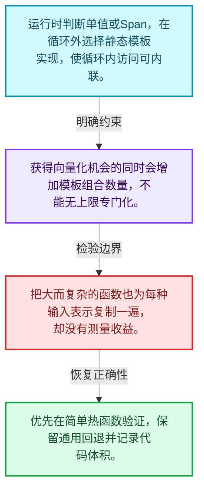
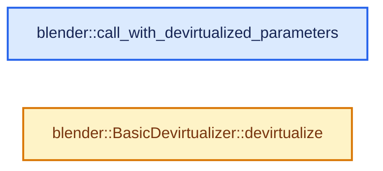
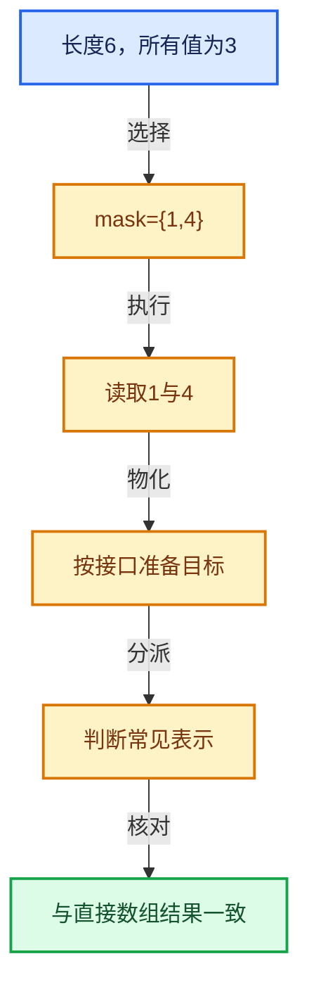

# 04-07 去虚拟化与优化

[方向导航](README.md) · [总目录](../README.md) · [实现索引](../00-课程指南/02-源码与提交索引/符号依赖与实现索引.md)

## 从问题到实现

动态抽象怎样为简单热循环保留优化机会？

在循环外判定常见表示并选择模板实现，减少逐元素动态调用，但增加实例化与代码体积。

**数据模型**

运行时判断单值或Span，在循环外选择静态模板实现，使循环内访问可内联。

**设计取舍**

获得向量化机会的同时会增加模板组合数量，不能无上限专门化。

**最小反例**

把大而复杂的函数也为每种输入表示复制一遍，却没有测量收益。

**推导**

优先在简单热函数验证，保留通用回退并记录代码体积。

## 阅读地图与执行推演








图中的数值推演是本方向的教学模型；实际函数之间的调用边与概念分析边分别标注，不能把概念关系当作运行时调度顺序。

## 完整源码单元与就地讲解

中文讲解直接放在相关代码旁，复杂机制在代码下展开。原文折叠区保留基准行号；不需要在行号表和函数之间来回查找。类布局可分段展示，函数实现不按固定行数切开。

### 类型布局、声明与编译条件 · BLI_devirtualize_parameters.hh L1—L53

<!-- annotated:312d81de631358 -->

```cpp
/* SPDX-FileCopyrightText: 2023 Blender Authors
 *
 * SPDX-License-Identifier: GPL-2.0-or-later */

#pragma once

/** \file
 * \ingroup bli
 *
 * In geometry nodes, many functions accept fields as inputs. For the implementation that means
 * that the inputs are virtual arrays. Usually those are backed by actual arrays or single values
 * but sometimes virtual arrays are used to compute values on demand or convert between data
 * formats.
 *
 * Using virtual arrays has the downside that individual elements are accessed through a virtual
 * method call, which has some overhead compared to normal array access. Whether this overhead is
 * negligible depends on the context. For very small functions (e.g. a single addition), the
 * overhead can make the function many times slower. Furthermore, it prevents the compiler from
 * doing some optimizations (e.g. loop unrolling and inserting SIMD instructions).
 *
 * The solution is to "devirtualize" the virtual arrays in cases when the overhead cannot be
 * ignored. That means that the function is instantiated multiple times at compile time for the
 * different cases. For example, there can be an optimized function that adds a span and a single
 * value, and another function that adds a span and another span. At run-time there is a dynamic
 * dispatch that executes the best function given the specific virtual arrays.
 *
 * The problem with this devirtualization is that it can result in exponentially increasing compile
 * times and binary sizes, depending on the number of parameters that are devirtualized separately.
 * So there is always a trade-off between run-time performance and compile-time/binary-size.
 *
 * This file provides a utility to devirtualize function parameters using a high level API. This
 * makes it easy to experiment with different extremes of the mentioned trade-off and allows
 * finding a good compromise for each function.
 */

#include <cstdlib>
#include <tuple>

namespace blender {

/**
 * Calls the given function with devirtualized parameters if possible. Note that using many
 * non-trivial devirtualizers results in exponential code growth.
 *
 * \return True if the function has been called.
 *
 * Every devirtualizer is expected to have a `devirtualize(auto fn) -> bool` method.
 * This method is expected to do one of two things:
 * - Call `fn` with the devirtualized argument and return what `fn` returns.
 * - Don't call `fn` (because the devirtualization failed) and return false.
 *
 * Examples for devirtualizers: #BasicDevirtualizer, #VArrayDevirtualizer.
 */
```

<details>
<summary>核对原始源码：source/blender/blenlib/BLI_devirtualize_parameters.hh · L1—L53</summary>

<!-- original:312d81de631358:source/blender/blenlib/BLI_devirtualize_parameters.hh:1:53 -->

```cpp
/* SPDX-FileCopyrightText: 2023 Blender Authors
 *
 * SPDX-License-Identifier: GPL-2.0-or-later */

#pragma once

/** \file
 * \ingroup bli
 *
 * In geometry nodes, many functions accept fields as inputs. For the implementation that means
 * that the inputs are virtual arrays. Usually those are backed by actual arrays or single values
 * but sometimes virtual arrays are used to compute values on demand or convert between data
 * formats.
 *
 * Using virtual arrays has the downside that individual elements are accessed through a virtual
 * method call, which has some overhead compared to normal array access. Whether this overhead is
 * negligible depends on the context. For very small functions (e.g. a single addition), the
 * overhead can make the function many times slower. Furthermore, it prevents the compiler from
 * doing some optimizations (e.g. loop unrolling and inserting SIMD instructions).
 *
 * The solution is to "devirtualize" the virtual arrays in cases when the overhead cannot be
 * ignored. That means that the function is instantiated multiple times at compile time for the
 * different cases. For example, there can be an optimized function that adds a span and a single
 * value, and another function that adds a span and another span. At run-time there is a dynamic
 * dispatch that executes the best function given the specific virtual arrays.
 *
 * The problem with this devirtualization is that it can result in exponentially increasing compile
 * times and binary sizes, depending on the number of parameters that are devirtualized separately.
 * So there is always a trade-off between run-time performance and compile-time/binary-size.
 *
 * This file provides a utility to devirtualize function parameters using a high level API. This
 * makes it easy to experiment with different extremes of the mentioned trade-off and allows
 * finding a good compromise for each function.
 */

#include <cstdlib>
#include <tuple>

namespace blender {

/**
 * Calls the given function with devirtualized parameters if possible. Note that using many
 * non-trivial devirtualizers results in exponential code growth.
 *
 * \return True if the function has been called.
 *
 * Every devirtualizer is expected to have a `devirtualize(auto fn) -> bool` method.
 * This method is expected to do one of two things:
 * - Call `fn` with the devirtualized argument and return what `fn` returns.
 * - Don't call `fn` (because the devirtualization failed) and return false.
 *
 * Examples for devirtualizers: #BasicDevirtualizer, #VArrayDevirtualizer.
 */
```

</details>

<a id="f-d35adfc32b894260"></a>

### `blender::call_with_devirtualized_parameters`

实现位置：[source/blender/blenlib/BLI_devirtualize_parameters.hh](../../../../../source/blender/blenlib/BLI_devirtualize_parameters.hh) · L54—L152。

接口参数：

- `const std::tuple<Devirtualizers...> &devis`
- `const Fn &fn`

**教学注释版**

<!-- annotated:ee6c5d4df11041 -->

```cpp
template<typename Fn, typename... Devirtualizers>
inline bool call_with_devirtualized_parameters(const std::tuple<Devirtualizers...> &devis,
                                               const Fn &fn)
{
  /* In theory the code below could be generalized to avoid code duplication. However, the maximum
   * number of parameters is expected to be relatively low. Explicitly implementing the different
   * cases makes it more obvious to see what is going on and also makes inlining everything easier
   * for the compiler. */
  constexpr size_t DeviNum = sizeof...(Devirtualizers);
  if constexpr (DeviNum == 0) {
    fn();
    return true;
  }
  if constexpr (DeviNum == 1) {
    return std::get<0>(devis).devirtualize([&](auto param0) {
      fn(param0);
      return true;
    });
  }
  if constexpr (DeviNum == 2) {
    return std::get<0>(devis).devirtualize([&](auto &&param0) {
      return std::get<1>(devis).devirtualize([&](auto &&param1) {
        fn(param0, param1);
        return true;
      });
    });
  }
  if constexpr (DeviNum == 3) {
    return std::get<0>(devis).devirtualize([&](auto &&param0) {
      return std::get<1>(devis).devirtualize([&](auto &&param1) {
        return std::get<2>(devis).devirtualize([&](auto &&param2) {
          fn(param0, param1, param2);
          return true;
        });
      });
    });
  }
  if constexpr (DeviNum == 4) {
    return std::get<0>(devis).devirtualize([&](auto &&param0) {
      return std::get<1>(devis).devirtualize([&](auto &&param1) {
        return std::get<2>(devis).devirtualize([&](auto &&param2) {
          return std::get<3>(devis).devirtualize([&](auto &&param3) {
            fn(param0, param1, param2, param3);
            return true;
          });
        });
      });
    });
  }
  if constexpr (DeviNum == 5) {
    return std::get<0>(devis).devirtualize([&](auto &&param0) {
      return std::get<1>(devis).devirtualize([&](auto &&param1) {
        return std::get<2>(devis).devirtualize([&](auto &&param2) {
          return std::get<3>(devis).devirtualize([&](auto &&param3) {
            return std::get<4>(devis).devirtualize([&](auto &&param4) {
              fn(param0, param1, param2, param3, param4);
              return true;
            });
          });
        });
      });
    });
  }
  if constexpr (DeviNum == 6) {
    return std::get<0>(devis).devirtualize([&](auto &&param0) {
      return std::get<1>(devis).devirtualize([&](auto &&param1) {
        return std::get<2>(devis).devirtualize([&](auto &&param2) {
          return std::get<3>(devis).devirtualize([&](auto &&param3) {
            return std::get<4>(devis).devirtualize([&](auto &&param4) {
              return std::get<5>(devis).devirtualize([&](auto &&param5) {
                fn(param0, param1, param2, param3, param4, param5);
                return true;
              });
            });
          });
        });
      });
    });
  }
  if constexpr (DeviNum == 7) {
    return std::get<0>(devis).devirtualize([&](auto &&param0) {
      return std::get<1>(devis).devirtualize([&](auto &&param1) {
        return std::get<2>(devis).devirtualize([&](auto &&param2) {
          return std::get<3>(devis).devirtualize([&](auto &&param3) {
            return std::get<4>(devis).devirtualize([&](auto &&param4) {
              return std::get<5>(devis).devirtualize([&](auto &&param5) {
                return std::get<6>(devis).devirtualize([&](auto &&param6) {
                  fn(param0, param1, param2, param3, param4, param5, param6);
                  return true;
                });
              });
            });
          });
        });
      });
    });
  }
  return false;
}
```

<details>
<summary>核对原始源码：source/blender/blenlib/BLI_devirtualize_parameters.hh · L54—L152</summary>

<!-- original:ee6c5d4df11041:source/blender/blenlib/BLI_devirtualize_parameters.hh:54:152 -->

```cpp
template<typename Fn, typename... Devirtualizers>
inline bool call_with_devirtualized_parameters(const std::tuple<Devirtualizers...> &devis,
                                               const Fn &fn)
{
  /* In theory the code below could be generalized to avoid code duplication. However, the maximum
   * number of parameters is expected to be relatively low. Explicitly implementing the different
   * cases makes it more obvious to see what is going on and also makes inlining everything easier
   * for the compiler. */
  constexpr size_t DeviNum = sizeof...(Devirtualizers);
  if constexpr (DeviNum == 0) {
    fn();
    return true;
  }
  if constexpr (DeviNum == 1) {
    return std::get<0>(devis).devirtualize([&](auto param0) {
      fn(param0);
      return true;
    });
  }
  if constexpr (DeviNum == 2) {
    return std::get<0>(devis).devirtualize([&](auto &&param0) {
      return std::get<1>(devis).devirtualize([&](auto &&param1) {
        fn(param0, param1);
        return true;
      });
    });
  }
  if constexpr (DeviNum == 3) {
    return std::get<0>(devis).devirtualize([&](auto &&param0) {
      return std::get<1>(devis).devirtualize([&](auto &&param1) {
        return std::get<2>(devis).devirtualize([&](auto &&param2) {
          fn(param0, param1, param2);
          return true;
        });
      });
    });
  }
  if constexpr (DeviNum == 4) {
    return std::get<0>(devis).devirtualize([&](auto &&param0) {
      return std::get<1>(devis).devirtualize([&](auto &&param1) {
        return std::get<2>(devis).devirtualize([&](auto &&param2) {
          return std::get<3>(devis).devirtualize([&](auto &&param3) {
            fn(param0, param1, param2, param3);
            return true;
          });
        });
      });
    });
  }
  if constexpr (DeviNum == 5) {
    return std::get<0>(devis).devirtualize([&](auto &&param0) {
      return std::get<1>(devis).devirtualize([&](auto &&param1) {
        return std::get<2>(devis).devirtualize([&](auto &&param2) {
          return std::get<3>(devis).devirtualize([&](auto &&param3) {
            return std::get<4>(devis).devirtualize([&](auto &&param4) {
              fn(param0, param1, param2, param3, param4);
              return true;
            });
          });
        });
      });
    });
  }
  if constexpr (DeviNum == 6) {
    return std::get<0>(devis).devirtualize([&](auto &&param0) {
      return std::get<1>(devis).devirtualize([&](auto &&param1) {
        return std::get<2>(devis).devirtualize([&](auto &&param2) {
          return std::get<3>(devis).devirtualize([&](auto &&param3) {
            return std::get<4>(devis).devirtualize([&](auto &&param4) {
              return std::get<5>(devis).devirtualize([&](auto &&param5) {
                fn(param0, param1, param2, param3, param4, param5);
                return true;
              });
            });
          });
        });
      });
    });
  }
  if constexpr (DeviNum == 7) {
    return std::get<0>(devis).devirtualize([&](auto &&param0) {
      return std::get<1>(devis).devirtualize([&](auto &&param1) {
        return std::get<2>(devis).devirtualize([&](auto &&param2) {
          return std::get<3>(devis).devirtualize([&](auto &&param3) {
            return std::get<4>(devis).devirtualize([&](auto &&param4) {
              return std::get<5>(devis).devirtualize([&](auto &&param5) {
                return std::get<6>(devis).devirtualize([&](auto &&param6) {
                  fn(param0, param1, param2, param3, param4, param5, param6);
                  return true;
                });
              });
            });
          });
        });
      });
    });
  }
  return false;
}
```

</details>

**结果出口**

- `return true;`
- `return std::get<0>(devis).devirtualize([&](auto param0) {`
- `return std::get<0>(devis).devirtualize([&](auto &&param0) {`
- `return std::get<1>(devis).devirtualize([&](auto &&param1) {`
- `return std::get<2>(devis).devirtualize([&](auto &&param2) {`
- `return std::get<3>(devis).devirtualize([&](auto &&param3) {`
- `return std::get<4>(devis).devirtualize([&](auto &&param4) {`
- `return std::get<5>(devis).devirtualize([&](auto &&param5) {`
- `return std::get<6>(devis).devirtualize([&](auto &&param6) {`
- `return false;`

**继续追踪实现**

- `fn` → [调用协议](../00-课程指南/01-路线与规范/模板宏与动态分派协议.md)：局部可调用对象，须结合其初始化与捕获环境。调用位置L64。
- `std::get<0>(devis).devirtualize` → [外部契约](https://eel.is/c++draft/)：这个边界按实际表达式及所属类型核对参数、返回值、寿命与失败行为。这里提供接口入口，不声称已解释该第三方版本的内部实现。
- `std::get<0>` → [外部契约](https://eel.is/c++draft/)：这个边界按实际表达式及所属类型核对参数、返回值、寿命与失败行为。这里提供接口入口，不声称已解释该第三方版本的内部实现。
- `std::get<1>(devis).devirtualize` → [外部契约](https://eel.is/c++draft/)：这个边界按实际表达式及所属类型核对参数、返回值、寿命与失败行为。这里提供接口入口，不声称已解释该第三方版本的内部实现。
- `std::get<1>` → [外部契约](https://eel.is/c++draft/)：这个边界按实际表达式及所属类型核对参数、返回值、寿命与失败行为。这里提供接口入口，不声称已解释该第三方版本的内部实现。
- `std::get<2>(devis).devirtualize` → [外部契约](https://eel.is/c++draft/)：这个边界按实际表达式及所属类型核对参数、返回值、寿命与失败行为。这里提供接口入口，不声称已解释该第三方版本的内部实现。
- `std::get<2>` → [外部契约](https://eel.is/c++draft/)：这个边界按实际表达式及所属类型核对参数、返回值、寿命与失败行为。这里提供接口入口，不声称已解释该第三方版本的内部实现。
- `std::get<3>(devis).devirtualize` → [外部契约](https://eel.is/c++draft/)：这个边界按实际表达式及所属类型核对参数、返回值、寿命与失败行为。这里提供接口入口，不声称已解释该第三方版本的内部实现。
- `std::get<3>` → [外部契约](https://eel.is/c++draft/)：这个边界按实际表达式及所属类型核对参数、返回值、寿命与失败行为。这里提供接口入口，不声称已解释该第三方版本的内部实现。
- `std::get<4>(devis).devirtualize` → [外部契约](https://eel.is/c++draft/)：这个边界按实际表达式及所属类型核对参数、返回值、寿命与失败行为。这里提供接口入口，不声称已解释该第三方版本的内部实现。
- `std::get<4>` → [外部契约](https://eel.is/c++draft/)：这个边界按实际表达式及所属类型核对参数、返回值、寿命与失败行为。这里提供接口入口，不声称已解释该第三方版本的内部实现。
- `std::get<5>(devis).devirtualize` → [外部契约](https://eel.is/c++draft/)：这个边界按实际表达式及所属类型核对参数、返回值、寿命与失败行为。这里提供接口入口，不声称已解释该第三方版本的内部实现。
- `std::get<5>` → [外部契约](https://eel.is/c++draft/)：这个边界按实际表达式及所属类型核对参数、返回值、寿命与失败行为。这里提供接口入口，不声称已解释该第三方版本的内部实现。
- `std::get<6>(devis).devirtualize` → [外部契约](https://eel.is/c++draft/)：这个边界按实际表达式及所属类型核对参数、返回值、寿命与失败行为。这里提供接口入口，不声称已解释该第三方版本的内部实现。
- `std::get<6>` → [外部契约](https://eel.is/c++draft/)：这个边界按实际表达式及所属类型核对参数、返回值、寿命与失败行为。这里提供接口入口，不声称已解释该第三方版本的内部实现。

### 类型布局、声明与编译条件 · BLI_devirtualize_parameters.hh L153—L162

<a id="t-c5356c83ea3d"></a>

`BasicDevirtualizer`在这里声明的数据成员：

- `T value`

<!-- annotated:af6342732c3bf7 -->

```cpp

/**
 * A devirtualizer to be used with #call_with_devirtualized_parameters.
 *
 * This one is very simple, it does not perform any actual devirtualization. It can be used to pass
 * parameters to the function that shouldn't be devirtualized.
 */
template<typename T> struct BasicDevirtualizer {
  const T value;

```

<details>
<summary>核对原始源码：source/blender/blenlib/BLI_devirtualize_parameters.hh · L153—L162</summary>

<!-- original:af6342732c3bf7:source/blender/blenlib/BLI_devirtualize_parameters.hh:153:162 -->

```cpp

/**
 * A devirtualizer to be used with #call_with_devirtualized_parameters.
 *
 * This one is very simple, it does not perform any actual devirtualization. It can be used to pass
 * parameters to the function that shouldn't be devirtualized.
 */
template<typename T> struct BasicDevirtualizer {
  const T value;

```

</details>

<a id="f-8a989b23cebb28aa"></a>

### `blender::BasicDevirtualizer::devirtualize`

实现位置：[source/blender/blenlib/BLI_devirtualize_parameters.hh](../../../../../source/blender/blenlib/BLI_devirtualize_parameters.hh) · L163—L166。

接口参数：

- `const Fn &fn`

**教学注释版**

<!-- annotated:c8efc824ff50c1 -->

```cpp
  template<typename Fn> bool devirtualize(const Fn &fn) const
  {
    return fn(this->value);
  }
```

<details>
<summary>核对原始源码：source/blender/blenlib/BLI_devirtualize_parameters.hh · L163—L166</summary>

<!-- original:c8efc824ff50c1:source/blender/blenlib/BLI_devirtualize_parameters.hh:163:166 -->

```cpp
  template<typename Fn> bool devirtualize(const Fn &fn) const
  {
    return fn(this->value);
  }
```

</details>

**结果出口**

- `return fn(this->value);`

**继续追踪实现**

- `fn` → [调用协议](../00-课程指南/01-路线与规范/模板宏与动态分派协议.md)：局部可调用对象，须结合其初始化与捕获环境。调用位置L165。

### 类型布局、声明与编译条件 · BLI_devirtualize_parameters.hh L167—L169

<!-- annotated:5f071fe1395bc4 -->

```cpp
};

}  // namespace blender
```

<details>
<summary>核对原始源码：source/blender/blenlib/BLI_devirtualize_parameters.hh · L167—L169</summary>

<!-- original:5f071fe1395bc4:source/blender/blenlib/BLI_devirtualize_parameters.hh:167:169 -->

```cpp
};

}  // namespace blender
```

</details>

## 语法与相关类型

### 模板 template

模板把类型或常量作为生成实现的参数。读声明时先列出类型参数、非类型参数和默认值，再看使用者实际实例化了什么。模板声明本身不意味着每种T都支持其全部成员。

把T替换为int、string、只能移动的类型，分别检查每个被调用操作是否成立。

### 依赖名称 typename

typename既可引入类型模板参数，也可告诉编译器某个依赖名称是类型。它不创建运行时对象；解析期确认语法类别与实例化期检查具体类型是不同阶段。

区分typename T::value_type和T::size()，前者标记类型，后者是表达式。

### 常量求值 constexpr

constexpr声明允许相应实体参与常量求值，但constexpr函数仍可以在运行时执行。是否常量求值由调用场景和表达式合法性共同决定。

比较constexpr变量初始化和从运行时输入调用同一函数。

### 只读限定 const

const约束当前访问路径可做的修改。const指针、指向const的指针、const视图对象、const元素是不同位置的限定；其他别名可能仍可修改原对象。

分别写T* const、const T*与const T* const，并画出不可修改的层次。

### 异常边界 try与catch

try定义异常传播的局部边界。失败路径需要销毁已经成功构造的部分并释放相应存储；未构造的对象不能被析构。

在第k次构造失败，列出已经存在的对象集合与待释放缓冲。

### 运行时多态 virtual

虚调用根据实际动态类型选择实现；经基类指针销毁对象时通常需要相应虚析构契约。每元素虚调用和循环外一次分派有不同开销。

找出虚接口的实现类和调用频率，再讨论是否值得去虚拟化。

### 对象表示 sizeof

sizeof给出对象表示大小，不是其引用的所有堆内存总量。sizeof视图很小并不说明底层数组很小。

分别统计容器对象、容量字节和元素拥有的间接资源。

### 编译期分支 if constexpr

条件在实例化时决定被保留的分支，这常用于不同类型的合法操作选择。它与运行时if有不同的实例化检查规则。

找出每个分支依赖哪些类型特征，再使用满足与不满足条件的类型。

### 类型别名 using

类型别名为已有类型建立名字，不创建运行期对象。它常把模板内部使用的类型统一暴露给泛型调用者。

展开别名直到基础类型，区分类型别名和变量声明。

## 实现练习与验证

计算常量加数组，比较动态调用次数并保留通用回退。

参考推理：优先在简单热函数验证，保留通用回退并记录代码体积。

遍历结果按真实索引排序且无重复；单值、Span与计算表示在有效索引上返回一致语义。

## 历史、跨库比较与证据

对比普通Span、标准ranges惰性视图和虚拟数组时，明确随机索引能力、批量物化、类型擦除和拥有关系；接口外观相近不代表同一抽象。

[历史提交索引](../00-课程指南/02-源码与提交索引/历史提交与设计演化索引.md) · [源码基准](../00-课程指南/02-源码与提交索引/源码版本与覆盖索引.md) · [验收报告](../00-课程指南/03-验收报告/验收报告.md)
