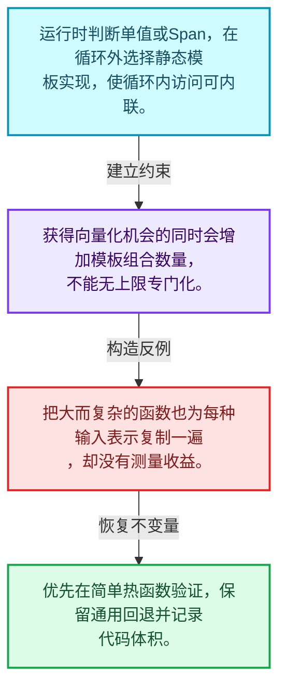
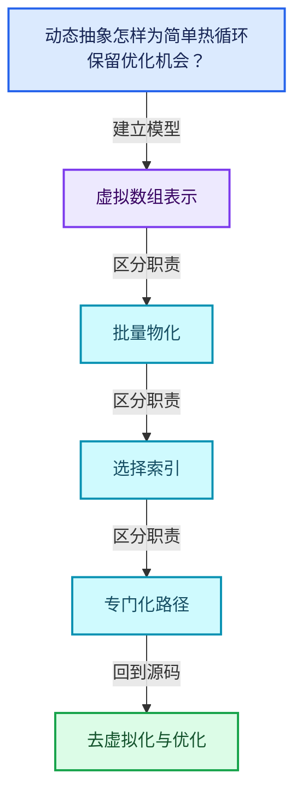
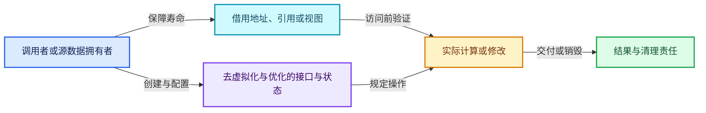
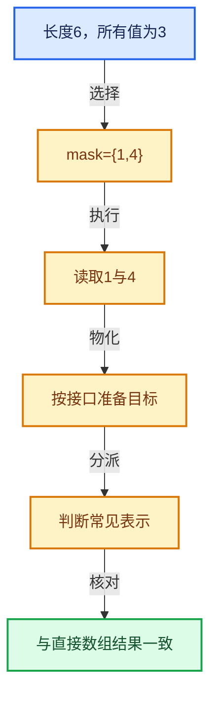

# 04-07 去虚拟化与优化

[方向导航](README.md) · [总目录](../README.md) · [覆盖索引](../%E6%BA%90%E7%A0%81%E7%89%88%E6%9C%AC%E4%B8%8E%E8%A6%86%E7%9B%96%E7%B4%A2%E5%BC%95.md)

> 阅读顺序：问题与数据模型 → 语法与类型 → 源码逐行 → 调用线索 → 历史与取舍 → 推演和练习。

- 基准 HEAD：`cbda6b96c26c0dee3c3b5cbb93960c4ac06a6b30`。
- 记录日期：2026-10-14。
- 教学示例状态：正文中的推演不是本机性能实测；已运行练习见验收报告。

## 一、从问题到设计

动态抽象怎样为简单热循环保留优化机会？

在循环外判定常见表示并选择模板实现，减少逐元素动态调用，但增加实例化与代码体积。

本篇把语法、数据语义和系统取舍连接起来。表示与接口分离，元素编号与选择内部位置分离，生成成本与执行成本分离。

### 本篇独立模型与设计推理

运行时判断单值或Span，在循环外选择静态模板实现，使循环内访问可内联。

设计取舍：获得向量化机会的同时会增加模板组合数量，不能无上限专门化。

最小反例：把大而复杂的函数也为每种输入表示复制一遍，却没有测量收益。

推导与处理：优先在简单热函数验证，保留通用回退并记录代码体积。



### 源码范围与相邻篇章

| 文件 | 本篇逐行范围 | 基准SHA-256 |
|---|---|---|
| [source/blender/blenlib/BLI_devirtualize_parameters.hh](../../../../../source/blender/blenlib/BLI_devirtualize_parameters.hh) | L1—L169 | `91d4352538fac9ddffcf8c2cbeed22b85c90587362ada36e8ae49b06178e2b1b` |

同一主讲文件可能分多篇覆盖；超出本篇范围的符号通过覆盖索引定位。空行与纯注释保留在源码摘录中，逐行表解释有效语句与语法边界；许可证头统一保留。

前篇：[切片与物化](06-%E5%88%87%E7%89%87%E4%B8%8E%E7%89%A9%E5%8C%96.md).

后篇：[IndexMask总体表示](08-IndexMask%E6%80%BB%E4%BD%93%E8%A1%A8%E7%A4%BA.md).

## 二、类型、数据与阅读地图



这是概念依赖图，边表示阅读关系，不声称是运行时调用顺序。

### 直接编译依赖


箭头只表示头文件包含关系；完整调用线索见后面的符号定位表。

## 三、关键词、语法与类型角色

### 模板 template

模板把类型或常量作为生成实现的参数。读声明时先列出类型参数、非类型参数和默认值，再看使用者实际实例化了什么。模板声明本身不意味着每种T都支持其全部成员。

具体检查：把T替换为int、string、只能移动的类型，分别检查每个被调用操作是否成立。

### 依赖名称 typename

typename既可引入类型模板参数，也可告诉编译器某个依赖名称是类型。它不创建运行时对象；解析期确认语法类别与实例化期检查具体类型是不同阶段。

具体检查：区分typename T::value_type和T::size()，前者标记类型，后者是表达式。

### 常量求值 constexpr

constexpr声明允许相应实体参与常量求值，但constexpr函数仍可以在运行时执行。是否常量求值由调用场景和表达式合法性共同决定。

具体检查：比较constexpr变量初始化和从运行时输入调用同一函数。

### 只读限定 const

const约束当前访问路径可做的修改。const指针、指向const的指针、const视图对象、const元素是不同位置的限定；其他别名可能仍可修改原对象。

具体检查：分别写T* const、const T*与const T* const，并画出不可修改的层次。

### 异常边界 try与catch

try定义异常传播的局部边界。失败路径需要销毁已经成功构造的部分并释放相应存储；未构造的对象不能被析构。

具体检查：在第k次构造失败，列出已经存在的对象集合与待释放缓冲。

### 运行时多态 virtual

虚调用根据实际动态类型选择实现；经基类指针销毁对象时通常需要相应虚析构契约。每元素虚调用和循环外一次分派有不同开销。

具体检查：找出虚接口的实现类和调用频率，再讨论是否值得去虚拟化。

### 对象表示 sizeof

sizeof给出对象表示大小，不是其引用的所有堆内存总量。sizeof视图很小并不说明底层数组很小。

具体检查：分别统计容器对象、容量字节和元素拥有的间接资源。

### 编译期分支 if constexpr

条件在实例化时决定被保留的分支，这常用于不同类型的合法操作选择。它与运行时if有不同的实例化检查规则。

具体检查：找出每个分支依赖哪些类型特征，再使用满足与不满足条件的类型。

### 类型别名 using

类型别名为已有类型建立名字，不创建运行期对象。它常把模板内部使用的类型统一暴露给泛型调用者。

具体检查：展开别名直到基础类型，区分类型别名和变量声明。

## 四、真实源码与逐行讲解

源码块保持原行内容，原始行号由小节标题及逐行表给出。表中的调用定位是静态阅读辅助；重载、模板实例化、宏展开和虚调用需结合完整声明，不能仅凭词法出现证明动态调用。

### BLI_devirtualize_parameters.hh：L1—L37

<!-- source:source/blender/blenlib/BLI_devirtualize_parameters.hh:1:37 -->

```cpp
/* SPDX-FileCopyrightText: 2023 Blender Authors
 *
 * SPDX-License-Identifier: GPL-2.0-or-later */

#pragma once

/** \file
 * \ingroup bli
 *
 * In geometry nodes, many functions accept fields as inputs. For the implementation that means
 * that the inputs are virtual arrays. Usually those are backed by actual arrays or single values
 * but sometimes virtual arrays are used to compute values on demand or convert between data
 * formats.
 *
 * Using virtual arrays has the downside that individual elements are accessed through a virtual
 * method call, which has some overhead compared to normal array access. Whether this overhead is
 * negligible depends on the context. For very small functions (e.g. a single addition), the
 * overhead can make the function many times slower. Furthermore, it prevents the compiler from
 * doing some optimizations (e.g. loop unrolling and inserting SIMD instructions).
 *
 * The solution is to "devirtualize" the virtual arrays in cases when the overhead cannot be
 * ignored. That means that the function is instantiated multiple times at compile time for the
 * different cases. For example, there can be an optimized function that adds a span and a single
 * value, and another function that adds a span and another span. At run-time there is a dynamic
 * dispatch that executes the best function given the specific virtual arrays.
 *
 * The problem with this devirtualization is that it can result in exponentially increasing compile
 * times and binary sizes, depending on the number of parameters that are devirtualized separately.
 * So there is always a trade-off between run-time performance and compile-time/binary-size.
 *
 * This file provides a utility to devirtualize function parameters using a high level API. This
 * makes it easy to experiment with different extremes of the mentioned trade-off and allows
 * finding a good compromise for each function.
 */

#include <cstdlib>
#include <tuple>
```

| 原始行 | 语义、约束与检查 |
|---|---|
| L5 | 防止同一头文件在一个翻译单元中重复展开；不控制多个源文件之间的链接或对象寿命。 |
| L36 | 引入编译依赖 <cstdlib>；这是声明可见性关系，不表示运行时一定调用该文件的所有接口。 |
| L37 | 引入编译依赖 <tuple>；这是声明可见性关系，不表示运行时一定调用该文件的所有接口。 |

### BLI_devirtualize_parameters.hh：L38—L152

<!-- source:source/blender/blenlib/BLI_devirtualize_parameters.hh:38:152 -->

```cpp

namespace blender {

/**
 * Calls the given function with devirtualized parameters if possible. Note that using many
 * non-trivial devirtualizers results in exponential code growth.
 *
 * \return True if the function has been called.
 *
 * Every devirtualizer is expected to have a `devirtualize(auto fn) -> bool` method.
 * This method is expected to do one of two things:
 * - Call `fn` with the devirtualized argument and return what `fn` returns.
 * - Don't call `fn` (because the devirtualization failed) and return false.
 *
 * Examples for devirtualizers: #BasicDevirtualizer, #VArrayDevirtualizer.
 */
template<typename Fn, typename... Devirtualizers>
inline bool call_with_devirtualized_parameters(const std::tuple<Devirtualizers...> &devis,
                                               const Fn &fn)
{
  /* In theory the code below could be generalized to avoid code duplication. However, the maximum
   * number of parameters is expected to be relatively low. Explicitly implementing the different
   * cases makes it more obvious to see what is going on and also makes inlining everything easier
   * for the compiler. */
  constexpr size_t DeviNum = sizeof...(Devirtualizers);
  if constexpr (DeviNum == 0) {
    fn();
    return true;
  }
  if constexpr (DeviNum == 1) {
    return std::get<0>(devis).devirtualize([&](auto param0) {
      fn(param0);
      return true;
    });
  }
  if constexpr (DeviNum == 2) {
    return std::get<0>(devis).devirtualize([&](auto &&param0) {
      return std::get<1>(devis).devirtualize([&](auto &&param1) {
        fn(param0, param1);
        return true;
      });
    });
  }
  if constexpr (DeviNum == 3) {
    return std::get<0>(devis).devirtualize([&](auto &&param0) {
      return std::get<1>(devis).devirtualize([&](auto &&param1) {
        return std::get<2>(devis).devirtualize([&](auto &&param2) {
          fn(param0, param1, param2);
          return true;
        });
      });
    });
  }
  if constexpr (DeviNum == 4) {
    return std::get<0>(devis).devirtualize([&](auto &&param0) {
      return std::get<1>(devis).devirtualize([&](auto &&param1) {
        return std::get<2>(devis).devirtualize([&](auto &&param2) {
          return std::get<3>(devis).devirtualize([&](auto &&param3) {
            fn(param0, param1, param2, param3);
            return true;
          });
        });
      });
    });
  }
  if constexpr (DeviNum == 5) {
    return std::get<0>(devis).devirtualize([&](auto &&param0) {
      return std::get<1>(devis).devirtualize([&](auto &&param1) {
        return std::get<2>(devis).devirtualize([&](auto &&param2) {
          return std::get<3>(devis).devirtualize([&](auto &&param3) {
            return std::get<4>(devis).devirtualize([&](auto &&param4) {
              fn(param0, param1, param2, param3, param4);
              return true;
            });
          });
        });
      });
    });
  }
  if constexpr (DeviNum == 6) {
    return std::get<0>(devis).devirtualize([&](auto &&param0) {
      return std::get<1>(devis).devirtualize([&](auto &&param1) {
        return std::get<2>(devis).devirtualize([&](auto &&param2) {
          return std::get<3>(devis).devirtualize([&](auto &&param3) {
            return std::get<4>(devis).devirtualize([&](auto &&param4) {
              return std::get<5>(devis).devirtualize([&](auto &&param5) {
                fn(param0, param1, param2, param3, param4, param5);
                return true;
              });
            });
          });
        });
      });
    });
  }
  if constexpr (DeviNum == 7) {
    return std::get<0>(devis).devirtualize([&](auto &&param0) {
      return std::get<1>(devis).devirtualize([&](auto &&param1) {
        return std::get<2>(devis).devirtualize([&](auto &&param2) {
          return std::get<3>(devis).devirtualize([&](auto &&param3) {
            return std::get<4>(devis).devirtualize([&](auto &&param4) {
              return std::get<5>(devis).devirtualize([&](auto &&param5) {
                return std::get<6>(devis).devirtualize([&](auto &&param6) {
                  fn(param0, param1, param2, param3, param4, param5, param6);
                  return true;
                });
              });
            });
          });
        });
      });
    });
  }
  return false;
}
```

| 原始行 | 语义、约束与检查 |
|---|---|
| L39 | 把后续声明放入 blender 命名空间，影响名称查找和符号归属，不创建运行时对象。 |
| L54 | 声明模板参数 `template<typename Fn, typename... Devirtualizers>`。类型参数决定生成操作的类型，非类型参数可决定内嵌容量或编译期分支。 |
| L55 | 出现调用或函数声明 `call_with_devirtualized_parameters`，对应表达式为 `inline bool call_with_devirtualized_parameters(const std::tuple<Devirtualizers...> &devis,`。参数求值、返回类型与重载需结合前后完整语句；静态文本引用不能证明动态目标。 |
| L56 | 本行是连续声明或表达式的一部分：`const Fn &fn)`。与本段前后行合读；逗号、括号和限定符决定它属于参数、初始化列表还是实际计算。 |
| L57 | 连接上一行的声明或控制结构与其语句块；后续行在这个作用域中执行或声明。 |
| L62 | 把右侧 `sizeof...(Devirtualizers)` 用于初始化或更新左侧 `constexpr size_t DeviNum`。声明初始化与已有对象赋值应按上下文区分；有资源的类型会调用相应特殊成员。 |
| L63 | 编译期条件分支 `if constexpr (DeviNum == 0)`。按实例化类型选择相应实现；被舍弃分支和运行期if具有不同检查规则，不能当作运行时输入验证。 |
| L64 | 出现调用或函数声明 `fn`，对应表达式为 `fn();`。参数求值、返回类型与重载需结合前后完整语句；静态文本引用不能证明动态目标。 |
| L65 | 返回表达式 `true`。这是本路径的布尔结果，具体成功、存在或状态含义由函数接口规定。 |
| L66 | 结束当前语法单元。局部自动对象在离开其作用域时按规则销毁；这不等于所有被引用的外部数据也被释放。 |
| L67 | 编译期条件分支 `if constexpr (DeviNum == 1)`。按实例化类型选择相应实现；被舍弃分支和运行期if具有不同检查规则，不能当作运行时输入验证。 |
| L68 | 返回表达式 `std::get<0>(devis).devirtualize([&](auto param0) {`。 |
| L69 | 出现调用或函数声明 `fn`，对应表达式为 `fn(param0);`。参数求值、返回类型与重载需结合前后完整语句；静态文本引用不能证明动态目标。 |
| L70 | 返回表达式 `true`。这是本路径的布尔结果，具体成功、存在或状态含义由函数接口规定。 |
| L71 | 结束当前语法单元。局部自动对象在离开其作用域时按规则销毁；这不等于所有被引用的外部数据也被释放。 |
| L72 | 结束当前语法单元。局部自动对象在离开其作用域时按规则销毁；这不等于所有被引用的外部数据也被释放。 |
| L73 | 编译期条件分支 `if constexpr (DeviNum == 2)`。按实例化类型选择相应实现；被舍弃分支和运行期if具有不同检查规则，不能当作运行时输入验证。 |
| L74 | 返回表达式 `std::get<0>(devis).devirtualize([&](auto &&param0) {`。 |
| L75 | 返回表达式 `std::get<1>(devis).devirtualize([&](auto &&param1) {`。结合函数声明检查返回值是否借用原存储，借用值不会自动延长其寿命。 |
| L76 | 出现调用或函数声明 `fn`，对应表达式为 `fn(param0, param1);`。参数求值、返回类型与重载需结合前后完整语句；静态文本引用不能证明动态目标。 |
| L77 | 返回表达式 `true`。这是本路径的布尔结果，具体成功、存在或状态含义由函数接口规定。 |
| L78 | 结束当前语法单元。局部自动对象在离开其作用域时按规则销毁；这不等于所有被引用的外部数据也被释放。 |
| L79 | 结束当前语法单元。局部自动对象在离开其作用域时按规则销毁；这不等于所有被引用的外部数据也被释放。 |
| L80 | 结束当前语法单元。局部自动对象在离开其作用域时按规则销毁；这不等于所有被引用的外部数据也被释放。 |
| L81 | 编译期条件分支 `if constexpr (DeviNum == 3)`。按实例化类型选择相应实现；被舍弃分支和运行期if具有不同检查规则，不能当作运行时输入验证。 |
| L82 | 返回表达式 `std::get<0>(devis).devirtualize([&](auto &&param0) {`。 |
| L83 | 返回表达式 `std::get<1>(devis).devirtualize([&](auto &&param1) {`。结合函数声明检查返回值是否借用原存储，借用值不会自动延长其寿命。 |
| L84 | 返回表达式 `std::get<2>(devis).devirtualize([&](auto &&param2) {`。结合函数声明检查返回值是否借用原存储，借用值不会自动延长其寿命。 |
| L85 | 出现调用或函数声明 `fn`，对应表达式为 `fn(param0, param1, param2);`。参数求值、返回类型与重载需结合前后完整语句；静态文本引用不能证明动态目标。 |
| L86 | 返回表达式 `true`。这是本路径的布尔结果，具体成功、存在或状态含义由函数接口规定。 |
| L87 | 结束当前语法单元。局部自动对象在离开其作用域时按规则销毁；这不等于所有被引用的外部数据也被释放。 |
| L88 | 结束当前语法单元。局部自动对象在离开其作用域时按规则销毁；这不等于所有被引用的外部数据也被释放。 |
| L89 | 结束当前语法单元。局部自动对象在离开其作用域时按规则销毁；这不等于所有被引用的外部数据也被释放。 |
| L90 | 结束当前语法单元。局部自动对象在离开其作用域时按规则销毁；这不等于所有被引用的外部数据也被释放。 |
| L91 | 编译期条件分支 `if constexpr (DeviNum == 4)`。按实例化类型选择相应实现；被舍弃分支和运行期if具有不同检查规则，不能当作运行时输入验证。 |
| L92 | 返回表达式 `std::get<0>(devis).devirtualize([&](auto &&param0) {`。 |
| L93 | 返回表达式 `std::get<1>(devis).devirtualize([&](auto &&param1) {`。结合函数声明检查返回值是否借用原存储，借用值不会自动延长其寿命。 |
| L94 | 返回表达式 `std::get<2>(devis).devirtualize([&](auto &&param2) {`。结合函数声明检查返回值是否借用原存储，借用值不会自动延长其寿命。 |
| L95 | 返回表达式 `std::get<3>(devis).devirtualize([&](auto &&param3) {`。结合函数声明检查返回值是否借用原存储，借用值不会自动延长其寿命。 |
| L96 | 出现调用或函数声明 `fn`，对应表达式为 `fn(param0, param1, param2, param3);`。参数求值、返回类型与重载需结合前后完整语句；静态文本引用不能证明动态目标。 |
| L97 | 返回表达式 `true`。这是本路径的布尔结果，具体成功、存在或状态含义由函数接口规定。 |
| L98 | 结束当前语法单元。局部自动对象在离开其作用域时按规则销毁；这不等于所有被引用的外部数据也被释放。 |
| L99 | 结束当前语法单元。局部自动对象在离开其作用域时按规则销毁；这不等于所有被引用的外部数据也被释放。 |
| L100 | 结束当前语法单元。局部自动对象在离开其作用域时按规则销毁；这不等于所有被引用的外部数据也被释放。 |
| L101 | 结束当前语法单元。局部自动对象在离开其作用域时按规则销毁；这不等于所有被引用的外部数据也被释放。 |
| L102 | 结束当前语法单元。局部自动对象在离开其作用域时按规则销毁；这不等于所有被引用的外部数据也被释放。 |
| L103 | 编译期条件分支 `if constexpr (DeviNum == 5)`。按实例化类型选择相应实现；被舍弃分支和运行期if具有不同检查规则，不能当作运行时输入验证。 |
| L104 | 返回表达式 `std::get<0>(devis).devirtualize([&](auto &&param0) {`。 |
| L105 | 返回表达式 `std::get<1>(devis).devirtualize([&](auto &&param1) {`。结合函数声明检查返回值是否借用原存储，借用值不会自动延长其寿命。 |
| L106 | 返回表达式 `std::get<2>(devis).devirtualize([&](auto &&param2) {`。结合函数声明检查返回值是否借用原存储，借用值不会自动延长其寿命。 |
| L107 | 返回表达式 `std::get<3>(devis).devirtualize([&](auto &&param3) {`。结合函数声明检查返回值是否借用原存储，借用值不会自动延长其寿命。 |
| L108 | 返回表达式 `std::get<4>(devis).devirtualize([&](auto &&param4) {`。结合函数声明检查返回值是否借用原存储，借用值不会自动延长其寿命。 |
| L109 | 出现调用或函数声明 `fn`，对应表达式为 `fn(param0, param1, param2, param3, param4);`。参数求值、返回类型与重载需结合前后完整语句；静态文本引用不能证明动态目标。 |
| L110 | 返回表达式 `true`。这是本路径的布尔结果，具体成功、存在或状态含义由函数接口规定。 |
| L111 | 结束当前语法单元。局部自动对象在离开其作用域时按规则销毁；这不等于所有被引用的外部数据也被释放。 |
| L112 | 结束当前语法单元。局部自动对象在离开其作用域时按规则销毁；这不等于所有被引用的外部数据也被释放。 |
| L113 | 结束当前语法单元。局部自动对象在离开其作用域时按规则销毁；这不等于所有被引用的外部数据也被释放。 |
| L114 | 结束当前语法单元。局部自动对象在离开其作用域时按规则销毁；这不等于所有被引用的外部数据也被释放。 |
| L115 | 结束当前语法单元。局部自动对象在离开其作用域时按规则销毁；这不等于所有被引用的外部数据也被释放。 |
| L116 | 结束当前语法单元。局部自动对象在离开其作用域时按规则销毁；这不等于所有被引用的外部数据也被释放。 |
| L117 | 编译期条件分支 `if constexpr (DeviNum == 6)`。按实例化类型选择相应实现；被舍弃分支和运行期if具有不同检查规则，不能当作运行时输入验证。 |
| L118 | 返回表达式 `std::get<0>(devis).devirtualize([&](auto &&param0) {`。 |
| L119 | 返回表达式 `std::get<1>(devis).devirtualize([&](auto &&param1) {`。结合函数声明检查返回值是否借用原存储，借用值不会自动延长其寿命。 |
| L120 | 返回表达式 `std::get<2>(devis).devirtualize([&](auto &&param2) {`。结合函数声明检查返回值是否借用原存储，借用值不会自动延长其寿命。 |
| L121 | 返回表达式 `std::get<3>(devis).devirtualize([&](auto &&param3) {`。结合函数声明检查返回值是否借用原存储，借用值不会自动延长其寿命。 |
| L122 | 返回表达式 `std::get<4>(devis).devirtualize([&](auto &&param4) {`。结合函数声明检查返回值是否借用原存储，借用值不会自动延长其寿命。 |
| L123 | 返回表达式 `std::get<5>(devis).devirtualize([&](auto &&param5) {`。结合函数声明检查返回值是否借用原存储，借用值不会自动延长其寿命。 |
| L124 | 出现调用或函数声明 `fn`，对应表达式为 `fn(param0, param1, param2, param3, param4, param5);`。参数求值、返回类型与重载需结合前后完整语句；静态文本引用不能证明动态目标。 |
| L125 | 返回表达式 `true`。这是本路径的布尔结果，具体成功、存在或状态含义由函数接口规定。 |
| L126 | 结束当前语法单元。局部自动对象在离开其作用域时按规则销毁；这不等于所有被引用的外部数据也被释放。 |
| L127 | 结束当前语法单元。局部自动对象在离开其作用域时按规则销毁；这不等于所有被引用的外部数据也被释放。 |
| L128 | 结束当前语法单元。局部自动对象在离开其作用域时按规则销毁；这不等于所有被引用的外部数据也被释放。 |
| L129 | 结束当前语法单元。局部自动对象在离开其作用域时按规则销毁；这不等于所有被引用的外部数据也被释放。 |
| L130 | 结束当前语法单元。局部自动对象在离开其作用域时按规则销毁；这不等于所有被引用的外部数据也被释放。 |
| L131 | 结束当前语法单元。局部自动对象在离开其作用域时按规则销毁；这不等于所有被引用的外部数据也被释放。 |
| L132 | 结束当前语法单元。局部自动对象在离开其作用域时按规则销毁；这不等于所有被引用的外部数据也被释放。 |
| L133 | 编译期条件分支 `if constexpr (DeviNum == 7)`。按实例化类型选择相应实现；被舍弃分支和运行期if具有不同检查规则，不能当作运行时输入验证。 |
| L134 | 返回表达式 `std::get<0>(devis).devirtualize([&](auto &&param0) {`。 |
| L135 | 返回表达式 `std::get<1>(devis).devirtualize([&](auto &&param1) {`。结合函数声明检查返回值是否借用原存储，借用值不会自动延长其寿命。 |
| L136 | 返回表达式 `std::get<2>(devis).devirtualize([&](auto &&param2) {`。结合函数声明检查返回值是否借用原存储，借用值不会自动延长其寿命。 |
| L137 | 返回表达式 `std::get<3>(devis).devirtualize([&](auto &&param3) {`。结合函数声明检查返回值是否借用原存储，借用值不会自动延长其寿命。 |
| L138 | 返回表达式 `std::get<4>(devis).devirtualize([&](auto &&param4) {`。结合函数声明检查返回值是否借用原存储，借用值不会自动延长其寿命。 |
| L139 | 返回表达式 `std::get<5>(devis).devirtualize([&](auto &&param5) {`。结合函数声明检查返回值是否借用原存储，借用值不会自动延长其寿命。 |
| L140 | 返回表达式 `std::get<6>(devis).devirtualize([&](auto &&param6) {`。结合函数声明检查返回值是否借用原存储，借用值不会自动延长其寿命。 |
| L141 | 出现调用或函数声明 `fn`，对应表达式为 `fn(param0, param1, param2, param3, param4, param5, param6);`。参数求值、返回类型与重载需结合前后完整语句；静态文本引用不能证明动态目标。 |
| L142 | 返回表达式 `true`。这是本路径的布尔结果，具体成功、存在或状态含义由函数接口规定。 |
| L143 | 结束当前语法单元。局部自动对象在离开其作用域时按规则销毁；这不等于所有被引用的外部数据也被释放。 |
| L144 | 结束当前语法单元。局部自动对象在离开其作用域时按规则销毁；这不等于所有被引用的外部数据也被释放。 |
| L145 | 结束当前语法单元。局部自动对象在离开其作用域时按规则销毁；这不等于所有被引用的外部数据也被释放。 |
| L146 | 结束当前语法单元。局部自动对象在离开其作用域时按规则销毁；这不等于所有被引用的外部数据也被释放。 |
| L147 | 结束当前语法单元。局部自动对象在离开其作用域时按规则销毁；这不等于所有被引用的外部数据也被释放。 |
| L148 | 结束当前语法单元。局部自动对象在离开其作用域时按规则销毁；这不等于所有被引用的外部数据也被释放。 |
| L149 | 结束当前语法单元。局部自动对象在离开其作用域时按规则销毁；这不等于所有被引用的外部数据也被释放。 |
| L150 | 结束当前语法单元。局部自动对象在离开其作用域时按规则销毁；这不等于所有被引用的外部数据也被释放。 |
| L151 | 返回表达式 `false`。这是本路径的布尔结果，具体成功、存在或状态含义由函数接口规定。 |
| L152 | 结束当前语法单元。局部自动对象在离开其作用域时按规则销毁；这不等于所有被引用的外部数据也被释放。 |

### BLI_devirtualize_parameters.hh：L153—L169

<!-- source:source/blender/blenlib/BLI_devirtualize_parameters.hh:153:169 -->

```cpp

/**
 * A devirtualizer to be used with #call_with_devirtualized_parameters.
 *
 * This one is very simple, it does not perform any actual devirtualization. It can be used to pass
 * parameters to the function that shouldn't be devirtualized.
 */
template<typename T> struct BasicDevirtualizer {
  const T value;

  template<typename Fn> bool devirtualize(const Fn &fn) const
  {
    return fn(this->value);
  }
};

}  // namespace blender
```

| 原始行 | 语义、约束与检查 |
|---|---|
| L160 | 声明模板参数 `template<typename T> struct BasicDevirtualizer {`。类型参数决定生成操作的类型，非类型参数可决定内嵌容量或编译期分支。 |
| L161 | 声明成员、局部对象或完成语句 `const T value`。若为指针或引用，它本身不说明拥有；若为值对象，其构造析构由所在作用域或外层对象管理。 |
| L163 | 声明模板参数 `template<typename Fn> bool devirtualize(const Fn &fn) const`。类型参数决定生成操作的类型，非类型参数可决定内嵌容量或编译期分支。 |
| L164 | 连接上一行的声明或控制结构与其语句块；后续行在这个作用域中执行或声明。 |
| L165 | 返回表达式 `fn(this->value)`。 |
| L166 | 结束当前语法单元。局部自动对象在离开其作用域时按规则销毁；这不等于所有被引用的外部数据也被释放。 |
| L167 | 结束当前语法单元。局部自动对象在离开其作用域时按规则销毁；这不等于所有被引用的外部数据也被释放。 |
| L169 | 结束当前语法单元。局部自动对象在离开其作用域时按规则销毁；这不等于所有被引用的外部数据也被释放。 |

## 五、接口定位、调用线索与生命周期

### 本篇声明与实现入口

| 源码位置 | 实际声明片段 |
|---|---|
| [BLI_devirtualize_parameters.hh:L55](../../../../../source/blender/blenlib/BLI_devirtualize_parameters.hh#L55) | `inline bool call_with_devirtualized_parameters(const std::tuple<Devirtualizers...> &devis,` |
| [BLI_devirtualize_parameters.hh:L160](../../../../../source/blender/blenlib/BLI_devirtualize_parameters.hh#L160) | `template<typename T> struct BasicDevirtualizer` |
| [BLI_devirtualize_parameters.hh:L163](../../../../../source/blender/blenlib/BLI_devirtualize_parameters.hh#L163) | `template<typename Fn> bool devirtualize(const Fn &fn) const` |

### 同名符号出现位置

以下表提供跨文件阅读入口，包含声明、调用或测试使用；没有经过完整C++名称解析，不把它命名为已证明的运行时调用图。

| 符号 | 位置 | 文本证据 |
|---|---|---|
| `call_with_devirtualized_parameters` | [BLI_virtual_array.hh:L1187](../../../../../source/blender/blenlib/BLI_virtual_array.hh#L1187) | `if (call_with_devirtualized_parameters(` |
| `call_with_devirtualized_parameters` | [BLI_virtual_array.hh:L1208](../../../../../source/blender/blenlib/BLI_virtual_array.hh#L1208) | `if (call_with_devirtualized_parameters(` |
| `call_with_devirtualized_parameters` | [FN_multi_function_builder.hh:L416](../../../../../source/blender/functions/FN_multi_function_builder.hh#L416) | `executed_devirtualized = call_with_devirtualized_parameters(` |
| `devirtualize` | [BLI_generic_virtual_array.hh:L778](../../../../../source/blender/blenlib/BLI_generic_virtual_array.hh#L778) | `template<typename Fn> bool devirtualize(const Fn &fn) const` |
| `devirtualize` | [BLI_virtual_array.hh:L1157](../../../../../source/blender/blenlib/BLI_virtual_array.hh#L1157) | `template<typename Fn> bool devirtualize(const Fn &fn) const` |

### 生命周期推理图



这是审查生命周期的通用模型。具体类是否拥有数据由本篇成员、构造、析构和调用者一起证明；任何箭头都不自动代表shared_ptr。

## 六、把代码放进具体数据中推演

本方向的共同数值模型如下。本篇的专门检查是：计算常量加数组，比较动态调用次数并保留通用回退。

| 步骤 | 数据或状态 | 为什么需要这一步 |
|---|---|---|
| 输入 | 长度6，所有值为3 | 单值表示可只存一个3 |
| 选择 | mask={1,4} | 内部位置0对应全局1 |
| 执行 | 读取1与4 | 避免读取未选位置 |
| 物化 | 按接口准备目标 | 支付真实存储和复制成本 |
| 分派 | 判断常见表示 | 专门化循环可避免逐项虚调用 |
| 核对 | 与直接数组结果一致 | 表示变化不能改变元素语义 |



图是教学推演模型；精确分支与状态更新以本篇摘录及调用契约为准。

### 本篇独立练习与参考思路

计算常量加数组，比较动态调用次数并保留通用回退。

参考思路：在循环外判定常见表示并选择模板实现，减少逐元素动态调用，但增加实例化与代码体积。

将输入、预期结果和资源责任分成三张清单。先用最直接的实现给出可核对的答案，再替换成对应源码使用的表示；比较结果不变的条件，而不是只比较接口名字。

验收依据：遍历结果按真实索引排序且无重复；单值、Span与计算表示在有效索引上返回一致语义。

## 七、复杂度、设计取舍与其他基础库

对比普通Span、标准ranges惰性视图和虚拟数组时，明确随机索引能力、批量物化、类型擦除和拥有关系；接口外观相近不代表同一抽象。

本篇的具体取舍：在循环外判定常见表示并选择模板实现，减少逐元素动态调用，但增加实例化与代码体积。

| 观察维度 | 从源码取得证据的方法 | 本篇要避免的误判 |
|---|---|---|
| 时间 | 对循环次数、分派次数和重建频率分别计数 | 看到单次常数操作就断定整个操作序列是常数成本 |
| 内存 | 区分对象本体、容量存储、间接资源和共享控制块 | 用sizeof代替总内存 |
| 安全 | 沿构造、失败回滚、销毁与失效逐路径检查 | 把断言或非空指针当作完整安全证明 |
| 并发 | 逐字段确认锁、发布顺序和借用寿命 | 把引用计数线程安全等同数据读写线程安全 |

相关一手资料：

- [C++公开工作草案](https://eel.is/c++draft/)：持续更新的工作草案；语言与标准库语义以相应章节为准。
- [LLVM Programmer’s Manual](https://llvm.org/docs/ProgrammersManual.html)：在线版，2026-10-14查阅；仅比较设计思路，不保证与本地LLVM版本一致。

资料用于核对契约和进一步阅读；这里没有声称外部库与Blender实现相同，也没有把上游性能数字当作本机实测。

## 八、历史提交与设计演化

### 2022-04-26 · Jacques Lucke

[Geometry Nodes: refactor array devirtualization](https://projects.blender.org/blender/blender/commit/ae94e36cfb2f3bc9a99b638782092d9c71d4b3c7)

完整哈希：`ae94e36cfb2f3bc9a99b638782092d9c71d4b3c7`。提交标题与作者日期来自本地Git对象。

提交说明原文（历史证据，不能直接作为当前API说明）：

```text
Geometry Nodes: refactor array devirtualization

Goals:
* Better high level control over where devirtualization occurs. There is always
  a trade-off between performance and compile-time/binary-size.
* Simplify using array devirtualization.
* Better performance for cases where devirtualization wasn't used before.

Many geometry nodes accept fields as inputs. Internally, that means that the
execution functions have to accept so called "virtual arrays" as inputs. Those
 can be e.g. actual arrays, just single values, or lazily computed arrays.
Due to these different possible virtual arrays implementations, access to
individual elements is slower than it would be if everything was just a normal
array (access does through a virtual function call). For more complex execution
functions, this overhead does not matter, but for small functions (like a simple
addition) it very much does. The virtual function call also prevents the compiler
from doing some optimizations (e.g. loop unrolling and inserting simd instructions).

The solution is to "devirtualize" the virtual arrays for small functions where the
overhead is measurable. Essentially, the function is generated many times with
different array types as input. Then there is a run-time dispatch that calls the
best implementation. We have been doing devirtualization in e.g. math nodes
for a long time already. This patch just generalizes the concept and makes it
easier to control. It also makes it easier to investigate the different trade-offs
when it comes to devirtualization.

Nodes that we've optimized using devirtualization before didn't get a speedup.
However, a couple of nodes are using devirtualization now, that didn't before.
Those got a 2-4x speedup in common cases.
* Map Range
* Random Value
* Switch
* Combine XYZ

Differential Revision: https://developer.blender.org/D14628
```

阅读任务：先根据说明复述旧问题，提出一个自己的修复方案，再对照diff。结合本篇重点“动态抽象怎样为简单热循环保留优化机会？”判断方案改变的是表示、接口、生命周期还是调度。

### 2023-05-24 · Jacques Lucke

[BLI: refactor IndexMask for better performance and memory usage](https://projects.blender.org/blender/blender/commit/2cfcb8b0b805401a0ffb252fd41750fadb0392ab)

完整哈希：`2cfcb8b0b805401a0ffb252fd41750fadb0392ab`。提交标题与作者日期来自本地Git对象。

提交说明原文（历史证据，不能直接作为当前API说明）：

```text
BLI: refactor IndexMask for better performance and memory usage

Goals of this refactor:
* Reduce memory consumption of `IndexMask`. The old `IndexMask` uses an
  `int64_t` for each index which is more than necessary in pretty much all
  practical cases currently. Using `int32_t` might still become limiting
  in the future in case we use this to index e.g. byte buffers larger than
  a few gigabytes. We also don't want to template `IndexMask`, because
  that would cause a split in the "ecosystem", or everything would have to
  be implemented twice or templated.
* Allow for more multi-threading. The old `IndexMask` contains a single
  array. This is generally good but has the problem that it is hard to fill
  from multiple-threads when the final size is not known from the beginning.
  This is commonly the case when e.g. converting an array of bool to an
  index mask. Currently, this kind of code only runs on a single thread.
* Allow for efficient set operations like join, intersect and difference.
  It should be possible to multi-thread those operations.
* It should be possible to iterate over an `IndexMask` very efficiently.
  The most important part of that is to avoid all memory access when iterating
  over continuous ranges. For some core nodes (e.g. math nodes), we generate
  optimized code for the cases of irregular index masks and simple index ranges.

To achieve these goals, a few compromises had to made:
* Slicing of the mask (at specific indices) and random element access is
  `O(log #indices)` now, but with a low constant factor. It should be possible
  to split a mask into n approximately equally sized parts in `O(n)` though,
  making the time per split `O(1)`.
* Using range-based for loops does not work well when iterating over a nested
  data structure like the new `IndexMask`. Therefor, `foreach_*` functions with
  callbacks have to be used. To avoid extra code complexity at the call site,
  the `foreach_*` methods support multi-threading out of the box.

The new data structure splits an `IndexMask` into an arbitrary number of ordered
`IndexMaskSegment`. Each segment can contain at most `2^14 = 16384` indices. The
indices within a segment are stored as `int16_t`. Each segment has an additional
`int64_t` offset which allows storing arbitrary `int64_t` indices. This approach
has the main benefits that segments can be processed/constructed individually on
multiple threads without a serial bottleneck. Also it reduces the memory
requirements significantly.

For more details see comments in `BLI_index_mask.hh`.

I did a few tests to verify that the data structure generally improves
performance and does not cause regressions:
* Our field evaluation benchmarks take about as much as before. This is to be
  expected because we already made sure that e.g. add node evaluation is
  vectorized. The important thing here is to check that changes to the way we
  iterate over the indices still allows for auto-vectorization.
* Memory usage by a mask is about 1/4 of what it was before in the average case.
  That's mainly caused by the switch from `int64_t` to `int16_t` for indices.
  In the worst case, the memory requirements can be larger when there are many
  indices that are very far away. However, when they are far away from each other,
  that indicates that there aren't many indices in total. In common cases, memory
  usage can be way lower than 1/4 of before, because sub-ranges use static memory.
* For some more specific numbers I benchmarked `IndexMask::from_bools` in
  `index_mask_from_selection` on 10.000.000 elements at various probabilities for
  `true` at every index:
  ```
  Probability      Old        New
  0              4.6 ms     0.8 ms
  0.001          5.1 ms     1.3 ms
  0.2            8.4 ms     1.8 ms
  0.5           15.3 ms     3.0 ms
  0.8           20.1 ms     3.0 ms
  0.999         25.1 ms     1.7 ms
  1             13.5 ms     1.1 ms
  ```

Pull Request: https://projects.blender.org/blender/blender/pulls/104629
```

阅读任务：先根据说明复述旧问题，提出一个自己的修复方案，再对照diff。结合本篇重点“动态抽象怎样为简单热循环保留优化机会？”判断方案改变的是表示、接口、生命周期还是调度。

## 九、反例、测试入口与掌握标准

需要实际构造的反例：

- 空输入或没有结果需求：确认接口允许的空状态与不允许访问的操作。
- 边界位置和退化结构：把长度为1、末尾位置、重复值或深链代入真实分支。
- 生命周期结束或修改之后：检查保存的指针、引用、结果视图是否仍有效。
- 与本篇核心不变量相冲突的输入：计算常量加数组，比较动态调用次数并保留通用回退。

### 可运行的教学参考程序

[reference_exercises.cc](../_tools/reference_exercises.cc)包含独立于Blender的C++20参考检查：视图、简化SmallVector、异常回滚、哈希碰撞与删除、偏移数组、拓扑映射、共享缓存、表达式、惰性分支、闭包和暴力最近邻。

参考程序有意省略生产实现的完整能力。例如SmallVector禁止复制移动容器，不支持只能移动的元素，并禁止append参数别名到自身元素；TinyMap固定8槽，不提供增长。程序通过不能替代Blender实现测试。实际运行结果、编译器与命令见验收报告。

掌握标准：离开源码解释“动态抽象怎样为简单热循环保留优化机会？”；独立完成上述练习；能指出一个会破坏虚拟数组表示相关约束的最小反例，并用具体代码行说明检查或修复应放在哪里。
