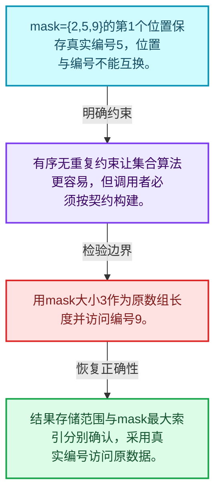
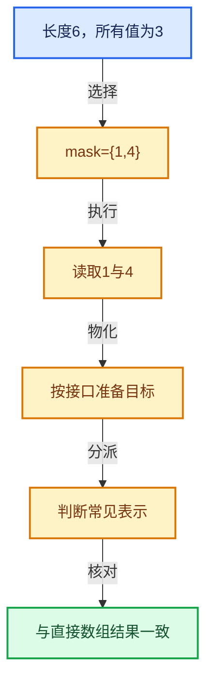

# 04-08 IndexMask总体表示

[方向导航](README.md) · [总目录](../README.md) · [实现索引](../%E7%AC%A6%E5%8F%B7%E4%BE%9D%E8%B5%96%E4%B8%8E%E5%AE%9E%E7%8E%B0%E7%B4%A2%E5%BC%95.md)

## 从问题到实现

选择集合为什么要求有序且无重复？

这些约束允许高效遍历、查找与集合操作；选择中的元素编号与集合内部位置不同。

**数据模型**

mask={2,5,9}的第1个位置保存真实编号5，位置与编号不能互换。

**设计取舍**

有序无重复约束让集合算法更容易，但调用者必须按契约构建。

**最小反例**

用mask大小3作为原数组长度并访问编号9。

**推导**

结果存储范围与mask最大索引分别确认，采用真实编号访问原数据。

## 阅读地图与执行推演






图中的数值推演是本方向的教学模型；实际函数之间的调用边与概念分析边分别标注，不能把概念关系当作运行时调度顺序。

## 完整源码单元与就地讲解

中文讲解直接放在相关代码旁，复杂机制在代码下展开。原文折叠区保留基准行号；不需要在行号表和函数之间来回查找。类布局可分段展示，函数实现不按固定行数切开。

### 类型布局、声明与编译条件 · BLI_index_mask.hh L1—L119

<a id="t-91b3e3763f74"></a>

`RawMaskIterator`在这里声明的数据成员：

- `int64_t segment_i`
- `int16_t index_in_segment`

<a id="t-fca074e4962f"></a>

`IndexMaskData`在这里声明的数据成员：

- `int64_t indices_num_`
- `int64_t segments_num_`
- `int16_t indices_by_segment_`
- `int64_t segment_offsets_`
- `int64_t cumulative_segment_sizes_`
- `int64_t begin_index_in_segment_`
- `int64_t end_index_in_segment_`

<a id="t-6f6cc9712234"></a>

`IndexMaskMemory`在这里声明的数据成员：

- `AlignedBuffer<1024, 8> inline_buffer_`

<!-- annotated:f756e371f78e0d -->

```cpp
/* SPDX-FileCopyrightText: 2023 Blender Authors
 *
 * SPDX-License-Identifier: GPL-2.0-or-later */

/** \file
 * \ingroup bli
 */

#pragma once

#include <array>
#include <optional>
#include <variant>

#include "BLI_bit_span.hh"
#include "BLI_execution_mode.hh"
#include "BLI_function_ref.hh"
#include "BLI_index_mask_fwd.hh"
#include "BLI_index_ranges_builder_fwd.hh"
#include "BLI_linear_allocator.hh"
#include "BLI_offset_indices.hh"
#include "BLI_offset_span.hh"
#include "BLI_task.hh"
#include "BLI_unique_sorted_indices.hh"
#include "BLI_vector.hh"
#include "BLI_virtual_array_fwd.hh"

namespace blender {

namespace index_mask {

/**
 * Constants that define the maximum segment size. Segment sizes are limited so that the indices
 * within each segment can be stored as #int16_t, which allows the mask to stored much more
 * compactly than if 32 or 64 bit ints would be used.
 * - Using 8 bit ints does not work well, because then the maximum segment size would be too small
 *   for eliminate per-segment overhead in many cases and also leads to many more segments.
 * - The most-significant-bit is not used so that signed integers can be used which avoids common
 *   issues when mixing signed and unsigned ints.
 * - The second most-significant bit is not used for indices so that #max_segment_size itself can
 *   be stored in the #int16_t.
 * - The maximum number of indices in a segment is 16384, which is generally enough to make the
 *   overhead per segment negligible when processing large index masks.
 * - A power of two is used for #max_segment_size, because that allows for faster construction of
 *   index masks for index ranges.
 */
static constexpr int64_t max_segment_size_shift = 14;
static constexpr int64_t max_segment_size = (1 << max_segment_size_shift); /* 16384 */
static constexpr int64_t max_segment_size_mask_low = max_segment_size - 1;
static constexpr int64_t max_segment_size_mask_high = ~max_segment_size_mask_low;

/**
 * Encodes a position in an #IndexMask. The term "raw" just means that this does not have the usual
 * iterator methods like `operator++`. Supporting those would require storing more data. Generally,
 * the fastest way to iterate over an #IndexMask is using a `foreach_*` method anyway.
 */
struct RawMaskIterator {
  /** Index of the segment in the index mask. */
  int64_t segment_i;
  /** Element within the segment. */
  int16_t index_in_segment;
};

/**
 * Base type of #IndexMask. This only exists to make it more convenient to construct an index mask
 * in a few functions with #IndexMask::data_for_inplace_construction.
 *
 * The names intentionally have a trailing underscore here even though they are public in
 * #IndexMaskData because they are private in #IndexMask.
 */
struct IndexMaskData {
  /**
   * Size of the index mask, i.e. the number of indices.
   */
  int64_t indices_num_;
  /**
   * Number of segments in the index mask. Each segment contains at least one of the indices.
   */
  int64_t segments_num_;
  /**
   * Pointer to the index array for every segment. The size of each array can be computed from
   * #cumulative_segment_sizes_.
   */
  const int16_t **indices_by_segment_;
  /**
   * Offset that is applied to the indices in each segment.
   */
  const int64_t *segment_offsets_;
  /**
   * Encodes the size of each segment. The size of a specific segment can be computed by
   * subtracting consecutive values (also see #OffsetIndices). The size of this array is one
   * larger than #segments_num_. Note that the first value is _not_ necessarily zero when an
   * index mask is a slice of another mask.
   */
  const int64_t *cumulative_segment_sizes_;
  /**
   * Index into the first segment where the #IndexMask starts. This exists to support slicing
   * without having to modify and therefor allocate a new #indices_by_segment_ array.
   */
  int64_t begin_index_in_segment_;
  /**
   * Index into the last segment where the #IndexMask ends. This exists to support slicing without
   * having to modify and therefore allocate a new #cumulative_segment_sizes_ array.
   */
  int64_t end_index_in_segment_;
};

/**
 * #IndexMask does not own any memory itself. In many cases the memory referenced by a mask has
 * static life-time (e.g. when a mask is a range). To create more complex masks, additional memory
 * is necessary. #IndexMaskMemory is a simple wrapper around a linear allocator that has to be
 * passed to functions that might need to allocate extra memory.
 */
class IndexMaskMemory : public LinearAllocator<> {
 private:
  /** Inline buffer to avoid heap allocations when working with small index masks. */
  AlignedBuffer<1024, 8> inline_buffer_;

 public:
```

<details>
<summary>核对原始源码：source/blender/blenlib/BLI_index_mask.hh · L1—L119</summary>

<!-- original:f756e371f78e0d:source/blender/blenlib/BLI_index_mask.hh:1:119 -->

```cpp
/* SPDX-FileCopyrightText: 2023 Blender Authors
 *
 * SPDX-License-Identifier: GPL-2.0-or-later */

/** \file
 * \ingroup bli
 */

#pragma once

#include <array>
#include <optional>
#include <variant>

#include "BLI_bit_span.hh"
#include "BLI_execution_mode.hh"
#include "BLI_function_ref.hh"
#include "BLI_index_mask_fwd.hh"
#include "BLI_index_ranges_builder_fwd.hh"
#include "BLI_linear_allocator.hh"
#include "BLI_offset_indices.hh"
#include "BLI_offset_span.hh"
#include "BLI_task.hh"
#include "BLI_unique_sorted_indices.hh"
#include "BLI_vector.hh"
#include "BLI_virtual_array_fwd.hh"

namespace blender {

namespace index_mask {

/**
 * Constants that define the maximum segment size. Segment sizes are limited so that the indices
 * within each segment can be stored as #int16_t, which allows the mask to stored much more
 * compactly than if 32 or 64 bit ints would be used.
 * - Using 8 bit ints does not work well, because then the maximum segment size would be too small
 *   for eliminate per-segment overhead in many cases and also leads to many more segments.
 * - The most-significant-bit is not used so that signed integers can be used which avoids common
 *   issues when mixing signed and unsigned ints.
 * - The second most-significant bit is not used for indices so that #max_segment_size itself can
 *   be stored in the #int16_t.
 * - The maximum number of indices in a segment is 16384, which is generally enough to make the
 *   overhead per segment negligible when processing large index masks.
 * - A power of two is used for #max_segment_size, because that allows for faster construction of
 *   index masks for index ranges.
 */
static constexpr int64_t max_segment_size_shift = 14;
static constexpr int64_t max_segment_size = (1 << max_segment_size_shift); /* 16384 */
static constexpr int64_t max_segment_size_mask_low = max_segment_size - 1;
static constexpr int64_t max_segment_size_mask_high = ~max_segment_size_mask_low;

/**
 * Encodes a position in an #IndexMask. The term "raw" just means that this does not have the usual
 * iterator methods like `operator++`. Supporting those would require storing more data. Generally,
 * the fastest way to iterate over an #IndexMask is using a `foreach_*` method anyway.
 */
struct RawMaskIterator {
  /** Index of the segment in the index mask. */
  int64_t segment_i;
  /** Element within the segment. */
  int16_t index_in_segment;
};

/**
 * Base type of #IndexMask. This only exists to make it more convenient to construct an index mask
 * in a few functions with #IndexMask::data_for_inplace_construction.
 *
 * The names intentionally have a trailing underscore here even though they are public in
 * #IndexMaskData because they are private in #IndexMask.
 */
struct IndexMaskData {
  /**
   * Size of the index mask, i.e. the number of indices.
   */
  int64_t indices_num_;
  /**
   * Number of segments in the index mask. Each segment contains at least one of the indices.
   */
  int64_t segments_num_;
  /**
   * Pointer to the index array for every segment. The size of each array can be computed from
   * #cumulative_segment_sizes_.
   */
  const int16_t **indices_by_segment_;
  /**
   * Offset that is applied to the indices in each segment.
   */
  const int64_t *segment_offsets_;
  /**
   * Encodes the size of each segment. The size of a specific segment can be computed by
   * subtracting consecutive values (also see #OffsetIndices). The size of this array is one
   * larger than #segments_num_. Note that the first value is _not_ necessarily zero when an
   * index mask is a slice of another mask.
   */
  const int64_t *cumulative_segment_sizes_;
  /**
   * Index into the first segment where the #IndexMask starts. This exists to support slicing
   * without having to modify and therefor allocate a new #indices_by_segment_ array.
   */
  int64_t begin_index_in_segment_;
  /**
   * Index into the last segment where the #IndexMask ends. This exists to support slicing without
   * having to modify and therefore allocate a new #cumulative_segment_sizes_ array.
   */
  int64_t end_index_in_segment_;
};

/**
 * #IndexMask does not own any memory itself. In many cases the memory referenced by a mask has
 * static life-time (e.g. when a mask is a range). To create more complex masks, additional memory
 * is necessary. #IndexMaskMemory is a simple wrapper around a linear allocator that has to be
 * passed to functions that might need to allocate extra memory.
 */
class IndexMaskMemory : public LinearAllocator<> {
 private:
  /** Inline buffer to avoid heap allocations when working with small index masks. */
  AlignedBuffer<1024, 8> inline_buffer_;

 public:
```

</details>

<a id="f-df7fc028dddf78cf"></a>

### `blender::index_mask::IndexMaskMemory::IndexMaskMemory`

实现位置：[source/blender/blenlib/BLI_index_mask.hh](../../../../../source/blender/blenlib/BLI_index_mask.hh) · L120—L123。

**教学注释版**

<!-- annotated:b9b237391494ba -->

```cpp
  IndexMaskMemory()
  {
    this->provide_buffer(inline_buffer_);
  }
```

<details>
<summary>核对原始源码：source/blender/blenlib/BLI_index_mask.hh · L120—L123</summary>

<!-- original:b9b237391494ba:source/blender/blenlib/BLI_index_mask.hh:120:123 -->

```cpp
  IndexMaskMemory()
  {
    this->provide_buffer(inline_buffer_);
  }
```

</details>

**继续追踪实现**

- `this->provide_buffer` → [blender::LinearAllocator::provide_buffer · L217](../03-%E5%86%85%E5%AD%98%E5%88%86%E9%85%8D%E4%B8%8E%E8%BF%90%E8%A1%8C%E6%97%B6%E7%B1%BB%E5%9E%8B/03-LinearAllocator%E5%88%86%E9%85%8D%E4%B8%8E%E6%89%A9%E5%B1%95.md#f-7fb26e552e8c2077)；[blender::LinearAllocator::provide_buffer · L224](../03-%E5%86%85%E5%AD%98%E5%88%86%E9%85%8D%E4%B8%8E%E8%BF%90%E8%A1%8C%E6%97%B6%E7%B1%BB%E5%9E%8B/03-LinearAllocator%E5%88%86%E9%85%8D%E4%B8%8E%E6%89%A9%E5%B1%95.md#f-f477894fce14f489)。同名重载需按实参类型选择。

### 类型布局、声明与编译条件 · BLI_index_mask.hh L124—L561

<a id="t-99a8db0d951c"></a>

`IndexMaskSegment`在这里声明的数据成员：

- `IndexMaskSegment slice`
- `IndexMaskSegment slice`
- `IndexMaskSegment shift`

<a id="t-226795a5bc97"></a>

`IndexMask`在这里声明的数据成员：

- `IndexMask from_bits`
- `IndexMask from_bits`
- `IndexMask from_bools`
- `IndexMask from_bools`
- `IndexMask from_bools_inverse`
- `IndexMask from_bools_inverse`
- `IndexMask from_bools`
- `IndexMask from_bools_inverse`
- `IndexMask from_bools`
- `IndexMask from_bools_inverse`
- `IndexMask from_repeating`
- `IndexMask from_every_nth`
- `IndexMask from_segments`
- `IndexMask from_initializers`
- `IndexMask from_union`
- `IndexMask from_union`
- `IndexMask from_difference`
- `IndexMask from_intersection`
- `IndexMask from_batch_predicate`
- `Vector<IndexMask, 4> from_group_ids`
- `Vector<IndexMask, 4> from_group_ids`
- `int64_t size`
- `bool is_empty`
- `IndexRange index_range`
- `int64_t first`
- `int64_t last`
- `IndexRange bounds`
- `int64_t min_array_size`
- `std::optional<RawMaskIterator> find`
- `std::optional<RawMaskIterator> find_larger_equal`
- `std::optional<RawMaskIterator> find_smaller_equal`
- `bool contains`
- `RawMaskIterator index_to_iterator`
- `int64_t iterator_to_index`
- `int64_t operator[]`
- `int64_t operator[]`
- `IndexMask slice`
- `IndexMask slice`
- `IndexMask slice`
- `IndexMask slice_content`
- `IndexMask slice_content`
- `IndexMask slice_and_shift`
- `IndexMask slice_and_shift`
- `IndexMask shift`
- `IndexMask complement`
- `int64_t segments_num`
- `IndexMaskSegment segment`
- `void foreach_segment_zipped`
- `void foreach_range`
- `void set_bits`
- `void to_bits`
- `void to_bools`
- `std::optional<IndexRange> to_range`
- `Vector<IndexRange> to_ranges`
- `Vector<IndexRange> to_ranges_invert`
- `IndexMaskData data_for_inplace_construction`

<a id="t-30ccb665af27"></a>

`IndexMaskFromSegment`在这里声明的数据成员：

- `int64_t segment_offset_`
- `int16_t segment_indices_`
- `std::array<int64_t, 2> cumulative_segment_sizes_`
- `IndexMask mask_`
- `IndexMask update`

<!-- annotated:ce0de83cecf127 -->

```cpp
};

/**
 * A sequence of unique and ordered indices in one segment of an IndexMask. The segment as a whole
 * has an `int64_t` index offset that is added to each referenced `int16_t` index.
 */
class IndexMaskSegment : public OffsetSpan<int64_t, int16_t> {
 public:
  using OffsetSpan<int64_t, int16_t>::OffsetSpan;

  explicit IndexMaskSegment(const OffsetSpan<int64_t, int16_t> span);

  IndexMaskSegment slice(const IndexRange &range) const;
  IndexMaskSegment slice(const int64_t start, const int64_t size) const;

  /**
   * Get a new segment where each index is modified by the given amount. This works in constant
   * time, because only the offset value is changed.
   */
  IndexMaskSegment shift(const int64_t shift) const;
};

template<typename Fn>
concept IndexFn = std::invocable<Fn, int64_t>;
template<typename Fn>
concept IndexPosFn = std::invocable<Fn, int64_t, int64_t>;
template<typename Fn>
concept ForeachIndexFn = IndexFn<Fn> || IndexPosFn<Fn>;

template<typename Fn>
concept SegmentFn = std::invocable<Fn, IndexMaskSegment>;
template<typename Fn>
concept SegmentPosFn = std::invocable<Fn, IndexMaskSegment, int64_t>;
template<typename Fn>
concept ForeachSegmentFn = SegmentFn<Fn> || SegmentPosFn<Fn>;

template<typename Fn>
concept RangeFn = std::invocable<Fn, IndexRange>;
template<typename Fn>
concept RangePosFn = std::invocable<Fn, IndexRange, int64_t>;
template<typename Fn>
concept ForeachRangeFn = RangeFn<Fn> || RangePosFn<Fn>;

template<typename Fn>
concept SegmentOrRangeFn = SegmentFn<Fn> || RangeFn<Fn>;
template<typename Fn>
concept SegmentOrRangePosFn = SegmentPosFn<Fn> || RangePosFn<Fn>;
template<typename Fn>
concept ForeachSegmentOrRangePosFn = SegmentOrRangeFn<Fn> || SegmentOrRangePosFn<Fn>;

/**
 * An #IndexMask is a sequence of unique and sorted indices (`BLI_unique_sorted_indices.hh`).
 * It's commonly used when a subset of elements in an array has to be processed.
 *
 * #IndexMask is a non-owning container. That data it references is usually either statically
 * allocated or is owned by an #IndexMaskMemory.
 *
 * Internally, an index mask is split into an arbitrary number of ordered segments. Each segment
 * contains up to #max_segment_size (2^14 = 16384) indices. The indices in a segment are stored as
 * `int16_t`, but each segment also has a `int64_t` offset.
 *
 * The data structure is designed to satisfy the following key requirements:
 * - Construct index mask for an #IndexRange in O(1) time (after initial setup).
 * - Support efficient slicing (O(log n) with a low constant factor).
 * - Support multi-threaded construction without severe serial bottlenecks.
 * - Support efficient iteration over indices that uses #IndexRange when possible.
 *
 * Construction:
 *   A new index mask is usually created by calling one of its constructors which are O(1), or for
 *   more complex masks, by calling various `IndexMask::from_*` functions that create masks from
 *   various sources. Those generally need additional memory which is provided with by an
 *   #IndexMaskMemory.
 *
 *   Some of the `IndexMask::from_*` functions have an `IndexMask universe` input. When provided,
 *   the function will only consider the indices in the "universe". The term comes from
 *   mathematics: https://en.wikipedia.org/wiki/Universe_(mathematics).
 *
 * Iteration:
 *   To iterate over the indices, one usually has to use one of the `foreach_*` functions which
 *   require a callback function. Due to the internal segmentation of the index mask, this is more
 *   efficient than using a normal C++ iterator and range-based for loops.
 *
 *   There are multiple variants of the `foreach_*` functions which are useful in different
 *   scenarios. The callback can generally take one or two arguments. The first is the index
 *   stored in the mask and the second is the index that would have to be passed into `operator[]`
 *   to get the first index.
 *
 *   The `foreach_*` methods also accept an execution mode optional argument. When that is
 *   provided, multi-threading  might be used. Integrating multi-threading at this level works well
 *   because mask iteration and parallelism are often used at the same time.
 *
 * Extraction:
 *   An #IndexMask can be converted into various other forms using the `to_*` methods.
 */
class IndexMask : private IndexMaskData {
 public:
  /** Construct an empty mask. */
  IndexMask();
  /** Construct a mask that contains the indices from 0 to `size - 1`. This takes O(1) time. */
  explicit IndexMask(int64_t size);
  /** Construct a mask that contains the indices in the range. This takes O(1) time. */
  IndexMask(IndexRange range);

  /** Construct a mask from unique sorted indices. */
  template<typename T> static IndexMask from_indices(Span<T> indices, LinearAllocator<> &memory);
  /** Construct a mask from the indices of set bits. */
  static IndexMask from_bits(BitSpan bits, LinearAllocator<> &memory);
  /** Construct a mask from the indices of set bits, but limited to the indices in #universe. */
  static IndexMask from_bits(const IndexMask &universe, BitSpan bits, LinearAllocator<> &memory);
  /** Construct a mask from the true indices. */
  static IndexMask from_bools(Span<bool> bools, LinearAllocator<> &memory);
  static IndexMask from_bools(const VArray<bool> &bools, LinearAllocator<> &memory);
  static IndexMask from_bools_inverse(Span<bool> bools, LinearAllocator<> &memory);
  static IndexMask from_bools_inverse(const VArray<bool> &bools, LinearAllocator<> &memory);
  /** Construct a mask from the true indices, but limited by the indices in #universe. */
  static IndexMask from_bools(const IndexMask &universe,
                              Span<bool> bools,
                              LinearAllocator<> &memory);
  static IndexMask from_bools_inverse(const IndexMask &universe,
                                      Span<bool> bools,
                                      LinearAllocator<> &memory);
  static IndexMask from_bools(const IndexMask &universe,
                              const VArray<bool> &bools,
                              LinearAllocator<> &memory);
  static IndexMask from_bools_inverse(const IndexMask &universe,
                                      const VArray<bool> &bools,
                                      LinearAllocator<> &memory);
  /** Construct a mask from the ranges referenced by the offset indices. */
  template<typename T>
  static IndexMask from_ranges(OffsetIndices<T> offsets,
                               const IndexMask &mask,
                               LinearAllocator<> &memory);
  /**
   * Constructs a mask by repeating the indices in the given mask with a stride.
   * For example, with an input mask containing `{3, 5}` and a stride of 10 the resulting mask
   * would contain `{3, 5, 13, 15, 23, 25, ...}`.
   */
  static IndexMask from_repeating(const IndexMask &mask_to_repeat,
                                  int64_t repetitions,
                                  int64_t stride,
                                  int64_t initial_offset,
                                  LinearAllocator<> &memory);
  /**
   * Constructs a mask that contains every nth index the given number of times.
   */
  static IndexMask from_every_nth(int64_t n,
                                  int64_t indices_num,
                                  const int64_t initial_offset,
                                  LinearAllocator<> &memory);
  /**
   * Construct a mask from the given segments. The provided segments are expected to be
   * sorted and owned by #memory already.
   */
  static IndexMask from_segments(Span<IndexMaskSegment> segments, LinearAllocator<> &memory);
  /**
   * Construct a mask from some parts. This is mainly meant for more concise testing code.
   * The individual items are unioned together.
   */
  using Initializer = std::variant<IndexRange, Span<int64_t>, Span<int>, int64_t>;
  static IndexMask from_initializers(const Span<Initializer> initializers,
                                     LinearAllocator<> &memory);
  /** Construct a mask from the union of #mask_a and #mask_b. */
  static IndexMask from_union(const IndexMask &mask_a,
                              const IndexMask &mask_b,
                              LinearAllocator<> &memory);
  /** Constructs a mask from the union of multiple masks. */
  static IndexMask from_union(Span<IndexMask> masks, LinearAllocator<> &memory);
  /** Construct a mask from the difference of #mask_a and #mask_b. */
  static IndexMask from_difference(const IndexMask &mask_a,
                                   const IndexMask &mask_b,
                                   LinearAllocator<> &memory);
  /** Construct a mask from the intersection of #mask_a and #mask_b. */
  static IndexMask from_intersection(const IndexMask &mask_a,
                                     const IndexMask &mask_b,
                                     LinearAllocator<> &memory);
  /** Construct a mask from all the indices for which the predicate is true. */
  template<typename Fn>
  static IndexMask from_predicate(const IndexMask &universe,
                                  LinearAllocator<> &memory,
                                  Fn &&predicate,
                                  exec_mode::Mode mode = exec_mode::parallel);
  /**
   * This is a variant of #from_predicate that is more efficient if the predicate for many indices
   * can be evaluated at once.
   *
   * \param batch_predicate: A function that finds indices in a certain segment that should become
   * part of the mask. To efficiently handle ranges, this function uses #IndexRangesBuilder. It
   * returns an index offset that should be applied to each index in the builder.
   */
  static IndexMask from_batch_predicate(
      const IndexMask &universe,
      LinearAllocator<> &memory,
      FunctionRef<int64_t(const IndexMaskSegment &universe_segment,
                          IndexRangesBuilder<int16_t> &builder)> batch_predicate,
      exec_mode::Mode mode = exec_mode::parallel);
  /** Sorts all indices from #universe into the different output masks. */
  template<typename T, typename Fn>
  static void from_groups(const IndexMask &universe,
                          LinearAllocator<> &memory,
                          Fn &&get_group_index,
                          MutableSpan<IndexMask> r_masks);

  /**
   * Creates an index mask for every unique group ID in the universe, in the order that the IDs
   * first appear. The ID of each group is the ID of the first index in its mask.
   */
  static Vector<IndexMask, 4> from_group_ids(const VArray<int> &group_ids,
                                             LinearAllocator<> &memory);
  static Vector<IndexMask, 4> from_group_ids(const IndexMask &universe,
                                             const VArray<int> &group_ids,
                                             LinearAllocator<> &memory);

  int64_t size() const;
  bool is_empty() const;
  IndexRange index_range() const;
  int64_t first() const;
  int64_t last() const;

  /**
   * Returns the smallest range that contains all indices stored in this mask.
   */
  IndexRange bounds() const;

  /**
   * \return Minimum number of elements an array has to have so that it can be indexed by every
   * index stored in the mask.
   */
  int64_t min_array_size() const;

  /**
   * \return Position where the #query_index is stored, or none if the index is not in the mask.
   */
  std::optional<RawMaskIterator> find(int64_t query_index) const;
  std::optional<RawMaskIterator> find_larger_equal(int64_t query_index) const;
  std::optional<RawMaskIterator> find_smaller_equal(int64_t query_index) const;
  /**
   * \return True when the #query_index is stored in the mask.
   */
  bool contains(int64_t query_index) const;

  /** \return The iterator for the given index such that `mask[iterator] == mask[index]`. */
  RawMaskIterator index_to_iterator(int64_t index) const;
  /** \return The index for the given iterator such that `mask[iterator] == mask[index]`. */
  int64_t iterator_to_index(const RawMaskIterator &it) const;

  /**
   * Get the index at the given position. Prefer `foreach_*` methods for better performance. This
   * takes O(log n) time.
   */
  int64_t operator[](int64_t i) const;
  /**
   * Same as above but takes O(1) time. It's still preferable to use `foreach_*` methods for
   * iteration.
   */
  int64_t operator[](const RawMaskIterator &it) const;

  /**
   * Get a new mask that contains a consecutive subset of this mask. Takes O(log n) time
   * but can reuse the memory from the source mask.
   */
  IndexMask slice(IndexRange range) const;
  IndexMask slice(int64_t start, int64_t size) const;
  IndexMask slice(RawMaskIterator first_it, RawMaskIterator last_it, int64_t size) const;
  /**
   * Slices the mask based on the stored indices. The resulting mask only contains the indices that
   * are within the given range.
   */
  IndexMask slice_content(IndexRange range) const;
  IndexMask slice_content(int64_t start, int64_t size) const;
  /**
   * Same #slice but can also add an offset to every index in the mask.
   * Takes O(log n + range.size()) time but with a very small constant factor.
   */
  IndexMask slice_and_shift(IndexRange range, int64_t offset, LinearAllocator<> &memory) const;
  IndexMask slice_and_shift(int64_t start,
                            int64_t size,
                            int64_t offset,
                            LinearAllocator<> &memory) const;

  /**
   * Adds an offset to every index in the mask.
   */
  IndexMask shift(const int64_t offset, LinearAllocator<> &memory) const;

  /**
   * \return A new index mask that contains all the indices from the universe that are not in the
   * current mask.
   */
  IndexMask complement(const IndexMask &universe, LinearAllocator<> &memory) const;

  /**
   * \return Number of segments in the mask.
   */
  int64_t segments_num() const;
  /**
   * \return Indices stored in the n-th segment.
   */
  IndexMaskSegment segment(int64_t segment_i) const;

  /**
   * Iterate over the indices in multiple masks which have the same size. The given function is
   * called for groups of segments where each segment has the same size and comes from a different
   * input mask.
   * For example, if the input masks are (both have size 18):
   *   A: [0, 15), {20, 24, 25}
   *   B: [0, 5), [10, 15], {20, 30, 40, 50, 60, 70, 80, 90}
   * Then the function will be called multiple times, each time with two segments:
   *   1. [0, 5), [0, 5)
   *   2. [5, 10), [10, 15)
   *   3. [10, 15), {20, 30, 40, 50, 60}
   *   4. {20, 24, 25}, {70, 80, 90}
   */
  static void foreach_segment_zipped(Span<IndexMask> masks,
                                     FunctionRef<bool(Span<IndexMaskSegment> segments)> fn);

  /**
   * Calls the function once for every index.
   *
   * Supported function signatures:
   * - `(int64_t i)`
   * - `(int64_t i, int64_t pos)`
   *
   * `i` is the index that should be processed and `pos` is the position of that index in the mask:
   *   `i == mask[pos]`
   */
  template<ForeachIndexFn Fn, exec_mode::Tag Mode = exec_mode::Serial>
  void foreach_index(Fn &&fn, Mode mode = exec_mode::serial) const;

  /**
   * Same as #foreach_index, but generates more code, increasing compile time and binary size. This
   * is because separate loops are generated for segments that are ranges and those that are not.
   * Only use this when very little processing is done for each index.
   */
  template<typename IndexT, ForeachIndexFn Fn, exec_mode::Tag Mode = exec_mode::Serial>
  void foreach_index_optimized(Fn &&fn, Mode mode = exec_mode::serial) const;

  /**
   * Calls the function once for every segment. This should be used instead of #foreach_index if
   * the algorithm can be implemented more efficiently by processing multiple indices at once.
   *
   * Supported function signatures:
   *  - `(IndexMaskSegment segment)`
   *  - `(IndexMaskSegment segment, int64_t segment_pos)`
   *
   * The `segment_pos` is the position in the mask where the segment starts:
   *   `segment[0] == mask[segment_pos]`
   */
  template<ForeachSegmentFn Fn, exec_mode::Tag Mode = exec_mode::Serial>
  void foreach_segment(Fn &&fn, Mode mode = exec_mode::serial) const;

  /**
   * This is similar to #foreach_segment but supports slightly different function signatures:
   * - `(auto segment)`
   * - `(auto segment, int64_t segment_pos)`
   *
   * The `segment` input is either of type `IndexMaskSegment` or `IndexRange`, so the function has
   * to support both cases. This also means that more code is generated by the compiler because the
   * function is instantiated twice. Only use this when very little processing happens per index.
   */
  template<ForeachSegmentOrRangePosFn Fn, exec_mode::Tag Mode = exec_mode::Serial>
  void foreach_segment_optimized(Fn &&fn, Mode mode = exec_mode::serial) const;

  /**
   * Calls the function once for every range. Note that this might call the function for each index
   * separately in the worst case if there are no consecutive indices.
   *
   * Support function signatures:
   * - `(IndexRange segment)`
   * - `(IndexRange segment, int64_t segment_pos)`
   */
  void foreach_range(ForeachRangeFn auto &&fn) const;

  /**
   * Fill the provided span with the indices in the mask. The span is expected to have the same
   * size as the mask.
   */
  template<typename T> void to_indices(MutableSpan<T> r_indices) const;
  template<typename T> Vector<T> to_indices() const;
  /**
   * Set the bits at indices in the mask to 1.
   */
  void set_bits(MutableBitSpan r_bits, int64_t offset = 0) const;
  /**
   * Set the bits at indices in the mask to 1 and all other bits to 0.
   */
  void to_bits(MutableBitSpan r_bits, int64_t offset = 0) const;
  /**
   * Set the bools at indices in the mask to true and all others to false.
   */
  void to_bools(MutableSpan<bool> r_bools) const;
  /**
   * Try to convert the entire index mask into a range. This only works if there are no gaps
   * between any indices.
   */
  std::optional<IndexRange> to_range() const;
  /**
   * \return All index ranges in the mask. In the worst case this is a separate range for every
   * index.
   */
  Vector<IndexRange> to_ranges() const;
  /**
   * \return All index ranges in the universe that are not in the mask. In the worst case this is a
   * separate range for every index.
   */
  Vector<IndexRange> to_ranges_invert(IndexRange universe) const;
  /**
   * \return All segments in sorted vector. Segments that encode a range are already converted to
   * an #IndexRange.
   */
  template<int64_t N = 4>
  Vector<std::variant<IndexRange, IndexMaskSegment>, N> to_spans_and_ranges() const;

  /**
   * Is used by some functions to get low level access to the mask in order to construct it.
   */
  IndexMaskData &data_for_inplace_construction();

  friend bool operator==(const IndexMask &a, const IndexMask &b);
  friend bool operator!=(const IndexMask &a, const IndexMask &b);
};

/**
 * Utility that makes it efficient to build many small index masks from segments one after another.
 * The class has to be constructed once. Afterwards, `update` has to be called to fill the mask
 * with the provided segment.
 */
class IndexMaskFromSegment : NonCopyable, NonMovable {
 private:
  int64_t segment_offset_;
  const int16_t *segment_indices_;
  std::array<int64_t, 2> cumulative_segment_sizes_;
  IndexMask mask_;

 public:
  IndexMaskFromSegment();
  const IndexMask &update(IndexMaskSegment segment);
};

```

<details>
<summary>核对原始源码：source/blender/blenlib/BLI_index_mask.hh · L124—L561</summary>

<!-- original:ce0de83cecf127:source/blender/blenlib/BLI_index_mask.hh:124:561 -->

```cpp
};

/**
 * A sequence of unique and ordered indices in one segment of an IndexMask. The segment as a whole
 * has an `int64_t` index offset that is added to each referenced `int16_t` index.
 */
class IndexMaskSegment : public OffsetSpan<int64_t, int16_t> {
 public:
  using OffsetSpan<int64_t, int16_t>::OffsetSpan;

  explicit IndexMaskSegment(const OffsetSpan<int64_t, int16_t> span);

  IndexMaskSegment slice(const IndexRange &range) const;
  IndexMaskSegment slice(const int64_t start, const int64_t size) const;

  /**
   * Get a new segment where each index is modified by the given amount. This works in constant
   * time, because only the offset value is changed.
   */
  IndexMaskSegment shift(const int64_t shift) const;
};

template<typename Fn>
concept IndexFn = std::invocable<Fn, int64_t>;
template<typename Fn>
concept IndexPosFn = std::invocable<Fn, int64_t, int64_t>;
template<typename Fn>
concept ForeachIndexFn = IndexFn<Fn> || IndexPosFn<Fn>;

template<typename Fn>
concept SegmentFn = std::invocable<Fn, IndexMaskSegment>;
template<typename Fn>
concept SegmentPosFn = std::invocable<Fn, IndexMaskSegment, int64_t>;
template<typename Fn>
concept ForeachSegmentFn = SegmentFn<Fn> || SegmentPosFn<Fn>;

template<typename Fn>
concept RangeFn = std::invocable<Fn, IndexRange>;
template<typename Fn>
concept RangePosFn = std::invocable<Fn, IndexRange, int64_t>;
template<typename Fn>
concept ForeachRangeFn = RangeFn<Fn> || RangePosFn<Fn>;

template<typename Fn>
concept SegmentOrRangeFn = SegmentFn<Fn> || RangeFn<Fn>;
template<typename Fn>
concept SegmentOrRangePosFn = SegmentPosFn<Fn> || RangePosFn<Fn>;
template<typename Fn>
concept ForeachSegmentOrRangePosFn = SegmentOrRangeFn<Fn> || SegmentOrRangePosFn<Fn>;

/**
 * An #IndexMask is a sequence of unique and sorted indices (`BLI_unique_sorted_indices.hh`).
 * It's commonly used when a subset of elements in an array has to be processed.
 *
 * #IndexMask is a non-owning container. That data it references is usually either statically
 * allocated or is owned by an #IndexMaskMemory.
 *
 * Internally, an index mask is split into an arbitrary number of ordered segments. Each segment
 * contains up to #max_segment_size (2^14 = 16384) indices. The indices in a segment are stored as
 * `int16_t`, but each segment also has a `int64_t` offset.
 *
 * The data structure is designed to satisfy the following key requirements:
 * - Construct index mask for an #IndexRange in O(1) time (after initial setup).
 * - Support efficient slicing (O(log n) with a low constant factor).
 * - Support multi-threaded construction without severe serial bottlenecks.
 * - Support efficient iteration over indices that uses #IndexRange when possible.
 *
 * Construction:
 *   A new index mask is usually created by calling one of its constructors which are O(1), or for
 *   more complex masks, by calling various `IndexMask::from_*` functions that create masks from
 *   various sources. Those generally need additional memory which is provided with by an
 *   #IndexMaskMemory.
 *
 *   Some of the `IndexMask::from_*` functions have an `IndexMask universe` input. When provided,
 *   the function will only consider the indices in the "universe". The term comes from
 *   mathematics: https://en.wikipedia.org/wiki/Universe_(mathematics).
 *
 * Iteration:
 *   To iterate over the indices, one usually has to use one of the `foreach_*` functions which
 *   require a callback function. Due to the internal segmentation of the index mask, this is more
 *   efficient than using a normal C++ iterator and range-based for loops.
 *
 *   There are multiple variants of the `foreach_*` functions which are useful in different
 *   scenarios. The callback can generally take one or two arguments. The first is the index
 *   stored in the mask and the second is the index that would have to be passed into `operator[]`
 *   to get the first index.
 *
 *   The `foreach_*` methods also accept an execution mode optional argument. When that is
 *   provided, multi-threading  might be used. Integrating multi-threading at this level works well
 *   because mask iteration and parallelism are often used at the same time.
 *
 * Extraction:
 *   An #IndexMask can be converted into various other forms using the `to_*` methods.
 */
class IndexMask : private IndexMaskData {
 public:
  /** Construct an empty mask. */
  IndexMask();
  /** Construct a mask that contains the indices from 0 to `size - 1`. This takes O(1) time. */
  explicit IndexMask(int64_t size);
  /** Construct a mask that contains the indices in the range. This takes O(1) time. */
  IndexMask(IndexRange range);

  /** Construct a mask from unique sorted indices. */
  template<typename T> static IndexMask from_indices(Span<T> indices, LinearAllocator<> &memory);
  /** Construct a mask from the indices of set bits. */
  static IndexMask from_bits(BitSpan bits, LinearAllocator<> &memory);
  /** Construct a mask from the indices of set bits, but limited to the indices in #universe. */
  static IndexMask from_bits(const IndexMask &universe, BitSpan bits, LinearAllocator<> &memory);
  /** Construct a mask from the true indices. */
  static IndexMask from_bools(Span<bool> bools, LinearAllocator<> &memory);
  static IndexMask from_bools(const VArray<bool> &bools, LinearAllocator<> &memory);
  static IndexMask from_bools_inverse(Span<bool> bools, LinearAllocator<> &memory);
  static IndexMask from_bools_inverse(const VArray<bool> &bools, LinearAllocator<> &memory);
  /** Construct a mask from the true indices, but limited by the indices in #universe. */
  static IndexMask from_bools(const IndexMask &universe,
                              Span<bool> bools,
                              LinearAllocator<> &memory);
  static IndexMask from_bools_inverse(const IndexMask &universe,
                                      Span<bool> bools,
                                      LinearAllocator<> &memory);
  static IndexMask from_bools(const IndexMask &universe,
                              const VArray<bool> &bools,
                              LinearAllocator<> &memory);
  static IndexMask from_bools_inverse(const IndexMask &universe,
                                      const VArray<bool> &bools,
                                      LinearAllocator<> &memory);
  /** Construct a mask from the ranges referenced by the offset indices. */
  template<typename T>
  static IndexMask from_ranges(OffsetIndices<T> offsets,
                               const IndexMask &mask,
                               LinearAllocator<> &memory);
  /**
   * Constructs a mask by repeating the indices in the given mask with a stride.
   * For example, with an input mask containing `{3, 5}` and a stride of 10 the resulting mask
   * would contain `{3, 5, 13, 15, 23, 25, ...}`.
   */
  static IndexMask from_repeating(const IndexMask &mask_to_repeat,
                                  int64_t repetitions,
                                  int64_t stride,
                                  int64_t initial_offset,
                                  LinearAllocator<> &memory);
  /**
   * Constructs a mask that contains every nth index the given number of times.
   */
  static IndexMask from_every_nth(int64_t n,
                                  int64_t indices_num,
                                  const int64_t initial_offset,
                                  LinearAllocator<> &memory);
  /**
   * Construct a mask from the given segments. The provided segments are expected to be
   * sorted and owned by #memory already.
   */
  static IndexMask from_segments(Span<IndexMaskSegment> segments, LinearAllocator<> &memory);
  /**
   * Construct a mask from some parts. This is mainly meant for more concise testing code.
   * The individual items are unioned together.
   */
  using Initializer = std::variant<IndexRange, Span<int64_t>, Span<int>, int64_t>;
  static IndexMask from_initializers(const Span<Initializer> initializers,
                                     LinearAllocator<> &memory);
  /** Construct a mask from the union of #mask_a and #mask_b. */
  static IndexMask from_union(const IndexMask &mask_a,
                              const IndexMask &mask_b,
                              LinearAllocator<> &memory);
  /** Constructs a mask from the union of multiple masks. */
  static IndexMask from_union(Span<IndexMask> masks, LinearAllocator<> &memory);
  /** Construct a mask from the difference of #mask_a and #mask_b. */
  static IndexMask from_difference(const IndexMask &mask_a,
                                   const IndexMask &mask_b,
                                   LinearAllocator<> &memory);
  /** Construct a mask from the intersection of #mask_a and #mask_b. */
  static IndexMask from_intersection(const IndexMask &mask_a,
                                     const IndexMask &mask_b,
                                     LinearAllocator<> &memory);
  /** Construct a mask from all the indices for which the predicate is true. */
  template<typename Fn>
  static IndexMask from_predicate(const IndexMask &universe,
                                  LinearAllocator<> &memory,
                                  Fn &&predicate,
                                  exec_mode::Mode mode = exec_mode::parallel);
  /**
   * This is a variant of #from_predicate that is more efficient if the predicate for many indices
   * can be evaluated at once.
   *
   * \param batch_predicate: A function that finds indices in a certain segment that should become
   * part of the mask. To efficiently handle ranges, this function uses #IndexRangesBuilder. It
   * returns an index offset that should be applied to each index in the builder.
   */
  static IndexMask from_batch_predicate(
      const IndexMask &universe,
      LinearAllocator<> &memory,
      FunctionRef<int64_t(const IndexMaskSegment &universe_segment,
                          IndexRangesBuilder<int16_t> &builder)> batch_predicate,
      exec_mode::Mode mode = exec_mode::parallel);
  /** Sorts all indices from #universe into the different output masks. */
  template<typename T, typename Fn>
  static void from_groups(const IndexMask &universe,
                          LinearAllocator<> &memory,
                          Fn &&get_group_index,
                          MutableSpan<IndexMask> r_masks);

  /**
   * Creates an index mask for every unique group ID in the universe, in the order that the IDs
   * first appear. The ID of each group is the ID of the first index in its mask.
   */
  static Vector<IndexMask, 4> from_group_ids(const VArray<int> &group_ids,
                                             LinearAllocator<> &memory);
  static Vector<IndexMask, 4> from_group_ids(const IndexMask &universe,
                                             const VArray<int> &group_ids,
                                             LinearAllocator<> &memory);

  int64_t size() const;
  bool is_empty() const;
  IndexRange index_range() const;
  int64_t first() const;
  int64_t last() const;

  /**
   * Returns the smallest range that contains all indices stored in this mask.
   */
  IndexRange bounds() const;

  /**
   * \return Minimum number of elements an array has to have so that it can be indexed by every
   * index stored in the mask.
   */
  int64_t min_array_size() const;

  /**
   * \return Position where the #query_index is stored, or none if the index is not in the mask.
   */
  std::optional<RawMaskIterator> find(int64_t query_index) const;
  std::optional<RawMaskIterator> find_larger_equal(int64_t query_index) const;
  std::optional<RawMaskIterator> find_smaller_equal(int64_t query_index) const;
  /**
   * \return True when the #query_index is stored in the mask.
   */
  bool contains(int64_t query_index) const;

  /** \return The iterator for the given index such that `mask[iterator] == mask[index]`. */
  RawMaskIterator index_to_iterator(int64_t index) const;
  /** \return The index for the given iterator such that `mask[iterator] == mask[index]`. */
  int64_t iterator_to_index(const RawMaskIterator &it) const;

  /**
   * Get the index at the given position. Prefer `foreach_*` methods for better performance. This
   * takes O(log n) time.
   */
  int64_t operator[](int64_t i) const;
  /**
   * Same as above but takes O(1) time. It's still preferable to use `foreach_*` methods for
   * iteration.
   */
  int64_t operator[](const RawMaskIterator &it) const;

  /**
   * Get a new mask that contains a consecutive subset of this mask. Takes O(log n) time
   * but can reuse the memory from the source mask.
   */
  IndexMask slice(IndexRange range) const;
  IndexMask slice(int64_t start, int64_t size) const;
  IndexMask slice(RawMaskIterator first_it, RawMaskIterator last_it, int64_t size) const;
  /**
   * Slices the mask based on the stored indices. The resulting mask only contains the indices that
   * are within the given range.
   */
  IndexMask slice_content(IndexRange range) const;
  IndexMask slice_content(int64_t start, int64_t size) const;
  /**
   * Same #slice but can also add an offset to every index in the mask.
   * Takes O(log n + range.size()) time but with a very small constant factor.
   */
  IndexMask slice_and_shift(IndexRange range, int64_t offset, LinearAllocator<> &memory) const;
  IndexMask slice_and_shift(int64_t start,
                            int64_t size,
                            int64_t offset,
                            LinearAllocator<> &memory) const;

  /**
   * Adds an offset to every index in the mask.
   */
  IndexMask shift(const int64_t offset, LinearAllocator<> &memory) const;

  /**
   * \return A new index mask that contains all the indices from the universe that are not in the
   * current mask.
   */
  IndexMask complement(const IndexMask &universe, LinearAllocator<> &memory) const;

  /**
   * \return Number of segments in the mask.
   */
  int64_t segments_num() const;
  /**
   * \return Indices stored in the n-th segment.
   */
  IndexMaskSegment segment(int64_t segment_i) const;

  /**
   * Iterate over the indices in multiple masks which have the same size. The given function is
   * called for groups of segments where each segment has the same size and comes from a different
   * input mask.
   * For example, if the input masks are (both have size 18):
   *   A: [0, 15), {20, 24, 25}
   *   B: [0, 5), [10, 15], {20, 30, 40, 50, 60, 70, 80, 90}
   * Then the function will be called multiple times, each time with two segments:
   *   1. [0, 5), [0, 5)
   *   2. [5, 10), [10, 15)
   *   3. [10, 15), {20, 30, 40, 50, 60}
   *   4. {20, 24, 25}, {70, 80, 90}
   */
  static void foreach_segment_zipped(Span<IndexMask> masks,
                                     FunctionRef<bool(Span<IndexMaskSegment> segments)> fn);

  /**
   * Calls the function once for every index.
   *
   * Supported function signatures:
   * - `(int64_t i)`
   * - `(int64_t i, int64_t pos)`
   *
   * `i` is the index that should be processed and `pos` is the position of that index in the mask:
   *   `i == mask[pos]`
   */
  template<ForeachIndexFn Fn, exec_mode::Tag Mode = exec_mode::Serial>
  void foreach_index(Fn &&fn, Mode mode = exec_mode::serial) const;

  /**
   * Same as #foreach_index, but generates more code, increasing compile time and binary size. This
   * is because separate loops are generated for segments that are ranges and those that are not.
   * Only use this when very little processing is done for each index.
   */
  template<typename IndexT, ForeachIndexFn Fn, exec_mode::Tag Mode = exec_mode::Serial>
  void foreach_index_optimized(Fn &&fn, Mode mode = exec_mode::serial) const;

  /**
   * Calls the function once for every segment. This should be used instead of #foreach_index if
   * the algorithm can be implemented more efficiently by processing multiple indices at once.
   *
   * Supported function signatures:
   *  - `(IndexMaskSegment segment)`
   *  - `(IndexMaskSegment segment, int64_t segment_pos)`
   *
   * The `segment_pos` is the position in the mask where the segment starts:
   *   `segment[0] == mask[segment_pos]`
   */
  template<ForeachSegmentFn Fn, exec_mode::Tag Mode = exec_mode::Serial>
  void foreach_segment(Fn &&fn, Mode mode = exec_mode::serial) const;

  /**
   * This is similar to #foreach_segment but supports slightly different function signatures:
   * - `(auto segment)`
   * - `(auto segment, int64_t segment_pos)`
   *
   * The `segment` input is either of type `IndexMaskSegment` or `IndexRange`, so the function has
   * to support both cases. This also means that more code is generated by the compiler because the
   * function is instantiated twice. Only use this when very little processing happens per index.
   */
  template<ForeachSegmentOrRangePosFn Fn, exec_mode::Tag Mode = exec_mode::Serial>
  void foreach_segment_optimized(Fn &&fn, Mode mode = exec_mode::serial) const;

  /**
   * Calls the function once for every range. Note that this might call the function for each index
   * separately in the worst case if there are no consecutive indices.
   *
   * Support function signatures:
   * - `(IndexRange segment)`
   * - `(IndexRange segment, int64_t segment_pos)`
   */
  void foreach_range(ForeachRangeFn auto &&fn) const;

  /**
   * Fill the provided span with the indices in the mask. The span is expected to have the same
   * size as the mask.
   */
  template<typename T> void to_indices(MutableSpan<T> r_indices) const;
  template<typename T> Vector<T> to_indices() const;
  /**
   * Set the bits at indices in the mask to 1.
   */
  void set_bits(MutableBitSpan r_bits, int64_t offset = 0) const;
  /**
   * Set the bits at indices in the mask to 1 and all other bits to 0.
   */
  void to_bits(MutableBitSpan r_bits, int64_t offset = 0) const;
  /**
   * Set the bools at indices in the mask to true and all others to false.
   */
  void to_bools(MutableSpan<bool> r_bools) const;
  /**
   * Try to convert the entire index mask into a range. This only works if there are no gaps
   * between any indices.
   */
  std::optional<IndexRange> to_range() const;
  /**
   * \return All index ranges in the mask. In the worst case this is a separate range for every
   * index.
   */
  Vector<IndexRange> to_ranges() const;
  /**
   * \return All index ranges in the universe that are not in the mask. In the worst case this is a
   * separate range for every index.
   */
  Vector<IndexRange> to_ranges_invert(IndexRange universe) const;
  /**
   * \return All segments in sorted vector. Segments that encode a range are already converted to
   * an #IndexRange.
   */
  template<int64_t N = 4>
  Vector<std::variant<IndexRange, IndexMaskSegment>, N> to_spans_and_ranges() const;

  /**
   * Is used by some functions to get low level access to the mask in order to construct it.
   */
  IndexMaskData &data_for_inplace_construction();

  friend bool operator==(const IndexMask &a, const IndexMask &b);
  friend bool operator!=(const IndexMask &a, const IndexMask &b);
};

/**
 * Utility that makes it efficient to build many small index masks from segments one after another.
 * The class has to be constructed once. Afterwards, `update` has to be called to fill the mask
 * with the provided segment.
 */
class IndexMaskFromSegment : NonCopyable, NonMovable {
 private:
  int64_t segment_offset_;
  const int16_t *segment_indices_;
  std::array<int64_t, 2> cumulative_segment_sizes_;
  IndexMask mask_;

 public:
  IndexMaskFromSegment();
  const IndexMask &update(IndexMaskSegment segment);
};

```

</details>

## 语法与相关类型

### 模板 template

模板把类型或常量作为生成实现的参数。读声明时先列出类型参数、非类型参数和默认值，再看使用者实际实例化了什么。模板声明本身不意味着每种T都支持其全部成员。

把T替换为int、string、只能移动的类型，分别检查每个被调用操作是否成立。

### 依赖名称 typename

typename既可引入类型模板参数，也可告诉编译器某个依赖名称是类型。它不创建运行时对象；解析期确认语法类别与实例化期检查具体类型是不同阶段。

区分typename T::value_type和T::size()，前者标记类型，后者是表达式。

### 常量求值 constexpr

constexpr声明允许相应实体参与常量求值，但constexpr函数仍可以在运行时执行。是否常量求值由调用场景和表达式合法性共同决定。

比较constexpr变量初始化和从运行时输入调用同一函数。

### 只读限定 const

const约束当前访问路径可做的修改。const指针、指向const的指针、const视图对象、const元素是不同位置的限定；其他别名可能仍可修改原对象。

分别写T* const、const T*与const T* const，并画出不可修改的层次。

### 运行时多态 virtual

虚调用根据实际动态类型选择实现；经基类指针销毁对象时通常需要相应虚析构契约。每元素虚调用和循环外一次分派有不同开销。

找出虚接口的实现类和调用频率，再讨论是否值得去虚拟化。

### 可选值 optional

optional把不存在与存在的T区分开，T的构造和析构跟随engaged状态变化。访问前应由has_value或条件分支证明存在。

把空Field状态与合法常量零区分，不能用某个普通值代替不存在。

### 判别联合 variant

variant在若干候选类型中保存一个活动值，通过判别信息选择操作。它能把不同表示集中在值类型中，但各分支的复制移动成本不同。

列出活动分支及每种分支实际拥有或借用的数据。

### 构造与new表达式

普通new可能分配并构造；placement new在给定地址构造，存储由其他机制提供。失败回滚应区分两类责任。

追踪地址来自哪里、构造何时成功、由谁析构、由谁释放。

### 受控访问 friend

friend授予指定函数或类访问非公开成员的权限，并不意味着继承，也不自动扩展到友元的派生类。

解释执行器为何需要访问包装器的内部映射，同时检查边界是否仍清楚。

### 联合体 union

联合体成员共享存储，需要由活动成员约定决定合法读取方式。结合enum或其他判别信息阅读，不能把所有成员都当作同时存在。

检查叶节点与内部节点分别使用哪些联合成员。

### 类型别名 using

类型别名为已有类型建立名字，不创建运行期对象。它常把模板内部使用的类型统一暴露给泛型调用者。

展开别名直到基础类型，区分类型别名和变量声明。

## 实现练习与验证

选择2、5、9，区分第1个元素的位置和它的真实编号。

参考推理：结果存储范围与mask最大索引分别确认，采用真实编号访问原数据。

遍历结果按真实索引排序且无重复；单值、Span与计算表示在有效索引上返回一致语义。

## 历史、跨库比较与证据

对比普通Span、标准ranges惰性视图和虚拟数组时，明确随机索引能力、批量物化、类型擦除和拥有关系；接口外观相近不代表同一抽象。

[历史提交索引](../%E5%8E%86%E5%8F%B2%E6%8F%90%E4%BA%A4%E4%B8%8E%E8%AE%BE%E8%AE%A1%E6%BC%94%E5%8C%96%E7%B4%A2%E5%BC%95.md) · [源码基准](../%E6%BA%90%E7%A0%81%E7%89%88%E6%9C%AC%E4%B8%8E%E8%A6%86%E7%9B%96%E7%B4%A2%E5%BC%95.md) · [验收报告](../%E9%AA%8C%E6%94%B6%E6%8A%A5%E5%91%8A.md)
