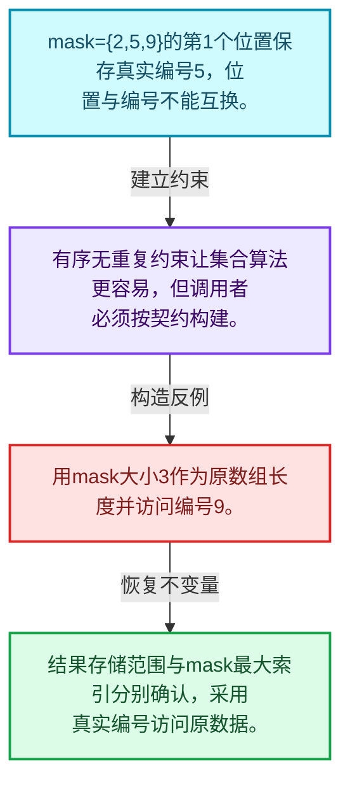
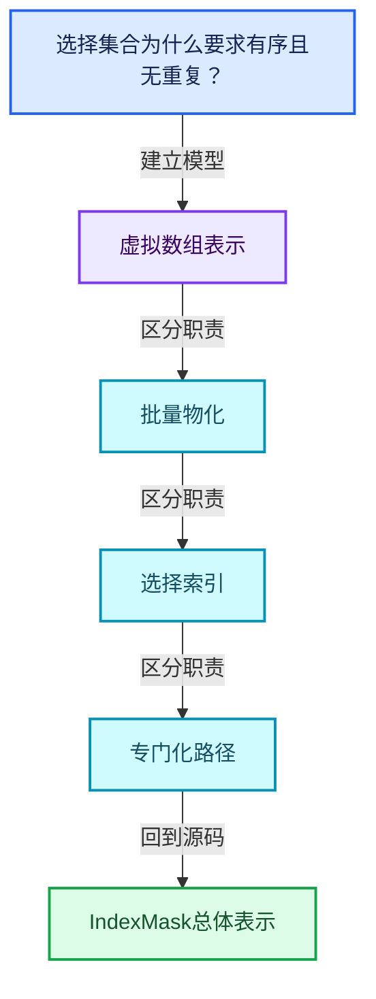
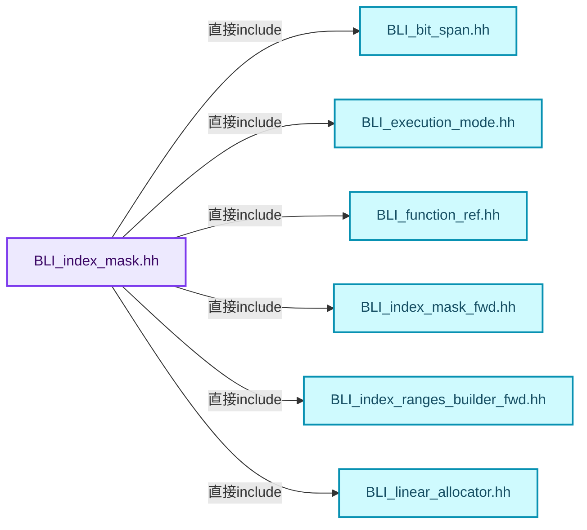
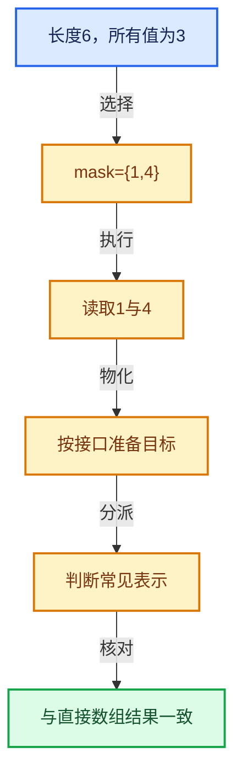

# 04-08 IndexMask总体表示

[方向导航](README.md) · [总目录](../README.md) · [覆盖索引](../%E6%BA%90%E7%A0%81%E7%89%88%E6%9C%AC%E4%B8%8E%E8%A6%86%E7%9B%96%E7%B4%A2%E5%BC%95.md)

> 阅读顺序：问题与数据模型 → 语法与类型 → 源码逐行 → 调用线索 → 历史与取舍 → 推演和练习。

- 基准 HEAD：`cbda6b96c26c0dee3c3b5cbb93960c4ac06a6b30`。
- 记录日期：2026-10-14。
- 教学示例状态：正文中的推演不是本机性能实测；已运行练习见验收报告。

## 一、从问题到设计

选择集合为什么要求有序且无重复？

这些约束允许高效遍历、查找与集合操作；选择中的元素编号与集合内部位置不同。

本篇把语法、数据语义和系统取舍连接起来。表示与接口分离，元素编号与选择内部位置分离，生成成本与执行成本分离。

### 本篇独立模型与设计推理

mask={2,5,9}的第1个位置保存真实编号5，位置与编号不能互换。

设计取舍：有序无重复约束让集合算法更容易，但调用者必须按契约构建。

最小反例：用mask大小3作为原数组长度并访问编号9。

推导与处理：结果存储范围与mask最大索引分别确认，采用真实编号访问原数据。



### 源码范围与相邻篇章

| 文件 | 本篇逐行范围 | 基准SHA-256 |
|---|---|---|
| [source/blender/blenlib/BLI_index_mask.hh](../../../../../source/blender/blenlib/BLI_index_mask.hh) | L1—L437 | `d86b6207c23b750c5e987e8f15485786460091055cb38ddd282aab938f2f54df` |

同一主讲文件可能分多篇覆盖；超出本篇范围的符号通过覆盖索引定位。空行与纯注释保留在源码摘录中，逐行表解释有效语句与语法边界；许可证头统一保留。

前篇：[去虚拟化与优化](07-%E5%8E%BB%E8%99%9A%E6%8B%9F%E5%8C%96%E4%B8%8E%E4%BC%98%E5%8C%96.md).

后篇：[分段存储与遍历](09-%E5%88%86%E6%AE%B5%E5%AD%98%E5%82%A8%E4%B8%8E%E9%81%8D%E5%8E%86.md).

## 二、类型、数据与阅读地图



这是概念依赖图，边表示阅读关系，不声称是运行时调用顺序。

### 直接编译依赖



箭头只表示头文件包含关系；完整调用线索见后面的符号定位表。

## 三、关键词、语法与类型角色

### 模板 template

模板把类型或常量作为生成实现的参数。读声明时先列出类型参数、非类型参数和默认值，再看使用者实际实例化了什么。模板声明本身不意味着每种T都支持其全部成员。

具体检查：把T替换为int、string、只能移动的类型，分别检查每个被调用操作是否成立。

### 依赖名称 typename

typename既可引入类型模板参数，也可告诉编译器某个依赖名称是类型。它不创建运行时对象；解析期确认语法类别与实例化期检查具体类型是不同阶段。

具体检查：区分typename T::value_type和T::size()，前者标记类型，后者是表达式。

### 常量求值 constexpr

constexpr声明允许相应实体参与常量求值，但constexpr函数仍可以在运行时执行。是否常量求值由调用场景和表达式合法性共同决定。

具体检查：比较constexpr变量初始化和从运行时输入调用同一函数。

### 只读限定 const

const约束当前访问路径可做的修改。const指针、指向const的指针、const视图对象、const元素是不同位置的限定；其他别名可能仍可修改原对象。

具体检查：分别写T* const、const T*与const T* const，并画出不可修改的层次。

### 运行时多态 virtual

虚调用根据实际动态类型选择实现；经基类指针销毁对象时通常需要相应虚析构契约。每元素虚调用和循环外一次分派有不同开销。

具体检查：找出虚接口的实现类和调用频率，再讨论是否值得去虚拟化。

### 可选值 optional

optional把不存在与存在的T区分开，T的构造和析构跟随engaged状态变化。访问前应由has_value或条件分支证明存在。

具体检查：把空Field状态与合法常量零区分，不能用某个普通值代替不存在。

### 判别联合 variant

variant在若干候选类型中保存一个活动值，通过判别信息选择操作。它能把不同表示集中在值类型中，但各分支的复制移动成本不同。

具体检查：列出活动分支及每种分支实际拥有或借用的数据。

### 构造与new表达式

普通new可能分配并构造；placement new在给定地址构造，存储由其他机制提供。失败回滚应区分两类责任。

具体检查：追踪地址来自哪里、构造何时成功、由谁析构、由谁释放。

### 联合体 union

联合体成员共享存储，需要由活动成员约定决定合法读取方式。结合enum或其他判别信息阅读，不能把所有成员都当作同时存在。

具体检查：检查叶节点与内部节点分别使用哪些联合成员。

### 类型别名 using

类型别名为已有类型建立名字，不创建运行期对象。它常把模板内部使用的类型统一暴露给泛型调用者。

具体检查：展开别名直到基础类型，区分类型别名和变量声明。

## 四、真实源码与逐行讲解

源码块保持原行内容，原始行号由小节标题及逐行表给出。表中的调用定位是静态阅读辅助；重载、模板实例化、宏展开和虚调用需结合完整声明，不能仅凭词法出现证明动态调用。

### BLI_index_mask.hh：L1—L48

<!-- source:source/blender/blenlib/BLI_index_mask.hh:1:48 -->

```cpp
/* SPDX-FileCopyrightText: 2023 Blender Authors
 *
 * SPDX-License-Identifier: GPL-2.0-or-later */

/** \file
 * \ingroup bli
 */

#pragma once

#include <array>
#include <optional>
#include <variant>

#include "BLI_bit_span.hh"
#include "BLI_execution_mode.hh"
#include "BLI_function_ref.hh"
#include "BLI_index_mask_fwd.hh"
#include "BLI_index_ranges_builder_fwd.hh"
#include "BLI_linear_allocator.hh"
#include "BLI_offset_indices.hh"
#include "BLI_offset_span.hh"
#include "BLI_task.hh"
#include "BLI_unique_sorted_indices.hh"
#include "BLI_vector.hh"
#include "BLI_virtual_array_fwd.hh"

namespace blender {

namespace index_mask {

/**
 * Constants that define the maximum segment size. Segment sizes are limited so that the indices
 * within each segment can be stored as #int16_t, which allows the mask to stored much more
 * compactly than if 32 or 64 bit ints would be used.
 * - Using 8 bit ints does not work well, because then the maximum segment size would be too small
 *   for eliminate per-segment overhead in many cases and also leads to many more segments.
 * - The most-significant-bit is not used so that signed integers can be used which avoids common
 *   issues when mixing signed and unsigned ints.
 * - The second most-significant bit is not used for indices so that #max_segment_size itself can
 *   be stored in the #int16_t.
 * - The maximum number of indices in a segment is 16384, which is generally enough to make the
 *   overhead per segment negligible when processing large index masks.
 * - A power of two is used for #max_segment_size, because that allows for faster construction of
 *   index masks for index ranges.
 */
static constexpr int64_t max_segment_size_shift = 14;
static constexpr int64_t max_segment_size = (1 << max_segment_size_shift); /* 16384 */
```

| 原始行 | 语义、约束与检查 |
|---|---|
| L9 | 防止同一头文件在一个翻译单元中重复展开；不控制多个源文件之间的链接或对象寿命。 |
| L11 | 引入编译依赖 <array>；这是声明可见性关系，不表示运行时一定调用该文件的所有接口。 |
| L12 | 引入编译依赖 <optional>；这是声明可见性关系，不表示运行时一定调用该文件的所有接口。 |
| L13 | 引入编译依赖 <variant>；这是声明可见性关系，不表示运行时一定调用该文件的所有接口。 |
| L15 | 引入编译依赖 "BLI_bit_span.hh"；这是声明可见性关系，不表示运行时一定调用该文件的所有接口。 |
| L16 | 引入编译依赖 "BLI_execution_mode.hh"；这是声明可见性关系，不表示运行时一定调用该文件的所有接口。 |
| L17 | 引入编译依赖 "BLI_function_ref.hh"；这是声明可见性关系，不表示运行时一定调用该文件的所有接口。 |
| L18 | 引入编译依赖 "BLI_index_mask_fwd.hh"；这是声明可见性关系，不表示运行时一定调用该文件的所有接口。 |
| L19 | 引入编译依赖 "BLI_index_ranges_builder_fwd.hh"；这是声明可见性关系，不表示运行时一定调用该文件的所有接口。 |
| L20 | 引入编译依赖 "BLI_linear_allocator.hh"；这是声明可见性关系，不表示运行时一定调用该文件的所有接口。 |
| L21 | 引入编译依赖 "BLI_offset_indices.hh"；这是声明可见性关系，不表示运行时一定调用该文件的所有接口。 |
| L22 | 引入编译依赖 "BLI_offset_span.hh"；这是声明可见性关系，不表示运行时一定调用该文件的所有接口。 |
| L23 | 引入编译依赖 "BLI_task.hh"；这是声明可见性关系，不表示运行时一定调用该文件的所有接口。 |
| L24 | 引入编译依赖 "BLI_unique_sorted_indices.hh"；这是声明可见性关系，不表示运行时一定调用该文件的所有接口。 |
| L25 | 引入编译依赖 "BLI_vector.hh"；这是声明可见性关系，不表示运行时一定调用该文件的所有接口。 |
| L26 | 引入编译依赖 "BLI_virtual_array_fwd.hh"；这是声明可见性关系，不表示运行时一定调用该文件的所有接口。 |
| L28 | 把后续声明放入 blender 命名空间，影响名称查找和符号归属，不创建运行时对象。 |
| L30 | 把后续声明放入 index_mask 命名空间，影响名称查找和符号归属，不创建运行时对象。 |
| L47 | 把右侧 `14` 用于初始化或更新左侧 `static constexpr int64_t max_segment_size_shift`。声明初始化与已有对象赋值应按上下文区分；有资源的类型会调用相应特殊成员。 |
| L48 | 把右侧 `(1 << max_segment_size_shift)` 用于初始化或更新左侧 `static constexpr int64_t max_segment_size`。声明初始化与已有对象赋值应按上下文区分；有资源的类型会调用相应特殊成员。 |

### BLI_index_mask.hh：L49—L95

<!-- source:source/blender/blenlib/BLI_index_mask.hh:49:95 -->

```cpp
static constexpr int64_t max_segment_size_mask_low = max_segment_size - 1;
static constexpr int64_t max_segment_size_mask_high = ~max_segment_size_mask_low;

/**
 * Encodes a position in an #IndexMask. The term "raw" just means that this does not have the usual
 * iterator methods like `operator++`. Supporting those would require storing more data. Generally,
 * the fastest way to iterate over an #IndexMask is using a `foreach_*` method anyway.
 */
struct RawMaskIterator {
  /** Index of the segment in the index mask. */
  int64_t segment_i;
  /** Element within the segment. */
  int16_t index_in_segment;
};

/**
 * Base type of #IndexMask. This only exists to make it more convenient to construct an index mask
 * in a few functions with #IndexMask::data_for_inplace_construction.
 *
 * The names intentionally have a trailing underscore here even though they are public in
 * #IndexMaskData because they are private in #IndexMask.
 */
struct IndexMaskData {
  /**
   * Size of the index mask, i.e. the number of indices.
   */
  int64_t indices_num_;
  /**
   * Number of segments in the index mask. Each segment contains at least one of the indices.
   */
  int64_t segments_num_;
  /**
   * Pointer to the index array for every segment. The size of each array can be computed from
   * #cumulative_segment_sizes_.
   */
  const int16_t **indices_by_segment_;
  /**
   * Offset that is applied to the indices in each segment.
   */
  const int64_t *segment_offsets_;
  /**
   * Encodes the size of each segment. The size of a specific segment can be computed by
   * subtracting consecutive values (also see #OffsetIndices). The size of this array is one
   * larger than #segments_num_. Note that the first value is _not_ necessarily zero when an
   * index mask is a slice of another mask.
   */
  const int64_t *cumulative_segment_sizes_;
```

| 原始行 | 语义、约束与检查 |
|---|---|
| L49 | 把右侧 `max_segment_size - 1` 用于初始化或更新左侧 `static constexpr int64_t max_segment_size_mask_low`。声明初始化与已有对象赋值应按上下文区分；有资源的类型会调用相应特殊成员。 |
| L50 | 把右侧 `~max_segment_size_mask_low` 用于初始化或更新左侧 `static constexpr int64_t max_segment_size_mask_high`。声明初始化与已有对象赋值应按上下文区分；有资源的类型会调用相应特殊成员。 |
| L57 | 声明或定义类型 `struct RawMaskIterator`。结合继承、访问权限和成员布局确认接口与拥有关系；前向声明本身没有完整对象布局。 |
| L59 | 声明成员、局部对象或完成语句 `int64_t segment_i`。若为指针或引用，它本身不说明拥有；若为值对象，其构造析构由所在作用域或外层对象管理。 |
| L61 | 声明成员、局部对象或完成语句 `int16_t index_in_segment`。若为指针或引用，它本身不说明拥有；若为值对象，其构造析构由所在作用域或外层对象管理。 |
| L62 | 结束当前语法单元。局部自动对象在离开其作用域时按规则销毁；这不等于所有被引用的外部数据也被释放。 |
| L71 | 声明或定义类型 `struct IndexMaskData`。结合继承、访问权限和成员布局确认接口与拥有关系；前向声明本身没有完整对象布局。 |
| L75 | 声明成员、局部对象或完成语句 `int64_t indices_num_`。若为指针或引用，它本身不说明拥有；若为值对象，其构造析构由所在作用域或外层对象管理。 |
| L79 | 声明成员、局部对象或完成语句 `int64_t segments_num_`。若为指针或引用，它本身不说明拥有；若为值对象，其构造析构由所在作用域或外层对象管理。 |
| L84 | 声明成员、局部对象或完成语句 `const int16_t **indices_by_segment_`。若为指针或引用，它本身不说明拥有；若为值对象，其构造析构由所在作用域或外层对象管理。 |
| L88 | 声明成员、局部对象或完成语句 `const int64_t *segment_offsets_`。若为指针或引用，它本身不说明拥有；若为值对象，其构造析构由所在作用域或外层对象管理。 |
| L95 | 声明成员、局部对象或完成语句 `const int64_t *cumulative_segment_sizes_`。若为指针或引用，它本身不说明拥有；若为值对象，其构造析构由所在作用域或外层对象管理。 |

### BLI_index_mask.hh：L96—L143

<!-- source:source/blender/blenlib/BLI_index_mask.hh:96:143 -->

```cpp
  /**
   * Index into the first segment where the #IndexMask starts. This exists to support slicing
   * without having to modify and therefor allocate a new #indices_by_segment_ array.
   */
  int64_t begin_index_in_segment_;
  /**
   * Index into the last segment where the #IndexMask ends. This exists to support slicing without
   * having to modify and therefore allocate a new #cumulative_segment_sizes_ array.
   */
  int64_t end_index_in_segment_;
};

/**
 * #IndexMask does not own any memory itself. In many cases the memory referenced by a mask has
 * static life-time (e.g. when a mask is a range). To create more complex masks, additional memory
 * is necessary. #IndexMaskMemory is a simple wrapper around a linear allocator that has to be
 * passed to functions that might need to allocate extra memory.
 */
class IndexMaskMemory : public LinearAllocator<> {
 private:
  /** Inline buffer to avoid heap allocations when working with small index masks. */
  AlignedBuffer<1024, 8> inline_buffer_;

 public:
  IndexMaskMemory()
  {
    this->provide_buffer(inline_buffer_);
  }
};

/**
 * A sequence of unique and ordered indices in one segment of an IndexMask. The segment as a whole
 * has an `int64_t` index offset that is added to each referenced `int16_t` index.
 */
class IndexMaskSegment : public OffsetSpan<int64_t, int16_t> {
 public:
  using OffsetSpan<int64_t, int16_t>::OffsetSpan;

  explicit IndexMaskSegment(const OffsetSpan<int64_t, int16_t> span);

  IndexMaskSegment slice(const IndexRange &range) const;
  IndexMaskSegment slice(const int64_t start, const int64_t size) const;

  /**
   * Get a new segment where each index is modified by the given amount. This works in constant
   * time, because only the offset value is changed.
   */
  IndexMaskSegment shift(const int64_t shift) const;
```

本段语义重点：

- `inline_buffer_`：容器对象内部的缓冲区，不能像堆缓冲那样直接交给另一个对象。

| 原始行 | 语义、约束与检查 |
|---|---|
| L100 | 声明成员、局部对象或完成语句 `int64_t begin_index_in_segment_`。若为指针或引用，它本身不说明拥有；若为值对象，其构造析构由所在作用域或外层对象管理。 |
| L105 | 声明成员、局部对象或完成语句 `int64_t end_index_in_segment_`。若为指针或引用，它本身不说明拥有；若为值对象，其构造析构由所在作用域或外层对象管理。 |
| L106 | 结束当前语法单元。局部自动对象在离开其作用域时按规则销毁；这不等于所有被引用的外部数据也被释放。 |
| L114 | 声明或定义类型 `class IndexMaskMemory : public LinearAllocator<>`。结合继承、访问权限和成员布局确认接口与拥有关系；前向声明本身没有完整对象布局。 |
| L115 | 切换成员访问权限为 private；它是编译期接口边界，不是线程同步或内存保护。 |
| L117 | 本行涉及 `inline_buffer_`：容器对象内部的缓冲区，不能像堆缓冲那样直接交给另一个对象。按此语义解读 `AlignedBuffer<1024, 8> inline_buffer_`，不要把地址、数量或状态混用。 |
| L119 | 切换成员访问权限为 public；它是编译期接口边界，不是线程同步或内存保护。 |
| L120 | 出现调用或函数声明 `IndexMaskMemory`，对应表达式为 `IndexMaskMemory()`。参数求值、返回类型与重载需结合前后完整语句；静态文本引用不能证明动态目标。 |
| L121 | 连接上一行的声明或控制结构与其语句块；后续行在这个作用域中执行或声明。 |
| L122 | 本行涉及 `inline_buffer_`：容器对象内部的缓冲区，不能像堆缓冲那样直接交给另一个对象。按此语义解读 `this->provide_buffer(inline_buffer_)`，不要把地址、数量或状态混用。 |
| L123 | 结束当前语法单元。局部自动对象在离开其作用域时按规则销毁；这不等于所有被引用的外部数据也被释放。 |
| L124 | 结束当前语法单元。局部自动对象在离开其作用域时按规则销毁；这不等于所有被引用的外部数据也被释放。 |
| L130 | 声明或定义类型 `class IndexMaskSegment : public OffsetSpan<int64_t, int16_t>`。结合继承、访问权限和成员布局确认接口与拥有关系；前向声明本身没有完整对象布局。 |
| L131 | 切换成员访问权限为 public；它是编译期接口边界，不是线程同步或内存保护。 |
| L132 | 定义类型别名 `using OffsetSpan<int64_t, int16_t>::OffsetSpan`，为模板接口或内部实现统一命名；本行不分配该类型对象。 |
| L134 | 声明接口 `explicit IndexMaskSegment(const OffsetSpan<int64_t, int16_t> span)`，本行没有对应函数体；返回类型、参数限定和const/noexcept共同组成调用契约，实际行为需继续定位实现。 |
| L136 | 声明接口 `IndexMaskSegment slice(const IndexRange &range) const`，本行没有对应函数体；返回类型、参数限定和const/noexcept共同组成调用契约，实际行为需继续定位实现。 |
| L137 | 声明接口 `IndexMaskSegment slice(const int64_t start, const int64_t size) const`，本行没有对应函数体；返回类型、参数限定和const/noexcept共同组成调用契约，实际行为需继续定位实现。 |
| L143 | 声明接口 `IndexMaskSegment shift(const int64_t shift) const`，本行没有对应函数体；返回类型、参数限定和const/noexcept共同组成调用契约，实际行为需继续定位实现。 |

### BLI_index_mask.hh：L144—L172

<!-- source:source/blender/blenlib/BLI_index_mask.hh:144:172 -->

```cpp
};

template<typename Fn>
concept IndexFn = std::invocable<Fn, int64_t>;
template<typename Fn>
concept IndexPosFn = std::invocable<Fn, int64_t, int64_t>;
template<typename Fn>
concept ForeachIndexFn = IndexFn<Fn> || IndexPosFn<Fn>;

template<typename Fn>
concept SegmentFn = std::invocable<Fn, IndexMaskSegment>;
template<typename Fn>
concept SegmentPosFn = std::invocable<Fn, IndexMaskSegment, int64_t>;
template<typename Fn>
concept ForeachSegmentFn = SegmentFn<Fn> || SegmentPosFn<Fn>;

template<typename Fn>
concept RangeFn = std::invocable<Fn, IndexRange>;
template<typename Fn>
concept RangePosFn = std::invocable<Fn, IndexRange, int64_t>;
template<typename Fn>
concept ForeachRangeFn = RangeFn<Fn> || RangePosFn<Fn>;

template<typename Fn>
concept SegmentOrRangeFn = SegmentFn<Fn> || RangeFn<Fn>;
template<typename Fn>
concept SegmentOrRangePosFn = SegmentPosFn<Fn> || RangePosFn<Fn>;
template<typename Fn>
concept ForeachSegmentOrRangePosFn = SegmentOrRangeFn<Fn> || SegmentOrRangePosFn<Fn>;
```

| 原始行 | 语义、约束与检查 |
|---|---|
| L144 | 结束当前语法单元。局部自动对象在离开其作用域时按规则销毁；这不等于所有被引用的外部数据也被释放。 |
| L146 | 声明模板参数 `template<typename Fn>`。类型参数决定生成操作的类型，非类型参数可决定内嵌容量或编译期分支。 |
| L147 | 把右侧 `std::invocable<Fn, int64_t>` 用于初始化或更新左侧 `concept IndexFn`。声明初始化与已有对象赋值应按上下文区分；有资源的类型会调用相应特殊成员。 |
| L148 | 声明模板参数 `template<typename Fn>`。类型参数决定生成操作的类型，非类型参数可决定内嵌容量或编译期分支。 |
| L149 | 把右侧 `std::invocable<Fn, int64_t, int64_t>` 用于初始化或更新左侧 `concept IndexPosFn`。声明初始化与已有对象赋值应按上下文区分；有资源的类型会调用相应特殊成员。 |
| L150 | 声明模板参数 `template<typename Fn>`。类型参数决定生成操作的类型，非类型参数可决定内嵌容量或编译期分支。 |
| L151 | 把右侧 `IndexFn<Fn> &#124;&#124; IndexPosFn<Fn>` 用于初始化或更新左侧 `concept ForeachIndexFn`。声明初始化与已有对象赋值应按上下文区分；有资源的类型会调用相应特殊成员。 |
| L153 | 声明模板参数 `template<typename Fn>`。类型参数决定生成操作的类型，非类型参数可决定内嵌容量或编译期分支。 |
| L154 | 把右侧 `std::invocable<Fn, IndexMaskSegment>` 用于初始化或更新左侧 `concept SegmentFn`。声明初始化与已有对象赋值应按上下文区分；有资源的类型会调用相应特殊成员。 |
| L155 | 声明模板参数 `template<typename Fn>`。类型参数决定生成操作的类型，非类型参数可决定内嵌容量或编译期分支。 |
| L156 | 把右侧 `std::invocable<Fn, IndexMaskSegment, int64_t>` 用于初始化或更新左侧 `concept SegmentPosFn`。声明初始化与已有对象赋值应按上下文区分；有资源的类型会调用相应特殊成员。 |
| L157 | 声明模板参数 `template<typename Fn>`。类型参数决定生成操作的类型，非类型参数可决定内嵌容量或编译期分支。 |
| L158 | 把右侧 `SegmentFn<Fn> &#124;&#124; SegmentPosFn<Fn>` 用于初始化或更新左侧 `concept ForeachSegmentFn`。声明初始化与已有对象赋值应按上下文区分；有资源的类型会调用相应特殊成员。 |
| L160 | 声明模板参数 `template<typename Fn>`。类型参数决定生成操作的类型，非类型参数可决定内嵌容量或编译期分支。 |
| L161 | 把右侧 `std::invocable<Fn, IndexRange>` 用于初始化或更新左侧 `concept RangeFn`。声明初始化与已有对象赋值应按上下文区分；有资源的类型会调用相应特殊成员。 |
| L162 | 声明模板参数 `template<typename Fn>`。类型参数决定生成操作的类型，非类型参数可决定内嵌容量或编译期分支。 |
| L163 | 把右侧 `std::invocable<Fn, IndexRange, int64_t>` 用于初始化或更新左侧 `concept RangePosFn`。声明初始化与已有对象赋值应按上下文区分；有资源的类型会调用相应特殊成员。 |
| L164 | 声明模板参数 `template<typename Fn>`。类型参数决定生成操作的类型，非类型参数可决定内嵌容量或编译期分支。 |
| L165 | 把右侧 `RangeFn<Fn> &#124;&#124; RangePosFn<Fn>` 用于初始化或更新左侧 `concept ForeachRangeFn`。声明初始化与已有对象赋值应按上下文区分；有资源的类型会调用相应特殊成员。 |
| L167 | 声明模板参数 `template<typename Fn>`。类型参数决定生成操作的类型，非类型参数可决定内嵌容量或编译期分支。 |
| L168 | 把右侧 `SegmentFn<Fn> &#124;&#124; RangeFn<Fn>` 用于初始化或更新左侧 `concept SegmentOrRangeFn`。声明初始化与已有对象赋值应按上下文区分；有资源的类型会调用相应特殊成员。 |
| L169 | 声明模板参数 `template<typename Fn>`。类型参数决定生成操作的类型，非类型参数可决定内嵌容量或编译期分支。 |
| L170 | 把右侧 `SegmentPosFn<Fn> &#124;&#124; RangePosFn<Fn>` 用于初始化或更新左侧 `concept SegmentOrRangePosFn`。声明初始化与已有对象赋值应按上下文区分；有资源的类型会调用相应特殊成员。 |
| L171 | 声明模板参数 `template<typename Fn>`。类型参数决定生成操作的类型，非类型参数可决定内嵌容量或编译期分支。 |
| L172 | 把右侧 `SegmentOrRangeFn<Fn> &#124;&#124; SegmentOrRangePosFn<Fn>` 用于初始化或更新左侧 `concept ForeachSegmentOrRangePosFn`。声明初始化与已有对象赋值应按上下文区分；有资源的类型会调用相应特殊成员。 |

### BLI_index_mask.hh：L173—L219

<!-- source:source/blender/blenlib/BLI_index_mask.hh:173:219 -->

```cpp

/**
 * An #IndexMask is a sequence of unique and sorted indices (`BLI_unique_sorted_indices.hh`).
 * It's commonly used when a subset of elements in an array has to be processed.
 *
 * #IndexMask is a non-owning container. That data it references is usually either statically
 * allocated or is owned by an #IndexMaskMemory.
 *
 * Internally, an index mask is split into an arbitrary number of ordered segments. Each segment
 * contains up to #max_segment_size (2^14 = 16384) indices. The indices in a segment are stored as
 * `int16_t`, but each segment also has a `int64_t` offset.
 *
 * The data structure is designed to satisfy the following key requirements:
 * - Construct index mask for an #IndexRange in O(1) time (after initial setup).
 * - Support efficient slicing (O(log n) with a low constant factor).
 * - Support multi-threaded construction without severe serial bottlenecks.
 * - Support efficient iteration over indices that uses #IndexRange when possible.
 *
 * Construction:
 *   A new index mask is usually created by calling one of its constructors which are O(1), or for
 *   more complex masks, by calling various `IndexMask::from_*` functions that create masks from
 *   various sources. Those generally need additional memory which is provided with by an
 *   #IndexMaskMemory.
 *
 *   Some of the `IndexMask::from_*` functions have an `IndexMask universe` input. When provided,
 *   the function will only consider the indices in the "universe". The term comes from
 *   mathematics: https://en.wikipedia.org/wiki/Universe_(mathematics).
 *
 * Iteration:
 *   To iterate over the indices, one usually has to use one of the `foreach_*` functions which
 *   require a callback function. Due to the internal segmentation of the index mask, this is more
 *   efficient than using a normal C++ iterator and range-based for loops.
 *
 *   There are multiple variants of the `foreach_*` functions which are useful in different
 *   scenarios. The callback can generally take one or two arguments. The first is the index
 *   stored in the mask and the second is the index that would have to be passed into `operator[]`
 *   to get the first index.
 *
 *   The `foreach_*` methods also accept an execution mode optional argument. When that is
 *   provided, multi-threading  might be used. Integrating multi-threading at this level works well
 *   because mask iteration and parallelism are often used at the same time.
 *
 * Extraction:
 *   An #IndexMask can be converted into various other forms using the `to_*` methods.
 */
class IndexMask : private IndexMaskData {
 public:
```

| 原始行 | 语义、约束与检查 |
|---|---|
| L218 | 声明或定义类型 `class IndexMask : private IndexMaskData`。结合继承、访问权限和成员布局确认接口与拥有关系；前向声明本身没有完整对象布局。 |
| L219 | 切换成员访问权限为 public；它是编译期接口边界，不是线程同步或内存保护。 |

### BLI_index_mask.hh：L220—L265

<!-- source:source/blender/blenlib/BLI_index_mask.hh:220:265 -->

```cpp
  /** Construct an empty mask. */
  IndexMask();
  /** Construct a mask that contains the indices from 0 to `size - 1`. This takes O(1) time. */
  explicit IndexMask(int64_t size);
  /** Construct a mask that contains the indices in the range. This takes O(1) time. */
  IndexMask(IndexRange range);

  /** Construct a mask from unique sorted indices. */
  template<typename T> static IndexMask from_indices(Span<T> indices, LinearAllocator<> &memory);
  /** Construct a mask from the indices of set bits. */
  static IndexMask from_bits(BitSpan bits, LinearAllocator<> &memory);
  /** Construct a mask from the indices of set bits, but limited to the indices in #universe. */
  static IndexMask from_bits(const IndexMask &universe, BitSpan bits, LinearAllocator<> &memory);
  /** Construct a mask from the true indices. */
  static IndexMask from_bools(Span<bool> bools, LinearAllocator<> &memory);
  static IndexMask from_bools(const VArray<bool> &bools, LinearAllocator<> &memory);
  static IndexMask from_bools_inverse(Span<bool> bools, LinearAllocator<> &memory);
  static IndexMask from_bools_inverse(const VArray<bool> &bools, LinearAllocator<> &memory);
  /** Construct a mask from the true indices, but limited by the indices in #universe. */
  static IndexMask from_bools(const IndexMask &universe,
                              Span<bool> bools,
                              LinearAllocator<> &memory);
  static IndexMask from_bools_inverse(const IndexMask &universe,
                                      Span<bool> bools,
                                      LinearAllocator<> &memory);
  static IndexMask from_bools(const IndexMask &universe,
                              const VArray<bool> &bools,
                              LinearAllocator<> &memory);
  static IndexMask from_bools_inverse(const IndexMask &universe,
                                      const VArray<bool> &bools,
                                      LinearAllocator<> &memory);
  /** Construct a mask from the ranges referenced by the offset indices. */
  template<typename T>
  static IndexMask from_ranges(OffsetIndices<T> offsets,
                               const IndexMask &mask,
                               LinearAllocator<> &memory);
  /**
   * Constructs a mask by repeating the indices in the given mask with a stride.
   * For example, with an input mask containing `{3, 5}` and a stride of 10 the resulting mask
   * would contain `{3, 5, 13, 15, 23, 25, ...}`.
   */
  static IndexMask from_repeating(const IndexMask &mask_to_repeat,
                                  int64_t repetitions,
                                  int64_t stride,
                                  int64_t initial_offset,
                                  LinearAllocator<> &memory);
```

| 原始行 | 语义、约束与检查 |
|---|---|
| L221 | 出现调用或函数声明 `IndexMask`，对应表达式为 `IndexMask();`。参数求值、返回类型与重载需结合前后完整语句；静态文本引用不能证明动态目标。 |
| L223 | 声明接口 `explicit IndexMask(int64_t size)`，本行没有对应函数体；返回类型、参数限定和const/noexcept共同组成调用契约，实际行为需继续定位实现。 |
| L225 | 出现调用或函数声明 `IndexMask`，对应表达式为 `IndexMask(IndexRange range);`。参数求值、返回类型与重载需结合前后完整语句；静态文本引用不能证明动态目标。 |
| L228 | 声明模板参数 `template<typename T> static IndexMask from_indices(Span<T> indices, LinearAllocator<> &memory);`。类型参数决定生成操作的类型，非类型参数可决定内嵌容量或编译期分支。 |
| L230 | 声明接口 `static IndexMask from_bits(BitSpan bits, LinearAllocator<> &memory)`，本行没有对应函数体；返回类型、参数限定和const/noexcept共同组成调用契约，实际行为需继续定位实现。 |
| L232 | 声明接口 `static IndexMask from_bits(const IndexMask &universe, BitSpan bits, LinearAllocator<> &memory)`，本行没有对应函数体；返回类型、参数限定和const/noexcept共同组成调用契约，实际行为需继续定位实现。 |
| L234 | 声明接口 `static IndexMask from_bools(Span<bool> bools, LinearAllocator<> &memory)`，本行没有对应函数体；返回类型、参数限定和const/noexcept共同组成调用契约，实际行为需继续定位实现。 |
| L235 | 声明接口 `static IndexMask from_bools(const VArray<bool> &bools, LinearAllocator<> &memory)`，本行没有对应函数体；返回类型、参数限定和const/noexcept共同组成调用契约，实际行为需继续定位实现。 |
| L236 | 声明接口 `static IndexMask from_bools_inverse(Span<bool> bools, LinearAllocator<> &memory)`，本行没有对应函数体；返回类型、参数限定和const/noexcept共同组成调用契约，实际行为需继续定位实现。 |
| L237 | 声明接口 `static IndexMask from_bools_inverse(const VArray<bool> &bools, LinearAllocator<> &memory)`，本行没有对应函数体；返回类型、参数限定和const/noexcept共同组成调用契约，实际行为需继续定位实现。 |
| L239 | 出现调用或函数声明 `from_bools`，对应表达式为 `static IndexMask from_bools(const IndexMask &universe,`。参数求值、返回类型与重载需结合前后完整语句；静态文本引用不能证明动态目标。 |
| L240 | 本行是连续声明或表达式的一部分：`Span<bool> bools,`。与本段前后行合读；逗号、括号和限定符决定它属于参数、初始化列表还是实际计算。 |
| L241 | 声明成员、局部对象或完成语句 `LinearAllocator<> &memory)`。若为指针或引用，它本身不说明拥有；若为值对象，其构造析构由所在作用域或外层对象管理。 |
| L242 | 出现调用或函数声明 `from_bools_inverse`，对应表达式为 `static IndexMask from_bools_inverse(const IndexMask &universe,`。参数求值、返回类型与重载需结合前后完整语句；静态文本引用不能证明动态目标。 |
| L243 | 本行是连续声明或表达式的一部分：`Span<bool> bools,`。与本段前后行合读；逗号、括号和限定符决定它属于参数、初始化列表还是实际计算。 |
| L244 | 声明成员、局部对象或完成语句 `LinearAllocator<> &memory)`。若为指针或引用，它本身不说明拥有；若为值对象，其构造析构由所在作用域或外层对象管理。 |
| L245 | 出现调用或函数声明 `from_bools`，对应表达式为 `static IndexMask from_bools(const IndexMask &universe,`。参数求值、返回类型与重载需结合前后完整语句；静态文本引用不能证明动态目标。 |
| L246 | 本行是连续声明或表达式的一部分：`const VArray<bool> &bools,`。与本段前后行合读；逗号、括号和限定符决定它属于参数、初始化列表还是实际计算。 |
| L247 | 声明成员、局部对象或完成语句 `LinearAllocator<> &memory)`。若为指针或引用，它本身不说明拥有；若为值对象，其构造析构由所在作用域或外层对象管理。 |
| L248 | 出现调用或函数声明 `from_bools_inverse`，对应表达式为 `static IndexMask from_bools_inverse(const IndexMask &universe,`。参数求值、返回类型与重载需结合前后完整语句；静态文本引用不能证明动态目标。 |
| L249 | 本行是连续声明或表达式的一部分：`const VArray<bool> &bools,`。与本段前后行合读；逗号、括号和限定符决定它属于参数、初始化列表还是实际计算。 |
| L250 | 声明成员、局部对象或完成语句 `LinearAllocator<> &memory)`。若为指针或引用，它本身不说明拥有；若为值对象，其构造析构由所在作用域或外层对象管理。 |
| L252 | 声明模板参数 `template<typename T>`。类型参数决定生成操作的类型，非类型参数可决定内嵌容量或编译期分支。 |
| L253 | 出现调用或函数声明 `from_ranges`，对应表达式为 `static IndexMask from_ranges(OffsetIndices<T> offsets,`。参数求值、返回类型与重载需结合前后完整语句；静态文本引用不能证明动态目标。 |
| L254 | 本行是连续声明或表达式的一部分：`const IndexMask &mask,`。与本段前后行合读；逗号、括号和限定符决定它属于参数、初始化列表还是实际计算。 |
| L255 | 声明成员、局部对象或完成语句 `LinearAllocator<> &memory)`。若为指针或引用，它本身不说明拥有；若为值对象，其构造析构由所在作用域或外层对象管理。 |
| L261 | 出现调用或函数声明 `from_repeating`，对应表达式为 `static IndexMask from_repeating(const IndexMask &mask_to_repeat,`。参数求值、返回类型与重载需结合前后完整语句；静态文本引用不能证明动态目标。 |
| L262 | 本行是连续声明或表达式的一部分：`int64_t repetitions,`。与本段前后行合读；逗号、括号和限定符决定它属于参数、初始化列表还是实际计算。 |
| L263 | 本行是连续声明或表达式的一部分：`int64_t stride,`。与本段前后行合读；逗号、括号和限定符决定它属于参数、初始化列表还是实际计算。 |
| L264 | 本行是连续声明或表达式的一部分：`int64_t initial_offset,`。与本段前后行合读；逗号、括号和限定符决定它属于参数、初始化列表还是实际计算。 |
| L265 | 声明成员、局部对象或完成语句 `LinearAllocator<> &memory)`。若为指针或引用，它本身不说明拥有；若为值对象，其构造析构由所在作用域或外层对象管理。 |

### BLI_index_mask.hh：L266—L318

<!-- source:source/blender/blenlib/BLI_index_mask.hh:266:318 -->

```cpp
  /**
   * Constructs a mask that contains every nth index the given number of times.
   */
  static IndexMask from_every_nth(int64_t n,
                                  int64_t indices_num,
                                  const int64_t initial_offset,
                                  LinearAllocator<> &memory);
  /**
   * Construct a mask from the given segments. The provided segments are expected to be
   * sorted and owned by #memory already.
   */
  static IndexMask from_segments(Span<IndexMaskSegment> segments, LinearAllocator<> &memory);
  /**
   * Construct a mask from some parts. This is mainly meant for more concise testing code.
   * The individual items are unioned together.
   */
  using Initializer = std::variant<IndexRange, Span<int64_t>, Span<int>, int64_t>;
  static IndexMask from_initializers(const Span<Initializer> initializers,
                                     LinearAllocator<> &memory);
  /** Construct a mask from the union of #mask_a and #mask_b. */
  static IndexMask from_union(const IndexMask &mask_a,
                              const IndexMask &mask_b,
                              LinearAllocator<> &memory);
  /** Constructs a mask from the union of multiple masks. */
  static IndexMask from_union(Span<IndexMask> masks, LinearAllocator<> &memory);
  /** Construct a mask from the difference of #mask_a and #mask_b. */
  static IndexMask from_difference(const IndexMask &mask_a,
                                   const IndexMask &mask_b,
                                   LinearAllocator<> &memory);
  /** Construct a mask from the intersection of #mask_a and #mask_b. */
  static IndexMask from_intersection(const IndexMask &mask_a,
                                     const IndexMask &mask_b,
                                     LinearAllocator<> &memory);
  /** Construct a mask from all the indices for which the predicate is true. */
  template<typename Fn>
  static IndexMask from_predicate(const IndexMask &universe,
                                  LinearAllocator<> &memory,
                                  Fn &&predicate,
                                  exec_mode::Mode mode = exec_mode::parallel);
  /**
   * This is a variant of #from_predicate that is more efficient if the predicate for many indices
   * can be evaluated at once.
   *
   * \param batch_predicate: A function that finds indices in a certain segment that should become
   * part of the mask. To efficiently handle ranges, this function uses #IndexRangesBuilder. It
   * returns an index offset that should be applied to each index in the builder.
   */
  static IndexMask from_batch_predicate(
      const IndexMask &universe,
      LinearAllocator<> &memory,
      FunctionRef<int64_t(const IndexMaskSegment &universe_segment,
                          IndexRangesBuilder<int16_t> &builder)> batch_predicate,
      exec_mode::Mode mode = exec_mode::parallel);
```

| 原始行 | 语义、约束与检查 |
|---|---|
| L269 | 出现调用或函数声明 `from_every_nth`，对应表达式为 `static IndexMask from_every_nth(int64_t n,`。参数求值、返回类型与重载需结合前后完整语句；静态文本引用不能证明动态目标。 |
| L270 | 本行是连续声明或表达式的一部分：`int64_t indices_num,`。与本段前后行合读；逗号、括号和限定符决定它属于参数、初始化列表还是实际计算。 |
| L271 | 本行是连续声明或表达式的一部分：`const int64_t initial_offset,`。与本段前后行合读；逗号、括号和限定符决定它属于参数、初始化列表还是实际计算。 |
| L272 | 声明成员、局部对象或完成语句 `LinearAllocator<> &memory)`。若为指针或引用，它本身不说明拥有；若为值对象，其构造析构由所在作用域或外层对象管理。 |
| L277 | 声明接口 `static IndexMask from_segments(Span<IndexMaskSegment> segments, LinearAllocator<> &memory)`，本行没有对应函数体；返回类型、参数限定和const/noexcept共同组成调用契约，实际行为需继续定位实现。 |
| L282 | 定义类型别名 `using Initializer = std::variant<IndexRange, Span<int64_t>, Span<int>, int64_t>`，为模板接口或内部实现统一命名；本行不分配该类型对象。 |
| L283 | 出现调用或函数声明 `from_initializers`，对应表达式为 `static IndexMask from_initializers(const Span<Initializer> initializers,`。参数求值、返回类型与重载需结合前后完整语句；静态文本引用不能证明动态目标。 |
| L284 | 声明成员、局部对象或完成语句 `LinearAllocator<> &memory)`。若为指针或引用，它本身不说明拥有；若为值对象，其构造析构由所在作用域或外层对象管理。 |
| L286 | 出现调用或函数声明 `from_union`，对应表达式为 `static IndexMask from_union(const IndexMask &mask_a,`。参数求值、返回类型与重载需结合前后完整语句；静态文本引用不能证明动态目标。 |
| L287 | 本行是连续声明或表达式的一部分：`const IndexMask &mask_b,`。与本段前后行合读；逗号、括号和限定符决定它属于参数、初始化列表还是实际计算。 |
| L288 | 声明成员、局部对象或完成语句 `LinearAllocator<> &memory)`。若为指针或引用，它本身不说明拥有；若为值对象，其构造析构由所在作用域或外层对象管理。 |
| L290 | 声明接口 `static IndexMask from_union(Span<IndexMask> masks, LinearAllocator<> &memory)`，本行没有对应函数体；返回类型、参数限定和const/noexcept共同组成调用契约，实际行为需继续定位实现。 |
| L292 | 出现调用或函数声明 `from_difference`，对应表达式为 `static IndexMask from_difference(const IndexMask &mask_a,`。参数求值、返回类型与重载需结合前后完整语句；静态文本引用不能证明动态目标。 |
| L293 | 本行是连续声明或表达式的一部分：`const IndexMask &mask_b,`。与本段前后行合读；逗号、括号和限定符决定它属于参数、初始化列表还是实际计算。 |
| L294 | 声明成员、局部对象或完成语句 `LinearAllocator<> &memory)`。若为指针或引用，它本身不说明拥有；若为值对象，其构造析构由所在作用域或外层对象管理。 |
| L296 | 出现调用或函数声明 `from_intersection`，对应表达式为 `static IndexMask from_intersection(const IndexMask &mask_a,`。参数求值、返回类型与重载需结合前后完整语句；静态文本引用不能证明动态目标。 |
| L297 | 本行是连续声明或表达式的一部分：`const IndexMask &mask_b,`。与本段前后行合读；逗号、括号和限定符决定它属于参数、初始化列表还是实际计算。 |
| L298 | 声明成员、局部对象或完成语句 `LinearAllocator<> &memory)`。若为指针或引用，它本身不说明拥有；若为值对象，其构造析构由所在作用域或外层对象管理。 |
| L300 | 声明模板参数 `template<typename Fn>`。类型参数决定生成操作的类型，非类型参数可决定内嵌容量或编译期分支。 |
| L301 | 出现调用或函数声明 `from_predicate`，对应表达式为 `static IndexMask from_predicate(const IndexMask &universe,`。参数求值、返回类型与重载需结合前后完整语句；静态文本引用不能证明动态目标。 |
| L302 | 本行是连续声明或表达式的一部分：`LinearAllocator<> &memory,`。与本段前后行合读；逗号、括号和限定符决定它属于参数、初始化列表还是实际计算。 |
| L303 | 本行是连续声明或表达式的一部分：`Fn &&predicate,`。与本段前后行合读；逗号、括号和限定符决定它属于参数、初始化列表还是实际计算。 |
| L304 | 把右侧 `exec_mode::parallel)` 用于初始化或更新左侧 `exec_mode::Mode mode`。声明初始化与已有对象赋值应按上下文区分；有资源的类型会调用相应特殊成员。 |
| L313 | 出现调用或函数声明 `from_batch_predicate`，对应表达式为 `static IndexMask from_batch_predicate(`。参数求值、返回类型与重载需结合前后完整语句；静态文本引用不能证明动态目标。 |
| L314 | 本行是连续声明或表达式的一部分：`const IndexMask &universe,`。与本段前后行合读；逗号、括号和限定符决定它属于参数、初始化列表还是实际计算。 |
| L315 | 本行是连续声明或表达式的一部分：`LinearAllocator<> &memory,`。与本段前后行合读；逗号、括号和限定符决定它属于参数、初始化列表还是实际计算。 |
| L316 | 出现调用或函数声明 `int64_t`，对应表达式为 `FunctionRef<int64_t(const IndexMaskSegment &universe_segment,`。参数求值、返回类型与重载需结合前后完整语句；静态文本引用不能证明动态目标。 |
| L317 | 本行是连续声明或表达式的一部分：`IndexRangesBuilder<int16_t> &builder)> batch_predicate,`。与本段前后行合读；逗号、括号和限定符决定它属于参数、初始化列表还是实际计算。 |
| L318 | 把右侧 `exec_mode::parallel)` 用于初始化或更新左侧 `exec_mode::Mode mode`。声明初始化与已有对象赋值应按上下文区分；有资源的类型会调用相应特殊成员。 |

### BLI_index_mask.hh：L319—L365

<!-- source:source/blender/blenlib/BLI_index_mask.hh:319:365 -->

```cpp
  /** Sorts all indices from #universe into the different output masks. */
  template<typename T, typename Fn>
  static void from_groups(const IndexMask &universe,
                          LinearAllocator<> &memory,
                          Fn &&get_group_index,
                          MutableSpan<IndexMask> r_masks);

  /**
   * Creates an index mask for every unique group ID in the universe, in the order that the IDs
   * first appear. The ID of each group is the ID of the first index in its mask.
   */
  static Vector<IndexMask, 4> from_group_ids(const VArray<int> &group_ids,
                                             LinearAllocator<> &memory);
  static Vector<IndexMask, 4> from_group_ids(const IndexMask &universe,
                                             const VArray<int> &group_ids,
                                             LinearAllocator<> &memory);

  int64_t size() const;
  bool is_empty() const;
  IndexRange index_range() const;
  int64_t first() const;
  int64_t last() const;

  /**
   * Returns the smallest range that contains all indices stored in this mask.
   */
  IndexRange bounds() const;

  /**
   * \return Minimum number of elements an array has to have so that it can be indexed by every
   * index stored in the mask.
   */
  int64_t min_array_size() const;

  /**
   * \return Position where the #query_index is stored, or none if the index is not in the mask.
   */
  std::optional<RawMaskIterator> find(int64_t query_index) const;
  std::optional<RawMaskIterator> find_larger_equal(int64_t query_index) const;
  std::optional<RawMaskIterator> find_smaller_equal(int64_t query_index) const;
  /**
   * \return True when the #query_index is stored in the mask.
   */
  bool contains(int64_t query_index) const;

  /** \return The iterator for the given index such that `mask[iterator] == mask[index]`. */
  RawMaskIterator index_to_iterator(int64_t index) const;
```

| 原始行 | 语义、约束与检查 |
|---|---|
| L320 | 声明模板参数 `template<typename T, typename Fn>`。类型参数决定生成操作的类型，非类型参数可决定内嵌容量或编译期分支。 |
| L321 | 出现调用或函数声明 `from_groups`，对应表达式为 `static void from_groups(const IndexMask &universe,`。参数求值、返回类型与重载需结合前后完整语句；静态文本引用不能证明动态目标。 |
| L322 | 本行是连续声明或表达式的一部分：`LinearAllocator<> &memory,`。与本段前后行合读；逗号、括号和限定符决定它属于参数、初始化列表还是实际计算。 |
| L323 | 本行是连续声明或表达式的一部分：`Fn &&get_group_index,`。与本段前后行合读；逗号、括号和限定符决定它属于参数、初始化列表还是实际计算。 |
| L324 | 声明成员、局部对象或完成语句 `MutableSpan<IndexMask> r_masks)`。若为指针或引用，它本身不说明拥有；若为值对象，其构造析构由所在作用域或外层对象管理。 |
| L330 | 出现调用或函数声明 `from_group_ids`，对应表达式为 `static Vector<IndexMask, 4> from_group_ids(const VArray<int> &group_ids,`。参数求值、返回类型与重载需结合前后完整语句；静态文本引用不能证明动态目标。 |
| L331 | 声明成员、局部对象或完成语句 `LinearAllocator<> &memory)`。若为指针或引用，它本身不说明拥有；若为值对象，其构造析构由所在作用域或外层对象管理。 |
| L332 | 出现调用或函数声明 `from_group_ids`，对应表达式为 `static Vector<IndexMask, 4> from_group_ids(const IndexMask &universe,`。参数求值、返回类型与重载需结合前后完整语句；静态文本引用不能证明动态目标。 |
| L333 | 本行是连续声明或表达式的一部分：`const VArray<int> &group_ids,`。与本段前后行合读；逗号、括号和限定符决定它属于参数、初始化列表还是实际计算。 |
| L334 | 声明成员、局部对象或完成语句 `LinearAllocator<> &memory)`。若为指针或引用，它本身不说明拥有；若为值对象，其构造析构由所在作用域或外层对象管理。 |
| L336 | 声明接口 `int64_t size() const`，本行没有对应函数体；返回类型、参数限定和const/noexcept共同组成调用契约，实际行为需继续定位实现。 |
| L337 | 声明接口 `bool is_empty() const`，本行没有对应函数体；返回类型、参数限定和const/noexcept共同组成调用契约，实际行为需继续定位实现。 |
| L338 | 声明接口 `IndexRange index_range() const`，本行没有对应函数体；返回类型、参数限定和const/noexcept共同组成调用契约，实际行为需继续定位实现。 |
| L339 | 声明接口 `int64_t first() const`，本行没有对应函数体；返回类型、参数限定和const/noexcept共同组成调用契约，实际行为需继续定位实现。 |
| L340 | 声明接口 `int64_t last() const`，本行没有对应函数体；返回类型、参数限定和const/noexcept共同组成调用契约，实际行为需继续定位实现。 |
| L345 | 声明接口 `IndexRange bounds() const`，本行没有对应函数体；返回类型、参数限定和const/noexcept共同组成调用契约，实际行为需继续定位实现。 |
| L351 | 声明接口 `int64_t min_array_size() const`，本行没有对应函数体；返回类型、参数限定和const/noexcept共同组成调用契约，实际行为需继续定位实现。 |
| L356 | 声明接口 `std::optional<RawMaskIterator> find(int64_t query_index) const`，本行没有对应函数体；返回类型、参数限定和const/noexcept共同组成调用契约，实际行为需继续定位实现。 |
| L357 | 声明接口 `std::optional<RawMaskIterator> find_larger_equal(int64_t query_index) const`，本行没有对应函数体；返回类型、参数限定和const/noexcept共同组成调用契约，实际行为需继续定位实现。 |
| L358 | 声明接口 `std::optional<RawMaskIterator> find_smaller_equal(int64_t query_index) const`，本行没有对应函数体；返回类型、参数限定和const/noexcept共同组成调用契约，实际行为需继续定位实现。 |
| L362 | 声明接口 `bool contains(int64_t query_index) const`，本行没有对应函数体；返回类型、参数限定和const/noexcept共同组成调用契约，实际行为需继续定位实现。 |
| L365 | 声明接口 `RawMaskIterator index_to_iterator(int64_t index) const`，本行没有对应函数体；返回类型、参数限定和const/noexcept共同组成调用契约，实际行为需继续定位实现。 |

### BLI_index_mask.hh：L366—L412

<!-- source:source/blender/blenlib/BLI_index_mask.hh:366:412 -->

```cpp
  /** \return The index for the given iterator such that `mask[iterator] == mask[index]`. */
  int64_t iterator_to_index(const RawMaskIterator &it) const;

  /**
   * Get the index at the given position. Prefer `foreach_*` methods for better performance. This
   * takes O(log n) time.
   */
  int64_t operator[](int64_t i) const;
  /**
   * Same as above but takes O(1) time. It's still preferable to use `foreach_*` methods for
   * iteration.
   */
  int64_t operator[](const RawMaskIterator &it) const;

  /**
   * Get a new mask that contains a consecutive subset of this mask. Takes O(log n) time
   * but can reuse the memory from the source mask.
   */
  IndexMask slice(IndexRange range) const;
  IndexMask slice(int64_t start, int64_t size) const;
  IndexMask slice(RawMaskIterator first_it, RawMaskIterator last_it, int64_t size) const;
  /**
   * Slices the mask based on the stored indices. The resulting mask only contains the indices that
   * are within the given range.
   */
  IndexMask slice_content(IndexRange range) const;
  IndexMask slice_content(int64_t start, int64_t size) const;
  /**
   * Same #slice but can also add an offset to every index in the mask.
   * Takes O(log n + range.size()) time but with a very small constant factor.
   */
  IndexMask slice_and_shift(IndexRange range, int64_t offset, LinearAllocator<> &memory) const;
  IndexMask slice_and_shift(int64_t start,
                            int64_t size,
                            int64_t offset,
                            LinearAllocator<> &memory) const;

  /**
   * Adds an offset to every index in the mask.
   */
  IndexMask shift(const int64_t offset, LinearAllocator<> &memory) const;

  /**
   * \return A new index mask that contains all the indices from the universe that are not in the
   * current mask.
   */
  IndexMask complement(const IndexMask &universe, LinearAllocator<> &memory) const;
```

| 原始行 | 语义、约束与检查 |
|---|---|
| L367 | 声明接口 `int64_t iterator_to_index(const RawMaskIterator &it) const`，本行没有对应函数体；返回类型、参数限定和const/noexcept共同组成调用契约，实际行为需继续定位实现。 |
| L373 | 运算符重载声明、定义或显式调用：`int64_t operator[](int64_t i) const;`。结合参数和返回类型判断是赋值、索引、比较还是转换；operator=声明中的等号不是在给名为operator的变量赋值。 |
| L378 | 运算符重载声明、定义或显式调用：`int64_t operator[](const RawMaskIterator &it) const;`。结合参数和返回类型判断是赋值、索引、比较还是转换；operator=声明中的等号不是在给名为operator的变量赋值。 |
| L384 | 声明接口 `IndexMask slice(IndexRange range) const`，本行没有对应函数体；返回类型、参数限定和const/noexcept共同组成调用契约，实际行为需继续定位实现。 |
| L385 | 声明接口 `IndexMask slice(int64_t start, int64_t size) const`，本行没有对应函数体；返回类型、参数限定和const/noexcept共同组成调用契约，实际行为需继续定位实现。 |
| L386 | 声明接口 `IndexMask slice(RawMaskIterator first_it, RawMaskIterator last_it, int64_t size) const`，本行没有对应函数体；返回类型、参数限定和const/noexcept共同组成调用契约，实际行为需继续定位实现。 |
| L391 | 声明接口 `IndexMask slice_content(IndexRange range) const`，本行没有对应函数体；返回类型、参数限定和const/noexcept共同组成调用契约，实际行为需继续定位实现。 |
| L392 | 声明接口 `IndexMask slice_content(int64_t start, int64_t size) const`，本行没有对应函数体；返回类型、参数限定和const/noexcept共同组成调用契约，实际行为需继续定位实现。 |
| L397 | 声明接口 `IndexMask slice_and_shift(IndexRange range, int64_t offset, LinearAllocator<> &memory) const`，本行没有对应函数体；返回类型、参数限定和const/noexcept共同组成调用契约，实际行为需继续定位实现。 |
| L398 | 出现调用或函数声明 `slice_and_shift`，对应表达式为 `IndexMask slice_and_shift(int64_t start,`。参数求值、返回类型与重载需结合前后完整语句；静态文本引用不能证明动态目标。 |
| L399 | 本行是连续声明或表达式的一部分：`int64_t size,`。与本段前后行合读；逗号、括号和限定符决定它属于参数、初始化列表还是实际计算。 |
| L400 | 本行是连续声明或表达式的一部分：`int64_t offset,`。与本段前后行合读；逗号、括号和限定符决定它属于参数、初始化列表还是实际计算。 |
| L401 | 声明成员、局部对象或完成语句 `LinearAllocator<> &memory) const`。若为指针或引用，它本身不说明拥有；若为值对象，其构造析构由所在作用域或外层对象管理。 |
| L406 | 声明接口 `IndexMask shift(const int64_t offset, LinearAllocator<> &memory) const`，本行没有对应函数体；返回类型、参数限定和const/noexcept共同组成调用契约，实际行为需继续定位实现。 |
| L412 | 声明接口 `IndexMask complement(const IndexMask &universe, LinearAllocator<> &memory) const`，本行没有对应函数体；返回类型、参数限定和const/noexcept共同组成调用契约，实际行为需继续定位实现。 |

### BLI_index_mask.hh：L413—L437

<!-- source:source/blender/blenlib/BLI_index_mask.hh:413:437 -->

```cpp

  /**
   * \return Number of segments in the mask.
   */
  int64_t segments_num() const;
  /**
   * \return Indices stored in the n-th segment.
   */
  IndexMaskSegment segment(int64_t segment_i) const;

  /**
   * Iterate over the indices in multiple masks which have the same size. The given function is
   * called for groups of segments where each segment has the same size and comes from a different
   * input mask.
   * For example, if the input masks are (both have size 18):
   *   A: [0, 15), {20, 24, 25}
   *   B: [0, 5), [10, 15], {20, 30, 40, 50, 60, 70, 80, 90}
   * Then the function will be called multiple times, each time with two segments:
   *   1. [0, 5), [0, 5)
   *   2. [5, 10), [10, 15)
   *   3. [10, 15), {20, 30, 40, 50, 60}
   *   4. {20, 24, 25}, {70, 80, 90}
   */
  static void foreach_segment_zipped(Span<IndexMask> masks,
                                     FunctionRef<bool(Span<IndexMaskSegment> segments)> fn);
```

| 原始行 | 语义、约束与检查 |
|---|---|
| L417 | 声明接口 `int64_t segments_num() const`，本行没有对应函数体；返回类型、参数限定和const/noexcept共同组成调用契约，实际行为需继续定位实现。 |
| L421 | 声明接口 `IndexMaskSegment segment(int64_t segment_i) const`，本行没有对应函数体；返回类型、参数限定和const/noexcept共同组成调用契约，实际行为需继续定位实现。 |
| L436 | 出现调用或函数声明 `foreach_segment_zipped`，对应表达式为 `static void foreach_segment_zipped(Span<IndexMask> masks,`。参数求值、返回类型与重载需结合前后完整语句；静态文本引用不能证明动态目标。 |
| L437 | 出现调用或函数声明 `bool`，对应表达式为 `FunctionRef<bool(Span<IndexMaskSegment> segments)> fn);`。参数求值、返回类型与重载需结合前后完整语句；静态文本引用不能证明动态目标。 |

## 五、接口定位、调用线索与生命周期

### 本篇声明与实现入口

| 源码位置 | 实际声明片段 |
|---|---|
| [BLI_index_mask.hh:L57](../../../../../source/blender/blenlib/BLI_index_mask.hh#L57) | `struct RawMaskIterator` |
| [BLI_index_mask.hh:L71](../../../../../source/blender/blenlib/BLI_index_mask.hh#L71) | `struct IndexMaskData` |
| [BLI_index_mask.hh:L114](../../../../../source/blender/blenlib/BLI_index_mask.hh#L114) | `class IndexMaskMemory : public LinearAllocator<>` |
| [BLI_index_mask.hh:L120](../../../../../source/blender/blenlib/BLI_index_mask.hh#L120) | `IndexMaskMemory()` |
| [BLI_index_mask.hh:L130](../../../../../source/blender/blenlib/BLI_index_mask.hh#L130) | `class IndexMaskSegment : public OffsetSpan<int64_t, int16_t>` |
| [BLI_index_mask.hh:L134](../../../../../source/blender/blenlib/BLI_index_mask.hh#L134) | `explicit IndexMaskSegment(const OffsetSpan<int64_t, int16_t> span);` |
| [BLI_index_mask.hh:L136](../../../../../source/blender/blenlib/BLI_index_mask.hh#L136) | `IndexMaskSegment slice(const IndexRange &range) const;` |
| [BLI_index_mask.hh:L137](../../../../../source/blender/blenlib/BLI_index_mask.hh#L137) | `IndexMaskSegment slice(const int64_t start, const int64_t size) const;` |
| [BLI_index_mask.hh:L143](../../../../../source/blender/blenlib/BLI_index_mask.hh#L143) | `IndexMaskSegment shift(const int64_t shift) const;` |
| [BLI_index_mask.hh:L218](../../../../../source/blender/blenlib/BLI_index_mask.hh#L218) | `class IndexMask : private IndexMaskData` |
| [BLI_index_mask.hh:L221](../../../../../source/blender/blenlib/BLI_index_mask.hh#L221) | `IndexMask();` |
| [BLI_index_mask.hh:L223](../../../../../source/blender/blenlib/BLI_index_mask.hh#L223) | `explicit IndexMask(int64_t size);` |
| [BLI_index_mask.hh:L225](../../../../../source/blender/blenlib/BLI_index_mask.hh#L225) | `IndexMask(IndexRange range);` |
| [BLI_index_mask.hh:L228](../../../../../source/blender/blenlib/BLI_index_mask.hh#L228) | `template<typename T> static IndexMask from_indices(Span<T> indices, LinearAllocator<> &memory);` |
| [BLI_index_mask.hh:L230](../../../../../source/blender/blenlib/BLI_index_mask.hh#L230) | `static IndexMask from_bits(BitSpan bits, LinearAllocator<> &memory);` |
| [BLI_index_mask.hh:L232](../../../../../source/blender/blenlib/BLI_index_mask.hh#L232) | `static IndexMask from_bits(const IndexMask &universe, BitSpan bits, LinearAllocator<> &memory);` |
| [BLI_index_mask.hh:L234](../../../../../source/blender/blenlib/BLI_index_mask.hh#L234) | `static IndexMask from_bools(Span<bool> bools, LinearAllocator<> &memory);` |
| [BLI_index_mask.hh:L235](../../../../../source/blender/blenlib/BLI_index_mask.hh#L235) | `static IndexMask from_bools(const VArray<bool> &bools, LinearAllocator<> &memory);` |
| [BLI_index_mask.hh:L236](../../../../../source/blender/blenlib/BLI_index_mask.hh#L236) | `static IndexMask from_bools_inverse(Span<bool> bools, LinearAllocator<> &memory);` |
| [BLI_index_mask.hh:L237](../../../../../source/blender/blenlib/BLI_index_mask.hh#L237) | `static IndexMask from_bools_inverse(const VArray<bool> &bools, LinearAllocator<> &memory);` |
| [BLI_index_mask.hh:L239](../../../../../source/blender/blenlib/BLI_index_mask.hh#L239) | `static IndexMask from_bools(const IndexMask &universe,` |
| [BLI_index_mask.hh:L242](../../../../../source/blender/blenlib/BLI_index_mask.hh#L242) | `static IndexMask from_bools_inverse(const IndexMask &universe,` |
| [BLI_index_mask.hh:L245](../../../../../source/blender/blenlib/BLI_index_mask.hh#L245) | `static IndexMask from_bools(const IndexMask &universe,` |
| [BLI_index_mask.hh:L248](../../../../../source/blender/blenlib/BLI_index_mask.hh#L248) | `static IndexMask from_bools_inverse(const IndexMask &universe,` |
| [BLI_index_mask.hh:L253](../../../../../source/blender/blenlib/BLI_index_mask.hh#L253) | `static IndexMask from_ranges(OffsetIndices<T> offsets,` |
| [BLI_index_mask.hh:L261](../../../../../source/blender/blenlib/BLI_index_mask.hh#L261) | `static IndexMask from_repeating(const IndexMask &mask_to_repeat,` |
| [BLI_index_mask.hh:L269](../../../../../source/blender/blenlib/BLI_index_mask.hh#L269) | `static IndexMask from_every_nth(int64_t n,` |
| [BLI_index_mask.hh:L277](../../../../../source/blender/blenlib/BLI_index_mask.hh#L277) | `static IndexMask from_segments(Span<IndexMaskSegment> segments, LinearAllocator<> &memory);` |
| [BLI_index_mask.hh:L283](../../../../../source/blender/blenlib/BLI_index_mask.hh#L283) | `static IndexMask from_initializers(const Span<Initializer> initializers,` |
| [BLI_index_mask.hh:L286](../../../../../source/blender/blenlib/BLI_index_mask.hh#L286) | `static IndexMask from_union(const IndexMask &mask_a,` |
| [BLI_index_mask.hh:L290](../../../../../source/blender/blenlib/BLI_index_mask.hh#L290) | `static IndexMask from_union(Span<IndexMask> masks, LinearAllocator<> &memory);` |
| [BLI_index_mask.hh:L292](../../../../../source/blender/blenlib/BLI_index_mask.hh#L292) | `static IndexMask from_difference(const IndexMask &mask_a,` |
| [BLI_index_mask.hh:L296](../../../../../source/blender/blenlib/BLI_index_mask.hh#L296) | `static IndexMask from_intersection(const IndexMask &mask_a,` |
| [BLI_index_mask.hh:L301](../../../../../source/blender/blenlib/BLI_index_mask.hh#L301) | `static IndexMask from_predicate(const IndexMask &universe,` |
| [BLI_index_mask.hh:L313](../../../../../source/blender/blenlib/BLI_index_mask.hh#L313) | `static IndexMask from_batch_predicate(` |
| [BLI_index_mask.hh:L321](../../../../../source/blender/blenlib/BLI_index_mask.hh#L321) | `static void from_groups(const IndexMask &universe,` |
| [BLI_index_mask.hh:L336](../../../../../source/blender/blenlib/BLI_index_mask.hh#L336) | `int64_t size() const;` |
| [BLI_index_mask.hh:L337](../../../../../source/blender/blenlib/BLI_index_mask.hh#L337) | `bool is_empty() const;` |
| [BLI_index_mask.hh:L338](../../../../../source/blender/blenlib/BLI_index_mask.hh#L338) | `IndexRange index_range() const;` |
| [BLI_index_mask.hh:L339](../../../../../source/blender/blenlib/BLI_index_mask.hh#L339) | `int64_t first() const;` |
| [BLI_index_mask.hh:L340](../../../../../source/blender/blenlib/BLI_index_mask.hh#L340) | `int64_t last() const;` |
| [BLI_index_mask.hh:L345](../../../../../source/blender/blenlib/BLI_index_mask.hh#L345) | `IndexRange bounds() const;` |
| [BLI_index_mask.hh:L351](../../../../../source/blender/blenlib/BLI_index_mask.hh#L351) | `int64_t min_array_size() const;` |
| [BLI_index_mask.hh:L356](../../../../../source/blender/blenlib/BLI_index_mask.hh#L356) | `std::optional<RawMaskIterator> find(int64_t query_index) const;` |
| [BLI_index_mask.hh:L357](../../../../../source/blender/blenlib/BLI_index_mask.hh#L357) | `std::optional<RawMaskIterator> find_larger_equal(int64_t query_index) const;` |
| [BLI_index_mask.hh:L358](../../../../../source/blender/blenlib/BLI_index_mask.hh#L358) | `std::optional<RawMaskIterator> find_smaller_equal(int64_t query_index) const;` |
| [BLI_index_mask.hh:L362](../../../../../source/blender/blenlib/BLI_index_mask.hh#L362) | `bool contains(int64_t query_index) const;` |
| [BLI_index_mask.hh:L365](../../../../../source/blender/blenlib/BLI_index_mask.hh#L365) | `RawMaskIterator index_to_iterator(int64_t index) const;` |
| [BLI_index_mask.hh:L367](../../../../../source/blender/blenlib/BLI_index_mask.hh#L367) | `int64_t iterator_to_index(const RawMaskIterator &it) const;` |
| [BLI_index_mask.hh:L384](../../../../../source/blender/blenlib/BLI_index_mask.hh#L384) | `IndexMask slice(IndexRange range) const;` |
| [BLI_index_mask.hh:L385](../../../../../source/blender/blenlib/BLI_index_mask.hh#L385) | `IndexMask slice(int64_t start, int64_t size) const;` |
| [BLI_index_mask.hh:L386](../../../../../source/blender/blenlib/BLI_index_mask.hh#L386) | `IndexMask slice(RawMaskIterator first_it, RawMaskIterator last_it, int64_t size) const;` |
| [BLI_index_mask.hh:L391](../../../../../source/blender/blenlib/BLI_index_mask.hh#L391) | `IndexMask slice_content(IndexRange range) const;` |
| [BLI_index_mask.hh:L392](../../../../../source/blender/blenlib/BLI_index_mask.hh#L392) | `IndexMask slice_content(int64_t start, int64_t size) const;` |
| [BLI_index_mask.hh:L397](../../../../../source/blender/blenlib/BLI_index_mask.hh#L397) | `IndexMask slice_and_shift(IndexRange range, int64_t offset, LinearAllocator<> &memory) const;` |
| [BLI_index_mask.hh:L398](../../../../../source/blender/blenlib/BLI_index_mask.hh#L398) | `IndexMask slice_and_shift(int64_t start,` |
| [BLI_index_mask.hh:L406](../../../../../source/blender/blenlib/BLI_index_mask.hh#L406) | `IndexMask shift(const int64_t offset, LinearAllocator<> &memory) const;` |
| [BLI_index_mask.hh:L412](../../../../../source/blender/blenlib/BLI_index_mask.hh#L412) | `IndexMask complement(const IndexMask &universe, LinearAllocator<> &memory) const;` |
| [BLI_index_mask.hh:L417](../../../../../source/blender/blenlib/BLI_index_mask.hh#L417) | `int64_t segments_num() const;` |
| [BLI_index_mask.hh:L421](../../../../../source/blender/blenlib/BLI_index_mask.hh#L421) | `IndexMaskSegment segment(int64_t segment_i) const;` |
| [BLI_index_mask.hh:L436](../../../../../source/blender/blenlib/BLI_index_mask.hh#L436) | `static void foreach_segment_zipped(Span<IndexMask> masks,` |

### 同名符号出现位置

以下表提供跨文件阅读入口，包含声明、调用或测试使用；没有经过完整C++名称解析，不把它命名为已证明的运行时调用图。

| 符号 | 位置 | 文本证据 |
|---|---|---|
| `IndexMaskSegment` | [index_mask.cc:L247](../../../../../source/blender/blenlib/intern/index_mask.cc#L247) | `segments[group_start_segment_i] = IndexMaskSegment(range[0],` |
| `IndexMaskSegment` | [index_mask.cc:L1075](../../../../../source/blender/blenlib/intern/index_mask.cc#L1075) | `IndexMaskSegment(initial_offset + bounds.first() + i * stride * inline_repetitions_num,` |
| `IndexMaskSegment` | [index_mask.cc:L1086](../../../../../source/blender/blenlib/intern/index_mask.cc#L1086) | `repeated_segments.append(IndexMaskSegment(` |
| `slice` | [BKE_curves.hh:L1076](../../../../../source/blender/blenkernel/BKE_curves.hh#L1076) | `return offsets.slice(range);` |
| `slice` | [BKE_curves.hh:L1092](../../../../../source/blender/blenkernel/BKE_curves.hh#L1092) | `return this->runtime->evaluated_length_cache.data().as_span().slice(range);` |
| `slice` | [BKE_mesh.hh:L331](../../../../../source/blender/blenkernel/BKE_mesh.hh#L331) | `return face[corner_verts.slice(face).first_index(vert)];` |
| `shift` | [BLI_index_range.hh:L350](../../../../../source/blender/blenlib/BLI_index_range.hh#L350) | `constexpr IndexRange shift(int64_t n) const` |
| `shift` | [generic_virtual_array.cc:L527](../../../../../source/blender/blenlib/intern/generic_virtual_array.cc#L527) | `const IndexMask shifted_mask = mask.shift(offset_, memory);` |
| `shift` | [generic_virtual_array.cc:L537](../../../../../source/blender/blenlib/intern/generic_virtual_array.cc#L537) | `const IndexMask shifted_mask = mask.shift(offset_, memory);` |
| `IndexMask` | [BLI_array_utils.hh:L231](../../../../../source/blender/blenlib/BLI_array_utils.hh#L231) | `gather(src, indices, IndexMask(dst.size()), dst, mode);` |
| `IndexMask` | [BLI_cpp_type_make.hh:L47](../../../../../source/blender/blenlib/BLI_cpp_type_make.hh#L47) | `default_construct_indices_cb<T>(ptr, IndexMask(n));` |
| `IndexMask` | [BLI_cpp_type_make.hh:L62](../../../../../source/blender/blenlib/BLI_cpp_type_make.hh#L62) | `value_initialize_indices_cb<T>(ptr, IndexMask(n));` |
| `from_indices` | [index_mask.cc:L415](../../../../../source/blender/blenlib/intern/index_mask.cc#L415) | `IndexMask IndexMask::from_indices(const Span<T> indices, LinearAllocator<> &memory)` |
| `from_indices` | [index_mask.cc:L763](../../../../../source/blender/blenlib/intern/index_mask.cc#L763) | `return IndexMask::from_indices(values_vec.as_span(), memory);` |
| `from_indices` | [index_mask.cc:L1241](../../../../../source/blender/blenlib/intern/index_mask.cc#L1241) | `result_masks[group] = IndexMask::from_indices(indices_by_group[group], allocator);` |
| `from_bits` | [bvhutils.cc:L668](../../../../../source/blender/blenkernel/intern/bvhutils.cc#L668) | `data = create_tree_from_verts(positions, IndexMask::from_bits(mask, memory));` |
| `from_bits` | [bvhutils.cc:L705](../../../../../source/blender/blenkernel/intern/bvhutils.cc#L705) | `data = create_tree_from_edges(positions, edges, IndexMask::from_bits(mask, memory));` |
| `from_bits` | [index_mask.cc:L452](../../../../../source/blender/blenlib/intern/index_mask.cc#L452) | `IndexMask IndexMask::from_bits(const BitSpan bits, LinearAllocator<> &memory)` |
| `from_bools` | [index_mask.cc:L593](../../../../../source/blender/blenlib/intern/index_mask.cc#L593) | `IndexMask IndexMask::from_bools(Span<bool> bools, LinearAllocator<> &memory)` |
| `from_bools` | [index_mask.cc:L595](../../../../../source/blender/blenlib/intern/index_mask.cc#L595) | `return IndexMask::from_bools(bools.index_range(), bools, memory);` |
| `from_bools` | [index_mask.cc:L598](../../../../../source/blender/blenlib/intern/index_mask.cc#L598) | `IndexMask IndexMask::from_bools(const VArray<bool> &bools, LinearAllocator<> &memory)` |
| `from_bools_inverse` | [bvhutils.cc:L762](../../../../../source/blender/blenkernel/intern/bvhutils.cc#L762) | `const IndexMask visible_faces = IndexMask::from_bools_inverse(` |
| `from_bools_inverse` | [mesh_runtime.cc:L171](../../../../../source/blender/blenkernel/intern/mesh_runtime.cc#L171) | `r_data.mask = IndexMask::from_bools_inverse(bools, r_data.allocator);` |
| `from_bools_inverse` | [mesh_runtime.cc:L184](../../../../../source/blender/blenkernel/intern/mesh_runtime.cc#L184) | `r_data.mask = IndexMask::from_bools_inverse(bools, r_data.allocator);` |
| `from_ranges` | [index_mask.cc:L688](../../../../../source/blender/blenlib/intern/index_mask.cc#L688) | `IndexMask IndexMask::from_ranges(OffsetIndices<T> offsets,` |
| `from_ranges` | [index_mask.cc:L1262](../../../../../source/blender/blenlib/intern/index_mask.cc#L1262) | `template IndexMask IndexMask::from_ranges(OffsetIndices<int32_t>,` |
| `from_ranges` | [index_mask.cc:L1265](../../../../../source/blender/blenlib/intern/index_mask.cc#L1265) | `template IndexMask IndexMask::from_ranges(OffsetIndices<int64_t>,` |
| `from_repeating` | [index_mask.cc:L1018](../../../../../source/blender/blenlib/intern/index_mask.cc#L1018) | `IndexMask IndexMask::from_repeating(const IndexMask &mask_to_repeat,` |
| `from_repeating` | [index_mask.cc:L1099](../../../../../source/blender/blenlib/intern/index_mask.cc#L1099) | `return IndexMask::from_repeating(IndexRange(1), indices_num, n, initial_offset, memory);` |
| `from_every_nth` | [index_mask.cc:L1093](../../../../../source/blender/blenlib/intern/index_mask.cc#L1093) | `IndexMask IndexMask::from_every_nth(const int64_t n,` |

### 生命周期推理图


这是审查生命周期的通用模型。具体类是否拥有数据由本篇成员、构造、析构和调用者一起证明；任何箭头都不自动代表shared_ptr。

## 六、把代码放进具体数据中推演

本方向的共同数值模型如下。本篇的专门检查是：选择2、5、9，区分第1个元素的位置和它的真实编号。

| 步骤 | 数据或状态 | 为什么需要这一步 |
|---|---|---|
| 输入 | 长度6，所有值为3 | 单值表示可只存一个3 |
| 选择 | mask={1,4} | 内部位置0对应全局1 |
| 执行 | 读取1与4 | 避免读取未选位置 |
| 物化 | 按接口准备目标 | 支付真实存储和复制成本 |
| 分派 | 判断常见表示 | 专门化循环可避免逐项虚调用 |
| 核对 | 与直接数组结果一致 | 表示变化不能改变元素语义 |



图是教学推演模型；精确分支与状态更新以本篇摘录及调用契约为准。

### 本篇独立练习与参考思路

选择2、5、9，区分第1个元素的位置和它的真实编号。

参考思路：这些约束允许高效遍历、查找与集合操作；选择中的元素编号与集合内部位置不同。

将输入、预期结果和资源责任分成三张清单。先用最直接的实现给出可核对的答案，再替换成对应源码使用的表示；比较结果不变的条件，而不是只比较接口名字。

验收依据：遍历结果按真实索引排序且无重复；单值、Span与计算表示在有效索引上返回一致语义。

## 七、复杂度、设计取舍与其他基础库

对比普通Span、标准ranges惰性视图和虚拟数组时，明确随机索引能力、批量物化、类型擦除和拥有关系；接口外观相近不代表同一抽象。

本篇的具体取舍：这些约束允许高效遍历、查找与集合操作；选择中的元素编号与集合内部位置不同。

| 观察维度 | 从源码取得证据的方法 | 本篇要避免的误判 |
|---|---|---|
| 时间 | 对循环次数、分派次数和重建频率分别计数 | 看到单次常数操作就断定整个操作序列是常数成本 |
| 内存 | 区分对象本体、容量存储、间接资源和共享控制块 | 用sizeof代替总内存 |
| 安全 | 沿构造、失败回滚、销毁与失效逐路径检查 | 把断言或非空指针当作完整安全证明 |
| 并发 | 逐字段确认锁、发布顺序和借用寿命 | 把引用计数线程安全等同数据读写线程安全 |

相关一手资料：

- [C++公开工作草案](https://eel.is/c++draft/)：持续更新的工作草案；语言与标准库语义以相应章节为准。
- [LLVM Programmer’s Manual](https://llvm.org/docs/ProgrammersManual.html)：在线版，2026-10-14查阅；仅比较设计思路，不保证与本地LLVM版本一致。

资料用于核对契约和进一步阅读；这里没有声称外部库与Blender实现相同，也没有把上游性能数字当作本机实测。

## 八、历史提交与设计演化

### 2023-05-24 · Jacques Lucke

[BLI: refactor IndexMask for better performance and memory usage](https://projects.blender.org/blender/blender/commit/2cfcb8b0b805401a0ffb252fd41750fadb0392ab)

完整哈希：`2cfcb8b0b805401a0ffb252fd41750fadb0392ab`。提交标题与作者日期来自本地Git对象。

提交说明原文（历史证据，不能直接作为当前API说明）：

```text
BLI: refactor IndexMask for better performance and memory usage

Goals of this refactor:
* Reduce memory consumption of `IndexMask`. The old `IndexMask` uses an
  `int64_t` for each index which is more than necessary in pretty much all
  practical cases currently. Using `int32_t` might still become limiting
  in the future in case we use this to index e.g. byte buffers larger than
  a few gigabytes. We also don't want to template `IndexMask`, because
  that would cause a split in the "ecosystem", or everything would have to
  be implemented twice or templated.
* Allow for more multi-threading. The old `IndexMask` contains a single
  array. This is generally good but has the problem that it is hard to fill
  from multiple-threads when the final size is not known from the beginning.
  This is commonly the case when e.g. converting an array of bool to an
  index mask. Currently, this kind of code only runs on a single thread.
* Allow for efficient set operations like join, intersect and difference.
  It should be possible to multi-thread those operations.
* It should be possible to iterate over an `IndexMask` very efficiently.
  The most important part of that is to avoid all memory access when iterating
  over continuous ranges. For some core nodes (e.g. math nodes), we generate
  optimized code for the cases of irregular index masks and simple index ranges.

To achieve these goals, a few compromises had to made:
* Slicing of the mask (at specific indices) and random element access is
  `O(log #indices)` now, but with a low constant factor. It should be possible
  to split a mask into n approximately equally sized parts in `O(n)` though,
  making the time per split `O(1)`.
* Using range-based for loops does not work well when iterating over a nested
  data structure like the new `IndexMask`. Therefor, `foreach_*` functions with
  callbacks have to be used. To avoid extra code complexity at the call site,
  the `foreach_*` methods support multi-threading out of the box.

The new data structure splits an `IndexMask` into an arbitrary number of ordered
`IndexMaskSegment`. Each segment can contain at most `2^14 = 16384` indices. The
indices within a segment are stored as `int16_t`. Each segment has an additional
`int64_t` offset which allows storing arbitrary `int64_t` indices. This approach
has the main benefits that segments can be processed/constructed individually on
multiple threads without a serial bottleneck. Also it reduces the memory
requirements significantly.

For more details see comments in `BLI_index_mask.hh`.

I did a few tests to verify that the data structure generally improves
performance and does not cause regressions:
* Our field evaluation benchmarks take about as much as before. This is to be
  expected because we already made sure that e.g. add node evaluation is
  vectorized. The important thing here is to check that changes to the way we
  iterate over the indices still allows for auto-vectorization.
* Memory usage by a mask is about 1/4 of what it was before in the average case.
  That's mainly caused by the switch from `int64_t` to `int16_t` for indices.
  In the worst case, the memory requirements can be larger when there are many
  indices that are very far away. However, when they are far away from each other,
  that indicates that there aren't many indices in total. In common cases, memory
  usage can be way lower than 1/4 of before, because sub-ranges use static memory.
* For some more specific numbers I benchmarked `IndexMask::from_bools` in
  `index_mask_from_selection` on 10.000.000 elements at various probabilities for
  `true` at every index:
  ```
  Probability      Old        New
  0              4.6 ms     0.8 ms
  0.001          5.1 ms     1.3 ms
  0.2            8.4 ms     1.8 ms
  0.5           15.3 ms     3.0 ms
  0.8           20.1 ms     3.0 ms
  0.999         25.1 ms     1.7 ms
  1             13.5 ms     1.1 ms
  ```

Pull Request: https://projects.blender.org/blender/blender/pulls/104629
```

阅读任务：先根据说明复述旧问题，提出一个自己的修复方案，再对照diff。结合本篇重点“选择集合为什么要求有序且无重复？”判断方案改变的是表示、接口、生命周期还是调度。

### 2024-03-17 · Jacques Lucke

[BLI: support set operations on index masks](https://projects.blender.org/blender/blender/commit/ee1fa8e1ca62506a6dd6fd5d053648569c672faf)

完整哈希：`ee1fa8e1ca62506a6dd6fd5d053648569c672faf`。提交标题与作者日期来自本地Git对象。

提交说明原文（历史证据，不能直接作为当前API说明）：

```text
BLI: support set operations on index masks

The `IndexMask` data structure was designed to allow us to implement set
operations like `union`, `intersection` and `difference` efficiently
(2cfcb8b0b805401a0ffb252fd41750fadb0392ab). This patch adds an evaluator for
arbitrary expressions involving the mentioned operations. The evaluator makes
use of the design of the `IndexMask` data structure to be quite efficient.

In some common cases, the evaluator runs in constant time. So it's very fast
even if the mask contains many millions of indices. If possible the evaluator
works on entire segments at once instead of looking at the individual indices.
This results in a very low constant factor even if the evaluation time is
linear. If the evaluator has to look at the individual indices to be able to
perform the operation, it can make use of multi-threading.

The evaluation consists of the following steps:
1. A coarse evaluation that looks at entire segments at once.
2. All segments that couldn't be fully evaluated by the coarse evaluation are
   evaluated exactly by looking at the actual indices. There are two evaluators
   for this case. One that is based on `std::set_union` etc. The other one first
   converts the index masks to bit spans, then does bit operations to evaluate
   the expression, and then converts the bits back into indices. Depending on
   the expression, one or the other can be more efficient.
3. Construct an index mask from the evaluated segments.

Showing the performance of the evaluator is kind of difficult because it highly
depends on the input data. Comparing the performance to something that does not
short-circuit when there are full ranges is meaningless, because one can
construct an example where the new evaluator is arbitrarily faster. I'm still
working on a case where performance can be compared to e.g. using
`std::set_union`. This comparison is only fair when the input data when
constructing a case where the new evaluator can't short-circuit.

One of the main remaining bottlenecks are the calls to `slice_content` on large
index masks. I think the impact of those can still be reduced.

We are not using this evaluator much yet, except through `IndexMask::complement`
calls. I intend to use it when I get to refactoring the field evaluator for
geometry nodes to optimize the evaluation of selections.

Pull Request: https://projects.blender.org/blender/blender/pulls/117805
```

阅读任务：先根据说明复述旧问题，提出一个自己的修复方案，再对照diff。结合本篇重点“选择集合为什么要求有序且无重复？”判断方案改变的是表示、接口、生命周期还是调度。

## 九、反例、测试入口与掌握标准

仓库测试入口：

- [BLI_index_mask_test.cc](../../../../../source/blender/blenlib/tests/BLI_index_mask_test.cc)：阅读输入、断言与覆盖边界；本篇不把“存在测试”写成“本轮已运行”。

需要实际构造的反例：

- 空输入或没有结果需求：确认接口允许的空状态与不允许访问的操作。
- 边界位置和退化结构：把长度为1、末尾位置、重复值或深链代入真实分支。
- 生命周期结束或修改之后：检查保存的指针、引用、结果视图是否仍有效。
- 与本篇核心不变量相冲突的输入：选择2、5、9，区分第1个元素的位置和它的真实编号。

### 可运行的教学参考程序

[reference_exercises.cc](../_tools/reference_exercises.cc)包含独立于Blender的C++20参考检查：视图、简化SmallVector、异常回滚、哈希碰撞与删除、偏移数组、拓扑映射、共享缓存、表达式、惰性分支、闭包和暴力最近邻。

参考程序有意省略生产实现的完整能力。例如SmallVector禁止复制移动容器，不支持只能移动的元素，并禁止append参数别名到自身元素；TinyMap固定8槽，不提供增长。程序通过不能替代Blender实现测试。实际运行结果、编译器与命令见验收报告。

掌握标准：离开源码解释“选择集合为什么要求有序且无重复？”；独立完成上述练习；能指出一个会破坏虚拟数组表示相关约束的最小反例，并用具体代码行说明检查或修复应放在哪里。
