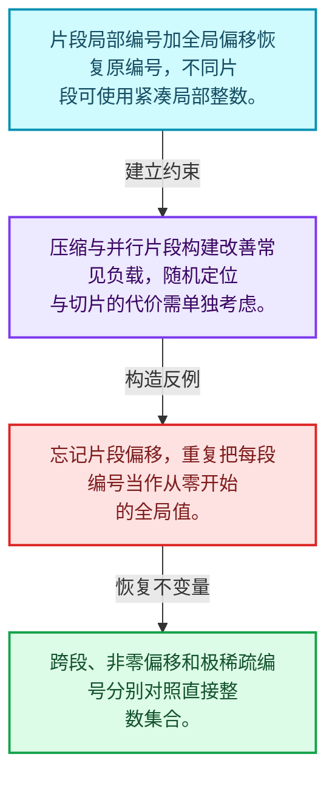
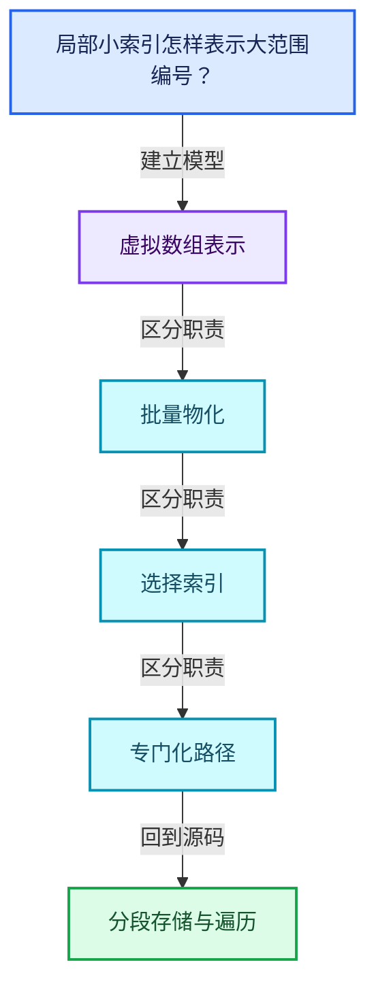
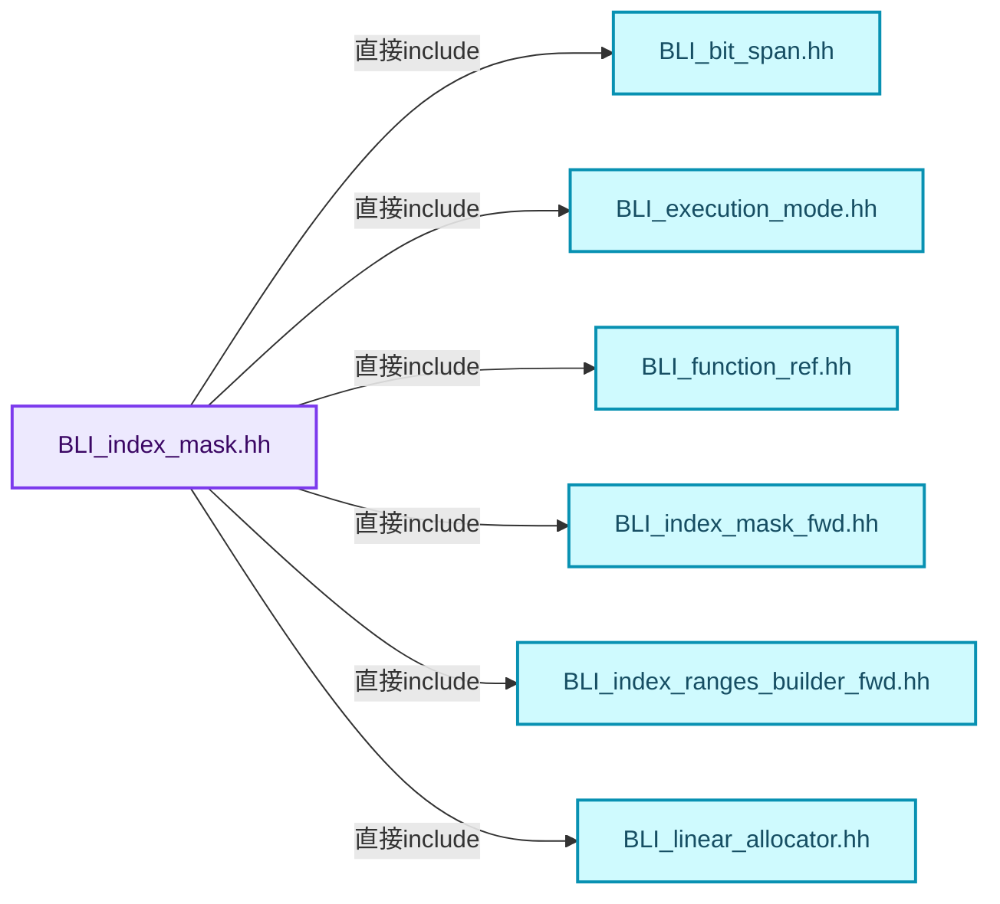
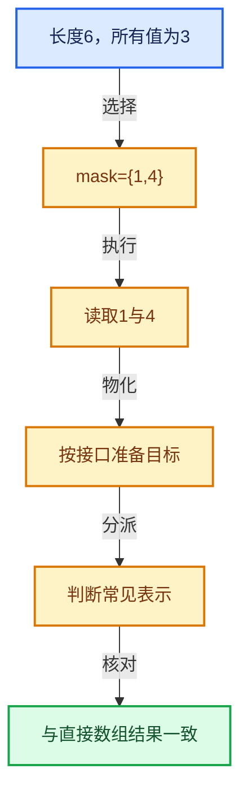

# 04-09 分段存储与遍历

[方向导航](README.md) · [总目录](../README.md) · [覆盖索引](../%E6%BA%90%E7%A0%81%E7%89%88%E6%9C%AC%E4%B8%8E%E8%A6%86%E7%9B%96%E7%B4%A2%E5%BC%95.md)

> 阅读顺序：问题与数据模型 → 语法与类型 → 源码逐行 → 调用线索 → 历史与取舍 → 推演和练习。

- 基准 HEAD：`cbda6b96c26c0dee3c3b5cbb93960c4ac06a6b30`。
- 记录日期：2026-10-14。
- 教学示例状态：正文中的推演不是本机性能实测；已运行练习见验收报告。

## 一、从问题到设计

局部小索引怎样表示大范围编号？

片段局部编号与偏移组合，既压缩常见数据又保留大编号；连续区间可采用专门路径。

本篇把语法、数据语义和系统取舍连接起来。表示与接口分离，元素编号与选择内部位置分离，生成成本与执行成本分离。

### 本篇独立模型与设计推理

片段局部编号加全局偏移恢复原编号，不同片段可使用紧凑局部整数。

设计取舍：压缩与并行片段构建改善常见负载，随机定位与切片的代价需单独考虑。

最小反例：忘记片段偏移，重复把每段编号当作从零开始的全局值。

推导与处理：跨段、非零偏移和极稀疏编号分别对照直接整数集合。



### 源码范围与相邻篇章

| 文件 | 本篇逐行范围 | 基准SHA-256 |
|---|---|---|
| [source/blender/blenlib/BLI_index_mask.hh](../../../../../source/blender/blenlib/BLI_index_mask.hh) | L438—L887 | `d86b6207c23b750c5e987e8f15485786460091055cb38ddd282aab938f2f54df` |

同一主讲文件可能分多篇覆盖；超出本篇范围的符号通过覆盖索引定位。空行与纯注释保留在源码摘录中，逐行表解释有效语句与语法边界；许可证头统一保留。

前篇：[IndexMask总体表示](08-IndexMask%E6%80%BB%E4%BD%93%E8%A1%A8%E7%A4%BA.md).

后篇：[IndexMask构建与并行](10-IndexMask%E6%9E%84%E5%BB%BA%E4%B8%8E%E5%B9%B6%E8%A1%8C.md).

## 二、类型、数据与阅读地图



这是概念依赖图，边表示阅读关系，不声称是运行时调用顺序。

### 直接编译依赖



箭头只表示头文件包含关系；完整调用线索见后面的符号定位表。

## 三、关键词、语法与类型角色

### 模板 template

模板把类型或常量作为生成实现的参数。读声明时先列出类型参数、非类型参数和默认值，再看使用者实际实例化了什么。模板声明本身不意味着每种T都支持其全部成员。

具体检查：把T替换为int、string、只能移动的类型，分别检查每个被调用操作是否成立。

### 依赖名称 typename

typename既可引入类型模板参数，也可告诉编译器某个依赖名称是类型。它不创建运行时对象；解析期确认语法类别与实例化期检查具体类型是不同阶段。

具体检查：区分typename T::value_type和T::size()，前者标记类型，后者是表达式。

### 常量求值 constexpr

constexpr声明允许相应实体参与常量求值，但constexpr函数仍可以在运行时执行。是否常量求值由调用场景和表达式合法性共同决定。

具体检查：比较constexpr变量初始化和从运行时输入调用同一函数。

### 只读限定 const

const约束当前访问路径可做的修改。const指针、指向const的指针、const视图对象、const元素是不同位置的限定；其他别名可能仍可修改原对象。

具体检查：分别写T* const、const T*与const T* const，并画出不可修改的层次。

### 显式静态转换 static_cast

static_cast表达编译期允许的转换，不会自动验证运行时真实类型、指针寿命或索引边界。由void指针恢复T指针时，调用者仍须保证实际存储中确有合法T对象。

具体检查：标出转换前后的类型以及正确性依据来自哪里。

### 可选值 optional

optional把不存在与存在的T区分开，T的构造和析构跟随engaged状态变化。访问前应由has_value或条件分支证明存在。

具体检查：把空Field状态与合法常量零区分，不能用某个普通值代替不存在。

### 判别联合 variant

variant在若干候选类型中保存一个活动值，通过判别信息选择操作。它能把不同表示集中在值类型中，但各分支的复制移动成本不同。

具体检查：列出活动分支及每种分支实际拥有或借用的数据。

### 内部断言 assert

断言表达开发者预期成立的内部契约，发布构建可能关闭。它不能替代对不可信输入的完整错误处理，也不保证后续操作被运行时保护。

具体检查：对每条断言构造违反条件的输入，区分调用者错误与应向用户报告的错误。

### 编译期分支 if constexpr

条件在实例化时决定被保留的分支，这常用于不同类型的合法操作选择。它与运行时if有不同的实例化检查规则。

具体检查：找出每个分支依赖哪些类型特征，再使用满足与不满足条件的类型。

### 受控访问 friend

friend授予指定函数或类访问非公开成员的权限，并不意味着继承，也不自动扩展到友元的派生类。

具体检查：解释执行器为何需要访问包装器的内部映射，同时检查边界是否仍清楚。

## 四、真实源码与逐行讲解

源码块保持原行内容，原始行号由小节标题及逐行表给出。表中的调用定位是静态阅读辅助；重载、模板实例化、宏展开和虚调用需结合完整声明，不能仅凭词法出现证明动态调用。

### BLI_index_mask.hh：L438—L484

<!-- source:source/blender/blenlib/BLI_index_mask.hh:438:484 -->

```cpp

  /**
   * Calls the function once for every index.
   *
   * Supported function signatures:
   * - `(int64_t i)`
   * - `(int64_t i, int64_t pos)`
   *
   * `i` is the index that should be processed and `pos` is the position of that index in the mask:
   *   `i == mask[pos]`
   */
  template<ForeachIndexFn Fn, exec_mode::Tag Mode = exec_mode::Serial>
  void foreach_index(Fn &&fn, Mode mode = exec_mode::serial) const;

  /**
   * Same as #foreach_index, but generates more code, increasing compile time and binary size. This
   * is because separate loops are generated for segments that are ranges and those that are not.
   * Only use this when very little processing is done for each index.
   */
  template<typename IndexT, ForeachIndexFn Fn, exec_mode::Tag Mode = exec_mode::Serial>
  void foreach_index_optimized(Fn &&fn, Mode mode = exec_mode::serial) const;

  /**
   * Calls the function once for every segment. This should be used instead of #foreach_index if
   * the algorithm can be implemented more efficiently by processing multiple indices at once.
   *
   * Supported function signatures:
   *  - `(IndexMaskSegment segment)`
   *  - `(IndexMaskSegment segment, int64_t segment_pos)`
   *
   * The `segment_pos` is the position in the mask where the segment starts:
   *   `segment[0] == mask[segment_pos]`
   */
  template<ForeachSegmentFn Fn, exec_mode::Tag Mode = exec_mode::Serial>
  void foreach_segment(Fn &&fn, Mode mode = exec_mode::serial) const;

  /**
   * This is similar to #foreach_segment but supports slightly different function signatures:
   * - `(auto segment)`
   * - `(auto segment, int64_t segment_pos)`
   *
   * The `segment` input is either of type `IndexMaskSegment` or `IndexRange`, so the function has
   * to support both cases. This also means that more code is generated by the compiler because the
   * function is instantiated twice. Only use this when very little processing happens per index.
   */
  template<ForeachSegmentOrRangePosFn Fn, exec_mode::Tag Mode = exec_mode::Serial>
  void foreach_segment_optimized(Fn &&fn, Mode mode = exec_mode::serial) const;
```

| 原始行 | 语义、约束与检查 |
|---|---|
| L449 | 声明模板参数 `template<ForeachIndexFn Fn, exec_mode::Tag Mode = exec_mode::Serial>`。类型参数决定生成操作的类型，非类型参数可决定内嵌容量或编译期分支。 |
| L450 | 把右侧 `exec_mode::serial) const` 用于初始化或更新左侧 `void foreach_index(Fn &&fn, Mode mode`。声明初始化与已有对象赋值应按上下文区分；有资源的类型会调用相应特殊成员。 |
| L457 | 声明模板参数 `template<typename IndexT, ForeachIndexFn Fn, exec_mode::Tag Mode = exec_mode::Serial>`。类型参数决定生成操作的类型，非类型参数可决定内嵌容量或编译期分支。 |
| L458 | 把右侧 `exec_mode::serial) const` 用于初始化或更新左侧 `void foreach_index_optimized(Fn &&fn, Mode mode`。声明初始化与已有对象赋值应按上下文区分；有资源的类型会调用相应特殊成员。 |
| L471 | 声明模板参数 `template<ForeachSegmentFn Fn, exec_mode::Tag Mode = exec_mode::Serial>`。类型参数决定生成操作的类型，非类型参数可决定内嵌容量或编译期分支。 |
| L472 | 把右侧 `exec_mode::serial) const` 用于初始化或更新左侧 `void foreach_segment(Fn &&fn, Mode mode`。声明初始化与已有对象赋值应按上下文区分；有资源的类型会调用相应特殊成员。 |
| L483 | 声明模板参数 `template<ForeachSegmentOrRangePosFn Fn, exec_mode::Tag Mode = exec_mode::Serial>`。类型参数决定生成操作的类型，非类型参数可决定内嵌容量或编译期分支。 |
| L484 | 把右侧 `exec_mode::serial) const` 用于初始化或更新左侧 `void foreach_segment_optimized(Fn &&fn, Mode mode`。声明初始化与已有对象赋值应按上下文区分；有资源的类型会调用相应特殊成员。 |

### BLI_index_mask.hh：L485—L534

<!-- source:source/blender/blenlib/BLI_index_mask.hh:485:534 -->

```cpp

  /**
   * Calls the function once for every range. Note that this might call the function for each index
   * separately in the worst case if there are no consecutive indices.
   *
   * Support function signatures:
   * - `(IndexRange segment)`
   * - `(IndexRange segment, int64_t segment_pos)`
   */
  void foreach_range(ForeachRangeFn auto &&fn) const;

  /**
   * Fill the provided span with the indices in the mask. The span is expected to have the same
   * size as the mask.
   */
  template<typename T> void to_indices(MutableSpan<T> r_indices) const;
  template<typename T> Vector<T> to_indices() const;
  /**
   * Set the bits at indices in the mask to 1.
   */
  void set_bits(MutableBitSpan r_bits, int64_t offset = 0) const;
  /**
   * Set the bits at indices in the mask to 1 and all other bits to 0.
   */
  void to_bits(MutableBitSpan r_bits, int64_t offset = 0) const;
  /**
   * Set the bools at indices in the mask to true and all others to false.
   */
  void to_bools(MutableSpan<bool> r_bools) const;
  /**
   * Try to convert the entire index mask into a range. This only works if there are no gaps
   * between any indices.
   */
  std::optional<IndexRange> to_range() const;
  /**
   * \return All index ranges in the mask. In the worst case this is a separate range for every
   * index.
   */
  Vector<IndexRange> to_ranges() const;
  /**
   * \return All index ranges in the universe that are not in the mask. In the worst case this is a
   * separate range for every index.
   */
  Vector<IndexRange> to_ranges_invert(IndexRange universe) const;
  /**
   * \return All segments in sorted vector. Segments that encode a range are already converted to
   * an #IndexRange.
   */
  template<int64_t N = 4>
  Vector<std::variant<IndexRange, IndexMaskSegment>, N> to_spans_and_ranges() const;
```

| 原始行 | 语义、约束与检查 |
|---|---|
| L494 | 声明接口 `void foreach_range(ForeachRangeFn auto &&fn) const`，本行没有对应函数体；返回类型、参数限定和const/noexcept共同组成调用契约，实际行为需继续定位实现。 |
| L500 | 声明模板参数 `template<typename T> void to_indices(MutableSpan<T> r_indices) const;`。类型参数决定生成操作的类型，非类型参数可决定内嵌容量或编译期分支。 |
| L501 | 声明模板参数 `template<typename T> Vector<T> to_indices() const;`。类型参数决定生成操作的类型，非类型参数可决定内嵌容量或编译期分支。 |
| L505 | 把右侧 `0) const` 用于初始化或更新左侧 `void set_bits(MutableBitSpan r_bits, int64_t offset`。声明初始化与已有对象赋值应按上下文区分；有资源的类型会调用相应特殊成员。 |
| L509 | 把右侧 `0) const` 用于初始化或更新左侧 `void to_bits(MutableBitSpan r_bits, int64_t offset`。声明初始化与已有对象赋值应按上下文区分；有资源的类型会调用相应特殊成员。 |
| L513 | 声明接口 `void to_bools(MutableSpan<bool> r_bools) const`，本行没有对应函数体；返回类型、参数限定和const/noexcept共同组成调用契约，实际行为需继续定位实现。 |
| L518 | 声明接口 `std::optional<IndexRange> to_range() const`，本行没有对应函数体；返回类型、参数限定和const/noexcept共同组成调用契约，实际行为需继续定位实现。 |
| L523 | 声明接口 `Vector<IndexRange> to_ranges() const`，本行没有对应函数体；返回类型、参数限定和const/noexcept共同组成调用契约，实际行为需继续定位实现。 |
| L528 | 声明接口 `Vector<IndexRange> to_ranges_invert(IndexRange universe) const`，本行没有对应函数体；返回类型、参数限定和const/noexcept共同组成调用契约，实际行为需继续定位实现。 |
| L533 | 声明模板参数 `template<int64_t N = 4>`。类型参数决定生成操作的类型，非类型参数可决定内嵌容量或编译期分支。 |
| L534 | 声明接口 `Vector<std::variant<IndexRange, IndexMaskSegment>, N> to_spans_and_ranges() const`，本行没有对应函数体；返回类型、参数限定和const/noexcept共同组成调用契约，实际行为需继续定位实现。 |

### BLI_index_mask.hh：L535—L590

<!-- source:source/blender/blenlib/BLI_index_mask.hh:535:590 -->

```cpp

  /**
   * Is used by some functions to get low level access to the mask in order to construct it.
   */
  IndexMaskData &data_for_inplace_construction();

  friend bool operator==(const IndexMask &a, const IndexMask &b);
  friend bool operator!=(const IndexMask &a, const IndexMask &b);
};

/**
 * Utility that makes it efficient to build many small index masks from segments one after another.
 * The class has to be constructed once. Afterwards, `update` has to be called to fill the mask
 * with the provided segment.
 */
class IndexMaskFromSegment : NonCopyable, NonMovable {
 private:
  int64_t segment_offset_;
  const int16_t *segment_indices_;
  std::array<int64_t, 2> cumulative_segment_sizes_;
  IndexMask mask_;

 public:
  IndexMaskFromSegment();
  const IndexMask &update(IndexMaskSegment segment);
};

inline IndexMaskFromSegment::IndexMaskFromSegment()
{
  IndexMaskData &data = mask_.data_for_inplace_construction();
  cumulative_segment_sizes_[0] = 0;
  data.segments_num_ = 1;
  data.indices_by_segment_ = &segment_indices_;
  data.segment_offsets_ = &segment_offset_;
  data.cumulative_segment_sizes_ = cumulative_segment_sizes_.data();
  data.begin_index_in_segment_ = 0;
}

inline const IndexMask &IndexMaskFromSegment::update(const IndexMaskSegment segment)
{
  const Span<int16_t> indices = segment.base_span();
  BLI_assert(!indices.is_empty());
  BLI_assert(std::is_sorted(indices.begin(), indices.end()));
  BLI_assert(indices[0] >= 0);
  BLI_assert(indices.last() < max_segment_size);
  const int64_t indices_num = indices.size();

  IndexMaskData &data = mask_.data_for_inplace_construction();
  segment_offset_ = segment.offset();
  segment_indices_ = indices.data();
  cumulative_segment_sizes_[1] = int16_t(indices_num);
  data.indices_num_ = indices_num;
  data.end_index_in_segment_ = indices_num;

  return mask_;
}
```

本段语义重点：

- `mask_`：索引集合字段；在FieldEvaluator中引用构造时允许处理的集合，其他上下文以声明为准。

| 原始行 | 语义、约束与检查 |
|---|---|
| L539 | 出现调用或函数声明 `data_for_inplace_construction`，对应表达式为 `IndexMaskData &data_for_inplace_construction();`。参数求值、返回类型与重载需结合前后完整语句；静态文本引用不能证明动态目标。 |
| L541 | 运算符重载声明、定义或显式调用：`friend bool operator==(const IndexMask &a, const IndexMask &b);`。结合参数和返回类型判断是赋值、索引、比较还是转换；operator=声明中的等号不是在给名为operator的变量赋值。 |
| L542 | 运算符重载声明、定义或显式调用：`friend bool operator!=(const IndexMask &a, const IndexMask &b);`。结合参数和返回类型判断是赋值、索引、比较还是转换；operator=声明中的等号不是在给名为operator的变量赋值。 |
| L543 | 结束当前语法单元。局部自动对象在离开其作用域时按规则销毁；这不等于所有被引用的外部数据也被释放。 |
| L550 | 声明或定义类型 `class IndexMaskFromSegment : NonCopyable, NonMovable`。结合继承、访问权限和成员布局确认接口与拥有关系；前向声明本身没有完整对象布局。 |
| L551 | 切换成员访问权限为 private；它是编译期接口边界，不是线程同步或内存保护。 |
| L552 | 声明成员、局部对象或完成语句 `int64_t segment_offset_`。若为指针或引用，它本身不说明拥有；若为值对象，其构造析构由所在作用域或外层对象管理。 |
| L553 | 声明成员、局部对象或完成语句 `const int16_t *segment_indices_`。若为指针或引用，它本身不说明拥有；若为值对象，其构造析构由所在作用域或外层对象管理。 |
| L554 | 声明成员、局部对象或完成语句 `std::array<int64_t, 2> cumulative_segment_sizes_`。若为指针或引用，它本身不说明拥有；若为值对象，其构造析构由所在作用域或外层对象管理。 |
| L555 | 本行涉及 `mask_`：索引集合字段；在FieldEvaluator中引用构造时允许处理的集合，其他上下文以声明为准。按此语义解读 `IndexMask mask_`，不要把地址、数量或状态混用。 |
| L557 | 切换成员访问权限为 public；它是编译期接口边界，不是线程同步或内存保护。 |
| L558 | 出现调用或函数声明 `IndexMaskFromSegment`，对应表达式为 `IndexMaskFromSegment();`。参数求值、返回类型与重载需结合前后完整语句；静态文本引用不能证明动态目标。 |
| L559 | 声明接口 `const IndexMask &update(IndexMaskSegment segment)`，本行没有对应函数体；返回类型、参数限定和const/noexcept共同组成调用契约，实际行为需继续定位实现。 |
| L560 | 结束当前语法单元。局部自动对象在离开其作用域时按规则销毁；这不等于所有被引用的外部数据也被释放。 |
| L562 | 出现调用或函数声明 `IndexMaskFromSegment::IndexMaskFromSegment`，对应表达式为 `inline IndexMaskFromSegment::IndexMaskFromSegment()`。参数求值、返回类型与重载需结合前后完整语句；静态文本引用不能证明动态目标。 |
| L563 | 连接上一行的声明或控制结构与其语句块；后续行在这个作用域中执行或声明。 |
| L564 | 建立或更新 `mask_`：索引集合字段；在FieldEvaluator中引用构造时允许处理的集合，其他上下文以声明为准。本行的具体值关系为 `IndexMaskData &data = mask_.data_for_inplace_construction()`；对照更新前后相应范围或状态是否一致。 |
| L565 | 把右侧 `0` 用于初始化或更新左侧 `cumulative_segment_sizes_[0]`。声明初始化与已有对象赋值应按上下文区分；有资源的类型会调用相应特殊成员。 |
| L566 | 把右侧 `1` 用于初始化或更新左侧 `data.segments_num_`。声明初始化与已有对象赋值应按上下文区分；有资源的类型会调用相应特殊成员。 |
| L567 | 把右侧 `&segment_indices_` 用于初始化或更新左侧 `data.indices_by_segment_`。声明初始化与已有对象赋值应按上下文区分；有资源的类型会调用相应特殊成员。 |
| L568 | 把右侧 `&segment_offset_` 用于初始化或更新左侧 `data.segment_offsets_`。声明初始化与已有对象赋值应按上下文区分；有资源的类型会调用相应特殊成员。 |
| L569 | 把右侧 `cumulative_segment_sizes_.data()` 用于初始化或更新左侧 `data.cumulative_segment_sizes_`。声明初始化与已有对象赋值应按上下文区分；有资源的类型会调用相应特殊成员。 |
| L570 | 把右侧 `0` 用于初始化或更新左侧 `data.begin_index_in_segment_`。声明初始化与已有对象赋值应按上下文区分；有资源的类型会调用相应特殊成员。 |
| L571 | 结束当前语法单元。局部自动对象在离开其作用域时按规则销毁；这不等于所有被引用的外部数据也被释放。 |
| L573 | 出现调用或函数声明 `IndexMaskFromSegment::update`，对应表达式为 `inline const IndexMask &IndexMaskFromSegment::update(const IndexMaskSegment segment)`。参数求值、返回类型与重载需结合前后完整语句；静态文本引用不能证明动态目标。 |
| L574 | 连接上一行的声明或控制结构与其语句块；后续行在这个作用域中执行或声明。 |
| L575 | 把右侧 `segment.base_span()` 用于初始化或更新左侧 `const Span<int16_t> indices`。声明初始化与已有对象赋值应按上下文区分；有资源的类型会调用相应特殊成员。 |
| L576 | 断言约束 `BLI_assert(!indices.is_empty());`。条件是后续访问的内部前置条件；发布构建可能不执行，不能把断言当作输入修复。 |
| L577 | 断言约束 `BLI_assert(std::is_sorted(indices.begin(), indices.end()));`。条件是后续访问的内部前置条件；发布构建可能不执行，不能把断言当作输入修复。 |
| L578 | 断言约束 `BLI_assert(indices[0] >= 0);`。条件是后续访问的内部前置条件；发布构建可能不执行，不能把断言当作输入修复。 |
| L579 | 断言约束 `BLI_assert(indices.last() < max_segment_size);`。条件是后续访问的内部前置条件；发布构建可能不执行，不能把断言当作输入修复。 |
| L580 | 把右侧 `indices.size()` 用于初始化或更新左侧 `const int64_t indices_num`。声明初始化与已有对象赋值应按上下文区分；有资源的类型会调用相应特殊成员。 |
| L582 | 建立或更新 `mask_`：索引集合字段；在FieldEvaluator中引用构造时允许处理的集合，其他上下文以声明为准。本行的具体值关系为 `IndexMaskData &data = mask_.data_for_inplace_construction()`；对照更新前后相应范围或状态是否一致。 |
| L583 | 把右侧 `segment.offset()` 用于初始化或更新左侧 `segment_offset_`。声明初始化与已有对象赋值应按上下文区分；有资源的类型会调用相应特殊成员。 |
| L584 | 把右侧 `indices.data()` 用于初始化或更新左侧 `segment_indices_`。声明初始化与已有对象赋值应按上下文区分；有资源的类型会调用相应特殊成员。 |
| L585 | 把右侧 `int16_t(indices_num)` 用于初始化或更新左侧 `cumulative_segment_sizes_[1]`。声明初始化与已有对象赋值应按上下文区分；有资源的类型会调用相应特殊成员。 |
| L586 | 把右侧 `indices_num` 用于初始化或更新左侧 `data.indices_num_`。声明初始化与已有对象赋值应按上下文区分；有资源的类型会调用相应特殊成员。 |
| L587 | 把右侧 `indices_num` 用于初始化或更新左侧 `data.end_index_in_segment_`。声明初始化与已有对象赋值应按上下文区分；有资源的类型会调用相应特殊成员。 |
| L589 | 返回表达式 `mask_`。 |
| L590 | 结束当前语法单元。局部自动对象在离开其作用域时按规则销毁；这不等于所有被引用的外部数据也被释放。 |

### BLI_index_mask.hh：L591—L641

<!-- source:source/blender/blenlib/BLI_index_mask.hh:591:641 -->

```cpp

std::array<int16_t, max_segment_size> build_static_indices_array();
const IndexMask &get_static_index_mask_for_min_size(const int64_t min_size);
std::ostream &operator<<(std::ostream &stream, const IndexMask &mask);

/* -------------------------------------------------------------------- */
/** \name Utilities
 * \{ */

inline const std::array<int16_t, max_segment_size> &get_static_indices_array()
{
  alignas(64) static const std::array<int16_t, max_segment_size> data =
      build_static_indices_array();
  return data;
}

/** Fill selected indices of the dst span with the given value. */
template<typename T>
inline void masked_fill(MutableSpan<T> data, const T &value, const IndexMask &mask);

/** Copy every indexed value from src to the same index in dst. */
template<typename T>
inline void copy_assign(const Span<T> src, const IndexMask &mask, const MutableSpan<T> dst);

/** Fill the dst span such that for every index i, dst[i] = src[mask[i]]. */
template<typename T>
inline void gather_assign(const Span<T> src, const IndexMask &mask, const MutableSpan<T> dst);

/**
 * Fill masked indices of \a r_mask with the index of that item in the mask such that
 * `r_map[mask[i]] == i` for the whole mask. The size of `r_map` needs to be at least
 * `mask.min_array_size()`.
 */
template<typename T> void build_reverse_map(const IndexMask &mask, MutableSpan<T> r_map);

/**
 * Joins segments together based on heuristics. Generally, one wants as few segments as possible,
 * but one also wants full-range-segments if possible and we don't want to copy too many indices
 * around to reduce the number of segments.
 *
 * \return Number of consolidated segments. Those are ordered to the beginning of the span.
 */
int64_t consolidate_index_mask_segments(MutableSpan<IndexMaskSegment> segments,
                                        LinearAllocator<> &memory);

/**
 * Adds index mask segments to the vector for the given range. Ranges shorter than
 * #max_segment_size fit into a single segment. Larger ranges are split into multiple segments.
 */
template<int64_t N>
void index_range_to_mask_segments(const IndexRange range, Vector<IndexMaskSegment, N> &r_segments);
```

| 原始行 | 语义、约束与检查 |
|---|---|
| L592 | 出现调用或函数声明 `build_static_indices_array`，对应表达式为 `std::array<int16_t, max_segment_size> build_static_indices_array();`。参数求值、返回类型与重载需结合前后完整语句；静态文本引用不能证明动态目标。 |
| L593 | 声明接口 `const IndexMask &get_static_index_mask_for_min_size(const int64_t min_size)`，本行没有对应函数体；返回类型、参数限定和const/noexcept共同组成调用契约，实际行为需继续定位实现。 |
| L594 | 运算符重载声明、定义或显式调用：`std::ostream &operator<<(std::ostream &stream, const IndexMask &mask);`。结合参数和返回类型判断是赋值、索引、比较还是转换；operator=声明中的等号不是在给名为operator的变量赋值。 |
| L600 | 出现调用或函数声明 `get_static_indices_array`，对应表达式为 `inline const std::array<int16_t, max_segment_size> &get_static_indices_array()`。参数求值、返回类型与重载需结合前后完整语句；静态文本引用不能证明动态目标。 |
| L601 | 连接上一行的声明或控制结构与其语句块；后续行在这个作用域中执行或声明。 |
| L602 | 把右侧 `` 用于初始化或更新左侧 `alignas(64) static const std::array<int16_t, max_segment_size> data`。声明初始化与已有对象赋值应按上下文区分；有资源的类型会调用相应特殊成员。 |
| L603 | 出现调用或函数声明 `build_static_indices_array`，对应表达式为 `build_static_indices_array();`。参数求值、返回类型与重载需结合前后完整语句；静态文本引用不能证明动态目标。 |
| L604 | 返回表达式 `data`。 |
| L605 | 结束当前语法单元。局部自动对象在离开其作用域时按规则销毁；这不等于所有被引用的外部数据也被释放。 |
| L608 | 声明模板参数 `template<typename T>`。类型参数决定生成操作的类型，非类型参数可决定内嵌容量或编译期分支。 |
| L609 | 出现调用或函数声明 `masked_fill`，对应表达式为 `inline void masked_fill(MutableSpan<T> data, const T &value, const IndexMask &mask);`。参数求值、返回类型与重载需结合前后完整语句；静态文本引用不能证明动态目标。 |
| L612 | 声明模板参数 `template<typename T>`。类型参数决定生成操作的类型，非类型参数可决定内嵌容量或编译期分支。 |
| L613 | 出现调用或函数声明 `copy_assign`，对应表达式为 `inline void copy_assign(const Span<T> src, const IndexMask &mask, const MutableSpan<T> dst);`。参数求值、返回类型与重载需结合前后完整语句；静态文本引用不能证明动态目标。 |
| L616 | 声明模板参数 `template<typename T>`。类型参数决定生成操作的类型，非类型参数可决定内嵌容量或编译期分支。 |
| L617 | 出现调用或函数声明 `gather_assign`，对应表达式为 `inline void gather_assign(const Span<T> src, const IndexMask &mask, const MutableSpan<T> dst);`。参数求值、返回类型与重载需结合前后完整语句；静态文本引用不能证明动态目标。 |
| L624 | 声明模板参数 `template<typename T> void build_reverse_map(const IndexMask &mask, MutableSpan<T> r_map);`。类型参数决定生成操作的类型，非类型参数可决定内嵌容量或编译期分支。 |
| L633 | 出现调用或函数声明 `consolidate_index_mask_segments`，对应表达式为 `int64_t consolidate_index_mask_segments(MutableSpan<IndexMaskSegment> segments,`。参数求值、返回类型与重载需结合前后完整语句；静态文本引用不能证明动态目标。 |
| L634 | 声明成员、局部对象或完成语句 `LinearAllocator<> &memory)`。若为指针或引用，它本身不说明拥有；若为值对象，其构造析构由所在作用域或外层对象管理。 |
| L640 | 声明模板参数 `template<int64_t N>`。类型参数决定生成操作的类型，非类型参数可决定内嵌容量或编译期分支。 |
| L641 | 声明接口 `void index_range_to_mask_segments(const IndexRange range, Vector<IndexMaskSegment, N> &r_segments)`，本行没有对应函数体；返回类型、参数限定和const/noexcept共同组成调用契约，实际行为需继续定位实现。 |

### BLI_index_mask.hh：L642—L685

<!-- source:source/blender/blenlib/BLI_index_mask.hh:642:685 -->

```cpp

/** \} */

/* -------------------------------------------------------------------- */
/** \name #RawMaskIterator Inline Methods
 * \{ */

inline bool operator!=(const RawMaskIterator &a, const RawMaskIterator &b)
{
  return a.segment_i != b.segment_i || a.index_in_segment != b.index_in_segment;
}

inline bool operator==(const RawMaskIterator &a, const RawMaskIterator &b)
{
  return !(a != b);
}

/** \} */

/* -------------------------------------------------------------------- */
/** \name #IndexMaskSegment Inline Methods
 * \{ */

inline IndexMaskSegment::IndexMaskSegment(const OffsetSpan<int64_t, int16_t> span)
    : OffsetSpan<int64_t, int16_t>(span)
{
}

inline IndexMaskSegment IndexMaskSegment::slice(const IndexRange &range) const
{
  return IndexMaskSegment(static_cast<const OffsetSpan<int64_t, int16_t> *>(this)->slice(range));
}

inline IndexMaskSegment IndexMaskSegment::slice(const int64_t start, const int64_t size) const
{
  return IndexMaskSegment(
      static_cast<const OffsetSpan<int64_t, int16_t> *>(this)->slice(start, size));
}

inline IndexMaskSegment IndexMaskSegment::shift(const int64_t shift) const
{
  BLI_assert(this->is_empty() || (*this)[0] + shift >= 0);
  return IndexMaskSegment(this->offset() + shift, this->base_span());
}
```

| 原始行 | 语义、约束与检查 |
|---|---|
| L649 | 运算符重载声明、定义或显式调用：`inline bool operator!=(const RawMaskIterator &a, const RawMaskIterator &b)`。结合参数和返回类型判断是赋值、索引、比较还是转换；operator=声明中的等号不是在给名为operator的变量赋值。 |
| L650 | 连接上一行的声明或控制结构与其语句块；后续行在这个作用域中执行或声明。 |
| L651 | 返回表达式 `a.segment_i != b.segment_i &#124;&#124; a.index_in_segment != b.index_in_segment`。 |
| L652 | 结束当前语法单元。局部自动对象在离开其作用域时按规则销毁；这不等于所有被引用的外部数据也被释放。 |
| L654 | 运算符重载声明、定义或显式调用：`inline bool operator==(const RawMaskIterator &a, const RawMaskIterator &b)`。结合参数和返回类型判断是赋值、索引、比较还是转换；operator=声明中的等号不是在给名为operator的变量赋值。 |
| L655 | 连接上一行的声明或控制结构与其语句块；后续行在这个作用域中执行或声明。 |
| L656 | 返回表达式 `!(a != b)`。 |
| L657 | 结束当前语法单元。局部自动对象在离开其作用域时按规则销毁；这不等于所有被引用的外部数据也被释放。 |
| L665 | 出现调用或函数声明 `IndexMaskSegment::IndexMaskSegment`，对应表达式为 `inline IndexMaskSegment::IndexMaskSegment(const OffsetSpan<int64_t, int16_t> span)`。参数求值、返回类型与重载需结合前后完整语句；静态文本引用不能证明动态目标。 |
| L666 | 出现调用或函数声明 `OffsetSpan`，对应表达式为 `: OffsetSpan<int64_t, int16_t>(span)`。参数求值、返回类型与重载需结合前后完整语句；静态文本引用不能证明动态目标。 |
| L667 | 连接上一行的声明或控制结构与其语句块；后续行在这个作用域中执行或声明。 |
| L668 | 结束当前语法单元。局部自动对象在离开其作用域时按规则销毁；这不等于所有被引用的外部数据也被释放。 |
| L670 | 出现调用或函数声明 `IndexMaskSegment::slice`，对应表达式为 `inline IndexMaskSegment IndexMaskSegment::slice(const IndexRange &range) const`。参数求值、返回类型与重载需结合前后完整语句；静态文本引用不能证明动态目标。 |
| L671 | 连接上一行的声明或控制结构与其语句块；后续行在这个作用域中执行或声明。 |
| L672 | 返回表达式 `IndexMaskSegment(static_cast<const OffsetSpan<int64_t, int16_t> *>(this)->slice(range))`。 |
| L673 | 结束当前语法单元。局部自动对象在离开其作用域时按规则销毁；这不等于所有被引用的外部数据也被释放。 |
| L675 | 出现调用或函数声明 `IndexMaskSegment::slice`，对应表达式为 `inline IndexMaskSegment IndexMaskSegment::slice(const int64_t start, const int64_t size) const`。参数求值、返回类型与重载需结合前后完整语句；静态文本引用不能证明动态目标。 |
| L676 | 连接上一行的声明或控制结构与其语句块；后续行在这个作用域中执行或声明。 |
| L677 | 返回表达式 `IndexMaskSegment(`。 |
| L678 | 出现调用或函数声明 `static_cast`，对应表达式为 `static_cast<const OffsetSpan<int64_t, int16_t> *>(this)->slice(start, size));`。参数求值、返回类型与重载需结合前后完整语句；静态文本引用不能证明动态目标。 |
| L679 | 结束当前语法单元。局部自动对象在离开其作用域时按规则销毁；这不等于所有被引用的外部数据也被释放。 |
| L681 | 出现调用或函数声明 `IndexMaskSegment::shift`，对应表达式为 `inline IndexMaskSegment IndexMaskSegment::shift(const int64_t shift) const`。参数求值、返回类型与重载需结合前后完整语句；静态文本引用不能证明动态目标。 |
| L682 | 连接上一行的声明或控制结构与其语句块；后续行在这个作用域中执行或声明。 |
| L683 | 断言约束 `BLI_assert(this->is_empty() &#124;&#124; (*this)[0] + shift >= 0);`。条件是后续访问的内部前置条件；发布构建可能不执行，不能把断言当作输入修复。 |
| L684 | 返回表达式 `IndexMaskSegment(this->offset() + shift, this->base_span())`。结合函数声明检查返回值是否借用原存储，借用值不会自动延长其寿命。 |
| L685 | 结束当前语法单元。局部自动对象在离开其作用域时按规则销毁；这不等于所有被引用的外部数据也被释放。 |

### BLI_index_mask.hh：L686—L741

<!-- source:source/blender/blenlib/BLI_index_mask.hh:686:741 -->

```cpp

/** \} */

/* -------------------------------------------------------------------- */
/** \name #IndexMask Inline Methods
 * \{ */

inline void init_empty_mask(IndexMaskData &data)
{
  static constexpr int64_t cumulative_sizes_for_empty_mask[1] = {0};

  data.indices_num_ = 0;
  data.segments_num_ = 0;
  data.cumulative_segment_sizes_ = cumulative_sizes_for_empty_mask;
  /* Intentionally leave some pointers uninitialized which must not be accessed on empty masks
   * anyway. */
}

inline IndexMask::IndexMask()
{
  init_empty_mask(*this);
}

inline IndexMask::IndexMask(const int64_t size)
{
  if (size == 0) {
    init_empty_mask(*this);
    return;
  }
  *this = get_static_index_mask_for_min_size(size);
  indices_num_ = size;
  segments_num_ = ((size + max_segment_size - 1) >> max_segment_size_shift);
  begin_index_in_segment_ = 0;
  end_index_in_segment_ = size - ((size - 1) & max_segment_size_mask_high);
}

inline IndexMask::IndexMask(const IndexRange range)
{
  if (range.is_empty()) {
    init_empty_mask(*this);
    return;
  }
  const int64_t one_after_last = range.one_after_last();
  *this = get_static_index_mask_for_min_size(one_after_last);

  const int64_t first_segment_i = range.first() >> max_segment_size_shift;
  const int64_t last_segment_i = range.last() >> max_segment_size_shift;

  indices_num_ = range.size();
  segments_num_ = last_segment_i - first_segment_i + 1;
  indices_by_segment_ += first_segment_i;
  segment_offsets_ += first_segment_i;
  cumulative_segment_sizes_ += first_segment_i;
  begin_index_in_segment_ = range.first() & max_segment_size_mask_low;
  end_index_in_segment_ = one_after_last - ((one_after_last - 1) & max_segment_size_mask_high);
}
```

本段语义重点：

- 分支证据 `size == 0)`：分别推演条件成立与不成立，核对相同出口处的状态。
- 分支证据 `range.is_empty())`：分别推演条件成立与不成立，核对相同出口处的状态。

| 原始行 | 语义、约束与检查 |
|---|---|
| L693 | 出现调用或函数声明 `init_empty_mask`，对应表达式为 `inline void init_empty_mask(IndexMaskData &data)`。参数求值、返回类型与重载需结合前后完整语句；静态文本引用不能证明动态目标。 |
| L694 | 连接上一行的声明或控制结构与其语句块；后续行在这个作用域中执行或声明。 |
| L695 | 把右侧 `{0}` 用于初始化或更新左侧 `static constexpr int64_t cumulative_sizes_for_empty_mask[1]`。声明初始化与已有对象赋值应按上下文区分；有资源的类型会调用相应特殊成员。 |
| L697 | 把右侧 `0` 用于初始化或更新左侧 `data.indices_num_`。声明初始化与已有对象赋值应按上下文区分；有资源的类型会调用相应特殊成员。 |
| L698 | 把右侧 `0` 用于初始化或更新左侧 `data.segments_num_`。声明初始化与已有对象赋值应按上下文区分；有资源的类型会调用相应特殊成员。 |
| L699 | 把右侧 `cumulative_sizes_for_empty_mask` 用于初始化或更新左侧 `data.cumulative_segment_sizes_`。声明初始化与已有对象赋值应按上下文区分；有资源的类型会调用相应特殊成员。 |
| L702 | 结束当前语法单元。局部自动对象在离开其作用域时按规则销毁；这不等于所有被引用的外部数据也被释放。 |
| L704 | 出现调用或函数声明 `IndexMask::IndexMask`，对应表达式为 `inline IndexMask::IndexMask()`。参数求值、返回类型与重载需结合前后完整语句；静态文本引用不能证明动态目标。 |
| L705 | 连接上一行的声明或控制结构与其语句块；后续行在这个作用域中执行或声明。 |
| L706 | 出现调用或函数声明 `init_empty_mask`，对应表达式为 `init_empty_mask(*this);`。参数求值、返回类型与重载需结合前后完整语句；静态文本引用不能证明动态目标。 |
| L707 | 结束当前语法单元。局部自动对象在离开其作用域时按规则销毁；这不等于所有被引用的外部数据也被释放。 |
| L709 | 出现调用或函数声明 `IndexMask::IndexMask`，对应表达式为 `inline IndexMask::IndexMask(const int64_t size)`。参数求值、返回类型与重载需结合前后完整语句；静态文本引用不能证明动态目标。 |
| L710 | 连接上一行的声明或控制结构与其语句块；后续行在这个作用域中执行或声明。 |
| L711 | 判断 `size == 0`，成立时进入本分支，否则继续后续路径。该边界影响可访问元素或可用容量，两者要按各变量的定义区分。 |
| L712 | 出现调用或函数声明 `init_empty_mask`，对应表达式为 `init_empty_mask(*this);`。参数求值、返回类型与重载需结合前后完整语句；静态文本引用不能证明动态目标。 |
| L713 | 结束当前函数，本路径不再执行后续语句；局部对象按作用域规则清理。 |
| L714 | 结束当前语法单元。局部自动对象在离开其作用域时按规则销毁；这不等于所有被引用的外部数据也被释放。 |
| L715 | 把右侧 `get_static_index_mask_for_min_size(size)` 用于初始化或更新左侧 `*this`。声明初始化与已有对象赋值应按上下文区分；有资源的类型会调用相应特殊成员。 |
| L716 | 把右侧 `size` 用于初始化或更新左侧 `indices_num_`。声明初始化与已有对象赋值应按上下文区分；有资源的类型会调用相应特殊成员。 |
| L717 | 把右侧 `((size + max_segment_size - 1) >> max_segment_size_shift)` 用于初始化或更新左侧 `segments_num_`。声明初始化与已有对象赋值应按上下文区分；有资源的类型会调用相应特殊成员。 |
| L718 | 把右侧 `0` 用于初始化或更新左侧 `begin_index_in_segment_`。声明初始化与已有对象赋值应按上下文区分；有资源的类型会调用相应特殊成员。 |
| L719 | 把右侧 `size - ((size - 1) & max_segment_size_mask_high)` 用于初始化或更新左侧 `end_index_in_segment_`。声明初始化与已有对象赋值应按上下文区分；有资源的类型会调用相应特殊成员。 |
| L720 | 结束当前语法单元。局部自动对象在离开其作用域时按规则销毁；这不等于所有被引用的外部数据也被释放。 |
| L722 | 出现调用或函数声明 `IndexMask::IndexMask`，对应表达式为 `inline IndexMask::IndexMask(const IndexRange range)`。参数求值、返回类型与重载需结合前后完整语句；静态文本引用不能证明动态目标。 |
| L723 | 连接上一行的声明或控制结构与其语句块；后续行在这个作用域中执行或声明。 |
| L724 | 判断 `range.is_empty()`，成立时进入本分支，否则继续后续路径。 |
| L725 | 出现调用或函数声明 `init_empty_mask`，对应表达式为 `init_empty_mask(*this);`。参数求值、返回类型与重载需结合前后完整语句；静态文本引用不能证明动态目标。 |
| L726 | 结束当前函数，本路径不再执行后续语句；局部对象按作用域规则清理。 |
| L727 | 结束当前语法单元。局部自动对象在离开其作用域时按规则销毁；这不等于所有被引用的外部数据也被释放。 |
| L728 | 把右侧 `range.one_after_last()` 用于初始化或更新左侧 `const int64_t one_after_last`。声明初始化与已有对象赋值应按上下文区分；有资源的类型会调用相应特殊成员。 |
| L729 | 把右侧 `get_static_index_mask_for_min_size(one_after_last)` 用于初始化或更新左侧 `*this`。声明初始化与已有对象赋值应按上下文区分；有资源的类型会调用相应特殊成员。 |
| L731 | 把右侧 `range.first() >> max_segment_size_shift` 用于初始化或更新左侧 `const int64_t first_segment_i`。声明初始化与已有对象赋值应按上下文区分；有资源的类型会调用相应特殊成员。 |
| L732 | 把右侧 `range.last() >> max_segment_size_shift` 用于初始化或更新左侧 `const int64_t last_segment_i`。声明初始化与已有对象赋值应按上下文区分；有资源的类型会调用相应特殊成员。 |
| L734 | 把右侧 `range.size()` 用于初始化或更新左侧 `indices_num_`。声明初始化与已有对象赋值应按上下文区分；有资源的类型会调用相应特殊成员。 |
| L735 | 把右侧 `last_segment_i - first_segment_i + 1` 用于初始化或更新左侧 `segments_num_`。声明初始化与已有对象赋值应按上下文区分；有资源的类型会调用相应特殊成员。 |
| L736 | 复合更新 `indices_by_segment_ += first_segment_i`：读取左侧现有值，与右侧按`+=`对应操作组合后写回。检查数值边界、位掩码或共享状态保护；它不是新对象的构造。 |
| L737 | 复合更新 `segment_offsets_ += first_segment_i`：读取左侧现有值，与右侧按`+=`对应操作组合后写回。检查数值边界、位掩码或共享状态保护；它不是新对象的构造。 |
| L738 | 复合更新 `cumulative_segment_sizes_ += first_segment_i`：读取左侧现有值，与右侧按`+=`对应操作组合后写回。检查数值边界、位掩码或共享状态保护；它不是新对象的构造。 |
| L739 | 把右侧 `range.first() & max_segment_size_mask_low` 用于初始化或更新左侧 `begin_index_in_segment_`。声明初始化与已有对象赋值应按上下文区分；有资源的类型会调用相应特殊成员。 |
| L740 | 把右侧 `one_after_last - ((one_after_last - 1) & max_segment_size_mask_high)` 用于初始化或更新左侧 `end_index_in_segment_`。声明初始化与已有对象赋值应按上下文区分；有资源的类型会调用相应特殊成员。 |
| L741 | 结束当前语法单元。局部自动对象在离开其作用域时按规则销毁；这不等于所有被引用的外部数据也被释放。 |

### BLI_index_mask.hh：L742—L788

<!-- source:source/blender/blenlib/BLI_index_mask.hh:742:788 -->

```cpp

inline int64_t IndexMask::size() const
{
  return indices_num_;
}

inline bool IndexMask::is_empty() const
{
  return indices_num_ == 0;
}

inline IndexRange IndexMask::index_range() const
{
  return IndexRange(indices_num_);
}

inline IndexRange IndexMask::bounds() const
{
  if (this->is_empty()) {
    return IndexRange();
  }
  const int64_t first = this->first();
  const int64_t last = this->last();
  return IndexRange::from_begin_end_inclusive(first, last);
}

inline int64_t IndexMask::first() const
{
  BLI_assert(indices_num_ > 0);
  return segment_offsets_[0] + indices_by_segment_[0][begin_index_in_segment_];
}

inline int64_t IndexMask::last() const
{
  BLI_assert(indices_num_ > 0);
  const int64_t last_segment_i = segments_num_ - 1;
  return segment_offsets_[last_segment_i] +
         indices_by_segment_[last_segment_i][end_index_in_segment_ - 1];
}

inline int64_t IndexMask::min_array_size() const
{
  if (indices_num_ == 0) {
    return 0;
  }
  return this->last() + 1;
}
```

本段语义重点：

- 分支证据 `this->is_empty())`：分别推演条件成立与不成立，核对相同出口处的状态。
- 分支证据 `indices_num_ == 0)`：分别推演条件成立与不成立，核对相同出口处的状态。

| 原始行 | 语义、约束与检查 |
|---|---|
| L743 | 出现调用或函数声明 `IndexMask::size`，对应表达式为 `inline int64_t IndexMask::size() const`。参数求值、返回类型与重载需结合前后完整语句；静态文本引用不能证明动态目标。 |
| L744 | 连接上一行的声明或控制结构与其语句块；后续行在这个作用域中执行或声明。 |
| L745 | 返回表达式 `indices_num_`。 |
| L746 | 结束当前语法单元。局部自动对象在离开其作用域时按规则销毁；这不等于所有被引用的外部数据也被释放。 |
| L748 | 出现调用或函数声明 `IndexMask::is_empty`，对应表达式为 `inline bool IndexMask::is_empty() const`。参数求值、返回类型与重载需结合前后完整语句；静态文本引用不能证明动态目标。 |
| L749 | 连接上一行的声明或控制结构与其语句块；后续行在这个作用域中执行或声明。 |
| L750 | 返回表达式 `indices_num_ == 0`。 |
| L751 | 结束当前语法单元。局部自动对象在离开其作用域时按规则销毁；这不等于所有被引用的外部数据也被释放。 |
| L753 | 出现调用或函数声明 `IndexMask::index_range`，对应表达式为 `inline IndexRange IndexMask::index_range() const`。参数求值、返回类型与重载需结合前后完整语句；静态文本引用不能证明动态目标。 |
| L754 | 连接上一行的声明或控制结构与其语句块；后续行在这个作用域中执行或声明。 |
| L755 | 返回表达式 `IndexRange(indices_num_)`。 |
| L756 | 结束当前语法单元。局部自动对象在离开其作用域时按规则销毁；这不等于所有被引用的外部数据也被释放。 |
| L758 | 出现调用或函数声明 `IndexMask::bounds`，对应表达式为 `inline IndexRange IndexMask::bounds() const`。参数求值、返回类型与重载需结合前后完整语句；静态文本引用不能证明动态目标。 |
| L759 | 连接上一行的声明或控制结构与其语句块；后续行在这个作用域中执行或声明。 |
| L760 | 判断 `this->is_empty()`，成立时进入本分支，否则继续后续路径。 |
| L761 | 返回表达式 `IndexRange()`。 |
| L762 | 结束当前语法单元。局部自动对象在离开其作用域时按规则销毁；这不等于所有被引用的外部数据也被释放。 |
| L763 | 把右侧 `this->first()` 用于初始化或更新左侧 `const int64_t first`。声明初始化与已有对象赋值应按上下文区分；有资源的类型会调用相应特殊成员。 |
| L764 | 把右侧 `this->last()` 用于初始化或更新左侧 `const int64_t last`。声明初始化与已有对象赋值应按上下文区分；有资源的类型会调用相应特殊成员。 |
| L765 | 返回表达式 `IndexRange::from_begin_end_inclusive(first, last)`。 |
| L766 | 结束当前语法单元。局部自动对象在离开其作用域时按规则销毁；这不等于所有被引用的外部数据也被释放。 |
| L768 | 出现调用或函数声明 `IndexMask::first`，对应表达式为 `inline int64_t IndexMask::first() const`。参数求值、返回类型与重载需结合前后完整语句；静态文本引用不能证明动态目标。 |
| L769 | 连接上一行的声明或控制结构与其语句块；后续行在这个作用域中执行或声明。 |
| L770 | 断言约束 `BLI_assert(indices_num_ > 0);`。条件是后续访问的内部前置条件；发布构建可能不执行，不能把断言当作输入修复。 |
| L771 | 返回表达式 `segment_offsets_[0] + indices_by_segment_[0][begin_index_in_segment_]`。 |
| L772 | 结束当前语法单元。局部自动对象在离开其作用域时按规则销毁；这不等于所有被引用的外部数据也被释放。 |
| L774 | 出现调用或函数声明 `IndexMask::last`，对应表达式为 `inline int64_t IndexMask::last() const`。参数求值、返回类型与重载需结合前后完整语句；静态文本引用不能证明动态目标。 |
| L775 | 连接上一行的声明或控制结构与其语句块；后续行在这个作用域中执行或声明。 |
| L776 | 断言约束 `BLI_assert(indices_num_ > 0);`。条件是后续访问的内部前置条件；发布构建可能不执行，不能把断言当作输入修复。 |
| L777 | 把右侧 `segments_num_ - 1` 用于初始化或更新左侧 `const int64_t last_segment_i`。声明初始化与已有对象赋值应按上下文区分；有资源的类型会调用相应特殊成员。 |
| L778 | 返回表达式 `segment_offsets_[last_segment_i] +`。 |
| L779 | 声明成员、局部对象或完成语句 `indices_by_segment_[last_segment_i][end_index_in_segment_ - 1]`。若为指针或引用，它本身不说明拥有；若为值对象，其构造析构由所在作用域或外层对象管理。 |
| L780 | 结束当前语法单元。局部自动对象在离开其作用域时按规则销毁；这不等于所有被引用的外部数据也被释放。 |
| L782 | 出现调用或函数声明 `IndexMask::min_array_size`，对应表达式为 `inline int64_t IndexMask::min_array_size() const`。参数求值、返回类型与重载需结合前后完整语句；静态文本引用不能证明动态目标。 |
| L783 | 连接上一行的声明或控制结构与其语句块；后续行在这个作用域中执行或声明。 |
| L784 | 判断 `indices_num_ == 0`，成立时进入本分支，否则继续后续路径。 |
| L785 | 返回表达式 `0`。 |
| L786 | 结束当前语法单元。局部自动对象在离开其作用域时按规则销毁；这不等于所有被引用的外部数据也被释放。 |
| L787 | 返回表达式 `this->last() + 1`。 |
| L788 | 结束当前语法单元。局部自动对象在离开其作用域时按规则销毁；这不等于所有被引用的外部数据也被释放。 |

### BLI_index_mask.hh：L789—L829

<!-- source:source/blender/blenlib/BLI_index_mask.hh:789:829 -->

```cpp

inline RawMaskIterator IndexMask::index_to_iterator(const int64_t index) const
{
  BLI_assert(index >= 0);
  BLI_assert(index < indices_num_);
  RawMaskIterator it;
  const int64_t full_index = index + cumulative_segment_sizes_[0] + begin_index_in_segment_;
  it.segment_i = binary_search::last_if(
      cumulative_segment_sizes_,
      cumulative_segment_sizes_ + segments_num_ + 1,
      [&](const int64_t cumulative_size) { return cumulative_size <= full_index; });
  it.index_in_segment = full_index - cumulative_segment_sizes_[it.segment_i];
  return it;
}

inline int64_t IndexMask::iterator_to_index(const RawMaskIterator &it) const
{
  BLI_assert(it.segment_i >= 0);
  BLI_assert(it.segment_i < segments_num_);
  BLI_assert(it.index_in_segment >= 0);
  BLI_assert(it.index_in_segment < cumulative_segment_sizes_[it.segment_i + 1] -
                                       cumulative_segment_sizes_[it.segment_i]);
  return it.index_in_segment + cumulative_segment_sizes_[it.segment_i] -
         cumulative_segment_sizes_[0] - begin_index_in_segment_;
}

inline int64_t IndexMask::operator[](const int64_t i) const
{
  const RawMaskIterator it = this->index_to_iterator(i);
  return (*this)[it];
}

inline int64_t IndexMask::operator[](const RawMaskIterator &it) const
{
  return segment_offsets_[it.segment_i] + indices_by_segment_[it.segment_i][it.index_in_segment];
}

inline int64_t IndexMask::segments_num() const
{
  return segments_num_;
}
```

| 原始行 | 语义、约束与检查 |
|---|---|
| L790 | 出现调用或函数声明 `IndexMask::index_to_iterator`，对应表达式为 `inline RawMaskIterator IndexMask::index_to_iterator(const int64_t index) const`。参数求值、返回类型与重载需结合前后完整语句；静态文本引用不能证明动态目标。 |
| L791 | 连接上一行的声明或控制结构与其语句块；后续行在这个作用域中执行或声明。 |
| L792 | 断言约束 `BLI_assert(index >= 0);`。条件是后续访问的内部前置条件；发布构建可能不执行，不能把断言当作输入修复。 |
| L793 | 断言约束 `BLI_assert(index < indices_num_);`。条件是后续访问的内部前置条件；发布构建可能不执行，不能把断言当作输入修复。 |
| L794 | 声明成员、局部对象或完成语句 `RawMaskIterator it`。若为指针或引用，它本身不说明拥有；若为值对象，其构造析构由所在作用域或外层对象管理。 |
| L795 | 把右侧 `index + cumulative_segment_sizes_[0] + begin_index_in_segment_` 用于初始化或更新左侧 `const int64_t full_index`。声明初始化与已有对象赋值应按上下文区分；有资源的类型会调用相应特殊成员。 |
| L796 | 把右侧 `binary_search::last_if(` 用于初始化或更新左侧 `it.segment_i`。声明初始化与已有对象赋值应按上下文区分；有资源的类型会调用相应特殊成员。 |
| L797 | 本行是连续声明或表达式的一部分：`cumulative_segment_sizes_,`。与本段前后行合读；逗号、括号和限定符决定它属于参数、初始化列表还是实际计算。 |
| L798 | 本行是连续声明或表达式的一部分：`cumulative_segment_sizes_ + segments_num_ + 1,`。与本段前后行合读；逗号、括号和限定符决定它属于参数、初始化列表还是实际计算。 |
| L799 | 声明成员、局部对象或完成语句 `[&](const int64_t cumulative_size) { return cumulative_size <= full_index; })`。若为指针或引用，它本身不说明拥有；若为值对象，其构造析构由所在作用域或外层对象管理。 |
| L800 | 把右侧 `full_index - cumulative_segment_sizes_[it.segment_i]` 用于初始化或更新左侧 `it.index_in_segment`。声明初始化与已有对象赋值应按上下文区分；有资源的类型会调用相应特殊成员。 |
| L801 | 返回表达式 `it`。 |
| L802 | 结束当前语法单元。局部自动对象在离开其作用域时按规则销毁；这不等于所有被引用的外部数据也被释放。 |
| L804 | 出现调用或函数声明 `IndexMask::iterator_to_index`，对应表达式为 `inline int64_t IndexMask::iterator_to_index(const RawMaskIterator &it) const`。参数求值、返回类型与重载需结合前后完整语句；静态文本引用不能证明动态目标。 |
| L805 | 连接上一行的声明或控制结构与其语句块；后续行在这个作用域中执行或声明。 |
| L806 | 断言约束 `BLI_assert(it.segment_i >= 0);`。条件是后续访问的内部前置条件；发布构建可能不执行，不能把断言当作输入修复。 |
| L807 | 断言约束 `BLI_assert(it.segment_i < segments_num_);`。条件是后续访问的内部前置条件；发布构建可能不执行，不能把断言当作输入修复。 |
| L808 | 断言约束 `BLI_assert(it.index_in_segment >= 0);`。条件是后续访问的内部前置条件；发布构建可能不执行，不能把断言当作输入修复。 |
| L809 | 断言约束 `BLI_assert(it.index_in_segment < cumulative_segment_sizes_[it.segment_i + 1] -`。条件是后续访问的内部前置条件；发布构建可能不执行，不能把断言当作输入修复。 |
| L810 | 声明成员、局部对象或完成语句 `cumulative_segment_sizes_[it.segment_i])`。若为指针或引用，它本身不说明拥有；若为值对象，其构造析构由所在作用域或外层对象管理。 |
| L811 | 返回表达式 `it.index_in_segment + cumulative_segment_sizes_[it.segment_i] -`。 |
| L812 | 声明成员、局部对象或完成语句 `cumulative_segment_sizes_[0] - begin_index_in_segment_`。若为指针或引用，它本身不说明拥有；若为值对象，其构造析构由所在作用域或外层对象管理。 |
| L813 | 结束当前语法单元。局部自动对象在离开其作用域时按规则销毁；这不等于所有被引用的外部数据也被释放。 |
| L815 | 运算符重载声明、定义或显式调用：`inline int64_t IndexMask::operator[](const int64_t i) const`。结合参数和返回类型判断是赋值、索引、比较还是转换；operator=声明中的等号不是在给名为operator的变量赋值。 |
| L816 | 连接上一行的声明或控制结构与其语句块；后续行在这个作用域中执行或声明。 |
| L817 | 把右侧 `this->index_to_iterator(i)` 用于初始化或更新左侧 `const RawMaskIterator it`。声明初始化与已有对象赋值应按上下文区分；有资源的类型会调用相应特殊成员。 |
| L818 | 返回表达式 `(*this)[it]`。 |
| L819 | 结束当前语法单元。局部自动对象在离开其作用域时按规则销毁；这不等于所有被引用的外部数据也被释放。 |
| L821 | 运算符重载声明、定义或显式调用：`inline int64_t IndexMask::operator[](const RawMaskIterator &it) const`。结合参数和返回类型判断是赋值、索引、比较还是转换；operator=声明中的等号不是在给名为operator的变量赋值。 |
| L822 | 连接上一行的声明或控制结构与其语句块；后续行在这个作用域中执行或声明。 |
| L823 | 返回表达式 `segment_offsets_[it.segment_i] + indices_by_segment_[it.segment_i][it.index_in_segment]`。 |
| L824 | 结束当前语法单元。局部自动对象在离开其作用域时按规则销毁；这不等于所有被引用的外部数据也被释放。 |
| L826 | 出现调用或函数声明 `IndexMask::segments_num`，对应表达式为 `inline int64_t IndexMask::segments_num() const`。参数求值、返回类型与重载需结合前后完整语句；静态文本引用不能证明动态目标。 |
| L827 | 连接上一行的声明或控制结构与其语句块；后续行在这个作用域中执行或声明。 |
| L828 | 返回表达式 `segments_num_`。 |
| L829 | 结束当前语法单元。局部自动对象在离开其作用域时按规则销毁；这不等于所有被引用的外部数据也被释放。 |

### BLI_index_mask.hh：L830—L887

<!-- source:source/blender/blenlib/BLI_index_mask.hh:830:887 -->

```cpp

inline IndexMaskSegment IndexMask::segment(const int64_t segment_i) const
{
  BLI_assert(segment_i >= 0);
  BLI_assert(segment_i < segments_num_);
  const int64_t full_segment_size = cumulative_segment_sizes_[segment_i + 1] -
                                    cumulative_segment_sizes_[segment_i];
  const int64_t begin_index = (segment_i == 0) ? begin_index_in_segment_ : 0;
  const int64_t end_index = (segment_i == segments_num_ - 1) ? end_index_in_segment_ :
                                                               full_segment_size;
  const int64_t segment_size = end_index - begin_index;
  return IndexMaskSegment{segment_offsets_[segment_i],
                          {indices_by_segment_[segment_i] + begin_index, segment_size}};
}

inline IndexMask IndexMask::slice(const IndexRange range) const
{
  return this->slice(range.start(), range.size());
}

inline IndexMaskData &IndexMask::data_for_inplace_construction()
{
  return *this;
}

template<ForeachIndexFn Fn, exec_mode::Tag Mode>
inline void IndexMask::foreach_index(Fn &&fn, const Mode mode) const
{
  if constexpr (mode.is_parallel) {
    threading::parallel_for(
        this->index_range(), mode.grain_size(4096), [&](const IndexRange range) {
          const IndexMask sub_mask = this->slice(range);
          sub_mask.foreach_index([&](const int64_t i, [[maybe_unused]] const int64_t index_pos) {
            if constexpr (std::is_invocable_r_v<void, Fn, int64_t, int64_t>) {
              fn(i, index_pos + range.start());
            }
            else {
              fn(i);
            }
          });
        });
  }
  else {
    this->foreach_segment(
        [&](const IndexMaskSegment indices, [[maybe_unused]] const int64_t start_segment_pos) {
          if constexpr (IndexPosFn<Fn>) {
            for (const int64_t i : indices.index_range()) {
              fn(indices[i], start_segment_pos + i);
            }
          }
          else {
            for (const int64_t index : indices) {
              fn(index);
            }
          }
        });
  }
}
```

| 原始行 | 语义、约束与检查 |
|---|---|
| L831 | 出现调用或函数声明 `IndexMask::segment`，对应表达式为 `inline IndexMaskSegment IndexMask::segment(const int64_t segment_i) const`。参数求值、返回类型与重载需结合前后完整语句；静态文本引用不能证明动态目标。 |
| L832 | 连接上一行的声明或控制结构与其语句块；后续行在这个作用域中执行或声明。 |
| L833 | 断言约束 `BLI_assert(segment_i >= 0);`。条件是后续访问的内部前置条件；发布构建可能不执行，不能把断言当作输入修复。 |
| L834 | 断言约束 `BLI_assert(segment_i < segments_num_);`。条件是后续访问的内部前置条件；发布构建可能不执行，不能把断言当作输入修复。 |
| L835 | 把右侧 `cumulative_segment_sizes_[segment_i + 1] -` 用于初始化或更新左侧 `const int64_t full_segment_size`。声明初始化与已有对象赋值应按上下文区分；有资源的类型会调用相应特殊成员。 |
| L836 | 声明成员、局部对象或完成语句 `cumulative_segment_sizes_[segment_i]`。若为指针或引用，它本身不说明拥有；若为值对象，其构造析构由所在作用域或外层对象管理。 |
| L837 | 把右侧 `(segment_i == 0) ? begin_index_in_segment_ : 0` 用于初始化或更新左侧 `const int64_t begin_index`。声明初始化与已有对象赋值应按上下文区分；有资源的类型会调用相应特殊成员。 |
| L838 | 把右侧 `(segment_i == segments_num_ - 1) ? end_index_in_segment_ :` 用于初始化或更新左侧 `const int64_t end_index`。声明初始化与已有对象赋值应按上下文区分；有资源的类型会调用相应特殊成员。 |
| L839 | 声明成员、局部对象或完成语句 `full_segment_size`。若为指针或引用，它本身不说明拥有；若为值对象，其构造析构由所在作用域或外层对象管理。 |
| L840 | 把右侧 `end_index - begin_index` 用于初始化或更新左侧 `const int64_t segment_size`。声明初始化与已有对象赋值应按上下文区分；有资源的类型会调用相应特殊成员。 |
| L841 | 返回表达式 `IndexMaskSegment{segment_offsets_[segment_i],`。 |
| L842 | 声明成员、局部对象或完成语句 `{indices_by_segment_[segment_i] + begin_index, segment_size}}`。若为指针或引用，它本身不说明拥有；若为值对象，其构造析构由所在作用域或外层对象管理。 |
| L843 | 结束当前语法单元。局部自动对象在离开其作用域时按规则销毁；这不等于所有被引用的外部数据也被释放。 |
| L845 | 出现调用或函数声明 `IndexMask::slice`，对应表达式为 `inline IndexMask IndexMask::slice(const IndexRange range) const`。参数求值、返回类型与重载需结合前后完整语句；静态文本引用不能证明动态目标。 |
| L846 | 连接上一行的声明或控制结构与其语句块；后续行在这个作用域中执行或声明。 |
| L847 | 返回表达式 `this->slice(range.start(), range.size())`。 |
| L848 | 结束当前语法单元。局部自动对象在离开其作用域时按规则销毁；这不等于所有被引用的外部数据也被释放。 |
| L850 | 出现调用或函数声明 `IndexMask::data_for_inplace_construction`，对应表达式为 `inline IndexMaskData &IndexMask::data_for_inplace_construction()`。参数求值、返回类型与重载需结合前后完整语句；静态文本引用不能证明动态目标。 |
| L851 | 连接上一行的声明或控制结构与其语句块；后续行在这个作用域中执行或声明。 |
| L852 | 返回表达式 `*this`。返回当前对象；返回类型决定它是引用还是值，不能仅凭表达式假定复制。 |
| L853 | 结束当前语法单元。局部自动对象在离开其作用域时按规则销毁；这不等于所有被引用的外部数据也被释放。 |
| L855 | 声明模板参数 `template<ForeachIndexFn Fn, exec_mode::Tag Mode>`。类型参数决定生成操作的类型，非类型参数可决定内嵌容量或编译期分支。 |
| L856 | 出现调用或函数声明 `IndexMask::foreach_index`，对应表达式为 `inline void IndexMask::foreach_index(Fn &&fn, const Mode mode) const`。参数求值、返回类型与重载需结合前后完整语句；静态文本引用不能证明动态目标。 |
| L857 | 连接上一行的声明或控制结构与其语句块；后续行在这个作用域中执行或声明。 |
| L858 | 编译期条件分支 `if constexpr (mode.is_parallel)`。按实例化类型选择相应实现；被舍弃分支和运行期if具有不同检查规则，不能当作运行时输入验证。 |
| L859 | 出现调用或函数声明 `threading::parallel_for`，对应表达式为 `threading::parallel_for(`。参数求值、返回类型与重载需结合前后完整语句；静态文本引用不能证明动态目标。 |
| L860 | 出现调用或函数声明 `index_range`，对应表达式为 `this->index_range(), mode.grain_size(4096), [&](const IndexRange range) {`。参数求值、返回类型与重载需结合前后完整语句；静态文本引用不能证明动态目标。 |
| L861 | 把右侧 `this->slice(range)` 用于初始化或更新左侧 `const IndexMask sub_mask`。声明初始化与已有对象赋值应按上下文区分；有资源的类型会调用相应特殊成员。 |
| L862 | 出现调用或函数声明 `foreach_index`，对应表达式为 `sub_mask.foreach_index([&](const int64_t i, [[maybe_unused]] const int64_t index_pos) {`。参数求值、返回类型与重载需结合前后完整语句；静态文本引用不能证明动态目标。 |
| L863 | 编译期条件分支 `if constexpr (std::is_invocable_r_v<void, Fn, int64_t, int64_t>)`。按实例化类型选择相应实现；被舍弃分支和运行期if具有不同检查规则，不能当作运行时输入验证。 |
| L864 | 出现调用或函数声明 `fn`，对应表达式为 `fn(i, index_pos + range.start());`。参数求值、返回类型与重载需结合前后完整语句；静态文本引用不能证明动态目标。 |
| L865 | 结束当前语法单元。局部自动对象在离开其作用域时按规则销毁；这不等于所有被引用的外部数据也被释放。 |
| L866 | 处理前一条件不成立的互补路径。比较两条路径最后是否恢复同一不变量，以及是否产生不同的资源责任。 |
| L867 | 出现调用或函数声明 `fn`，对应表达式为 `fn(i);`。参数求值、返回类型与重载需结合前后完整语句；静态文本引用不能证明动态目标。 |
| L868 | 结束当前语法单元。局部自动对象在离开其作用域时按规则销毁；这不等于所有被引用的外部数据也被释放。 |
| L869 | 结束当前语法单元。局部自动对象在离开其作用域时按规则销毁；这不等于所有被引用的外部数据也被释放。 |
| L870 | 结束当前语法单元。局部自动对象在离开其作用域时按规则销毁；这不等于所有被引用的外部数据也被释放。 |
| L871 | 结束当前语法单元。局部自动对象在离开其作用域时按规则销毁；这不等于所有被引用的外部数据也被释放。 |
| L872 | 处理前一条件不成立的互补路径。比较两条路径最后是否恢复同一不变量，以及是否产生不同的资源责任。 |
| L873 | 出现调用或函数声明 `foreach_segment`，对应表达式为 `this->foreach_segment(`。参数求值、返回类型与重载需结合前后完整语句；静态文本引用不能证明动态目标。 |
| L874 | 本行是连续声明或表达式的一部分：`[&](const IndexMaskSegment indices, [[maybe_unused]] const int64_t start_segment_pos) {`。与本段前后行合读；逗号、括号和限定符决定它属于参数、初始化列表还是实际计算。 |
| L875 | 编译期条件分支 `if constexpr (IndexPosFn<Fn>)`。按实例化类型选择相应实现；被舍弃分支和运行期if具有不同检查规则，不能当作运行时输入验证。 |
| L876 | 按 `for (const int64_t i : indices.index_range())` 指定的范围或条件重复执行。对照循环变量与真实元素编号；循环内调用成本乘以实际迭代次数。 |
| L877 | 出现调用或函数声明 `fn`，对应表达式为 `fn(indices[i], start_segment_pos + i);`。参数求值、返回类型与重载需结合前后完整语句；静态文本引用不能证明动态目标。 |
| L878 | 结束当前语法单元。局部自动对象在离开其作用域时按规则销毁；这不等于所有被引用的外部数据也被释放。 |
| L879 | 结束当前语法单元。局部自动对象在离开其作用域时按规则销毁；这不等于所有被引用的外部数据也被释放。 |
| L880 | 处理前一条件不成立的互补路径。比较两条路径最后是否恢复同一不变量，以及是否产生不同的资源责任。 |
| L881 | 按 `for (const int64_t index : indices)` 指定的范围或条件重复执行。对照循环变量与真实元素编号；循环内调用成本乘以实际迭代次数。 |
| L882 | 出现调用或函数声明 `fn`，对应表达式为 `fn(index);`。参数求值、返回类型与重载需结合前后完整语句；静态文本引用不能证明动态目标。 |
| L883 | 结束当前语法单元。局部自动对象在离开其作用域时按规则销毁；这不等于所有被引用的外部数据也被释放。 |
| L884 | 结束当前语法单元。局部自动对象在离开其作用域时按规则销毁；这不等于所有被引用的外部数据也被释放。 |
| L885 | 结束当前语法单元。局部自动对象在离开其作用域时按规则销毁；这不等于所有被引用的外部数据也被释放。 |
| L886 | 结束当前语法单元。局部自动对象在离开其作用域时按规则销毁；这不等于所有被引用的外部数据也被释放。 |
| L887 | 结束当前语法单元。局部自动对象在离开其作用域时按规则销毁；这不等于所有被引用的外部数据也被释放。 |

## 五、接口定位、调用线索与生命周期

### 本篇声明与实现入口

| 源码位置 | 实际声明片段 |
|---|---|
| [BLI_index_mask.hh:L450](../../../../../source/blender/blenlib/BLI_index_mask.hh#L450) | `void foreach_index(Fn &&fn, Mode mode = exec_mode::serial) const;` |
| [BLI_index_mask.hh:L458](../../../../../source/blender/blenlib/BLI_index_mask.hh#L458) | `void foreach_index_optimized(Fn &&fn, Mode mode = exec_mode::serial) const;` |
| [BLI_index_mask.hh:L472](../../../../../source/blender/blenlib/BLI_index_mask.hh#L472) | `void foreach_segment(Fn &&fn, Mode mode = exec_mode::serial) const;` |
| [BLI_index_mask.hh:L484](../../../../../source/blender/blenlib/BLI_index_mask.hh#L484) | `void foreach_segment_optimized(Fn &&fn, Mode mode = exec_mode::serial) const;` |
| [BLI_index_mask.hh:L494](../../../../../source/blender/blenlib/BLI_index_mask.hh#L494) | `void foreach_range(ForeachRangeFn auto &&fn) const;` |
| [BLI_index_mask.hh:L500](../../../../../source/blender/blenlib/BLI_index_mask.hh#L500) | `template<typename T> void to_indices(MutableSpan<T> r_indices) const;` |
| [BLI_index_mask.hh:L501](../../../../../source/blender/blenlib/BLI_index_mask.hh#L501) | `template<typename T> Vector<T> to_indices() const;` |
| [BLI_index_mask.hh:L505](../../../../../source/blender/blenlib/BLI_index_mask.hh#L505) | `void set_bits(MutableBitSpan r_bits, int64_t offset = 0) const;` |
| [BLI_index_mask.hh:L509](../../../../../source/blender/blenlib/BLI_index_mask.hh#L509) | `void to_bits(MutableBitSpan r_bits, int64_t offset = 0) const;` |
| [BLI_index_mask.hh:L513](../../../../../source/blender/blenlib/BLI_index_mask.hh#L513) | `void to_bools(MutableSpan<bool> r_bools) const;` |
| [BLI_index_mask.hh:L518](../../../../../source/blender/blenlib/BLI_index_mask.hh#L518) | `std::optional<IndexRange> to_range() const;` |
| [BLI_index_mask.hh:L523](../../../../../source/blender/blenlib/BLI_index_mask.hh#L523) | `Vector<IndexRange> to_ranges() const;` |
| [BLI_index_mask.hh:L528](../../../../../source/blender/blenlib/BLI_index_mask.hh#L528) | `Vector<IndexRange> to_ranges_invert(IndexRange universe) const;` |
| [BLI_index_mask.hh:L539](../../../../../source/blender/blenlib/BLI_index_mask.hh#L539) | `IndexMaskData &data_for_inplace_construction();` |
| [BLI_index_mask.hh:L550](../../../../../source/blender/blenlib/BLI_index_mask.hh#L550) | `class IndexMaskFromSegment : NonCopyable, NonMovable` |
| [BLI_index_mask.hh:L558](../../../../../source/blender/blenlib/BLI_index_mask.hh#L558) | `IndexMaskFromSegment();` |
| [BLI_index_mask.hh:L559](../../../../../source/blender/blenlib/BLI_index_mask.hh#L559) | `const IndexMask &update(IndexMaskSegment segment);` |
| [BLI_index_mask.hh:L562](../../../../../source/blender/blenlib/BLI_index_mask.hh#L562) | `inline IndexMaskFromSegment::IndexMaskFromSegment()` |
| [BLI_index_mask.hh:L573](../../../../../source/blender/blenlib/BLI_index_mask.hh#L573) | `inline const IndexMask &IndexMaskFromSegment::update(const IndexMaskSegment segment)` |
| [BLI_index_mask.hh:L593](../../../../../source/blender/blenlib/BLI_index_mask.hh#L593) | `const IndexMask &get_static_index_mask_for_min_size(const int64_t min_size);` |
| [BLI_index_mask.hh:L609](../../../../../source/blender/blenlib/BLI_index_mask.hh#L609) | `inline void masked_fill(MutableSpan<T> data, const T &value, const IndexMask &mask);` |
| [BLI_index_mask.hh:L613](../../../../../source/blender/blenlib/BLI_index_mask.hh#L613) | `inline void copy_assign(const Span<T> src, const IndexMask &mask, const MutableSpan<T> dst);` |
| [BLI_index_mask.hh:L617](../../../../../source/blender/blenlib/BLI_index_mask.hh#L617) | `inline void gather_assign(const Span<T> src, const IndexMask &mask, const MutableSpan<T> dst);` |
| [BLI_index_mask.hh:L624](../../../../../source/blender/blenlib/BLI_index_mask.hh#L624) | `template<typename T> void build_reverse_map(const IndexMask &mask, MutableSpan<T> r_map);` |
| [BLI_index_mask.hh:L633](../../../../../source/blender/blenlib/BLI_index_mask.hh#L633) | `int64_t consolidate_index_mask_segments(MutableSpan<IndexMaskSegment> segments,` |
| [BLI_index_mask.hh:L641](../../../../../source/blender/blenlib/BLI_index_mask.hh#L641) | `void index_range_to_mask_segments(const IndexRange range, Vector<IndexMaskSegment, N> &r_segments);` |
| [BLI_index_mask.hh:L665](../../../../../source/blender/blenlib/BLI_index_mask.hh#L665) | `inline IndexMaskSegment::IndexMaskSegment(const OffsetSpan<int64_t, int16_t> span)` |
| [BLI_index_mask.hh:L670](../../../../../source/blender/blenlib/BLI_index_mask.hh#L670) | `inline IndexMaskSegment IndexMaskSegment::slice(const IndexRange &range) const` |
| [BLI_index_mask.hh:L675](../../../../../source/blender/blenlib/BLI_index_mask.hh#L675) | `inline IndexMaskSegment IndexMaskSegment::slice(const int64_t start, const int64_t size) const` |
| [BLI_index_mask.hh:L681](../../../../../source/blender/blenlib/BLI_index_mask.hh#L681) | `inline IndexMaskSegment IndexMaskSegment::shift(const int64_t shift) const` |
| [BLI_index_mask.hh:L693](../../../../../source/blender/blenlib/BLI_index_mask.hh#L693) | `inline void init_empty_mask(IndexMaskData &data)` |
| [BLI_index_mask.hh:L704](../../../../../source/blender/blenlib/BLI_index_mask.hh#L704) | `inline IndexMask::IndexMask()` |
| [BLI_index_mask.hh:L709](../../../../../source/blender/blenlib/BLI_index_mask.hh#L709) | `inline IndexMask::IndexMask(const int64_t size)` |
| [BLI_index_mask.hh:L722](../../../../../source/blender/blenlib/BLI_index_mask.hh#L722) | `inline IndexMask::IndexMask(const IndexRange range)` |
| [BLI_index_mask.hh:L743](../../../../../source/blender/blenlib/BLI_index_mask.hh#L743) | `inline int64_t IndexMask::size() const` |
| [BLI_index_mask.hh:L748](../../../../../source/blender/blenlib/BLI_index_mask.hh#L748) | `inline bool IndexMask::is_empty() const` |
| [BLI_index_mask.hh:L753](../../../../../source/blender/blenlib/BLI_index_mask.hh#L753) | `inline IndexRange IndexMask::index_range() const` |
| [BLI_index_mask.hh:L758](../../../../../source/blender/blenlib/BLI_index_mask.hh#L758) | `inline IndexRange IndexMask::bounds() const` |
| [BLI_index_mask.hh:L768](../../../../../source/blender/blenlib/BLI_index_mask.hh#L768) | `inline int64_t IndexMask::first() const` |
| [BLI_index_mask.hh:L774](../../../../../source/blender/blenlib/BLI_index_mask.hh#L774) | `inline int64_t IndexMask::last() const` |
| [BLI_index_mask.hh:L782](../../../../../source/blender/blenlib/BLI_index_mask.hh#L782) | `inline int64_t IndexMask::min_array_size() const` |
| [BLI_index_mask.hh:L790](../../../../../source/blender/blenlib/BLI_index_mask.hh#L790) | `inline RawMaskIterator IndexMask::index_to_iterator(const int64_t index) const` |
| [BLI_index_mask.hh:L804](../../../../../source/blender/blenlib/BLI_index_mask.hh#L804) | `inline int64_t IndexMask::iterator_to_index(const RawMaskIterator &it) const` |
| [BLI_index_mask.hh:L826](../../../../../source/blender/blenlib/BLI_index_mask.hh#L826) | `inline int64_t IndexMask::segments_num() const` |
| [BLI_index_mask.hh:L831](../../../../../source/blender/blenlib/BLI_index_mask.hh#L831) | `inline IndexMaskSegment IndexMask::segment(const int64_t segment_i) const` |
| [BLI_index_mask.hh:L845](../../../../../source/blender/blenlib/BLI_index_mask.hh#L845) | `inline IndexMask IndexMask::slice(const IndexRange range) const` |
| [BLI_index_mask.hh:L850](../../../../../source/blender/blenlib/BLI_index_mask.hh#L850) | `inline IndexMaskData &IndexMask::data_for_inplace_construction()` |
| [BLI_index_mask.hh:L856](../../../../../source/blender/blenlib/BLI_index_mask.hh#L856) | `inline void IndexMask::foreach_index(Fn &&fn, const Mode mode) const` |

### 同名符号出现位置

以下表提供跨文件阅读入口，包含声明、调用或测试使用；没有经过完整C++名称解析，不把它命名为已证明的运行时调用图。

| 符号 | 位置 | 文本证据 |
|---|---|---|
| `foreach_index` | [bvhutils.cc:L446](../../../../../source/blender/blenkernel/intern/bvhutils.cc#L446) | `verts_mask.foreach_index(` |
| `foreach_index` | [bvhutils.cc:L466](../../../../../source/blender/blenkernel/intern/bvhutils.cc#L466) | `edges_mask.foreach_index([&](const int edge_i) {` |
| `foreach_index` | [bvhutils.cc:L547](../../../../../source/blender/blenkernel/intern/bvhutils.cc#L547) | `faces_mask.foreach_index([&](const int face) {` |
| `foreach_segment` | [index_mask.cc:L580](../../../../../source/blender/blenlib/intern/index_mask.cc#L580) | `universe.foreach_segment(` |
| `foreach_segment` | [index_mask.cc:L881](../../../../../source/blender/blenlib/intern/index_mask.cc#L881) | `universe.foreach_segment(` |
| `foreach_segment` | [index_mask_expression.cc:L987](../../../../../source/blender/blenlib/intern/index_mask_expression.cc#L987) | `sliced_mask.foreach_segment(` |
| `foreach_segment_optimized` | [index_mask.cc:L779](../../../../../source/blender/blenlib/intern/index_mask.cc#L779) | `this->foreach_segment_optimized([&](const auto segment) {` |
| `foreach_segment_optimized` | [offset_indices.cc:L122](../../../../../source/blender/blenlib/intern/offset_indices.cc#L122) | `mask.foreach_segment_optimized([&](const auto segment) {` |
| `foreach_range` | [index_mask.cc:L693](../../../../../source/blender/blenlib/intern/index_mask.cc#L693) | `mask.foreach_range([&](const IndexRange mask_range) {` |
| `foreach_range` | [index_mask.cc:L812](../../../../../source/blender/blenlib/intern/index_mask.cc#L812) | `this->foreach_range([&](const IndexRange range) { ranges.append(range); });` |
| `to_indices` | [index_mask.cc:L766](../../../../../source/blender/blenlib/intern/index_mask.cc#L766) | `template<typename T> void IndexMask::to_indices(MutableSpan<T> r_indices) const` |
| `to_indices` | [index_mask.cc:L1260](../../../../../source/blender/blenlib/intern/index_mask.cc#L1260) | `template void IndexMask::to_indices(MutableSpan<int32_t>) const;` |
| `to_indices` | [index_mask.cc:L1261](../../../../../source/blender/blenlib/intern/index_mask.cc#L1261) | `template void IndexMask::to_indices(MutableSpan<int64_t>) const;` |
| `set_bits` | [index_mask.cc:L776](../../../../../source/blender/blenlib/intern/index_mask.cc#L776) | `void IndexMask::set_bits(MutableBitSpan r_bits, const int64_t offset) const` |
| `set_bits` | [index_mask.cc:L799](../../../../../source/blender/blenlib/intern/index_mask.cc#L799) | `this->set_bits(r_bits, offset);` |
| `to_bits` | [index_mask.cc:L795](../../../../../source/blender/blenlib/intern/index_mask.cc#L795) | `void IndexMask::to_bits(MutableBitSpan r_bits, const int64_t offset) const` |
| `to_bits` | [index_mask_expression.cc:L610](../../../../../source/blender/blenlib/intern/index_mask_expression.cc#L610) | `mask.to_bits(expr_result, -bounds_min);` |
| `to_bools` | [index_mask.cc:L802](../../../../../source/blender/blenlib/intern/index_mask.cc#L802) | `void IndexMask::to_bools(MutableSpan<bool> r_bools) const` |
| `to_range` | [index_mask.cc:L199](../../../../../source/blender/blenlib/intern/index_mask.cc#L199) | `if (std::optional<IndexRange> range = this->to_range()) {` |
| `to_range` | [index_mask.cc:L214](../../../../../source/blender/blenlib/intern/index_mask.cc#L214) | `if (std::optional<IndexRange> range = this->to_range()) {` |
| `to_range` | [index_mask.cc:L1035](../../../../../source/blender/blenlib/intern/index_mask.cc#L1035) | `const std::optional<IndexRange> range_to_repeat = mask_to_repeat.to_range();` |
| `to_ranges` | [index_mask.cc:L809](../../../../../source/blender/blenlib/intern/index_mask.cc#L809) | `Vector<IndexRange> IndexMask::to_ranges() const` |
| `to_ranges` | [index_mask.cc:L819](../../../../../source/blender/blenlib/intern/index_mask.cc#L819) | `return this->complement(universe, memory).to_ranges();` |
| `to_ranges_invert` | [index_mask.cc:L816](../../../../../source/blender/blenlib/intern/index_mask.cc#L816) | `Vector<IndexRange> IndexMask::to_ranges_invert(const IndexRange universe) const` |
| `data_for_inplace_construction` | [index_mask.cc:L90](../../../../../source/blender/blenlib/intern/index_mask.cc#L90) | `IndexMaskData &data = mask.data_for_inplace_construction();` |
| `data_for_inplace_construction` | [index_mask.cc:L323](../../../../../source/blender/blenlib/intern/index_mask.cc#L323) | `IndexMaskData &data = mask.data_for_inplace_construction();` |
| `update` | [BLI_shared_cache.hh:L77](../../../../../source/blender/blenlib/BLI_shared_cache.hh#L77) | `void update(FunctionRef<void(T &data)> compute_cache)` |
| `update` | [FN_multi_function_builder.hh:L297](../../../../../source/blender/functions/FN_multi_function_builder.hh#L297) | `current_segment_mask = &index_mask_from_segment.update(` |
| `get_static_index_mask_for_min_size` | [index_mask.cc:L58](../../../../../source/blender/blenlib/intern/index_mask.cc#L58) | `const IndexMask &get_static_index_mask_for_min_size(const int64_t min_size)` |
| `masked_fill` | [BLI_array_utils.hh:L259](../../../../../source/blender/blenlib/BLI_array_utils.hh#L259) | `index_mask::masked_fill(dst, *static_cast<const T *>(info.data), dst_mask);` |
| `masked_fill` | [index_mask.cc:L806](../../../../../source/blender/blenlib/intern/index_mask.cc#L806) | `index_mask::masked_fill(r_bools, true, *this);` |
| `masked_fill` | [node_geo_menu_switch.cc:L289](../../../../../source/blender/nodes/geometry/nodes/node_geo_menu_switch.cc#L289) | `index_mask::masked_fill(item_spans[item_i], is_selected, mask);` |

### 生命周期推理图


这是审查生命周期的通用模型。具体类是否拥有数据由本篇成员、构造、析构和调用者一起证明；任何箭头都不自动代表shared_ptr。

## 六、把代码放进具体数据中推演

本方向的共同数值模型如下。本篇的专门检查是：把跨片段的编号恢复为全局索引，检查边界和偏移。

| 步骤 | 数据或状态 | 为什么需要这一步 |
|---|---|---|
| 输入 | 长度6，所有值为3 | 单值表示可只存一个3 |
| 选择 | mask={1,4} | 内部位置0对应全局1 |
| 执行 | 读取1与4 | 避免读取未选位置 |
| 物化 | 按接口准备目标 | 支付真实存储和复制成本 |
| 分派 | 判断常见表示 | 专门化循环可避免逐项虚调用 |
| 核对 | 与直接数组结果一致 | 表示变化不能改变元素语义 |



图是教学推演模型；精确分支与状态更新以本篇摘录及调用契约为准。

### 本篇独立练习与参考思路

把跨片段的编号恢复为全局索引，检查边界和偏移。

参考思路：片段局部编号与偏移组合，既压缩常见数据又保留大编号；连续区间可采用专门路径。

将输入、预期结果和资源责任分成三张清单。先用最直接的实现给出可核对的答案，再替换成对应源码使用的表示；比较结果不变的条件，而不是只比较接口名字。

验收依据：遍历结果按真实索引排序且无重复；单值、Span与计算表示在有效索引上返回一致语义。

## 七、复杂度、设计取舍与其他基础库

对比普通Span、标准ranges惰性视图和虚拟数组时，明确随机索引能力、批量物化、类型擦除和拥有关系；接口外观相近不代表同一抽象。

本篇的具体取舍：片段局部编号与偏移组合，既压缩常见数据又保留大编号；连续区间可采用专门路径。

| 观察维度 | 从源码取得证据的方法 | 本篇要避免的误判 |
|---|---|---|
| 时间 | 对循环次数、分派次数和重建频率分别计数 | 看到单次常数操作就断定整个操作序列是常数成本 |
| 内存 | 区分对象本体、容量存储、间接资源和共享控制块 | 用sizeof代替总内存 |
| 安全 | 沿构造、失败回滚、销毁与失效逐路径检查 | 把断言或非空指针当作完整安全证明 |
| 并发 | 逐字段确认锁、发布顺序和借用寿命 | 把引用计数线程安全等同数据读写线程安全 |

相关一手资料：

- [C++公开工作草案](https://eel.is/c++draft/)：持续更新的工作草案；语言与标准库语义以相应章节为准。
- [LLVM Programmer’s Manual](https://llvm.org/docs/ProgrammersManual.html)：在线版，2026-10-14查阅；仅比较设计思路，不保证与本地LLVM版本一致。

资料用于核对契约和进一步阅读；这里没有声称外部库与Blender实现相同，也没有把上游性能数字当作本机实测。

## 八、历史提交与设计演化

### 2023-05-24 · Jacques Lucke

[BLI: refactor IndexMask for better performance and memory usage](https://projects.blender.org/blender/blender/commit/2cfcb8b0b805401a0ffb252fd41750fadb0392ab)

完整哈希：`2cfcb8b0b805401a0ffb252fd41750fadb0392ab`。提交标题与作者日期来自本地Git对象。

提交说明原文（历史证据，不能直接作为当前API说明）：

```text
BLI: refactor IndexMask for better performance and memory usage

Goals of this refactor:
* Reduce memory consumption of `IndexMask`. The old `IndexMask` uses an
  `int64_t` for each index which is more than necessary in pretty much all
  practical cases currently. Using `int32_t` might still become limiting
  in the future in case we use this to index e.g. byte buffers larger than
  a few gigabytes. We also don't want to template `IndexMask`, because
  that would cause a split in the "ecosystem", or everything would have to
  be implemented twice or templated.
* Allow for more multi-threading. The old `IndexMask` contains a single
  array. This is generally good but has the problem that it is hard to fill
  from multiple-threads when the final size is not known from the beginning.
  This is commonly the case when e.g. converting an array of bool to an
  index mask. Currently, this kind of code only runs on a single thread.
* Allow for efficient set operations like join, intersect and difference.
  It should be possible to multi-thread those operations.
* It should be possible to iterate over an `IndexMask` very efficiently.
  The most important part of that is to avoid all memory access when iterating
  over continuous ranges. For some core nodes (e.g. math nodes), we generate
  optimized code for the cases of irregular index masks and simple index ranges.

To achieve these goals, a few compromises had to made:
* Slicing of the mask (at specific indices) and random element access is
  `O(log #indices)` now, but with a low constant factor. It should be possible
  to split a mask into n approximately equally sized parts in `O(n)` though,
  making the time per split `O(1)`.
* Using range-based for loops does not work well when iterating over a nested
  data structure like the new `IndexMask`. Therefor, `foreach_*` functions with
  callbacks have to be used. To avoid extra code complexity at the call site,
  the `foreach_*` methods support multi-threading out of the box.

The new data structure splits an `IndexMask` into an arbitrary number of ordered
`IndexMaskSegment`. Each segment can contain at most `2^14 = 16384` indices. The
indices within a segment are stored as `int16_t`. Each segment has an additional
`int64_t` offset which allows storing arbitrary `int64_t` indices. This approach
has the main benefits that segments can be processed/constructed individually on
multiple threads without a serial bottleneck. Also it reduces the memory
requirements significantly.

For more details see comments in `BLI_index_mask.hh`.

I did a few tests to verify that the data structure generally improves
performance and does not cause regressions:
* Our field evaluation benchmarks take about as much as before. This is to be
  expected because we already made sure that e.g. add node evaluation is
  vectorized. The important thing here is to check that changes to the way we
  iterate over the indices still allows for auto-vectorization.
* Memory usage by a mask is about 1/4 of what it was before in the average case.
  That's mainly caused by the switch from `int64_t` to `int16_t` for indices.
  In the worst case, the memory requirements can be larger when there are many
  indices that are very far away. However, when they are far away from each other,
  that indicates that there aren't many indices in total. In common cases, memory
  usage can be way lower than 1/4 of before, because sub-ranges use static memory.
* For some more specific numbers I benchmarked `IndexMask::from_bools` in
  `index_mask_from_selection` on 10.000.000 elements at various probabilities for
  `true` at every index:
  ```
  Probability      Old        New
  0              4.6 ms     0.8 ms
  0.001          5.1 ms     1.3 ms
  0.2            8.4 ms     1.8 ms
  0.5           15.3 ms     3.0 ms
  0.8           20.1 ms     3.0 ms
  0.999         25.1 ms     1.7 ms
  1             13.5 ms     1.1 ms
  ```

Pull Request: https://projects.blender.org/blender/blender/pulls/104629
```

阅读任务：先根据说明复述旧问题，提出一个自己的修复方案，再对照diff。结合本篇重点“局部小索引怎样表示大范围编号？”判断方案改变的是表示、接口、生命周期还是调度。

### 2024-03-17 · Jacques Lucke

[BLI: support set operations on index masks](https://projects.blender.org/blender/blender/commit/ee1fa8e1ca62506a6dd6fd5d053648569c672faf)

完整哈希：`ee1fa8e1ca62506a6dd6fd5d053648569c672faf`。提交标题与作者日期来自本地Git对象。

提交说明原文（历史证据，不能直接作为当前API说明）：

```text
BLI: support set operations on index masks

The `IndexMask` data structure was designed to allow us to implement set
operations like `union`, `intersection` and `difference` efficiently
(2cfcb8b0b805401a0ffb252fd41750fadb0392ab). This patch adds an evaluator for
arbitrary expressions involving the mentioned operations. The evaluator makes
use of the design of the `IndexMask` data structure to be quite efficient.

In some common cases, the evaluator runs in constant time. So it's very fast
even if the mask contains many millions of indices. If possible the evaluator
works on entire segments at once instead of looking at the individual indices.
This results in a very low constant factor even if the evaluation time is
linear. If the evaluator has to look at the individual indices to be able to
perform the operation, it can make use of multi-threading.

The evaluation consists of the following steps:
1. A coarse evaluation that looks at entire segments at once.
2. All segments that couldn't be fully evaluated by the coarse evaluation are
   evaluated exactly by looking at the actual indices. There are two evaluators
   for this case. One that is based on `std::set_union` etc. The other one first
   converts the index masks to bit spans, then does bit operations to evaluate
   the expression, and then converts the bits back into indices. Depending on
   the expression, one or the other can be more efficient.
3. Construct an index mask from the evaluated segments.

Showing the performance of the evaluator is kind of difficult because it highly
depends on the input data. Comparing the performance to something that does not
short-circuit when there are full ranges is meaningless, because one can
construct an example where the new evaluator is arbitrarily faster. I'm still
working on a case where performance can be compared to e.g. using
`std::set_union`. This comparison is only fair when the input data when
constructing a case where the new evaluator can't short-circuit.

One of the main remaining bottlenecks are the calls to `slice_content` on large
index masks. I think the impact of those can still be reduced.

We are not using this evaluator much yet, except through `IndexMask::complement`
calls. I intend to use it when I get to refactoring the field evaluator for
geometry nodes to optimize the evaluation of selections.

Pull Request: https://projects.blender.org/blender/blender/pulls/117805
```

阅读任务：先根据说明复述旧问题，提出一个自己的修复方案，再对照diff。结合本篇重点“局部小索引怎样表示大范围编号？”判断方案改变的是表示、接口、生命周期还是调度。

## 九、反例、测试入口与掌握标准

仓库测试入口：

- [BLI_index_mask_test.cc](../../../../../source/blender/blenlib/tests/BLI_index_mask_test.cc)：阅读输入、断言与覆盖边界；本篇不把“存在测试”写成“本轮已运行”。

需要实际构造的反例：

- 空输入或没有结果需求：确认接口允许的空状态与不允许访问的操作。
- 边界位置和退化结构：把长度为1、末尾位置、重复值或深链代入真实分支。
- 生命周期结束或修改之后：检查保存的指针、引用、结果视图是否仍有效。
- 与本篇核心不变量相冲突的输入：把跨片段的编号恢复为全局索引，检查边界和偏移。

### 可运行的教学参考程序

[reference_exercises.cc](../_tools/reference_exercises.cc)包含独立于Blender的C++20参考检查：视图、简化SmallVector、异常回滚、哈希碰撞与删除、偏移数组、拓扑映射、共享缓存、表达式、惰性分支、闭包和暴力最近邻。

参考程序有意省略生产实现的完整能力。例如SmallVector禁止复制移动容器，不支持只能移动的元素，并禁止append参数别名到自身元素；TinyMap固定8槽，不提供增长。程序通过不能替代Blender实现测试。实际运行结果、编译器与命令见验收报告。

掌握标准：离开源码解释“局部小索引怎样表示大范围编号？”；独立完成上述练习；能指出一个会破坏虚拟数组表示相关约束的最小反例，并用具体代码行说明检查或修复应放在哪里。
