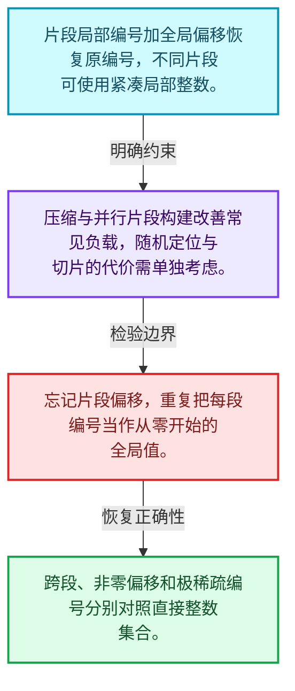
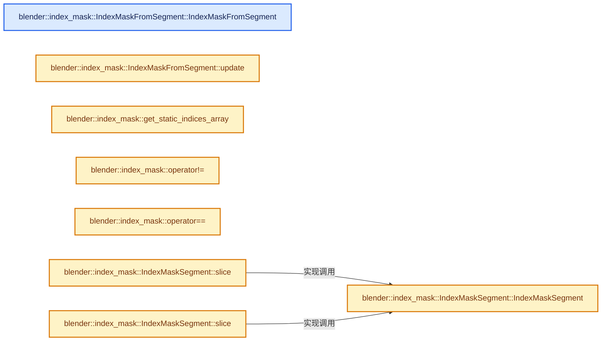
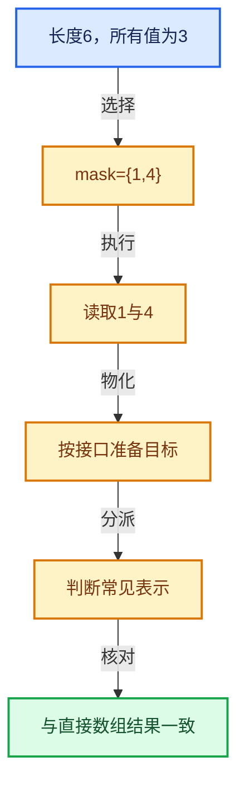

# 04-09 分段存储与遍历

[方向导航](README.md) · [总目录](../README.md) · [实现索引](../%E7%AC%A6%E5%8F%B7%E4%BE%9D%E8%B5%96%E4%B8%8E%E5%AE%9E%E7%8E%B0%E7%B4%A2%E5%BC%95.md)

## 从问题到实现

局部小索引怎样表示大范围编号？

片段局部编号与偏移组合，既压缩常见数据又保留大编号；连续区间可采用专门路径。

**数据模型**

片段局部编号加全局偏移恢复原编号，不同片段可使用紧凑局部整数。

**设计取舍**

压缩与并行片段构建改善常见负载，随机定位与切片的代价需单独考虑。

**最小反例**

忘记片段偏移，重复把每段编号当作从零开始的全局值。

**推导**

跨段、非零偏移和极稀疏编号分别对照直接整数集合。

## 阅读地图与执行推演








图中的数值推演是本方向的教学模型；实际函数之间的调用边与概念分析边分别标注，不能把概念关系当作运行时调度顺序。

## 完整源码单元与就地讲解

中文讲解直接放在相关代码旁，复杂机制在代码下展开。原文折叠区保留基准行号；不需要在行号表和函数之间来回查找。类布局可分段展示，函数实现不按固定行数切开。

<a id="f-a1da3c38b06c9afe"></a>

### `blender::index_mask::IndexMaskFromSegment::IndexMaskFromSegment`

实现位置：[source/blender/blenlib/BLI_index_mask.hh](../../../../../source/blender/blenlib/BLI_index_mask.hh) · L562—L571。

**教学注释版**

<!-- annotated:ff274853d25704 -->

```cpp
inline IndexMaskFromSegment::IndexMaskFromSegment()
{
  IndexMaskData &data = mask_.data_for_inplace_construction();
  cumulative_segment_sizes_[0] = 0;
  data.segments_num_ = 1;
  data.indices_by_segment_ = &segment_indices_;
  data.segment_offsets_ = &segment_offset_;
  data.cumulative_segment_sizes_ = cumulative_segment_sizes_.data();
  data.begin_index_in_segment_ = 0;
}
```

<details>
<summary>核对原始源码：source/blender/blenlib/BLI_index_mask.hh · L562—L571</summary>

<!-- original:ff274853d25704:source/blender/blenlib/BLI_index_mask.hh:562:571 -->

```cpp
inline IndexMaskFromSegment::IndexMaskFromSegment()
{
  IndexMaskData &data = mask_.data_for_inplace_construction();
  cumulative_segment_sizes_[0] = 0;
  data.segments_num_ = 1;
  data.indices_by_segment_ = &segment_indices_;
  data.segment_offsets_ = &segment_offset_;
  data.cumulative_segment_sizes_ = cumulative_segment_sizes_.data();
  data.begin_index_in_segment_ = 0;
}
```

</details>

**沿实际写入检查状态**

- `cumulative_segment_sizes_[0] = 0;`
- `data.segments_num_ = 1;`
- `data.indices_by_segment_ = &segment_indices_;`
- `data.segment_offsets_ = &segment_offset_;`
- `data.cumulative_segment_sizes_ = cumulative_segment_sizes_.data();`
- `data.begin_index_in_segment_ = 0;`

**继续追踪实现**

- `mask_.data_for_inplace_construction` → [blender::index_mask::IndexMask::data_for_inplace_construction · L850](09-%E5%88%86%E6%AE%B5%E5%AD%98%E5%82%A8%E4%B8%8E%E9%81%8D%E5%8E%86.md#f-3f494d48d3360201)。
- `cumulative_segment_sizes_.data` → [外部契约](https://eel.is/c++draft/)：这个边界按实际表达式及所属类型核对参数、返回值、寿命与失败行为。这里提供接口入口，不声称已解释该第三方版本的内部实现。

<!-- annotated:5d6f854e95750c -->

```cpp

```

<details>
<summary>核对原始源码：source/blender/blenlib/BLI_index_mask.hh · L572—L572</summary>

<!-- original:5d6f854e95750c:source/blender/blenlib/BLI_index_mask.hh:572:572 -->

```cpp

```

</details>

<a id="f-4b1966ed72243256"></a>

### `blender::index_mask::IndexMaskFromSegment::update`

实现位置：[source/blender/blenlib/BLI_index_mask.hh](../../../../../source/blender/blenlib/BLI_index_mask.hh) · L573—L590。

接口参数：

- `const IndexMaskSegment segment`

**教学注释版**

<!-- annotated:666d5f39939373 -->

```cpp
inline const IndexMask &IndexMaskFromSegment::update(const IndexMaskSegment segment)
{
  const Span<int16_t> indices = segment.base_span();
  // [讲解] indices.is_empty：查询视图长度或生成对应有效索引区间。
  BLI_assert(!indices.is_empty());
  // [讲解] indices.begin：返回借用范围的地址。
  BLI_assert(std::is_sorted(indices.begin(), indices.end()));
  BLI_assert(indices[0] >= 0);
  // [讲解] indices.last：按视图边界访问元素。
  BLI_assert(indices.last() < max_segment_size);
  // [讲解] indices.size：查询视图长度或生成对应有效索引区间。
  const int64_t indices_num = indices.size();

  IndexMaskData &data = mask_.data_for_inplace_construction();
  segment_offset_ = segment.offset();
  // [讲解] indices.data：返回借用范围的地址。
  segment_indices_ = indices.data();
  cumulative_segment_sizes_[1] = int16_t(indices_num);
  data.indices_num_ = indices_num;
  data.end_index_in_segment_ = indices_num;

  return mask_;
}
```

<details>
<summary>核对原始源码：source/blender/blenlib/BLI_index_mask.hh · L573—L590</summary>

<!-- original:666d5f39939373:source/blender/blenlib/BLI_index_mask.hh:573:590 -->

```cpp
inline const IndexMask &IndexMaskFromSegment::update(const IndexMaskSegment segment)
{
  const Span<int16_t> indices = segment.base_span();
  BLI_assert(!indices.is_empty());
  BLI_assert(std::is_sorted(indices.begin(), indices.end()));
  BLI_assert(indices[0] >= 0);
  BLI_assert(indices.last() < max_segment_size);
  const int64_t indices_num = indices.size();

  IndexMaskData &data = mask_.data_for_inplace_construction();
  segment_offset_ = segment.offset();
  segment_indices_ = indices.data();
  cumulative_segment_sizes_[1] = int16_t(indices_num);
  data.indices_num_ = indices_num;
  data.end_index_in_segment_ = indices_num;

  return mask_;
}
```

</details>

**沿实际写入检查状态**

- `segment_offset_ = segment.offset();`
- `segment_indices_ = indices.data();`
- `cumulative_segment_sizes_[1] = int16_t(indices_num);`
- `data.indices_num_ = indices_num;`
- `data.end_index_in_segment_ = indices_num;`

**结果出口**

- `return mask_;`

**继续追踪实现**

- `segment.base_span` → [blender::OffsetSpan::base_span · L33](../02-%E5%93%88%E5%B8%8C%E8%A1%A8%E4%B8%8E%E5%85%B3%E8%81%94%E6%95%B0%E6%8D%AE%E7%BB%93%E6%9E%84/%E4%BE%9D%E8%B5%96-BLI_offset_span-adb8e0.md#f-e962d3f4adef8faf)。
- `BLI_assert` → [BLI_assert · L48](../01-%E5%9F%BA%E7%A1%80%E5%AE%B9%E5%99%A8%E4%B8%8E%E7%8E%B0%E4%BB%A3CPP/%E4%BE%9D%E8%B5%96-BLI_assert-cc98e8.md#m-57a88495704d)；[BLI_assert · L63](../01-%E5%9F%BA%E7%A1%80%E5%AE%B9%E5%99%A8%E4%B8%8E%E7%8E%B0%E4%BB%A3CPP/%E4%BE%9D%E8%B5%96-BLI_assert-cc98e8.md#m-d07050020cb5)。宏定义由构建条件选择。
- `indices.is_empty` → [blender::Span::is_empty · L264](../01-%E5%9F%BA%E7%A1%80%E5%AE%B9%E5%99%A8%E4%B8%8E%E7%8E%B0%E4%BB%A3CPP/05-Span%E5%8F%AA%E8%AF%BB%E8%BF%9E%E7%BB%AD%E8%A7%86%E5%9B%BE.md#f-8cc1d7ba8feb50e6)。
- `std::is_sorted` → [外部契约](https://eel.is/c++draft/)：这个边界按实际表达式及所属类型核对参数、返回值、寿命与失败行为。这里提供接口入口，不声称已解释该第三方版本的内部实现。
- `indices.begin` → [blender::Span::begin · L224](../01-%E5%9F%BA%E7%A1%80%E5%AE%B9%E5%99%A8%E4%B8%8E%E7%8E%B0%E4%BB%A3CPP/05-Span%E5%8F%AA%E8%AF%BB%E8%BF%9E%E7%BB%AD%E8%A7%86%E5%9B%BE.md#f-415883b512284f46)。
- `indices.end` → [blender::Span::end · L228](../01-%E5%9F%BA%E7%A1%80%E5%AE%B9%E5%99%A8%E4%B8%8E%E7%8E%B0%E4%BB%A3CPP/05-Span%E5%8F%AA%E8%AF%BB%E8%BF%9E%E7%BB%AD%E8%A7%86%E5%9B%BE.md#f-a7d8b9e494c291a7)。
- `indices.last` → [blender::Span::last · L329](../01-%E5%9F%BA%E7%A1%80%E5%AE%B9%E5%99%A8%E4%B8%8E%E7%8E%B0%E4%BB%A3CPP/05-Span%E5%8F%AA%E8%AF%BB%E8%BF%9E%E7%BB%AD%E8%A7%86%E5%9B%BE.md#f-a92146c285596891)。
- `indices.size` → [blender::Span::size · L256](../01-%E5%9F%BA%E7%A1%80%E5%AE%B9%E5%99%A8%E4%B8%8E%E7%8E%B0%E4%BB%A3CPP/05-Span%E5%8F%AA%E8%AF%BB%E8%BF%9E%E7%BB%AD%E8%A7%86%E5%9B%BE.md#f-5f80fa006089c998)。
- `mask_.data_for_inplace_construction` → [blender::index_mask::IndexMask::data_for_inplace_construction · L850](09-%E5%88%86%E6%AE%B5%E5%AD%98%E5%82%A8%E4%B8%8E%E9%81%8D%E5%8E%86.md#f-3f494d48d3360201)。
- `segment.offset` → [调用协议](../%E6%A8%A1%E6%9D%BF%E5%AE%8F%E4%B8%8E%E5%8A%A8%E6%80%81%E5%88%86%E6%B4%BE%E5%8D%8F%E8%AE%AE.md)：由接收对象具体类型或运行时策略提供实现。调用位置L583。
- `indices.data` → [blender::Span::data · L219](../01-%E5%9F%BA%E7%A1%80%E5%AE%B9%E5%99%A8%E4%B8%8E%E7%8E%B0%E4%BB%A3CPP/05-Span%E5%8F%AA%E8%AF%BB%E8%BF%9E%E7%BB%AD%E8%A7%86%E5%9B%BE.md#f-10c5889198935800)。

### 类型布局、声明与编译条件 · BLI_index_mask.hh L591—L599

<!-- annotated:5de6bb31ad5183 -->

```cpp

std::array<int16_t, max_segment_size> build_static_indices_array();
const IndexMask &get_static_index_mask_for_min_size(const int64_t min_size);
std::ostream &operator<<(std::ostream &stream, const IndexMask &mask);

/* -------------------------------------------------------------------- */
/** \name Utilities
 * \{ */

```

<details>
<summary>核对原始源码：source/blender/blenlib/BLI_index_mask.hh · L591—L599</summary>

<!-- original:5de6bb31ad5183:source/blender/blenlib/BLI_index_mask.hh:591:599 -->

```cpp

std::array<int16_t, max_segment_size> build_static_indices_array();
const IndexMask &get_static_index_mask_for_min_size(const int64_t min_size);
std::ostream &operator<<(std::ostream &stream, const IndexMask &mask);

/* -------------------------------------------------------------------- */
/** \name Utilities
 * \{ */

```

</details>

<a id="f-31f6d95c232aa378"></a>

### `blender::index_mask::get_static_indices_array`

实现位置：[source/blender/blenlib/BLI_index_mask.hh](../../../../../source/blender/blenlib/BLI_index_mask.hh) · L600—L605。

**教学注释版**

<!-- annotated:7af6834d37aaa2 -->

```cpp
inline const std::array<int16_t, max_segment_size> &get_static_indices_array()
{
  alignas(64) static const std::array<int16_t, max_segment_size> data =
      build_static_indices_array();
  return data;
}
```

<details>
<summary>核对原始源码：source/blender/blenlib/BLI_index_mask.hh · L600—L605</summary>

<!-- original:7af6834d37aaa2:source/blender/blenlib/BLI_index_mask.hh:600:605 -->

```cpp
inline const std::array<int16_t, max_segment_size> &get_static_indices_array()
{
  alignas(64) static const std::array<int16_t, max_segment_size> data =
      build_static_indices_array();
  return data;
}
```

</details>

**结果出口**

- `return data;`

**继续追踪实现**

- `build_static_indices_array` → [blender::index_mask::build_static_indices_array · L49](10-IndexMask%E6%9E%84%E5%BB%BA%E4%B8%8E%E5%B9%B6%E8%A1%8C.md#f-9958a48c7f6cd73a)。

### 类型布局、声明与编译条件 · BLI_index_mask.hh L606—L648

<!-- annotated:a5bc18661be30f -->

```cpp

/** Fill selected indices of the dst span with the given value. */
template<typename T>
inline void masked_fill(MutableSpan<T> data, const T &value, const IndexMask &mask);

/** Copy every indexed value from src to the same index in dst. */
template<typename T>
inline void copy_assign(const Span<T> src, const IndexMask &mask, const MutableSpan<T> dst);

/** Fill the dst span such that for every index i, dst[i] = src[mask[i]]. */
template<typename T>
inline void gather_assign(const Span<T> src, const IndexMask &mask, const MutableSpan<T> dst);

/**
 * Fill masked indices of \a r_mask with the index of that item in the mask such that
 * `r_map[mask[i]] == i` for the whole mask. The size of `r_map` needs to be at least
 * `mask.min_array_size()`.
 */
template<typename T> void build_reverse_map(const IndexMask &mask, MutableSpan<T> r_map);

/**
 * Joins segments together based on heuristics. Generally, one wants as few segments as possible,
 * but one also wants full-range-segments if possible and we don't want to copy too many indices
 * around to reduce the number of segments.
 *
 * \return Number of consolidated segments. Those are ordered to the beginning of the span.
 */
int64_t consolidate_index_mask_segments(MutableSpan<IndexMaskSegment> segments,
                                        LinearAllocator<> &memory);

/**
 * Adds index mask segments to the vector for the given range. Ranges shorter than
 * #max_segment_size fit into a single segment. Larger ranges are split into multiple segments.
 */
template<int64_t N>
void index_range_to_mask_segments(const IndexRange range, Vector<IndexMaskSegment, N> &r_segments);

/** \} */

/* -------------------------------------------------------------------- */
/** \name #RawMaskIterator Inline Methods
 * \{ */

```

<details>
<summary>核对原始源码：source/blender/blenlib/BLI_index_mask.hh · L606—L648</summary>

<!-- original:a5bc18661be30f:source/blender/blenlib/BLI_index_mask.hh:606:648 -->

```cpp

/** Fill selected indices of the dst span with the given value. */
template<typename T>
inline void masked_fill(MutableSpan<T> data, const T &value, const IndexMask &mask);

/** Copy every indexed value from src to the same index in dst. */
template<typename T>
inline void copy_assign(const Span<T> src, const IndexMask &mask, const MutableSpan<T> dst);

/** Fill the dst span such that for every index i, dst[i] = src[mask[i]]. */
template<typename T>
inline void gather_assign(const Span<T> src, const IndexMask &mask, const MutableSpan<T> dst);

/**
 * Fill masked indices of \a r_mask with the index of that item in the mask such that
 * `r_map[mask[i]] == i` for the whole mask. The size of `r_map` needs to be at least
 * `mask.min_array_size()`.
 */
template<typename T> void build_reverse_map(const IndexMask &mask, MutableSpan<T> r_map);

/**
 * Joins segments together based on heuristics. Generally, one wants as few segments as possible,
 * but one also wants full-range-segments if possible and we don't want to copy too many indices
 * around to reduce the number of segments.
 *
 * \return Number of consolidated segments. Those are ordered to the beginning of the span.
 */
int64_t consolidate_index_mask_segments(MutableSpan<IndexMaskSegment> segments,
                                        LinearAllocator<> &memory);

/**
 * Adds index mask segments to the vector for the given range. Ranges shorter than
 * #max_segment_size fit into a single segment. Larger ranges are split into multiple segments.
 */
template<int64_t N>
void index_range_to_mask_segments(const IndexRange range, Vector<IndexMaskSegment, N> &r_segments);

/** \} */

/* -------------------------------------------------------------------- */
/** \name #RawMaskIterator Inline Methods
 * \{ */

```

</details>

<a id="f-69a350076a050ce6"></a>

### `blender::index_mask::operator!=`

实现位置：[source/blender/blenlib/BLI_index_mask.hh](../../../../../source/blender/blenlib/BLI_index_mask.hh) · L649—L652。

接口参数：

- `const RawMaskIterator &a`
- `const RawMaskIterator &b`

**教学注释版**

<!-- annotated:6ae6e524c131be -->

```cpp
inline bool operator!=(const RawMaskIterator &a, const RawMaskIterator &b)
{
  return a.segment_i != b.segment_i || a.index_in_segment != b.index_in_segment;
}
```

<details>
<summary>核对原始源码：source/blender/blenlib/BLI_index_mask.hh · L649—L652</summary>

<!-- original:6ae6e524c131be:source/blender/blenlib/BLI_index_mask.hh:649:652 -->

```cpp
inline bool operator!=(const RawMaskIterator &a, const RawMaskIterator &b)
{
  return a.segment_i != b.segment_i || a.index_in_segment != b.index_in_segment;
}
```

</details>

**结果出口**

- `return a.segment_i != b.segment_i || a.index_in_segment != b.index_in_segment;`

**继续追踪实现**

本实现没有需要继续展开的显式调用；检查返回表达式、对象转换和调用者前置条件。

<!-- annotated:13592801c8aebb -->

```cpp

```

<details>
<summary>核对原始源码：source/blender/blenlib/BLI_index_mask.hh · L653—L653</summary>

<!-- original:13592801c8aebb:source/blender/blenlib/BLI_index_mask.hh:653:653 -->

```cpp

```

</details>

<a id="f-0419e64e618b2667"></a>

### `blender::index_mask::operator==`

实现位置：[source/blender/blenlib/BLI_index_mask.hh](../../../../../source/blender/blenlib/BLI_index_mask.hh) · L654—L657。

接口参数：

- `const RawMaskIterator &a`
- `const RawMaskIterator &b`

**教学注释版**

<!-- annotated:7251a98b7af74b -->

```cpp
inline bool operator==(const RawMaskIterator &a, const RawMaskIterator &b)
{
  return !(a != b);
}
```

<details>
<summary>核对原始源码：source/blender/blenlib/BLI_index_mask.hh · L654—L657</summary>

<!-- original:7251a98b7af74b:source/blender/blenlib/BLI_index_mask.hh:654:657 -->

```cpp
inline bool operator==(const RawMaskIterator &a, const RawMaskIterator &b)
{
  return !(a != b);
}
```

</details>

**结果出口**

- `return !(a != b);`

**继续追踪实现**

本实现没有需要继续展开的显式调用；检查返回表达式、对象转换和调用者前置条件。

### 类型布局、声明与编译条件 · BLI_index_mask.hh L658—L664

<!-- annotated:9b07d3fa796b6f -->

```cpp

/** \} */

/* -------------------------------------------------------------------- */
/** \name #IndexMaskSegment Inline Methods
 * \{ */

```

<details>
<summary>核对原始源码：source/blender/blenlib/BLI_index_mask.hh · L658—L664</summary>

<!-- original:9b07d3fa796b6f:source/blender/blenlib/BLI_index_mask.hh:658:664 -->

```cpp

/** \} */

/* -------------------------------------------------------------------- */
/** \name #IndexMaskSegment Inline Methods
 * \{ */

```

</details>

<a id="f-e03e31149bb40def"></a>

### `blender::index_mask::IndexMaskSegment::IndexMaskSegment`

实现位置：[source/blender/blenlib/BLI_index_mask.hh](../../../../../source/blender/blenlib/BLI_index_mask.hh) · L665—L668。

接口参数：

- `const OffsetSpan<int64_t, int16_t> span`

**教学注释版**

<!-- annotated:82a31746b29e76 -->

```cpp
inline IndexMaskSegment::IndexMaskSegment(const OffsetSpan<int64_t, int16_t> span)
    : OffsetSpan<int64_t, int16_t>(span)
{
}
```

<details>
<summary>核对原始源码：source/blender/blenlib/BLI_index_mask.hh · L665—L668</summary>

<!-- original:82a31746b29e76:source/blender/blenlib/BLI_index_mask.hh:665:668 -->

```cpp
inline IndexMaskSegment::IndexMaskSegment(const OffsetSpan<int64_t, int16_t> span)
    : OffsetSpan<int64_t, int16_t>(span)
{
}
```

</details>

**继续追踪实现**

本实现没有需要继续展开的显式调用；检查返回表达式、对象转换和调用者前置条件。

<!-- annotated:3d0afe25d0a579 -->

```cpp

```

<details>
<summary>核对原始源码：source/blender/blenlib/BLI_index_mask.hh · L669—L669</summary>

<!-- original:3d0afe25d0a579:source/blender/blenlib/BLI_index_mask.hh:669:669 -->

```cpp

```

</details>

<a id="f-139f8e8f6e3b0f6e"></a>

### `blender::index_mask::IndexMaskSegment::slice`

实现位置：[source/blender/blenlib/BLI_index_mask.hh](../../../../../source/blender/blenlib/BLI_index_mask.hh) · L670—L673。

接口参数：

- `const IndexRange &range`

**教学注释版**

<!-- annotated:f1d791e2c2b21e -->

```cpp
inline IndexMaskSegment IndexMaskSegment::slice(const IndexRange &range) const
{
  return IndexMaskSegment(static_cast<const OffsetSpan<int64_t, int16_t> *>(this)->slice(range));
}
```

<details>
<summary>核对原始源码：source/blender/blenlib/BLI_index_mask.hh · L670—L673</summary>

<!-- original:f1d791e2c2b21e:source/blender/blenlib/BLI_index_mask.hh:670:673 -->

```cpp
inline IndexMaskSegment IndexMaskSegment::slice(const IndexRange &range) const
{
  return IndexMaskSegment(static_cast<const OffsetSpan<int64_t, int16_t> *>(this)->slice(range));
}
```

</details>

**结果出口**

- `return IndexMaskSegment(static_cast<const OffsetSpan<int64_t, int16_t> *>(this)->slice(range));`

**继续追踪实现**

- `IndexMaskSegment` → [blender::index_mask::IndexMaskSegment::IndexMaskSegment · L665](09-%E5%88%86%E6%AE%B5%E5%AD%98%E5%82%A8%E4%B8%8E%E9%81%8D%E5%8E%86.md#f-e03e31149bb40def)。
- `static_cast<const OffsetSpan<int64_t, int16_t> *>(this)->slice` → [调用协议](../%E6%A8%A1%E6%9D%BF%E5%AE%8F%E4%B8%8E%E5%8A%A8%E6%80%81%E5%88%86%E6%B4%BE%E5%8D%8F%E8%AE%AE.md)：接收对象类型依赖auto、返回值或模板实例；不按同名猜测目标。调用位置L672。

<!-- annotated:5a52d05097752a -->

```cpp

```

<details>
<summary>核对原始源码：source/blender/blenlib/BLI_index_mask.hh · L674—L674</summary>

<!-- original:5a52d05097752a:source/blender/blenlib/BLI_index_mask.hh:674:674 -->

```cpp

```

</details>

<a id="f-3ab4d324abc22bb8"></a>

### `blender::index_mask::IndexMaskSegment::slice`

实现位置：[source/blender/blenlib/BLI_index_mask.hh](../../../../../source/blender/blenlib/BLI_index_mask.hh) · L675—L679。

接口参数：

- `const int64_t start`
- `const int64_t size`

**教学注释版**

<!-- annotated:0159dbd8798f5c -->

```cpp
inline IndexMaskSegment IndexMaskSegment::slice(const int64_t start, const int64_t size) const
{
  return IndexMaskSegment(
      static_cast<const OffsetSpan<int64_t, int16_t> *>(this)->slice(start, size));
}
```

<details>
<summary>核对原始源码：source/blender/blenlib/BLI_index_mask.hh · L675—L679</summary>

<!-- original:0159dbd8798f5c:source/blender/blenlib/BLI_index_mask.hh:675:679 -->

```cpp
inline IndexMaskSegment IndexMaskSegment::slice(const int64_t start, const int64_t size) const
{
  return IndexMaskSegment(
      static_cast<const OffsetSpan<int64_t, int16_t> *>(this)->slice(start, size));
}
```

</details>

**结果出口**

- `return IndexMaskSegment(`

**继续追踪实现**

- `IndexMaskSegment` → [blender::index_mask::IndexMaskSegment::IndexMaskSegment · L665](09-%E5%88%86%E6%AE%B5%E5%AD%98%E5%82%A8%E4%B8%8E%E9%81%8D%E5%8E%86.md#f-e03e31149bb40def)。
- `static_cast<const OffsetSpan<int64_t, int16_t> *>(this)->slice` → [调用协议](../%E6%A8%A1%E6%9D%BF%E5%AE%8F%E4%B8%8E%E5%8A%A8%E6%80%81%E5%88%86%E6%B4%BE%E5%8D%8F%E8%AE%AE.md)：接收对象类型依赖auto、返回值或模板实例；不按同名猜测目标。调用位置L678。

<!-- annotated:f0419bd9530f04 -->

```cpp

```

<details>
<summary>核对原始源码：source/blender/blenlib/BLI_index_mask.hh · L680—L680</summary>

<!-- original:f0419bd9530f04:source/blender/blenlib/BLI_index_mask.hh:680:680 -->

```cpp

```

</details>

<a id="f-fb06a0877f380c7d"></a>

### `blender::index_mask::IndexMaskSegment::shift`

实现位置：[source/blender/blenlib/BLI_index_mask.hh](../../../../../source/blender/blenlib/BLI_index_mask.hh) · L681—L685。

接口参数：

- `const int64_t shift`

**教学注释版**

<!-- annotated:eeedb6ca3a3482 -->

```cpp
inline IndexMaskSegment IndexMaskSegment::shift(const int64_t shift) const
{
  BLI_assert(this->is_empty() || (*this)[0] + shift >= 0);
  return IndexMaskSegment(this->offset() + shift, this->base_span());
}
```

<details>
<summary>核对原始源码：source/blender/blenlib/BLI_index_mask.hh · L681—L685</summary>

<!-- original:eeedb6ca3a3482:source/blender/blenlib/BLI_index_mask.hh:681:685 -->

```cpp
inline IndexMaskSegment IndexMaskSegment::shift(const int64_t shift) const
{
  BLI_assert(this->is_empty() || (*this)[0] + shift >= 0);
  return IndexMaskSegment(this->offset() + shift, this->base_span());
}
```

</details>

**结果出口**

- `return IndexMaskSegment(this->offset() + shift, this->base_span());`

**继续追踪实现**

- `BLI_assert` → [BLI_assert · L48](../01-%E5%9F%BA%E7%A1%80%E5%AE%B9%E5%99%A8%E4%B8%8E%E7%8E%B0%E4%BB%A3CPP/%E4%BE%9D%E8%B5%96-BLI_assert-cc98e8.md#m-57a88495704d)；[BLI_assert · L63](../01-%E5%9F%BA%E7%A1%80%E5%AE%B9%E5%99%A8%E4%B8%8E%E7%8E%B0%E4%BB%A3CPP/%E4%BE%9D%E8%B5%96-BLI_assert-cc98e8.md#m-d07050020cb5)。宏定义由构建条件选择。
- `this->is_empty` → [blender::index_mask::IndexMask::is_empty · L748](09-%E5%88%86%E6%AE%B5%E5%AD%98%E5%82%A8%E4%B8%8E%E9%81%8D%E5%8E%86.md#f-190ac996386064f4)。
- `IndexMaskSegment` → [blender::index_mask::IndexMaskSegment::IndexMaskSegment · L665](09-%E5%88%86%E6%AE%B5%E5%AD%98%E5%82%A8%E4%B8%8E%E9%81%8D%E5%8E%86.md#f-e03e31149bb40def)。
- `this->offset` → [调用协议](../%E6%A8%A1%E6%9D%BF%E5%AE%8F%E4%B8%8E%E5%8A%A8%E6%80%81%E5%88%86%E6%B4%BE%E5%8D%8F%E8%AE%AE.md)：由接收对象具体类型或运行时策略提供实现。调用位置L684。
- `this->base_span` → [blender::OffsetSpan::base_span · L33](../02-%E5%93%88%E5%B8%8C%E8%A1%A8%E4%B8%8E%E5%85%B3%E8%81%94%E6%95%B0%E6%8D%AE%E7%BB%93%E6%9E%84/%E4%BE%9D%E8%B5%96-BLI_offset_span-adb8e0.md#f-e962d3f4adef8faf)。

### 类型布局、声明与编译条件 · BLI_index_mask.hh L686—L692

<!-- annotated:59c06321d044f9 -->

```cpp

/** \} */

/* -------------------------------------------------------------------- */
/** \name #IndexMask Inline Methods
 * \{ */

```

<details>
<summary>核对原始源码：source/blender/blenlib/BLI_index_mask.hh · L686—L692</summary>

<!-- original:59c06321d044f9:source/blender/blenlib/BLI_index_mask.hh:686:692 -->

```cpp

/** \} */

/* -------------------------------------------------------------------- */
/** \name #IndexMask Inline Methods
 * \{ */

```

</details>

<a id="f-3ccc94e8ca8efb8b"></a>

### `blender::index_mask::init_empty_mask`

实现位置：[source/blender/blenlib/BLI_index_mask.hh](../../../../../source/blender/blenlib/BLI_index_mask.hh) · L693—L702。

接口参数：

- `IndexMaskData &data`

**教学注释版**

<!-- annotated:7005c7ff7ffc93 -->

```cpp
inline void init_empty_mask(IndexMaskData &data)
{
  static constexpr int64_t cumulative_sizes_for_empty_mask[1] = {0};

  data.indices_num_ = 0;
  data.segments_num_ = 0;
  data.cumulative_segment_sizes_ = cumulative_sizes_for_empty_mask;
  /* Intentionally leave some pointers uninitialized which must not be accessed on empty masks
   * anyway. */
}
```

<details>
<summary>核对原始源码：source/blender/blenlib/BLI_index_mask.hh · L693—L702</summary>

<!-- original:7005c7ff7ffc93:source/blender/blenlib/BLI_index_mask.hh:693:702 -->

```cpp
inline void init_empty_mask(IndexMaskData &data)
{
  static constexpr int64_t cumulative_sizes_for_empty_mask[1] = {0};

  data.indices_num_ = 0;
  data.segments_num_ = 0;
  data.cumulative_segment_sizes_ = cumulative_sizes_for_empty_mask;
  /* Intentionally leave some pointers uninitialized which must not be accessed on empty masks
   * anyway. */
}
```

</details>

**沿实际写入检查状态**

- `data.indices_num_ = 0;`
- `data.segments_num_ = 0;`
- `data.cumulative_segment_sizes_ = cumulative_sizes_for_empty_mask;`

**继续追踪实现**

本实现没有需要继续展开的显式调用；检查返回表达式、对象转换和调用者前置条件。

<!-- annotated:58ebe7dc120f01 -->

```cpp

```

<details>
<summary>核对原始源码：source/blender/blenlib/BLI_index_mask.hh · L703—L703</summary>

<!-- original:58ebe7dc120f01:source/blender/blenlib/BLI_index_mask.hh:703:703 -->

```cpp

```

</details>

<a id="f-8c95440e4c5fec78"></a>

### `blender::index_mask::IndexMask::IndexMask`

实现位置：[source/blender/blenlib/BLI_index_mask.hh](../../../../../source/blender/blenlib/BLI_index_mask.hh) · L704—L707。

**教学注释版**

<!-- annotated:914a5b71bcca9b -->

```cpp
inline IndexMask::IndexMask()
{
  init_empty_mask(*this);
}
```

<details>
<summary>核对原始源码：source/blender/blenlib/BLI_index_mask.hh · L704—L707</summary>

<!-- original:914a5b71bcca9b:source/blender/blenlib/BLI_index_mask.hh:704:707 -->

```cpp
inline IndexMask::IndexMask()
{
  init_empty_mask(*this);
}
```

</details>

**继续追踪实现**

- `init_empty_mask` → [blender::index_mask::init_empty_mask · L693](09-%E5%88%86%E6%AE%B5%E5%AD%98%E5%82%A8%E4%B8%8E%E9%81%8D%E5%8E%86.md#f-3ccc94e8ca8efb8b)。

<!-- annotated:2e22a4edbf3908 -->

```cpp

```

<details>
<summary>核对原始源码：source/blender/blenlib/BLI_index_mask.hh · L708—L708</summary>

<!-- original:2e22a4edbf3908:source/blender/blenlib/BLI_index_mask.hh:708:708 -->

```cpp

```

</details>

<a id="f-fdd9dc18868bc0cd"></a>

### `blender::index_mask::IndexMask::IndexMask`

实现位置：[source/blender/blenlib/BLI_index_mask.hh](../../../../../source/blender/blenlib/BLI_index_mask.hh) · L709—L720。

接口参数：

- `const int64_t size`

**教学注释版**

<!-- annotated:4663c72a5c05f7 -->

```cpp
inline IndexMask::IndexMask(const int64_t size)
{
  if (size == 0) {
    init_empty_mask(*this);
    return;
  }
  *this = get_static_index_mask_for_min_size(size);
  indices_num_ = size;
  segments_num_ = ((size + max_segment_size - 1) >> max_segment_size_shift);
  begin_index_in_segment_ = 0;
  end_index_in_segment_ = size - ((size - 1) & max_segment_size_mask_high);
}
```

<details>
<summary>核对原始源码：source/blender/blenlib/BLI_index_mask.hh · L709—L720</summary>

<!-- original:4663c72a5c05f7:source/blender/blenlib/BLI_index_mask.hh:709:720 -->

```cpp
inline IndexMask::IndexMask(const int64_t size)
{
  if (size == 0) {
    init_empty_mask(*this);
    return;
  }
  *this = get_static_index_mask_for_min_size(size);
  indices_num_ = size;
  segments_num_ = ((size + max_segment_size - 1) >> max_segment_size_shift);
  begin_index_in_segment_ = 0;
  end_index_in_segment_ = size - ((size - 1) & max_segment_size_mask_high);
}
```

</details>

**沿实际写入检查状态**

- `indices_num_ = size;`
- `segments_num_ = ((size + max_segment_size - 1) >> max_segment_size_shift);`
- `begin_index_in_segment_ = 0;`
- `end_index_in_segment_ = size - ((size - 1) & max_segment_size_mask_high);`

**继续追踪实现**

- `init_empty_mask` → [blender::index_mask::init_empty_mask · L693](09-%E5%88%86%E6%AE%B5%E5%AD%98%E5%82%A8%E4%B8%8E%E9%81%8D%E5%8E%86.md#f-3ccc94e8ca8efb8b)。
- `get_static_index_mask_for_min_size` → [blender::index_mask::get_static_index_mask_for_min_size · L58](10-IndexMask%E6%9E%84%E5%BB%BA%E4%B8%8E%E5%B9%B6%E8%A1%8C.md#f-0f12c23149144daa)。

<!-- annotated:fba1ec9725203d -->

```cpp

```

<details>
<summary>核对原始源码：source/blender/blenlib/BLI_index_mask.hh · L721—L721</summary>

<!-- original:fba1ec9725203d:source/blender/blenlib/BLI_index_mask.hh:721:721 -->

```cpp

```

</details>

<a id="f-4b32f3ba3de66d05"></a>

### `blender::index_mask::IndexMask::IndexMask`

实现位置：[source/blender/blenlib/BLI_index_mask.hh](../../../../../source/blender/blenlib/BLI_index_mask.hh) · L722—L741。

接口参数：

- `const IndexRange range`

**教学注释版**

<!-- annotated:84897172f78022 -->

```cpp
inline IndexMask::IndexMask(const IndexRange range)
{
  // [讲解] range.is_empty：读取连续区间或分组的边界信息。
  if (range.is_empty()) {
    init_empty_mask(*this);
    return;
  }
  // [讲解] range.one_after_last：读取连续区间或分组的边界信息。
  const int64_t one_after_last = range.one_after_last();
  *this = get_static_index_mask_for_min_size(one_after_last);

  // [讲解] range.first：读取范围两端的有效索引或值。
  const int64_t first_segment_i = range.first() >> max_segment_size_shift;
  // [讲解] range.last：读取范围两端的有效索引或值。
  const int64_t last_segment_i = range.last() >> max_segment_size_shift;

  // [讲解] range.size：读取连续区间或分组的边界信息。
  indices_num_ = range.size();
  segments_num_ = last_segment_i - first_segment_i + 1;
  indices_by_segment_ += first_segment_i;
  segment_offsets_ += first_segment_i;
  cumulative_segment_sizes_ += first_segment_i;
  begin_index_in_segment_ = range.first() & max_segment_size_mask_low;
  end_index_in_segment_ = one_after_last - ((one_after_last - 1) & max_segment_size_mask_high);
}
```

<details>
<summary>核对原始源码：source/blender/blenlib/BLI_index_mask.hh · L722—L741</summary>

<!-- original:84897172f78022:source/blender/blenlib/BLI_index_mask.hh:722:741 -->

```cpp
inline IndexMask::IndexMask(const IndexRange range)
{
  if (range.is_empty()) {
    init_empty_mask(*this);
    return;
  }
  const int64_t one_after_last = range.one_after_last();
  *this = get_static_index_mask_for_min_size(one_after_last);

  const int64_t first_segment_i = range.first() >> max_segment_size_shift;
  const int64_t last_segment_i = range.last() >> max_segment_size_shift;

  indices_num_ = range.size();
  segments_num_ = last_segment_i - first_segment_i + 1;
  indices_by_segment_ += first_segment_i;
  segment_offsets_ += first_segment_i;
  cumulative_segment_sizes_ += first_segment_i;
  begin_index_in_segment_ = range.first() & max_segment_size_mask_low;
  end_index_in_segment_ = one_after_last - ((one_after_last - 1) & max_segment_size_mask_high);
}
```

</details>

**沿实际写入检查状态**

- `indices_num_ = range.size();`
- `segments_num_ = last_segment_i - first_segment_i + 1;`
- `indices_by_segment_ += first_segment_i;`
- `segment_offsets_ += first_segment_i;`
- `cumulative_segment_sizes_ += first_segment_i;`
- `begin_index_in_segment_ = range.first() & max_segment_size_mask_low;`
- `end_index_in_segment_ = one_after_last - ((one_after_last - 1) & max_segment_size_mask_high);`

**继续追踪实现**

- `range.is_empty` → [blender::IndexRange::is_empty · L169](../01-%E5%9F%BA%E7%A1%80%E5%AE%B9%E5%99%A8%E4%B8%8E%E7%8E%B0%E4%BB%A3CPP/04-IndexRange%E8%BF%9E%E7%BB%AD%E6%95%B4%E6%95%B0%E5%8C%BA%E9%97%B4.md#f-9501e070be01ff71)。
- `init_empty_mask` → [blender::index_mask::init_empty_mask · L693](09-%E5%88%86%E6%AE%B5%E5%AD%98%E5%82%A8%E4%B8%8E%E9%81%8D%E5%8E%86.md#f-3ccc94e8ca8efb8b)。
- `range.one_after_last` → [blender::IndexRange::one_after_last · L235](../01-%E5%9F%BA%E7%A1%80%E5%AE%B9%E5%99%A8%E4%B8%8E%E7%8E%B0%E4%BB%A3CPP/04-IndexRange%E8%BF%9E%E7%BB%AD%E6%95%B4%E6%95%B0%E5%8C%BA%E9%97%B4.md#f-ed04bec9c731fc86)。
- `get_static_index_mask_for_min_size` → [blender::index_mask::get_static_index_mask_for_min_size · L58](10-IndexMask%E6%9E%84%E5%BB%BA%E4%B8%8E%E5%B9%B6%E8%A1%8C.md#f-0f12c23149144daa)。
- `range.first` → [blender::IndexRange::first · L204](../01-%E5%9F%BA%E7%A1%80%E5%AE%B9%E5%99%A8%E4%B8%8E%E7%8E%B0%E4%BB%A3CPP/04-IndexRange%E8%BF%9E%E7%BB%AD%E6%95%B4%E6%95%B0%E5%8C%BA%E9%97%B4.md#f-ab443c94e531befa)。
- `range.last` → [blender::IndexRange::last · L214](../01-%E5%9F%BA%E7%A1%80%E5%AE%B9%E5%99%A8%E4%B8%8E%E7%8E%B0%E4%BB%A3CPP/04-IndexRange%E8%BF%9E%E7%BB%AD%E6%95%B4%E6%95%B0%E5%8C%BA%E9%97%B4.md#f-66896c6351a40de1)。
- `range.size` → [blender::IndexRange::size · L156](../01-%E5%9F%BA%E7%A1%80%E5%AE%B9%E5%99%A8%E4%B8%8E%E7%8E%B0%E4%BB%A3CPP/04-IndexRange%E8%BF%9E%E7%BB%AD%E6%95%B4%E6%95%B0%E5%8C%BA%E9%97%B4.md#f-05f66c3ebb2fdfec)。

<!-- annotated:a546fbc1c22e0c -->

```cpp

```

<details>
<summary>核对原始源码：source/blender/blenlib/BLI_index_mask.hh · L742—L742</summary>

<!-- original:a546fbc1c22e0c:source/blender/blenlib/BLI_index_mask.hh:742:742 -->

```cpp

```

</details>

<a id="f-0163b32abc9a0d9c"></a>

### `blender::index_mask::IndexMask::size`

实现位置：[source/blender/blenlib/BLI_index_mask.hh](../../../../../source/blender/blenlib/BLI_index_mask.hh) · L743—L746。

**教学注释版**

<!-- annotated:42e18ea6bcdf69 -->

```cpp
inline int64_t IndexMask::size() const
{
  return indices_num_;
}
```

<details>
<summary>核对原始源码：source/blender/blenlib/BLI_index_mask.hh · L743—L746</summary>

<!-- original:42e18ea6bcdf69:source/blender/blenlib/BLI_index_mask.hh:743:746 -->

```cpp
inline int64_t IndexMask::size() const
{
  return indices_num_;
}
```

</details>

**结果出口**

- `return indices_num_;`

**继续追踪实现**

本实现没有需要继续展开的显式调用；检查返回表达式、对象转换和调用者前置条件。

<!-- annotated:3ffef2dfa2c93e -->

```cpp

```

<details>
<summary>核对原始源码：source/blender/blenlib/BLI_index_mask.hh · L747—L747</summary>

<!-- original:3ffef2dfa2c93e:source/blender/blenlib/BLI_index_mask.hh:747:747 -->

```cpp

```

</details>

<a id="f-190ac996386064f4"></a>

### `blender::index_mask::IndexMask::is_empty`

实现位置：[source/blender/blenlib/BLI_index_mask.hh](../../../../../source/blender/blenlib/BLI_index_mask.hh) · L748—L751。

**教学注释版**

<!-- annotated:9751ac4ebf83db -->

```cpp
inline bool IndexMask::is_empty() const
{
  return indices_num_ == 0;
}
```

<details>
<summary>核对原始源码：source/blender/blenlib/BLI_index_mask.hh · L748—L751</summary>

<!-- original:9751ac4ebf83db:source/blender/blenlib/BLI_index_mask.hh:748:751 -->

```cpp
inline bool IndexMask::is_empty() const
{
  return indices_num_ == 0;
}
```

</details>

**结果出口**

- `return indices_num_ == 0;`

**继续追踪实现**

本实现没有需要继续展开的显式调用；检查返回表达式、对象转换和调用者前置条件。

<!-- annotated:a4f93e2dc8b8ac -->

```cpp

```

<details>
<summary>核对原始源码：source/blender/blenlib/BLI_index_mask.hh · L752—L752</summary>

<!-- original:a4f93e2dc8b8ac:source/blender/blenlib/BLI_index_mask.hh:752:752 -->

```cpp

```

</details>

<a id="f-749c399cf5bc4035"></a>

### `blender::index_mask::IndexMask::index_range`

实现位置：[source/blender/blenlib/BLI_index_mask.hh](../../../../../source/blender/blenlib/BLI_index_mask.hh) · L753—L756。

**教学注释版**

<!-- annotated:26bf1848383d78 -->

```cpp
inline IndexRange IndexMask::index_range() const
{
  return IndexRange(indices_num_);
}
```

<details>
<summary>核对原始源码：source/blender/blenlib/BLI_index_mask.hh · L753—L756</summary>

<!-- original:26bf1848383d78:source/blender/blenlib/BLI_index_mask.hh:753:756 -->

```cpp
inline IndexRange IndexMask::index_range() const
{
  return IndexRange(indices_num_);
}
```

</details>

**结果出口**

- `return IndexRange(indices_num_);`

**继续追踪实现**

- `IndexRange` → [blender::IndexRange](../01-%E5%9F%BA%E7%A1%80%E5%AE%B9%E5%99%A8%E4%B8%8E%E7%8E%B0%E4%BB%A3CPP/%E4%BE%9D%E8%B5%96-BLI_index_range-7d7cc5.md#t-caa3466d6776)；[blender::gpu::shader::parser::IndexRange](../05-%E5%87%A0%E4%BD%95%E5%AD%98%E5%82%A8%E4%B8%8E%E6%8B%93%E6%89%91%E6%98%A0%E5%B0%84/%E4%BE%9D%E8%B5%96-utils-06433d.md#t-82d2bd4ea71c)；[blender::IndexRange](../05-%E5%87%A0%E4%BD%95%E5%AD%98%E5%82%A8%E4%B8%8E%E6%8B%93%E6%89%91%E6%98%A0%E5%B0%84/%E4%BE%9D%E8%B5%96-DNA_node_types-6708b9.md#t-0448cc889d39)。

<!-- annotated:4d0afcb45de9ae -->

```cpp

```

<details>
<summary>核对原始源码：source/blender/blenlib/BLI_index_mask.hh · L757—L757</summary>

<!-- original:4d0afcb45de9ae:source/blender/blenlib/BLI_index_mask.hh:757:757 -->

```cpp

```

</details>

<a id="f-fa5495b91986c71a"></a>

### `blender::index_mask::IndexMask::bounds`

实现位置：[source/blender/blenlib/BLI_index_mask.hh](../../../../../source/blender/blenlib/BLI_index_mask.hh) · L758—L766。

**教学注释版**

<!-- annotated:5f65d9334bcfa7 -->

```cpp
inline IndexRange IndexMask::bounds() const
{
  if (this->is_empty()) {
    return IndexRange();
  }
  const int64_t first = this->first();
  const int64_t last = this->last();
  return IndexRange::from_begin_end_inclusive(first, last);
}
```

<details>
<summary>核对原始源码：source/blender/blenlib/BLI_index_mask.hh · L758—L766</summary>

<!-- original:5f65d9334bcfa7:source/blender/blenlib/BLI_index_mask.hh:758:766 -->

```cpp
inline IndexRange IndexMask::bounds() const
{
  if (this->is_empty()) {
    return IndexRange();
  }
  const int64_t first = this->first();
  const int64_t last = this->last();
  return IndexRange::from_begin_end_inclusive(first, last);
}
```

</details>

**结果出口**

- `return IndexRange();`
- `return IndexRange::from_begin_end_inclusive(first, last);`

**继续追踪实现**

- `this->is_empty` → [blender::index_mask::IndexMask::is_empty · L748](09-%E5%88%86%E6%AE%B5%E5%AD%98%E5%82%A8%E4%B8%8E%E9%81%8D%E5%8E%86.md#f-190ac996386064f4)。
- `IndexRange` → [blender::IndexRange](../01-%E5%9F%BA%E7%A1%80%E5%AE%B9%E5%99%A8%E4%B8%8E%E7%8E%B0%E4%BB%A3CPP/%E4%BE%9D%E8%B5%96-BLI_index_range-7d7cc5.md#t-caa3466d6776)；[blender::gpu::shader::parser::IndexRange](../05-%E5%87%A0%E4%BD%95%E5%AD%98%E5%82%A8%E4%B8%8E%E6%8B%93%E6%89%91%E6%98%A0%E5%B0%84/%E4%BE%9D%E8%B5%96-utils-06433d.md#t-82d2bd4ea71c)；[blender::IndexRange](../05-%E5%87%A0%E4%BD%95%E5%AD%98%E5%82%A8%E4%B8%8E%E6%8B%93%E6%89%91%E6%98%A0%E5%B0%84/%E4%BE%9D%E8%B5%96-DNA_node_types-6708b9.md#t-0448cc889d39)。
- `this->first` → [blender::index_mask::IndexMask::first · L768](09-%E5%88%86%E6%AE%B5%E5%AD%98%E5%82%A8%E4%B8%8E%E9%81%8D%E5%8E%86.md#f-0fdcf75a0be7ad37)。
- `this->last` → [blender::index_mask::IndexMask::last · L774](09-%E5%88%86%E6%AE%B5%E5%AD%98%E5%82%A8%E4%B8%8E%E9%81%8D%E5%8E%86.md#f-b0ceb4e14d4fa2ce)。
- `IndexRange::from_begin_end_inclusive` → [blender::IndexRange::from_begin_end_inclusive · L83](../01-%E5%9F%BA%E7%A1%80%E5%AE%B9%E5%99%A8%E4%B8%8E%E7%8E%B0%E4%BB%A3CPP/04-IndexRange%E8%BF%9E%E7%BB%AD%E6%95%B4%E6%95%B0%E5%8C%BA%E9%97%B4.md#f-66cc5b933b552ea1)。

<!-- annotated:5e665b64d402b3 -->

```cpp

```

<details>
<summary>核对原始源码：source/blender/blenlib/BLI_index_mask.hh · L767—L767</summary>

<!-- original:5e665b64d402b3:source/blender/blenlib/BLI_index_mask.hh:767:767 -->

```cpp

```

</details>

<a id="f-0fdcf75a0be7ad37"></a>

### `blender::index_mask::IndexMask::first`

实现位置：[source/blender/blenlib/BLI_index_mask.hh](../../../../../source/blender/blenlib/BLI_index_mask.hh) · L768—L772。

**教学注释版**

<!-- annotated:337353097e1ec5 -->

```cpp
inline int64_t IndexMask::first() const
{
  BLI_assert(indices_num_ > 0);
  return segment_offsets_[0] + indices_by_segment_[0][begin_index_in_segment_];
}
```

<details>
<summary>核对原始源码：source/blender/blenlib/BLI_index_mask.hh · L768—L772</summary>

<!-- original:337353097e1ec5:source/blender/blenlib/BLI_index_mask.hh:768:772 -->

```cpp
inline int64_t IndexMask::first() const
{
  BLI_assert(indices_num_ > 0);
  return segment_offsets_[0] + indices_by_segment_[0][begin_index_in_segment_];
}
```

</details>

**结果出口**

- `return segment_offsets_[0] + indices_by_segment_[0][begin_index_in_segment_];`

**继续追踪实现**

- `BLI_assert` → [BLI_assert · L48](../01-%E5%9F%BA%E7%A1%80%E5%AE%B9%E5%99%A8%E4%B8%8E%E7%8E%B0%E4%BB%A3CPP/%E4%BE%9D%E8%B5%96-BLI_assert-cc98e8.md#m-57a88495704d)；[BLI_assert · L63](../01-%E5%9F%BA%E7%A1%80%E5%AE%B9%E5%99%A8%E4%B8%8E%E7%8E%B0%E4%BB%A3CPP/%E4%BE%9D%E8%B5%96-BLI_assert-cc98e8.md#m-d07050020cb5)。宏定义由构建条件选择。

<!-- annotated:ca3703bb0545ce -->

```cpp

```

<details>
<summary>核对原始源码：source/blender/blenlib/BLI_index_mask.hh · L773—L773</summary>

<!-- original:ca3703bb0545ce:source/blender/blenlib/BLI_index_mask.hh:773:773 -->

```cpp

```

</details>

<a id="f-b0ceb4e14d4fa2ce"></a>

### `blender::index_mask::IndexMask::last`

实现位置：[source/blender/blenlib/BLI_index_mask.hh](../../../../../source/blender/blenlib/BLI_index_mask.hh) · L774—L780。

**教学注释版**

<!-- annotated:6c82d8e1c93f96 -->

```cpp
inline int64_t IndexMask::last() const
{
  BLI_assert(indices_num_ > 0);
  const int64_t last_segment_i = segments_num_ - 1;
  return segment_offsets_[last_segment_i] +
         indices_by_segment_[last_segment_i][end_index_in_segment_ - 1];
}
```

<details>
<summary>核对原始源码：source/blender/blenlib/BLI_index_mask.hh · L774—L780</summary>

<!-- original:6c82d8e1c93f96:source/blender/blenlib/BLI_index_mask.hh:774:780 -->

```cpp
inline int64_t IndexMask::last() const
{
  BLI_assert(indices_num_ > 0);
  const int64_t last_segment_i = segments_num_ - 1;
  return segment_offsets_[last_segment_i] +
         indices_by_segment_[last_segment_i][end_index_in_segment_ - 1];
}
```

</details>

**结果出口**

- `return segment_offsets_[last_segment_i] +`

**继续追踪实现**

- `BLI_assert` → [BLI_assert · L48](../01-%E5%9F%BA%E7%A1%80%E5%AE%B9%E5%99%A8%E4%B8%8E%E7%8E%B0%E4%BB%A3CPP/%E4%BE%9D%E8%B5%96-BLI_assert-cc98e8.md#m-57a88495704d)；[BLI_assert · L63](../01-%E5%9F%BA%E7%A1%80%E5%AE%B9%E5%99%A8%E4%B8%8E%E7%8E%B0%E4%BB%A3CPP/%E4%BE%9D%E8%B5%96-BLI_assert-cc98e8.md#m-d07050020cb5)。宏定义由构建条件选择。

<!-- annotated:ecceb8887bab0f -->

```cpp

```

<details>
<summary>核对原始源码：source/blender/blenlib/BLI_index_mask.hh · L781—L781</summary>

<!-- original:ecceb8887bab0f:source/blender/blenlib/BLI_index_mask.hh:781:781 -->

```cpp

```

</details>

<a id="f-f3a460d74b4fc7d6"></a>

### `blender::index_mask::IndexMask::min_array_size`

实现位置：[source/blender/blenlib/BLI_index_mask.hh](../../../../../source/blender/blenlib/BLI_index_mask.hh) · L782—L788。

**教学注释版**

<!-- annotated:a40b1597ff88ee -->

```cpp
inline int64_t IndexMask::min_array_size() const
{
  if (indices_num_ == 0) {
    return 0;
  }
  return this->last() + 1;
}
```

<details>
<summary>核对原始源码：source/blender/blenlib/BLI_index_mask.hh · L782—L788</summary>

<!-- original:a40b1597ff88ee:source/blender/blenlib/BLI_index_mask.hh:782:788 -->

```cpp
inline int64_t IndexMask::min_array_size() const
{
  if (indices_num_ == 0) {
    return 0;
  }
  return this->last() + 1;
}
```

</details>

**结果出口**

- `return 0;`
- `return this->last() + 1;`

**继续追踪实现**

- `this->last` → [blender::index_mask::IndexMask::last · L774](09-%E5%88%86%E6%AE%B5%E5%AD%98%E5%82%A8%E4%B8%8E%E9%81%8D%E5%8E%86.md#f-b0ceb4e14d4fa2ce)。

<!-- annotated:3755655ecd7e61 -->

```cpp

```

<details>
<summary>核对原始源码：source/blender/blenlib/BLI_index_mask.hh · L789—L789</summary>

<!-- original:3755655ecd7e61:source/blender/blenlib/BLI_index_mask.hh:789:789 -->

```cpp

```

</details>

<a id="f-4a38a8ef153d0252"></a>

### `blender::index_mask::IndexMask::index_to_iterator`

实现位置：[source/blender/blenlib/BLI_index_mask.hh](../../../../../source/blender/blenlib/BLI_index_mask.hh) · L790—L802。

接口参数：

- `const int64_t index`

**教学注释版**

<!-- annotated:c61dae93b09f7f -->

```cpp
inline RawMaskIterator IndexMask::index_to_iterator(const int64_t index) const
{
  BLI_assert(index >= 0);
  BLI_assert(index < indices_num_);
  RawMaskIterator it;
  const int64_t full_index = index + cumulative_segment_sizes_[0] + begin_index_in_segment_;
  it.segment_i = binary_search::last_if(
      cumulative_segment_sizes_,
      cumulative_segment_sizes_ + segments_num_ + 1,
      [&](const int64_t cumulative_size) { return cumulative_size <= full_index; });
  it.index_in_segment = full_index - cumulative_segment_sizes_[it.segment_i];
  return it;
}
```

<details>
<summary>核对原始源码：source/blender/blenlib/BLI_index_mask.hh · L790—L802</summary>

<!-- original:c61dae93b09f7f:source/blender/blenlib/BLI_index_mask.hh:790:802 -->

```cpp
inline RawMaskIterator IndexMask::index_to_iterator(const int64_t index) const
{
  BLI_assert(index >= 0);
  BLI_assert(index < indices_num_);
  RawMaskIterator it;
  const int64_t full_index = index + cumulative_segment_sizes_[0] + begin_index_in_segment_;
  it.segment_i = binary_search::last_if(
      cumulative_segment_sizes_,
      cumulative_segment_sizes_ + segments_num_ + 1,
      [&](const int64_t cumulative_size) { return cumulative_size <= full_index; });
  it.index_in_segment = full_index - cumulative_segment_sizes_[it.segment_i];
  return it;
}
```

</details>

**沿实际写入检查状态**

- `it.segment_i = binary_search::last_if(`
- `it.index_in_segment = full_index - cumulative_segment_sizes_[it.segment_i];`

**结果出口**

- `return it;`

**继续追踪实现**

- `BLI_assert` → [BLI_assert · L48](../01-%E5%9F%BA%E7%A1%80%E5%AE%B9%E5%99%A8%E4%B8%8E%E7%8E%B0%E4%BB%A3CPP/%E4%BE%9D%E8%B5%96-BLI_assert-cc98e8.md#m-57a88495704d)；[BLI_assert · L63](../01-%E5%9F%BA%E7%A1%80%E5%AE%B9%E5%99%A8%E4%B8%8E%E7%8E%B0%E4%BB%A3CPP/%E4%BE%9D%E8%B5%96-BLI_assert-cc98e8.md#m-d07050020cb5)。宏定义由构建条件选择。
- `binary_search::last_if` → [blender::binary_search::last_if · L34](../01-%E5%9F%BA%E7%A1%80%E5%AE%B9%E5%99%A8%E4%B8%8E%E7%8E%B0%E4%BB%A3CPP/%E4%BE%9D%E8%B5%96-BLI_binary_search-bd55e6.md#f-9879863def989912)；[blender::binary_search::last_if · L50](../01-%E5%9F%BA%E7%A1%80%E5%AE%B9%E5%99%A8%E4%B8%8E%E7%8E%B0%E4%BB%A3CPP/%E4%BE%9D%E8%B5%96-BLI_binary_search-bd55e6.md#f-2329405845e7c4e4)。同名重载需按实参类型选择。

<!-- annotated:a5e747d7f67943 -->

```cpp

```

<details>
<summary>核对原始源码：source/blender/blenlib/BLI_index_mask.hh · L803—L803</summary>

<!-- original:a5e747d7f67943:source/blender/blenlib/BLI_index_mask.hh:803:803 -->

```cpp

```

</details>

<a id="f-75baed2341047e2b"></a>

### `blender::index_mask::IndexMask::iterator_to_index`

实现位置：[source/blender/blenlib/BLI_index_mask.hh](../../../../../source/blender/blenlib/BLI_index_mask.hh) · L804—L813。

接口参数：

- `const RawMaskIterator &it`

**教学注释版**

<!-- annotated:8e2e63ce001c5c -->

```cpp
inline int64_t IndexMask::iterator_to_index(const RawMaskIterator &it) const
{
  BLI_assert(it.segment_i >= 0);
  BLI_assert(it.segment_i < segments_num_);
  BLI_assert(it.index_in_segment >= 0);
  BLI_assert(it.index_in_segment < cumulative_segment_sizes_[it.segment_i + 1] -
                                       cumulative_segment_sizes_[it.segment_i]);
  return it.index_in_segment + cumulative_segment_sizes_[it.segment_i] -
         cumulative_segment_sizes_[0] - begin_index_in_segment_;
}
```

<details>
<summary>核对原始源码：source/blender/blenlib/BLI_index_mask.hh · L804—L813</summary>

<!-- original:8e2e63ce001c5c:source/blender/blenlib/BLI_index_mask.hh:804:813 -->

```cpp
inline int64_t IndexMask::iterator_to_index(const RawMaskIterator &it) const
{
  BLI_assert(it.segment_i >= 0);
  BLI_assert(it.segment_i < segments_num_);
  BLI_assert(it.index_in_segment >= 0);
  BLI_assert(it.index_in_segment < cumulative_segment_sizes_[it.segment_i + 1] -
                                       cumulative_segment_sizes_[it.segment_i]);
  return it.index_in_segment + cumulative_segment_sizes_[it.segment_i] -
         cumulative_segment_sizes_[0] - begin_index_in_segment_;
}
```

</details>

**结果出口**

- `return it.index_in_segment + cumulative_segment_sizes_[it.segment_i] -`

**继续追踪实现**

- `BLI_assert` → [BLI_assert · L48](../01-%E5%9F%BA%E7%A1%80%E5%AE%B9%E5%99%A8%E4%B8%8E%E7%8E%B0%E4%BB%A3CPP/%E4%BE%9D%E8%B5%96-BLI_assert-cc98e8.md#m-57a88495704d)；[BLI_assert · L63](../01-%E5%9F%BA%E7%A1%80%E5%AE%B9%E5%99%A8%E4%B8%8E%E7%8E%B0%E4%BB%A3CPP/%E4%BE%9D%E8%B5%96-BLI_assert-cc98e8.md#m-d07050020cb5)。宏定义由构建条件选择。

<!-- annotated:9c92807e210d1c -->

```cpp

```

<details>
<summary>核对原始源码：source/blender/blenlib/BLI_index_mask.hh · L814—L814</summary>

<!-- original:9c92807e210d1c:source/blender/blenlib/BLI_index_mask.hh:814:814 -->

```cpp

```

</details>

<a id="f-ccab8d61cd699722"></a>

### `blender::index_mask::IndexMask::operator[]`

实现位置：[source/blender/blenlib/BLI_index_mask.hh](../../../../../source/blender/blenlib/BLI_index_mask.hh) · L815—L819。

接口参数：

- `const int64_t i`

**教学注释版**

<!-- annotated:8690db1c8acdaa -->

```cpp
inline int64_t IndexMask::operator[](const int64_t i) const
{
  const RawMaskIterator it = this->index_to_iterator(i);
  return (*this)[it];
}
```

<details>
<summary>核对原始源码：source/blender/blenlib/BLI_index_mask.hh · L815—L819</summary>

<!-- original:8690db1c8acdaa:source/blender/blenlib/BLI_index_mask.hh:815:819 -->

```cpp
inline int64_t IndexMask::operator[](const int64_t i) const
{
  const RawMaskIterator it = this->index_to_iterator(i);
  return (*this)[it];
}
```

</details>

**结果出口**

- `return (*this)[it];`

**继续追踪实现**

- `this->index_to_iterator` → [blender::index_mask::IndexMask::index_to_iterator · L790](09-%E5%88%86%E6%AE%B5%E5%AD%98%E5%82%A8%E4%B8%8E%E9%81%8D%E5%8E%86.md#f-4a38a8ef153d0252)。

<!-- annotated:0406a190fa2b75 -->

```cpp

```

<details>
<summary>核对原始源码：source/blender/blenlib/BLI_index_mask.hh · L820—L820</summary>

<!-- original:0406a190fa2b75:source/blender/blenlib/BLI_index_mask.hh:820:820 -->

```cpp

```

</details>

<a id="f-ddfcd04361af5e7f"></a>

### `blender::index_mask::IndexMask::operator[]`

实现位置：[source/blender/blenlib/BLI_index_mask.hh](../../../../../source/blender/blenlib/BLI_index_mask.hh) · L821—L824。

接口参数：

- `const RawMaskIterator &it`

**教学注释版**

<!-- annotated:cf38ef35b040c8 -->

```cpp
inline int64_t IndexMask::operator[](const RawMaskIterator &it) const
{
  return segment_offsets_[it.segment_i] + indices_by_segment_[it.segment_i][it.index_in_segment];
}
```

<details>
<summary>核对原始源码：source/blender/blenlib/BLI_index_mask.hh · L821—L824</summary>

<!-- original:cf38ef35b040c8:source/blender/blenlib/BLI_index_mask.hh:821:824 -->

```cpp
inline int64_t IndexMask::operator[](const RawMaskIterator &it) const
{
  return segment_offsets_[it.segment_i] + indices_by_segment_[it.segment_i][it.index_in_segment];
}
```

</details>

**结果出口**

- `return segment_offsets_[it.segment_i] + indices_by_segment_[it.segment_i][it.index_in_segment];`

**继续追踪实现**

本实现没有需要继续展开的显式调用；检查返回表达式、对象转换和调用者前置条件。

<!-- annotated:7dac1477bc9fff -->

```cpp

```

<details>
<summary>核对原始源码：source/blender/blenlib/BLI_index_mask.hh · L825—L825</summary>

<!-- original:7dac1477bc9fff:source/blender/blenlib/BLI_index_mask.hh:825:825 -->

```cpp

```

</details>

<a id="f-db528b440e915681"></a>

### `blender::index_mask::IndexMask::segments_num`

实现位置：[source/blender/blenlib/BLI_index_mask.hh](../../../../../source/blender/blenlib/BLI_index_mask.hh) · L826—L829。

**教学注释版**

<!-- annotated:d33dbaf68e17c7 -->

```cpp
inline int64_t IndexMask::segments_num() const
{
  return segments_num_;
}
```

<details>
<summary>核对原始源码：source/blender/blenlib/BLI_index_mask.hh · L826—L829</summary>

<!-- original:d33dbaf68e17c7:source/blender/blenlib/BLI_index_mask.hh:826:829 -->

```cpp
inline int64_t IndexMask::segments_num() const
{
  return segments_num_;
}
```

</details>

**结果出口**

- `return segments_num_;`

**继续追踪实现**

本实现没有需要继续展开的显式调用；检查返回表达式、对象转换和调用者前置条件。

<!-- annotated:3b79c3572bfe74 -->

```cpp

```

<details>
<summary>核对原始源码：source/blender/blenlib/BLI_index_mask.hh · L830—L830</summary>

<!-- original:3b79c3572bfe74:source/blender/blenlib/BLI_index_mask.hh:830:830 -->

```cpp

```

</details>

<a id="f-a8ed8c6498a00acb"></a>

### `blender::index_mask::IndexMask::segment`

实现位置：[source/blender/blenlib/BLI_index_mask.hh](../../../../../source/blender/blenlib/BLI_index_mask.hh) · L831—L843。

接口参数：

- `const int64_t segment_i`

**教学注释版**

<!-- annotated:e0dc3016812514 -->

```cpp
inline IndexMaskSegment IndexMask::segment(const int64_t segment_i) const
{
  BLI_assert(segment_i >= 0);
  BLI_assert(segment_i < segments_num_);
  const int64_t full_segment_size = cumulative_segment_sizes_[segment_i + 1] -
                                    cumulative_segment_sizes_[segment_i];
  const int64_t begin_index = (segment_i == 0) ? begin_index_in_segment_ : 0;
  const int64_t end_index = (segment_i == segments_num_ - 1) ? end_index_in_segment_ :
                                                               full_segment_size;
  const int64_t segment_size = end_index - begin_index;
  return IndexMaskSegment{segment_offsets_[segment_i],
                          {indices_by_segment_[segment_i] + begin_index, segment_size}};
}
```

<details>
<summary>核对原始源码：source/blender/blenlib/BLI_index_mask.hh · L831—L843</summary>

<!-- original:e0dc3016812514:source/blender/blenlib/BLI_index_mask.hh:831:843 -->

```cpp
inline IndexMaskSegment IndexMask::segment(const int64_t segment_i) const
{
  BLI_assert(segment_i >= 0);
  BLI_assert(segment_i < segments_num_);
  const int64_t full_segment_size = cumulative_segment_sizes_[segment_i + 1] -
                                    cumulative_segment_sizes_[segment_i];
  const int64_t begin_index = (segment_i == 0) ? begin_index_in_segment_ : 0;
  const int64_t end_index = (segment_i == segments_num_ - 1) ? end_index_in_segment_ :
                                                               full_segment_size;
  const int64_t segment_size = end_index - begin_index;
  return IndexMaskSegment{segment_offsets_[segment_i],
                          {indices_by_segment_[segment_i] + begin_index, segment_size}};
}
```

</details>

**结果出口**

- `return IndexMaskSegment{segment_offsets_[segment_i],`

**继续追踪实现**

- `BLI_assert` → [BLI_assert · L48](../01-%E5%9F%BA%E7%A1%80%E5%AE%B9%E5%99%A8%E4%B8%8E%E7%8E%B0%E4%BB%A3CPP/%E4%BE%9D%E8%B5%96-BLI_assert-cc98e8.md#m-57a88495704d)；[BLI_assert · L63](../01-%E5%9F%BA%E7%A1%80%E5%AE%B9%E5%99%A8%E4%B8%8E%E7%8E%B0%E4%BB%A3CPP/%E4%BE%9D%E8%B5%96-BLI_assert-cc98e8.md#m-d07050020cb5)。宏定义由构建条件选择。

<!-- annotated:4bbec8325af7b1 -->

```cpp

```

<details>
<summary>核对原始源码：source/blender/blenlib/BLI_index_mask.hh · L844—L844</summary>

<!-- original:4bbec8325af7b1:source/blender/blenlib/BLI_index_mask.hh:844:844 -->

```cpp

```

</details>

<a id="f-8c3ef56b66c5f123"></a>

### `blender::index_mask::IndexMask::slice`

实现位置：[source/blender/blenlib/BLI_index_mask.hh](../../../../../source/blender/blenlib/BLI_index_mask.hh) · L845—L848。

接口参数：

- `const IndexRange range`

**教学注释版**

<!-- annotated:77222d6fe70edc -->

```cpp
inline IndexMask IndexMask::slice(const IndexRange range) const
{
  // [讲解] range.start：读取连续区间或分组的边界信息。
  return this->slice(range.start(), range.size());
}
```

<details>
<summary>核对原始源码：source/blender/blenlib/BLI_index_mask.hh · L845—L848</summary>

<!-- original:77222d6fe70edc:source/blender/blenlib/BLI_index_mask.hh:845:848 -->

```cpp
inline IndexMask IndexMask::slice(const IndexRange range) const
{
  return this->slice(range.start(), range.size());
}
```

</details>

**结果出口**

- `return this->slice(range.start(), range.size());`

**继续追踪实现**

- `this->slice` → [blender::index_mask::IndexMask::slice · L845](09-%E5%88%86%E6%AE%B5%E5%AD%98%E5%82%A8%E4%B8%8E%E9%81%8D%E5%8E%86.md#f-8c3ef56b66c5f123)。
- `range.start` → [blender::IndexRange::start · L243](../01-%E5%9F%BA%E7%A1%80%E5%AE%B9%E5%99%A8%E4%B8%8E%E7%8E%B0%E4%BB%A3CPP/04-IndexRange%E8%BF%9E%E7%BB%AD%E6%95%B4%E6%95%B0%E5%8C%BA%E9%97%B4.md#f-99d2195bd9cfd1f0)。
- `range.size` → [blender::IndexRange::size · L156](../01-%E5%9F%BA%E7%A1%80%E5%AE%B9%E5%99%A8%E4%B8%8E%E7%8E%B0%E4%BB%A3CPP/04-IndexRange%E8%BF%9E%E7%BB%AD%E6%95%B4%E6%95%B0%E5%8C%BA%E9%97%B4.md#f-05f66c3ebb2fdfec)。

<!-- annotated:f9614651198f28 -->

```cpp

```

<details>
<summary>核对原始源码：source/blender/blenlib/BLI_index_mask.hh · L849—L849</summary>

<!-- original:f9614651198f28:source/blender/blenlib/BLI_index_mask.hh:849:849 -->

```cpp

```

</details>

<a id="f-3f494d48d3360201"></a>

### `blender::index_mask::IndexMask::data_for_inplace_construction`

实现位置：[source/blender/blenlib/BLI_index_mask.hh](../../../../../source/blender/blenlib/BLI_index_mask.hh) · L850—L853。

**教学注释版**

<!-- annotated:341f43626e48f6 -->

```cpp
inline IndexMaskData &IndexMask::data_for_inplace_construction()
{
  return *this;
}
```

<details>
<summary>核对原始源码：source/blender/blenlib/BLI_index_mask.hh · L850—L853</summary>

<!-- original:341f43626e48f6:source/blender/blenlib/BLI_index_mask.hh:850:853 -->

```cpp
inline IndexMaskData &IndexMask::data_for_inplace_construction()
{
  return *this;
}
```

</details>

**结果出口**

- `return *this;`

**继续追踪实现**

本实现没有需要继续展开的显式调用；检查返回表达式、对象转换和调用者前置条件。

<!-- annotated:c9ef50c4ba1196 -->

```cpp

```

<details>
<summary>核对原始源码：source/blender/blenlib/BLI_index_mask.hh · L854—L854</summary>

<!-- original:c9ef50c4ba1196:source/blender/blenlib/BLI_index_mask.hh:854:854 -->

```cpp

```

</details>

<a id="f-cd6cd317e2e2812c"></a>

### `blender::index_mask::IndexMask::foreach_index`

实现位置：[source/blender/blenlib/BLI_index_mask.hh](../../../../../source/blender/blenlib/BLI_index_mask.hh) · L855—L887。

接口参数：

- `Fn &&fn`
- `const Mode mode`

**教学注释版**

<!-- annotated:e5ff5b4347887f -->

```cpp
template<ForeachIndexFn Fn, exec_mode::Tag Mode>
inline void IndexMask::foreach_index(Fn &&fn, const Mode mode) const
{
  if constexpr (mode.is_parallel) {
    threading::parallel_for(
        this->index_range(), mode.grain_size(4096), [&](const IndexRange range) {
          const IndexMask sub_mask = this->slice(range);
          sub_mask.foreach_index([&](const int64_t i, [[maybe_unused]] const int64_t index_pos) {
            if constexpr (std::is_invocable_r_v<void, Fn, int64_t, int64_t>) {
              // [讲解] range.start：读取连续区间或分组的边界信息。
              fn(i, index_pos + range.start());
            }
            else {
              fn(i);
            }
          });
        });
  }
  else {
    this->foreach_segment(
        [&](const IndexMaskSegment indices, [[maybe_unused]] const int64_t start_segment_pos) {
          if constexpr (IndexPosFn<Fn>) {
            for (const int64_t i : indices.index_range()) {
              fn(indices[i], start_segment_pos + i);
            }
          }
          else {
            for (const int64_t index : indices) {
              fn(index);
            }
          }
        });
  }
}
```

<details>
<summary>核对原始源码：source/blender/blenlib/BLI_index_mask.hh · L855—L887</summary>

<!-- original:e5ff5b4347887f:source/blender/blenlib/BLI_index_mask.hh:855:887 -->

```cpp
template<ForeachIndexFn Fn, exec_mode::Tag Mode>
inline void IndexMask::foreach_index(Fn &&fn, const Mode mode) const
{
  if constexpr (mode.is_parallel) {
    threading::parallel_for(
        this->index_range(), mode.grain_size(4096), [&](const IndexRange range) {
          const IndexMask sub_mask = this->slice(range);
          sub_mask.foreach_index([&](const int64_t i, [[maybe_unused]] const int64_t index_pos) {
            if constexpr (std::is_invocable_r_v<void, Fn, int64_t, int64_t>) {
              fn(i, index_pos + range.start());
            }
            else {
              fn(i);
            }
          });
        });
  }
  else {
    this->foreach_segment(
        [&](const IndexMaskSegment indices, [[maybe_unused]] const int64_t start_segment_pos) {
          if constexpr (IndexPosFn<Fn>) {
            for (const int64_t i : indices.index_range()) {
              fn(indices[i], start_segment_pos + i);
            }
          }
          else {
            for (const int64_t index : indices) {
              fn(index);
            }
          }
        });
  }
}
```

</details>

**继续追踪实现**

- `threading::parallel_for` → [blender::threading::parallel_for · L68](../11-Depsgraph%E4%B8%8E%E5%B9%B6%E8%A1%8C%E4%BB%BB%E5%8A%A1%E7%B3%BB%E7%BB%9F/07-%E4%BB%BB%E5%8A%A1%E6%B1%A0%E4%B8%8ETBB%E6%8E%A5%E5%85%A5.md#f-838294754c24426c)。
- `this->index_range` → [blender::index_mask::IndexMask::index_range · L753](09-%E5%88%86%E6%AE%B5%E5%AD%98%E5%82%A8%E4%B8%8E%E9%81%8D%E5%8E%86.md#f-749c399cf5bc4035)。
- `mode.grain_size` → [blender::exec_mode::Mode::grain_size · L70](../01-%E5%9F%BA%E7%A1%80%E5%AE%B9%E5%99%A8%E4%B8%8E%E7%8E%B0%E4%BB%A3CPP/%E4%BE%9D%E8%B5%96-BLI_execution_mode-1528fb.md#f-7a49477626a0a34d)。
- `this->slice` → [blender::index_mask::IndexMask::slice · L845](09-%E5%88%86%E6%AE%B5%E5%AD%98%E5%82%A8%E4%B8%8E%E9%81%8D%E5%8E%86.md#f-8c3ef56b66c5f123)。
- `sub_mask.foreach_index` → [blender::index_mask::IndexMask::foreach_index · L855](09-%E5%88%86%E6%AE%B5%E5%AD%98%E5%82%A8%E4%B8%8E%E9%81%8D%E5%8E%86.md#f-cd6cd317e2e2812c)。
- `fn` → [调用协议](../%E6%A8%A1%E6%9D%BF%E5%AE%8F%E4%B8%8E%E5%8A%A8%E6%80%81%E5%88%86%E6%B4%BE%E5%8D%8F%E8%AE%AE.md)：局部可调用对象，须结合其初始化与捕获环境。调用位置L864。
- `range.start` → [blender::IndexRange::start · L243](../01-%E5%9F%BA%E7%A1%80%E5%AE%B9%E5%99%A8%E4%B8%8E%E7%8E%B0%E4%BB%A3CPP/04-IndexRange%E8%BF%9E%E7%BB%AD%E6%95%B4%E6%95%B0%E5%8C%BA%E9%97%B4.md#f-99d2195bd9cfd1f0)。
- `this->foreach_segment` → [blender::index_mask::IndexMask::foreach_segment · L1012](12-%E9%87%8D%E6%9E%84%E5%8E%86%E5%8F%B2%E4%B8%8E%E5%9F%BA%E5%87%86%E7%BB%83%E4%B9%A0.md#f-ae3b9242dccf9a21)。
- `indices.index_range` → [blender::index_mask::IndexMask::index_range · L753](09-%E5%88%86%E6%AE%B5%E5%AD%98%E5%82%A8%E4%B8%8E%E9%81%8D%E5%8E%86.md#f-749c399cf5bc4035)。

## 语法与相关类型

### 模板 template

模板把类型或常量作为生成实现的参数。读声明时先列出类型参数、非类型参数和默认值，再看使用者实际实例化了什么。模板声明本身不意味着每种T都支持其全部成员。

把T替换为int、string、只能移动的类型，分别检查每个被调用操作是否成立。

### 依赖名称 typename

typename既可引入类型模板参数，也可告诉编译器某个依赖名称是类型。它不创建运行时对象；解析期确认语法类别与实例化期检查具体类型是不同阶段。

区分typename T::value_type和T::size()，前者标记类型，后者是表达式。

### 常量求值 constexpr

constexpr声明允许相应实体参与常量求值，但constexpr函数仍可以在运行时执行。是否常量求值由调用场景和表达式合法性共同决定。

比较constexpr变量初始化和从运行时输入调用同一函数。

### 只读限定 const

const约束当前访问路径可做的修改。const指针、指向const的指针、const视图对象、const元素是不同位置的限定；其他别名可能仍可修改原对象。

分别写T* const、const T*与const T* const，并画出不可修改的层次。

### 显式静态转换 static_cast

static_cast表达编译期允许的转换，不会自动验证运行时真实类型、指针寿命或索引边界。由void指针恢复T指针时，调用者仍须保证实际存储中确有合法T对象。

标出转换前后的类型以及正确性依据来自哪里。

### 内部断言 assert

断言表达开发者预期成立的内部契约，发布构建可能关闭。它不能替代对不可信输入的完整错误处理，也不保证后续操作被运行时保护。

对每条断言构造违反条件的输入，区分调用者错误与应向用户报告的错误。

### 编译期分支 if constexpr

条件在实例化时决定被保留的分支，这常用于不同类型的合法操作选择。它与运行时if有不同的实例化检查规则。

找出每个分支依赖哪些类型特征，再使用满足与不满足条件的类型。

## 实现练习与验证

把跨片段的编号恢复为全局索引，检查边界和偏移。

参考推理：跨段、非零偏移和极稀疏编号分别对照直接整数集合。

遍历结果按真实索引排序且无重复；单值、Span与计算表示在有效索引上返回一致语义。

## 历史、跨库比较与证据

对比普通Span、标准ranges惰性视图和虚拟数组时，明确随机索引能力、批量物化、类型擦除和拥有关系；接口外观相近不代表同一抽象。

[历史提交索引](../%E5%8E%86%E5%8F%B2%E6%8F%90%E4%BA%A4%E4%B8%8E%E8%AE%BE%E8%AE%A1%E6%BC%94%E5%8C%96%E7%B4%A2%E5%BC%95.md) · [源码基准](../%E6%BA%90%E7%A0%81%E7%89%88%E6%9C%AC%E4%B8%8E%E8%A6%86%E7%9B%96%E7%B4%A2%E5%BC%95.md) · [验收报告](../%E9%AA%8C%E6%94%B6%E6%8A%A5%E5%91%8A.md)
