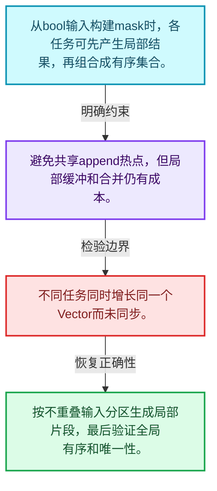
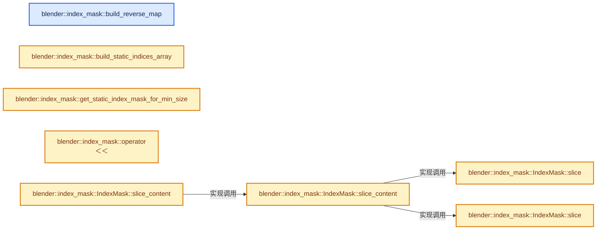
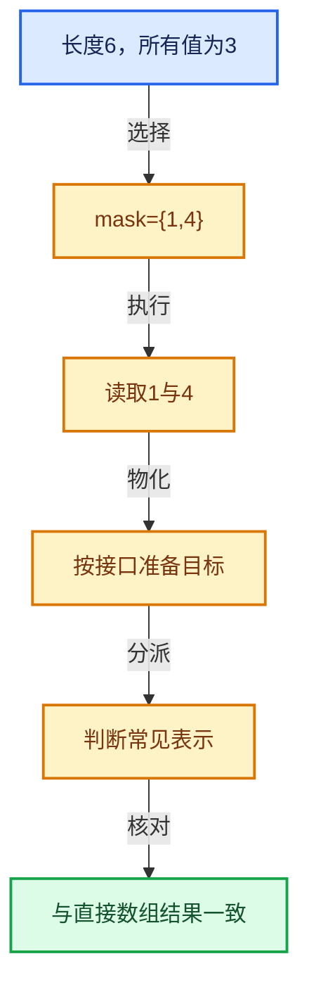

# 04-10 IndexMask构建与并行

[方向导航](README.md) · [总目录](../README.md) · [实现索引](../00-课程指南/02-源码与提交索引/符号依赖与实现索引.md)

## 从问题到实现

最终大小未知时怎样并行构建选择？

局部构造后组合能减少共享写热点；输出顺序、唯一性和临时存储寿命必须同时保证。

**数据模型**

从bool输入构建mask时，各任务可先产生局部结果，再组合成有序集合。

**设计取舍**

避免共享append热点，但局部缓冲和合并仍有成本。

**最小反例**

不同任务同时增长同一个Vector而未同步。

**推导**

按不重叠输入分区生成局部片段，最后验证全局有序和唯一性。

## 阅读地图与执行推演








图中的数值推演是本方向的教学模型；实际函数之间的调用边与概念分析边分别标注，不能把概念关系当作运行时调度顺序。

## 完整源码单元与就地讲解

中文讲解直接放在相关代码旁，复杂机制在代码下展开。原文折叠区保留基准行号；不需要在行号表和函数之间来回查找。类布局可分段展示，函数实现不按固定行数切开。

### 类型布局、声明与编译条件 · index_mask.cc L1—L35

<!-- annotated:f2c6ac9a3feae4 -->

```cpp
/* SPDX-FileCopyrightText: 2023 Blender Authors
 *
 * SPDX-License-Identifier: GPL-2.0-or-later */

/** \file
 * \ingroup bli
 */

#include <fmt/format.h>
#include <fmt/ranges.h>
#include <iostream>

#include "BLI_array.hh"
#include "BLI_array_utils.hh"
#include "BLI_bit_bool_conversion.hh"
#include "BLI_bit_span_ops.hh"
#include "BLI_bit_span_to_index_ranges.hh"
#include "BLI_bit_vector.hh"
#include "BLI_enumerable_thread_specific.hh"
#include "BLI_index_mask.hh"
#include "BLI_index_mask_expression.hh"
#include "BLI_index_ranges_builder.hh"
#include "BLI_math_base.hh"
#include "BLI_rand.hh"
#include "BLI_set.hh"
#include "BLI_sort.hh"
#include "BLI_task.hh"
#include "BLI_threads.hh"
#include "BLI_vector_set.hh"
#include "BLI_virtual_array.hh"

#include "BLI_strict_flags.hh" /* IWYU pragma: keep. Keep last. */

namespace blender::index_mask {

```

<details>
<summary>核对原始源码：source/blender/blenlib/intern/index_mask.cc · L1—L35</summary>

<!-- original:f2c6ac9a3feae4:source/blender/blenlib/intern/index_mask.cc:1:35 -->

```cpp
/* SPDX-FileCopyrightText: 2023 Blender Authors
 *
 * SPDX-License-Identifier: GPL-2.0-or-later */

/** \file
 * \ingroup bli
 */

#include <fmt/format.h>
#include <fmt/ranges.h>
#include <iostream>

#include "BLI_array.hh"
#include "BLI_array_utils.hh"
#include "BLI_bit_bool_conversion.hh"
#include "BLI_bit_span_ops.hh"
#include "BLI_bit_span_to_index_ranges.hh"
#include "BLI_bit_vector.hh"
#include "BLI_enumerable_thread_specific.hh"
#include "BLI_index_mask.hh"
#include "BLI_index_mask_expression.hh"
#include "BLI_index_ranges_builder.hh"
#include "BLI_math_base.hh"
#include "BLI_rand.hh"
#include "BLI_set.hh"
#include "BLI_sort.hh"
#include "BLI_task.hh"
#include "BLI_threads.hh"
#include "BLI_vector_set.hh"
#include "BLI_virtual_array.hh"

#include "BLI_strict_flags.hh" /* IWYU pragma: keep. Keep last. */

namespace blender::index_mask {

```

</details>

<a id="f-70299191942ae7f9"></a>

### `blender::index_mask::build_reverse_map`

实现位置：[source/blender/blenlib/intern/index_mask.cc](../../../../../source/blender/blenlib/intern/index_mask.cc) · L36—L45。

接口参数：

- `const IndexMask &mask`
- `MutableSpan<T> r_map`

**教学注释版**

<!-- annotated:15dc7c3fa56466 -->

```cpp
template<typename T> void build_reverse_map(const IndexMask &mask, MutableSpan<T> r_map)
{
#ifndef NDEBUG
  /* Catch errors with asserts in debug builds. */
  // [讲解] r_map.fill：修改已有目标元素，不改变底层容器长度。
  r_map.fill(-1);
#endif
  // [讲解] r_map.size：查询视图长度或生成对应有效索引区间。
  BLI_assert(r_map.size() >= mask.min_array_size());
  mask.foreach_index_optimized<T>([&](const T src, const T dst) { r_map[src] = dst; },
                                  exec_mode::grain_size(4096));
}
```

<details>
<summary>核对原始源码：source/blender/blenlib/intern/index_mask.cc · L36—L45</summary>

<!-- original:15dc7c3fa56466:source/blender/blenlib/intern/index_mask.cc:36:45 -->

```cpp
template<typename T> void build_reverse_map(const IndexMask &mask, MutableSpan<T> r_map)
{
#ifndef NDEBUG
  /* Catch errors with asserts in debug builds. */
  r_map.fill(-1);
#endif
  BLI_assert(r_map.size() >= mask.min_array_size());
  mask.foreach_index_optimized<T>([&](const T src, const T dst) { r_map[src] = dst; },
                                  exec_mode::grain_size(4096));
}
```

</details>

**继续追踪实现**

- `r_map.fill` → [blender::MutableSpan::fill · L523](../01-基础容器与现代CPP/06-MutableSpan可写视图.md#f-8daedd52c727ec26)。
- `BLI_assert` → [BLI_assert · L48](../90-实现依赖专题/01-BLI基础库/BLI_assert.hh.md#m-57a88495704d)；[BLI_assert · L63](../90-实现依赖专题/01-BLI基础库/BLI_assert.hh.md#m-d07050020cb5)。宏定义由构建条件选择。
- `r_map.size` → [blender::MutableSpan::size · L499](../01-基础容器与现代CPP/06-MutableSpan可写视图.md#f-1de6a66839c304a8)；[blender::gpu::shader::parser::MutableSpan::size · L87](../90-实现依赖专题/08-其他Blender模块/gpu/shader_tool/utils.hh.md#f-5e684af6ee7990e9)。同名重载需按实参类型选择。
- `mask.min_array_size` → [blender::index_mask::IndexMask::min_array_size · L782](09-分段存储与遍历.md#f-f3a460d74b4fc7d6)。
- `mask.foreach_index_optimized<T>` → [blender::index_mask::IndexMask::foreach_index_optimized · L937](12-重构历史与基准练习.md#f-a2c3e7876407eaaf)。
- `exec_mode::grain_size` → [blender::exec_mode::grain_size · L79](../90-实现依赖专题/01-BLI基础库/BLI_execution_mode.hh.md#f-0b4fc2f9fa6e66e7)。

### 类型布局、声明与编译条件 · index_mask.cc L46—L48

<!-- annotated:e8c7a9ce02f6be -->

```cpp

template void build_reverse_map<int>(const IndexMask &mask, MutableSpan<int> r_map);

```

<details>
<summary>核对原始源码：source/blender/blenlib/intern/index_mask.cc · L46—L48</summary>

<!-- original:e8c7a9ce02f6be:source/blender/blenlib/intern/index_mask.cc:46:48 -->

```cpp

template void build_reverse_map<int>(const IndexMask &mask, MutableSpan<int> r_map);

```

</details>

<a id="f-9958a48c7f6cd73a"></a>

### `blender::index_mask::build_static_indices_array`

实现位置：[source/blender/blenlib/intern/index_mask.cc](../../../../../source/blender/blenlib/intern/index_mask.cc) · L49—L56。

**教学注释版**

<!-- annotated:aa5a1155a7ac23 -->

```cpp
std::array<int16_t, max_segment_size> build_static_indices_array()
{
  std::array<int16_t, max_segment_size> data;
  for (int16_t i = 0; i < max_segment_size; i++) {
    data[size_t(i)] = i;
  }
  return data;
}
```

<details>
<summary>核对原始源码：source/blender/blenlib/intern/index_mask.cc · L49—L56</summary>

<!-- original:aa5a1155a7ac23:source/blender/blenlib/intern/index_mask.cc:49:56 -->

```cpp
std::array<int16_t, max_segment_size> build_static_indices_array()
{
  std::array<int16_t, max_segment_size> data;
  for (int16_t i = 0; i < max_segment_size; i++) {
    data[size_t(i)] = i;
  }
  return data;
}
```

</details>

**结果出口**

- `return data;`

**继续追踪实现**

本实现没有需要继续展开的显式调用；检查返回表达式、对象转换和调用者前置条件。

<!-- annotated:b2f744416dc63f -->

```cpp

```

<details>
<summary>核对原始源码：source/blender/blenlib/intern/index_mask.cc · L57—L57</summary>

<!-- original:b2f744416dc63f:source/blender/blenlib/intern/index_mask.cc:57:57 -->

```cpp

```

</details>

<a id="f-0f12c23149144daa"></a>

### `blender::index_mask::get_static_index_mask_for_min_size`

实现位置：[source/blender/blenlib/intern/index_mask.cc](../../../../../source/blender/blenlib/intern/index_mask.cc) · L58—L102。

接口参数：

- `const int64_t min_size`

**教学注释版**

<!-- annotated:4782a247075b34 -->

```cpp
const IndexMask &get_static_index_mask_for_min_size(const int64_t min_size)
{
  static constexpr int64_t size_shift = 31;
  static constexpr int64_t max_size = (int64_t(1) << size_shift);      /* 2'147'483'648 */
  static constexpr int64_t segments_num = max_size / max_segment_size; /*       131'072 */

  /* Make sure we are never requesting a size that's larger than what was statically allocated.
   * If that's ever needed, we can either increase #size_shift or dynamically allocate an even
   * larger mask. */
  BLI_assert(min_size <= max_size);
  UNUSED_VARS_NDEBUG(min_size);

  static IndexMask static_mask = []() {
    static Array<const int16_t *> indices_by_segment(segments_num);
    /* The offsets and cumulative segment sizes array contain the same values here, so just use a
     * single array for both. */
    static Array<int64_t> segment_offsets(segments_num + 1);

    static const int16_t *static_offsets = get_static_indices_array().data();

    /* Isolate because the mutex protecting the initialization of #static_mask is locked. */
    threading::isolate_task([&]() {
      threading::parallel_for(IndexRange(segments_num), 1024, [&](const IndexRange range) {
        for (const int64_t segment_i : range) {
          indices_by_segment[segment_i] = static_offsets;
          segment_offsets[segment_i] = segment_i * max_segment_size;
        }
      });
    });
    segment_offsets.last() = max_size;

    IndexMask mask;
    IndexMaskData &data = mask.data_for_inplace_construction();
    data.indices_num_ = max_size;
    data.segments_num_ = segments_num;
    // [讲解] indices_by_segment.data：提供数组的借用访问入口。
    data.indices_by_segment_ = indices_by_segment.data();
    data.segment_offsets_ = segment_offsets.data();
    data.cumulative_segment_sizes_ = segment_offsets.data();
    data.begin_index_in_segment_ = 0;
    data.end_index_in_segment_ = max_segment_size;

    return mask;
  }();
  return static_mask;
}
```

<details>
<summary>核对原始源码：source/blender/blenlib/intern/index_mask.cc · L58—L102</summary>

<!-- original:4782a247075b34:source/blender/blenlib/intern/index_mask.cc:58:102 -->

```cpp
const IndexMask &get_static_index_mask_for_min_size(const int64_t min_size)
{
  static constexpr int64_t size_shift = 31;
  static constexpr int64_t max_size = (int64_t(1) << size_shift);      /* 2'147'483'648 */
  static constexpr int64_t segments_num = max_size / max_segment_size; /*       131'072 */

  /* Make sure we are never requesting a size that's larger than what was statically allocated.
   * If that's ever needed, we can either increase #size_shift or dynamically allocate an even
   * larger mask. */
  BLI_assert(min_size <= max_size);
  UNUSED_VARS_NDEBUG(min_size);

  static IndexMask static_mask = []() {
    static Array<const int16_t *> indices_by_segment(segments_num);
    /* The offsets and cumulative segment sizes array contain the same values here, so just use a
     * single array for both. */
    static Array<int64_t> segment_offsets(segments_num + 1);

    static const int16_t *static_offsets = get_static_indices_array().data();

    /* Isolate because the mutex protecting the initialization of #static_mask is locked. */
    threading::isolate_task([&]() {
      threading::parallel_for(IndexRange(segments_num), 1024, [&](const IndexRange range) {
        for (const int64_t segment_i : range) {
          indices_by_segment[segment_i] = static_offsets;
          segment_offsets[segment_i] = segment_i * max_segment_size;
        }
      });
    });
    segment_offsets.last() = max_size;

    IndexMask mask;
    IndexMaskData &data = mask.data_for_inplace_construction();
    data.indices_num_ = max_size;
    data.segments_num_ = segments_num;
    data.indices_by_segment_ = indices_by_segment.data();
    data.segment_offsets_ = segment_offsets.data();
    data.cumulative_segment_sizes_ = segment_offsets.data();
    data.begin_index_in_segment_ = 0;
    data.end_index_in_segment_ = max_segment_size;

    return mask;
  }();
  return static_mask;
}
```

</details>

**沿实际写入检查状态**

- `indices_by_segment[segment_i] = static_offsets;`
- `segment_offsets[segment_i] = segment_i * max_segment_size;`
- `data.indices_num_ = max_size;`
- `data.segments_num_ = segments_num;`
- `data.indices_by_segment_ = indices_by_segment.data();`
- `data.segment_offsets_ = segment_offsets.data();`
- `data.cumulative_segment_sizes_ = segment_offsets.data();`
- `data.begin_index_in_segment_ = 0;`
- `data.end_index_in_segment_ = max_segment_size;`

**结果出口**

- `return mask;`
- `return static_mask;`

**继续追踪实现**

- `BLI_assert` → [BLI_assert · L48](../90-实现依赖专题/01-BLI基础库/BLI_assert.hh.md#m-57a88495704d)；[BLI_assert · L63](../90-实现依赖专题/01-BLI基础库/BLI_assert.hh.md#m-d07050020cb5)。宏定义由构建条件选择。
- `UNUSED_VARS_NDEBUG` → [UNUSED_VARS_NDEBUG · L526](../90-实现依赖专题/01-BLI基础库/BLI_utildefines.hh.md#m-fea439f7d366)；[UNUSED_VARS_NDEBUG · L528](../90-实现依赖专题/01-BLI基础库/BLI_utildefines.hh.md#m-a8f8cfac06c0)。宏定义由构建条件选择。
- `[]() { static Array<const int16_t *> indices_by_segment(segments_num); /* The offsets and cumulative segment sizes array contain the same values here, so just use a * single array  …（完整表达式见本函数源码）` → [调用协议](../00-课程指南/01-路线与规范/模板宏与动态分派协议.md)：函数指针、局部可调用对象或未展开的宏；必须结合调用者环境。调用位置L70。
- `get_static_indices_array().data` → [调用协议](../00-课程指南/01-路线与规范/模板宏与动态分派协议.md)：接收对象类型依赖auto、返回值或模板实例；不按同名猜测目标。调用位置L76。
- `get_static_indices_array` → [blender::index_mask::get_static_indices_array · L600](09-分段存储与遍历.md#f-31f6d95c232aa378)。
- `threading::isolate_task` → [blender::threading::isolate_task · L224](../11-Depsgraph与并行任务系统/07-任务池与TBB接入.md#f-c13dd3df595aa4f8)。
- `threading::parallel_for` → [blender::threading::parallel_for · L68](../11-Depsgraph与并行任务系统/07-任务池与TBB接入.md#f-838294754c24426c)。
- `IndexRange` → [blender::IndexRange](../90-实现依赖专题/01-BLI基础库/BLI_index_range.hh.md#t-caa3466d6776)；[blender::gpu::shader::parser::IndexRange](../90-实现依赖专题/08-其他Blender模块/gpu/shader_tool/utils.hh.md#t-82d2bd4ea71c)；[blender::IndexRange](../90-实现依赖专题/08-其他Blender模块/makesdna/DNA_node_types.h.md#t-0448cc889d39)。
- `segment_offsets.last` → [blender::Array::last · L307](../01-基础容器与现代CPP/08-Array复制移动与销毁.md#f-022e4eec5e52edfe)；[blender::Array::last · L313](../01-基础容器与现代CPP/08-Array复制移动与销毁.md#f-5026b1478e15b195)。同名重载需按实参类型选择。
- `mask.data_for_inplace_construction` → [blender::index_mask::IndexMask::data_for_inplace_construction · L850](09-分段存储与遍历.md#f-3f494d48d3360201)。
- `indices_by_segment.data` → [blender::Array::data · L323](../01-基础容器与现代CPP/08-Array复制移动与销毁.md#f-95648c799002f4ba)；[blender::Array::data · L327](../01-基础容器与现代CPP/08-Array复制移动与销毁.md#f-50c18301f8c40f9e)。同名重载需按实参类型选择。
- `segment_offsets.data` → [blender::Array::data · L323](../01-基础容器与现代CPP/08-Array复制移动与销毁.md#f-95648c799002f4ba)；[blender::Array::data · L327](../01-基础容器与现代CPP/08-Array复制移动与销毁.md#f-50c18301f8c40f9e)。同名重载需按实参类型选择。

<!-- annotated:7c126a07b7f26a -->

```cpp

```

<details>
<summary>核对原始源码：source/blender/blenlib/intern/index_mask.cc · L103—L103</summary>

<!-- original:7c126a07b7f26a:source/blender/blenlib/intern/index_mask.cc:103:103 -->

```cpp

```

</details>

<a id="f-c65eb3e688c3dfd6"></a>

### `blender::index_mask::operator<<`

实现位置：[source/blender/blenlib/intern/index_mask.cc](../../../../../source/blender/blenlib/intern/index_mask.cc) · L104—L123。

接口参数：

- `std::ostream &stream`
- `const IndexMask &mask`

**教学注释版**

<!-- annotated:5a55404660192c -->

```cpp
std::ostream &operator<<(std::ostream &stream, const IndexMask &mask)
{
  Array<int64_t> indices(mask.size());
  mask.to_indices<int64_t>(indices);
  Vector<std::variant<IndexRange, Span<int64_t>>> segments;
  unique_sorted_indices::split_to_ranges_and_spans<int64_t>(indices, 8, segments);
  Vector<std::string> parts;
  for (const std::variant<IndexRange, Span<int64_t>> &segment : segments) {
    if (std::holds_alternative<IndexRange>(segment)) {
      const IndexRange range = std::get<IndexRange>(segment);
      // [讲解] parts.append：在尾部建立新元素，必要时先扩大存储。
      parts.append(fmt::format("{}-{}", range.first(), range.last()));
    }
    else {
      const Span<int64_t> segment_indices = std::get<Span<int64_t>>(segment);
      parts.append(fmt::format("{}", fmt::join(segment_indices, ", ")));
    }
  }
  stream << fmt::format("(Size: {} | {})", mask.size(), fmt::join(parts, ", "));
  return stream;
}
```

<details>
<summary>核对原始源码：source/blender/blenlib/intern/index_mask.cc · L104—L123</summary>

<!-- original:5a55404660192c:source/blender/blenlib/intern/index_mask.cc:104:123 -->

```cpp
std::ostream &operator<<(std::ostream &stream, const IndexMask &mask)
{
  Array<int64_t> indices(mask.size());
  mask.to_indices<int64_t>(indices);
  Vector<std::variant<IndexRange, Span<int64_t>>> segments;
  unique_sorted_indices::split_to_ranges_and_spans<int64_t>(indices, 8, segments);
  Vector<std::string> parts;
  for (const std::variant<IndexRange, Span<int64_t>> &segment : segments) {
    if (std::holds_alternative<IndexRange>(segment)) {
      const IndexRange range = std::get<IndexRange>(segment);
      parts.append(fmt::format("{}-{}", range.first(), range.last()));
    }
    else {
      const Span<int64_t> segment_indices = std::get<Span<int64_t>>(segment);
      parts.append(fmt::format("{}", fmt::join(segment_indices, ", ")));
    }
  }
  stream << fmt::format("(Size: {} | {})", mask.size(), fmt::join(parts, ", "));
  return stream;
}
```

</details>

**结果出口**

- `return stream;`

**继续追踪实现**

- `mask.size` → [blender::index_mask::IndexMask::size · L743](09-分段存储与遍历.md#f-0163b32abc9a0d9c)。
- `mask.to_indices<int64_t>` → [blender::index_mask::IndexMask::to_indices · L766](10-IndexMask构建与并行.md#f-7d2f4148b6937424)。
- `unique_sorted_indices::split_to_ranges_and_spans<int64_t>` → [blender::unique_sorted_indices::split_to_ranges_and_spans · L133](../90-实现依赖专题/01-BLI基础库/BLI_unique_sorted_indices.hh.md#f-665f0eb091318a9c)。
- `std::holds_alternative<IndexRange>` → [外部契约](https://eel.is/c++draft/)：这个边界按实际表达式及所属类型核对参数、返回值、寿命与失败行为。这里提供接口入口，不声称已解释该第三方版本的内部实现。
- `std::get<IndexRange>` → [外部契约](https://eel.is/c++draft/)：这个边界按实际表达式及所属类型核对参数、返回值、寿命与失败行为。这里提供接口入口，不声称已解释该第三方版本的内部实现。
- `parts.append` → [blender::Vector::append · L498](../01-基础容器与现代CPP/11-Vector插入删除与重排.md#f-5bde268a69e443ec)；[blender::Vector::append · L502](../01-基础容器与现代CPP/11-Vector插入删除与重排.md#f-591e0b15e6308532)。同名重载需按实参类型选择。
- `fmt::format` → [外部契约](https://fmt.dev/latest/api/)：按fmt接口的格式字符串与参数类型契约使用，格式化不改变被格式化对象的拥有关系。
- `range.first` → [blender::IndexRange::first · L204](../01-基础容器与现代CPP/04-IndexRange连续整数区间.md#f-ab443c94e531befa)。
- `range.last` → [blender::IndexRange::last · L214](../01-基础容器与现代CPP/04-IndexRange连续整数区间.md#f-66896c6351a40de1)；[blender::gpu::shader::parser::IndexRange::last · L62](../90-实现依赖专题/08-其他Blender模块/gpu/shader_tool/utils.hh.md#f-373501206569c3b3)。同名重载需按实参类型选择。
- `std::get<Span<int64_t>>` → [外部契约](https://eel.is/c++draft/)：这个边界按实际表达式及所属类型核对参数、返回值、寿命与失败行为。这里提供接口入口，不声称已解释该第三方版本的内部实现。
- `fmt::join` → [外部契约](https://fmt.dev/latest/api/)：按fmt接口的格式字符串与参数类型契约使用，格式化不改变被格式化对象的拥有关系。

<!-- annotated:02269bebd3b5ea -->

```cpp

```

<details>
<summary>核对原始源码：source/blender/blenlib/intern/index_mask.cc · L124—L124</summary>

<!-- original:02269bebd3b5ea:source/blender/blenlib/intern/index_mask.cc:124:124 -->

```cpp

```

</details>

<a id="f-ff79fd755a945991"></a>

### `blender::index_mask::IndexMask::slice`

实现位置：[source/blender/blenlib/intern/index_mask.cc](../../../../../source/blender/blenlib/intern/index_mask.cc) · L125—L142。

接口参数：

- `const int64_t start`
- `const int64_t size`

**教学注释版**

<!-- annotated:bd6008b92a1575 -->

```cpp
IndexMask IndexMask::slice(const int64_t start, const int64_t size) const
{
  if (size == 0) {
    return {};
  }
  const RawMaskIterator first_it = this->index_to_iterator(start);
  const RawMaskIterator last_it = this->index_to_iterator(start + size - 1);

  IndexMask sliced = *this;
  sliced.indices_num_ = size;
  sliced.segments_num_ = last_it.segment_i - first_it.segment_i + 1;
  sliced.indices_by_segment_ += first_it.segment_i;
  sliced.segment_offsets_ += first_it.segment_i;
  sliced.cumulative_segment_sizes_ += first_it.segment_i;
  sliced.begin_index_in_segment_ = first_it.index_in_segment;
  sliced.end_index_in_segment_ = last_it.index_in_segment + 1;
  return sliced;
}
```

<details>
<summary>核对原始源码：source/blender/blenlib/intern/index_mask.cc · L125—L142</summary>

<!-- original:bd6008b92a1575:source/blender/blenlib/intern/index_mask.cc:125:142 -->

```cpp
IndexMask IndexMask::slice(const int64_t start, const int64_t size) const
{
  if (size == 0) {
    return {};
  }
  const RawMaskIterator first_it = this->index_to_iterator(start);
  const RawMaskIterator last_it = this->index_to_iterator(start + size - 1);

  IndexMask sliced = *this;
  sliced.indices_num_ = size;
  sliced.segments_num_ = last_it.segment_i - first_it.segment_i + 1;
  sliced.indices_by_segment_ += first_it.segment_i;
  sliced.segment_offsets_ += first_it.segment_i;
  sliced.cumulative_segment_sizes_ += first_it.segment_i;
  sliced.begin_index_in_segment_ = first_it.index_in_segment;
  sliced.end_index_in_segment_ = last_it.index_in_segment + 1;
  return sliced;
}
```

</details>

**沿实际写入检查状态**

- `sliced.indices_num_ = size;`
- `sliced.segments_num_ = last_it.segment_i - first_it.segment_i + 1;`
- `sliced.indices_by_segment_ += first_it.segment_i;`
- `sliced.segment_offsets_ += first_it.segment_i;`
- `sliced.cumulative_segment_sizes_ += first_it.segment_i;`
- `sliced.begin_index_in_segment_ = first_it.index_in_segment;`
- `sliced.end_index_in_segment_ = last_it.index_in_segment + 1;`

**结果出口**

- `return {};`
- `return sliced;`

**继续追踪实现**

- `this->index_to_iterator` → [blender::index_mask::IndexMask::index_to_iterator · L790](09-分段存储与遍历.md#f-4a38a8ef153d0252)。

<!-- annotated:f99a4a908f67ad -->

```cpp

```

<details>
<summary>核对原始源码：source/blender/blenlib/intern/index_mask.cc · L143—L143</summary>

<!-- original:f99a4a908f67ad:source/blender/blenlib/intern/index_mask.cc:143:143 -->

```cpp

```

</details>

<a id="f-c8b1c9029be81481"></a>

### `blender::index_mask::IndexMask::slice`

实现位置：[source/blender/blenlib/intern/index_mask.cc](../../../../../source/blender/blenlib/intern/index_mask.cc) · L144—L158。

接口参数：

- `const RawMaskIterator first_it`
- `const RawMaskIterator last_it`
- `const int64_t size`

**教学注释版**

<!-- annotated:cdc4cfa6bbe404 -->

```cpp
IndexMask IndexMask::slice(const RawMaskIterator first_it,
                           const RawMaskIterator last_it,
                           const int64_t size) const
{
  BLI_assert(this->iterator_to_index(last_it) - this->iterator_to_index(first_it) + 1 == size);
  IndexMask sliced = *this;
  sliced.indices_num_ = size;
  sliced.segments_num_ = last_it.segment_i - first_it.segment_i + 1;
  sliced.indices_by_segment_ += first_it.segment_i;
  sliced.segment_offsets_ += first_it.segment_i;
  sliced.cumulative_segment_sizes_ += first_it.segment_i;
  sliced.begin_index_in_segment_ = first_it.index_in_segment;
  sliced.end_index_in_segment_ = last_it.index_in_segment + 1;
  return sliced;
}
```

<details>
<summary>核对原始源码：source/blender/blenlib/intern/index_mask.cc · L144—L158</summary>

<!-- original:cdc4cfa6bbe404:source/blender/blenlib/intern/index_mask.cc:144:158 -->

```cpp
IndexMask IndexMask::slice(const RawMaskIterator first_it,
                           const RawMaskIterator last_it,
                           const int64_t size) const
{
  BLI_assert(this->iterator_to_index(last_it) - this->iterator_to_index(first_it) + 1 == size);
  IndexMask sliced = *this;
  sliced.indices_num_ = size;
  sliced.segments_num_ = last_it.segment_i - first_it.segment_i + 1;
  sliced.indices_by_segment_ += first_it.segment_i;
  sliced.segment_offsets_ += first_it.segment_i;
  sliced.cumulative_segment_sizes_ += first_it.segment_i;
  sliced.begin_index_in_segment_ = first_it.index_in_segment;
  sliced.end_index_in_segment_ = last_it.index_in_segment + 1;
  return sliced;
}
```

</details>

**沿实际写入检查状态**

- `sliced.indices_num_ = size;`
- `sliced.segments_num_ = last_it.segment_i - first_it.segment_i + 1;`
- `sliced.indices_by_segment_ += first_it.segment_i;`
- `sliced.segment_offsets_ += first_it.segment_i;`
- `sliced.cumulative_segment_sizes_ += first_it.segment_i;`
- `sliced.begin_index_in_segment_ = first_it.index_in_segment;`
- `sliced.end_index_in_segment_ = last_it.index_in_segment + 1;`

**结果出口**

- `return sliced;`

**继续追踪实现**

- `BLI_assert` → [BLI_assert · L48](../90-实现依赖专题/01-BLI基础库/BLI_assert.hh.md#m-57a88495704d)；[BLI_assert · L63](../90-实现依赖专题/01-BLI基础库/BLI_assert.hh.md#m-d07050020cb5)。宏定义由构建条件选择。
- `this->iterator_to_index` → [blender::index_mask::IndexMask::iterator_to_index · L804](09-分段存储与遍历.md#f-75baed2341047e2b)。

<!-- annotated:63b593c17f40b1 -->

```cpp

```

<details>
<summary>核对原始源码：source/blender/blenlib/intern/index_mask.cc · L159—L159</summary>

<!-- original:63b593c17f40b1:source/blender/blenlib/intern/index_mask.cc:159:159 -->

```cpp

```

</details>

<a id="f-99e50e114a76b5d2"></a>

### `blender::index_mask::IndexMask::slice_content`

实现位置：[source/blender/blenlib/intern/index_mask.cc](../../../../../source/blender/blenlib/intern/index_mask.cc) · L160—L163。

接口参数：

- `const IndexRange range`

**教学注释版**

<!-- annotated:b3e5edab6d5b6e -->

```cpp
IndexMask IndexMask::slice_content(const IndexRange range) const
{
  // [讲解] range.start：读取连续区间或分组的边界信息。
  return this->slice_content(range.start(), range.size());
}
```

<details>
<summary>核对原始源码：source/blender/blenlib/intern/index_mask.cc · L160—L163</summary>

<!-- original:b3e5edab6d5b6e:source/blender/blenlib/intern/index_mask.cc:160:163 -->

```cpp
IndexMask IndexMask::slice_content(const IndexRange range) const
{
  return this->slice_content(range.start(), range.size());
}
```

</details>

**结果出口**

- `return this->slice_content(range.start(), range.size());`

**继续追踪实现**

- `this->slice_content` → [blender::index_mask::IndexMask::slice_content · L160](10-IndexMask构建与并行.md#f-99e50e114a76b5d2)；[blender::index_mask::IndexMask::slice_content · L165](10-IndexMask构建与并行.md#f-bd843b5ad1f8db9a)。同名重载需按实参类型选择。
- `range.start` → [blender::IndexRange::start · L243](../01-基础容器与现代CPP/04-IndexRange连续整数区间.md#f-99d2195bd9cfd1f0)。
- `range.size` → [blender::IndexRange::size · L156](../01-基础容器与现代CPP/04-IndexRange连续整数区间.md#f-05f66c3ebb2fdfec)。

<!-- annotated:6a1215b00ff350 -->

```cpp

```

<details>
<summary>核对原始源码：source/blender/blenlib/intern/index_mask.cc · L164—L164</summary>

<!-- original:6a1215b00ff350:source/blender/blenlib/intern/index_mask.cc:164:164 -->

```cpp

```

</details>

<a id="f-bd843b5ad1f8db9a"></a>

### `blender::index_mask::IndexMask::slice_content`

实现位置：[source/blender/blenlib/intern/index_mask.cc](../../../../../source/blender/blenlib/intern/index_mask.cc) · L165—L182。

接口参数：

- `const int64_t start`
- `const int64_t size`

**教学注释版**

<!-- annotated:6b3b1815b5fcea -->

```cpp
IndexMask IndexMask::slice_content(const int64_t start, const int64_t size) const
{
  if (size <= 0) {
    return {};
  }
  const std::optional<RawMaskIterator> first_it = this->find_larger_equal(start);
  const std::optional<RawMaskIterator> last_it = this->find_smaller_equal(start + size - 1);
  if (!first_it || !last_it) {
    return {};
  }
  const int64_t first_index = this->iterator_to_index(*first_it);
  const int64_t last_index = this->iterator_to_index(*last_it);
  if (last_index < first_index) {
    return {};
  }
  const int64_t sliced_mask_size = last_index - first_index + 1;
  return this->slice(*first_it, *last_it, sliced_mask_size);
}
```

<details>
<summary>核对原始源码：source/blender/blenlib/intern/index_mask.cc · L165—L182</summary>

<!-- original:6b3b1815b5fcea:source/blender/blenlib/intern/index_mask.cc:165:182 -->

```cpp
IndexMask IndexMask::slice_content(const int64_t start, const int64_t size) const
{
  if (size <= 0) {
    return {};
  }
  const std::optional<RawMaskIterator> first_it = this->find_larger_equal(start);
  const std::optional<RawMaskIterator> last_it = this->find_smaller_equal(start + size - 1);
  if (!first_it || !last_it) {
    return {};
  }
  const int64_t first_index = this->iterator_to_index(*first_it);
  const int64_t last_index = this->iterator_to_index(*last_it);
  if (last_index < first_index) {
    return {};
  }
  const int64_t sliced_mask_size = last_index - first_index + 1;
  return this->slice(*first_it, *last_it, sliced_mask_size);
}
```

</details>

**结果出口**

- `return {};`
- `return this->slice(*first_it, *last_it, sliced_mask_size);`

**继续追踪实现**

- `this->find_larger_equal` → [blender::index_mask::IndexMask::find_larger_equal · L907](10-IndexMask构建与并行.md#f-3ba7524ef78669fe)。
- `this->find_smaller_equal` → [blender::index_mask::IndexMask::find_smaller_equal · L933](10-IndexMask构建与并行.md#f-616600e43c052589)。
- `this->iterator_to_index` → [blender::index_mask::IndexMask::iterator_to_index · L804](09-分段存储与遍历.md#f-75baed2341047e2b)。
- `this->slice` → [blender::index_mask::IndexMask::slice · L125](10-IndexMask构建与并行.md#f-ff79fd755a945991)；[blender::index_mask::IndexMask::slice · L144](10-IndexMask构建与并行.md#f-c8b1c9029be81481)。同名重载需按实参类型选择。

<!-- annotated:8264a4a906be25 -->

```cpp

```

<details>
<summary>核对原始源码：source/blender/blenlib/intern/index_mask.cc · L183—L183</summary>

<!-- original:8264a4a906be25:source/blender/blenlib/intern/index_mask.cc:183:183 -->

```cpp

```

</details>

<a id="f-1cad6a88e321f558"></a>

### `blender::index_mask::IndexMask::slice_and_shift`

实现位置：[source/blender/blenlib/intern/index_mask.cc](../../../../../source/blender/blenlib/intern/index_mask.cc) · L184—L189。

接口参数：

- `const IndexRange range`
- `const int64_t offset`
- `LinearAllocator<> &memory`

**教学注释版**

<!-- annotated:294c106f77cda7 -->

```cpp
IndexMask IndexMask::slice_and_shift(const IndexRange range,
                                     const int64_t offset,
                                     LinearAllocator<> &memory) const
{
  // [讲解] range.start：读取连续区间或分组的边界信息。
  return this->slice_and_shift(range.start(), range.size(), offset, memory);
}
```

<details>
<summary>核对原始源码：source/blender/blenlib/intern/index_mask.cc · L184—L189</summary>

<!-- original:294c106f77cda7:source/blender/blenlib/intern/index_mask.cc:184:189 -->

```cpp
IndexMask IndexMask::slice_and_shift(const IndexRange range,
                                     const int64_t offset,
                                     LinearAllocator<> &memory) const
{
  return this->slice_and_shift(range.start(), range.size(), offset, memory);
}
```

</details>

**结果出口**

- `return this->slice_and_shift(range.start(), range.size(), offset, memory);`

**继续追踪实现**

- `this->slice_and_shift` → [blender::index_mask::IndexMask::slice_and_shift · L184](10-IndexMask构建与并行.md#f-1cad6a88e321f558)；[blender::index_mask::IndexMask::slice_and_shift · L191](10-IndexMask构建与并行.md#f-55994dae07c436eb)。同名重载需按实参类型选择。
- `range.start` → [blender::IndexRange::start · L243](../01-基础容器与现代CPP/04-IndexRange连续整数区间.md#f-99d2195bd9cfd1f0)。
- `range.size` → [blender::IndexRange::size · L156](../01-基础容器与现代CPP/04-IndexRange连续整数区间.md#f-05f66c3ebb2fdfec)。

<!-- annotated:6fd0f62890df11 -->

```cpp

```

<details>
<summary>核对原始源码：source/blender/blenlib/intern/index_mask.cc · L190—L190</summary>

<!-- original:6fd0f62890df11:source/blender/blenlib/intern/index_mask.cc:190:190 -->

```cpp

```

</details>

<a id="f-55994dae07c436eb"></a>

### `blender::index_mask::IndexMask::slice_and_shift`

实现位置：[source/blender/blenlib/intern/index_mask.cc](../../../../../source/blender/blenlib/intern/index_mask.cc) · L191—L203。

接口参数：

- `const int64_t start`
- `const int64_t size`
- `const int64_t offset`
- `LinearAllocator<> &memory`

**教学注释版**

<!-- annotated:3e30e2c3b49a45 -->

```cpp
IndexMask IndexMask::slice_and_shift(const int64_t start,
                                     const int64_t size,
                                     const int64_t offset,
                                     LinearAllocator<> &memory) const
{
  if (size == 0) {
    return {};
  }
  if (std::optional<IndexRange> range = this->to_range()) {
    return range->slice(start, size).shift(offset);
  }
  return this->slice(start, size).shift(offset, memory);
}
```

<details>
<summary>核对原始源码：source/blender/blenlib/intern/index_mask.cc · L191—L203</summary>

<!-- original:3e30e2c3b49a45:source/blender/blenlib/intern/index_mask.cc:191:203 -->

```cpp
IndexMask IndexMask::slice_and_shift(const int64_t start,
                                     const int64_t size,
                                     const int64_t offset,
                                     LinearAllocator<> &memory) const
{
  if (size == 0) {
    return {};
  }
  if (std::optional<IndexRange> range = this->to_range()) {
    return range->slice(start, size).shift(offset);
  }
  return this->slice(start, size).shift(offset, memory);
}
```

</details>

**结果出口**

- `return {};`
- `return range->slice(start, size).shift(offset);`
- `return this->slice(start, size).shift(offset, memory);`

**继续追踪实现**

- `this->to_range` → [blender::index_mask::IndexMask::to_range · L1136](12-重构历史与基准练习.md#f-bcc016bae424bbaf)。
- `range->slice(start, size).shift` → [调用协议](../00-课程指南/01-路线与规范/模板宏与动态分派协议.md)：接收对象类型依赖auto、返回值或模板实例；不按同名猜测目标。调用位置L200。
- `range->slice` → [外部契约](https://eel.is/c++draft/)：这个边界按实际表达式及所属类型核对参数、返回值、寿命与失败行为。这里提供接口入口，不声称已解释该第三方版本的内部实现。
- `this->slice(start, size).shift` → [调用协议](../00-课程指南/01-路线与规范/模板宏与动态分派协议.md)：接收对象类型依赖auto、返回值或模板实例；不按同名猜测目标。调用位置L202。
- `this->slice` → [blender::index_mask::IndexMask::slice · L125](10-IndexMask构建与并行.md#f-ff79fd755a945991)；[blender::index_mask::IndexMask::slice · L144](10-IndexMask构建与并行.md#f-c8b1c9029be81481)。同名重载需按实参类型选择。

<!-- annotated:0057aa437cc9c6 -->

```cpp

```

<details>
<summary>核对原始源码：source/blender/blenlib/intern/index_mask.cc · L204—L204</summary>

<!-- original:0057aa437cc9c6:source/blender/blenlib/intern/index_mask.cc:204:204 -->

```cpp

```

</details>

<a id="f-cca6002a18fe18fd"></a>

### `blender::index_mask::IndexMask::shift`

实现位置：[source/blender/blenlib/intern/index_mask.cc](../../../../../source/blender/blenlib/intern/index_mask.cc) · L205—L224。

接口参数：

- `const int64_t offset`
- `LinearAllocator<> &memory`

**教学注释版**

<!-- annotated:a768b440be85c6 -->

```cpp
IndexMask IndexMask::shift(const int64_t offset, LinearAllocator<> &memory) const
{
  if (indices_num_ == 0) {
    return {};
  }
  BLI_assert(this->first() + offset >= 0);
  if (offset == 0) {
    return *this;
  }
  if (std::optional<IndexRange> range = this->to_range()) {
    return range->shift(offset);
  }
  IndexMask shifted_mask = *this;
  MutableSpan<int64_t> new_segment_offsets = memory.allocate_array<int64_t>(segments_num_);
  for (const int64_t i : IndexRange(segments_num_)) {
    new_segment_offsets[i] = segment_offsets_[i] + offset;
  }
  // [讲解] new_segment_offsets.data：返回借用范围的地址。
  shifted_mask.segment_offsets_ = new_segment_offsets.data();
  return shifted_mask;
}
```

<details>
<summary>核对原始源码：source/blender/blenlib/intern/index_mask.cc · L205—L224</summary>

<!-- original:a768b440be85c6:source/blender/blenlib/intern/index_mask.cc:205:224 -->

```cpp
IndexMask IndexMask::shift(const int64_t offset, LinearAllocator<> &memory) const
{
  if (indices_num_ == 0) {
    return {};
  }
  BLI_assert(this->first() + offset >= 0);
  if (offset == 0) {
    return *this;
  }
  if (std::optional<IndexRange> range = this->to_range()) {
    return range->shift(offset);
  }
  IndexMask shifted_mask = *this;
  MutableSpan<int64_t> new_segment_offsets = memory.allocate_array<int64_t>(segments_num_);
  for (const int64_t i : IndexRange(segments_num_)) {
    new_segment_offsets[i] = segment_offsets_[i] + offset;
  }
  shifted_mask.segment_offsets_ = new_segment_offsets.data();
  return shifted_mask;
}
```

</details>

**沿实际写入检查状态**

- `new_segment_offsets[i] = segment_offsets_[i] + offset;`
- `shifted_mask.segment_offsets_ = new_segment_offsets.data();`

**结果出口**

- `return {};`
- `return *this;`
- `return range->shift(offset);`
- `return shifted_mask;`

**继续追踪实现**

- `BLI_assert` → [BLI_assert · L48](../90-实现依赖专题/01-BLI基础库/BLI_assert.hh.md#m-57a88495704d)；[BLI_assert · L63](../90-实现依赖专题/01-BLI基础库/BLI_assert.hh.md#m-d07050020cb5)。宏定义由构建条件选择。
- `this->first` → [blender::index_mask::IndexMask::first · L768](09-分段存储与遍历.md#f-0fdcf75a0be7ad37)。
- `this->to_range` → [blender::index_mask::IndexMask::to_range · L1136](12-重构历史与基准练习.md#f-bcc016bae424bbaf)。
- `range->shift` → [外部契约](https://eel.is/c++draft/)：这个边界按实际表达式及所属类型核对参数、返回值、寿命与失败行为。这里提供接口入口，不声称已解释该第三方版本的内部实现。
- `memory.allocate_array<int64_t>` → [blender::LinearAllocator::allocate_array · L115](../03-内存分配与运行时类型/02-LinearAllocator布局.md#f-a4f71808bf7434ab)；[blender::LinearAllocator::allocate_array · L122](../03-内存分配与运行时类型/02-LinearAllocator布局.md#f-3957475aeffc5dc7)。同名重载需按实参类型选择。
- `IndexRange` → [blender::IndexRange](../90-实现依赖专题/01-BLI基础库/BLI_index_range.hh.md#t-caa3466d6776)；[blender::gpu::shader::parser::IndexRange](../90-实现依赖专题/08-其他Blender模块/gpu/shader_tool/utils.hh.md#t-82d2bd4ea71c)；[blender::IndexRange](../90-实现依赖专题/08-其他Blender模块/makesdna/DNA_node_types.h.md#t-0448cc889d39)。
- `new_segment_offsets.data` → [blender::MutableSpan::data · L545](../01-基础容器与现代CPP/06-MutableSpan可写视图.md#f-eb45a6e4d8211efd)；[blender::gpu::shader::parser::MutableSpan::data · L82](../90-实现依赖专题/08-其他Blender模块/gpu/shader_tool/utils.hh.md#f-ad0a09cec9741c65)。同名重载需按实参类型选择。

<!-- annotated:de79331a64d40e -->

```cpp

```

<details>
<summary>核对原始源码：source/blender/blenlib/intern/index_mask.cc · L225—L225</summary>

<!-- original:de79331a64d40e:source/blender/blenlib/intern/index_mask.cc:225:225 -->

```cpp

```

</details>

<a id="f-eb5dd442e805914d"></a>

### `blender::index_mask::consolidate_index_mask_segments`

实现位置：[source/blender/blenlib/intern/index_mask.cc](../../../../../source/blender/blenlib/intern/index_mask.cc) · L226—L286。

接口参数：

- `MutableSpan<IndexMaskSegment> segments`
- `LinearAllocator<> &`

**教学注释版**

<!-- annotated:f6d0214c65502e -->

```cpp
int64_t consolidate_index_mask_segments(MutableSpan<IndexMaskSegment> segments,
                                        LinearAllocator<> & /*memory*/)
{
  // [讲解] segments.is_empty：查询视图长度或生成对应有效索引区间。
  if (segments.is_empty()) {
    return 0;
  }

  const Span<int16_t> static_indices = get_static_indices_array();

  /* TODO: Support merging non-range segments in some cases as well. */
  int64_t group_start_segment_i = 0;
  int64_t group_first = segments[0][0];
  int64_t group_last = segments[0].last();
  bool group_as_range = unique_sorted_indices::non_empty_is_range(segments[0].base_span());

  auto finish_group = [&](const int64_t last_segment_i) {
    if (group_start_segment_i == last_segment_i) {
      return;
    }
    /* Join multiple ranges together into a bigger range. */
    const IndexRange range = IndexRange::from_begin_end_inclusive(group_first, group_last);
    segments[group_start_segment_i] = IndexMaskSegment(range[0],
                                                       // [讲解] static_indices.take_front：从两端裁去或选取一定数量元素形成新视图。
                                                       static_indices.take_front(range.size()));
    for (int64_t i = group_start_segment_i + 1; i <= last_segment_i; i++) {
      segments[i] = {};
    }
  };

  // [讲解] segments.index_range：查询视图长度或生成对应有效索引区间。
  for (const int64_t segment_i : segments.index_range().drop_front(1)) {
    const IndexMaskSegment segment = segments[segment_i];
    const std::optional<IndexRange> segment_base_range =
        unique_sorted_indices::non_empty_as_range_try(segment.base_span());
    const bool segment_is_range = segment_base_range.has_value();

    if (group_as_range && segment_is_range) {
      if (group_last + 1 == segment[0]) {
        if (segment.last() - group_first + 1 < max_segment_size) {
          /* Can combine previous and current range. */
          group_last = segment.last();
          continue;
        }
      }
    }
    finish_group(segment_i - 1);

    group_start_segment_i = segment_i;
    group_first = segment[0];
    group_last = segment.last();
    group_as_range = segment_is_range;
  }
  // [讲解] segments.size：查询视图长度或生成对应有效索引区间。
  finish_group(segments.size() - 1);

  /* Remove all segments that have been merged into previous segments. */
  // [讲解] segments.begin：返回借用范围的地址。
  const int64_t new_segments_num = std::remove_if(segments.begin(),
                                                  // [讲解] segments.end：返回借用范围的地址。
                                                  segments.end(),
                                                  [](const IndexMaskSegment segment) {
                                                    return segment.is_empty();
                                                  }) -
                                   segments.begin();
  return new_segments_num;
}
```

<details>
<summary>核对原始源码：source/blender/blenlib/intern/index_mask.cc · L226—L286</summary>

<!-- original:f6d0214c65502e:source/blender/blenlib/intern/index_mask.cc:226:286 -->

```cpp
int64_t consolidate_index_mask_segments(MutableSpan<IndexMaskSegment> segments,
                                        LinearAllocator<> & /*memory*/)
{
  if (segments.is_empty()) {
    return 0;
  }

  const Span<int16_t> static_indices = get_static_indices_array();

  /* TODO: Support merging non-range segments in some cases as well. */
  int64_t group_start_segment_i = 0;
  int64_t group_first = segments[0][0];
  int64_t group_last = segments[0].last();
  bool group_as_range = unique_sorted_indices::non_empty_is_range(segments[0].base_span());

  auto finish_group = [&](const int64_t last_segment_i) {
    if (group_start_segment_i == last_segment_i) {
      return;
    }
    /* Join multiple ranges together into a bigger range. */
    const IndexRange range = IndexRange::from_begin_end_inclusive(group_first, group_last);
    segments[group_start_segment_i] = IndexMaskSegment(range[0],
                                                       static_indices.take_front(range.size()));
    for (int64_t i = group_start_segment_i + 1; i <= last_segment_i; i++) {
      segments[i] = {};
    }
  };

  for (const int64_t segment_i : segments.index_range().drop_front(1)) {
    const IndexMaskSegment segment = segments[segment_i];
    const std::optional<IndexRange> segment_base_range =
        unique_sorted_indices::non_empty_as_range_try(segment.base_span());
    const bool segment_is_range = segment_base_range.has_value();

    if (group_as_range && segment_is_range) {
      if (group_last + 1 == segment[0]) {
        if (segment.last() - group_first + 1 < max_segment_size) {
          /* Can combine previous and current range. */
          group_last = segment.last();
          continue;
        }
      }
    }
    finish_group(segment_i - 1);

    group_start_segment_i = segment_i;
    group_first = segment[0];
    group_last = segment.last();
    group_as_range = segment_is_range;
  }
  finish_group(segments.size() - 1);

  /* Remove all segments that have been merged into previous segments. */
  const int64_t new_segments_num = std::remove_if(segments.begin(),
                                                  segments.end(),
                                                  [](const IndexMaskSegment segment) {
                                                    return segment.is_empty();
                                                  }) -
                                   segments.begin();
  return new_segments_num;
}
```

</details>

**沿实际写入检查状态**

- `segments[group_start_segment_i] = IndexMaskSegment(range[0],`
- `segments[i] = {};`
- `group_last = segment.last();`
- `group_start_segment_i = segment_i;`
- `group_first = segment[0];`
- `group_as_range = segment_is_range;`

**结果出口**

- `return 0;`
- `return segment.is_empty();`
- `return new_segments_num;`

**继续追踪实现**

- `segments.is_empty` → [blender::MutableSpan::is_empty · L515](../01-基础容器与现代CPP/06-MutableSpan可写视图.md#f-be88df1422757437)。
- `get_static_indices_array` → [blender::index_mask::get_static_indices_array · L600](09-分段存储与遍历.md#f-31f6d95c232aa378)。
- `segments[0].last` → [调用协议](../00-课程指南/01-路线与规范/模板宏与动态分派协议.md)：接收对象类型依赖auto、返回值或模板实例；不按同名猜测目标。调用位置L238。
- `unique_sorted_indices::non_empty_is_range` → [blender::unique_sorted_indices::non_empty_is_range · L37](../90-实现依赖专题/01-BLI基础库/BLI_unique_sorted_indices.hh.md#f-f7e007562027c649)。
- `segments[0].base_span` → [调用协议](../00-课程指南/01-路线与规范/模板宏与动态分派协议.md)：接收对象类型依赖auto、返回值或模板实例；不按同名猜测目标。调用位置L239。
- `IndexRange::from_begin_end_inclusive` → [blender::IndexRange::from_begin_end_inclusive · L83](../01-基础容器与现代CPP/04-IndexRange连续整数区间.md#f-66cc5b933b552ea1)。
- `IndexMaskSegment` → [blender::index_mask::IndexMaskSegment::IndexMaskSegment · L665](09-分段存储与遍历.md#f-e03e31149bb40def)。
- `static_indices.take_front` → [blender::Span::take_front · L197](../01-基础容器与现代CPP/05-Span只读连续视图.md#f-1556b8b4aac9d42f)。
- `range.size` → [blender::IndexRange::size · L156](../01-基础容器与现代CPP/04-IndexRange连续整数区间.md#f-05f66c3ebb2fdfec)。
- `segments.index_range().drop_front` → [调用协议](../00-课程指南/01-路线与规范/模板宏与动态分派协议.md)：接收对象类型依赖auto、返回值或模板实例；不按同名猜测目标。调用位置L254。
- `segments.index_range` → [blender::MutableSpan::index_range · L676](../01-基础容器与现代CPP/06-MutableSpan可写视图.md#f-f9a9d59a69ca64b5)。
- `unique_sorted_indices::non_empty_as_range_try` → [blender::unique_sorted_indices::non_empty_as_range_try · L56](../90-实现依赖专题/01-BLI基础库/BLI_unique_sorted_indices.hh.md#f-9f467a0ce0809788)。
- `segment.base_span` → [blender::OffsetSpan::base_span · L33](../90-实现依赖专题/01-BLI基础库/BLI_offset_span.hh.md#f-e962d3f4adef8faf)。
- `segment_base_range.has_value` → [外部契约](https://eel.is/c++draft/)：这个边界按实际表达式及所属类型核对参数、返回值、寿命与失败行为。这里提供接口入口，不声称已解释该第三方版本的内部实现。
- `segment.last` → [blender::index_mask::IndexMask::last · L774](09-分段存储与遍历.md#f-b0ceb4e14d4fa2ce)。
- `finish_group` → [调用协议](../00-课程指南/01-路线与规范/模板宏与动态分派协议.md)：局部可调用对象，须结合其初始化与捕获环境。调用位置L269。
- `segments.size` → [blender::MutableSpan::size · L499](../01-基础容器与现代CPP/06-MutableSpan可写视图.md#f-1de6a66839c304a8)；[blender::gpu::shader::parser::MutableSpan::size · L87](../90-实现依赖专题/08-其他Blender模块/gpu/shader_tool/utils.hh.md#f-5e684af6ee7990e9)。同名重载需按实参类型选择。
- `std::remove_if` → [外部契约](https://eel.is/c++draft/)：这个边界按实际表达式及所属类型核对参数、返回值、寿命与失败行为。这里提供接口入口，不声称已解释该第三方版本的内部实现。
- `segments.begin` → [blender::MutableSpan::begin · L550](../01-基础容器与现代CPP/06-MutableSpan可写视图.md#f-02a6b28889d59da1)；[blender::gpu::shader::parser::MutableSpan::begin · L97](../90-实现依赖专题/08-其他Blender模块/gpu/shader_tool/utils.hh.md#f-707ab8fcbd90899b)；[blender::gpu::shader::parser::MutableSpan::begin · L106](../90-实现依赖专题/08-其他Blender模块/gpu/shader_tool/utils.hh.md#f-24291c7b5f37860b)。同名重载需按实参类型选择。
- `segments.end` → [blender::MutableSpan::end · L554](../01-基础容器与现代CPP/06-MutableSpan可写视图.md#f-4bf60034b9ddbc44)；[blender::gpu::shader::parser::MutableSpan::end · L101](../90-实现依赖专题/08-其他Blender模块/gpu/shader_tool/utils.hh.md#f-21cd00bb95944779)；[blender::gpu::shader::parser::MutableSpan::end · L110](../90-实现依赖专题/08-其他Blender模块/gpu/shader_tool/utils.hh.md#f-b75205cae5a07f2c)。同名重载需按实参类型选择。
- `segment.is_empty` → [blender::index_mask::IndexMask::is_empty · L748](09-分段存储与遍历.md#f-190ac996386064f4)。

<!-- annotated:e2d138e4e1fff9 -->

```cpp

```

<details>
<summary>核对原始源码：source/blender/blenlib/intern/index_mask.cc · L287—L287</summary>

<!-- original:e2d138e4e1fff9:source/blender/blenlib/intern/index_mask.cc:287:287 -->

```cpp

```

</details>

<a id="f-41394291d85cac56"></a>

### `blender::index_mask::IndexMask::from_segments`

实现位置：[source/blender/blenlib/intern/index_mask.cc](../../../../../source/blender/blenlib/intern/index_mask.cc) · L288—L332。

接口参数：

- `const Span<IndexMaskSegment> segments`
- `LinearAllocator<> &memory`

**教学注释版**

<!-- annotated:6b6ee70a6fe633 -->

```cpp
IndexMask IndexMask::from_segments(const Span<IndexMaskSegment> segments,
                                   LinearAllocator<> &memory)
{
  // [讲解] segments.is_empty：查询视图长度或生成对应有效索引区间。
  if (segments.is_empty()) {
    return {};
  }
#ifndef NDEBUG
  {
    int64_t last_index = segments[0].last();
    // [讲解] segments.drop_front：从两端裁去或选取一定数量元素形成新视图。
    for (const IndexMaskSegment &segment : segments.drop_front(1)) {
      BLI_assert(std::is_sorted(segment.base_span().begin(), segment.base_span().end()));
      BLI_assert(last_index < segment[0]);
      last_index = segment.last();
    }
  }
#endif
  // [讲解] segments.size：查询视图长度或生成对应有效索引区间。
  const int64_t segments_num = segments.size();

  /* Allocate buffers for the mask. */
  MutableSpan<const int16_t *> indices_by_segment = memory.allocate_array<const int16_t *>(
      segments_num);
  MutableSpan<int64_t> segment_offsets = memory.allocate_array<int64_t>(segments_num);
  MutableSpan<int64_t> cumulative_segment_sizes = memory.allocate_array<int64_t>(segments_num + 1);

  /* Fill buffers. */
  cumulative_segment_sizes[0] = 0;
  // [讲解] segments.index_range：查询视图长度或生成对应有效索引区间。
  for (const int64_t segment_i : segments.index_range()) {
    const IndexMaskSegment segment = segments[segment_i];
    indices_by_segment[segment_i] = segment.base_span().data();
    segment_offsets[segment_i] = segment.offset();
    cumulative_segment_sizes[segment_i + 1] = cumulative_segment_sizes[segment_i] + segment.size();
  }

  /* Initialize mask. */
  IndexMask mask;
  IndexMaskData &data = mask.data_for_inplace_construction();
  // [讲解] cumulative_segment_sizes.last：按视图边界访问元素。
  data.indices_num_ = cumulative_segment_sizes.last();
  data.segments_num_ = segments_num;
  // [讲解] indices_by_segment.data：返回借用范围的地址。
  data.indices_by_segment_ = indices_by_segment.data();
  data.segment_offsets_ = segment_offsets.data();
  data.cumulative_segment_sizes_ = cumulative_segment_sizes.data();
  data.begin_index_in_segment_ = 0;
  data.end_index_in_segment_ = segments.last().size();
  return mask;
}
```

<details>
<summary>核对原始源码：source/blender/blenlib/intern/index_mask.cc · L288—L332</summary>

<!-- original:6b6ee70a6fe633:source/blender/blenlib/intern/index_mask.cc:288:332 -->

```cpp
IndexMask IndexMask::from_segments(const Span<IndexMaskSegment> segments,
                                   LinearAllocator<> &memory)
{
  if (segments.is_empty()) {
    return {};
  }
#ifndef NDEBUG
  {
    int64_t last_index = segments[0].last();
    for (const IndexMaskSegment &segment : segments.drop_front(1)) {
      BLI_assert(std::is_sorted(segment.base_span().begin(), segment.base_span().end()));
      BLI_assert(last_index < segment[0]);
      last_index = segment.last();
    }
  }
#endif
  const int64_t segments_num = segments.size();

  /* Allocate buffers for the mask. */
  MutableSpan<const int16_t *> indices_by_segment = memory.allocate_array<const int16_t *>(
      segments_num);
  MutableSpan<int64_t> segment_offsets = memory.allocate_array<int64_t>(segments_num);
  MutableSpan<int64_t> cumulative_segment_sizes = memory.allocate_array<int64_t>(segments_num + 1);

  /* Fill buffers. */
  cumulative_segment_sizes[0] = 0;
  for (const int64_t segment_i : segments.index_range()) {
    const IndexMaskSegment segment = segments[segment_i];
    indices_by_segment[segment_i] = segment.base_span().data();
    segment_offsets[segment_i] = segment.offset();
    cumulative_segment_sizes[segment_i + 1] = cumulative_segment_sizes[segment_i] + segment.size();
  }

  /* Initialize mask. */
  IndexMask mask;
  IndexMaskData &data = mask.data_for_inplace_construction();
  data.indices_num_ = cumulative_segment_sizes.last();
  data.segments_num_ = segments_num;
  data.indices_by_segment_ = indices_by_segment.data();
  data.segment_offsets_ = segment_offsets.data();
  data.cumulative_segment_sizes_ = cumulative_segment_sizes.data();
  data.begin_index_in_segment_ = 0;
  data.end_index_in_segment_ = segments.last().size();
  return mask;
}
```

</details>

**沿实际写入检查状态**

- `last_index = segment.last();`
- `cumulative_segment_sizes[0] = 0;`
- `indices_by_segment[segment_i] = segment.base_span().data();`
- `segment_offsets[segment_i] = segment.offset();`
- `data.indices_num_ = cumulative_segment_sizes.last();`
- `data.segments_num_ = segments_num;`
- `data.indices_by_segment_ = indices_by_segment.data();`
- `data.segment_offsets_ = segment_offsets.data();`
- `data.cumulative_segment_sizes_ = cumulative_segment_sizes.data();`
- `data.begin_index_in_segment_ = 0;`
- `data.end_index_in_segment_ = segments.last().size();`

**结果出口**

- `return {};`
- `return mask;`

**继续追踪实现**

- `segments.is_empty` → [blender::Span::is_empty · L264](../01-基础容器与现代CPP/05-Span只读连续视图.md#f-8cc1d7ba8feb50e6)。
- `segments[0].last` → [调用协议](../00-课程指南/01-路线与规范/模板宏与动态分派协议.md)：接收对象类型依赖auto、返回值或模板实例；不按同名猜测目标。调用位置L296。
- `segments.drop_front` → [blender::Span::drop_front · L175](../01-基础容器与现代CPP/05-Span只读连续视图.md#f-932897accbde3413)。
- `BLI_assert` → [BLI_assert · L48](../90-实现依赖专题/01-BLI基础库/BLI_assert.hh.md#m-57a88495704d)；[BLI_assert · L63](../90-实现依赖专题/01-BLI基础库/BLI_assert.hh.md#m-d07050020cb5)。宏定义由构建条件选择。
- `std::is_sorted` → [外部契约](https://eel.is/c++draft/)：这个边界按实际表达式及所属类型核对参数、返回值、寿命与失败行为。这里提供接口入口，不声称已解释该第三方版本的内部实现。
- `segment.base_span().begin` → [调用协议](../00-课程指南/01-路线与规范/模板宏与动态分派协议.md)：接收对象类型依赖auto、返回值或模板实例；不按同名猜测目标。调用位置L298。
- `segment.base_span` → [blender::OffsetSpan::base_span · L33](../90-实现依赖专题/01-BLI基础库/BLI_offset_span.hh.md#f-e962d3f4adef8faf)。
- `segment.base_span().end` → [调用协议](../00-课程指南/01-路线与规范/模板宏与动态分派协议.md)：接收对象类型依赖auto、返回值或模板实例；不按同名猜测目标。调用位置L298。
- `segment.last` → [blender::index_mask::IndexMask::last · L774](09-分段存储与遍历.md#f-b0ceb4e14d4fa2ce)。
- `segments.size` → [blender::Span::size · L256](../01-基础容器与现代CPP/05-Span只读连续视图.md#f-5f80fa006089c998)。
- `memory.allocate_array<const int16_t *>` → [blender::LinearAllocator::allocate_array · L115](../03-内存分配与运行时类型/02-LinearAllocator布局.md#f-a4f71808bf7434ab)；[blender::LinearAllocator::allocate_array · L122](../03-内存分配与运行时类型/02-LinearAllocator布局.md#f-3957475aeffc5dc7)。同名重载需按实参类型选择。
- `memory.allocate_array<int64_t>` → [blender::LinearAllocator::allocate_array · L115](../03-内存分配与运行时类型/02-LinearAllocator布局.md#f-a4f71808bf7434ab)；[blender::LinearAllocator::allocate_array · L122](../03-内存分配与运行时类型/02-LinearAllocator布局.md#f-3957475aeffc5dc7)。同名重载需按实参类型选择。
- `segments.index_range` → [blender::Span::index_range · L405](../01-基础容器与现代CPP/05-Span只读连续视图.md#f-caaa9b06e13e53e0)。
- `segment.base_span().data` → [调用协议](../00-课程指南/01-路线与规范/模板宏与动态分派协议.md)：接收对象类型依赖auto、返回值或模板实例；不按同名猜测目标。调用位置L316。
- `segment.offset` → [调用协议](../00-课程指南/01-路线与规范/模板宏与动态分派协议.md)：由接收对象具体类型或运行时策略提供实现。调用位置L317。
- `segment.size` → [blender::index_mask::IndexMask::size · L743](09-分段存储与遍历.md#f-0163b32abc9a0d9c)。
- `mask.data_for_inplace_construction` → [blender::index_mask::IndexMask::data_for_inplace_construction · L850](09-分段存储与遍历.md#f-3f494d48d3360201)。
- `cumulative_segment_sizes.last` → [blender::MutableSpan::last · L695](../01-基础容器与现代CPP/06-MutableSpan可写视图.md#f-73191eeabe29aab7)。
- `indices_by_segment.data` → [blender::MutableSpan::data · L545](../01-基础容器与现代CPP/06-MutableSpan可写视图.md#f-eb45a6e4d8211efd)；[blender::gpu::shader::parser::MutableSpan::data · L82](../90-实现依赖专题/08-其他Blender模块/gpu/shader_tool/utils.hh.md#f-ad0a09cec9741c65)。同名重载需按实参类型选择。
- `segment_offsets.data` → [blender::MutableSpan::data · L545](../01-基础容器与现代CPP/06-MutableSpan可写视图.md#f-eb45a6e4d8211efd)；[blender::gpu::shader::parser::MutableSpan::data · L82](../90-实现依赖专题/08-其他Blender模块/gpu/shader_tool/utils.hh.md#f-ad0a09cec9741c65)。同名重载需按实参类型选择。
- `cumulative_segment_sizes.data` → [blender::MutableSpan::data · L545](../01-基础容器与现代CPP/06-MutableSpan可写视图.md#f-eb45a6e4d8211efd)；[blender::gpu::shader::parser::MutableSpan::data · L82](../90-实现依赖专题/08-其他Blender模块/gpu/shader_tool/utils.hh.md#f-ad0a09cec9741c65)。同名重载需按实参类型选择。
- `segments.last().size` → [调用协议](../00-课程指南/01-路线与规范/模板宏与动态分派协议.md)：接收对象类型依赖auto、返回值或模板实例；不按同名猜测目标。调用位置L330。
- `segments.last` → [blender::Span::last · L329](../01-基础容器与现代CPP/05-Span只读连续视图.md#f-a92146c285596891)。

### 类型布局、声明与编译条件 · index_mask.cc L333—L337

<!-- annotated:913338ba4e3388 -->

```cpp

/**
 * Split the indices into segments. Afterwards, the indices referenced by #r_segments are either
 * owned by #allocator or statically allocated.
 */
```

<details>
<summary>核对原始源码：source/blender/blenlib/intern/index_mask.cc · L333—L337</summary>

<!-- original:913338ba4e3388:source/blender/blenlib/intern/index_mask.cc:333:337 -->

```cpp

/**
 * Split the indices into segments. Afterwards, the indices referenced by #r_segments are either
 * owned by #allocator or statically allocated.
 */
```

</details>

<a id="f-1a6ee884fb1bba18"></a>

### `blender::index_mask::segments_from_indices`

实现位置：[source/blender/blenlib/intern/index_mask.cc](../../../../../source/blender/blenlib/intern/index_mask.cc) · L338—L377。

接口参数：

- `const Span<T> indices`
- `LinearAllocator<> &allocator`
- `Vector<IndexMaskSegment, InlineBufferSize> &r_segments`

**教学注释版**

<!-- annotated:4c32847c4a4add -->

```cpp
template<typename T, int64_t InlineBufferSize>
static void segments_from_indices(const Span<T> indices,
                                  LinearAllocator<> &allocator,
                                  Vector<IndexMaskSegment, InlineBufferSize> &r_segments)
{
  Vector<std::variant<IndexRange, Span<T>>, 16> segments;

  // [讲解] indices.size：查询视图长度或生成对应有效索引区间。
  for (int64_t start = 0; start < indices.size(); start += max_segment_size) {
    /* Slice to make sure that each segment is no longer than #max_segment_size. */
    // [讲解] indices.slice_safe：建立原连续范围的子视图。
    const Span<T> indices_slice = indices.slice_safe(start, max_segment_size);
    unique_sorted_indices::split_to_ranges_and_spans<T>(indices_slice, 64, segments);
  }

  const Span<int16_t> static_indices = get_static_indices_array();
  for (const auto &segment : segments) {
    if (std::holds_alternative<IndexRange>(segment)) {
      const IndexRange segment_range = std::get<IndexRange>(segment);
      // [讲解] r_segments.append_as：在尾部建立新元素，必要时先扩大存储。
      r_segments.append_as(segment_range.start(), static_indices.take_front(segment_range.size()));
    }
    else {
      Span<T> segment_indices = std::get<Span<T>>(segment);
      MutableSpan<int16_t> offset_indices = allocator.allocate_array<int16_t>(
          segment_indices.size());
      // [讲解] segment_indices.is_empty：查询视图长度或生成对应有效索引区间。
      while (!segment_indices.is_empty()) {
        const int64_t offset = segment_indices[0];
        const int64_t next_segment_size = binary_search::first_if(
            // [讲解] segment_indices.take_front：从两端裁去或选取一定数量元素形成新视图。
            segment_indices.take_front(max_segment_size),
            [&](const T value) { return value - offset >= max_segment_size; });
        for (const int64_t i : IndexRange(next_segment_size)) {
          const int64_t offset_index = segment_indices[i] - offset;
          BLI_assert(offset_index < max_segment_size);
          offset_indices[i] = int16_t(offset_index);
        }
        r_segments.append_as(offset, offset_indices.take_front(next_segment_size));
        // [讲解] segment_indices.drop_front：从两端裁去或选取一定数量元素形成新视图。
        segment_indices = segment_indices.drop_front(next_segment_size);
        offset_indices = offset_indices.drop_front(next_segment_size);
      }
    }
  }
}
```

<details>
<summary>核对原始源码：source/blender/blenlib/intern/index_mask.cc · L338—L377</summary>

<!-- original:4c32847c4a4add:source/blender/blenlib/intern/index_mask.cc:338:377 -->

```cpp
template<typename T, int64_t InlineBufferSize>
static void segments_from_indices(const Span<T> indices,
                                  LinearAllocator<> &allocator,
                                  Vector<IndexMaskSegment, InlineBufferSize> &r_segments)
{
  Vector<std::variant<IndexRange, Span<T>>, 16> segments;

  for (int64_t start = 0; start < indices.size(); start += max_segment_size) {
    /* Slice to make sure that each segment is no longer than #max_segment_size. */
    const Span<T> indices_slice = indices.slice_safe(start, max_segment_size);
    unique_sorted_indices::split_to_ranges_and_spans<T>(indices_slice, 64, segments);
  }

  const Span<int16_t> static_indices = get_static_indices_array();
  for (const auto &segment : segments) {
    if (std::holds_alternative<IndexRange>(segment)) {
      const IndexRange segment_range = std::get<IndexRange>(segment);
      r_segments.append_as(segment_range.start(), static_indices.take_front(segment_range.size()));
    }
    else {
      Span<T> segment_indices = std::get<Span<T>>(segment);
      MutableSpan<int16_t> offset_indices = allocator.allocate_array<int16_t>(
          segment_indices.size());
      while (!segment_indices.is_empty()) {
        const int64_t offset = segment_indices[0];
        const int64_t next_segment_size = binary_search::first_if(
            segment_indices.take_front(max_segment_size),
            [&](const T value) { return value - offset >= max_segment_size; });
        for (const int64_t i : IndexRange(next_segment_size)) {
          const int64_t offset_index = segment_indices[i] - offset;
          BLI_assert(offset_index < max_segment_size);
          offset_indices[i] = int16_t(offset_index);
        }
        r_segments.append_as(offset, offset_indices.take_front(next_segment_size));
        segment_indices = segment_indices.drop_front(next_segment_size);
        offset_indices = offset_indices.drop_front(next_segment_size);
      }
    }
  }
}
```

</details>

**沿实际写入检查状态**

- `offset_indices[i] = int16_t(offset_index);`
- `segment_indices = segment_indices.drop_front(next_segment_size);`
- `offset_indices = offset_indices.drop_front(next_segment_size);`

**继续追踪实现**

- `indices.size` → [blender::Span::size · L256](../01-基础容器与现代CPP/05-Span只读连续视图.md#f-5f80fa006089c998)。
- `indices.slice_safe` → [blender::Span::slice_safe · L158](../01-基础容器与现代CPP/05-Span只读连续视图.md#f-5ffbda70864e9d0b)；[blender::Span::slice_safe · L166](../01-基础容器与现代CPP/05-Span只读连续视图.md#f-8438e78e505b5ff4)。同名重载需按实参类型选择。
- `unique_sorted_indices::split_to_ranges_and_spans<T>` → [blender::unique_sorted_indices::split_to_ranges_and_spans · L133](../90-实现依赖专题/01-BLI基础库/BLI_unique_sorted_indices.hh.md#f-665f0eb091318a9c)。
- `get_static_indices_array` → [blender::index_mask::get_static_indices_array · L600](09-分段存储与遍历.md#f-31f6d95c232aa378)。
- `std::holds_alternative<IndexRange>` → [外部契约](https://eel.is/c++draft/)：这个边界按实际表达式及所属类型核对参数、返回值、寿命与失败行为。这里提供接口入口，不声称已解释该第三方版本的内部实现。
- `std::get<IndexRange>` → [外部契约](https://eel.is/c++draft/)：这个边界按实际表达式及所属类型核对参数、返回值、寿命与失败行为。这里提供接口入口，不声称已解释该第三方版本的内部实现。
- `r_segments.append_as` → [blender::Vector::append_as · L507](../01-基础容器与现代CPP/11-Vector插入删除与重排.md#f-44d7aa103502cef2)。
- `segment_range.start` → [blender::IndexRange::start · L243](../01-基础容器与现代CPP/04-IndexRange连续整数区间.md#f-99d2195bd9cfd1f0)。
- `static_indices.take_front` → [blender::Span::take_front · L197](../01-基础容器与现代CPP/05-Span只读连续视图.md#f-1556b8b4aac9d42f)。
- `segment_range.size` → [blender::IndexRange::size · L156](../01-基础容器与现代CPP/04-IndexRange连续整数区间.md#f-05f66c3ebb2fdfec)。
- `std::get<Span<T>>` → [外部契约](https://eel.is/c++draft/)：这个边界按实际表达式及所属类型核对参数、返回值、寿命与失败行为。这里提供接口入口，不声称已解释该第三方版本的内部实现。
- `allocator.allocate_array<int16_t>` → [blender::LinearAllocator::allocate_array · L115](../03-内存分配与运行时类型/02-LinearAllocator布局.md#f-a4f71808bf7434ab)；[blender::LinearAllocator::allocate_array · L122](../03-内存分配与运行时类型/02-LinearAllocator布局.md#f-3957475aeffc5dc7)。同名重载需按实参类型选择。
- `segment_indices.size` → [blender::Span::size · L256](../01-基础容器与现代CPP/05-Span只读连续视图.md#f-5f80fa006089c998)。
- `segment_indices.is_empty` → [blender::Span::is_empty · L264](../01-基础容器与现代CPP/05-Span只读连续视图.md#f-8cc1d7ba8feb50e6)。
- `binary_search::first_if` → [blender::binary_search::first_if · L20](../90-实现依赖专题/01-BLI基础库/BLI_binary_search.hh.md#f-cb713f4689659e70)；[blender::binary_search::first_if · L44](../90-实现依赖专题/01-BLI基础库/BLI_binary_search.hh.md#f-474927d7d21416b1)。同名重载需按实参类型选择。
- `segment_indices.take_front` → [blender::Span::take_front · L197](../01-基础容器与现代CPP/05-Span只读连续视图.md#f-1556b8b4aac9d42f)。
- `IndexRange` → [blender::IndexRange](../90-实现依赖专题/01-BLI基础库/BLI_index_range.hh.md#t-caa3466d6776)；[blender::gpu::shader::parser::IndexRange](../90-实现依赖专题/08-其他Blender模块/gpu/shader_tool/utils.hh.md#t-82d2bd4ea71c)；[blender::IndexRange](../90-实现依赖专题/08-其他Blender模块/makesdna/DNA_node_types.h.md#t-0448cc889d39)。
- `BLI_assert` → [BLI_assert · L48](../90-实现依赖专题/01-BLI基础库/BLI_assert.hh.md#m-57a88495704d)；[BLI_assert · L63](../90-实现依赖专题/01-BLI基础库/BLI_assert.hh.md#m-d07050020cb5)。宏定义由构建条件选择。
- `offset_indices.take_front` → [blender::MutableSpan::take_front · L635](../01-基础容器与现代CPP/06-MutableSpan可写视图.md#f-0a0235d84ddc265d)。
- `segment_indices.drop_front` → [blender::Span::drop_front · L175](../01-基础容器与现代CPP/05-Span只读连续视图.md#f-932897accbde3413)。
- `offset_indices.drop_front` → [blender::MutableSpan::drop_front · L613](../01-基础容器与现代CPP/06-MutableSpan可写视图.md#f-3ed1464d2e0d1608)。

### 类型布局、声明与编译条件 · index_mask.cc L378—L394

<a id="t-c337f390ed5b"></a>

`ParallelSegmentsCollector`在这里声明的数据成员：

- `threading::EnumerableThreadSpecific<LocalData> data_by_thread`

<a id="t-f1e88c264928"></a>

`LocalData`在这里声明的数据成员：

- `LinearAllocator<> allocator`
- `Vector<IndexMaskSegment, 16> segments`

<!-- annotated:87b5db1e4f55c7 -->

```cpp

/**
 * Utility to generate segments on multiple threads and to reduce the result in the end.
 */
struct ParallelSegmentsCollector {
  struct LocalData {
    LinearAllocator<> allocator;
    Vector<IndexMaskSegment, 16> segments;
  };

  threading::EnumerableThreadSpecific<LocalData> data_by_thread;

  /**
   * Move ownership of memory allocated from all threads to #main_allocator. Also, extend
   * #main_segments with the segments created on each thread. The segments are also sorted to make
   * sure that they are in the correct order.
   */
```

<details>
<summary>核对原始源码：source/blender/blenlib/intern/index_mask.cc · L378—L394</summary>

<!-- original:87b5db1e4f55c7:source/blender/blenlib/intern/index_mask.cc:378:394 -->

```cpp

/**
 * Utility to generate segments on multiple threads and to reduce the result in the end.
 */
struct ParallelSegmentsCollector {
  struct LocalData {
    LinearAllocator<> allocator;
    Vector<IndexMaskSegment, 16> segments;
  };

  threading::EnumerableThreadSpecific<LocalData> data_by_thread;

  /**
   * Move ownership of memory allocated from all threads to #main_allocator. Also, extend
   * #main_segments with the segments created on each thread. The segments are also sorted to make
   * sure that they are in the correct order.
   */
```

</details>

<a id="f-eef26ce320c41c28"></a>

### `blender::index_mask::ParallelSegmentsCollector::reduce`

实现位置：[source/blender/blenlib/intern/index_mask.cc](../../../../../source/blender/blenlib/intern/index_mask.cc) · L395—L404。

接口参数：

- `LinearAllocator<> &main_allocator`
- `Vector<IndexMaskSegment, 16> &main_segments`

**教学注释版**

<!-- annotated:cfd8711e15fa21 -->

```cpp
  void reduce(LinearAllocator<> &main_allocator, Vector<IndexMaskSegment, 16> &main_segments)
  {
    for (LocalData &data : this->data_by_thread) {
      main_allocator.transfer_ownership_from(data.allocator);
      // [讲解] main_segments.extend：将一段来源元素加入尾部。
      main_segments.extend(data.segments);
    }
    // [讲解] main_segments.begin：提供当前存储或有效范围的地址。
    parallel_sort(main_segments.begin(),
                  // [讲解] main_segments.end：提供当前存储或有效范围的地址。
                  main_segments.end(),
                  [](const IndexMaskSegment a, const IndexMaskSegment b) { return a[0] < b[0]; });
  }
```

<details>
<summary>核对原始源码：source/blender/blenlib/intern/index_mask.cc · L395—L404</summary>

<!-- original:cfd8711e15fa21:source/blender/blenlib/intern/index_mask.cc:395:404 -->

```cpp
  void reduce(LinearAllocator<> &main_allocator, Vector<IndexMaskSegment, 16> &main_segments)
  {
    for (LocalData &data : this->data_by_thread) {
      main_allocator.transfer_ownership_from(data.allocator);
      main_segments.extend(data.segments);
    }
    parallel_sort(main_segments.begin(),
                  main_segments.end(),
                  [](const IndexMaskSegment a, const IndexMaskSegment b) { return a[0] < b[0]; });
  }
```

</details>

**继续追踪实现**

- `main_allocator.transfer_ownership_from` → [blender::LinearAllocator::transfer_ownership_from · L269](../03-内存分配与运行时类型/03-LinearAllocator分配与扩展.md#f-a434086fde13dfa2)。
- `main_segments.extend` → [blender::Vector::extend · L595](../01-基础容器与现代CPP/11-Vector插入删除与重排.md#f-fe6fcb7d09beded9)；[blender::Vector::extend · L599](../01-基础容器与现代CPP/11-Vector插入删除与重排.md#f-40095c219019e2f9)；[blender::Vector::extend · L613](../01-基础容器与现代CPP/11-Vector插入删除与重排.md#f-4d2e556cd7412fe4)；[blender::Vector::extend · L650](../01-基础容器与现代CPP/11-Vector插入删除与重排.md#f-ae44ad8b3f05b082)。同名重载需按实参类型选择。
- `parallel_sort` → [blender::parallel_sort · L36](../90-实现依赖专题/01-BLI基础库/BLI_sort.hh.md#f-c7bb69e225bb6ec0)；[blender::parallel_sort · L41](../90-实现依赖专题/01-BLI基础库/BLI_sort.hh.md#f-c4cdce306be83899)；[blender::parallel_sort · L46](../90-实现依赖专题/01-BLI基础库/BLI_sort.hh.md#f-7cdbab466f203f4f)；[blender::parallel_sort · L50](../90-实现依赖专题/01-BLI基础库/BLI_sort.hh.md#f-e8a3491a7ba9b37f)。同名重载需按实参类型选择。
- `main_segments.begin` → [blender::Vector::begin · L967](../01-基础容器与现代CPP/12-Vector异常安全与边界.md#f-64fb75a6663b953c)；[blender::Vector::begin · L976](../01-基础容器与现代CPP/12-Vector异常安全与边界.md#f-7c6486a8b8e8f13f)。同名重载需按实参类型选择。
- `main_segments.end` → [blender::Vector::end · L971](../01-基础容器与现代CPP/12-Vector异常安全与边界.md#f-8a6033745be8f712)；[blender::Vector::end · L980](../01-基础容器与现代CPP/12-Vector异常安全与边界.md#f-ebb3ada259887677)。同名重载需按实参类型选择。

### 类型布局、声明与编译条件 · index_mask.cc L405—L406

<!-- annotated:97ae2992e290b6 -->

```cpp
};

```

<details>
<summary>核对原始源码：source/blender/blenlib/intern/index_mask.cc · L405—L406</summary>

<!-- original:97ae2992e290b6:source/blender/blenlib/intern/index_mask.cc:405:406 -->

```cpp
};

```

</details>

<a id="f-1e9932d5baa6f719"></a>

### `blender::index_mask::IndexMask::complement`

实现位置：[source/blender/blenlib/intern/index_mask.cc](../../../../../source/blender/blenlib/intern/index_mask.cc) · L407—L412。

接口参数：

- `const IndexMask &universe`
- `LinearAllocator<> &memory`

**教学注释版**

<!-- annotated:ad30b5afa6f6e8 -->

```cpp
IndexMask IndexMask::complement(const IndexMask &universe, LinearAllocator<> &memory) const
{
  ExprBuilder builder;
  const Expr &expr = builder.subtract(&universe, {this});
  return evaluate_expression(expr, memory);
}
```

<details>
<summary>核对原始源码：source/blender/blenlib/intern/index_mask.cc · L407—L412</summary>

<!-- original:ad30b5afa6f6e8:source/blender/blenlib/intern/index_mask.cc:407:412 -->

```cpp
IndexMask IndexMask::complement(const IndexMask &universe, LinearAllocator<> &memory) const
{
  ExprBuilder builder;
  const Expr &expr = builder.subtract(&universe, {this});
  return evaluate_expression(expr, memory);
}
```

</details>

**结果出口**

- `return evaluate_expression(expr, memory);`

**继续追踪实现**

- `builder.subtract` → [blender::index_mask::ExprBuilder::subtract · L1307](11-集合表达式与运算.md#f-52beba0b260f0078)。
- `evaluate_expression` → [blender::index_mask::evaluate_expression · L1277](11-集合表达式与运算.md#f-40d8c36cfc950b5c)。

<!-- annotated:a19fee4f4d7af4 -->

```cpp

```

<details>
<summary>核对原始源码：source/blender/blenlib/intern/index_mask.cc · L413—L413</summary>

<!-- original:a19fee4f4d7af4:source/blender/blenlib/intern/index_mask.cc:413:413 -->

```cpp

```

</details>

<a id="f-85c4cb3a40ba9bbe"></a>

### `blender::index_mask::IndexMask::from_indices`

实现位置：[source/blender/blenlib/intern/index_mask.cc](../../../../../source/blender/blenlib/intern/index_mask.cc) · L414—L450。

接口参数：

- `const Span<T> indices`
- `LinearAllocator<> &memory`

**教学注释版**

<!-- annotated:8ca5bae512e734 -->

```cpp
template<typename T>
IndexMask IndexMask::from_indices(const Span<T> indices, LinearAllocator<> &memory)
{
  // [讲解] indices.is_empty：查询视图长度或生成对应有效索引区间。
  if (indices.is_empty()) {
    return {};
  }
  if (const std::optional<IndexRange> range = unique_sorted_indices::non_empty_as_range_try(
          indices))
  {
    /* Fast case when the indices encode a single range. */
    return *range;
  }

  Vector<IndexMaskSegment, 16> segments;

  constexpr int64_t min_grain_size = 4096;
  constexpr int64_t max_grain_size = max_segment_size;
  // [讲解] indices.size：查询视图长度或生成对应有效索引区间。
  if (indices.size() <= min_grain_size) {
    segments_from_indices(indices, memory, segments);
  }
  else {
    const int64_t threads_num = BLI_system_thread_count();
    /* Can be faster with a larger grain size, but only when there are enough indices. */
    const int64_t grain_size = std::clamp(
        indices.size() / (threads_num * 4), min_grain_size, max_grain_size);

    ParallelSegmentsCollector segments_collector;
    // [讲解] indices.index_range：查询视图长度或生成对应有效索引区间。
    threading::parallel_for(indices.index_range(), grain_size, [&](const IndexRange range) {
      ParallelSegmentsCollector::LocalData &local_data = segments_collector.data_by_thread.local();
      // [讲解] indices.slice：建立原连续范围的子视图。
      segments_from_indices(indices.slice(range), local_data.allocator, local_data.segments);
    });
    segments_collector.reduce(memory, segments);
  }
  const int64_t consolidated_segments_num = consolidate_index_mask_segments(segments, memory);
  // [讲解] segments.resize：把有效元素数调整为new_size。增长路径构造新元素，缩小路径销毁尾部对象，最后才提交新的end_。
  segments.resize(consolidated_segments_num);
  return IndexMask::from_segments(segments, memory);
}
```

<details>
<summary>核对原始源码：source/blender/blenlib/intern/index_mask.cc · L414—L450</summary>

<!-- original:8ca5bae512e734:source/blender/blenlib/intern/index_mask.cc:414:450 -->

```cpp
template<typename T>
IndexMask IndexMask::from_indices(const Span<T> indices, LinearAllocator<> &memory)
{
  if (indices.is_empty()) {
    return {};
  }
  if (const std::optional<IndexRange> range = unique_sorted_indices::non_empty_as_range_try(
          indices))
  {
    /* Fast case when the indices encode a single range. */
    return *range;
  }

  Vector<IndexMaskSegment, 16> segments;

  constexpr int64_t min_grain_size = 4096;
  constexpr int64_t max_grain_size = max_segment_size;
  if (indices.size() <= min_grain_size) {
    segments_from_indices(indices, memory, segments);
  }
  else {
    const int64_t threads_num = BLI_system_thread_count();
    /* Can be faster with a larger grain size, but only when there are enough indices. */
    const int64_t grain_size = std::clamp(
        indices.size() / (threads_num * 4), min_grain_size, max_grain_size);

    ParallelSegmentsCollector segments_collector;
    threading::parallel_for(indices.index_range(), grain_size, [&](const IndexRange range) {
      ParallelSegmentsCollector::LocalData &local_data = segments_collector.data_by_thread.local();
      segments_from_indices(indices.slice(range), local_data.allocator, local_data.segments);
    });
    segments_collector.reduce(memory, segments);
  }
  const int64_t consolidated_segments_num = consolidate_index_mask_segments(segments, memory);
  segments.resize(consolidated_segments_num);
  return IndexMask::from_segments(segments, memory);
}
```

</details>

**结果出口**

- `return {};`
- `return *range;`
- `return IndexMask::from_segments(segments, memory);`

**继续追踪实现**

- `indices.is_empty` → [blender::Span::is_empty · L264](../01-基础容器与现代CPP/05-Span只读连续视图.md#f-8cc1d7ba8feb50e6)。
- `unique_sorted_indices::non_empty_as_range_try` → [blender::unique_sorted_indices::non_empty_as_range_try · L56](../90-实现依赖专题/01-BLI基础库/BLI_unique_sorted_indices.hh.md#f-9f467a0ce0809788)。
- `indices.size` → [blender::Span::size · L256](../01-基础容器与现代CPP/05-Span只读连续视图.md#f-5f80fa006089c998)。
- `segments_from_indices` → [blender::index_mask::segments_from_indices · L338](10-IndexMask构建与并行.md#f-1a6ee884fb1bba18)。
- `BLI_system_thread_count` → [BLI_system_thread_count · L258](../90-实现依赖专题/01-BLI基础库/intern/threads.cc.md#f-12aff71a24fecec4)。
- `std::clamp` → [外部契约](https://eel.is/c++draft/)：这个边界按实际表达式及所属类型核对参数、返回值、寿命与失败行为。这里提供接口入口，不声称已解释该第三方版本的内部实现。
- `threading::parallel_for` → [blender::threading::parallel_for · L68](../11-Depsgraph与并行任务系统/07-任务池与TBB接入.md#f-838294754c24426c)。
- `indices.index_range` → [blender::Span::index_range · L405](../01-基础容器与现代CPP/05-Span只读连续视图.md#f-caaa9b06e13e53e0)。
- `segments_collector.data_by_thread.local` → [调用协议](../00-课程指南/01-路线与规范/模板宏与动态分派协议.md)：接收对象类型依赖auto、返回值或模板实例；不按同名猜测目标。调用位置L442。
- `indices.slice` → [blender::Span::slice · L141](../01-基础容器与现代CPP/05-Span只读连续视图.md#f-380a0e8fdcbd53cc)；[blender::Span::slice · L149](../01-基础容器与现代CPP/05-Span只读连续视图.md#f-9b9c15e78dd54eec)。同名重载需按实参类型选择。
- `segments_collector.reduce` → [blender::index_mask::ParallelSegmentsCollector::reduce · L395](10-IndexMask构建与并行.md#f-eef26ce320c41c28)。
- `consolidate_index_mask_segments` → [blender::index_mask::consolidate_index_mask_segments · L226](10-IndexMask构建与并行.md#f-eb5dd442e805914d)。
- `segments.resize` → [blender::Vector::resize · L418](../01-基础容器与现代CPP/10-Vector扩容与增长.md#f-059312cabb8abe3a)；[blender::Vector::resize · L439](../01-基础容器与现代CPP/10-Vector扩容与增长.md#f-ab8f94924ebe2d12)。同名重载需按实参类型选择。
- `IndexMask::from_segments` → [blender::index_mask::IndexMask::from_segments · L288](10-IndexMask构建与并行.md#f-41394291d85cac56)。

<!-- annotated:021d6399b859d4 -->

```cpp

```

<details>
<summary>核对原始源码：source/blender/blenlib/intern/index_mask.cc · L451—L451</summary>

<!-- original:021d6399b859d4:source/blender/blenlib/intern/index_mask.cc:451:451 -->

```cpp

```

</details>

<a id="f-793d0ba2aa866e11"></a>

### `blender::index_mask::IndexMask::from_bits`

实现位置：[source/blender/blenlib/intern/index_mask.cc](../../../../../source/blender/blenlib/intern/index_mask.cc) · L452—L455。

接口参数：

- `const BitSpan bits`
- `LinearAllocator<> &memory`

**教学注释版**

<!-- annotated:96f6cf6cf1169f -->

```cpp
IndexMask IndexMask::from_bits(const BitSpan bits, LinearAllocator<> &memory)
{
  return IndexMask::from_bits(bits.index_range(), bits, memory);
}
```

<details>
<summary>核对原始源码：source/blender/blenlib/intern/index_mask.cc · L452—L455</summary>

<!-- original:96f6cf6cf1169f:source/blender/blenlib/intern/index_mask.cc:452:455 -->

```cpp
IndexMask IndexMask::from_bits(const BitSpan bits, LinearAllocator<> &memory)
{
  return IndexMask::from_bits(bits.index_range(), bits, memory);
}
```

</details>

**结果出口**

- `return IndexMask::from_bits(bits.index_range(), bits, memory);`

**继续追踪实现**

- `IndexMask::from_bits` → [blender::index_mask::IndexMask::from_bits · L452](10-IndexMask构建与并行.md#f-793d0ba2aa866e11)；[blender::index_mask::IndexMask::from_bits · L485](10-IndexMask构建与并行.md#f-c64648e6798fe52e)。同名重载需按实参类型选择。
- `bits.index_range` → [blender::bits::BitSpan::index_range · L161](../01-基础容器与现代CPP/19-BitSpan与BitVector.md#f-be50d7b366362ae1)。

<!-- annotated:e6d09fb4573cf5 -->

```cpp

```

<details>
<summary>核对原始源码：source/blender/blenlib/intern/index_mask.cc · L456—L456</summary>

<!-- original:e6d09fb4573cf5:source/blender/blenlib/intern/index_mask.cc:456:456 -->

```cpp

```

</details>

<a id="f-d67c96f3252cb886"></a>

### `blender::index_mask::from_bits_batch_predicate`

实现位置：[source/blender/blenlib/intern/index_mask.cc](../../../../../source/blender/blenlib/intern/index_mask.cc) · L457—L483。

接口参数：

- `const IndexMaskSegment universe_segment`
- `IndexRangesBuilder<int16_t> &builder`
- `const BitSpan bits_slice`

**教学注释版**

<!-- annotated:b60853160c4102 -->

```cpp
static int64_t from_bits_batch_predicate(const IndexMaskSegment universe_segment,
                                         IndexRangesBuilder<int16_t> &builder,
                                         const BitSpan bits_slice)
{
  const int64_t segment_start = universe_segment[0];
  if (unique_sorted_indices::non_empty_is_range(universe_segment.base_span())) {
    bits::bits_to_index_ranges<int16_t>(bits_slice, builder);
  }
  else {
    /* If the universe is not a range, we need to create a new bit span first. In it, bits
     * that are not part of the universe are set to 0. */
    const int64_t segment_end = universe_segment.last() + 1;
    BitVector<max_segment_size> local_bits(segment_end - segment_start, false);
    for (const int64_t i : universe_segment.index_range()) {
      const int64_t global_index = universe_segment[i];
      const int64_t local_index = global_index - segment_start;
      BLI_assert(local_index < max_segment_size);
      /* It's not great to handle each index separately instead of working with bigger
       * chunks, but that works well enough for now. */
      if (bits_slice[local_index]) {
        local_bits[local_index].set();
      }
    }
    bits::bits_to_index_ranges<int16_t>(local_bits, builder);
  }
  return segment_start;
}
```

<details>
<summary>核对原始源码：source/blender/blenlib/intern/index_mask.cc · L457—L483</summary>

<!-- original:b60853160c4102:source/blender/blenlib/intern/index_mask.cc:457:483 -->

```cpp
static int64_t from_bits_batch_predicate(const IndexMaskSegment universe_segment,
                                         IndexRangesBuilder<int16_t> &builder,
                                         const BitSpan bits_slice)
{
  const int64_t segment_start = universe_segment[0];
  if (unique_sorted_indices::non_empty_is_range(universe_segment.base_span())) {
    bits::bits_to_index_ranges<int16_t>(bits_slice, builder);
  }
  else {
    /* If the universe is not a range, we need to create a new bit span first. In it, bits
     * that are not part of the universe are set to 0. */
    const int64_t segment_end = universe_segment.last() + 1;
    BitVector<max_segment_size> local_bits(segment_end - segment_start, false);
    for (const int64_t i : universe_segment.index_range()) {
      const int64_t global_index = universe_segment[i];
      const int64_t local_index = global_index - segment_start;
      BLI_assert(local_index < max_segment_size);
      /* It's not great to handle each index separately instead of working with bigger
       * chunks, but that works well enough for now. */
      if (bits_slice[local_index]) {
        local_bits[local_index].set();
      }
    }
    bits::bits_to_index_ranges<int16_t>(local_bits, builder);
  }
  return segment_start;
}
```

</details>

**结果出口**

- `return segment_start;`

**继续追踪实现**

- `unique_sorted_indices::non_empty_is_range` → [blender::unique_sorted_indices::non_empty_is_range · L37](../90-实现依赖专题/01-BLI基础库/BLI_unique_sorted_indices.hh.md#f-f7e007562027c649)。
- `universe_segment.base_span` → [blender::OffsetSpan::base_span · L33](../90-实现依赖专题/01-BLI基础库/BLI_offset_span.hh.md#f-e962d3f4adef8faf)。
- `bits::bits_to_index_ranges<int16_t>` → [blender::bits::bits_to_index_ranges · L26](../90-实现依赖专题/01-BLI基础库/BLI_bit_span_to_index_ranges.hh.md#f-532777d3ea61ca07)。
- `universe_segment.last` → [blender::index_mask::IndexMask::last · L774](09-分段存储与遍历.md#f-b0ceb4e14d4fa2ce)。
- `universe_segment.index_range` → [blender::index_mask::IndexMask::index_range · L753](09-分段存储与遍历.md#f-749c399cf5bc4035)。
- `BLI_assert` → [BLI_assert · L48](../90-实现依赖专题/01-BLI基础库/BLI_assert.hh.md#m-57a88495704d)；[BLI_assert · L63](../90-实现依赖专题/01-BLI基础库/BLI_assert.hh.md#m-d07050020cb5)。宏定义由构建条件选择。
- `local_bits[local_index].set` → [调用协议](../00-课程指南/01-路线与规范/模板宏与动态分派协议.md)：接收对象类型依赖auto、返回值或模板实例；不按同名猜测目标。调用位置L477。

<!-- annotated:aae64dacb57fef -->

```cpp

```

<details>
<summary>核对原始源码：source/blender/blenlib/intern/index_mask.cc · L484—L484</summary>

<!-- original:aae64dacb57fef:source/blender/blenlib/intern/index_mask.cc:484:484 -->

```cpp

```

</details>

<a id="f-c64648e6798fe52e"></a>

### `blender::index_mask::IndexMask::from_bits`

实现位置：[source/blender/blenlib/intern/index_mask.cc](../../../../../source/blender/blenlib/intern/index_mask.cc) · L485—L500。

接口参数：

- `const IndexMask &universe`
- `const BitSpan bits`
- `LinearAllocator<> &memory`

**教学注释版**

<!-- annotated:151e699fc13aec -->

```cpp
IndexMask IndexMask::from_bits(const IndexMask &universe,
                               const BitSpan bits,
                               LinearAllocator<> &memory)
{
  BLI_assert(bits.size() >= universe.min_array_size());
  /* Use #from_batch_predicate because we can process many bits at once. */
  return IndexMask::from_batch_predicate(
      universe,
      memory,
      [&](const IndexMaskSegment universe_segment, IndexRangesBuilder<int16_t> &builder) {
        const IndexRange slice = IndexRange::from_begin_end_inclusive(universe_segment[0],
                                                                      universe_segment.last());
        return from_bits_batch_predicate(universe_segment, builder, bits.slice(slice));
      },
      exec_mode::grain_size(max_segment_size));
}
```

<details>
<summary>核对原始源码：source/blender/blenlib/intern/index_mask.cc · L485—L500</summary>

<!-- original:151e699fc13aec:source/blender/blenlib/intern/index_mask.cc:485:500 -->

```cpp
IndexMask IndexMask::from_bits(const IndexMask &universe,
                               const BitSpan bits,
                               LinearAllocator<> &memory)
{
  BLI_assert(bits.size() >= universe.min_array_size());
  /* Use #from_batch_predicate because we can process many bits at once. */
  return IndexMask::from_batch_predicate(
      universe,
      memory,
      [&](const IndexMaskSegment universe_segment, IndexRangesBuilder<int16_t> &builder) {
        const IndexRange slice = IndexRange::from_begin_end_inclusive(universe_segment[0],
                                                                      universe_segment.last());
        return from_bits_batch_predicate(universe_segment, builder, bits.slice(slice));
      },
      exec_mode::grain_size(max_segment_size));
}
```

</details>

**结果出口**

- `return IndexMask::from_batch_predicate(`
- `return from_bits_batch_predicate(universe_segment, builder, bits.slice(slice));`

**继续追踪实现**

- `BLI_assert` → [BLI_assert · L48](../90-实现依赖专题/01-BLI基础库/BLI_assert.hh.md#m-57a88495704d)；[BLI_assert · L63](../90-实现依赖专题/01-BLI基础库/BLI_assert.hh.md#m-d07050020cb5)。宏定义由构建条件选择。
- `bits.size` → [blender::bits::BitSpan::size · L151](../01-基础容器与现代CPP/19-BitSpan与BitVector.md#f-619593bac6a150f5)。
- `universe.min_array_size` → [blender::index_mask::IndexMask::min_array_size · L782](09-分段存储与遍历.md#f-f3a460d74b4fc7d6)。
- `IndexMask::from_batch_predicate` → [blender::index_mask::IndexMask::from_batch_predicate · L556](10-IndexMask构建与并行.md#f-b146123222440730)。
- `IndexRange::from_begin_end_inclusive` → [blender::IndexRange::from_begin_end_inclusive · L83](../01-基础容器与现代CPP/04-IndexRange连续整数区间.md#f-66cc5b933b552ea1)。
- `universe_segment.last` → [blender::index_mask::IndexMask::last · L774](09-分段存储与遍历.md#f-b0ceb4e14d4fa2ce)。
- `from_bits_batch_predicate` → [blender::index_mask::from_bits_batch_predicate · L457](10-IndexMask构建与并行.md#f-d67c96f3252cb886)。
- `bits.slice` → [blender::bits::BitSpan::slice · L173](../01-基础容器与现代CPP/19-BitSpan与BitVector.md#f-3f83a2bfddce7a17)。
- `exec_mode::grain_size` → [blender::exec_mode::grain_size · L79](../90-实现依赖专题/01-BLI基础库/BLI_execution_mode.hh.md#f-0b4fc2f9fa6e66e7)。

<!-- annotated:1c352e4058ec0c -->

```cpp

```

<details>
<summary>核对原始源码：source/blender/blenlib/intern/index_mask.cc · L501—L501</summary>

<!-- original:1c352e4058ec0c:source/blender/blenlib/intern/index_mask.cc:501:501 -->

```cpp

```

</details>

<a id="f-9d283faecc65c9d8"></a>

### `blender::index_mask::segments_from_batch_predicate`

实现位置：[source/blender/blenlib/intern/index_mask.cc](../../../../../source/blender/blenlib/intern/index_mask.cc) · L502—L554。

接口参数：

- `const IndexMaskSegment universe_segment`
- `LinearAllocator<> &allocator`
- `const FunctionRef<int64_t(const IndexMaskSegment &universe_segment,
                               IndexRangesBuilder<int16_t> &builder)> batch_predicate`
- `const IndexMaskSegment &universe_segment`
- `IndexRangesBuilder<int16_t> &builder`
- `Vector<IndexMaskSegment, 16> &r_segments`

**教学注释版**

<!-- annotated:743b2ba819313b -->

```cpp
static void segments_from_batch_predicate(
    const IndexMaskSegment universe_segment,
    LinearAllocator<> &allocator,
    const FunctionRef<int64_t(const IndexMaskSegment &universe_segment,
                              IndexRangesBuilder<int16_t> &builder)> batch_predicate,
    Vector<IndexMaskSegment, 16> &r_segments)
{
  IndexRangesBuilderBuffer<int16_t, max_segment_size> builder_buffer;
  IndexRangesBuilder<int16_t> builder{builder_buffer};
  const int64_t segment_shift = batch_predicate(universe_segment, builder);
  if (builder.is_empty()) {
    return;
  }
  const Span<int16_t> static_indices = get_static_indices_array();

  /* This threshold trades off the number of segments and the number of ranges. In some cases,
   * masks with fewer segments can be build more efficiently, but when iterating over a mask it may
   * be beneficial to have more ranges if that means that there are more ranges which can be
   * processed more efficiently. This could be exposed to the caller in the future. */
  constexpr int64_t threshold = 64;
  int64_t next_range_to_process = 0;
  int64_t skipped_indices_num = 0;

  /* Builds an index mask segment from a bunch of smaller ranges (which could be individual
   * indices). */
  auto consolidate_skipped_ranges = [&](int64_t end_range_i) {
    if (skipped_indices_num == 0) {
      return;
    }
    MutableSpan<int16_t> indices = allocator.allocate_array<int16_t>(skipped_indices_num);
    int64_t counter = 0;
    for (const int64_t i : IndexRange::from_begin_end(next_range_to_process, end_range_i)) {
      const IndexRange range = builder[i];
      // [讲解] indices.slice：建立原连续范围的子视图。
      array_utils::fill_index_range(indices.slice(counter, range.size()), int16_t(range.first()));
      // [讲解] range.size：读取连续区间或分组的边界信息。
      counter += range.size();
    }
    // [讲解] r_segments.append：在尾部建立新元素，必要时先扩大存储。
    r_segments.append(IndexMaskSegment{segment_shift, indices});
  };

  for (const int64_t i : builder.index_range()) {
    const IndexRange range = builder[i];
    if (range.size() > threshold || builder.size() == 1) {
      consolidate_skipped_ranges(i);
      r_segments.append(IndexMaskSegment{segment_shift, static_indices.slice(range)});
      next_range_to_process = i + 1;
      skipped_indices_num = 0;
    }
    else {
      skipped_indices_num += range.size();
    }
  }
  consolidate_skipped_ranges(builder.size());
}
```

<details>
<summary>核对原始源码：source/blender/blenlib/intern/index_mask.cc · L502—L554</summary>

<!-- original:743b2ba819313b:source/blender/blenlib/intern/index_mask.cc:502:554 -->

```cpp
static void segments_from_batch_predicate(
    const IndexMaskSegment universe_segment,
    LinearAllocator<> &allocator,
    const FunctionRef<int64_t(const IndexMaskSegment &universe_segment,
                              IndexRangesBuilder<int16_t> &builder)> batch_predicate,
    Vector<IndexMaskSegment, 16> &r_segments)
{
  IndexRangesBuilderBuffer<int16_t, max_segment_size> builder_buffer;
  IndexRangesBuilder<int16_t> builder{builder_buffer};
  const int64_t segment_shift = batch_predicate(universe_segment, builder);
  if (builder.is_empty()) {
    return;
  }
  const Span<int16_t> static_indices = get_static_indices_array();

  /* This threshold trades off the number of segments and the number of ranges. In some cases,
   * masks with fewer segments can be build more efficiently, but when iterating over a mask it may
   * be beneficial to have more ranges if that means that there are more ranges which can be
   * processed more efficiently. This could be exposed to the caller in the future. */
  constexpr int64_t threshold = 64;
  int64_t next_range_to_process = 0;
  int64_t skipped_indices_num = 0;

  /* Builds an index mask segment from a bunch of smaller ranges (which could be individual
   * indices). */
  auto consolidate_skipped_ranges = [&](int64_t end_range_i) {
    if (skipped_indices_num == 0) {
      return;
    }
    MutableSpan<int16_t> indices = allocator.allocate_array<int16_t>(skipped_indices_num);
    int64_t counter = 0;
    for (const int64_t i : IndexRange::from_begin_end(next_range_to_process, end_range_i)) {
      const IndexRange range = builder[i];
      array_utils::fill_index_range(indices.slice(counter, range.size()), int16_t(range.first()));
      counter += range.size();
    }
    r_segments.append(IndexMaskSegment{segment_shift, indices});
  };

  for (const int64_t i : builder.index_range()) {
    const IndexRange range = builder[i];
    if (range.size() > threshold || builder.size() == 1) {
      consolidate_skipped_ranges(i);
      r_segments.append(IndexMaskSegment{segment_shift, static_indices.slice(range)});
      next_range_to_process = i + 1;
      skipped_indices_num = 0;
    }
    else {
      skipped_indices_num += range.size();
    }
  }
  consolidate_skipped_ranges(builder.size());
}
```

</details>

**沿实际写入检查状态**

- `counter += range.size();`
- `next_range_to_process = i + 1;`
- `skipped_indices_num = 0;`
- `skipped_indices_num += range.size();`

**继续追踪实现**

- `batch_predicate` → [调用协议](../00-课程指南/01-路线与规范/模板宏与动态分派协议.md)：局部可调用对象，须结合其初始化与捕获环境。调用位置L511。
- `builder.is_empty` → [blender::IndexRangesBuilder::is_empty · L91](../90-实现依赖专题/01-BLI基础库/BLI_index_ranges_builder.hh.md#f-54475d9f2fecbe15)。
- `get_static_indices_array` → [blender::index_mask::get_static_indices_array · L600](09-分段存储与遍历.md#f-31f6d95c232aa378)。
- `allocator.allocate_array<int16_t>` → [blender::LinearAllocator::allocate_array · L115](../03-内存分配与运行时类型/02-LinearAllocator布局.md#f-a4f71808bf7434ab)；[blender::LinearAllocator::allocate_array · L122](../03-内存分配与运行时类型/02-LinearAllocator布局.md#f-3957475aeffc5dc7)。同名重载需按实参类型选择。
- `IndexRange::from_begin_end` → [blender::IndexRange::from_begin_end · L78](../01-基础容器与现代CPP/04-IndexRange连续整数区间.md#f-a523839fb9650253)。
- `array_utils::fill_index_range` → [blender::array_utils::fill_index_range · L434](../05-几何存储与拓扑映射/07-分组访问与反向索引.md#f-f8128b104d76df0f)；[blender::array_utils::fill_index_range · L439](../05-几何存储与拓扑映射/07-分组访问与反向索引.md#f-95ca84458bfc7e7e)；[blender::array_utils::fill_index_range · L445](../05-几何存储与拓扑映射/07-分组访问与反向索引.md#f-c11b114c213cd61a)。同名重载需按实参类型选择。
- `indices.slice` → [blender::MutableSpan::slice · L579](../01-基础容器与现代CPP/06-MutableSpan可写视图.md#f-6808b4aefbf58808)；[blender::MutableSpan::slice · L587](../01-基础容器与现代CPP/06-MutableSpan可写视图.md#f-c05b010821861e4f)。同名重载需按实参类型选择。
- `range.size` → [blender::IndexRange::size · L156](../01-基础容器与现代CPP/04-IndexRange连续整数区间.md#f-05f66c3ebb2fdfec)。
- `range.first` → [blender::IndexRange::first · L204](../01-基础容器与现代CPP/04-IndexRange连续整数区间.md#f-ab443c94e531befa)。
- `r_segments.append` → [blender::Vector::append · L498](../01-基础容器与现代CPP/11-Vector插入删除与重排.md#f-5bde268a69e443ec)；[blender::Vector::append · L502](../01-基础容器与现代CPP/11-Vector插入删除与重排.md#f-591e0b15e6308532)。同名重载需按实参类型选择。
- `builder.index_range` → [blender::IndexRangesBuilder::index_range · L96](../90-实现依赖专题/01-BLI基础库/BLI_index_ranges_builder.hh.md#f-0e4f8e4a999530d4)。
- `builder.size` → [blender::IndexRangesBuilder::size · L79](../90-实现依赖专题/01-BLI基础库/BLI_index_ranges_builder.hh.md#f-4ee3c9da988be235)。
- `consolidate_skipped_ranges` → [调用协议](../00-课程指南/01-路线与规范/模板宏与动态分派协议.md)：局部可调用对象，须结合其初始化与捕获环境。调用位置L544。
- `static_indices.slice` → [blender::Span::slice · L141](../01-基础容器与现代CPP/05-Span只读连续视图.md#f-380a0e8fdcbd53cc)；[blender::Span::slice · L149](../01-基础容器与现代CPP/05-Span只读连续视图.md#f-9b9c15e78dd54eec)。同名重载需按实参类型选择。

<!-- annotated:f54beaf79ebfa2 -->

```cpp

```

<details>
<summary>核对原始源码：source/blender/blenlib/intern/index_mask.cc · L555—L555</summary>

<!-- original:f54beaf79ebfa2:source/blender/blenlib/intern/index_mask.cc:555:555 -->

```cpp

```

</details>

<a id="f-b146123222440730"></a>

### `blender::index_mask::IndexMask::from_batch_predicate`

实现位置：[source/blender/blenlib/intern/index_mask.cc](../../../../../source/blender/blenlib/intern/index_mask.cc) · L556—L591。

接口参数：

- `const IndexMask &universe`
- `LinearAllocator<> &memory`
- `const FunctionRef<int64_t(const IndexMaskSegment &universe_segment,
                               IndexRangesBuilder<int16_t> &builder)> batch_predicate`
- `const IndexMaskSegment &universe_segment`
- `IndexRangesBuilder<int16_t> &builder`
- `const exec_mode::Mode mode`

**教学注释版**

<!-- annotated:ea2ae1997ca3dc -->

```cpp
IndexMask IndexMask::from_batch_predicate(
    const IndexMask &universe,
    LinearAllocator<> &memory,
    const FunctionRef<int64_t(const IndexMaskSegment &universe_segment,
                              IndexRangesBuilder<int16_t> &builder)> batch_predicate,
    const exec_mode::Mode mode)
{
  if (universe.is_empty()) {
    return {};
  }

  Vector<IndexMaskSegment, 16> segments;
  constexpr int fallback_grain_size = 4096;
  /* Avoid ParallelSegmentsCollector overhead when universe is small relative to task size. */
  if (!mode.is_parallel ||
      universe.size() <= mode.grain_size_override.value_or(fallback_grain_size))
  {
    for (const int64_t segment_i : IndexRange(universe.segments_num())) {
      const IndexMaskSegment universe_segment = universe.segment(segment_i);
      segments_from_batch_predicate(universe_segment, memory, batch_predicate, segments);
    }
  }
  else {
    ParallelSegmentsCollector segments_collector;
    universe.foreach_segment(
        [&](const IndexMaskSegment universe_segment) {
          ParallelSegmentsCollector::LocalData &data = segments_collector.data_by_thread.local();
          segments_from_batch_predicate(
              universe_segment, data.allocator, batch_predicate, data.segments);
        },
        exec_mode::grain_size(mode.grain_size(fallback_grain_size)));
    segments_collector.reduce(memory, segments);
  }

  return IndexMask::from_segments(segments, memory);
}
```

<details>
<summary>核对原始源码：source/blender/blenlib/intern/index_mask.cc · L556—L591</summary>

<!-- original:ea2ae1997ca3dc:source/blender/blenlib/intern/index_mask.cc:556:591 -->

```cpp
IndexMask IndexMask::from_batch_predicate(
    const IndexMask &universe,
    LinearAllocator<> &memory,
    const FunctionRef<int64_t(const IndexMaskSegment &universe_segment,
                              IndexRangesBuilder<int16_t> &builder)> batch_predicate,
    const exec_mode::Mode mode)
{
  if (universe.is_empty()) {
    return {};
  }

  Vector<IndexMaskSegment, 16> segments;
  constexpr int fallback_grain_size = 4096;
  /* Avoid ParallelSegmentsCollector overhead when universe is small relative to task size. */
  if (!mode.is_parallel ||
      universe.size() <= mode.grain_size_override.value_or(fallback_grain_size))
  {
    for (const int64_t segment_i : IndexRange(universe.segments_num())) {
      const IndexMaskSegment universe_segment = universe.segment(segment_i);
      segments_from_batch_predicate(universe_segment, memory, batch_predicate, segments);
    }
  }
  else {
    ParallelSegmentsCollector segments_collector;
    universe.foreach_segment(
        [&](const IndexMaskSegment universe_segment) {
          ParallelSegmentsCollector::LocalData &data = segments_collector.data_by_thread.local();
          segments_from_batch_predicate(
              universe_segment, data.allocator, batch_predicate, data.segments);
        },
        exec_mode::grain_size(mode.grain_size(fallback_grain_size)));
    segments_collector.reduce(memory, segments);
  }

  return IndexMask::from_segments(segments, memory);
}
```

</details>

**结果出口**

- `return {};`
- `return IndexMask::from_segments(segments, memory);`

**继续追踪实现**

- `universe.is_empty` → [blender::index_mask::IndexMask::is_empty · L748](09-分段存储与遍历.md#f-190ac996386064f4)。
- `universe.size` → [blender::index_mask::IndexMask::size · L743](09-分段存储与遍历.md#f-0163b32abc9a0d9c)。
- `mode.grain_size_override.value_or` → [调用协议](../00-课程指南/01-路线与规范/模板宏与动态分派协议.md)：接收对象类型依赖auto、返回值或模板实例；不按同名猜测目标。调用位置L571。
- `IndexRange` → [blender::IndexRange](../90-实现依赖专题/01-BLI基础库/BLI_index_range.hh.md#t-caa3466d6776)；[blender::gpu::shader::parser::IndexRange](../90-实现依赖专题/08-其他Blender模块/gpu/shader_tool/utils.hh.md#t-82d2bd4ea71c)；[blender::IndexRange](../90-实现依赖专题/08-其他Blender模块/makesdna/DNA_node_types.h.md#t-0448cc889d39)。
- `universe.segments_num` → [blender::index_mask::IndexMask::segments_num · L826](09-分段存储与遍历.md#f-db528b440e915681)。
- `universe.segment` → [blender::index_mask::IndexMask::segment · L831](09-分段存储与遍历.md#f-a8ed8c6498a00acb)。
- `segments_from_batch_predicate` → [blender::index_mask::segments_from_batch_predicate · L502](10-IndexMask构建与并行.md#f-9d283faecc65c9d8)。
- `universe.foreach_segment` → [blender::index_mask::IndexMask::foreach_segment · L1012](12-重构历史与基准练习.md#f-ae3b9242dccf9a21)。
- `segments_collector.data_by_thread.local` → [调用协议](../00-课程指南/01-路线与规范/模板宏与动态分派协议.md)：接收对象类型依赖auto、返回值或模板实例；不按同名猜测目标。调用位置L582。
- `exec_mode::grain_size` → [blender::exec_mode::grain_size · L79](../90-实现依赖专题/01-BLI基础库/BLI_execution_mode.hh.md#f-0b4fc2f9fa6e66e7)。
- `mode.grain_size` → [blender::exec_mode::Mode::grain_size · L70](../90-实现依赖专题/01-BLI基础库/BLI_execution_mode.hh.md#f-7a49477626a0a34d)。
- `segments_collector.reduce` → [blender::index_mask::ParallelSegmentsCollector::reduce · L395](10-IndexMask构建与并行.md#f-eef26ce320c41c28)。
- `IndexMask::from_segments` → [blender::index_mask::IndexMask::from_segments · L288](10-IndexMask构建与并行.md#f-41394291d85cac56)。

<!-- annotated:ab5c324b2479f2 -->

```cpp

```

<details>
<summary>核对原始源码：source/blender/blenlib/intern/index_mask.cc · L592—L592</summary>

<!-- original:ab5c324b2479f2:source/blender/blenlib/intern/index_mask.cc:592:592 -->

```cpp

```

</details>

<a id="f-1eccbfd39b11c6bc"></a>

### `blender::index_mask::IndexMask::from_bools`

实现位置：[source/blender/blenlib/intern/index_mask.cc](../../../../../source/blender/blenlib/intern/index_mask.cc) · L593—L596。

接口参数：

- `Span<bool> bools`
- `LinearAllocator<> &memory`

**教学注释版**

<!-- annotated:22e753f10836c5 -->

```cpp
IndexMask IndexMask::from_bools(Span<bool> bools, LinearAllocator<> &memory)
{
  // [讲解] bools.index_range：查询视图长度或生成对应有效索引区间。
  return IndexMask::from_bools(bools.index_range(), bools, memory);
}
```

<details>
<summary>核对原始源码：source/blender/blenlib/intern/index_mask.cc · L593—L596</summary>

<!-- original:22e753f10836c5:source/blender/blenlib/intern/index_mask.cc:593:596 -->

```cpp
IndexMask IndexMask::from_bools(Span<bool> bools, LinearAllocator<> &memory)
{
  return IndexMask::from_bools(bools.index_range(), bools, memory);
}
```

</details>

**结果出口**

- `return IndexMask::from_bools(bools.index_range(), bools, memory);`

**继续追踪实现**

- `IndexMask::from_bools` → [blender::index_mask::IndexMask::from_bools · L593](10-IndexMask构建与并行.md#f-1eccbfd39b11c6bc)；[blender::index_mask::IndexMask::from_bools · L598](10-IndexMask构建与并行.md#f-3962fd5fd5aee616)；[blender::index_mask::IndexMask::from_bools · L613](10-IndexMask构建与并行.md#f-5f32581e6bbdca9e)；[blender::index_mask::IndexMask::from_bools · L649](10-IndexMask构建与并行.md#f-89ee3d007144c267)。同名重载需按实参类型选择。
- `bools.index_range` → [blender::Span::index_range · L405](../01-基础容器与现代CPP/05-Span只读连续视图.md#f-caaa9b06e13e53e0)。

<!-- annotated:e32e778ffc7654 -->

```cpp

```

<details>
<summary>核对原始源码：source/blender/blenlib/intern/index_mask.cc · L597—L597</summary>

<!-- original:e32e778ffc7654:source/blender/blenlib/intern/index_mask.cc:597:597 -->

```cpp

```

</details>

<a id="f-3962fd5fd5aee616"></a>

### `blender::index_mask::IndexMask::from_bools`

实现位置：[source/blender/blenlib/intern/index_mask.cc](../../../../../source/blender/blenlib/intern/index_mask.cc) · L598—L601。

接口参数：

- `const VArray<bool> &bools`
- `LinearAllocator<> &memory`

**教学注释版**

<!-- annotated:147953d9732584 -->

```cpp
IndexMask IndexMask::from_bools(const VArray<bool> &bools, LinearAllocator<> &memory)
{
  return IndexMask::from_bools(bools.index_range(), bools, memory);
}
```

<details>
<summary>核对原始源码：source/blender/blenlib/intern/index_mask.cc · L598—L601</summary>

<!-- original:147953d9732584:source/blender/blenlib/intern/index_mask.cc:598:601 -->

```cpp
IndexMask IndexMask::from_bools(const VArray<bool> &bools, LinearAllocator<> &memory)
{
  return IndexMask::from_bools(bools.index_range(), bools, memory);
}
```

</details>

**结果出口**

- `return IndexMask::from_bools(bools.index_range(), bools, memory);`

**继续追踪实现**

- `IndexMask::from_bools` → [blender::index_mask::IndexMask::from_bools · L593](10-IndexMask构建与并行.md#f-1eccbfd39b11c6bc)；[blender::index_mask::IndexMask::from_bools · L598](10-IndexMask构建与并行.md#f-3962fd5fd5aee616)；[blender::index_mask::IndexMask::from_bools · L613](10-IndexMask构建与并行.md#f-5f32581e6bbdca9e)；[blender::index_mask::IndexMask::from_bools · L649](10-IndexMask构建与并行.md#f-89ee3d007144c267)。同名重载需按实参类型选择。
- `bools.index_range` → [blender::index_mask::IndexMask::index_range · L753](09-分段存储与遍历.md#f-749c399cf5bc4035)。

<!-- annotated:f0789a3dbdf37e -->

```cpp

```

<details>
<summary>核对原始源码：source/blender/blenlib/intern/index_mask.cc · L602—L602</summary>

<!-- original:f0789a3dbdf37e:source/blender/blenlib/intern/index_mask.cc:602:602 -->

```cpp

```

</details>

<a id="f-96442cca3bb6cc50"></a>

### `blender::index_mask::IndexMask::from_bools_inverse`

实现位置：[source/blender/blenlib/intern/index_mask.cc](../../../../../source/blender/blenlib/intern/index_mask.cc) · L603—L606。

接口参数：

- `const Span<bool> bools`
- `LinearAllocator<> &memory`

**教学注释版**

<!-- annotated:4f4f5523607c6a -->

```cpp
IndexMask IndexMask::from_bools_inverse(const Span<bool> bools, LinearAllocator<> &memory)
{
  // [讲解] bools.index_range：查询视图长度或生成对应有效索引区间。
  return IndexMask::from_bools_inverse(bools.index_range(), bools, memory);
}
```

<details>
<summary>核对原始源码：source/blender/blenlib/intern/index_mask.cc · L603—L606</summary>

<!-- original:4f4f5523607c6a:source/blender/blenlib/intern/index_mask.cc:603:606 -->

```cpp
IndexMask IndexMask::from_bools_inverse(const Span<bool> bools, LinearAllocator<> &memory)
{
  return IndexMask::from_bools_inverse(bools.index_range(), bools, memory);
}
```

</details>

**结果出口**

- `return IndexMask::from_bools_inverse(bools.index_range(), bools, memory);`

**继续追踪实现**

- `IndexMask::from_bools_inverse` → [blender::index_mask::IndexMask::from_bools_inverse · L603](10-IndexMask构建与并行.md#f-96442cca3bb6cc50)；[blender::index_mask::IndexMask::from_bools_inverse · L608](10-IndexMask构建与并行.md#f-c40b154f402a386c)；[blender::index_mask::IndexMask::from_bools_inverse · L640](10-IndexMask构建与并行.md#f-f2da3a64e1eb2558)；[blender::index_mask::IndexMask::from_bools_inverse · L668](10-IndexMask构建与并行.md#f-1975fcd2e2ded5f3)。同名重载需按实参类型选择。
- `bools.index_range` → [blender::Span::index_range · L405](../01-基础容器与现代CPP/05-Span只读连续视图.md#f-caaa9b06e13e53e0)。

<!-- annotated:48640d30c58a87 -->

```cpp

```

<details>
<summary>核对原始源码：source/blender/blenlib/intern/index_mask.cc · L607—L607</summary>

<!-- original:48640d30c58a87:source/blender/blenlib/intern/index_mask.cc:607:607 -->

```cpp

```

</details>

<a id="f-c40b154f402a386c"></a>

### `blender::index_mask::IndexMask::from_bools_inverse`

实现位置：[source/blender/blenlib/intern/index_mask.cc](../../../../../source/blender/blenlib/intern/index_mask.cc) · L608—L611。

接口参数：

- `const VArray<bool> &bools`
- `LinearAllocator<> &memory`

**教学注释版**

<!-- annotated:dd07049c5786cf -->

```cpp
IndexMask IndexMask::from_bools_inverse(const VArray<bool> &bools, LinearAllocator<> &memory)
{
  return IndexMask::from_bools_inverse(bools.index_range(), bools, memory);
}
```

<details>
<summary>核对原始源码：source/blender/blenlib/intern/index_mask.cc · L608—L611</summary>

<!-- original:dd07049c5786cf:source/blender/blenlib/intern/index_mask.cc:608:611 -->

```cpp
IndexMask IndexMask::from_bools_inverse(const VArray<bool> &bools, LinearAllocator<> &memory)
{
  return IndexMask::from_bools_inverse(bools.index_range(), bools, memory);
}
```

</details>

**结果出口**

- `return IndexMask::from_bools_inverse(bools.index_range(), bools, memory);`

**继续追踪实现**

- `IndexMask::from_bools_inverse` → [blender::index_mask::IndexMask::from_bools_inverse · L603](10-IndexMask构建与并行.md#f-96442cca3bb6cc50)；[blender::index_mask::IndexMask::from_bools_inverse · L608](10-IndexMask构建与并行.md#f-c40b154f402a386c)；[blender::index_mask::IndexMask::from_bools_inverse · L640](10-IndexMask构建与并行.md#f-f2da3a64e1eb2558)；[blender::index_mask::IndexMask::from_bools_inverse · L668](10-IndexMask构建与并行.md#f-1975fcd2e2ded5f3)。同名重载需按实参类型选择。
- `bools.index_range` → [blender::index_mask::IndexMask::index_range · L753](09-分段存储与遍历.md#f-749c399cf5bc4035)。

<!-- annotated:82437da2ca1e1d -->

```cpp

```

<details>
<summary>核对原始源码：source/blender/blenlib/intern/index_mask.cc · L612—L612</summary>

<!-- original:82437da2ca1e1d:source/blender/blenlib/intern/index_mask.cc:612:612 -->

```cpp

```

</details>

<a id="f-5f32581e6bbdca9e"></a>

### `blender::index_mask::IndexMask::from_bools`

实现位置：[source/blender/blenlib/intern/index_mask.cc](../../../../../source/blender/blenlib/intern/index_mask.cc) · L613—L638。

接口参数：

- `const IndexMask &universe`
- `Span<bool> bools`
- `LinearAllocator<> &memory`

**教学注释版**

<!-- annotated:6ca60b72b25df3 -->

```cpp
IndexMask IndexMask::from_bools(const IndexMask &universe,
                                Span<bool> bools,
                                LinearAllocator<> &memory)
{
  // [讲解] bools.size：查询视图长度或生成对应有效索引区间。
  BLI_assert(bools.size() >= universe.min_array_size());
  return IndexMask::from_batch_predicate(
      universe,
      memory,
      [&](const IndexMaskSegment universe_segment,
          IndexRangesBuilder<int16_t> &builder) -> int64_t {
        const IndexRange slice = IndexRange::from_begin_end_inclusive(universe_segment[0],
                                                                      universe_segment.last());
        /* +16 to allow for some overshoot when converting bools to bits. */
        BitVector<max_segment_size + 16> bits;
        bits.resize(slice.size(), false);
        // [讲解] std::min<int64_t>：按比较关系选取较小值；截断范围时还需先满足非负和可表示范围，min本身不会证明边界安全。
        const int64_t allowed_overshoot = std::min<int64_t>(bits.capacity() - slice.size(),
                                                            // [讲解] slice.one_after_last：读取连续区间或分组的边界信息。
                                                            bools.size() - slice.one_after_last());
        const bool any_true = bits::or_bools_into_bits(
            // [讲解] bools.slice：建立原连续范围的子视图。
            bools.slice(slice), bits, allowed_overshoot);
        if (!any_true) {
          return 0;
        }
        return from_bits_batch_predicate(universe_segment, builder, bits);
      },
      exec_mode::grain_size(max_segment_size));
}
```

<details>
<summary>核对原始源码：source/blender/blenlib/intern/index_mask.cc · L613—L638</summary>

<!-- original:6ca60b72b25df3:source/blender/blenlib/intern/index_mask.cc:613:638 -->

```cpp
IndexMask IndexMask::from_bools(const IndexMask &universe,
                                Span<bool> bools,
                                LinearAllocator<> &memory)
{
  BLI_assert(bools.size() >= universe.min_array_size());
  return IndexMask::from_batch_predicate(
      universe,
      memory,
      [&](const IndexMaskSegment universe_segment,
          IndexRangesBuilder<int16_t> &builder) -> int64_t {
        const IndexRange slice = IndexRange::from_begin_end_inclusive(universe_segment[0],
                                                                      universe_segment.last());
        /* +16 to allow for some overshoot when converting bools to bits. */
        BitVector<max_segment_size + 16> bits;
        bits.resize(slice.size(), false);
        const int64_t allowed_overshoot = std::min<int64_t>(bits.capacity() - slice.size(),
                                                            bools.size() - slice.one_after_last());
        const bool any_true = bits::or_bools_into_bits(
            bools.slice(slice), bits, allowed_overshoot);
        if (!any_true) {
          return 0;
        }
        return from_bits_batch_predicate(universe_segment, builder, bits);
      },
      exec_mode::grain_size(max_segment_size));
}
```

</details>

**结果出口**

- `return IndexMask::from_batch_predicate(`
- `return 0;`
- `return from_bits_batch_predicate(universe_segment, builder, bits);`

**继续追踪实现**

- `BLI_assert` → [BLI_assert · L48](../90-实现依赖专题/01-BLI基础库/BLI_assert.hh.md#m-57a88495704d)；[BLI_assert · L63](../90-实现依赖专题/01-BLI基础库/BLI_assert.hh.md#m-d07050020cb5)。宏定义由构建条件选择。
- `bools.size` → [blender::Span::size · L256](../01-基础容器与现代CPP/05-Span只读连续视图.md#f-5f80fa006089c998)。
- `universe.min_array_size` → [blender::index_mask::IndexMask::min_array_size · L782](09-分段存储与遍历.md#f-f3a460d74b4fc7d6)。
- `IndexMask::from_batch_predicate` → [blender::index_mask::IndexMask::from_batch_predicate · L556](10-IndexMask构建与并行.md#f-b146123222440730)。
- `IndexRange::from_begin_end_inclusive` → [blender::IndexRange::from_begin_end_inclusive · L83](../01-基础容器与现代CPP/04-IndexRange连续整数区间.md#f-66cc5b933b552ea1)。
- `universe_segment.last` → [blender::index_mask::IndexMask::last · L774](09-分段存储与遍历.md#f-b0ceb4e14d4fa2ce)。
- `bits.resize` → [blender::bits::BitVector::resize · L286](../01-基础容器与现代CPP/19-BitSpan与BitVector.md#f-eeab855041750a13)。
- `slice.size` → [blender::IndexRange::size · L156](../01-基础容器与现代CPP/04-IndexRange连续整数区间.md#f-05f66c3ebb2fdfec)。
- `std::min<int64_t>` → [外部契约](https://eel.is/c++draft/alg.min.max)：按比较关系选取较小值；截断范围时还需先满足非负和可表示范围，min本身不会证明边界安全。
- `bits.capacity` → [blender::bits::BitVector::capacity · L206](../01-基础容器与现代CPP/19-BitSpan与BitVector.md#f-c8c80d4fa68616c1)。
- `slice.one_after_last` → [blender::IndexRange::one_after_last · L235](../01-基础容器与现代CPP/04-IndexRange连续整数区间.md#f-ed04bec9c731fc86)。
- `bits::or_bools_into_bits` → [blender::bits::or_bools_into_bits · L88](../90-实现依赖专题/01-BLI基础库/intern/bit_bool_conversion.cc.md#f-6ecebb0659e9185a)。
- `bools.slice` → [blender::Span::slice · L141](../01-基础容器与现代CPP/05-Span只读连续视图.md#f-380a0e8fdcbd53cc)；[blender::Span::slice · L149](../01-基础容器与现代CPP/05-Span只读连续视图.md#f-9b9c15e78dd54eec)。同名重载需按实参类型选择。
- `from_bits_batch_predicate` → [blender::index_mask::from_bits_batch_predicate · L457](10-IndexMask构建与并行.md#f-d67c96f3252cb886)。
- `exec_mode::grain_size` → [blender::exec_mode::grain_size · L79](../90-实现依赖专题/01-BLI基础库/BLI_execution_mode.hh.md#f-0b4fc2f9fa6e66e7)。

<!-- annotated:1214a9766ce29e -->

```cpp

```

<details>
<summary>核对原始源码：source/blender/blenlib/intern/index_mask.cc · L639—L639</summary>

<!-- original:1214a9766ce29e:source/blender/blenlib/intern/index_mask.cc:639:639 -->

```cpp

```

</details>

<a id="f-f2da3a64e1eb2558"></a>

### `blender::index_mask::IndexMask::from_bools_inverse`

实现位置：[source/blender/blenlib/intern/index_mask.cc](../../../../../source/blender/blenlib/intern/index_mask.cc) · L640—L647。

接口参数：

- `const IndexMask &universe`
- `Span<bool> bools`
- `LinearAllocator<> &memory`

**教学注释版**

<!-- annotated:5fc66809c17811 -->

```cpp
IndexMask IndexMask::from_bools_inverse(const IndexMask &universe,
                                        Span<bool> bools,
                                        LinearAllocator<> &memory)
{
  BitVector bits(bools);
  bits::invert(bits);
  return IndexMask::from_bits(universe, bits, memory);
}
```

<details>
<summary>核对原始源码：source/blender/blenlib/intern/index_mask.cc · L640—L647</summary>

<!-- original:5fc66809c17811:source/blender/blenlib/intern/index_mask.cc:640:647 -->

```cpp
IndexMask IndexMask::from_bools_inverse(const IndexMask &universe,
                                        Span<bool> bools,
                                        LinearAllocator<> &memory)
{
  BitVector bits(bools);
  bits::invert(bits);
  return IndexMask::from_bits(universe, bits, memory);
}
```

</details>

**结果出口**

- `return IndexMask::from_bits(universe, bits, memory);`

**继续追踪实现**

- `bits::invert` → [blender::bits::invert · L239](../90-实现依赖专题/01-BLI基础库/BLI_bit_span_ops.hh.md#f-a69352f36a61755d)。
- `IndexMask::from_bits` → [blender::index_mask::IndexMask::from_bits · L452](10-IndexMask构建与并行.md#f-793d0ba2aa866e11)；[blender::index_mask::IndexMask::from_bits · L485](10-IndexMask构建与并行.md#f-c64648e6798fe52e)。同名重载需按实参类型选择。

<!-- annotated:aba4c71cbd5dee -->

```cpp

```

<details>
<summary>核对原始源码：source/blender/blenlib/intern/index_mask.cc · L648—L648</summary>

<!-- original:aba4c71cbd5dee:source/blender/blenlib/intern/index_mask.cc:648:648 -->

```cpp

```

</details>

<a id="f-89ee3d007144c267"></a>

### `blender::index_mask::IndexMask::from_bools`

实现位置：[source/blender/blenlib/intern/index_mask.cc](../../../../../source/blender/blenlib/intern/index_mask.cc) · L649—L666。

接口参数：

- `const IndexMask &universe`
- `const VArray<bool> &bools`
- `LinearAllocator<> &memory`

**教学注释版**

<!-- annotated:ea00e9ab2a452a -->

```cpp
IndexMask IndexMask::from_bools(const IndexMask &universe,
                                const VArray<bool> &bools,
                                LinearAllocator<> &memory)
{
  const CommonVArrayInfo info = bools.common_info();
  if (info.type == CommonVArrayInfo::Type::Single) {
    return *static_cast<const bool *>(info.data) ? universe : IndexMask();
  }
  if (info.type == CommonVArrayInfo::Type::Span) {
    const Span<bool> span(static_cast<const bool *>(info.data), bools.size());
    return IndexMask::from_bools(universe, span, memory);
  }
  return IndexMask::from_predicate(
      universe,
      memory,
      [&](const int64_t index) { return bools[index]; },
      exec_mode::grain_size(4096));
}
```

<details>
<summary>核对原始源码：source/blender/blenlib/intern/index_mask.cc · L649—L666</summary>

<!-- original:ea00e9ab2a452a:source/blender/blenlib/intern/index_mask.cc:649:666 -->

```cpp
IndexMask IndexMask::from_bools(const IndexMask &universe,
                                const VArray<bool> &bools,
                                LinearAllocator<> &memory)
{
  const CommonVArrayInfo info = bools.common_info();
  if (info.type == CommonVArrayInfo::Type::Single) {
    return *static_cast<const bool *>(info.data) ? universe : IndexMask();
  }
  if (info.type == CommonVArrayInfo::Type::Span) {
    const Span<bool> span(static_cast<const bool *>(info.data), bools.size());
    return IndexMask::from_bools(universe, span, memory);
  }
  return IndexMask::from_predicate(
      universe,
      memory,
      [&](const int64_t index) { return bools[index]; },
      exec_mode::grain_size(4096));
}
```

</details>

**结果出口**

- `return *static_cast<const bool *>(info.data) ? universe : IndexMask();`
- `return IndexMask::from_bools(universe, span, memory);`
- `return IndexMask::from_predicate(`

**继续追踪实现**

- `bools.common_info` → [调用协议](../00-课程指南/01-路线与规范/模板宏与动态分派协议.md)：由接收对象具体类型或运行时策略提供实现。调用位置L653。
- `IndexMask` → [blender::index_mask::IndexMask::IndexMask · L704](09-分段存储与遍历.md#f-8c95440e4c5fec78)；[blender::index_mask::IndexMask::IndexMask · L709](09-分段存储与遍历.md#f-fdd9dc18868bc0cd)；[blender::index_mask::IndexMask::IndexMask · L722](09-分段存储与遍历.md#f-4b32f3ba3de66d05)。同名重载需按实参类型选择。
- `bools.size` → [blender::index_mask::IndexMask::size · L743](09-分段存储与遍历.md#f-0163b32abc9a0d9c)。
- `IndexMask::from_bools` → [blender::index_mask::IndexMask::from_bools · L593](10-IndexMask构建与并行.md#f-1eccbfd39b11c6bc)；[blender::index_mask::IndexMask::from_bools · L598](10-IndexMask构建与并行.md#f-3962fd5fd5aee616)；[blender::index_mask::IndexMask::from_bools · L613](10-IndexMask构建与并行.md#f-5f32581e6bbdca9e)；[blender::index_mask::IndexMask::from_bools · L649](10-IndexMask构建与并行.md#f-89ee3d007144c267)。同名重载需按实参类型选择。
- `IndexMask::from_predicate` → [blender::index_mask::IndexMask::from_predicate · L1073](12-重构历史与基准练习.md#f-3864daa059098df8)。
- `exec_mode::grain_size` → [blender::exec_mode::grain_size · L79](../90-实现依赖专题/01-BLI基础库/BLI_execution_mode.hh.md#f-0b4fc2f9fa6e66e7)。

<!-- annotated:a359b127465225 -->

```cpp

```

<details>
<summary>核对原始源码：source/blender/blenlib/intern/index_mask.cc · L667—L667</summary>

<!-- original:a359b127465225:source/blender/blenlib/intern/index_mask.cc:667:667 -->

```cpp

```

</details>

<a id="f-1975fcd2e2ded5f3"></a>

### `blender::index_mask::IndexMask::from_bools_inverse`

实现位置：[source/blender/blenlib/intern/index_mask.cc](../../../../../source/blender/blenlib/intern/index_mask.cc) · L668—L685。

接口参数：

- `const IndexMask &universe`
- `const VArray<bool> &bools`
- `LinearAllocator<> &memory`

**教学注释版**

<!-- annotated:7caf2ca433b3a1 -->

```cpp
IndexMask IndexMask::from_bools_inverse(const IndexMask &universe,
                                        const VArray<bool> &bools,
                                        LinearAllocator<> &memory)
{
  const CommonVArrayInfo info = bools.common_info();
  if (info.type == CommonVArrayInfo::Type::Single) {
    return *static_cast<const bool *>(info.data) ? IndexMask() : universe;
  }
  if (info.type == CommonVArrayInfo::Type::Span) {
    const Span<bool> span(static_cast<const bool *>(info.data), bools.size());
    return IndexMask::from_bools_inverse(universe, span, memory);
  }
  return IndexMask::from_predicate(
      universe,
      memory,
      [&](const int64_t index) { return !bools[index]; },
      exec_mode::grain_size(4096));
}
```

<details>
<summary>核对原始源码：source/blender/blenlib/intern/index_mask.cc · L668—L685</summary>

<!-- original:7caf2ca433b3a1:source/blender/blenlib/intern/index_mask.cc:668:685 -->

```cpp
IndexMask IndexMask::from_bools_inverse(const IndexMask &universe,
                                        const VArray<bool> &bools,
                                        LinearAllocator<> &memory)
{
  const CommonVArrayInfo info = bools.common_info();
  if (info.type == CommonVArrayInfo::Type::Single) {
    return *static_cast<const bool *>(info.data) ? IndexMask() : universe;
  }
  if (info.type == CommonVArrayInfo::Type::Span) {
    const Span<bool> span(static_cast<const bool *>(info.data), bools.size());
    return IndexMask::from_bools_inverse(universe, span, memory);
  }
  return IndexMask::from_predicate(
      universe,
      memory,
      [&](const int64_t index) { return !bools[index]; },
      exec_mode::grain_size(4096));
}
```

</details>

**结果出口**

- `return *static_cast<const bool *>(info.data) ? IndexMask() : universe;`
- `return IndexMask::from_bools_inverse(universe, span, memory);`
- `return IndexMask::from_predicate(`

**继续追踪实现**

- `bools.common_info` → [调用协议](../00-课程指南/01-路线与规范/模板宏与动态分派协议.md)：由接收对象具体类型或运行时策略提供实现。调用位置L672。
- `IndexMask` → [blender::index_mask::IndexMask::IndexMask · L704](09-分段存储与遍历.md#f-8c95440e4c5fec78)；[blender::index_mask::IndexMask::IndexMask · L709](09-分段存储与遍历.md#f-fdd9dc18868bc0cd)；[blender::index_mask::IndexMask::IndexMask · L722](09-分段存储与遍历.md#f-4b32f3ba3de66d05)。同名重载需按实参类型选择。
- `bools.size` → [blender::index_mask::IndexMask::size · L743](09-分段存储与遍历.md#f-0163b32abc9a0d9c)。
- `IndexMask::from_bools_inverse` → [blender::index_mask::IndexMask::from_bools_inverse · L603](10-IndexMask构建与并行.md#f-96442cca3bb6cc50)；[blender::index_mask::IndexMask::from_bools_inverse · L608](10-IndexMask构建与并行.md#f-c40b154f402a386c)；[blender::index_mask::IndexMask::from_bools_inverse · L640](10-IndexMask构建与并行.md#f-f2da3a64e1eb2558)；[blender::index_mask::IndexMask::from_bools_inverse · L668](10-IndexMask构建与并行.md#f-1975fcd2e2ded5f3)。同名重载需按实参类型选择。
- `IndexMask::from_predicate` → [blender::index_mask::IndexMask::from_predicate · L1073](12-重构历史与基准练习.md#f-3864daa059098df8)。
- `exec_mode::grain_size` → [blender::exec_mode::grain_size · L79](../90-实现依赖专题/01-BLI基础库/BLI_execution_mode.hh.md#f-0b4fc2f9fa6e66e7)。

<!-- annotated:80aaf132dddf4d -->

```cpp

```

<details>
<summary>核对原始源码：source/blender/blenlib/intern/index_mask.cc · L686—L686</summary>

<!-- original:80aaf132dddf4d:source/blender/blenlib/intern/index_mask.cc:686:686 -->

```cpp

```

</details>

<a id="f-9e2cc3fdc0fcc24c"></a>

### `blender::index_mask::IndexMask::from_ranges`

实现位置：[source/blender/blenlib/intern/index_mask.cc](../../../../../source/blender/blenlib/intern/index_mask.cc) · L687—L698。

接口参数：

- `OffsetIndices<T> offsets`
- `const IndexMask &mask`
- `LinearAllocator<> &memory`

**教学注释版**

<!-- annotated:254db83712f472 -->

```cpp
template<typename T>
IndexMask IndexMask::from_ranges(OffsetIndices<T> offsets,
                                 const IndexMask &mask,
                                 LinearAllocator<> &memory)
{
  Vector<IndexMaskSegment, 16> segments;
  mask.foreach_range([&](const IndexRange mask_range) {
    const IndexRange range = offsets[mask_range];
    index_range_to_mask_segments(range, segments);
  });
  return IndexMask::from_segments(segments, memory);
}
```

<details>
<summary>核对原始源码：source/blender/blenlib/intern/index_mask.cc · L687—L698</summary>

<!-- original:254db83712f472:source/blender/blenlib/intern/index_mask.cc:687:698 -->

```cpp
template<typename T>
IndexMask IndexMask::from_ranges(OffsetIndices<T> offsets,
                                 const IndexMask &mask,
                                 LinearAllocator<> &memory)
{
  Vector<IndexMaskSegment, 16> segments;
  mask.foreach_range([&](const IndexRange mask_range) {
    const IndexRange range = offsets[mask_range];
    index_range_to_mask_segments(range, segments);
  });
  return IndexMask::from_segments(segments, memory);
}
```

</details>

**结果出口**

- `return IndexMask::from_segments(segments, memory);`

**继续追踪实现**

- `mask.foreach_range` → [blender::index_mask::IndexMask::foreach_range · L1046](12-重构历史与基准练习.md#f-dab36a132dcb5bac)。
- `index_range_to_mask_segments` → [blender::index_mask::index_range_to_mask_segments · L1162](12-重构历史与基准练习.md#f-9bed203fab79eb5c)。
- `IndexMask::from_segments` → [blender::index_mask::IndexMask::from_segments · L288](10-IndexMask构建与并行.md#f-41394291d85cac56)。

<!-- annotated:78be0104ca6aa7 -->

```cpp

```

<details>
<summary>核对原始源码：source/blender/blenlib/intern/index_mask.cc · L699—L699</summary>

<!-- original:78be0104ca6aa7:source/blender/blenlib/intern/index_mask.cc:699:699 -->

```cpp

```

</details>

<a id="f-0cb58611e975e52f"></a>

### `blender::index_mask::IndexMask::from_union`

实现位置：[source/blender/blenlib/intern/index_mask.cc](../../../../../source/blender/blenlib/intern/index_mask.cc) · L700—L705。

接口参数：

- `const IndexMask &mask_a`
- `const IndexMask &mask_b`
- `LinearAllocator<> &memory`

**教学注释版**

<!-- annotated:5438d4003b1a80 -->

```cpp
IndexMask IndexMask::from_union(const IndexMask &mask_a,
                                const IndexMask &mask_b,
                                LinearAllocator<> &memory)
{
  return IndexMask::from_union({mask_a, mask_b}, memory);
}
```

<details>
<summary>核对原始源码：source/blender/blenlib/intern/index_mask.cc · L700—L705</summary>

<!-- original:5438d4003b1a80:source/blender/blenlib/intern/index_mask.cc:700:705 -->

```cpp
IndexMask IndexMask::from_union(const IndexMask &mask_a,
                                const IndexMask &mask_b,
                                LinearAllocator<> &memory)
{
  return IndexMask::from_union({mask_a, mask_b}, memory);
}
```

</details>

**结果出口**

- `return IndexMask::from_union({mask_a, mask_b}, memory);`

**继续追踪实现**

- `IndexMask::from_union` → [blender::index_mask::IndexMask::from_union · L700](10-IndexMask构建与并行.md#f-0cb58611e975e52f)；[blender::index_mask::IndexMask::from_union · L707](10-IndexMask构建与并行.md#f-0179f5a01162926a)。同名重载需按实参类型选择。

<!-- annotated:3ea0bfdd9c4a8a -->

```cpp

```

<details>
<summary>核对原始源码：source/blender/blenlib/intern/index_mask.cc · L706—L706</summary>

<!-- original:3ea0bfdd9c4a8a:source/blender/blenlib/intern/index_mask.cc:706:706 -->

```cpp

```

</details>

<a id="f-0179f5a01162926a"></a>

### `blender::index_mask::IndexMask::from_union`

实现位置：[source/blender/blenlib/intern/index_mask.cc](../../../../../source/blender/blenlib/intern/index_mask.cc) · L707—L716。

接口参数：

- `const Span<IndexMask> masks`
- `LinearAllocator<> &memory`

**教学注释版**

<!-- annotated:2f304eea16da04 -->

```cpp
IndexMask IndexMask::from_union(const Span<IndexMask> masks, LinearAllocator<> &memory)
{
  ExprBuilder builder;
  Vector<ExprBuilder::Term> terms;
  for (const IndexMask &mask : masks) {
    // [讲解] terms.append：在尾部建立新元素，必要时先扩大存储。
    terms.append(&mask);
  }
  const Expr &expr = builder.merge(terms);
  return evaluate_expression(expr, memory);
}
```

<details>
<summary>核对原始源码：source/blender/blenlib/intern/index_mask.cc · L707—L716</summary>

<!-- original:2f304eea16da04:source/blender/blenlib/intern/index_mask.cc:707:716 -->

```cpp
IndexMask IndexMask::from_union(const Span<IndexMask> masks, LinearAllocator<> &memory)
{
  ExprBuilder builder;
  Vector<ExprBuilder::Term> terms;
  for (const IndexMask &mask : masks) {
    terms.append(&mask);
  }
  const Expr &expr = builder.merge(terms);
  return evaluate_expression(expr, memory);
}
```

</details>

**结果出口**

- `return evaluate_expression(expr, memory);`

**继续追踪实现**

- `terms.append` → [blender::Vector::append · L498](../01-基础容器与现代CPP/11-Vector插入删除与重排.md#f-5bde268a69e443ec)；[blender::Vector::append · L502](../01-基础容器与现代CPP/11-Vector插入删除与重排.md#f-591e0b15e6308532)。同名重载需按实参类型选择。
- `builder.merge` → [blender::index_mask::ExprBuilder::merge · L1294](11-集合表达式与运算.md#f-7de4ae3f540d9c6f)。
- `evaluate_expression` → [blender::index_mask::evaluate_expression · L1277](11-集合表达式与运算.md#f-40d8c36cfc950b5c)。

<!-- annotated:0348b9f06b1228 -->

```cpp

```

<details>
<summary>核对原始源码：source/blender/blenlib/intern/index_mask.cc · L717—L717</summary>

<!-- original:0348b9f06b1228:source/blender/blenlib/intern/index_mask.cc:717:717 -->

```cpp

```

</details>

<a id="f-2cf6879a7399cc50"></a>

### `blender::index_mask::IndexMask::from_difference`

实现位置：[source/blender/blenlib/intern/index_mask.cc](../../../../../source/blender/blenlib/intern/index_mask.cc) · L718—L725。

接口参数：

- `const IndexMask &mask_a`
- `const IndexMask &mask_b`
- `LinearAllocator<> &memory`

**教学注释版**

<!-- annotated:716f1045e2e1ed -->

```cpp
IndexMask IndexMask::from_difference(const IndexMask &mask_a,
                                     const IndexMask &mask_b,
                                     LinearAllocator<> &memory)
{
  ExprBuilder builder;
  const Expr &expr = builder.subtract({&mask_a}, {&mask_b});
  return evaluate_expression(expr, memory);
}
```

<details>
<summary>核对原始源码：source/blender/blenlib/intern/index_mask.cc · L718—L725</summary>

<!-- original:716f1045e2e1ed:source/blender/blenlib/intern/index_mask.cc:718:725 -->

```cpp
IndexMask IndexMask::from_difference(const IndexMask &mask_a,
                                     const IndexMask &mask_b,
                                     LinearAllocator<> &memory)
{
  ExprBuilder builder;
  const Expr &expr = builder.subtract({&mask_a}, {&mask_b});
  return evaluate_expression(expr, memory);
}
```

</details>

**结果出口**

- `return evaluate_expression(expr, memory);`

**继续追踪实现**

- `builder.subtract` → [blender::index_mask::ExprBuilder::subtract · L1307](11-集合表达式与运算.md#f-52beba0b260f0078)。
- `evaluate_expression` → [blender::index_mask::evaluate_expression · L1277](11-集合表达式与运算.md#f-40d8c36cfc950b5c)。

<!-- annotated:423b5f4f8766df -->

```cpp

```

<details>
<summary>核对原始源码：source/blender/blenlib/intern/index_mask.cc · L726—L726</summary>

<!-- original:423b5f4f8766df:source/blender/blenlib/intern/index_mask.cc:726:726 -->

```cpp

```

</details>

<a id="f-78af86ab2ffd3de3"></a>

### `blender::index_mask::IndexMask::from_intersection`

实现位置：[source/blender/blenlib/intern/index_mask.cc](../../../../../source/blender/blenlib/intern/index_mask.cc) · L727—L734。

接口参数：

- `const IndexMask &mask_a`
- `const IndexMask &mask_b`
- `LinearAllocator<> &memory`

**教学注释版**

<!-- annotated:ca76560b32efd7 -->

```cpp
IndexMask IndexMask::from_intersection(const IndexMask &mask_a,
                                       const IndexMask &mask_b,
                                       LinearAllocator<> &memory)
{
  ExprBuilder builder;
  const Expr &expr = builder.intersect({&mask_a, &mask_b});
  return evaluate_expression(expr, memory);
}
```

<details>
<summary>核对原始源码：source/blender/blenlib/intern/index_mask.cc · L727—L734</summary>

<!-- original:ca76560b32efd7:source/blender/blenlib/intern/index_mask.cc:727:734 -->

```cpp
IndexMask IndexMask::from_intersection(const IndexMask &mask_a,
                                       const IndexMask &mask_b,
                                       LinearAllocator<> &memory)
{
  ExprBuilder builder;
  const Expr &expr = builder.intersect({&mask_a, &mask_b});
  return evaluate_expression(expr, memory);
}
```

</details>

**结果出口**

- `return evaluate_expression(expr, memory);`

**继续追踪实现**

- `builder.intersect` → [blender::index_mask::ExprBuilder::intersect · L1321](11-集合表达式与运算.md#f-111253b65a00135f)。
- `evaluate_expression` → [blender::index_mask::evaluate_expression · L1277](11-集合表达式与运算.md#f-40d8c36cfc950b5c)。

<!-- annotated:86705acfbe31b2 -->

```cpp

```

<details>
<summary>核对原始源码：source/blender/blenlib/intern/index_mask.cc · L735—L735</summary>

<!-- original:86705acfbe31b2:source/blender/blenlib/intern/index_mask.cc:735:735 -->

```cpp

```

</details>

<a id="f-990c4edf7fabd209"></a>

### `blender::index_mask::IndexMask::from_initializers`

实现位置：[source/blender/blenlib/intern/index_mask.cc](../../../../../source/blender/blenlib/intern/index_mask.cc) · L736—L764。

接口参数：

- `const Span<Initializer> initializers`
- `LinearAllocator<> &memory`

**教学注释版**

<!-- annotated:defad12e617218 -->

```cpp
IndexMask IndexMask::from_initializers(const Span<Initializer> initializers,
                                       LinearAllocator<> &memory)
{
  Set<int64_t> values;
  for (const Initializer &item : initializers) {
    if (const auto *range = std::get_if<IndexRange>(&item)) {
      for (const int64_t i : *range) {
        // [讲解] values.add：按哈希与相等关系加入键或键值。
        values.add(i);
      }
    }
    else if (const auto *span_i64 = std::get_if<Span<int64_t>>(&item)) {
      for (const int64_t i : *span_i64) {
        values.add(i);
      }
    }
    else if (const auto *span_i32 = std::get_if<Span<int>>(&item)) {
      for (const int i : *span_i32) {
        values.add(i);
      }
    }
    else if (const auto *index = std::get_if<int64_t>(&item)) {
      values.add(*index);
    }
  }
  Vector<int64_t> values_vec;
  // [讲解] values_vec.extend：将一段来源元素加入尾部。
  values_vec.extend(values.begin(), values.end());
  std::ranges::sort(values_vec);
  // [讲解] values_vec.as_span：构造对当前有效元素区间的借用视图。
  return IndexMask::from_indices(values_vec.as_span(), memory);
}
```

<details>
<summary>核对原始源码：source/blender/blenlib/intern/index_mask.cc · L736—L764</summary>

<!-- original:defad12e617218:source/blender/blenlib/intern/index_mask.cc:736:764 -->

```cpp
IndexMask IndexMask::from_initializers(const Span<Initializer> initializers,
                                       LinearAllocator<> &memory)
{
  Set<int64_t> values;
  for (const Initializer &item : initializers) {
    if (const auto *range = std::get_if<IndexRange>(&item)) {
      for (const int64_t i : *range) {
        values.add(i);
      }
    }
    else if (const auto *span_i64 = std::get_if<Span<int64_t>>(&item)) {
      for (const int64_t i : *span_i64) {
        values.add(i);
      }
    }
    else if (const auto *span_i32 = std::get_if<Span<int>>(&item)) {
      for (const int i : *span_i32) {
        values.add(i);
      }
    }
    else if (const auto *index = std::get_if<int64_t>(&item)) {
      values.add(*index);
    }
  }
  Vector<int64_t> values_vec;
  values_vec.extend(values.begin(), values.end());
  std::ranges::sort(values_vec);
  return IndexMask::from_indices(values_vec.as_span(), memory);
}
```

</details>

**结果出口**

- `return IndexMask::from_indices(values_vec.as_span(), memory);`

**继续追踪实现**

- `std::get_if<IndexRange>` → [外部契约](https://eel.is/c++draft/)：这个边界按实际表达式及所属类型核对参数、返回值、寿命与失败行为。这里提供接口入口，不声称已解释该第三方版本的内部实现。
- `values.add` → [blender::Set::add · L248](../02-哈希表与关联数据结构/08-Set与集合语义.md#f-c7498809c2327fba)；[blender::Set::add · L252](../02-哈希表与关联数据结构/08-Set与集合语义.md#f-e3ac8d1c52c03c2b)。同名重载需按实参类型选择。
- `std::get_if<Span<int64_t>>` → [外部契约](https://eel.is/c++draft/)：这个边界按实际表达式及所属类型核对参数、返回值、寿命与失败行为。这里提供接口入口，不声称已解释该第三方版本的内部实现。
- `std::get_if<Span<int>>` → [外部契约](https://eel.is/c++draft/)：这个边界按实际表达式及所属类型核对参数、返回值、寿命与失败行为。这里提供接口入口，不声称已解释该第三方版本的内部实现。
- `std::get_if<int64_t>` → [外部契约](https://eel.is/c++draft/)：这个边界按实际表达式及所属类型核对参数、返回值、寿命与失败行为。这里提供接口入口，不声称已解释该第三方版本的内部实现。
- `values_vec.extend` → [blender::Vector::extend · L595](../01-基础容器与现代CPP/11-Vector插入删除与重排.md#f-fe6fcb7d09beded9)；[blender::Vector::extend · L599](../01-基础容器与现代CPP/11-Vector插入删除与重排.md#f-40095c219019e2f9)；[blender::Vector::extend · L613](../01-基础容器与现代CPP/11-Vector插入删除与重排.md#f-4d2e556cd7412fe4)；[blender::Vector::extend · L650](../01-基础容器与现代CPP/11-Vector插入删除与重排.md#f-ae44ad8b3f05b082)。同名重载需按实参类型选择。
- `values.begin` → [blender::Set::begin · L499](../02-哈希表与关联数据结构/08-Set与集合语义.md#f-2885cc115ca7486f)。
- `values.end` → [blender::Set::end · L509](../02-哈希表与关联数据结构/08-Set与集合语义.md#f-553fc42e3d469eaa)。
- `std::ranges::sort` → [外部契约](https://eel.is/c++draft/)：这个边界按实际表达式及所属类型核对参数、返回值、寿命与失败行为。这里提供接口入口，不声称已解释该第三方版本的内部实现。
- `IndexMask::from_indices` → [blender::index_mask::IndexMask::from_indices · L414](10-IndexMask构建与并行.md#f-85c4cb3a40ba9bbe)。
- `values_vec.as_span` → [blender::Vector::as_span · L390](../01-基础容器与现代CPP/10-Vector扩容与增长.md#f-e2eed03cefcdd2ff)。

<!-- annotated:0866967f8ce5e8 -->

```cpp

```

<details>
<summary>核对原始源码：source/blender/blenlib/intern/index_mask.cc · L765—L765</summary>

<!-- original:0866967f8ce5e8:source/blender/blenlib/intern/index_mask.cc:765:765 -->

```cpp

```

</details>

<a id="f-7d2f4148b6937424"></a>

### `blender::index_mask::IndexMask::to_indices`

实现位置：[source/blender/blenlib/intern/index_mask.cc](../../../../../source/blender/blenlib/intern/index_mask.cc) · L766—L774。

接口参数：

- `MutableSpan<T> r_indices`

**教学注释版**

<!-- annotated:6a3aa3463443ec -->

```cpp
template<typename T> void IndexMask::to_indices(MutableSpan<T> r_indices) const
{
  // [讲解] r_indices.size：查询视图长度或生成对应有效索引区间。
  BLI_assert(this->size() == r_indices.size());
  this->foreach_index_optimized<int64_t>(
      // [讲解] r_indices.data：返回借用范围的地址。
      [r_indices = r_indices.data()](const int64_t i, const int64_t pos) {
        r_indices[pos] = T(i);
      },
      exec_mode::grain_size(4096));
}
```

<details>
<summary>核对原始源码：source/blender/blenlib/intern/index_mask.cc · L766—L774</summary>

<!-- original:6a3aa3463443ec:source/blender/blenlib/intern/index_mask.cc:766:774 -->

```cpp
template<typename T> void IndexMask::to_indices(MutableSpan<T> r_indices) const
{
  BLI_assert(this->size() == r_indices.size());
  this->foreach_index_optimized<int64_t>(
      [r_indices = r_indices.data()](const int64_t i, const int64_t pos) {
        r_indices[pos] = T(i);
      },
      exec_mode::grain_size(4096));
}
```

</details>

**沿实际写入检查状态**

- `[r_indices = r_indices.data()](const int64_t i, const int64_t pos) {`
- `r_indices[pos] = T(i);`

**继续追踪实现**

- `BLI_assert` → [BLI_assert · L48](../90-实现依赖专题/01-BLI基础库/BLI_assert.hh.md#m-57a88495704d)；[BLI_assert · L63](../90-实现依赖专题/01-BLI基础库/BLI_assert.hh.md#m-d07050020cb5)。宏定义由构建条件选择。
- `this->size` → [blender::index_mask::IndexMask::size · L743](09-分段存储与遍历.md#f-0163b32abc9a0d9c)。
- `r_indices.size` → [blender::MutableSpan::size · L499](../01-基础容器与现代CPP/06-MutableSpan可写视图.md#f-1de6a66839c304a8)；[blender::gpu::shader::parser::MutableSpan::size · L87](../90-实现依赖专题/08-其他Blender模块/gpu/shader_tool/utils.hh.md#f-5e684af6ee7990e9)。同名重载需按实参类型选择。
- `this->foreach_index_optimized<int64_t>` → [blender::index_mask::IndexMask::foreach_index_optimized · L937](12-重构历史与基准练习.md#f-a2c3e7876407eaaf)。
- `r_indices.data` → [blender::MutableSpan::data · L545](../01-基础容器与现代CPP/06-MutableSpan可写视图.md#f-eb45a6e4d8211efd)；[blender::gpu::shader::parser::MutableSpan::data · L82](../90-实现依赖专题/08-其他Blender模块/gpu/shader_tool/utils.hh.md#f-ad0a09cec9741c65)。同名重载需按实参类型选择。
- `T` → [DiagSplit::T · L96](../90-实现依赖专题/07-Intern运行时与平台/cycles/subd/split.cpp.md#f-d5d0885c790cc4e4)。
- `exec_mode::grain_size` → [blender::exec_mode::grain_size · L79](../90-实现依赖专题/01-BLI基础库/BLI_execution_mode.hh.md#f-0b4fc2f9fa6e66e7)。

<!-- annotated:ae02485ec186f2 -->

```cpp

```

<details>
<summary>核对原始源码：source/blender/blenlib/intern/index_mask.cc · L775—L775</summary>

<!-- original:ae02485ec186f2:source/blender/blenlib/intern/index_mask.cc:775:775 -->

```cpp

```

</details>

<a id="f-2e090ca8c15b5bf7"></a>

### `blender::index_mask::IndexMask::set_bits`

实现位置：[source/blender/blenlib/intern/index_mask.cc](../../../../../source/blender/blenlib/intern/index_mask.cc) · L776—L793。

接口参数：

- `MutableBitSpan r_bits`
- `const int64_t offset`

**教学注释版**

<!-- annotated:ee1dc3ed631cfc -->

```cpp
void IndexMask::set_bits(MutableBitSpan r_bits, const int64_t offset) const
{
  BLI_assert(r_bits.size() >= this->min_array_size() + offset);
  this->foreach_segment_optimized([&](const auto segment) {
    if constexpr (std::is_same_v<std::decay_t<decltype(segment)>, IndexRange>) {
      const IndexRange range = segment;
      const IndexRange shifted_range = range.shift(offset);
      r_bits.slice(shifted_range).set_all();
    }
    else {
      const IndexMaskSegment indices = segment;
      const IndexMaskSegment shifted_indices = indices.shift(offset);
      for (const int64_t i : shifted_indices) {
        r_bits[i].set();
      }
    }
  });
}
```

<details>
<summary>核对原始源码：source/blender/blenlib/intern/index_mask.cc · L776—L793</summary>

<!-- original:ee1dc3ed631cfc:source/blender/blenlib/intern/index_mask.cc:776:793 -->

```cpp
void IndexMask::set_bits(MutableBitSpan r_bits, const int64_t offset) const
{
  BLI_assert(r_bits.size() >= this->min_array_size() + offset);
  this->foreach_segment_optimized([&](const auto segment) {
    if constexpr (std::is_same_v<std::decay_t<decltype(segment)>, IndexRange>) {
      const IndexRange range = segment;
      const IndexRange shifted_range = range.shift(offset);
      r_bits.slice(shifted_range).set_all();
    }
    else {
      const IndexMaskSegment indices = segment;
      const IndexMaskSegment shifted_indices = indices.shift(offset);
      for (const int64_t i : shifted_indices) {
        r_bits[i].set();
      }
    }
  });
}
```

</details>

**继续追踪实现**

- `BLI_assert` → [BLI_assert · L48](../90-实现依赖专题/01-BLI基础库/BLI_assert.hh.md#m-57a88495704d)；[BLI_assert · L63](../90-实现依赖专题/01-BLI基础库/BLI_assert.hh.md#m-d07050020cb5)。宏定义由构建条件选择。
- `r_bits.size` → [blender::bits::MutableBitSpan::size · L303](../01-基础容器与现代CPP/19-BitSpan与BitVector.md#f-9ffa8a62bb4f9736)。
- `this->min_array_size` → [blender::index_mask::IndexMask::min_array_size · L782](09-分段存储与遍历.md#f-f3a460d74b4fc7d6)。
- `this->foreach_segment_optimized` → [blender::index_mask::IndexMask::foreach_segment_optimized · L968](12-重构历史与基准练习.md#f-cf307bcd562186e0)。
- `range.shift` → [blender::IndexRange::shift · L350](../01-基础容器与现代CPP/04-IndexRange连续整数区间.md#f-76db8d7d4d67215c)。
- `r_bits.slice(shifted_range).set_all` → [调用协议](../00-课程指南/01-路线与规范/模板宏与动态分派协议.md)：接收对象类型依赖auto、返回值或模板实例；不按同名猜测目标。调用位置L783。
- `r_bits.slice` → [blender::bits::MutableBitSpan::slice · L325](../01-基础容器与现代CPP/19-BitSpan与BitVector.md#f-a82fe11b24635930)。
- `indices.shift` → [blender::index_mask::IndexMaskSegment::shift · L681](09-分段存储与遍历.md#f-fb06a0877f380c7d)。
- `r_bits[i].set` → [调用协议](../00-课程指南/01-路线与规范/模板宏与动态分派协议.md)：接收对象类型依赖auto、返回值或模板实例；不按同名猜测目标。调用位置L789。

<!-- annotated:6d9fb76c0159fd -->

```cpp

```

<details>
<summary>核对原始源码：source/blender/blenlib/intern/index_mask.cc · L794—L794</summary>

<!-- original:6d9fb76c0159fd:source/blender/blenlib/intern/index_mask.cc:794:794 -->

```cpp

```

</details>

<a id="f-e0d0dc4543e2e33c"></a>

### `blender::index_mask::IndexMask::to_bits`

实现位置：[source/blender/blenlib/intern/index_mask.cc](../../../../../source/blender/blenlib/intern/index_mask.cc) · L795—L800。

接口参数：

- `MutableBitSpan r_bits`
- `const int64_t offset`

**教学注释版**

<!-- annotated:e0cb921aeb190e -->

```cpp
void IndexMask::to_bits(MutableBitSpan r_bits, const int64_t offset) const
{
  BLI_assert(r_bits.size() >= this->min_array_size() + offset);
  r_bits.reset_all();
  this->set_bits(r_bits, offset);
}
```

<details>
<summary>核对原始源码：source/blender/blenlib/intern/index_mask.cc · L795—L800</summary>

<!-- original:e0cb921aeb190e:source/blender/blenlib/intern/index_mask.cc:795:800 -->

```cpp
void IndexMask::to_bits(MutableBitSpan r_bits, const int64_t offset) const
{
  BLI_assert(r_bits.size() >= this->min_array_size() + offset);
  r_bits.reset_all();
  this->set_bits(r_bits, offset);
}
```

</details>

**继续追踪实现**

- `BLI_assert` → [BLI_assert · L48](../90-实现依赖专题/01-BLI基础库/BLI_assert.hh.md#m-57a88495704d)；[BLI_assert · L63](../90-实现依赖专题/01-BLI基础库/BLI_assert.hh.md#m-d07050020cb5)。宏定义由构建条件选择。
- `r_bits.size` → [blender::bits::MutableBitSpan::size · L303](../01-基础容器与现代CPP/19-BitSpan与BitVector.md#f-9ffa8a62bb4f9736)。
- `this->min_array_size` → [blender::index_mask::IndexMask::min_array_size · L782](09-分段存储与遍历.md#f-f3a460d74b4fc7d6)。
- `r_bits.reset_all` → [blender::bits::MutableBitSpan::reset_all · L41](../90-实现依赖专题/01-BLI基础库/intern/bit_span.cc.md#f-db6f6242245cb907)。
- `this->set_bits` → [blender::index_mask::IndexMask::set_bits · L776](10-IndexMask构建与并行.md#f-2e090ca8c15b5bf7)。

<!-- annotated:6378497f19ea2a -->

```cpp

```

<details>
<summary>核对原始源码：source/blender/blenlib/intern/index_mask.cc · L801—L801</summary>

<!-- original:6378497f19ea2a:source/blender/blenlib/intern/index_mask.cc:801:801 -->

```cpp

```

</details>

<a id="f-006b4104971dea55"></a>

### `blender::index_mask::IndexMask::to_bools`

实现位置：[source/blender/blenlib/intern/index_mask.cc](../../../../../source/blender/blenlib/intern/index_mask.cc) · L802—L807。

接口参数：

- `MutableSpan<bool> r_bools`

**教学注释版**

<!-- annotated:78b96a64ec571a -->

```cpp
void IndexMask::to_bools(MutableSpan<bool> r_bools) const
{
  // [讲解] r_bools.size：查询视图长度或生成对应有效索引区间。
  BLI_assert(r_bools.size() >= this->min_array_size());
  // [讲解] r_bools.fill：修改已有目标元素，不改变底层容器长度。
  r_bools.fill(false);
  index_mask::masked_fill(r_bools, true, *this);
}
```

<details>
<summary>核对原始源码：source/blender/blenlib/intern/index_mask.cc · L802—L807</summary>

<!-- original:78b96a64ec571a:source/blender/blenlib/intern/index_mask.cc:802:807 -->

```cpp
void IndexMask::to_bools(MutableSpan<bool> r_bools) const
{
  BLI_assert(r_bools.size() >= this->min_array_size());
  r_bools.fill(false);
  index_mask::masked_fill(r_bools, true, *this);
}
```

</details>

**继续追踪实现**

- `BLI_assert` → [BLI_assert · L48](../90-实现依赖专题/01-BLI基础库/BLI_assert.hh.md#m-57a88495704d)；[BLI_assert · L63](../90-实现依赖专题/01-BLI基础库/BLI_assert.hh.md#m-d07050020cb5)。宏定义由构建条件选择。
- `r_bools.size` → [blender::MutableSpan::size · L499](../01-基础容器与现代CPP/06-MutableSpan可写视图.md#f-1de6a66839c304a8)；[blender::gpu::shader::parser::MutableSpan::size · L87](../90-实现依赖专题/08-其他Blender模块/gpu/shader_tool/utils.hh.md#f-5e684af6ee7990e9)。同名重载需按实参类型选择。
- `this->min_array_size` → [blender::index_mask::IndexMask::min_array_size · L782](09-分段存储与遍历.md#f-f3a460d74b4fc7d6)。
- `r_bools.fill` → [blender::MutableSpan::fill · L523](../01-基础容器与现代CPP/06-MutableSpan可写视图.md#f-8daedd52c727ec26)。
- `index_mask::masked_fill` → [blender::index_mask::masked_fill · L1261](12-重构历史与基准练习.md#f-00f1f611c7000f05)。

<!-- annotated:12aadb401daeac -->

```cpp

```

<details>
<summary>核对原始源码：source/blender/blenlib/intern/index_mask.cc · L808—L808</summary>

<!-- original:12aadb401daeac:source/blender/blenlib/intern/index_mask.cc:808:808 -->

```cpp

```

</details>

<a id="f-cd5f75ac4df255f1"></a>

### `blender::index_mask::IndexMask::to_ranges`

实现位置：[source/blender/blenlib/intern/index_mask.cc](../../../../../source/blender/blenlib/intern/index_mask.cc) · L809—L814。

**教学注释版**

<!-- annotated:9a24b68cfcd9a9 -->

```cpp
Vector<IndexRange> IndexMask::to_ranges() const
{
  Vector<IndexRange> ranges;
  // [讲解] ranges.append：在尾部建立新元素，必要时先扩大存储。
  this->foreach_range([&](const IndexRange range) { ranges.append(range); });
  return ranges;
}
```

<details>
<summary>核对原始源码：source/blender/blenlib/intern/index_mask.cc · L809—L814</summary>

<!-- original:9a24b68cfcd9a9:source/blender/blenlib/intern/index_mask.cc:809:814 -->

```cpp
Vector<IndexRange> IndexMask::to_ranges() const
{
  Vector<IndexRange> ranges;
  this->foreach_range([&](const IndexRange range) { ranges.append(range); });
  return ranges;
}
```

</details>

**结果出口**

- `return ranges;`

**继续追踪实现**

- `this->foreach_range` → [blender::index_mask::IndexMask::foreach_range · L1046](12-重构历史与基准练习.md#f-dab36a132dcb5bac)。
- `ranges.append` → [blender::Vector::append · L498](../01-基础容器与现代CPP/11-Vector插入删除与重排.md#f-5bde268a69e443ec)；[blender::Vector::append · L502](../01-基础容器与现代CPP/11-Vector插入删除与重排.md#f-591e0b15e6308532)。同名重载需按实参类型选择。

<!-- annotated:ba01ef4af22e71 -->

```cpp

```

<details>
<summary>核对原始源码：source/blender/blenlib/intern/index_mask.cc · L815—L815</summary>

<!-- original:ba01ef4af22e71:source/blender/blenlib/intern/index_mask.cc:815:815 -->

```cpp

```

</details>

<a id="f-8946ae7b309c5b1f"></a>

### `blender::index_mask::IndexMask::to_ranges_invert`

实现位置：[source/blender/blenlib/intern/index_mask.cc](../../../../../source/blender/blenlib/intern/index_mask.cc) · L816—L820。

接口参数：

- `const IndexRange universe`

**教学注释版**

<!-- annotated:c2a2ca9ff0e6a6 -->

```cpp
Vector<IndexRange> IndexMask::to_ranges_invert(const IndexRange universe) const
{
  IndexMaskMemory memory;
  return this->complement(universe, memory).to_ranges();
}
```

<details>
<summary>核对原始源码：source/blender/blenlib/intern/index_mask.cc · L816—L820</summary>

<!-- original:c2a2ca9ff0e6a6:source/blender/blenlib/intern/index_mask.cc:816:820 -->

```cpp
Vector<IndexRange> IndexMask::to_ranges_invert(const IndexRange universe) const
{
  IndexMaskMemory memory;
  return this->complement(universe, memory).to_ranges();
}
```

</details>

**结果出口**

- `return this->complement(universe, memory).to_ranges();`

**继续追踪实现**

- `this->complement(universe, memory).to_ranges` → [调用协议](../00-课程指南/01-路线与规范/模板宏与动态分派协议.md)：接收对象类型依赖auto、返回值或模板实例；不按同名猜测目标。调用位置L819。
- `this->complement` → [blender::index_mask::IndexMask::complement · L407](10-IndexMask构建与并行.md#f-1e9932d5baa6f719)。

### 类型布局、声明与编译条件 · index_mask.cc L821—L827

<!-- annotated:a7e03c0a18d9a0 -->

```cpp

namespace detail {

/**
 * Filter the indices from #universe_segment using #filter_indices. Store the resulting indices as
 * segments.
 */
```

<details>
<summary>核对原始源码：source/blender/blenlib/intern/index_mask.cc · L821—L827</summary>

<!-- original:a7e03c0a18d9a0:source/blender/blenlib/intern/index_mask.cc:821:827 -->

```cpp

namespace detail {

/**
 * Filter the indices from #universe_segment using #filter_indices. Store the resulting indices as
 * segments.
 */
```

</details>

<a id="f-3620d6949e2b63ae"></a>

### `blender::index_mask::detail::segments_from_predicate_filter`

实现位置：[source/blender/blenlib/intern/index_mask.cc](../../../../../source/blender/blenlib/intern/index_mask.cc) · L828—L856。

接口参数：

- `const IndexMaskSegment universe_segment`
- `LinearAllocator<> &allocator`
- `const FunctionRef<int64_t(IndexMaskSegment indices, int16_t *r_true_indices)> filter_indices`
- `IndexMaskSegment indices`
- `int16_t *r_true_indices`
- `Vector<IndexMaskSegment, 16> &r_segments`

**教学注释版**

<!-- annotated:02b03b5533a5d9 -->

```cpp
static void segments_from_predicate_filter(
    const IndexMaskSegment universe_segment,
    LinearAllocator<> &allocator,
    const FunctionRef<int64_t(IndexMaskSegment indices, int16_t *r_true_indices)> filter_indices,
    Vector<IndexMaskSegment, 16> &r_segments)
{
  std::array<int16_t, max_segment_size> indices_array;
  const int64_t true_indices_num = filter_indices(universe_segment, indices_array.data());
  if (true_indices_num == 0) {
    return;
  }
  const Span<int16_t> true_indices{indices_array.data(), true_indices_num};
  Vector<std::variant<IndexRange, Span<int16_t>>> true_segments;
  unique_sorted_indices::split_to_ranges_and_spans<int16_t>(true_indices, 64, true_segments);

  const Span<int16_t> static_indices = get_static_indices_array();

  for (const auto &true_segment : true_segments) {
    if (std::holds_alternative<IndexRange>(true_segment)) {
      const IndexRange segment_range = std::get<IndexRange>(true_segment);
      // [讲解] r_segments.append_as：在尾部建立新元素，必要时先扩大存储。
      r_segments.append_as(universe_segment.offset(), static_indices.slice(segment_range));
    }
    else {
      const Span<int16_t> segment_indices = std::get<Span<int16_t>>(true_segment);
      r_segments.append_as(universe_segment.offset(),
                           allocator.construct_array_copy(segment_indices));
    }
  }
}
```

<details>
<summary>核对原始源码：source/blender/blenlib/intern/index_mask.cc · L828—L856</summary>

<!-- original:02b03b5533a5d9:source/blender/blenlib/intern/index_mask.cc:828:856 -->

```cpp
static void segments_from_predicate_filter(
    const IndexMaskSegment universe_segment,
    LinearAllocator<> &allocator,
    const FunctionRef<int64_t(IndexMaskSegment indices, int16_t *r_true_indices)> filter_indices,
    Vector<IndexMaskSegment, 16> &r_segments)
{
  std::array<int16_t, max_segment_size> indices_array;
  const int64_t true_indices_num = filter_indices(universe_segment, indices_array.data());
  if (true_indices_num == 0) {
    return;
  }
  const Span<int16_t> true_indices{indices_array.data(), true_indices_num};
  Vector<std::variant<IndexRange, Span<int16_t>>> true_segments;
  unique_sorted_indices::split_to_ranges_and_spans<int16_t>(true_indices, 64, true_segments);

  const Span<int16_t> static_indices = get_static_indices_array();

  for (const auto &true_segment : true_segments) {
    if (std::holds_alternative<IndexRange>(true_segment)) {
      const IndexRange segment_range = std::get<IndexRange>(true_segment);
      r_segments.append_as(universe_segment.offset(), static_indices.slice(segment_range));
    }
    else {
      const Span<int16_t> segment_indices = std::get<Span<int16_t>>(true_segment);
      r_segments.append_as(universe_segment.offset(),
                           allocator.construct_array_copy(segment_indices));
    }
  }
}
```

</details>

**继续追踪实现**

- `filter_indices` → [调用协议](../00-课程指南/01-路线与规范/模板宏与动态分派协议.md)：局部可调用对象，须结合其初始化与捕获环境。调用位置L835。
- `indices_array.data` → [外部契约](https://eel.is/c++draft/)：这个边界按实际表达式及所属类型核对参数、返回值、寿命与失败行为。这里提供接口入口，不声称已解释该第三方版本的内部实现。
- `unique_sorted_indices::split_to_ranges_and_spans<int16_t>` → [blender::unique_sorted_indices::split_to_ranges_and_spans · L133](../90-实现依赖专题/01-BLI基础库/BLI_unique_sorted_indices.hh.md#f-665f0eb091318a9c)。
- `get_static_indices_array` → [blender::index_mask::get_static_indices_array · L600](09-分段存储与遍历.md#f-31f6d95c232aa378)。
- `std::holds_alternative<IndexRange>` → [外部契约](https://eel.is/c++draft/)：这个边界按实际表达式及所属类型核对参数、返回值、寿命与失败行为。这里提供接口入口，不声称已解释该第三方版本的内部实现。
- `std::get<IndexRange>` → [外部契约](https://eel.is/c++draft/)：这个边界按实际表达式及所属类型核对参数、返回值、寿命与失败行为。这里提供接口入口，不声称已解释该第三方版本的内部实现。
- `r_segments.append_as` → [blender::Vector::append_as · L507](../01-基础容器与现代CPP/11-Vector插入删除与重排.md#f-44d7aa103502cef2)。
- `universe_segment.offset` → [调用协议](../00-课程指南/01-路线与规范/模板宏与动态分派协议.md)：由接收对象具体类型或运行时策略提供实现。调用位置L848。
- `static_indices.slice` → [blender::Span::slice · L141](../01-基础容器与现代CPP/05-Span只读连续视图.md#f-380a0e8fdcbd53cc)；[blender::Span::slice · L149](../01-基础容器与现代CPP/05-Span只读连续视图.md#f-9b9c15e78dd54eec)。同名重载需按实参类型选择。
- `std::get<Span<int16_t>>` → [外部契约](https://eel.is/c++draft/)：这个边界按实际表达式及所属类型核对参数、返回值、寿命与失败行为。这里提供接口入口，不声称已解释该第三方版本的内部实现。
- `allocator.construct_array_copy` → [blender::LinearAllocator::construct_array_copy · L160](../03-内存分配与运行时类型/03-LinearAllocator分配与扩展.md#f-624dae6e50cb3ee4)。

<!-- annotated:4c6dd84b399d0c -->

```cpp

```

<details>
<summary>核对原始源码：source/blender/blenlib/intern/index_mask.cc · L857—L857</summary>

<!-- original:4c6dd84b399d0c:source/blender/blenlib/intern/index_mask.cc:857:857 -->

```cpp

```

</details>

<a id="f-aa59b835e87db5e4"></a>

### `blender::index_mask::detail::from_predicate_impl`

实现位置：[source/blender/blenlib/intern/index_mask.cc](../../../../../source/blender/blenlib/intern/index_mask.cc) · L858—L894。

接口参数：

- `const IndexMask &universe`
- `LinearAllocator<> &memory`
- `const FunctionRef<int64_t(IndexMaskSegment indices, int16_t *r_true_indices)> filter_indices`
- `IndexMaskSegment indices`
- `int16_t *r_true_indices`
- `const exec_mode::Mode mode`

**教学注释版**

<!-- annotated:f0cbd1243a8cff -->

```cpp
IndexMask from_predicate_impl(
    const IndexMask &universe,
    LinearAllocator<> &memory,
    const FunctionRef<int64_t(IndexMaskSegment indices, int16_t *r_true_indices)> filter_indices,
    const exec_mode::Mode mode)
{
  if (universe.is_empty()) {
    return {};
  }

  Vector<IndexMaskSegment, 16> segments;
  constexpr int fallback_grain_size = 4096;
  /* Avoid ParallelSegmentsCollector overhead when universe is small relative to task size. */
  if (!mode.is_parallel &&
      universe.size() <= mode.grain_size_override.value_or(fallback_grain_size))
  {
    for (const int64_t segment_i : IndexRange(universe.segments_num())) {
      const IndexMaskSegment universe_segment = universe.segment(segment_i);
      segments_from_predicate_filter(universe_segment, memory, filter_indices, segments);
    }
  }
  else {
    ParallelSegmentsCollector segments_collector;
    universe.foreach_segment(
        [&](const IndexMaskSegment universe_segment) {
          ParallelSegmentsCollector::LocalData &data = segments_collector.data_by_thread.local();
          segments_from_predicate_filter(
              universe_segment, data.allocator, filter_indices, data.segments);
        },
        exec_mode::grain_size(mode.grain_size(fallback_grain_size)));
    segments_collector.reduce(memory, segments);
  }

  const int64_t consolidated_segments_num = consolidate_index_mask_segments(segments, memory);
  // [讲解] segments.resize：把有效元素数调整为new_size。增长路径构造新元素，缩小路径销毁尾部对象，最后才提交新的end_。
  segments.resize(consolidated_segments_num);
  return IndexMask::from_segments(segments, memory);
}
```

<details>
<summary>核对原始源码：source/blender/blenlib/intern/index_mask.cc · L858—L894</summary>

<!-- original:f0cbd1243a8cff:source/blender/blenlib/intern/index_mask.cc:858:894 -->

```cpp
IndexMask from_predicate_impl(
    const IndexMask &universe,
    LinearAllocator<> &memory,
    const FunctionRef<int64_t(IndexMaskSegment indices, int16_t *r_true_indices)> filter_indices,
    const exec_mode::Mode mode)
{
  if (universe.is_empty()) {
    return {};
  }

  Vector<IndexMaskSegment, 16> segments;
  constexpr int fallback_grain_size = 4096;
  /* Avoid ParallelSegmentsCollector overhead when universe is small relative to task size. */
  if (!mode.is_parallel &&
      universe.size() <= mode.grain_size_override.value_or(fallback_grain_size))
  {
    for (const int64_t segment_i : IndexRange(universe.segments_num())) {
      const IndexMaskSegment universe_segment = universe.segment(segment_i);
      segments_from_predicate_filter(universe_segment, memory, filter_indices, segments);
    }
  }
  else {
    ParallelSegmentsCollector segments_collector;
    universe.foreach_segment(
        [&](const IndexMaskSegment universe_segment) {
          ParallelSegmentsCollector::LocalData &data = segments_collector.data_by_thread.local();
          segments_from_predicate_filter(
              universe_segment, data.allocator, filter_indices, data.segments);
        },
        exec_mode::grain_size(mode.grain_size(fallback_grain_size)));
    segments_collector.reduce(memory, segments);
  }

  const int64_t consolidated_segments_num = consolidate_index_mask_segments(segments, memory);
  segments.resize(consolidated_segments_num);
  return IndexMask::from_segments(segments, memory);
}
```

</details>

**结果出口**

- `return {};`
- `return IndexMask::from_segments(segments, memory);`

**继续追踪实现**

- `universe.is_empty` → [blender::index_mask::IndexMask::is_empty · L748](09-分段存储与遍历.md#f-190ac996386064f4)。
- `universe.size` → [blender::index_mask::IndexMask::size · L743](09-分段存储与遍历.md#f-0163b32abc9a0d9c)。
- `mode.grain_size_override.value_or` → [调用协议](../00-课程指南/01-路线与规范/模板宏与动态分派协议.md)：接收对象类型依赖auto、返回值或模板实例；不按同名猜测目标。调用位置L872。
- `IndexRange` → [blender::IndexRange](../90-实现依赖专题/01-BLI基础库/BLI_index_range.hh.md#t-caa3466d6776)；[blender::gpu::shader::parser::IndexRange](../90-实现依赖专题/08-其他Blender模块/gpu/shader_tool/utils.hh.md#t-82d2bd4ea71c)；[blender::IndexRange](../90-实现依赖专题/08-其他Blender模块/makesdna/DNA_node_types.h.md#t-0448cc889d39)。
- `universe.segments_num` → [blender::index_mask::IndexMask::segments_num · L826](09-分段存储与遍历.md#f-db528b440e915681)。
- `universe.segment` → [blender::index_mask::IndexMask::segment · L831](09-分段存储与遍历.md#f-a8ed8c6498a00acb)。
- `segments_from_predicate_filter` → [blender::index_mask::detail::segments_from_predicate_filter · L828](10-IndexMask构建与并行.md#f-3620d6949e2b63ae)。
- `universe.foreach_segment` → [blender::index_mask::IndexMask::foreach_segment · L1012](12-重构历史与基准练习.md#f-ae3b9242dccf9a21)。
- `segments_collector.data_by_thread.local` → [调用协议](../00-课程指南/01-路线与规范/模板宏与动态分派协议.md)：接收对象类型依赖auto、返回值或模板实例；不按同名猜测目标。调用位置L883。
- `exec_mode::grain_size` → [blender::exec_mode::grain_size · L79](../90-实现依赖专题/01-BLI基础库/BLI_execution_mode.hh.md#f-0b4fc2f9fa6e66e7)。
- `mode.grain_size` → [blender::exec_mode::Mode::grain_size · L70](../90-实现依赖专题/01-BLI基础库/BLI_execution_mode.hh.md#f-7a49477626a0a34d)。
- `segments_collector.reduce` → [blender::index_mask::ParallelSegmentsCollector::reduce · L395](10-IndexMask构建与并行.md#f-eef26ce320c41c28)。
- `consolidate_index_mask_segments` → [blender::index_mask::consolidate_index_mask_segments · L226](10-IndexMask构建与并行.md#f-eb5dd442e805914d)。
- `segments.resize` → [blender::Vector::resize · L418](../01-基础容器与现代CPP/10-Vector扩容与增长.md#f-059312cabb8abe3a)；[blender::Vector::resize · L439](../01-基础容器与现代CPP/10-Vector扩容与增长.md#f-ab8f94924ebe2d12)。同名重载需按实参类型选择。
- `IndexMask::from_segments` → [blender::index_mask::IndexMask::from_segments · L288](10-IndexMask构建与并行.md#f-41394291d85cac56)。

### 类型布局、声明与编译条件 · index_mask.cc L895—L896

<!-- annotated:2d3ea8e8dd0a22 -->

```cpp
}  // namespace detail

```

<details>
<summary>核对原始源码：source/blender/blenlib/intern/index_mask.cc · L895—L896</summary>

<!-- original:2d3ea8e8dd0a22:source/blender/blenlib/intern/index_mask.cc:895:896 -->

```cpp
}  // namespace detail

```

</details>

<a id="f-62a7ad46f56acbe7"></a>

### `blender::index_mask::IndexMask::find`

实现位置：[source/blender/blenlib/intern/index_mask.cc](../../../../../source/blender/blenlib/intern/index_mask.cc) · L897—L905。

接口参数：

- `const int64_t query_index`

**教学注释版**

<!-- annotated:3628135b9abe50 -->

```cpp
std::optional<RawMaskIterator> IndexMask::find(const int64_t query_index) const
{
  if (const std::optional<RawMaskIterator> it = this->find_larger_equal(query_index)) {
    if ((*this)[*it] == query_index) {
      return it;
    }
  }
  return std::nullopt;
}
```

<details>
<summary>核对原始源码：source/blender/blenlib/intern/index_mask.cc · L897—L905</summary>

<!-- original:3628135b9abe50:source/blender/blenlib/intern/index_mask.cc:897:905 -->

```cpp
std::optional<RawMaskIterator> IndexMask::find(const int64_t query_index) const
{
  if (const std::optional<RawMaskIterator> it = this->find_larger_equal(query_index)) {
    if ((*this)[*it] == query_index) {
      return it;
    }
  }
  return std::nullopt;
}
```

</details>

**结果出口**

- `return it;`
- `return std::nullopt;`

**继续追踪实现**

- `this->find_larger_equal` → [blender::index_mask::IndexMask::find_larger_equal · L907](10-IndexMask构建与并行.md#f-3ba7524ef78669fe)。

<!-- annotated:82dac43a50de42 -->

```cpp

```

<details>
<summary>核对原始源码：source/blender/blenlib/intern/index_mask.cc · L906—L906</summary>

<!-- original:82dac43a50de42:source/blender/blenlib/intern/index_mask.cc:906:906 -->

```cpp

```

</details>

<a id="f-3ba7524ef78669fe"></a>

### `blender::index_mask::IndexMask::find_larger_equal`

实现位置：[source/blender/blenlib/intern/index_mask.cc](../../../../../source/blender/blenlib/intern/index_mask.cc) · L907—L931。

接口参数：

- `const int64_t query_index`

**教学注释版**

<!-- annotated:4440eaf393c6b5 -->

```cpp
std::optional<RawMaskIterator> IndexMask::find_larger_equal(const int64_t query_index) const
{
  const int64_t segment_i = binary_search::first_if(
      IndexRange(segments_num_),
      [&](const int64_t seg_i) { return this->segment(seg_i).last() >= query_index; });
  if (segment_i == segments_num_) {
    /* The query index is larger than the largest index in this mask. */
    return std::nullopt;
  }
  const IndexMaskSegment segment = this->segment(segment_i);
  const int64_t segment_begin_index = segment.base_span().data() - indices_by_segment_[segment_i];
  if (query_index < segment[0]) {
    /* The query index is the first element in this segment. */
    const int64_t index_in_segment = segment_begin_index;
    BLI_assert(index_in_segment < max_segment_size);
    return RawMaskIterator{segment_i, int16_t(index_in_segment)};
  }
  /* The query index is somewhere within this segment. */
  const int64_t local_index = query_index - segment.offset();
  const int64_t index_in_segment = binary_search::first_if(
      segment.base_span(), [&](const int16_t i) { return i >= local_index; });
  const int64_t actual_index_in_segment = index_in_segment + segment_begin_index;
  BLI_assert(actual_index_in_segment < max_segment_size);
  return RawMaskIterator{segment_i, int16_t(actual_index_in_segment)};
}
```

<details>
<summary>核对原始源码：source/blender/blenlib/intern/index_mask.cc · L907—L931</summary>

<!-- original:4440eaf393c6b5:source/blender/blenlib/intern/index_mask.cc:907:931 -->

```cpp
std::optional<RawMaskIterator> IndexMask::find_larger_equal(const int64_t query_index) const
{
  const int64_t segment_i = binary_search::first_if(
      IndexRange(segments_num_),
      [&](const int64_t seg_i) { return this->segment(seg_i).last() >= query_index; });
  if (segment_i == segments_num_) {
    /* The query index is larger than the largest index in this mask. */
    return std::nullopt;
  }
  const IndexMaskSegment segment = this->segment(segment_i);
  const int64_t segment_begin_index = segment.base_span().data() - indices_by_segment_[segment_i];
  if (query_index < segment[0]) {
    /* The query index is the first element in this segment. */
    const int64_t index_in_segment = segment_begin_index;
    BLI_assert(index_in_segment < max_segment_size);
    return RawMaskIterator{segment_i, int16_t(index_in_segment)};
  }
  /* The query index is somewhere within this segment. */
  const int64_t local_index = query_index - segment.offset();
  const int64_t index_in_segment = binary_search::first_if(
      segment.base_span(), [&](const int16_t i) { return i >= local_index; });
  const int64_t actual_index_in_segment = index_in_segment + segment_begin_index;
  BLI_assert(actual_index_in_segment < max_segment_size);
  return RawMaskIterator{segment_i, int16_t(actual_index_in_segment)};
}
```

</details>

**结果出口**

- `return std::nullopt;`
- `return RawMaskIterator{segment_i, int16_t(index_in_segment)};`
- `return RawMaskIterator{segment_i, int16_t(actual_index_in_segment)};`

**继续追踪实现**

- `binary_search::first_if` → [blender::binary_search::first_if · L20](../90-实现依赖专题/01-BLI基础库/BLI_binary_search.hh.md#f-cb713f4689659e70)；[blender::binary_search::first_if · L44](../90-实现依赖专题/01-BLI基础库/BLI_binary_search.hh.md#f-474927d7d21416b1)。同名重载需按实参类型选择。
- `IndexRange` → [blender::IndexRange](../90-实现依赖专题/01-BLI基础库/BLI_index_range.hh.md#t-caa3466d6776)；[blender::gpu::shader::parser::IndexRange](../90-实现依赖专题/08-其他Blender模块/gpu/shader_tool/utils.hh.md#t-82d2bd4ea71c)；[blender::IndexRange](../90-实现依赖专题/08-其他Blender模块/makesdna/DNA_node_types.h.md#t-0448cc889d39)。
- `this->segment(seg_i).last` → [调用协议](../00-课程指南/01-路线与规范/模板宏与动态分派协议.md)：接收对象类型依赖auto、返回值或模板实例；不按同名猜测目标。调用位置L911。
- `this->segment` → [blender::index_mask::IndexMask::segment · L831](09-分段存储与遍历.md#f-a8ed8c6498a00acb)。
- `segment.base_span().data` → [调用协议](../00-课程指南/01-路线与规范/模板宏与动态分派协议.md)：接收对象类型依赖auto、返回值或模板实例；不按同名猜测目标。调用位置L917。
- `segment.base_span` → [blender::OffsetSpan::base_span · L33](../90-实现依赖专题/01-BLI基础库/BLI_offset_span.hh.md#f-e962d3f4adef8faf)。
- `BLI_assert` → [BLI_assert · L48](../90-实现依赖专题/01-BLI基础库/BLI_assert.hh.md#m-57a88495704d)；[BLI_assert · L63](../90-实现依赖专题/01-BLI基础库/BLI_assert.hh.md#m-d07050020cb5)。宏定义由构建条件选择。
- `segment.offset` → [调用协议](../00-课程指南/01-路线与规范/模板宏与动态分派协议.md)：由接收对象具体类型或运行时策略提供实现。调用位置L925。

<!-- annotated:770d12dd319dfb -->

```cpp

```

<details>
<summary>核对原始源码：source/blender/blenlib/intern/index_mask.cc · L932—L932</summary>

<!-- original:770d12dd319dfb:source/blender/blenlib/intern/index_mask.cc:932:932 -->

```cpp

```

</details>

<a id="f-616600e43c052589"></a>

### `blender::index_mask::IndexMask::find_smaller_equal`

实现位置：[source/blender/blenlib/intern/index_mask.cc](../../../../../source/blender/blenlib/intern/index_mask.cc) · L933—L963。

接口参数：

- `const int64_t query_index`

**教学注释版**

<!-- annotated:60481051d6d90e -->

```cpp
std::optional<RawMaskIterator> IndexMask::find_smaller_equal(const int64_t query_index) const
{
  if (indices_num_ == 0) {
    return std::nullopt;
  }
  const std::optional<RawMaskIterator> larger_equal_it = this->find_larger_equal(query_index);
  if (!larger_equal_it) {
    /* Return the last element. */
    return RawMaskIterator{segments_num_ - 1, int16_t(end_index_in_segment_ - 1)};
  }
  if ((*this)[*larger_equal_it] == query_index) {
    /* This is an exact hit. */
    return larger_equal_it;
  }
  if (larger_equal_it->segment_i > 0) {
    if (larger_equal_it->index_in_segment > 0) {
      /* Previous element in same segment. */
      return RawMaskIterator{larger_equal_it->segment_i,
                             int16_t(larger_equal_it->index_in_segment - 1)};
    }
    /* Last element in previous segment. */
    return RawMaskIterator{larger_equal_it->segment_i - 1,
                           int16_t(cumulative_segment_sizes_[larger_equal_it->segment_i] -
                                   cumulative_segment_sizes_[larger_equal_it->segment_i - 1] - 1)};
  }
  if (larger_equal_it->index_in_segment > begin_index_in_segment_) {
    /* Previous element in same segment. */
    return RawMaskIterator{0, int16_t(larger_equal_it->index_in_segment - 1)};
  }
  return std::nullopt;
}
```

<details>
<summary>核对原始源码：source/blender/blenlib/intern/index_mask.cc · L933—L963</summary>

<!-- original:60481051d6d90e:source/blender/blenlib/intern/index_mask.cc:933:963 -->

```cpp
std::optional<RawMaskIterator> IndexMask::find_smaller_equal(const int64_t query_index) const
{
  if (indices_num_ == 0) {
    return std::nullopt;
  }
  const std::optional<RawMaskIterator> larger_equal_it = this->find_larger_equal(query_index);
  if (!larger_equal_it) {
    /* Return the last element. */
    return RawMaskIterator{segments_num_ - 1, int16_t(end_index_in_segment_ - 1)};
  }
  if ((*this)[*larger_equal_it] == query_index) {
    /* This is an exact hit. */
    return larger_equal_it;
  }
  if (larger_equal_it->segment_i > 0) {
    if (larger_equal_it->index_in_segment > 0) {
      /* Previous element in same segment. */
      return RawMaskIterator{larger_equal_it->segment_i,
                             int16_t(larger_equal_it->index_in_segment - 1)};
    }
    /* Last element in previous segment. */
    return RawMaskIterator{larger_equal_it->segment_i - 1,
                           int16_t(cumulative_segment_sizes_[larger_equal_it->segment_i] -
                                   cumulative_segment_sizes_[larger_equal_it->segment_i - 1] - 1)};
  }
  if (larger_equal_it->index_in_segment > begin_index_in_segment_) {
    /* Previous element in same segment. */
    return RawMaskIterator{0, int16_t(larger_equal_it->index_in_segment - 1)};
  }
  return std::nullopt;
}
```

</details>

**结果出口**

- `return std::nullopt;`
- `return RawMaskIterator{segments_num_ - 1, int16_t(end_index_in_segment_ - 1)};`
- `return larger_equal_it;`
- `return RawMaskIterator{larger_equal_it->segment_i,`
- `return RawMaskIterator{larger_equal_it->segment_i - 1,`
- `return RawMaskIterator{0, int16_t(larger_equal_it->index_in_segment - 1)};`

**继续追踪实现**

- `this->find_larger_equal` → [blender::index_mask::IndexMask::find_larger_equal · L907](10-IndexMask构建与并行.md#f-3ba7524ef78669fe)。

<!-- annotated:ce6dcc6045475f -->

```cpp

```

<details>
<summary>核对原始源码：source/blender/blenlib/intern/index_mask.cc · L964—L964</summary>

<!-- original:ce6dcc6045475f:source/blender/blenlib/intern/index_mask.cc:964:964 -->

```cpp

```

</details>

<a id="f-eceedbe7a5b1446b"></a>

### `blender::index_mask::IndexMask::contains`

实现位置：[source/blender/blenlib/intern/index_mask.cc](../../../../../source/blender/blenlib/intern/index_mask.cc) · L965—L968。

接口参数：

- `const int64_t query_index`

**教学注释版**

<!-- annotated:d11754fc8f23d5 -->

```cpp
bool IndexMask::contains(const int64_t query_index) const
{
  return this->find(query_index).has_value();
}
```

<details>
<summary>核对原始源码：source/blender/blenlib/intern/index_mask.cc · L965—L968</summary>

<!-- original:d11754fc8f23d5:source/blender/blenlib/intern/index_mask.cc:965:968 -->

```cpp
bool IndexMask::contains(const int64_t query_index) const
{
  return this->find(query_index).has_value();
}
```

</details>

**结果出口**

- `return this->find(query_index).has_value();`

**继续追踪实现**

- `this->find(query_index).has_value` → [调用协议](../00-课程指南/01-路线与规范/模板宏与动态分派协议.md)：接收对象类型依赖auto、返回值或模板实例；不按同名猜测目标。调用位置L967。
- `this->find` → [blender::index_mask::IndexMask::find · L897](10-IndexMask构建与并行.md#f-62a7ad46f56acbe7)。

<!-- annotated:32b361bd98a2f9 -->

```cpp

```

<details>
<summary>核对原始源码：source/blender/blenlib/intern/index_mask.cc · L969—L969</summary>

<!-- original:32b361bd98a2f9:source/blender/blenlib/intern/index_mask.cc:969:969 -->

```cpp

```

</details>

<a id="f-61d90e808e9ad376"></a>

### `blender::index_mask::build_every_nth_index_array`

实现位置：[source/blender/blenlib/intern/index_mask.cc](../../../../../source/blender/blenlib/intern/index_mask.cc) · L970—L979。

接口参数：

- `const int64_t n`

**教学注释版**

<!-- annotated:219a2c3cfc5521 -->

```cpp
static Array<int16_t> build_every_nth_index_array(const int64_t n)
{
  Array<int16_t> data(max_segment_size / n);
  // [讲解] data.index_range：查询固定有效长度及其索引范围。
  for (const int64_t i : data.index_range()) {
    const int64_t index = i * n;
    BLI_assert(index < max_segment_size);
    data[i] = int16_t(index);
  }
  return data;
}
```

<details>
<summary>核对原始源码：source/blender/blenlib/intern/index_mask.cc · L970—L979</summary>

<!-- original:219a2c3cfc5521:source/blender/blenlib/intern/index_mask.cc:970:979 -->

```cpp
static Array<int16_t> build_every_nth_index_array(const int64_t n)
{
  Array<int16_t> data(max_segment_size / n);
  for (const int64_t i : data.index_range()) {
    const int64_t index = i * n;
    BLI_assert(index < max_segment_size);
    data[i] = int16_t(index);
  }
  return data;
}
```

</details>

**沿实际写入检查状态**

- `data[i] = int16_t(index);`

**结果出口**

- `return data;`

**继续追踪实现**

- `data.index_range` → [blender::Array::index_range · L371](../01-基础容器与现代CPP/08-Array复制移动与销毁.md#f-50a09e14742887a0)。
- `BLI_assert` → [BLI_assert · L48](../90-实现依赖专题/01-BLI基础库/BLI_assert.hh.md#m-57a88495704d)；[BLI_assert · L63](../90-实现依赖专题/01-BLI基础库/BLI_assert.hh.md#m-d07050020cb5)。宏定义由构建条件选择。

### 类型布局、声明与编译条件 · index_mask.cc L980—L985

<!-- annotated:51e9531cea77e6 -->

```cpp

/**
 * Returns a span containing every nth index. This is optimized for a few special values of n
 * which are cached. The returned indices have either static life-time, or they are freed when the
 * given memory is feed.
 */
```

<details>
<summary>核对原始源码：source/blender/blenlib/intern/index_mask.cc · L980—L985</summary>

<!-- original:51e9531cea77e6:source/blender/blenlib/intern/index_mask.cc:980:985 -->

```cpp

/**
 * Returns a span containing every nth index. This is optimized for a few special values of n
 * which are cached. The returned indices have either static life-time, or they are freed when the
 * given memory is feed.
 */
```

</details>

<a id="f-437384cfe4c3d4e6"></a>

### `blender::index_mask::get_every_nth_index`

实现位置：[source/blender/blenlib/intern/index_mask.cc](../../../../../source/blender/blenlib/intern/index_mask.cc) · L986—L1016。

接口参数：

- `const int64_t n`
- `const int64_t repetitions`
- `LinearAllocator<> &memory`

**教学注释版**

<!-- annotated:cccbe09a58a1fb -->

```cpp
static Span<int16_t> get_every_nth_index(const int64_t n,
                                         const int64_t repetitions,
                                         LinearAllocator<> &memory)
{
  BLI_assert(n >= 2);
  BLI_assert(n * repetitions <= max_segment_size);

  switch (n) {
    case 2: {
      static auto data = build_every_nth_index_array(2);
      return data.as_span().take_front(repetitions);
    }
    case 3: {
      static auto data = build_every_nth_index_array(3);
      return data.as_span().take_front(repetitions);
    }
    case 4: {
      static auto data = build_every_nth_index_array(4);
      return data.as_span().take_front(repetitions);
    }
    default: {
      MutableSpan<int16_t> data = memory.allocate_array<int16_t>(repetitions);
      for (const int64_t i : IndexRange(repetitions)) {
        const int64_t index = i * n;
        BLI_assert(index < max_segment_size);
        data[i] = int16_t(index);
      }
      return data;
    }
  }
}
```

<details>
<summary>核对原始源码：source/blender/blenlib/intern/index_mask.cc · L986—L1016</summary>

<!-- original:cccbe09a58a1fb:source/blender/blenlib/intern/index_mask.cc:986:1016 -->

```cpp
static Span<int16_t> get_every_nth_index(const int64_t n,
                                         const int64_t repetitions,
                                         LinearAllocator<> &memory)
{
  BLI_assert(n >= 2);
  BLI_assert(n * repetitions <= max_segment_size);

  switch (n) {
    case 2: {
      static auto data = build_every_nth_index_array(2);
      return data.as_span().take_front(repetitions);
    }
    case 3: {
      static auto data = build_every_nth_index_array(3);
      return data.as_span().take_front(repetitions);
    }
    case 4: {
      static auto data = build_every_nth_index_array(4);
      return data.as_span().take_front(repetitions);
    }
    default: {
      MutableSpan<int16_t> data = memory.allocate_array<int16_t>(repetitions);
      for (const int64_t i : IndexRange(repetitions)) {
        const int64_t index = i * n;
        BLI_assert(index < max_segment_size);
        data[i] = int16_t(index);
      }
      return data;
    }
  }
}
```

</details>

**沿实际写入检查状态**

- `data[i] = int16_t(index);`

**结果出口**

- `return data.as_span().take_front(repetitions);`
- `return data;`

**继续追踪实现**

- `BLI_assert` → [BLI_assert · L48](../90-实现依赖专题/01-BLI基础库/BLI_assert.hh.md#m-57a88495704d)；[BLI_assert · L63](../90-实现依赖专题/01-BLI基础库/BLI_assert.hh.md#m-d07050020cb5)。宏定义由构建条件选择。
- `build_every_nth_index_array` → [blender::index_mask::build_every_nth_index_array · L970](10-IndexMask构建与并行.md#f-61d90e808e9ad376)。
- `data.as_span().take_front` → [调用协议](../00-课程指南/01-路线与规范/模板宏与动态分派协议.md)：接收对象类型依赖auto、返回值或模板实例；不按同名猜测目标。调用位置L996。
- `data.as_span` → [blender::MutableSpan::as_span · L667](../01-基础容器与现代CPP/06-MutableSpan可写视图.md#f-d0c35de0cfb9761e)。
- `memory.allocate_array<int16_t>` → [blender::LinearAllocator::allocate_array · L115](../03-内存分配与运行时类型/02-LinearAllocator布局.md#f-a4f71808bf7434ab)；[blender::LinearAllocator::allocate_array · L122](../03-内存分配与运行时类型/02-LinearAllocator布局.md#f-3957475aeffc5dc7)。同名重载需按实参类型选择。
- `IndexRange` → [blender::IndexRange](../90-实现依赖专题/01-BLI基础库/BLI_index_range.hh.md#t-caa3466d6776)；[blender::gpu::shader::parser::IndexRange](../90-实现依赖专题/08-其他Blender模块/gpu/shader_tool/utils.hh.md#t-82d2bd4ea71c)；[blender::IndexRange](../90-实现依赖专题/08-其他Blender模块/makesdna/DNA_node_types.h.md#t-0448cc889d39)。

<!-- annotated:92b9bd80001bfa -->

```cpp

```

<details>
<summary>核对原始源码：source/blender/blenlib/intern/index_mask.cc · L1017—L1017</summary>

<!-- original:92b9bd80001bfa:source/blender/blenlib/intern/index_mask.cc:1017:1017 -->

```cpp

```

</details>

<a id="f-e01983ba7a7217e6"></a>

### `blender::index_mask::IndexMask::from_repeating`

实现位置：[source/blender/blenlib/intern/index_mask.cc](../../../../../source/blender/blenlib/intern/index_mask.cc) · L1018—L1091。

接口参数：

- `const IndexMask &mask_to_repeat`
- `const int64_t repetitions`
- `const int64_t stride`
- `const int64_t initial_offset`
- `LinearAllocator<> &memory`

**教学注释版**

<!-- annotated:88920c919f880e -->

```cpp
IndexMask IndexMask::from_repeating(const IndexMask &mask_to_repeat,
                                    const int64_t repetitions,
                                    const int64_t stride,
                                    const int64_t initial_offset,
                                    LinearAllocator<> &memory)
{
  if (mask_to_repeat.is_empty()) {
    return {};
  }
  BLI_assert(mask_to_repeat.last() < stride);
  if (repetitions == 0) {
    return {};
  }
  if (repetitions == 1 && initial_offset == 0) {
    /* The output is the same as the input mask. */
    return mask_to_repeat;
  }
  const std::optional<IndexRange> range_to_repeat = mask_to_repeat.to_range();
  if (range_to_repeat && range_to_repeat->first() == 0 && range_to_repeat->size() == stride) {
    /* The output is a range. */
    return IndexRange(initial_offset, repetitions * stride);
  }
  const int64_t segments_num = mask_to_repeat.segments_num();
  const IndexRange bounds = mask_to_repeat.bounds();

  /* Avoid having many very small segments by creating a single segment that contains the input
   * multiple times already. This way, a lower total number of segments is necessary. */
  if (segments_num == 1 && stride <= max_segment_size / 2 && mask_to_repeat.size() <= 256) {
    const IndexMaskSegment src_segment = mask_to_repeat.segment(0);
    /* Number of repetitions that fit into a single segment. */
    // [讲解] std::min：按比较关系选取较小值；截断范围时还需先满足非负和可表示范围，min本身不会证明边界安全。
    const int64_t inline_repetitions_num = std::min(repetitions, max_segment_size / stride);
    Span<int16_t> repeated_indices;
    if (src_segment.size() == 1) {
      /* Optimize the case when a single index is repeated. */
      repeated_indices = get_every_nth_index(stride, inline_repetitions_num, memory);
    }
    else {
      /* More general case that repeats multiple indices. */
      MutableSpan<int16_t> repeated_indices_mut = memory.allocate_array<int16_t>(
          inline_repetitions_num * src_segment.size());
      for (const int64_t repetition : IndexRange(inline_repetitions_num)) {
        for (const int64_t i : src_segment.index_range()) {
          const int64_t index = src_segment[i] - src_segment[0] + repetition * stride;
          BLI_assert(index < max_segment_size);
          repeated_indices_mut[repetition * src_segment.size() + i] = int16_t(index);
        }
      }
      repeated_indices = repeated_indices_mut;
    }
    BLI_assert(repeated_indices[0] == 0);

    Vector<IndexMaskSegment, 16> repeated_segments;
    const int64_t result_segments_num = ceil_division(repetitions, inline_repetitions_num);
    for (const int64_t i : IndexRange(result_segments_num)) {
      const int64_t used_repetitions = std::min(inline_repetitions_num,
                                                repetitions - i * inline_repetitions_num);
      // [讲解] repeated_segments.append：在尾部建立新元素，必要时先扩大存储。
      repeated_segments.append(
          // [讲解] bounds.first：读取范围两端的有效索引或值。
          IndexMaskSegment(initial_offset + bounds.first() + i * stride * inline_repetitions_num,
                           // [讲解] repeated_indices.take_front：从两端裁去或选取一定数量元素形成新视图。
                           repeated_indices.take_front(used_repetitions * src_segment.size())));
    }
    return IndexMask::from_segments(repeated_segments, memory);
  }

  /* Simply repeat and offset the existing segments in the input mask. */
  Vector<IndexMaskSegment, 16> repeated_segments;
  for (const int64_t repetition : IndexRange(repetitions)) {
    for (const int64_t segment_i : IndexRange(segments_num)) {
      const IndexMaskSegment segment = mask_to_repeat.segment(segment_i);
      repeated_segments.append(IndexMaskSegment(
          segment.offset() + repetition * stride + initial_offset, segment.base_span()));
    }
  }
  return IndexMask::from_segments(repeated_segments, memory);
}
```

<details>
<summary>核对原始源码：source/blender/blenlib/intern/index_mask.cc · L1018—L1091</summary>

<!-- original:88920c919f880e:source/blender/blenlib/intern/index_mask.cc:1018:1091 -->

```cpp
IndexMask IndexMask::from_repeating(const IndexMask &mask_to_repeat,
                                    const int64_t repetitions,
                                    const int64_t stride,
                                    const int64_t initial_offset,
                                    LinearAllocator<> &memory)
{
  if (mask_to_repeat.is_empty()) {
    return {};
  }
  BLI_assert(mask_to_repeat.last() < stride);
  if (repetitions == 0) {
    return {};
  }
  if (repetitions == 1 && initial_offset == 0) {
    /* The output is the same as the input mask. */
    return mask_to_repeat;
  }
  const std::optional<IndexRange> range_to_repeat = mask_to_repeat.to_range();
  if (range_to_repeat && range_to_repeat->first() == 0 && range_to_repeat->size() == stride) {
    /* The output is a range. */
    return IndexRange(initial_offset, repetitions * stride);
  }
  const int64_t segments_num = mask_to_repeat.segments_num();
  const IndexRange bounds = mask_to_repeat.bounds();

  /* Avoid having many very small segments by creating a single segment that contains the input
   * multiple times already. This way, a lower total number of segments is necessary. */
  if (segments_num == 1 && stride <= max_segment_size / 2 && mask_to_repeat.size() <= 256) {
    const IndexMaskSegment src_segment = mask_to_repeat.segment(0);
    /* Number of repetitions that fit into a single segment. */
    const int64_t inline_repetitions_num = std::min(repetitions, max_segment_size / stride);
    Span<int16_t> repeated_indices;
    if (src_segment.size() == 1) {
      /* Optimize the case when a single index is repeated. */
      repeated_indices = get_every_nth_index(stride, inline_repetitions_num, memory);
    }
    else {
      /* More general case that repeats multiple indices. */
      MutableSpan<int16_t> repeated_indices_mut = memory.allocate_array<int16_t>(
          inline_repetitions_num * src_segment.size());
      for (const int64_t repetition : IndexRange(inline_repetitions_num)) {
        for (const int64_t i : src_segment.index_range()) {
          const int64_t index = src_segment[i] - src_segment[0] + repetition * stride;
          BLI_assert(index < max_segment_size);
          repeated_indices_mut[repetition * src_segment.size() + i] = int16_t(index);
        }
      }
      repeated_indices = repeated_indices_mut;
    }
    BLI_assert(repeated_indices[0] == 0);

    Vector<IndexMaskSegment, 16> repeated_segments;
    const int64_t result_segments_num = ceil_division(repetitions, inline_repetitions_num);
    for (const int64_t i : IndexRange(result_segments_num)) {
      const int64_t used_repetitions = std::min(inline_repetitions_num,
                                                repetitions - i * inline_repetitions_num);
      repeated_segments.append(
          IndexMaskSegment(initial_offset + bounds.first() + i * stride * inline_repetitions_num,
                           repeated_indices.take_front(used_repetitions * src_segment.size())));
    }
    return IndexMask::from_segments(repeated_segments, memory);
  }

  /* Simply repeat and offset the existing segments in the input mask. */
  Vector<IndexMaskSegment, 16> repeated_segments;
  for (const int64_t repetition : IndexRange(repetitions)) {
    for (const int64_t segment_i : IndexRange(segments_num)) {
      const IndexMaskSegment segment = mask_to_repeat.segment(segment_i);
      repeated_segments.append(IndexMaskSegment(
          segment.offset() + repetition * stride + initial_offset, segment.base_span()));
    }
  }
  return IndexMask::from_segments(repeated_segments, memory);
}
```

</details>

**沿实际写入检查状态**

- `repeated_indices = get_every_nth_index(stride, inline_repetitions_num, memory);`
- `repeated_indices = repeated_indices_mut;`

**结果出口**

- `return {};`
- `return mask_to_repeat;`
- `return IndexRange(initial_offset, repetitions * stride);`
- `return IndexMask::from_segments(repeated_segments, memory);`

**继续追踪实现**

- `mask_to_repeat.is_empty` → [blender::index_mask::IndexMask::is_empty · L748](09-分段存储与遍历.md#f-190ac996386064f4)。
- `BLI_assert` → [BLI_assert · L48](../90-实现依赖专题/01-BLI基础库/BLI_assert.hh.md#m-57a88495704d)；[BLI_assert · L63](../90-实现依赖专题/01-BLI基础库/BLI_assert.hh.md#m-d07050020cb5)。宏定义由构建条件选择。
- `mask_to_repeat.last` → [blender::index_mask::IndexMask::last · L774](09-分段存储与遍历.md#f-b0ceb4e14d4fa2ce)。
- `mask_to_repeat.to_range` → [blender::index_mask::IndexMask::to_range · L1136](12-重构历史与基准练习.md#f-bcc016bae424bbaf)。
- `range_to_repeat->first` → [外部契约](https://eel.is/c++draft/)：这个边界按实际表达式及所属类型核对参数、返回值、寿命与失败行为。这里提供接口入口，不声称已解释该第三方版本的内部实现。
- `range_to_repeat->size` → [外部契约](https://eel.is/c++draft/)：这个边界按实际表达式及所属类型核对参数、返回值、寿命与失败行为。这里提供接口入口，不声称已解释该第三方版本的内部实现。
- `IndexRange` → [blender::IndexRange](../90-实现依赖专题/01-BLI基础库/BLI_index_range.hh.md#t-caa3466d6776)；[blender::gpu::shader::parser::IndexRange](../90-实现依赖专题/08-其他Blender模块/gpu/shader_tool/utils.hh.md#t-82d2bd4ea71c)；[blender::IndexRange](../90-实现依赖专题/08-其他Blender模块/makesdna/DNA_node_types.h.md#t-0448cc889d39)。
- `mask_to_repeat.segments_num` → [blender::index_mask::IndexMask::segments_num · L826](09-分段存储与遍历.md#f-db528b440e915681)。
- `mask_to_repeat.bounds` → [blender::index_mask::IndexMask::bounds · L758](09-分段存储与遍历.md#f-fa5495b91986c71a)。
- `mask_to_repeat.size` → [blender::index_mask::IndexMask::size · L743](09-分段存储与遍历.md#f-0163b32abc9a0d9c)。
- `mask_to_repeat.segment` → [blender::index_mask::IndexMask::segment · L831](09-分段存储与遍历.md#f-a8ed8c6498a00acb)。
- `std::min` → [外部契约](https://eel.is/c++draft/alg.min.max)：按比较关系选取较小值；截断范围时还需先满足非负和可表示范围，min本身不会证明边界安全。
- `src_segment.size` → [blender::index_mask::IndexMask::size · L743](09-分段存储与遍历.md#f-0163b32abc9a0d9c)。
- `get_every_nth_index` → [blender::index_mask::get_every_nth_index · L986](10-IndexMask构建与并行.md#f-437384cfe4c3d4e6)。
- `memory.allocate_array<int16_t>` → [blender::LinearAllocator::allocate_array · L115](../03-内存分配与运行时类型/02-LinearAllocator布局.md#f-a4f71808bf7434ab)；[blender::LinearAllocator::allocate_array · L122](../03-内存分配与运行时类型/02-LinearAllocator布局.md#f-3957475aeffc5dc7)。同名重载需按实参类型选择。
- `src_segment.index_range` → [blender::index_mask::IndexMask::index_range · L753](09-分段存储与遍历.md#f-749c399cf5bc4035)。
- `ceil_division` → [blender::ceil_division · L26](../02-哈希表与关联数据结构/03-槽位状态与探测.md#f-cd004b286ff3d156)。
- `repeated_segments.append` → [blender::Vector::append · L498](../01-基础容器与现代CPP/11-Vector插入删除与重排.md#f-5bde268a69e443ec)；[blender::Vector::append · L502](../01-基础容器与现代CPP/11-Vector插入删除与重排.md#f-591e0b15e6308532)。同名重载需按实参类型选择。
- `IndexMaskSegment` → [blender::index_mask::IndexMaskSegment::IndexMaskSegment · L665](09-分段存储与遍历.md#f-e03e31149bb40def)。
- `bounds.first` → [blender::IndexRange::first · L204](../01-基础容器与现代CPP/04-IndexRange连续整数区间.md#f-ab443c94e531befa)。
- `repeated_indices.take_front` → [blender::Span::take_front · L197](../01-基础容器与现代CPP/05-Span只读连续视图.md#f-1556b8b4aac9d42f)。
- `IndexMask::from_segments` → [blender::index_mask::IndexMask::from_segments · L288](10-IndexMask构建与并行.md#f-41394291d85cac56)。
- `segment.offset` → [调用协议](../00-课程指南/01-路线与规范/模板宏与动态分派协议.md)：由接收对象具体类型或运行时策略提供实现。调用位置L1087。
- `segment.base_span` → [blender::OffsetSpan::base_span · L33](../90-实现依赖专题/01-BLI基础库/BLI_offset_span.hh.md#f-e962d3f4adef8faf)。

<!-- annotated:04811187f1996b -->

```cpp

```

<details>
<summary>核对原始源码：source/blender/blenlib/intern/index_mask.cc · L1092—L1092</summary>

<!-- original:04811187f1996b:source/blender/blenlib/intern/index_mask.cc:1092:1092 -->

```cpp

```

</details>

<a id="f-c0792a82a7d24ee3"></a>

### `blender::index_mask::IndexMask::from_every_nth`

实现位置：[source/blender/blenlib/intern/index_mask.cc](../../../../../source/blender/blenlib/intern/index_mask.cc) · L1093—L1100。

接口参数：

- `const int64_t n`
- `const int64_t indices_num`
- `const int64_t initial_offset`
- `LinearAllocator<> &memory`

**教学注释版**

<!-- annotated:45c790f00e467a -->

```cpp
IndexMask IndexMask::from_every_nth(const int64_t n,
                                    const int64_t indices_num,
                                    const int64_t initial_offset,
                                    LinearAllocator<> &memory)
{
  BLI_assert(n >= 1);
  return IndexMask::from_repeating(IndexRange(1), indices_num, n, initial_offset, memory);
}
```

<details>
<summary>核对原始源码：source/blender/blenlib/intern/index_mask.cc · L1093—L1100</summary>

<!-- original:45c790f00e467a:source/blender/blenlib/intern/index_mask.cc:1093:1100 -->

```cpp
IndexMask IndexMask::from_every_nth(const int64_t n,
                                    const int64_t indices_num,
                                    const int64_t initial_offset,
                                    LinearAllocator<> &memory)
{
  BLI_assert(n >= 1);
  return IndexMask::from_repeating(IndexRange(1), indices_num, n, initial_offset, memory);
}
```

</details>

**结果出口**

- `return IndexMask::from_repeating(IndexRange(1), indices_num, n, initial_offset, memory);`

**继续追踪实现**

- `BLI_assert` → [BLI_assert · L48](../90-实现依赖专题/01-BLI基础库/BLI_assert.hh.md#m-57a88495704d)；[BLI_assert · L63](../90-实现依赖专题/01-BLI基础库/BLI_assert.hh.md#m-d07050020cb5)。宏定义由构建条件选择。
- `IndexMask::from_repeating` → [blender::index_mask::IndexMask::from_repeating · L1018](10-IndexMask构建与并行.md#f-e01983ba7a7217e6)。
- `IndexRange` → [blender::IndexRange](../90-实现依赖专题/01-BLI基础库/BLI_index_range.hh.md#t-caa3466d6776)；[blender::gpu::shader::parser::IndexRange](../90-实现依赖专题/08-其他Blender模块/gpu/shader_tool/utils.hh.md#t-82d2bd4ea71c)；[blender::IndexRange](../90-实现依赖专题/08-其他Blender模块/makesdna/DNA_node_types.h.md#t-0448cc889d39)。

<!-- annotated:3c236faf195916 -->

```cpp

```

<details>
<summary>核对原始源码：source/blender/blenlib/intern/index_mask.cc · L1101—L1101</summary>

<!-- original:3c236faf195916:source/blender/blenlib/intern/index_mask.cc:1101:1101 -->

```cpp

```

</details>

<a id="f-c79f1e5b5df454f1"></a>

### `blender::index_mask::IndexMask::foreach_segment_zipped`

实现位置：[source/blender/blenlib/intern/index_mask.cc](../../../../../source/blender/blenlib/intern/index_mask.cc) · L1102—L1151。

接口参数：

- `const Span<IndexMask> masks`
- `const FunctionRef<bool(Span<IndexMaskSegment> segments)> fn`
- `Span<IndexMaskSegment> segments`

**教学注释版**

<!-- annotated:577068777f944e -->

```cpp
void IndexMask::foreach_segment_zipped(const Span<IndexMask> masks,
                                       const FunctionRef<bool(Span<IndexMaskSegment> segments)> fn)
{
  // [讲解] masks.is_empty：查询视图长度或生成对应有效索引区间。
  BLI_assert(!masks.is_empty());
  // [讲解] masks.begin：返回借用范围的地址。
  BLI_assert(std::all_of(masks.begin() + 1, masks.end(), [&](const IndexMask &maks) {
    return masks[0].size() == maks.size();
  }));

  // [讲解] masks.size：查询视图长度或生成对应有效索引区间。
  Array<int64_t, 8> segment_iter(masks.size(), 0);
  Array<int16_t, 8> start_iter(masks.size(), 0);

  Array<IndexMaskSegment, 8> segments(masks.size());
  Array<IndexMaskSegment, 8> sequences(masks.size());

  /* This function only take positions of indices in to account.
   * Masks with the same size is fragmented in positions space.
   * So, all last segments (index in mask does not matter) of all masks will be ended in the same
   * position. All segment iterators will be out of range at the same time. */
  while (segment_iter[0] != masks[0].segments_num()) {
    // [讲解] masks.index_range：查询视图长度或生成对应有效索引区间。
    for (const int64_t mask_i : masks.index_range()) {
      if (start_iter[mask_i] == 0) {
        segments[mask_i] = masks[mask_i].segment(segment_iter[mask_i]);
      }
    }

    // [讲解] std::numeric_limits<int16_t>::max：按比较关系选取较大值。本讲解中的增长公式同时满足最低请求和几何增长；若保存返回引用，还需注意实参寿命。
    int16_t next_common_sequence_size = std::numeric_limits<int16_t>::max();
    for (const int64_t mask_i : masks.index_range()) {
      next_common_sequence_size = math::min(next_common_sequence_size,
                                            int16_t(segments[mask_i].size() - start_iter[mask_i]));
    }

    for (const int64_t mask_i : masks.index_range()) {
      sequences[mask_i] = segments[mask_i].slice(start_iter[mask_i], next_common_sequence_size);
    }

    if (!fn(sequences)) {
      break;
    }

    for (const int64_t mask_i : masks.index_range()) {
      if (segments[mask_i].size() - start_iter[mask_i] == next_common_sequence_size) {
        segment_iter[mask_i]++;
        start_iter[mask_i] = 0;
      }
      else {
        start_iter[mask_i] += next_common_sequence_size;
      }
    }
  }
}
```

<details>
<summary>核对原始源码：source/blender/blenlib/intern/index_mask.cc · L1102—L1151</summary>

<!-- original:577068777f944e:source/blender/blenlib/intern/index_mask.cc:1102:1151 -->

```cpp
void IndexMask::foreach_segment_zipped(const Span<IndexMask> masks,
                                       const FunctionRef<bool(Span<IndexMaskSegment> segments)> fn)
{
  BLI_assert(!masks.is_empty());
  BLI_assert(std::all_of(masks.begin() + 1, masks.end(), [&](const IndexMask &maks) {
    return masks[0].size() == maks.size();
  }));

  Array<int64_t, 8> segment_iter(masks.size(), 0);
  Array<int16_t, 8> start_iter(masks.size(), 0);

  Array<IndexMaskSegment, 8> segments(masks.size());
  Array<IndexMaskSegment, 8> sequences(masks.size());

  /* This function only take positions of indices in to account.
   * Masks with the same size is fragmented in positions space.
   * So, all last segments (index in mask does not matter) of all masks will be ended in the same
   * position. All segment iterators will be out of range at the same time. */
  while (segment_iter[0] != masks[0].segments_num()) {
    for (const int64_t mask_i : masks.index_range()) {
      if (start_iter[mask_i] == 0) {
        segments[mask_i] = masks[mask_i].segment(segment_iter[mask_i]);
      }
    }

    int16_t next_common_sequence_size = std::numeric_limits<int16_t>::max();
    for (const int64_t mask_i : masks.index_range()) {
      next_common_sequence_size = math::min(next_common_sequence_size,
                                            int16_t(segments[mask_i].size() - start_iter[mask_i]));
    }

    for (const int64_t mask_i : masks.index_range()) {
      sequences[mask_i] = segments[mask_i].slice(start_iter[mask_i], next_common_sequence_size);
    }

    if (!fn(sequences)) {
      break;
    }

    for (const int64_t mask_i : masks.index_range()) {
      if (segments[mask_i].size() - start_iter[mask_i] == next_common_sequence_size) {
        segment_iter[mask_i]++;
        start_iter[mask_i] = 0;
      }
      else {
        start_iter[mask_i] += next_common_sequence_size;
      }
    }
  }
}
```

</details>

**沿实际写入检查状态**

- `segments[mask_i] = masks[mask_i].segment(segment_iter[mask_i]);`
- `next_common_sequence_size = math::min(next_common_sequence_size,`
- `sequences[mask_i] = segments[mask_i].slice(start_iter[mask_i], next_common_sequence_size);`
- `start_iter[mask_i] = 0;`
- `start_iter[mask_i] += next_common_sequence_size;`

**结果出口**

- `return masks[0].size() == maks.size();`

**继续追踪实现**

- `BLI_assert` → [BLI_assert · L48](../90-实现依赖专题/01-BLI基础库/BLI_assert.hh.md#m-57a88495704d)；[BLI_assert · L63](../90-实现依赖专题/01-BLI基础库/BLI_assert.hh.md#m-d07050020cb5)。宏定义由构建条件选择。
- `masks.is_empty` → [blender::Span::is_empty · L264](../01-基础容器与现代CPP/05-Span只读连续视图.md#f-8cc1d7ba8feb50e6)。
- `std::all_of` → [外部契约](https://eel.is/c++draft/)：这个边界按实际表达式及所属类型核对参数、返回值、寿命与失败行为。这里提供接口入口，不声称已解释该第三方版本的内部实现。
- `masks.begin` → [blender::Span::begin · L224](../01-基础容器与现代CPP/05-Span只读连续视图.md#f-415883b512284f46)。
- `masks.end` → [blender::Span::end · L228](../01-基础容器与现代CPP/05-Span只读连续视图.md#f-a7d8b9e494c291a7)。
- `masks[0].size` → [调用协议](../00-课程指南/01-路线与规范/模板宏与动态分派协议.md)：接收对象类型依赖auto、返回值或模板实例；不按同名猜测目标。调用位置L1107。
- `maks.size` → [blender::index_mask::IndexMask::size · L743](09-分段存储与遍历.md#f-0163b32abc9a0d9c)。
- `masks.size` → [blender::Span::size · L256](../01-基础容器与现代CPP/05-Span只读连续视图.md#f-5f80fa006089c998)。
- `masks[0].segments_num` → [调用协议](../00-课程指南/01-路线与规范/模板宏与动态分派协议.md)：接收对象类型依赖auto、返回值或模板实例；不按同名猜测目标。调用位置L1120。
- `masks.index_range` → [blender::Span::index_range · L405](../01-基础容器与现代CPP/05-Span只读连续视图.md#f-caaa9b06e13e53e0)。
- `masks[mask_i].segment` → [调用协议](../00-课程指南/01-路线与规范/模板宏与动态分派协议.md)：接收对象类型依赖auto、返回值或模板实例；不按同名猜测目标。调用位置L1123。
- `std::numeric_limits<int16_t>::max` → [外部契约](https://eel.is/c++draft/alg.min.max)：按比较关系选取较大值。本讲解中的增长公式同时满足最低请求和几何增长；若保存返回引用，还需注意实参寿命。
- `math::min` → [blender::math::min · L56](../90-实现依赖专题/01-BLI基础库/BLI_math_vector.hh.md#f-ee6ead51e4bb3364)；[blender::math::min · L65](../90-实现依赖专题/01-BLI基础库/BLI_math_vector.hh.md#f-f65ce48b3051cce3)；[blender::math::min · L81](../90-实现依赖专题/01-BLI基础库/BLI_math_vector.hh.md#f-9c602d29fab41795)；[blender::math::min · L43](../90-实现依赖专题/01-BLI基础库/BLI_math_base.hh.md#f-72ff0c229e6c09b0)。同名重载需按实参类型选择。
- `segments[mask_i].size` → [调用协议](../00-课程指南/01-路线与规范/模板宏与动态分派协议.md)：接收对象类型依赖auto、返回值或模板实例；不按同名猜测目标。调用位置L1130。
- `segments[mask_i].slice` → [调用协议](../00-课程指南/01-路线与规范/模板宏与动态分派协议.md)：接收对象类型依赖auto、返回值或模板实例；不按同名猜测目标。调用位置L1134。
- `fn` → [调用协议](../00-课程指南/01-路线与规范/模板宏与动态分派协议.md)：局部可调用对象，须结合其初始化与捕获环境。调用位置L1137。

<!-- annotated:4f66db51ca41a1 -->

```cpp

```

<details>
<summary>核对原始源码：source/blender/blenlib/intern/index_mask.cc · L1152—L1152</summary>

<!-- original:4f66db51ca41a1:source/blender/blenlib/intern/index_mask.cc:1152:1152 -->

```cpp

```

</details>

<a id="f-820350ea5f752a3b"></a>

### `blender::index_mask::segments_is_equal`

实现位置：[source/blender/blenlib/intern/index_mask.cc](../../../../../source/blender/blenlib/intern/index_mask.cc) · L1153—L1186。

接口参数：

- `const IndexMaskSegment &a`
- `const IndexMaskSegment &b`

**教学注释版**

<!-- annotated:767c530ada962e -->

```cpp
static bool segments_is_equal(const IndexMaskSegment &a, const IndexMaskSegment &b)
{
  if (a.size() != b.size()) {
    return false;
  }
  if (a.is_empty()) {
    /* Both segments are empty. */
    return true;
  }
  if (a[0] != b[0]) {
    return false;
  }

  const bool a_is_range = unique_sorted_indices::non_empty_is_range(a.base_span());
  const bool b_is_range = unique_sorted_indices::non_empty_is_range(b.base_span());
  if (a_is_range || b_is_range) {
    return a_is_range && b_is_range;
  }

  const Span<int16_t> a_indices = a.base_span();
  [[maybe_unused]] const Span<int16_t> b_indices = b.base_span();

  const int64_t offset_difference = int16_t(b.offset() - a.offset());

  BLI_assert(a_indices[0] >= 0 && b_indices[0] >= 0);
  BLI_assert(b_indices[0] == a_indices[0] - offset_difference);

  // [讲解] a_indices.begin：返回借用范围的地址。
  return std::equal(a_indices.begin(),
                    // [讲解] a_indices.end：返回借用范围的地址。
                    a_indices.end(),
                    b.base_span().begin(),
                    [offset_difference](const int16_t a_index, const int16_t b_index) -> bool {
                      return a_index - offset_difference == b_index;
                    });
}
```

<details>
<summary>核对原始源码：source/blender/blenlib/intern/index_mask.cc · L1153—L1186</summary>

<!-- original:767c530ada962e:source/blender/blenlib/intern/index_mask.cc:1153:1186 -->

```cpp
static bool segments_is_equal(const IndexMaskSegment &a, const IndexMaskSegment &b)
{
  if (a.size() != b.size()) {
    return false;
  }
  if (a.is_empty()) {
    /* Both segments are empty. */
    return true;
  }
  if (a[0] != b[0]) {
    return false;
  }

  const bool a_is_range = unique_sorted_indices::non_empty_is_range(a.base_span());
  const bool b_is_range = unique_sorted_indices::non_empty_is_range(b.base_span());
  if (a_is_range || b_is_range) {
    return a_is_range && b_is_range;
  }

  const Span<int16_t> a_indices = a.base_span();
  [[maybe_unused]] const Span<int16_t> b_indices = b.base_span();

  const int64_t offset_difference = int16_t(b.offset() - a.offset());

  BLI_assert(a_indices[0] >= 0 && b_indices[0] >= 0);
  BLI_assert(b_indices[0] == a_indices[0] - offset_difference);

  return std::equal(a_indices.begin(),
                    a_indices.end(),
                    b.base_span().begin(),
                    [offset_difference](const int16_t a_index, const int16_t b_index) -> bool {
                      return a_index - offset_difference == b_index;
                    });
}
```

</details>

**结果出口**

- `return false;`
- `return true;`
- `return a_is_range && b_is_range;`
- `return std::equal(a_indices.begin(),`
- `return a_index - offset_difference == b_index;`

**继续追踪实现**

- `a.size` → [blender::index_mask::IndexMask::size · L743](09-分段存储与遍历.md#f-0163b32abc9a0d9c)。
- `b.size` → [blender::index_mask::IndexMask::size · L743](09-分段存储与遍历.md#f-0163b32abc9a0d9c)。
- `a.is_empty` → [blender::index_mask::IndexMask::is_empty · L748](09-分段存储与遍历.md#f-190ac996386064f4)。
- `unique_sorted_indices::non_empty_is_range` → [blender::unique_sorted_indices::non_empty_is_range · L37](../90-实现依赖专题/01-BLI基础库/BLI_unique_sorted_indices.hh.md#f-f7e007562027c649)。
- `a.base_span` → [blender::OffsetSpan::base_span · L33](../90-实现依赖专题/01-BLI基础库/BLI_offset_span.hh.md#f-e962d3f4adef8faf)。
- `b.base_span` → [blender::OffsetSpan::base_span · L33](../90-实现依赖专题/01-BLI基础库/BLI_offset_span.hh.md#f-e962d3f4adef8faf)。
- `b.offset` → [调用协议](../00-课程指南/01-路线与规范/模板宏与动态分派协议.md)：由接收对象具体类型或运行时策略提供实现。调用位置L1175。
- `a.offset` → [调用协议](../00-课程指南/01-路线与规范/模板宏与动态分派协议.md)：由接收对象具体类型或运行时策略提供实现。调用位置L1175。
- `BLI_assert` → [BLI_assert · L48](../90-实现依赖专题/01-BLI基础库/BLI_assert.hh.md#m-57a88495704d)；[BLI_assert · L63](../90-实现依赖专题/01-BLI基础库/BLI_assert.hh.md#m-d07050020cb5)。宏定义由构建条件选择。
- `std::equal` → [外部契约](https://eel.is/c++draft/)：这个边界按实际表达式及所属类型核对参数、返回值、寿命与失败行为。这里提供接口入口，不声称已解释该第三方版本的内部实现。
- `a_indices.begin` → [blender::Span::begin · L224](../01-基础容器与现代CPP/05-Span只读连续视图.md#f-415883b512284f46)。
- `a_indices.end` → [blender::Span::end · L228](../01-基础容器与现代CPP/05-Span只读连续视图.md#f-a7d8b9e494c291a7)。
- `b.base_span().begin` → [调用协议](../00-课程指南/01-路线与规范/模板宏与动态分派协议.md)：接收对象类型依赖auto、返回值或模板实例；不按同名猜测目标。调用位置L1182。

<!-- annotated:92151e9d741af7 -->

```cpp

```

<details>
<summary>核对原始源码：source/blender/blenlib/intern/index_mask.cc · L1187—L1187</summary>

<!-- original:92151e9d741af7:source/blender/blenlib/intern/index_mask.cc:1187:1187 -->

```cpp

```

</details>

<a id="f-d2ab367fcf260184"></a>

### `blender::index_mask::operator==`

实现位置：[source/blender/blenlib/intern/index_mask.cc](../../../../../source/blender/blenlib/intern/index_mask.cc) · L1188—L1207。

接口参数：

- `const IndexMask &a`
- `const IndexMask &b`

**教学注释版**

<!-- annotated:8a21bdf35cb617 -->

```cpp
bool operator==(const IndexMask &a, const IndexMask &b)
{
  if (a.size() != b.size()) {
    return false;
  }

  const std::optional<IndexRange> a_as_range = a.to_range();
  const std::optional<IndexRange> b_as_range = b.to_range();
  if (a_as_range.has_value() || b_as_range.has_value()) {
    return a_as_range == b_as_range;
  }

  bool equals = true;
  IndexMask::foreach_segment_zipped({a, b}, [&](const Span<IndexMaskSegment> segments) {
    equals &= segments_is_equal(segments[0], segments[1]);
    return equals;
  });

  return equals;
}
```

<details>
<summary>核对原始源码：source/blender/blenlib/intern/index_mask.cc · L1188—L1207</summary>

<!-- original:8a21bdf35cb617:source/blender/blenlib/intern/index_mask.cc:1188:1207 -->

```cpp
bool operator==(const IndexMask &a, const IndexMask &b)
{
  if (a.size() != b.size()) {
    return false;
  }

  const std::optional<IndexRange> a_as_range = a.to_range();
  const std::optional<IndexRange> b_as_range = b.to_range();
  if (a_as_range.has_value() || b_as_range.has_value()) {
    return a_as_range == b_as_range;
  }

  bool equals = true;
  IndexMask::foreach_segment_zipped({a, b}, [&](const Span<IndexMaskSegment> segments) {
    equals &= segments_is_equal(segments[0], segments[1]);
    return equals;
  });

  return equals;
}
```

</details>

**沿实际写入检查状态**

- `equals &= segments_is_equal(segments[0], segments[1]);`

**结果出口**

- `return false;`
- `return a_as_range == b_as_range;`
- `return equals;`

**继续追踪实现**

- `a.size` → [blender::index_mask::IndexMask::size · L743](09-分段存储与遍历.md#f-0163b32abc9a0d9c)。
- `b.size` → [blender::index_mask::IndexMask::size · L743](09-分段存储与遍历.md#f-0163b32abc9a0d9c)。
- `a.to_range` → [blender::index_mask::IndexMask::to_range · L1136](12-重构历史与基准练习.md#f-bcc016bae424bbaf)。
- `b.to_range` → [blender::index_mask::IndexMask::to_range · L1136](12-重构历史与基准练习.md#f-bcc016bae424bbaf)。
- `a_as_range.has_value` → [外部契约](https://eel.is/c++draft/)：这个边界按实际表达式及所属类型核对参数、返回值、寿命与失败行为。这里提供接口入口，不声称已解释该第三方版本的内部实现。
- `b_as_range.has_value` → [外部契约](https://eel.is/c++draft/)：这个边界按实际表达式及所属类型核对参数、返回值、寿命与失败行为。这里提供接口入口，不声称已解释该第三方版本的内部实现。
- `IndexMask::foreach_segment_zipped` → [blender::index_mask::IndexMask::foreach_segment_zipped · L1102](10-IndexMask构建与并行.md#f-c79f1e5b5df454f1)。
- `segments_is_equal` → [blender::index_mask::segments_is_equal · L1153](10-IndexMask构建与并行.md#f-820350ea5f752a3b)。

<!-- annotated:daf90821821587 -->

```cpp

```

<details>
<summary>核对原始源码：source/blender/blenlib/intern/index_mask.cc · L1208—L1208</summary>

<!-- original:daf90821821587:source/blender/blenlib/intern/index_mask.cc:1208:1208 -->

```cpp

```

</details>

<a id="f-a3c5dff8569d29be"></a>

### `blender::index_mask::IndexMask::from_group_ids`

实现位置：[source/blender/blenlib/intern/index_mask.cc](../../../../../source/blender/blenlib/intern/index_mask.cc) · L1209—L1250。

接口参数：

- `const IndexMask &universe`
- `const VArray<int> &group_ids`
- `LinearAllocator<> &memory`

**教学注释版**

<!-- annotated:5697f590807204 -->

```cpp
Vector<IndexMask, 4> IndexMask::from_group_ids(const IndexMask &universe,
                                               const VArray<int> &group_ids,
                                               LinearAllocator<> &memory)
{
  BLI_assert(group_ids.size() >= universe.min_array_size());
  if (universe.is_empty()) {
    return {};
  }
  if (group_ids.is_single()) {
    /* Optimize for the case when all group ids are the same. */
    return {universe};
  }

  const VArraySpan<int> group_ids_span{group_ids};
  Array<int> group_indices(universe.size());
  const int groups_num = array_utils::group_ids_to_indices(
      group_ids_span, universe, group_indices);

  Array<int> offset_data;
  Array<int> index_data;
  const GroupedSpan<int> indices_by_group = offset_indices::build_groups_from_indices(
      group_indices, groups_num, offset_data, index_data, universe);

  /* Create the masks in parallel, with a separate allocator for each thread. */
  Vector<IndexMask, 4> result_masks(groups_num);
  threading::EnumerableThreadSpecific<LinearAllocator<>> allocators;
  threading::parallel_for(
      result_masks.index_range(),
      256,
      [&](const IndexRange range) {
        LinearAllocator<> &allocator = allocators.local();
        for (const int64_t group : range) {
          result_masks[group] = IndexMask::from_indices(indices_by_group[group], allocator);
        }
      },
      threading::accumulated_task_sizes(
          [&](const IndexRange range) { return indices_by_group.offsets[range].size(); }));
  for (LinearAllocator<> &allocator : allocators) {
    memory.transfer_ownership_from(allocator);
  }
  return result_masks;
}
```

<details>
<summary>核对原始源码：source/blender/blenlib/intern/index_mask.cc · L1209—L1250</summary>

<!-- original:5697f590807204:source/blender/blenlib/intern/index_mask.cc:1209:1250 -->

```cpp
Vector<IndexMask, 4> IndexMask::from_group_ids(const IndexMask &universe,
                                               const VArray<int> &group_ids,
                                               LinearAllocator<> &memory)
{
  BLI_assert(group_ids.size() >= universe.min_array_size());
  if (universe.is_empty()) {
    return {};
  }
  if (group_ids.is_single()) {
    /* Optimize for the case when all group ids are the same. */
    return {universe};
  }

  const VArraySpan<int> group_ids_span{group_ids};
  Array<int> group_indices(universe.size());
  const int groups_num = array_utils::group_ids_to_indices(
      group_ids_span, universe, group_indices);

  Array<int> offset_data;
  Array<int> index_data;
  const GroupedSpan<int> indices_by_group = offset_indices::build_groups_from_indices(
      group_indices, groups_num, offset_data, index_data, universe);

  /* Create the masks in parallel, with a separate allocator for each thread. */
  Vector<IndexMask, 4> result_masks(groups_num);
  threading::EnumerableThreadSpecific<LinearAllocator<>> allocators;
  threading::parallel_for(
      result_masks.index_range(),
      256,
      [&](const IndexRange range) {
        LinearAllocator<> &allocator = allocators.local();
        for (const int64_t group : range) {
          result_masks[group] = IndexMask::from_indices(indices_by_group[group], allocator);
        }
      },
      threading::accumulated_task_sizes(
          [&](const IndexRange range) { return indices_by_group.offsets[range].size(); }));
  for (LinearAllocator<> &allocator : allocators) {
    memory.transfer_ownership_from(allocator);
  }
  return result_masks;
}
```

</details>

**沿实际写入检查状态**

- `result_masks[group] = IndexMask::from_indices(indices_by_group[group], allocator);`

**结果出口**

- `return {};`
- `return {universe};`
- `return result_masks;`

**继续追踪实现**

- `BLI_assert` → [BLI_assert · L48](../90-实现依赖专题/01-BLI基础库/BLI_assert.hh.md#m-57a88495704d)；[BLI_assert · L63](../90-实现依赖专题/01-BLI基础库/BLI_assert.hh.md#m-d07050020cb5)。宏定义由构建条件选择。
- `group_ids.size` → [blender::index_mask::IndexMask::size · L743](09-分段存储与遍历.md#f-0163b32abc9a0d9c)。
- `universe.min_array_size` → [blender::index_mask::IndexMask::min_array_size · L782](09-分段存储与遍历.md#f-f3a460d74b4fc7d6)。
- `universe.is_empty` → [blender::index_mask::IndexMask::is_empty · L748](09-分段存储与遍历.md#f-190ac996386064f4)。
- `group_ids.is_single` → [调用协议](../00-课程指南/01-路线与规范/模板宏与动态分派协议.md)：由接收对象具体类型或运行时策略提供实现。调用位置L1217。
- `universe.size` → [blender::index_mask::IndexMask::size · L743](09-分段存储与遍历.md#f-0163b32abc9a0d9c)。
- `array_utils::group_ids_to_indices` → [blender::array_utils::group_ids_to_indices · L236](../90-实现依赖专题/01-BLI基础库/intern/array_utils.cc.md#f-b6d528bdee588f38)。
- `offset_indices::build_groups_from_indices` → [blender::offset_indices::build_groups_from_indices · L418](../05-几何存储与拓扑映射/05-邻接关系与前缀和.md#f-4c5bda776ec6ec9d)；[blender::offset_indices::build_groups_from_indices · L430](../05-几何存储与拓扑映射/05-邻接关系与前缀和.md#f-6b34988c9f051249)。同名重载需按实参类型选择。
- `threading::parallel_for` → [blender::threading::parallel_for · L68](../11-Depsgraph与并行任务系统/07-任务池与TBB接入.md#f-838294754c24426c)。
- `result_masks.index_range` → [blender::Vector::index_range · L1026](../01-基础容器与现代CPP/12-Vector异常安全与边界.md#f-ac29cf36ef185ab9)。
- `allocators.local` → [blender::threading::EnumerableThreadSpecific::local · L51](../90-实现依赖专题/01-BLI基础库/BLI_enumerable_thread_specific.hh.md#f-38c6c32570e94c93)；[blender::threading::EnumerableThreadSpecific::local · L87](../90-实现依赖专题/01-BLI基础库/BLI_enumerable_thread_specific.hh.md#f-3c8975467b7a35ba)。同名重载需按实参类型选择。
- `IndexMask::from_indices` → [blender::index_mask::IndexMask::from_indices · L414](10-IndexMask构建与并行.md#f-85c4cb3a40ba9bbe)。
- `threading::accumulated_task_sizes` → [blender::threading::accumulated_task_sizes · L177](../90-实现依赖专题/01-BLI基础库/BLI_task_size_hints.hh.md#f-6cdaf1aaed56993c)。
- `indices_by_group.offsets[range].size` → [调用协议](../00-课程指南/01-路线与规范/模板宏与动态分派协议.md)：接收对象类型依赖auto、返回值或模板实例；不按同名猜测目标。调用位置L1245。
- `memory.transfer_ownership_from` → [blender::LinearAllocator::transfer_ownership_from · L269](../03-内存分配与运行时类型/03-LinearAllocator分配与扩展.md#f-a434086fde13dfa2)。

<!-- annotated:cb88d05f0f41cc -->

```cpp

```

<details>
<summary>核对原始源码：source/blender/blenlib/intern/index_mask.cc · L1251—L1251</summary>

<!-- original:cb88d05f0f41cc:source/blender/blenlib/intern/index_mask.cc:1251:1251 -->

```cpp

```

</details>

<a id="f-286db2c26a8db1a7"></a>

### `blender::index_mask::IndexMask::from_group_ids`

实现位置：[source/blender/blenlib/intern/index_mask.cc](../../../../../source/blender/blenlib/intern/index_mask.cc) · L1252—L1256。

接口参数：

- `const VArray<int> &group_ids`
- `LinearAllocator<> &memory`

**教学注释版**

<!-- annotated:0422e50cb75ea7 -->

```cpp
Vector<IndexMask, 4> IndexMask::from_group_ids(const VArray<int> &group_ids,
                                               LinearAllocator<> &memory)
{
  return IndexMask::from_group_ids(IndexMask(group_ids.size()), group_ids, memory);
}
```

<details>
<summary>核对原始源码：source/blender/blenlib/intern/index_mask.cc · L1252—L1256</summary>

<!-- original:0422e50cb75ea7:source/blender/blenlib/intern/index_mask.cc:1252:1256 -->

```cpp
Vector<IndexMask, 4> IndexMask::from_group_ids(const VArray<int> &group_ids,
                                               LinearAllocator<> &memory)
{
  return IndexMask::from_group_ids(IndexMask(group_ids.size()), group_ids, memory);
}
```

</details>

**结果出口**

- `return IndexMask::from_group_ids(IndexMask(group_ids.size()), group_ids, memory);`

**继续追踪实现**

- `IndexMask::from_group_ids` → [blender::index_mask::IndexMask::from_group_ids · L1209](10-IndexMask构建与并行.md#f-a3c5dff8569d29be)；[blender::index_mask::IndexMask::from_group_ids · L1252](10-IndexMask构建与并行.md#f-286db2c26a8db1a7)。同名重载需按实参类型选择。
- `IndexMask` → [blender::index_mask::IndexMask::IndexMask · L704](09-分段存储与遍历.md#f-8c95440e4c5fec78)；[blender::index_mask::IndexMask::IndexMask · L709](09-分段存储与遍历.md#f-fdd9dc18868bc0cd)；[blender::index_mask::IndexMask::IndexMask · L722](09-分段存储与遍历.md#f-4b32f3ba3de66d05)。同名重载需按实参类型选择。
- `group_ids.size` → [blender::index_mask::IndexMask::size · L743](09-分段存储与遍历.md#f-0163b32abc9a0d9c)。

### 类型布局、声明与编译条件 · index_mask.cc L1257—L1268

<!-- annotated:18c918483b0579 -->

```cpp

template IndexMask IndexMask::from_indices(Span<int32_t>, LinearAllocator<> &);
template IndexMask IndexMask::from_indices(Span<int64_t>, LinearAllocator<> &);
template void IndexMask::to_indices(MutableSpan<int32_t>) const;
template void IndexMask::to_indices(MutableSpan<int64_t>) const;
template IndexMask IndexMask::from_ranges(OffsetIndices<int32_t>,
                                          const IndexMask &,
                                          LinearAllocator<> &);
template IndexMask IndexMask::from_ranges(OffsetIndices<int64_t>,
                                          const IndexMask &,
                                          LinearAllocator<> &);

```

<details>
<summary>核对原始源码：source/blender/blenlib/intern/index_mask.cc · L1257—L1268</summary>

<!-- original:18c918483b0579:source/blender/blenlib/intern/index_mask.cc:1257:1268 -->

```cpp

template IndexMask IndexMask::from_indices(Span<int32_t>, LinearAllocator<> &);
template IndexMask IndexMask::from_indices(Span<int64_t>, LinearAllocator<> &);
template void IndexMask::to_indices(MutableSpan<int32_t>) const;
template void IndexMask::to_indices(MutableSpan<int64_t>) const;
template IndexMask IndexMask::from_ranges(OffsetIndices<int32_t>,
                                          const IndexMask &,
                                          LinearAllocator<> &);
template IndexMask IndexMask::from_ranges(OffsetIndices<int64_t>,
                                          const IndexMask &,
                                          LinearAllocator<> &);

```

</details>

<a id="f-62df5a035e3e2c59"></a>

### `blender::index_mask::random_mask`

实现位置：[source/blender/blenlib/intern/index_mask.cc](../../../../../source/blender/blenlib/intern/index_mask.cc) · L1269—L1283。

接口参数：

- `const IndexMask &mask`
- `const int64_t universe_size`
- `const uint32_t random_seed`
- `const float probability`
- `LinearAllocator<> &memory`

**教学注释版**

<!-- annotated:b92756c48c4f8c -->

```cpp
IndexMask random_mask(const IndexMask &mask,
                      const int64_t universe_size,
                      const uint32_t random_seed,
                      const float probability,
                      LinearAllocator<> &memory)
{
  RandomNumberGenerator rng{random_seed};
  const auto next_bool_random_value = [&]() { return rng.get_float() <= probability; };

  Array<bool> random(universe_size, false);
  mask.foreach_index_optimized<int64_t>(
      [&](const int64_t i) { random[i] = next_bool_random_value(); });

  return IndexMask::from_bools(IndexRange(universe_size), random, memory);
}
```

<details>
<summary>核对原始源码：source/blender/blenlib/intern/index_mask.cc · L1269—L1283</summary>

<!-- original:b92756c48c4f8c:source/blender/blenlib/intern/index_mask.cc:1269:1283 -->

```cpp
IndexMask random_mask(const IndexMask &mask,
                      const int64_t universe_size,
                      const uint32_t random_seed,
                      const float probability,
                      LinearAllocator<> &memory)
{
  RandomNumberGenerator rng{random_seed};
  const auto next_bool_random_value = [&]() { return rng.get_float() <= probability; };

  Array<bool> random(universe_size, false);
  mask.foreach_index_optimized<int64_t>(
      [&](const int64_t i) { random[i] = next_bool_random_value(); });

  return IndexMask::from_bools(IndexRange(universe_size), random, memory);
}
```

</details>

**结果出口**

- `return IndexMask::from_bools(IndexRange(universe_size), random, memory);`

**继续追踪实现**

- `rng.get_float` → [blender::RandomNumberGenerator::get_float · L83](../90-实现依赖专题/01-BLI基础库/BLI_rand.hh.md#f-c43dc1f759b49ddb)。
- `mask.foreach_index_optimized<int64_t>` → [blender::index_mask::IndexMask::foreach_index_optimized · L937](12-重构历史与基准练习.md#f-a2c3e7876407eaaf)。
- `next_bool_random_value` → [调用协议](../00-课程指南/01-路线与规范/模板宏与动态分派协议.md)：局部可调用对象，须结合其初始化与捕获环境。调用位置L1280。
- `IndexMask::from_bools` → [blender::index_mask::IndexMask::from_bools · L593](10-IndexMask构建与并行.md#f-1eccbfd39b11c6bc)；[blender::index_mask::IndexMask::from_bools · L598](10-IndexMask构建与并行.md#f-3962fd5fd5aee616)；[blender::index_mask::IndexMask::from_bools · L613](10-IndexMask构建与并行.md#f-5f32581e6bbdca9e)；[blender::index_mask::IndexMask::from_bools · L649](10-IndexMask构建与并行.md#f-89ee3d007144c267)。同名重载需按实参类型选择。
- `IndexRange` → [blender::IndexRange](../90-实现依赖专题/01-BLI基础库/BLI_index_range.hh.md#t-caa3466d6776)；[blender::gpu::shader::parser::IndexRange](../90-实现依赖专题/08-其他Blender模块/gpu/shader_tool/utils.hh.md#t-82d2bd4ea71c)；[blender::IndexRange](../90-实现依赖专题/08-其他Blender模块/makesdna/DNA_node_types.h.md#t-0448cc889d39)。

<!-- annotated:51db098c8ad755 -->

```cpp

```

<details>
<summary>核对原始源码：source/blender/blenlib/intern/index_mask.cc · L1284—L1284</summary>

<!-- original:51db098c8ad755:source/blender/blenlib/intern/index_mask.cc:1284:1284 -->

```cpp

```

</details>

<a id="f-0ce60f68e14b15c5"></a>

### `blender::index_mask::random_mask`

实现位置：[source/blender/blenlib/intern/index_mask.cc](../../../../../source/blender/blenlib/intern/index_mask.cc) · L1285—L1292。

接口参数：

- `const int64_t universe_size`
- `const uint32_t random_seed`
- `const float probability`
- `LinearAllocator<> &memory`

**教学注释版**

<!-- annotated:fe7f729941ba3b -->

```cpp
IndexMask random_mask(const int64_t universe_size,
                      const uint32_t random_seed,
                      const float probability,
                      LinearAllocator<> &memory)
{
  const IndexRange selection(universe_size);
  return random_mask(selection, universe_size, random_seed, probability, memory);
}
```

<details>
<summary>核对原始源码：source/blender/blenlib/intern/index_mask.cc · L1285—L1292</summary>

<!-- original:fe7f729941ba3b:source/blender/blenlib/intern/index_mask.cc:1285:1292 -->

```cpp
IndexMask random_mask(const int64_t universe_size,
                      const uint32_t random_seed,
                      const float probability,
                      LinearAllocator<> &memory)
{
  const IndexRange selection(universe_size);
  return random_mask(selection, universe_size, random_seed, probability, memory);
}
```

</details>

**结果出口**

- `return random_mask(selection, universe_size, random_seed, probability, memory);`

**继续追踪实现**

- `random_mask` → [blender::index_mask::random_mask · L1269](10-IndexMask构建与并行.md#f-62df5a035e3e2c59)；[blender::index_mask::random_mask · L1285](10-IndexMask构建与并行.md#f-0ce60f68e14b15c5)。同名重载需按实参类型选择。

### 类型布局、声明与编译条件 · index_mask.cc L1293—L1294

<!-- annotated:b50bb60fd60070 -->

```cpp

}  // namespace blender::index_mask
```

<details>
<summary>核对原始源码：source/blender/blenlib/intern/index_mask.cc · L1293—L1294</summary>

<!-- original:b50bb60fd60070:source/blender/blenlib/intern/index_mask.cc:1293:1294 -->

```cpp

}  // namespace blender::index_mask
```

</details>

## 语法与相关类型

### 模板 template

模板把类型或常量作为生成实现的参数。读声明时先列出类型参数、非类型参数和默认值，再看使用者实际实例化了什么。模板声明本身不意味着每种T都支持其全部成员。

把T替换为int、string、只能移动的类型，分别检查每个被调用操作是否成立。

### 依赖名称 typename

typename既可引入类型模板参数，也可告诉编译器某个依赖名称是类型。它不创建运行时对象；解析期确认语法类别与实例化期检查具体类型是不同阶段。

区分typename T::value_type和T::size()，前者标记类型，后者是表达式。

### 常量求值 constexpr

constexpr声明允许相应实体参与常量求值，但constexpr函数仍可以在运行时执行。是否常量求值由调用场景和表达式合法性共同决定。

比较constexpr变量初始化和从运行时输入调用同一函数。

### 只读限定 const

const约束当前访问路径可做的修改。const指针、指向const的指针、const视图对象、const元素是不同位置的限定；其他别名可能仍可修改原对象。

分别写T* const、const T*与const T* const，并画出不可修改的层次。

### 异常边界 try与catch

try定义异常传播的局部边界。失败路径需要销毁已经成功构造的部分并释放相应存储；未构造的对象不能被析构。

在第k次构造失败，列出已经存在的对象集合与待释放缓冲。

### 显式静态转换 static_cast

static_cast表达编译期允许的转换，不会自动验证运行时真实类型、指针寿命或索引边界。由void指针恢复T指针时，调用者仍须保证实际存储中确有合法T对象。

标出转换前后的类型以及正确性依据来自哪里。

### 运行时多态 virtual

虚调用根据实际动态类型选择实现；经基类指针销毁对象时通常需要相应虚析构契约。每元素虚调用和循环外一次分派有不同开销。

找出虚接口的实现类和调用频率，再讨论是否值得去虚拟化。

### 覆写检查 override

override要求函数确实覆盖基类虚函数，可捕获参数类型和const限定不匹配。它不改变基类规定的生命周期或线程约束。

故意改变一个参数或const，观察编译器如何拒绝误写的新函数。

### 可选值 optional

optional把不存在与存在的T区分开，T的构造和析构跟随engaged状态变化。访问前应由has_value或条件分支证明存在。

把空Field状态与合法常量零区分，不能用某个普通值代替不存在。

### 判别联合 variant

variant在若干候选类型中保存一个活动值，通过判别信息选择操作。它能把不同表示集中在值类型中，但各分支的复制移动成本不同。

列出活动分支及每种分支实际拥有或借用的数据。

### 构造与new表达式

普通new可能分配并构造；placement new在给定地址构造，存储由其他机制提供。失败回滚应区分两类责任。

追踪地址来自哪里、构造何时成功、由谁析构、由谁释放。

### 内部断言 assert

断言表达开发者预期成立的内部契约，发布构建可能关闭。它不能替代对不可信输入的完整错误处理，也不保证后续操作被运行时保护。

对每条断言构造违反条件的输入，区分调用者错误与应向用户报告的错误。

### 编译期分支 if constexpr

条件在实例化时决定被保留的分支，这常用于不同类型的合法操作选择。它与运行时if有不同的实例化检查规则。

找出每个分支依赖哪些类型特征，再使用满足与不满足条件的类型。

### 联合体 union

联合体成员共享存储，需要由活动成员约定决定合法读取方式。结合enum或其他判别信息阅读，不能把所有成员都当作同时存在。

检查叶节点与内部节点分别使用哪些联合成员。

### 类型别名 using

类型别名为已有类型建立名字，不创建运行期对象。它常把模板内部使用的类型统一暴露给泛型调用者。

展开别名直到基础类型，区分类型别名和变量声明。

## 实现练习与验证

从bool数组构建mask，以串行筛选作为正确性对照。

参考推理：按不重叠输入分区生成局部片段，最后验证全局有序和唯一性。

遍历结果按真实索引排序且无重复；单值、Span与计算表示在有效索引上返回一致语义。

## 历史、跨库比较与证据

对比普通Span、标准ranges惰性视图和虚拟数组时，明确随机索引能力、批量物化、类型擦除和拥有关系；接口外观相近不代表同一抽象。

[历史提交索引](../00-课程指南/02-源码与提交索引/历史提交与设计演化索引.md) · [源码基准](../00-课程指南/02-源码与提交索引/源码版本与覆盖索引.md) · [验收报告](../00-课程指南/03-验收报告/验收报告.md)
