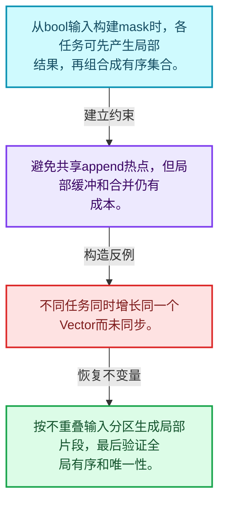
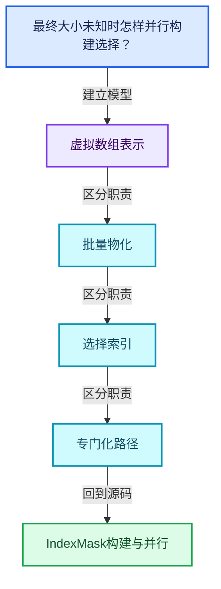
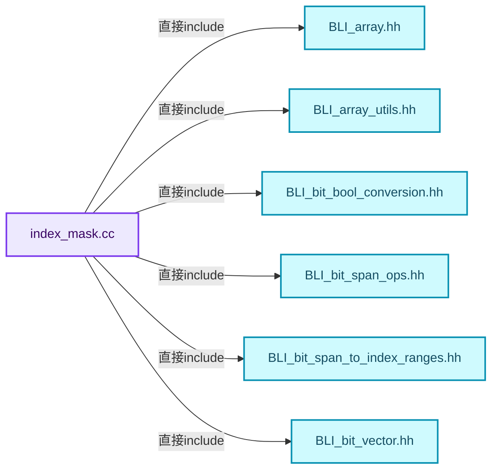
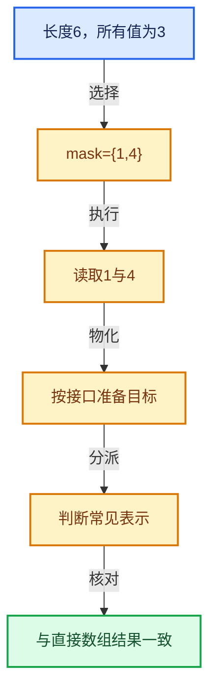

# 04-10 IndexMask构建与并行

[方向导航](README.md) · [总目录](../README.md) · [覆盖索引](../%E6%BA%90%E7%A0%81%E7%89%88%E6%9C%AC%E4%B8%8E%E8%A6%86%E7%9B%96%E7%B4%A2%E5%BC%95.md)

> 阅读顺序：问题与数据模型 → 语法与类型 → 源码逐行 → 调用线索 → 历史与取舍 → 推演和练习。

- 基准 HEAD：`cbda6b96c26c0dee3c3b5cbb93960c4ac06a6b30`。
- 记录日期：2026-10-14。
- 教学示例状态：正文中的推演不是本机性能实测；已运行练习见验收报告。

## 一、从问题到设计

最终大小未知时怎样并行构建选择？

局部构造后组合能减少共享写热点；输出顺序、唯一性和临时存储寿命必须同时保证。

本篇把语法、数据语义和系统取舍连接起来。表示与接口分离，元素编号与选择内部位置分离，生成成本与执行成本分离。

### 本篇独立模型与设计推理

从bool输入构建mask时，各任务可先产生局部结果，再组合成有序集合。

设计取舍：避免共享append热点，但局部缓冲和合并仍有成本。

最小反例：不同任务同时增长同一个Vector而未同步。

推导与处理：按不重叠输入分区生成局部片段，最后验证全局有序和唯一性。



### 源码范围与相邻篇章

| 文件 | 本篇逐行范围 | 基准SHA-256 |
|---|---|---|
| [source/blender/blenlib/intern/index_mask.cc](../../../../../source/blender/blenlib/intern/index_mask.cc) | L1—L1294 | `742f2e0e41cc1e62b3f402aaadc3d2b4ec3a0ec11fd87acc26b675ca85c20b87` |

同一主讲文件可能分多篇覆盖；超出本篇范围的符号通过覆盖索引定位。空行与纯注释保留在源码摘录中，逐行表解释有效语句与语法边界；许可证头统一保留。

前篇：[分段存储与遍历](09-%E5%88%86%E6%AE%B5%E5%AD%98%E5%82%A8%E4%B8%8E%E9%81%8D%E5%8E%86.md).

后篇：[集合表达式与运算](11-%E9%9B%86%E5%90%88%E8%A1%A8%E8%BE%BE%E5%BC%8F%E4%B8%8E%E8%BF%90%E7%AE%97.md).

## 二、类型、数据与阅读地图



这是概念依赖图，边表示阅读关系，不声称是运行时调用顺序。

### 直接编译依赖



箭头只表示头文件包含关系；完整调用线索见后面的符号定位表。

## 三、关键词、语法与类型角色

### 模板 template

模板把类型或常量作为生成实现的参数。读声明时先列出类型参数、非类型参数和默认值，再看使用者实际实例化了什么。模板声明本身不意味着每种T都支持其全部成员。

具体检查：把T替换为int、string、只能移动的类型，分别检查每个被调用操作是否成立。

### 依赖名称 typename

typename既可引入类型模板参数，也可告诉编译器某个依赖名称是类型。它不创建运行时对象；解析期确认语法类别与实例化期检查具体类型是不同阶段。

具体检查：区分typename T::value_type和T::size()，前者标记类型，后者是表达式。

### 常量求值 constexpr

constexpr声明允许相应实体参与常量求值，但constexpr函数仍可以在运行时执行。是否常量求值由调用场景和表达式合法性共同决定。

具体检查：比较constexpr变量初始化和从运行时输入调用同一函数。

### 只读限定 const

const约束当前访问路径可做的修改。const指针、指向const的指针、const视图对象、const元素是不同位置的限定；其他别名可能仍可修改原对象。

具体检查：分别写T* const、const T*与const T* const，并画出不可修改的层次。

### 异常边界 try与catch

try定义异常传播的局部边界。失败路径需要销毁已经成功构造的部分并释放相应存储；未构造的对象不能被析构。

具体检查：在第k次构造失败，列出已经存在的对象集合与待释放缓冲。

### 显式静态转换 static_cast

static_cast表达编译期允许的转换，不会自动验证运行时真实类型、指针寿命或索引边界。由void指针恢复T指针时，调用者仍须保证实际存储中确有合法T对象。

具体检查：标出转换前后的类型以及正确性依据来自哪里。

### 运行时多态 virtual

虚调用根据实际动态类型选择实现；经基类指针销毁对象时通常需要相应虚析构契约。每元素虚调用和循环外一次分派有不同开销。

具体检查：找出虚接口的实现类和调用频率，再讨论是否值得去虚拟化。

### 覆写检查 override

override要求函数确实覆盖基类虚函数，可捕获参数类型和const限定不匹配。它不改变基类规定的生命周期或线程约束。

具体检查：故意改变一个参数或const，观察编译器如何拒绝误写的新函数。

### 可选值 optional

optional把不存在与存在的T区分开，T的构造和析构跟随engaged状态变化。访问前应由has_value或条件分支证明存在。

具体检查：把空Field状态与合法常量零区分，不能用某个普通值代替不存在。

### 判别联合 variant

variant在若干候选类型中保存一个活动值，通过判别信息选择操作。它能把不同表示集中在值类型中，但各分支的复制移动成本不同。

具体检查：列出活动分支及每种分支实际拥有或借用的数据。

### 构造与new表达式

普通new可能分配并构造；placement new在给定地址构造，存储由其他机制提供。失败回滚应区分两类责任。

具体检查：追踪地址来自哪里、构造何时成功、由谁析构、由谁释放。

### 内部断言 assert

断言表达开发者预期成立的内部契约，发布构建可能关闭。它不能替代对不可信输入的完整错误处理，也不保证后续操作被运行时保护。

具体检查：对每条断言构造违反条件的输入，区分调用者错误与应向用户报告的错误。

### 编译期分支 if constexpr

条件在实例化时决定被保留的分支，这常用于不同类型的合法操作选择。它与运行时if有不同的实例化检查规则。

具体检查：找出每个分支依赖哪些类型特征，再使用满足与不满足条件的类型。

### 联合体 union

联合体成员共享存储，需要由活动成员约定决定合法读取方式。结合enum或其他判别信息阅读，不能把所有成员都当作同时存在。

具体检查：检查叶节点与内部节点分别使用哪些联合成员。

### 类型别名 using

类型别名为已有类型建立名字，不创建运行期对象。它常把模板内部使用的类型统一暴露给泛型调用者。

具体检查：展开别名直到基础类型，区分类型别名和变量声明。

## 四、真实源码与逐行讲解

源码块保持原行内容，原始行号由小节标题及逐行表给出。表中的调用定位是静态阅读辅助；重载、模板实例化、宏展开和虚调用需结合完整声明，不能仅凭词法出现证明动态调用。

### index_mask.cc：L1—L47

<!-- source:source/blender/blenlib/intern/index_mask.cc:1:47 -->

```cpp
/* SPDX-FileCopyrightText: 2023 Blender Authors
 *
 * SPDX-License-Identifier: GPL-2.0-or-later */

/** \file
 * \ingroup bli
 */

#include <fmt/format.h>
#include <fmt/ranges.h>
#include <iostream>

#include "BLI_array.hh"
#include "BLI_array_utils.hh"
#include "BLI_bit_bool_conversion.hh"
#include "BLI_bit_span_ops.hh"
#include "BLI_bit_span_to_index_ranges.hh"
#include "BLI_bit_vector.hh"
#include "BLI_enumerable_thread_specific.hh"
#include "BLI_index_mask.hh"
#include "BLI_index_mask_expression.hh"
#include "BLI_index_ranges_builder.hh"
#include "BLI_math_base.hh"
#include "BLI_rand.hh"
#include "BLI_set.hh"
#include "BLI_sort.hh"
#include "BLI_task.hh"
#include "BLI_threads.hh"
#include "BLI_vector_set.hh"
#include "BLI_virtual_array.hh"

#include "BLI_strict_flags.hh" /* IWYU pragma: keep. Keep last. */

namespace blender::index_mask {

template<typename T> void build_reverse_map(const IndexMask &mask, MutableSpan<T> r_map)
{
#ifndef NDEBUG
  /* Catch errors with asserts in debug builds. */
  r_map.fill(-1);
#endif
  BLI_assert(r_map.size() >= mask.min_array_size());
  mask.foreach_index_optimized<T>([&](const T src, const T dst) { r_map[src] = dst; },
                                  exec_mode::grain_size(4096));
}

template void build_reverse_map<int>(const IndexMask &mask, MutableSpan<int> r_map);
```

| 原始行 | 语义、约束与检查 |
|---|---|
| L9 | 引入编译依赖 <fmt/format.h>；这是声明可见性关系，不表示运行时一定调用该文件的所有接口。 |
| L10 | 引入编译依赖 <fmt/ranges.h>；这是声明可见性关系，不表示运行时一定调用该文件的所有接口。 |
| L11 | 引入编译依赖 <iostream>；这是声明可见性关系，不表示运行时一定调用该文件的所有接口。 |
| L13 | 引入编译依赖 "BLI_array.hh"；这是声明可见性关系，不表示运行时一定调用该文件的所有接口。 |
| L14 | 引入编译依赖 "BLI_array_utils.hh"；这是声明可见性关系，不表示运行时一定调用该文件的所有接口。 |
| L15 | 引入编译依赖 "BLI_bit_bool_conversion.hh"；这是声明可见性关系，不表示运行时一定调用该文件的所有接口。 |
| L16 | 引入编译依赖 "BLI_bit_span_ops.hh"；这是声明可见性关系，不表示运行时一定调用该文件的所有接口。 |
| L17 | 引入编译依赖 "BLI_bit_span_to_index_ranges.hh"；这是声明可见性关系，不表示运行时一定调用该文件的所有接口。 |
| L18 | 引入编译依赖 "BLI_bit_vector.hh"；这是声明可见性关系，不表示运行时一定调用该文件的所有接口。 |
| L19 | 引入编译依赖 "BLI_enumerable_thread_specific.hh"；这是声明可见性关系，不表示运行时一定调用该文件的所有接口。 |
| L20 | 引入编译依赖 "BLI_index_mask.hh"；这是声明可见性关系，不表示运行时一定调用该文件的所有接口。 |
| L21 | 引入编译依赖 "BLI_index_mask_expression.hh"；这是声明可见性关系，不表示运行时一定调用该文件的所有接口。 |
| L22 | 引入编译依赖 "BLI_index_ranges_builder.hh"；这是声明可见性关系，不表示运行时一定调用该文件的所有接口。 |
| L23 | 引入编译依赖 "BLI_math_base.hh"；这是声明可见性关系，不表示运行时一定调用该文件的所有接口。 |
| L24 | 引入编译依赖 "BLI_rand.hh"；这是声明可见性关系，不表示运行时一定调用该文件的所有接口。 |
| L25 | 引入编译依赖 "BLI_set.hh"；这是声明可见性关系，不表示运行时一定调用该文件的所有接口。 |
| L26 | 引入编译依赖 "BLI_sort.hh"；这是声明可见性关系，不表示运行时一定调用该文件的所有接口。 |
| L27 | 引入编译依赖 "BLI_task.hh"；这是声明可见性关系，不表示运行时一定调用该文件的所有接口。 |
| L28 | 引入编译依赖 "BLI_threads.hh"；这是声明可见性关系，不表示运行时一定调用该文件的所有接口。 |
| L29 | 引入编译依赖 "BLI_vector_set.hh"；这是声明可见性关系，不表示运行时一定调用该文件的所有接口。 |
| L30 | 引入编译依赖 "BLI_virtual_array.hh"；这是声明可见性关系，不表示运行时一定调用该文件的所有接口。 |
| L32 | 引入编译依赖 "BLI_strict_flags.hh"；这是声明可见性关系，不表示运行时一定调用该文件的所有接口。 |
| L34 | 把后续声明放入 blender::index_mask 命名空间，影响名称查找和符号归属，不创建运行时对象。 |
| L36 | 声明模板参数 `template<typename T> void build_reverse_map(const IndexMask &mask, MutableSpan<T> r_map)`。类型参数决定生成操作的类型，非类型参数可决定内嵌容量或编译期分支。 |
| L37 | 连接上一行的声明或控制结构与其语句块；后续行在这个作用域中执行或声明。 |
| L38 | 预处理阶段处理 #ifndef NDEBUG。它决定哪些代码进入编译，不是运行时分支；阅读行为时必须结合实际构建宏。 |
| L40 | 出现调用或函数声明 `fill`，对应表达式为 `r_map.fill(-1);`。参数求值、返回类型与重载需结合前后完整语句；静态文本引用不能证明动态目标。 |
| L41 | 预处理阶段处理 #endif。它决定哪些代码进入编译，不是运行时分支；阅读行为时必须结合实际构建宏。 |
| L42 | 断言约束 `BLI_assert(r_map.size() >= mask.min_array_size());`。条件是后续访问的内部前置条件；发布构建可能不执行，不能把断言当作输入修复。 |
| L43 | 把右侧 `dst; },` 用于初始化或更新左侧 `mask.foreach_index_optimized<T>([&](const T src, const T dst) { r_map[src]`。声明初始化与已有对象赋值应按上下文区分；有资源的类型会调用相应特殊成员。 |
| L44 | 出现调用或函数声明 `exec_mode::grain_size`，对应表达式为 `exec_mode::grain_size(4096));`。参数求值、返回类型与重载需结合前后完整语句；静态文本引用不能证明动态目标。 |
| L45 | 结束当前语法单元。局部自动对象在离开其作用域时按规则销毁；这不等于所有被引用的外部数据也被释放。 |
| L47 | 声明模板参数 `template void build_reverse_map<int>(const IndexMask &mask, MutableSpan<int> r_map);`。类型参数决定生成操作的类型，非类型参数可决定内嵌容量或编译期分支。 |

### index_mask.cc：L48—L102

<!-- source:source/blender/blenlib/intern/index_mask.cc:48:102 -->

```cpp

std::array<int16_t, max_segment_size> build_static_indices_array()
{
  std::array<int16_t, max_segment_size> data;
  for (int16_t i = 0; i < max_segment_size; i++) {
    data[size_t(i)] = i;
  }
  return data;
}

const IndexMask &get_static_index_mask_for_min_size(const int64_t min_size)
{
  static constexpr int64_t size_shift = 31;
  static constexpr int64_t max_size = (int64_t(1) << size_shift);      /* 2'147'483'648 */
  static constexpr int64_t segments_num = max_size / max_segment_size; /*       131'072 */

  /* Make sure we are never requesting a size that's larger than what was statically allocated.
   * If that's ever needed, we can either increase #size_shift or dynamically allocate an even
   * larger mask. */
  BLI_assert(min_size <= max_size);
  UNUSED_VARS_NDEBUG(min_size);

  static IndexMask static_mask = []() {
    static Array<const int16_t *> indices_by_segment(segments_num);
    /* The offsets and cumulative segment sizes array contain the same values here, so just use a
     * single array for both. */
    static Array<int64_t> segment_offsets(segments_num + 1);

    static const int16_t *static_offsets = get_static_indices_array().data();

    /* Isolate because the mutex protecting the initialization of #static_mask is locked. */
    threading::isolate_task([&]() {
      threading::parallel_for(IndexRange(segments_num), 1024, [&](const IndexRange range) {
        for (const int64_t segment_i : range) {
          indices_by_segment[segment_i] = static_offsets;
          segment_offsets[segment_i] = segment_i * max_segment_size;
        }
      });
    });
    segment_offsets.last() = max_size;

    IndexMask mask;
    IndexMaskData &data = mask.data_for_inplace_construction();
    data.indices_num_ = max_size;
    data.segments_num_ = segments_num;
    data.indices_by_segment_ = indices_by_segment.data();
    data.segment_offsets_ = segment_offsets.data();
    data.cumulative_segment_sizes_ = segment_offsets.data();
    data.begin_index_in_segment_ = 0;
    data.end_index_in_segment_ = max_segment_size;

    return mask;
  }();
  return static_mask;
}
```

| 原始行 | 语义、约束与检查 |
|---|---|
| L49 | 出现调用或函数声明 `build_static_indices_array`，对应表达式为 `std::array<int16_t, max_segment_size> build_static_indices_array()`。参数求值、返回类型与重载需结合前后完整语句；静态文本引用不能证明动态目标。 |
| L50 | 连接上一行的声明或控制结构与其语句块；后续行在这个作用域中执行或声明。 |
| L51 | 声明成员、局部对象或完成语句 `std::array<int16_t, max_segment_size> data`。若为指针或引用，它本身不说明拥有；若为值对象，其构造析构由所在作用域或外层对象管理。 |
| L52 | 纯虚接口声明：`for (int16_t i = 0; i < max_segment_size; i++) {`。等号零标记抽象接口，需要按继承约定提供覆写；不表示执行函数并把结果设为零。 |
| L53 | 把右侧 `i` 用于初始化或更新左侧 `data[size_t(i)]`。声明初始化与已有对象赋值应按上下文区分；有资源的类型会调用相应特殊成员。 |
| L54 | 结束当前语法单元。局部自动对象在离开其作用域时按规则销毁；这不等于所有被引用的外部数据也被释放。 |
| L55 | 返回表达式 `data`。 |
| L56 | 结束当前语法单元。局部自动对象在离开其作用域时按规则销毁；这不等于所有被引用的外部数据也被释放。 |
| L58 | 出现调用或函数声明 `get_static_index_mask_for_min_size`，对应表达式为 `const IndexMask &get_static_index_mask_for_min_size(const int64_t min_size)`。参数求值、返回类型与重载需结合前后完整语句；静态文本引用不能证明动态目标。 |
| L59 | 连接上一行的声明或控制结构与其语句块；后续行在这个作用域中执行或声明。 |
| L60 | 把右侧 `31` 用于初始化或更新左侧 `static constexpr int64_t size_shift`。声明初始化与已有对象赋值应按上下文区分；有资源的类型会调用相应特殊成员。 |
| L61 | 把右侧 `(int64_t(1) << size_shift)` 用于初始化或更新左侧 `static constexpr int64_t max_size`。声明初始化与已有对象赋值应按上下文区分；有资源的类型会调用相应特殊成员。 |
| L62 | 把右侧 `max_size / max_segment_size` 用于初始化或更新左侧 `static constexpr int64_t segments_num`。声明初始化与已有对象赋值应按上下文区分；有资源的类型会调用相应特殊成员。 |
| L67 | 断言约束 `BLI_assert(min_size <= max_size);`。条件是后续访问的内部前置条件；发布构建可能不执行，不能把断言当作输入修复。 |
| L68 | 出现调用或函数声明 `UNUSED_VARS_NDEBUG`，对应表达式为 `UNUSED_VARS_NDEBUG(min_size);`。参数求值、返回类型与重载需结合前后完整语句；静态文本引用不能证明动态目标。 |
| L70 | 把右侧 `[]() {` 用于初始化或更新左侧 `static IndexMask static_mask`。声明初始化与已有对象赋值应按上下文区分；有资源的类型会调用相应特殊成员。 |
| L71 | 声明接口 `static Array<const int16_t *> indices_by_segment(segments_num)`，本行没有对应函数体；返回类型、参数限定和const/noexcept共同组成调用契约，实际行为需继续定位实现。 |
| L74 | 声明接口 `static Array<int64_t> segment_offsets(segments_num + 1)`，本行没有对应函数体；返回类型、参数限定和const/noexcept共同组成调用契约，实际行为需继续定位实现。 |
| L76 | 把右侧 `get_static_indices_array().data()` 用于初始化或更新左侧 `static const int16_t *static_offsets`。声明初始化与已有对象赋值应按上下文区分；有资源的类型会调用相应特殊成员。 |
| L79 | 出现调用或函数声明 `threading::isolate_task`，对应表达式为 `threading::isolate_task([&]() {`。参数求值、返回类型与重载需结合前后完整语句；静态文本引用不能证明动态目标。 |
| L80 | 出现调用或函数声明 `threading::parallel_for`，对应表达式为 `threading::parallel_for(IndexRange(segments_num), 1024, [&](const IndexRange range) {`。参数求值、返回类型与重载需结合前后完整语句；静态文本引用不能证明动态目标。 |
| L81 | 按 `for (const int64_t segment_i : range)` 指定的范围或条件重复执行。对照循环变量与真实元素编号；循环内调用成本乘以实际迭代次数。 |
| L82 | 把右侧 `static_offsets` 用于初始化或更新左侧 `indices_by_segment[segment_i]`。声明初始化与已有对象赋值应按上下文区分；有资源的类型会调用相应特殊成员。 |
| L83 | 把右侧 `segment_i * max_segment_size` 用于初始化或更新左侧 `segment_offsets[segment_i]`。声明初始化与已有对象赋值应按上下文区分；有资源的类型会调用相应特殊成员。 |
| L84 | 结束当前语法单元。局部自动对象在离开其作用域时按规则销毁；这不等于所有被引用的外部数据也被释放。 |
| L85 | 结束当前语法单元。局部自动对象在离开其作用域时按规则销毁；这不等于所有被引用的外部数据也被释放。 |
| L86 | 结束当前语法单元。局部自动对象在离开其作用域时按规则销毁；这不等于所有被引用的外部数据也被释放。 |
| L87 | 把右侧 `max_size` 用于初始化或更新左侧 `segment_offsets.last()`。声明初始化与已有对象赋值应按上下文区分；有资源的类型会调用相应特殊成员。 |
| L89 | 声明成员、局部对象或完成语句 `IndexMask mask`。若为指针或引用，它本身不说明拥有；若为值对象，其构造析构由所在作用域或外层对象管理。 |
| L90 | 把右侧 `mask.data_for_inplace_construction()` 用于初始化或更新左侧 `IndexMaskData &data`。声明初始化与已有对象赋值应按上下文区分；有资源的类型会调用相应特殊成员。 |
| L91 | 把右侧 `max_size` 用于初始化或更新左侧 `data.indices_num_`。声明初始化与已有对象赋值应按上下文区分；有资源的类型会调用相应特殊成员。 |
| L92 | 把右侧 `segments_num` 用于初始化或更新左侧 `data.segments_num_`。声明初始化与已有对象赋值应按上下文区分；有资源的类型会调用相应特殊成员。 |
| L93 | 把右侧 `indices_by_segment.data()` 用于初始化或更新左侧 `data.indices_by_segment_`。声明初始化与已有对象赋值应按上下文区分；有资源的类型会调用相应特殊成员。 |
| L94 | 把右侧 `segment_offsets.data()` 用于初始化或更新左侧 `data.segment_offsets_`。声明初始化与已有对象赋值应按上下文区分；有资源的类型会调用相应特殊成员。 |
| L95 | 把右侧 `segment_offsets.data()` 用于初始化或更新左侧 `data.cumulative_segment_sizes_`。声明初始化与已有对象赋值应按上下文区分；有资源的类型会调用相应特殊成员。 |
| L96 | 把右侧 `0` 用于初始化或更新左侧 `data.begin_index_in_segment_`。声明初始化与已有对象赋值应按上下文区分；有资源的类型会调用相应特殊成员。 |
| L97 | 把右侧 `max_segment_size` 用于初始化或更新左侧 `data.end_index_in_segment_`。声明初始化与已有对象赋值应按上下文区分；有资源的类型会调用相应特殊成员。 |
| L99 | 返回表达式 `mask`。 |
| L100 | 声明成员、局部对象或完成语句 `}()`。若为指针或引用，它本身不说明拥有；若为值对象，其构造析构由所在作用域或外层对象管理。 |
| L101 | 返回表达式 `static_mask`。 |
| L102 | 结束当前语法单元。局部自动对象在离开其作用域时按规则销毁；这不等于所有被引用的外部数据也被释放。 |

### index_mask.cc：L103—L142

<!-- source:source/blender/blenlib/intern/index_mask.cc:103:142 -->

```cpp

std::ostream &operator<<(std::ostream &stream, const IndexMask &mask)
{
  Array<int64_t> indices(mask.size());
  mask.to_indices<int64_t>(indices);
  Vector<std::variant<IndexRange, Span<int64_t>>> segments;
  unique_sorted_indices::split_to_ranges_and_spans<int64_t>(indices, 8, segments);
  Vector<std::string> parts;
  for (const std::variant<IndexRange, Span<int64_t>> &segment : segments) {
    if (std::holds_alternative<IndexRange>(segment)) {
      const IndexRange range = std::get<IndexRange>(segment);
      parts.append(fmt::format("{}-{}", range.first(), range.last()));
    }
    else {
      const Span<int64_t> segment_indices = std::get<Span<int64_t>>(segment);
      parts.append(fmt::format("{}", fmt::join(segment_indices, ", ")));
    }
  }
  stream << fmt::format("(Size: {} | {})", mask.size(), fmt::join(parts, ", "));
  return stream;
}

IndexMask IndexMask::slice(const int64_t start, const int64_t size) const
{
  if (size == 0) {
    return {};
  }
  const RawMaskIterator first_it = this->index_to_iterator(start);
  const RawMaskIterator last_it = this->index_to_iterator(start + size - 1);

  IndexMask sliced = *this;
  sliced.indices_num_ = size;
  sliced.segments_num_ = last_it.segment_i - first_it.segment_i + 1;
  sliced.indices_by_segment_ += first_it.segment_i;
  sliced.segment_offsets_ += first_it.segment_i;
  sliced.cumulative_segment_sizes_ += first_it.segment_i;
  sliced.begin_index_in_segment_ = first_it.index_in_segment;
  sliced.end_index_in_segment_ = last_it.index_in_segment + 1;
  return sliced;
}
```

本段语义重点：

- 分支证据 `std::holds_alternative<IndexRange>(segment))`：分别推演条件成立与不成立，核对相同出口处的状态。
- 分支证据 `size == 0)`：分别推演条件成立与不成立，核对相同出口处的状态。

| 原始行 | 语义、约束与检查 |
|---|---|
| L104 | 运算符重载声明、定义或显式调用：`std::ostream &operator<<(std::ostream &stream, const IndexMask &mask)`。结合参数和返回类型判断是赋值、索引、比较还是转换；operator=声明中的等号不是在给名为operator的变量赋值。 |
| L105 | 连接上一行的声明或控制结构与其语句块；后续行在这个作用域中执行或声明。 |
| L106 | 出现调用或函数声明 `indices`，对应表达式为 `Array<int64_t> indices(mask.size());`。参数求值、返回类型与重载需结合前后完整语句；静态文本引用不能证明动态目标。 |
| L107 | 出现调用或函数声明 `to_indices`，对应表达式为 `mask.to_indices<int64_t>(indices);`。参数求值、返回类型与重载需结合前后完整语句；静态文本引用不能证明动态目标。 |
| L108 | 声明成员、局部对象或完成语句 `Vector<std::variant<IndexRange, Span<int64_t>>> segments`。若为指针或引用，它本身不说明拥有；若为值对象，其构造析构由所在作用域或外层对象管理。 |
| L109 | 出现调用或函数声明 `unique_sorted_indices::split_to_ranges_and_spans`，对应表达式为 `unique_sorted_indices::split_to_ranges_and_spans<int64_t>(indices, 8, segments);`。参数求值、返回类型与重载需结合前后完整语句；静态文本引用不能证明动态目标。 |
| L110 | 声明成员、局部对象或完成语句 `Vector<std::string> parts`。若为指针或引用，它本身不说明拥有；若为值对象，其构造析构由所在作用域或外层对象管理。 |
| L111 | 按 `for (const std::variant<IndexRange, Span<int64_t>> &segment : segments)` 指定的范围或条件重复执行。对照循环变量与真实元素编号；循环内调用成本乘以实际迭代次数。 |
| L112 | 判断 `std::holds_alternative<IndexRange>(segment)`，成立时进入本分支，否则继续后续路径。 |
| L113 | 把右侧 `std::get<IndexRange>(segment)` 用于初始化或更新左侧 `const IndexRange range`。声明初始化与已有对象赋值应按上下文区分；有资源的类型会调用相应特殊成员。 |
| L114 | 出现调用或函数声明 `append`，对应表达式为 `parts.append(fmt::format("{}-{}", range.first(), range.last()));`。参数求值、返回类型与重载需结合前后完整语句；静态文本引用不能证明动态目标。 |
| L115 | 结束当前语法单元。局部自动对象在离开其作用域时按规则销毁；这不等于所有被引用的外部数据也被释放。 |
| L116 | 处理前一条件不成立的互补路径。比较两条路径最后是否恢复同一不变量，以及是否产生不同的资源责任。 |
| L117 | 把右侧 `std::get<Span<int64_t>>(segment)` 用于初始化或更新左侧 `const Span<int64_t> segment_indices`。声明初始化与已有对象赋值应按上下文区分；有资源的类型会调用相应特殊成员。 |
| L118 | 出现调用或函数声明 `append`，对应表达式为 `parts.append(fmt::format("{}", fmt::join(segment_indices, ", ")));`。参数求值、返回类型与重载需结合前后完整语句；静态文本引用不能证明动态目标。 |
| L119 | 结束当前语法单元。局部自动对象在离开其作用域时按规则销毁；这不等于所有被引用的外部数据也被释放。 |
| L120 | 结束当前语法单元。局部自动对象在离开其作用域时按规则销毁；这不等于所有被引用的外部数据也被释放。 |
| L121 | 出现调用或函数声明 `fmt::format`，对应表达式为 `stream << fmt::format("(Size: {} &#124; {})", mask.size(), fmt::join(parts, ", "));`。参数求值、返回类型与重载需结合前后完整语句；静态文本引用不能证明动态目标。 |
| L122 | 返回表达式 `stream`。 |
| L123 | 结束当前语法单元。局部自动对象在离开其作用域时按规则销毁；这不等于所有被引用的外部数据也被释放。 |
| L125 | 出现调用或函数声明 `IndexMask::slice`，对应表达式为 `IndexMask IndexMask::slice(const int64_t start, const int64_t size) const`。参数求值、返回类型与重载需结合前后完整语句；静态文本引用不能证明动态目标。 |
| L126 | 连接上一行的声明或控制结构与其语句块；后续行在这个作用域中执行或声明。 |
| L127 | 判断 `size == 0`，成立时进入本分支，否则继续后续路径。该边界影响可访问元素或可用容量，两者要按各变量的定义区分。 |
| L128 | 返回表达式 `{}`。 |
| L129 | 结束当前语法单元。局部自动对象在离开其作用域时按规则销毁；这不等于所有被引用的外部数据也被释放。 |
| L130 | 把右侧 `this->index_to_iterator(start)` 用于初始化或更新左侧 `const RawMaskIterator first_it`。声明初始化与已有对象赋值应按上下文区分；有资源的类型会调用相应特殊成员。 |
| L131 | 把右侧 `this->index_to_iterator(start + size - 1)` 用于初始化或更新左侧 `const RawMaskIterator last_it`。声明初始化与已有对象赋值应按上下文区分；有资源的类型会调用相应特殊成员。 |
| L133 | 把右侧 `*this` 用于初始化或更新左侧 `IndexMask sliced`。声明初始化与已有对象赋值应按上下文区分；有资源的类型会调用相应特殊成员。 |
| L134 | 把右侧 `size` 用于初始化或更新左侧 `sliced.indices_num_`。声明初始化与已有对象赋值应按上下文区分；有资源的类型会调用相应特殊成员。 |
| L135 | 把右侧 `last_it.segment_i - first_it.segment_i + 1` 用于初始化或更新左侧 `sliced.segments_num_`。声明初始化与已有对象赋值应按上下文区分；有资源的类型会调用相应特殊成员。 |
| L136 | 复合更新 `sliced.indices_by_segment_ += first_it.segment_i`：读取左侧现有值，与右侧按`+=`对应操作组合后写回。检查数值边界、位掩码或共享状态保护；它不是新对象的构造。 |
| L137 | 复合更新 `sliced.segment_offsets_ += first_it.segment_i`：读取左侧现有值，与右侧按`+=`对应操作组合后写回。检查数值边界、位掩码或共享状态保护；它不是新对象的构造。 |
| L138 | 复合更新 `sliced.cumulative_segment_sizes_ += first_it.segment_i`：读取左侧现有值，与右侧按`+=`对应操作组合后写回。检查数值边界、位掩码或共享状态保护；它不是新对象的构造。 |
| L139 | 把右侧 `first_it.index_in_segment` 用于初始化或更新左侧 `sliced.begin_index_in_segment_`。声明初始化与已有对象赋值应按上下文区分；有资源的类型会调用相应特殊成员。 |
| L140 | 把右侧 `last_it.index_in_segment + 1` 用于初始化或更新左侧 `sliced.end_index_in_segment_`。声明初始化与已有对象赋值应按上下文区分；有资源的类型会调用相应特殊成员。 |
| L141 | 返回表达式 `sliced`。 |
| L142 | 结束当前语法单元。局部自动对象在离开其作用域时按规则销毁；这不等于所有被引用的外部数据也被释放。 |

### index_mask.cc：L143—L189

<!-- source:source/blender/blenlib/intern/index_mask.cc:143:189 -->

```cpp

IndexMask IndexMask::slice(const RawMaskIterator first_it,
                           const RawMaskIterator last_it,
                           const int64_t size) const
{
  BLI_assert(this->iterator_to_index(last_it) - this->iterator_to_index(first_it) + 1 == size);
  IndexMask sliced = *this;
  sliced.indices_num_ = size;
  sliced.segments_num_ = last_it.segment_i - first_it.segment_i + 1;
  sliced.indices_by_segment_ += first_it.segment_i;
  sliced.segment_offsets_ += first_it.segment_i;
  sliced.cumulative_segment_sizes_ += first_it.segment_i;
  sliced.begin_index_in_segment_ = first_it.index_in_segment;
  sliced.end_index_in_segment_ = last_it.index_in_segment + 1;
  return sliced;
}

IndexMask IndexMask::slice_content(const IndexRange range) const
{
  return this->slice_content(range.start(), range.size());
}

IndexMask IndexMask::slice_content(const int64_t start, const int64_t size) const
{
  if (size <= 0) {
    return {};
  }
  const std::optional<RawMaskIterator> first_it = this->find_larger_equal(start);
  const std::optional<RawMaskIterator> last_it = this->find_smaller_equal(start + size - 1);
  if (!first_it || !last_it) {
    return {};
  }
  const int64_t first_index = this->iterator_to_index(*first_it);
  const int64_t last_index = this->iterator_to_index(*last_it);
  if (last_index < first_index) {
    return {};
  }
  const int64_t sliced_mask_size = last_index - first_index + 1;
  return this->slice(*first_it, *last_it, sliced_mask_size);
}

IndexMask IndexMask::slice_and_shift(const IndexRange range,
                                     const int64_t offset,
                                     LinearAllocator<> &memory) const
{
  return this->slice_and_shift(range.start(), range.size(), offset, memory);
}
```

本段语义重点：

- 分支证据 `size <= 0)`：分别推演条件成立与不成立，核对相同出口处的状态。
- 分支证据 `!first_it &#124;&#124; !last_it)`：分别推演条件成立与不成立，核对相同出口处的状态。

| 原始行 | 语义、约束与检查 |
|---|---|
| L144 | 出现调用或函数声明 `IndexMask::slice`，对应表达式为 `IndexMask IndexMask::slice(const RawMaskIterator first_it,`。参数求值、返回类型与重载需结合前后完整语句；静态文本引用不能证明动态目标。 |
| L145 | 本行是连续声明或表达式的一部分：`const RawMaskIterator last_it,`。与本段前后行合读；逗号、括号和限定符决定它属于参数、初始化列表还是实际计算。 |
| L146 | 本行是连续声明或表达式的一部分：`const int64_t size) const`。与本段前后行合读；逗号、括号和限定符决定它属于参数、初始化列表还是实际计算。 |
| L147 | 连接上一行的声明或控制结构与其语句块；后续行在这个作用域中执行或声明。 |
| L148 | 断言约束 `BLI_assert(this->iterator_to_index(last_it) - this->iterator_to_index(first_it) + 1 == size);`。条件是后续访问的内部前置条件；发布构建可能不执行，不能把断言当作输入修复。 |
| L149 | 把右侧 `*this` 用于初始化或更新左侧 `IndexMask sliced`。声明初始化与已有对象赋值应按上下文区分；有资源的类型会调用相应特殊成员。 |
| L150 | 把右侧 `size` 用于初始化或更新左侧 `sliced.indices_num_`。声明初始化与已有对象赋值应按上下文区分；有资源的类型会调用相应特殊成员。 |
| L151 | 把右侧 `last_it.segment_i - first_it.segment_i + 1` 用于初始化或更新左侧 `sliced.segments_num_`。声明初始化与已有对象赋值应按上下文区分；有资源的类型会调用相应特殊成员。 |
| L152 | 复合更新 `sliced.indices_by_segment_ += first_it.segment_i`：读取左侧现有值，与右侧按`+=`对应操作组合后写回。检查数值边界、位掩码或共享状态保护；它不是新对象的构造。 |
| L153 | 复合更新 `sliced.segment_offsets_ += first_it.segment_i`：读取左侧现有值，与右侧按`+=`对应操作组合后写回。检查数值边界、位掩码或共享状态保护；它不是新对象的构造。 |
| L154 | 复合更新 `sliced.cumulative_segment_sizes_ += first_it.segment_i`：读取左侧现有值，与右侧按`+=`对应操作组合后写回。检查数值边界、位掩码或共享状态保护；它不是新对象的构造。 |
| L155 | 把右侧 `first_it.index_in_segment` 用于初始化或更新左侧 `sliced.begin_index_in_segment_`。声明初始化与已有对象赋值应按上下文区分；有资源的类型会调用相应特殊成员。 |
| L156 | 把右侧 `last_it.index_in_segment + 1` 用于初始化或更新左侧 `sliced.end_index_in_segment_`。声明初始化与已有对象赋值应按上下文区分；有资源的类型会调用相应特殊成员。 |
| L157 | 返回表达式 `sliced`。 |
| L158 | 结束当前语法单元。局部自动对象在离开其作用域时按规则销毁；这不等于所有被引用的外部数据也被释放。 |
| L160 | 出现调用或函数声明 `IndexMask::slice_content`，对应表达式为 `IndexMask IndexMask::slice_content(const IndexRange range) const`。参数求值、返回类型与重载需结合前后完整语句；静态文本引用不能证明动态目标。 |
| L161 | 连接上一行的声明或控制结构与其语句块；后续行在这个作用域中执行或声明。 |
| L162 | 返回表达式 `this->slice_content(range.start(), range.size())`。 |
| L163 | 结束当前语法单元。局部自动对象在离开其作用域时按规则销毁；这不等于所有被引用的外部数据也被释放。 |
| L165 | 出现调用或函数声明 `IndexMask::slice_content`，对应表达式为 `IndexMask IndexMask::slice_content(const int64_t start, const int64_t size) const`。参数求值、返回类型与重载需结合前后完整语句；静态文本引用不能证明动态目标。 |
| L166 | 连接上一行的声明或控制结构与其语句块；后续行在这个作用域中执行或声明。 |
| L167 | 判断 `size <= 0`，成立时进入本分支，否则继续后续路径。该边界影响可访问元素或可用容量，两者要按各变量的定义区分。 |
| L168 | 返回表达式 `{}`。 |
| L169 | 结束当前语法单元。局部自动对象在离开其作用域时按规则销毁；这不等于所有被引用的外部数据也被释放。 |
| L170 | 把右侧 `this->find_larger_equal(start)` 用于初始化或更新左侧 `const std::optional<RawMaskIterator> first_it`。声明初始化与已有对象赋值应按上下文区分；有资源的类型会调用相应特殊成员。 |
| L171 | 把右侧 `this->find_smaller_equal(start + size - 1)` 用于初始化或更新左侧 `const std::optional<RawMaskIterator> last_it`。声明初始化与已有对象赋值应按上下文区分；有资源的类型会调用相应特殊成员。 |
| L172 | 判断 `!first_it &#124;&#124; !last_it`，成立时进入本分支，否则继续后续路径。 |
| L173 | 返回表达式 `{}`。 |
| L174 | 结束当前语法单元。局部自动对象在离开其作用域时按规则销毁；这不等于所有被引用的外部数据也被释放。 |
| L175 | 把右侧 `this->iterator_to_index(*first_it)` 用于初始化或更新左侧 `const int64_t first_index`。声明初始化与已有对象赋值应按上下文区分；有资源的类型会调用相应特殊成员。 |
| L176 | 把右侧 `this->iterator_to_index(*last_it)` 用于初始化或更新左侧 `const int64_t last_index`。声明初始化与已有对象赋值应按上下文区分；有资源的类型会调用相应特殊成员。 |
| L177 | 判断 `last_index < first_index`，成立时进入本分支，否则继续后续路径。 |
| L178 | 返回表达式 `{}`。 |
| L179 | 结束当前语法单元。局部自动对象在离开其作用域时按规则销毁；这不等于所有被引用的外部数据也被释放。 |
| L180 | 把右侧 `last_index - first_index + 1` 用于初始化或更新左侧 `const int64_t sliced_mask_size`。声明初始化与已有对象赋值应按上下文区分；有资源的类型会调用相应特殊成员。 |
| L181 | 返回表达式 `this->slice(*first_it, *last_it, sliced_mask_size)`。 |
| L182 | 结束当前语法单元。局部自动对象在离开其作用域时按规则销毁；这不等于所有被引用的外部数据也被释放。 |
| L184 | 出现调用或函数声明 `IndexMask::slice_and_shift`，对应表达式为 `IndexMask IndexMask::slice_and_shift(const IndexRange range,`。参数求值、返回类型与重载需结合前后完整语句；静态文本引用不能证明动态目标。 |
| L185 | 本行是连续声明或表达式的一部分：`const int64_t offset,`。与本段前后行合读；逗号、括号和限定符决定它属于参数、初始化列表还是实际计算。 |
| L186 | 本行是连续声明或表达式的一部分：`LinearAllocator<> &memory) const`。与本段前后行合读；逗号、括号和限定符决定它属于参数、初始化列表还是实际计算。 |
| L187 | 连接上一行的声明或控制结构与其语句块；后续行在这个作用域中执行或声明。 |
| L188 | 返回表达式 `this->slice_and_shift(range.start(), range.size(), offset, memory)`。 |
| L189 | 结束当前语法单元。局部自动对象在离开其作用域时按规则销毁；这不等于所有被引用的外部数据也被释放。 |

### index_mask.cc：L190—L224

<!-- source:source/blender/blenlib/intern/index_mask.cc:190:224 -->

```cpp

IndexMask IndexMask::slice_and_shift(const int64_t start,
                                     const int64_t size,
                                     const int64_t offset,
                                     LinearAllocator<> &memory) const
{
  if (size == 0) {
    return {};
  }
  if (std::optional<IndexRange> range = this->to_range()) {
    return range->slice(start, size).shift(offset);
  }
  return this->slice(start, size).shift(offset, memory);
}

IndexMask IndexMask::shift(const int64_t offset, LinearAllocator<> &memory) const
{
  if (indices_num_ == 0) {
    return {};
  }
  BLI_assert(this->first() + offset >= 0);
  if (offset == 0) {
    return *this;
  }
  if (std::optional<IndexRange> range = this->to_range()) {
    return range->shift(offset);
  }
  IndexMask shifted_mask = *this;
  MutableSpan<int64_t> new_segment_offsets = memory.allocate_array<int64_t>(segments_num_);
  for (const int64_t i : IndexRange(segments_num_)) {
    new_segment_offsets[i] = segment_offsets_[i] + offset;
  }
  shifted_mask.segment_offsets_ = new_segment_offsets.data();
  return shifted_mask;
}
```

本段语义重点：

- 分支证据 `size == 0)`：分别推演条件成立与不成立，核对相同出口处的状态。
- 分支证据 `std::optional<IndexRange> range = this->to_range())`：分别推演条件成立与不成立，核对相同出口处的状态。

| 原始行 | 语义、约束与检查 |
|---|---|
| L191 | 出现调用或函数声明 `IndexMask::slice_and_shift`，对应表达式为 `IndexMask IndexMask::slice_and_shift(const int64_t start,`。参数求值、返回类型与重载需结合前后完整语句；静态文本引用不能证明动态目标。 |
| L192 | 本行是连续声明或表达式的一部分：`const int64_t size,`。与本段前后行合读；逗号、括号和限定符决定它属于参数、初始化列表还是实际计算。 |
| L193 | 本行是连续声明或表达式的一部分：`const int64_t offset,`。与本段前后行合读；逗号、括号和限定符决定它属于参数、初始化列表还是实际计算。 |
| L194 | 本行是连续声明或表达式的一部分：`LinearAllocator<> &memory) const`。与本段前后行合读；逗号、括号和限定符决定它属于参数、初始化列表还是实际计算。 |
| L195 | 连接上一行的声明或控制结构与其语句块；后续行在这个作用域中执行或声明。 |
| L196 | 判断 `size == 0`，成立时进入本分支，否则继续后续路径。该边界影响可访问元素或可用容量，两者要按各变量的定义区分。 |
| L197 | 返回表达式 `{}`。 |
| L198 | 结束当前语法单元。局部自动对象在离开其作用域时按规则销毁；这不等于所有被引用的外部数据也被释放。 |
| L199 | 判断 `std::optional<IndexRange> range = this->to_range()`，成立时进入本分支，否则继续后续路径。 |
| L200 | 返回表达式 `range->slice(start, size).shift(offset)`。 |
| L201 | 结束当前语法单元。局部自动对象在离开其作用域时按规则销毁；这不等于所有被引用的外部数据也被释放。 |
| L202 | 返回表达式 `this->slice(start, size).shift(offset, memory)`。 |
| L203 | 结束当前语法单元。局部自动对象在离开其作用域时按规则销毁；这不等于所有被引用的外部数据也被释放。 |
| L205 | 出现调用或函数声明 `IndexMask::shift`，对应表达式为 `IndexMask IndexMask::shift(const int64_t offset, LinearAllocator<> &memory) const`。参数求值、返回类型与重载需结合前后完整语句；静态文本引用不能证明动态目标。 |
| L206 | 连接上一行的声明或控制结构与其语句块；后续行在这个作用域中执行或声明。 |
| L207 | 判断 `indices_num_ == 0`，成立时进入本分支，否则继续后续路径。 |
| L208 | 返回表达式 `{}`。 |
| L209 | 结束当前语法单元。局部自动对象在离开其作用域时按规则销毁；这不等于所有被引用的外部数据也被释放。 |
| L210 | 断言约束 `BLI_assert(this->first() + offset >= 0);`。条件是后续访问的内部前置条件；发布构建可能不执行，不能把断言当作输入修复。 |
| L211 | 判断 `offset == 0`，成立时进入本分支，否则继续后续路径。 |
| L212 | 返回表达式 `*this`。返回当前对象；返回类型决定它是引用还是值，不能仅凭表达式假定复制。 |
| L213 | 结束当前语法单元。局部自动对象在离开其作用域时按规则销毁；这不等于所有被引用的外部数据也被释放。 |
| L214 | 判断 `std::optional<IndexRange> range = this->to_range()`，成立时进入本分支，否则继续后续路径。 |
| L215 | 返回表达式 `range->shift(offset)`。 |
| L216 | 结束当前语法单元。局部自动对象在离开其作用域时按规则销毁；这不等于所有被引用的外部数据也被释放。 |
| L217 | 把右侧 `*this` 用于初始化或更新左侧 `IndexMask shifted_mask`。声明初始化与已有对象赋值应按上下文区分；有资源的类型会调用相应特殊成员。 |
| L218 | 把右侧 `memory.allocate_array<int64_t>(segments_num_)` 用于初始化或更新左侧 `MutableSpan<int64_t> new_segment_offsets`。声明初始化与已有对象赋值应按上下文区分；有资源的类型会调用相应特殊成员。 |
| L219 | 按 `for (const int64_t i : IndexRange(segments_num_))` 指定的范围或条件重复执行。对照循环变量与真实元素编号；循环内调用成本乘以实际迭代次数。 |
| L220 | 把右侧 `segment_offsets_[i] + offset` 用于初始化或更新左侧 `new_segment_offsets[i]`。声明初始化与已有对象赋值应按上下文区分；有资源的类型会调用相应特殊成员。 |
| L221 | 结束当前语法单元。局部自动对象在离开其作用域时按规则销毁；这不等于所有被引用的外部数据也被释放。 |
| L222 | 把右侧 `new_segment_offsets.data()` 用于初始化或更新左侧 `shifted_mask.segment_offsets_`。声明初始化与已有对象赋值应按上下文区分；有资源的类型会调用相应特殊成员。 |
| L223 | 返回表达式 `shifted_mask`。 |
| L224 | 结束当前语法单元。局部自动对象在离开其作用域时按规则销毁；这不等于所有被引用的外部数据也被释放。 |

### index_mask.cc：L225—L286

<!-- source:source/blender/blenlib/intern/index_mask.cc:225:286 -->

```cpp

int64_t consolidate_index_mask_segments(MutableSpan<IndexMaskSegment> segments,
                                        LinearAllocator<> & /*memory*/)
{
  if (segments.is_empty()) {
    return 0;
  }

  const Span<int16_t> static_indices = get_static_indices_array();

  /* TODO: Support merging non-range segments in some cases as well. */
  int64_t group_start_segment_i = 0;
  int64_t group_first = segments[0][0];
  int64_t group_last = segments[0].last();
  bool group_as_range = unique_sorted_indices::non_empty_is_range(segments[0].base_span());

  auto finish_group = [&](const int64_t last_segment_i) {
    if (group_start_segment_i == last_segment_i) {
      return;
    }
    /* Join multiple ranges together into a bigger range. */
    const IndexRange range = IndexRange::from_begin_end_inclusive(group_first, group_last);
    segments[group_start_segment_i] = IndexMaskSegment(range[0],
                                                       static_indices.take_front(range.size()));
    for (int64_t i = group_start_segment_i + 1; i <= last_segment_i; i++) {
      segments[i] = {};
    }
  };

  for (const int64_t segment_i : segments.index_range().drop_front(1)) {
    const IndexMaskSegment segment = segments[segment_i];
    const std::optional<IndexRange> segment_base_range =
        unique_sorted_indices::non_empty_as_range_try(segment.base_span());
    const bool segment_is_range = segment_base_range.has_value();

    if (group_as_range && segment_is_range) {
      if (group_last + 1 == segment[0]) {
        if (segment.last() - group_first + 1 < max_segment_size) {
          /* Can combine previous and current range. */
          group_last = segment.last();
          continue;
        }
      }
    }
    finish_group(segment_i - 1);

    group_start_segment_i = segment_i;
    group_first = segment[0];
    group_last = segment.last();
    group_as_range = segment_is_range;
  }
  finish_group(segments.size() - 1);

  /* Remove all segments that have been merged into previous segments. */
  const int64_t new_segments_num = std::remove_if(segments.begin(),
                                                  segments.end(),
                                                  [](const IndexMaskSegment segment) {
                                                    return segment.is_empty();
                                                  }) -
                                   segments.begin();
  return new_segments_num;
}
```

本段语义重点：

- 分支证据 `segments.is_empty())`：分别推演条件成立与不成立，核对相同出口处的状态。
- 分支证据 `group_start_segment_i == last_segment_i)`：分别推演条件成立与不成立，核对相同出口处的状态。

| 原始行 | 语义、约束与检查 |
|---|---|
| L226 | 出现调用或函数声明 `consolidate_index_mask_segments`，对应表达式为 `int64_t consolidate_index_mask_segments(MutableSpan<IndexMaskSegment> segments,`。参数求值、返回类型与重载需结合前后完整语句；静态文本引用不能证明动态目标。 |
| L227 | 本行是连续声明或表达式的一部分：`LinearAllocator<> & )`。与本段前后行合读；逗号、括号和限定符决定它属于参数、初始化列表还是实际计算。 |
| L228 | 连接上一行的声明或控制结构与其语句块；后续行在这个作用域中执行或声明。 |
| L229 | 判断 `segments.is_empty()`，成立时进入本分支，否则继续后续路径。 |
| L230 | 返回表达式 `0`。 |
| L231 | 结束当前语法单元。局部自动对象在离开其作用域时按规则销毁；这不等于所有被引用的外部数据也被释放。 |
| L233 | 把右侧 `get_static_indices_array()` 用于初始化或更新左侧 `const Span<int16_t> static_indices`。声明初始化与已有对象赋值应按上下文区分；有资源的类型会调用相应特殊成员。 |
| L236 | 把右侧 `0` 用于初始化或更新左侧 `int64_t group_start_segment_i`。声明初始化与已有对象赋值应按上下文区分；有资源的类型会调用相应特殊成员。 |
| L237 | 把右侧 `segments[0][0]` 用于初始化或更新左侧 `int64_t group_first`。声明初始化与已有对象赋值应按上下文区分；有资源的类型会调用相应特殊成员。 |
| L238 | 把右侧 `segments[0].last()` 用于初始化或更新左侧 `int64_t group_last`。声明初始化与已有对象赋值应按上下文区分；有资源的类型会调用相应特殊成员。 |
| L239 | 把右侧 `unique_sorted_indices::non_empty_is_range(segments[0].base_span())` 用于初始化或更新左侧 `bool group_as_range`。声明初始化与已有对象赋值应按上下文区分；有资源的类型会调用相应特殊成员。 |
| L241 | 把右侧 `[&](const int64_t last_segment_i) {` 用于初始化或更新左侧 `auto finish_group`。声明初始化与已有对象赋值应按上下文区分；有资源的类型会调用相应特殊成员。 |
| L242 | 判断 `group_start_segment_i == last_segment_i`，成立时进入本分支，否则继续后续路径。 |
| L243 | 结束当前函数，本路径不再执行后续语句；局部对象按作用域规则清理。 |
| L244 | 结束当前语法单元。局部自动对象在离开其作用域时按规则销毁；这不等于所有被引用的外部数据也被释放。 |
| L246 | 把右侧 `IndexRange::from_begin_end_inclusive(group_first, group_last)` 用于初始化或更新左侧 `const IndexRange range`。声明初始化与已有对象赋值应按上下文区分；有资源的类型会调用相应特殊成员。 |
| L247 | 把右侧 `IndexMaskSegment(range[0],` 用于初始化或更新左侧 `segments[group_start_segment_i]`。声明初始化与已有对象赋值应按上下文区分；有资源的类型会调用相应特殊成员。 |
| L248 | 出现调用或函数声明 `take_front`，对应表达式为 `static_indices.take_front(range.size()));`。参数求值、返回类型与重载需结合前后完整语句；静态文本引用不能证明动态目标。 |
| L249 | 按 `for (int64_t i = group_start_segment_i + 1; i <= last_segment_i; i++)` 指定的范围或条件重复执行。对照循环变量与真实元素编号；循环内调用成本乘以实际迭代次数。 |
| L250 | 把右侧 `{}` 用于初始化或更新左侧 `segments[i]`。声明初始化与已有对象赋值应按上下文区分；有资源的类型会调用相应特殊成员。 |
| L251 | 结束当前语法单元。局部自动对象在离开其作用域时按规则销毁；这不等于所有被引用的外部数据也被释放。 |
| L252 | 结束当前语法单元。局部自动对象在离开其作用域时按规则销毁；这不等于所有被引用的外部数据也被释放。 |
| L254 | 按 `for (const int64_t segment_i : segments.index_range().drop_front(1))` 指定的范围或条件重复执行。对照循环变量与真实元素编号；循环内调用成本乘以实际迭代次数。 |
| L255 | 把右侧 `segments[segment_i]` 用于初始化或更新左侧 `const IndexMaskSegment segment`。声明初始化与已有对象赋值应按上下文区分；有资源的类型会调用相应特殊成员。 |
| L256 | 把右侧 `` 用于初始化或更新左侧 `const std::optional<IndexRange> segment_base_range`。声明初始化与已有对象赋值应按上下文区分；有资源的类型会调用相应特殊成员。 |
| L257 | 出现调用或函数声明 `unique_sorted_indices::non_empty_as_range_try`，对应表达式为 `unique_sorted_indices::non_empty_as_range_try(segment.base_span());`。参数求值、返回类型与重载需结合前后完整语句；静态文本引用不能证明动态目标。 |
| L258 | 把右侧 `segment_base_range.has_value()` 用于初始化或更新左侧 `const bool segment_is_range`。声明初始化与已有对象赋值应按上下文区分；有资源的类型会调用相应特殊成员。 |
| L260 | 判断 `group_as_range && segment_is_range`，成立时进入本分支，否则继续后续路径。 |
| L261 | 判断 `group_last + 1 == segment[0]`，成立时进入本分支，否则继续后续路径。 |
| L262 | 判断 `segment.last() - group_first + 1 < max_segment_size`，成立时进入本分支，否则继续后续路径。该边界影响可访问元素或可用容量，两者要按各变量的定义区分。 |
| L264 | 把右侧 `segment.last()` 用于初始化或更新左侧 `group_last`。声明初始化与已有对象赋值应按上下文区分；有资源的类型会调用相应特殊成员。 |
| L265 | 结束本轮循环并进入下一轮；核对本轮已经取得的资源是否由作用域或显式代码清理。 |
| L266 | 结束当前语法单元。局部自动对象在离开其作用域时按规则销毁；这不等于所有被引用的外部数据也被释放。 |
| L267 | 结束当前语法单元。局部自动对象在离开其作用域时按规则销毁；这不等于所有被引用的外部数据也被释放。 |
| L268 | 结束当前语法单元。局部自动对象在离开其作用域时按规则销毁；这不等于所有被引用的外部数据也被释放。 |
| L269 | 出现调用或函数声明 `finish_group`，对应表达式为 `finish_group(segment_i - 1);`。参数求值、返回类型与重载需结合前后完整语句；静态文本引用不能证明动态目标。 |
| L271 | 把右侧 `segment_i` 用于初始化或更新左侧 `group_start_segment_i`。声明初始化与已有对象赋值应按上下文区分；有资源的类型会调用相应特殊成员。 |
| L272 | 把右侧 `segment[0]` 用于初始化或更新左侧 `group_first`。声明初始化与已有对象赋值应按上下文区分；有资源的类型会调用相应特殊成员。 |
| L273 | 把右侧 `segment.last()` 用于初始化或更新左侧 `group_last`。声明初始化与已有对象赋值应按上下文区分；有资源的类型会调用相应特殊成员。 |
| L274 | 把右侧 `segment_is_range` 用于初始化或更新左侧 `group_as_range`。声明初始化与已有对象赋值应按上下文区分；有资源的类型会调用相应特殊成员。 |
| L275 | 结束当前语法单元。局部自动对象在离开其作用域时按规则销毁；这不等于所有被引用的外部数据也被释放。 |
| L276 | 出现调用或函数声明 `finish_group`，对应表达式为 `finish_group(segments.size() - 1);`。参数求值、返回类型与重载需结合前后完整语句；静态文本引用不能证明动态目标。 |
| L279 | 把右侧 `std::remove_if(segments.begin(),` 用于初始化或更新左侧 `const int64_t new_segments_num`。声明初始化与已有对象赋值应按上下文区分；有资源的类型会调用相应特殊成员。 |
| L280 | 出现调用或函数声明 `end`，对应表达式为 `segments.end(),`。参数求值、返回类型与重载需结合前后完整语句；静态文本引用不能证明动态目标。 |
| L281 | 本行是连续声明或表达式的一部分：`[](const IndexMaskSegment segment) {`。与本段前后行合读；逗号、括号和限定符决定它属于参数、初始化列表还是实际计算。 |
| L282 | 返回表达式 `segment.is_empty()`。 |
| L283 | 本行是连续声明或表达式的一部分：`}) -`。与本段前后行合读；逗号、括号和限定符决定它属于参数、初始化列表还是实际计算。 |
| L284 | 出现调用或函数声明 `begin`，对应表达式为 `segments.begin();`。参数求值、返回类型与重载需结合前后完整语句；静态文本引用不能证明动态目标。 |
| L285 | 返回表达式 `new_segments_num`。 |
| L286 | 结束当前语法单元。局部自动对象在离开其作用域时按规则销毁；这不等于所有被引用的外部数据也被释放。 |

### index_mask.cc：L287—L332

<!-- source:source/blender/blenlib/intern/index_mask.cc:287:332 -->

```cpp

IndexMask IndexMask::from_segments(const Span<IndexMaskSegment> segments,
                                   LinearAllocator<> &memory)
{
  if (segments.is_empty()) {
    return {};
  }
#ifndef NDEBUG
  {
    int64_t last_index = segments[0].last();
    for (const IndexMaskSegment &segment : segments.drop_front(1)) {
      BLI_assert(std::is_sorted(segment.base_span().begin(), segment.base_span().end()));
      BLI_assert(last_index < segment[0]);
      last_index = segment.last();
    }
  }
#endif
  const int64_t segments_num = segments.size();

  /* Allocate buffers for the mask. */
  MutableSpan<const int16_t *> indices_by_segment = memory.allocate_array<const int16_t *>(
      segments_num);
  MutableSpan<int64_t> segment_offsets = memory.allocate_array<int64_t>(segments_num);
  MutableSpan<int64_t> cumulative_segment_sizes = memory.allocate_array<int64_t>(segments_num + 1);

  /* Fill buffers. */
  cumulative_segment_sizes[0] = 0;
  for (const int64_t segment_i : segments.index_range()) {
    const IndexMaskSegment segment = segments[segment_i];
    indices_by_segment[segment_i] = segment.base_span().data();
    segment_offsets[segment_i] = segment.offset();
    cumulative_segment_sizes[segment_i + 1] = cumulative_segment_sizes[segment_i] + segment.size();
  }

  /* Initialize mask. */
  IndexMask mask;
  IndexMaskData &data = mask.data_for_inplace_construction();
  data.indices_num_ = cumulative_segment_sizes.last();
  data.segments_num_ = segments_num;
  data.indices_by_segment_ = indices_by_segment.data();
  data.segment_offsets_ = segment_offsets.data();
  data.cumulative_segment_sizes_ = cumulative_segment_sizes.data();
  data.begin_index_in_segment_ = 0;
  data.end_index_in_segment_ = segments.last().size();
  return mask;
}
```

本段语义重点：

- 分支证据 `segments.is_empty())`：分别推演条件成立与不成立，核对相同出口处的状态。

| 原始行 | 语义、约束与检查 |
|---|---|
| L288 | 出现调用或函数声明 `IndexMask::from_segments`，对应表达式为 `IndexMask IndexMask::from_segments(const Span<IndexMaskSegment> segments,`。参数求值、返回类型与重载需结合前后完整语句；静态文本引用不能证明动态目标。 |
| L289 | 本行是连续声明或表达式的一部分：`LinearAllocator<> &memory)`。与本段前后行合读；逗号、括号和限定符决定它属于参数、初始化列表还是实际计算。 |
| L290 | 连接上一行的声明或控制结构与其语句块；后续行在这个作用域中执行或声明。 |
| L291 | 判断 `segments.is_empty()`，成立时进入本分支，否则继续后续路径。 |
| L292 | 返回表达式 `{}`。 |
| L293 | 结束当前语法单元。局部自动对象在离开其作用域时按规则销毁；这不等于所有被引用的外部数据也被释放。 |
| L294 | 预处理阶段处理 #ifndef NDEBUG。它决定哪些代码进入编译，不是运行时分支；阅读行为时必须结合实际构建宏。 |
| L295 | 连接上一行的声明或控制结构与其语句块；后续行在这个作用域中执行或声明。 |
| L296 | 把右侧 `segments[0].last()` 用于初始化或更新左侧 `int64_t last_index`。声明初始化与已有对象赋值应按上下文区分；有资源的类型会调用相应特殊成员。 |
| L297 | 按 `for (const IndexMaskSegment &segment : segments.drop_front(1))` 指定的范围或条件重复执行。对照循环变量与真实元素编号；循环内调用成本乘以实际迭代次数。 |
| L298 | 断言约束 `BLI_assert(std::is_sorted(segment.base_span().begin(), segment.base_span().end()));`。条件是后续访问的内部前置条件；发布构建可能不执行，不能把断言当作输入修复。 |
| L299 | 断言约束 `BLI_assert(last_index < segment[0]);`。条件是后续访问的内部前置条件；发布构建可能不执行，不能把断言当作输入修复。 |
| L300 | 把右侧 `segment.last()` 用于初始化或更新左侧 `last_index`。声明初始化与已有对象赋值应按上下文区分；有资源的类型会调用相应特殊成员。 |
| L301 | 结束当前语法单元。局部自动对象在离开其作用域时按规则销毁；这不等于所有被引用的外部数据也被释放。 |
| L302 | 结束当前语法单元。局部自动对象在离开其作用域时按规则销毁；这不等于所有被引用的外部数据也被释放。 |
| L303 | 预处理阶段处理 #endif。它决定哪些代码进入编译，不是运行时分支；阅读行为时必须结合实际构建宏。 |
| L304 | 把右侧 `segments.size()` 用于初始化或更新左侧 `const int64_t segments_num`。声明初始化与已有对象赋值应按上下文区分；有资源的类型会调用相应特殊成员。 |
| L307 | 把右侧 `memory.allocate_array<const int16_t *>(` 用于初始化或更新左侧 `MutableSpan<const int16_t *> indices_by_segment`。声明初始化与已有对象赋值应按上下文区分；有资源的类型会调用相应特殊成员。 |
| L308 | 声明成员、局部对象或完成语句 `segments_num)`。若为指针或引用，它本身不说明拥有；若为值对象，其构造析构由所在作用域或外层对象管理。 |
| L309 | 把右侧 `memory.allocate_array<int64_t>(segments_num)` 用于初始化或更新左侧 `MutableSpan<int64_t> segment_offsets`。声明初始化与已有对象赋值应按上下文区分；有资源的类型会调用相应特殊成员。 |
| L310 | 把右侧 `memory.allocate_array<int64_t>(segments_num + 1)` 用于初始化或更新左侧 `MutableSpan<int64_t> cumulative_segment_sizes`。声明初始化与已有对象赋值应按上下文区分；有资源的类型会调用相应特殊成员。 |
| L313 | 把右侧 `0` 用于初始化或更新左侧 `cumulative_segment_sizes[0]`。声明初始化与已有对象赋值应按上下文区分；有资源的类型会调用相应特殊成员。 |
| L314 | 按 `for (const int64_t segment_i : segments.index_range())` 指定的范围或条件重复执行。对照循环变量与真实元素编号；循环内调用成本乘以实际迭代次数。 |
| L315 | 把右侧 `segments[segment_i]` 用于初始化或更新左侧 `const IndexMaskSegment segment`。声明初始化与已有对象赋值应按上下文区分；有资源的类型会调用相应特殊成员。 |
| L316 | 把右侧 `segment.base_span().data()` 用于初始化或更新左侧 `indices_by_segment[segment_i]`。声明初始化与已有对象赋值应按上下文区分；有资源的类型会调用相应特殊成员。 |
| L317 | 把右侧 `segment.offset()` 用于初始化或更新左侧 `segment_offsets[segment_i]`。声明初始化与已有对象赋值应按上下文区分；有资源的类型会调用相应特殊成员。 |
| L318 | 把右侧 `cumulative_segment_sizes[segment_i] + segment.size()` 用于初始化或更新左侧 `cumulative_segment_sizes[segment_i + 1]`。声明初始化与已有对象赋值应按上下文区分；有资源的类型会调用相应特殊成员。 |
| L319 | 结束当前语法单元。局部自动对象在离开其作用域时按规则销毁；这不等于所有被引用的外部数据也被释放。 |
| L322 | 声明成员、局部对象或完成语句 `IndexMask mask`。若为指针或引用，它本身不说明拥有；若为值对象，其构造析构由所在作用域或外层对象管理。 |
| L323 | 把右侧 `mask.data_for_inplace_construction()` 用于初始化或更新左侧 `IndexMaskData &data`。声明初始化与已有对象赋值应按上下文区分；有资源的类型会调用相应特殊成员。 |
| L324 | 把右侧 `cumulative_segment_sizes.last()` 用于初始化或更新左侧 `data.indices_num_`。声明初始化与已有对象赋值应按上下文区分；有资源的类型会调用相应特殊成员。 |
| L325 | 把右侧 `segments_num` 用于初始化或更新左侧 `data.segments_num_`。声明初始化与已有对象赋值应按上下文区分；有资源的类型会调用相应特殊成员。 |
| L326 | 把右侧 `indices_by_segment.data()` 用于初始化或更新左侧 `data.indices_by_segment_`。声明初始化与已有对象赋值应按上下文区分；有资源的类型会调用相应特殊成员。 |
| L327 | 把右侧 `segment_offsets.data()` 用于初始化或更新左侧 `data.segment_offsets_`。声明初始化与已有对象赋值应按上下文区分；有资源的类型会调用相应特殊成员。 |
| L328 | 把右侧 `cumulative_segment_sizes.data()` 用于初始化或更新左侧 `data.cumulative_segment_sizes_`。声明初始化与已有对象赋值应按上下文区分；有资源的类型会调用相应特殊成员。 |
| L329 | 把右侧 `0` 用于初始化或更新左侧 `data.begin_index_in_segment_`。声明初始化与已有对象赋值应按上下文区分；有资源的类型会调用相应特殊成员。 |
| L330 | 把右侧 `segments.last().size()` 用于初始化或更新左侧 `data.end_index_in_segment_`。声明初始化与已有对象赋值应按上下文区分；有资源的类型会调用相应特殊成员。 |
| L331 | 返回表达式 `mask`。 |
| L332 | 结束当前语法单元。局部自动对象在离开其作用域时按规则销毁；这不等于所有被引用的外部数据也被释放。 |

### index_mask.cc：L333—L377

<!-- source:source/blender/blenlib/intern/index_mask.cc:333:377 -->

```cpp

/**
 * Split the indices into segments. Afterwards, the indices referenced by #r_segments are either
 * owned by #allocator or statically allocated.
 */
template<typename T, int64_t InlineBufferSize>
static void segments_from_indices(const Span<T> indices,
                                  LinearAllocator<> &allocator,
                                  Vector<IndexMaskSegment, InlineBufferSize> &r_segments)
{
  Vector<std::variant<IndexRange, Span<T>>, 16> segments;

  for (int64_t start = 0; start < indices.size(); start += max_segment_size) {
    /* Slice to make sure that each segment is no longer than #max_segment_size. */
    const Span<T> indices_slice = indices.slice_safe(start, max_segment_size);
    unique_sorted_indices::split_to_ranges_and_spans<T>(indices_slice, 64, segments);
  }

  const Span<int16_t> static_indices = get_static_indices_array();
  for (const auto &segment : segments) {
    if (std::holds_alternative<IndexRange>(segment)) {
      const IndexRange segment_range = std::get<IndexRange>(segment);
      r_segments.append_as(segment_range.start(), static_indices.take_front(segment_range.size()));
    }
    else {
      Span<T> segment_indices = std::get<Span<T>>(segment);
      MutableSpan<int16_t> offset_indices = allocator.allocate_array<int16_t>(
          segment_indices.size());
      while (!segment_indices.is_empty()) {
        const int64_t offset = segment_indices[0];
        const int64_t next_segment_size = binary_search::first_if(
            segment_indices.take_front(max_segment_size),
            [&](const T value) { return value - offset >= max_segment_size; });
        for (const int64_t i : IndexRange(next_segment_size)) {
          const int64_t offset_index = segment_indices[i] - offset;
          BLI_assert(offset_index < max_segment_size);
          offset_indices[i] = int16_t(offset_index);
        }
        r_segments.append_as(offset, offset_indices.take_front(next_segment_size));
        segment_indices = segment_indices.drop_front(next_segment_size);
        offset_indices = offset_indices.drop_front(next_segment_size);
      }
    }
  }
}
```

本段语义重点：

- 分支证据 `std::holds_alternative<IndexRange>(segment))`：分别推演条件成立与不成立，核对相同出口处的状态。
- 分支证据 `!segment_indices.is_empty())`：分别推演条件成立与不成立，核对相同出口处的状态。

| 原始行 | 语义、约束与检查 |
|---|---|
| L338 | 声明模板参数 `template<typename T, int64_t InlineBufferSize>`。类型参数决定生成操作的类型，非类型参数可决定内嵌容量或编译期分支。 |
| L339 | 出现调用或函数声明 `segments_from_indices`，对应表达式为 `static void segments_from_indices(const Span<T> indices,`。参数求值、返回类型与重载需结合前后完整语句；静态文本引用不能证明动态目标。 |
| L340 | 本行是连续声明或表达式的一部分：`LinearAllocator<> &allocator,`。与本段前后行合读；逗号、括号和限定符决定它属于参数、初始化列表还是实际计算。 |
| L341 | 本行是连续声明或表达式的一部分：`Vector<IndexMaskSegment, InlineBufferSize> &r_segments)`。与本段前后行合读；逗号、括号和限定符决定它属于参数、初始化列表还是实际计算。 |
| L342 | 连接上一行的声明或控制结构与其语句块；后续行在这个作用域中执行或声明。 |
| L343 | 声明成员、局部对象或完成语句 `Vector<std::variant<IndexRange, Span<T>>, 16> segments`。若为指针或引用，它本身不说明拥有；若为值对象，其构造析构由所在作用域或外层对象管理。 |
| L345 | 纯虚接口声明：`for (int64_t start = 0; start < indices.size(); start += max_segment_size) {`。等号零标记抽象接口，需要按继承约定提供覆写；不表示执行函数并把结果设为零。 |
| L347 | 把右侧 `indices.slice_safe(start, max_segment_size)` 用于初始化或更新左侧 `const Span<T> indices_slice`。声明初始化与已有对象赋值应按上下文区分；有资源的类型会调用相应特殊成员。 |
| L348 | 出现调用或函数声明 `unique_sorted_indices::split_to_ranges_and_spans`，对应表达式为 `unique_sorted_indices::split_to_ranges_and_spans<T>(indices_slice, 64, segments);`。参数求值、返回类型与重载需结合前后完整语句；静态文本引用不能证明动态目标。 |
| L349 | 结束当前语法单元。局部自动对象在离开其作用域时按规则销毁；这不等于所有被引用的外部数据也被释放。 |
| L351 | 把右侧 `get_static_indices_array()` 用于初始化或更新左侧 `const Span<int16_t> static_indices`。声明初始化与已有对象赋值应按上下文区分；有资源的类型会调用相应特殊成员。 |
| L352 | 按 `for (const auto &segment : segments)` 指定的范围或条件重复执行。对照循环变量与真实元素编号；循环内调用成本乘以实际迭代次数。 |
| L353 | 判断 `std::holds_alternative<IndexRange>(segment)`，成立时进入本分支，否则继续后续路径。 |
| L354 | 把右侧 `std::get<IndexRange>(segment)` 用于初始化或更新左侧 `const IndexRange segment_range`。声明初始化与已有对象赋值应按上下文区分；有资源的类型会调用相应特殊成员。 |
| L355 | 出现调用或函数声明 `append_as`，对应表达式为 `r_segments.append_as(segment_range.start(), static_indices.take_front(segment_range.size()));`。参数求值、返回类型与重载需结合前后完整语句；静态文本引用不能证明动态目标。 |
| L356 | 结束当前语法单元。局部自动对象在离开其作用域时按规则销毁；这不等于所有被引用的外部数据也被释放。 |
| L357 | 处理前一条件不成立的互补路径。比较两条路径最后是否恢复同一不变量，以及是否产生不同的资源责任。 |
| L358 | 把右侧 `std::get<Span<T>>(segment)` 用于初始化或更新左侧 `Span<T> segment_indices`。声明初始化与已有对象赋值应按上下文区分；有资源的类型会调用相应特殊成员。 |
| L359 | 把右侧 `allocator.allocate_array<int16_t>(` 用于初始化或更新左侧 `MutableSpan<int16_t> offset_indices`。声明初始化与已有对象赋值应按上下文区分；有资源的类型会调用相应特殊成员。 |
| L360 | 出现调用或函数声明 `size`，对应表达式为 `segment_indices.size());`。参数求值、返回类型与重载需结合前后完整语句；静态文本引用不能证明动态目标。 |
| L361 | 按 `while (!segment_indices.is_empty())` 指定的范围或条件重复执行。对照循环变量与真实元素编号；循环内调用成本乘以实际迭代次数。 |
| L362 | 把右侧 `segment_indices[0]` 用于初始化或更新左侧 `const int64_t offset`。声明初始化与已有对象赋值应按上下文区分；有资源的类型会调用相应特殊成员。 |
| L363 | 把右侧 `binary_search::first_if(` 用于初始化或更新左侧 `const int64_t next_segment_size`。声明初始化与已有对象赋值应按上下文区分；有资源的类型会调用相应特殊成员。 |
| L364 | 出现调用或函数声明 `take_front`，对应表达式为 `segment_indices.take_front(max_segment_size),`。参数求值、返回类型与重载需结合前后完整语句；静态文本引用不能证明动态目标。 |
| L365 | 声明成员、局部对象或完成语句 `[&](const T value) { return value - offset >= max_segment_size; })`。若为指针或引用，它本身不说明拥有；若为值对象，其构造析构由所在作用域或外层对象管理。 |
| L366 | 按 `for (const int64_t i : IndexRange(next_segment_size))` 指定的范围或条件重复执行。对照循环变量与真实元素编号；循环内调用成本乘以实际迭代次数。 |
| L367 | 把右侧 `segment_indices[i] - offset` 用于初始化或更新左侧 `const int64_t offset_index`。声明初始化与已有对象赋值应按上下文区分；有资源的类型会调用相应特殊成员。 |
| L368 | 断言约束 `BLI_assert(offset_index < max_segment_size);`。条件是后续访问的内部前置条件；发布构建可能不执行，不能把断言当作输入修复。 |
| L369 | 把右侧 `int16_t(offset_index)` 用于初始化或更新左侧 `offset_indices[i]`。声明初始化与已有对象赋值应按上下文区分；有资源的类型会调用相应特殊成员。 |
| L370 | 结束当前语法单元。局部自动对象在离开其作用域时按规则销毁；这不等于所有被引用的外部数据也被释放。 |
| L371 | 出现调用或函数声明 `append_as`，对应表达式为 `r_segments.append_as(offset, offset_indices.take_front(next_segment_size));`。参数求值、返回类型与重载需结合前后完整语句；静态文本引用不能证明动态目标。 |
| L372 | 把右侧 `segment_indices.drop_front(next_segment_size)` 用于初始化或更新左侧 `segment_indices`。声明初始化与已有对象赋值应按上下文区分；有资源的类型会调用相应特殊成员。 |
| L373 | 把右侧 `offset_indices.drop_front(next_segment_size)` 用于初始化或更新左侧 `offset_indices`。声明初始化与已有对象赋值应按上下文区分；有资源的类型会调用相应特殊成员。 |
| L374 | 结束当前语法单元。局部自动对象在离开其作用域时按规则销毁；这不等于所有被引用的外部数据也被释放。 |
| L375 | 结束当前语法单元。局部自动对象在离开其作用域时按规则销毁；这不等于所有被引用的外部数据也被释放。 |
| L376 | 结束当前语法单元。局部自动对象在离开其作用域时按规则销毁；这不等于所有被引用的外部数据也被释放。 |
| L377 | 结束当前语法单元。局部自动对象在离开其作用域时按规则销毁；这不等于所有被引用的外部数据也被释放。 |

### index_mask.cc：L378—L412

<!-- source:source/blender/blenlib/intern/index_mask.cc:378:412 -->

```cpp

/**
 * Utility to generate segments on multiple threads and to reduce the result in the end.
 */
struct ParallelSegmentsCollector {
  struct LocalData {
    LinearAllocator<> allocator;
    Vector<IndexMaskSegment, 16> segments;
  };

  threading::EnumerableThreadSpecific<LocalData> data_by_thread;

  /**
   * Move ownership of memory allocated from all threads to #main_allocator. Also, extend
   * #main_segments with the segments created on each thread. The segments are also sorted to make
   * sure that they are in the correct order.
   */
  void reduce(LinearAllocator<> &main_allocator, Vector<IndexMaskSegment, 16> &main_segments)
  {
    for (LocalData &data : this->data_by_thread) {
      main_allocator.transfer_ownership_from(data.allocator);
      main_segments.extend(data.segments);
    }
    parallel_sort(main_segments.begin(),
                  main_segments.end(),
                  [](const IndexMaskSegment a, const IndexMaskSegment b) { return a[0] < b[0]; });
  }
};

IndexMask IndexMask::complement(const IndexMask &universe, LinearAllocator<> &memory) const
{
  ExprBuilder builder;
  const Expr &expr = builder.subtract(&universe, {this});
  return evaluate_expression(expr, memory);
}
```

| 原始行 | 语义、约束与检查 |
|---|---|
| L382 | 声明或定义类型 `struct ParallelSegmentsCollector`。结合继承、访问权限和成员布局确认接口与拥有关系；前向声明本身没有完整对象布局。 |
| L383 | 声明或定义类型 `struct LocalData`。结合继承、访问权限和成员布局确认接口与拥有关系；前向声明本身没有完整对象布局。 |
| L384 | 声明成员、局部对象或完成语句 `LinearAllocator<> allocator`。若为指针或引用，它本身不说明拥有；若为值对象，其构造析构由所在作用域或外层对象管理。 |
| L385 | 声明成员、局部对象或完成语句 `Vector<IndexMaskSegment, 16> segments`。若为指针或引用，它本身不说明拥有；若为值对象，其构造析构由所在作用域或外层对象管理。 |
| L386 | 结束当前语法单元。局部自动对象在离开其作用域时按规则销毁；这不等于所有被引用的外部数据也被释放。 |
| L388 | 声明成员、局部对象或完成语句 `threading::EnumerableThreadSpecific<LocalData> data_by_thread`。若为指针或引用，它本身不说明拥有；若为值对象，其构造析构由所在作用域或外层对象管理。 |
| L395 | 出现调用或函数声明 `reduce`，对应表达式为 `void reduce(LinearAllocator<> &main_allocator, Vector<IndexMaskSegment, 16> &main_segments)`。参数求值、返回类型与重载需结合前后完整语句；静态文本引用不能证明动态目标。 |
| L396 | 连接上一行的声明或控制结构与其语句块；后续行在这个作用域中执行或声明。 |
| L397 | 按 `for (LocalData &data : this->data_by_thread)` 指定的范围或条件重复执行。对照循环变量与真实元素编号；循环内调用成本乘以实际迭代次数。 |
| L398 | 出现调用或函数声明 `transfer_ownership_from`，对应表达式为 `main_allocator.transfer_ownership_from(data.allocator);`。参数求值、返回类型与重载需结合前后完整语句；静态文本引用不能证明动态目标。 |
| L399 | 出现调用或函数声明 `extend`，对应表达式为 `main_segments.extend(data.segments);`。参数求值、返回类型与重载需结合前后完整语句；静态文本引用不能证明动态目标。 |
| L400 | 结束当前语法单元。局部自动对象在离开其作用域时按规则销毁；这不等于所有被引用的外部数据也被释放。 |
| L401 | 出现调用或函数声明 `parallel_sort`，对应表达式为 `parallel_sort(main_segments.begin(),`。参数求值、返回类型与重载需结合前后完整语句；静态文本引用不能证明动态目标。 |
| L402 | 出现调用或函数声明 `end`，对应表达式为 `main_segments.end(),`。参数求值、返回类型与重载需结合前后完整语句；静态文本引用不能证明动态目标。 |
| L403 | 声明成员、局部对象或完成语句 `[](const IndexMaskSegment a, const IndexMaskSegment b) { return a[0] < b[0]; })`。若为指针或引用，它本身不说明拥有；若为值对象，其构造析构由所在作用域或外层对象管理。 |
| L404 | 结束当前语法单元。局部自动对象在离开其作用域时按规则销毁；这不等于所有被引用的外部数据也被释放。 |
| L405 | 结束当前语法单元。局部自动对象在离开其作用域时按规则销毁；这不等于所有被引用的外部数据也被释放。 |
| L407 | 出现调用或函数声明 `IndexMask::complement`，对应表达式为 `IndexMask IndexMask::complement(const IndexMask &universe, LinearAllocator<> &memory) const`。参数求值、返回类型与重载需结合前后完整语句；静态文本引用不能证明动态目标。 |
| L408 | 连接上一行的声明或控制结构与其语句块；后续行在这个作用域中执行或声明。 |
| L409 | 声明成员、局部对象或完成语句 `ExprBuilder builder`。若为指针或引用，它本身不说明拥有；若为值对象，其构造析构由所在作用域或外层对象管理。 |
| L410 | 把右侧 `builder.subtract(&universe, {this})` 用于初始化或更新左侧 `const Expr &expr`。声明初始化与已有对象赋值应按上下文区分；有资源的类型会调用相应特殊成员。 |
| L411 | 返回表达式 `evaluate_expression(expr, memory)`。结合函数声明检查返回值是否借用原存储，借用值不会自动延长其寿命。 |
| L412 | 结束当前语法单元。局部自动对象在离开其作用域时按规则销毁；这不等于所有被引用的外部数据也被释放。 |

### index_mask.cc：L413—L455

<!-- source:source/blender/blenlib/intern/index_mask.cc:413:455 -->

```cpp

template<typename T>
IndexMask IndexMask::from_indices(const Span<T> indices, LinearAllocator<> &memory)
{
  if (indices.is_empty()) {
    return {};
  }
  if (const std::optional<IndexRange> range = unique_sorted_indices::non_empty_as_range_try(
          indices))
  {
    /* Fast case when the indices encode a single range. */
    return *range;
  }

  Vector<IndexMaskSegment, 16> segments;

  constexpr int64_t min_grain_size = 4096;
  constexpr int64_t max_grain_size = max_segment_size;
  if (indices.size() <= min_grain_size) {
    segments_from_indices(indices, memory, segments);
  }
  else {
    const int64_t threads_num = BLI_system_thread_count();
    /* Can be faster with a larger grain size, but only when there are enough indices. */
    const int64_t grain_size = std::clamp(
        indices.size() / (threads_num * 4), min_grain_size, max_grain_size);

    ParallelSegmentsCollector segments_collector;
    threading::parallel_for(indices.index_range(), grain_size, [&](const IndexRange range) {
      ParallelSegmentsCollector::LocalData &local_data = segments_collector.data_by_thread.local();
      segments_from_indices(indices.slice(range), local_data.allocator, local_data.segments);
    });
    segments_collector.reduce(memory, segments);
  }
  const int64_t consolidated_segments_num = consolidate_index_mask_segments(segments, memory);
  segments.resize(consolidated_segments_num);
  return IndexMask::from_segments(segments, memory);
}

IndexMask IndexMask::from_bits(const BitSpan bits, LinearAllocator<> &memory)
{
  return IndexMask::from_bits(bits.index_range(), bits, memory);
}
```

本段语义重点：

- 分支证据 `indices.is_empty())`：分别推演条件成立与不成立，核对相同出口处的状态。
- 分支证据 `const std::optional<IndexRange> range = unique_sorted_indices::non_empty_as_range_try(`：分别推演条件成立与不成立，核对相同出口处的状态。

| 原始行 | 语义、约束与检查 |
|---|---|
| L414 | 声明模板参数 `template<typename T>`。类型参数决定生成操作的类型，非类型参数可决定内嵌容量或编译期分支。 |
| L415 | 出现调用或函数声明 `IndexMask::from_indices`，对应表达式为 `IndexMask IndexMask::from_indices(const Span<T> indices, LinearAllocator<> &memory)`。参数求值、返回类型与重载需结合前后完整语句；静态文本引用不能证明动态目标。 |
| L416 | 连接上一行的声明或控制结构与其语句块；后续行在这个作用域中执行或声明。 |
| L417 | 判断 `indices.is_empty()`，成立时进入本分支，否则继续后续路径。 |
| L418 | 返回表达式 `{}`。 |
| L419 | 结束当前语法单元。局部自动对象在离开其作用域时按规则销毁；这不等于所有被引用的外部数据也被释放。 |
| L420 | 判断 `const std::optional<IndexRange> range = unique_sorted_indices::non_empty_as_range_try(`，成立时进入本分支，否则继续后续路径。 |
| L421 | 本行是连续声明或表达式的一部分：`indices))`。与本段前后行合读；逗号、括号和限定符决定它属于参数、初始化列表还是实际计算。 |
| L422 | 连接上一行的声明或控制结构与其语句块；后续行在这个作用域中执行或声明。 |
| L424 | 返回表达式 `*range`。 |
| L425 | 结束当前语法单元。局部自动对象在离开其作用域时按规则销毁；这不等于所有被引用的外部数据也被释放。 |
| L427 | 声明成员、局部对象或完成语句 `Vector<IndexMaskSegment, 16> segments`。若为指针或引用，它本身不说明拥有；若为值对象，其构造析构由所在作用域或外层对象管理。 |
| L429 | 把右侧 `4096` 用于初始化或更新左侧 `constexpr int64_t min_grain_size`。声明初始化与已有对象赋值应按上下文区分；有资源的类型会调用相应特殊成员。 |
| L430 | 把右侧 `max_segment_size` 用于初始化或更新左侧 `constexpr int64_t max_grain_size`。声明初始化与已有对象赋值应按上下文区分；有资源的类型会调用相应特殊成员。 |
| L431 | 判断 `indices.size() <= min_grain_size`，成立时进入本分支，否则继续后续路径。该边界影响可访问元素或可用容量，两者要按各变量的定义区分。 |
| L432 | 出现调用或函数声明 `segments_from_indices`，对应表达式为 `segments_from_indices(indices, memory, segments);`。参数求值、返回类型与重载需结合前后完整语句；静态文本引用不能证明动态目标。 |
| L433 | 结束当前语法单元。局部自动对象在离开其作用域时按规则销毁；这不等于所有被引用的外部数据也被释放。 |
| L434 | 处理前一条件不成立的互补路径。比较两条路径最后是否恢复同一不变量，以及是否产生不同的资源责任。 |
| L435 | 把右侧 `BLI_system_thread_count()` 用于初始化或更新左侧 `const int64_t threads_num`。声明初始化与已有对象赋值应按上下文区分；有资源的类型会调用相应特殊成员。 |
| L437 | 把右侧 `std::clamp(` 用于初始化或更新左侧 `const int64_t grain_size`。声明初始化与已有对象赋值应按上下文区分；有资源的类型会调用相应特殊成员。 |
| L438 | 出现调用或函数声明 `size`，对应表达式为 `indices.size() / (threads_num * 4), min_grain_size, max_grain_size);`。参数求值、返回类型与重载需结合前后完整语句；静态文本引用不能证明动态目标。 |
| L440 | 声明成员、局部对象或完成语句 `ParallelSegmentsCollector segments_collector`。若为指针或引用，它本身不说明拥有；若为值对象，其构造析构由所在作用域或外层对象管理。 |
| L441 | 出现调用或函数声明 `threading::parallel_for`，对应表达式为 `threading::parallel_for(indices.index_range(), grain_size, [&](const IndexRange range) {`。参数求值、返回类型与重载需结合前后完整语句；静态文本引用不能证明动态目标。 |
| L442 | 把右侧 `segments_collector.data_by_thread.local()` 用于初始化或更新左侧 `ParallelSegmentsCollector::LocalData &local_data`。声明初始化与已有对象赋值应按上下文区分；有资源的类型会调用相应特殊成员。 |
| L443 | 出现调用或函数声明 `segments_from_indices`，对应表达式为 `segments_from_indices(indices.slice(range), local_data.allocator, local_data.segments);`。参数求值、返回类型与重载需结合前后完整语句；静态文本引用不能证明动态目标。 |
| L444 | 结束当前语法单元。局部自动对象在离开其作用域时按规则销毁；这不等于所有被引用的外部数据也被释放。 |
| L445 | 出现调用或函数声明 `reduce`，对应表达式为 `segments_collector.reduce(memory, segments);`。参数求值、返回类型与重载需结合前后完整语句；静态文本引用不能证明动态目标。 |
| L446 | 结束当前语法单元。局部自动对象在离开其作用域时按规则销毁；这不等于所有被引用的外部数据也被释放。 |
| L447 | 把右侧 `consolidate_index_mask_segments(segments, memory)` 用于初始化或更新左侧 `const int64_t consolidated_segments_num`。声明初始化与已有对象赋值应按上下文区分；有资源的类型会调用相应特殊成员。 |
| L448 | 出现调用或函数声明 `resize`，对应表达式为 `segments.resize(consolidated_segments_num);`。参数求值、返回类型与重载需结合前后完整语句；静态文本引用不能证明动态目标。 |
| L449 | 返回表达式 `IndexMask::from_segments(segments, memory)`。 |
| L450 | 结束当前语法单元。局部自动对象在离开其作用域时按规则销毁；这不等于所有被引用的外部数据也被释放。 |
| L452 | 出现调用或函数声明 `IndexMask::from_bits`，对应表达式为 `IndexMask IndexMask::from_bits(const BitSpan bits, LinearAllocator<> &memory)`。参数求值、返回类型与重载需结合前后完整语句；静态文本引用不能证明动态目标。 |
| L453 | 连接上一行的声明或控制结构与其语句块；后续行在这个作用域中执行或声明。 |
| L454 | 返回表达式 `IndexMask::from_bits(bits.index_range(), bits, memory)`。 |
| L455 | 结束当前语法单元。局部自动对象在离开其作用域时按规则销毁；这不等于所有被引用的外部数据也被释放。 |

### index_mask.cc：L456—L500

<!-- source:source/blender/blenlib/intern/index_mask.cc:456:500 -->

```cpp

static int64_t from_bits_batch_predicate(const IndexMaskSegment universe_segment,
                                         IndexRangesBuilder<int16_t> &builder,
                                         const BitSpan bits_slice)
{
  const int64_t segment_start = universe_segment[0];
  if (unique_sorted_indices::non_empty_is_range(universe_segment.base_span())) {
    bits::bits_to_index_ranges<int16_t>(bits_slice, builder);
  }
  else {
    /* If the universe is not a range, we need to create a new bit span first. In it, bits
     * that are not part of the universe are set to 0. */
    const int64_t segment_end = universe_segment.last() + 1;
    BitVector<max_segment_size> local_bits(segment_end - segment_start, false);
    for (const int64_t i : universe_segment.index_range()) {
      const int64_t global_index = universe_segment[i];
      const int64_t local_index = global_index - segment_start;
      BLI_assert(local_index < max_segment_size);
      /* It's not great to handle each index separately instead of working with bigger
       * chunks, but that works well enough for now. */
      if (bits_slice[local_index]) {
        local_bits[local_index].set();
      }
    }
    bits::bits_to_index_ranges<int16_t>(local_bits, builder);
  }
  return segment_start;
}

IndexMask IndexMask::from_bits(const IndexMask &universe,
                               const BitSpan bits,
                               LinearAllocator<> &memory)
{
  BLI_assert(bits.size() >= universe.min_array_size());
  /* Use #from_batch_predicate because we can process many bits at once. */
  return IndexMask::from_batch_predicate(
      universe,
      memory,
      [&](const IndexMaskSegment universe_segment, IndexRangesBuilder<int16_t> &builder) {
        const IndexRange slice = IndexRange::from_begin_end_inclusive(universe_segment[0],
                                                                      universe_segment.last());
        return from_bits_batch_predicate(universe_segment, builder, bits.slice(slice));
      },
      exec_mode::grain_size(max_segment_size));
}
```

本段语义重点：

- 分支证据 `unique_sorted_indices::non_empty_is_range(universe_segment.base_span()))`：分别推演条件成立与不成立，核对相同出口处的状态。
- 分支证据 `bits_slice[local_index])`：分别推演条件成立与不成立，核对相同出口处的状态。

| 原始行 | 语义、约束与检查 |
|---|---|
| L457 | 出现调用或函数声明 `from_bits_batch_predicate`，对应表达式为 `static int64_t from_bits_batch_predicate(const IndexMaskSegment universe_segment,`。参数求值、返回类型与重载需结合前后完整语句；静态文本引用不能证明动态目标。 |
| L458 | 本行是连续声明或表达式的一部分：`IndexRangesBuilder<int16_t> &builder,`。与本段前后行合读；逗号、括号和限定符决定它属于参数、初始化列表还是实际计算。 |
| L459 | 本行是连续声明或表达式的一部分：`const BitSpan bits_slice)`。与本段前后行合读；逗号、括号和限定符决定它属于参数、初始化列表还是实际计算。 |
| L460 | 连接上一行的声明或控制结构与其语句块；后续行在这个作用域中执行或声明。 |
| L461 | 把右侧 `universe_segment[0]` 用于初始化或更新左侧 `const int64_t segment_start`。声明初始化与已有对象赋值应按上下文区分；有资源的类型会调用相应特殊成员。 |
| L462 | 判断 `unique_sorted_indices::non_empty_is_range(universe_segment.base_span())`，成立时进入本分支，否则继续后续路径。 |
| L463 | 出现调用或函数声明 `bits::bits_to_index_ranges`，对应表达式为 `bits::bits_to_index_ranges<int16_t>(bits_slice, builder);`。参数求值、返回类型与重载需结合前后完整语句；静态文本引用不能证明动态目标。 |
| L464 | 结束当前语法单元。局部自动对象在离开其作用域时按规则销毁；这不等于所有被引用的外部数据也被释放。 |
| L465 | 处理前一条件不成立的互补路径。比较两条路径最后是否恢复同一不变量，以及是否产生不同的资源责任。 |
| L468 | 把右侧 `universe_segment.last() + 1` 用于初始化或更新左侧 `const int64_t segment_end`。声明初始化与已有对象赋值应按上下文区分；有资源的类型会调用相应特殊成员。 |
| L469 | 出现调用或函数声明 `local_bits`，对应表达式为 `BitVector<max_segment_size> local_bits(segment_end - segment_start, false);`。参数求值、返回类型与重载需结合前后完整语句；静态文本引用不能证明动态目标。 |
| L470 | 按 `for (const int64_t i : universe_segment.index_range())` 指定的范围或条件重复执行。对照循环变量与真实元素编号；循环内调用成本乘以实际迭代次数。 |
| L471 | 把右侧 `universe_segment[i]` 用于初始化或更新左侧 `const int64_t global_index`。声明初始化与已有对象赋值应按上下文区分；有资源的类型会调用相应特殊成员。 |
| L472 | 把右侧 `global_index - segment_start` 用于初始化或更新左侧 `const int64_t local_index`。声明初始化与已有对象赋值应按上下文区分；有资源的类型会调用相应特殊成员。 |
| L473 | 断言约束 `BLI_assert(local_index < max_segment_size);`。条件是后续访问的内部前置条件；发布构建可能不执行，不能把断言当作输入修复。 |
| L476 | 判断 `bits_slice[local_index]`，成立时进入本分支，否则继续后续路径。 |
| L477 | 出现调用或函数声明 `set`，对应表达式为 `local_bits[local_index].set();`。参数求值、返回类型与重载需结合前后完整语句；静态文本引用不能证明动态目标。 |
| L478 | 结束当前语法单元。局部自动对象在离开其作用域时按规则销毁；这不等于所有被引用的外部数据也被释放。 |
| L479 | 结束当前语法单元。局部自动对象在离开其作用域时按规则销毁；这不等于所有被引用的外部数据也被释放。 |
| L480 | 出现调用或函数声明 `bits::bits_to_index_ranges`，对应表达式为 `bits::bits_to_index_ranges<int16_t>(local_bits, builder);`。参数求值、返回类型与重载需结合前后完整语句；静态文本引用不能证明动态目标。 |
| L481 | 结束当前语法单元。局部自动对象在离开其作用域时按规则销毁；这不等于所有被引用的外部数据也被释放。 |
| L482 | 返回表达式 `segment_start`。 |
| L483 | 结束当前语法单元。局部自动对象在离开其作用域时按规则销毁；这不等于所有被引用的外部数据也被释放。 |
| L485 | 出现调用或函数声明 `IndexMask::from_bits`，对应表达式为 `IndexMask IndexMask::from_bits(const IndexMask &universe,`。参数求值、返回类型与重载需结合前后完整语句；静态文本引用不能证明动态目标。 |
| L486 | 本行是连续声明或表达式的一部分：`const BitSpan bits,`。与本段前后行合读；逗号、括号和限定符决定它属于参数、初始化列表还是实际计算。 |
| L487 | 本行是连续声明或表达式的一部分：`LinearAllocator<> &memory)`。与本段前后行合读；逗号、括号和限定符决定它属于参数、初始化列表还是实际计算。 |
| L488 | 连接上一行的声明或控制结构与其语句块；后续行在这个作用域中执行或声明。 |
| L489 | 断言约束 `BLI_assert(bits.size() >= universe.min_array_size());`。条件是后续访问的内部前置条件；发布构建可能不执行，不能把断言当作输入修复。 |
| L491 | 返回表达式 `IndexMask::from_batch_predicate(`。 |
| L492 | 本行是连续声明或表达式的一部分：`universe,`。与本段前后行合读；逗号、括号和限定符决定它属于参数、初始化列表还是实际计算。 |
| L493 | 本行是连续声明或表达式的一部分：`memory,`。与本段前后行合读；逗号、括号和限定符决定它属于参数、初始化列表还是实际计算。 |
| L494 | 本行是连续声明或表达式的一部分：`[&](const IndexMaskSegment universe_segment, IndexRangesBuilder<int16_t> &builder) {`。与本段前后行合读；逗号、括号和限定符决定它属于参数、初始化列表还是实际计算。 |
| L495 | 把右侧 `IndexRange::from_begin_end_inclusive(universe_segment[0],` 用于初始化或更新左侧 `const IndexRange slice`。声明初始化与已有对象赋值应按上下文区分；有资源的类型会调用相应特殊成员。 |
| L496 | 出现调用或函数声明 `last`，对应表达式为 `universe_segment.last());`。参数求值、返回类型与重载需结合前后完整语句；静态文本引用不能证明动态目标。 |
| L497 | 返回表达式 `from_bits_batch_predicate(universe_segment, builder, bits.slice(slice))`。 |
| L498 | 结束当前语法单元。局部自动对象在离开其作用域时按规则销毁；这不等于所有被引用的外部数据也被释放。 |
| L499 | 出现调用或函数声明 `exec_mode::grain_size`，对应表达式为 `exec_mode::grain_size(max_segment_size));`。参数求值、返回类型与重载需结合前后完整语句；静态文本引用不能证明动态目标。 |
| L500 | 结束当前语法单元。局部自动对象在离开其作用域时按规则销毁；这不等于所有被引用的外部数据也被释放。 |

### index_mask.cc：L501—L554

<!-- source:source/blender/blenlib/intern/index_mask.cc:501:554 -->

```cpp

static void segments_from_batch_predicate(
    const IndexMaskSegment universe_segment,
    LinearAllocator<> &allocator,
    const FunctionRef<int64_t(const IndexMaskSegment &universe_segment,
                              IndexRangesBuilder<int16_t> &builder)> batch_predicate,
    Vector<IndexMaskSegment, 16> &r_segments)
{
  IndexRangesBuilderBuffer<int16_t, max_segment_size> builder_buffer;
  IndexRangesBuilder<int16_t> builder{builder_buffer};
  const int64_t segment_shift = batch_predicate(universe_segment, builder);
  if (builder.is_empty()) {
    return;
  }
  const Span<int16_t> static_indices = get_static_indices_array();

  /* This threshold trades off the number of segments and the number of ranges. In some cases,
   * masks with fewer segments can be build more efficiently, but when iterating over a mask it may
   * be beneficial to have more ranges if that means that there are more ranges which can be
   * processed more efficiently. This could be exposed to the caller in the future. */
  constexpr int64_t threshold = 64;
  int64_t next_range_to_process = 0;
  int64_t skipped_indices_num = 0;

  /* Builds an index mask segment from a bunch of smaller ranges (which could be individual
   * indices). */
  auto consolidate_skipped_ranges = [&](int64_t end_range_i) {
    if (skipped_indices_num == 0) {
      return;
    }
    MutableSpan<int16_t> indices = allocator.allocate_array<int16_t>(skipped_indices_num);
    int64_t counter = 0;
    for (const int64_t i : IndexRange::from_begin_end(next_range_to_process, end_range_i)) {
      const IndexRange range = builder[i];
      array_utils::fill_index_range(indices.slice(counter, range.size()), int16_t(range.first()));
      counter += range.size();
    }
    r_segments.append(IndexMaskSegment{segment_shift, indices});
  };

  for (const int64_t i : builder.index_range()) {
    const IndexRange range = builder[i];
    if (range.size() > threshold || builder.size() == 1) {
      consolidate_skipped_ranges(i);
      r_segments.append(IndexMaskSegment{segment_shift, static_indices.slice(range)});
      next_range_to_process = i + 1;
      skipped_indices_num = 0;
    }
    else {
      skipped_indices_num += range.size();
    }
  }
  consolidate_skipped_ranges(builder.size());
}
```

本段语义重点：

- 分支证据 `builder.is_empty())`：分别推演条件成立与不成立，核对相同出口处的状态。
- 分支证据 `skipped_indices_num == 0)`：分别推演条件成立与不成立，核对相同出口处的状态。

| 原始行 | 语义、约束与检查 |
|---|---|
| L502 | 出现调用或函数声明 `segments_from_batch_predicate`，对应表达式为 `static void segments_from_batch_predicate(`。参数求值、返回类型与重载需结合前后完整语句；静态文本引用不能证明动态目标。 |
| L503 | 本行是连续声明或表达式的一部分：`const IndexMaskSegment universe_segment,`。与本段前后行合读；逗号、括号和限定符决定它属于参数、初始化列表还是实际计算。 |
| L504 | 本行是连续声明或表达式的一部分：`LinearAllocator<> &allocator,`。与本段前后行合读；逗号、括号和限定符决定它属于参数、初始化列表还是实际计算。 |
| L505 | 出现调用或函数声明 `int64_t`，对应表达式为 `const FunctionRef<int64_t(const IndexMaskSegment &universe_segment,`。参数求值、返回类型与重载需结合前后完整语句；静态文本引用不能证明动态目标。 |
| L506 | 本行是连续声明或表达式的一部分：`IndexRangesBuilder<int16_t> &builder)> batch_predicate,`。与本段前后行合读；逗号、括号和限定符决定它属于参数、初始化列表还是实际计算。 |
| L507 | 本行是连续声明或表达式的一部分：`Vector<IndexMaskSegment, 16> &r_segments)`。与本段前后行合读；逗号、括号和限定符决定它属于参数、初始化列表还是实际计算。 |
| L508 | 连接上一行的声明或控制结构与其语句块；后续行在这个作用域中执行或声明。 |
| L509 | 声明成员、局部对象或完成语句 `IndexRangesBuilderBuffer<int16_t, max_segment_size> builder_buffer`。若为指针或引用，它本身不说明拥有；若为值对象，其构造析构由所在作用域或外层对象管理。 |
| L510 | 声明成员、局部对象或完成语句 `IndexRangesBuilder<int16_t> builder{builder_buffer}`。若为指针或引用，它本身不说明拥有；若为值对象，其构造析构由所在作用域或外层对象管理。 |
| L511 | 把右侧 `batch_predicate(universe_segment, builder)` 用于初始化或更新左侧 `const int64_t segment_shift`。声明初始化与已有对象赋值应按上下文区分；有资源的类型会调用相应特殊成员。 |
| L512 | 判断 `builder.is_empty()`，成立时进入本分支，否则继续后续路径。 |
| L513 | 结束当前函数，本路径不再执行后续语句；局部对象按作用域规则清理。 |
| L514 | 结束当前语法单元。局部自动对象在离开其作用域时按规则销毁；这不等于所有被引用的外部数据也被释放。 |
| L515 | 把右侧 `get_static_indices_array()` 用于初始化或更新左侧 `const Span<int16_t> static_indices`。声明初始化与已有对象赋值应按上下文区分；有资源的类型会调用相应特殊成员。 |
| L521 | 把右侧 `64` 用于初始化或更新左侧 `constexpr int64_t threshold`。声明初始化与已有对象赋值应按上下文区分；有资源的类型会调用相应特殊成员。 |
| L522 | 把右侧 `0` 用于初始化或更新左侧 `int64_t next_range_to_process`。声明初始化与已有对象赋值应按上下文区分；有资源的类型会调用相应特殊成员。 |
| L523 | 把右侧 `0` 用于初始化或更新左侧 `int64_t skipped_indices_num`。声明初始化与已有对象赋值应按上下文区分；有资源的类型会调用相应特殊成员。 |
| L527 | 把右侧 `[&](int64_t end_range_i) {` 用于初始化或更新左侧 `auto consolidate_skipped_ranges`。声明初始化与已有对象赋值应按上下文区分；有资源的类型会调用相应特殊成员。 |
| L528 | 判断 `skipped_indices_num == 0`，成立时进入本分支，否则继续后续路径。 |
| L529 | 结束当前函数，本路径不再执行后续语句；局部对象按作用域规则清理。 |
| L530 | 结束当前语法单元。局部自动对象在离开其作用域时按规则销毁；这不等于所有被引用的外部数据也被释放。 |
| L531 | 把右侧 `allocator.allocate_array<int16_t>(skipped_indices_num)` 用于初始化或更新左侧 `MutableSpan<int16_t> indices`。声明初始化与已有对象赋值应按上下文区分；有资源的类型会调用相应特殊成员。 |
| L532 | 把右侧 `0` 用于初始化或更新左侧 `int64_t counter`。声明初始化与已有对象赋值应按上下文区分；有资源的类型会调用相应特殊成员。 |
| L533 | 按 `for (const int64_t i : IndexRange::from_begin_end(next_range_to_process, end_range_i))` 指定的范围或条件重复执行。对照循环变量与真实元素编号；循环内调用成本乘以实际迭代次数。 |
| L534 | 把右侧 `builder[i]` 用于初始化或更新左侧 `const IndexRange range`。声明初始化与已有对象赋值应按上下文区分；有资源的类型会调用相应特殊成员。 |
| L535 | 出现调用或函数声明 `array_utils::fill_index_range`，对应表达式为 `array_utils::fill_index_range(indices.slice(counter, range.size()), int16_t(range.first()));`。参数求值、返回类型与重载需结合前后完整语句；静态文本引用不能证明动态目标。 |
| L536 | 复合更新 `counter += range.size()`：读取左侧现有值，与右侧按`+=`对应操作组合后写回。检查数值边界、位掩码或共享状态保护；它不是新对象的构造。 |
| L537 | 结束当前语法单元。局部自动对象在离开其作用域时按规则销毁；这不等于所有被引用的外部数据也被释放。 |
| L538 | 出现调用或函数声明 `append`，对应表达式为 `r_segments.append(IndexMaskSegment{segment_shift, indices});`。参数求值、返回类型与重载需结合前后完整语句；静态文本引用不能证明动态目标。 |
| L539 | 结束当前语法单元。局部自动对象在离开其作用域时按规则销毁；这不等于所有被引用的外部数据也被释放。 |
| L541 | 按 `for (const int64_t i : builder.index_range())` 指定的范围或条件重复执行。对照循环变量与真实元素编号；循环内调用成本乘以实际迭代次数。 |
| L542 | 把右侧 `builder[i]` 用于初始化或更新左侧 `const IndexRange range`。声明初始化与已有对象赋值应按上下文区分；有资源的类型会调用相应特殊成员。 |
| L543 | 判断 `range.size() > threshold &#124;&#124; builder.size() == 1`，成立时进入本分支，否则继续后续路径。该边界影响可访问元素或可用容量，两者要按各变量的定义区分。 |
| L544 | 出现调用或函数声明 `consolidate_skipped_ranges`，对应表达式为 `consolidate_skipped_ranges(i);`。参数求值、返回类型与重载需结合前后完整语句；静态文本引用不能证明动态目标。 |
| L545 | 出现调用或函数声明 `append`，对应表达式为 `r_segments.append(IndexMaskSegment{segment_shift, static_indices.slice(range)});`。参数求值、返回类型与重载需结合前后完整语句；静态文本引用不能证明动态目标。 |
| L546 | 把右侧 `i + 1` 用于初始化或更新左侧 `next_range_to_process`。声明初始化与已有对象赋值应按上下文区分；有资源的类型会调用相应特殊成员。 |
| L547 | 把右侧 `0` 用于初始化或更新左侧 `skipped_indices_num`。声明初始化与已有对象赋值应按上下文区分；有资源的类型会调用相应特殊成员。 |
| L548 | 结束当前语法单元。局部自动对象在离开其作用域时按规则销毁；这不等于所有被引用的外部数据也被释放。 |
| L549 | 处理前一条件不成立的互补路径。比较两条路径最后是否恢复同一不变量，以及是否产生不同的资源责任。 |
| L550 | 复合更新 `skipped_indices_num += range.size()`：读取左侧现有值，与右侧按`+=`对应操作组合后写回。检查数值边界、位掩码或共享状态保护；它不是新对象的构造。 |
| L551 | 结束当前语法单元。局部自动对象在离开其作用域时按规则销毁；这不等于所有被引用的外部数据也被释放。 |
| L552 | 结束当前语法单元。局部自动对象在离开其作用域时按规则销毁；这不等于所有被引用的外部数据也被释放。 |
| L553 | 出现调用或函数声明 `consolidate_skipped_ranges`，对应表达式为 `consolidate_skipped_ranges(builder.size());`。参数求值、返回类型与重载需结合前后完整语句；静态文本引用不能证明动态目标。 |
| L554 | 结束当前语法单元。局部自动对象在离开其作用域时按规则销毁；这不等于所有被引用的外部数据也被释放。 |

### index_mask.cc：L555—L601

<!-- source:source/blender/blenlib/intern/index_mask.cc:555:601 -->

```cpp

IndexMask IndexMask::from_batch_predicate(
    const IndexMask &universe,
    LinearAllocator<> &memory,
    const FunctionRef<int64_t(const IndexMaskSegment &universe_segment,
                              IndexRangesBuilder<int16_t> &builder)> batch_predicate,
    const exec_mode::Mode mode)
{
  if (universe.is_empty()) {
    return {};
  }

  Vector<IndexMaskSegment, 16> segments;
  constexpr int fallback_grain_size = 4096;
  /* Avoid ParallelSegmentsCollector overhead when universe is small relative to task size. */
  if (!mode.is_parallel ||
      universe.size() <= mode.grain_size_override.value_or(fallback_grain_size))
  {
    for (const int64_t segment_i : IndexRange(universe.segments_num())) {
      const IndexMaskSegment universe_segment = universe.segment(segment_i);
      segments_from_batch_predicate(universe_segment, memory, batch_predicate, segments);
    }
  }
  else {
    ParallelSegmentsCollector segments_collector;
    universe.foreach_segment(
        [&](const IndexMaskSegment universe_segment) {
          ParallelSegmentsCollector::LocalData &data = segments_collector.data_by_thread.local();
          segments_from_batch_predicate(
              universe_segment, data.allocator, batch_predicate, data.segments);
        },
        exec_mode::grain_size(mode.grain_size(fallback_grain_size)));
    segments_collector.reduce(memory, segments);
  }

  return IndexMask::from_segments(segments, memory);
}

IndexMask IndexMask::from_bools(Span<bool> bools, LinearAllocator<> &memory)
{
  return IndexMask::from_bools(bools.index_range(), bools, memory);
}

IndexMask IndexMask::from_bools(const VArray<bool> &bools, LinearAllocator<> &memory)
{
  return IndexMask::from_bools(bools.index_range(), bools, memory);
}
```

本段语义重点：

- 分支证据 `universe.is_empty())`：分别推演条件成立与不成立，核对相同出口处的状态。
- 分支证据 `!mode.is_parallel &#124;&#124;`：分别推演条件成立与不成立，核对相同出口处的状态。

| 原始行 | 语义、约束与检查 |
|---|---|
| L556 | 出现调用或函数声明 `IndexMask::from_batch_predicate`，对应表达式为 `IndexMask IndexMask::from_batch_predicate(`。参数求值、返回类型与重载需结合前后完整语句；静态文本引用不能证明动态目标。 |
| L557 | 本行是连续声明或表达式的一部分：`const IndexMask &universe,`。与本段前后行合读；逗号、括号和限定符决定它属于参数、初始化列表还是实际计算。 |
| L558 | 本行是连续声明或表达式的一部分：`LinearAllocator<> &memory,`。与本段前后行合读；逗号、括号和限定符决定它属于参数、初始化列表还是实际计算。 |
| L559 | 出现调用或函数声明 `int64_t`，对应表达式为 `const FunctionRef<int64_t(const IndexMaskSegment &universe_segment,`。参数求值、返回类型与重载需结合前后完整语句；静态文本引用不能证明动态目标。 |
| L560 | 本行是连续声明或表达式的一部分：`IndexRangesBuilder<int16_t> &builder)> batch_predicate,`。与本段前后行合读；逗号、括号和限定符决定它属于参数、初始化列表还是实际计算。 |
| L561 | 本行是连续声明或表达式的一部分：`const exec_mode::Mode mode)`。与本段前后行合读；逗号、括号和限定符决定它属于参数、初始化列表还是实际计算。 |
| L562 | 连接上一行的声明或控制结构与其语句块；后续行在这个作用域中执行或声明。 |
| L563 | 判断 `universe.is_empty()`，成立时进入本分支，否则继续后续路径。 |
| L564 | 返回表达式 `{}`。 |
| L565 | 结束当前语法单元。局部自动对象在离开其作用域时按规则销毁；这不等于所有被引用的外部数据也被释放。 |
| L567 | 声明成员、局部对象或完成语句 `Vector<IndexMaskSegment, 16> segments`。若为指针或引用，它本身不说明拥有；若为值对象，其构造析构由所在作用域或外层对象管理。 |
| L568 | 把右侧 `4096` 用于初始化或更新左侧 `constexpr int fallback_grain_size`。声明初始化与已有对象赋值应按上下文区分；有资源的类型会调用相应特殊成员。 |
| L570 | 判断 `!mode.is_parallel &#124;&#124;`，成立时进入本分支，否则继续后续路径。 |
| L571 | 出现调用或函数声明 `size`，对应表达式为 `universe.size() <= mode.grain_size_override.value_or(fallback_grain_size))`。参数求值、返回类型与重载需结合前后完整语句；静态文本引用不能证明动态目标。 |
| L572 | 连接上一行的声明或控制结构与其语句块；后续行在这个作用域中执行或声明。 |
| L573 | 按 `for (const int64_t segment_i : IndexRange(universe.segments_num()))` 指定的范围或条件重复执行。对照循环变量与真实元素编号；循环内调用成本乘以实际迭代次数。 |
| L574 | 把右侧 `universe.segment(segment_i)` 用于初始化或更新左侧 `const IndexMaskSegment universe_segment`。声明初始化与已有对象赋值应按上下文区分；有资源的类型会调用相应特殊成员。 |
| L575 | 出现调用或函数声明 `segments_from_batch_predicate`，对应表达式为 `segments_from_batch_predicate(universe_segment, memory, batch_predicate, segments);`。参数求值、返回类型与重载需结合前后完整语句；静态文本引用不能证明动态目标。 |
| L576 | 结束当前语法单元。局部自动对象在离开其作用域时按规则销毁；这不等于所有被引用的外部数据也被释放。 |
| L577 | 结束当前语法单元。局部自动对象在离开其作用域时按规则销毁；这不等于所有被引用的外部数据也被释放。 |
| L578 | 处理前一条件不成立的互补路径。比较两条路径最后是否恢复同一不变量，以及是否产生不同的资源责任。 |
| L579 | 声明成员、局部对象或完成语句 `ParallelSegmentsCollector segments_collector`。若为指针或引用，它本身不说明拥有；若为值对象，其构造析构由所在作用域或外层对象管理。 |
| L580 | 出现调用或函数声明 `foreach_segment`，对应表达式为 `universe.foreach_segment(`。参数求值、返回类型与重载需结合前后完整语句；静态文本引用不能证明动态目标。 |
| L581 | 本行是连续声明或表达式的一部分：`[&](const IndexMaskSegment universe_segment) {`。与本段前后行合读；逗号、括号和限定符决定它属于参数、初始化列表还是实际计算。 |
| L582 | 把右侧 `segments_collector.data_by_thread.local()` 用于初始化或更新左侧 `ParallelSegmentsCollector::LocalData &data`。声明初始化与已有对象赋值应按上下文区分；有资源的类型会调用相应特殊成员。 |
| L583 | 出现调用或函数声明 `segments_from_batch_predicate`，对应表达式为 `segments_from_batch_predicate(`。参数求值、返回类型与重载需结合前后完整语句；静态文本引用不能证明动态目标。 |
| L584 | 声明成员、局部对象或完成语句 `universe_segment, data.allocator, batch_predicate, data.segments)`。若为指针或引用，它本身不说明拥有；若为值对象，其构造析构由所在作用域或外层对象管理。 |
| L585 | 结束当前语法单元。局部自动对象在离开其作用域时按规则销毁；这不等于所有被引用的外部数据也被释放。 |
| L586 | 出现调用或函数声明 `exec_mode::grain_size`，对应表达式为 `exec_mode::grain_size(mode.grain_size(fallback_grain_size)));`。参数求值、返回类型与重载需结合前后完整语句；静态文本引用不能证明动态目标。 |
| L587 | 出现调用或函数声明 `reduce`，对应表达式为 `segments_collector.reduce(memory, segments);`。参数求值、返回类型与重载需结合前后完整语句；静态文本引用不能证明动态目标。 |
| L588 | 结束当前语法单元。局部自动对象在离开其作用域时按规则销毁；这不等于所有被引用的外部数据也被释放。 |
| L590 | 返回表达式 `IndexMask::from_segments(segments, memory)`。 |
| L591 | 结束当前语法单元。局部自动对象在离开其作用域时按规则销毁；这不等于所有被引用的外部数据也被释放。 |
| L593 | 出现调用或函数声明 `IndexMask::from_bools`，对应表达式为 `IndexMask IndexMask::from_bools(Span<bool> bools, LinearAllocator<> &memory)`。参数求值、返回类型与重载需结合前后完整语句；静态文本引用不能证明动态目标。 |
| L594 | 连接上一行的声明或控制结构与其语句块；后续行在这个作用域中执行或声明。 |
| L595 | 返回表达式 `IndexMask::from_bools(bools.index_range(), bools, memory)`。 |
| L596 | 结束当前语法单元。局部自动对象在离开其作用域时按规则销毁；这不等于所有被引用的外部数据也被释放。 |
| L598 | 出现调用或函数声明 `IndexMask::from_bools`，对应表达式为 `IndexMask IndexMask::from_bools(const VArray<bool> &bools, LinearAllocator<> &memory)`。参数求值、返回类型与重载需结合前后完整语句；静态文本引用不能证明动态目标。 |
| L599 | 连接上一行的声明或控制结构与其语句块；后续行在这个作用域中执行或声明。 |
| L600 | 返回表达式 `IndexMask::from_bools(bools.index_range(), bools, memory)`。 |
| L601 | 结束当前语法单元。局部自动对象在离开其作用域时按规则销毁；这不等于所有被引用的外部数据也被释放。 |

### index_mask.cc：L602—L647

<!-- source:source/blender/blenlib/intern/index_mask.cc:602:647 -->

```cpp

IndexMask IndexMask::from_bools_inverse(const Span<bool> bools, LinearAllocator<> &memory)
{
  return IndexMask::from_bools_inverse(bools.index_range(), bools, memory);
}

IndexMask IndexMask::from_bools_inverse(const VArray<bool> &bools, LinearAllocator<> &memory)
{
  return IndexMask::from_bools_inverse(bools.index_range(), bools, memory);
}

IndexMask IndexMask::from_bools(const IndexMask &universe,
                                Span<bool> bools,
                                LinearAllocator<> &memory)
{
  BLI_assert(bools.size() >= universe.min_array_size());
  return IndexMask::from_batch_predicate(
      universe,
      memory,
      [&](const IndexMaskSegment universe_segment,
          IndexRangesBuilder<int16_t> &builder) -> int64_t {
        const IndexRange slice = IndexRange::from_begin_end_inclusive(universe_segment[0],
                                                                      universe_segment.last());
        /* +16 to allow for some overshoot when converting bools to bits. */
        BitVector<max_segment_size + 16> bits;
        bits.resize(slice.size(), false);
        const int64_t allowed_overshoot = std::min<int64_t>(bits.capacity() - slice.size(),
                                                            bools.size() - slice.one_after_last());
        const bool any_true = bits::or_bools_into_bits(
            bools.slice(slice), bits, allowed_overshoot);
        if (!any_true) {
          return 0;
        }
        return from_bits_batch_predicate(universe_segment, builder, bits);
      },
      exec_mode::grain_size(max_segment_size));
}

IndexMask IndexMask::from_bools_inverse(const IndexMask &universe,
                                        Span<bool> bools,
                                        LinearAllocator<> &memory)
{
  BitVector bits(bools);
  bits::invert(bits);
  return IndexMask::from_bits(universe, bits, memory);
}
```

本段语义重点：

- `std::min`：取较小值，常用于截断范围；还要检查负值、溢出和空范围。

| 原始行 | 语义、约束与检查 |
|---|---|
| L603 | 出现调用或函数声明 `IndexMask::from_bools_inverse`，对应表达式为 `IndexMask IndexMask::from_bools_inverse(const Span<bool> bools, LinearAllocator<> &memory)`。参数求值、返回类型与重载需结合前后完整语句；静态文本引用不能证明动态目标。 |
| L604 | 连接上一行的声明或控制结构与其语句块；后续行在这个作用域中执行或声明。 |
| L605 | 返回表达式 `IndexMask::from_bools_inverse(bools.index_range(), bools, memory)`。 |
| L606 | 结束当前语法单元。局部自动对象在离开其作用域时按规则销毁；这不等于所有被引用的外部数据也被释放。 |
| L608 | 出现调用或函数声明 `IndexMask::from_bools_inverse`，对应表达式为 `IndexMask IndexMask::from_bools_inverse(const VArray<bool> &bools, LinearAllocator<> &memory)`。参数求值、返回类型与重载需结合前后完整语句；静态文本引用不能证明动态目标。 |
| L609 | 连接上一行的声明或控制结构与其语句块；后续行在这个作用域中执行或声明。 |
| L610 | 返回表达式 `IndexMask::from_bools_inverse(bools.index_range(), bools, memory)`。 |
| L611 | 结束当前语法单元。局部自动对象在离开其作用域时按规则销毁；这不等于所有被引用的外部数据也被释放。 |
| L613 | 出现调用或函数声明 `IndexMask::from_bools`，对应表达式为 `IndexMask IndexMask::from_bools(const IndexMask &universe,`。参数求值、返回类型与重载需结合前后完整语句；静态文本引用不能证明动态目标。 |
| L614 | 本行是连续声明或表达式的一部分：`Span<bool> bools,`。与本段前后行合读；逗号、括号和限定符决定它属于参数、初始化列表还是实际计算。 |
| L615 | 本行是连续声明或表达式的一部分：`LinearAllocator<> &memory)`。与本段前后行合读；逗号、括号和限定符决定它属于参数、初始化列表还是实际计算。 |
| L616 | 连接上一行的声明或控制结构与其语句块；后续行在这个作用域中执行或声明。 |
| L617 | 断言约束 `BLI_assert(bools.size() >= universe.min_array_size());`。条件是后续访问的内部前置条件；发布构建可能不执行，不能把断言当作输入修复。 |
| L618 | 返回表达式 `IndexMask::from_batch_predicate(`。 |
| L619 | 本行是连续声明或表达式的一部分：`universe,`。与本段前后行合读；逗号、括号和限定符决定它属于参数、初始化列表还是实际计算。 |
| L620 | 本行是连续声明或表达式的一部分：`memory,`。与本段前后行合读；逗号、括号和限定符决定它属于参数、初始化列表还是实际计算。 |
| L621 | 本行是连续声明或表达式的一部分：`[&](const IndexMaskSegment universe_segment,`。与本段前后行合读；逗号、括号和限定符决定它属于参数、初始化列表还是实际计算。 |
| L622 | 本行是连续声明或表达式的一部分：`IndexRangesBuilder<int16_t> &builder) -> int64_t {`。与本段前后行合读；逗号、括号和限定符决定它属于参数、初始化列表还是实际计算。 |
| L623 | 把右侧 `IndexRange::from_begin_end_inclusive(universe_segment[0],` 用于初始化或更新左侧 `const IndexRange slice`。声明初始化与已有对象赋值应按上下文区分；有资源的类型会调用相应特殊成员。 |
| L624 | 出现调用或函数声明 `last`，对应表达式为 `universe_segment.last());`。参数求值、返回类型与重载需结合前后完整语句；静态文本引用不能证明动态目标。 |
| L626 | 声明成员、局部对象或完成语句 `BitVector<max_segment_size + 16> bits`。若为指针或引用，它本身不说明拥有；若为值对象，其构造析构由所在作用域或外层对象管理。 |
| L627 | 出现调用或函数声明 `resize`，对应表达式为 `bits.resize(slice.size(), false);`。参数求值、返回类型与重载需结合前后完整语句；静态文本引用不能证明动态目标。 |
| L628 | 本行使用 `std::min`：取较小值，常用于截断范围；还要检查负值、溢出和空范围。 |
| L629 | 出现调用或函数声明 `size`，对应表达式为 `bools.size() - slice.one_after_last());`。参数求值、返回类型与重载需结合前后完整语句；静态文本引用不能证明动态目标。 |
| L630 | 把右侧 `bits::or_bools_into_bits(` 用于初始化或更新左侧 `const bool any_true`。声明初始化与已有对象赋值应按上下文区分；有资源的类型会调用相应特殊成员。 |
| L631 | 出现调用或函数声明 `slice`，对应表达式为 `bools.slice(slice), bits, allowed_overshoot);`。参数求值、返回类型与重载需结合前后完整语句；静态文本引用不能证明动态目标。 |
| L632 | 判断 `!any_true`，成立时进入本分支，否则继续后续路径。 |
| L633 | 返回表达式 `0`。 |
| L634 | 结束当前语法单元。局部自动对象在离开其作用域时按规则销毁；这不等于所有被引用的外部数据也被释放。 |
| L635 | 返回表达式 `from_bits_batch_predicate(universe_segment, builder, bits)`。 |
| L636 | 结束当前语法单元。局部自动对象在离开其作用域时按规则销毁；这不等于所有被引用的外部数据也被释放。 |
| L637 | 出现调用或函数声明 `exec_mode::grain_size`，对应表达式为 `exec_mode::grain_size(max_segment_size));`。参数求值、返回类型与重载需结合前后完整语句；静态文本引用不能证明动态目标。 |
| L638 | 结束当前语法单元。局部自动对象在离开其作用域时按规则销毁；这不等于所有被引用的外部数据也被释放。 |
| L640 | 出现调用或函数声明 `IndexMask::from_bools_inverse`，对应表达式为 `IndexMask IndexMask::from_bools_inverse(const IndexMask &universe,`。参数求值、返回类型与重载需结合前后完整语句；静态文本引用不能证明动态目标。 |
| L641 | 本行是连续声明或表达式的一部分：`Span<bool> bools,`。与本段前后行合读；逗号、括号和限定符决定它属于参数、初始化列表还是实际计算。 |
| L642 | 本行是连续声明或表达式的一部分：`LinearAllocator<> &memory)`。与本段前后行合读；逗号、括号和限定符决定它属于参数、初始化列表还是实际计算。 |
| L643 | 连接上一行的声明或控制结构与其语句块；后续行在这个作用域中执行或声明。 |
| L644 | 出现调用或函数声明 `bits`，对应表达式为 `BitVector bits(bools);`。参数求值、返回类型与重载需结合前后完整语句；静态文本引用不能证明动态目标。 |
| L645 | 出现调用或函数声明 `bits::invert`，对应表达式为 `bits::invert(bits);`。参数求值、返回类型与重载需结合前后完整语句；静态文本引用不能证明动态目标。 |
| L646 | 返回表达式 `IndexMask::from_bits(universe, bits, memory)`。 |
| L647 | 结束当前语法单元。局部自动对象在离开其作用域时按规则销毁；这不等于所有被引用的外部数据也被释放。 |

### index_mask.cc：L648—L698

<!-- source:source/blender/blenlib/intern/index_mask.cc:648:698 -->

```cpp

IndexMask IndexMask::from_bools(const IndexMask &universe,
                                const VArray<bool> &bools,
                                LinearAllocator<> &memory)
{
  const CommonVArrayInfo info = bools.common_info();
  if (info.type == CommonVArrayInfo::Type::Single) {
    return *static_cast<const bool *>(info.data) ? universe : IndexMask();
  }
  if (info.type == CommonVArrayInfo::Type::Span) {
    const Span<bool> span(static_cast<const bool *>(info.data), bools.size());
    return IndexMask::from_bools(universe, span, memory);
  }
  return IndexMask::from_predicate(
      universe,
      memory,
      [&](const int64_t index) { return bools[index]; },
      exec_mode::grain_size(4096));
}

IndexMask IndexMask::from_bools_inverse(const IndexMask &universe,
                                        const VArray<bool> &bools,
                                        LinearAllocator<> &memory)
{
  const CommonVArrayInfo info = bools.common_info();
  if (info.type == CommonVArrayInfo::Type::Single) {
    return *static_cast<const bool *>(info.data) ? IndexMask() : universe;
  }
  if (info.type == CommonVArrayInfo::Type::Span) {
    const Span<bool> span(static_cast<const bool *>(info.data), bools.size());
    return IndexMask::from_bools_inverse(universe, span, memory);
  }
  return IndexMask::from_predicate(
      universe,
      memory,
      [&](const int64_t index) { return !bools[index]; },
      exec_mode::grain_size(4096));
}

template<typename T>
IndexMask IndexMask::from_ranges(OffsetIndices<T> offsets,
                                 const IndexMask &mask,
                                 LinearAllocator<> &memory)
{
  Vector<IndexMaskSegment, 16> segments;
  mask.foreach_range([&](const IndexRange mask_range) {
    const IndexRange range = offsets[mask_range];
    index_range_to_mask_segments(range, segments);
  });
  return IndexMask::from_segments(segments, memory);
}
```

本段语义重点：

- 分支证据 `info.type == CommonVArrayInfo::Type::Single)`：分别推演条件成立与不成立，核对相同出口处的状态。
- 分支证据 `info.type == CommonVArrayInfo::Type::Span)`：分别推演条件成立与不成立，核对相同出口处的状态。

| 原始行 | 语义、约束与检查 |
|---|---|
| L649 | 出现调用或函数声明 `IndexMask::from_bools`，对应表达式为 `IndexMask IndexMask::from_bools(const IndexMask &universe,`。参数求值、返回类型与重载需结合前后完整语句；静态文本引用不能证明动态目标。 |
| L650 | 本行是连续声明或表达式的一部分：`const VArray<bool> &bools,`。与本段前后行合读；逗号、括号和限定符决定它属于参数、初始化列表还是实际计算。 |
| L651 | 本行是连续声明或表达式的一部分：`LinearAllocator<> &memory)`。与本段前后行合读；逗号、括号和限定符决定它属于参数、初始化列表还是实际计算。 |
| L652 | 连接上一行的声明或控制结构与其语句块；后续行在这个作用域中执行或声明。 |
| L653 | 把右侧 `bools.common_info()` 用于初始化或更新左侧 `const CommonVArrayInfo info`。声明初始化与已有对象赋值应按上下文区分；有资源的类型会调用相应特殊成员。 |
| L654 | 判断 `info.type == CommonVArrayInfo::Type::Single`，成立时进入本分支，否则继续后续路径。 |
| L655 | 返回表达式 `*static_cast<const bool *>(info.data) ? universe : IndexMask()`。 |
| L656 | 结束当前语法单元。局部自动对象在离开其作用域时按规则销毁；这不等于所有被引用的外部数据也被释放。 |
| L657 | 判断 `info.type == CommonVArrayInfo::Type::Span`，成立时进入本分支，否则继续后续路径。 |
| L658 | 声明接口 `const Span<bool> span(static_cast<const bool *>(info.data), bools.size())`，本行没有对应函数体；返回类型、参数限定和const/noexcept共同组成调用契约，实际行为需继续定位实现。 |
| L659 | 返回表达式 `IndexMask::from_bools(universe, span, memory)`。结合函数声明检查返回值是否借用原存储，借用值不会自动延长其寿命。 |
| L660 | 结束当前语法单元。局部自动对象在离开其作用域时按规则销毁；这不等于所有被引用的外部数据也被释放。 |
| L661 | 返回表达式 `IndexMask::from_predicate(`。 |
| L662 | 本行是连续声明或表达式的一部分：`universe,`。与本段前后行合读；逗号、括号和限定符决定它属于参数、初始化列表还是实际计算。 |
| L663 | 本行是连续声明或表达式的一部分：`memory,`。与本段前后行合读；逗号、括号和限定符决定它属于参数、初始化列表还是实际计算。 |
| L664 | 本行是连续声明或表达式的一部分：`[&](const int64_t index) { return bools[index]; },`。与本段前后行合读；逗号、括号和限定符决定它属于参数、初始化列表还是实际计算。 |
| L665 | 出现调用或函数声明 `exec_mode::grain_size`，对应表达式为 `exec_mode::grain_size(4096));`。参数求值、返回类型与重载需结合前后完整语句；静态文本引用不能证明动态目标。 |
| L666 | 结束当前语法单元。局部自动对象在离开其作用域时按规则销毁；这不等于所有被引用的外部数据也被释放。 |
| L668 | 出现调用或函数声明 `IndexMask::from_bools_inverse`，对应表达式为 `IndexMask IndexMask::from_bools_inverse(const IndexMask &universe,`。参数求值、返回类型与重载需结合前后完整语句；静态文本引用不能证明动态目标。 |
| L669 | 本行是连续声明或表达式的一部分：`const VArray<bool> &bools,`。与本段前后行合读；逗号、括号和限定符决定它属于参数、初始化列表还是实际计算。 |
| L670 | 本行是连续声明或表达式的一部分：`LinearAllocator<> &memory)`。与本段前后行合读；逗号、括号和限定符决定它属于参数、初始化列表还是实际计算。 |
| L671 | 连接上一行的声明或控制结构与其语句块；后续行在这个作用域中执行或声明。 |
| L672 | 把右侧 `bools.common_info()` 用于初始化或更新左侧 `const CommonVArrayInfo info`。声明初始化与已有对象赋值应按上下文区分；有资源的类型会调用相应特殊成员。 |
| L673 | 判断 `info.type == CommonVArrayInfo::Type::Single`，成立时进入本分支，否则继续后续路径。 |
| L674 | 返回表达式 `*static_cast<const bool *>(info.data) ? IndexMask() : universe`。 |
| L675 | 结束当前语法单元。局部自动对象在离开其作用域时按规则销毁；这不等于所有被引用的外部数据也被释放。 |
| L676 | 判断 `info.type == CommonVArrayInfo::Type::Span`，成立时进入本分支，否则继续后续路径。 |
| L677 | 声明接口 `const Span<bool> span(static_cast<const bool *>(info.data), bools.size())`，本行没有对应函数体；返回类型、参数限定和const/noexcept共同组成调用契约，实际行为需继续定位实现。 |
| L678 | 返回表达式 `IndexMask::from_bools_inverse(universe, span, memory)`。结合函数声明检查返回值是否借用原存储，借用值不会自动延长其寿命。 |
| L679 | 结束当前语法单元。局部自动对象在离开其作用域时按规则销毁；这不等于所有被引用的外部数据也被释放。 |
| L680 | 返回表达式 `IndexMask::from_predicate(`。 |
| L681 | 本行是连续声明或表达式的一部分：`universe,`。与本段前后行合读；逗号、括号和限定符决定它属于参数、初始化列表还是实际计算。 |
| L682 | 本行是连续声明或表达式的一部分：`memory,`。与本段前后行合读；逗号、括号和限定符决定它属于参数、初始化列表还是实际计算。 |
| L683 | 本行是连续声明或表达式的一部分：`[&](const int64_t index) { return !bools[index]; },`。与本段前后行合读；逗号、括号和限定符决定它属于参数、初始化列表还是实际计算。 |
| L684 | 出现调用或函数声明 `exec_mode::grain_size`，对应表达式为 `exec_mode::grain_size(4096));`。参数求值、返回类型与重载需结合前后完整语句；静态文本引用不能证明动态目标。 |
| L685 | 结束当前语法单元。局部自动对象在离开其作用域时按规则销毁；这不等于所有被引用的外部数据也被释放。 |
| L687 | 声明模板参数 `template<typename T>`。类型参数决定生成操作的类型，非类型参数可决定内嵌容量或编译期分支。 |
| L688 | 出现调用或函数声明 `IndexMask::from_ranges`，对应表达式为 `IndexMask IndexMask::from_ranges(OffsetIndices<T> offsets,`。参数求值、返回类型与重载需结合前后完整语句；静态文本引用不能证明动态目标。 |
| L689 | 本行是连续声明或表达式的一部分：`const IndexMask &mask,`。与本段前后行合读；逗号、括号和限定符决定它属于参数、初始化列表还是实际计算。 |
| L690 | 本行是连续声明或表达式的一部分：`LinearAllocator<> &memory)`。与本段前后行合读；逗号、括号和限定符决定它属于参数、初始化列表还是实际计算。 |
| L691 | 连接上一行的声明或控制结构与其语句块；后续行在这个作用域中执行或声明。 |
| L692 | 声明成员、局部对象或完成语句 `Vector<IndexMaskSegment, 16> segments`。若为指针或引用，它本身不说明拥有；若为值对象，其构造析构由所在作用域或外层对象管理。 |
| L693 | 出现调用或函数声明 `foreach_range`，对应表达式为 `mask.foreach_range([&](const IndexRange mask_range) {`。参数求值、返回类型与重载需结合前后完整语句；静态文本引用不能证明动态目标。 |
| L694 | 把右侧 `offsets[mask_range]` 用于初始化或更新左侧 `const IndexRange range`。声明初始化与已有对象赋值应按上下文区分；有资源的类型会调用相应特殊成员。 |
| L695 | 出现调用或函数声明 `index_range_to_mask_segments`，对应表达式为 `index_range_to_mask_segments(range, segments);`。参数求值、返回类型与重载需结合前后完整语句；静态文本引用不能证明动态目标。 |
| L696 | 结束当前语法单元。局部自动对象在离开其作用域时按规则销毁；这不等于所有被引用的外部数据也被释放。 |
| L697 | 返回表达式 `IndexMask::from_segments(segments, memory)`。 |
| L698 | 结束当前语法单元。局部自动对象在离开其作用域时按规则销毁；这不等于所有被引用的外部数据也被释放。 |

### index_mask.cc：L699—L734

<!-- source:source/blender/blenlib/intern/index_mask.cc:699:734 -->

```cpp

IndexMask IndexMask::from_union(const IndexMask &mask_a,
                                const IndexMask &mask_b,
                                LinearAllocator<> &memory)
{
  return IndexMask::from_union({mask_a, mask_b}, memory);
}

IndexMask IndexMask::from_union(const Span<IndexMask> masks, LinearAllocator<> &memory)
{
  ExprBuilder builder;
  Vector<ExprBuilder::Term> terms;
  for (const IndexMask &mask : masks) {
    terms.append(&mask);
  }
  const Expr &expr = builder.merge(terms);
  return evaluate_expression(expr, memory);
}

IndexMask IndexMask::from_difference(const IndexMask &mask_a,
                                     const IndexMask &mask_b,
                                     LinearAllocator<> &memory)
{
  ExprBuilder builder;
  const Expr &expr = builder.subtract({&mask_a}, {&mask_b});
  return evaluate_expression(expr, memory);
}

IndexMask IndexMask::from_intersection(const IndexMask &mask_a,
                                       const IndexMask &mask_b,
                                       LinearAllocator<> &memory)
{
  ExprBuilder builder;
  const Expr &expr = builder.intersect({&mask_a, &mask_b});
  return evaluate_expression(expr, memory);
}
```

| 原始行 | 语义、约束与检查 |
|---|---|
| L700 | 出现调用或函数声明 `IndexMask::from_union`，对应表达式为 `IndexMask IndexMask::from_union(const IndexMask &mask_a,`。参数求值、返回类型与重载需结合前后完整语句；静态文本引用不能证明动态目标。 |
| L701 | 本行是连续声明或表达式的一部分：`const IndexMask &mask_b,`。与本段前后行合读；逗号、括号和限定符决定它属于参数、初始化列表还是实际计算。 |
| L702 | 本行是连续声明或表达式的一部分：`LinearAllocator<> &memory)`。与本段前后行合读；逗号、括号和限定符决定它属于参数、初始化列表还是实际计算。 |
| L703 | 连接上一行的声明或控制结构与其语句块；后续行在这个作用域中执行或声明。 |
| L704 | 返回表达式 `IndexMask::from_union({mask_a, mask_b}, memory)`。 |
| L705 | 结束当前语法单元。局部自动对象在离开其作用域时按规则销毁；这不等于所有被引用的外部数据也被释放。 |
| L707 | 出现调用或函数声明 `IndexMask::from_union`，对应表达式为 `IndexMask IndexMask::from_union(const Span<IndexMask> masks, LinearAllocator<> &memory)`。参数求值、返回类型与重载需结合前后完整语句；静态文本引用不能证明动态目标。 |
| L708 | 连接上一行的声明或控制结构与其语句块；后续行在这个作用域中执行或声明。 |
| L709 | 声明成员、局部对象或完成语句 `ExprBuilder builder`。若为指针或引用，它本身不说明拥有；若为值对象，其构造析构由所在作用域或外层对象管理。 |
| L710 | 声明成员、局部对象或完成语句 `Vector<ExprBuilder::Term> terms`。若为指针或引用，它本身不说明拥有；若为值对象，其构造析构由所在作用域或外层对象管理。 |
| L711 | 按 `for (const IndexMask &mask : masks)` 指定的范围或条件重复执行。对照循环变量与真实元素编号；循环内调用成本乘以实际迭代次数。 |
| L712 | 出现调用或函数声明 `append`，对应表达式为 `terms.append(&mask);`。参数求值、返回类型与重载需结合前后完整语句；静态文本引用不能证明动态目标。 |
| L713 | 结束当前语法单元。局部自动对象在离开其作用域时按规则销毁；这不等于所有被引用的外部数据也被释放。 |
| L714 | 把右侧 `builder.merge(terms)` 用于初始化或更新左侧 `const Expr &expr`。声明初始化与已有对象赋值应按上下文区分；有资源的类型会调用相应特殊成员。 |
| L715 | 返回表达式 `evaluate_expression(expr, memory)`。结合函数声明检查返回值是否借用原存储，借用值不会自动延长其寿命。 |
| L716 | 结束当前语法单元。局部自动对象在离开其作用域时按规则销毁；这不等于所有被引用的外部数据也被释放。 |
| L718 | 出现调用或函数声明 `IndexMask::from_difference`，对应表达式为 `IndexMask IndexMask::from_difference(const IndexMask &mask_a,`。参数求值、返回类型与重载需结合前后完整语句；静态文本引用不能证明动态目标。 |
| L719 | 本行是连续声明或表达式的一部分：`const IndexMask &mask_b,`。与本段前后行合读；逗号、括号和限定符决定它属于参数、初始化列表还是实际计算。 |
| L720 | 本行是连续声明或表达式的一部分：`LinearAllocator<> &memory)`。与本段前后行合读；逗号、括号和限定符决定它属于参数、初始化列表还是实际计算。 |
| L721 | 连接上一行的声明或控制结构与其语句块；后续行在这个作用域中执行或声明。 |
| L722 | 声明成员、局部对象或完成语句 `ExprBuilder builder`。若为指针或引用，它本身不说明拥有；若为值对象，其构造析构由所在作用域或外层对象管理。 |
| L723 | 把右侧 `builder.subtract({&mask_a}, {&mask_b})` 用于初始化或更新左侧 `const Expr &expr`。声明初始化与已有对象赋值应按上下文区分；有资源的类型会调用相应特殊成员。 |
| L724 | 返回表达式 `evaluate_expression(expr, memory)`。结合函数声明检查返回值是否借用原存储，借用值不会自动延长其寿命。 |
| L725 | 结束当前语法单元。局部自动对象在离开其作用域时按规则销毁；这不等于所有被引用的外部数据也被释放。 |
| L727 | 出现调用或函数声明 `IndexMask::from_intersection`，对应表达式为 `IndexMask IndexMask::from_intersection(const IndexMask &mask_a,`。参数求值、返回类型与重载需结合前后完整语句；静态文本引用不能证明动态目标。 |
| L728 | 本行是连续声明或表达式的一部分：`const IndexMask &mask_b,`。与本段前后行合读；逗号、括号和限定符决定它属于参数、初始化列表还是实际计算。 |
| L729 | 本行是连续声明或表达式的一部分：`LinearAllocator<> &memory)`。与本段前后行合读；逗号、括号和限定符决定它属于参数、初始化列表还是实际计算。 |
| L730 | 连接上一行的声明或控制结构与其语句块；后续行在这个作用域中执行或声明。 |
| L731 | 声明成员、局部对象或完成语句 `ExprBuilder builder`。若为指针或引用，它本身不说明拥有；若为值对象，其构造析构由所在作用域或外层对象管理。 |
| L732 | 把右侧 `builder.intersect({&mask_a, &mask_b})` 用于初始化或更新左侧 `const Expr &expr`。声明初始化与已有对象赋值应按上下文区分；有资源的类型会调用相应特殊成员。 |
| L733 | 返回表达式 `evaluate_expression(expr, memory)`。结合函数声明检查返回值是否借用原存储，借用值不会自动延长其寿命。 |
| L734 | 结束当前语法单元。局部自动对象在离开其作用域时按规则销毁；这不等于所有被引用的外部数据也被释放。 |

### index_mask.cc：L735—L774

<!-- source:source/blender/blenlib/intern/index_mask.cc:735:774 -->

```cpp

IndexMask IndexMask::from_initializers(const Span<Initializer> initializers,
                                       LinearAllocator<> &memory)
{
  Set<int64_t> values;
  for (const Initializer &item : initializers) {
    if (const auto *range = std::get_if<IndexRange>(&item)) {
      for (const int64_t i : *range) {
        values.add(i);
      }
    }
    else if (const auto *span_i64 = std::get_if<Span<int64_t>>(&item)) {
      for (const int64_t i : *span_i64) {
        values.add(i);
      }
    }
    else if (const auto *span_i32 = std::get_if<Span<int>>(&item)) {
      for (const int i : *span_i32) {
        values.add(i);
      }
    }
    else if (const auto *index = std::get_if<int64_t>(&item)) {
      values.add(*index);
    }
  }
  Vector<int64_t> values_vec;
  values_vec.extend(values.begin(), values.end());
  std::ranges::sort(values_vec);
  return IndexMask::from_indices(values_vec.as_span(), memory);
}

template<typename T> void IndexMask::to_indices(MutableSpan<T> r_indices) const
{
  BLI_assert(this->size() == r_indices.size());
  this->foreach_index_optimized<int64_t>(
      [r_indices = r_indices.data()](const int64_t i, const int64_t pos) {
        r_indices[pos] = T(i);
      },
      exec_mode::grain_size(4096));
}
```

本段语义重点：

- 分支证据 `const auto *range = std::get_if<IndexRange>(&item))`：分别推演条件成立与不成立，核对相同出口处的状态。
- 分支证据 `const auto *span_i64 = std::get_if<Span<int64_t>>(&item))`：分别推演条件成立与不成立，核对相同出口处的状态。

| 原始行 | 语义、约束与检查 |
|---|---|
| L736 | 出现调用或函数声明 `IndexMask::from_initializers`，对应表达式为 `IndexMask IndexMask::from_initializers(const Span<Initializer> initializers,`。参数求值、返回类型与重载需结合前后完整语句；静态文本引用不能证明动态目标。 |
| L737 | 本行是连续声明或表达式的一部分：`LinearAllocator<> &memory)`。与本段前后行合读；逗号、括号和限定符决定它属于参数、初始化列表还是实际计算。 |
| L738 | 连接上一行的声明或控制结构与其语句块；后续行在这个作用域中执行或声明。 |
| L739 | 声明成员、局部对象或完成语句 `Set<int64_t> values`。若为指针或引用，它本身不说明拥有；若为值对象，其构造析构由所在作用域或外层对象管理。 |
| L740 | 按 `for (const Initializer &item : initializers)` 指定的范围或条件重复执行。对照循环变量与真实元素编号；循环内调用成本乘以实际迭代次数。 |
| L741 | 判断 `const auto *range = std::get_if<IndexRange>(&item)`，成立时进入本分支，否则继续后续路径。 |
| L742 | 按 `for (const int64_t i : *range)` 指定的范围或条件重复执行。对照循环变量与真实元素编号；循环内调用成本乘以实际迭代次数。 |
| L743 | 出现调用或函数声明 `add`，对应表达式为 `values.add(i);`。参数求值、返回类型与重载需结合前后完整语句；静态文本引用不能证明动态目标。 |
| L744 | 结束当前语法单元。局部自动对象在离开其作用域时按规则销毁；这不等于所有被引用的外部数据也被释放。 |
| L745 | 结束当前语法单元。局部自动对象在离开其作用域时按规则销毁；这不等于所有被引用的外部数据也被释放。 |
| L746 | 判断 `const auto *span_i64 = std::get_if<Span<int64_t>>(&item)`，成立时进入本分支，否则继续后续路径。 |
| L747 | 按 `for (const int64_t i : *span_i64)` 指定的范围或条件重复执行。对照循环变量与真实元素编号；循环内调用成本乘以实际迭代次数。 |
| L748 | 出现调用或函数声明 `add`，对应表达式为 `values.add(i);`。参数求值、返回类型与重载需结合前后完整语句；静态文本引用不能证明动态目标。 |
| L749 | 结束当前语法单元。局部自动对象在离开其作用域时按规则销毁；这不等于所有被引用的外部数据也被释放。 |
| L750 | 结束当前语法单元。局部自动对象在离开其作用域时按规则销毁；这不等于所有被引用的外部数据也被释放。 |
| L751 | 判断 `const auto *span_i32 = std::get_if<Span<int>>(&item)`，成立时进入本分支，否则继续后续路径。 |
| L752 | 按 `for (const int i : *span_i32)` 指定的范围或条件重复执行。对照循环变量与真实元素编号；循环内调用成本乘以实际迭代次数。 |
| L753 | 出现调用或函数声明 `add`，对应表达式为 `values.add(i);`。参数求值、返回类型与重载需结合前后完整语句；静态文本引用不能证明动态目标。 |
| L754 | 结束当前语法单元。局部自动对象在离开其作用域时按规则销毁；这不等于所有被引用的外部数据也被释放。 |
| L755 | 结束当前语法单元。局部自动对象在离开其作用域时按规则销毁；这不等于所有被引用的外部数据也被释放。 |
| L756 | 判断 `const auto *index = std::get_if<int64_t>(&item)`，成立时进入本分支，否则继续后续路径。 |
| L757 | 出现调用或函数声明 `add`，对应表达式为 `values.add(*index);`。参数求值、返回类型与重载需结合前后完整语句；静态文本引用不能证明动态目标。 |
| L758 | 结束当前语法单元。局部自动对象在离开其作用域时按规则销毁；这不等于所有被引用的外部数据也被释放。 |
| L759 | 结束当前语法单元。局部自动对象在离开其作用域时按规则销毁；这不等于所有被引用的外部数据也被释放。 |
| L760 | 声明成员、局部对象或完成语句 `Vector<int64_t> values_vec`。若为指针或引用，它本身不说明拥有；若为值对象，其构造析构由所在作用域或外层对象管理。 |
| L761 | 出现调用或函数声明 `extend`，对应表达式为 `values_vec.extend(values.begin(), values.end());`。参数求值、返回类型与重载需结合前后完整语句；静态文本引用不能证明动态目标。 |
| L762 | 出现调用或函数声明 `std::ranges::sort`，对应表达式为 `std::ranges::sort(values_vec);`。参数求值、返回类型与重载需结合前后完整语句；静态文本引用不能证明动态目标。 |
| L763 | 返回表达式 `IndexMask::from_indices(values_vec.as_span(), memory)`。 |
| L764 | 结束当前语法单元。局部自动对象在离开其作用域时按规则销毁；这不等于所有被引用的外部数据也被释放。 |
| L766 | 声明模板参数 `template<typename T> void IndexMask::to_indices(MutableSpan<T> r_indices) const`。类型参数决定生成操作的类型，非类型参数可决定内嵌容量或编译期分支。 |
| L767 | 连接上一行的声明或控制结构与其语句块；后续行在这个作用域中执行或声明。 |
| L768 | 断言约束 `BLI_assert(this->size() == r_indices.size());`。条件是后续访问的内部前置条件；发布构建可能不执行，不能把断言当作输入修复。 |
| L769 | 出现调用或函数声明 `foreach_index_optimized`，对应表达式为 `this->foreach_index_optimized<int64_t>(`。参数求值、返回类型与重载需结合前后完整语句；静态文本引用不能证明动态目标。 |
| L770 | 把右侧 `r_indices.data()](const int64_t i, const int64_t pos) {` 用于初始化或更新左侧 `[r_indices`。声明初始化与已有对象赋值应按上下文区分；有资源的类型会调用相应特殊成员。 |
| L771 | 把右侧 `T(i)` 用于初始化或更新左侧 `r_indices[pos]`。声明初始化与已有对象赋值应按上下文区分；有资源的类型会调用相应特殊成员。 |
| L772 | 结束当前语法单元。局部自动对象在离开其作用域时按规则销毁；这不等于所有被引用的外部数据也被释放。 |
| L773 | 出现调用或函数声明 `exec_mode::grain_size`，对应表达式为 `exec_mode::grain_size(4096));`。参数求值、返回类型与重载需结合前后完整语句；静态文本引用不能证明动态目标。 |
| L774 | 结束当前语法单元。局部自动对象在离开其作用域时按规则销毁；这不等于所有被引用的外部数据也被释放。 |

### index_mask.cc：L775—L820

<!-- source:source/blender/blenlib/intern/index_mask.cc:775:820 -->

```cpp

void IndexMask::set_bits(MutableBitSpan r_bits, const int64_t offset) const
{
  BLI_assert(r_bits.size() >= this->min_array_size() + offset);
  this->foreach_segment_optimized([&](const auto segment) {
    if constexpr (std::is_same_v<std::decay_t<decltype(segment)>, IndexRange>) {
      const IndexRange range = segment;
      const IndexRange shifted_range = range.shift(offset);
      r_bits.slice(shifted_range).set_all();
    }
    else {
      const IndexMaskSegment indices = segment;
      const IndexMaskSegment shifted_indices = indices.shift(offset);
      for (const int64_t i : shifted_indices) {
        r_bits[i].set();
      }
    }
  });
}

void IndexMask::to_bits(MutableBitSpan r_bits, const int64_t offset) const
{
  BLI_assert(r_bits.size() >= this->min_array_size() + offset);
  r_bits.reset_all();
  this->set_bits(r_bits, offset);
}

void IndexMask::to_bools(MutableSpan<bool> r_bools) const
{
  BLI_assert(r_bools.size() >= this->min_array_size());
  r_bools.fill(false);
  index_mask::masked_fill(r_bools, true, *this);
}

Vector<IndexRange> IndexMask::to_ranges() const
{
  Vector<IndexRange> ranges;
  this->foreach_range([&](const IndexRange range) { ranges.append(range); });
  return ranges;
}

Vector<IndexRange> IndexMask::to_ranges_invert(const IndexRange universe) const
{
  IndexMaskMemory memory;
  return this->complement(universe, memory).to_ranges();
}
```

| 原始行 | 语义、约束与检查 |
|---|---|
| L776 | 出现调用或函数声明 `IndexMask::set_bits`，对应表达式为 `void IndexMask::set_bits(MutableBitSpan r_bits, const int64_t offset) const`。参数求值、返回类型与重载需结合前后完整语句；静态文本引用不能证明动态目标。 |
| L777 | 连接上一行的声明或控制结构与其语句块；后续行在这个作用域中执行或声明。 |
| L778 | 断言约束 `BLI_assert(r_bits.size() >= this->min_array_size() + offset);`。条件是后续访问的内部前置条件；发布构建可能不执行，不能把断言当作输入修复。 |
| L779 | 出现调用或函数声明 `foreach_segment_optimized`，对应表达式为 `this->foreach_segment_optimized([&](const auto segment) {`。参数求值、返回类型与重载需结合前后完整语句；静态文本引用不能证明动态目标。 |
| L780 | 编译期条件分支 `if constexpr (std::is_same_v<std::decay_t<decltype(segment)>, IndexRange>)`。按实例化类型选择相应实现；被舍弃分支和运行期if具有不同检查规则，不能当作运行时输入验证。 |
| L781 | 把右侧 `segment` 用于初始化或更新左侧 `const IndexRange range`。声明初始化与已有对象赋值应按上下文区分；有资源的类型会调用相应特殊成员。 |
| L782 | 把右侧 `range.shift(offset)` 用于初始化或更新左侧 `const IndexRange shifted_range`。声明初始化与已有对象赋值应按上下文区分；有资源的类型会调用相应特殊成员。 |
| L783 | 出现调用或函数声明 `slice`，对应表达式为 `r_bits.slice(shifted_range).set_all();`。参数求值、返回类型与重载需结合前后完整语句；静态文本引用不能证明动态目标。 |
| L784 | 结束当前语法单元。局部自动对象在离开其作用域时按规则销毁；这不等于所有被引用的外部数据也被释放。 |
| L785 | 处理前一条件不成立的互补路径。比较两条路径最后是否恢复同一不变量，以及是否产生不同的资源责任。 |
| L786 | 把右侧 `segment` 用于初始化或更新左侧 `const IndexMaskSegment indices`。声明初始化与已有对象赋值应按上下文区分；有资源的类型会调用相应特殊成员。 |
| L787 | 把右侧 `indices.shift(offset)` 用于初始化或更新左侧 `const IndexMaskSegment shifted_indices`。声明初始化与已有对象赋值应按上下文区分；有资源的类型会调用相应特殊成员。 |
| L788 | 按 `for (const int64_t i : shifted_indices)` 指定的范围或条件重复执行。对照循环变量与真实元素编号；循环内调用成本乘以实际迭代次数。 |
| L789 | 出现调用或函数声明 `set`，对应表达式为 `r_bits[i].set();`。参数求值、返回类型与重载需结合前后完整语句；静态文本引用不能证明动态目标。 |
| L790 | 结束当前语法单元。局部自动对象在离开其作用域时按规则销毁；这不等于所有被引用的外部数据也被释放。 |
| L791 | 结束当前语法单元。局部自动对象在离开其作用域时按规则销毁；这不等于所有被引用的外部数据也被释放。 |
| L792 | 结束当前语法单元。局部自动对象在离开其作用域时按规则销毁；这不等于所有被引用的外部数据也被释放。 |
| L793 | 结束当前语法单元。局部自动对象在离开其作用域时按规则销毁；这不等于所有被引用的外部数据也被释放。 |
| L795 | 出现调用或函数声明 `IndexMask::to_bits`，对应表达式为 `void IndexMask::to_bits(MutableBitSpan r_bits, const int64_t offset) const`。参数求值、返回类型与重载需结合前后完整语句；静态文本引用不能证明动态目标。 |
| L796 | 连接上一行的声明或控制结构与其语句块；后续行在这个作用域中执行或声明。 |
| L797 | 断言约束 `BLI_assert(r_bits.size() >= this->min_array_size() + offset);`。条件是后续访问的内部前置条件；发布构建可能不执行，不能把断言当作输入修复。 |
| L798 | 出现调用或函数声明 `reset_all`，对应表达式为 `r_bits.reset_all();`。参数求值、返回类型与重载需结合前后完整语句；静态文本引用不能证明动态目标。 |
| L799 | 出现调用或函数声明 `set_bits`，对应表达式为 `this->set_bits(r_bits, offset);`。参数求值、返回类型与重载需结合前后完整语句；静态文本引用不能证明动态目标。 |
| L800 | 结束当前语法单元。局部自动对象在离开其作用域时按规则销毁；这不等于所有被引用的外部数据也被释放。 |
| L802 | 出现调用或函数声明 `IndexMask::to_bools`，对应表达式为 `void IndexMask::to_bools(MutableSpan<bool> r_bools) const`。参数求值、返回类型与重载需结合前后完整语句；静态文本引用不能证明动态目标。 |
| L803 | 连接上一行的声明或控制结构与其语句块；后续行在这个作用域中执行或声明。 |
| L804 | 断言约束 `BLI_assert(r_bools.size() >= this->min_array_size());`。条件是后续访问的内部前置条件；发布构建可能不执行，不能把断言当作输入修复。 |
| L805 | 出现调用或函数声明 `fill`，对应表达式为 `r_bools.fill(false);`。参数求值、返回类型与重载需结合前后完整语句；静态文本引用不能证明动态目标。 |
| L806 | 出现调用或函数声明 `index_mask::masked_fill`，对应表达式为 `index_mask::masked_fill(r_bools, true, *this);`。参数求值、返回类型与重载需结合前后完整语句；静态文本引用不能证明动态目标。 |
| L807 | 结束当前语法单元。局部自动对象在离开其作用域时按规则销毁；这不等于所有被引用的外部数据也被释放。 |
| L809 | 出现调用或函数声明 `IndexMask::to_ranges`，对应表达式为 `Vector<IndexRange> IndexMask::to_ranges() const`。参数求值、返回类型与重载需结合前后完整语句；静态文本引用不能证明动态目标。 |
| L810 | 连接上一行的声明或控制结构与其语句块；后续行在这个作用域中执行或声明。 |
| L811 | 声明成员、局部对象或完成语句 `Vector<IndexRange> ranges`。若为指针或引用，它本身不说明拥有；若为值对象，其构造析构由所在作用域或外层对象管理。 |
| L812 | 出现调用或函数声明 `foreach_range`，对应表达式为 `this->foreach_range([&](const IndexRange range) { ranges.append(range); });`。参数求值、返回类型与重载需结合前后完整语句；静态文本引用不能证明动态目标。 |
| L813 | 返回表达式 `ranges`。结合函数声明检查返回值是否借用原存储，借用值不会自动延长其寿命。 |
| L814 | 结束当前语法单元。局部自动对象在离开其作用域时按规则销毁；这不等于所有被引用的外部数据也被释放。 |
| L816 | 出现调用或函数声明 `IndexMask::to_ranges_invert`，对应表达式为 `Vector<IndexRange> IndexMask::to_ranges_invert(const IndexRange universe) const`。参数求值、返回类型与重载需结合前后完整语句；静态文本引用不能证明动态目标。 |
| L817 | 连接上一行的声明或控制结构与其语句块；后续行在这个作用域中执行或声明。 |
| L818 | 声明成员、局部对象或完成语句 `IndexMaskMemory memory`。若为指针或引用，它本身不说明拥有；若为值对象，其构造析构由所在作用域或外层对象管理。 |
| L819 | 返回表达式 `this->complement(universe, memory).to_ranges()`。 |
| L820 | 结束当前语法单元。局部自动对象在离开其作用域时按规则销毁；这不等于所有被引用的外部数据也被释放。 |

### index_mask.cc：L821—L856

<!-- source:source/blender/blenlib/intern/index_mask.cc:821:856 -->

```cpp

namespace detail {

/**
 * Filter the indices from #universe_segment using #filter_indices. Store the resulting indices as
 * segments.
 */
static void segments_from_predicate_filter(
    const IndexMaskSegment universe_segment,
    LinearAllocator<> &allocator,
    const FunctionRef<int64_t(IndexMaskSegment indices, int16_t *r_true_indices)> filter_indices,
    Vector<IndexMaskSegment, 16> &r_segments)
{
  std::array<int16_t, max_segment_size> indices_array;
  const int64_t true_indices_num = filter_indices(universe_segment, indices_array.data());
  if (true_indices_num == 0) {
    return;
  }
  const Span<int16_t> true_indices{indices_array.data(), true_indices_num};
  Vector<std::variant<IndexRange, Span<int16_t>>> true_segments;
  unique_sorted_indices::split_to_ranges_and_spans<int16_t>(true_indices, 64, true_segments);

  const Span<int16_t> static_indices = get_static_indices_array();

  for (const auto &true_segment : true_segments) {
    if (std::holds_alternative<IndexRange>(true_segment)) {
      const IndexRange segment_range = std::get<IndexRange>(true_segment);
      r_segments.append_as(universe_segment.offset(), static_indices.slice(segment_range));
    }
    else {
      const Span<int16_t> segment_indices = std::get<Span<int16_t>>(true_segment);
      r_segments.append_as(universe_segment.offset(),
                           allocator.construct_array_copy(segment_indices));
    }
  }
}
```

本段语义重点：

- 分支证据 `true_indices_num == 0)`：分别推演条件成立与不成立，核对相同出口处的状态。
- 分支证据 `std::holds_alternative<IndexRange>(true_segment))`：分别推演条件成立与不成立，核对相同出口处的状态。

| 原始行 | 语义、约束与检查 |
|---|---|
| L822 | 把后续声明放入 detail 命名空间，影响名称查找和符号归属，不创建运行时对象。 |
| L828 | 出现调用或函数声明 `segments_from_predicate_filter`，对应表达式为 `static void segments_from_predicate_filter(`。参数求值、返回类型与重载需结合前后完整语句；静态文本引用不能证明动态目标。 |
| L829 | 本行是连续声明或表达式的一部分：`const IndexMaskSegment universe_segment,`。与本段前后行合读；逗号、括号和限定符决定它属于参数、初始化列表还是实际计算。 |
| L830 | 本行是连续声明或表达式的一部分：`LinearAllocator<> &allocator,`。与本段前后行合读；逗号、括号和限定符决定它属于参数、初始化列表还是实际计算。 |
| L831 | 出现调用或函数声明 `int64_t`，对应表达式为 `const FunctionRef<int64_t(IndexMaskSegment indices, int16_t *r_true_indices)> filter_indices,`。参数求值、返回类型与重载需结合前后完整语句；静态文本引用不能证明动态目标。 |
| L832 | 本行是连续声明或表达式的一部分：`Vector<IndexMaskSegment, 16> &r_segments)`。与本段前后行合读；逗号、括号和限定符决定它属于参数、初始化列表还是实际计算。 |
| L833 | 连接上一行的声明或控制结构与其语句块；后续行在这个作用域中执行或声明。 |
| L834 | 声明成员、局部对象或完成语句 `std::array<int16_t, max_segment_size> indices_array`。若为指针或引用，它本身不说明拥有；若为值对象，其构造析构由所在作用域或外层对象管理。 |
| L835 | 把右侧 `filter_indices(universe_segment, indices_array.data())` 用于初始化或更新左侧 `const int64_t true_indices_num`。声明初始化与已有对象赋值应按上下文区分；有资源的类型会调用相应特殊成员。 |
| L836 | 判断 `true_indices_num == 0`，成立时进入本分支，否则继续后续路径。 |
| L837 | 结束当前函数，本路径不再执行后续语句；局部对象按作用域规则清理。 |
| L838 | 结束当前语法单元。局部自动对象在离开其作用域时按规则销毁；这不等于所有被引用的外部数据也被释放。 |
| L839 | 声明接口 `const Span<int16_t> true_indices{indices_array.data(), true_indices_num}`，本行没有对应函数体；返回类型、参数限定和const/noexcept共同组成调用契约，实际行为需继续定位实现。 |
| L840 | 声明成员、局部对象或完成语句 `Vector<std::variant<IndexRange, Span<int16_t>>> true_segments`。若为指针或引用，它本身不说明拥有；若为值对象，其构造析构由所在作用域或外层对象管理。 |
| L841 | 出现调用或函数声明 `unique_sorted_indices::split_to_ranges_and_spans`，对应表达式为 `unique_sorted_indices::split_to_ranges_and_spans<int16_t>(true_indices, 64, true_segments);`。参数求值、返回类型与重载需结合前后完整语句；静态文本引用不能证明动态目标。 |
| L843 | 把右侧 `get_static_indices_array()` 用于初始化或更新左侧 `const Span<int16_t> static_indices`。声明初始化与已有对象赋值应按上下文区分；有资源的类型会调用相应特殊成员。 |
| L845 | 按 `for (const auto &true_segment : true_segments)` 指定的范围或条件重复执行。对照循环变量与真实元素编号；循环内调用成本乘以实际迭代次数。 |
| L846 | 判断 `std::holds_alternative<IndexRange>(true_segment)`，成立时进入本分支，否则继续后续路径。 |
| L847 | 把右侧 `std::get<IndexRange>(true_segment)` 用于初始化或更新左侧 `const IndexRange segment_range`。声明初始化与已有对象赋值应按上下文区分；有资源的类型会调用相应特殊成员。 |
| L848 | 出现调用或函数声明 `append_as`，对应表达式为 `r_segments.append_as(universe_segment.offset(), static_indices.slice(segment_range));`。参数求值、返回类型与重载需结合前后完整语句；静态文本引用不能证明动态目标。 |
| L849 | 结束当前语法单元。局部自动对象在离开其作用域时按规则销毁；这不等于所有被引用的外部数据也被释放。 |
| L850 | 处理前一条件不成立的互补路径。比较两条路径最后是否恢复同一不变量，以及是否产生不同的资源责任。 |
| L851 | 把右侧 `std::get<Span<int16_t>>(true_segment)` 用于初始化或更新左侧 `const Span<int16_t> segment_indices`。声明初始化与已有对象赋值应按上下文区分；有资源的类型会调用相应特殊成员。 |
| L852 | 出现调用或函数声明 `append_as`，对应表达式为 `r_segments.append_as(universe_segment.offset(),`。参数求值、返回类型与重载需结合前后完整语句；静态文本引用不能证明动态目标。 |
| L853 | 出现调用或函数声明 `construct_array_copy`，对应表达式为 `allocator.construct_array_copy(segment_indices));`。参数求值、返回类型与重载需结合前后完整语句；静态文本引用不能证明动态目标。 |
| L854 | 结束当前语法单元。局部自动对象在离开其作用域时按规则销毁；这不等于所有被引用的外部数据也被释放。 |
| L855 | 结束当前语法单元。局部自动对象在离开其作用域时按规则销毁；这不等于所有被引用的外部数据也被释放。 |
| L856 | 结束当前语法单元。局部自动对象在离开其作用域时按规则销毁；这不等于所有被引用的外部数据也被释放。 |

### index_mask.cc：L857—L905

<!-- source:source/blender/blenlib/intern/index_mask.cc:857:905 -->

```cpp

IndexMask from_predicate_impl(
    const IndexMask &universe,
    LinearAllocator<> &memory,
    const FunctionRef<int64_t(IndexMaskSegment indices, int16_t *r_true_indices)> filter_indices,
    const exec_mode::Mode mode)
{
  if (universe.is_empty()) {
    return {};
  }

  Vector<IndexMaskSegment, 16> segments;
  constexpr int fallback_grain_size = 4096;
  /* Avoid ParallelSegmentsCollector overhead when universe is small relative to task size. */
  if (!mode.is_parallel &&
      universe.size() <= mode.grain_size_override.value_or(fallback_grain_size))
  {
    for (const int64_t segment_i : IndexRange(universe.segments_num())) {
      const IndexMaskSegment universe_segment = universe.segment(segment_i);
      segments_from_predicate_filter(universe_segment, memory, filter_indices, segments);
    }
  }
  else {
    ParallelSegmentsCollector segments_collector;
    universe.foreach_segment(
        [&](const IndexMaskSegment universe_segment) {
          ParallelSegmentsCollector::LocalData &data = segments_collector.data_by_thread.local();
          segments_from_predicate_filter(
              universe_segment, data.allocator, filter_indices, data.segments);
        },
        exec_mode::grain_size(mode.grain_size(fallback_grain_size)));
    segments_collector.reduce(memory, segments);
  }

  const int64_t consolidated_segments_num = consolidate_index_mask_segments(segments, memory);
  segments.resize(consolidated_segments_num);
  return IndexMask::from_segments(segments, memory);
}
}  // namespace detail

std::optional<RawMaskIterator> IndexMask::find(const int64_t query_index) const
{
  if (const std::optional<RawMaskIterator> it = this->find_larger_equal(query_index)) {
    if ((*this)[*it] == query_index) {
      return it;
    }
  }
  return std::nullopt;
}
```

本段语义重点：

- 分支证据 `universe.is_empty())`：分别推演条件成立与不成立，核对相同出口处的状态。
- 分支证据 `!mode.is_parallel &&`：分别推演条件成立与不成立，核对相同出口处的状态。

| 原始行 | 语义、约束与检查 |
|---|---|
| L858 | 出现调用或函数声明 `from_predicate_impl`，对应表达式为 `IndexMask from_predicate_impl(`。参数求值、返回类型与重载需结合前后完整语句；静态文本引用不能证明动态目标。 |
| L859 | 本行是连续声明或表达式的一部分：`const IndexMask &universe,`。与本段前后行合读；逗号、括号和限定符决定它属于参数、初始化列表还是实际计算。 |
| L860 | 本行是连续声明或表达式的一部分：`LinearAllocator<> &memory,`。与本段前后行合读；逗号、括号和限定符决定它属于参数、初始化列表还是实际计算。 |
| L861 | 出现调用或函数声明 `int64_t`，对应表达式为 `const FunctionRef<int64_t(IndexMaskSegment indices, int16_t *r_true_indices)> filter_indices,`。参数求值、返回类型与重载需结合前后完整语句；静态文本引用不能证明动态目标。 |
| L862 | 本行是连续声明或表达式的一部分：`const exec_mode::Mode mode)`。与本段前后行合读；逗号、括号和限定符决定它属于参数、初始化列表还是实际计算。 |
| L863 | 连接上一行的声明或控制结构与其语句块；后续行在这个作用域中执行或声明。 |
| L864 | 判断 `universe.is_empty()`，成立时进入本分支，否则继续后续路径。 |
| L865 | 返回表达式 `{}`。 |
| L866 | 结束当前语法单元。局部自动对象在离开其作用域时按规则销毁；这不等于所有被引用的外部数据也被释放。 |
| L868 | 声明成员、局部对象或完成语句 `Vector<IndexMaskSegment, 16> segments`。若为指针或引用，它本身不说明拥有；若为值对象，其构造析构由所在作用域或外层对象管理。 |
| L869 | 把右侧 `4096` 用于初始化或更新左侧 `constexpr int fallback_grain_size`。声明初始化与已有对象赋值应按上下文区分；有资源的类型会调用相应特殊成员。 |
| L871 | 判断 `!mode.is_parallel &&`，成立时进入本分支，否则继续后续路径。 |
| L872 | 出现调用或函数声明 `size`，对应表达式为 `universe.size() <= mode.grain_size_override.value_or(fallback_grain_size))`。参数求值、返回类型与重载需结合前后完整语句；静态文本引用不能证明动态目标。 |
| L873 | 连接上一行的声明或控制结构与其语句块；后续行在这个作用域中执行或声明。 |
| L874 | 按 `for (const int64_t segment_i : IndexRange(universe.segments_num()))` 指定的范围或条件重复执行。对照循环变量与真实元素编号；循环内调用成本乘以实际迭代次数。 |
| L875 | 把右侧 `universe.segment(segment_i)` 用于初始化或更新左侧 `const IndexMaskSegment universe_segment`。声明初始化与已有对象赋值应按上下文区分；有资源的类型会调用相应特殊成员。 |
| L876 | 出现调用或函数声明 `segments_from_predicate_filter`，对应表达式为 `segments_from_predicate_filter(universe_segment, memory, filter_indices, segments);`。参数求值、返回类型与重载需结合前后完整语句；静态文本引用不能证明动态目标。 |
| L877 | 结束当前语法单元。局部自动对象在离开其作用域时按规则销毁；这不等于所有被引用的外部数据也被释放。 |
| L878 | 结束当前语法单元。局部自动对象在离开其作用域时按规则销毁；这不等于所有被引用的外部数据也被释放。 |
| L879 | 处理前一条件不成立的互补路径。比较两条路径最后是否恢复同一不变量，以及是否产生不同的资源责任。 |
| L880 | 声明成员、局部对象或完成语句 `ParallelSegmentsCollector segments_collector`。若为指针或引用，它本身不说明拥有；若为值对象，其构造析构由所在作用域或外层对象管理。 |
| L881 | 出现调用或函数声明 `foreach_segment`，对应表达式为 `universe.foreach_segment(`。参数求值、返回类型与重载需结合前后完整语句；静态文本引用不能证明动态目标。 |
| L882 | 本行是连续声明或表达式的一部分：`[&](const IndexMaskSegment universe_segment) {`。与本段前后行合读；逗号、括号和限定符决定它属于参数、初始化列表还是实际计算。 |
| L883 | 把右侧 `segments_collector.data_by_thread.local()` 用于初始化或更新左侧 `ParallelSegmentsCollector::LocalData &data`。声明初始化与已有对象赋值应按上下文区分；有资源的类型会调用相应特殊成员。 |
| L884 | 出现调用或函数声明 `segments_from_predicate_filter`，对应表达式为 `segments_from_predicate_filter(`。参数求值、返回类型与重载需结合前后完整语句；静态文本引用不能证明动态目标。 |
| L885 | 声明成员、局部对象或完成语句 `universe_segment, data.allocator, filter_indices, data.segments)`。若为指针或引用，它本身不说明拥有；若为值对象，其构造析构由所在作用域或外层对象管理。 |
| L886 | 结束当前语法单元。局部自动对象在离开其作用域时按规则销毁；这不等于所有被引用的外部数据也被释放。 |
| L887 | 出现调用或函数声明 `exec_mode::grain_size`，对应表达式为 `exec_mode::grain_size(mode.grain_size(fallback_grain_size)));`。参数求值、返回类型与重载需结合前后完整语句；静态文本引用不能证明动态目标。 |
| L888 | 出现调用或函数声明 `reduce`，对应表达式为 `segments_collector.reduce(memory, segments);`。参数求值、返回类型与重载需结合前后完整语句；静态文本引用不能证明动态目标。 |
| L889 | 结束当前语法单元。局部自动对象在离开其作用域时按规则销毁；这不等于所有被引用的外部数据也被释放。 |
| L891 | 把右侧 `consolidate_index_mask_segments(segments, memory)` 用于初始化或更新左侧 `const int64_t consolidated_segments_num`。声明初始化与已有对象赋值应按上下文区分；有资源的类型会调用相应特殊成员。 |
| L892 | 出现调用或函数声明 `resize`，对应表达式为 `segments.resize(consolidated_segments_num);`。参数求值、返回类型与重载需结合前后完整语句；静态文本引用不能证明动态目标。 |
| L893 | 返回表达式 `IndexMask::from_segments(segments, memory)`。 |
| L894 | 结束当前语法单元。局部自动对象在离开其作用域时按规则销毁；这不等于所有被引用的外部数据也被释放。 |
| L895 | 结束当前语法单元。局部自动对象在离开其作用域时按规则销毁；这不等于所有被引用的外部数据也被释放。 |
| L897 | 出现调用或函数声明 `IndexMask::find`，对应表达式为 `std::optional<RawMaskIterator> IndexMask::find(const int64_t query_index) const`。参数求值、返回类型与重载需结合前后完整语句；静态文本引用不能证明动态目标。 |
| L898 | 连接上一行的声明或控制结构与其语句块；后续行在这个作用域中执行或声明。 |
| L899 | 判断 `const std::optional<RawMaskIterator> it = this->find_larger_equal(query_index)`，成立时进入本分支，否则继续后续路径。 |
| L900 | 判断 `(*this)[*it] == query_index`，成立时进入本分支，否则继续后续路径。 |
| L901 | 返回表达式 `it`。结合函数声明检查返回值是否借用原存储，借用值不会自动延长其寿命。 |
| L902 | 结束当前语法单元。局部自动对象在离开其作用域时按规则销毁；这不等于所有被引用的外部数据也被释放。 |
| L903 | 结束当前语法单元。局部自动对象在离开其作用域时按规则销毁；这不等于所有被引用的外部数据也被释放。 |
| L904 | 返回表达式 `std::nullopt`。 |
| L905 | 结束当前语法单元。局部自动对象在离开其作用域时按规则销毁；这不等于所有被引用的外部数据也被释放。 |

### index_mask.cc：L906—L963

<!-- source:source/blender/blenlib/intern/index_mask.cc:906:963 -->

```cpp

std::optional<RawMaskIterator> IndexMask::find_larger_equal(const int64_t query_index) const
{
  const int64_t segment_i = binary_search::first_if(
      IndexRange(segments_num_),
      [&](const int64_t seg_i) { return this->segment(seg_i).last() >= query_index; });
  if (segment_i == segments_num_) {
    /* The query index is larger than the largest index in this mask. */
    return std::nullopt;
  }
  const IndexMaskSegment segment = this->segment(segment_i);
  const int64_t segment_begin_index = segment.base_span().data() - indices_by_segment_[segment_i];
  if (query_index < segment[0]) {
    /* The query index is the first element in this segment. */
    const int64_t index_in_segment = segment_begin_index;
    BLI_assert(index_in_segment < max_segment_size);
    return RawMaskIterator{segment_i, int16_t(index_in_segment)};
  }
  /* The query index is somewhere within this segment. */
  const int64_t local_index = query_index - segment.offset();
  const int64_t index_in_segment = binary_search::first_if(
      segment.base_span(), [&](const int16_t i) { return i >= local_index; });
  const int64_t actual_index_in_segment = index_in_segment + segment_begin_index;
  BLI_assert(actual_index_in_segment < max_segment_size);
  return RawMaskIterator{segment_i, int16_t(actual_index_in_segment)};
}

std::optional<RawMaskIterator> IndexMask::find_smaller_equal(const int64_t query_index) const
{
  if (indices_num_ == 0) {
    return std::nullopt;
  }
  const std::optional<RawMaskIterator> larger_equal_it = this->find_larger_equal(query_index);
  if (!larger_equal_it) {
    /* Return the last element. */
    return RawMaskIterator{segments_num_ - 1, int16_t(end_index_in_segment_ - 1)};
  }
  if ((*this)[*larger_equal_it] == query_index) {
    /* This is an exact hit. */
    return larger_equal_it;
  }
  if (larger_equal_it->segment_i > 0) {
    if (larger_equal_it->index_in_segment > 0) {
      /* Previous element in same segment. */
      return RawMaskIterator{larger_equal_it->segment_i,
                             int16_t(larger_equal_it->index_in_segment - 1)};
    }
    /* Last element in previous segment. */
    return RawMaskIterator{larger_equal_it->segment_i - 1,
                           int16_t(cumulative_segment_sizes_[larger_equal_it->segment_i] -
                                   cumulative_segment_sizes_[larger_equal_it->segment_i - 1] - 1)};
  }
  if (larger_equal_it->index_in_segment > begin_index_in_segment_) {
    /* Previous element in same segment. */
    return RawMaskIterator{0, int16_t(larger_equal_it->index_in_segment - 1)};
  }
  return std::nullopt;
}
```

本段语义重点：

- 分支证据 `segment_i == segments_num_)`：分别推演条件成立与不成立，核对相同出口处的状态。
- 分支证据 `query_index < segment[0])`：分别推演条件成立与不成立，核对相同出口处的状态。

| 原始行 | 语义、约束与检查 |
|---|---|
| L907 | 出现调用或函数声明 `IndexMask::find_larger_equal`，对应表达式为 `std::optional<RawMaskIterator> IndexMask::find_larger_equal(const int64_t query_index) const`。参数求值、返回类型与重载需结合前后完整语句；静态文本引用不能证明动态目标。 |
| L908 | 连接上一行的声明或控制结构与其语句块；后续行在这个作用域中执行或声明。 |
| L909 | 把右侧 `binary_search::first_if(` 用于初始化或更新左侧 `const int64_t segment_i`。声明初始化与已有对象赋值应按上下文区分；有资源的类型会调用相应特殊成员。 |
| L910 | 出现调用或函数声明 `IndexRange`，对应表达式为 `IndexRange(segments_num_),`。参数求值、返回类型与重载需结合前后完整语句；静态文本引用不能证明动态目标。 |
| L911 | 出现调用或函数声明 `segment`，对应表达式为 `[&](const int64_t seg_i) { return this->segment(seg_i).last() >= query_index; });`。参数求值、返回类型与重载需结合前后完整语句；静态文本引用不能证明动态目标。 |
| L912 | 判断 `segment_i == segments_num_`，成立时进入本分支，否则继续后续路径。 |
| L914 | 返回表达式 `std::nullopt`。 |
| L915 | 结束当前语法单元。局部自动对象在离开其作用域时按规则销毁；这不等于所有被引用的外部数据也被释放。 |
| L916 | 把右侧 `this->segment(segment_i)` 用于初始化或更新左侧 `const IndexMaskSegment segment`。声明初始化与已有对象赋值应按上下文区分；有资源的类型会调用相应特殊成员。 |
| L917 | 把右侧 `segment.base_span().data() - indices_by_segment_[segment_i]` 用于初始化或更新左侧 `const int64_t segment_begin_index`。声明初始化与已有对象赋值应按上下文区分；有资源的类型会调用相应特殊成员。 |
| L918 | 判断 `query_index < segment[0]`，成立时进入本分支，否则继续后续路径。 |
| L920 | 把右侧 `segment_begin_index` 用于初始化或更新左侧 `const int64_t index_in_segment`。声明初始化与已有对象赋值应按上下文区分；有资源的类型会调用相应特殊成员。 |
| L921 | 断言约束 `BLI_assert(index_in_segment < max_segment_size);`。条件是后续访问的内部前置条件；发布构建可能不执行，不能把断言当作输入修复。 |
| L922 | 返回表达式 `RawMaskIterator{segment_i, int16_t(index_in_segment)}`。 |
| L923 | 结束当前语法单元。局部自动对象在离开其作用域时按规则销毁；这不等于所有被引用的外部数据也被释放。 |
| L925 | 把右侧 `query_index - segment.offset()` 用于初始化或更新左侧 `const int64_t local_index`。声明初始化与已有对象赋值应按上下文区分；有资源的类型会调用相应特殊成员。 |
| L926 | 把右侧 `binary_search::first_if(` 用于初始化或更新左侧 `const int64_t index_in_segment`。声明初始化与已有对象赋值应按上下文区分；有资源的类型会调用相应特殊成员。 |
| L927 | 出现调用或函数声明 `base_span`，对应表达式为 `segment.base_span(), [&](const int16_t i) { return i >= local_index; });`。参数求值、返回类型与重载需结合前后完整语句；静态文本引用不能证明动态目标。 |
| L928 | 把右侧 `index_in_segment + segment_begin_index` 用于初始化或更新左侧 `const int64_t actual_index_in_segment`。声明初始化与已有对象赋值应按上下文区分；有资源的类型会调用相应特殊成员。 |
| L929 | 断言约束 `BLI_assert(actual_index_in_segment < max_segment_size);`。条件是后续访问的内部前置条件；发布构建可能不执行，不能把断言当作输入修复。 |
| L930 | 返回表达式 `RawMaskIterator{segment_i, int16_t(actual_index_in_segment)}`。 |
| L931 | 结束当前语法单元。局部自动对象在离开其作用域时按规则销毁；这不等于所有被引用的外部数据也被释放。 |
| L933 | 出现调用或函数声明 `IndexMask::find_smaller_equal`，对应表达式为 `std::optional<RawMaskIterator> IndexMask::find_smaller_equal(const int64_t query_index) const`。参数求值、返回类型与重载需结合前后完整语句；静态文本引用不能证明动态目标。 |
| L934 | 连接上一行的声明或控制结构与其语句块；后续行在这个作用域中执行或声明。 |
| L935 | 判断 `indices_num_ == 0`，成立时进入本分支，否则继续后续路径。 |
| L936 | 返回表达式 `std::nullopt`。 |
| L937 | 结束当前语法单元。局部自动对象在离开其作用域时按规则销毁；这不等于所有被引用的外部数据也被释放。 |
| L938 | 把右侧 `this->find_larger_equal(query_index)` 用于初始化或更新左侧 `const std::optional<RawMaskIterator> larger_equal_it`。声明初始化与已有对象赋值应按上下文区分；有资源的类型会调用相应特殊成员。 |
| L939 | 判断 `!larger_equal_it`，成立时进入本分支，否则继续后续路径。 |
| L941 | 返回表达式 `RawMaskIterator{segments_num_ - 1, int16_t(end_index_in_segment_ - 1)}`。 |
| L942 | 结束当前语法单元。局部自动对象在离开其作用域时按规则销毁；这不等于所有被引用的外部数据也被释放。 |
| L943 | 判断 `(*this)[*larger_equal_it] == query_index`，成立时进入本分支，否则继续后续路径。 |
| L945 | 返回表达式 `larger_equal_it`。 |
| L946 | 结束当前语法单元。局部自动对象在离开其作用域时按规则销毁；这不等于所有被引用的外部数据也被释放。 |
| L947 | 判断 `larger_equal_it->segment_i > 0`，成立时进入本分支，否则继续后续路径。 |
| L948 | 判断 `larger_equal_it->index_in_segment > 0`，成立时进入本分支，否则继续后续路径。 |
| L950 | 返回表达式 `RawMaskIterator{larger_equal_it->segment_i,`。 |
| L951 | 出现调用或函数声明 `int16_t`，对应表达式为 `int16_t(larger_equal_it->index_in_segment - 1)};`。参数求值、返回类型与重载需结合前后完整语句；静态文本引用不能证明动态目标。 |
| L952 | 结束当前语法单元。局部自动对象在离开其作用域时按规则销毁；这不等于所有被引用的外部数据也被释放。 |
| L954 | 返回表达式 `RawMaskIterator{larger_equal_it->segment_i - 1,`。 |
| L955 | 出现调用或函数声明 `int16_t`，对应表达式为 `int16_t(cumulative_segment_sizes_[larger_equal_it->segment_i] -`。参数求值、返回类型与重载需结合前后完整语句；静态文本引用不能证明动态目标。 |
| L956 | 声明成员、局部对象或完成语句 `cumulative_segment_sizes_[larger_equal_it->segment_i - 1] - 1)}`。若为指针或引用，它本身不说明拥有；若为值对象，其构造析构由所在作用域或外层对象管理。 |
| L957 | 结束当前语法单元。局部自动对象在离开其作用域时按规则销毁；这不等于所有被引用的外部数据也被释放。 |
| L958 | 判断 `larger_equal_it->index_in_segment > begin_index_in_segment_`，成立时进入本分支，否则继续后续路径。 |
| L960 | 返回表达式 `RawMaskIterator{0, int16_t(larger_equal_it->index_in_segment - 1)}`。 |
| L961 | 结束当前语法单元。局部自动对象在离开其作用域时按规则销毁；这不等于所有被引用的外部数据也被释放。 |
| L962 | 返回表达式 `std::nullopt`。 |
| L963 | 结束当前语法单元。局部自动对象在离开其作用域时按规则销毁；这不等于所有被引用的外部数据也被释放。 |

### index_mask.cc：L964—L1016

<!-- source:source/blender/blenlib/intern/index_mask.cc:964:1016 -->

```cpp

bool IndexMask::contains(const int64_t query_index) const
{
  return this->find(query_index).has_value();
}

static Array<int16_t> build_every_nth_index_array(const int64_t n)
{
  Array<int16_t> data(max_segment_size / n);
  for (const int64_t i : data.index_range()) {
    const int64_t index = i * n;
    BLI_assert(index < max_segment_size);
    data[i] = int16_t(index);
  }
  return data;
}

/**
 * Returns a span containing every nth index. This is optimized for a few special values of n
 * which are cached. The returned indices have either static life-time, or they are freed when the
 * given memory is feed.
 */
static Span<int16_t> get_every_nth_index(const int64_t n,
                                         const int64_t repetitions,
                                         LinearAllocator<> &memory)
{
  BLI_assert(n >= 2);
  BLI_assert(n * repetitions <= max_segment_size);

  switch (n) {
    case 2: {
      static auto data = build_every_nth_index_array(2);
      return data.as_span().take_front(repetitions);
    }
    case 3: {
      static auto data = build_every_nth_index_array(3);
      return data.as_span().take_front(repetitions);
    }
    case 4: {
      static auto data = build_every_nth_index_array(4);
      return data.as_span().take_front(repetitions);
    }
    default: {
      MutableSpan<int16_t> data = memory.allocate_array<int16_t>(repetitions);
      for (const int64_t i : IndexRange(repetitions)) {
        const int64_t index = i * n;
        BLI_assert(index < max_segment_size);
        data[i] = int16_t(index);
      }
      return data;
    }
  }
}
```

| 原始行 | 语义、约束与检查 |
|---|---|
| L965 | 出现调用或函数声明 `IndexMask::contains`，对应表达式为 `bool IndexMask::contains(const int64_t query_index) const`。参数求值、返回类型与重载需结合前后完整语句；静态文本引用不能证明动态目标。 |
| L966 | 连接上一行的声明或控制结构与其语句块；后续行在这个作用域中执行或声明。 |
| L967 | 返回表达式 `this->find(query_index).has_value()`。 |
| L968 | 结束当前语法单元。局部自动对象在离开其作用域时按规则销毁；这不等于所有被引用的外部数据也被释放。 |
| L970 | 出现调用或函数声明 `build_every_nth_index_array`，对应表达式为 `static Array<int16_t> build_every_nth_index_array(const int64_t n)`。参数求值、返回类型与重载需结合前后完整语句；静态文本引用不能证明动态目标。 |
| L971 | 连接上一行的声明或控制结构与其语句块；后续行在这个作用域中执行或声明。 |
| L972 | 出现调用或函数声明 `data`，对应表达式为 `Array<int16_t> data(max_segment_size / n);`。参数求值、返回类型与重载需结合前后完整语句；静态文本引用不能证明动态目标。 |
| L973 | 按 `for (const int64_t i : data.index_range())` 指定的范围或条件重复执行。对照循环变量与真实元素编号；循环内调用成本乘以实际迭代次数。 |
| L974 | 把右侧 `i * n` 用于初始化或更新左侧 `const int64_t index`。声明初始化与已有对象赋值应按上下文区分；有资源的类型会调用相应特殊成员。 |
| L975 | 断言约束 `BLI_assert(index < max_segment_size);`。条件是后续访问的内部前置条件；发布构建可能不执行，不能把断言当作输入修复。 |
| L976 | 把右侧 `int16_t(index)` 用于初始化或更新左侧 `data[i]`。声明初始化与已有对象赋值应按上下文区分；有资源的类型会调用相应特殊成员。 |
| L977 | 结束当前语法单元。局部自动对象在离开其作用域时按规则销毁；这不等于所有被引用的外部数据也被释放。 |
| L978 | 返回表达式 `data`。 |
| L979 | 结束当前语法单元。局部自动对象在离开其作用域时按规则销毁；这不等于所有被引用的外部数据也被释放。 |
| L986 | 出现调用或函数声明 `get_every_nth_index`，对应表达式为 `static Span<int16_t> get_every_nth_index(const int64_t n,`。参数求值、返回类型与重载需结合前后完整语句；静态文本引用不能证明动态目标。 |
| L987 | 本行是连续声明或表达式的一部分：`const int64_t repetitions,`。与本段前后行合读；逗号、括号和限定符决定它属于参数、初始化列表还是实际计算。 |
| L988 | 本行是连续声明或表达式的一部分：`LinearAllocator<> &memory)`。与本段前后行合读；逗号、括号和限定符决定它属于参数、初始化列表还是实际计算。 |
| L989 | 连接上一行的声明或控制结构与其语句块；后续行在这个作用域中执行或声明。 |
| L990 | 断言约束 `BLI_assert(n >= 2);`。条件是后续访问的内部前置条件；发布构建可能不执行，不能把断言当作输入修复。 |
| L991 | 断言约束 `BLI_assert(n * repetitions <= max_segment_size);`。条件是后续访问的内部前置条件；发布构建可能不执行，不能把断言当作输入修复。 |
| L993 | 按 switch (n) 选择状态处理路径；每个case的break、return或贯穿行为决定下一步。 |
| L994 | 进入枚举或判别值对应分支 case 2: {；结合状态定义和后续更新判断允许的转移。 |
| L995 | 把右侧 `build_every_nth_index_array(2)` 用于初始化或更新左侧 `static auto data`。声明初始化与已有对象赋值应按上下文区分；有资源的类型会调用相应特殊成员。 |
| L996 | 返回表达式 `data.as_span().take_front(repetitions)`。 |
| L997 | 结束当前语法单元。局部自动对象在离开其作用域时按规则销毁；这不等于所有被引用的外部数据也被释放。 |
| L998 | 进入枚举或判别值对应分支 case 3: {；结合状态定义和后续更新判断允许的转移。 |
| L999 | 把右侧 `build_every_nth_index_array(3)` 用于初始化或更新左侧 `static auto data`。声明初始化与已有对象赋值应按上下文区分；有资源的类型会调用相应特殊成员。 |
| L1000 | 返回表达式 `data.as_span().take_front(repetitions)`。 |
| L1001 | 结束当前语法单元。局部自动对象在离开其作用域时按规则销毁；这不等于所有被引用的外部数据也被释放。 |
| L1002 | 进入枚举或判别值对应分支 case 4: {；结合状态定义和后续更新判断允许的转移。 |
| L1003 | 把右侧 `build_every_nth_index_array(4)` 用于初始化或更新左侧 `static auto data`。声明初始化与已有对象赋值应按上下文区分；有资源的类型会调用相应特殊成员。 |
| L1004 | 返回表达式 `data.as_span().take_front(repetitions)`。 |
| L1005 | 结束当前语法单元。局部自动对象在离开其作用域时按规则销毁；这不等于所有被引用的外部数据也被释放。 |
| L1006 | 进入枚举或判别值对应分支 default: {；结合状态定义和后续更新判断允许的转移。 |
| L1007 | 把右侧 `memory.allocate_array<int16_t>(repetitions)` 用于初始化或更新左侧 `MutableSpan<int16_t> data`。声明初始化与已有对象赋值应按上下文区分；有资源的类型会调用相应特殊成员。 |
| L1008 | 按 `for (const int64_t i : IndexRange(repetitions))` 指定的范围或条件重复执行。对照循环变量与真实元素编号；循环内调用成本乘以实际迭代次数。 |
| L1009 | 把右侧 `i * n` 用于初始化或更新左侧 `const int64_t index`。声明初始化与已有对象赋值应按上下文区分；有资源的类型会调用相应特殊成员。 |
| L1010 | 断言约束 `BLI_assert(index < max_segment_size);`。条件是后续访问的内部前置条件；发布构建可能不执行，不能把断言当作输入修复。 |
| L1011 | 把右侧 `int16_t(index)` 用于初始化或更新左侧 `data[i]`。声明初始化与已有对象赋值应按上下文区分；有资源的类型会调用相应特殊成员。 |
| L1012 | 结束当前语法单元。局部自动对象在离开其作用域时按规则销毁；这不等于所有被引用的外部数据也被释放。 |
| L1013 | 返回表达式 `data`。 |
| L1014 | 结束当前语法单元。局部自动对象在离开其作用域时按规则销毁；这不等于所有被引用的外部数据也被释放。 |
| L1015 | 结束当前语法单元。局部自动对象在离开其作用域时按规则销毁；这不等于所有被引用的外部数据也被释放。 |
| L1016 | 结束当前语法单元。局部自动对象在离开其作用域时按规则销毁；这不等于所有被引用的外部数据也被释放。 |

### index_mask.cc：L1017—L1091

<!-- source:source/blender/blenlib/intern/index_mask.cc:1017:1091 -->

```cpp

IndexMask IndexMask::from_repeating(const IndexMask &mask_to_repeat,
                                    const int64_t repetitions,
                                    const int64_t stride,
                                    const int64_t initial_offset,
                                    LinearAllocator<> &memory)
{
  if (mask_to_repeat.is_empty()) {
    return {};
  }
  BLI_assert(mask_to_repeat.last() < stride);
  if (repetitions == 0) {
    return {};
  }
  if (repetitions == 1 && initial_offset == 0) {
    /* The output is the same as the input mask. */
    return mask_to_repeat;
  }
  const std::optional<IndexRange> range_to_repeat = mask_to_repeat.to_range();
  if (range_to_repeat && range_to_repeat->first() == 0 && range_to_repeat->size() == stride) {
    /* The output is a range. */
    return IndexRange(initial_offset, repetitions * stride);
  }
  const int64_t segments_num = mask_to_repeat.segments_num();
  const IndexRange bounds = mask_to_repeat.bounds();

  /* Avoid having many very small segments by creating a single segment that contains the input
   * multiple times already. This way, a lower total number of segments is necessary. */
  if (segments_num == 1 && stride <= max_segment_size / 2 && mask_to_repeat.size() <= 256) {
    const IndexMaskSegment src_segment = mask_to_repeat.segment(0);
    /* Number of repetitions that fit into a single segment. */
    const int64_t inline_repetitions_num = std::min(repetitions, max_segment_size / stride);
    Span<int16_t> repeated_indices;
    if (src_segment.size() == 1) {
      /* Optimize the case when a single index is repeated. */
      repeated_indices = get_every_nth_index(stride, inline_repetitions_num, memory);
    }
    else {
      /* More general case that repeats multiple indices. */
      MutableSpan<int16_t> repeated_indices_mut = memory.allocate_array<int16_t>(
          inline_repetitions_num * src_segment.size());
      for (const int64_t repetition : IndexRange(inline_repetitions_num)) {
        for (const int64_t i : src_segment.index_range()) {
          const int64_t index = src_segment[i] - src_segment[0] + repetition * stride;
          BLI_assert(index < max_segment_size);
          repeated_indices_mut[repetition * src_segment.size() + i] = int16_t(index);
        }
      }
      repeated_indices = repeated_indices_mut;
    }
    BLI_assert(repeated_indices[0] == 0);

    Vector<IndexMaskSegment, 16> repeated_segments;
    const int64_t result_segments_num = ceil_division(repetitions, inline_repetitions_num);
    for (const int64_t i : IndexRange(result_segments_num)) {
      const int64_t used_repetitions = std::min(inline_repetitions_num,
                                                repetitions - i * inline_repetitions_num);
      repeated_segments.append(
          IndexMaskSegment(initial_offset + bounds.first() + i * stride * inline_repetitions_num,
                           repeated_indices.take_front(used_repetitions * src_segment.size())));
    }
    return IndexMask::from_segments(repeated_segments, memory);
  }

  /* Simply repeat and offset the existing segments in the input mask. */
  Vector<IndexMaskSegment, 16> repeated_segments;
  for (const int64_t repetition : IndexRange(repetitions)) {
    for (const int64_t segment_i : IndexRange(segments_num)) {
      const IndexMaskSegment segment = mask_to_repeat.segment(segment_i);
      repeated_segments.append(IndexMaskSegment(
          segment.offset() + repetition * stride + initial_offset, segment.base_span()));
    }
  }
  return IndexMask::from_segments(repeated_segments, memory);
}
```

本段语义重点：

- `std::min`：取较小值，常用于截断范围；还要检查负值、溢出和空范围。

| 原始行 | 语义、约束与检查 |
|---|---|
| L1018 | 出现调用或函数声明 `IndexMask::from_repeating`，对应表达式为 `IndexMask IndexMask::from_repeating(const IndexMask &mask_to_repeat,`。参数求值、返回类型与重载需结合前后完整语句；静态文本引用不能证明动态目标。 |
| L1019 | 本行是连续声明或表达式的一部分：`const int64_t repetitions,`。与本段前后行合读；逗号、括号和限定符决定它属于参数、初始化列表还是实际计算。 |
| L1020 | 本行是连续声明或表达式的一部分：`const int64_t stride,`。与本段前后行合读；逗号、括号和限定符决定它属于参数、初始化列表还是实际计算。 |
| L1021 | 本行是连续声明或表达式的一部分：`const int64_t initial_offset,`。与本段前后行合读；逗号、括号和限定符决定它属于参数、初始化列表还是实际计算。 |
| L1022 | 本行是连续声明或表达式的一部分：`LinearAllocator<> &memory)`。与本段前后行合读；逗号、括号和限定符决定它属于参数、初始化列表还是实际计算。 |
| L1023 | 连接上一行的声明或控制结构与其语句块；后续行在这个作用域中执行或声明。 |
| L1024 | 判断 `mask_to_repeat.is_empty()`，成立时进入本分支，否则继续后续路径。 |
| L1025 | 返回表达式 `{}`。 |
| L1026 | 结束当前语法单元。局部自动对象在离开其作用域时按规则销毁；这不等于所有被引用的外部数据也被释放。 |
| L1027 | 断言约束 `BLI_assert(mask_to_repeat.last() < stride);`。条件是后续访问的内部前置条件；发布构建可能不执行，不能把断言当作输入修复。 |
| L1028 | 判断 `repetitions == 0`，成立时进入本分支，否则继续后续路径。 |
| L1029 | 返回表达式 `{}`。 |
| L1030 | 结束当前语法单元。局部自动对象在离开其作用域时按规则销毁；这不等于所有被引用的外部数据也被释放。 |
| L1031 | 判断 `repetitions == 1 && initial_offset == 0`，成立时进入本分支，否则继续后续路径。 |
| L1033 | 返回表达式 `mask_to_repeat`。 |
| L1034 | 结束当前语法单元。局部自动对象在离开其作用域时按规则销毁；这不等于所有被引用的外部数据也被释放。 |
| L1035 | 把右侧 `mask_to_repeat.to_range()` 用于初始化或更新左侧 `const std::optional<IndexRange> range_to_repeat`。声明初始化与已有对象赋值应按上下文区分；有资源的类型会调用相应特殊成员。 |
| L1036 | 判断 `range_to_repeat && range_to_repeat->first() == 0 && range_to_repeat->size() == stride`，成立时进入本分支，否则继续后续路径。该边界影响可访问元素或可用容量，两者要按各变量的定义区分。 |
| L1038 | 返回表达式 `IndexRange(initial_offset, repetitions * stride)`。 |
| L1039 | 结束当前语法单元。局部自动对象在离开其作用域时按规则销毁；这不等于所有被引用的外部数据也被释放。 |
| L1040 | 把右侧 `mask_to_repeat.segments_num()` 用于初始化或更新左侧 `const int64_t segments_num`。声明初始化与已有对象赋值应按上下文区分；有资源的类型会调用相应特殊成员。 |
| L1041 | 把右侧 `mask_to_repeat.bounds()` 用于初始化或更新左侧 `const IndexRange bounds`。声明初始化与已有对象赋值应按上下文区分；有资源的类型会调用相应特殊成员。 |
| L1045 | 判断 `segments_num == 1 && stride <= max_segment_size / 2 && mask_to_repeat.size() <= 256`，成立时进入本分支，否则继续后续路径。该边界影响可访问元素或可用容量，两者要按各变量的定义区分。 |
| L1046 | 把右侧 `mask_to_repeat.segment(0)` 用于初始化或更新左侧 `const IndexMaskSegment src_segment`。声明初始化与已有对象赋值应按上下文区分；有资源的类型会调用相应特殊成员。 |
| L1048 | 本行使用 `std::min`：取较小值，常用于截断范围；还要检查负值、溢出和空范围。 |
| L1049 | 声明成员、局部对象或完成语句 `Span<int16_t> repeated_indices`。若为指针或引用，它本身不说明拥有；若为值对象，其构造析构由所在作用域或外层对象管理。 |
| L1050 | 判断 `src_segment.size() == 1`，成立时进入本分支，否则继续后续路径。该边界影响可访问元素或可用容量，两者要按各变量的定义区分。 |
| L1052 | 把右侧 `get_every_nth_index(stride, inline_repetitions_num, memory)` 用于初始化或更新左侧 `repeated_indices`。声明初始化与已有对象赋值应按上下文区分；有资源的类型会调用相应特殊成员。 |
| L1053 | 结束当前语法单元。局部自动对象在离开其作用域时按规则销毁；这不等于所有被引用的外部数据也被释放。 |
| L1054 | 处理前一条件不成立的互补路径。比较两条路径最后是否恢复同一不变量，以及是否产生不同的资源责任。 |
| L1056 | 把右侧 `memory.allocate_array<int16_t>(` 用于初始化或更新左侧 `MutableSpan<int16_t> repeated_indices_mut`。声明初始化与已有对象赋值应按上下文区分；有资源的类型会调用相应特殊成员。 |
| L1057 | 出现调用或函数声明 `size`，对应表达式为 `inline_repetitions_num * src_segment.size());`。参数求值、返回类型与重载需结合前后完整语句；静态文本引用不能证明动态目标。 |
| L1058 | 按 `for (const int64_t repetition : IndexRange(inline_repetitions_num))` 指定的范围或条件重复执行。对照循环变量与真实元素编号；循环内调用成本乘以实际迭代次数。 |
| L1059 | 按 `for (const int64_t i : src_segment.index_range())` 指定的范围或条件重复执行。对照循环变量与真实元素编号；循环内调用成本乘以实际迭代次数。 |
| L1060 | 把右侧 `src_segment[i] - src_segment[0] + repetition * stride` 用于初始化或更新左侧 `const int64_t index`。声明初始化与已有对象赋值应按上下文区分；有资源的类型会调用相应特殊成员。 |
| L1061 | 断言约束 `BLI_assert(index < max_segment_size);`。条件是后续访问的内部前置条件；发布构建可能不执行，不能把断言当作输入修复。 |
| L1062 | 把右侧 `int16_t(index)` 用于初始化或更新左侧 `repeated_indices_mut[repetition * src_segment.size() + i]`。声明初始化与已有对象赋值应按上下文区分；有资源的类型会调用相应特殊成员。 |
| L1063 | 结束当前语法单元。局部自动对象在离开其作用域时按规则销毁；这不等于所有被引用的外部数据也被释放。 |
| L1064 | 结束当前语法单元。局部自动对象在离开其作用域时按规则销毁；这不等于所有被引用的外部数据也被释放。 |
| L1065 | 把右侧 `repeated_indices_mut` 用于初始化或更新左侧 `repeated_indices`。声明初始化与已有对象赋值应按上下文区分；有资源的类型会调用相应特殊成员。 |
| L1066 | 结束当前语法单元。局部自动对象在离开其作用域时按规则销毁；这不等于所有被引用的外部数据也被释放。 |
| L1067 | 断言约束 `BLI_assert(repeated_indices[0] == 0);`。条件是后续访问的内部前置条件；发布构建可能不执行，不能把断言当作输入修复。 |
| L1069 | 声明成员、局部对象或完成语句 `Vector<IndexMaskSegment, 16> repeated_segments`。若为指针或引用，它本身不说明拥有；若为值对象，其构造析构由所在作用域或外层对象管理。 |
| L1070 | 把右侧 `ceil_division(repetitions, inline_repetitions_num)` 用于初始化或更新左侧 `const int64_t result_segments_num`。声明初始化与已有对象赋值应按上下文区分；有资源的类型会调用相应特殊成员。 |
| L1071 | 按 `for (const int64_t i : IndexRange(result_segments_num))` 指定的范围或条件重复执行。对照循环变量与真实元素编号；循环内调用成本乘以实际迭代次数。 |
| L1072 | 本行使用 `std::min`：取较小值，常用于截断范围；还要检查负值、溢出和空范围。 |
| L1073 | 声明成员、局部对象或完成语句 `repetitions - i * inline_repetitions_num)`。若为指针或引用，它本身不说明拥有；若为值对象，其构造析构由所在作用域或外层对象管理。 |
| L1074 | 出现调用或函数声明 `append`，对应表达式为 `repeated_segments.append(`。参数求值、返回类型与重载需结合前后完整语句；静态文本引用不能证明动态目标。 |
| L1075 | 出现调用或函数声明 `IndexMaskSegment`，对应表达式为 `IndexMaskSegment(initial_offset + bounds.first() + i * stride * inline_repetitions_num,`。参数求值、返回类型与重载需结合前后完整语句；静态文本引用不能证明动态目标。 |
| L1076 | 出现调用或函数声明 `take_front`，对应表达式为 `repeated_indices.take_front(used_repetitions * src_segment.size())));`。参数求值、返回类型与重载需结合前后完整语句；静态文本引用不能证明动态目标。 |
| L1077 | 结束当前语法单元。局部自动对象在离开其作用域时按规则销毁；这不等于所有被引用的外部数据也被释放。 |
| L1078 | 返回表达式 `IndexMask::from_segments(repeated_segments, memory)`。 |
| L1079 | 结束当前语法单元。局部自动对象在离开其作用域时按规则销毁；这不等于所有被引用的外部数据也被释放。 |
| L1082 | 声明成员、局部对象或完成语句 `Vector<IndexMaskSegment, 16> repeated_segments`。若为指针或引用，它本身不说明拥有；若为值对象，其构造析构由所在作用域或外层对象管理。 |
| L1083 | 按 `for (const int64_t repetition : IndexRange(repetitions))` 指定的范围或条件重复执行。对照循环变量与真实元素编号；循环内调用成本乘以实际迭代次数。 |
| L1084 | 按 `for (const int64_t segment_i : IndexRange(segments_num))` 指定的范围或条件重复执行。对照循环变量与真实元素编号；循环内调用成本乘以实际迭代次数。 |
| L1085 | 把右侧 `mask_to_repeat.segment(segment_i)` 用于初始化或更新左侧 `const IndexMaskSegment segment`。声明初始化与已有对象赋值应按上下文区分；有资源的类型会调用相应特殊成员。 |
| L1086 | 出现调用或函数声明 `append`，对应表达式为 `repeated_segments.append(IndexMaskSegment(`。参数求值、返回类型与重载需结合前后完整语句；静态文本引用不能证明动态目标。 |
| L1087 | 出现调用或函数声明 `offset`，对应表达式为 `segment.offset() + repetition * stride + initial_offset, segment.base_span()));`。参数求值、返回类型与重载需结合前后完整语句；静态文本引用不能证明动态目标。 |
| L1088 | 结束当前语法单元。局部自动对象在离开其作用域时按规则销毁；这不等于所有被引用的外部数据也被释放。 |
| L1089 | 结束当前语法单元。局部自动对象在离开其作用域时按规则销毁；这不等于所有被引用的外部数据也被释放。 |
| L1090 | 返回表达式 `IndexMask::from_segments(repeated_segments, memory)`。 |
| L1091 | 结束当前语法单元。局部自动对象在离开其作用域时按规则销毁；这不等于所有被引用的外部数据也被释放。 |

### index_mask.cc：L1092—L1151

<!-- source:source/blender/blenlib/intern/index_mask.cc:1092:1151 -->

```cpp

IndexMask IndexMask::from_every_nth(const int64_t n,
                                    const int64_t indices_num,
                                    const int64_t initial_offset,
                                    LinearAllocator<> &memory)
{
  BLI_assert(n >= 1);
  return IndexMask::from_repeating(IndexRange(1), indices_num, n, initial_offset, memory);
}

void IndexMask::foreach_segment_zipped(const Span<IndexMask> masks,
                                       const FunctionRef<bool(Span<IndexMaskSegment> segments)> fn)
{
  BLI_assert(!masks.is_empty());
  BLI_assert(std::all_of(masks.begin() + 1, masks.end(), [&](const IndexMask &maks) {
    return masks[0].size() == maks.size();
  }));

  Array<int64_t, 8> segment_iter(masks.size(), 0);
  Array<int16_t, 8> start_iter(masks.size(), 0);

  Array<IndexMaskSegment, 8> segments(masks.size());
  Array<IndexMaskSegment, 8> sequences(masks.size());

  /* This function only take positions of indices in to account.
   * Masks with the same size is fragmented in positions space.
   * So, all last segments (index in mask does not matter) of all masks will be ended in the same
   * position. All segment iterators will be out of range at the same time. */
  while (segment_iter[0] != masks[0].segments_num()) {
    for (const int64_t mask_i : masks.index_range()) {
      if (start_iter[mask_i] == 0) {
        segments[mask_i] = masks[mask_i].segment(segment_iter[mask_i]);
      }
    }

    int16_t next_common_sequence_size = std::numeric_limits<int16_t>::max();
    for (const int64_t mask_i : masks.index_range()) {
      next_common_sequence_size = math::min(next_common_sequence_size,
                                            int16_t(segments[mask_i].size() - start_iter[mask_i]));
    }

    for (const int64_t mask_i : masks.index_range()) {
      sequences[mask_i] = segments[mask_i].slice(start_iter[mask_i], next_common_sequence_size);
    }

    if (!fn(sequences)) {
      break;
    }

    for (const int64_t mask_i : masks.index_range()) {
      if (segments[mask_i].size() - start_iter[mask_i] == next_common_sequence_size) {
        segment_iter[mask_i]++;
        start_iter[mask_i] = 0;
      }
      else {
        start_iter[mask_i] += next_common_sequence_size;
      }
    }
  }
}
```

本段语义重点：

- 分支证据 `segment_iter[0] != masks[0].segments_num())`：分别推演条件成立与不成立，核对相同出口处的状态。
- 分支证据 `start_iter[mask_i] == 0)`：分别推演条件成立与不成立，核对相同出口处的状态。

| 原始行 | 语义、约束与检查 |
|---|---|
| L1093 | 出现调用或函数声明 `IndexMask::from_every_nth`，对应表达式为 `IndexMask IndexMask::from_every_nth(const int64_t n,`。参数求值、返回类型与重载需结合前后完整语句；静态文本引用不能证明动态目标。 |
| L1094 | 本行是连续声明或表达式的一部分：`const int64_t indices_num,`。与本段前后行合读；逗号、括号和限定符决定它属于参数、初始化列表还是实际计算。 |
| L1095 | 本行是连续声明或表达式的一部分：`const int64_t initial_offset,`。与本段前后行合读；逗号、括号和限定符决定它属于参数、初始化列表还是实际计算。 |
| L1096 | 本行是连续声明或表达式的一部分：`LinearAllocator<> &memory)`。与本段前后行合读；逗号、括号和限定符决定它属于参数、初始化列表还是实际计算。 |
| L1097 | 连接上一行的声明或控制结构与其语句块；后续行在这个作用域中执行或声明。 |
| L1098 | 断言约束 `BLI_assert(n >= 1);`。条件是后续访问的内部前置条件；发布构建可能不执行，不能把断言当作输入修复。 |
| L1099 | 返回表达式 `IndexMask::from_repeating(IndexRange(1), indices_num, n, initial_offset, memory)`。 |
| L1100 | 结束当前语法单元。局部自动对象在离开其作用域时按规则销毁；这不等于所有被引用的外部数据也被释放。 |
| L1102 | 出现调用或函数声明 `IndexMask::foreach_segment_zipped`，对应表达式为 `void IndexMask::foreach_segment_zipped(const Span<IndexMask> masks,`。参数求值、返回类型与重载需结合前后完整语句；静态文本引用不能证明动态目标。 |
| L1103 | 出现调用或函数声明 `bool`，对应表达式为 `const FunctionRef<bool(Span<IndexMaskSegment> segments)> fn)`。参数求值、返回类型与重载需结合前后完整语句；静态文本引用不能证明动态目标。 |
| L1104 | 连接上一行的声明或控制结构与其语句块；后续行在这个作用域中执行或声明。 |
| L1105 | 断言约束 `BLI_assert(!masks.is_empty());`。条件是后续访问的内部前置条件；发布构建可能不执行，不能把断言当作输入修复。 |
| L1106 | 断言约束 `BLI_assert(std::all_of(masks.begin() + 1, masks.end(), [&](const IndexMask &maks) {`。条件是后续访问的内部前置条件；发布构建可能不执行，不能把断言当作输入修复。 |
| L1107 | 返回表达式 `masks[0].size() == maks.size()`。结合函数声明检查返回值是否借用原存储，借用值不会自动延长其寿命。 |
| L1108 | 声明成员、局部对象或完成语句 `}))`。若为指针或引用，它本身不说明拥有；若为值对象，其构造析构由所在作用域或外层对象管理。 |
| L1110 | 出现调用或函数声明 `segment_iter`，对应表达式为 `Array<int64_t, 8> segment_iter(masks.size(), 0);`。参数求值、返回类型与重载需结合前后完整语句；静态文本引用不能证明动态目标。 |
| L1111 | 出现调用或函数声明 `start_iter`，对应表达式为 `Array<int16_t, 8> start_iter(masks.size(), 0);`。参数求值、返回类型与重载需结合前后完整语句；静态文本引用不能证明动态目标。 |
| L1113 | 出现调用或函数声明 `segments`，对应表达式为 `Array<IndexMaskSegment, 8> segments(masks.size());`。参数求值、返回类型与重载需结合前后完整语句；静态文本引用不能证明动态目标。 |
| L1114 | 出现调用或函数声明 `sequences`，对应表达式为 `Array<IndexMaskSegment, 8> sequences(masks.size());`。参数求值、返回类型与重载需结合前后完整语句；静态文本引用不能证明动态目标。 |
| L1120 | 按 `while (segment_iter[0] != masks[0].segments_num())` 指定的范围或条件重复执行。对照循环变量与真实元素编号；循环内调用成本乘以实际迭代次数。 |
| L1121 | 按 `for (const int64_t mask_i : masks.index_range())` 指定的范围或条件重复执行。对照循环变量与真实元素编号；循环内调用成本乘以实际迭代次数。 |
| L1122 | 判断 `start_iter[mask_i] == 0`，成立时进入本分支，否则继续后续路径。 |
| L1123 | 把右侧 `masks[mask_i].segment(segment_iter[mask_i])` 用于初始化或更新左侧 `segments[mask_i]`。声明初始化与已有对象赋值应按上下文区分；有资源的类型会调用相应特殊成员。 |
| L1124 | 结束当前语法单元。局部自动对象在离开其作用域时按规则销毁；这不等于所有被引用的外部数据也被释放。 |
| L1125 | 结束当前语法单元。局部自动对象在离开其作用域时按规则销毁；这不等于所有被引用的外部数据也被释放。 |
| L1127 | 把右侧 `std::numeric_limits<int16_t>::max()` 用于初始化或更新左侧 `int16_t next_common_sequence_size`。声明初始化与已有对象赋值应按上下文区分；有资源的类型会调用相应特殊成员。 |
| L1128 | 按 `for (const int64_t mask_i : masks.index_range())` 指定的范围或条件重复执行。对照循环变量与真实元素编号；循环内调用成本乘以实际迭代次数。 |
| L1129 | 把右侧 `math::min(next_common_sequence_size,` 用于初始化或更新左侧 `next_common_sequence_size`。声明初始化与已有对象赋值应按上下文区分；有资源的类型会调用相应特殊成员。 |
| L1130 | 出现调用或函数声明 `int16_t`，对应表达式为 `int16_t(segments[mask_i].size() - start_iter[mask_i]));`。参数求值、返回类型与重载需结合前后完整语句；静态文本引用不能证明动态目标。 |
| L1131 | 结束当前语法单元。局部自动对象在离开其作用域时按规则销毁；这不等于所有被引用的外部数据也被释放。 |
| L1133 | 按 `for (const int64_t mask_i : masks.index_range())` 指定的范围或条件重复执行。对照循环变量与真实元素编号；循环内调用成本乘以实际迭代次数。 |
| L1134 | 把右侧 `segments[mask_i].slice(start_iter[mask_i], next_common_sequence_size)` 用于初始化或更新左侧 `sequences[mask_i]`。声明初始化与已有对象赋值应按上下文区分；有资源的类型会调用相应特殊成员。 |
| L1135 | 结束当前语法单元。局部自动对象在离开其作用域时按规则销毁；这不等于所有被引用的外部数据也被释放。 |
| L1137 | 判断 `!fn(sequences)`，成立时进入本分支，否则继续后续路径。 |
| L1138 | 离开最近的循环或switch；不是离开整个函数，后续清理和提交代码可能仍会执行。 |
| L1139 | 结束当前语法单元。局部自动对象在离开其作用域时按规则销毁；这不等于所有被引用的外部数据也被释放。 |
| L1141 | 按 `for (const int64_t mask_i : masks.index_range())` 指定的范围或条件重复执行。对照循环变量与真实元素编号；循环内调用成本乘以实际迭代次数。 |
| L1142 | 判断 `segments[mask_i].size() - start_iter[mask_i] == next_common_sequence_size`，成立时进入本分支，否则继续后续路径。该边界影响可访问元素或可用容量，两者要按各变量的定义区分。 |
| L1143 | 声明成员、局部对象或完成语句 `segment_iter[mask_i]++`。若为指针或引用，它本身不说明拥有；若为值对象，其构造析构由所在作用域或外层对象管理。 |
| L1144 | 把右侧 `0` 用于初始化或更新左侧 `start_iter[mask_i]`。声明初始化与已有对象赋值应按上下文区分；有资源的类型会调用相应特殊成员。 |
| L1145 | 结束当前语法单元。局部自动对象在离开其作用域时按规则销毁；这不等于所有被引用的外部数据也被释放。 |
| L1146 | 处理前一条件不成立的互补路径。比较两条路径最后是否恢复同一不变量，以及是否产生不同的资源责任。 |
| L1147 | 复合更新 `start_iter[mask_i] += next_common_sequence_size`：读取左侧现有值，与右侧按`+=`对应操作组合后写回。检查数值边界、位掩码或共享状态保护；它不是新对象的构造。 |
| L1148 | 结束当前语法单元。局部自动对象在离开其作用域时按规则销毁；这不等于所有被引用的外部数据也被释放。 |
| L1149 | 结束当前语法单元。局部自动对象在离开其作用域时按规则销毁；这不等于所有被引用的外部数据也被释放。 |
| L1150 | 结束当前语法单元。局部自动对象在离开其作用域时按规则销毁；这不等于所有被引用的外部数据也被释放。 |
| L1151 | 结束当前语法单元。局部自动对象在离开其作用域时按规则销毁；这不等于所有被引用的外部数据也被释放。 |

### index_mask.cc：L1152—L1207

<!-- source:source/blender/blenlib/intern/index_mask.cc:1152:1207 -->

```cpp

static bool segments_is_equal(const IndexMaskSegment &a, const IndexMaskSegment &b)
{
  if (a.size() != b.size()) {
    return false;
  }
  if (a.is_empty()) {
    /* Both segments are empty. */
    return true;
  }
  if (a[0] != b[0]) {
    return false;
  }

  const bool a_is_range = unique_sorted_indices::non_empty_is_range(a.base_span());
  const bool b_is_range = unique_sorted_indices::non_empty_is_range(b.base_span());
  if (a_is_range || b_is_range) {
    return a_is_range && b_is_range;
  }

  const Span<int16_t> a_indices = a.base_span();
  [[maybe_unused]] const Span<int16_t> b_indices = b.base_span();

  const int64_t offset_difference = int16_t(b.offset() - a.offset());

  BLI_assert(a_indices[0] >= 0 && b_indices[0] >= 0);
  BLI_assert(b_indices[0] == a_indices[0] - offset_difference);

  return std::equal(a_indices.begin(),
                    a_indices.end(),
                    b.base_span().begin(),
                    [offset_difference](const int16_t a_index, const int16_t b_index) -> bool {
                      return a_index - offset_difference == b_index;
                    });
}

bool operator==(const IndexMask &a, const IndexMask &b)
{
  if (a.size() != b.size()) {
    return false;
  }

  const std::optional<IndexRange> a_as_range = a.to_range();
  const std::optional<IndexRange> b_as_range = b.to_range();
  if (a_as_range.has_value() || b_as_range.has_value()) {
    return a_as_range == b_as_range;
  }

  bool equals = true;
  IndexMask::foreach_segment_zipped({a, b}, [&](const Span<IndexMaskSegment> segments) {
    equals &= segments_is_equal(segments[0], segments[1]);
    return equals;
  });

  return equals;
}
```

本段语义重点：

- 分支证据 `a.size() != b.size())`：分别推演条件成立与不成立，核对相同出口处的状态。
- 分支证据 `a.is_empty())`：分别推演条件成立与不成立，核对相同出口处的状态。

| 原始行 | 语义、约束与检查 |
|---|---|
| L1153 | 出现调用或函数声明 `segments_is_equal`，对应表达式为 `static bool segments_is_equal(const IndexMaskSegment &a, const IndexMaskSegment &b)`。参数求值、返回类型与重载需结合前后完整语句；静态文本引用不能证明动态目标。 |
| L1154 | 连接上一行的声明或控制结构与其语句块；后续行在这个作用域中执行或声明。 |
| L1155 | 判断 `a.size() != b.size()`，成立时进入本分支，否则继续后续路径。该边界影响可访问元素或可用容量，两者要按各变量的定义区分。 |
| L1156 | 返回表达式 `false`。这是本路径的布尔结果，具体成功、存在或状态含义由函数接口规定。 |
| L1157 | 结束当前语法单元。局部自动对象在离开其作用域时按规则销毁；这不等于所有被引用的外部数据也被释放。 |
| L1158 | 判断 `a.is_empty()`，成立时进入本分支，否则继续后续路径。 |
| L1160 | 返回表达式 `true`。这是本路径的布尔结果，具体成功、存在或状态含义由函数接口规定。 |
| L1161 | 结束当前语法单元。局部自动对象在离开其作用域时按规则销毁；这不等于所有被引用的外部数据也被释放。 |
| L1162 | 判断 `a[0] != b[0]`，成立时进入本分支，否则继续后续路径。 |
| L1163 | 返回表达式 `false`。这是本路径的布尔结果，具体成功、存在或状态含义由函数接口规定。 |
| L1164 | 结束当前语法单元。局部自动对象在离开其作用域时按规则销毁；这不等于所有被引用的外部数据也被释放。 |
| L1166 | 把右侧 `unique_sorted_indices::non_empty_is_range(a.base_span())` 用于初始化或更新左侧 `const bool a_is_range`。声明初始化与已有对象赋值应按上下文区分；有资源的类型会调用相应特殊成员。 |
| L1167 | 把右侧 `unique_sorted_indices::non_empty_is_range(b.base_span())` 用于初始化或更新左侧 `const bool b_is_range`。声明初始化与已有对象赋值应按上下文区分；有资源的类型会调用相应特殊成员。 |
| L1168 | 判断 `a_is_range &#124;&#124; b_is_range`，成立时进入本分支，否则继续后续路径。 |
| L1169 | 返回表达式 `a_is_range && b_is_range`。 |
| L1170 | 结束当前语法单元。局部自动对象在离开其作用域时按规则销毁；这不等于所有被引用的外部数据也被释放。 |
| L1172 | 把右侧 `a.base_span()` 用于初始化或更新左侧 `const Span<int16_t> a_indices`。声明初始化与已有对象赋值应按上下文区分；有资源的类型会调用相应特殊成员。 |
| L1173 | 把右侧 `b.base_span()` 用于初始化或更新左侧 `[[maybe_unused]] const Span<int16_t> b_indices`。声明初始化与已有对象赋值应按上下文区分；有资源的类型会调用相应特殊成员。 |
| L1175 | 把右侧 `int16_t(b.offset() - a.offset())` 用于初始化或更新左侧 `const int64_t offset_difference`。声明初始化与已有对象赋值应按上下文区分；有资源的类型会调用相应特殊成员。 |
| L1177 | 断言约束 `BLI_assert(a_indices[0] >= 0 && b_indices[0] >= 0);`。条件是后续访问的内部前置条件；发布构建可能不执行，不能把断言当作输入修复。 |
| L1178 | 断言约束 `BLI_assert(b_indices[0] == a_indices[0] - offset_difference);`。条件是后续访问的内部前置条件；发布构建可能不执行，不能把断言当作输入修复。 |
| L1180 | 返回表达式 `std::equal(a_indices.begin(),`。 |
| L1181 | 出现调用或函数声明 `end`，对应表达式为 `a_indices.end(),`。参数求值、返回类型与重载需结合前后完整语句；静态文本引用不能证明动态目标。 |
| L1182 | 出现调用或函数声明 `base_span`，对应表达式为 `b.base_span().begin(),`。参数求值、返回类型与重载需结合前后完整语句；静态文本引用不能证明动态目标。 |
| L1183 | 本行是连续声明或表达式的一部分：`[offset_difference](const int16_t a_index, const int16_t b_index) -> bool {`。与本段前后行合读；逗号、括号和限定符决定它属于参数、初始化列表还是实际计算。 |
| L1184 | 返回表达式 `a_index - offset_difference == b_index`。 |
| L1185 | 结束当前语法单元。局部自动对象在离开其作用域时按规则销毁；这不等于所有被引用的外部数据也被释放。 |
| L1186 | 结束当前语法单元。局部自动对象在离开其作用域时按规则销毁；这不等于所有被引用的外部数据也被释放。 |
| L1188 | 运算符重载声明、定义或显式调用：`bool operator==(const IndexMask &a, const IndexMask &b)`。结合参数和返回类型判断是赋值、索引、比较还是转换；operator=声明中的等号不是在给名为operator的变量赋值。 |
| L1189 | 连接上一行的声明或控制结构与其语句块；后续行在这个作用域中执行或声明。 |
| L1190 | 判断 `a.size() != b.size()`，成立时进入本分支，否则继续后续路径。该边界影响可访问元素或可用容量，两者要按各变量的定义区分。 |
| L1191 | 返回表达式 `false`。这是本路径的布尔结果，具体成功、存在或状态含义由函数接口规定。 |
| L1192 | 结束当前语法单元。局部自动对象在离开其作用域时按规则销毁；这不等于所有被引用的外部数据也被释放。 |
| L1194 | 把右侧 `a.to_range()` 用于初始化或更新左侧 `const std::optional<IndexRange> a_as_range`。声明初始化与已有对象赋值应按上下文区分；有资源的类型会调用相应特殊成员。 |
| L1195 | 把右侧 `b.to_range()` 用于初始化或更新左侧 `const std::optional<IndexRange> b_as_range`。声明初始化与已有对象赋值应按上下文区分；有资源的类型会调用相应特殊成员。 |
| L1196 | 判断 `a_as_range.has_value() &#124;&#124; b_as_range.has_value()`，成立时进入本分支，否则继续后续路径。 |
| L1197 | 返回表达式 `a_as_range == b_as_range`。 |
| L1198 | 结束当前语法单元。局部自动对象在离开其作用域时按规则销毁；这不等于所有被引用的外部数据也被释放。 |
| L1200 | 把右侧 `true` 用于初始化或更新左侧 `bool equals`。声明初始化与已有对象赋值应按上下文区分；有资源的类型会调用相应特殊成员。 |
| L1201 | 出现调用或函数声明 `IndexMask::foreach_segment_zipped`，对应表达式为 `IndexMask::foreach_segment_zipped({a, b}, [&](const Span<IndexMaskSegment> segments) {`。参数求值、返回类型与重载需结合前后完整语句；静态文本引用不能证明动态目标。 |
| L1202 | 复合更新 `equals &= segments_is_equal(segments[0], segments[1])`：读取左侧现有值，与右侧按`&=`对应操作组合后写回。检查数值边界、位掩码或共享状态保护；它不是新对象的构造。 |
| L1203 | 返回表达式 `equals`。结合函数声明检查返回值是否借用原存储，借用值不会自动延长其寿命。 |
| L1204 | 结束当前语法单元。局部自动对象在离开其作用域时按规则销毁；这不等于所有被引用的外部数据也被释放。 |
| L1206 | 返回表达式 `equals`。 |
| L1207 | 结束当前语法单元。局部自动对象在离开其作用域时按规则销毁；这不等于所有被引用的外部数据也被释放。 |

### index_mask.cc：L1208—L1256

<!-- source:source/blender/blenlib/intern/index_mask.cc:1208:1256 -->

```cpp

Vector<IndexMask, 4> IndexMask::from_group_ids(const IndexMask &universe,
                                               const VArray<int> &group_ids,
                                               LinearAllocator<> &memory)
{
  BLI_assert(group_ids.size() >= universe.min_array_size());
  if (universe.is_empty()) {
    return {};
  }
  if (group_ids.is_single()) {
    /* Optimize for the case when all group ids are the same. */
    return {universe};
  }

  const VArraySpan<int> group_ids_span{group_ids};
  Array<int> group_indices(universe.size());
  const int groups_num = array_utils::group_ids_to_indices(
      group_ids_span, universe, group_indices);

  Array<int> offset_data;
  Array<int> index_data;
  const GroupedSpan<int> indices_by_group = offset_indices::build_groups_from_indices(
      group_indices, groups_num, offset_data, index_data, universe);

  /* Create the masks in parallel, with a separate allocator for each thread. */
  Vector<IndexMask, 4> result_masks(groups_num);
  threading::EnumerableThreadSpecific<LinearAllocator<>> allocators;
  threading::parallel_for(
      result_masks.index_range(),
      256,
      [&](const IndexRange range) {
        LinearAllocator<> &allocator = allocators.local();
        for (const int64_t group : range) {
          result_masks[group] = IndexMask::from_indices(indices_by_group[group], allocator);
        }
      },
      threading::accumulated_task_sizes(
          [&](const IndexRange range) { return indices_by_group.offsets[range].size(); }));
  for (LinearAllocator<> &allocator : allocators) {
    memory.transfer_ownership_from(allocator);
  }
  return result_masks;
}

Vector<IndexMask, 4> IndexMask::from_group_ids(const VArray<int> &group_ids,
                                               LinearAllocator<> &memory)
{
  return IndexMask::from_group_ids(IndexMask(group_ids.size()), group_ids, memory);
}
```

本段语义重点：

- 分支证据 `universe.is_empty())`：分别推演条件成立与不成立，核对相同出口处的状态。
- 分支证据 `group_ids.is_single())`：分别推演条件成立与不成立，核对相同出口处的状态。

| 原始行 | 语义、约束与检查 |
|---|---|
| L1209 | 出现调用或函数声明 `IndexMask::from_group_ids`，对应表达式为 `Vector<IndexMask, 4> IndexMask::from_group_ids(const IndexMask &universe,`。参数求值、返回类型与重载需结合前后完整语句；静态文本引用不能证明动态目标。 |
| L1210 | 本行是连续声明或表达式的一部分：`const VArray<int> &group_ids,`。与本段前后行合读；逗号、括号和限定符决定它属于参数、初始化列表还是实际计算。 |
| L1211 | 本行是连续声明或表达式的一部分：`LinearAllocator<> &memory)`。与本段前后行合读；逗号、括号和限定符决定它属于参数、初始化列表还是实际计算。 |
| L1212 | 连接上一行的声明或控制结构与其语句块；后续行在这个作用域中执行或声明。 |
| L1213 | 断言约束 `BLI_assert(group_ids.size() >= universe.min_array_size());`。条件是后续访问的内部前置条件；发布构建可能不执行，不能把断言当作输入修复。 |
| L1214 | 判断 `universe.is_empty()`，成立时进入本分支，否则继续后续路径。 |
| L1215 | 返回表达式 `{}`。 |
| L1216 | 结束当前语法单元。局部自动对象在离开其作用域时按规则销毁；这不等于所有被引用的外部数据也被释放。 |
| L1217 | 判断 `group_ids.is_single()`，成立时进入本分支，否则继续后续路径。单值表示可以避免逐元素读取，仍须保留逻辑长度。 |
| L1219 | 返回表达式 `{universe}`。 |
| L1220 | 结束当前语法单元。局部自动对象在离开其作用域时按规则销毁；这不等于所有被引用的外部数据也被释放。 |
| L1222 | 声明成员、局部对象或完成语句 `const VArraySpan<int> group_ids_span{group_ids}`。若为指针或引用，它本身不说明拥有；若为值对象，其构造析构由所在作用域或外层对象管理。 |
| L1223 | 出现调用或函数声明 `group_indices`，对应表达式为 `Array<int> group_indices(universe.size());`。参数求值、返回类型与重载需结合前后完整语句；静态文本引用不能证明动态目标。 |
| L1224 | 把右侧 `array_utils::group_ids_to_indices(` 用于初始化或更新左侧 `const int groups_num`。声明初始化与已有对象赋值应按上下文区分；有资源的类型会调用相应特殊成员。 |
| L1225 | 声明成员、局部对象或完成语句 `group_ids_span, universe, group_indices)`。若为指针或引用，它本身不说明拥有；若为值对象，其构造析构由所在作用域或外层对象管理。 |
| L1227 | 声明成员、局部对象或完成语句 `Array<int> offset_data`。若为指针或引用，它本身不说明拥有；若为值对象，其构造析构由所在作用域或外层对象管理。 |
| L1228 | 声明成员、局部对象或完成语句 `Array<int> index_data`。若为指针或引用，它本身不说明拥有；若为值对象，其构造析构由所在作用域或外层对象管理。 |
| L1229 | 把右侧 `offset_indices::build_groups_from_indices(` 用于初始化或更新左侧 `const GroupedSpan<int> indices_by_group`。声明初始化与已有对象赋值应按上下文区分；有资源的类型会调用相应特殊成员。 |
| L1230 | 声明成员、局部对象或完成语句 `group_indices, groups_num, offset_data, index_data, universe)`。若为指针或引用，它本身不说明拥有；若为值对象，其构造析构由所在作用域或外层对象管理。 |
| L1233 | 出现调用或函数声明 `result_masks`，对应表达式为 `Vector<IndexMask, 4> result_masks(groups_num);`。参数求值、返回类型与重载需结合前后完整语句；静态文本引用不能证明动态目标。 |
| L1234 | 声明成员、局部对象或完成语句 `threading::EnumerableThreadSpecific<LinearAllocator<>> allocators`。若为指针或引用，它本身不说明拥有；若为值对象，其构造析构由所在作用域或外层对象管理。 |
| L1235 | 出现调用或函数声明 `threading::parallel_for`，对应表达式为 `threading::parallel_for(`。参数求值、返回类型与重载需结合前后完整语句；静态文本引用不能证明动态目标。 |
| L1236 | 出现调用或函数声明 `index_range`，对应表达式为 `result_masks.index_range(),`。参数求值、返回类型与重载需结合前后完整语句；静态文本引用不能证明动态目标。 |
| L1237 | 本行是连续声明或表达式的一部分：`256,`。与本段前后行合读；逗号、括号和限定符决定它属于参数、初始化列表还是实际计算。 |
| L1238 | 本行是连续声明或表达式的一部分：`[&](const IndexRange range) {`。与本段前后行合读；逗号、括号和限定符决定它属于参数、初始化列表还是实际计算。 |
| L1239 | 把右侧 `allocators.local()` 用于初始化或更新左侧 `LinearAllocator<> &allocator`。声明初始化与已有对象赋值应按上下文区分；有资源的类型会调用相应特殊成员。 |
| L1240 | 按 `for (const int64_t group : range)` 指定的范围或条件重复执行。对照循环变量与真实元素编号；循环内调用成本乘以实际迭代次数。 |
| L1241 | 把右侧 `IndexMask::from_indices(indices_by_group[group], allocator)` 用于初始化或更新左侧 `result_masks[group]`。声明初始化与已有对象赋值应按上下文区分；有资源的类型会调用相应特殊成员。 |
| L1242 | 结束当前语法单元。局部自动对象在离开其作用域时按规则销毁；这不等于所有被引用的外部数据也被释放。 |
| L1243 | 结束当前语法单元。局部自动对象在离开其作用域时按规则销毁；这不等于所有被引用的外部数据也被释放。 |
| L1244 | 出现调用或函数声明 `threading::accumulated_task_sizes`，对应表达式为 `threading::accumulated_task_sizes(`。参数求值、返回类型与重载需结合前后完整语句；静态文本引用不能证明动态目标。 |
| L1245 | 出现调用或函数声明 `size`，对应表达式为 `[&](const IndexRange range) { return indices_by_group.offsets[range].size(); }));`。参数求值、返回类型与重载需结合前后完整语句；静态文本引用不能证明动态目标。 |
| L1246 | 按 `for (LinearAllocator<> &allocator : allocators)` 指定的范围或条件重复执行。对照循环变量与真实元素编号；循环内调用成本乘以实际迭代次数。 |
| L1247 | 出现调用或函数声明 `transfer_ownership_from`，对应表达式为 `memory.transfer_ownership_from(allocator);`。参数求值、返回类型与重载需结合前后完整语句；静态文本引用不能证明动态目标。 |
| L1248 | 结束当前语法单元。局部自动对象在离开其作用域时按规则销毁；这不等于所有被引用的外部数据也被释放。 |
| L1249 | 返回表达式 `result_masks`。 |
| L1250 | 结束当前语法单元。局部自动对象在离开其作用域时按规则销毁；这不等于所有被引用的外部数据也被释放。 |
| L1252 | 出现调用或函数声明 `IndexMask::from_group_ids`，对应表达式为 `Vector<IndexMask, 4> IndexMask::from_group_ids(const VArray<int> &group_ids,`。参数求值、返回类型与重载需结合前后完整语句；静态文本引用不能证明动态目标。 |
| L1253 | 本行是连续声明或表达式的一部分：`LinearAllocator<> &memory)`。与本段前后行合读；逗号、括号和限定符决定它属于参数、初始化列表还是实际计算。 |
| L1254 | 连接上一行的声明或控制结构与其语句块；后续行在这个作用域中执行或声明。 |
| L1255 | 返回表达式 `IndexMask::from_group_ids(IndexMask(group_ids.size()), group_ids, memory)`。 |
| L1256 | 结束当前语法单元。局部自动对象在离开其作用域时按规则销毁；这不等于所有被引用的外部数据也被释放。 |

### index_mask.cc：L1257—L1294

<!-- source:source/blender/blenlib/intern/index_mask.cc:1257:1294 -->

```cpp

template IndexMask IndexMask::from_indices(Span<int32_t>, LinearAllocator<> &);
template IndexMask IndexMask::from_indices(Span<int64_t>, LinearAllocator<> &);
template void IndexMask::to_indices(MutableSpan<int32_t>) const;
template void IndexMask::to_indices(MutableSpan<int64_t>) const;
template IndexMask IndexMask::from_ranges(OffsetIndices<int32_t>,
                                          const IndexMask &,
                                          LinearAllocator<> &);
template IndexMask IndexMask::from_ranges(OffsetIndices<int64_t>,
                                          const IndexMask &,
                                          LinearAllocator<> &);

IndexMask random_mask(const IndexMask &mask,
                      const int64_t universe_size,
                      const uint32_t random_seed,
                      const float probability,
                      LinearAllocator<> &memory)
{
  RandomNumberGenerator rng{random_seed};
  const auto next_bool_random_value = [&]() { return rng.get_float() <= probability; };

  Array<bool> random(universe_size, false);
  mask.foreach_index_optimized<int64_t>(
      [&](const int64_t i) { random[i] = next_bool_random_value(); });

  return IndexMask::from_bools(IndexRange(universe_size), random, memory);
}

IndexMask random_mask(const int64_t universe_size,
                      const uint32_t random_seed,
                      const float probability,
                      LinearAllocator<> &memory)
{
  const IndexRange selection(universe_size);
  return random_mask(selection, universe_size, random_seed, probability, memory);
}

}  // namespace blender::index_mask
```

| 原始行 | 语义、约束与检查 |
|---|---|
| L1258 | 声明模板参数 `template IndexMask IndexMask::from_indices(Span<int32_t>, LinearAllocator<> &);`。类型参数决定生成操作的类型，非类型参数可决定内嵌容量或编译期分支。 |
| L1259 | 声明模板参数 `template IndexMask IndexMask::from_indices(Span<int64_t>, LinearAllocator<> &);`。类型参数决定生成操作的类型，非类型参数可决定内嵌容量或编译期分支。 |
| L1260 | 声明模板参数 `template void IndexMask::to_indices(MutableSpan<int32_t>) const;`。类型参数决定生成操作的类型，非类型参数可决定内嵌容量或编译期分支。 |
| L1261 | 声明模板参数 `template void IndexMask::to_indices(MutableSpan<int64_t>) const;`。类型参数决定生成操作的类型，非类型参数可决定内嵌容量或编译期分支。 |
| L1262 | 声明模板参数 `template IndexMask IndexMask::from_ranges(OffsetIndices<int32_t>,`。类型参数决定生成操作的类型，非类型参数可决定内嵌容量或编译期分支。 |
| L1263 | 本行是连续声明或表达式的一部分：`const IndexMask &,`。与本段前后行合读；逗号、括号和限定符决定它属于参数、初始化列表还是实际计算。 |
| L1264 | 声明成员、局部对象或完成语句 `LinearAllocator<> &)`。若为指针或引用，它本身不说明拥有；若为值对象，其构造析构由所在作用域或外层对象管理。 |
| L1265 | 声明模板参数 `template IndexMask IndexMask::from_ranges(OffsetIndices<int64_t>,`。类型参数决定生成操作的类型，非类型参数可决定内嵌容量或编译期分支。 |
| L1266 | 本行是连续声明或表达式的一部分：`const IndexMask &,`。与本段前后行合读；逗号、括号和限定符决定它属于参数、初始化列表还是实际计算。 |
| L1267 | 声明成员、局部对象或完成语句 `LinearAllocator<> &)`。若为指针或引用，它本身不说明拥有；若为值对象，其构造析构由所在作用域或外层对象管理。 |
| L1269 | 出现调用或函数声明 `random_mask`，对应表达式为 `IndexMask random_mask(const IndexMask &mask,`。参数求值、返回类型与重载需结合前后完整语句；静态文本引用不能证明动态目标。 |
| L1270 | 本行是连续声明或表达式的一部分：`const int64_t universe_size,`。与本段前后行合读；逗号、括号和限定符决定它属于参数、初始化列表还是实际计算。 |
| L1271 | 本行是连续声明或表达式的一部分：`const uint32_t random_seed,`。与本段前后行合读；逗号、括号和限定符决定它属于参数、初始化列表还是实际计算。 |
| L1272 | 本行是连续声明或表达式的一部分：`const float probability,`。与本段前后行合读；逗号、括号和限定符决定它属于参数、初始化列表还是实际计算。 |
| L1273 | 本行是连续声明或表达式的一部分：`LinearAllocator<> &memory)`。与本段前后行合读；逗号、括号和限定符决定它属于参数、初始化列表还是实际计算。 |
| L1274 | 连接上一行的声明或控制结构与其语句块；后续行在这个作用域中执行或声明。 |
| L1275 | 声明成员、局部对象或完成语句 `RandomNumberGenerator rng{random_seed}`。若为指针或引用，它本身不说明拥有；若为值对象，其构造析构由所在作用域或外层对象管理。 |
| L1276 | 把右侧 `[&]() { return rng.get_float() <= probability; }` 用于初始化或更新左侧 `const auto next_bool_random_value`。声明初始化与已有对象赋值应按上下文区分；有资源的类型会调用相应特殊成员。 |
| L1278 | 出现调用或函数声明 `random`，对应表达式为 `Array<bool> random(universe_size, false);`。参数求值、返回类型与重载需结合前后完整语句；静态文本引用不能证明动态目标。 |
| L1279 | 出现调用或函数声明 `foreach_index_optimized`，对应表达式为 `mask.foreach_index_optimized<int64_t>(`。参数求值、返回类型与重载需结合前后完整语句；静态文本引用不能证明动态目标。 |
| L1280 | 把右侧 `next_bool_random_value(); })` 用于初始化或更新左侧 `[&](const int64_t i) { random[i]`。声明初始化与已有对象赋值应按上下文区分；有资源的类型会调用相应特殊成员。 |
| L1282 | 返回表达式 `IndexMask::from_bools(IndexRange(universe_size), random, memory)`。 |
| L1283 | 结束当前语法单元。局部自动对象在离开其作用域时按规则销毁；这不等于所有被引用的外部数据也被释放。 |
| L1285 | 出现调用或函数声明 `random_mask`，对应表达式为 `IndexMask random_mask(const int64_t universe_size,`。参数求值、返回类型与重载需结合前后完整语句；静态文本引用不能证明动态目标。 |
| L1286 | 本行是连续声明或表达式的一部分：`const uint32_t random_seed,`。与本段前后行合读；逗号、括号和限定符决定它属于参数、初始化列表还是实际计算。 |
| L1287 | 本行是连续声明或表达式的一部分：`const float probability,`。与本段前后行合读；逗号、括号和限定符决定它属于参数、初始化列表还是实际计算。 |
| L1288 | 本行是连续声明或表达式的一部分：`LinearAllocator<> &memory)`。与本段前后行合读；逗号、括号和限定符决定它属于参数、初始化列表还是实际计算。 |
| L1289 | 连接上一行的声明或控制结构与其语句块；后续行在这个作用域中执行或声明。 |
| L1290 | 声明接口 `const IndexRange selection(universe_size)`，本行没有对应函数体；返回类型、参数限定和const/noexcept共同组成调用契约，实际行为需继续定位实现。 |
| L1291 | 返回表达式 `random_mask(selection, universe_size, random_seed, probability, memory)`。 |
| L1292 | 结束当前语法单元。局部自动对象在离开其作用域时按规则销毁；这不等于所有被引用的外部数据也被释放。 |
| L1294 | 结束当前语法单元。局部自动对象在离开其作用域时按规则销毁；这不等于所有被引用的外部数据也被释放。 |

## 五、接口定位、调用线索与生命周期

### 本篇声明与实现入口

| 源码位置 | 实际声明片段 |
|---|---|
| [index_mask.cc:L36](../../../../../source/blender/blenlib/intern/index_mask.cc#L36) | `template<typename T> void build_reverse_map(const IndexMask &mask, MutableSpan<T> r_map)` |
| [index_mask.cc:L58](../../../../../source/blender/blenlib/intern/index_mask.cc#L58) | `const IndexMask &get_static_index_mask_for_min_size(const int64_t min_size)` |
| [index_mask.cc:L68](../../../../../source/blender/blenlib/intern/index_mask.cc#L68) | `UNUSED_VARS_NDEBUG(min_size);` |
| [index_mask.cc:L71](../../../../../source/blender/blenlib/intern/index_mask.cc#L71) | `static Array<const int16_t *> indices_by_segment(segments_num);` |
| [index_mask.cc:L74](../../../../../source/blender/blenlib/intern/index_mask.cc#L74) | `static Array<int64_t> segment_offsets(segments_num + 1);` |
| [index_mask.cc:L106](../../../../../source/blender/blenlib/intern/index_mask.cc#L106) | `Array<int64_t> indices(mask.size());` |
| [index_mask.cc:L121](../../../../../source/blender/blenlib/intern/index_mask.cc#L121) | `stream << fmt::format("(Size: {} &#124; {})", mask.size(), fmt::join(parts, ", "));` |
| [index_mask.cc:L125](../../../../../source/blender/blenlib/intern/index_mask.cc#L125) | `IndexMask IndexMask::slice(const int64_t start, const int64_t size) const` |
| [index_mask.cc:L144](../../../../../source/blender/blenlib/intern/index_mask.cc#L144) | `IndexMask IndexMask::slice(const RawMaskIterator first_it,` |
| [index_mask.cc:L160](../../../../../source/blender/blenlib/intern/index_mask.cc#L160) | `IndexMask IndexMask::slice_content(const IndexRange range) const` |
| [index_mask.cc:L165](../../../../../source/blender/blenlib/intern/index_mask.cc#L165) | `IndexMask IndexMask::slice_content(const int64_t start, const int64_t size) const` |
| [index_mask.cc:L184](../../../../../source/blender/blenlib/intern/index_mask.cc#L184) | `IndexMask IndexMask::slice_and_shift(const IndexRange range,` |
| [index_mask.cc:L191](../../../../../source/blender/blenlib/intern/index_mask.cc#L191) | `IndexMask IndexMask::slice_and_shift(const int64_t start,` |
| [index_mask.cc:L205](../../../../../source/blender/blenlib/intern/index_mask.cc#L205) | `IndexMask IndexMask::shift(const int64_t offset, LinearAllocator<> &memory) const` |
| [index_mask.cc:L226](../../../../../source/blender/blenlib/intern/index_mask.cc#L226) | `int64_t consolidate_index_mask_segments(MutableSpan<IndexMaskSegment> segments,` |
| [index_mask.cc:L288](../../../../../source/blender/blenlib/intern/index_mask.cc#L288) | `IndexMask IndexMask::from_segments(const Span<IndexMaskSegment> segments,` |
| [index_mask.cc:L339](../../../../../source/blender/blenlib/intern/index_mask.cc#L339) | `static void segments_from_indices(const Span<T> indices,` |
| [index_mask.cc:L382](../../../../../source/blender/blenlib/intern/index_mask.cc#L382) | `struct ParallelSegmentsCollector` |
| [index_mask.cc:L383](../../../../../source/blender/blenlib/intern/index_mask.cc#L383) | `struct LocalData` |
| [index_mask.cc:L395](../../../../../source/blender/blenlib/intern/index_mask.cc#L395) | `void reduce(LinearAllocator<> &main_allocator, Vector<IndexMaskSegment, 16> &main_segments)` |
| [index_mask.cc:L407](../../../../../source/blender/blenlib/intern/index_mask.cc#L407) | `IndexMask IndexMask::complement(const IndexMask &universe, LinearAllocator<> &memory) const` |
| [index_mask.cc:L415](../../../../../source/blender/blenlib/intern/index_mask.cc#L415) | `IndexMask IndexMask::from_indices(const Span<T> indices, LinearAllocator<> &memory)` |
| [index_mask.cc:L452](../../../../../source/blender/blenlib/intern/index_mask.cc#L452) | `IndexMask IndexMask::from_bits(const BitSpan bits, LinearAllocator<> &memory)` |
| [index_mask.cc:L457](../../../../../source/blender/blenlib/intern/index_mask.cc#L457) | `static int64_t from_bits_batch_predicate(const IndexMaskSegment universe_segment,` |
| [index_mask.cc:L469](../../../../../source/blender/blenlib/intern/index_mask.cc#L469) | `BitVector<max_segment_size> local_bits(segment_end - segment_start, false);` |
| [index_mask.cc:L485](../../../../../source/blender/blenlib/intern/index_mask.cc#L485) | `IndexMask IndexMask::from_bits(const IndexMask &universe,` |
| [index_mask.cc:L502](../../../../../source/blender/blenlib/intern/index_mask.cc#L502) | `static void segments_from_batch_predicate(` |
| [index_mask.cc:L556](../../../../../source/blender/blenlib/intern/index_mask.cc#L556) | `IndexMask IndexMask::from_batch_predicate(` |
| [index_mask.cc:L593](../../../../../source/blender/blenlib/intern/index_mask.cc#L593) | `IndexMask IndexMask::from_bools(Span<bool> bools, LinearAllocator<> &memory)` |
| [index_mask.cc:L598](../../../../../source/blender/blenlib/intern/index_mask.cc#L598) | `IndexMask IndexMask::from_bools(const VArray<bool> &bools, LinearAllocator<> &memory)` |
| [index_mask.cc:L603](../../../../../source/blender/blenlib/intern/index_mask.cc#L603) | `IndexMask IndexMask::from_bools_inverse(const Span<bool> bools, LinearAllocator<> &memory)` |
| [index_mask.cc:L608](../../../../../source/blender/blenlib/intern/index_mask.cc#L608) | `IndexMask IndexMask::from_bools_inverse(const VArray<bool> &bools, LinearAllocator<> &memory)` |
| [index_mask.cc:L613](../../../../../source/blender/blenlib/intern/index_mask.cc#L613) | `IndexMask IndexMask::from_bools(const IndexMask &universe,` |
| [index_mask.cc:L640](../../../../../source/blender/blenlib/intern/index_mask.cc#L640) | `IndexMask IndexMask::from_bools_inverse(const IndexMask &universe,` |
| [index_mask.cc:L644](../../../../../source/blender/blenlib/intern/index_mask.cc#L644) | `BitVector bits(bools);` |
| [index_mask.cc:L649](../../../../../source/blender/blenlib/intern/index_mask.cc#L649) | `IndexMask IndexMask::from_bools(const IndexMask &universe,` |
| [index_mask.cc:L658](../../../../../source/blender/blenlib/intern/index_mask.cc#L658) | `const Span<bool> span(static_cast<const bool *>(info.data), bools.size());` |
| [index_mask.cc:L668](../../../../../source/blender/blenlib/intern/index_mask.cc#L668) | `IndexMask IndexMask::from_bools_inverse(const IndexMask &universe,` |
| [index_mask.cc:L677](../../../../../source/blender/blenlib/intern/index_mask.cc#L677) | `const Span<bool> span(static_cast<const bool *>(info.data), bools.size());` |
| [index_mask.cc:L688](../../../../../source/blender/blenlib/intern/index_mask.cc#L688) | `IndexMask IndexMask::from_ranges(OffsetIndices<T> offsets,` |
| [index_mask.cc:L700](../../../../../source/blender/blenlib/intern/index_mask.cc#L700) | `IndexMask IndexMask::from_union(const IndexMask &mask_a,` |
| [index_mask.cc:L707](../../../../../source/blender/blenlib/intern/index_mask.cc#L707) | `IndexMask IndexMask::from_union(const Span<IndexMask> masks, LinearAllocator<> &memory)` |
| [index_mask.cc:L718](../../../../../source/blender/blenlib/intern/index_mask.cc#L718) | `IndexMask IndexMask::from_difference(const IndexMask &mask_a,` |
| [index_mask.cc:L727](../../../../../source/blender/blenlib/intern/index_mask.cc#L727) | `IndexMask IndexMask::from_intersection(const IndexMask &mask_a,` |
| [index_mask.cc:L736](../../../../../source/blender/blenlib/intern/index_mask.cc#L736) | `IndexMask IndexMask::from_initializers(const Span<Initializer> initializers,` |
| [index_mask.cc:L746](../../../../../source/blender/blenlib/intern/index_mask.cc#L746) | `else if (const auto *span_i64 = std::get_if<Span<int64_t>>(&item))` |
| [index_mask.cc:L751](../../../../../source/blender/blenlib/intern/index_mask.cc#L751) | `else if (const auto *span_i32 = std::get_if<Span<int>>(&item))` |
| [index_mask.cc:L756](../../../../../source/blender/blenlib/intern/index_mask.cc#L756) | `else if (const auto *index = std::get_if<int64_t>(&item))` |
| [index_mask.cc:L766](../../../../../source/blender/blenlib/intern/index_mask.cc#L766) | `template<typename T> void IndexMask::to_indices(MutableSpan<T> r_indices) const` |
| [index_mask.cc:L776](../../../../../source/blender/blenlib/intern/index_mask.cc#L776) | `void IndexMask::set_bits(MutableBitSpan r_bits, const int64_t offset) const` |
| [index_mask.cc:L795](../../../../../source/blender/blenlib/intern/index_mask.cc#L795) | `void IndexMask::to_bits(MutableBitSpan r_bits, const int64_t offset) const` |
| [index_mask.cc:L802](../../../../../source/blender/blenlib/intern/index_mask.cc#L802) | `void IndexMask::to_bools(MutableSpan<bool> r_bools) const` |
| [index_mask.cc:L809](../../../../../source/blender/blenlib/intern/index_mask.cc#L809) | `Vector<IndexRange> IndexMask::to_ranges() const` |
| [index_mask.cc:L816](../../../../../source/blender/blenlib/intern/index_mask.cc#L816) | `Vector<IndexRange> IndexMask::to_ranges_invert(const IndexRange universe) const` |
| [index_mask.cc:L828](../../../../../source/blender/blenlib/intern/index_mask.cc#L828) | `static void segments_from_predicate_filter(` |
| [index_mask.cc:L858](../../../../../source/blender/blenlib/intern/index_mask.cc#L858) | `IndexMask from_predicate_impl(` |
| [index_mask.cc:L897](../../../../../source/blender/blenlib/intern/index_mask.cc#L897) | `std::optional<RawMaskIterator> IndexMask::find(const int64_t query_index) const` |
| [index_mask.cc:L907](../../../../../source/blender/blenlib/intern/index_mask.cc#L907) | `std::optional<RawMaskIterator> IndexMask::find_larger_equal(const int64_t query_index) const` |
| [index_mask.cc:L910](../../../../../source/blender/blenlib/intern/index_mask.cc#L910) | `IndexRange(segments_num_),` |
| [index_mask.cc:L933](../../../../../source/blender/blenlib/intern/index_mask.cc#L933) | `std::optional<RawMaskIterator> IndexMask::find_smaller_equal(const int64_t query_index) const` |
| [index_mask.cc:L965](../../../../../source/blender/blenlib/intern/index_mask.cc#L965) | `bool IndexMask::contains(const int64_t query_index) const` |
| [index_mask.cc:L970](../../../../../source/blender/blenlib/intern/index_mask.cc#L970) | `static Array<int16_t> build_every_nth_index_array(const int64_t n)` |
| [index_mask.cc:L972](../../../../../source/blender/blenlib/intern/index_mask.cc#L972) | `Array<int16_t> data(max_segment_size / n);` |
| [index_mask.cc:L986](../../../../../source/blender/blenlib/intern/index_mask.cc#L986) | `static Span<int16_t> get_every_nth_index(const int64_t n,` |
| [index_mask.cc:L1018](../../../../../source/blender/blenlib/intern/index_mask.cc#L1018) | `IndexMask IndexMask::from_repeating(const IndexMask &mask_to_repeat,` |
| [index_mask.cc:L1075](../../../../../source/blender/blenlib/intern/index_mask.cc#L1075) | `IndexMaskSegment(initial_offset + bounds.first() + i * stride * inline_repetitions_num,` |
| [index_mask.cc:L1093](../../../../../source/blender/blenlib/intern/index_mask.cc#L1093) | `IndexMask IndexMask::from_every_nth(const int64_t n,` |
| [index_mask.cc:L1102](../../../../../source/blender/blenlib/intern/index_mask.cc#L1102) | `void IndexMask::foreach_segment_zipped(const Span<IndexMask> masks,` |
| [index_mask.cc:L1153](../../../../../source/blender/blenlib/intern/index_mask.cc#L1153) | `static bool segments_is_equal(const IndexMaskSegment &a, const IndexMaskSegment &b)` |
| [index_mask.cc:L1223](../../../../../source/blender/blenlib/intern/index_mask.cc#L1223) | `Array<int> group_indices(universe.size());` |
| [index_mask.cc:L1258](../../../../../source/blender/blenlib/intern/index_mask.cc#L1258) | `template IndexMask IndexMask::from_indices(Span<int32_t>, LinearAllocator<> &);` |
| [index_mask.cc:L1259](../../../../../source/blender/blenlib/intern/index_mask.cc#L1259) | `template IndexMask IndexMask::from_indices(Span<int64_t>, LinearAllocator<> &);` |
| [index_mask.cc:L1260](../../../../../source/blender/blenlib/intern/index_mask.cc#L1260) | `template void IndexMask::to_indices(MutableSpan<int32_t>) const;` |
| [index_mask.cc:L1261](../../../../../source/blender/blenlib/intern/index_mask.cc#L1261) | `template void IndexMask::to_indices(MutableSpan<int64_t>) const;` |
| [index_mask.cc:L1262](../../../../../source/blender/blenlib/intern/index_mask.cc#L1262) | `template IndexMask IndexMask::from_ranges(OffsetIndices<int32_t>,` |
| [index_mask.cc:L1265](../../../../../source/blender/blenlib/intern/index_mask.cc#L1265) | `template IndexMask IndexMask::from_ranges(OffsetIndices<int64_t>,` |
| [index_mask.cc:L1269](../../../../../source/blender/blenlib/intern/index_mask.cc#L1269) | `IndexMask random_mask(const IndexMask &mask,` |
| [index_mask.cc:L1278](../../../../../source/blender/blenlib/intern/index_mask.cc#L1278) | `Array<bool> random(universe_size, false);` |
| [index_mask.cc:L1285](../../../../../source/blender/blenlib/intern/index_mask.cc#L1285) | `IndexMask random_mask(const int64_t universe_size,` |
| [index_mask.cc:L1290](../../../../../source/blender/blenlib/intern/index_mask.cc#L1290) | `const IndexRange selection(universe_size);` |

### 同名符号出现位置

以下表提供跨文件阅读入口，包含声明、调用或测试使用；没有经过完整C++名称解析，不把它命名为已证明的运行时调用图。

| 符号 | 位置 | 文本证据 |
|---|---|---|
| `build_reverse_map` | [mesh_mapping.cc:L274](../../../../../source/blender/blenkernel/intern/mesh_mapping.cc#L274) | `offset_indices::build_reverse_map(faces, map);` |
| `build_reverse_map` | [BLI_index_mask.hh:L624](../../../../../source/blender/blenlib/BLI_index_mask.hh#L624) | `template<typename T> void build_reverse_map(const IndexMask &mask, MutableSpan<T> r_map);` |
| `build_reverse_map` | [BLI_offset_indices.hh:L205](../../../../../source/blender/blenlib/BLI_offset_indices.hh#L205) | `void build_reverse_map(OffsetIndices<int> offsets, MutableSpan<int> r_map);` |
| `get_static_index_mask_for_min_size` | [BLI_index_mask.hh:L593](../../../../../source/blender/blenlib/BLI_index_mask.hh#L593) | `const IndexMask &get_static_index_mask_for_min_size(const int64_t min_size);` |
| `get_static_index_mask_for_min_size` | [BLI_index_mask.hh:L715](../../../../../source/blender/blenlib/BLI_index_mask.hh#L715) | `*this = get_static_index_mask_for_min_size(size);` |
| `get_static_index_mask_for_min_size` | [BLI_index_mask.hh:L729](../../../../../source/blender/blenlib/BLI_index_mask.hh#L729) | `*this = get_static_index_mask_for_min_size(one_after_last);` |
| `UNUSED_VARS_NDEBUG` | [BLI_virtual_array.hh:L1135](../../../../../source/blender/blenlib/BLI_virtual_array.hh#L1135) | `UNUSED_VARS_NDEBUG(index);` |
| `UNUSED_VARS_NDEBUG` | [offset_indices.cc:L42](../../../../../source/blender/blenlib/intern/offset_indices.cc#L42) | `UNUSED_VARS_NDEBUG(offset_i64);` |
| `UNUSED_VARS_NDEBUG` | [offset_indices.cc:L328](../../../../../source/blender/blenlib/intern/offset_indices.cc#L328) | `UNUSED_VARS_NDEBUG(group_indices, offsets);` |
| `indices` | [BLI_index_mask.hh:L1131](../../../../../source/blender/blenlib/BLI_index_mask.hh#L1131) | `Vector<T> indices(indices_num_);` |
| `indices` | [BLI_kdtree_test.cc:L66](../../../../../source/blender/blenlib/tests/BLI_kdtree_test.cc#L66) | `Vector<int> indices(points_num);` |
| `indices` | [lazy_function.cc:L43](../../../../../source/blender/functions/intern/lazy_function.cc#L43) | `Vector<int, 16> indices(inputs_.size());` |
| `format` | [geometry_fields.cc:L499](../../../../../source/blender/blenkernel/intern/geometry_fields.cc#L499) | `return fmt::format(fmt::runtime(TIP_("\"{}\" attribute from geometry")), name_);` |
| `format` | [geometry_set.cc:L215](../../../../../source/blender/blenkernel/intern/geometry_set.cc#L215) | `parts.append(fmt::format("\"{}\"", geometry_set.name()));` |
| `format` | [node_tree_reference_lifetimes.cc:L863](../../../../../source/blender/blenkernel/intern/node_tree_reference_lifetimes.cc#L863) | `extra_data.append(fmt::format("({})", fmt::join(indices, ",")));` |
| `slice` | [BKE_curves.hh:L1076](../../../../../source/blender/blenkernel/BKE_curves.hh#L1076) | `return offsets.slice(range);` |
| `slice` | [BKE_curves.hh:L1092](../../../../../source/blender/blenkernel/BKE_curves.hh#L1092) | `return this->runtime->evaluated_length_cache.data().as_span().slice(range);` |
| `slice` | [BKE_mesh.hh:L331](../../../../../source/blender/blenkernel/BKE_mesh.hh#L331) | `return face[corner_verts.slice(face).first_index(vert)];` |
| `slice_content` | [BLI_index_mask.hh:L391](../../../../../source/blender/blenlib/BLI_index_mask.hh#L391) | `IndexMask slice_content(IndexRange range) const;` |
| `slice_content` | [BLI_index_mask.hh:L392](../../../../../source/blender/blenlib/BLI_index_mask.hh#L392) | `IndexMask slice_content(int64_t start, int64_t size) const;` |
| `slice_content` | [index_mask_expression.cc:L496](../../../../../source/blender/blenlib/intern/index_mask_expression.cc#L496) | `mask = expr.mask->slice_content(*eval_bounds);` |
| `slice_and_shift` | [BLI_index_mask.hh:L397](../../../../../source/blender/blenlib/BLI_index_mask.hh#L397) | `IndexMask slice_and_shift(IndexRange range, int64_t offset, LinearAllocator<> &memory) const;` |
| `slice_and_shift` | [BLI_index_mask.hh:L398](../../../../../source/blender/blenlib/BLI_index_mask.hh#L398) | `IndexMask slice_and_shift(int64_t start,` |
| `slice_and_shift` | [multi_function.cc:L169](../../../../../source/blender/functions/intern/multi_function.cc#L169) | `const IndexMask shifted_mask = mask.slice_and_shift(sub_range, offset, memory);` |
| `shift` | [BLI_index_mask.hh:L143](../../../../../source/blender/blenlib/BLI_index_mask.hh#L143) | `IndexMaskSegment shift(const int64_t shift) const;` |
| `shift` | [BLI_index_mask.hh:L406](../../../../../source/blender/blenlib/BLI_index_mask.hh#L406) | `IndexMask shift(const int64_t offset, LinearAllocator<> &memory) const;` |
| `shift` | [BLI_index_mask.hh:L681](../../../../../source/blender/blenlib/BLI_index_mask.hh#L681) | `inline IndexMaskSegment IndexMaskSegment::shift(const int64_t shift) const` |
| `consolidate_index_mask_segments` | [BLI_index_mask.hh:L633](../../../../../source/blender/blenlib/BLI_index_mask.hh#L633) | `int64_t consolidate_index_mask_segments(MutableSpan<IndexMaskSegment> segments,` |
| `from_segments` | [BLI_index_mask.hh:L277](../../../../../source/blender/blenlib/BLI_index_mask.hh#L277) | `static IndexMask from_segments(Span<IndexMaskSegment> segments, LinearAllocator<> &memory);` |
| `from_segments` | [index_mask_expression.cc:L1239](../../../../../source/blender/blenlib/intern/index_mask_expression.cc#L1239) | `return IndexMask::from_segments({evaluated_segment.indices}, memory);` |
| `from_segments` | [index_mask_expression.cc:L1249](../../../../../source/blender/blenlib/intern/index_mask_expression.cc#L1249) | `return IndexMask::from_segments(result_segments, memory);` |

### 生命周期推理图


这是审查生命周期的通用模型。具体类是否拥有数据由本篇成员、构造、析构和调用者一起证明；任何箭头都不自动代表shared_ptr。

## 六、把代码放进具体数据中推演

本方向的共同数值模型如下。本篇的专门检查是：从bool数组构建mask，以串行筛选作为正确性对照。

| 步骤 | 数据或状态 | 为什么需要这一步 |
|---|---|---|
| 输入 | 长度6，所有值为3 | 单值表示可只存一个3 |
| 选择 | mask={1,4} | 内部位置0对应全局1 |
| 执行 | 读取1与4 | 避免读取未选位置 |
| 物化 | 按接口准备目标 | 支付真实存储和复制成本 |
| 分派 | 判断常见表示 | 专门化循环可避免逐项虚调用 |
| 核对 | 与直接数组结果一致 | 表示变化不能改变元素语义 |



图是教学推演模型；精确分支与状态更新以本篇摘录及调用契约为准。

### 本篇独立练习与参考思路

从bool数组构建mask，以串行筛选作为正确性对照。

参考思路：局部构造后组合能减少共享写热点；输出顺序、唯一性和临时存储寿命必须同时保证。

将输入、预期结果和资源责任分成三张清单。先用最直接的实现给出可核对的答案，再替换成对应源码使用的表示；比较结果不变的条件，而不是只比较接口名字。

验收依据：遍历结果按真实索引排序且无重复；单值、Span与计算表示在有效索引上返回一致语义。

## 七、复杂度、设计取舍与其他基础库

对比普通Span、标准ranges惰性视图和虚拟数组时，明确随机索引能力、批量物化、类型擦除和拥有关系；接口外观相近不代表同一抽象。

本篇的具体取舍：局部构造后组合能减少共享写热点；输出顺序、唯一性和临时存储寿命必须同时保证。

| 观察维度 | 从源码取得证据的方法 | 本篇要避免的误判 |
|---|---|---|
| 时间 | 对循环次数、分派次数和重建频率分别计数 | 看到单次常数操作就断定整个操作序列是常数成本 |
| 内存 | 区分对象本体、容量存储、间接资源和共享控制块 | 用sizeof代替总内存 |
| 安全 | 沿构造、失败回滚、销毁与失效逐路径检查 | 把断言或非空指针当作完整安全证明 |
| 并发 | 逐字段确认锁、发布顺序和借用寿命 | 把引用计数线程安全等同数据读写线程安全 |

相关一手资料：

- [C++公开工作草案](https://eel.is/c++draft/)：持续更新的工作草案；语言与标准库语义以相应章节为准。
- [LLVM Programmer’s Manual](https://llvm.org/docs/ProgrammersManual.html)：在线版，2026-10-14查阅；仅比较设计思路，不保证与本地LLVM版本一致。

资料用于核对契约和进一步阅读；这里没有声称外部库与Blender实现相同，也没有把上游性能数字当作本机实测。

## 八、历史提交与设计演化

### 2023-05-24 · Jacques Lucke

[BLI: refactor IndexMask for better performance and memory usage](https://projects.blender.org/blender/blender/commit/2cfcb8b0b805401a0ffb252fd41750fadb0392ab)

完整哈希：`2cfcb8b0b805401a0ffb252fd41750fadb0392ab`。提交标题与作者日期来自本地Git对象。

提交说明原文（历史证据，不能直接作为当前API说明）：

```text
BLI: refactor IndexMask for better performance and memory usage

Goals of this refactor:
* Reduce memory consumption of `IndexMask`. The old `IndexMask` uses an
  `int64_t` for each index which is more than necessary in pretty much all
  practical cases currently. Using `int32_t` might still become limiting
  in the future in case we use this to index e.g. byte buffers larger than
  a few gigabytes. We also don't want to template `IndexMask`, because
  that would cause a split in the "ecosystem", or everything would have to
  be implemented twice or templated.
* Allow for more multi-threading. The old `IndexMask` contains a single
  array. This is generally good but has the problem that it is hard to fill
  from multiple-threads when the final size is not known from the beginning.
  This is commonly the case when e.g. converting an array of bool to an
  index mask. Currently, this kind of code only runs on a single thread.
* Allow for efficient set operations like join, intersect and difference.
  It should be possible to multi-thread those operations.
* It should be possible to iterate over an `IndexMask` very efficiently.
  The most important part of that is to avoid all memory access when iterating
  over continuous ranges. For some core nodes (e.g. math nodes), we generate
  optimized code for the cases of irregular index masks and simple index ranges.

To achieve these goals, a few compromises had to made:
* Slicing of the mask (at specific indices) and random element access is
  `O(log #indices)` now, but with a low constant factor. It should be possible
  to split a mask into n approximately equally sized parts in `O(n)` though,
  making the time per split `O(1)`.
* Using range-based for loops does not work well when iterating over a nested
  data structure like the new `IndexMask`. Therefor, `foreach_*` functions with
  callbacks have to be used. To avoid extra code complexity at the call site,
  the `foreach_*` methods support multi-threading out of the box.

The new data structure splits an `IndexMask` into an arbitrary number of ordered
`IndexMaskSegment`. Each segment can contain at most `2^14 = 16384` indices. The
indices within a segment are stored as `int16_t`. Each segment has an additional
`int64_t` offset which allows storing arbitrary `int64_t` indices. This approach
has the main benefits that segments can be processed/constructed individually on
multiple threads without a serial bottleneck. Also it reduces the memory
requirements significantly.

For more details see comments in `BLI_index_mask.hh`.

I did a few tests to verify that the data structure generally improves
performance and does not cause regressions:
* Our field evaluation benchmarks take about as much as before. This is to be
  expected because we already made sure that e.g. add node evaluation is
  vectorized. The important thing here is to check that changes to the way we
  iterate over the indices still allows for auto-vectorization.
* Memory usage by a mask is about 1/4 of what it was before in the average case.
  That's mainly caused by the switch from `int64_t` to `int16_t` for indices.
  In the worst case, the memory requirements can be larger when there are many
  indices that are very far away. However, when they are far away from each other,
  that indicates that there aren't many indices in total. In common cases, memory
  usage can be way lower than 1/4 of before, because sub-ranges use static memory.
* For some more specific numbers I benchmarked `IndexMask::from_bools` in
  `index_mask_from_selection` on 10.000.000 elements at various probabilities for
  `true` at every index:
  ```
  Probability      Old        New
  0              4.6 ms     0.8 ms
  0.001          5.1 ms     1.3 ms
  0.2            8.4 ms     1.8 ms
  0.5           15.3 ms     3.0 ms
  0.8           20.1 ms     3.0 ms
  0.999         25.1 ms     1.7 ms
  1             13.5 ms     1.1 ms
  ```

Pull Request: https://projects.blender.org/blender/blender/pulls/104629
```

阅读任务：先根据说明复述旧问题，提出一个自己的修复方案，再对照diff。结合本篇重点“最终大小未知时怎样并行构建选择？”判断方案改变的是表示、接口、生命周期还是调度。

### 2024-03-17 · Jacques Lucke

[BLI: support set operations on index masks](https://projects.blender.org/blender/blender/commit/ee1fa8e1ca62506a6dd6fd5d053648569c672faf)

完整哈希：`ee1fa8e1ca62506a6dd6fd5d053648569c672faf`。提交标题与作者日期来自本地Git对象。

提交说明原文（历史证据，不能直接作为当前API说明）：

```text
BLI: support set operations on index masks

The `IndexMask` data structure was designed to allow us to implement set
operations like `union`, `intersection` and `difference` efficiently
(2cfcb8b0b805401a0ffb252fd41750fadb0392ab). This patch adds an evaluator for
arbitrary expressions involving the mentioned operations. The evaluator makes
use of the design of the `IndexMask` data structure to be quite efficient.

In some common cases, the evaluator runs in constant time. So it's very fast
even if the mask contains many millions of indices. If possible the evaluator
works on entire segments at once instead of looking at the individual indices.
This results in a very low constant factor even if the evaluation time is
linear. If the evaluator has to look at the individual indices to be able to
perform the operation, it can make use of multi-threading.

The evaluation consists of the following steps:
1. A coarse evaluation that looks at entire segments at once.
2. All segments that couldn't be fully evaluated by the coarse evaluation are
   evaluated exactly by looking at the actual indices. There are two evaluators
   for this case. One that is based on `std::set_union` etc. The other one first
   converts the index masks to bit spans, then does bit operations to evaluate
   the expression, and then converts the bits back into indices. Depending on
   the expression, one or the other can be more efficient.
3. Construct an index mask from the evaluated segments.

Showing the performance of the evaluator is kind of difficult because it highly
depends on the input data. Comparing the performance to something that does not
short-circuit when there are full ranges is meaningless, because one can
construct an example where the new evaluator is arbitrarily faster. I'm still
working on a case where performance can be compared to e.g. using
`std::set_union`. This comparison is only fair when the input data when
constructing a case where the new evaluator can't short-circuit.

One of the main remaining bottlenecks are the calls to `slice_content` on large
index masks. I think the impact of those can still be reduced.

We are not using this evaluator much yet, except through `IndexMask::complement`
calls. I intend to use it when I get to refactoring the field evaluator for
geometry nodes to optimize the evaluation of selections.

Pull Request: https://projects.blender.org/blender/blender/pulls/117805
```

阅读任务：先根据说明复述旧问题，提出一个自己的修复方案，再对照diff。结合本篇重点“最终大小未知时怎样并行构建选择？”判断方案改变的是表示、接口、生命周期还是调度。

## 九、反例、测试入口与掌握标准

需要实际构造的反例：

- 空输入或没有结果需求：确认接口允许的空状态与不允许访问的操作。
- 边界位置和退化结构：把长度为1、末尾位置、重复值或深链代入真实分支。
- 生命周期结束或修改之后：检查保存的指针、引用、结果视图是否仍有效。
- 与本篇核心不变量相冲突的输入：从bool数组构建mask，以串行筛选作为正确性对照。

### 可运行的教学参考程序

[reference_exercises.cc](../_tools/reference_exercises.cc)包含独立于Blender的C++20参考检查：视图、简化SmallVector、异常回滚、哈希碰撞与删除、偏移数组、拓扑映射、共享缓存、表达式、惰性分支、闭包和暴力最近邻。

参考程序有意省略生产实现的完整能力。例如SmallVector禁止复制移动容器，不支持只能移动的元素，并禁止append参数别名到自身元素；TinyMap固定8槽，不提供增长。程序通过不能替代Blender实现测试。实际运行结果、编译器与命令见验收报告。

掌握标准：离开源码解释“最终大小未知时怎样并行构建选择？”；独立完成上述练习；能指出一个会破坏虚拟数组表示相关约束的最小反例，并用具体代码行说明检查或修复应放在哪里。
