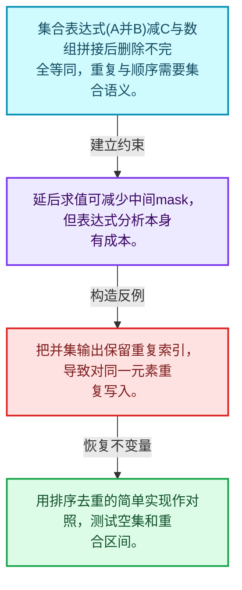
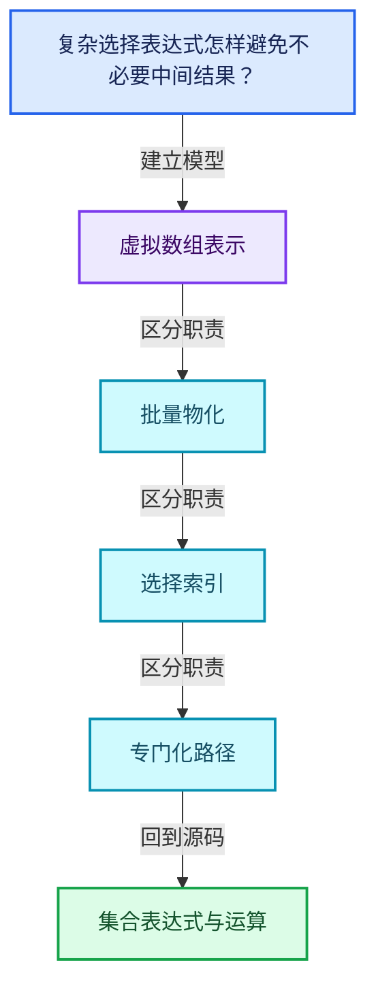
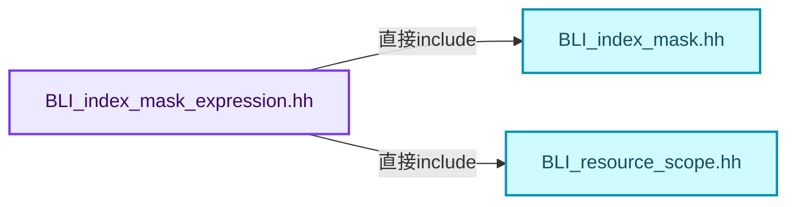
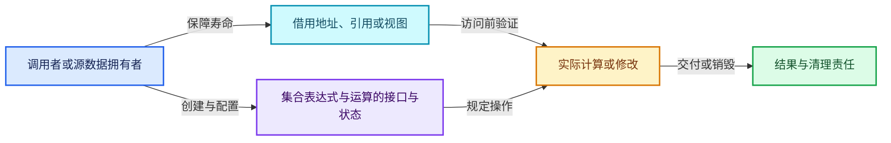
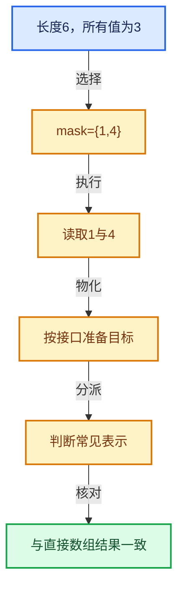

# 04-11 集合表达式与运算

[方向导航](README.md) · [总目录](../README.md) · [覆盖索引](../%E6%BA%90%E7%A0%81%E7%89%88%E6%9C%AC%E4%B8%8E%E8%A6%86%E7%9B%96%E7%B4%A2%E5%BC%95.md)

> 阅读顺序：问题与数据模型 → 语法与类型 → 源码逐行 → 调用线索 → 历史与取舍 → 推演和练习。

- 基准 HEAD：`cbda6b96c26c0dee3c3b5cbb93960c4ac06a6b30`。
- 记录日期：2026-10-14。
- 教学示例状态：正文中的推演不是本机性能实测；已运行练习见验收报告。

## 一、从问题到设计

复杂选择表达式怎样避免不必要中间结果？

表达式描述与求值分开，为交并差组合保留优化空间；集合语义不能用普通数组拼接替代。

本篇把语法、数据语义和系统取舍连接起来。表示与接口分离，元素编号与选择内部位置分离，生成成本与执行成本分离。

### 本篇独立模型与设计推理

集合表达式(A并B)减C与数组拼接后删除不完全等同，重复与顺序需要集合语义。

设计取舍：延后求值可减少中间mask，但表达式分析本身有成本。

最小反例：把并集输出保留重复索引，导致对同一元素重复写入。

推导与处理：用排序去重的简单实现作对照，测试空集和重合区间。



### 源码范围与相邻篇章

| 文件 | 本篇逐行范围 | 基准SHA-256 |
|---|---|---|
| [source/blender/blenlib/BLI_index_mask_expression.hh](../../../../../source/blender/blenlib/BLI_index_mask_expression.hh) | L1—L98 | `bab698f77f8c6c33f47254dbffc2898e8fa01e09a2ebb55fd6e1541393739fd4` |
| [source/blender/blenlib/intern/index_mask_expression.cc](../../../../../source/blender/blenlib/intern/index_mask_expression.cc) | L1—L1351 | `33002d818dfc54bcae30a55c45c589e29c2195088528937e2850d24fe191871a` |

同一主讲文件可能分多篇覆盖；超出本篇范围的符号通过覆盖索引定位。空行与纯注释保留在源码摘录中，逐行表解释有效语句与语法边界；许可证头统一保留。

前篇：[IndexMask构建与并行](10-IndexMask%E6%9E%84%E5%BB%BA%E4%B8%8E%E5%B9%B6%E8%A1%8C.md).

后篇：[重构历史与基准练习](12-%E9%87%8D%E6%9E%84%E5%8E%86%E5%8F%B2%E4%B8%8E%E5%9F%BA%E5%87%86%E7%BB%83%E4%B9%A0.md).

## 二、类型、数据与阅读地图



这是概念依赖图，边表示阅读关系，不声称是运行时调用顺序。

### 直接编译依赖



箭头只表示头文件包含关系；完整调用线索见后面的符号定位表。

## 三、关键词、语法与类型角色

### 约束 requires

requires表达式或requires子句限制模板参与重载的条件。它提供编译期可用性检查，不是运行时if，不能指望输入到达程序后再被这一机制验证。

具体检查：构造满足和不满足约束的两个类型，观察候选被排除而不是在函数内返回错误。

### 常量求值 constexpr

constexpr声明允许相应实体参与常量求值，但constexpr函数仍可以在运行时执行。是否常量求值由调用场景和表达式合法性共同决定。

具体检查：比较constexpr变量初始化和从运行时输入调用同一函数。

### 只读限定 const

const约束当前访问路径可做的修改。const指针、指向const的指针、const视图对象、const元素是不同位置的限定；其他别名可能仍可修改原对象。

具体检查：分别写T* const、const T*与const T* const，并画出不可修改的层次。

### 移动转换 std::move

std::move把表达式转换为可供移动重载选择的值类别，实际资源转移发生在被选中的构造或赋值中。对const对象move可能仍调用复制，对视图move也不会获得底层数据所有权。

具体检查：记录移动构造调用次数，不用变量名或std::move的出现次数替代测量。

### 显式静态转换 static_cast

static_cast表达编译期允许的转换，不会自动验证运行时真实类型、指针寿命或索引边界。由void指针恢复T指针时，调用者仍须保证实际存储中确有合法T对象。

具体检查：标出转换前后的类型以及正确性依据来自哪里。

### 可选值 optional

optional把不存在与存在的T区分开，T的构造和析构跟随engaged状态变化。访问前应由has_value或条件分支证明存在。

具体检查：把空Field状态与合法常量零区分，不能用某个普通值代替不存在。

### 判别联合 variant

variant在若干候选类型中保存一个活动值，通过判别信息选择操作。它能把不同表示集中在值类型中，但各分支的复制移动成本不同。

具体检查：列出活动分支及每种分支实际拥有或借用的数据。

### 构造与new表达式

普通new可能分配并构造；placement new在给定地址构造，存储由其他机制提供。失败回滚应区分两类责任。

具体检查：追踪地址来自哪里、构造何时成功、由谁析构、由谁释放。

### 内部断言 assert

断言表达开发者预期成立的内部契约，发布构建可能关闭。它不能替代对不可信输入的完整错误处理，也不保证后续操作被运行时保护。

具体检查：对每条断言构造违反条件的输入，区分调用者错误与应向用户报告的错误。

### 联合体 union

联合体成员共享存储，需要由活动成员约定决定合法读取方式。结合enum或其他判别信息阅读，不能把所有成员都当作同时存在。

具体检查：检查叶节点与内部节点分别使用哪些联合成员。

### 类型别名 using

类型别名为已有类型建立名字，不创建运行期对象。它常把模板内部使用的类型统一暴露给泛型调用者。

具体检查：展开别名直到基础类型，区分类型别名和变量声明。

### 枚举与状态模型 enum

枚举把有限状态命名；enum class避免许多隐式整数转换。状态机正确性还依赖允许的转移，不能只看有哪些枚举项。

具体检查：列出每个状态的进入条件和离开条件，检查终止状态是否仍可能被调度。

## 四、真实源码与逐行讲解

源码块保持原行内容，原始行号由小节标题及逐行表给出。表中的调用定位是静态阅读辅助；重载、模板实例化、宏展开和虚调用需结合完整声明，不能仅凭词法出现证明动态调用。

### BLI_index_mask_expression.hh：L1—L47

<!-- source:source/blender/blenlib/BLI_index_mask_expression.hh:1:47 -->

```cpp
/* SPDX-FileCopyrightText: 2024 Blender Authors
 *
 * SPDX-License-Identifier: GPL-2.0-or-later */

/** \file
 * \ingroup bli
 */

#pragma once

#include "BLI_index_mask.hh"
#include "BLI_resource_scope.hh"

namespace blender::index_mask {

struct AtomicExpr;
struct UnionExpr;
struct IntersectionExpr;
struct DifferenceExpr;

struct Expr {
  enum class Type {
    Atomic,
    Union,
    Intersection,
    Difference,
  };

  Type type;
  int index;
  Vector<const Expr *> terms;

  int expression_array_size() const;

  const AtomicExpr &as_atomic() const;
  const UnionExpr &as_union() const;
  const IntersectionExpr &as_intersection() const;
  const DifferenceExpr &as_difference() const;
};

struct AtomicExpr : public Expr {
  const IndexMask *mask;
};

struct UnionExpr : public Expr {};

struct IntersectionExpr : public Expr {};
```

| 原始行 | 语义、约束与检查 |
|---|---|
| L9 | 防止同一头文件在一个翻译单元中重复展开；不控制多个源文件之间的链接或对象寿命。 |
| L11 | 引入编译依赖 "BLI_index_mask.hh"；这是声明可见性关系，不表示运行时一定调用该文件的所有接口。 |
| L12 | 引入编译依赖 "BLI_resource_scope.hh"；这是声明可见性关系，不表示运行时一定调用该文件的所有接口。 |
| L14 | 把后续声明放入 blender::index_mask 命名空间，影响名称查找和符号归属，不创建运行时对象。 |
| L16 | 声明或定义类型 `struct AtomicExpr`。结合继承、访问权限和成员布局确认接口与拥有关系；前向声明本身没有完整对象布局。 |
| L17 | 声明或定义类型 `struct UnionExpr`。结合继承、访问权限和成员布局确认接口与拥有关系；前向声明本身没有完整对象布局。 |
| L18 | 声明或定义类型 `struct IntersectionExpr`。结合继承、访问权限和成员布局确认接口与拥有关系；前向声明本身没有完整对象布局。 |
| L19 | 声明或定义类型 `struct DifferenceExpr`。结合继承、访问权限和成员布局确认接口与拥有关系；前向声明本身没有完整对象布局。 |
| L21 | 声明或定义类型 `struct Expr`。结合继承、访问权限和成员布局确认接口与拥有关系；前向声明本身没有完整对象布局。 |
| L22 | 声明或定义类型 `enum class Type`。结合继承、访问权限和成员布局确认接口与拥有关系；前向声明本身没有完整对象布局。 |
| L23 | 本行是连续声明或表达式的一部分：`Atomic,`。与本段前后行合读；逗号、括号和限定符决定它属于参数、初始化列表还是实际计算。 |
| L24 | 本行是连续声明或表达式的一部分：`Union,`。与本段前后行合读；逗号、括号和限定符决定它属于参数、初始化列表还是实际计算。 |
| L25 | 本行是连续声明或表达式的一部分：`Intersection,`。与本段前后行合读；逗号、括号和限定符决定它属于参数、初始化列表还是实际计算。 |
| L26 | 本行是连续声明或表达式的一部分：`Difference,`。与本段前后行合读；逗号、括号和限定符决定它属于参数、初始化列表还是实际计算。 |
| L27 | 结束当前语法单元。局部自动对象在离开其作用域时按规则销毁；这不等于所有被引用的外部数据也被释放。 |
| L29 | 声明成员、局部对象或完成语句 `Type type`。若为指针或引用，它本身不说明拥有；若为值对象，其构造析构由所在作用域或外层对象管理。 |
| L30 | 声明成员、局部对象或完成语句 `int index`。若为指针或引用，它本身不说明拥有；若为值对象，其构造析构由所在作用域或外层对象管理。 |
| L31 | 声明成员、局部对象或完成语句 `Vector<const Expr *> terms`。若为指针或引用，它本身不说明拥有；若为值对象，其构造析构由所在作用域或外层对象管理。 |
| L33 | 声明接口 `int expression_array_size() const`，本行没有对应函数体；返回类型、参数限定和const/noexcept共同组成调用契约，实际行为需继续定位实现。 |
| L35 | 声明接口 `const AtomicExpr &as_atomic() const`，本行没有对应函数体；返回类型、参数限定和const/noexcept共同组成调用契约，实际行为需继续定位实现。 |
| L36 | 声明接口 `const UnionExpr &as_union() const`，本行没有对应函数体；返回类型、参数限定和const/noexcept共同组成调用契约，实际行为需继续定位实现。 |
| L37 | 声明接口 `const IntersectionExpr &as_intersection() const`，本行没有对应函数体；返回类型、参数限定和const/noexcept共同组成调用契约，实际行为需继续定位实现。 |
| L38 | 声明接口 `const DifferenceExpr &as_difference() const`，本行没有对应函数体；返回类型、参数限定和const/noexcept共同组成调用契约，实际行为需继续定位实现。 |
| L39 | 结束当前语法单元。局部自动对象在离开其作用域时按规则销毁；这不等于所有被引用的外部数据也被释放。 |
| L41 | 声明或定义类型 `struct AtomicExpr : public Expr`。结合继承、访问权限和成员布局确认接口与拥有关系；前向声明本身没有完整对象布局。 |
| L42 | 声明成员、局部对象或完成语句 `const IndexMask *mask`。若为指针或引用，它本身不说明拥有；若为值对象，其构造析构由所在作用域或外层对象管理。 |
| L43 | 结束当前语法单元。局部自动对象在离开其作用域时按规则销毁；这不等于所有被引用的外部数据也被释放。 |
| L45 | 声明或定义类型 `struct UnionExpr : public Expr {}`。结合继承、访问权限和成员布局确认接口与拥有关系；前向声明本身没有完整对象布局。 |
| L47 | 声明或定义类型 `struct IntersectionExpr : public Expr {}`。结合继承、访问权限和成员布局确认接口与拥有关系；前向声明本身没有完整对象布局。 |

### BLI_index_mask_expression.hh：L48—L98

<!-- source:source/blender/blenlib/BLI_index_mask_expression.hh:48:98 -->

```cpp

struct DifferenceExpr : public Expr {};

class ExprBuilder {
 private:
  ResourceScope scope_;
  int expr_count_ = 0;

 public:
  using Term = std::variant<const Expr *, const IndexMask *, IndexRange>;

  const UnionExpr &merge(const Span<Term> terms);
  const DifferenceExpr &subtract(const Term &main_term, const Span<Term> subtract_terms);
  const IntersectionExpr &intersect(const Span<Term> terms);

 private:
  const Expr &term_to_expr(const Term &term);
};

IndexMask evaluate_expression(const Expr &expression, LinearAllocator<> &memory);

inline int Expr::expression_array_size() const
{
  return this->index + 1;
}

inline const AtomicExpr &Expr::as_atomic() const
{
  BLI_assert(this->type == Type::Atomic);
  return static_cast<const AtomicExpr &>(*this);
}

inline const UnionExpr &Expr::as_union() const
{
  BLI_assert(this->type == Type::Union);
  return static_cast<const UnionExpr &>(*this);
}

inline const IntersectionExpr &Expr::as_intersection() const
{
  BLI_assert(this->type == Type::Intersection);
  return static_cast<const IntersectionExpr &>(*this);
}

inline const DifferenceExpr &Expr::as_difference() const
{
  BLI_assert(this->type == Type::Difference);
  return static_cast<const DifferenceExpr &>(*this);
}

}  // namespace blender::index_mask
```

本段语义重点：

- `scope_`：求值或资源作用域，负责相应临时存储及清理。

| 原始行 | 语义、约束与检查 |
|---|---|
| L49 | 声明或定义类型 `struct DifferenceExpr : public Expr {}`。结合继承、访问权限和成员布局确认接口与拥有关系；前向声明本身没有完整对象布局。 |
| L51 | 声明或定义类型 `class ExprBuilder`。结合继承、访问权限和成员布局确认接口与拥有关系；前向声明本身没有完整对象布局。 |
| L52 | 切换成员访问权限为 private；它是编译期接口边界，不是线程同步或内存保护。 |
| L53 | 本行涉及 `scope_`：求值或资源作用域，负责相应临时存储及清理。按此语义解读 `ResourceScope scope_`，不要把地址、数量或状态混用。 |
| L54 | 把右侧 `0` 用于初始化或更新左侧 `int expr_count_`。声明初始化与已有对象赋值应按上下文区分；有资源的类型会调用相应特殊成员。 |
| L56 | 切换成员访问权限为 public；它是编译期接口边界，不是线程同步或内存保护。 |
| L57 | 定义类型别名 `using Term = std::variant<const Expr *, const IndexMask *, IndexRange>`，为模板接口或内部实现统一命名；本行不分配该类型对象。 |
| L59 | 声明接口 `const UnionExpr &merge(const Span<Term> terms)`，本行没有对应函数体；返回类型、参数限定和const/noexcept共同组成调用契约，实际行为需继续定位实现。 |
| L60 | 声明接口 `const DifferenceExpr &subtract(const Term &main_term, const Span<Term> subtract_terms)`，本行没有对应函数体；返回类型、参数限定和const/noexcept共同组成调用契约，实际行为需继续定位实现。 |
| L61 | 声明接口 `const IntersectionExpr &intersect(const Span<Term> terms)`，本行没有对应函数体；返回类型、参数限定和const/noexcept共同组成调用契约，实际行为需继续定位实现。 |
| L63 | 切换成员访问权限为 private；它是编译期接口边界，不是线程同步或内存保护。 |
| L64 | 声明接口 `const Expr &term_to_expr(const Term &term)`，本行没有对应函数体；返回类型、参数限定和const/noexcept共同组成调用契约，实际行为需继续定位实现。 |
| L65 | 结束当前语法单元。局部自动对象在离开其作用域时按规则销毁；这不等于所有被引用的外部数据也被释放。 |
| L67 | 出现调用或函数声明 `evaluate_expression`，对应表达式为 `IndexMask evaluate_expression(const Expr &expression, LinearAllocator<> &memory);`。参数求值、返回类型与重载需结合前后完整语句；静态文本引用不能证明动态目标。 |
| L69 | 出现调用或函数声明 `Expr::expression_array_size`，对应表达式为 `inline int Expr::expression_array_size() const`。参数求值、返回类型与重载需结合前后完整语句；静态文本引用不能证明动态目标。 |
| L70 | 连接上一行的声明或控制结构与其语句块；后续行在这个作用域中执行或声明。 |
| L71 | 返回表达式 `this->index + 1`。 |
| L72 | 结束当前语法单元。局部自动对象在离开其作用域时按规则销毁；这不等于所有被引用的外部数据也被释放。 |
| L74 | 出现调用或函数声明 `Expr::as_atomic`，对应表达式为 `inline const AtomicExpr &Expr::as_atomic() const`。参数求值、返回类型与重载需结合前后完整语句；静态文本引用不能证明动态目标。 |
| L75 | 连接上一行的声明或控制结构与其语句块；后续行在这个作用域中执行或声明。 |
| L76 | 断言约束 `BLI_assert(this->type == Type::Atomic);`。条件是后续访问的内部前置条件；发布构建可能不执行，不能把断言当作输入修复。 |
| L77 | 返回表达式 `static_cast<const AtomicExpr &>(*this)`。 |
| L78 | 结束当前语法单元。局部自动对象在离开其作用域时按规则销毁；这不等于所有被引用的外部数据也被释放。 |
| L80 | 出现调用或函数声明 `Expr::as_union`，对应表达式为 `inline const UnionExpr &Expr::as_union() const`。参数求值、返回类型与重载需结合前后完整语句；静态文本引用不能证明动态目标。 |
| L81 | 连接上一行的声明或控制结构与其语句块；后续行在这个作用域中执行或声明。 |
| L82 | 断言约束 `BLI_assert(this->type == Type::Union);`。条件是后续访问的内部前置条件；发布构建可能不执行，不能把断言当作输入修复。 |
| L83 | 返回表达式 `static_cast<const UnionExpr &>(*this)`。 |
| L84 | 结束当前语法单元。局部自动对象在离开其作用域时按规则销毁；这不等于所有被引用的外部数据也被释放。 |
| L86 | 出现调用或函数声明 `Expr::as_intersection`，对应表达式为 `inline const IntersectionExpr &Expr::as_intersection() const`。参数求值、返回类型与重载需结合前后完整语句；静态文本引用不能证明动态目标。 |
| L87 | 连接上一行的声明或控制结构与其语句块；后续行在这个作用域中执行或声明。 |
| L88 | 断言约束 `BLI_assert(this->type == Type::Intersection);`。条件是后续访问的内部前置条件；发布构建可能不执行，不能把断言当作输入修复。 |
| L89 | 返回表达式 `static_cast<const IntersectionExpr &>(*this)`。 |
| L90 | 结束当前语法单元。局部自动对象在离开其作用域时按规则销毁；这不等于所有被引用的外部数据也被释放。 |
| L92 | 出现调用或函数声明 `Expr::as_difference`，对应表达式为 `inline const DifferenceExpr &Expr::as_difference() const`。参数求值、返回类型与重载需结合前后完整语句；静态文本引用不能证明动态目标。 |
| L93 | 连接上一行的声明或控制结构与其语句块；后续行在这个作用域中执行或声明。 |
| L94 | 断言约束 `BLI_assert(this->type == Type::Difference);`。条件是后续访问的内部前置条件；发布构建可能不执行，不能把断言当作输入修复。 |
| L95 | 返回表达式 `static_cast<const DifferenceExpr &>(*this)`。 |
| L96 | 结束当前语法单元。局部自动对象在离开其作用域时按规则销毁；这不等于所有被引用的外部数据也被释放。 |
| L98 | 结束当前语法单元。局部自动对象在离开其作用域时按规则销毁；这不等于所有被引用的外部数据也被释放。 |

### index_mask_expression.cc：L1—L49

<!-- source:source/blender/blenlib/intern/index_mask_expression.cc:1:49 -->

```cpp
/* SPDX-FileCopyrightText: 2024 Blender Authors
 *
 * SPDX-License-Identifier: GPL-2.0-or-later */

/** \file
 * \ingroup bli
 */

/**
 * Expression evaluation has multiple phases:
 * 1. A coarse evaluation that tries to find segments which can be trivially evaluated. For
 *    example, taking the union of two overlapping ranges can be done in O(1) time.
 * 2. For all segments which can't be fully evaluated using coarse evaluation, an exact evaluation
 *    is done. This uses either an index-based or bit-based approach depending on a heuristic.
 * 3. Construct the final index mask based on the resulting intermediate segments.
 */

#include "BLI_array.hh"
#include "BLI_bit_group_vector.hh"
#include "BLI_bit_span_ops.hh"
#include "BLI_enumerable_thread_specific.hh"
#include "BLI_index_mask_expression.hh"
#include "BLI_stack.hh"
#include "BLI_task.hh"

#include "BLI_strict_flags.hh" /* IWYU pragma: keep */

namespace blender::index_mask {

/**
 * Number of expression terms which don't require extra allocations in some places.
 */
constexpr int64_t inline_expr_array_size = 16;

/**
 * The result of the coarse evaluation for a specific index range.
 */
struct CoarseSegment {
  enum class Type {
    /**
     * Coarse evaluation couldn't fully resolve this segment. The segment requires another
     * evaluation that is more detailed.
     */
    Unknown,
    /** All indices in the segment are part of the result. */
    Full,
    /** The evaluated result of this segment is just the copy of an input index mask. */
    Copy,
  };
```

| 原始行 | 语义、约束与检查 |
|---|---|
| L18 | 引入编译依赖 "BLI_array.hh"；这是声明可见性关系，不表示运行时一定调用该文件的所有接口。 |
| L19 | 引入编译依赖 "BLI_bit_group_vector.hh"；这是声明可见性关系，不表示运行时一定调用该文件的所有接口。 |
| L20 | 引入编译依赖 "BLI_bit_span_ops.hh"；这是声明可见性关系，不表示运行时一定调用该文件的所有接口。 |
| L21 | 引入编译依赖 "BLI_enumerable_thread_specific.hh"；这是声明可见性关系，不表示运行时一定调用该文件的所有接口。 |
| L22 | 引入编译依赖 "BLI_index_mask_expression.hh"；这是声明可见性关系，不表示运行时一定调用该文件的所有接口。 |
| L23 | 引入编译依赖 "BLI_stack.hh"；这是声明可见性关系，不表示运行时一定调用该文件的所有接口。 |
| L24 | 引入编译依赖 "BLI_task.hh"；这是声明可见性关系，不表示运行时一定调用该文件的所有接口。 |
| L26 | 引入编译依赖 "BLI_strict_flags.hh"；这是声明可见性关系，不表示运行时一定调用该文件的所有接口。 |
| L28 | 把后续声明放入 blender::index_mask 命名空间，影响名称查找和符号归属，不创建运行时对象。 |
| L33 | 把右侧 `16` 用于初始化或更新左侧 `constexpr int64_t inline_expr_array_size`。声明初始化与已有对象赋值应按上下文区分；有资源的类型会调用相应特殊成员。 |
| L38 | 声明或定义类型 `struct CoarseSegment`。结合继承、访问权限和成员布局确认接口与拥有关系；前向声明本身没有完整对象布局。 |
| L39 | 声明或定义类型 `enum class Type`。结合继承、访问权限和成员布局确认接口与拥有关系；前向声明本身没有完整对象布局。 |
| L44 | 本行是连续声明或表达式的一部分：`Unknown,`。与本段前后行合读；逗号、括号和限定符决定它属于参数、初始化列表还是实际计算。 |
| L46 | 本行是连续声明或表达式的一部分：`Full,`。与本段前后行合读；逗号、括号和限定符决定它属于参数、初始化列表还是实际计算。 |
| L48 | 本行是连续声明或表达式的一部分：`Copy,`。与本段前后行合读；逗号、括号和限定符决定它属于参数、初始化列表还是实际计算。 |
| L49 | 结束当前语法单元。局部自动对象在离开其作用域时按规则销毁；这不等于所有被引用的外部数据也被释放。 |

### index_mask_expression.cc：L50—L97

<!-- source:source/blender/blenlib/intern/index_mask_expression.cc:50:97 -->

```cpp
  Type type = Type::Unknown;
  IndexRange bounds;
  /** Mask used when the type is #Copy. */
  const IndexMask *mask = nullptr;
};

/** Contains the result of a coarse evaluation split into potentially many segments. */
struct CoarseResult {
  Vector<CoarseSegment> segments;
};

/** Used during coarse evaluation to split the full range into multiple segments. */
struct CourseBoundary {
  /**
   * The position of the boundary. The boundary is right before this index. So if this boundary is
   * a beginning of a segment, the index marks the first element. If it is the end, the index marks
   * the one-after-last position.
   */
  int64_t index;
  /** Whether this boundary is the beginning or end of the segment below. */
  bool is_begin;
  /** The segment this boundary comes from. */
  const CoarseSegment *segment;
};

/** For the difference operation, we need to know if a boundary belongs to the main term or not. */
struct DifferenceCourseBoundary : public CourseBoundary {
  bool is_main;
};

/**
 * Result of the expression evaluation within a specific index range. Sometimes this can be derived
 * directly from the coarse evaluation, but sometimes an additional exact evaluation is necessary.
 */
struct EvaluatedSegment {
  enum class Type {
    /** All indices in this segment are part of the evaluated index mask. */
    Full,
    /** The result in this segment is the same as what is contained in the #copy_mask below. */
    Copy,
    /** The result comes from exact evaluation and is a new set of indices. */
    Indices,
  };

  Type type = Type::Indices;
  IndexRange bounds;
  /** Only used when the type is #Type::Copy. */
  const IndexMask *copy_mask = nullptr;
```

| 原始行 | 语义、约束与检查 |
|---|---|
| L50 | 把右侧 `Type::Unknown` 用于初始化或更新左侧 `Type type`。声明初始化与已有对象赋值应按上下文区分；有资源的类型会调用相应特殊成员。 |
| L51 | 声明成员、局部对象或完成语句 `IndexRange bounds`。若为指针或引用，它本身不说明拥有；若为值对象，其构造析构由所在作用域或外层对象管理。 |
| L53 | 把右侧 `nullptr` 用于初始化或更新左侧 `const IndexMask *mask`。声明初始化与已有对象赋值应按上下文区分；有资源的类型会调用相应特殊成员。 |
| L54 | 结束当前语法单元。局部自动对象在离开其作用域时按规则销毁；这不等于所有被引用的外部数据也被释放。 |
| L57 | 声明或定义类型 `struct CoarseResult`。结合继承、访问权限和成员布局确认接口与拥有关系；前向声明本身没有完整对象布局。 |
| L58 | 声明成员、局部对象或完成语句 `Vector<CoarseSegment> segments`。若为指针或引用，它本身不说明拥有；若为值对象，其构造析构由所在作用域或外层对象管理。 |
| L59 | 结束当前语法单元。局部自动对象在离开其作用域时按规则销毁；这不等于所有被引用的外部数据也被释放。 |
| L62 | 声明或定义类型 `struct CourseBoundary`。结合继承、访问权限和成员布局确认接口与拥有关系；前向声明本身没有完整对象布局。 |
| L68 | 声明成员、局部对象或完成语句 `int64_t index`。若为指针或引用，它本身不说明拥有；若为值对象，其构造析构由所在作用域或外层对象管理。 |
| L70 | 声明成员、局部对象或完成语句 `bool is_begin`。若为指针或引用，它本身不说明拥有；若为值对象，其构造析构由所在作用域或外层对象管理。 |
| L72 | 声明成员、局部对象或完成语句 `const CoarseSegment *segment`。若为指针或引用，它本身不说明拥有；若为值对象，其构造析构由所在作用域或外层对象管理。 |
| L73 | 结束当前语法单元。局部自动对象在离开其作用域时按规则销毁；这不等于所有被引用的外部数据也被释放。 |
| L76 | 声明或定义类型 `struct DifferenceCourseBoundary : public CourseBoundary`。结合继承、访问权限和成员布局确认接口与拥有关系；前向声明本身没有完整对象布局。 |
| L77 | 声明成员、局部对象或完成语句 `bool is_main`。若为指针或引用，它本身不说明拥有；若为值对象，其构造析构由所在作用域或外层对象管理。 |
| L78 | 结束当前语法单元。局部自动对象在离开其作用域时按规则销毁；这不等于所有被引用的外部数据也被释放。 |
| L84 | 声明或定义类型 `struct EvaluatedSegment`。结合继承、访问权限和成员布局确认接口与拥有关系；前向声明本身没有完整对象布局。 |
| L85 | 声明或定义类型 `enum class Type`。结合继承、访问权限和成员布局确认接口与拥有关系；前向声明本身没有完整对象布局。 |
| L87 | 本行是连续声明或表达式的一部分：`Full,`。与本段前后行合读；逗号、括号和限定符决定它属于参数、初始化列表还是实际计算。 |
| L89 | 本行是连续声明或表达式的一部分：`Copy,`。与本段前后行合读；逗号、括号和限定符决定它属于参数、初始化列表还是实际计算。 |
| L91 | 本行是连续声明或表达式的一部分：`Indices,`。与本段前后行合读；逗号、括号和限定符决定它属于参数、初始化列表还是实际计算。 |
| L92 | 结束当前语法单元。局部自动对象在离开其作用域时按规则销毁；这不等于所有被引用的外部数据也被释放。 |
| L94 | 把右侧 `Type::Indices` 用于初始化或更新左侧 `Type type`。声明初始化与已有对象赋值应按上下文区分；有资源的类型会调用相应特殊成员。 |
| L95 | 声明成员、局部对象或完成语句 `IndexRange bounds`。若为指针或引用，它本身不说明拥有；若为值对象，其构造析构由所在作用域或外层对象管理。 |
| L97 | 把右侧 `nullptr` 用于初始化或更新左侧 `const IndexMask *copy_mask`。声明初始化与已有对象赋值应按上下文区分；有资源的类型会调用相应特殊成员。 |

### index_mask_expression.cc：L98—L137

<!-- source:source/blender/blenlib/intern/index_mask_expression.cc:98:137 -->

```cpp
  /** Only used when the type is #Type::Indices. */
  IndexMaskSegment indices;
};

/**
 * There are different ways to do the exact evaluation. Depending on the expression or data, one
 * or the other is more efficient.
 */
enum class ExactEvalMode {
  /**
   * Does the evaluation by working directly with arrays of sorted indices. This is usually best
   * when the expression does not have intermediate results, i.e. it is very simple.
   */
  Indices,
  /**
   * The evaluation works with bits. There is extra overhead to convert the input masks to bit
   * arrays and to convert the final result back into indices. In exchange, the actual expression
   * evaluation is significantly cheaper because it's just a bunch of bit operations. For larger
   * expressions, this is typically much more efficient.
   */
  Bits,
};

static void sort_course_boundaries(MutableSpan<CourseBoundary> boundaries)
{
  std::ranges::sort(boundaries, [](const CourseBoundary &a, const CourseBoundary &b) {
    return a.index < b.index;
  });
}

static void sort_course_boundaries(MutableSpan<DifferenceCourseBoundary> boundaries)
{
  std::ranges::sort(boundaries,
                    [](const DifferenceCourseBoundary &a, const DifferenceCourseBoundary &b) {
                      return a.index < b.index;
                    });
}

/** Smaller segments should generally be merged together. */
static constexpr int64_t segment_size_threshold = 32;
```

| 原始行 | 语义、约束与检查 |
|---|---|
| L99 | 声明成员、局部对象或完成语句 `IndexMaskSegment indices`。若为指针或引用，它本身不说明拥有；若为值对象，其构造析构由所在作用域或外层对象管理。 |
| L100 | 结束当前语法单元。局部自动对象在离开其作用域时按规则销毁；这不等于所有被引用的外部数据也被释放。 |
| L106 | 声明或定义类型 `enum class ExactEvalMode`。结合继承、访问权限和成员布局确认接口与拥有关系；前向声明本身没有完整对象布局。 |
| L111 | 本行是连续声明或表达式的一部分：`Indices,`。与本段前后行合读；逗号、括号和限定符决定它属于参数、初始化列表还是实际计算。 |
| L118 | 本行是连续声明或表达式的一部分：`Bits,`。与本段前后行合读；逗号、括号和限定符决定它属于参数、初始化列表还是实际计算。 |
| L119 | 结束当前语法单元。局部自动对象在离开其作用域时按规则销毁；这不等于所有被引用的外部数据也被释放。 |
| L121 | 出现调用或函数声明 `sort_course_boundaries`，对应表达式为 `static void sort_course_boundaries(MutableSpan<CourseBoundary> boundaries)`。参数求值、返回类型与重载需结合前后完整语句；静态文本引用不能证明动态目标。 |
| L122 | 连接上一行的声明或控制结构与其语句块；后续行在这个作用域中执行或声明。 |
| L123 | 出现调用或函数声明 `std::ranges::sort`，对应表达式为 `std::ranges::sort(boundaries, [](const CourseBoundary &a, const CourseBoundary &b) {`。参数求值、返回类型与重载需结合前后完整语句；静态文本引用不能证明动态目标。 |
| L124 | 返回表达式 `a.index < b.index`。结合函数声明检查返回值是否借用原存储，借用值不会自动延长其寿命。 |
| L125 | 结束当前语法单元。局部自动对象在离开其作用域时按规则销毁；这不等于所有被引用的外部数据也被释放。 |
| L126 | 结束当前语法单元。局部自动对象在离开其作用域时按规则销毁；这不等于所有被引用的外部数据也被释放。 |
| L128 | 出现调用或函数声明 `sort_course_boundaries`，对应表达式为 `static void sort_course_boundaries(MutableSpan<DifferenceCourseBoundary> boundaries)`。参数求值、返回类型与重载需结合前后完整语句；静态文本引用不能证明动态目标。 |
| L129 | 连接上一行的声明或控制结构与其语句块；后续行在这个作用域中执行或声明。 |
| L130 | 出现调用或函数声明 `std::ranges::sort`，对应表达式为 `std::ranges::sort(boundaries,`。参数求值、返回类型与重载需结合前后完整语句；静态文本引用不能证明动态目标。 |
| L131 | 本行是连续声明或表达式的一部分：`[](const DifferenceCourseBoundary &a, const DifferenceCourseBoundary &b) {`。与本段前后行合读；逗号、括号和限定符决定它属于参数、初始化列表还是实际计算。 |
| L132 | 返回表达式 `a.index < b.index`。结合函数声明检查返回值是否借用原存储，借用值不会自动延长其寿命。 |
| L133 | 结束当前语法单元。局部自动对象在离开其作用域时按规则销毁；这不等于所有被引用的外部数据也被释放。 |
| L134 | 结束当前语法单元。局部自动对象在离开其作用域时按规则销毁；这不等于所有被引用的外部数据也被释放。 |
| L137 | 把右侧 `32` 用于初始化或更新左侧 `static constexpr int64_t segment_size_threshold`。声明初始化与已有对象赋值应按上下文区分；有资源的类型会调用相应特殊成员。 |

### index_mask_expression.cc：L138—L185

<!-- source:source/blender/blenlib/intern/index_mask_expression.cc:138:185 -->

```cpp

/** Extends a previous full segment or appends a new one. */
static CoarseSegment &add_coarse_segment__full(CoarseSegment *prev_segment,
                                               const int64_t prev_boundary_index,
                                               const int64_t current_boundary_index,
                                               CoarseResult &result)
{
  const int64_t size = current_boundary_index - prev_boundary_index;
  if (prev_segment) {
    if (prev_segment->type == CoarseSegment::Type::Full &&
        prev_segment->bounds.one_after_last() == prev_boundary_index)
    {
      prev_segment->bounds = prev_segment->bounds.with_new_end(current_boundary_index);
      return *prev_segment;
    }
    if (current_boundary_index - prev_segment->bounds.start() < max_segment_size) {
      if (prev_segment->bounds.size() + size < segment_size_threshold) {
        /* Extend the previous segment because it's so small and change it into an unknown one. */
        prev_segment->bounds = prev_segment->bounds.with_new_end(current_boundary_index);
        prev_segment->type = CoarseSegment::Type::Unknown;
        return *prev_segment;
      }
    }
  }
  result.segments.append(
      {CoarseSegment::Type::Full, IndexRange::from_begin_size(prev_boundary_index, size)});
  return result.segments.last();
}

/** Extends a previous unknown segment or appends a new one. */
static CoarseSegment &add_coarse_segment__unknown(CoarseSegment *prev_segment,
                                                  const int64_t prev_boundary_index,
                                                  const int64_t current_boundary_index,
                                                  CoarseResult &result)
{
  if (prev_segment) {
    if (prev_segment->bounds.start() + segment_size_threshold >= prev_boundary_index) {
      /* The previous segment is very short, so extend it. */
      prev_segment->type = CoarseSegment::Type::Unknown;
      prev_segment->bounds = prev_segment->bounds.with_new_end(current_boundary_index);
      return *prev_segment;
    }
  }
  result.segments.append(
      {CoarseSegment::Type::Unknown,
       IndexRange::from_begin_end(prev_boundary_index, current_boundary_index)});
  return result.segments.last();
}
```

本段语义重点：

- 分支证据 `prev_segment)`：分别推演条件成立与不成立，核对相同出口处的状态。
- 分支证据 `prev_segment->type == CoarseSegment::Type::Full &&`：分别推演条件成立与不成立，核对相同出口处的状态。

| 原始行 | 语义、约束与检查 |
|---|---|
| L140 | 出现调用或函数声明 `add_coarse_segment__full`，对应表达式为 `static CoarseSegment &add_coarse_segment__full(CoarseSegment *prev_segment,`。参数求值、返回类型与重载需结合前后完整语句；静态文本引用不能证明动态目标。 |
| L141 | 本行是连续声明或表达式的一部分：`const int64_t prev_boundary_index,`。与本段前后行合读；逗号、括号和限定符决定它属于参数、初始化列表还是实际计算。 |
| L142 | 本行是连续声明或表达式的一部分：`const int64_t current_boundary_index,`。与本段前后行合读；逗号、括号和限定符决定它属于参数、初始化列表还是实际计算。 |
| L143 | 本行是连续声明或表达式的一部分：`CoarseResult &result)`。与本段前后行合读；逗号、括号和限定符决定它属于参数、初始化列表还是实际计算。 |
| L144 | 连接上一行的声明或控制结构与其语句块；后续行在这个作用域中执行或声明。 |
| L145 | 把右侧 `current_boundary_index - prev_boundary_index` 用于初始化或更新左侧 `const int64_t size`。声明初始化与已有对象赋值应按上下文区分；有资源的类型会调用相应特殊成员。 |
| L146 | 判断 `prev_segment`，成立时进入本分支，否则继续后续路径。 |
| L147 | 判断 `prev_segment->type == CoarseSegment::Type::Full &&`，成立时进入本分支，否则继续后续路径。 |
| L148 | 出现调用或函数声明 `one_after_last`，对应表达式为 `prev_segment->bounds.one_after_last() == prev_boundary_index)`。参数求值、返回类型与重载需结合前后完整语句；静态文本引用不能证明动态目标。 |
| L149 | 连接上一行的声明或控制结构与其语句块；后续行在这个作用域中执行或声明。 |
| L150 | 把右侧 `prev_segment->bounds.with_new_end(current_boundary_index)` 用于初始化或更新左侧 `prev_segment->bounds`。声明初始化与已有对象赋值应按上下文区分；有资源的类型会调用相应特殊成员。 |
| L151 | 返回表达式 `*prev_segment`。 |
| L152 | 结束当前语法单元。局部自动对象在离开其作用域时按规则销毁；这不等于所有被引用的外部数据也被释放。 |
| L153 | 判断 `current_boundary_index - prev_segment->bounds.start() < max_segment_size`，成立时进入本分支，否则继续后续路径。该边界影响可访问元素或可用容量，两者要按各变量的定义区分。 |
| L154 | 判断 `prev_segment->bounds.size() + size < segment_size_threshold`，成立时进入本分支，否则继续后续路径。该边界影响可访问元素或可用容量，两者要按各变量的定义区分。 |
| L156 | 把右侧 `prev_segment->bounds.with_new_end(current_boundary_index)` 用于初始化或更新左侧 `prev_segment->bounds`。声明初始化与已有对象赋值应按上下文区分；有资源的类型会调用相应特殊成员。 |
| L157 | 把右侧 `CoarseSegment::Type::Unknown` 用于初始化或更新左侧 `prev_segment->type`。声明初始化与已有对象赋值应按上下文区分；有资源的类型会调用相应特殊成员。 |
| L158 | 返回表达式 `*prev_segment`。 |
| L159 | 结束当前语法单元。局部自动对象在离开其作用域时按规则销毁；这不等于所有被引用的外部数据也被释放。 |
| L160 | 结束当前语法单元。局部自动对象在离开其作用域时按规则销毁；这不等于所有被引用的外部数据也被释放。 |
| L161 | 结束当前语法单元。局部自动对象在离开其作用域时按规则销毁；这不等于所有被引用的外部数据也被释放。 |
| L162 | 出现调用或函数声明 `append`，对应表达式为 `result.segments.append(`。参数求值、返回类型与重载需结合前后完整语句；静态文本引用不能证明动态目标。 |
| L163 | 出现调用或函数声明 `IndexRange::from_begin_size`，对应表达式为 `{CoarseSegment::Type::Full, IndexRange::from_begin_size(prev_boundary_index, size)});`。参数求值、返回类型与重载需结合前后完整语句；静态文本引用不能证明动态目标。 |
| L164 | 返回表达式 `result.segments.last()`。 |
| L165 | 结束当前语法单元。局部自动对象在离开其作用域时按规则销毁；这不等于所有被引用的外部数据也被释放。 |
| L168 | 出现调用或函数声明 `add_coarse_segment__unknown`，对应表达式为 `static CoarseSegment &add_coarse_segment__unknown(CoarseSegment *prev_segment,`。参数求值、返回类型与重载需结合前后完整语句；静态文本引用不能证明动态目标。 |
| L169 | 本行是连续声明或表达式的一部分：`const int64_t prev_boundary_index,`。与本段前后行合读；逗号、括号和限定符决定它属于参数、初始化列表还是实际计算。 |
| L170 | 本行是连续声明或表达式的一部分：`const int64_t current_boundary_index,`。与本段前后行合读；逗号、括号和限定符决定它属于参数、初始化列表还是实际计算。 |
| L171 | 本行是连续声明或表达式的一部分：`CoarseResult &result)`。与本段前后行合读；逗号、括号和限定符决定它属于参数、初始化列表还是实际计算。 |
| L172 | 连接上一行的声明或控制结构与其语句块；后续行在这个作用域中执行或声明。 |
| L173 | 判断 `prev_segment`，成立时进入本分支，否则继续后续路径。 |
| L174 | 判断 `prev_segment->bounds.start() + segment_size_threshold >= prev_boundary_index`，成立时进入本分支，否则继续后续路径。该边界影响可访问元素或可用容量，两者要按各变量的定义区分。 |
| L176 | 把右侧 `CoarseSegment::Type::Unknown` 用于初始化或更新左侧 `prev_segment->type`。声明初始化与已有对象赋值应按上下文区分；有资源的类型会调用相应特殊成员。 |
| L177 | 把右侧 `prev_segment->bounds.with_new_end(current_boundary_index)` 用于初始化或更新左侧 `prev_segment->bounds`。声明初始化与已有对象赋值应按上下文区分；有资源的类型会调用相应特殊成员。 |
| L178 | 返回表达式 `*prev_segment`。 |
| L179 | 结束当前语法单元。局部自动对象在离开其作用域时按规则销毁；这不等于所有被引用的外部数据也被释放。 |
| L180 | 结束当前语法单元。局部自动对象在离开其作用域时按规则销毁；这不等于所有被引用的外部数据也被释放。 |
| L181 | 出现调用或函数声明 `append`，对应表达式为 `result.segments.append(`。参数求值、返回类型与重载需结合前后完整语句；静态文本引用不能证明动态目标。 |
| L182 | 本行是连续声明或表达式的一部分：`{CoarseSegment::Type::Unknown,`。与本段前后行合读；逗号、括号和限定符决定它属于参数、初始化列表还是实际计算。 |
| L183 | 出现调用或函数声明 `IndexRange::from_begin_end`，对应表达式为 `IndexRange::from_begin_end(prev_boundary_index, current_boundary_index)});`。参数求值、返回类型与重载需结合前后完整语句；静态文本引用不能证明动态目标。 |
| L184 | 返回表达式 `result.segments.last()`。 |
| L185 | 结束当前语法单元。局部自动对象在离开其作用域时按规则销毁；这不等于所有被引用的外部数据也被释放。 |

### index_mask_expression.cc：L186—L214

<!-- source:source/blender/blenlib/intern/index_mask_expression.cc:186:214 -->

```cpp

/** Extends a previous copy segment or appends a new one. */
static CoarseSegment &add_coarse_segment__copy(CoarseSegment *prev_segment,
                                               const int64_t prev_boundary_index,
                                               const int64_t current_boundary_index,
                                               const IndexMask &copy_from_mask,
                                               CoarseResult &result)
{
  if (prev_segment) {
    if (prev_segment->type == CoarseSegment::Type::Copy &&
        prev_segment->bounds.one_after_last() == prev_boundary_index &&
        prev_segment->mask == &copy_from_mask)
    {
      /* Can extend the previous copy segment. */
      prev_segment->bounds = prev_segment->bounds.with_new_end(current_boundary_index);
      return *prev_segment;
    }
    if (prev_segment->bounds.start() + segment_size_threshold >= current_boundary_index) {
      /* The previous and this segment together are very short, so better merge them together. */
      prev_segment->bounds = prev_segment->bounds.with_new_end(current_boundary_index);
      prev_segment->type = CoarseSegment::Type::Unknown;
      return *prev_segment;
    }
  }
  result.segments.append({CoarseSegment::Type::Copy,
                          IndexRange::from_begin_end(prev_boundary_index, current_boundary_index),
                          &copy_from_mask});
  return result.segments.last();
}
```

本段语义重点：

- 分支证据 `prev_segment)`：分别推演条件成立与不成立，核对相同出口处的状态。
- 分支证据 `prev_segment->type == CoarseSegment::Type::Copy &&`：分别推演条件成立与不成立，核对相同出口处的状态。

| 原始行 | 语义、约束与检查 |
|---|---|
| L188 | 出现调用或函数声明 `add_coarse_segment__copy`，对应表达式为 `static CoarseSegment &add_coarse_segment__copy(CoarseSegment *prev_segment,`。参数求值、返回类型与重载需结合前后完整语句；静态文本引用不能证明动态目标。 |
| L189 | 本行是连续声明或表达式的一部分：`const int64_t prev_boundary_index,`。与本段前后行合读；逗号、括号和限定符决定它属于参数、初始化列表还是实际计算。 |
| L190 | 本行是连续声明或表达式的一部分：`const int64_t current_boundary_index,`。与本段前后行合读；逗号、括号和限定符决定它属于参数、初始化列表还是实际计算。 |
| L191 | 本行是连续声明或表达式的一部分：`const IndexMask &copy_from_mask,`。与本段前后行合读；逗号、括号和限定符决定它属于参数、初始化列表还是实际计算。 |
| L192 | 本行是连续声明或表达式的一部分：`CoarseResult &result)`。与本段前后行合读；逗号、括号和限定符决定它属于参数、初始化列表还是实际计算。 |
| L193 | 连接上一行的声明或控制结构与其语句块；后续行在这个作用域中执行或声明。 |
| L194 | 判断 `prev_segment`，成立时进入本分支，否则继续后续路径。 |
| L195 | 判断 `prev_segment->type == CoarseSegment::Type::Copy &&`，成立时进入本分支，否则继续后续路径。 |
| L196 | 出现调用或函数声明 `one_after_last`，对应表达式为 `prev_segment->bounds.one_after_last() == prev_boundary_index &&`。参数求值、返回类型与重载需结合前后完整语句；静态文本引用不能证明动态目标。 |
| L197 | 本行是连续声明或表达式的一部分：`prev_segment->mask == &copy_from_mask)`。与本段前后行合读；逗号、括号和限定符决定它属于参数、初始化列表还是实际计算。 |
| L198 | 连接上一行的声明或控制结构与其语句块；后续行在这个作用域中执行或声明。 |
| L200 | 把右侧 `prev_segment->bounds.with_new_end(current_boundary_index)` 用于初始化或更新左侧 `prev_segment->bounds`。声明初始化与已有对象赋值应按上下文区分；有资源的类型会调用相应特殊成员。 |
| L201 | 返回表达式 `*prev_segment`。 |
| L202 | 结束当前语法单元。局部自动对象在离开其作用域时按规则销毁；这不等于所有被引用的外部数据也被释放。 |
| L203 | 判断 `prev_segment->bounds.start() + segment_size_threshold >= current_boundary_index`，成立时进入本分支，否则继续后续路径。该边界影响可访问元素或可用容量，两者要按各变量的定义区分。 |
| L205 | 把右侧 `prev_segment->bounds.with_new_end(current_boundary_index)` 用于初始化或更新左侧 `prev_segment->bounds`。声明初始化与已有对象赋值应按上下文区分；有资源的类型会调用相应特殊成员。 |
| L206 | 把右侧 `CoarseSegment::Type::Unknown` 用于初始化或更新左侧 `prev_segment->type`。声明初始化与已有对象赋值应按上下文区分；有资源的类型会调用相应特殊成员。 |
| L207 | 返回表达式 `*prev_segment`。 |
| L208 | 结束当前语法单元。局部自动对象在离开其作用域时按规则销毁；这不等于所有被引用的外部数据也被释放。 |
| L209 | 结束当前语法单元。局部自动对象在离开其作用域时按规则销毁；这不等于所有被引用的外部数据也被释放。 |
| L210 | 出现调用或函数声明 `append`，对应表达式为 `result.segments.append({CoarseSegment::Type::Copy,`。参数求值、返回类型与重载需结合前后完整语句；静态文本引用不能证明动态目标。 |
| L211 | 出现调用或函数声明 `IndexRange::from_begin_end`，对应表达式为 `IndexRange::from_begin_end(prev_boundary_index, current_boundary_index),`。参数求值、返回类型与重载需结合前后完整语句；静态文本引用不能证明动态目标。 |
| L212 | 声明成员、局部对象或完成语句 `&copy_from_mask})`。若为指针或引用，它本身不说明拥有；若为值对象，其构造析构由所在作用域或外层对象管理。 |
| L213 | 返回表达式 `result.segments.last()`。结合函数声明检查返回值是否借用原存储，借用值不会自动延长其寿命。 |
| L214 | 结束当前语法单元。局部自动对象在离开其作用域时按规则销毁；这不等于所有被引用的外部数据也被释放。 |

### index_mask_expression.cc：L215—L279

<!-- source:source/blender/blenlib/intern/index_mask_expression.cc:215:279 -->

```cpp

static void evaluate_coarse_union(const Span<CourseBoundary> boundaries, CoarseResult &r_result)
{
  if (boundaries.is_empty()) {
    return;
  }

  CoarseResult &result = r_result;
  CoarseSegment *prev_segment = nullptr;
  Vector<const CoarseSegment *, 16> active_segments;
  int64_t prev_boundary_index = boundaries[0].index;

  for (const CourseBoundary &boundary : boundaries) {
    if (prev_boundary_index < boundary.index) {
      /* Compute some properties of the input segments that were active between the current and the
       * previous boundary. */
      bool has_full = false;
      bool has_unknown = false;
      bool copy_from_single_mask = true;
      const IndexMask *copy_from_mask = nullptr;
      for (const CoarseSegment *active_segment : active_segments) {
        switch (active_segment->type) {
          case CoarseSegment::Type::Unknown: {
            has_unknown = true;
            break;
          }
          case CoarseSegment::Type::Full: {
            has_full = true;
            break;
          }
          case CoarseSegment::Type::Copy: {
            if (!ELEM(copy_from_mask, nullptr, active_segment->mask)) {
              copy_from_single_mask = false;
            }
            copy_from_mask = active_segment->mask;
            break;
          }
        }
      }
      /* Determine the resulting coarse segment type based on the properties computed above. */
      if (has_full) {
        prev_segment = &add_coarse_segment__full(
            prev_segment, prev_boundary_index, boundary.index, result);
      }
      else if (has_unknown || !copy_from_single_mask) {
        prev_segment = &add_coarse_segment__unknown(
            prev_segment, prev_boundary_index, boundary.index, result);
      }
      else if (copy_from_mask != nullptr && copy_from_single_mask) {
        prev_segment = &add_coarse_segment__copy(
            prev_segment, prev_boundary_index, boundary.index, *copy_from_mask, result);
      }

      prev_boundary_index = boundary.index;
    }

    /* Update active segments. */
    if (boundary.is_begin) {
      active_segments.append(boundary.segment);
    }
    else {
      active_segments.remove_first_occurrence_and_reorder(boundary.segment);
    }
  }
}
```

本段语义重点：

- 分支证据 `boundaries.is_empty())`：分别推演条件成立与不成立，核对相同出口处的状态。
- 分支证据 `prev_boundary_index < boundary.index)`：分别推演条件成立与不成立，核对相同出口处的状态。

| 原始行 | 语义、约束与检查 |
|---|---|
| L216 | 出现调用或函数声明 `evaluate_coarse_union`，对应表达式为 `static void evaluate_coarse_union(const Span<CourseBoundary> boundaries, CoarseResult &r_result)`。参数求值、返回类型与重载需结合前后完整语句；静态文本引用不能证明动态目标。 |
| L217 | 连接上一行的声明或控制结构与其语句块；后续行在这个作用域中执行或声明。 |
| L218 | 判断 `boundaries.is_empty()`，成立时进入本分支，否则继续后续路径。 |
| L219 | 结束当前函数，本路径不再执行后续语句；局部对象按作用域规则清理。 |
| L220 | 结束当前语法单元。局部自动对象在离开其作用域时按规则销毁；这不等于所有被引用的外部数据也被释放。 |
| L222 | 把右侧 `r_result` 用于初始化或更新左侧 `CoarseResult &result`。声明初始化与已有对象赋值应按上下文区分；有资源的类型会调用相应特殊成员。 |
| L223 | 把右侧 `nullptr` 用于初始化或更新左侧 `CoarseSegment *prev_segment`。声明初始化与已有对象赋值应按上下文区分；有资源的类型会调用相应特殊成员。 |
| L224 | 声明成员、局部对象或完成语句 `Vector<const CoarseSegment *, 16> active_segments`。若为指针或引用，它本身不说明拥有；若为值对象，其构造析构由所在作用域或外层对象管理。 |
| L225 | 把右侧 `boundaries[0].index` 用于初始化或更新左侧 `int64_t prev_boundary_index`。声明初始化与已有对象赋值应按上下文区分；有资源的类型会调用相应特殊成员。 |
| L227 | 按 `for (const CourseBoundary &boundary : boundaries)` 指定的范围或条件重复执行。对照循环变量与真实元素编号；循环内调用成本乘以实际迭代次数。 |
| L228 | 判断 `prev_boundary_index < boundary.index`，成立时进入本分支，否则继续后续路径。 |
| L231 | 把右侧 `false` 用于初始化或更新左侧 `bool has_full`。声明初始化与已有对象赋值应按上下文区分；有资源的类型会调用相应特殊成员。 |
| L232 | 把右侧 `false` 用于初始化或更新左侧 `bool has_unknown`。声明初始化与已有对象赋值应按上下文区分；有资源的类型会调用相应特殊成员。 |
| L233 | 把右侧 `true` 用于初始化或更新左侧 `bool copy_from_single_mask`。声明初始化与已有对象赋值应按上下文区分；有资源的类型会调用相应特殊成员。 |
| L234 | 把右侧 `nullptr` 用于初始化或更新左侧 `const IndexMask *copy_from_mask`。声明初始化与已有对象赋值应按上下文区分；有资源的类型会调用相应特殊成员。 |
| L235 | 按 `for (const CoarseSegment *active_segment : active_segments)` 指定的范围或条件重复执行。对照循环变量与真实元素编号；循环内调用成本乘以实际迭代次数。 |
| L236 | 按 switch (active_segment->type) 选择状态处理路径；每个case的break、return或贯穿行为决定下一步。 |
| L237 | 进入枚举或判别值对应分支 case CoarseSegment::Type::Unknown: {；结合状态定义和后续更新判断允许的转移。 |
| L238 | 把右侧 `true` 用于初始化或更新左侧 `has_unknown`。声明初始化与已有对象赋值应按上下文区分；有资源的类型会调用相应特殊成员。 |
| L239 | 离开最近的循环或switch；不是离开整个函数，后续清理和提交代码可能仍会执行。 |
| L240 | 结束当前语法单元。局部自动对象在离开其作用域时按规则销毁；这不等于所有被引用的外部数据也被释放。 |
| L241 | 进入枚举或判别值对应分支 case CoarseSegment::Type::Full: {；结合状态定义和后续更新判断允许的转移。 |
| L242 | 把右侧 `true` 用于初始化或更新左侧 `has_full`。声明初始化与已有对象赋值应按上下文区分；有资源的类型会调用相应特殊成员。 |
| L243 | 离开最近的循环或switch；不是离开整个函数，后续清理和提交代码可能仍会执行。 |
| L244 | 结束当前语法单元。局部自动对象在离开其作用域时按规则销毁；这不等于所有被引用的外部数据也被释放。 |
| L245 | 进入枚举或判别值对应分支 case CoarseSegment::Type::Copy: {；结合状态定义和后续更新判断允许的转移。 |
| L246 | 判断 `!ELEM(copy_from_mask, nullptr, active_segment->mask)`，成立时进入本分支，否则继续后续路径。这里区分空地址与可用地址，但非空本身仍不能证明对象存活。 |
| L247 | 把右侧 `false` 用于初始化或更新左侧 `copy_from_single_mask`。声明初始化与已有对象赋值应按上下文区分；有资源的类型会调用相应特殊成员。 |
| L248 | 结束当前语法单元。局部自动对象在离开其作用域时按规则销毁；这不等于所有被引用的外部数据也被释放。 |
| L249 | 把右侧 `active_segment->mask` 用于初始化或更新左侧 `copy_from_mask`。声明初始化与已有对象赋值应按上下文区分；有资源的类型会调用相应特殊成员。 |
| L250 | 离开最近的循环或switch；不是离开整个函数，后续清理和提交代码可能仍会执行。 |
| L251 | 结束当前语法单元。局部自动对象在离开其作用域时按规则销毁；这不等于所有被引用的外部数据也被释放。 |
| L252 | 结束当前语法单元。局部自动对象在离开其作用域时按规则销毁；这不等于所有被引用的外部数据也被释放。 |
| L253 | 结束当前语法单元。局部自动对象在离开其作用域时按规则销毁；这不等于所有被引用的外部数据也被释放。 |
| L255 | 判断 `has_full`，成立时进入本分支，否则继续后续路径。 |
| L256 | 把右侧 `&add_coarse_segment__full(` 用于初始化或更新左侧 `prev_segment`。声明初始化与已有对象赋值应按上下文区分；有资源的类型会调用相应特殊成员。 |
| L257 | 声明成员、局部对象或完成语句 `prev_segment, prev_boundary_index, boundary.index, result)`。若为指针或引用，它本身不说明拥有；若为值对象，其构造析构由所在作用域或外层对象管理。 |
| L258 | 结束当前语法单元。局部自动对象在离开其作用域时按规则销毁；这不等于所有被引用的外部数据也被释放。 |
| L259 | 判断 `has_unknown &#124;&#124; !copy_from_single_mask`，成立时进入本分支，否则继续后续路径。 |
| L260 | 把右侧 `&add_coarse_segment__unknown(` 用于初始化或更新左侧 `prev_segment`。声明初始化与已有对象赋值应按上下文区分；有资源的类型会调用相应特殊成员。 |
| L261 | 声明成员、局部对象或完成语句 `prev_segment, prev_boundary_index, boundary.index, result)`。若为指针或引用，它本身不说明拥有；若为值对象，其构造析构由所在作用域或外层对象管理。 |
| L262 | 结束当前语法单元。局部自动对象在离开其作用域时按规则销毁；这不等于所有被引用的外部数据也被释放。 |
| L263 | 判断 `copy_from_mask != nullptr && copy_from_single_mask`，成立时进入本分支，否则继续后续路径。这里区分空地址与可用地址，但非空本身仍不能证明对象存活。 |
| L264 | 把右侧 `&add_coarse_segment__copy(` 用于初始化或更新左侧 `prev_segment`。声明初始化与已有对象赋值应按上下文区分；有资源的类型会调用相应特殊成员。 |
| L265 | 声明成员、局部对象或完成语句 `prev_segment, prev_boundary_index, boundary.index, *copy_from_mask, result)`。若为指针或引用，它本身不说明拥有；若为值对象，其构造析构由所在作用域或外层对象管理。 |
| L266 | 结束当前语法单元。局部自动对象在离开其作用域时按规则销毁；这不等于所有被引用的外部数据也被释放。 |
| L268 | 把右侧 `boundary.index` 用于初始化或更新左侧 `prev_boundary_index`。声明初始化与已有对象赋值应按上下文区分；有资源的类型会调用相应特殊成员。 |
| L269 | 结束当前语法单元。局部自动对象在离开其作用域时按规则销毁；这不等于所有被引用的外部数据也被释放。 |
| L272 | 判断 `boundary.is_begin`，成立时进入本分支，否则继续后续路径。 |
| L273 | 出现调用或函数声明 `append`，对应表达式为 `active_segments.append(boundary.segment);`。参数求值、返回类型与重载需结合前后完整语句；静态文本引用不能证明动态目标。 |
| L274 | 结束当前语法单元。局部自动对象在离开其作用域时按规则销毁；这不等于所有被引用的外部数据也被释放。 |
| L275 | 处理前一条件不成立的互补路径。比较两条路径最后是否恢复同一不变量，以及是否产生不同的资源责任。 |
| L276 | 出现调用或函数声明 `remove_first_occurrence_and_reorder`，对应表达式为 `active_segments.remove_first_occurrence_and_reorder(boundary.segment);`。参数求值、返回类型与重载需结合前后完整语句；静态文本引用不能证明动态目标。 |
| L277 | 结束当前语法单元。局部自动对象在离开其作用域时按规则销毁；这不等于所有被引用的外部数据也被释放。 |
| L278 | 结束当前语法单元。局部自动对象在离开其作用域时按规则销毁；这不等于所有被引用的外部数据也被释放。 |
| L279 | 结束当前语法单元。局部自动对象在离开其作用域时按规则销毁；这不等于所有被引用的外部数据也被释放。 |

### index_mask_expression.cc：L280—L353

<!-- source:source/blender/blenlib/intern/index_mask_expression.cc:280:353 -->

```cpp

static void evaluate_coarse_intersection(const Span<CourseBoundary> boundaries,
                                         const int64_t terms_num,
                                         CoarseResult &r_result)
{
  if (boundaries.is_empty()) {
    return;
  }

  CoarseResult &result = r_result;
  CoarseSegment *prev_segment = nullptr;
  Vector<const CoarseSegment *, 16> active_segments;
  int64_t prev_boundary_index = boundaries[0].index;

  for (const CourseBoundary &boundary : boundaries) {
    if (prev_boundary_index < boundary.index) {
      /* Only if one segment of each term is active, it's possible that the output contains
       * anything. */
      if (active_segments.size() == terms_num) {
        /* Compute some properties of the input segments that were active between the current and
         * previous boundary. */
        int full_count = 0;
        int unknown_count = 0;
        int copy_count = 0;
        bool copy_from_single_mask = true;
        const IndexMask *copy_from_mask = nullptr;
        for (const CoarseSegment *active_segment : active_segments) {
          switch (active_segment->type) {
            case CoarseSegment::Type::Unknown: {
              unknown_count++;
              break;
            }
            case CoarseSegment::Type::Full: {
              full_count++;
              break;
            }
            case CoarseSegment::Type::Copy: {
              copy_count++;
              if (!ELEM(copy_from_mask, nullptr, active_segment->mask)) {
                copy_from_single_mask = false;
              }
              copy_from_mask = active_segment->mask;
              break;
            }
          }
        }
        /* Determine the resulting coarse segment type based on the properties computed above. */
        BLI_assert(full_count + unknown_count + copy_count == terms_num);
        if (full_count == terms_num) {
          prev_segment = &add_coarse_segment__full(
              prev_segment, prev_boundary_index, boundary.index, result);
        }
        else if (unknown_count > 0 || copy_count < terms_num || !copy_from_single_mask) {
          prev_segment = &add_coarse_segment__unknown(
              prev_segment, prev_boundary_index, boundary.index, result);
        }
        else if (copy_count == terms_num && copy_from_single_mask) {
          prev_segment = &add_coarse_segment__copy(
              prev_segment, prev_boundary_index, boundary.index, *copy_from_mask, result);
        }
      }

      prev_boundary_index = boundary.index;
    }

    /* Update active segments. */
    if (boundary.is_begin) {
      active_segments.append(boundary.segment);
    }
    else {
      active_segments.remove_first_occurrence_and_reorder(boundary.segment);
    }
  }
}
```

本段语义重点：

- 分支证据 `boundaries.is_empty())`：分别推演条件成立与不成立，核对相同出口处的状态。
- 分支证据 `prev_boundary_index < boundary.index)`：分别推演条件成立与不成立，核对相同出口处的状态。

| 原始行 | 语义、约束与检查 |
|---|---|
| L281 | 出现调用或函数声明 `evaluate_coarse_intersection`，对应表达式为 `static void evaluate_coarse_intersection(const Span<CourseBoundary> boundaries,`。参数求值、返回类型与重载需结合前后完整语句；静态文本引用不能证明动态目标。 |
| L282 | 本行是连续声明或表达式的一部分：`const int64_t terms_num,`。与本段前后行合读；逗号、括号和限定符决定它属于参数、初始化列表还是实际计算。 |
| L283 | 本行是连续声明或表达式的一部分：`CoarseResult &r_result)`。与本段前后行合读；逗号、括号和限定符决定它属于参数、初始化列表还是实际计算。 |
| L284 | 连接上一行的声明或控制结构与其语句块；后续行在这个作用域中执行或声明。 |
| L285 | 判断 `boundaries.is_empty()`，成立时进入本分支，否则继续后续路径。 |
| L286 | 结束当前函数，本路径不再执行后续语句；局部对象按作用域规则清理。 |
| L287 | 结束当前语法单元。局部自动对象在离开其作用域时按规则销毁；这不等于所有被引用的外部数据也被释放。 |
| L289 | 把右侧 `r_result` 用于初始化或更新左侧 `CoarseResult &result`。声明初始化与已有对象赋值应按上下文区分；有资源的类型会调用相应特殊成员。 |
| L290 | 把右侧 `nullptr` 用于初始化或更新左侧 `CoarseSegment *prev_segment`。声明初始化与已有对象赋值应按上下文区分；有资源的类型会调用相应特殊成员。 |
| L291 | 声明成员、局部对象或完成语句 `Vector<const CoarseSegment *, 16> active_segments`。若为指针或引用，它本身不说明拥有；若为值对象，其构造析构由所在作用域或外层对象管理。 |
| L292 | 把右侧 `boundaries[0].index` 用于初始化或更新左侧 `int64_t prev_boundary_index`。声明初始化与已有对象赋值应按上下文区分；有资源的类型会调用相应特殊成员。 |
| L294 | 按 `for (const CourseBoundary &boundary : boundaries)` 指定的范围或条件重复执行。对照循环变量与真实元素编号；循环内调用成本乘以实际迭代次数。 |
| L295 | 判断 `prev_boundary_index < boundary.index`，成立时进入本分支，否则继续后续路径。 |
| L298 | 判断 `active_segments.size() == terms_num`，成立时进入本分支，否则继续后续路径。该边界影响可访问元素或可用容量，两者要按各变量的定义区分。 |
| L301 | 把右侧 `0` 用于初始化或更新左侧 `int full_count`。声明初始化与已有对象赋值应按上下文区分；有资源的类型会调用相应特殊成员。 |
| L302 | 把右侧 `0` 用于初始化或更新左侧 `int unknown_count`。声明初始化与已有对象赋值应按上下文区分；有资源的类型会调用相应特殊成员。 |
| L303 | 把右侧 `0` 用于初始化或更新左侧 `int copy_count`。声明初始化与已有对象赋值应按上下文区分；有资源的类型会调用相应特殊成员。 |
| L304 | 把右侧 `true` 用于初始化或更新左侧 `bool copy_from_single_mask`。声明初始化与已有对象赋值应按上下文区分；有资源的类型会调用相应特殊成员。 |
| L305 | 把右侧 `nullptr` 用于初始化或更新左侧 `const IndexMask *copy_from_mask`。声明初始化与已有对象赋值应按上下文区分；有资源的类型会调用相应特殊成员。 |
| L306 | 按 `for (const CoarseSegment *active_segment : active_segments)` 指定的范围或条件重复执行。对照循环变量与真实元素编号；循环内调用成本乘以实际迭代次数。 |
| L307 | 按 switch (active_segment->type) 选择状态处理路径；每个case的break、return或贯穿行为决定下一步。 |
| L308 | 进入枚举或判别值对应分支 case CoarseSegment::Type::Unknown: {；结合状态定义和后续更新判断允许的转移。 |
| L309 | 递增或递减现有状态：`unknown_count++;`。这改变计数或游标；检查边界、计数单位，以及并发访问是否有相应保护。 |
| L310 | 离开最近的循环或switch；不是离开整个函数，后续清理和提交代码可能仍会执行。 |
| L311 | 结束当前语法单元。局部自动对象在离开其作用域时按规则销毁；这不等于所有被引用的外部数据也被释放。 |
| L312 | 进入枚举或判别值对应分支 case CoarseSegment::Type::Full: {；结合状态定义和后续更新判断允许的转移。 |
| L313 | 递增或递减现有状态：`full_count++;`。这改变计数或游标；检查边界、计数单位，以及并发访问是否有相应保护。 |
| L314 | 离开最近的循环或switch；不是离开整个函数，后续清理和提交代码可能仍会执行。 |
| L315 | 结束当前语法单元。局部自动对象在离开其作用域时按规则销毁；这不等于所有被引用的外部数据也被释放。 |
| L316 | 进入枚举或判别值对应分支 case CoarseSegment::Type::Copy: {；结合状态定义和后续更新判断允许的转移。 |
| L317 | 递增或递减现有状态：`copy_count++;`。这改变计数或游标；检查边界、计数单位，以及并发访问是否有相应保护。 |
| L318 | 判断 `!ELEM(copy_from_mask, nullptr, active_segment->mask)`，成立时进入本分支，否则继续后续路径。这里区分空地址与可用地址，但非空本身仍不能证明对象存活。 |
| L319 | 把右侧 `false` 用于初始化或更新左侧 `copy_from_single_mask`。声明初始化与已有对象赋值应按上下文区分；有资源的类型会调用相应特殊成员。 |
| L320 | 结束当前语法单元。局部自动对象在离开其作用域时按规则销毁；这不等于所有被引用的外部数据也被释放。 |
| L321 | 把右侧 `active_segment->mask` 用于初始化或更新左侧 `copy_from_mask`。声明初始化与已有对象赋值应按上下文区分；有资源的类型会调用相应特殊成员。 |
| L322 | 离开最近的循环或switch；不是离开整个函数，后续清理和提交代码可能仍会执行。 |
| L323 | 结束当前语法单元。局部自动对象在离开其作用域时按规则销毁；这不等于所有被引用的外部数据也被释放。 |
| L324 | 结束当前语法单元。局部自动对象在离开其作用域时按规则销毁；这不等于所有被引用的外部数据也被释放。 |
| L325 | 结束当前语法单元。局部自动对象在离开其作用域时按规则销毁；这不等于所有被引用的外部数据也被释放。 |
| L327 | 断言约束 `BLI_assert(full_count + unknown_count + copy_count == terms_num);`。条件是后续访问的内部前置条件；发布构建可能不执行，不能把断言当作输入修复。 |
| L328 | 判断 `full_count == terms_num`，成立时进入本分支，否则继续后续路径。 |
| L329 | 把右侧 `&add_coarse_segment__full(` 用于初始化或更新左侧 `prev_segment`。声明初始化与已有对象赋值应按上下文区分；有资源的类型会调用相应特殊成员。 |
| L330 | 声明成员、局部对象或完成语句 `prev_segment, prev_boundary_index, boundary.index, result)`。若为指针或引用，它本身不说明拥有；若为值对象，其构造析构由所在作用域或外层对象管理。 |
| L331 | 结束当前语法单元。局部自动对象在离开其作用域时按规则销毁；这不等于所有被引用的外部数据也被释放。 |
| L332 | 判断 `unknown_count > 0 &#124;&#124; copy_count < terms_num &#124;&#124; !copy_from_single_mask`，成立时进入本分支，否则继续后续路径。 |
| L333 | 把右侧 `&add_coarse_segment__unknown(` 用于初始化或更新左侧 `prev_segment`。声明初始化与已有对象赋值应按上下文区分；有资源的类型会调用相应特殊成员。 |
| L334 | 声明成员、局部对象或完成语句 `prev_segment, prev_boundary_index, boundary.index, result)`。若为指针或引用，它本身不说明拥有；若为值对象，其构造析构由所在作用域或外层对象管理。 |
| L335 | 结束当前语法单元。局部自动对象在离开其作用域时按规则销毁；这不等于所有被引用的外部数据也被释放。 |
| L336 | 判断 `copy_count == terms_num && copy_from_single_mask`，成立时进入本分支，否则继续后续路径。 |
| L337 | 把右侧 `&add_coarse_segment__copy(` 用于初始化或更新左侧 `prev_segment`。声明初始化与已有对象赋值应按上下文区分；有资源的类型会调用相应特殊成员。 |
| L338 | 声明成员、局部对象或完成语句 `prev_segment, prev_boundary_index, boundary.index, *copy_from_mask, result)`。若为指针或引用，它本身不说明拥有；若为值对象，其构造析构由所在作用域或外层对象管理。 |
| L339 | 结束当前语法单元。局部自动对象在离开其作用域时按规则销毁；这不等于所有被引用的外部数据也被释放。 |
| L340 | 结束当前语法单元。局部自动对象在离开其作用域时按规则销毁；这不等于所有被引用的外部数据也被释放。 |
| L342 | 把右侧 `boundary.index` 用于初始化或更新左侧 `prev_boundary_index`。声明初始化与已有对象赋值应按上下文区分；有资源的类型会调用相应特殊成员。 |
| L343 | 结束当前语法单元。局部自动对象在离开其作用域时按规则销毁；这不等于所有被引用的外部数据也被释放。 |
| L346 | 判断 `boundary.is_begin`，成立时进入本分支，否则继续后续路径。 |
| L347 | 出现调用或函数声明 `append`，对应表达式为 `active_segments.append(boundary.segment);`。参数求值、返回类型与重载需结合前后完整语句；静态文本引用不能证明动态目标。 |
| L348 | 结束当前语法单元。局部自动对象在离开其作用域时按规则销毁；这不等于所有被引用的外部数据也被释放。 |
| L349 | 处理前一条件不成立的互补路径。比较两条路径最后是否恢复同一不变量，以及是否产生不同的资源责任。 |
| L350 | 出现调用或函数声明 `remove_first_occurrence_and_reorder`，对应表达式为 `active_segments.remove_first_occurrence_and_reorder(boundary.segment);`。参数求值、返回类型与重载需结合前后完整语句；静态文本引用不能证明动态目标。 |
| L351 | 结束当前语法单元。局部自动对象在离开其作用域时按规则销毁；这不等于所有被引用的外部数据也被释放。 |
| L352 | 结束当前语法单元。局部自动对象在离开其作用域时按规则销毁；这不等于所有被引用的外部数据也被释放。 |
| L353 | 结束当前语法单元。局部自动对象在离开其作用域时按规则销毁；这不等于所有被引用的外部数据也被释放。 |

### index_mask_expression.cc：L354—L461

<!-- source:source/blender/blenlib/intern/index_mask_expression.cc:354:461 -->

```cpp

static void evaluate_coarse_difference(const Span<DifferenceCourseBoundary> boundaries,
                                       CoarseResult &r_result)
{
  if (boundaries.is_empty()) {
    return;
  }

  CoarseResult &result = r_result;
  CoarseSegment *prev_segment = nullptr;
  Vector<const CoarseSegment *> active_main_segments;
  Vector<const CoarseSegment *, 16> active_subtract_segments;
  int64_t prev_boundary_index = boundaries[0].index;

  for (const DifferenceCourseBoundary &boundary : boundaries) {
    if (prev_boundary_index < boundary.index) {
      /* There is only one main term, so at most one main segment can be active at once. */
      BLI_assert(active_main_segments.size() <= 1);
      if (active_main_segments.size() == 1) {
        const CoarseSegment &active_main_segment = *active_main_segments[0];
        /* Compute some properties of the input segments that were active between the current and
         * the previous boundary. */
        bool has_subtract_full = false;
        bool has_subtract_same_mask = false;
        for (const CoarseSegment *active_subtract_segment : active_subtract_segments) {
          switch (active_subtract_segment->type) {
            case CoarseSegment::Type::Unknown: {
              break;
            }
            case CoarseSegment::Type::Full: {
              has_subtract_full = true;
              break;
            }
            case CoarseSegment::Type::Copy: {
              if (active_main_segment.type == CoarseSegment::Type::Copy) {
                if (active_main_segment.mask == active_subtract_segment->mask) {
                  has_subtract_same_mask = true;
                }
              }
              break;
            }
          }
        }
        /* Determine the resulting coarse segment type based on the properties computed above. */
        if (has_subtract_full) {
          /* Do nothing, the resulting segment is empty for the current range. */
        }
        else {
          switch (active_main_segment.type) {
            case CoarseSegment::Type::Unknown: {
              prev_segment = &add_coarse_segment__unknown(
                  prev_segment, prev_boundary_index, boundary.index, result);
              break;
            }
            case CoarseSegment::Type::Full: {
              if (active_subtract_segments.is_empty()) {
                prev_segment = &add_coarse_segment__full(
                    prev_segment, prev_boundary_index, boundary.index, result);
              }
              else {
                prev_segment = &add_coarse_segment__unknown(
                    prev_segment, prev_boundary_index, boundary.index, result);
              }
              break;
            }
            case CoarseSegment::Type::Copy: {
              if (active_subtract_segments.is_empty()) {
                prev_segment = &add_coarse_segment__copy(prev_segment,
                                                         prev_boundary_index,
                                                         boundary.index,
                                                         *active_main_segment.mask,
                                                         result);
              }
              else if (has_subtract_same_mask) {
                /* Do nothing, subtracting a mask from itself results in an empty mask. */
              }
              else {
                prev_segment = &add_coarse_segment__unknown(
                    prev_segment, prev_boundary_index, boundary.index, result);
              }
              break;
            }
          }
        }
      }

      prev_boundary_index = boundary.index;
    }

    /* Update active segments. */
    if (boundary.is_main) {
      if (boundary.is_begin) {
        active_main_segments.append(boundary.segment);
      }
      else {
        active_main_segments.remove_first_occurrence_and_reorder(boundary.segment);
      }
    }
    else {
      if (boundary.is_begin) {
        active_subtract_segments.append(boundary.segment);
      }
      else {
        active_subtract_segments.remove_first_occurrence_and_reorder(boundary.segment);
      }
    }
  }
}
```

本段语义重点：

- 分支证据 `boundaries.is_empty())`：分别推演条件成立与不成立，核对相同出口处的状态。
- 分支证据 `prev_boundary_index < boundary.index)`：分别推演条件成立与不成立，核对相同出口处的状态。

| 原始行 | 语义、约束与检查 |
|---|---|
| L355 | 出现调用或函数声明 `evaluate_coarse_difference`，对应表达式为 `static void evaluate_coarse_difference(const Span<DifferenceCourseBoundary> boundaries,`。参数求值、返回类型与重载需结合前后完整语句；静态文本引用不能证明动态目标。 |
| L356 | 本行是连续声明或表达式的一部分：`CoarseResult &r_result)`。与本段前后行合读；逗号、括号和限定符决定它属于参数、初始化列表还是实际计算。 |
| L357 | 连接上一行的声明或控制结构与其语句块；后续行在这个作用域中执行或声明。 |
| L358 | 判断 `boundaries.is_empty()`，成立时进入本分支，否则继续后续路径。 |
| L359 | 结束当前函数，本路径不再执行后续语句；局部对象按作用域规则清理。 |
| L360 | 结束当前语法单元。局部自动对象在离开其作用域时按规则销毁；这不等于所有被引用的外部数据也被释放。 |
| L362 | 把右侧 `r_result` 用于初始化或更新左侧 `CoarseResult &result`。声明初始化与已有对象赋值应按上下文区分；有资源的类型会调用相应特殊成员。 |
| L363 | 把右侧 `nullptr` 用于初始化或更新左侧 `CoarseSegment *prev_segment`。声明初始化与已有对象赋值应按上下文区分；有资源的类型会调用相应特殊成员。 |
| L364 | 声明成员、局部对象或完成语句 `Vector<const CoarseSegment *> active_main_segments`。若为指针或引用，它本身不说明拥有；若为值对象，其构造析构由所在作用域或外层对象管理。 |
| L365 | 声明成员、局部对象或完成语句 `Vector<const CoarseSegment *, 16> active_subtract_segments`。若为指针或引用，它本身不说明拥有；若为值对象，其构造析构由所在作用域或外层对象管理。 |
| L366 | 把右侧 `boundaries[0].index` 用于初始化或更新左侧 `int64_t prev_boundary_index`。声明初始化与已有对象赋值应按上下文区分；有资源的类型会调用相应特殊成员。 |
| L368 | 按 `for (const DifferenceCourseBoundary &boundary : boundaries)` 指定的范围或条件重复执行。对照循环变量与真实元素编号；循环内调用成本乘以实际迭代次数。 |
| L369 | 判断 `prev_boundary_index < boundary.index`，成立时进入本分支，否则继续后续路径。 |
| L371 | 断言约束 `BLI_assert(active_main_segments.size() <= 1);`。条件是后续访问的内部前置条件；发布构建可能不执行，不能把断言当作输入修复。 |
| L372 | 判断 `active_main_segments.size() == 1`，成立时进入本分支，否则继续后续路径。该边界影响可访问元素或可用容量，两者要按各变量的定义区分。 |
| L373 | 把右侧 `*active_main_segments[0]` 用于初始化或更新左侧 `const CoarseSegment &active_main_segment`。声明初始化与已有对象赋值应按上下文区分；有资源的类型会调用相应特殊成员。 |
| L376 | 把右侧 `false` 用于初始化或更新左侧 `bool has_subtract_full`。声明初始化与已有对象赋值应按上下文区分；有资源的类型会调用相应特殊成员。 |
| L377 | 把右侧 `false` 用于初始化或更新左侧 `bool has_subtract_same_mask`。声明初始化与已有对象赋值应按上下文区分；有资源的类型会调用相应特殊成员。 |
| L378 | 按 `for (const CoarseSegment *active_subtract_segment : active_subtract_segments)` 指定的范围或条件重复执行。对照循环变量与真实元素编号；循环内调用成本乘以实际迭代次数。 |
| L379 | 按 switch (active_subtract_segment->type) 选择状态处理路径；每个case的break、return或贯穿行为决定下一步。 |
| L380 | 进入枚举或判别值对应分支 case CoarseSegment::Type::Unknown: {；结合状态定义和后续更新判断允许的转移。 |
| L381 | 离开最近的循环或switch；不是离开整个函数，后续清理和提交代码可能仍会执行。 |
| L382 | 结束当前语法单元。局部自动对象在离开其作用域时按规则销毁；这不等于所有被引用的外部数据也被释放。 |
| L383 | 进入枚举或判别值对应分支 case CoarseSegment::Type::Full: {；结合状态定义和后续更新判断允许的转移。 |
| L384 | 把右侧 `true` 用于初始化或更新左侧 `has_subtract_full`。声明初始化与已有对象赋值应按上下文区分；有资源的类型会调用相应特殊成员。 |
| L385 | 离开最近的循环或switch；不是离开整个函数，后续清理和提交代码可能仍会执行。 |
| L386 | 结束当前语法单元。局部自动对象在离开其作用域时按规则销毁；这不等于所有被引用的外部数据也被释放。 |
| L387 | 进入枚举或判别值对应分支 case CoarseSegment::Type::Copy: {；结合状态定义和后续更新判断允许的转移。 |
| L388 | 判断 `active_main_segment.type == CoarseSegment::Type::Copy`，成立时进入本分支，否则继续后续路径。 |
| L389 | 判断 `active_main_segment.mask == active_subtract_segment->mask`，成立时进入本分支，否则继续后续路径。 |
| L390 | 把右侧 `true` 用于初始化或更新左侧 `has_subtract_same_mask`。声明初始化与已有对象赋值应按上下文区分；有资源的类型会调用相应特殊成员。 |
| L391 | 结束当前语法单元。局部自动对象在离开其作用域时按规则销毁；这不等于所有被引用的外部数据也被释放。 |
| L392 | 结束当前语法单元。局部自动对象在离开其作用域时按规则销毁；这不等于所有被引用的外部数据也被释放。 |
| L393 | 离开最近的循环或switch；不是离开整个函数，后续清理和提交代码可能仍会执行。 |
| L394 | 结束当前语法单元。局部自动对象在离开其作用域时按规则销毁；这不等于所有被引用的外部数据也被释放。 |
| L395 | 结束当前语法单元。局部自动对象在离开其作用域时按规则销毁；这不等于所有被引用的外部数据也被释放。 |
| L396 | 结束当前语法单元。局部自动对象在离开其作用域时按规则销毁；这不等于所有被引用的外部数据也被释放。 |
| L398 | 判断 `has_subtract_full`，成立时进入本分支，否则继续后续路径。 |
| L400 | 结束当前语法单元。局部自动对象在离开其作用域时按规则销毁；这不等于所有被引用的外部数据也被释放。 |
| L401 | 处理前一条件不成立的互补路径。比较两条路径最后是否恢复同一不变量，以及是否产生不同的资源责任。 |
| L402 | 按 switch (active_main_segment.type) 选择状态处理路径；每个case的break、return或贯穿行为决定下一步。 |
| L403 | 进入枚举或判别值对应分支 case CoarseSegment::Type::Unknown: {；结合状态定义和后续更新判断允许的转移。 |
| L404 | 把右侧 `&add_coarse_segment__unknown(` 用于初始化或更新左侧 `prev_segment`。声明初始化与已有对象赋值应按上下文区分；有资源的类型会调用相应特殊成员。 |
| L405 | 声明成员、局部对象或完成语句 `prev_segment, prev_boundary_index, boundary.index, result)`。若为指针或引用，它本身不说明拥有；若为值对象，其构造析构由所在作用域或外层对象管理。 |
| L406 | 离开最近的循环或switch；不是离开整个函数，后续清理和提交代码可能仍会执行。 |
| L407 | 结束当前语法单元。局部自动对象在离开其作用域时按规则销毁；这不等于所有被引用的外部数据也被释放。 |
| L408 | 进入枚举或判别值对应分支 case CoarseSegment::Type::Full: {；结合状态定义和后续更新判断允许的转移。 |
| L409 | 判断 `active_subtract_segments.is_empty()`，成立时进入本分支，否则继续后续路径。 |
| L410 | 把右侧 `&add_coarse_segment__full(` 用于初始化或更新左侧 `prev_segment`。声明初始化与已有对象赋值应按上下文区分；有资源的类型会调用相应特殊成员。 |
| L411 | 声明成员、局部对象或完成语句 `prev_segment, prev_boundary_index, boundary.index, result)`。若为指针或引用，它本身不说明拥有；若为值对象，其构造析构由所在作用域或外层对象管理。 |
| L412 | 结束当前语法单元。局部自动对象在离开其作用域时按规则销毁；这不等于所有被引用的外部数据也被释放。 |
| L413 | 处理前一条件不成立的互补路径。比较两条路径最后是否恢复同一不变量，以及是否产生不同的资源责任。 |
| L414 | 把右侧 `&add_coarse_segment__unknown(` 用于初始化或更新左侧 `prev_segment`。声明初始化与已有对象赋值应按上下文区分；有资源的类型会调用相应特殊成员。 |
| L415 | 声明成员、局部对象或完成语句 `prev_segment, prev_boundary_index, boundary.index, result)`。若为指针或引用，它本身不说明拥有；若为值对象，其构造析构由所在作用域或外层对象管理。 |
| L416 | 结束当前语法单元。局部自动对象在离开其作用域时按规则销毁；这不等于所有被引用的外部数据也被释放。 |
| L417 | 离开最近的循环或switch；不是离开整个函数，后续清理和提交代码可能仍会执行。 |
| L418 | 结束当前语法单元。局部自动对象在离开其作用域时按规则销毁；这不等于所有被引用的外部数据也被释放。 |
| L419 | 进入枚举或判别值对应分支 case CoarseSegment::Type::Copy: {；结合状态定义和后续更新判断允许的转移。 |
| L420 | 判断 `active_subtract_segments.is_empty()`，成立时进入本分支，否则继续后续路径。 |
| L421 | 把右侧 `&add_coarse_segment__copy(prev_segment,` 用于初始化或更新左侧 `prev_segment`。声明初始化与已有对象赋值应按上下文区分；有资源的类型会调用相应特殊成员。 |
| L422 | 本行是连续声明或表达式的一部分：`prev_boundary_index,`。与本段前后行合读；逗号、括号和限定符决定它属于参数、初始化列表还是实际计算。 |
| L423 | 本行是连续声明或表达式的一部分：`boundary.index,`。与本段前后行合读；逗号、括号和限定符决定它属于参数、初始化列表还是实际计算。 |
| L424 | 本行是连续声明或表达式的一部分：`*active_main_segment.mask,`。与本段前后行合读；逗号、括号和限定符决定它属于参数、初始化列表还是实际计算。 |
| L425 | 声明成员、局部对象或完成语句 `result)`。若为指针或引用，它本身不说明拥有；若为值对象，其构造析构由所在作用域或外层对象管理。 |
| L426 | 结束当前语法单元。局部自动对象在离开其作用域时按规则销毁；这不等于所有被引用的外部数据也被释放。 |
| L427 | 判断 `has_subtract_same_mask`，成立时进入本分支，否则继续后续路径。 |
| L429 | 结束当前语法单元。局部自动对象在离开其作用域时按规则销毁；这不等于所有被引用的外部数据也被释放。 |
| L430 | 处理前一条件不成立的互补路径。比较两条路径最后是否恢复同一不变量，以及是否产生不同的资源责任。 |
| L431 | 把右侧 `&add_coarse_segment__unknown(` 用于初始化或更新左侧 `prev_segment`。声明初始化与已有对象赋值应按上下文区分；有资源的类型会调用相应特殊成员。 |
| L432 | 声明成员、局部对象或完成语句 `prev_segment, prev_boundary_index, boundary.index, result)`。若为指针或引用，它本身不说明拥有；若为值对象，其构造析构由所在作用域或外层对象管理。 |
| L433 | 结束当前语法单元。局部自动对象在离开其作用域时按规则销毁；这不等于所有被引用的外部数据也被释放。 |
| L434 | 离开最近的循环或switch；不是离开整个函数，后续清理和提交代码可能仍会执行。 |
| L435 | 结束当前语法单元。局部自动对象在离开其作用域时按规则销毁；这不等于所有被引用的外部数据也被释放。 |
| L436 | 结束当前语法单元。局部自动对象在离开其作用域时按规则销毁；这不等于所有被引用的外部数据也被释放。 |
| L437 | 结束当前语法单元。局部自动对象在离开其作用域时按规则销毁；这不等于所有被引用的外部数据也被释放。 |
| L438 | 结束当前语法单元。局部自动对象在离开其作用域时按规则销毁；这不等于所有被引用的外部数据也被释放。 |
| L440 | 把右侧 `boundary.index` 用于初始化或更新左侧 `prev_boundary_index`。声明初始化与已有对象赋值应按上下文区分；有资源的类型会调用相应特殊成员。 |
| L441 | 结束当前语法单元。局部自动对象在离开其作用域时按规则销毁；这不等于所有被引用的外部数据也被释放。 |
| L444 | 判断 `boundary.is_main`，成立时进入本分支，否则继续后续路径。 |
| L445 | 判断 `boundary.is_begin`，成立时进入本分支，否则继续后续路径。 |
| L446 | 出现调用或函数声明 `append`，对应表达式为 `active_main_segments.append(boundary.segment);`。参数求值、返回类型与重载需结合前后完整语句；静态文本引用不能证明动态目标。 |
| L447 | 结束当前语法单元。局部自动对象在离开其作用域时按规则销毁；这不等于所有被引用的外部数据也被释放。 |
| L448 | 处理前一条件不成立的互补路径。比较两条路径最后是否恢复同一不变量，以及是否产生不同的资源责任。 |
| L449 | 出现调用或函数声明 `remove_first_occurrence_and_reorder`，对应表达式为 `active_main_segments.remove_first_occurrence_and_reorder(boundary.segment);`。参数求值、返回类型与重载需结合前后完整语句；静态文本引用不能证明动态目标。 |
| L450 | 结束当前语法单元。局部自动对象在离开其作用域时按规则销毁；这不等于所有被引用的外部数据也被释放。 |
| L451 | 结束当前语法单元。局部自动对象在离开其作用域时按规则销毁；这不等于所有被引用的外部数据也被释放。 |
| L452 | 处理前一条件不成立的互补路径。比较两条路径最后是否恢复同一不变量，以及是否产生不同的资源责任。 |
| L453 | 判断 `boundary.is_begin`，成立时进入本分支，否则继续后续路径。 |
| L454 | 出现调用或函数声明 `append`，对应表达式为 `active_subtract_segments.append(boundary.segment);`。参数求值、返回类型与重载需结合前后完整语句；静态文本引用不能证明动态目标。 |
| L455 | 结束当前语法单元。局部自动对象在离开其作用域时按规则销毁；这不等于所有被引用的外部数据也被释放。 |
| L456 | 处理前一条件不成立的互补路径。比较两条路径最后是否恢复同一不变量，以及是否产生不同的资源责任。 |
| L457 | 出现调用或函数声明 `remove_first_occurrence_and_reorder`，对应表达式为 `active_subtract_segments.remove_first_occurrence_and_reorder(boundary.segment);`。参数求值、返回类型与重载需结合前后完整语句；静态文本引用不能证明动态目标。 |
| L458 | 结束当前语法单元。局部自动对象在离开其作用域时按规则销毁；这不等于所有被引用的外部数据也被释放。 |
| L459 | 结束当前语法单元。局部自动对象在离开其作用域时按规则销毁；这不等于所有被引用的外部数据也被释放。 |
| L460 | 结束当前语法单元。局部自动对象在离开其作用域时按规则销毁；这不等于所有被引用的外部数据也被释放。 |
| L461 | 结束当前语法单元。局部自动对象在离开其作用域时按规则销毁；这不等于所有被引用的外部数据也被释放。 |

### index_mask_expression.cc：L462—L565

<!-- source:source/blender/blenlib/intern/index_mask_expression.cc:462:565 -->

```cpp

/**
 * The coarse evaluation only looks at the index masks as a whole within the given bounds. This
 * limitation allows it to do many operations in constant time independent of the number of indices
 * within each mask. For example, it can detect that two full index masks that overlap result in a
 * new full index mask when the union of intersection is computed.
 *
 * For more complex index-masks, coarse evaluation outputs segments with type
 * #CoarseSegment::Type::Unknown. Those segments can be evaluated in more detail afterwards.
 *
 * \param root_expression: Expression to be evaluated.
 * \param eval_order: Pre-computed evaluation order.
 * All children of a term must come before the term itself.
 * \param eval_bounds: If given, the evaluation is restricted to those bounds.
 * Otherwise, the full
 * referenced masks are used.
 */
static CoarseResult evaluate_coarse(const Expr &root_expression,
                                    const Span<const Expr *> eval_order,
                                    const std::optional<IndexRange> eval_bounds = std::nullopt)
{
  /* An expression result for each intermediate expression. */
  Array<std::optional<CoarseResult>, inline_expr_array_size> expression_results(
      root_expression.expression_array_size());

  /* Process expressions in a pre-determined order. */
  for (const Expr *expression : eval_order) {
    CoarseResult &expr_result = expression_results[expression->index].emplace();
    switch (expression->type) {
      case Expr::Type::Atomic: {
        const AtomicExpr &expr = expression->as_atomic();

        IndexMask mask;
        if (eval_bounds.has_value()) {
          mask = expr.mask->slice_content(*eval_bounds);
        }
        else {
          mask = *expr.mask;
        }

        if (!mask.is_empty()) {
          const IndexRange bounds = mask.bounds();
          if (const std::optional<IndexRange> range = mask.to_range()) {
            expr_result.segments.append({CoarseSegment::Type::Full, bounds});
          }
          else {
            expr_result.segments.append({CoarseSegment::Type::Copy, bounds, expr.mask});
          }
        }
        break;
      }
      case Expr::Type::Union: {
        const UnionExpr &expr = expression->as_union();
        Vector<CourseBoundary, 16> boundaries;
        for (const Expr *term : expr.terms) {
          const CoarseResult &term_result = *expression_results[term->index];
          for (const CoarseSegment &segment : term_result.segments) {
            boundaries.append({segment.bounds.first(), true, &segment});
            boundaries.append({segment.bounds.one_after_last(), false, &segment});
          }
        }
        sort_course_boundaries(boundaries);
        evaluate_coarse_union(boundaries, expr_result);
        break;
      }
      case Expr::Type::Intersection: {
        const IntersectionExpr &expr = expression->as_intersection();
        Vector<CourseBoundary, 16> boundaries;
        for (const Expr *term : expr.terms) {
          const CoarseResult &term_result = *expression_results[term->index];
          for (const CoarseSegment &segment : term_result.segments) {
            boundaries.append({segment.bounds.first(), true, &segment});
            boundaries.append({segment.bounds.one_after_last(), false, &segment});
          }
        }
        sort_course_boundaries(boundaries);
        evaluate_coarse_intersection(boundaries, expr.terms.size(), expr_result);
        break;
      }
      case Expr::Type::Difference: {
        const DifferenceExpr &expr = expression->as_difference();
        Vector<DifferenceCourseBoundary, 16> boundaries;
        const CoarseResult &main_term_result = *expression_results[expr.terms[0]->index];
        for (const CoarseSegment &segment : main_term_result.segments) {
          boundaries.append({{segment.bounds.first(), true, &segment}, true});
          boundaries.append({{segment.bounds.one_after_last(), false, &segment}, true});
        }
        for (const Expr *term : expr.terms.as_span().drop_front(1)) {
          const CoarseResult &term_result = *expression_results[term->index];
          for (const CoarseSegment &segment : term_result.segments) {
            boundaries.append({{segment.bounds.first(), true, &segment}, false});
            boundaries.append({{segment.bounds.one_after_last(), false, &segment}, false});
          }
        }
        sort_course_boundaries(boundaries);
        evaluate_coarse_difference(boundaries, expr_result);
        break;
      }
    }
  }

  CoarseResult &final_result = *expression_results[root_expression.index];
  return std::move(final_result);
}
```

本段语义重点：

- 分支证据 `eval_bounds.has_value())`：分别推演条件成立与不成立，核对相同出口处的状态。
- 分支证据 `!mask.is_empty())`：分别推演条件成立与不成立，核对相同出口处的状态。

| 原始行 | 语义、约束与检查 |
|---|---|
| L479 | 出现调用或函数声明 `evaluate_coarse`，对应表达式为 `static CoarseResult evaluate_coarse(const Expr &root_expression,`。参数求值、返回类型与重载需结合前后完整语句；静态文本引用不能证明动态目标。 |
| L480 | 本行是连续声明或表达式的一部分：`const Span<const Expr *> eval_order,`。与本段前后行合读；逗号、括号和限定符决定它属于参数、初始化列表还是实际计算。 |
| L481 | 把右侧 `std::nullopt)` 用于初始化或更新左侧 `const std::optional<IndexRange> eval_bounds`。声明初始化与已有对象赋值应按上下文区分；有资源的类型会调用相应特殊成员。 |
| L482 | 连接上一行的声明或控制结构与其语句块；后续行在这个作用域中执行或声明。 |
| L484 | 出现调用或函数声明 `expression_results`，对应表达式为 `Array<std::optional<CoarseResult>, inline_expr_array_size> expression_results(`。参数求值、返回类型与重载需结合前后完整语句；静态文本引用不能证明动态目标。 |
| L485 | 出现调用或函数声明 `expression_array_size`，对应表达式为 `root_expression.expression_array_size());`。参数求值、返回类型与重载需结合前后完整语句；静态文本引用不能证明动态目标。 |
| L488 | 按 `for (const Expr *expression : eval_order)` 指定的范围或条件重复执行。对照循环变量与真实元素编号；循环内调用成本乘以实际迭代次数。 |
| L489 | 把右侧 `expression_results[expression->index].emplace()` 用于初始化或更新左侧 `CoarseResult &expr_result`。声明初始化与已有对象赋值应按上下文区分；有资源的类型会调用相应特殊成员。 |
| L490 | 按 switch (expression->type) 选择状态处理路径；每个case的break、return或贯穿行为决定下一步。 |
| L491 | 进入枚举或判别值对应分支 case Expr::Type::Atomic: {；结合状态定义和后续更新判断允许的转移。 |
| L492 | 把右侧 `expression->as_atomic()` 用于初始化或更新左侧 `const AtomicExpr &expr`。声明初始化与已有对象赋值应按上下文区分；有资源的类型会调用相应特殊成员。 |
| L494 | 声明成员、局部对象或完成语句 `IndexMask mask`。若为指针或引用，它本身不说明拥有；若为值对象，其构造析构由所在作用域或外层对象管理。 |
| L495 | 判断 `eval_bounds.has_value()`，成立时进入本分支，否则继续后续路径。 |
| L496 | 把右侧 `expr.mask->slice_content(*eval_bounds)` 用于初始化或更新左侧 `mask`。声明初始化与已有对象赋值应按上下文区分；有资源的类型会调用相应特殊成员。 |
| L497 | 结束当前语法单元。局部自动对象在离开其作用域时按规则销毁；这不等于所有被引用的外部数据也被释放。 |
| L498 | 处理前一条件不成立的互补路径。比较两条路径最后是否恢复同一不变量，以及是否产生不同的资源责任。 |
| L499 | 把右侧 `*expr.mask` 用于初始化或更新左侧 `mask`。声明初始化与已有对象赋值应按上下文区分；有资源的类型会调用相应特殊成员。 |
| L500 | 结束当前语法单元。局部自动对象在离开其作用域时按规则销毁；这不等于所有被引用的外部数据也被释放。 |
| L502 | 判断 `!mask.is_empty()`，成立时进入本分支，否则继续后续路径。 |
| L503 | 把右侧 `mask.bounds()` 用于初始化或更新左侧 `const IndexRange bounds`。声明初始化与已有对象赋值应按上下文区分；有资源的类型会调用相应特殊成员。 |
| L504 | 判断 `const std::optional<IndexRange> range = mask.to_range()`，成立时进入本分支，否则继续后续路径。 |
| L505 | 出现调用或函数声明 `append`，对应表达式为 `expr_result.segments.append({CoarseSegment::Type::Full, bounds});`。参数求值、返回类型与重载需结合前后完整语句；静态文本引用不能证明动态目标。 |
| L506 | 结束当前语法单元。局部自动对象在离开其作用域时按规则销毁；这不等于所有被引用的外部数据也被释放。 |
| L507 | 处理前一条件不成立的互补路径。比较两条路径最后是否恢复同一不变量，以及是否产生不同的资源责任。 |
| L508 | 出现调用或函数声明 `append`，对应表达式为 `expr_result.segments.append({CoarseSegment::Type::Copy, bounds, expr.mask});`。参数求值、返回类型与重载需结合前后完整语句；静态文本引用不能证明动态目标。 |
| L509 | 结束当前语法单元。局部自动对象在离开其作用域时按规则销毁；这不等于所有被引用的外部数据也被释放。 |
| L510 | 结束当前语法单元。局部自动对象在离开其作用域时按规则销毁；这不等于所有被引用的外部数据也被释放。 |
| L511 | 离开最近的循环或switch；不是离开整个函数，后续清理和提交代码可能仍会执行。 |
| L512 | 结束当前语法单元。局部自动对象在离开其作用域时按规则销毁；这不等于所有被引用的外部数据也被释放。 |
| L513 | 进入枚举或判别值对应分支 case Expr::Type::Union: {；结合状态定义和后续更新判断允许的转移。 |
| L514 | 把右侧 `expression->as_union()` 用于初始化或更新左侧 `const UnionExpr &expr`。声明初始化与已有对象赋值应按上下文区分；有资源的类型会调用相应特殊成员。 |
| L515 | 声明成员、局部对象或完成语句 `Vector<CourseBoundary, 16> boundaries`。若为指针或引用，它本身不说明拥有；若为值对象，其构造析构由所在作用域或外层对象管理。 |
| L516 | 按 `for (const Expr *term : expr.terms)` 指定的范围或条件重复执行。对照循环变量与真实元素编号；循环内调用成本乘以实际迭代次数。 |
| L517 | 把右侧 `*expression_results[term->index]` 用于初始化或更新左侧 `const CoarseResult &term_result`。声明初始化与已有对象赋值应按上下文区分；有资源的类型会调用相应特殊成员。 |
| L518 | 按 `for (const CoarseSegment &segment : term_result.segments)` 指定的范围或条件重复执行。对照循环变量与真实元素编号；循环内调用成本乘以实际迭代次数。 |
| L519 | 出现调用或函数声明 `append`，对应表达式为 `boundaries.append({segment.bounds.first(), true, &segment});`。参数求值、返回类型与重载需结合前后完整语句；静态文本引用不能证明动态目标。 |
| L520 | 出现调用或函数声明 `append`，对应表达式为 `boundaries.append({segment.bounds.one_after_last(), false, &segment});`。参数求值、返回类型与重载需结合前后完整语句；静态文本引用不能证明动态目标。 |
| L521 | 结束当前语法单元。局部自动对象在离开其作用域时按规则销毁；这不等于所有被引用的外部数据也被释放。 |
| L522 | 结束当前语法单元。局部自动对象在离开其作用域时按规则销毁；这不等于所有被引用的外部数据也被释放。 |
| L523 | 出现调用或函数声明 `sort_course_boundaries`，对应表达式为 `sort_course_boundaries(boundaries);`。参数求值、返回类型与重载需结合前后完整语句；静态文本引用不能证明动态目标。 |
| L524 | 出现调用或函数声明 `evaluate_coarse_union`，对应表达式为 `evaluate_coarse_union(boundaries, expr_result);`。参数求值、返回类型与重载需结合前后完整语句；静态文本引用不能证明动态目标。 |
| L525 | 离开最近的循环或switch；不是离开整个函数，后续清理和提交代码可能仍会执行。 |
| L526 | 结束当前语法单元。局部自动对象在离开其作用域时按规则销毁；这不等于所有被引用的外部数据也被释放。 |
| L527 | 进入枚举或判别值对应分支 case Expr::Type::Intersection: {；结合状态定义和后续更新判断允许的转移。 |
| L528 | 把右侧 `expression->as_intersection()` 用于初始化或更新左侧 `const IntersectionExpr &expr`。声明初始化与已有对象赋值应按上下文区分；有资源的类型会调用相应特殊成员。 |
| L529 | 声明成员、局部对象或完成语句 `Vector<CourseBoundary, 16> boundaries`。若为指针或引用，它本身不说明拥有；若为值对象，其构造析构由所在作用域或外层对象管理。 |
| L530 | 按 `for (const Expr *term : expr.terms)` 指定的范围或条件重复执行。对照循环变量与真实元素编号；循环内调用成本乘以实际迭代次数。 |
| L531 | 把右侧 `*expression_results[term->index]` 用于初始化或更新左侧 `const CoarseResult &term_result`。声明初始化与已有对象赋值应按上下文区分；有资源的类型会调用相应特殊成员。 |
| L532 | 按 `for (const CoarseSegment &segment : term_result.segments)` 指定的范围或条件重复执行。对照循环变量与真实元素编号；循环内调用成本乘以实际迭代次数。 |
| L533 | 出现调用或函数声明 `append`，对应表达式为 `boundaries.append({segment.bounds.first(), true, &segment});`。参数求值、返回类型与重载需结合前后完整语句；静态文本引用不能证明动态目标。 |
| L534 | 出现调用或函数声明 `append`，对应表达式为 `boundaries.append({segment.bounds.one_after_last(), false, &segment});`。参数求值、返回类型与重载需结合前后完整语句；静态文本引用不能证明动态目标。 |
| L535 | 结束当前语法单元。局部自动对象在离开其作用域时按规则销毁；这不等于所有被引用的外部数据也被释放。 |
| L536 | 结束当前语法单元。局部自动对象在离开其作用域时按规则销毁；这不等于所有被引用的外部数据也被释放。 |
| L537 | 出现调用或函数声明 `sort_course_boundaries`，对应表达式为 `sort_course_boundaries(boundaries);`。参数求值、返回类型与重载需结合前后完整语句；静态文本引用不能证明动态目标。 |
| L538 | 出现调用或函数声明 `evaluate_coarse_intersection`，对应表达式为 `evaluate_coarse_intersection(boundaries, expr.terms.size(), expr_result);`。参数求值、返回类型与重载需结合前后完整语句；静态文本引用不能证明动态目标。 |
| L539 | 离开最近的循环或switch；不是离开整个函数，后续清理和提交代码可能仍会执行。 |
| L540 | 结束当前语法单元。局部自动对象在离开其作用域时按规则销毁；这不等于所有被引用的外部数据也被释放。 |
| L541 | 进入枚举或判别值对应分支 case Expr::Type::Difference: {；结合状态定义和后续更新判断允许的转移。 |
| L542 | 把右侧 `expression->as_difference()` 用于初始化或更新左侧 `const DifferenceExpr &expr`。声明初始化与已有对象赋值应按上下文区分；有资源的类型会调用相应特殊成员。 |
| L543 | 声明成员、局部对象或完成语句 `Vector<DifferenceCourseBoundary, 16> boundaries`。若为指针或引用，它本身不说明拥有；若为值对象，其构造析构由所在作用域或外层对象管理。 |
| L544 | 把右侧 `*expression_results[expr.terms[0]->index]` 用于初始化或更新左侧 `const CoarseResult &main_term_result`。声明初始化与已有对象赋值应按上下文区分；有资源的类型会调用相应特殊成员。 |
| L545 | 按 `for (const CoarseSegment &segment : main_term_result.segments)` 指定的范围或条件重复执行。对照循环变量与真实元素编号；循环内调用成本乘以实际迭代次数。 |
| L546 | 出现调用或函数声明 `append`，对应表达式为 `boundaries.append({{segment.bounds.first(), true, &segment}, true});`。参数求值、返回类型与重载需结合前后完整语句；静态文本引用不能证明动态目标。 |
| L547 | 出现调用或函数声明 `append`，对应表达式为 `boundaries.append({{segment.bounds.one_after_last(), false, &segment}, true});`。参数求值、返回类型与重载需结合前后完整语句；静态文本引用不能证明动态目标。 |
| L548 | 结束当前语法单元。局部自动对象在离开其作用域时按规则销毁；这不等于所有被引用的外部数据也被释放。 |
| L549 | 按 `for (const Expr *term : expr.terms.as_span().drop_front(1))` 指定的范围或条件重复执行。对照循环变量与真实元素编号；循环内调用成本乘以实际迭代次数。 |
| L550 | 把右侧 `*expression_results[term->index]` 用于初始化或更新左侧 `const CoarseResult &term_result`。声明初始化与已有对象赋值应按上下文区分；有资源的类型会调用相应特殊成员。 |
| L551 | 按 `for (const CoarseSegment &segment : term_result.segments)` 指定的范围或条件重复执行。对照循环变量与真实元素编号；循环内调用成本乘以实际迭代次数。 |
| L552 | 出现调用或函数声明 `append`，对应表达式为 `boundaries.append({{segment.bounds.first(), true, &segment}, false});`。参数求值、返回类型与重载需结合前后完整语句；静态文本引用不能证明动态目标。 |
| L553 | 出现调用或函数声明 `append`，对应表达式为 `boundaries.append({{segment.bounds.one_after_last(), false, &segment}, false});`。参数求值、返回类型与重载需结合前后完整语句；静态文本引用不能证明动态目标。 |
| L554 | 结束当前语法单元。局部自动对象在离开其作用域时按规则销毁；这不等于所有被引用的外部数据也被释放。 |
| L555 | 结束当前语法单元。局部自动对象在离开其作用域时按规则销毁；这不等于所有被引用的外部数据也被释放。 |
| L556 | 出现调用或函数声明 `sort_course_boundaries`，对应表达式为 `sort_course_boundaries(boundaries);`。参数求值、返回类型与重载需结合前后完整语句；静态文本引用不能证明动态目标。 |
| L557 | 出现调用或函数声明 `evaluate_coarse_difference`，对应表达式为 `evaluate_coarse_difference(boundaries, expr_result);`。参数求值、返回类型与重载需结合前后完整语句；静态文本引用不能证明动态目标。 |
| L558 | 离开最近的循环或switch；不是离开整个函数，后续清理和提交代码可能仍会执行。 |
| L559 | 结束当前语法单元。局部自动对象在离开其作用域时按规则销毁；这不等于所有被引用的外部数据也被释放。 |
| L560 | 结束当前语法单元。局部自动对象在离开其作用域时按规则销毁；这不等于所有被引用的外部数据也被释放。 |
| L561 | 结束当前语法单元。局部自动对象在离开其作用域时按规则销毁；这不等于所有被引用的外部数据也被释放。 |
| L563 | 把右侧 `*expression_results[root_expression.index]` 用于初始化或更新左侧 `CoarseResult &final_result`。声明初始化与已有对象赋值应按上下文区分；有资源的类型会调用相应特殊成员。 |
| L564 | 返回表达式 `std::move(final_result)`。结合函数声明检查返回值是否借用原存储，借用值不会自动延长其寿命。 |
| L565 | 结束当前语法单元。局部自动对象在离开其作用域时按规则销毁；这不等于所有被引用的外部数据也被释放。 |

### index_mask_expression.cc：L566—L641

<!-- source:source/blender/blenlib/intern/index_mask_expression.cc:566:641 -->

```cpp

static Span<int16_t> bits_to_indices(const BoundedBitSpan bits, LinearAllocator<> &allocator)
{
  /* TODO: Could first count the number of set bits. */
  Vector<int16_t, max_segment_size> indices_vec;
  bits::foreach_1_index(bits, [&](const int64_t i) {
    BLI_assert(i < max_segment_size);
    indices_vec.append_unchecked(int16_t(i));
  });
  return allocator.construct_array_copy<int16_t>(indices_vec);
}

/**
 * Does an exact evaluation of the expression within the given bounds. The evaluation generally
 * works in three steps:
 * 1. Convert input indices into bit spans.
 * 2. Use bit operations to evaluate the expression.
 * 3. Convert resulting bit span back to indices.
 *
 * The trade-off here is that the actual expression evaluation is much faster but the conversions
 * take some extra time. Therefore, this approach is best when the evaluation would otherwise take
 * longer than the conversions which is usually the case for non-trivial expressions.
 */
static IndexMaskSegment evaluate_exact_with_bits(const Expr &root_expression,
                                                 LinearAllocator<> &allocator,
                                                 const IndexRange bounds,
                                                 const Span<const Expr *> eval_order)
{
  BLI_assert(bounds.size() <= max_segment_size);
  const int64_t bounds_min = bounds.start();
  const int expr_array_size = root_expression.expression_array_size();

  /* Make bit span sizes a multiple of `BitsPerInt`. This allows the bit-wise operations to run a
   * bit more efficiently, because only full integers are processed. */
  const int64_t ints_in_bounds = ceil_division(bounds.size(), bits::BitsPerInt);
  BitGroupVector<16 * 1024> expression_results(
      expr_array_size, ints_in_bounds * bits::BitsPerInt, false);

  for (const Expr *expression : eval_order) {
    MutableBoundedBitSpan expr_result = expression_results[expression->index];
    switch (expression->type) {
      case Expr::Type::Atomic: {
        const AtomicExpr &expr = expression->as_atomic();
        const IndexMask mask = expr.mask->slice_content(bounds);
        mask.to_bits(expr_result, -bounds_min);
        break;
      }
      case Expr::Type::Union: {
        for (const Expr *term : expression->terms) {
          expr_result |= expression_results[term->index];
        }
        break;
      }
      case Expr::Type::Intersection: {
        bits::copy_from_or(expr_result, expression_results[expression->terms[0]->index]);
        for (const Expr *term : expression->terms.as_span().drop_front(1)) {
          expr_result &= expression_results[term->index];
        }
        break;
      }
      case Expr::Type::Difference: {
        bits::copy_from_or(expr_result, expression_results[expression->terms[0]->index]);
        for (const Expr *term : expression->terms.as_span().drop_front(1)) {
          bits::mix_into_first_expr(
              [](const bits::BitInt a, const bits::BitInt b) { return a & ~b; },
              expr_result,
              expression_results[term->index]);
        }
        break;
      }
    }
  }
  const BoundedBitSpan final_bits = expression_results[root_expression.index];
  const Span<int16_t> indices = bits_to_indices(final_bits, allocator);
  return IndexMaskSegment(bounds_min, indices);
}
```

| 原始行 | 语义、约束与检查 |
|---|---|
| L567 | 出现调用或函数声明 `bits_to_indices`，对应表达式为 `static Span<int16_t> bits_to_indices(const BoundedBitSpan bits, LinearAllocator<> &allocator)`。参数求值、返回类型与重载需结合前后完整语句；静态文本引用不能证明动态目标。 |
| L568 | 连接上一行的声明或控制结构与其语句块；后续行在这个作用域中执行或声明。 |
| L570 | 声明成员、局部对象或完成语句 `Vector<int16_t, max_segment_size> indices_vec`。若为指针或引用，它本身不说明拥有；若为值对象，其构造析构由所在作用域或外层对象管理。 |
| L571 | 出现调用或函数声明 `bits::foreach_1_index`，对应表达式为 `bits::foreach_1_index(bits, [&](const int64_t i) {`。参数求值、返回类型与重载需结合前后完整语句；静态文本引用不能证明动态目标。 |
| L572 | 断言约束 `BLI_assert(i < max_segment_size);`。条件是后续访问的内部前置条件；发布构建可能不执行，不能把断言当作输入修复。 |
| L573 | 出现调用或函数声明 `append_unchecked`，对应表达式为 `indices_vec.append_unchecked(int16_t(i));`。参数求值、返回类型与重载需结合前后完整语句；静态文本引用不能证明动态目标。 |
| L574 | 结束当前语法单元。局部自动对象在离开其作用域时按规则销毁；这不等于所有被引用的外部数据也被释放。 |
| L575 | 返回表达式 `allocator.construct_array_copy<int16_t>(indices_vec)`。 |
| L576 | 结束当前语法单元。局部自动对象在离开其作用域时按规则销毁；这不等于所有被引用的外部数据也被释放。 |
| L589 | 出现调用或函数声明 `evaluate_exact_with_bits`，对应表达式为 `static IndexMaskSegment evaluate_exact_with_bits(const Expr &root_expression,`。参数求值、返回类型与重载需结合前后完整语句；静态文本引用不能证明动态目标。 |
| L590 | 本行是连续声明或表达式的一部分：`LinearAllocator<> &allocator,`。与本段前后行合读；逗号、括号和限定符决定它属于参数、初始化列表还是实际计算。 |
| L591 | 本行是连续声明或表达式的一部分：`const IndexRange bounds,`。与本段前后行合读；逗号、括号和限定符决定它属于参数、初始化列表还是实际计算。 |
| L592 | 本行是连续声明或表达式的一部分：`const Span<const Expr *> eval_order)`。与本段前后行合读；逗号、括号和限定符决定它属于参数、初始化列表还是实际计算。 |
| L593 | 连接上一行的声明或控制结构与其语句块；后续行在这个作用域中执行或声明。 |
| L594 | 断言约束 `BLI_assert(bounds.size() <= max_segment_size);`。条件是后续访问的内部前置条件；发布构建可能不执行，不能把断言当作输入修复。 |
| L595 | 把右侧 `bounds.start()` 用于初始化或更新左侧 `const int64_t bounds_min`。声明初始化与已有对象赋值应按上下文区分；有资源的类型会调用相应特殊成员。 |
| L596 | 把右侧 `root_expression.expression_array_size()` 用于初始化或更新左侧 `const int expr_array_size`。声明初始化与已有对象赋值应按上下文区分；有资源的类型会调用相应特殊成员。 |
| L600 | 把右侧 `ceil_division(bounds.size(), bits::BitsPerInt)` 用于初始化或更新左侧 `const int64_t ints_in_bounds`。声明初始化与已有对象赋值应按上下文区分；有资源的类型会调用相应特殊成员。 |
| L601 | 出现调用或函数声明 `expression_results`，对应表达式为 `BitGroupVector<16 * 1024> expression_results(`。参数求值、返回类型与重载需结合前后完整语句；静态文本引用不能证明动态目标。 |
| L602 | 声明成员、局部对象或完成语句 `expr_array_size, ints_in_bounds * bits::BitsPerInt, false)`。若为指针或引用，它本身不说明拥有；若为值对象，其构造析构由所在作用域或外层对象管理。 |
| L604 | 按 `for (const Expr *expression : eval_order)` 指定的范围或条件重复执行。对照循环变量与真实元素编号；循环内调用成本乘以实际迭代次数。 |
| L605 | 把右侧 `expression_results[expression->index]` 用于初始化或更新左侧 `MutableBoundedBitSpan expr_result`。声明初始化与已有对象赋值应按上下文区分；有资源的类型会调用相应特殊成员。 |
| L606 | 按 switch (expression->type) 选择状态处理路径；每个case的break、return或贯穿行为决定下一步。 |
| L607 | 进入枚举或判别值对应分支 case Expr::Type::Atomic: {；结合状态定义和后续更新判断允许的转移。 |
| L608 | 把右侧 `expression->as_atomic()` 用于初始化或更新左侧 `const AtomicExpr &expr`。声明初始化与已有对象赋值应按上下文区分；有资源的类型会调用相应特殊成员。 |
| L609 | 把右侧 `expr.mask->slice_content(bounds)` 用于初始化或更新左侧 `const IndexMask mask`。声明初始化与已有对象赋值应按上下文区分；有资源的类型会调用相应特殊成员。 |
| L610 | 出现调用或函数声明 `to_bits`，对应表达式为 `mask.to_bits(expr_result, -bounds_min);`。参数求值、返回类型与重载需结合前后完整语句；静态文本引用不能证明动态目标。 |
| L611 | 离开最近的循环或switch；不是离开整个函数，后续清理和提交代码可能仍会执行。 |
| L612 | 结束当前语法单元。局部自动对象在离开其作用域时按规则销毁；这不等于所有被引用的外部数据也被释放。 |
| L613 | 进入枚举或判别值对应分支 case Expr::Type::Union: {；结合状态定义和后续更新判断允许的转移。 |
| L614 | 按 `for (const Expr *term : expression->terms)` 指定的范围或条件重复执行。对照循环变量与真实元素编号；循环内调用成本乘以实际迭代次数。 |
| L615 | 复合更新 `expr_result &#124;= expression_results[term->index]`：读取左侧现有值，与右侧按`&#124;=`对应操作组合后写回。检查数值边界、位掩码或共享状态保护；它不是新对象的构造。 |
| L616 | 结束当前语法单元。局部自动对象在离开其作用域时按规则销毁；这不等于所有被引用的外部数据也被释放。 |
| L617 | 离开最近的循环或switch；不是离开整个函数，后续清理和提交代码可能仍会执行。 |
| L618 | 结束当前语法单元。局部自动对象在离开其作用域时按规则销毁；这不等于所有被引用的外部数据也被释放。 |
| L619 | 进入枚举或判别值对应分支 case Expr::Type::Intersection: {；结合状态定义和后续更新判断允许的转移。 |
| L620 | 出现调用或函数声明 `bits::copy_from_or`，对应表达式为 `bits::copy_from_or(expr_result, expression_results[expression->terms[0]->index]);`。参数求值、返回类型与重载需结合前后完整语句；静态文本引用不能证明动态目标。 |
| L621 | 按 `for (const Expr *term : expression->terms.as_span().drop_front(1))` 指定的范围或条件重复执行。对照循环变量与真实元素编号；循环内调用成本乘以实际迭代次数。 |
| L622 | 复合更新 `expr_result &= expression_results[term->index]`：读取左侧现有值，与右侧按`&=`对应操作组合后写回。检查数值边界、位掩码或共享状态保护；它不是新对象的构造。 |
| L623 | 结束当前语法单元。局部自动对象在离开其作用域时按规则销毁；这不等于所有被引用的外部数据也被释放。 |
| L624 | 离开最近的循环或switch；不是离开整个函数，后续清理和提交代码可能仍会执行。 |
| L625 | 结束当前语法单元。局部自动对象在离开其作用域时按规则销毁；这不等于所有被引用的外部数据也被释放。 |
| L626 | 进入枚举或判别值对应分支 case Expr::Type::Difference: {；结合状态定义和后续更新判断允许的转移。 |
| L627 | 出现调用或函数声明 `bits::copy_from_or`，对应表达式为 `bits::copy_from_or(expr_result, expression_results[expression->terms[0]->index]);`。参数求值、返回类型与重载需结合前后完整语句；静态文本引用不能证明动态目标。 |
| L628 | 按 `for (const Expr *term : expression->terms.as_span().drop_front(1))` 指定的范围或条件重复执行。对照循环变量与真实元素编号；循环内调用成本乘以实际迭代次数。 |
| L629 | 出现调用或函数声明 `bits::mix_into_first_expr`，对应表达式为 `bits::mix_into_first_expr(`。参数求值、返回类型与重载需结合前后完整语句；静态文本引用不能证明动态目标。 |
| L630 | 涉及析构接口或显式析构：`[](const bits::BitInt a, const bits::BitInt b) { return a & ~b; },`。检查目标对象已成功构造，且资源不会在另一条清理路径再次销毁。 |
| L631 | 本行是连续声明或表达式的一部分：`expr_result,`。与本段前后行合读；逗号、括号和限定符决定它属于参数、初始化列表还是实际计算。 |
| L632 | 声明成员、局部对象或完成语句 `expression_results[term->index])`。若为指针或引用，它本身不说明拥有；若为值对象，其构造析构由所在作用域或外层对象管理。 |
| L633 | 结束当前语法单元。局部自动对象在离开其作用域时按规则销毁；这不等于所有被引用的外部数据也被释放。 |
| L634 | 离开最近的循环或switch；不是离开整个函数，后续清理和提交代码可能仍会执行。 |
| L635 | 结束当前语法单元。局部自动对象在离开其作用域时按规则销毁；这不等于所有被引用的外部数据也被释放。 |
| L636 | 结束当前语法单元。局部自动对象在离开其作用域时按规则销毁；这不等于所有被引用的外部数据也被释放。 |
| L637 | 结束当前语法单元。局部自动对象在离开其作用域时按规则销毁；这不等于所有被引用的外部数据也被释放。 |
| L638 | 把右侧 `expression_results[root_expression.index]` 用于初始化或更新左侧 `const BoundedBitSpan final_bits`。声明初始化与已有对象赋值应按上下文区分；有资源的类型会调用相应特殊成员。 |
| L639 | 把右侧 `bits_to_indices(final_bits, allocator)` 用于初始化或更新左侧 `const Span<int16_t> indices`。声明初始化与已有对象赋值应按上下文区分；有资源的类型会调用相应特殊成员。 |
| L640 | 返回表达式 `IndexMaskSegment(bounds_min, indices)`。 |
| L641 | 结束当前语法单元。局部自动对象在离开其作用域时按规则销毁；这不等于所有被引用的外部数据也被释放。 |

### index_mask_expression.cc：L642—L700

<!-- source:source/blender/blenlib/intern/index_mask_expression.cc:642:700 -->

```cpp

/** Compute a new set of indices that is the union of the given segments. */
static IndexMaskSegment union_index_mask_segments(const Span<IndexMaskSegment> segments,
                                                  const int64_t bounds_min,
                                                  int16_t *r_values)
{
  if (segments.is_empty()) {
    return {};
  }
  if (segments.size() == 1) {
    return segments[0];
  }
  if (segments.size() == 2) {
    const IndexMaskSegment a = segments[0].shift(-bounds_min);
    const IndexMaskSegment b = segments[1].shift(-bounds_min);
    const int64_t size = std::set_union(a.begin(), a.end(), b.begin(), b.end(), r_values) -
                         r_values;
    return {bounds_min, {r_values, size}};
  }

  /* Sort input segments by their size, so that smaller segments are unioned first. This results in
   * smaller intermediate arrays and thus less work overall. */
  Vector<IndexMaskSegment> sorted_segments(segments);
  std::ranges::sort(sorted_segments, [](const IndexMaskSegment &a, const IndexMaskSegment &b) {
    return a.size() < b.size();
  });

  std::array<int16_t, max_segment_size> tmp_indices;
  /* Can use r_values for temporary values because if it's large enough for the final result, it's
   * also large enough for intermediate results. */
  int16_t *buffer_a = r_values;
  int16_t *buffer_b = tmp_indices.data();

  if (sorted_segments.size() % 2 == 1) {
    /* Swap buffers so that the result is in #r_values in the end. */
    std::swap(buffer_a, buffer_b);
  }

  int64_t count = 0;
  {
    /* Initial union. */
    const IndexMaskSegment a = sorted_segments[0].shift(-bounds_min);
    const IndexMaskSegment b = sorted_segments[1].shift(-bounds_min);
    int16_t *dst = buffer_a;
    count = std::set_union(a.begin(), a.end(), b.begin(), b.end(), dst) - dst;
  }

  /* Union one input into the result at a time. In theory, one could write an algorithm that unions
   * multiple sorted arrays at once, but that's more complex and it's not obvious that it would be
   * faster in the end. */
  for (const int64_t segment_i : sorted_segments.index_range().drop_front(2)) {
    const int16_t *a = buffer_a;
    const IndexMaskSegment b = sorted_segments[segment_i].shift(-bounds_min);
    int16_t *dst = buffer_b;
    count = std::set_union(a, a + count, b.begin(), b.end(), dst) - dst;
    std::swap(buffer_a, buffer_b);
  }
  return {bounds_min, {r_values, count}};
}
```

本段语义重点：

- 分支证据 `segments.is_empty())`：分别推演条件成立与不成立，核对相同出口处的状态。
- 分支证据 `segments.size() == 1)`：分别推演条件成立与不成立，核对相同出口处的状态。

| 原始行 | 语义、约束与检查 |
|---|---|
| L644 | 出现调用或函数声明 `union_index_mask_segments`，对应表达式为 `static IndexMaskSegment union_index_mask_segments(const Span<IndexMaskSegment> segments,`。参数求值、返回类型与重载需结合前后完整语句；静态文本引用不能证明动态目标。 |
| L645 | 本行是连续声明或表达式的一部分：`const int64_t bounds_min,`。与本段前后行合读；逗号、括号和限定符决定它属于参数、初始化列表还是实际计算。 |
| L646 | 本行是连续声明或表达式的一部分：`int16_t *r_values)`。与本段前后行合读；逗号、括号和限定符决定它属于参数、初始化列表还是实际计算。 |
| L647 | 连接上一行的声明或控制结构与其语句块；后续行在这个作用域中执行或声明。 |
| L648 | 判断 `segments.is_empty()`，成立时进入本分支，否则继续后续路径。 |
| L649 | 返回表达式 `{}`。 |
| L650 | 结束当前语法单元。局部自动对象在离开其作用域时按规则销毁；这不等于所有被引用的外部数据也被释放。 |
| L651 | 判断 `segments.size() == 1`，成立时进入本分支，否则继续后续路径。该边界影响可访问元素或可用容量，两者要按各变量的定义区分。 |
| L652 | 返回表达式 `segments[0]`。 |
| L653 | 结束当前语法单元。局部自动对象在离开其作用域时按规则销毁；这不等于所有被引用的外部数据也被释放。 |
| L654 | 判断 `segments.size() == 2`，成立时进入本分支，否则继续后续路径。该边界影响可访问元素或可用容量，两者要按各变量的定义区分。 |
| L655 | 把右侧 `segments[0].shift(-bounds_min)` 用于初始化或更新左侧 `const IndexMaskSegment a`。声明初始化与已有对象赋值应按上下文区分；有资源的类型会调用相应特殊成员。 |
| L656 | 把右侧 `segments[1].shift(-bounds_min)` 用于初始化或更新左侧 `const IndexMaskSegment b`。声明初始化与已有对象赋值应按上下文区分；有资源的类型会调用相应特殊成员。 |
| L657 | 把右侧 `std::set_union(a.begin(), a.end(), b.begin(), b.end(), r_values) -` 用于初始化或更新左侧 `const int64_t size`。声明初始化与已有对象赋值应按上下文区分；有资源的类型会调用相应特殊成员。 |
| L658 | 声明成员、局部对象或完成语句 `r_values`。若为指针或引用，它本身不说明拥有；若为值对象，其构造析构由所在作用域或外层对象管理。 |
| L659 | 返回表达式 `{bounds_min, {r_values, size}}`。 |
| L660 | 结束当前语法单元。局部自动对象在离开其作用域时按规则销毁；这不等于所有被引用的外部数据也被释放。 |
| L664 | 出现调用或函数声明 `sorted_segments`，对应表达式为 `Vector<IndexMaskSegment> sorted_segments(segments);`。参数求值、返回类型与重载需结合前后完整语句；静态文本引用不能证明动态目标。 |
| L665 | 出现调用或函数声明 `std::ranges::sort`，对应表达式为 `std::ranges::sort(sorted_segments, [](const IndexMaskSegment &a, const IndexMaskSegment &b) {`。参数求值、返回类型与重载需结合前后完整语句；静态文本引用不能证明动态目标。 |
| L666 | 返回表达式 `a.size() < b.size()`。结合函数声明检查返回值是否借用原存储，借用值不会自动延长其寿命。 |
| L667 | 结束当前语法单元。局部自动对象在离开其作用域时按规则销毁；这不等于所有被引用的外部数据也被释放。 |
| L669 | 声明成员、局部对象或完成语句 `std::array<int16_t, max_segment_size> tmp_indices`。若为指针或引用，它本身不说明拥有；若为值对象，其构造析构由所在作用域或外层对象管理。 |
| L672 | 把右侧 `r_values` 用于初始化或更新左侧 `int16_t *buffer_a`。声明初始化与已有对象赋值应按上下文区分；有资源的类型会调用相应特殊成员。 |
| L673 | 把右侧 `tmp_indices.data()` 用于初始化或更新左侧 `int16_t *buffer_b`。声明初始化与已有对象赋值应按上下文区分；有资源的类型会调用相应特殊成员。 |
| L675 | 判断 `sorted_segments.size() % 2 == 1`，成立时进入本分支，否则继续后续路径。该边界影响可访问元素或可用容量，两者要按各变量的定义区分。 |
| L677 | 出现调用或函数声明 `std::swap`，对应表达式为 `std::swap(buffer_a, buffer_b);`。参数求值、返回类型与重载需结合前后完整语句；静态文本引用不能证明动态目标。 |
| L678 | 结束当前语法单元。局部自动对象在离开其作用域时按规则销毁；这不等于所有被引用的外部数据也被释放。 |
| L680 | 把右侧 `0` 用于初始化或更新左侧 `int64_t count`。声明初始化与已有对象赋值应按上下文区分；有资源的类型会调用相应特殊成员。 |
| L681 | 连接上一行的声明或控制结构与其语句块；后续行在这个作用域中执行或声明。 |
| L683 | 把右侧 `sorted_segments[0].shift(-bounds_min)` 用于初始化或更新左侧 `const IndexMaskSegment a`。声明初始化与已有对象赋值应按上下文区分；有资源的类型会调用相应特殊成员。 |
| L684 | 把右侧 `sorted_segments[1].shift(-bounds_min)` 用于初始化或更新左侧 `const IndexMaskSegment b`。声明初始化与已有对象赋值应按上下文区分；有资源的类型会调用相应特殊成员。 |
| L685 | 把右侧 `buffer_a` 用于初始化或更新左侧 `int16_t *dst`。声明初始化与已有对象赋值应按上下文区分；有资源的类型会调用相应特殊成员。 |
| L686 | 把右侧 `std::set_union(a.begin(), a.end(), b.begin(), b.end(), dst) - dst` 用于初始化或更新左侧 `count`。声明初始化与已有对象赋值应按上下文区分；有资源的类型会调用相应特殊成员。 |
| L687 | 结束当前语法单元。局部自动对象在离开其作用域时按规则销毁；这不等于所有被引用的外部数据也被释放。 |
| L692 | 按 `for (const int64_t segment_i : sorted_segments.index_range().drop_front(2))` 指定的范围或条件重复执行。对照循环变量与真实元素编号；循环内调用成本乘以实际迭代次数。 |
| L693 | 把右侧 `buffer_a` 用于初始化或更新左侧 `const int16_t *a`。声明初始化与已有对象赋值应按上下文区分；有资源的类型会调用相应特殊成员。 |
| L694 | 把右侧 `sorted_segments[segment_i].shift(-bounds_min)` 用于初始化或更新左侧 `const IndexMaskSegment b`。声明初始化与已有对象赋值应按上下文区分；有资源的类型会调用相应特殊成员。 |
| L695 | 把右侧 `buffer_b` 用于初始化或更新左侧 `int16_t *dst`。声明初始化与已有对象赋值应按上下文区分；有资源的类型会调用相应特殊成员。 |
| L696 | 把右侧 `std::set_union(a, a + count, b.begin(), b.end(), dst) - dst` 用于初始化或更新左侧 `count`。声明初始化与已有对象赋值应按上下文区分；有资源的类型会调用相应特殊成员。 |
| L697 | 出现调用或函数声明 `std::swap`，对应表达式为 `std::swap(buffer_a, buffer_b);`。参数求值、返回类型与重载需结合前后完整语句；静态文本引用不能证明动态目标。 |
| L698 | 结束当前语法单元。局部自动对象在离开其作用域时按规则销毁；这不等于所有被引用的外部数据也被释放。 |
| L699 | 返回表达式 `{bounds_min, {r_values, count}}`。 |
| L700 | 结束当前语法单元。局部自动对象在离开其作用域时按规则销毁；这不等于所有被引用的外部数据也被释放。 |

### index_mask_expression.cc：L701—L752

<!-- source:source/blender/blenlib/intern/index_mask_expression.cc:701:752 -->

```cpp

/** Compute a new set of indices that is the intersection of the given segments. */
static IndexMaskSegment intersect_index_mask_segments(const Span<IndexMaskSegment> segments,
                                                      const int64_t bounds_min,
                                                      int16_t *r_values)
{
  if (segments.is_empty()) {
    return {};
  }
  if (segments.size() == 1) {
    return segments[0];
  }
  if (segments.size() == 2) {
    const IndexMaskSegment a = segments[0].shift(-bounds_min);
    const IndexMaskSegment b = segments[1].shift(-bounds_min);
    const int64_t size = std::set_intersection(a.begin(), a.end(), b.begin(), b.end(), r_values) -
                         r_values;
    return {bounds_min, {r_values, size}};
  }

  /* Intersect smaller segments first, because then the intermediate results will generally be
   * smaller. */
  Vector<IndexMaskSegment> sorted_segments(segments);
  std::ranges::sort(sorted_segments, [](const IndexMaskSegment &a, const IndexMaskSegment &b) {
    return a.size() < b.size();
  });

  std::array<int16_t, max_segment_size> tmp_indices_1;
  std::array<int16_t, max_segment_size> tmp_indices_2;
  int16_t *buffer_a = tmp_indices_1.data();
  int16_t *buffer_b = tmp_indices_2.data();

  int64_t count = 0;
  {
    /* Initial intersection. */
    const IndexMaskSegment a = sorted_segments[0].shift(-bounds_min);
    const IndexMaskSegment b = sorted_segments[1].shift(-bounds_min);
    int16_t *dst = buffer_a;
    count = std::set_intersection(a.begin(), a.end(), b.begin(), b.end(), dst) - dst;
  }

  for (const int64_t segment_i : sorted_segments.index_range().drop_front(2)) {
    const int16_t *a = buffer_a;
    const IndexMaskSegment b = sorted_segments[segment_i].shift(-bounds_min);
    /* The result of the final intersection should be written directly to #r_values to avoid an
     * additional copy in the end. */
    int16_t *dst = (segment_i == sorted_segments.size() - 1) ? r_values : buffer_b;
    count = std::set_intersection(a, a + count, b.begin(), b.end(), dst) - dst;
    std::swap(buffer_a, buffer_b);
  }
  return {bounds_min, {r_values, count}};
}
```

本段语义重点：

- 分支证据 `segments.is_empty())`：分别推演条件成立与不成立，核对相同出口处的状态。
- 分支证据 `segments.size() == 1)`：分别推演条件成立与不成立，核对相同出口处的状态。

| 原始行 | 语义、约束与检查 |
|---|---|
| L703 | 出现调用或函数声明 `intersect_index_mask_segments`，对应表达式为 `static IndexMaskSegment intersect_index_mask_segments(const Span<IndexMaskSegment> segments,`。参数求值、返回类型与重载需结合前后完整语句；静态文本引用不能证明动态目标。 |
| L704 | 本行是连续声明或表达式的一部分：`const int64_t bounds_min,`。与本段前后行合读；逗号、括号和限定符决定它属于参数、初始化列表还是实际计算。 |
| L705 | 本行是连续声明或表达式的一部分：`int16_t *r_values)`。与本段前后行合读；逗号、括号和限定符决定它属于参数、初始化列表还是实际计算。 |
| L706 | 连接上一行的声明或控制结构与其语句块；后续行在这个作用域中执行或声明。 |
| L707 | 判断 `segments.is_empty()`，成立时进入本分支，否则继续后续路径。 |
| L708 | 返回表达式 `{}`。 |
| L709 | 结束当前语法单元。局部自动对象在离开其作用域时按规则销毁；这不等于所有被引用的外部数据也被释放。 |
| L710 | 判断 `segments.size() == 1`，成立时进入本分支，否则继续后续路径。该边界影响可访问元素或可用容量，两者要按各变量的定义区分。 |
| L711 | 返回表达式 `segments[0]`。 |
| L712 | 结束当前语法单元。局部自动对象在离开其作用域时按规则销毁；这不等于所有被引用的外部数据也被释放。 |
| L713 | 判断 `segments.size() == 2`，成立时进入本分支，否则继续后续路径。该边界影响可访问元素或可用容量，两者要按各变量的定义区分。 |
| L714 | 把右侧 `segments[0].shift(-bounds_min)` 用于初始化或更新左侧 `const IndexMaskSegment a`。声明初始化与已有对象赋值应按上下文区分；有资源的类型会调用相应特殊成员。 |
| L715 | 把右侧 `segments[1].shift(-bounds_min)` 用于初始化或更新左侧 `const IndexMaskSegment b`。声明初始化与已有对象赋值应按上下文区分；有资源的类型会调用相应特殊成员。 |
| L716 | 把右侧 `std::set_intersection(a.begin(), a.end(), b.begin(), b.end(), r_values) -` 用于初始化或更新左侧 `const int64_t size`。声明初始化与已有对象赋值应按上下文区分；有资源的类型会调用相应特殊成员。 |
| L717 | 声明成员、局部对象或完成语句 `r_values`。若为指针或引用，它本身不说明拥有；若为值对象，其构造析构由所在作用域或外层对象管理。 |
| L718 | 返回表达式 `{bounds_min, {r_values, size}}`。 |
| L719 | 结束当前语法单元。局部自动对象在离开其作用域时按规则销毁；这不等于所有被引用的外部数据也被释放。 |
| L723 | 出现调用或函数声明 `sorted_segments`，对应表达式为 `Vector<IndexMaskSegment> sorted_segments(segments);`。参数求值、返回类型与重载需结合前后完整语句；静态文本引用不能证明动态目标。 |
| L724 | 出现调用或函数声明 `std::ranges::sort`，对应表达式为 `std::ranges::sort(sorted_segments, [](const IndexMaskSegment &a, const IndexMaskSegment &b) {`。参数求值、返回类型与重载需结合前后完整语句；静态文本引用不能证明动态目标。 |
| L725 | 返回表达式 `a.size() < b.size()`。结合函数声明检查返回值是否借用原存储，借用值不会自动延长其寿命。 |
| L726 | 结束当前语法单元。局部自动对象在离开其作用域时按规则销毁；这不等于所有被引用的外部数据也被释放。 |
| L728 | 声明成员、局部对象或完成语句 `std::array<int16_t, max_segment_size> tmp_indices_1`。若为指针或引用，它本身不说明拥有；若为值对象，其构造析构由所在作用域或外层对象管理。 |
| L729 | 声明成员、局部对象或完成语句 `std::array<int16_t, max_segment_size> tmp_indices_2`。若为指针或引用，它本身不说明拥有；若为值对象，其构造析构由所在作用域或外层对象管理。 |
| L730 | 把右侧 `tmp_indices_1.data()` 用于初始化或更新左侧 `int16_t *buffer_a`。声明初始化与已有对象赋值应按上下文区分；有资源的类型会调用相应特殊成员。 |
| L731 | 把右侧 `tmp_indices_2.data()` 用于初始化或更新左侧 `int16_t *buffer_b`。声明初始化与已有对象赋值应按上下文区分；有资源的类型会调用相应特殊成员。 |
| L733 | 把右侧 `0` 用于初始化或更新左侧 `int64_t count`。声明初始化与已有对象赋值应按上下文区分；有资源的类型会调用相应特殊成员。 |
| L734 | 连接上一行的声明或控制结构与其语句块；后续行在这个作用域中执行或声明。 |
| L736 | 把右侧 `sorted_segments[0].shift(-bounds_min)` 用于初始化或更新左侧 `const IndexMaskSegment a`。声明初始化与已有对象赋值应按上下文区分；有资源的类型会调用相应特殊成员。 |
| L737 | 把右侧 `sorted_segments[1].shift(-bounds_min)` 用于初始化或更新左侧 `const IndexMaskSegment b`。声明初始化与已有对象赋值应按上下文区分；有资源的类型会调用相应特殊成员。 |
| L738 | 把右侧 `buffer_a` 用于初始化或更新左侧 `int16_t *dst`。声明初始化与已有对象赋值应按上下文区分；有资源的类型会调用相应特殊成员。 |
| L739 | 把右侧 `std::set_intersection(a.begin(), a.end(), b.begin(), b.end(), dst) - dst` 用于初始化或更新左侧 `count`。声明初始化与已有对象赋值应按上下文区分；有资源的类型会调用相应特殊成员。 |
| L740 | 结束当前语法单元。局部自动对象在离开其作用域时按规则销毁；这不等于所有被引用的外部数据也被释放。 |
| L742 | 按 `for (const int64_t segment_i : sorted_segments.index_range().drop_front(2))` 指定的范围或条件重复执行。对照循环变量与真实元素编号；循环内调用成本乘以实际迭代次数。 |
| L743 | 把右侧 `buffer_a` 用于初始化或更新左侧 `const int16_t *a`。声明初始化与已有对象赋值应按上下文区分；有资源的类型会调用相应特殊成员。 |
| L744 | 把右侧 `sorted_segments[segment_i].shift(-bounds_min)` 用于初始化或更新左侧 `const IndexMaskSegment b`。声明初始化与已有对象赋值应按上下文区分；有资源的类型会调用相应特殊成员。 |
| L747 | 把右侧 `(segment_i == sorted_segments.size() - 1) ? r_values : buffer_b` 用于初始化或更新左侧 `int16_t *dst`。声明初始化与已有对象赋值应按上下文区分；有资源的类型会调用相应特殊成员。 |
| L748 | 把右侧 `std::set_intersection(a, a + count, b.begin(), b.end(), dst) - dst` 用于初始化或更新左侧 `count`。声明初始化与已有对象赋值应按上下文区分；有资源的类型会调用相应特殊成员。 |
| L749 | 出现调用或函数声明 `std::swap`，对应表达式为 `std::swap(buffer_a, buffer_b);`。参数求值、返回类型与重载需结合前后完整语句；静态文本引用不能证明动态目标。 |
| L750 | 结束当前语法单元。局部自动对象在离开其作用域时按规则销毁；这不等于所有被引用的外部数据也被释放。 |
| L751 | 返回表达式 `{bounds_min, {r_values, count}}`。 |
| L752 | 结束当前语法单元。局部自动对象在离开其作用域时按规则销毁；这不等于所有被引用的外部数据也被释放。 |

### index_mask_expression.cc：L753—L842

<!-- source:source/blender/blenlib/intern/index_mask_expression.cc:753:842 -->

```cpp

/**
 * Compute a new set of indices that is the difference between the main-segment and all the
 * subtract-segments.
 */
static IndexMaskSegment difference_index_mask_segments(
    const IndexMaskSegment main_segment,
    const Span<IndexMaskSegment> subtract_segments,
    const int64_t bounds_min,
    int16_t *r_values)
{
  if (main_segment.is_empty()) {
    return {};
  }
  if (subtract_segments.is_empty()) {
    return main_segment;
  }
  if (subtract_segments.size() == 1) {
    const IndexMaskSegment shifted_main_segment = main_segment.shift(-bounds_min);
    const IndexMaskSegment subtract_segment = subtract_segments[0].shift(-bounds_min);
    const int64_t size = std::set_difference(shifted_main_segment.begin(),
                                             shifted_main_segment.end(),
                                             subtract_segment.begin(),
                                             subtract_segment.end(),
                                             r_values) -
                         r_values;
    return {bounds_min, {r_values, size}};
  }

  int64_t subtract_count = 0;
  for (const IndexMaskSegment &segment : subtract_segments) {
    subtract_count += segment.size();
  }
  if (subtract_count < main_segment.size() / 2) {
    /* Can be more efficient to union all the subtract indices first before computing the
     * difference. This avoids potentially multiple larger intermediate arrays. */
    std::array<int16_t, max_segment_size> union_indices;
    const IndexMaskSegment shifted_main_segment = main_segment.shift(-bounds_min);
    const IndexMaskSegment unioned_subtract_segment =
        union_index_mask_segments(subtract_segments, bounds_min, union_indices.data())
            .shift(-bounds_min);
    const int64_t size = std::set_difference(shifted_main_segment.begin(),
                                             shifted_main_segment.end(),
                                             unioned_subtract_segment.begin(),
                                             unioned_subtract_segment.end(),
                                             r_values) -
                         r_values;
    return {bounds_min, {r_values, size}};
  }

  /* Sort larger segments to the front. This way the intermediate arrays are likely smaller. */
  Vector<IndexMaskSegment> sorted_subtract_segments(subtract_segments);
  std::ranges::sort(
      sorted_subtract_segments,
      [](const IndexMaskSegment &a, const IndexMaskSegment &b) { return a.size() > b.size(); });

  std::array<int16_t, max_segment_size> tmp_indices_1;
  std::array<int16_t, max_segment_size> tmp_indices_2;
  int16_t *buffer_a = tmp_indices_1.data();
  int16_t *buffer_b = tmp_indices_2.data();

  int64_t count = 0;
  {
    /* Initial difference. */
    const IndexMaskSegment shifted_main_segment = main_segment.shift(-bounds_min);
    const IndexMaskSegment subtract_segment = sorted_subtract_segments[0].shift(-bounds_min);
    int16_t *dst = buffer_a;
    count = std::set_difference(shifted_main_segment.begin(),
                                shifted_main_segment.end(),
                                subtract_segment.begin(),
                                subtract_segment.end(),
                                dst) -
            dst;
  }

  for (const int64_t segment_i : sorted_subtract_segments.index_range().drop_front(1)) {
    const IndexMaskSegment &subtract_segment = sorted_subtract_segments[segment_i].shift(
        -bounds_min);
    /* The final result should be written directly to #r_values to avoid an additional copy. */
    int16_t *dst = (segment_i == sorted_subtract_segments.size() - 1) ? r_values : buffer_b;
    count = std::set_difference(buffer_a,
                                buffer_a + count,
                                subtract_segment.begin(),
                                subtract_segment.end(),
                                dst) -
            dst;
    std::swap(buffer_a, buffer_b);
  }
  return {bounds_min, {r_values, count}};
}
```

本段语义重点：

- 分支证据 `main_segment.is_empty())`：分别推演条件成立与不成立，核对相同出口处的状态。
- 分支证据 `subtract_segments.is_empty())`：分别推演条件成立与不成立，核对相同出口处的状态。

| 原始行 | 语义、约束与检查 |
|---|---|
| L758 | 出现调用或函数声明 `difference_index_mask_segments`，对应表达式为 `static IndexMaskSegment difference_index_mask_segments(`。参数求值、返回类型与重载需结合前后完整语句；静态文本引用不能证明动态目标。 |
| L759 | 本行是连续声明或表达式的一部分：`const IndexMaskSegment main_segment,`。与本段前后行合读；逗号、括号和限定符决定它属于参数、初始化列表还是实际计算。 |
| L760 | 本行是连续声明或表达式的一部分：`const Span<IndexMaskSegment> subtract_segments,`。与本段前后行合读；逗号、括号和限定符决定它属于参数、初始化列表还是实际计算。 |
| L761 | 本行是连续声明或表达式的一部分：`const int64_t bounds_min,`。与本段前后行合读；逗号、括号和限定符决定它属于参数、初始化列表还是实际计算。 |
| L762 | 本行是连续声明或表达式的一部分：`int16_t *r_values)`。与本段前后行合读；逗号、括号和限定符决定它属于参数、初始化列表还是实际计算。 |
| L763 | 连接上一行的声明或控制结构与其语句块；后续行在这个作用域中执行或声明。 |
| L764 | 判断 `main_segment.is_empty()`，成立时进入本分支，否则继续后续路径。 |
| L765 | 返回表达式 `{}`。 |
| L766 | 结束当前语法单元。局部自动对象在离开其作用域时按规则销毁；这不等于所有被引用的外部数据也被释放。 |
| L767 | 判断 `subtract_segments.is_empty()`，成立时进入本分支，否则继续后续路径。 |
| L768 | 返回表达式 `main_segment`。 |
| L769 | 结束当前语法单元。局部自动对象在离开其作用域时按规则销毁；这不等于所有被引用的外部数据也被释放。 |
| L770 | 判断 `subtract_segments.size() == 1`，成立时进入本分支，否则继续后续路径。该边界影响可访问元素或可用容量，两者要按各变量的定义区分。 |
| L771 | 把右侧 `main_segment.shift(-bounds_min)` 用于初始化或更新左侧 `const IndexMaskSegment shifted_main_segment`。声明初始化与已有对象赋值应按上下文区分；有资源的类型会调用相应特殊成员。 |
| L772 | 把右侧 `subtract_segments[0].shift(-bounds_min)` 用于初始化或更新左侧 `const IndexMaskSegment subtract_segment`。声明初始化与已有对象赋值应按上下文区分；有资源的类型会调用相应特殊成员。 |
| L773 | 把右侧 `std::set_difference(shifted_main_segment.begin(),` 用于初始化或更新左侧 `const int64_t size`。声明初始化与已有对象赋值应按上下文区分；有资源的类型会调用相应特殊成员。 |
| L774 | 出现调用或函数声明 `end`，对应表达式为 `shifted_main_segment.end(),`。参数求值、返回类型与重载需结合前后完整语句；静态文本引用不能证明动态目标。 |
| L775 | 出现调用或函数声明 `begin`，对应表达式为 `subtract_segment.begin(),`。参数求值、返回类型与重载需结合前后完整语句；静态文本引用不能证明动态目标。 |
| L776 | 出现调用或函数声明 `end`，对应表达式为 `subtract_segment.end(),`。参数求值、返回类型与重载需结合前后完整语句；静态文本引用不能证明动态目标。 |
| L777 | 本行是连续声明或表达式的一部分：`r_values) -`。与本段前后行合读；逗号、括号和限定符决定它属于参数、初始化列表还是实际计算。 |
| L778 | 声明成员、局部对象或完成语句 `r_values`。若为指针或引用，它本身不说明拥有；若为值对象，其构造析构由所在作用域或外层对象管理。 |
| L779 | 返回表达式 `{bounds_min, {r_values, size}}`。 |
| L780 | 结束当前语法单元。局部自动对象在离开其作用域时按规则销毁；这不等于所有被引用的外部数据也被释放。 |
| L782 | 把右侧 `0` 用于初始化或更新左侧 `int64_t subtract_count`。声明初始化与已有对象赋值应按上下文区分；有资源的类型会调用相应特殊成员。 |
| L783 | 按 `for (const IndexMaskSegment &segment : subtract_segments)` 指定的范围或条件重复执行。对照循环变量与真实元素编号；循环内调用成本乘以实际迭代次数。 |
| L784 | 复合更新 `subtract_count += segment.size()`：读取左侧现有值，与右侧按`+=`对应操作组合后写回。检查数值边界、位掩码或共享状态保护；它不是新对象的构造。 |
| L785 | 结束当前语法单元。局部自动对象在离开其作用域时按规则销毁；这不等于所有被引用的外部数据也被释放。 |
| L786 | 判断 `subtract_count < main_segment.size() / 2`，成立时进入本分支，否则继续后续路径。该边界影响可访问元素或可用容量，两者要按各变量的定义区分。 |
| L789 | 声明成员、局部对象或完成语句 `std::array<int16_t, max_segment_size> union_indices`。若为指针或引用，它本身不说明拥有；若为值对象，其构造析构由所在作用域或外层对象管理。 |
| L790 | 把右侧 `main_segment.shift(-bounds_min)` 用于初始化或更新左侧 `const IndexMaskSegment shifted_main_segment`。声明初始化与已有对象赋值应按上下文区分；有资源的类型会调用相应特殊成员。 |
| L791 | 把右侧 `` 用于初始化或更新左侧 `const IndexMaskSegment unioned_subtract_segment`。声明初始化与已有对象赋值应按上下文区分；有资源的类型会调用相应特殊成员。 |
| L792 | 出现调用或函数声明 `union_index_mask_segments`，对应表达式为 `union_index_mask_segments(subtract_segments, bounds_min, union_indices.data())`。参数求值、返回类型与重载需结合前后完整语句；静态文本引用不能证明动态目标。 |
| L793 | 出现调用或函数声明 `shift`，对应表达式为 `.shift(-bounds_min);`。参数求值、返回类型与重载需结合前后完整语句；静态文本引用不能证明动态目标。 |
| L794 | 把右侧 `std::set_difference(shifted_main_segment.begin(),` 用于初始化或更新左侧 `const int64_t size`。声明初始化与已有对象赋值应按上下文区分；有资源的类型会调用相应特殊成员。 |
| L795 | 出现调用或函数声明 `end`，对应表达式为 `shifted_main_segment.end(),`。参数求值、返回类型与重载需结合前后完整语句；静态文本引用不能证明动态目标。 |
| L796 | 出现调用或函数声明 `begin`，对应表达式为 `unioned_subtract_segment.begin(),`。参数求值、返回类型与重载需结合前后完整语句；静态文本引用不能证明动态目标。 |
| L797 | 出现调用或函数声明 `end`，对应表达式为 `unioned_subtract_segment.end(),`。参数求值、返回类型与重载需结合前后完整语句；静态文本引用不能证明动态目标。 |
| L798 | 本行是连续声明或表达式的一部分：`r_values) -`。与本段前后行合读；逗号、括号和限定符决定它属于参数、初始化列表还是实际计算。 |
| L799 | 声明成员、局部对象或完成语句 `r_values`。若为指针或引用，它本身不说明拥有；若为值对象，其构造析构由所在作用域或外层对象管理。 |
| L800 | 返回表达式 `{bounds_min, {r_values, size}}`。 |
| L801 | 结束当前语法单元。局部自动对象在离开其作用域时按规则销毁；这不等于所有被引用的外部数据也被释放。 |
| L804 | 出现调用或函数声明 `sorted_subtract_segments`，对应表达式为 `Vector<IndexMaskSegment> sorted_subtract_segments(subtract_segments);`。参数求值、返回类型与重载需结合前后完整语句；静态文本引用不能证明动态目标。 |
| L805 | 出现调用或函数声明 `std::ranges::sort`，对应表达式为 `std::ranges::sort(`。参数求值、返回类型与重载需结合前后完整语句；静态文本引用不能证明动态目标。 |
| L806 | 本行是连续声明或表达式的一部分：`sorted_subtract_segments,`。与本段前后行合读；逗号、括号和限定符决定它属于参数、初始化列表还是实际计算。 |
| L807 | 出现调用或函数声明 `size`，对应表达式为 `[](const IndexMaskSegment &a, const IndexMaskSegment &b) { return a.size() > b.size(); });`。参数求值、返回类型与重载需结合前后完整语句；静态文本引用不能证明动态目标。 |
| L809 | 声明成员、局部对象或完成语句 `std::array<int16_t, max_segment_size> tmp_indices_1`。若为指针或引用，它本身不说明拥有；若为值对象，其构造析构由所在作用域或外层对象管理。 |
| L810 | 声明成员、局部对象或完成语句 `std::array<int16_t, max_segment_size> tmp_indices_2`。若为指针或引用，它本身不说明拥有；若为值对象，其构造析构由所在作用域或外层对象管理。 |
| L811 | 把右侧 `tmp_indices_1.data()` 用于初始化或更新左侧 `int16_t *buffer_a`。声明初始化与已有对象赋值应按上下文区分；有资源的类型会调用相应特殊成员。 |
| L812 | 把右侧 `tmp_indices_2.data()` 用于初始化或更新左侧 `int16_t *buffer_b`。声明初始化与已有对象赋值应按上下文区分；有资源的类型会调用相应特殊成员。 |
| L814 | 把右侧 `0` 用于初始化或更新左侧 `int64_t count`。声明初始化与已有对象赋值应按上下文区分；有资源的类型会调用相应特殊成员。 |
| L815 | 连接上一行的声明或控制结构与其语句块；后续行在这个作用域中执行或声明。 |
| L817 | 把右侧 `main_segment.shift(-bounds_min)` 用于初始化或更新左侧 `const IndexMaskSegment shifted_main_segment`。声明初始化与已有对象赋值应按上下文区分；有资源的类型会调用相应特殊成员。 |
| L818 | 把右侧 `sorted_subtract_segments[0].shift(-bounds_min)` 用于初始化或更新左侧 `const IndexMaskSegment subtract_segment`。声明初始化与已有对象赋值应按上下文区分；有资源的类型会调用相应特殊成员。 |
| L819 | 把右侧 `buffer_a` 用于初始化或更新左侧 `int16_t *dst`。声明初始化与已有对象赋值应按上下文区分；有资源的类型会调用相应特殊成员。 |
| L820 | 把右侧 `std::set_difference(shifted_main_segment.begin(),` 用于初始化或更新左侧 `count`。声明初始化与已有对象赋值应按上下文区分；有资源的类型会调用相应特殊成员。 |
| L821 | 出现调用或函数声明 `end`，对应表达式为 `shifted_main_segment.end(),`。参数求值、返回类型与重载需结合前后完整语句；静态文本引用不能证明动态目标。 |
| L822 | 出现调用或函数声明 `begin`，对应表达式为 `subtract_segment.begin(),`。参数求值、返回类型与重载需结合前后完整语句；静态文本引用不能证明动态目标。 |
| L823 | 出现调用或函数声明 `end`，对应表达式为 `subtract_segment.end(),`。参数求值、返回类型与重载需结合前后完整语句；静态文本引用不能证明动态目标。 |
| L824 | 本行是连续声明或表达式的一部分：`dst) -`。与本段前后行合读；逗号、括号和限定符决定它属于参数、初始化列表还是实际计算。 |
| L825 | 声明成员、局部对象或完成语句 `dst`。若为指针或引用，它本身不说明拥有；若为值对象，其构造析构由所在作用域或外层对象管理。 |
| L826 | 结束当前语法单元。局部自动对象在离开其作用域时按规则销毁；这不等于所有被引用的外部数据也被释放。 |
| L828 | 按 `for (const int64_t segment_i : sorted_subtract_segments.index_range().drop_front(1))` 指定的范围或条件重复执行。对照循环变量与真实元素编号；循环内调用成本乘以实际迭代次数。 |
| L829 | 把右侧 `sorted_subtract_segments[segment_i].shift(` 用于初始化或更新左侧 `const IndexMaskSegment &subtract_segment`。声明初始化与已有对象赋值应按上下文区分；有资源的类型会调用相应特殊成员。 |
| L830 | 声明成员、局部对象或完成语句 `-bounds_min)`。若为指针或引用，它本身不说明拥有；若为值对象，其构造析构由所在作用域或外层对象管理。 |
| L832 | 把右侧 `(segment_i == sorted_subtract_segments.size() - 1) ? r_values : buffer_b` 用于初始化或更新左侧 `int16_t *dst`。声明初始化与已有对象赋值应按上下文区分；有资源的类型会调用相应特殊成员。 |
| L833 | 把右侧 `std::set_difference(buffer_a,` 用于初始化或更新左侧 `count`。声明初始化与已有对象赋值应按上下文区分；有资源的类型会调用相应特殊成员。 |
| L834 | 本行是连续声明或表达式的一部分：`buffer_a + count,`。与本段前后行合读；逗号、括号和限定符决定它属于参数、初始化列表还是实际计算。 |
| L835 | 出现调用或函数声明 `begin`，对应表达式为 `subtract_segment.begin(),`。参数求值、返回类型与重载需结合前后完整语句；静态文本引用不能证明动态目标。 |
| L836 | 出现调用或函数声明 `end`，对应表达式为 `subtract_segment.end(),`。参数求值、返回类型与重载需结合前后完整语句；静态文本引用不能证明动态目标。 |
| L837 | 本行是连续声明或表达式的一部分：`dst) -`。与本段前后行合读；逗号、括号和限定符决定它属于参数、初始化列表还是实际计算。 |
| L838 | 声明成员、局部对象或完成语句 `dst`。若为指针或引用，它本身不说明拥有；若为值对象，其构造析构由所在作用域或外层对象管理。 |
| L839 | 出现调用或函数声明 `std::swap`，对应表达式为 `std::swap(buffer_a, buffer_b);`。参数求值、返回类型与重载需结合前后完整语句；静态文本引用不能证明动态目标。 |
| L840 | 结束当前语法单元。局部自动对象在离开其作用域时按规则销毁；这不等于所有被引用的外部数据也被释放。 |
| L841 | 返回表达式 `{bounds_min, {r_values, count}}`。 |
| L842 | 结束当前语法单元。局部自动对象在离开其作用域时按规则销毁；这不等于所有被引用的外部数据也被释放。 |

### index_mask_expression.cc：L843—L968

<!-- source:source/blender/blenlib/intern/index_mask_expression.cc:843:968 -->

```cpp

/**
 * Does an exact evaluation of the expression with in the given bounds. The evaluation builds on
 * top of algorithms like `std::set_union`. This approach is especially useful if the expression is
 * simple and doesn't have many intermediate values.
 */
static IndexMaskSegment evaluate_exact_with_indices(const Expr &root_expression,
                                                    LinearAllocator<> &allocator,
                                                    const IndexRange bounds,
                                                    const Span<const Expr *> eval_order)
{
  BLI_assert(bounds.size() <= max_segment_size);
  const int64_t bounds_min = bounds.start();
  const int expr_array_size = root_expression.expression_array_size();
  Array<IndexMaskSegment, inline_expr_array_size> results(expr_array_size);
  for (const Expr *expression : eval_order) {
    switch (expression->type) {
      case Expr::Type::Atomic: {
        const AtomicExpr &expr = expression->as_atomic();
        const IndexMask mask = expr.mask->slice_content(bounds);
        /* The caller should make sure that the bounds are aligned to segment bounds. */
        BLI_assert(mask.segments_num() <= 1);
        if (mask.segments_num() == 1) {
          results[expression->index] = mask.segment(0);
        }
        break;
      }
      case Expr::Type::Union: {
        const UnionExpr &expr = expression->as_union();
        Array<IndexMaskSegment> term_segments(expr.terms.size());
        int64_t result_size_upper_bound = 0;
        bool used_short_circuit = false;
        for (const int64_t term_i : expr.terms.index_range()) {
          const Expr &term = *expr.terms[term_i];
          const IndexMaskSegment term_segment = results[term.index];
          if (term_segment.size() == bounds.size()) {
            /* Can skip computing the union if we know that one of the inputs contains all possible
             * indices already. */
            results[expression->index] = term_segment;
            used_short_circuit = true;
            break;
          }
          term_segments[term_i] = term_segment;
          result_size_upper_bound += term_segment.size();
        }
        if (used_short_circuit) {
          break;
        }
        result_size_upper_bound = std::min(result_size_upper_bound, bounds.size());
        MutableSpan<int16_t> dst = allocator.allocate_array<int16_t>(result_size_upper_bound);
        const IndexMaskSegment result_segment = union_index_mask_segments(
            term_segments, bounds_min, dst.data());
        allocator.free_end_of_previous_allocation(dst.size_in_bytes(),
                                                  result_segment.base_span().end());
        results[expression->index] = result_segment;
        break;
      }
      case Expr::Type::Intersection: {
        const IntersectionExpr &expr = expression->as_intersection();
        Array<IndexMaskSegment> term_segments(expr.terms.size());
        int64_t result_size_upper_bound = bounds.size();
        bool used_short_circuit = false;
        for (const int64_t term_i : expr.terms.index_range()) {
          const Expr &term = *expr.terms[term_i];
          const IndexMaskSegment term_segment = results[term.index];
          if (term_segment.is_empty()) {
            /* Can skip computing the intersection if we know that one of the inputs is empty. */
            results[expression->index] = {};
            used_short_circuit = true;
            break;
          }
          result_size_upper_bound = std::min(result_size_upper_bound, term_segment.size());
          term_segments[term_i] = term_segment;
        }
        if (used_short_circuit) {
          break;
        }
        MutableSpan<int16_t> dst = allocator.allocate_array<int16_t>(result_size_upper_bound);
        const IndexMaskSegment result_segment = intersect_index_mask_segments(
            term_segments, bounds_min, dst.data());
        allocator.free_end_of_previous_allocation(dst.size_in_bytes(),
                                                  result_segment.base_span().end());
        results[expression->index] = result_segment;
        break;
      }
      case Expr::Type::Difference: {
        const DifferenceExpr &expr = expression->as_difference();
        const Expr &main_term = *expr.terms[0];
        const IndexMaskSegment main_segment = results[main_term.index];
        if (main_segment.is_empty()) {
          /* Can skip the computation of the main segment is empty. */
          results[expression->index] = {};
          break;
        }
        int64_t result_size_upper_bound = main_segment.size();
        bool used_short_circuit = false;
        Array<IndexMaskSegment> subtract_segments(expr.terms.size() - 1);
        for (const int64_t term_i : expr.terms.index_range().drop_front(1)) {
          const Expr &subtract_term = *expr.terms[term_i];
          const IndexMaskSegment term_segment = results[subtract_term.index];
          if (term_segment.size() == bounds.size()) {
            /* Can skip computing the difference if we know that one of the subtract-terms is
             * full. */
            results[expression->index] = {};
            used_short_circuit = true;
            break;
          }
          result_size_upper_bound = std::min(result_size_upper_bound,
                                             bounds.size() - term_segment.size());
          subtract_segments[term_i - 1] = term_segment;
        }
        if (used_short_circuit) {
          break;
        }
        MutableSpan<int16_t> dst = allocator.allocate_array<int16_t>(result_size_upper_bound);
        const IndexMaskSegment result_segment = difference_index_mask_segments(
            main_segment, subtract_segments, bounds_min, dst.data());
        allocator.free_end_of_previous_allocation(dst.size_in_bytes(),
                                                  result_segment.base_span().end());
        results[expression->index] = result_segment;
        break;
      }
    }
  }
  return results[root_expression.index];
}
```

本段语义重点：

- `std::min`：取较小值，常用于截断范围；还要检查负值、溢出和空范围。

| 原始行 | 语义、约束与检查 |
|---|---|
| L849 | 出现调用或函数声明 `evaluate_exact_with_indices`，对应表达式为 `static IndexMaskSegment evaluate_exact_with_indices(const Expr &root_expression,`。参数求值、返回类型与重载需结合前后完整语句；静态文本引用不能证明动态目标。 |
| L850 | 本行是连续声明或表达式的一部分：`LinearAllocator<> &allocator,`。与本段前后行合读；逗号、括号和限定符决定它属于参数、初始化列表还是实际计算。 |
| L851 | 本行是连续声明或表达式的一部分：`const IndexRange bounds,`。与本段前后行合读；逗号、括号和限定符决定它属于参数、初始化列表还是实际计算。 |
| L852 | 本行是连续声明或表达式的一部分：`const Span<const Expr *> eval_order)`。与本段前后行合读；逗号、括号和限定符决定它属于参数、初始化列表还是实际计算。 |
| L853 | 连接上一行的声明或控制结构与其语句块；后续行在这个作用域中执行或声明。 |
| L854 | 断言约束 `BLI_assert(bounds.size() <= max_segment_size);`。条件是后续访问的内部前置条件；发布构建可能不执行，不能把断言当作输入修复。 |
| L855 | 把右侧 `bounds.start()` 用于初始化或更新左侧 `const int64_t bounds_min`。声明初始化与已有对象赋值应按上下文区分；有资源的类型会调用相应特殊成员。 |
| L856 | 把右侧 `root_expression.expression_array_size()` 用于初始化或更新左侧 `const int expr_array_size`。声明初始化与已有对象赋值应按上下文区分；有资源的类型会调用相应特殊成员。 |
| L857 | 出现调用或函数声明 `results`，对应表达式为 `Array<IndexMaskSegment, inline_expr_array_size> results(expr_array_size);`。参数求值、返回类型与重载需结合前后完整语句；静态文本引用不能证明动态目标。 |
| L858 | 按 `for (const Expr *expression : eval_order)` 指定的范围或条件重复执行。对照循环变量与真实元素编号；循环内调用成本乘以实际迭代次数。 |
| L859 | 按 switch (expression->type) 选择状态处理路径；每个case的break、return或贯穿行为决定下一步。 |
| L860 | 进入枚举或判别值对应分支 case Expr::Type::Atomic: {；结合状态定义和后续更新判断允许的转移。 |
| L861 | 把右侧 `expression->as_atomic()` 用于初始化或更新左侧 `const AtomicExpr &expr`。声明初始化与已有对象赋值应按上下文区分；有资源的类型会调用相应特殊成员。 |
| L862 | 把右侧 `expr.mask->slice_content(bounds)` 用于初始化或更新左侧 `const IndexMask mask`。声明初始化与已有对象赋值应按上下文区分；有资源的类型会调用相应特殊成员。 |
| L864 | 断言约束 `BLI_assert(mask.segments_num() <= 1);`。条件是后续访问的内部前置条件；发布构建可能不执行，不能把断言当作输入修复。 |
| L865 | 判断 `mask.segments_num() == 1`，成立时进入本分支，否则继续后续路径。 |
| L866 | 把右侧 `mask.segment(0)` 用于初始化或更新左侧 `results[expression->index]`。声明初始化与已有对象赋值应按上下文区分；有资源的类型会调用相应特殊成员。 |
| L867 | 结束当前语法单元。局部自动对象在离开其作用域时按规则销毁；这不等于所有被引用的外部数据也被释放。 |
| L868 | 离开最近的循环或switch；不是离开整个函数，后续清理和提交代码可能仍会执行。 |
| L869 | 结束当前语法单元。局部自动对象在离开其作用域时按规则销毁；这不等于所有被引用的外部数据也被释放。 |
| L870 | 进入枚举或判别值对应分支 case Expr::Type::Union: {；结合状态定义和后续更新判断允许的转移。 |
| L871 | 把右侧 `expression->as_union()` 用于初始化或更新左侧 `const UnionExpr &expr`。声明初始化与已有对象赋值应按上下文区分；有资源的类型会调用相应特殊成员。 |
| L872 | 出现调用或函数声明 `term_segments`，对应表达式为 `Array<IndexMaskSegment> term_segments(expr.terms.size());`。参数求值、返回类型与重载需结合前后完整语句；静态文本引用不能证明动态目标。 |
| L873 | 把右侧 `0` 用于初始化或更新左侧 `int64_t result_size_upper_bound`。声明初始化与已有对象赋值应按上下文区分；有资源的类型会调用相应特殊成员。 |
| L874 | 把右侧 `false` 用于初始化或更新左侧 `bool used_short_circuit`。声明初始化与已有对象赋值应按上下文区分；有资源的类型会调用相应特殊成员。 |
| L875 | 按 `for (const int64_t term_i : expr.terms.index_range())` 指定的范围或条件重复执行。对照循环变量与真实元素编号；循环内调用成本乘以实际迭代次数。 |
| L876 | 把右侧 `*expr.terms[term_i]` 用于初始化或更新左侧 `const Expr &term`。声明初始化与已有对象赋值应按上下文区分；有资源的类型会调用相应特殊成员。 |
| L877 | 把右侧 `results[term.index]` 用于初始化或更新左侧 `const IndexMaskSegment term_segment`。声明初始化与已有对象赋值应按上下文区分；有资源的类型会调用相应特殊成员。 |
| L878 | 判断 `term_segment.size() == bounds.size()`，成立时进入本分支，否则继续后续路径。该边界影响可访问元素或可用容量，两者要按各变量的定义区分。 |
| L881 | 把右侧 `term_segment` 用于初始化或更新左侧 `results[expression->index]`。声明初始化与已有对象赋值应按上下文区分；有资源的类型会调用相应特殊成员。 |
| L882 | 把右侧 `true` 用于初始化或更新左侧 `used_short_circuit`。声明初始化与已有对象赋值应按上下文区分；有资源的类型会调用相应特殊成员。 |
| L883 | 离开最近的循环或switch；不是离开整个函数，后续清理和提交代码可能仍会执行。 |
| L884 | 结束当前语法单元。局部自动对象在离开其作用域时按规则销毁；这不等于所有被引用的外部数据也被释放。 |
| L885 | 把右侧 `term_segment` 用于初始化或更新左侧 `term_segments[term_i]`。声明初始化与已有对象赋值应按上下文区分；有资源的类型会调用相应特殊成员。 |
| L886 | 复合更新 `result_size_upper_bound += term_segment.size()`：读取左侧现有值，与右侧按`+=`对应操作组合后写回。检查数值边界、位掩码或共享状态保护；它不是新对象的构造。 |
| L887 | 结束当前语法单元。局部自动对象在离开其作用域时按规则销毁；这不等于所有被引用的外部数据也被释放。 |
| L888 | 判断 `used_short_circuit`，成立时进入本分支，否则继续后续路径。 |
| L889 | 离开最近的循环或switch；不是离开整个函数，后续清理和提交代码可能仍会执行。 |
| L890 | 结束当前语法单元。局部自动对象在离开其作用域时按规则销毁；这不等于所有被引用的外部数据也被释放。 |
| L891 | 本行使用 `std::min`：取较小值，常用于截断范围；还要检查负值、溢出和空范围。 |
| L892 | 把右侧 `allocator.allocate_array<int16_t>(result_size_upper_bound)` 用于初始化或更新左侧 `MutableSpan<int16_t> dst`。声明初始化与已有对象赋值应按上下文区分；有资源的类型会调用相应特殊成员。 |
| L893 | 把右侧 `union_index_mask_segments(` 用于初始化或更新左侧 `const IndexMaskSegment result_segment`。声明初始化与已有对象赋值应按上下文区分；有资源的类型会调用相应特殊成员。 |
| L894 | 出现调用或函数声明 `data`，对应表达式为 `term_segments, bounds_min, dst.data());`。参数求值、返回类型与重载需结合前后完整语句；静态文本引用不能证明动态目标。 |
| L895 | 出现调用或函数声明 `free_end_of_previous_allocation`，对应表达式为 `allocator.free_end_of_previous_allocation(dst.size_in_bytes(),`。参数求值、返回类型与重载需结合前后完整语句；静态文本引用不能证明动态目标。 |
| L896 | 出现调用或函数声明 `base_span`，对应表达式为 `result_segment.base_span().end());`。参数求值、返回类型与重载需结合前后完整语句；静态文本引用不能证明动态目标。 |
| L897 | 把右侧 `result_segment` 用于初始化或更新左侧 `results[expression->index]`。声明初始化与已有对象赋值应按上下文区分；有资源的类型会调用相应特殊成员。 |
| L898 | 离开最近的循环或switch；不是离开整个函数，后续清理和提交代码可能仍会执行。 |
| L899 | 结束当前语法单元。局部自动对象在离开其作用域时按规则销毁；这不等于所有被引用的外部数据也被释放。 |
| L900 | 进入枚举或判别值对应分支 case Expr::Type::Intersection: {；结合状态定义和后续更新判断允许的转移。 |
| L901 | 把右侧 `expression->as_intersection()` 用于初始化或更新左侧 `const IntersectionExpr &expr`。声明初始化与已有对象赋值应按上下文区分；有资源的类型会调用相应特殊成员。 |
| L902 | 出现调用或函数声明 `term_segments`，对应表达式为 `Array<IndexMaskSegment> term_segments(expr.terms.size());`。参数求值、返回类型与重载需结合前后完整语句；静态文本引用不能证明动态目标。 |
| L903 | 把右侧 `bounds.size()` 用于初始化或更新左侧 `int64_t result_size_upper_bound`。声明初始化与已有对象赋值应按上下文区分；有资源的类型会调用相应特殊成员。 |
| L904 | 把右侧 `false` 用于初始化或更新左侧 `bool used_short_circuit`。声明初始化与已有对象赋值应按上下文区分；有资源的类型会调用相应特殊成员。 |
| L905 | 按 `for (const int64_t term_i : expr.terms.index_range())` 指定的范围或条件重复执行。对照循环变量与真实元素编号；循环内调用成本乘以实际迭代次数。 |
| L906 | 把右侧 `*expr.terms[term_i]` 用于初始化或更新左侧 `const Expr &term`。声明初始化与已有对象赋值应按上下文区分；有资源的类型会调用相应特殊成员。 |
| L907 | 把右侧 `results[term.index]` 用于初始化或更新左侧 `const IndexMaskSegment term_segment`。声明初始化与已有对象赋值应按上下文区分；有资源的类型会调用相应特殊成员。 |
| L908 | 判断 `term_segment.is_empty()`，成立时进入本分支，否则继续后续路径。 |
| L910 | 把右侧 `{}` 用于初始化或更新左侧 `results[expression->index]`。声明初始化与已有对象赋值应按上下文区分；有资源的类型会调用相应特殊成员。 |
| L911 | 把右侧 `true` 用于初始化或更新左侧 `used_short_circuit`。声明初始化与已有对象赋值应按上下文区分；有资源的类型会调用相应特殊成员。 |
| L912 | 离开最近的循环或switch；不是离开整个函数，后续清理和提交代码可能仍会执行。 |
| L913 | 结束当前语法单元。局部自动对象在离开其作用域时按规则销毁；这不等于所有被引用的外部数据也被释放。 |
| L914 | 本行使用 `std::min`：取较小值，常用于截断范围；还要检查负值、溢出和空范围。 |
| L915 | 把右侧 `term_segment` 用于初始化或更新左侧 `term_segments[term_i]`。声明初始化与已有对象赋值应按上下文区分；有资源的类型会调用相应特殊成员。 |
| L916 | 结束当前语法单元。局部自动对象在离开其作用域时按规则销毁；这不等于所有被引用的外部数据也被释放。 |
| L917 | 判断 `used_short_circuit`，成立时进入本分支，否则继续后续路径。 |
| L918 | 离开最近的循环或switch；不是离开整个函数，后续清理和提交代码可能仍会执行。 |
| L919 | 结束当前语法单元。局部自动对象在离开其作用域时按规则销毁；这不等于所有被引用的外部数据也被释放。 |
| L920 | 把右侧 `allocator.allocate_array<int16_t>(result_size_upper_bound)` 用于初始化或更新左侧 `MutableSpan<int16_t> dst`。声明初始化与已有对象赋值应按上下文区分；有资源的类型会调用相应特殊成员。 |
| L921 | 把右侧 `intersect_index_mask_segments(` 用于初始化或更新左侧 `const IndexMaskSegment result_segment`。声明初始化与已有对象赋值应按上下文区分；有资源的类型会调用相应特殊成员。 |
| L922 | 出现调用或函数声明 `data`，对应表达式为 `term_segments, bounds_min, dst.data());`。参数求值、返回类型与重载需结合前后完整语句；静态文本引用不能证明动态目标。 |
| L923 | 出现调用或函数声明 `free_end_of_previous_allocation`，对应表达式为 `allocator.free_end_of_previous_allocation(dst.size_in_bytes(),`。参数求值、返回类型与重载需结合前后完整语句；静态文本引用不能证明动态目标。 |
| L924 | 出现调用或函数声明 `base_span`，对应表达式为 `result_segment.base_span().end());`。参数求值、返回类型与重载需结合前后完整语句；静态文本引用不能证明动态目标。 |
| L925 | 把右侧 `result_segment` 用于初始化或更新左侧 `results[expression->index]`。声明初始化与已有对象赋值应按上下文区分；有资源的类型会调用相应特殊成员。 |
| L926 | 离开最近的循环或switch；不是离开整个函数，后续清理和提交代码可能仍会执行。 |
| L927 | 结束当前语法单元。局部自动对象在离开其作用域时按规则销毁；这不等于所有被引用的外部数据也被释放。 |
| L928 | 进入枚举或判别值对应分支 case Expr::Type::Difference: {；结合状态定义和后续更新判断允许的转移。 |
| L929 | 把右侧 `expression->as_difference()` 用于初始化或更新左侧 `const DifferenceExpr &expr`。声明初始化与已有对象赋值应按上下文区分；有资源的类型会调用相应特殊成员。 |
| L930 | 把右侧 `*expr.terms[0]` 用于初始化或更新左侧 `const Expr &main_term`。声明初始化与已有对象赋值应按上下文区分；有资源的类型会调用相应特殊成员。 |
| L931 | 把右侧 `results[main_term.index]` 用于初始化或更新左侧 `const IndexMaskSegment main_segment`。声明初始化与已有对象赋值应按上下文区分；有资源的类型会调用相应特殊成员。 |
| L932 | 判断 `main_segment.is_empty()`，成立时进入本分支，否则继续后续路径。 |
| L934 | 把右侧 `{}` 用于初始化或更新左侧 `results[expression->index]`。声明初始化与已有对象赋值应按上下文区分；有资源的类型会调用相应特殊成员。 |
| L935 | 离开最近的循环或switch；不是离开整个函数，后续清理和提交代码可能仍会执行。 |
| L936 | 结束当前语法单元。局部自动对象在离开其作用域时按规则销毁；这不等于所有被引用的外部数据也被释放。 |
| L937 | 把右侧 `main_segment.size()` 用于初始化或更新左侧 `int64_t result_size_upper_bound`。声明初始化与已有对象赋值应按上下文区分；有资源的类型会调用相应特殊成员。 |
| L938 | 把右侧 `false` 用于初始化或更新左侧 `bool used_short_circuit`。声明初始化与已有对象赋值应按上下文区分；有资源的类型会调用相应特殊成员。 |
| L939 | 出现调用或函数声明 `subtract_segments`，对应表达式为 `Array<IndexMaskSegment> subtract_segments(expr.terms.size() - 1);`。参数求值、返回类型与重载需结合前后完整语句；静态文本引用不能证明动态目标。 |
| L940 | 按 `for (const int64_t term_i : expr.terms.index_range().drop_front(1))` 指定的范围或条件重复执行。对照循环变量与真实元素编号；循环内调用成本乘以实际迭代次数。 |
| L941 | 把右侧 `*expr.terms[term_i]` 用于初始化或更新左侧 `const Expr &subtract_term`。声明初始化与已有对象赋值应按上下文区分；有资源的类型会调用相应特殊成员。 |
| L942 | 把右侧 `results[subtract_term.index]` 用于初始化或更新左侧 `const IndexMaskSegment term_segment`。声明初始化与已有对象赋值应按上下文区分；有资源的类型会调用相应特殊成员。 |
| L943 | 判断 `term_segment.size() == bounds.size()`，成立时进入本分支，否则继续后续路径。该边界影响可访问元素或可用容量，两者要按各变量的定义区分。 |
| L946 | 把右侧 `{}` 用于初始化或更新左侧 `results[expression->index]`。声明初始化与已有对象赋值应按上下文区分；有资源的类型会调用相应特殊成员。 |
| L947 | 把右侧 `true` 用于初始化或更新左侧 `used_short_circuit`。声明初始化与已有对象赋值应按上下文区分；有资源的类型会调用相应特殊成员。 |
| L948 | 离开最近的循环或switch；不是离开整个函数，后续清理和提交代码可能仍会执行。 |
| L949 | 结束当前语法单元。局部自动对象在离开其作用域时按规则销毁；这不等于所有被引用的外部数据也被释放。 |
| L950 | 本行使用 `std::min`：取较小值，常用于截断范围；还要检查负值、溢出和空范围。 |
| L951 | 出现调用或函数声明 `size`，对应表达式为 `bounds.size() - term_segment.size());`。参数求值、返回类型与重载需结合前后完整语句；静态文本引用不能证明动态目标。 |
| L952 | 把右侧 `term_segment` 用于初始化或更新左侧 `subtract_segments[term_i - 1]`。声明初始化与已有对象赋值应按上下文区分；有资源的类型会调用相应特殊成员。 |
| L953 | 结束当前语法单元。局部自动对象在离开其作用域时按规则销毁；这不等于所有被引用的外部数据也被释放。 |
| L954 | 判断 `used_short_circuit`，成立时进入本分支，否则继续后续路径。 |
| L955 | 离开最近的循环或switch；不是离开整个函数，后续清理和提交代码可能仍会执行。 |
| L956 | 结束当前语法单元。局部自动对象在离开其作用域时按规则销毁；这不等于所有被引用的外部数据也被释放。 |
| L957 | 把右侧 `allocator.allocate_array<int16_t>(result_size_upper_bound)` 用于初始化或更新左侧 `MutableSpan<int16_t> dst`。声明初始化与已有对象赋值应按上下文区分；有资源的类型会调用相应特殊成员。 |
| L958 | 把右侧 `difference_index_mask_segments(` 用于初始化或更新左侧 `const IndexMaskSegment result_segment`。声明初始化与已有对象赋值应按上下文区分；有资源的类型会调用相应特殊成员。 |
| L959 | 出现调用或函数声明 `data`，对应表达式为 `main_segment, subtract_segments, bounds_min, dst.data());`。参数求值、返回类型与重载需结合前后完整语句；静态文本引用不能证明动态目标。 |
| L960 | 出现调用或函数声明 `free_end_of_previous_allocation`，对应表达式为 `allocator.free_end_of_previous_allocation(dst.size_in_bytes(),`。参数求值、返回类型与重载需结合前后完整语句；静态文本引用不能证明动态目标。 |
| L961 | 出现调用或函数声明 `base_span`，对应表达式为 `result_segment.base_span().end());`。参数求值、返回类型与重载需结合前后完整语句；静态文本引用不能证明动态目标。 |
| L962 | 把右侧 `result_segment` 用于初始化或更新左侧 `results[expression->index]`。声明初始化与已有对象赋值应按上下文区分；有资源的类型会调用相应特殊成员。 |
| L963 | 离开最近的循环或switch；不是离开整个函数，后续清理和提交代码可能仍会执行。 |
| L964 | 结束当前语法单元。局部自动对象在离开其作用域时按规则销毁；这不等于所有被引用的外部数据也被释放。 |
| L965 | 结束当前语法单元。局部自动对象在离开其作用域时按规则销毁；这不等于所有被引用的外部数据也被释放。 |
| L966 | 结束当前语法单元。局部自动对象在离开其作用域时按规则销毁；这不等于所有被引用的外部数据也被释放。 |
| L967 | 返回表达式 `results[root_expression.index]`。 |
| L968 | 结束当前语法单元。局部自动对象在离开其作用域时按规则销毁；这不等于所有被引用的外部数据也被释放。 |

### index_mask_expression.cc：L969—L998

<!-- source:source/blender/blenlib/intern/index_mask_expression.cc:969:998 -->

```cpp

/**
 * Turn the evaluated segments into index mask segments that are then used to initialize the
 * resulting index mask.
 */
static Vector<IndexMaskSegment> build_result_mask_segments(
    const Span<EvaluatedSegment> evaluated_segments)
{
  Vector<IndexMaskSegment> result_mask_segments;
  for (const EvaluatedSegment &evaluated_segment : evaluated_segments) {
    switch (evaluated_segment.type) {
      case EvaluatedSegment::Type::Full: {
        index_range_to_mask_segments(evaluated_segment.bounds, result_mask_segments);
        break;
      }
      case EvaluatedSegment::Type::Copy: {
        const IndexMask sliced_mask = evaluated_segment.copy_mask->slice_content(
            evaluated_segment.bounds);
        sliced_mask.foreach_segment(
            [&](const IndexMaskSegment &segment) { result_mask_segments.append(segment); });
        break;
      }
      case EvaluatedSegment::Type::Indices: {
        result_mask_segments.append(evaluated_segment.indices);
        break;
      }
    }
  }
  return result_mask_segments;
}
```

| 原始行 | 语义、约束与检查 |
|---|---|
| L974 | 出现调用或函数声明 `build_result_mask_segments`，对应表达式为 `static Vector<IndexMaskSegment> build_result_mask_segments(`。参数求值、返回类型与重载需结合前后完整语句；静态文本引用不能证明动态目标。 |
| L975 | 本行是连续声明或表达式的一部分：`const Span<EvaluatedSegment> evaluated_segments)`。与本段前后行合读；逗号、括号和限定符决定它属于参数、初始化列表还是实际计算。 |
| L976 | 连接上一行的声明或控制结构与其语句块；后续行在这个作用域中执行或声明。 |
| L977 | 声明成员、局部对象或完成语句 `Vector<IndexMaskSegment> result_mask_segments`。若为指针或引用，它本身不说明拥有；若为值对象，其构造析构由所在作用域或外层对象管理。 |
| L978 | 按 `for (const EvaluatedSegment &evaluated_segment : evaluated_segments)` 指定的范围或条件重复执行。对照循环变量与真实元素编号；循环内调用成本乘以实际迭代次数。 |
| L979 | 按 switch (evaluated_segment.type) 选择状态处理路径；每个case的break、return或贯穿行为决定下一步。 |
| L980 | 进入枚举或判别值对应分支 case EvaluatedSegment::Type::Full: {；结合状态定义和后续更新判断允许的转移。 |
| L981 | 出现调用或函数声明 `index_range_to_mask_segments`，对应表达式为 `index_range_to_mask_segments(evaluated_segment.bounds, result_mask_segments);`。参数求值、返回类型与重载需结合前后完整语句；静态文本引用不能证明动态目标。 |
| L982 | 离开最近的循环或switch；不是离开整个函数，后续清理和提交代码可能仍会执行。 |
| L983 | 结束当前语法单元。局部自动对象在离开其作用域时按规则销毁；这不等于所有被引用的外部数据也被释放。 |
| L984 | 进入枚举或判别值对应分支 case EvaluatedSegment::Type::Copy: {；结合状态定义和后续更新判断允许的转移。 |
| L985 | 把右侧 `evaluated_segment.copy_mask->slice_content(` 用于初始化或更新左侧 `const IndexMask sliced_mask`。声明初始化与已有对象赋值应按上下文区分；有资源的类型会调用相应特殊成员。 |
| L986 | 声明成员、局部对象或完成语句 `evaluated_segment.bounds)`。若为指针或引用，它本身不说明拥有；若为值对象，其构造析构由所在作用域或外层对象管理。 |
| L987 | 出现调用或函数声明 `foreach_segment`，对应表达式为 `sliced_mask.foreach_segment(`。参数求值、返回类型与重载需结合前后完整语句；静态文本引用不能证明动态目标。 |
| L988 | 出现调用或函数声明 `append`，对应表达式为 `[&](const IndexMaskSegment &segment) { result_mask_segments.append(segment); });`。参数求值、返回类型与重载需结合前后完整语句；静态文本引用不能证明动态目标。 |
| L989 | 离开最近的循环或switch；不是离开整个函数，后续清理和提交代码可能仍会执行。 |
| L990 | 结束当前语法单元。局部自动对象在离开其作用域时按规则销毁；这不等于所有被引用的外部数据也被释放。 |
| L991 | 进入枚举或判别值对应分支 case EvaluatedSegment::Type::Indices: {；结合状态定义和后续更新判断允许的转移。 |
| L992 | 出现调用或函数声明 `append`，对应表达式为 `result_mask_segments.append(evaluated_segment.indices);`。参数求值、返回类型与重载需结合前后完整语句；静态文本引用不能证明动态目标。 |
| L993 | 离开最近的循环或switch；不是离开整个函数，后续清理和提交代码可能仍会执行。 |
| L994 | 结束当前语法单元。局部自动对象在离开其作用域时按规则销毁；这不等于所有被引用的外部数据也被释放。 |
| L995 | 结束当前语法单元。局部自动对象在离开其作用域时按规则销毁；这不等于所有被引用的外部数据也被释放。 |
| L996 | 结束当前语法单元。局部自动对象在离开其作用域时按规则销毁；这不等于所有被引用的外部数据也被释放。 |
| L997 | 返回表达式 `result_mask_segments`。 |
| L998 | 结束当前语法单元。局部自动对象在离开其作用域时按规则销毁；这不等于所有被引用的外部数据也被释放。 |

### index_mask_expression.cc：L999—L1046

<!-- source:source/blender/blenlib/intern/index_mask_expression.cc:999:1046 -->

```cpp

/**
 * Computes an evaluation order of the expression. The important aspect is that all child terms
 * come before the term that uses them.
 */
static Vector<const Expr *, inline_expr_array_size> compute_eval_order(const Expr &root_expression)
{
  Vector<const Expr *, inline_expr_array_size> eval_order;
  if (root_expression.type == Expr::Type::Atomic) {
    eval_order.append(&root_expression);
    return eval_order;
  }

  Array<bool, inline_expr_array_size> is_evaluated_states(root_expression.expression_array_size(),
                                                          false);
  Stack<const Expr *, inline_expr_array_size> expr_stack;
  expr_stack.push(&root_expression);

  while (!expr_stack.is_empty()) {
    const Expr &expression = *expr_stack.peek();
    bool &is_evaluated = is_evaluated_states[expression.index];
    if (is_evaluated) {
      expr_stack.pop();
      continue;
    }
    bool all_terms_evaluated = true;
    for (const Expr *term : expression.terms) {
      bool &term_evaluated = is_evaluated_states[term->index];
      if (!term_evaluated) {
        if (term->type == Expr::Type::Atomic) {
          eval_order.append(term);
          term_evaluated = true;
        }
        else {
          expr_stack.push(term);
          all_terms_evaluated = false;
        }
      }
    }
    if (all_terms_evaluated) {
      eval_order.append(&expression);
      is_evaluated = true;
      expr_stack.pop();
    }
  }

  return eval_order;
}
```

本段语义重点：

- 分支证据 `root_expression.type == Expr::Type::Atomic)`：分别推演条件成立与不成立，核对相同出口处的状态。
- 分支证据 `!expr_stack.is_empty())`：分别推演条件成立与不成立，核对相同出口处的状态。

| 原始行 | 语义、约束与检查 |
|---|---|
| L1004 | 出现调用或函数声明 `compute_eval_order`，对应表达式为 `static Vector<const Expr *, inline_expr_array_size> compute_eval_order(const Expr &root_expression)`。参数求值、返回类型与重载需结合前后完整语句；静态文本引用不能证明动态目标。 |
| L1005 | 连接上一行的声明或控制结构与其语句块；后续行在这个作用域中执行或声明。 |
| L1006 | 声明成员、局部对象或完成语句 `Vector<const Expr *, inline_expr_array_size> eval_order`。若为指针或引用，它本身不说明拥有；若为值对象，其构造析构由所在作用域或外层对象管理。 |
| L1007 | 判断 `root_expression.type == Expr::Type::Atomic`，成立时进入本分支，否则继续后续路径。 |
| L1008 | 出现调用或函数声明 `append`，对应表达式为 `eval_order.append(&root_expression);`。参数求值、返回类型与重载需结合前后完整语句；静态文本引用不能证明动态目标。 |
| L1009 | 返回表达式 `eval_order`。结合函数声明检查返回值是否借用原存储，借用值不会自动延长其寿命。 |
| L1010 | 结束当前语法单元。局部自动对象在离开其作用域时按规则销毁；这不等于所有被引用的外部数据也被释放。 |
| L1012 | 出现调用或函数声明 `is_evaluated_states`，对应表达式为 `Array<bool, inline_expr_array_size> is_evaluated_states(root_expression.expression_array_size(),`。参数求值、返回类型与重载需结合前后完整语句；静态文本引用不能证明动态目标。 |
| L1013 | 声明成员、局部对象或完成语句 `false)`。若为指针或引用，它本身不说明拥有；若为值对象，其构造析构由所在作用域或外层对象管理。 |
| L1014 | 声明成员、局部对象或完成语句 `Stack<const Expr *, inline_expr_array_size> expr_stack`。若为指针或引用，它本身不说明拥有；若为值对象，其构造析构由所在作用域或外层对象管理。 |
| L1015 | 出现调用或函数声明 `push`，对应表达式为 `expr_stack.push(&root_expression);`。参数求值、返回类型与重载需结合前后完整语句；静态文本引用不能证明动态目标。 |
| L1017 | 按 `while (!expr_stack.is_empty())` 指定的范围或条件重复执行。对照循环变量与真实元素编号；循环内调用成本乘以实际迭代次数。 |
| L1018 | 把右侧 `*expr_stack.peek()` 用于初始化或更新左侧 `const Expr &expression`。声明初始化与已有对象赋值应按上下文区分；有资源的类型会调用相应特殊成员。 |
| L1019 | 把右侧 `is_evaluated_states[expression.index]` 用于初始化或更新左侧 `bool &is_evaluated`。声明初始化与已有对象赋值应按上下文区分；有资源的类型会调用相应特殊成员。 |
| L1020 | 判断 `is_evaluated`，成立时进入本分支，否则继续后续路径。 |
| L1021 | 出现调用或函数声明 `pop`，对应表达式为 `expr_stack.pop();`。参数求值、返回类型与重载需结合前后完整语句；静态文本引用不能证明动态目标。 |
| L1022 | 结束本轮循环并进入下一轮；核对本轮已经取得的资源是否由作用域或显式代码清理。 |
| L1023 | 结束当前语法单元。局部自动对象在离开其作用域时按规则销毁；这不等于所有被引用的外部数据也被释放。 |
| L1024 | 把右侧 `true` 用于初始化或更新左侧 `bool all_terms_evaluated`。声明初始化与已有对象赋值应按上下文区分；有资源的类型会调用相应特殊成员。 |
| L1025 | 按 `for (const Expr *term : expression.terms)` 指定的范围或条件重复执行。对照循环变量与真实元素编号；循环内调用成本乘以实际迭代次数。 |
| L1026 | 把右侧 `is_evaluated_states[term->index]` 用于初始化或更新左侧 `bool &term_evaluated`。声明初始化与已有对象赋值应按上下文区分；有资源的类型会调用相应特殊成员。 |
| L1027 | 判断 `!term_evaluated`，成立时进入本分支，否则继续后续路径。 |
| L1028 | 判断 `term->type == Expr::Type::Atomic`，成立时进入本分支，否则继续后续路径。 |
| L1029 | 出现调用或函数声明 `append`，对应表达式为 `eval_order.append(term);`。参数求值、返回类型与重载需结合前后完整语句；静态文本引用不能证明动态目标。 |
| L1030 | 把右侧 `true` 用于初始化或更新左侧 `term_evaluated`。声明初始化与已有对象赋值应按上下文区分；有资源的类型会调用相应特殊成员。 |
| L1031 | 结束当前语法单元。局部自动对象在离开其作用域时按规则销毁；这不等于所有被引用的外部数据也被释放。 |
| L1032 | 处理前一条件不成立的互补路径。比较两条路径最后是否恢复同一不变量，以及是否产生不同的资源责任。 |
| L1033 | 出现调用或函数声明 `push`，对应表达式为 `expr_stack.push(term);`。参数求值、返回类型与重载需结合前后完整语句；静态文本引用不能证明动态目标。 |
| L1034 | 把右侧 `false` 用于初始化或更新左侧 `all_terms_evaluated`。声明初始化与已有对象赋值应按上下文区分；有资源的类型会调用相应特殊成员。 |
| L1035 | 结束当前语法单元。局部自动对象在离开其作用域时按规则销毁；这不等于所有被引用的外部数据也被释放。 |
| L1036 | 结束当前语法单元。局部自动对象在离开其作用域时按规则销毁；这不等于所有被引用的外部数据也被释放。 |
| L1037 | 结束当前语法单元。局部自动对象在离开其作用域时按规则销毁；这不等于所有被引用的外部数据也被释放。 |
| L1038 | 判断 `all_terms_evaluated`，成立时进入本分支，否则继续后续路径。 |
| L1039 | 出现调用或函数声明 `append`，对应表达式为 `eval_order.append(&expression);`。参数求值、返回类型与重载需结合前后完整语句；静态文本引用不能证明动态目标。 |
| L1040 | 把右侧 `true` 用于初始化或更新左侧 `is_evaluated`。声明初始化与已有对象赋值应按上下文区分；有资源的类型会调用相应特殊成员。 |
| L1041 | 出现调用或函数声明 `pop`，对应表达式为 `expr_stack.pop();`。参数求值、返回类型与重载需结合前后完整语句；静态文本引用不能证明动态目标。 |
| L1042 | 结束当前语法单元。局部自动对象在离开其作用域时按规则销毁；这不等于所有被引用的外部数据也被释放。 |
| L1043 | 结束当前语法单元。局部自动对象在离开其作用域时按规则销毁；这不等于所有被引用的外部数据也被释放。 |
| L1045 | 返回表达式 `eval_order`。 |
| L1046 | 结束当前语法单元。局部自动对象在离开其作用域时按规则销毁；这不等于所有被引用的外部数据也被释放。 |

### index_mask_expression.cc：L1047—L1118

<!-- source:source/blender/blenlib/intern/index_mask_expression.cc:1047:1118 -->

```cpp

/** Uses a heuristic to decide which exact evaluation mode probably works best. */
static ExactEvalMode determine_exact_eval_mode(const Expr &root_expression)
{
  for (const Expr *term : root_expression.terms) {
    if (!term->terms.is_empty()) {
      /* Use bits when there are nested expressions as this is often faster. */
      return ExactEvalMode::Bits;
    }
  }
  return ExactEvalMode::Indices;
}

static void evaluate_coarse_and_split_until_segments_are_short(
    const Expr &root_expression,
    const Span<const Expr *> eval_order,
    Vector<EvaluatedSegment, 16> &r_evaluated_segments,
    Vector<IndexRange, 16> &r_short_unknown_segments)
{
  /* Coarse evaluation splits the full range into segments. Long segments are split up and get
   * another coarse evaluation. Short segments will be evaluated exactly. */
  Stack<IndexRange, 16> long_unknown_segments;

  /* The point at which a range starts being "short". */
  const int64_t coarse_segment_size_threshold = max_segment_size;

  /* Checks the coarse results and inserts its segments into either `long_unknown_segments` for
   * further coarse evaluation, `r_short_unknown_segments` for exact evaluation or
   * `r_evaluated_segments` if no further evaluation is necessary. */
  auto handle_coarse_result = [&](const CoarseResult &coarse_result) {
    for (const CoarseSegment &segment : coarse_result.segments) {
      switch (segment.type) {
        case CoarseSegment::Type::Unknown: {
          if (segment.bounds.size() > coarse_segment_size_threshold) {
            long_unknown_segments.push(segment.bounds);
          }
          else {
            r_short_unknown_segments.append(segment.bounds);
          }
          break;
        }
        case CoarseSegment::Type::Copy: {
          BLI_assert(segment.mask);
          r_evaluated_segments.append(
              {EvaluatedSegment::Type::Copy, segment.bounds, segment.mask});
          break;
        }
        case CoarseSegment::Type::Full: {
          r_evaluated_segments.append({EvaluatedSegment::Type::Full, segment.bounds});
          break;
        }
      }
    }
  };

  /* Initial coarse evaluation without any explicit bounds. The bounds are implied by the index
   * masks used in the expression. */
  const CoarseResult initial_coarse_result = evaluate_coarse(root_expression, eval_order);
  handle_coarse_result(initial_coarse_result);

  /* Do coarse evaluation until all unknown segments are short enough to do exact evaluation. */
  while (!long_unknown_segments.is_empty()) {
    const IndexRange unknown_bounds = long_unknown_segments.pop();
    const int64_t split_pos = unknown_bounds.size() / 2;
    const IndexRange left_half = unknown_bounds.take_front(split_pos);
    const IndexRange right_half = unknown_bounds.drop_front(split_pos);
    const CoarseResult left_result = evaluate_coarse(root_expression, eval_order, left_half);
    const CoarseResult right_result = evaluate_coarse(root_expression, eval_order, right_half);
    handle_coarse_result(left_result);
    handle_coarse_result(right_result);
  }
}
```

本段语义重点：

- 分支证据 `!term->terms.is_empty())`：分别推演条件成立与不成立，核对相同出口处的状态。
- 分支证据 `segment.bounds.size() > coarse_segment_size_threshold)`：分别推演条件成立与不成立，核对相同出口处的状态。

| 原始行 | 语义、约束与检查 |
|---|---|
| L1049 | 出现调用或函数声明 `determine_exact_eval_mode`，对应表达式为 `static ExactEvalMode determine_exact_eval_mode(const Expr &root_expression)`。参数求值、返回类型与重载需结合前后完整语句；静态文本引用不能证明动态目标。 |
| L1050 | 连接上一行的声明或控制结构与其语句块；后续行在这个作用域中执行或声明。 |
| L1051 | 按 `for (const Expr *term : root_expression.terms)` 指定的范围或条件重复执行。对照循环变量与真实元素编号；循环内调用成本乘以实际迭代次数。 |
| L1052 | 判断 `!term->terms.is_empty()`，成立时进入本分支，否则继续后续路径。 |
| L1054 | 返回表达式 `ExactEvalMode::Bits`。 |
| L1055 | 结束当前语法单元。局部自动对象在离开其作用域时按规则销毁；这不等于所有被引用的外部数据也被释放。 |
| L1056 | 结束当前语法单元。局部自动对象在离开其作用域时按规则销毁；这不等于所有被引用的外部数据也被释放。 |
| L1057 | 返回表达式 `ExactEvalMode::Indices`。 |
| L1058 | 结束当前语法单元。局部自动对象在离开其作用域时按规则销毁；这不等于所有被引用的外部数据也被释放。 |
| L1060 | 出现调用或函数声明 `evaluate_coarse_and_split_until_segments_are_short`，对应表达式为 `static void evaluate_coarse_and_split_until_segments_are_short(`。参数求值、返回类型与重载需结合前后完整语句；静态文本引用不能证明动态目标。 |
| L1061 | 本行是连续声明或表达式的一部分：`const Expr &root_expression,`。与本段前后行合读；逗号、括号和限定符决定它属于参数、初始化列表还是实际计算。 |
| L1062 | 本行是连续声明或表达式的一部分：`const Span<const Expr *> eval_order,`。与本段前后行合读；逗号、括号和限定符决定它属于参数、初始化列表还是实际计算。 |
| L1063 | 本行是连续声明或表达式的一部分：`Vector<EvaluatedSegment, 16> &r_evaluated_segments,`。与本段前后行合读；逗号、括号和限定符决定它属于参数、初始化列表还是实际计算。 |
| L1064 | 本行是连续声明或表达式的一部分：`Vector<IndexRange, 16> &r_short_unknown_segments)`。与本段前后行合读；逗号、括号和限定符决定它属于参数、初始化列表还是实际计算。 |
| L1065 | 连接上一行的声明或控制结构与其语句块；后续行在这个作用域中执行或声明。 |
| L1068 | 声明成员、局部对象或完成语句 `Stack<IndexRange, 16> long_unknown_segments`。若为指针或引用，它本身不说明拥有；若为值对象，其构造析构由所在作用域或外层对象管理。 |
| L1071 | 把右侧 `max_segment_size` 用于初始化或更新左侧 `const int64_t coarse_segment_size_threshold`。声明初始化与已有对象赋值应按上下文区分；有资源的类型会调用相应特殊成员。 |
| L1076 | 把右侧 `[&](const CoarseResult &coarse_result) {` 用于初始化或更新左侧 `auto handle_coarse_result`。声明初始化与已有对象赋值应按上下文区分；有资源的类型会调用相应特殊成员。 |
| L1077 | 按 `for (const CoarseSegment &segment : coarse_result.segments)` 指定的范围或条件重复执行。对照循环变量与真实元素编号；循环内调用成本乘以实际迭代次数。 |
| L1078 | 按 switch (segment.type) 选择状态处理路径；每个case的break、return或贯穿行为决定下一步。 |
| L1079 | 进入枚举或判别值对应分支 case CoarseSegment::Type::Unknown: {；结合状态定义和后续更新判断允许的转移。 |
| L1080 | 判断 `segment.bounds.size() > coarse_segment_size_threshold`，成立时进入本分支，否则继续后续路径。该边界影响可访问元素或可用容量，两者要按各变量的定义区分。 |
| L1081 | 出现调用或函数声明 `push`，对应表达式为 `long_unknown_segments.push(segment.bounds);`。参数求值、返回类型与重载需结合前后完整语句；静态文本引用不能证明动态目标。 |
| L1082 | 结束当前语法单元。局部自动对象在离开其作用域时按规则销毁；这不等于所有被引用的外部数据也被释放。 |
| L1083 | 处理前一条件不成立的互补路径。比较两条路径最后是否恢复同一不变量，以及是否产生不同的资源责任。 |
| L1084 | 出现调用或函数声明 `append`，对应表达式为 `r_short_unknown_segments.append(segment.bounds);`。参数求值、返回类型与重载需结合前后完整语句；静态文本引用不能证明动态目标。 |
| L1085 | 结束当前语法单元。局部自动对象在离开其作用域时按规则销毁；这不等于所有被引用的外部数据也被释放。 |
| L1086 | 离开最近的循环或switch；不是离开整个函数，后续清理和提交代码可能仍会执行。 |
| L1087 | 结束当前语法单元。局部自动对象在离开其作用域时按规则销毁；这不等于所有被引用的外部数据也被释放。 |
| L1088 | 进入枚举或判别值对应分支 case CoarseSegment::Type::Copy: {；结合状态定义和后续更新判断允许的转移。 |
| L1089 | 断言约束 `BLI_assert(segment.mask);`。条件是后续访问的内部前置条件；发布构建可能不执行，不能把断言当作输入修复。 |
| L1090 | 出现调用或函数声明 `append`，对应表达式为 `r_evaluated_segments.append(`。参数求值、返回类型与重载需结合前后完整语句；静态文本引用不能证明动态目标。 |
| L1091 | 声明成员、局部对象或完成语句 `{EvaluatedSegment::Type::Copy, segment.bounds, segment.mask})`。若为指针或引用，它本身不说明拥有；若为值对象，其构造析构由所在作用域或外层对象管理。 |
| L1092 | 离开最近的循环或switch；不是离开整个函数，后续清理和提交代码可能仍会执行。 |
| L1093 | 结束当前语法单元。局部自动对象在离开其作用域时按规则销毁；这不等于所有被引用的外部数据也被释放。 |
| L1094 | 进入枚举或判别值对应分支 case CoarseSegment::Type::Full: {；结合状态定义和后续更新判断允许的转移。 |
| L1095 | 出现调用或函数声明 `append`，对应表达式为 `r_evaluated_segments.append({EvaluatedSegment::Type::Full, segment.bounds});`。参数求值、返回类型与重载需结合前后完整语句；静态文本引用不能证明动态目标。 |
| L1096 | 离开最近的循环或switch；不是离开整个函数，后续清理和提交代码可能仍会执行。 |
| L1097 | 结束当前语法单元。局部自动对象在离开其作用域时按规则销毁；这不等于所有被引用的外部数据也被释放。 |
| L1098 | 结束当前语法单元。局部自动对象在离开其作用域时按规则销毁；这不等于所有被引用的外部数据也被释放。 |
| L1099 | 结束当前语法单元。局部自动对象在离开其作用域时按规则销毁；这不等于所有被引用的外部数据也被释放。 |
| L1100 | 结束当前语法单元。局部自动对象在离开其作用域时按规则销毁；这不等于所有被引用的外部数据也被释放。 |
| L1104 | 把右侧 `evaluate_coarse(root_expression, eval_order)` 用于初始化或更新左侧 `const CoarseResult initial_coarse_result`。声明初始化与已有对象赋值应按上下文区分；有资源的类型会调用相应特殊成员。 |
| L1105 | 出现调用或函数声明 `handle_coarse_result`，对应表达式为 `handle_coarse_result(initial_coarse_result);`。参数求值、返回类型与重载需结合前后完整语句；静态文本引用不能证明动态目标。 |
| L1108 | 按 `while (!long_unknown_segments.is_empty())` 指定的范围或条件重复执行。对照循环变量与真实元素编号；循环内调用成本乘以实际迭代次数。 |
| L1109 | 把右侧 `long_unknown_segments.pop()` 用于初始化或更新左侧 `const IndexRange unknown_bounds`。声明初始化与已有对象赋值应按上下文区分；有资源的类型会调用相应特殊成员。 |
| L1110 | 把右侧 `unknown_bounds.size() / 2` 用于初始化或更新左侧 `const int64_t split_pos`。声明初始化与已有对象赋值应按上下文区分；有资源的类型会调用相应特殊成员。 |
| L1111 | 把右侧 `unknown_bounds.take_front(split_pos)` 用于初始化或更新左侧 `const IndexRange left_half`。声明初始化与已有对象赋值应按上下文区分；有资源的类型会调用相应特殊成员。 |
| L1112 | 把右侧 `unknown_bounds.drop_front(split_pos)` 用于初始化或更新左侧 `const IndexRange right_half`。声明初始化与已有对象赋值应按上下文区分；有资源的类型会调用相应特殊成员。 |
| L1113 | 把右侧 `evaluate_coarse(root_expression, eval_order, left_half)` 用于初始化或更新左侧 `const CoarseResult left_result`。声明初始化与已有对象赋值应按上下文区分；有资源的类型会调用相应特殊成员。 |
| L1114 | 把右侧 `evaluate_coarse(root_expression, eval_order, right_half)` 用于初始化或更新左侧 `const CoarseResult right_result`。声明初始化与已有对象赋值应按上下文区分；有资源的类型会调用相应特殊成员。 |
| L1115 | 出现调用或函数声明 `handle_coarse_result`，对应表达式为 `handle_coarse_result(left_result);`。参数求值、返回类型与重载需结合前后完整语句；静态文本引用不能证明动态目标。 |
| L1116 | 出现调用或函数声明 `handle_coarse_result`，对应表达式为 `handle_coarse_result(right_result);`。参数求值、返回类型与重载需结合前后完整语句；静态文本引用不能证明动态目标。 |
| L1117 | 结束当前语法单元。局部自动对象在离开其作用域时按规则销毁；这不等于所有被引用的外部数据也被释放。 |
| L1118 | 结束当前语法单元。局部自动对象在离开其作用域时按规则销毁；这不等于所有被引用的外部数据也被释放。 |

### index_mask_expression.cc：L1119—L1221

<!-- source:source/blender/blenlib/intern/index_mask_expression.cc:1119:1221 -->

```cpp

static void evaluate_short_unknown_segments_exactly(
    const Expr &root_expression,
    const ExactEvalMode exact_eval_mode,
    const Span<const Expr *> eval_order,
    const Span<IndexRange> short_unknown_segments,
    LinearAllocator<> &memory,
    Vector<EvaluatedSegment, 16> &r_evaluated_segments)
{
  /* Evaluate a segment exactly. */
  auto evaluate_unknown_segment = [&](const IndexRange bounds,
                                      LinearAllocator<> &allocator,
                                      Vector<EvaluatedSegment, 16> &r_local_evaluated_segments) {
    /* Use the predetermined evaluation mode. */
    switch (exact_eval_mode) {
      case ExactEvalMode::Bits: {
        const IndexMaskSegment indices = evaluate_exact_with_bits(
            root_expression, allocator, bounds, eval_order);
        if (!indices.is_empty()) {
          r_local_evaluated_segments.append(
              {EvaluatedSegment::Type::Indices, bounds, nullptr, indices});
        }
        break;
      }
      case ExactEvalMode::Indices: {
        /* #evaluate_exact_with_indices requires that all index masks have a single segment in the
         * provided bounds. So split up the range into sub-ranges first if necessary. */
        Vector<int64_t, 16> split_indices;
        /* Always adding the beginning and end of the bounds simplifies the code below. */
        split_indices.extend({bounds.first(), bounds.one_after_last()});
        for (const int64_t eval_order_i : eval_order.index_range()) {
          const Expr &expr = *eval_order[eval_order_i];
          if (expr.type != Expr::Type::Atomic) {
            continue;
          }
          const AtomicExpr &atomic_expr = expr.as_atomic();
          const IndexMask mask = atomic_expr.mask->slice_content(bounds);
          const int64_t segments_num = mask.segments_num();
          if (segments_num <= 1) {
            /* This mask only has a single segment in the bounds anyway, so no extra split-position
             * is necessary. */
            continue;
          }
          /* Split at the beginning of each segment. Skipping the first, because that does not need
           * an extra split position. Alternatively, one could also split at the end of each
           * segment except the last one. It doesn't matter much. */
          for (const int64_t segment_i : IndexRange(segments_num).drop_front(1)) {
            const IndexMaskSegment segment = mask.segment(segment_i);
            split_indices.append(segment[0]);
          }
        }
        std::ranges::sort(split_indices);
        for (const int64_t boundary_i : split_indices.index_range().drop_back(1)) {
          const IndexRange sub_bounds = IndexRange::from_begin_end(split_indices[boundary_i],
                                                                   split_indices[boundary_i + 1]);
          if (sub_bounds.is_empty()) {
            continue;
          }
          const IndexMaskSegment indices = evaluate_exact_with_indices(
              root_expression, allocator, sub_bounds, eval_order);
          if (!indices.is_empty()) {
            r_local_evaluated_segments.append(
                {EvaluatedSegment::Type::Indices, sub_bounds, nullptr, indices});
          }
        }
        break;
      }
    }
  };

  /* Decide whether multi-threading should be used or not. There is some extra overhead even when
   * just attempting to use multi-threading. */
  const int64_t unknown_segment_eval_grain_size = 8;
  if (short_unknown_segments.size() < unknown_segment_eval_grain_size) {
    for (const IndexRange &bounds : short_unknown_segments) {
      evaluate_unknown_segment(bounds, memory, r_evaluated_segments);
    }
  }
  else {
    /* Do exact evaluation in multiple threads. The allocators and evaluated segments created by
     * each thread are merged in the end. */
    struct LocalData {
      LinearAllocator<> allocator;
      Vector<EvaluatedSegment, 16> evaluated_segments;
    };
    threading::EnumerableThreadSpecific<LocalData> data_by_thread;
    threading::parallel_for(
        short_unknown_segments.index_range(),
        unknown_segment_eval_grain_size,
        [&](const IndexRange range) {
          LocalData &data = data_by_thread.local();
          for (const IndexRange &bounds : short_unknown_segments.slice(range)) {
            evaluate_unknown_segment(bounds, data.allocator, data.evaluated_segments);
          }
        });
    for (LocalData &data : data_by_thread) {
      if (!data.evaluated_segments.is_empty()) {
        r_evaluated_segments.extend(data.evaluated_segments);
        memory.transfer_ownership_from(data.allocator);
      }
    }
  }
}
```

本段语义重点：

- 分支证据 `!indices.is_empty())`：分别推演条件成立与不成立，核对相同出口处的状态。
- 分支证据 `expr.type != Expr::Type::Atomic)`：分别推演条件成立与不成立，核对相同出口处的状态。

| 原始行 | 语义、约束与检查 |
|---|---|
| L1120 | 出现调用或函数声明 `evaluate_short_unknown_segments_exactly`，对应表达式为 `static void evaluate_short_unknown_segments_exactly(`。参数求值、返回类型与重载需结合前后完整语句；静态文本引用不能证明动态目标。 |
| L1121 | 本行是连续声明或表达式的一部分：`const Expr &root_expression,`。与本段前后行合读；逗号、括号和限定符决定它属于参数、初始化列表还是实际计算。 |
| L1122 | 本行是连续声明或表达式的一部分：`const ExactEvalMode exact_eval_mode,`。与本段前后行合读；逗号、括号和限定符决定它属于参数、初始化列表还是实际计算。 |
| L1123 | 本行是连续声明或表达式的一部分：`const Span<const Expr *> eval_order,`。与本段前后行合读；逗号、括号和限定符决定它属于参数、初始化列表还是实际计算。 |
| L1124 | 本行是连续声明或表达式的一部分：`const Span<IndexRange> short_unknown_segments,`。与本段前后行合读；逗号、括号和限定符决定它属于参数、初始化列表还是实际计算。 |
| L1125 | 本行是连续声明或表达式的一部分：`LinearAllocator<> &memory,`。与本段前后行合读；逗号、括号和限定符决定它属于参数、初始化列表还是实际计算。 |
| L1126 | 本行是连续声明或表达式的一部分：`Vector<EvaluatedSegment, 16> &r_evaluated_segments)`。与本段前后行合读；逗号、括号和限定符决定它属于参数、初始化列表还是实际计算。 |
| L1127 | 连接上一行的声明或控制结构与其语句块；后续行在这个作用域中执行或声明。 |
| L1129 | 把右侧 `[&](const IndexRange bounds,` 用于初始化或更新左侧 `auto evaluate_unknown_segment`。声明初始化与已有对象赋值应按上下文区分；有资源的类型会调用相应特殊成员。 |
| L1130 | 本行是连续声明或表达式的一部分：`LinearAllocator<> &allocator,`。与本段前后行合读；逗号、括号和限定符决定它属于参数、初始化列表还是实际计算。 |
| L1131 | 本行是连续声明或表达式的一部分：`Vector<EvaluatedSegment, 16> &r_local_evaluated_segments) {`。与本段前后行合读；逗号、括号和限定符决定它属于参数、初始化列表还是实际计算。 |
| L1133 | 按 switch (exact_eval_mode) 选择状态处理路径；每个case的break、return或贯穿行为决定下一步。 |
| L1134 | 进入枚举或判别值对应分支 case ExactEvalMode::Bits: {；结合状态定义和后续更新判断允许的转移。 |
| L1135 | 把右侧 `evaluate_exact_with_bits(` 用于初始化或更新左侧 `const IndexMaskSegment indices`。声明初始化与已有对象赋值应按上下文区分；有资源的类型会调用相应特殊成员。 |
| L1136 | 声明成员、局部对象或完成语句 `root_expression, allocator, bounds, eval_order)`。若为指针或引用，它本身不说明拥有；若为值对象，其构造析构由所在作用域或外层对象管理。 |
| L1137 | 判断 `!indices.is_empty()`，成立时进入本分支，否则继续后续路径。 |
| L1138 | 出现调用或函数声明 `append`，对应表达式为 `r_local_evaluated_segments.append(`。参数求值、返回类型与重载需结合前后完整语句；静态文本引用不能证明动态目标。 |
| L1139 | 声明成员、局部对象或完成语句 `{EvaluatedSegment::Type::Indices, bounds, nullptr, indices})`。若为指针或引用，它本身不说明拥有；若为值对象，其构造析构由所在作用域或外层对象管理。 |
| L1140 | 结束当前语法单元。局部自动对象在离开其作用域时按规则销毁；这不等于所有被引用的外部数据也被释放。 |
| L1141 | 离开最近的循环或switch；不是离开整个函数，后续清理和提交代码可能仍会执行。 |
| L1142 | 结束当前语法单元。局部自动对象在离开其作用域时按规则销毁；这不等于所有被引用的外部数据也被释放。 |
| L1143 | 进入枚举或判别值对应分支 case ExactEvalMode::Indices: {；结合状态定义和后续更新判断允许的转移。 |
| L1146 | 声明成员、局部对象或完成语句 `Vector<int64_t, 16> split_indices`。若为指针或引用，它本身不说明拥有；若为值对象，其构造析构由所在作用域或外层对象管理。 |
| L1148 | 出现调用或函数声明 `extend`，对应表达式为 `split_indices.extend({bounds.first(), bounds.one_after_last()});`。参数求值、返回类型与重载需结合前后完整语句；静态文本引用不能证明动态目标。 |
| L1149 | 按 `for (const int64_t eval_order_i : eval_order.index_range())` 指定的范围或条件重复执行。对照循环变量与真实元素编号；循环内调用成本乘以实际迭代次数。 |
| L1150 | 把右侧 `*eval_order[eval_order_i]` 用于初始化或更新左侧 `const Expr &expr`。声明初始化与已有对象赋值应按上下文区分；有资源的类型会调用相应特殊成员。 |
| L1151 | 判断 `expr.type != Expr::Type::Atomic`，成立时进入本分支，否则继续后续路径。 |
| L1152 | 结束本轮循环并进入下一轮；核对本轮已经取得的资源是否由作用域或显式代码清理。 |
| L1153 | 结束当前语法单元。局部自动对象在离开其作用域时按规则销毁；这不等于所有被引用的外部数据也被释放。 |
| L1154 | 把右侧 `expr.as_atomic()` 用于初始化或更新左侧 `const AtomicExpr &atomic_expr`。声明初始化与已有对象赋值应按上下文区分；有资源的类型会调用相应特殊成员。 |
| L1155 | 把右侧 `atomic_expr.mask->slice_content(bounds)` 用于初始化或更新左侧 `const IndexMask mask`。声明初始化与已有对象赋值应按上下文区分；有资源的类型会调用相应特殊成员。 |
| L1156 | 把右侧 `mask.segments_num()` 用于初始化或更新左侧 `const int64_t segments_num`。声明初始化与已有对象赋值应按上下文区分；有资源的类型会调用相应特殊成员。 |
| L1157 | 判断 `segments_num <= 1`，成立时进入本分支，否则继续后续路径。 |
| L1160 | 结束本轮循环并进入下一轮；核对本轮已经取得的资源是否由作用域或显式代码清理。 |
| L1161 | 结束当前语法单元。局部自动对象在离开其作用域时按规则销毁；这不等于所有被引用的外部数据也被释放。 |
| L1165 | 按 `for (const int64_t segment_i : IndexRange(segments_num).drop_front(1))` 指定的范围或条件重复执行。对照循环变量与真实元素编号；循环内调用成本乘以实际迭代次数。 |
| L1166 | 把右侧 `mask.segment(segment_i)` 用于初始化或更新左侧 `const IndexMaskSegment segment`。声明初始化与已有对象赋值应按上下文区分；有资源的类型会调用相应特殊成员。 |
| L1167 | 出现调用或函数声明 `append`，对应表达式为 `split_indices.append(segment[0]);`。参数求值、返回类型与重载需结合前后完整语句；静态文本引用不能证明动态目标。 |
| L1168 | 结束当前语法单元。局部自动对象在离开其作用域时按规则销毁；这不等于所有被引用的外部数据也被释放。 |
| L1169 | 结束当前语法单元。局部自动对象在离开其作用域时按规则销毁；这不等于所有被引用的外部数据也被释放。 |
| L1170 | 出现调用或函数声明 `std::ranges::sort`，对应表达式为 `std::ranges::sort(split_indices);`。参数求值、返回类型与重载需结合前后完整语句；静态文本引用不能证明动态目标。 |
| L1171 | 按 `for (const int64_t boundary_i : split_indices.index_range().drop_back(1))` 指定的范围或条件重复执行。对照循环变量与真实元素编号；循环内调用成本乘以实际迭代次数。 |
| L1172 | 把右侧 `IndexRange::from_begin_end(split_indices[boundary_i],` 用于初始化或更新左侧 `const IndexRange sub_bounds`。声明初始化与已有对象赋值应按上下文区分；有资源的类型会调用相应特殊成员。 |
| L1173 | 声明成员、局部对象或完成语句 `split_indices[boundary_i + 1])`。若为指针或引用，它本身不说明拥有；若为值对象，其构造析构由所在作用域或外层对象管理。 |
| L1174 | 判断 `sub_bounds.is_empty()`，成立时进入本分支，否则继续后续路径。 |
| L1175 | 结束本轮循环并进入下一轮；核对本轮已经取得的资源是否由作用域或显式代码清理。 |
| L1176 | 结束当前语法单元。局部自动对象在离开其作用域时按规则销毁；这不等于所有被引用的外部数据也被释放。 |
| L1177 | 把右侧 `evaluate_exact_with_indices(` 用于初始化或更新左侧 `const IndexMaskSegment indices`。声明初始化与已有对象赋值应按上下文区分；有资源的类型会调用相应特殊成员。 |
| L1178 | 声明成员、局部对象或完成语句 `root_expression, allocator, sub_bounds, eval_order)`。若为指针或引用，它本身不说明拥有；若为值对象，其构造析构由所在作用域或外层对象管理。 |
| L1179 | 判断 `!indices.is_empty()`，成立时进入本分支，否则继续后续路径。 |
| L1180 | 出现调用或函数声明 `append`，对应表达式为 `r_local_evaluated_segments.append(`。参数求值、返回类型与重载需结合前后完整语句；静态文本引用不能证明动态目标。 |
| L1181 | 声明成员、局部对象或完成语句 `{EvaluatedSegment::Type::Indices, sub_bounds, nullptr, indices})`。若为指针或引用，它本身不说明拥有；若为值对象，其构造析构由所在作用域或外层对象管理。 |
| L1182 | 结束当前语法单元。局部自动对象在离开其作用域时按规则销毁；这不等于所有被引用的外部数据也被释放。 |
| L1183 | 结束当前语法单元。局部自动对象在离开其作用域时按规则销毁；这不等于所有被引用的外部数据也被释放。 |
| L1184 | 离开最近的循环或switch；不是离开整个函数，后续清理和提交代码可能仍会执行。 |
| L1185 | 结束当前语法单元。局部自动对象在离开其作用域时按规则销毁；这不等于所有被引用的外部数据也被释放。 |
| L1186 | 结束当前语法单元。局部自动对象在离开其作用域时按规则销毁；这不等于所有被引用的外部数据也被释放。 |
| L1187 | 结束当前语法单元。局部自动对象在离开其作用域时按规则销毁；这不等于所有被引用的外部数据也被释放。 |
| L1191 | 把右侧 `8` 用于初始化或更新左侧 `const int64_t unknown_segment_eval_grain_size`。声明初始化与已有对象赋值应按上下文区分；有资源的类型会调用相应特殊成员。 |
| L1192 | 判断 `short_unknown_segments.size() < unknown_segment_eval_grain_size`，成立时进入本分支，否则继续后续路径。该边界影响可访问元素或可用容量，两者要按各变量的定义区分。 |
| L1193 | 按 `for (const IndexRange &bounds : short_unknown_segments)` 指定的范围或条件重复执行。对照循环变量与真实元素编号；循环内调用成本乘以实际迭代次数。 |
| L1194 | 出现调用或函数声明 `evaluate_unknown_segment`，对应表达式为 `evaluate_unknown_segment(bounds, memory, r_evaluated_segments);`。参数求值、返回类型与重载需结合前后完整语句；静态文本引用不能证明动态目标。 |
| L1195 | 结束当前语法单元。局部自动对象在离开其作用域时按规则销毁；这不等于所有被引用的外部数据也被释放。 |
| L1196 | 结束当前语法单元。局部自动对象在离开其作用域时按规则销毁；这不等于所有被引用的外部数据也被释放。 |
| L1197 | 处理前一条件不成立的互补路径。比较两条路径最后是否恢复同一不变量，以及是否产生不同的资源责任。 |
| L1200 | 声明或定义类型 `struct LocalData`。结合继承、访问权限和成员布局确认接口与拥有关系；前向声明本身没有完整对象布局。 |
| L1201 | 声明成员、局部对象或完成语句 `LinearAllocator<> allocator`。若为指针或引用，它本身不说明拥有；若为值对象，其构造析构由所在作用域或外层对象管理。 |
| L1202 | 声明成员、局部对象或完成语句 `Vector<EvaluatedSegment, 16> evaluated_segments`。若为指针或引用，它本身不说明拥有；若为值对象，其构造析构由所在作用域或外层对象管理。 |
| L1203 | 结束当前语法单元。局部自动对象在离开其作用域时按规则销毁；这不等于所有被引用的外部数据也被释放。 |
| L1204 | 声明成员、局部对象或完成语句 `threading::EnumerableThreadSpecific<LocalData> data_by_thread`。若为指针或引用，它本身不说明拥有；若为值对象，其构造析构由所在作用域或外层对象管理。 |
| L1205 | 出现调用或函数声明 `threading::parallel_for`，对应表达式为 `threading::parallel_for(`。参数求值、返回类型与重载需结合前后完整语句；静态文本引用不能证明动态目标。 |
| L1206 | 出现调用或函数声明 `index_range`，对应表达式为 `short_unknown_segments.index_range(),`。参数求值、返回类型与重载需结合前后完整语句；静态文本引用不能证明动态目标。 |
| L1207 | 本行是连续声明或表达式的一部分：`unknown_segment_eval_grain_size,`。与本段前后行合读；逗号、括号和限定符决定它属于参数、初始化列表还是实际计算。 |
| L1208 | 本行是连续声明或表达式的一部分：`[&](const IndexRange range) {`。与本段前后行合读；逗号、括号和限定符决定它属于参数、初始化列表还是实际计算。 |
| L1209 | 把右侧 `data_by_thread.local()` 用于初始化或更新左侧 `LocalData &data`。声明初始化与已有对象赋值应按上下文区分；有资源的类型会调用相应特殊成员。 |
| L1210 | 按 `for (const IndexRange &bounds : short_unknown_segments.slice(range))` 指定的范围或条件重复执行。对照循环变量与真实元素编号；循环内调用成本乘以实际迭代次数。 |
| L1211 | 出现调用或函数声明 `evaluate_unknown_segment`，对应表达式为 `evaluate_unknown_segment(bounds, data.allocator, data.evaluated_segments);`。参数求值、返回类型与重载需结合前后完整语句；静态文本引用不能证明动态目标。 |
| L1212 | 结束当前语法单元。局部自动对象在离开其作用域时按规则销毁；这不等于所有被引用的外部数据也被释放。 |
| L1213 | 结束当前语法单元。局部自动对象在离开其作用域时按规则销毁；这不等于所有被引用的外部数据也被释放。 |
| L1214 | 按 `for (LocalData &data : data_by_thread)` 指定的范围或条件重复执行。对照循环变量与真实元素编号；循环内调用成本乘以实际迭代次数。 |
| L1215 | 判断 `!data.evaluated_segments.is_empty()`，成立时进入本分支，否则继续后续路径。 |
| L1216 | 出现调用或函数声明 `extend`，对应表达式为 `r_evaluated_segments.extend(data.evaluated_segments);`。参数求值、返回类型与重载需结合前后完整语句；静态文本引用不能证明动态目标。 |
| L1217 | 出现调用或函数声明 `transfer_ownership_from`，对应表达式为 `memory.transfer_ownership_from(data.allocator);`。参数求值、返回类型与重载需结合前后完整语句；静态文本引用不能证明动态目标。 |
| L1218 | 结束当前语法单元。局部自动对象在离开其作用域时按规则销毁；这不等于所有被引用的外部数据也被释放。 |
| L1219 | 结束当前语法单元。局部自动对象在离开其作用域时按规则销毁；这不等于所有被引用的外部数据也被释放。 |
| L1220 | 结束当前语法单元。局部自动对象在离开其作用域时按规则销毁；这不等于所有被引用的外部数据也被释放。 |
| L1221 | 结束当前语法单元。局部自动对象在离开其作用域时按规则销毁；这不等于所有被引用的外部数据也被释放。 |

### index_mask_expression.cc：L1222—L1275

<!-- source:source/blender/blenlib/intern/index_mask_expression.cc:1222:1275 -->

```cpp

static IndexMask evaluated_segments_to_index_mask(MutableSpan<EvaluatedSegment> evaluated_segments,
                                                  LinearAllocator<> &memory)
{
  if (evaluated_segments.is_empty()) {
    return {};
  }
  if (evaluated_segments.size() == 1) {
    const EvaluatedSegment &evaluated_segment = evaluated_segments[0];
    switch (evaluated_segment.type) {
      case EvaluatedSegment::Type::Full: {
        return IndexMask(IndexRange(evaluated_segment.bounds));
      }
      case EvaluatedSegment::Type::Copy: {
        return evaluated_segment.copy_mask->slice_content(evaluated_segment.bounds);
      }
      case EvaluatedSegment::Type::Indices: {
        return IndexMask::from_segments({evaluated_segment.indices}, memory);
      }
    }
  }

  std::ranges::sort(evaluated_segments, [](const EvaluatedSegment &a, const EvaluatedSegment &b) {
    return a.bounds.start() < b.bounds.start();
  });

  Vector<IndexMaskSegment> result_segments = build_result_mask_segments(evaluated_segments);
  return IndexMask::from_segments(result_segments, memory);
}

static IndexMask evaluate_expression_impl(const Expr &root_expression,
                                          LinearAllocator<> &memory,
                                          const ExactEvalMode exact_eval_mode)
{
  /* Precompute the evaluation order here, because it's used potentially many times throughout the
   * algorithm. */
  const Vector<const Expr *, inline_expr_array_size> eval_order = compute_eval_order(
      root_expression);

  /* Non-overlapping evaluated segments which become the resulting index mask in the end. Note that
   * these segments are only sorted in the end. */
  Vector<EvaluatedSegment, 16> evaluated_segments;
  Vector<IndexRange, 16> short_unknown_segments;

  evaluate_coarse_and_split_until_segments_are_short(
      root_expression, eval_order, evaluated_segments, short_unknown_segments);
  evaluate_short_unknown_segments_exactly(root_expression,
                                          exact_eval_mode,
                                          eval_order,
                                          short_unknown_segments,
                                          memory,
                                          evaluated_segments);
  return evaluated_segments_to_index_mask(evaluated_segments, memory);
}
```

本段语义重点：

- 分支证据 `evaluated_segments.is_empty())`：分别推演条件成立与不成立，核对相同出口处的状态。
- 分支证据 `evaluated_segments.size() == 1)`：分别推演条件成立与不成立，核对相同出口处的状态。

| 原始行 | 语义、约束与检查 |
|---|---|
| L1223 | 出现调用或函数声明 `evaluated_segments_to_index_mask`，对应表达式为 `static IndexMask evaluated_segments_to_index_mask(MutableSpan<EvaluatedSegment> evaluated_segments,`。参数求值、返回类型与重载需结合前后完整语句；静态文本引用不能证明动态目标。 |
| L1224 | 本行是连续声明或表达式的一部分：`LinearAllocator<> &memory)`。与本段前后行合读；逗号、括号和限定符决定它属于参数、初始化列表还是实际计算。 |
| L1225 | 连接上一行的声明或控制结构与其语句块；后续行在这个作用域中执行或声明。 |
| L1226 | 判断 `evaluated_segments.is_empty()`，成立时进入本分支，否则继续后续路径。 |
| L1227 | 返回表达式 `{}`。 |
| L1228 | 结束当前语法单元。局部自动对象在离开其作用域时按规则销毁；这不等于所有被引用的外部数据也被释放。 |
| L1229 | 判断 `evaluated_segments.size() == 1`，成立时进入本分支，否则继续后续路径。该边界影响可访问元素或可用容量，两者要按各变量的定义区分。 |
| L1230 | 把右侧 `evaluated_segments[0]` 用于初始化或更新左侧 `const EvaluatedSegment &evaluated_segment`。声明初始化与已有对象赋值应按上下文区分；有资源的类型会调用相应特殊成员。 |
| L1231 | 按 switch (evaluated_segment.type) 选择状态处理路径；每个case的break、return或贯穿行为决定下一步。 |
| L1232 | 进入枚举或判别值对应分支 case EvaluatedSegment::Type::Full: {；结合状态定义和后续更新判断允许的转移。 |
| L1233 | 返回表达式 `IndexMask(IndexRange(evaluated_segment.bounds))`。 |
| L1234 | 结束当前语法单元。局部自动对象在离开其作用域时按规则销毁；这不等于所有被引用的外部数据也被释放。 |
| L1235 | 进入枚举或判别值对应分支 case EvaluatedSegment::Type::Copy: {；结合状态定义和后续更新判断允许的转移。 |
| L1236 | 返回表达式 `evaluated_segment.copy_mask->slice_content(evaluated_segment.bounds)`。 |
| L1237 | 结束当前语法单元。局部自动对象在离开其作用域时按规则销毁；这不等于所有被引用的外部数据也被释放。 |
| L1238 | 进入枚举或判别值对应分支 case EvaluatedSegment::Type::Indices: {；结合状态定义和后续更新判断允许的转移。 |
| L1239 | 返回表达式 `IndexMask::from_segments({evaluated_segment.indices}, memory)`。 |
| L1240 | 结束当前语法单元。局部自动对象在离开其作用域时按规则销毁；这不等于所有被引用的外部数据也被释放。 |
| L1241 | 结束当前语法单元。局部自动对象在离开其作用域时按规则销毁；这不等于所有被引用的外部数据也被释放。 |
| L1242 | 结束当前语法单元。局部自动对象在离开其作用域时按规则销毁；这不等于所有被引用的外部数据也被释放。 |
| L1244 | 出现调用或函数声明 `std::ranges::sort`，对应表达式为 `std::ranges::sort(evaluated_segments, [](const EvaluatedSegment &a, const EvaluatedSegment &b) {`。参数求值、返回类型与重载需结合前后完整语句；静态文本引用不能证明动态目标。 |
| L1245 | 返回表达式 `a.bounds.start() < b.bounds.start()`。结合函数声明检查返回值是否借用原存储，借用值不会自动延长其寿命。 |
| L1246 | 结束当前语法单元。局部自动对象在离开其作用域时按规则销毁；这不等于所有被引用的外部数据也被释放。 |
| L1248 | 把右侧 `build_result_mask_segments(evaluated_segments)` 用于初始化或更新左侧 `Vector<IndexMaskSegment> result_segments`。声明初始化与已有对象赋值应按上下文区分；有资源的类型会调用相应特殊成员。 |
| L1249 | 返回表达式 `IndexMask::from_segments(result_segments, memory)`。 |
| L1250 | 结束当前语法单元。局部自动对象在离开其作用域时按规则销毁；这不等于所有被引用的外部数据也被释放。 |
| L1252 | 出现调用或函数声明 `evaluate_expression_impl`，对应表达式为 `static IndexMask evaluate_expression_impl(const Expr &root_expression,`。参数求值、返回类型与重载需结合前后完整语句；静态文本引用不能证明动态目标。 |
| L1253 | 本行是连续声明或表达式的一部分：`LinearAllocator<> &memory,`。与本段前后行合读；逗号、括号和限定符决定它属于参数、初始化列表还是实际计算。 |
| L1254 | 本行是连续声明或表达式的一部分：`const ExactEvalMode exact_eval_mode)`。与本段前后行合读；逗号、括号和限定符决定它属于参数、初始化列表还是实际计算。 |
| L1255 | 连接上一行的声明或控制结构与其语句块；后续行在这个作用域中执行或声明。 |
| L1258 | 把右侧 `compute_eval_order(` 用于初始化或更新左侧 `const Vector<const Expr *, inline_expr_array_size> eval_order`。声明初始化与已有对象赋值应按上下文区分；有资源的类型会调用相应特殊成员。 |
| L1259 | 声明成员、局部对象或完成语句 `root_expression)`。若为指针或引用，它本身不说明拥有；若为值对象，其构造析构由所在作用域或外层对象管理。 |
| L1263 | 声明成员、局部对象或完成语句 `Vector<EvaluatedSegment, 16> evaluated_segments`。若为指针或引用，它本身不说明拥有；若为值对象，其构造析构由所在作用域或外层对象管理。 |
| L1264 | 声明成员、局部对象或完成语句 `Vector<IndexRange, 16> short_unknown_segments`。若为指针或引用，它本身不说明拥有；若为值对象，其构造析构由所在作用域或外层对象管理。 |
| L1266 | 出现调用或函数声明 `evaluate_coarse_and_split_until_segments_are_short`，对应表达式为 `evaluate_coarse_and_split_until_segments_are_short(`。参数求值、返回类型与重载需结合前后完整语句；静态文本引用不能证明动态目标。 |
| L1267 | 声明成员、局部对象或完成语句 `root_expression, eval_order, evaluated_segments, short_unknown_segments)`。若为指针或引用，它本身不说明拥有；若为值对象，其构造析构由所在作用域或外层对象管理。 |
| L1268 | 出现调用或函数声明 `evaluate_short_unknown_segments_exactly`，对应表达式为 `evaluate_short_unknown_segments_exactly(root_expression,`。参数求值、返回类型与重载需结合前后完整语句；静态文本引用不能证明动态目标。 |
| L1269 | 本行是连续声明或表达式的一部分：`exact_eval_mode,`。与本段前后行合读；逗号、括号和限定符决定它属于参数、初始化列表还是实际计算。 |
| L1270 | 本行是连续声明或表达式的一部分：`eval_order,`。与本段前后行合读；逗号、括号和限定符决定它属于参数、初始化列表还是实际计算。 |
| L1271 | 本行是连续声明或表达式的一部分：`short_unknown_segments,`。与本段前后行合读；逗号、括号和限定符决定它属于参数、初始化列表还是实际计算。 |
| L1272 | 本行是连续声明或表达式的一部分：`memory,`。与本段前后行合读；逗号、括号和限定符决定它属于参数、初始化列表还是实际计算。 |
| L1273 | 声明成员、局部对象或完成语句 `evaluated_segments)`。若为指针或引用，它本身不说明拥有；若为值对象，其构造析构由所在作用域或外层对象管理。 |
| L1274 | 返回表达式 `evaluated_segments_to_index_mask(evaluated_segments, memory)`。 |
| L1275 | 结束当前语法单元。局部自动对象在离开其作用域时按规则销毁；这不等于所有被引用的外部数据也被释放。 |

### index_mask_expression.cc：L1276—L1319

<!-- source:source/blender/blenlib/intern/index_mask_expression.cc:1276:1319 -->

```cpp

IndexMask evaluate_expression(const Expr &expression, LinearAllocator<> &memory)
{
  const ExactEvalMode exact_eval_mode = determine_exact_eval_mode(expression);
  IndexMask mask = evaluate_expression_impl(expression, memory, exact_eval_mode);
#ifndef NDEBUG
  {
    /* Check that both exact eval modes have the same result. */
    const ExactEvalMode other_exact_eval_mode = (exact_eval_mode == ExactEvalMode::Bits) ?
                                                    ExactEvalMode::Indices :
                                                    ExactEvalMode::Bits;
    IndexMask other_mask = evaluate_expression_impl(expression, memory, other_exact_eval_mode);
    BLI_assert(mask == other_mask);
  }
#endif
  return mask;
}

const UnionExpr &ExprBuilder::merge(const Span<Term> terms)
{
  Vector<const Expr *> term_expressions;
  for (const Term &term : terms) {
    term_expressions.append(&this->term_to_expr(term));
  }
  UnionExpr &expr = scope_.construct<UnionExpr>();
  expr.type = Expr::Type::Union;
  expr.index = expr_count_++;
  expr.terms = std::move(term_expressions);
  return expr;
}

const DifferenceExpr &ExprBuilder::subtract(const Term &main_term, const Span<Term> subtract_terms)
{
  Vector<const Expr *> term_expressions;
  term_expressions.append(&this->term_to_expr(main_term));
  for (const Term &subtract_term : subtract_terms) {
    term_expressions.append(&this->term_to_expr(subtract_term));
  }
  DifferenceExpr &expr = scope_.construct<DifferenceExpr>();
  expr.type = Expr::Type::Difference;
  expr.index = expr_count_++;
  expr.terms = std::move(term_expressions);
  return expr;
}
```

本段语义重点：

- `scope_`：求值或资源作用域，负责相应临时存储及清理。

| 原始行 | 语义、约束与检查 |
|---|---|
| L1277 | 出现调用或函数声明 `evaluate_expression`，对应表达式为 `IndexMask evaluate_expression(const Expr &expression, LinearAllocator<> &memory)`。参数求值、返回类型与重载需结合前后完整语句；静态文本引用不能证明动态目标。 |
| L1278 | 连接上一行的声明或控制结构与其语句块；后续行在这个作用域中执行或声明。 |
| L1279 | 把右侧 `determine_exact_eval_mode(expression)` 用于初始化或更新左侧 `const ExactEvalMode exact_eval_mode`。声明初始化与已有对象赋值应按上下文区分；有资源的类型会调用相应特殊成员。 |
| L1280 | 把右侧 `evaluate_expression_impl(expression, memory, exact_eval_mode)` 用于初始化或更新左侧 `IndexMask mask`。声明初始化与已有对象赋值应按上下文区分；有资源的类型会调用相应特殊成员。 |
| L1281 | 预处理阶段处理 #ifndef NDEBUG。它决定哪些代码进入编译，不是运行时分支；阅读行为时必须结合实际构建宏。 |
| L1282 | 连接上一行的声明或控制结构与其语句块；后续行在这个作用域中执行或声明。 |
| L1284 | 把右侧 `(exact_eval_mode == ExactEvalMode::Bits) ?` 用于初始化或更新左侧 `const ExactEvalMode other_exact_eval_mode`。声明初始化与已有对象赋值应按上下文区分；有资源的类型会调用相应特殊成员。 |
| L1285 | 本行是连续声明或表达式的一部分：`ExactEvalMode::Indices :`。与本段前后行合读；逗号、括号和限定符决定它属于参数、初始化列表还是实际计算。 |
| L1286 | 声明成员、局部对象或完成语句 `ExactEvalMode::Bits`。若为指针或引用，它本身不说明拥有；若为值对象，其构造析构由所在作用域或外层对象管理。 |
| L1287 | 把右侧 `evaluate_expression_impl(expression, memory, other_exact_eval_mode)` 用于初始化或更新左侧 `IndexMask other_mask`。声明初始化与已有对象赋值应按上下文区分；有资源的类型会调用相应特殊成员。 |
| L1288 | 断言约束 `BLI_assert(mask == other_mask);`。条件是后续访问的内部前置条件；发布构建可能不执行，不能把断言当作输入修复。 |
| L1289 | 结束当前语法单元。局部自动对象在离开其作用域时按规则销毁；这不等于所有被引用的外部数据也被释放。 |
| L1290 | 预处理阶段处理 #endif。它决定哪些代码进入编译，不是运行时分支；阅读行为时必须结合实际构建宏。 |
| L1291 | 返回表达式 `mask`。 |
| L1292 | 结束当前语法单元。局部自动对象在离开其作用域时按规则销毁；这不等于所有被引用的外部数据也被释放。 |
| L1294 | 出现调用或函数声明 `ExprBuilder::merge`，对应表达式为 `const UnionExpr &ExprBuilder::merge(const Span<Term> terms)`。参数求值、返回类型与重载需结合前后完整语句；静态文本引用不能证明动态目标。 |
| L1295 | 连接上一行的声明或控制结构与其语句块；后续行在这个作用域中执行或声明。 |
| L1296 | 声明成员、局部对象或完成语句 `Vector<const Expr *> term_expressions`。若为指针或引用，它本身不说明拥有；若为值对象，其构造析构由所在作用域或外层对象管理。 |
| L1297 | 按 `for (const Term &term : terms)` 指定的范围或条件重复执行。对照循环变量与真实元素编号；循环内调用成本乘以实际迭代次数。 |
| L1298 | 出现调用或函数声明 `append`，对应表达式为 `term_expressions.append(&this->term_to_expr(term));`。参数求值、返回类型与重载需结合前后完整语句；静态文本引用不能证明动态目标。 |
| L1299 | 结束当前语法单元。局部自动对象在离开其作用域时按规则销毁；这不等于所有被引用的外部数据也被释放。 |
| L1300 | 建立或更新 `scope_`：求值或资源作用域，负责相应临时存储及清理。本行的具体值关系为 `UnionExpr &expr = scope_.construct<UnionExpr>()`；对照更新前后相应范围或状态是否一致。 |
| L1301 | 把右侧 `Expr::Type::Union` 用于初始化或更新左侧 `expr.type`。声明初始化与已有对象赋值应按上下文区分；有资源的类型会调用相应特殊成员。 |
| L1302 | 把右侧 `expr_count_++` 用于初始化或更新左侧 `expr.index`。声明初始化与已有对象赋值应按上下文区分；有资源的类型会调用相应特殊成员。 |
| L1303 | 把右侧 `std::move(term_expressions)` 用于初始化或更新左侧 `expr.terms`。声明初始化与已有对象赋值应按上下文区分；有资源的类型会调用相应特殊成员。 |
| L1304 | 返回表达式 `expr`。 |
| L1305 | 结束当前语法单元。局部自动对象在离开其作用域时按规则销毁；这不等于所有被引用的外部数据也被释放。 |
| L1307 | 出现调用或函数声明 `ExprBuilder::subtract`，对应表达式为 `const DifferenceExpr &ExprBuilder::subtract(const Term &main_term, const Span<Term> subtract_terms)`。参数求值、返回类型与重载需结合前后完整语句；静态文本引用不能证明动态目标。 |
| L1308 | 连接上一行的声明或控制结构与其语句块；后续行在这个作用域中执行或声明。 |
| L1309 | 声明成员、局部对象或完成语句 `Vector<const Expr *> term_expressions`。若为指针或引用，它本身不说明拥有；若为值对象，其构造析构由所在作用域或外层对象管理。 |
| L1310 | 出现调用或函数声明 `append`，对应表达式为 `term_expressions.append(&this->term_to_expr(main_term));`。参数求值、返回类型与重载需结合前后完整语句；静态文本引用不能证明动态目标。 |
| L1311 | 按 `for (const Term &subtract_term : subtract_terms)` 指定的范围或条件重复执行。对照循环变量与真实元素编号；循环内调用成本乘以实际迭代次数。 |
| L1312 | 出现调用或函数声明 `append`，对应表达式为 `term_expressions.append(&this->term_to_expr(subtract_term));`。参数求值、返回类型与重载需结合前后完整语句；静态文本引用不能证明动态目标。 |
| L1313 | 结束当前语法单元。局部自动对象在离开其作用域时按规则销毁；这不等于所有被引用的外部数据也被释放。 |
| L1314 | 建立或更新 `scope_`：求值或资源作用域，负责相应临时存储及清理。本行的具体值关系为 `DifferenceExpr &expr = scope_.construct<DifferenceExpr>()`；对照更新前后相应范围或状态是否一致。 |
| L1315 | 把右侧 `Expr::Type::Difference` 用于初始化或更新左侧 `expr.type`。声明初始化与已有对象赋值应按上下文区分；有资源的类型会调用相应特殊成员。 |
| L1316 | 把右侧 `expr_count_++` 用于初始化或更新左侧 `expr.index`。声明初始化与已有对象赋值应按上下文区分；有资源的类型会调用相应特殊成员。 |
| L1317 | 把右侧 `std::move(term_expressions)` 用于初始化或更新左侧 `expr.terms`。声明初始化与已有对象赋值应按上下文区分；有资源的类型会调用相应特殊成员。 |
| L1318 | 返回表达式 `expr`。 |
| L1319 | 结束当前语法单元。局部自动对象在离开其作用域时按规则销毁；这不等于所有被引用的外部数据也被释放。 |

### index_mask_expression.cc：L1320—L1351

<!-- source:source/blender/blenlib/intern/index_mask_expression.cc:1320:1351 -->

```cpp

const IntersectionExpr &ExprBuilder::intersect(const Span<Term> terms)
{
  Vector<const Expr *> term_expressions;
  for (const Term &term : terms) {
    term_expressions.append(&this->term_to_expr(term));
  }
  IntersectionExpr &expr = scope_.construct<IntersectionExpr>();
  expr.type = Expr::Type::Intersection;
  expr.index += expr_count_++;
  expr.terms = std::move(term_expressions);
  return expr;
}

const Expr &ExprBuilder::term_to_expr(const Term &term)
{
  if (const Expr *const *expr = std::get_if<const Expr *>(&term)) {
    return **expr;
  }
  AtomicExpr &expr = scope_.construct<AtomicExpr>();
  expr.type = Expr::Type::Atomic;
  expr.index = expr_count_++;
  if (const IndexRange *range = std::get_if<IndexRange>(&term)) {
    expr.mask = &scope_.construct<IndexMask>(*range);
  }
  else {
    expr.mask = std::get<const IndexMask *>(term);
  }
  return expr;
}

}  // namespace blender::index_mask
```

本段语义重点：

- `scope_`：求值或资源作用域，负责相应临时存储及清理。

| 原始行 | 语义、约束与检查 |
|---|---|
| L1321 | 出现调用或函数声明 `ExprBuilder::intersect`，对应表达式为 `const IntersectionExpr &ExprBuilder::intersect(const Span<Term> terms)`。参数求值、返回类型与重载需结合前后完整语句；静态文本引用不能证明动态目标。 |
| L1322 | 连接上一行的声明或控制结构与其语句块；后续行在这个作用域中执行或声明。 |
| L1323 | 声明成员、局部对象或完成语句 `Vector<const Expr *> term_expressions`。若为指针或引用，它本身不说明拥有；若为值对象，其构造析构由所在作用域或外层对象管理。 |
| L1324 | 按 `for (const Term &term : terms)` 指定的范围或条件重复执行。对照循环变量与真实元素编号；循环内调用成本乘以实际迭代次数。 |
| L1325 | 出现调用或函数声明 `append`，对应表达式为 `term_expressions.append(&this->term_to_expr(term));`。参数求值、返回类型与重载需结合前后完整语句；静态文本引用不能证明动态目标。 |
| L1326 | 结束当前语法单元。局部自动对象在离开其作用域时按规则销毁；这不等于所有被引用的外部数据也被释放。 |
| L1327 | 建立或更新 `scope_`：求值或资源作用域，负责相应临时存储及清理。本行的具体值关系为 `IntersectionExpr &expr = scope_.construct<IntersectionExpr>()`；对照更新前后相应范围或状态是否一致。 |
| L1328 | 把右侧 `Expr::Type::Intersection` 用于初始化或更新左侧 `expr.type`。声明初始化与已有对象赋值应按上下文区分；有资源的类型会调用相应特殊成员。 |
| L1329 | 复合更新 `expr.index += expr_count_++`：读取左侧现有值，与右侧按`+=`对应操作组合后写回。检查数值边界、位掩码或共享状态保护；它不是新对象的构造。 |
| L1330 | 把右侧 `std::move(term_expressions)` 用于初始化或更新左侧 `expr.terms`。声明初始化与已有对象赋值应按上下文区分；有资源的类型会调用相应特殊成员。 |
| L1331 | 返回表达式 `expr`。 |
| L1332 | 结束当前语法单元。局部自动对象在离开其作用域时按规则销毁；这不等于所有被引用的外部数据也被释放。 |
| L1334 | 出现调用或函数声明 `ExprBuilder::term_to_expr`，对应表达式为 `const Expr &ExprBuilder::term_to_expr(const Term &term)`。参数求值、返回类型与重载需结合前后完整语句；静态文本引用不能证明动态目标。 |
| L1335 | 连接上一行的声明或控制结构与其语句块；后续行在这个作用域中执行或声明。 |
| L1336 | 判断 `const Expr *const *expr = std::get_if<const Expr *>(&term)`，成立时进入本分支，否则继续后续路径。 |
| L1337 | 返回表达式 `**expr`。结合函数声明检查返回值是否借用原存储，借用值不会自动延长其寿命。 |
| L1338 | 结束当前语法单元。局部自动对象在离开其作用域时按规则销毁；这不等于所有被引用的外部数据也被释放。 |
| L1339 | 建立或更新 `scope_`：求值或资源作用域，负责相应临时存储及清理。本行的具体值关系为 `AtomicExpr &expr = scope_.construct<AtomicExpr>()`；对照更新前后相应范围或状态是否一致。 |
| L1340 | 把右侧 `Expr::Type::Atomic` 用于初始化或更新左侧 `expr.type`。声明初始化与已有对象赋值应按上下文区分；有资源的类型会调用相应特殊成员。 |
| L1341 | 把右侧 `expr_count_++` 用于初始化或更新左侧 `expr.index`。声明初始化与已有对象赋值应按上下文区分；有资源的类型会调用相应特殊成员。 |
| L1342 | 判断 `const IndexRange *range = std::get_if<IndexRange>(&term)`，成立时进入本分支，否则继续后续路径。 |
| L1343 | 建立或更新 `scope_`：求值或资源作用域，负责相应临时存储及清理。本行的具体值关系为 `expr.mask = &scope_.construct<IndexMask>(*range)`；对照更新前后相应范围或状态是否一致。 |
| L1344 | 结束当前语法单元。局部自动对象在离开其作用域时按规则销毁；这不等于所有被引用的外部数据也被释放。 |
| L1345 | 处理前一条件不成立的互补路径。比较两条路径最后是否恢复同一不变量，以及是否产生不同的资源责任。 |
| L1346 | 把右侧 `std::get<const IndexMask *>(term)` 用于初始化或更新左侧 `expr.mask`。声明初始化与已有对象赋值应按上下文区分；有资源的类型会调用相应特殊成员。 |
| L1347 | 结束当前语法单元。局部自动对象在离开其作用域时按规则销毁；这不等于所有被引用的外部数据也被释放。 |
| L1348 | 返回表达式 `expr`。 |
| L1349 | 结束当前语法单元。局部自动对象在离开其作用域时按规则销毁；这不等于所有被引用的外部数据也被释放。 |
| L1351 | 结束当前语法单元。局部自动对象在离开其作用域时按规则销毁；这不等于所有被引用的外部数据也被释放。 |

## 五、接口定位、调用线索与生命周期

### 本篇声明与实现入口

| 源码位置 | 实际声明片段 |
|---|---|
| [BLI_index_mask_expression.hh:L16](../../../../../source/blender/blenlib/BLI_index_mask_expression.hh#L16) | `struct AtomicExpr;` |
| [BLI_index_mask_expression.hh:L17](../../../../../source/blender/blenlib/BLI_index_mask_expression.hh#L17) | `struct UnionExpr;` |
| [BLI_index_mask_expression.hh:L18](../../../../../source/blender/blenlib/BLI_index_mask_expression.hh#L18) | `struct IntersectionExpr;` |
| [BLI_index_mask_expression.hh:L19](../../../../../source/blender/blenlib/BLI_index_mask_expression.hh#L19) | `struct DifferenceExpr;` |
| [BLI_index_mask_expression.hh:L21](../../../../../source/blender/blenlib/BLI_index_mask_expression.hh#L21) | `struct Expr` |
| [BLI_index_mask_expression.hh:L22](../../../../../source/blender/blenlib/BLI_index_mask_expression.hh#L22) | `enum class Type` |
| [BLI_index_mask_expression.hh:L33](../../../../../source/blender/blenlib/BLI_index_mask_expression.hh#L33) | `int expression_array_size() const;` |
| [BLI_index_mask_expression.hh:L35](../../../../../source/blender/blenlib/BLI_index_mask_expression.hh#L35) | `const AtomicExpr &as_atomic() const;` |
| [BLI_index_mask_expression.hh:L36](../../../../../source/blender/blenlib/BLI_index_mask_expression.hh#L36) | `const UnionExpr &as_union() const;` |
| [BLI_index_mask_expression.hh:L37](../../../../../source/blender/blenlib/BLI_index_mask_expression.hh#L37) | `const IntersectionExpr &as_intersection() const;` |
| [BLI_index_mask_expression.hh:L38](../../../../../source/blender/blenlib/BLI_index_mask_expression.hh#L38) | `const DifferenceExpr &as_difference() const;` |
| [BLI_index_mask_expression.hh:L41](../../../../../source/blender/blenlib/BLI_index_mask_expression.hh#L41) | `struct AtomicExpr : public Expr` |
| [BLI_index_mask_expression.hh:L45](../../../../../source/blender/blenlib/BLI_index_mask_expression.hh#L45) | `struct UnionExpr : public Expr {};` |
| [BLI_index_mask_expression.hh:L47](../../../../../source/blender/blenlib/BLI_index_mask_expression.hh#L47) | `struct IntersectionExpr : public Expr {};` |
| [BLI_index_mask_expression.hh:L49](../../../../../source/blender/blenlib/BLI_index_mask_expression.hh#L49) | `struct DifferenceExpr : public Expr {};` |
| [BLI_index_mask_expression.hh:L51](../../../../../source/blender/blenlib/BLI_index_mask_expression.hh#L51) | `class ExprBuilder` |
| [BLI_index_mask_expression.hh:L59](../../../../../source/blender/blenlib/BLI_index_mask_expression.hh#L59) | `const UnionExpr &merge(const Span<Term> terms);` |
| [BLI_index_mask_expression.hh:L60](../../../../../source/blender/blenlib/BLI_index_mask_expression.hh#L60) | `const DifferenceExpr &subtract(const Term &main_term, const Span<Term> subtract_terms);` |
| [BLI_index_mask_expression.hh:L61](../../../../../source/blender/blenlib/BLI_index_mask_expression.hh#L61) | `const IntersectionExpr &intersect(const Span<Term> terms);` |
| [BLI_index_mask_expression.hh:L64](../../../../../source/blender/blenlib/BLI_index_mask_expression.hh#L64) | `const Expr &term_to_expr(const Term &term);` |
| [BLI_index_mask_expression.hh:L67](../../../../../source/blender/blenlib/BLI_index_mask_expression.hh#L67) | `IndexMask evaluate_expression(const Expr &expression, LinearAllocator<> &memory);` |
| [BLI_index_mask_expression.hh:L69](../../../../../source/blender/blenlib/BLI_index_mask_expression.hh#L69) | `inline int Expr::expression_array_size() const` |
| [BLI_index_mask_expression.hh:L74](../../../../../source/blender/blenlib/BLI_index_mask_expression.hh#L74) | `inline const AtomicExpr &Expr::as_atomic() const` |
| [BLI_index_mask_expression.hh:L80](../../../../../source/blender/blenlib/BLI_index_mask_expression.hh#L80) | `inline const UnionExpr &Expr::as_union() const` |
| [BLI_index_mask_expression.hh:L86](../../../../../source/blender/blenlib/BLI_index_mask_expression.hh#L86) | `inline const IntersectionExpr &Expr::as_intersection() const` |
| [BLI_index_mask_expression.hh:L92](../../../../../source/blender/blenlib/BLI_index_mask_expression.hh#L92) | `inline const DifferenceExpr &Expr::as_difference() const` |
| [index_mask_expression.cc:L38](../../../../../source/blender/blenlib/intern/index_mask_expression.cc#L38) | `struct CoarseSegment` |
| [index_mask_expression.cc:L39](../../../../../source/blender/blenlib/intern/index_mask_expression.cc#L39) | `enum class Type` |
| [index_mask_expression.cc:L57](../../../../../source/blender/blenlib/intern/index_mask_expression.cc#L57) | `struct CoarseResult` |
| [index_mask_expression.cc:L62](../../../../../source/blender/blenlib/intern/index_mask_expression.cc#L62) | `struct CourseBoundary` |
| [index_mask_expression.cc:L76](../../../../../source/blender/blenlib/intern/index_mask_expression.cc#L76) | `struct DifferenceCourseBoundary : public CourseBoundary` |
| [index_mask_expression.cc:L84](../../../../../source/blender/blenlib/intern/index_mask_expression.cc#L84) | `struct EvaluatedSegment` |
| [index_mask_expression.cc:L85](../../../../../source/blender/blenlib/intern/index_mask_expression.cc#L85) | `enum class Type` |
| [index_mask_expression.cc:L106](../../../../../source/blender/blenlib/intern/index_mask_expression.cc#L106) | `enum class ExactEvalMode` |
| [index_mask_expression.cc:L121](../../../../../source/blender/blenlib/intern/index_mask_expression.cc#L121) | `static void sort_course_boundaries(MutableSpan<CourseBoundary> boundaries)` |
| [index_mask_expression.cc:L128](../../../../../source/blender/blenlib/intern/index_mask_expression.cc#L128) | `static void sort_course_boundaries(MutableSpan<DifferenceCourseBoundary> boundaries)` |
| [index_mask_expression.cc:L140](../../../../../source/blender/blenlib/intern/index_mask_expression.cc#L140) | `static CoarseSegment &add_coarse_segment__full(CoarseSegment *prev_segment,` |
| [index_mask_expression.cc:L168](../../../../../source/blender/blenlib/intern/index_mask_expression.cc#L168) | `static CoarseSegment &add_coarse_segment__unknown(CoarseSegment *prev_segment,` |
| [index_mask_expression.cc:L188](../../../../../source/blender/blenlib/intern/index_mask_expression.cc#L188) | `static CoarseSegment &add_coarse_segment__copy(CoarseSegment *prev_segment,` |
| [index_mask_expression.cc:L216](../../../../../source/blender/blenlib/intern/index_mask_expression.cc#L216) | `static void evaluate_coarse_union(const Span<CourseBoundary> boundaries, CoarseResult &r_result)` |
| [index_mask_expression.cc:L259](../../../../../source/blender/blenlib/intern/index_mask_expression.cc#L259) | `else if (has_unknown &#124;&#124; !copy_from_single_mask)` |
| [index_mask_expression.cc:L263](../../../../../source/blender/blenlib/intern/index_mask_expression.cc#L263) | `else if (copy_from_mask != nullptr && copy_from_single_mask)` |
| [index_mask_expression.cc:L281](../../../../../source/blender/blenlib/intern/index_mask_expression.cc#L281) | `static void evaluate_coarse_intersection(const Span<CourseBoundary> boundaries,` |
| [index_mask_expression.cc:L332](../../../../../source/blender/blenlib/intern/index_mask_expression.cc#L332) | `else if (unknown_count > 0 &#124;&#124; copy_count < terms_num &#124;&#124; !copy_from_single_mask)` |
| [index_mask_expression.cc:L336](../../../../../source/blender/blenlib/intern/index_mask_expression.cc#L336) | `else if (copy_count == terms_num && copy_from_single_mask)` |
| [index_mask_expression.cc:L355](../../../../../source/blender/blenlib/intern/index_mask_expression.cc#L355) | `static void evaluate_coarse_difference(const Span<DifferenceCourseBoundary> boundaries,` |
| [index_mask_expression.cc:L427](../../../../../source/blender/blenlib/intern/index_mask_expression.cc#L427) | `else if (has_subtract_same_mask)` |
| [index_mask_expression.cc:L479](../../../../../source/blender/blenlib/intern/index_mask_expression.cc#L479) | `static CoarseResult evaluate_coarse(const Expr &root_expression,` |
| [index_mask_expression.cc:L567](../../../../../source/blender/blenlib/intern/index_mask_expression.cc#L567) | `static Span<int16_t> bits_to_indices(const BoundedBitSpan bits, LinearAllocator<> &allocator)` |
| [index_mask_expression.cc:L589](../../../../../source/blender/blenlib/intern/index_mask_expression.cc#L589) | `static IndexMaskSegment evaluate_exact_with_bits(const Expr &root_expression,` |
| [index_mask_expression.cc:L601](../../../../../source/blender/blenlib/intern/index_mask_expression.cc#L601) | `BitGroupVector<16 * 1024> expression_results(` |
| [index_mask_expression.cc:L644](../../../../../source/blender/blenlib/intern/index_mask_expression.cc#L644) | `static IndexMaskSegment union_index_mask_segments(const Span<IndexMaskSegment> segments,` |
| [index_mask_expression.cc:L664](../../../../../source/blender/blenlib/intern/index_mask_expression.cc#L664) | `Vector<IndexMaskSegment> sorted_segments(segments);` |
| [index_mask_expression.cc:L703](../../../../../source/blender/blenlib/intern/index_mask_expression.cc#L703) | `static IndexMaskSegment intersect_index_mask_segments(const Span<IndexMaskSegment> segments,` |
| [index_mask_expression.cc:L723](../../../../../source/blender/blenlib/intern/index_mask_expression.cc#L723) | `Vector<IndexMaskSegment> sorted_segments(segments);` |
| [index_mask_expression.cc:L758](../../../../../source/blender/blenlib/intern/index_mask_expression.cc#L758) | `static IndexMaskSegment difference_index_mask_segments(` |
| [index_mask_expression.cc:L804](../../../../../source/blender/blenlib/intern/index_mask_expression.cc#L804) | `Vector<IndexMaskSegment> sorted_subtract_segments(subtract_segments);` |
| [index_mask_expression.cc:L849](../../../../../source/blender/blenlib/intern/index_mask_expression.cc#L849) | `static IndexMaskSegment evaluate_exact_with_indices(const Expr &root_expression,` |
| [index_mask_expression.cc:L872](../../../../../source/blender/blenlib/intern/index_mask_expression.cc#L872) | `Array<IndexMaskSegment> term_segments(expr.terms.size());` |
| [index_mask_expression.cc:L902](../../../../../source/blender/blenlib/intern/index_mask_expression.cc#L902) | `Array<IndexMaskSegment> term_segments(expr.terms.size());` |
| [index_mask_expression.cc:L939](../../../../../source/blender/blenlib/intern/index_mask_expression.cc#L939) | `Array<IndexMaskSegment> subtract_segments(expr.terms.size() - 1);` |
| [index_mask_expression.cc:L974](../../../../../source/blender/blenlib/intern/index_mask_expression.cc#L974) | `static Vector<IndexMaskSegment> build_result_mask_segments(` |
| [index_mask_expression.cc:L1049](../../../../../source/blender/blenlib/intern/index_mask_expression.cc#L1049) | `static ExactEvalMode determine_exact_eval_mode(const Expr &root_expression)` |
| [index_mask_expression.cc:L1060](../../../../../source/blender/blenlib/intern/index_mask_expression.cc#L1060) | `static void evaluate_coarse_and_split_until_segments_are_short(` |
| [index_mask_expression.cc:L1120](../../../../../source/blender/blenlib/intern/index_mask_expression.cc#L1120) | `static void evaluate_short_unknown_segments_exactly(` |
| [index_mask_expression.cc:L1200](../../../../../source/blender/blenlib/intern/index_mask_expression.cc#L1200) | `struct LocalData` |
| [index_mask_expression.cc:L1223](../../../../../source/blender/blenlib/intern/index_mask_expression.cc#L1223) | `static IndexMask evaluated_segments_to_index_mask(MutableSpan<EvaluatedSegment> evaluated_segments,` |
| [index_mask_expression.cc:L1252](../../../../../source/blender/blenlib/intern/index_mask_expression.cc#L1252) | `static IndexMask evaluate_expression_impl(const Expr &root_expression,` |
| [index_mask_expression.cc:L1277](../../../../../source/blender/blenlib/intern/index_mask_expression.cc#L1277) | `IndexMask evaluate_expression(const Expr &expression, LinearAllocator<> &memory)` |
| [index_mask_expression.cc:L1294](../../../../../source/blender/blenlib/intern/index_mask_expression.cc#L1294) | `const UnionExpr &ExprBuilder::merge(const Span<Term> terms)` |
| [index_mask_expression.cc:L1307](../../../../../source/blender/blenlib/intern/index_mask_expression.cc#L1307) | `const DifferenceExpr &ExprBuilder::subtract(const Term &main_term, const Span<Term> subtract_terms)` |
| [index_mask_expression.cc:L1321](../../../../../source/blender/blenlib/intern/index_mask_expression.cc#L1321) | `const IntersectionExpr &ExprBuilder::intersect(const Span<Term> terms)` |
| [index_mask_expression.cc:L1334](../../../../../source/blender/blenlib/intern/index_mask_expression.cc#L1334) | `const Expr &ExprBuilder::term_to_expr(const Term &term)` |

### 同名符号出现位置

以下表提供跨文件阅读入口，包含声明、调用或测试使用；没有经过完整C++名称解析，不把它命名为已证明的运行时调用图。

| 符号 | 位置 | 文本证据 |
|---|---|---|
| `expression_array_size` | [index_mask_expression.cc:L485](../../../../../source/blender/blenlib/intern/index_mask_expression.cc#L485) | `root_expression.expression_array_size());` |
| `expression_array_size` | [index_mask_expression.cc:L596](../../../../../source/blender/blenlib/intern/index_mask_expression.cc#L596) | `const int expr_array_size = root_expression.expression_array_size();` |
| `expression_array_size` | [index_mask_expression.cc:L856](../../../../../source/blender/blenlib/intern/index_mask_expression.cc#L856) | `const int expr_array_size = root_expression.expression_array_size();` |
| `as_atomic` | [index_mask_expression.cc:L492](../../../../../source/blender/blenlib/intern/index_mask_expression.cc#L492) | `const AtomicExpr &expr = expression->as_atomic();` |
| `as_atomic` | [index_mask_expression.cc:L608](../../../../../source/blender/blenlib/intern/index_mask_expression.cc#L608) | `const AtomicExpr &expr = expression->as_atomic();` |
| `as_atomic` | [index_mask_expression.cc:L861](../../../../../source/blender/blenlib/intern/index_mask_expression.cc#L861) | `const AtomicExpr &expr = expression->as_atomic();` |
| `as_union` | [index_mask_expression.cc:L514](../../../../../source/blender/blenlib/intern/index_mask_expression.cc#L514) | `const UnionExpr &expr = expression->as_union();` |
| `as_union` | [index_mask_expression.cc:L871](../../../../../source/blender/blenlib/intern/index_mask_expression.cc#L871) | `const UnionExpr &expr = expression->as_union();` |
| `as_intersection` | [index_mask_expression.cc:L528](../../../../../source/blender/blenlib/intern/index_mask_expression.cc#L528) | `const IntersectionExpr &expr = expression->as_intersection();` |
| `as_intersection` | [index_mask_expression.cc:L901](../../../../../source/blender/blenlib/intern/index_mask_expression.cc#L901) | `const IntersectionExpr &expr = expression->as_intersection();` |
| `as_difference` | [index_mask_expression.cc:L542](../../../../../source/blender/blenlib/intern/index_mask_expression.cc#L542) | `const DifferenceExpr &expr = expression->as_difference();` |
| `as_difference` | [index_mask_expression.cc:L929](../../../../../source/blender/blenlib/intern/index_mask_expression.cc#L929) | `const DifferenceExpr &expr = expression->as_difference();` |
| `merge` | [geometry_set.cc:L188](../../../../../source/blender/blenkernel/intern/geometry_set.cc#L188) | `bounds = bounds::merge(bounds, pointcloud->bounds_min_max(use_radius));` |
| `merge` | [geometry_set.cc:L193](../../../../../source/blender/blenkernel/intern/geometry_set.cc#L193) | `bounds = bounds::merge(bounds, mesh->runtime->mesh_eval->bounds_min_max());` |
| `merge` | [geometry_set.cc:L196](../../../../../source/blender/blenkernel/intern/geometry_set.cc#L196) | `bounds = bounds::merge(bounds, mesh->bounds_min_max());` |
| `subtract` | [index_mask.cc:L410](../../../../../source/blender/blenlib/intern/index_mask.cc#L410) | `const Expr &expr = builder.subtract(&universe, {this});` |
| `subtract` | [index_mask.cc:L723](../../../../../source/blender/blenlib/intern/index_mask.cc#L723) | `const Expr &expr = builder.subtract({&mask_a}, {&mask_b});` |
| `subtract` | [index_mask_expression.cc:L1307](../../../../../source/blender/blenlib/intern/index_mask_expression.cc#L1307) | `const DifferenceExpr &ExprBuilder::subtract(const Term &main_term, const Span<Term> subtract_terms)` |
| `intersect` | [BLI_bounds.hh:L247](../../../../../source/blender/blenlib/BLI_bounds.hh#L247) | `[[nodiscard]] inline std::optional<Bounds<T>> intersect(const Bounds<T> &a, const Bounds<T> &b)` |
| `intersect` | [BLI_bounds.hh:L256](../../../../../source/blender/blenlib/BLI_bounds.hh#L256) | `[[nodiscard]] inline std::optional<Bounds<T>> intersect(const std::optional<Bounds<T>> &a,` |
| `intersect` | [BLI_bounds.hh:L262](../../../../../source/blender/blenlib/BLI_bounds.hh#L262) | `return intersect(*a, *b);` |
| `term_to_expr` | [index_mask_expression.cc:L1298](../../../../../source/blender/blenlib/intern/index_mask_expression.cc#L1298) | `term_expressions.append(&this->term_to_expr(term));` |
| `term_to_expr` | [index_mask_expression.cc:L1310](../../../../../source/blender/blenlib/intern/index_mask_expression.cc#L1310) | `term_expressions.append(&this->term_to_expr(main_term));` |
| `term_to_expr` | [index_mask_expression.cc:L1312](../../../../../source/blender/blenlib/intern/index_mask_expression.cc#L1312) | `term_expressions.append(&this->term_to_expr(subtract_term));` |
| `evaluate_expression` | [index_mask.cc:L411](../../../../../source/blender/blenlib/intern/index_mask.cc#L411) | `return evaluate_expression(expr, memory);` |
| `evaluate_expression` | [index_mask.cc:L715](../../../../../source/blender/blenlib/intern/index_mask.cc#L715) | `return evaluate_expression(expr, memory);` |
| `evaluate_expression` | [index_mask.cc:L724](../../../../../source/blender/blenlib/intern/index_mask.cc#L724) | `return evaluate_expression(expr, memory);` |

### 生命周期推理图



这是审查生命周期的通用模型。具体类是否拥有数据由本篇成员、构造、析构和调用者一起证明；任何箭头都不自动代表shared_ptr。

## 六、把代码放进具体数据中推演

本方向的共同数值模型如下。本篇的专门检查是：构造并集后求差，验证空集、全重合和跨段范围。

| 步骤 | 数据或状态 | 为什么需要这一步 |
|---|---|---|
| 输入 | 长度6，所有值为3 | 单值表示可只存一个3 |
| 选择 | mask={1,4} | 内部位置0对应全局1 |
| 执行 | 读取1与4 | 避免读取未选位置 |
| 物化 | 按接口准备目标 | 支付真实存储和复制成本 |
| 分派 | 判断常见表示 | 专门化循环可避免逐项虚调用 |
| 核对 | 与直接数组结果一致 | 表示变化不能改变元素语义 |



图是教学推演模型；精确分支与状态更新以本篇摘录及调用契约为准。

### 本篇独立练习与参考思路

构造并集后求差，验证空集、全重合和跨段范围。

参考思路：表达式描述与求值分开，为交并差组合保留优化空间；集合语义不能用普通数组拼接替代。

将输入、预期结果和资源责任分成三张清单。先用最直接的实现给出可核对的答案，再替换成对应源码使用的表示；比较结果不变的条件，而不是只比较接口名字。

验收依据：遍历结果按真实索引排序且无重复；单值、Span与计算表示在有效索引上返回一致语义。

## 七、复杂度、设计取舍与其他基础库

对比普通Span、标准ranges惰性视图和虚拟数组时，明确随机索引能力、批量物化、类型擦除和拥有关系；接口外观相近不代表同一抽象。

本篇的具体取舍：表达式描述与求值分开，为交并差组合保留优化空间；集合语义不能用普通数组拼接替代。

| 观察维度 | 从源码取得证据的方法 | 本篇要避免的误判 |
|---|---|---|
| 时间 | 对循环次数、分派次数和重建频率分别计数 | 看到单次常数操作就断定整个操作序列是常数成本 |
| 内存 | 区分对象本体、容量存储、间接资源和共享控制块 | 用sizeof代替总内存 |
| 安全 | 沿构造、失败回滚、销毁与失效逐路径检查 | 把断言或非空指针当作完整安全证明 |
| 并发 | 逐字段确认锁、发布顺序和借用寿命 | 把引用计数线程安全等同数据读写线程安全 |

相关一手资料：

- [C++公开工作草案](https://eel.is/c++draft/)：持续更新的工作草案；语言与标准库语义以相应章节为准。
- [LLVM Programmer’s Manual](https://llvm.org/docs/ProgrammersManual.html)：在线版，2026-10-14查阅；仅比较设计思路，不保证与本地LLVM版本一致。

资料用于核对契约和进一步阅读；这里没有声称外部库与Blender实现相同，也没有把上游性能数字当作本机实测。

## 八、历史提交与设计演化

### 2024-03-17 · Jacques Lucke

[BLI: support set operations on index masks](https://projects.blender.org/blender/blender/commit/ee1fa8e1ca62506a6dd6fd5d053648569c672faf)

完整哈希：`ee1fa8e1ca62506a6dd6fd5d053648569c672faf`。提交标题与作者日期来自本地Git对象。

提交说明原文（历史证据，不能直接作为当前API说明）：

```text
BLI: support set operations on index masks

The `IndexMask` data structure was designed to allow us to implement set
operations like `union`, `intersection` and `difference` efficiently
(2cfcb8b0b805401a0ffb252fd41750fadb0392ab). This patch adds an evaluator for
arbitrary expressions involving the mentioned operations. The evaluator makes
use of the design of the `IndexMask` data structure to be quite efficient.

In some common cases, the evaluator runs in constant time. So it's very fast
even if the mask contains many millions of indices. If possible the evaluator
works on entire segments at once instead of looking at the individual indices.
This results in a very low constant factor even if the evaluation time is
linear. If the evaluator has to look at the individual indices to be able to
perform the operation, it can make use of multi-threading.

The evaluation consists of the following steps:
1. A coarse evaluation that looks at entire segments at once.
2. All segments that couldn't be fully evaluated by the coarse evaluation are
   evaluated exactly by looking at the actual indices. There are two evaluators
   for this case. One that is based on `std::set_union` etc. The other one first
   converts the index masks to bit spans, then does bit operations to evaluate
   the expression, and then converts the bits back into indices. Depending on
   the expression, one or the other can be more efficient.
3. Construct an index mask from the evaluated segments.

Showing the performance of the evaluator is kind of difficult because it highly
depends on the input data. Comparing the performance to something that does not
short-circuit when there are full ranges is meaningless, because one can
construct an example where the new evaluator is arbitrarily faster. I'm still
working on a case where performance can be compared to e.g. using
`std::set_union`. This comparison is only fair when the input data when
constructing a case where the new evaluator can't short-circuit.

One of the main remaining bottlenecks are the calls to `slice_content` on large
index masks. I think the impact of those can still be reduced.

We are not using this evaluator much yet, except through `IndexMask::complement`
calls. I intend to use it when I get to refactoring the field evaluator for
geometry nodes to optimize the evaluation of selections.

Pull Request: https://projects.blender.org/blender/blender/pulls/117805
```

阅读任务：先根据说明复述旧问题，提出一个自己的修复方案，再对照diff。结合本篇重点“复杂选择表达式怎样避免不必要中间结果？”判断方案改变的是表示、接口、生命周期还是调度。

## 九、反例、测试入口与掌握标准

仓库测试入口：

- [BLI_index_mask_expression_test.cc](../../../../../source/blender/blenlib/tests/BLI_index_mask_expression_test.cc)：阅读输入、断言与覆盖边界；本篇不把“存在测试”写成“本轮已运行”。

需要实际构造的反例：

- 空输入或没有结果需求：确认接口允许的空状态与不允许访问的操作。
- 边界位置和退化结构：把长度为1、末尾位置、重复值或深链代入真实分支。
- 生命周期结束或修改之后：检查保存的指针、引用、结果视图是否仍有效。
- 与本篇核心不变量相冲突的输入：构造并集后求差，验证空集、全重合和跨段范围。

### 可运行的教学参考程序

[reference_exercises.cc](../_tools/reference_exercises.cc)包含独立于Blender的C++20参考检查：视图、简化SmallVector、异常回滚、哈希碰撞与删除、偏移数组、拓扑映射、共享缓存、表达式、惰性分支、闭包和暴力最近邻。

参考程序有意省略生产实现的完整能力。例如SmallVector禁止复制移动容器，不支持只能移动的元素，并禁止append参数别名到自身元素；TinyMap固定8槽，不提供增长。程序通过不能替代Blender实现测试。实际运行结果、编译器与命令见验收报告。

掌握标准：离开源码解释“复杂选择表达式怎样避免不必要中间结果？”；独立完成上述练习；能指出一个会破坏虚拟数组表示相关约束的最小反例，并用具体代码行说明检查或修复应放在哪里。
