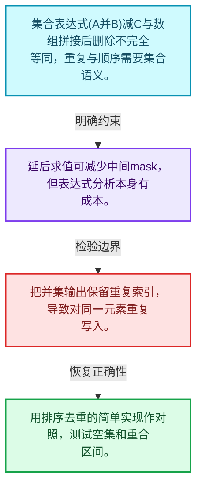
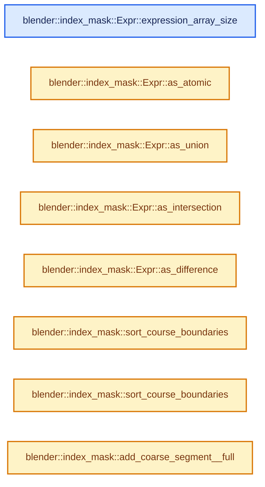
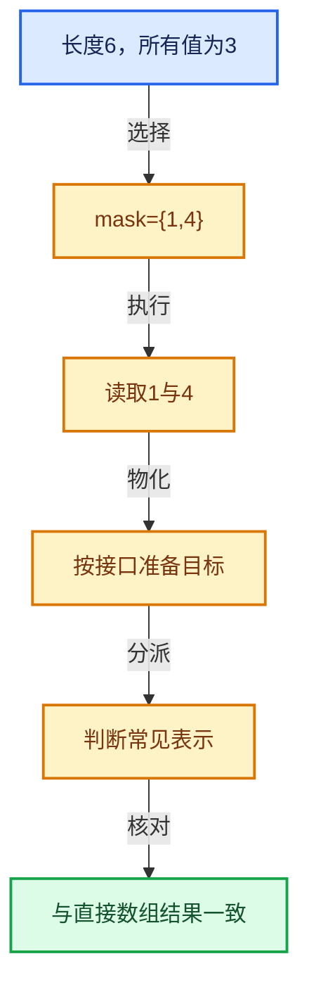

# 04-11 集合表达式与运算

[方向导航](README.md) · [总目录](../README.md) · [实现索引](../%E7%AC%A6%E5%8F%B7%E4%BE%9D%E8%B5%96%E4%B8%8E%E5%AE%9E%E7%8E%B0%E7%B4%A2%E5%BC%95.md)

## 从问题到实现

复杂选择表达式怎样避免不必要中间结果？

表达式描述与求值分开，为交并差组合保留优化空间；集合语义不能用普通数组拼接替代。

**数据模型**

集合表达式(A并B)减C与数组拼接后删除不完全等同，重复与顺序需要集合语义。

**设计取舍**

延后求值可减少中间mask，但表达式分析本身有成本。

**最小反例**

把并集输出保留重复索引，导致对同一元素重复写入。

**推导**

用排序去重的简单实现作对照，测试空集和重合区间。

## 阅读地图与执行推演








图中的数值推演是本方向的教学模型；实际函数之间的调用边与概念分析边分别标注，不能把概念关系当作运行时调度顺序。

## 完整源码单元与就地讲解

中文讲解直接放在相关代码旁，复杂机制在代码下展开。原文折叠区保留基准行号；不需要在行号表和函数之间来回查找。类布局可分段展示，函数实现不按固定行数切开。

### 类型布局、声明与编译条件 · BLI_index_mask_expression.hh L1—L68

<a id="t-5c7e2c07c070"></a>

`AtomicExpr`在这里声明的数据成员：

- `IndexMask mask`

<a id="t-c5d55b2b37cd"></a>

<a id="t-54b6f40db209"></a>

<a id="t-f774b80e2b11"></a>

<a id="t-f57bffdb920f"></a>

`Expr`在这里声明的数据成员：

- `Type type`
- `int index`
- `Vector<const Expr *> terms`
- `int expression_array_size`
- `AtomicExpr as_atomic`
- `UnionExpr as_union`
- `IntersectionExpr as_intersection`
- `DifferenceExpr as_difference`

<a id="t-e9daffc6d81d"></a>

<a id="t-208af2610688"></a>

`AtomicExpr`在这里声明的数据成员：

- `IndexMask mask`

<a id="t-529e54a8880f"></a>

<a id="t-c503e462c838"></a>

<a id="t-2ea201f39aa8"></a>

<a id="t-a2bc2e969270"></a>

`ExprBuilder`在这里声明的数据成员：

- `ResourceScope scope_`
- `int expr_count_`
- `UnionExpr merge`
- `DifferenceExpr subtract`
- `IntersectionExpr intersect`
- `Expr term_to_expr`

<!-- annotated:e34b992653ab18 -->

```cpp
/* SPDX-FileCopyrightText: 2024 Blender Authors
 *
 * SPDX-License-Identifier: GPL-2.0-or-later */

/** \file
 * \ingroup bli
 */

#pragma once

#include "BLI_index_mask.hh"
#include "BLI_resource_scope.hh"

namespace blender::index_mask {

struct AtomicExpr;
struct UnionExpr;
struct IntersectionExpr;
struct DifferenceExpr;

struct Expr {
  enum class Type {
    Atomic,
    Union,
    Intersection,
    Difference,
  };

  Type type;
  int index;
  Vector<const Expr *> terms;

  int expression_array_size() const;

  const AtomicExpr &as_atomic() const;
  const UnionExpr &as_union() const;
  const IntersectionExpr &as_intersection() const;
  const DifferenceExpr &as_difference() const;
};

struct AtomicExpr : public Expr {
  const IndexMask *mask;
};

struct UnionExpr : public Expr {};

struct IntersectionExpr : public Expr {};

struct DifferenceExpr : public Expr {};

class ExprBuilder {
 private:
  ResourceScope scope_;
  int expr_count_ = 0;

 public:
  using Term = std::variant<const Expr *, const IndexMask *, IndexRange>;

  const UnionExpr &merge(const Span<Term> terms);
  const DifferenceExpr &subtract(const Term &main_term, const Span<Term> subtract_terms);
  const IntersectionExpr &intersect(const Span<Term> terms);

 private:
  const Expr &term_to_expr(const Term &term);
};

IndexMask evaluate_expression(const Expr &expression, LinearAllocator<> &memory);

```

<details>
<summary>核对原始源码：source/blender/blenlib/BLI_index_mask_expression.hh · L1—L68</summary>

<!-- original:e34b992653ab18:source/blender/blenlib/BLI_index_mask_expression.hh:1:68 -->

```cpp
/* SPDX-FileCopyrightText: 2024 Blender Authors
 *
 * SPDX-License-Identifier: GPL-2.0-or-later */

/** \file
 * \ingroup bli
 */

#pragma once

#include "BLI_index_mask.hh"
#include "BLI_resource_scope.hh"

namespace blender::index_mask {

struct AtomicExpr;
struct UnionExpr;
struct IntersectionExpr;
struct DifferenceExpr;

struct Expr {
  enum class Type {
    Atomic,
    Union,
    Intersection,
    Difference,
  };

  Type type;
  int index;
  Vector<const Expr *> terms;

  int expression_array_size() const;

  const AtomicExpr &as_atomic() const;
  const UnionExpr &as_union() const;
  const IntersectionExpr &as_intersection() const;
  const DifferenceExpr &as_difference() const;
};

struct AtomicExpr : public Expr {
  const IndexMask *mask;
};

struct UnionExpr : public Expr {};

struct IntersectionExpr : public Expr {};

struct DifferenceExpr : public Expr {};

class ExprBuilder {
 private:
  ResourceScope scope_;
  int expr_count_ = 0;

 public:
  using Term = std::variant<const Expr *, const IndexMask *, IndexRange>;

  const UnionExpr &merge(const Span<Term> terms);
  const DifferenceExpr &subtract(const Term &main_term, const Span<Term> subtract_terms);
  const IntersectionExpr &intersect(const Span<Term> terms);

 private:
  const Expr &term_to_expr(const Term &term);
};

IndexMask evaluate_expression(const Expr &expression, LinearAllocator<> &memory);

```

</details>

<a id="f-f523850e7fa95484"></a>

### `blender::index_mask::Expr::expression_array_size`

实现位置：[source/blender/blenlib/BLI_index_mask_expression.hh](../../../../../source/blender/blenlib/BLI_index_mask_expression.hh) · L69—L72。

**教学注释版**

<!-- annotated:f8af0837f6f334 -->

```cpp
inline int Expr::expression_array_size() const
{
  return this->index + 1;
}
```

<details>
<summary>核对原始源码：source/blender/blenlib/BLI_index_mask_expression.hh · L69—L72</summary>

<!-- original:f8af0837f6f334:source/blender/blenlib/BLI_index_mask_expression.hh:69:72 -->

```cpp
inline int Expr::expression_array_size() const
{
  return this->index + 1;
}
```

</details>

**结果出口**

- `return this->index + 1;`

**继续追踪实现**

本实现没有需要继续展开的显式调用；检查返回表达式、对象转换和调用者前置条件。

<!-- annotated:f17e8818c458d1 -->

```cpp

```

<details>
<summary>核对原始源码：source/blender/blenlib/BLI_index_mask_expression.hh · L73—L73</summary>

<!-- original:f17e8818c458d1:source/blender/blenlib/BLI_index_mask_expression.hh:73:73 -->

```cpp

```

</details>

<a id="f-e01cd551d24976ab"></a>

### `blender::index_mask::Expr::as_atomic`

实现位置：[source/blender/blenlib/BLI_index_mask_expression.hh](../../../../../source/blender/blenlib/BLI_index_mask_expression.hh) · L74—L78。

**教学注释版**

<!-- annotated:5c25299026c2d8 -->

```cpp
inline const AtomicExpr &Expr::as_atomic() const
{
  BLI_assert(this->type == Type::Atomic);
  return static_cast<const AtomicExpr &>(*this);
}
```

<details>
<summary>核对原始源码：source/blender/blenlib/BLI_index_mask_expression.hh · L74—L78</summary>

<!-- original:5c25299026c2d8:source/blender/blenlib/BLI_index_mask_expression.hh:74:78 -->

```cpp
inline const AtomicExpr &Expr::as_atomic() const
{
  BLI_assert(this->type == Type::Atomic);
  return static_cast<const AtomicExpr &>(*this);
}
```

</details>

**结果出口**

- `return static_cast<const AtomicExpr &>(*this);`

**继续追踪实现**

- `BLI_assert` → [BLI_assert · L48](../01-%E5%9F%BA%E7%A1%80%E5%AE%B9%E5%99%A8%E4%B8%8E%E7%8E%B0%E4%BB%A3CPP/%E4%BE%9D%E8%B5%96-BLI_assert-cc98e8.md#m-57a88495704d)；[BLI_assert · L63](../01-%E5%9F%BA%E7%A1%80%E5%AE%B9%E5%99%A8%E4%B8%8E%E7%8E%B0%E4%BB%A3CPP/%E4%BE%9D%E8%B5%96-BLI_assert-cc98e8.md#m-d07050020cb5)。宏定义由构建条件选择。

<!-- annotated:e83f3c51abbab9 -->

```cpp

```

<details>
<summary>核对原始源码：source/blender/blenlib/BLI_index_mask_expression.hh · L79—L79</summary>

<!-- original:e83f3c51abbab9:source/blender/blenlib/BLI_index_mask_expression.hh:79:79 -->

```cpp

```

</details>

<a id="f-525779ae6b0f8246"></a>

### `blender::index_mask::Expr::as_union`

实现位置：[source/blender/blenlib/BLI_index_mask_expression.hh](../../../../../source/blender/blenlib/BLI_index_mask_expression.hh) · L80—L84。

**教学注释版**

<!-- annotated:7fa92f042836c5 -->

```cpp
inline const UnionExpr &Expr::as_union() const
{
  BLI_assert(this->type == Type::Union);
  return static_cast<const UnionExpr &>(*this);
}
```

<details>
<summary>核对原始源码：source/blender/blenlib/BLI_index_mask_expression.hh · L80—L84</summary>

<!-- original:7fa92f042836c5:source/blender/blenlib/BLI_index_mask_expression.hh:80:84 -->

```cpp
inline const UnionExpr &Expr::as_union() const
{
  BLI_assert(this->type == Type::Union);
  return static_cast<const UnionExpr &>(*this);
}
```

</details>

**结果出口**

- `return static_cast<const UnionExpr &>(*this);`

**继续追踪实现**

- `BLI_assert` → [BLI_assert · L48](../01-%E5%9F%BA%E7%A1%80%E5%AE%B9%E5%99%A8%E4%B8%8E%E7%8E%B0%E4%BB%A3CPP/%E4%BE%9D%E8%B5%96-BLI_assert-cc98e8.md#m-57a88495704d)；[BLI_assert · L63](../01-%E5%9F%BA%E7%A1%80%E5%AE%B9%E5%99%A8%E4%B8%8E%E7%8E%B0%E4%BB%A3CPP/%E4%BE%9D%E8%B5%96-BLI_assert-cc98e8.md#m-d07050020cb5)。宏定义由构建条件选择。

<!-- annotated:7c152ca3e5ea2f -->

```cpp

```

<details>
<summary>核对原始源码：source/blender/blenlib/BLI_index_mask_expression.hh · L85—L85</summary>

<!-- original:7c152ca3e5ea2f:source/blender/blenlib/BLI_index_mask_expression.hh:85:85 -->

```cpp

```

</details>

<a id="f-b0eba3ff4c2a3594"></a>

### `blender::index_mask::Expr::as_intersection`

实现位置：[source/blender/blenlib/BLI_index_mask_expression.hh](../../../../../source/blender/blenlib/BLI_index_mask_expression.hh) · L86—L90。

**教学注释版**

<!-- annotated:75851fde7eb328 -->

```cpp
inline const IntersectionExpr &Expr::as_intersection() const
{
  BLI_assert(this->type == Type::Intersection);
  return static_cast<const IntersectionExpr &>(*this);
}
```

<details>
<summary>核对原始源码：source/blender/blenlib/BLI_index_mask_expression.hh · L86—L90</summary>

<!-- original:75851fde7eb328:source/blender/blenlib/BLI_index_mask_expression.hh:86:90 -->

```cpp
inline const IntersectionExpr &Expr::as_intersection() const
{
  BLI_assert(this->type == Type::Intersection);
  return static_cast<const IntersectionExpr &>(*this);
}
```

</details>

**结果出口**

- `return static_cast<const IntersectionExpr &>(*this);`

**继续追踪实现**

- `BLI_assert` → [BLI_assert · L48](../01-%E5%9F%BA%E7%A1%80%E5%AE%B9%E5%99%A8%E4%B8%8E%E7%8E%B0%E4%BB%A3CPP/%E4%BE%9D%E8%B5%96-BLI_assert-cc98e8.md#m-57a88495704d)；[BLI_assert · L63](../01-%E5%9F%BA%E7%A1%80%E5%AE%B9%E5%99%A8%E4%B8%8E%E7%8E%B0%E4%BB%A3CPP/%E4%BE%9D%E8%B5%96-BLI_assert-cc98e8.md#m-d07050020cb5)。宏定义由构建条件选择。

<!-- annotated:20e4327348d79c -->

```cpp

```

<details>
<summary>核对原始源码：source/blender/blenlib/BLI_index_mask_expression.hh · L91—L91</summary>

<!-- original:20e4327348d79c:source/blender/blenlib/BLI_index_mask_expression.hh:91:91 -->

```cpp

```

</details>

<a id="f-9d30de3fe0a55789"></a>

### `blender::index_mask::Expr::as_difference`

实现位置：[source/blender/blenlib/BLI_index_mask_expression.hh](../../../../../source/blender/blenlib/BLI_index_mask_expression.hh) · L92—L96。

**教学注释版**

<!-- annotated:c0300d492c116e -->

```cpp
inline const DifferenceExpr &Expr::as_difference() const
{
  BLI_assert(this->type == Type::Difference);
  return static_cast<const DifferenceExpr &>(*this);
}
```

<details>
<summary>核对原始源码：source/blender/blenlib/BLI_index_mask_expression.hh · L92—L96</summary>

<!-- original:c0300d492c116e:source/blender/blenlib/BLI_index_mask_expression.hh:92:96 -->

```cpp
inline const DifferenceExpr &Expr::as_difference() const
{
  BLI_assert(this->type == Type::Difference);
  return static_cast<const DifferenceExpr &>(*this);
}
```

</details>

**结果出口**

- `return static_cast<const DifferenceExpr &>(*this);`

**继续追踪实现**

- `BLI_assert` → [BLI_assert · L48](../01-%E5%9F%BA%E7%A1%80%E5%AE%B9%E5%99%A8%E4%B8%8E%E7%8E%B0%E4%BB%A3CPP/%E4%BE%9D%E8%B5%96-BLI_assert-cc98e8.md#m-57a88495704d)；[BLI_assert · L63](../01-%E5%9F%BA%E7%A1%80%E5%AE%B9%E5%99%A8%E4%B8%8E%E7%8E%B0%E4%BB%A3CPP/%E4%BE%9D%E8%B5%96-BLI_assert-cc98e8.md#m-d07050020cb5)。宏定义由构建条件选择。

### 类型布局、声明与编译条件 · BLI_index_mask_expression.hh L97—L98

<!-- annotated:2deeaec8c72e02 -->

```cpp

}  // namespace blender::index_mask
```

<details>
<summary>核对原始源码：source/blender/blenlib/BLI_index_mask_expression.hh · L97—L98</summary>

<!-- original:2deeaec8c72e02:source/blender/blenlib/BLI_index_mask_expression.hh:97:98 -->

```cpp

}  // namespace blender::index_mask
```

</details>

### 类型布局、声明与编译条件 · index_mask_expression.cc L1—L120

<a id="t-9730e0e2c7b9"></a>

`CoarseSegment`在这里声明的数据成员：

- `Type type`
- `IndexRange bounds`
- `IndexMask mask`

<a id="t-428fd56d68ee"></a>

<a id="t-846dfca670dd"></a>

`CoarseResult`在这里声明的数据成员：

- `Vector<CoarseSegment> segments`

<a id="t-e2851ce3e2ad"></a>

`CourseBoundary`在这里声明的数据成员：

- `int64_t index`
- `bool is_begin`
- `CoarseSegment segment`

<a id="t-d2e738f26fbc"></a>

`DifferenceCourseBoundary`在这里声明的数据成员：

- `bool is_main`

<a id="t-f04a613ec1de"></a>

`EvaluatedSegment`在这里声明的数据成员：

- `Type type`
- `IndexRange bounds`
- `IndexMask copy_mask`
- `IndexMaskSegment indices`

<a id="t-054feedeb190"></a>

<a id="t-f7a8d905879e"></a>

<!-- annotated:4b077ab82c9436 -->

```cpp
/* SPDX-FileCopyrightText: 2024 Blender Authors
 *
 * SPDX-License-Identifier: GPL-2.0-or-later */

/** \file
 * \ingroup bli
 */

/**
 * Expression evaluation has multiple phases:
 * 1. A coarse evaluation that tries to find segments which can be trivially evaluated. For
 *    example, taking the union of two overlapping ranges can be done in O(1) time.
 * 2. For all segments which can't be fully evaluated using coarse evaluation, an exact evaluation
 *    is done. This uses either an index-based or bit-based approach depending on a heuristic.
 * 3. Construct the final index mask based on the resulting intermediate segments.
 */

#include "BLI_array.hh"
#include "BLI_bit_group_vector.hh"
#include "BLI_bit_span_ops.hh"
#include "BLI_enumerable_thread_specific.hh"
#include "BLI_index_mask_expression.hh"
#include "BLI_stack.hh"
#include "BLI_task.hh"

#include "BLI_strict_flags.hh" /* IWYU pragma: keep */

namespace blender::index_mask {

/**
 * Number of expression terms which don't require extra allocations in some places.
 */
constexpr int64_t inline_expr_array_size = 16;

/**
 * The result of the coarse evaluation for a specific index range.
 */
struct CoarseSegment {
  enum class Type {
    /**
     * Coarse evaluation couldn't fully resolve this segment. The segment requires another
     * evaluation that is more detailed.
     */
    Unknown,
    /** All indices in the segment are part of the result. */
    Full,
    /** The evaluated result of this segment is just the copy of an input index mask. */
    Copy,
  };
  Type type = Type::Unknown;
  IndexRange bounds;
  /** Mask used when the type is #Copy. */
  const IndexMask *mask = nullptr;
};

/** Contains the result of a coarse evaluation split into potentially many segments. */
struct CoarseResult {
  Vector<CoarseSegment> segments;
};

/** Used during coarse evaluation to split the full range into multiple segments. */
struct CourseBoundary {
  /**
   * The position of the boundary. The boundary is right before this index. So if this boundary is
   * a beginning of a segment, the index marks the first element. If it is the end, the index marks
   * the one-after-last position.
   */
  int64_t index;
  /** Whether this boundary is the beginning or end of the segment below. */
  bool is_begin;
  /** The segment this boundary comes from. */
  const CoarseSegment *segment;
};

/** For the difference operation, we need to know if a boundary belongs to the main term or not. */
struct DifferenceCourseBoundary : public CourseBoundary {
  bool is_main;
};

/**
 * Result of the expression evaluation within a specific index range. Sometimes this can be derived
 * directly from the coarse evaluation, but sometimes an additional exact evaluation is necessary.
 */
struct EvaluatedSegment {
  enum class Type {
    /** All indices in this segment are part of the evaluated index mask. */
    Full,
    /** The result in this segment is the same as what is contained in the #copy_mask below. */
    Copy,
    /** The result comes from exact evaluation and is a new set of indices. */
    Indices,
  };

  Type type = Type::Indices;
  IndexRange bounds;
  /** Only used when the type is #Type::Copy. */
  const IndexMask *copy_mask = nullptr;
  /** Only used when the type is #Type::Indices. */
  IndexMaskSegment indices;
};

/**
 * There are different ways to do the exact evaluation. Depending on the expression or data, one
 * or the other is more efficient.
 */
enum class ExactEvalMode {
  /**
   * Does the evaluation by working directly with arrays of sorted indices. This is usually best
   * when the expression does not have intermediate results, i.e. it is very simple.
   */
  Indices,
  /**
   * The evaluation works with bits. There is extra overhead to convert the input masks to bit
   * arrays and to convert the final result back into indices. In exchange, the actual expression
   * evaluation is significantly cheaper because it's just a bunch of bit operations. For larger
   * expressions, this is typically much more efficient.
   */
  Bits,
};

```

<details>
<summary>核对原始源码：source/blender/blenlib/intern/index_mask_expression.cc · L1—L120</summary>

<!-- original:4b077ab82c9436:source/blender/blenlib/intern/index_mask_expression.cc:1:120 -->

```cpp
/* SPDX-FileCopyrightText: 2024 Blender Authors
 *
 * SPDX-License-Identifier: GPL-2.0-or-later */

/** \file
 * \ingroup bli
 */

/**
 * Expression evaluation has multiple phases:
 * 1. A coarse evaluation that tries to find segments which can be trivially evaluated. For
 *    example, taking the union of two overlapping ranges can be done in O(1) time.
 * 2. For all segments which can't be fully evaluated using coarse evaluation, an exact evaluation
 *    is done. This uses either an index-based or bit-based approach depending on a heuristic.
 * 3. Construct the final index mask based on the resulting intermediate segments.
 */

#include "BLI_array.hh"
#include "BLI_bit_group_vector.hh"
#include "BLI_bit_span_ops.hh"
#include "BLI_enumerable_thread_specific.hh"
#include "BLI_index_mask_expression.hh"
#include "BLI_stack.hh"
#include "BLI_task.hh"

#include "BLI_strict_flags.hh" /* IWYU pragma: keep */

namespace blender::index_mask {

/**
 * Number of expression terms which don't require extra allocations in some places.
 */
constexpr int64_t inline_expr_array_size = 16;

/**
 * The result of the coarse evaluation for a specific index range.
 */
struct CoarseSegment {
  enum class Type {
    /**
     * Coarse evaluation couldn't fully resolve this segment. The segment requires another
     * evaluation that is more detailed.
     */
    Unknown,
    /** All indices in the segment are part of the result. */
    Full,
    /** The evaluated result of this segment is just the copy of an input index mask. */
    Copy,
  };
  Type type = Type::Unknown;
  IndexRange bounds;
  /** Mask used when the type is #Copy. */
  const IndexMask *mask = nullptr;
};

/** Contains the result of a coarse evaluation split into potentially many segments. */
struct CoarseResult {
  Vector<CoarseSegment> segments;
};

/** Used during coarse evaluation to split the full range into multiple segments. */
struct CourseBoundary {
  /**
   * The position of the boundary. The boundary is right before this index. So if this boundary is
   * a beginning of a segment, the index marks the first element. If it is the end, the index marks
   * the one-after-last position.
   */
  int64_t index;
  /** Whether this boundary is the beginning or end of the segment below. */
  bool is_begin;
  /** The segment this boundary comes from. */
  const CoarseSegment *segment;
};

/** For the difference operation, we need to know if a boundary belongs to the main term or not. */
struct DifferenceCourseBoundary : public CourseBoundary {
  bool is_main;
};

/**
 * Result of the expression evaluation within a specific index range. Sometimes this can be derived
 * directly from the coarse evaluation, but sometimes an additional exact evaluation is necessary.
 */
struct EvaluatedSegment {
  enum class Type {
    /** All indices in this segment are part of the evaluated index mask. */
    Full,
    /** The result in this segment is the same as what is contained in the #copy_mask below. */
    Copy,
    /** The result comes from exact evaluation and is a new set of indices. */
    Indices,
  };

  Type type = Type::Indices;
  IndexRange bounds;
  /** Only used when the type is #Type::Copy. */
  const IndexMask *copy_mask = nullptr;
  /** Only used when the type is #Type::Indices. */
  IndexMaskSegment indices;
};

/**
 * There are different ways to do the exact evaluation. Depending on the expression or data, one
 * or the other is more efficient.
 */
enum class ExactEvalMode {
  /**
   * Does the evaluation by working directly with arrays of sorted indices. This is usually best
   * when the expression does not have intermediate results, i.e. it is very simple.
   */
  Indices,
  /**
   * The evaluation works with bits. There is extra overhead to convert the input masks to bit
   * arrays and to convert the final result back into indices. In exchange, the actual expression
   * evaluation is significantly cheaper because it's just a bunch of bit operations. For larger
   * expressions, this is typically much more efficient.
   */
  Bits,
};

```

</details>

<a id="f-ed425284618e4be0"></a>

### `blender::index_mask::sort_course_boundaries`

实现位置：[source/blender/blenlib/intern/index_mask_expression.cc](../../../../../source/blender/blenlib/intern/index_mask_expression.cc) · L121—L126。

接口参数：

- `MutableSpan<CourseBoundary> boundaries`

**教学注释版**

<!-- annotated:65f165b3b6d9fb -->

```cpp
static void sort_course_boundaries(MutableSpan<CourseBoundary> boundaries)
{
  std::ranges::sort(boundaries, [](const CourseBoundary &a, const CourseBoundary &b) {
    return a.index < b.index;
  });
}
```

<details>
<summary>核对原始源码：source/blender/blenlib/intern/index_mask_expression.cc · L121—L126</summary>

<!-- original:65f165b3b6d9fb:source/blender/blenlib/intern/index_mask_expression.cc:121:126 -->

```cpp
static void sort_course_boundaries(MutableSpan<CourseBoundary> boundaries)
{
  std::ranges::sort(boundaries, [](const CourseBoundary &a, const CourseBoundary &b) {
    return a.index < b.index;
  });
}
```

</details>

**结果出口**

- `return a.index < b.index;`

**继续追踪实现**

- `std::ranges::sort` → [外部契约](https://eel.is/c++draft/)：这个边界按实际表达式及所属类型核对参数、返回值、寿命与失败行为。这里提供接口入口，不声称已解释该第三方版本的内部实现。

<!-- annotated:3b8a73a024e748 -->

```cpp

```

<details>
<summary>核对原始源码：source/blender/blenlib/intern/index_mask_expression.cc · L127—L127</summary>

<!-- original:3b8a73a024e748:source/blender/blenlib/intern/index_mask_expression.cc:127:127 -->

```cpp

```

</details>

<a id="f-25114467cbf45721"></a>

### `blender::index_mask::sort_course_boundaries`

实现位置：[source/blender/blenlib/intern/index_mask_expression.cc](../../../../../source/blender/blenlib/intern/index_mask_expression.cc) · L128—L134。

接口参数：

- `MutableSpan<DifferenceCourseBoundary> boundaries`

**教学注释版**

<!-- annotated:6d54642ae89c31 -->

```cpp
static void sort_course_boundaries(MutableSpan<DifferenceCourseBoundary> boundaries)
{
  std::ranges::sort(boundaries,
                    [](const DifferenceCourseBoundary &a, const DifferenceCourseBoundary &b) {
                      return a.index < b.index;
                    });
}
```

<details>
<summary>核对原始源码：source/blender/blenlib/intern/index_mask_expression.cc · L128—L134</summary>

<!-- original:6d54642ae89c31:source/blender/blenlib/intern/index_mask_expression.cc:128:134 -->

```cpp
static void sort_course_boundaries(MutableSpan<DifferenceCourseBoundary> boundaries)
{
  std::ranges::sort(boundaries,
                    [](const DifferenceCourseBoundary &a, const DifferenceCourseBoundary &b) {
                      return a.index < b.index;
                    });
}
```

</details>

**结果出口**

- `return a.index < b.index;`

**继续追踪实现**

- `std::ranges::sort` → [外部契约](https://eel.is/c++draft/)：这个边界按实际表达式及所属类型核对参数、返回值、寿命与失败行为。这里提供接口入口，不声称已解释该第三方版本的内部实现。

### 类型布局、声明与编译条件 · index_mask_expression.cc L135—L139

<!-- annotated:b78a462b246ed2 -->

```cpp

/** Smaller segments should generally be merged together. */
static constexpr int64_t segment_size_threshold = 32;

/** Extends a previous full segment or appends a new one. */
```

<details>
<summary>核对原始源码：source/blender/blenlib/intern/index_mask_expression.cc · L135—L139</summary>

<!-- original:b78a462b246ed2:source/blender/blenlib/intern/index_mask_expression.cc:135:139 -->

```cpp

/** Smaller segments should generally be merged together. */
static constexpr int64_t segment_size_threshold = 32;

/** Extends a previous full segment or appends a new one. */
```

</details>

<a id="f-7f8309ea09a571f9"></a>

### `blender::index_mask::add_coarse_segment__full`

实现位置：[source/blender/blenlib/intern/index_mask_expression.cc](../../../../../source/blender/blenlib/intern/index_mask_expression.cc) · L140—L165。

接口参数：

- `CoarseSegment *prev_segment`
- `const int64_t prev_boundary_index`
- `const int64_t current_boundary_index`
- `CoarseResult &result`

**教学注释版**

<!-- annotated:c9ad78f2063334 -->

```cpp
static CoarseSegment &add_coarse_segment__full(CoarseSegment *prev_segment,
                                               const int64_t prev_boundary_index,
                                               const int64_t current_boundary_index,
                                               CoarseResult &result)
{
  const int64_t size = current_boundary_index - prev_boundary_index;
  if (prev_segment) {
    if (prev_segment->type == CoarseSegment::Type::Full &&
        prev_segment->bounds.one_after_last() == prev_boundary_index)
    {
      prev_segment->bounds = prev_segment->bounds.with_new_end(current_boundary_index);
      return *prev_segment;
    }
    if (current_boundary_index - prev_segment->bounds.start() < max_segment_size) {
      if (prev_segment->bounds.size() + size < segment_size_threshold) {
        /* Extend the previous segment because it's so small and change it into an unknown one. */
        prev_segment->bounds = prev_segment->bounds.with_new_end(current_boundary_index);
        prev_segment->type = CoarseSegment::Type::Unknown;
        return *prev_segment;
      }
    }
  }
  result.segments.append(
      {CoarseSegment::Type::Full, IndexRange::from_begin_size(prev_boundary_index, size)});
  return result.segments.last();
}
```

<details>
<summary>核对原始源码：source/blender/blenlib/intern/index_mask_expression.cc · L140—L165</summary>

<!-- original:c9ad78f2063334:source/blender/blenlib/intern/index_mask_expression.cc:140:165 -->

```cpp
static CoarseSegment &add_coarse_segment__full(CoarseSegment *prev_segment,
                                               const int64_t prev_boundary_index,
                                               const int64_t current_boundary_index,
                                               CoarseResult &result)
{
  const int64_t size = current_boundary_index - prev_boundary_index;
  if (prev_segment) {
    if (prev_segment->type == CoarseSegment::Type::Full &&
        prev_segment->bounds.one_after_last() == prev_boundary_index)
    {
      prev_segment->bounds = prev_segment->bounds.with_new_end(current_boundary_index);
      return *prev_segment;
    }
    if (current_boundary_index - prev_segment->bounds.start() < max_segment_size) {
      if (prev_segment->bounds.size() + size < segment_size_threshold) {
        /* Extend the previous segment because it's so small and change it into an unknown one. */
        prev_segment->bounds = prev_segment->bounds.with_new_end(current_boundary_index);
        prev_segment->type = CoarseSegment::Type::Unknown;
        return *prev_segment;
      }
    }
  }
  result.segments.append(
      {CoarseSegment::Type::Full, IndexRange::from_begin_size(prev_boundary_index, size)});
  return result.segments.last();
}
```

</details>

**沿实际写入检查状态**

- `prev_segment->bounds = prev_segment->bounds.with_new_end(current_boundary_index);`
- `prev_segment->type = CoarseSegment::Type::Unknown;`

**结果出口**

- `return *prev_segment;`
- `return result.segments.last();`

**继续追踪实现**

- `prev_segment->bounds.one_after_last` → [调用协议](../%E6%A8%A1%E6%9D%BF%E5%AE%8F%E4%B8%8E%E5%8A%A8%E6%80%81%E5%88%86%E6%B4%BE%E5%8D%8F%E8%AE%AE.md)：接收对象类型依赖auto、返回值或模板实例；不按同名猜测目标。调用位置L148。
- `prev_segment->bounds.with_new_end` → [调用协议](../%E6%A8%A1%E6%9D%BF%E5%AE%8F%E4%B8%8E%E5%8A%A8%E6%80%81%E5%88%86%E6%B4%BE%E5%8D%8F%E8%AE%AE.md)：接收对象类型依赖auto、返回值或模板实例；不按同名猜测目标。调用位置L150。
- `prev_segment->bounds.start` → [调用协议](../%E6%A8%A1%E6%9D%BF%E5%AE%8F%E4%B8%8E%E5%8A%A8%E6%80%81%E5%88%86%E6%B4%BE%E5%8D%8F%E8%AE%AE.md)：接收对象类型依赖auto、返回值或模板实例；不按同名猜测目标。调用位置L153。
- `prev_segment->bounds.size` → [调用协议](../%E6%A8%A1%E6%9D%BF%E5%AE%8F%E4%B8%8E%E5%8A%A8%E6%80%81%E5%88%86%E6%B4%BE%E5%8D%8F%E8%AE%AE.md)：接收对象类型依赖auto、返回值或模板实例；不按同名猜测目标。调用位置L154。
- `result.segments.append` → [调用协议](../%E6%A8%A1%E6%9D%BF%E5%AE%8F%E4%B8%8E%E5%8A%A8%E6%80%81%E5%88%86%E6%B4%BE%E5%8D%8F%E8%AE%AE.md)：接收对象类型依赖auto、返回值或模板实例；不按同名猜测目标。调用位置L162。
- `IndexRange::from_begin_size` → [blender::IndexRange::from_begin_size · L73](../01-%E5%9F%BA%E7%A1%80%E5%AE%B9%E5%99%A8%E4%B8%8E%E7%8E%B0%E4%BB%A3CPP/04-IndexRange%E8%BF%9E%E7%BB%AD%E6%95%B4%E6%95%B0%E5%8C%BA%E9%97%B4.md#f-392d3c73c80f255d)。
- `result.segments.last` → [调用协议](../%E6%A8%A1%E6%9D%BF%E5%AE%8F%E4%B8%8E%E5%8A%A8%E6%80%81%E5%88%86%E6%B4%BE%E5%8D%8F%E8%AE%AE.md)：接收对象类型依赖auto、返回值或模板实例；不按同名猜测目标。调用位置L164。

### 类型布局、声明与编译条件 · index_mask_expression.cc L166—L167

<!-- annotated:78dc1cba4540b9 -->

```cpp

/** Extends a previous unknown segment or appends a new one. */
```

<details>
<summary>核对原始源码：source/blender/blenlib/intern/index_mask_expression.cc · L166—L167</summary>

<!-- original:78dc1cba4540b9:source/blender/blenlib/intern/index_mask_expression.cc:166:167 -->

```cpp

/** Extends a previous unknown segment or appends a new one. */
```

</details>

<a id="f-a95278a592c2d278"></a>

### `blender::index_mask::add_coarse_segment__unknown`

实现位置：[source/blender/blenlib/intern/index_mask_expression.cc](../../../../../source/blender/blenlib/intern/index_mask_expression.cc) · L168—L185。

接口参数：

- `CoarseSegment *prev_segment`
- `const int64_t prev_boundary_index`
- `const int64_t current_boundary_index`
- `CoarseResult &result`

**教学注释版**

<!-- annotated:0c504d8eaf1dcc -->

```cpp
static CoarseSegment &add_coarse_segment__unknown(CoarseSegment *prev_segment,
                                                  const int64_t prev_boundary_index,
                                                  const int64_t current_boundary_index,
                                                  CoarseResult &result)
{
  if (prev_segment) {
    if (prev_segment->bounds.start() + segment_size_threshold >= prev_boundary_index) {
      /* The previous segment is very short, so extend it. */
      prev_segment->type = CoarseSegment::Type::Unknown;
      prev_segment->bounds = prev_segment->bounds.with_new_end(current_boundary_index);
      return *prev_segment;
    }
  }
  result.segments.append(
      {CoarseSegment::Type::Unknown,
       IndexRange::from_begin_end(prev_boundary_index, current_boundary_index)});
  return result.segments.last();
}
```

<details>
<summary>核对原始源码：source/blender/blenlib/intern/index_mask_expression.cc · L168—L185</summary>

<!-- original:0c504d8eaf1dcc:source/blender/blenlib/intern/index_mask_expression.cc:168:185 -->

```cpp
static CoarseSegment &add_coarse_segment__unknown(CoarseSegment *prev_segment,
                                                  const int64_t prev_boundary_index,
                                                  const int64_t current_boundary_index,
                                                  CoarseResult &result)
{
  if (prev_segment) {
    if (prev_segment->bounds.start() + segment_size_threshold >= prev_boundary_index) {
      /* The previous segment is very short, so extend it. */
      prev_segment->type = CoarseSegment::Type::Unknown;
      prev_segment->bounds = prev_segment->bounds.with_new_end(current_boundary_index);
      return *prev_segment;
    }
  }
  result.segments.append(
      {CoarseSegment::Type::Unknown,
       IndexRange::from_begin_end(prev_boundary_index, current_boundary_index)});
  return result.segments.last();
}
```

</details>

**沿实际写入检查状态**

- `prev_segment->type = CoarseSegment::Type::Unknown;`
- `prev_segment->bounds = prev_segment->bounds.with_new_end(current_boundary_index);`

**结果出口**

- `return *prev_segment;`
- `return result.segments.last();`

**继续追踪实现**

- `prev_segment->bounds.start` → [调用协议](../%E6%A8%A1%E6%9D%BF%E5%AE%8F%E4%B8%8E%E5%8A%A8%E6%80%81%E5%88%86%E6%B4%BE%E5%8D%8F%E8%AE%AE.md)：接收对象类型依赖auto、返回值或模板实例；不按同名猜测目标。调用位置L174。
- `prev_segment->bounds.with_new_end` → [调用协议](../%E6%A8%A1%E6%9D%BF%E5%AE%8F%E4%B8%8E%E5%8A%A8%E6%80%81%E5%88%86%E6%B4%BE%E5%8D%8F%E8%AE%AE.md)：接收对象类型依赖auto、返回值或模板实例；不按同名猜测目标。调用位置L177。
- `result.segments.append` → [调用协议](../%E6%A8%A1%E6%9D%BF%E5%AE%8F%E4%B8%8E%E5%8A%A8%E6%80%81%E5%88%86%E6%B4%BE%E5%8D%8F%E8%AE%AE.md)：接收对象类型依赖auto、返回值或模板实例；不按同名猜测目标。调用位置L181。
- `IndexRange::from_begin_end` → [blender::IndexRange::from_begin_end · L78](../01-%E5%9F%BA%E7%A1%80%E5%AE%B9%E5%99%A8%E4%B8%8E%E7%8E%B0%E4%BB%A3CPP/04-IndexRange%E8%BF%9E%E7%BB%AD%E6%95%B4%E6%95%B0%E5%8C%BA%E9%97%B4.md#f-a523839fb9650253)。
- `result.segments.last` → [调用协议](../%E6%A8%A1%E6%9D%BF%E5%AE%8F%E4%B8%8E%E5%8A%A8%E6%80%81%E5%88%86%E6%B4%BE%E5%8D%8F%E8%AE%AE.md)：接收对象类型依赖auto、返回值或模板实例；不按同名猜测目标。调用位置L184。

### 类型布局、声明与编译条件 · index_mask_expression.cc L186—L187

<!-- annotated:4aeed283445d3f -->

```cpp

/** Extends a previous copy segment or appends a new one. */
```

<details>
<summary>核对原始源码：source/blender/blenlib/intern/index_mask_expression.cc · L186—L187</summary>

<!-- original:4aeed283445d3f:source/blender/blenlib/intern/index_mask_expression.cc:186:187 -->

```cpp

/** Extends a previous copy segment or appends a new one. */
```

</details>

<a id="f-86cb1a8ae04cadaf"></a>

### `blender::index_mask::add_coarse_segment__copy`

实现位置：[source/blender/blenlib/intern/index_mask_expression.cc](../../../../../source/blender/blenlib/intern/index_mask_expression.cc) · L188—L214。

接口参数：

- `CoarseSegment *prev_segment`
- `const int64_t prev_boundary_index`
- `const int64_t current_boundary_index`
- `const IndexMask &copy_from_mask`
- `CoarseResult &result`

**教学注释版**

<!-- annotated:1abd5504634285 -->

```cpp
static CoarseSegment &add_coarse_segment__copy(CoarseSegment *prev_segment,
                                               const int64_t prev_boundary_index,
                                               const int64_t current_boundary_index,
                                               const IndexMask &copy_from_mask,
                                               CoarseResult &result)
{
  if (prev_segment) {
    if (prev_segment->type == CoarseSegment::Type::Copy &&
        prev_segment->bounds.one_after_last() == prev_boundary_index &&
        prev_segment->mask == &copy_from_mask)
    {
      /* Can extend the previous copy segment. */
      prev_segment->bounds = prev_segment->bounds.with_new_end(current_boundary_index);
      return *prev_segment;
    }
    if (prev_segment->bounds.start() + segment_size_threshold >= current_boundary_index) {
      /* The previous and this segment together are very short, so better merge them together. */
      prev_segment->bounds = prev_segment->bounds.with_new_end(current_boundary_index);
      prev_segment->type = CoarseSegment::Type::Unknown;
      return *prev_segment;
    }
  }
  result.segments.append({CoarseSegment::Type::Copy,
                          IndexRange::from_begin_end(prev_boundary_index, current_boundary_index),
                          &copy_from_mask});
  return result.segments.last();
}
```

<details>
<summary>核对原始源码：source/blender/blenlib/intern/index_mask_expression.cc · L188—L214</summary>

<!-- original:1abd5504634285:source/blender/blenlib/intern/index_mask_expression.cc:188:214 -->

```cpp
static CoarseSegment &add_coarse_segment__copy(CoarseSegment *prev_segment,
                                               const int64_t prev_boundary_index,
                                               const int64_t current_boundary_index,
                                               const IndexMask &copy_from_mask,
                                               CoarseResult &result)
{
  if (prev_segment) {
    if (prev_segment->type == CoarseSegment::Type::Copy &&
        prev_segment->bounds.one_after_last() == prev_boundary_index &&
        prev_segment->mask == &copy_from_mask)
    {
      /* Can extend the previous copy segment. */
      prev_segment->bounds = prev_segment->bounds.with_new_end(current_boundary_index);
      return *prev_segment;
    }
    if (prev_segment->bounds.start() + segment_size_threshold >= current_boundary_index) {
      /* The previous and this segment together are very short, so better merge them together. */
      prev_segment->bounds = prev_segment->bounds.with_new_end(current_boundary_index);
      prev_segment->type = CoarseSegment::Type::Unknown;
      return *prev_segment;
    }
  }
  result.segments.append({CoarseSegment::Type::Copy,
                          IndexRange::from_begin_end(prev_boundary_index, current_boundary_index),
                          &copy_from_mask});
  return result.segments.last();
}
```

</details>

**沿实际写入检查状态**

- `prev_segment->bounds = prev_segment->bounds.with_new_end(current_boundary_index);`
- `prev_segment->type = CoarseSegment::Type::Unknown;`

**结果出口**

- `return *prev_segment;`
- `return result.segments.last();`

**继续追踪实现**

- `prev_segment->bounds.one_after_last` → [调用协议](../%E6%A8%A1%E6%9D%BF%E5%AE%8F%E4%B8%8E%E5%8A%A8%E6%80%81%E5%88%86%E6%B4%BE%E5%8D%8F%E8%AE%AE.md)：接收对象类型依赖auto、返回值或模板实例；不按同名猜测目标。调用位置L196。
- `prev_segment->bounds.with_new_end` → [调用协议](../%E6%A8%A1%E6%9D%BF%E5%AE%8F%E4%B8%8E%E5%8A%A8%E6%80%81%E5%88%86%E6%B4%BE%E5%8D%8F%E8%AE%AE.md)：接收对象类型依赖auto、返回值或模板实例；不按同名猜测目标。调用位置L200。
- `prev_segment->bounds.start` → [调用协议](../%E6%A8%A1%E6%9D%BF%E5%AE%8F%E4%B8%8E%E5%8A%A8%E6%80%81%E5%88%86%E6%B4%BE%E5%8D%8F%E8%AE%AE.md)：接收对象类型依赖auto、返回值或模板实例；不按同名猜测目标。调用位置L203。
- `result.segments.append` → [调用协议](../%E6%A8%A1%E6%9D%BF%E5%AE%8F%E4%B8%8E%E5%8A%A8%E6%80%81%E5%88%86%E6%B4%BE%E5%8D%8F%E8%AE%AE.md)：接收对象类型依赖auto、返回值或模板实例；不按同名猜测目标。调用位置L210。
- `IndexRange::from_begin_end` → [blender::IndexRange::from_begin_end · L78](../01-%E5%9F%BA%E7%A1%80%E5%AE%B9%E5%99%A8%E4%B8%8E%E7%8E%B0%E4%BB%A3CPP/04-IndexRange%E8%BF%9E%E7%BB%AD%E6%95%B4%E6%95%B0%E5%8C%BA%E9%97%B4.md#f-a523839fb9650253)。
- `result.segments.last` → [调用协议](../%E6%A8%A1%E6%9D%BF%E5%AE%8F%E4%B8%8E%E5%8A%A8%E6%80%81%E5%88%86%E6%B4%BE%E5%8D%8F%E8%AE%AE.md)：接收对象类型依赖auto、返回值或模板实例；不按同名猜测目标。调用位置L213。

<!-- annotated:7e1757936b4cae -->

```cpp

```

<details>
<summary>核对原始源码：source/blender/blenlib/intern/index_mask_expression.cc · L215—L215</summary>

<!-- original:7e1757936b4cae:source/blender/blenlib/intern/index_mask_expression.cc:215:215 -->

```cpp

```

</details>

<a id="f-c3768301db8de5b1"></a>

### `blender::index_mask::evaluate_coarse_union`

实现位置：[source/blender/blenlib/intern/index_mask_expression.cc](../../../../../source/blender/blenlib/intern/index_mask_expression.cc) · L216—L279。

接口参数：

- `const Span<CourseBoundary> boundaries`
- `CoarseResult &r_result`

**教学注释版**

<!-- annotated:de7a795a9da3ed -->

```cpp
static void evaluate_coarse_union(const Span<CourseBoundary> boundaries, CoarseResult &r_result)
{
  // [讲解] boundaries.is_empty：查询视图长度或生成对应有效索引区间。
  if (boundaries.is_empty()) {
    return;
  }

  CoarseResult &result = r_result;
  CoarseSegment *prev_segment = nullptr;
  Vector<const CoarseSegment *, 16> active_segments;
  int64_t prev_boundary_index = boundaries[0].index;

  for (const CourseBoundary &boundary : boundaries) {
    if (prev_boundary_index < boundary.index) {
      /* Compute some properties of the input segments that were active between the current and the
       * previous boundary. */
      bool has_full = false;
      bool has_unknown = false;
      bool copy_from_single_mask = true;
      const IndexMask *copy_from_mask = nullptr;
      for (const CoarseSegment *active_segment : active_segments) {
        switch (active_segment->type) {
          case CoarseSegment::Type::Unknown: {
            has_unknown = true;
            break;
          }
          case CoarseSegment::Type::Full: {
            has_full = true;
            break;
          }
          case CoarseSegment::Type::Copy: {
            if (!ELEM(copy_from_mask, nullptr, active_segment->mask)) {
              copy_from_single_mask = false;
            }
            copy_from_mask = active_segment->mask;
            break;
          }
        }
      }
      /* Determine the resulting coarse segment type based on the properties computed above. */
      if (has_full) {
        prev_segment = &add_coarse_segment__full(
            prev_segment, prev_boundary_index, boundary.index, result);
      }
      else if (has_unknown || !copy_from_single_mask) {
        prev_segment = &add_coarse_segment__unknown(
            prev_segment, prev_boundary_index, boundary.index, result);
      }
      else if (copy_from_mask != nullptr && copy_from_single_mask) {
        prev_segment = &add_coarse_segment__copy(
            prev_segment, prev_boundary_index, boundary.index, *copy_from_mask, result);
      }

      prev_boundary_index = boundary.index;
    }

    /* Update active segments. */
    if (boundary.is_begin) {
      // [讲解] active_segments.append：在尾部建立新元素，必要时先扩大存储。
      active_segments.append(boundary.segment);
    }
    else {
      // [讲解] active_segments.remove_first_occurrence_and_reorder：允许用末尾元素填补空洞，以减少后缀搬移。
      active_segments.remove_first_occurrence_and_reorder(boundary.segment);
    }
  }
}
```

<details>
<summary>核对原始源码：source/blender/blenlib/intern/index_mask_expression.cc · L216—L279</summary>

<!-- original:de7a795a9da3ed:source/blender/blenlib/intern/index_mask_expression.cc:216:279 -->

```cpp
static void evaluate_coarse_union(const Span<CourseBoundary> boundaries, CoarseResult &r_result)
{
  if (boundaries.is_empty()) {
    return;
  }

  CoarseResult &result = r_result;
  CoarseSegment *prev_segment = nullptr;
  Vector<const CoarseSegment *, 16> active_segments;
  int64_t prev_boundary_index = boundaries[0].index;

  for (const CourseBoundary &boundary : boundaries) {
    if (prev_boundary_index < boundary.index) {
      /* Compute some properties of the input segments that were active between the current and the
       * previous boundary. */
      bool has_full = false;
      bool has_unknown = false;
      bool copy_from_single_mask = true;
      const IndexMask *copy_from_mask = nullptr;
      for (const CoarseSegment *active_segment : active_segments) {
        switch (active_segment->type) {
          case CoarseSegment::Type::Unknown: {
            has_unknown = true;
            break;
          }
          case CoarseSegment::Type::Full: {
            has_full = true;
            break;
          }
          case CoarseSegment::Type::Copy: {
            if (!ELEM(copy_from_mask, nullptr, active_segment->mask)) {
              copy_from_single_mask = false;
            }
            copy_from_mask = active_segment->mask;
            break;
          }
        }
      }
      /* Determine the resulting coarse segment type based on the properties computed above. */
      if (has_full) {
        prev_segment = &add_coarse_segment__full(
            prev_segment, prev_boundary_index, boundary.index, result);
      }
      else if (has_unknown || !copy_from_single_mask) {
        prev_segment = &add_coarse_segment__unknown(
            prev_segment, prev_boundary_index, boundary.index, result);
      }
      else if (copy_from_mask != nullptr && copy_from_single_mask) {
        prev_segment = &add_coarse_segment__copy(
            prev_segment, prev_boundary_index, boundary.index, *copy_from_mask, result);
      }

      prev_boundary_index = boundary.index;
    }

    /* Update active segments. */
    if (boundary.is_begin) {
      active_segments.append(boundary.segment);
    }
    else {
      active_segments.remove_first_occurrence_and_reorder(boundary.segment);
    }
  }
}
```

</details>

**沿实际写入检查状态**

- `has_unknown = true;`
- `has_full = true;`
- `copy_from_single_mask = false;`
- `copy_from_mask = active_segment->mask;`
- `prev_segment = &add_coarse_segment__full(`
- `prev_segment = &add_coarse_segment__unknown(`
- `prev_segment = &add_coarse_segment__copy(`
- `prev_boundary_index = boundary.index;`

**继续追踪实现**

- `boundaries.is_empty` → [blender::Span::is_empty · L264](../01-%E5%9F%BA%E7%A1%80%E5%AE%B9%E5%99%A8%E4%B8%8E%E7%8E%B0%E4%BB%A3CPP/05-Span%E5%8F%AA%E8%AF%BB%E8%BF%9E%E7%BB%AD%E8%A7%86%E5%9B%BE.md#f-8cc1d7ba8feb50e6)。
- `ELEM` → [ELEM · L88](../05-%E5%87%A0%E4%BD%95%E5%AD%98%E5%82%A8%E4%B8%8E%E6%8B%93%E6%89%91%E6%98%A0%E5%B0%84/%E4%BE%9D%E8%B5%96-GHOST_utildefines-34b996.md#m-d28724a15928)；[ELEM · L135](../01-%E5%9F%BA%E7%A1%80%E5%AE%B9%E5%99%A8%E4%B8%8E%E7%8E%B0%E4%BB%A3CPP/%E4%BE%9D%E8%B5%96-BLI_utildefines-293a0a.md#m-d6572de7cae0)。宏定义由构建条件选择。
- `add_coarse_segment__full` → [blender::index_mask::add_coarse_segment__full · L140](11-%E9%9B%86%E5%90%88%E8%A1%A8%E8%BE%BE%E5%BC%8F%E4%B8%8E%E8%BF%90%E7%AE%97.md#f-7f8309ea09a571f9)。
- `add_coarse_segment__unknown` → [blender::index_mask::add_coarse_segment__unknown · L168](11-%E9%9B%86%E5%90%88%E8%A1%A8%E8%BE%BE%E5%BC%8F%E4%B8%8E%E8%BF%90%E7%AE%97.md#f-a95278a592c2d278)。
- `add_coarse_segment__copy` → [blender::index_mask::add_coarse_segment__copy · L188](11-%E9%9B%86%E5%90%88%E8%A1%A8%E8%BE%BE%E5%BC%8F%E4%B8%8E%E8%BF%90%E7%AE%97.md#f-86cb1a8ae04cadaf)。
- `active_segments.append` → [blender::Vector::append · L498](../01-%E5%9F%BA%E7%A1%80%E5%AE%B9%E5%99%A8%E4%B8%8E%E7%8E%B0%E4%BB%A3CPP/11-Vector%E6%8F%92%E5%85%A5%E5%88%A0%E9%99%A4%E4%B8%8E%E9%87%8D%E6%8E%92.md#f-5bde268a69e443ec)；[blender::Vector::append · L502](../01-%E5%9F%BA%E7%A1%80%E5%AE%B9%E5%99%A8%E4%B8%8E%E7%8E%B0%E4%BB%A3CPP/11-Vector%E6%8F%92%E5%85%A5%E5%88%A0%E9%99%A4%E4%B8%8E%E9%87%8D%E6%8E%92.md#f-591e0b15e6308532)。同名重载需按实参类型选择。
- `active_segments.remove_first_occurrence_and_reorder` → [blender::Vector::remove_first_occurrence_and_reorder · L847](../01-%E5%9F%BA%E7%A1%80%E5%AE%B9%E5%99%A8%E4%B8%8E%E7%8E%B0%E4%BB%A3CPP/11-Vector%E6%8F%92%E5%85%A5%E5%88%A0%E9%99%A4%E4%B8%8E%E9%87%8D%E6%8E%92.md#f-9b94078deb4496a0)。

<!-- annotated:ba825efd0d4d53 -->

```cpp

```

<details>
<summary>核对原始源码：source/blender/blenlib/intern/index_mask_expression.cc · L280—L280</summary>

<!-- original:ba825efd0d4d53:source/blender/blenlib/intern/index_mask_expression.cc:280:280 -->

```cpp

```

</details>

<a id="f-05c7df64e78274c7"></a>

### `blender::index_mask::evaluate_coarse_intersection`

实现位置：[source/blender/blenlib/intern/index_mask_expression.cc](../../../../../source/blender/blenlib/intern/index_mask_expression.cc) · L281—L353。

接口参数：

- `const Span<CourseBoundary> boundaries`
- `const int64_t terms_num`
- `CoarseResult &r_result`

**教学注释版**

<!-- annotated:8bcb8e0b803bf4 -->

```cpp
static void evaluate_coarse_intersection(const Span<CourseBoundary> boundaries,
                                         const int64_t terms_num,
                                         CoarseResult &r_result)
{
  // [讲解] boundaries.is_empty：查询视图长度或生成对应有效索引区间。
  if (boundaries.is_empty()) {
    return;
  }

  CoarseResult &result = r_result;
  CoarseSegment *prev_segment = nullptr;
  Vector<const CoarseSegment *, 16> active_segments;
  int64_t prev_boundary_index = boundaries[0].index;

  for (const CourseBoundary &boundary : boundaries) {
    if (prev_boundary_index < boundary.index) {
      /* Only if one segment of each term is active, it's possible that the output contains
       * anything. */
      // [讲解] active_segments.size：用end_减begin_得到活元素数量。
      if (active_segments.size() == terms_num) {
        /* Compute some properties of the input segments that were active between the current and
         * previous boundary. */
        int full_count = 0;
        int unknown_count = 0;
        int copy_count = 0;
        bool copy_from_single_mask = true;
        const IndexMask *copy_from_mask = nullptr;
        for (const CoarseSegment *active_segment : active_segments) {
          switch (active_segment->type) {
            case CoarseSegment::Type::Unknown: {
              unknown_count++;
              break;
            }
            case CoarseSegment::Type::Full: {
              full_count++;
              break;
            }
            case CoarseSegment::Type::Copy: {
              copy_count++;
              if (!ELEM(copy_from_mask, nullptr, active_segment->mask)) {
                copy_from_single_mask = false;
              }
              copy_from_mask = active_segment->mask;
              break;
            }
          }
        }
        /* Determine the resulting coarse segment type based on the properties computed above. */
        BLI_assert(full_count + unknown_count + copy_count == terms_num);
        if (full_count == terms_num) {
          prev_segment = &add_coarse_segment__full(
              prev_segment, prev_boundary_index, boundary.index, result);
        }
        else if (unknown_count > 0 || copy_count < terms_num || !copy_from_single_mask) {
          prev_segment = &add_coarse_segment__unknown(
              prev_segment, prev_boundary_index, boundary.index, result);
        }
        else if (copy_count == terms_num && copy_from_single_mask) {
          prev_segment = &add_coarse_segment__copy(
              prev_segment, prev_boundary_index, boundary.index, *copy_from_mask, result);
        }
      }

      prev_boundary_index = boundary.index;
    }

    /* Update active segments. */
    if (boundary.is_begin) {
      // [讲解] active_segments.append：在尾部建立新元素，必要时先扩大存储。
      active_segments.append(boundary.segment);
    }
    else {
      // [讲解] active_segments.remove_first_occurrence_and_reorder：允许用末尾元素填补空洞，以减少后缀搬移。
      active_segments.remove_first_occurrence_and_reorder(boundary.segment);
    }
  }
}
```

<details>
<summary>核对原始源码：source/blender/blenlib/intern/index_mask_expression.cc · L281—L353</summary>

<!-- original:8bcb8e0b803bf4:source/blender/blenlib/intern/index_mask_expression.cc:281:353 -->

```cpp
static void evaluate_coarse_intersection(const Span<CourseBoundary> boundaries,
                                         const int64_t terms_num,
                                         CoarseResult &r_result)
{
  if (boundaries.is_empty()) {
    return;
  }

  CoarseResult &result = r_result;
  CoarseSegment *prev_segment = nullptr;
  Vector<const CoarseSegment *, 16> active_segments;
  int64_t prev_boundary_index = boundaries[0].index;

  for (const CourseBoundary &boundary : boundaries) {
    if (prev_boundary_index < boundary.index) {
      /* Only if one segment of each term is active, it's possible that the output contains
       * anything. */
      if (active_segments.size() == terms_num) {
        /* Compute some properties of the input segments that were active between the current and
         * previous boundary. */
        int full_count = 0;
        int unknown_count = 0;
        int copy_count = 0;
        bool copy_from_single_mask = true;
        const IndexMask *copy_from_mask = nullptr;
        for (const CoarseSegment *active_segment : active_segments) {
          switch (active_segment->type) {
            case CoarseSegment::Type::Unknown: {
              unknown_count++;
              break;
            }
            case CoarseSegment::Type::Full: {
              full_count++;
              break;
            }
            case CoarseSegment::Type::Copy: {
              copy_count++;
              if (!ELEM(copy_from_mask, nullptr, active_segment->mask)) {
                copy_from_single_mask = false;
              }
              copy_from_mask = active_segment->mask;
              break;
            }
          }
        }
        /* Determine the resulting coarse segment type based on the properties computed above. */
        BLI_assert(full_count + unknown_count + copy_count == terms_num);
        if (full_count == terms_num) {
          prev_segment = &add_coarse_segment__full(
              prev_segment, prev_boundary_index, boundary.index, result);
        }
        else if (unknown_count > 0 || copy_count < terms_num || !copy_from_single_mask) {
          prev_segment = &add_coarse_segment__unknown(
              prev_segment, prev_boundary_index, boundary.index, result);
        }
        else if (copy_count == terms_num && copy_from_single_mask) {
          prev_segment = &add_coarse_segment__copy(
              prev_segment, prev_boundary_index, boundary.index, *copy_from_mask, result);
        }
      }

      prev_boundary_index = boundary.index;
    }

    /* Update active segments. */
    if (boundary.is_begin) {
      active_segments.append(boundary.segment);
    }
    else {
      active_segments.remove_first_occurrence_and_reorder(boundary.segment);
    }
  }
}
```

</details>

**沿实际写入检查状态**

- `copy_from_single_mask = false;`
- `copy_from_mask = active_segment->mask;`
- `prev_segment = &add_coarse_segment__full(`
- `prev_segment = &add_coarse_segment__unknown(`
- `prev_segment = &add_coarse_segment__copy(`
- `prev_boundary_index = boundary.index;`

**继续追踪实现**

- `boundaries.is_empty` → [blender::Span::is_empty · L264](../01-%E5%9F%BA%E7%A1%80%E5%AE%B9%E5%99%A8%E4%B8%8E%E7%8E%B0%E4%BB%A3CPP/05-Span%E5%8F%AA%E8%AF%BB%E8%BF%9E%E7%BB%AD%E8%A7%86%E5%9B%BE.md#f-8cc1d7ba8feb50e6)。
- `active_segments.size` → [blender::Vector::size · L780](../01-%E5%9F%BA%E7%A1%80%E5%AE%B9%E5%99%A8%E4%B8%8E%E7%8E%B0%E4%BB%A3CPP/11-Vector%E6%8F%92%E5%85%A5%E5%88%A0%E9%99%A4%E4%B8%8E%E9%87%8D%E6%8E%92.md#f-714773731767349c)。
- `ELEM` → [ELEM · L88](../05-%E5%87%A0%E4%BD%95%E5%AD%98%E5%82%A8%E4%B8%8E%E6%8B%93%E6%89%91%E6%98%A0%E5%B0%84/%E4%BE%9D%E8%B5%96-GHOST_utildefines-34b996.md#m-d28724a15928)；[ELEM · L135](../01-%E5%9F%BA%E7%A1%80%E5%AE%B9%E5%99%A8%E4%B8%8E%E7%8E%B0%E4%BB%A3CPP/%E4%BE%9D%E8%B5%96-BLI_utildefines-293a0a.md#m-d6572de7cae0)。宏定义由构建条件选择。
- `BLI_assert` → [BLI_assert · L48](../01-%E5%9F%BA%E7%A1%80%E5%AE%B9%E5%99%A8%E4%B8%8E%E7%8E%B0%E4%BB%A3CPP/%E4%BE%9D%E8%B5%96-BLI_assert-cc98e8.md#m-57a88495704d)；[BLI_assert · L63](../01-%E5%9F%BA%E7%A1%80%E5%AE%B9%E5%99%A8%E4%B8%8E%E7%8E%B0%E4%BB%A3CPP/%E4%BE%9D%E8%B5%96-BLI_assert-cc98e8.md#m-d07050020cb5)。宏定义由构建条件选择。
- `add_coarse_segment__full` → [blender::index_mask::add_coarse_segment__full · L140](11-%E9%9B%86%E5%90%88%E8%A1%A8%E8%BE%BE%E5%BC%8F%E4%B8%8E%E8%BF%90%E7%AE%97.md#f-7f8309ea09a571f9)。
- `add_coarse_segment__unknown` → [blender::index_mask::add_coarse_segment__unknown · L168](11-%E9%9B%86%E5%90%88%E8%A1%A8%E8%BE%BE%E5%BC%8F%E4%B8%8E%E8%BF%90%E7%AE%97.md#f-a95278a592c2d278)。
- `add_coarse_segment__copy` → [blender::index_mask::add_coarse_segment__copy · L188](11-%E9%9B%86%E5%90%88%E8%A1%A8%E8%BE%BE%E5%BC%8F%E4%B8%8E%E8%BF%90%E7%AE%97.md#f-86cb1a8ae04cadaf)。
- `active_segments.append` → [blender::Vector::append · L498](../01-%E5%9F%BA%E7%A1%80%E5%AE%B9%E5%99%A8%E4%B8%8E%E7%8E%B0%E4%BB%A3CPP/11-Vector%E6%8F%92%E5%85%A5%E5%88%A0%E9%99%A4%E4%B8%8E%E9%87%8D%E6%8E%92.md#f-5bde268a69e443ec)；[blender::Vector::append · L502](../01-%E5%9F%BA%E7%A1%80%E5%AE%B9%E5%99%A8%E4%B8%8E%E7%8E%B0%E4%BB%A3CPP/11-Vector%E6%8F%92%E5%85%A5%E5%88%A0%E9%99%A4%E4%B8%8E%E9%87%8D%E6%8E%92.md#f-591e0b15e6308532)。同名重载需按实参类型选择。
- `active_segments.remove_first_occurrence_and_reorder` → [blender::Vector::remove_first_occurrence_and_reorder · L847](../01-%E5%9F%BA%E7%A1%80%E5%AE%B9%E5%99%A8%E4%B8%8E%E7%8E%B0%E4%BB%A3CPP/11-Vector%E6%8F%92%E5%85%A5%E5%88%A0%E9%99%A4%E4%B8%8E%E9%87%8D%E6%8E%92.md#f-9b94078deb4496a0)。

<!-- annotated:5592b0b91f7675 -->

```cpp

```

<details>
<summary>核对原始源码：source/blender/blenlib/intern/index_mask_expression.cc · L354—L354</summary>

<!-- original:5592b0b91f7675:source/blender/blenlib/intern/index_mask_expression.cc:354:354 -->

```cpp

```

</details>

<a id="f-ca0aff07379f1a60"></a>

### `blender::index_mask::evaluate_coarse_difference`

实现位置：[source/blender/blenlib/intern/index_mask_expression.cc](../../../../../source/blender/blenlib/intern/index_mask_expression.cc) · L355—L461。

接口参数：

- `const Span<DifferenceCourseBoundary> boundaries`
- `CoarseResult &r_result`

**教学注释版**

<!-- annotated:c1b43cbccd7247 -->

```cpp
static void evaluate_coarse_difference(const Span<DifferenceCourseBoundary> boundaries,
                                       CoarseResult &r_result)
{
  // [讲解] boundaries.is_empty：查询视图长度或生成对应有效索引区间。
  if (boundaries.is_empty()) {
    return;
  }

  CoarseResult &result = r_result;
  CoarseSegment *prev_segment = nullptr;
  Vector<const CoarseSegment *> active_main_segments;
  Vector<const CoarseSegment *, 16> active_subtract_segments;
  int64_t prev_boundary_index = boundaries[0].index;

  for (const DifferenceCourseBoundary &boundary : boundaries) {
    if (prev_boundary_index < boundary.index) {
      /* There is only one main term, so at most one main segment can be active at once. */
      // [讲解] active_main_segments.size：用end_减begin_得到活元素数量。
      BLI_assert(active_main_segments.size() <= 1);
      if (active_main_segments.size() == 1) {
        const CoarseSegment &active_main_segment = *active_main_segments[0];
        /* Compute some properties of the input segments that were active between the current and
         * the previous boundary. */
        bool has_subtract_full = false;
        bool has_subtract_same_mask = false;
        for (const CoarseSegment *active_subtract_segment : active_subtract_segments) {
          switch (active_subtract_segment->type) {
            case CoarseSegment::Type::Unknown: {
              break;
            }
            case CoarseSegment::Type::Full: {
              has_subtract_full = true;
              break;
            }
            case CoarseSegment::Type::Copy: {
              if (active_main_segment.type == CoarseSegment::Type::Copy) {
                if (active_main_segment.mask == active_subtract_segment->mask) {
                  has_subtract_same_mask = true;
                }
              }
              break;
            }
          }
        }
        /* Determine the resulting coarse segment type based on the properties computed above. */
        if (has_subtract_full) {
          /* Do nothing, the resulting segment is empty for the current range. */
        }
        else {
          switch (active_main_segment.type) {
            case CoarseSegment::Type::Unknown: {
              prev_segment = &add_coarse_segment__unknown(
                  prev_segment, prev_boundary_index, boundary.index, result);
              break;
            }
            case CoarseSegment::Type::Full: {
              if (active_subtract_segments.is_empty()) {
                prev_segment = &add_coarse_segment__full(
                    prev_segment, prev_boundary_index, boundary.index, result);
              }
              else {
                prev_segment = &add_coarse_segment__unknown(
                    prev_segment, prev_boundary_index, boundary.index, result);
              }
              break;
            }
            case CoarseSegment::Type::Copy: {
              if (active_subtract_segments.is_empty()) {
                prev_segment = &add_coarse_segment__copy(prev_segment,
                                                         prev_boundary_index,
                                                         boundary.index,
                                                         *active_main_segment.mask,
                                                         result);
              }
              else if (has_subtract_same_mask) {
                /* Do nothing, subtracting a mask from itself results in an empty mask. */
              }
              else {
                prev_segment = &add_coarse_segment__unknown(
                    prev_segment, prev_boundary_index, boundary.index, result);
              }
              break;
            }
          }
        }
      }

      prev_boundary_index = boundary.index;
    }

    /* Update active segments. */
    if (boundary.is_main) {
      if (boundary.is_begin) {
        // [讲解] active_main_segments.append：在尾部建立新元素，必要时先扩大存储。
        active_main_segments.append(boundary.segment);
      }
      else {
        // [讲解] active_main_segments.remove_first_occurrence_and_reorder：允许用末尾元素填补空洞，以减少后缀搬移。
        active_main_segments.remove_first_occurrence_and_reorder(boundary.segment);
      }
    }
    else {
      if (boundary.is_begin) {
        active_subtract_segments.append(boundary.segment);
      }
      else {
        active_subtract_segments.remove_first_occurrence_and_reorder(boundary.segment);
      }
    }
  }
}
```

<details>
<summary>核对原始源码：source/blender/blenlib/intern/index_mask_expression.cc · L355—L461</summary>

<!-- original:c1b43cbccd7247:source/blender/blenlib/intern/index_mask_expression.cc:355:461 -->

```cpp
static void evaluate_coarse_difference(const Span<DifferenceCourseBoundary> boundaries,
                                       CoarseResult &r_result)
{
  if (boundaries.is_empty()) {
    return;
  }

  CoarseResult &result = r_result;
  CoarseSegment *prev_segment = nullptr;
  Vector<const CoarseSegment *> active_main_segments;
  Vector<const CoarseSegment *, 16> active_subtract_segments;
  int64_t prev_boundary_index = boundaries[0].index;

  for (const DifferenceCourseBoundary &boundary : boundaries) {
    if (prev_boundary_index < boundary.index) {
      /* There is only one main term, so at most one main segment can be active at once. */
      BLI_assert(active_main_segments.size() <= 1);
      if (active_main_segments.size() == 1) {
        const CoarseSegment &active_main_segment = *active_main_segments[0];
        /* Compute some properties of the input segments that were active between the current and
         * the previous boundary. */
        bool has_subtract_full = false;
        bool has_subtract_same_mask = false;
        for (const CoarseSegment *active_subtract_segment : active_subtract_segments) {
          switch (active_subtract_segment->type) {
            case CoarseSegment::Type::Unknown: {
              break;
            }
            case CoarseSegment::Type::Full: {
              has_subtract_full = true;
              break;
            }
            case CoarseSegment::Type::Copy: {
              if (active_main_segment.type == CoarseSegment::Type::Copy) {
                if (active_main_segment.mask == active_subtract_segment->mask) {
                  has_subtract_same_mask = true;
                }
              }
              break;
            }
          }
        }
        /* Determine the resulting coarse segment type based on the properties computed above. */
        if (has_subtract_full) {
          /* Do nothing, the resulting segment is empty for the current range. */
        }
        else {
          switch (active_main_segment.type) {
            case CoarseSegment::Type::Unknown: {
              prev_segment = &add_coarse_segment__unknown(
                  prev_segment, prev_boundary_index, boundary.index, result);
              break;
            }
            case CoarseSegment::Type::Full: {
              if (active_subtract_segments.is_empty()) {
                prev_segment = &add_coarse_segment__full(
                    prev_segment, prev_boundary_index, boundary.index, result);
              }
              else {
                prev_segment = &add_coarse_segment__unknown(
                    prev_segment, prev_boundary_index, boundary.index, result);
              }
              break;
            }
            case CoarseSegment::Type::Copy: {
              if (active_subtract_segments.is_empty()) {
                prev_segment = &add_coarse_segment__copy(prev_segment,
                                                         prev_boundary_index,
                                                         boundary.index,
                                                         *active_main_segment.mask,
                                                         result);
              }
              else if (has_subtract_same_mask) {
                /* Do nothing, subtracting a mask from itself results in an empty mask. */
              }
              else {
                prev_segment = &add_coarse_segment__unknown(
                    prev_segment, prev_boundary_index, boundary.index, result);
              }
              break;
            }
          }
        }
      }

      prev_boundary_index = boundary.index;
    }

    /* Update active segments. */
    if (boundary.is_main) {
      if (boundary.is_begin) {
        active_main_segments.append(boundary.segment);
      }
      else {
        active_main_segments.remove_first_occurrence_and_reorder(boundary.segment);
      }
    }
    else {
      if (boundary.is_begin) {
        active_subtract_segments.append(boundary.segment);
      }
      else {
        active_subtract_segments.remove_first_occurrence_and_reorder(boundary.segment);
      }
    }
  }
}
```

</details>

**沿实际写入检查状态**

- `has_subtract_full = true;`
- `has_subtract_same_mask = true;`
- `prev_segment = &add_coarse_segment__unknown(`
- `prev_segment = &add_coarse_segment__full(`
- `prev_segment = &add_coarse_segment__copy(prev_segment,`
- `prev_boundary_index = boundary.index;`

**继续追踪实现**

- `boundaries.is_empty` → [blender::Span::is_empty · L264](../01-%E5%9F%BA%E7%A1%80%E5%AE%B9%E5%99%A8%E4%B8%8E%E7%8E%B0%E4%BB%A3CPP/05-Span%E5%8F%AA%E8%AF%BB%E8%BF%9E%E7%BB%AD%E8%A7%86%E5%9B%BE.md#f-8cc1d7ba8feb50e6)。
- `BLI_assert` → [BLI_assert · L48](../01-%E5%9F%BA%E7%A1%80%E5%AE%B9%E5%99%A8%E4%B8%8E%E7%8E%B0%E4%BB%A3CPP/%E4%BE%9D%E8%B5%96-BLI_assert-cc98e8.md#m-57a88495704d)；[BLI_assert · L63](../01-%E5%9F%BA%E7%A1%80%E5%AE%B9%E5%99%A8%E4%B8%8E%E7%8E%B0%E4%BB%A3CPP/%E4%BE%9D%E8%B5%96-BLI_assert-cc98e8.md#m-d07050020cb5)。宏定义由构建条件选择。
- `active_main_segments.size` → [blender::Vector::size · L780](../01-%E5%9F%BA%E7%A1%80%E5%AE%B9%E5%99%A8%E4%B8%8E%E7%8E%B0%E4%BB%A3CPP/11-Vector%E6%8F%92%E5%85%A5%E5%88%A0%E9%99%A4%E4%B8%8E%E9%87%8D%E6%8E%92.md#f-714773731767349c)。
- `add_coarse_segment__unknown` → [blender::index_mask::add_coarse_segment__unknown · L168](11-%E9%9B%86%E5%90%88%E8%A1%A8%E8%BE%BE%E5%BC%8F%E4%B8%8E%E8%BF%90%E7%AE%97.md#f-a95278a592c2d278)。
- `active_subtract_segments.is_empty` → [blender::Vector::is_empty · L792](../01-%E5%9F%BA%E7%A1%80%E5%AE%B9%E5%99%A8%E4%B8%8E%E7%8E%B0%E4%BB%A3CPP/11-Vector%E6%8F%92%E5%85%A5%E5%88%A0%E9%99%A4%E4%B8%8E%E9%87%8D%E6%8E%92.md#f-937bbd9cb80bdcc8)。
- `add_coarse_segment__full` → [blender::index_mask::add_coarse_segment__full · L140](11-%E9%9B%86%E5%90%88%E8%A1%A8%E8%BE%BE%E5%BC%8F%E4%B8%8E%E8%BF%90%E7%AE%97.md#f-7f8309ea09a571f9)。
- `add_coarse_segment__copy` → [blender::index_mask::add_coarse_segment__copy · L188](11-%E9%9B%86%E5%90%88%E8%A1%A8%E8%BE%BE%E5%BC%8F%E4%B8%8E%E8%BF%90%E7%AE%97.md#f-86cb1a8ae04cadaf)。
- `active_main_segments.append` → [blender::Vector::append · L498](../01-%E5%9F%BA%E7%A1%80%E5%AE%B9%E5%99%A8%E4%B8%8E%E7%8E%B0%E4%BB%A3CPP/11-Vector%E6%8F%92%E5%85%A5%E5%88%A0%E9%99%A4%E4%B8%8E%E9%87%8D%E6%8E%92.md#f-5bde268a69e443ec)；[blender::Vector::append · L502](../01-%E5%9F%BA%E7%A1%80%E5%AE%B9%E5%99%A8%E4%B8%8E%E7%8E%B0%E4%BB%A3CPP/11-Vector%E6%8F%92%E5%85%A5%E5%88%A0%E9%99%A4%E4%B8%8E%E9%87%8D%E6%8E%92.md#f-591e0b15e6308532)。同名重载需按实参类型选择。
- `active_main_segments.remove_first_occurrence_and_reorder` → [blender::Vector::remove_first_occurrence_and_reorder · L847](../01-%E5%9F%BA%E7%A1%80%E5%AE%B9%E5%99%A8%E4%B8%8E%E7%8E%B0%E4%BB%A3CPP/11-Vector%E6%8F%92%E5%85%A5%E5%88%A0%E9%99%A4%E4%B8%8E%E9%87%8D%E6%8E%92.md#f-9b94078deb4496a0)。
- `active_subtract_segments.append` → [blender::Vector::append · L498](../01-%E5%9F%BA%E7%A1%80%E5%AE%B9%E5%99%A8%E4%B8%8E%E7%8E%B0%E4%BB%A3CPP/11-Vector%E6%8F%92%E5%85%A5%E5%88%A0%E9%99%A4%E4%B8%8E%E9%87%8D%E6%8E%92.md#f-5bde268a69e443ec)；[blender::Vector::append · L502](../01-%E5%9F%BA%E7%A1%80%E5%AE%B9%E5%99%A8%E4%B8%8E%E7%8E%B0%E4%BB%A3CPP/11-Vector%E6%8F%92%E5%85%A5%E5%88%A0%E9%99%A4%E4%B8%8E%E9%87%8D%E6%8E%92.md#f-591e0b15e6308532)。同名重载需按实参类型选择。
- `active_subtract_segments.remove_first_occurrence_and_reorder` → [blender::Vector::remove_first_occurrence_and_reorder · L847](../01-%E5%9F%BA%E7%A1%80%E5%AE%B9%E5%99%A8%E4%B8%8E%E7%8E%B0%E4%BB%A3CPP/11-Vector%E6%8F%92%E5%85%A5%E5%88%A0%E9%99%A4%E4%B8%8E%E9%87%8D%E6%8E%92.md#f-9b94078deb4496a0)。

### 类型布局、声明与编译条件 · index_mask_expression.cc L462—L478

<!-- annotated:4d570de052a7b3 -->

```cpp

/**
 * The coarse evaluation only looks at the index masks as a whole within the given bounds. This
 * limitation allows it to do many operations in constant time independent of the number of indices
 * within each mask. For example, it can detect that two full index masks that overlap result in a
 * new full index mask when the union of intersection is computed.
 *
 * For more complex index-masks, coarse evaluation outputs segments with type
 * #CoarseSegment::Type::Unknown. Those segments can be evaluated in more detail afterwards.
 *
 * \param root_expression: Expression to be evaluated.
 * \param eval_order: Pre-computed evaluation order.
 * All children of a term must come before the term itself.
 * \param eval_bounds: If given, the evaluation is restricted to those bounds.
 * Otherwise, the full
 * referenced masks are used.
 */
```

<details>
<summary>核对原始源码：source/blender/blenlib/intern/index_mask_expression.cc · L462—L478</summary>

<!-- original:4d570de052a7b3:source/blender/blenlib/intern/index_mask_expression.cc:462:478 -->

```cpp

/**
 * The coarse evaluation only looks at the index masks as a whole within the given bounds. This
 * limitation allows it to do many operations in constant time independent of the number of indices
 * within each mask. For example, it can detect that two full index masks that overlap result in a
 * new full index mask when the union of intersection is computed.
 *
 * For more complex index-masks, coarse evaluation outputs segments with type
 * #CoarseSegment::Type::Unknown. Those segments can be evaluated in more detail afterwards.
 *
 * \param root_expression: Expression to be evaluated.
 * \param eval_order: Pre-computed evaluation order.
 * All children of a term must come before the term itself.
 * \param eval_bounds: If given, the evaluation is restricted to those bounds.
 * Otherwise, the full
 * referenced masks are used.
 */
```

</details>

<a id="f-a490e0f6553bcc06"></a>

### `blender::index_mask::evaluate_coarse`

实现位置：[source/blender/blenlib/intern/index_mask_expression.cc](../../../../../source/blender/blenlib/intern/index_mask_expression.cc) · L479—L565。

接口参数：

- `const Expr &root_expression`
- `const Span<const Expr *> eval_order`
- `const std::optional<IndexRange> eval_bounds = std::nullopt`

**教学注释版**

<!-- annotated:8f857469a46a3a -->

```cpp
static CoarseResult evaluate_coarse(const Expr &root_expression,
                                    const Span<const Expr *> eval_order,
                                    const std::optional<IndexRange> eval_bounds = std::nullopt)
{
  /* An expression result for each intermediate expression. */
  Array<std::optional<CoarseResult>, inline_expr_array_size> expression_results(
      root_expression.expression_array_size());

  /* Process expressions in a pre-determined order. */
  for (const Expr *expression : eval_order) {
    CoarseResult &expr_result = expression_results[expression->index].emplace();
    switch (expression->type) {
      case Expr::Type::Atomic: {
        const AtomicExpr &expr = expression->as_atomic();

        IndexMask mask;
        if (eval_bounds.has_value()) {
          mask = expr.mask->slice_content(*eval_bounds);
        }
        else {
          mask = *expr.mask;
        }

        if (!mask.is_empty()) {
          const IndexRange bounds = mask.bounds();
          if (const std::optional<IndexRange> range = mask.to_range()) {
            expr_result.segments.append({CoarseSegment::Type::Full, bounds});
          }
          else {
            expr_result.segments.append({CoarseSegment::Type::Copy, bounds, expr.mask});
          }
        }
        break;
      }
      case Expr::Type::Union: {
        const UnionExpr &expr = expression->as_union();
        Vector<CourseBoundary, 16> boundaries;
        for (const Expr *term : expr.terms) {
          const CoarseResult &term_result = *expression_results[term->index];
          for (const CoarseSegment &segment : term_result.segments) {
            // [讲解] boundaries.append：在尾部建立新元素，必要时先扩大存储。
            boundaries.append({segment.bounds.first(), true, &segment});
            boundaries.append({segment.bounds.one_after_last(), false, &segment});
          }
        }
        sort_course_boundaries(boundaries);
        evaluate_coarse_union(boundaries, expr_result);
        break;
      }
      case Expr::Type::Intersection: {
        const IntersectionExpr &expr = expression->as_intersection();
        Vector<CourseBoundary, 16> boundaries;
        for (const Expr *term : expr.terms) {
          const CoarseResult &term_result = *expression_results[term->index];
          for (const CoarseSegment &segment : term_result.segments) {
            boundaries.append({segment.bounds.first(), true, &segment});
            boundaries.append({segment.bounds.one_after_last(), false, &segment});
          }
        }
        sort_course_boundaries(boundaries);
        evaluate_coarse_intersection(boundaries, expr.terms.size(), expr_result);
        break;
      }
      case Expr::Type::Difference: {
        const DifferenceExpr &expr = expression->as_difference();
        Vector<DifferenceCourseBoundary, 16> boundaries;
        const CoarseResult &main_term_result = *expression_results[expr.terms[0]->index];
        for (const CoarseSegment &segment : main_term_result.segments) {
          boundaries.append({{segment.bounds.first(), true, &segment}, true});
          boundaries.append({{segment.bounds.one_after_last(), false, &segment}, true});
        }
        for (const Expr *term : expr.terms.as_span().drop_front(1)) {
          const CoarseResult &term_result = *expression_results[term->index];
          for (const CoarseSegment &segment : term_result.segments) {
            boundaries.append({{segment.bounds.first(), true, &segment}, false});
            boundaries.append({{segment.bounds.one_after_last(), false, &segment}, false});
          }
        }
        sort_course_boundaries(boundaries);
        evaluate_coarse_difference(boundaries, expr_result);
        break;
      }
    }
  }

  CoarseResult &final_result = *expression_results[root_expression.index];
  // [讲解] std::move：把表达式转换成可供移动重载选择的值类别；不保证真的移动，不结束源对象寿命，对const值可能选择复制。
  return std::move(final_result);
}
```

<details>
<summary>核对原始源码：source/blender/blenlib/intern/index_mask_expression.cc · L479—L565</summary>

<!-- original:8f857469a46a3a:source/blender/blenlib/intern/index_mask_expression.cc:479:565 -->

```cpp
static CoarseResult evaluate_coarse(const Expr &root_expression,
                                    const Span<const Expr *> eval_order,
                                    const std::optional<IndexRange> eval_bounds = std::nullopt)
{
  /* An expression result for each intermediate expression. */
  Array<std::optional<CoarseResult>, inline_expr_array_size> expression_results(
      root_expression.expression_array_size());

  /* Process expressions in a pre-determined order. */
  for (const Expr *expression : eval_order) {
    CoarseResult &expr_result = expression_results[expression->index].emplace();
    switch (expression->type) {
      case Expr::Type::Atomic: {
        const AtomicExpr &expr = expression->as_atomic();

        IndexMask mask;
        if (eval_bounds.has_value()) {
          mask = expr.mask->slice_content(*eval_bounds);
        }
        else {
          mask = *expr.mask;
        }

        if (!mask.is_empty()) {
          const IndexRange bounds = mask.bounds();
          if (const std::optional<IndexRange> range = mask.to_range()) {
            expr_result.segments.append({CoarseSegment::Type::Full, bounds});
          }
          else {
            expr_result.segments.append({CoarseSegment::Type::Copy, bounds, expr.mask});
          }
        }
        break;
      }
      case Expr::Type::Union: {
        const UnionExpr &expr = expression->as_union();
        Vector<CourseBoundary, 16> boundaries;
        for (const Expr *term : expr.terms) {
          const CoarseResult &term_result = *expression_results[term->index];
          for (const CoarseSegment &segment : term_result.segments) {
            boundaries.append({segment.bounds.first(), true, &segment});
            boundaries.append({segment.bounds.one_after_last(), false, &segment});
          }
        }
        sort_course_boundaries(boundaries);
        evaluate_coarse_union(boundaries, expr_result);
        break;
      }
      case Expr::Type::Intersection: {
        const IntersectionExpr &expr = expression->as_intersection();
        Vector<CourseBoundary, 16> boundaries;
        for (const Expr *term : expr.terms) {
          const CoarseResult &term_result = *expression_results[term->index];
          for (const CoarseSegment &segment : term_result.segments) {
            boundaries.append({segment.bounds.first(), true, &segment});
            boundaries.append({segment.bounds.one_after_last(), false, &segment});
          }
        }
        sort_course_boundaries(boundaries);
        evaluate_coarse_intersection(boundaries, expr.terms.size(), expr_result);
        break;
      }
      case Expr::Type::Difference: {
        const DifferenceExpr &expr = expression->as_difference();
        Vector<DifferenceCourseBoundary, 16> boundaries;
        const CoarseResult &main_term_result = *expression_results[expr.terms[0]->index];
        for (const CoarseSegment &segment : main_term_result.segments) {
          boundaries.append({{segment.bounds.first(), true, &segment}, true});
          boundaries.append({{segment.bounds.one_after_last(), false, &segment}, true});
        }
        for (const Expr *term : expr.terms.as_span().drop_front(1)) {
          const CoarseResult &term_result = *expression_results[term->index];
          for (const CoarseSegment &segment : term_result.segments) {
            boundaries.append({{segment.bounds.first(), true, &segment}, false});
            boundaries.append({{segment.bounds.one_after_last(), false, &segment}, false});
          }
        }
        sort_course_boundaries(boundaries);
        evaluate_coarse_difference(boundaries, expr_result);
        break;
      }
    }
  }

  CoarseResult &final_result = *expression_results[root_expression.index];
  return std::move(final_result);
}
```

</details>

**沿实际写入检查状态**

- `mask = expr.mask->slice_content(*eval_bounds);`
- `mask = *expr.mask;`

**结果出口**

- `return std::move(final_result);`

**继续追踪实现**

- `root_expression.expression_array_size` → [blender::index_mask::Expr::expression_array_size · L69](11-%E9%9B%86%E5%90%88%E8%A1%A8%E8%BE%BE%E5%BC%8F%E4%B8%8E%E8%BF%90%E7%AE%97.md#f-f523850e7fa95484)。
- `expression_results[expression->index].emplace` → [调用协议](../%E6%A8%A1%E6%9D%BF%E5%AE%8F%E4%B8%8E%E5%8A%A8%E6%80%81%E5%88%86%E6%B4%BE%E5%8D%8F%E8%AE%AE.md)：接收对象类型依赖auto、返回值或模板实例；不按同名猜测目标。调用位置L489。
- `expression->as_atomic` → [调用协议](../%E6%A8%A1%E6%9D%BF%E5%AE%8F%E4%B8%8E%E5%8A%A8%E6%80%81%E5%88%86%E6%B4%BE%E5%8D%8F%E8%AE%AE.md)：接收对象类型依赖auto、返回值或模板实例；不按同名猜测目标。调用位置L492。
- `eval_bounds.has_value` → [调用协议](../%E6%A8%A1%E6%9D%BF%E5%AE%8F%E4%B8%8E%E5%8A%A8%E6%80%81%E5%88%86%E6%B4%BE%E5%8D%8F%E8%AE%AE.md)：接收对象类型依赖auto、返回值或模板实例；不按同名猜测目标。调用位置L495。
- `expr.mask->slice_content` → [调用协议](../%E6%A8%A1%E6%9D%BF%E5%AE%8F%E4%B8%8E%E5%8A%A8%E6%80%81%E5%88%86%E6%B4%BE%E5%8D%8F%E8%AE%AE.md)：接收对象类型依赖auto、返回值或模板实例；不按同名猜测目标。调用位置L496。
- `mask.is_empty` → [blender::index_mask::IndexMask::is_empty · L748](09-%E5%88%86%E6%AE%B5%E5%AD%98%E5%82%A8%E4%B8%8E%E9%81%8D%E5%8E%86.md#f-190ac996386064f4)。
- `mask.bounds` → [blender::index_mask::IndexMask::bounds · L758](09-%E5%88%86%E6%AE%B5%E5%AD%98%E5%82%A8%E4%B8%8E%E9%81%8D%E5%8E%86.md#f-fa5495b91986c71a)。
- `mask.to_range` → [blender::index_mask::IndexMask::to_range · L1136](12-%E9%87%8D%E6%9E%84%E5%8E%86%E5%8F%B2%E4%B8%8E%E5%9F%BA%E5%87%86%E7%BB%83%E4%B9%A0.md#f-bcc016bae424bbaf)。
- `expr_result.segments.append` → [调用协议](../%E6%A8%A1%E6%9D%BF%E5%AE%8F%E4%B8%8E%E5%8A%A8%E6%80%81%E5%88%86%E6%B4%BE%E5%8D%8F%E8%AE%AE.md)：接收对象类型依赖auto、返回值或模板实例；不按同名猜测目标。调用位置L505。
- `expression->as_union` → [调用协议](../%E6%A8%A1%E6%9D%BF%E5%AE%8F%E4%B8%8E%E5%8A%A8%E6%80%81%E5%88%86%E6%B4%BE%E5%8D%8F%E8%AE%AE.md)：接收对象类型依赖auto、返回值或模板实例；不按同名猜测目标。调用位置L514。
- `boundaries.append` → [blender::Vector::append · L498](../01-%E5%9F%BA%E7%A1%80%E5%AE%B9%E5%99%A8%E4%B8%8E%E7%8E%B0%E4%BB%A3CPP/11-Vector%E6%8F%92%E5%85%A5%E5%88%A0%E9%99%A4%E4%B8%8E%E9%87%8D%E6%8E%92.md#f-5bde268a69e443ec)；[blender::Vector::append · L502](../01-%E5%9F%BA%E7%A1%80%E5%AE%B9%E5%99%A8%E4%B8%8E%E7%8E%B0%E4%BB%A3CPP/11-Vector%E6%8F%92%E5%85%A5%E5%88%A0%E9%99%A4%E4%B8%8E%E9%87%8D%E6%8E%92.md#f-591e0b15e6308532)。同名重载需按实参类型选择。
- `segment.bounds.first` → [调用协议](../%E6%A8%A1%E6%9D%BF%E5%AE%8F%E4%B8%8E%E5%8A%A8%E6%80%81%E5%88%86%E6%B4%BE%E5%8D%8F%E8%AE%AE.md)：接收对象类型依赖auto、返回值或模板实例；不按同名猜测目标。调用位置L519。
- `segment.bounds.one_after_last` → [调用协议](../%E6%A8%A1%E6%9D%BF%E5%AE%8F%E4%B8%8E%E5%8A%A8%E6%80%81%E5%88%86%E6%B4%BE%E5%8D%8F%E8%AE%AE.md)：接收对象类型依赖auto、返回值或模板实例；不按同名猜测目标。调用位置L520。
- `sort_course_boundaries` → [blender::index_mask::sort_course_boundaries · L121](11-%E9%9B%86%E5%90%88%E8%A1%A8%E8%BE%BE%E5%BC%8F%E4%B8%8E%E8%BF%90%E7%AE%97.md#f-ed425284618e4be0)；[blender::index_mask::sort_course_boundaries · L128](11-%E9%9B%86%E5%90%88%E8%A1%A8%E8%BE%BE%E5%BC%8F%E4%B8%8E%E8%BF%90%E7%AE%97.md#f-25114467cbf45721)。同名重载需按实参类型选择。
- `evaluate_coarse_union` → [blender::index_mask::evaluate_coarse_union · L216](11-%E9%9B%86%E5%90%88%E8%A1%A8%E8%BE%BE%E5%BC%8F%E4%B8%8E%E8%BF%90%E7%AE%97.md#f-c3768301db8de5b1)。
- `expression->as_intersection` → [调用协议](../%E6%A8%A1%E6%9D%BF%E5%AE%8F%E4%B8%8E%E5%8A%A8%E6%80%81%E5%88%86%E6%B4%BE%E5%8D%8F%E8%AE%AE.md)：接收对象类型依赖auto、返回值或模板实例；不按同名猜测目标。调用位置L528。
- `evaluate_coarse_intersection` → [blender::index_mask::evaluate_coarse_intersection · L281](11-%E9%9B%86%E5%90%88%E8%A1%A8%E8%BE%BE%E5%BC%8F%E4%B8%8E%E8%BF%90%E7%AE%97.md#f-05c7df64e78274c7)。
- `expr.terms.size` → [调用协议](../%E6%A8%A1%E6%9D%BF%E5%AE%8F%E4%B8%8E%E5%8A%A8%E6%80%81%E5%88%86%E6%B4%BE%E5%8D%8F%E8%AE%AE.md)：接收对象类型依赖auto、返回值或模板实例；不按同名猜测目标。调用位置L538。
- `expression->as_difference` → [调用协议](../%E6%A8%A1%E6%9D%BF%E5%AE%8F%E4%B8%8E%E5%8A%A8%E6%80%81%E5%88%86%E6%B4%BE%E5%8D%8F%E8%AE%AE.md)：接收对象类型依赖auto、返回值或模板实例；不按同名猜测目标。调用位置L542。
- `expr.terms.as_span().drop_front` → [调用协议](../%E6%A8%A1%E6%9D%BF%E5%AE%8F%E4%B8%8E%E5%8A%A8%E6%80%81%E5%88%86%E6%B4%BE%E5%8D%8F%E8%AE%AE.md)：接收对象类型依赖auto、返回值或模板实例；不按同名猜测目标。调用位置L549。
- `expr.terms.as_span` → [调用协议](../%E6%A8%A1%E6%9D%BF%E5%AE%8F%E4%B8%8E%E5%8A%A8%E6%80%81%E5%88%86%E6%B4%BE%E5%8D%8F%E8%AE%AE.md)：接收对象类型依赖auto、返回值或模板实例；不按同名猜测目标。调用位置L549。
- `evaluate_coarse_difference` → [blender::index_mask::evaluate_coarse_difference · L355](11-%E9%9B%86%E5%90%88%E8%A1%A8%E8%BE%BE%E5%BC%8F%E4%B8%8E%E8%BF%90%E7%AE%97.md#f-ca0aff07379f1a60)。
- `std::move` → [外部契约](https://eel.is/c++draft/utility.forward)：把表达式转换成可供移动重载选择的值类别；不保证真的移动，不结束源对象寿命，对const值可能选择复制。

<!-- annotated:42673e11bdf622 -->

```cpp

```

<details>
<summary>核对原始源码：source/blender/blenlib/intern/index_mask_expression.cc · L566—L566</summary>

<!-- original:42673e11bdf622:source/blender/blenlib/intern/index_mask_expression.cc:566:566 -->

```cpp

```

</details>

<a id="f-cc5c5861bf8c1f6c"></a>

### `blender::index_mask::bits_to_indices`

实现位置：[source/blender/blenlib/intern/index_mask_expression.cc](../../../../../source/blender/blenlib/intern/index_mask_expression.cc) · L567—L576。

接口参数：

- `const BoundedBitSpan bits`
- `LinearAllocator<> &allocator`

**教学注释版**

<!-- annotated:83faf578fe60e7 -->

```cpp
static Span<int16_t> bits_to_indices(const BoundedBitSpan bits, LinearAllocator<> &allocator)
{
  /* TODO: Could first count the number of set bits. */
  Vector<int16_t, max_segment_size> indices_vec;
  bits::foreach_1_index(bits, [&](const int64_t i) {
    BLI_assert(i < max_segment_size);
    // [讲解] indices_vec.append_unchecked：在调用者已保证容量足够的条件下扩展尾部。
    indices_vec.append_unchecked(int16_t(i));
  });
  return allocator.construct_array_copy<int16_t>(indices_vec);
}
```

<details>
<summary>核对原始源码：source/blender/blenlib/intern/index_mask_expression.cc · L567—L576</summary>

<!-- original:83faf578fe60e7:source/blender/blenlib/intern/index_mask_expression.cc:567:576 -->

```cpp
static Span<int16_t> bits_to_indices(const BoundedBitSpan bits, LinearAllocator<> &allocator)
{
  /* TODO: Could first count the number of set bits. */
  Vector<int16_t, max_segment_size> indices_vec;
  bits::foreach_1_index(bits, [&](const int64_t i) {
    BLI_assert(i < max_segment_size);
    indices_vec.append_unchecked(int16_t(i));
  });
  return allocator.construct_array_copy<int16_t>(indices_vec);
}
```

</details>

**结果出口**

- `return allocator.construct_array_copy<int16_t>(indices_vec);`

**继续追踪实现**

- `bits::foreach_1_index` → [blender::bits::foreach_1_index · L319](../01-%E5%9F%BA%E7%A1%80%E5%AE%B9%E5%99%A8%E4%B8%8E%E7%8E%B0%E4%BB%A3CPP/%E4%BE%9D%E8%B5%96-BLI_bit_span_ops-63a2e2.md#f-27c095604fcf6348)。
- `BLI_assert` → [BLI_assert · L48](../01-%E5%9F%BA%E7%A1%80%E5%AE%B9%E5%99%A8%E4%B8%8E%E7%8E%B0%E4%BB%A3CPP/%E4%BE%9D%E8%B5%96-BLI_assert-cc98e8.md#m-57a88495704d)；[BLI_assert · L63](../01-%E5%9F%BA%E7%A1%80%E5%AE%B9%E5%99%A8%E4%B8%8E%E7%8E%B0%E4%BB%A3CPP/%E4%BE%9D%E8%B5%96-BLI_assert-cc98e8.md#m-d07050020cb5)。宏定义由构建条件选择。
- `indices_vec.append_unchecked` → [blender::Vector::append_unchecked · L549](../01-%E5%9F%BA%E7%A1%80%E5%AE%B9%E5%99%A8%E4%B8%8E%E7%8E%B0%E4%BB%A3CPP/11-Vector%E6%8F%92%E5%85%A5%E5%88%A0%E9%99%A4%E4%B8%8E%E9%87%8D%E6%8E%92.md#f-b24d60bc615a7ccd)；[blender::Vector::append_unchecked · L553](../01-%E5%9F%BA%E7%A1%80%E5%AE%B9%E5%99%A8%E4%B8%8E%E7%8E%B0%E4%BB%A3CPP/11-Vector%E6%8F%92%E5%85%A5%E5%88%A0%E9%99%A4%E4%B8%8E%E9%87%8D%E6%8E%92.md#f-415919ea0bfd674a)。同名重载需按实参类型选择。
- `allocator.construct_array_copy<int16_t>` → [blender::LinearAllocator::construct_array_copy · L160](../03-%E5%86%85%E5%AD%98%E5%88%86%E9%85%8D%E4%B8%8E%E8%BF%90%E8%A1%8C%E6%97%B6%E7%B1%BB%E5%9E%8B/03-LinearAllocator%E5%88%86%E9%85%8D%E4%B8%8E%E6%89%A9%E5%B1%95.md#f-624dae6e50cb3ee4)。

### 类型布局、声明与编译条件 · index_mask_expression.cc L577—L588

<!-- annotated:fb92f1c8298422 -->

```cpp

/**
 * Does an exact evaluation of the expression within the given bounds. The evaluation generally
 * works in three steps:
 * 1. Convert input indices into bit spans.
 * 2. Use bit operations to evaluate the expression.
 * 3. Convert resulting bit span back to indices.
 *
 * The trade-off here is that the actual expression evaluation is much faster but the conversions
 * take some extra time. Therefore, this approach is best when the evaluation would otherwise take
 * longer than the conversions which is usually the case for non-trivial expressions.
 */
```

<details>
<summary>核对原始源码：source/blender/blenlib/intern/index_mask_expression.cc · L577—L588</summary>

<!-- original:fb92f1c8298422:source/blender/blenlib/intern/index_mask_expression.cc:577:588 -->

```cpp

/**
 * Does an exact evaluation of the expression within the given bounds. The evaluation generally
 * works in three steps:
 * 1. Convert input indices into bit spans.
 * 2. Use bit operations to evaluate the expression.
 * 3. Convert resulting bit span back to indices.
 *
 * The trade-off here is that the actual expression evaluation is much faster but the conversions
 * take some extra time. Therefore, this approach is best when the evaluation would otherwise take
 * longer than the conversions which is usually the case for non-trivial expressions.
 */
```

</details>

<a id="f-04848da0b33c33c0"></a>

### `blender::index_mask::evaluate_exact_with_bits`

实现位置：[source/blender/blenlib/intern/index_mask_expression.cc](../../../../../source/blender/blenlib/intern/index_mask_expression.cc) · L589—L641。

接口参数：

- `const Expr &root_expression`
- `LinearAllocator<> &allocator`
- `const IndexRange bounds`
- `const Span<const Expr *> eval_order`

**教学注释版**

<!-- annotated:4eec5e3bf5879e -->

```cpp
static IndexMaskSegment evaluate_exact_with_bits(const Expr &root_expression,
                                                 LinearAllocator<> &allocator,
                                                 const IndexRange bounds,
                                                 const Span<const Expr *> eval_order)
{
  // [讲解] bounds.size：读取连续区间或分组的边界信息。
  BLI_assert(bounds.size() <= max_segment_size);
  // [讲解] bounds.start：读取连续区间或分组的边界信息。
  const int64_t bounds_min = bounds.start();
  const int expr_array_size = root_expression.expression_array_size();

  /* Make bit span sizes a multiple of `BitsPerInt`. This allows the bit-wise operations to run a
   * bit more efficiently, because only full integers are processed. */
  const int64_t ints_in_bounds = ceil_division(bounds.size(), bits::BitsPerInt);
  BitGroupVector<16 * 1024> expression_results(
      expr_array_size, ints_in_bounds * bits::BitsPerInt, false);

  for (const Expr *expression : eval_order) {
    MutableBoundedBitSpan expr_result = expression_results[expression->index];
    switch (expression->type) {
      case Expr::Type::Atomic: {
        const AtomicExpr &expr = expression->as_atomic();
        const IndexMask mask = expr.mask->slice_content(bounds);
        mask.to_bits(expr_result, -bounds_min);
        break;
      }
      case Expr::Type::Union: {
        for (const Expr *term : expression->terms) {
          expr_result |= expression_results[term->index];
        }
        break;
      }
      case Expr::Type::Intersection: {
        bits::copy_from_or(expr_result, expression_results[expression->terms[0]->index]);
        for (const Expr *term : expression->terms.as_span().drop_front(1)) {
          expr_result &= expression_results[term->index];
        }
        break;
      }
      case Expr::Type::Difference: {
        bits::copy_from_or(expr_result, expression_results[expression->terms[0]->index]);
        for (const Expr *term : expression->terms.as_span().drop_front(1)) {
          bits::mix_into_first_expr(
              [](const bits::BitInt a, const bits::BitInt b) { return a & ~b; },
              expr_result,
              expression_results[term->index]);
        }
        break;
      }
    }
  }
  const BoundedBitSpan final_bits = expression_results[root_expression.index];
  const Span<int16_t> indices = bits_to_indices(final_bits, allocator);
  return IndexMaskSegment(bounds_min, indices);
}
```

<details>
<summary>核对原始源码：source/blender/blenlib/intern/index_mask_expression.cc · L589—L641</summary>

<!-- original:4eec5e3bf5879e:source/blender/blenlib/intern/index_mask_expression.cc:589:641 -->

```cpp
static IndexMaskSegment evaluate_exact_with_bits(const Expr &root_expression,
                                                 LinearAllocator<> &allocator,
                                                 const IndexRange bounds,
                                                 const Span<const Expr *> eval_order)
{
  BLI_assert(bounds.size() <= max_segment_size);
  const int64_t bounds_min = bounds.start();
  const int expr_array_size = root_expression.expression_array_size();

  /* Make bit span sizes a multiple of `BitsPerInt`. This allows the bit-wise operations to run a
   * bit more efficiently, because only full integers are processed. */
  const int64_t ints_in_bounds = ceil_division(bounds.size(), bits::BitsPerInt);
  BitGroupVector<16 * 1024> expression_results(
      expr_array_size, ints_in_bounds * bits::BitsPerInt, false);

  for (const Expr *expression : eval_order) {
    MutableBoundedBitSpan expr_result = expression_results[expression->index];
    switch (expression->type) {
      case Expr::Type::Atomic: {
        const AtomicExpr &expr = expression->as_atomic();
        const IndexMask mask = expr.mask->slice_content(bounds);
        mask.to_bits(expr_result, -bounds_min);
        break;
      }
      case Expr::Type::Union: {
        for (const Expr *term : expression->terms) {
          expr_result |= expression_results[term->index];
        }
        break;
      }
      case Expr::Type::Intersection: {
        bits::copy_from_or(expr_result, expression_results[expression->terms[0]->index]);
        for (const Expr *term : expression->terms.as_span().drop_front(1)) {
          expr_result &= expression_results[term->index];
        }
        break;
      }
      case Expr::Type::Difference: {
        bits::copy_from_or(expr_result, expression_results[expression->terms[0]->index]);
        for (const Expr *term : expression->terms.as_span().drop_front(1)) {
          bits::mix_into_first_expr(
              [](const bits::BitInt a, const bits::BitInt b) { return a & ~b; },
              expr_result,
              expression_results[term->index]);
        }
        break;
      }
    }
  }
  const BoundedBitSpan final_bits = expression_results[root_expression.index];
  const Span<int16_t> indices = bits_to_indices(final_bits, allocator);
  return IndexMaskSegment(bounds_min, indices);
}
```

</details>

**沿实际写入检查状态**

- `expr_result |= expression_results[term->index];`
- `expr_result &= expression_results[term->index];`

**结果出口**

- `return IndexMaskSegment(bounds_min, indices);`

**继续追踪实现**

- `BLI_assert` → [BLI_assert · L48](../01-%E5%9F%BA%E7%A1%80%E5%AE%B9%E5%99%A8%E4%B8%8E%E7%8E%B0%E4%BB%A3CPP/%E4%BE%9D%E8%B5%96-BLI_assert-cc98e8.md#m-57a88495704d)；[BLI_assert · L63](../01-%E5%9F%BA%E7%A1%80%E5%AE%B9%E5%99%A8%E4%B8%8E%E7%8E%B0%E4%BB%A3CPP/%E4%BE%9D%E8%B5%96-BLI_assert-cc98e8.md#m-d07050020cb5)。宏定义由构建条件选择。
- `bounds.size` → [blender::IndexRange::size · L156](../01-%E5%9F%BA%E7%A1%80%E5%AE%B9%E5%99%A8%E4%B8%8E%E7%8E%B0%E4%BB%A3CPP/04-IndexRange%E8%BF%9E%E7%BB%AD%E6%95%B4%E6%95%B0%E5%8C%BA%E9%97%B4.md#f-05f66c3ebb2fdfec)。
- `bounds.start` → [blender::IndexRange::start · L243](../01-%E5%9F%BA%E7%A1%80%E5%AE%B9%E5%99%A8%E4%B8%8E%E7%8E%B0%E4%BB%A3CPP/04-IndexRange%E8%BF%9E%E7%BB%AD%E6%95%B4%E6%95%B0%E5%8C%BA%E9%97%B4.md#f-99d2195bd9cfd1f0)。
- `root_expression.expression_array_size` → [blender::index_mask::Expr::expression_array_size · L69](11-%E9%9B%86%E5%90%88%E8%A1%A8%E8%BE%BE%E5%BC%8F%E4%B8%8E%E8%BF%90%E7%AE%97.md#f-f523850e7fa95484)。
- `ceil_division` → [blender::ceil_division · L26](../02-%E5%93%88%E5%B8%8C%E8%A1%A8%E4%B8%8E%E5%85%B3%E8%81%94%E6%95%B0%E6%8D%AE%E7%BB%93%E6%9E%84/03-%E6%A7%BD%E4%BD%8D%E7%8A%B6%E6%80%81%E4%B8%8E%E6%8E%A2%E6%B5%8B.md#f-cd004b286ff3d156)。
- `expression->as_atomic` → [调用协议](../%E6%A8%A1%E6%9D%BF%E5%AE%8F%E4%B8%8E%E5%8A%A8%E6%80%81%E5%88%86%E6%B4%BE%E5%8D%8F%E8%AE%AE.md)：接收对象类型依赖auto、返回值或模板实例；不按同名猜测目标。调用位置L608。
- `expr.mask->slice_content` → [调用协议](../%E6%A8%A1%E6%9D%BF%E5%AE%8F%E4%B8%8E%E5%8A%A8%E6%80%81%E5%88%86%E6%B4%BE%E5%8D%8F%E8%AE%AE.md)：接收对象类型依赖auto、返回值或模板实例；不按同名猜测目标。调用位置L609。
- `mask.to_bits` → [blender::index_mask::IndexMask::to_bits · L795](10-IndexMask%E6%9E%84%E5%BB%BA%E4%B8%8E%E5%B9%B6%E8%A1%8C.md#f-e0d0dc4543e2e33c)。
- `bits::copy_from_or` → [blender::bits::copy_from_or · L262](../01-%E5%9F%BA%E7%A1%80%E5%AE%B9%E5%99%A8%E4%B8%8E%E7%8E%B0%E4%BB%A3CPP/%E4%BE%9D%E8%B5%96-BLI_bit_span_ops-63a2e2.md#f-03881077569ddab8)。
- `expression->terms.as_span().drop_front` → [调用协议](../%E6%A8%A1%E6%9D%BF%E5%AE%8F%E4%B8%8E%E5%8A%A8%E6%80%81%E5%88%86%E6%B4%BE%E5%8D%8F%E8%AE%AE.md)：接收对象类型依赖auto、返回值或模板实例；不按同名猜测目标。调用位置L621。
- `expression->terms.as_span` → [调用协议](../%E6%A8%A1%E6%9D%BF%E5%AE%8F%E4%B8%8E%E5%8A%A8%E6%80%81%E5%88%86%E6%B4%BE%E5%8D%8F%E8%AE%AE.md)：接收对象类型依赖auto、返回值或模板实例；不按同名猜测目标。调用位置L621。
- `bits::mix_into_first_expr` → [blender::bits::mix_into_first_expr · L217](../01-%E5%9F%BA%E7%A1%80%E5%AE%B9%E5%99%A8%E4%B8%8E%E7%8E%B0%E4%BB%A3CPP/%E4%BE%9D%E8%B5%96-BLI_bit_span_ops-63a2e2.md#f-d7f92e2a15f1ebb9)。
- `bits_to_indices` → [blender::index_mask::bits_to_indices · L567](11-%E9%9B%86%E5%90%88%E8%A1%A8%E8%BE%BE%E5%BC%8F%E4%B8%8E%E8%BF%90%E7%AE%97.md#f-cc5c5861bf8c1f6c)。
- `IndexMaskSegment` → [blender::index_mask::IndexMaskSegment::IndexMaskSegment · L665](09-%E5%88%86%E6%AE%B5%E5%AD%98%E5%82%A8%E4%B8%8E%E9%81%8D%E5%8E%86.md#f-e03e31149bb40def)。

### 类型布局、声明与编译条件 · index_mask_expression.cc L642—L643

<!-- annotated:b7b95021b3dbcf -->

```cpp

/** Compute a new set of indices that is the union of the given segments. */
```

<details>
<summary>核对原始源码：source/blender/blenlib/intern/index_mask_expression.cc · L642—L643</summary>

<!-- original:b7b95021b3dbcf:source/blender/blenlib/intern/index_mask_expression.cc:642:643 -->

```cpp

/** Compute a new set of indices that is the union of the given segments. */
```

</details>

<a id="f-987b4f9ac1891ebd"></a>

### `blender::index_mask::union_index_mask_segments`

实现位置：[source/blender/blenlib/intern/index_mask_expression.cc](../../../../../source/blender/blenlib/intern/index_mask_expression.cc) · L644—L700。

接口参数：

- `const Span<IndexMaskSegment> segments`
- `const int64_t bounds_min`
- `int16_t *r_values`

**教学注释版**

<!-- annotated:4b00561af32d3a -->

```cpp
static IndexMaskSegment union_index_mask_segments(const Span<IndexMaskSegment> segments,
                                                  const int64_t bounds_min,
                                                  int16_t *r_values)
{
  // [讲解] segments.is_empty：查询视图长度或生成对应有效索引区间。
  if (segments.is_empty()) {
    return {};
  }
  // [讲解] segments.size：查询视图长度或生成对应有效索引区间。
  if (segments.size() == 1) {
    return segments[0];
  }
  if (segments.size() == 2) {
    const IndexMaskSegment a = segments[0].shift(-bounds_min);
    const IndexMaskSegment b = segments[1].shift(-bounds_min);
    const int64_t size = std::set_union(a.begin(), a.end(), b.begin(), b.end(), r_values) -
                         r_values;
    return {bounds_min, {r_values, size}};
  }

  /* Sort input segments by their size, so that smaller segments are unioned first. This results in
   * smaller intermediate arrays and thus less work overall. */
  Vector<IndexMaskSegment> sorted_segments(segments);
  std::ranges::sort(sorted_segments, [](const IndexMaskSegment &a, const IndexMaskSegment &b) {
    return a.size() < b.size();
  });

  std::array<int16_t, max_segment_size> tmp_indices;
  /* Can use r_values for temporary values because if it's large enough for the final result, it's
   * also large enough for intermediate results. */
  int16_t *buffer_a = r_values;
  int16_t *buffer_b = tmp_indices.data();

  if (sorted_segments.size() % 2 == 1) {
    /* Swap buffers so that the result is in #r_values in the end. */
    std::swap(buffer_a, buffer_b);
  }

  int64_t count = 0;
  {
    /* Initial union. */
    const IndexMaskSegment a = sorted_segments[0].shift(-bounds_min);
    const IndexMaskSegment b = sorted_segments[1].shift(-bounds_min);
    int16_t *dst = buffer_a;
    count = std::set_union(a.begin(), a.end(), b.begin(), b.end(), dst) - dst;
  }

  /* Union one input into the result at a time. In theory, one could write an algorithm that unions
   * multiple sorted arrays at once, but that's more complex and it's not obvious that it would be
   * faster in the end. */
  for (const int64_t segment_i : sorted_segments.index_range().drop_front(2)) {
    const int16_t *a = buffer_a;
    const IndexMaskSegment b = sorted_segments[segment_i].shift(-bounds_min);
    int16_t *dst = buffer_b;
    count = std::set_union(a, a + count, b.begin(), b.end(), dst) - dst;
    std::swap(buffer_a, buffer_b);
  }
  return {bounds_min, {r_values, count}};
}
```

<details>
<summary>核对原始源码：source/blender/blenlib/intern/index_mask_expression.cc · L644—L700</summary>

<!-- original:4b00561af32d3a:source/blender/blenlib/intern/index_mask_expression.cc:644:700 -->

```cpp
static IndexMaskSegment union_index_mask_segments(const Span<IndexMaskSegment> segments,
                                                  const int64_t bounds_min,
                                                  int16_t *r_values)
{
  if (segments.is_empty()) {
    return {};
  }
  if (segments.size() == 1) {
    return segments[0];
  }
  if (segments.size() == 2) {
    const IndexMaskSegment a = segments[0].shift(-bounds_min);
    const IndexMaskSegment b = segments[1].shift(-bounds_min);
    const int64_t size = std::set_union(a.begin(), a.end(), b.begin(), b.end(), r_values) -
                         r_values;
    return {bounds_min, {r_values, size}};
  }

  /* Sort input segments by their size, so that smaller segments are unioned first. This results in
   * smaller intermediate arrays and thus less work overall. */
  Vector<IndexMaskSegment> sorted_segments(segments);
  std::ranges::sort(sorted_segments, [](const IndexMaskSegment &a, const IndexMaskSegment &b) {
    return a.size() < b.size();
  });

  std::array<int16_t, max_segment_size> tmp_indices;
  /* Can use r_values for temporary values because if it's large enough for the final result, it's
   * also large enough for intermediate results. */
  int16_t *buffer_a = r_values;
  int16_t *buffer_b = tmp_indices.data();

  if (sorted_segments.size() % 2 == 1) {
    /* Swap buffers so that the result is in #r_values in the end. */
    std::swap(buffer_a, buffer_b);
  }

  int64_t count = 0;
  {
    /* Initial union. */
    const IndexMaskSegment a = sorted_segments[0].shift(-bounds_min);
    const IndexMaskSegment b = sorted_segments[1].shift(-bounds_min);
    int16_t *dst = buffer_a;
    count = std::set_union(a.begin(), a.end(), b.begin(), b.end(), dst) - dst;
  }

  /* Union one input into the result at a time. In theory, one could write an algorithm that unions
   * multiple sorted arrays at once, but that's more complex and it's not obvious that it would be
   * faster in the end. */
  for (const int64_t segment_i : sorted_segments.index_range().drop_front(2)) {
    const int16_t *a = buffer_a;
    const IndexMaskSegment b = sorted_segments[segment_i].shift(-bounds_min);
    int16_t *dst = buffer_b;
    count = std::set_union(a, a + count, b.begin(), b.end(), dst) - dst;
    std::swap(buffer_a, buffer_b);
  }
  return {bounds_min, {r_values, count}};
}
```

</details>

**沿实际写入检查状态**

- `count = std::set_union(a.begin(), a.end(), b.begin(), b.end(), dst) - dst;`
- `count = std::set_union(a, a + count, b.begin(), b.end(), dst) - dst;`

**结果出口**

- `return {};`
- `return segments[0];`
- `return {bounds_min, {r_values, size}};`
- `return a.size() < b.size();`
- `return {bounds_min, {r_values, count}};`

**继续追踪实现**

- `segments.is_empty` → [blender::Span::is_empty · L264](../01-%E5%9F%BA%E7%A1%80%E5%AE%B9%E5%99%A8%E4%B8%8E%E7%8E%B0%E4%BB%A3CPP/05-Span%E5%8F%AA%E8%AF%BB%E8%BF%9E%E7%BB%AD%E8%A7%86%E5%9B%BE.md#f-8cc1d7ba8feb50e6)。
- `segments.size` → [blender::Span::size · L256](../01-%E5%9F%BA%E7%A1%80%E5%AE%B9%E5%99%A8%E4%B8%8E%E7%8E%B0%E4%BB%A3CPP/05-Span%E5%8F%AA%E8%AF%BB%E8%BF%9E%E7%BB%AD%E8%A7%86%E5%9B%BE.md#f-5f80fa006089c998)。
- `segments[0].shift` → [调用协议](../%E6%A8%A1%E6%9D%BF%E5%AE%8F%E4%B8%8E%E5%8A%A8%E6%80%81%E5%88%86%E6%B4%BE%E5%8D%8F%E8%AE%AE.md)：接收对象类型依赖auto、返回值或模板实例；不按同名猜测目标。调用位置L655。
- `segments[1].shift` → [调用协议](../%E6%A8%A1%E6%9D%BF%E5%AE%8F%E4%B8%8E%E5%8A%A8%E6%80%81%E5%88%86%E6%B4%BE%E5%8D%8F%E8%AE%AE.md)：接收对象类型依赖auto、返回值或模板实例；不按同名猜测目标。调用位置L656。
- `std::set_union` → [外部契约](https://eel.is/c++draft/)：这个边界按实际表达式及所属类型核对参数、返回值、寿命与失败行为。这里提供接口入口，不声称已解释该第三方版本的内部实现。
- `a.begin` → [调用协议](../%E6%A8%A1%E6%9D%BF%E5%AE%8F%E4%B8%8E%E5%8A%A8%E6%80%81%E5%88%86%E6%B4%BE%E5%8D%8F%E8%AE%AE.md)：由接收对象具体类型或运行时策略提供实现。调用位置L657。
- `a.end` → [调用协议](../%E6%A8%A1%E6%9D%BF%E5%AE%8F%E4%B8%8E%E5%8A%A8%E6%80%81%E5%88%86%E6%B4%BE%E5%8D%8F%E8%AE%AE.md)：由接收对象具体类型或运行时策略提供实现。调用位置L657。
- `b.begin` → [调用协议](../%E6%A8%A1%E6%9D%BF%E5%AE%8F%E4%B8%8E%E5%8A%A8%E6%80%81%E5%88%86%E6%B4%BE%E5%8D%8F%E8%AE%AE.md)：由接收对象具体类型或运行时策略提供实现。调用位置L657。
- `b.end` → [调用协议](../%E6%A8%A1%E6%9D%BF%E5%AE%8F%E4%B8%8E%E5%8A%A8%E6%80%81%E5%88%86%E6%B4%BE%E5%8D%8F%E8%AE%AE.md)：由接收对象具体类型或运行时策略提供实现。调用位置L657。
- `std::ranges::sort` → [外部契约](https://eel.is/c++draft/)：这个边界按实际表达式及所属类型核对参数、返回值、寿命与失败行为。这里提供接口入口，不声称已解释该第三方版本的内部实现。
- `a.size` → [blender::index_mask::IndexMask::size · L743](09-%E5%88%86%E6%AE%B5%E5%AD%98%E5%82%A8%E4%B8%8E%E9%81%8D%E5%8E%86.md#f-0163b32abc9a0d9c)。
- `b.size` → [blender::index_mask::IndexMask::size · L743](09-%E5%88%86%E6%AE%B5%E5%AD%98%E5%82%A8%E4%B8%8E%E9%81%8D%E5%8E%86.md#f-0163b32abc9a0d9c)。
- `tmp_indices.data` → [外部契约](https://eel.is/c++draft/)：这个边界按实际表达式及所属类型核对参数、返回值、寿命与失败行为。这里提供接口入口，不声称已解释该第三方版本的内部实现。
- `sorted_segments.size` → [blender::Vector::size · L780](../01-%E5%9F%BA%E7%A1%80%E5%AE%B9%E5%99%A8%E4%B8%8E%E7%8E%B0%E4%BB%A3CPP/11-Vector%E6%8F%92%E5%85%A5%E5%88%A0%E9%99%A4%E4%B8%8E%E9%87%8D%E6%8E%92.md#f-714773731767349c)。
- `std::swap` → [外部契约](https://eel.is/c++draft/)：这个边界按实际表达式及所属类型核对参数、返回值、寿命与失败行为。这里提供接口入口，不声称已解释该第三方版本的内部实现。
- `sorted_segments[0].shift` → [调用协议](../%E6%A8%A1%E6%9D%BF%E5%AE%8F%E4%B8%8E%E5%8A%A8%E6%80%81%E5%88%86%E6%B4%BE%E5%8D%8F%E8%AE%AE.md)：接收对象类型依赖auto、返回值或模板实例；不按同名猜测目标。调用位置L683。
- `sorted_segments[1].shift` → [调用协议](../%E6%A8%A1%E6%9D%BF%E5%AE%8F%E4%B8%8E%E5%8A%A8%E6%80%81%E5%88%86%E6%B4%BE%E5%8D%8F%E8%AE%AE.md)：接收对象类型依赖auto、返回值或模板实例；不按同名猜测目标。调用位置L684。
- `sorted_segments.index_range().drop_front` → [调用协议](../%E6%A8%A1%E6%9D%BF%E5%AE%8F%E4%B8%8E%E5%8A%A8%E6%80%81%E5%88%86%E6%B4%BE%E5%8D%8F%E8%AE%AE.md)：接收对象类型依赖auto、返回值或模板实例；不按同名猜测目标。调用位置L692。
- `sorted_segments.index_range` → [blender::Vector::index_range · L1026](../01-%E5%9F%BA%E7%A1%80%E5%AE%B9%E5%99%A8%E4%B8%8E%E7%8E%B0%E4%BB%A3CPP/12-Vector%E5%BC%82%E5%B8%B8%E5%AE%89%E5%85%A8%E4%B8%8E%E8%BE%B9%E7%95%8C.md#f-ac29cf36ef185ab9)。
- `sorted_segments[segment_i].shift` → [调用协议](../%E6%A8%A1%E6%9D%BF%E5%AE%8F%E4%B8%8E%E5%8A%A8%E6%80%81%E5%88%86%E6%B4%BE%E5%8D%8F%E8%AE%AE.md)：接收对象类型依赖auto、返回值或模板实例；不按同名猜测目标。调用位置L694。

### 类型布局、声明与编译条件 · index_mask_expression.cc L701—L702

<!-- annotated:e314a68c45444f -->

```cpp

/** Compute a new set of indices that is the intersection of the given segments. */
```

<details>
<summary>核对原始源码：source/blender/blenlib/intern/index_mask_expression.cc · L701—L702</summary>

<!-- original:e314a68c45444f:source/blender/blenlib/intern/index_mask_expression.cc:701:702 -->

```cpp

/** Compute a new set of indices that is the intersection of the given segments. */
```

</details>

<a id="f-7776443b52487b21"></a>

### `blender::index_mask::intersect_index_mask_segments`

实现位置：[source/blender/blenlib/intern/index_mask_expression.cc](../../../../../source/blender/blenlib/intern/index_mask_expression.cc) · L703—L752。

接口参数：

- `const Span<IndexMaskSegment> segments`
- `const int64_t bounds_min`
- `int16_t *r_values`

**教学注释版**

<!-- annotated:7d21e644760b21 -->

```cpp
static IndexMaskSegment intersect_index_mask_segments(const Span<IndexMaskSegment> segments,
                                                      const int64_t bounds_min,
                                                      int16_t *r_values)
{
  // [讲解] segments.is_empty：查询视图长度或生成对应有效索引区间。
  if (segments.is_empty()) {
    return {};
  }
  // [讲解] segments.size：查询视图长度或生成对应有效索引区间。
  if (segments.size() == 1) {
    return segments[0];
  }
  if (segments.size() == 2) {
    const IndexMaskSegment a = segments[0].shift(-bounds_min);
    const IndexMaskSegment b = segments[1].shift(-bounds_min);
    const int64_t size = std::set_intersection(a.begin(), a.end(), b.begin(), b.end(), r_values) -
                         r_values;
    return {bounds_min, {r_values, size}};
  }

  /* Intersect smaller segments first, because then the intermediate results will generally be
   * smaller. */
  Vector<IndexMaskSegment> sorted_segments(segments);
  std::ranges::sort(sorted_segments, [](const IndexMaskSegment &a, const IndexMaskSegment &b) {
    return a.size() < b.size();
  });

  std::array<int16_t, max_segment_size> tmp_indices_1;
  std::array<int16_t, max_segment_size> tmp_indices_2;
  int16_t *buffer_a = tmp_indices_1.data();
  int16_t *buffer_b = tmp_indices_2.data();

  int64_t count = 0;
  {
    /* Initial intersection. */
    const IndexMaskSegment a = sorted_segments[0].shift(-bounds_min);
    const IndexMaskSegment b = sorted_segments[1].shift(-bounds_min);
    int16_t *dst = buffer_a;
    count = std::set_intersection(a.begin(), a.end(), b.begin(), b.end(), dst) - dst;
  }

  for (const int64_t segment_i : sorted_segments.index_range().drop_front(2)) {
    const int16_t *a = buffer_a;
    const IndexMaskSegment b = sorted_segments[segment_i].shift(-bounds_min);
    /* The result of the final intersection should be written directly to #r_values to avoid an
     * additional copy in the end. */
    int16_t *dst = (segment_i == sorted_segments.size() - 1) ? r_values : buffer_b;
    count = std::set_intersection(a, a + count, b.begin(), b.end(), dst) - dst;
    std::swap(buffer_a, buffer_b);
  }
  return {bounds_min, {r_values, count}};
}
```

<details>
<summary>核对原始源码：source/blender/blenlib/intern/index_mask_expression.cc · L703—L752</summary>

<!-- original:7d21e644760b21:source/blender/blenlib/intern/index_mask_expression.cc:703:752 -->

```cpp
static IndexMaskSegment intersect_index_mask_segments(const Span<IndexMaskSegment> segments,
                                                      const int64_t bounds_min,
                                                      int16_t *r_values)
{
  if (segments.is_empty()) {
    return {};
  }
  if (segments.size() == 1) {
    return segments[0];
  }
  if (segments.size() == 2) {
    const IndexMaskSegment a = segments[0].shift(-bounds_min);
    const IndexMaskSegment b = segments[1].shift(-bounds_min);
    const int64_t size = std::set_intersection(a.begin(), a.end(), b.begin(), b.end(), r_values) -
                         r_values;
    return {bounds_min, {r_values, size}};
  }

  /* Intersect smaller segments first, because then the intermediate results will generally be
   * smaller. */
  Vector<IndexMaskSegment> sorted_segments(segments);
  std::ranges::sort(sorted_segments, [](const IndexMaskSegment &a, const IndexMaskSegment &b) {
    return a.size() < b.size();
  });

  std::array<int16_t, max_segment_size> tmp_indices_1;
  std::array<int16_t, max_segment_size> tmp_indices_2;
  int16_t *buffer_a = tmp_indices_1.data();
  int16_t *buffer_b = tmp_indices_2.data();

  int64_t count = 0;
  {
    /* Initial intersection. */
    const IndexMaskSegment a = sorted_segments[0].shift(-bounds_min);
    const IndexMaskSegment b = sorted_segments[1].shift(-bounds_min);
    int16_t *dst = buffer_a;
    count = std::set_intersection(a.begin(), a.end(), b.begin(), b.end(), dst) - dst;
  }

  for (const int64_t segment_i : sorted_segments.index_range().drop_front(2)) {
    const int16_t *a = buffer_a;
    const IndexMaskSegment b = sorted_segments[segment_i].shift(-bounds_min);
    /* The result of the final intersection should be written directly to #r_values to avoid an
     * additional copy in the end. */
    int16_t *dst = (segment_i == sorted_segments.size() - 1) ? r_values : buffer_b;
    count = std::set_intersection(a, a + count, b.begin(), b.end(), dst) - dst;
    std::swap(buffer_a, buffer_b);
  }
  return {bounds_min, {r_values, count}};
}
```

</details>

**沿实际写入检查状态**

- `count = std::set_intersection(a.begin(), a.end(), b.begin(), b.end(), dst) - dst;`
- `count = std::set_intersection(a, a + count, b.begin(), b.end(), dst) - dst;`

**结果出口**

- `return {};`
- `return segments[0];`
- `return {bounds_min, {r_values, size}};`
- `return a.size() < b.size();`
- `return {bounds_min, {r_values, count}};`

**继续追踪实现**

- `segments.is_empty` → [blender::Span::is_empty · L264](../01-%E5%9F%BA%E7%A1%80%E5%AE%B9%E5%99%A8%E4%B8%8E%E7%8E%B0%E4%BB%A3CPP/05-Span%E5%8F%AA%E8%AF%BB%E8%BF%9E%E7%BB%AD%E8%A7%86%E5%9B%BE.md#f-8cc1d7ba8feb50e6)。
- `segments.size` → [blender::Span::size · L256](../01-%E5%9F%BA%E7%A1%80%E5%AE%B9%E5%99%A8%E4%B8%8E%E7%8E%B0%E4%BB%A3CPP/05-Span%E5%8F%AA%E8%AF%BB%E8%BF%9E%E7%BB%AD%E8%A7%86%E5%9B%BE.md#f-5f80fa006089c998)。
- `segments[0].shift` → [调用协议](../%E6%A8%A1%E6%9D%BF%E5%AE%8F%E4%B8%8E%E5%8A%A8%E6%80%81%E5%88%86%E6%B4%BE%E5%8D%8F%E8%AE%AE.md)：接收对象类型依赖auto、返回值或模板实例；不按同名猜测目标。调用位置L714。
- `segments[1].shift` → [调用协议](../%E6%A8%A1%E6%9D%BF%E5%AE%8F%E4%B8%8E%E5%8A%A8%E6%80%81%E5%88%86%E6%B4%BE%E5%8D%8F%E8%AE%AE.md)：接收对象类型依赖auto、返回值或模板实例；不按同名猜测目标。调用位置L715。
- `std::set_intersection` → [外部契约](https://eel.is/c++draft/)：这个边界按实际表达式及所属类型核对参数、返回值、寿命与失败行为。这里提供接口入口，不声称已解释该第三方版本的内部实现。
- `a.begin` → [调用协议](../%E6%A8%A1%E6%9D%BF%E5%AE%8F%E4%B8%8E%E5%8A%A8%E6%80%81%E5%88%86%E6%B4%BE%E5%8D%8F%E8%AE%AE.md)：由接收对象具体类型或运行时策略提供实现。调用位置L716。
- `a.end` → [调用协议](../%E6%A8%A1%E6%9D%BF%E5%AE%8F%E4%B8%8E%E5%8A%A8%E6%80%81%E5%88%86%E6%B4%BE%E5%8D%8F%E8%AE%AE.md)：由接收对象具体类型或运行时策略提供实现。调用位置L716。
- `b.begin` → [调用协议](../%E6%A8%A1%E6%9D%BF%E5%AE%8F%E4%B8%8E%E5%8A%A8%E6%80%81%E5%88%86%E6%B4%BE%E5%8D%8F%E8%AE%AE.md)：由接收对象具体类型或运行时策略提供实现。调用位置L716。
- `b.end` → [调用协议](../%E6%A8%A1%E6%9D%BF%E5%AE%8F%E4%B8%8E%E5%8A%A8%E6%80%81%E5%88%86%E6%B4%BE%E5%8D%8F%E8%AE%AE.md)：由接收对象具体类型或运行时策略提供实现。调用位置L716。
- `std::ranges::sort` → [外部契约](https://eel.is/c++draft/)：这个边界按实际表达式及所属类型核对参数、返回值、寿命与失败行为。这里提供接口入口，不声称已解释该第三方版本的内部实现。
- `a.size` → [blender::index_mask::IndexMask::size · L743](09-%E5%88%86%E6%AE%B5%E5%AD%98%E5%82%A8%E4%B8%8E%E9%81%8D%E5%8E%86.md#f-0163b32abc9a0d9c)。
- `b.size` → [blender::index_mask::IndexMask::size · L743](09-%E5%88%86%E6%AE%B5%E5%AD%98%E5%82%A8%E4%B8%8E%E9%81%8D%E5%8E%86.md#f-0163b32abc9a0d9c)。
- `tmp_indices_1.data` → [外部契约](https://eel.is/c++draft/)：这个边界按实际表达式及所属类型核对参数、返回值、寿命与失败行为。这里提供接口入口，不声称已解释该第三方版本的内部实现。
- `tmp_indices_2.data` → [外部契约](https://eel.is/c++draft/)：这个边界按实际表达式及所属类型核对参数、返回值、寿命与失败行为。这里提供接口入口，不声称已解释该第三方版本的内部实现。
- `sorted_segments[0].shift` → [调用协议](../%E6%A8%A1%E6%9D%BF%E5%AE%8F%E4%B8%8E%E5%8A%A8%E6%80%81%E5%88%86%E6%B4%BE%E5%8D%8F%E8%AE%AE.md)：接收对象类型依赖auto、返回值或模板实例；不按同名猜测目标。调用位置L736。
- `sorted_segments[1].shift` → [调用协议](../%E6%A8%A1%E6%9D%BF%E5%AE%8F%E4%B8%8E%E5%8A%A8%E6%80%81%E5%88%86%E6%B4%BE%E5%8D%8F%E8%AE%AE.md)：接收对象类型依赖auto、返回值或模板实例；不按同名猜测目标。调用位置L737。
- `sorted_segments.index_range().drop_front` → [调用协议](../%E6%A8%A1%E6%9D%BF%E5%AE%8F%E4%B8%8E%E5%8A%A8%E6%80%81%E5%88%86%E6%B4%BE%E5%8D%8F%E8%AE%AE.md)：接收对象类型依赖auto、返回值或模板实例；不按同名猜测目标。调用位置L742。
- `sorted_segments.index_range` → [blender::Vector::index_range · L1026](../01-%E5%9F%BA%E7%A1%80%E5%AE%B9%E5%99%A8%E4%B8%8E%E7%8E%B0%E4%BB%A3CPP/12-Vector%E5%BC%82%E5%B8%B8%E5%AE%89%E5%85%A8%E4%B8%8E%E8%BE%B9%E7%95%8C.md#f-ac29cf36ef185ab9)。
- `sorted_segments[segment_i].shift` → [调用协议](../%E6%A8%A1%E6%9D%BF%E5%AE%8F%E4%B8%8E%E5%8A%A8%E6%80%81%E5%88%86%E6%B4%BE%E5%8D%8F%E8%AE%AE.md)：接收对象类型依赖auto、返回值或模板实例；不按同名猜测目标。调用位置L744。
- `sorted_segments.size` → [blender::Vector::size · L780](../01-%E5%9F%BA%E7%A1%80%E5%AE%B9%E5%99%A8%E4%B8%8E%E7%8E%B0%E4%BB%A3CPP/11-Vector%E6%8F%92%E5%85%A5%E5%88%A0%E9%99%A4%E4%B8%8E%E9%87%8D%E6%8E%92.md#f-714773731767349c)。
- `std::swap` → [外部契约](https://eel.is/c++draft/)：这个边界按实际表达式及所属类型核对参数、返回值、寿命与失败行为。这里提供接口入口，不声称已解释该第三方版本的内部实现。

### 类型布局、声明与编译条件 · index_mask_expression.cc L753—L757

<!-- annotated:9335753cc09d6d -->

```cpp

/**
 * Compute a new set of indices that is the difference between the main-segment and all the
 * subtract-segments.
 */
```

<details>
<summary>核对原始源码：source/blender/blenlib/intern/index_mask_expression.cc · L753—L757</summary>

<!-- original:9335753cc09d6d:source/blender/blenlib/intern/index_mask_expression.cc:753:757 -->

```cpp

/**
 * Compute a new set of indices that is the difference between the main-segment and all the
 * subtract-segments.
 */
```

</details>

<a id="f-6a290c25acbc601f"></a>

### `blender::index_mask::difference_index_mask_segments`

实现位置：[source/blender/blenlib/intern/index_mask_expression.cc](../../../../../source/blender/blenlib/intern/index_mask_expression.cc) · L758—L842。

接口参数：

- `const IndexMaskSegment main_segment`
- `const Span<IndexMaskSegment> subtract_segments`
- `const int64_t bounds_min`
- `int16_t *r_values`

**教学注释版**

<!-- annotated:15b4d929bfa85a -->

```cpp
static IndexMaskSegment difference_index_mask_segments(
    const IndexMaskSegment main_segment,
    const Span<IndexMaskSegment> subtract_segments,
    const int64_t bounds_min,
    int16_t *r_values)
{
  if (main_segment.is_empty()) {
    return {};
  }
  // [讲解] subtract_segments.is_empty：查询视图长度或生成对应有效索引区间。
  if (subtract_segments.is_empty()) {
    return main_segment;
  }
  // [讲解] subtract_segments.size：查询视图长度或生成对应有效索引区间。
  if (subtract_segments.size() == 1) {
    const IndexMaskSegment shifted_main_segment = main_segment.shift(-bounds_min);
    const IndexMaskSegment subtract_segment = subtract_segments[0].shift(-bounds_min);
    const int64_t size = std::set_difference(shifted_main_segment.begin(),
                                             shifted_main_segment.end(),
                                             subtract_segment.begin(),
                                             subtract_segment.end(),
                                             r_values) -
                         r_values;
    return {bounds_min, {r_values, size}};
  }

  int64_t subtract_count = 0;
  for (const IndexMaskSegment &segment : subtract_segments) {
    subtract_count += segment.size();
  }
  if (subtract_count < main_segment.size() / 2) {
    /* Can be more efficient to union all the subtract indices first before computing the
     * difference. This avoids potentially multiple larger intermediate arrays. */
    std::array<int16_t, max_segment_size> union_indices;
    const IndexMaskSegment shifted_main_segment = main_segment.shift(-bounds_min);
    const IndexMaskSegment unioned_subtract_segment =
        union_index_mask_segments(subtract_segments, bounds_min, union_indices.data())
            .shift(-bounds_min);
    const int64_t size = std::set_difference(shifted_main_segment.begin(),
                                             shifted_main_segment.end(),
                                             unioned_subtract_segment.begin(),
                                             unioned_subtract_segment.end(),
                                             r_values) -
                         r_values;
    return {bounds_min, {r_values, size}};
  }

  /* Sort larger segments to the front. This way the intermediate arrays are likely smaller. */
  Vector<IndexMaskSegment> sorted_subtract_segments(subtract_segments);
  std::ranges::sort(
      sorted_subtract_segments,
      [](const IndexMaskSegment &a, const IndexMaskSegment &b) { return a.size() > b.size(); });

  std::array<int16_t, max_segment_size> tmp_indices_1;
  std::array<int16_t, max_segment_size> tmp_indices_2;
  int16_t *buffer_a = tmp_indices_1.data();
  int16_t *buffer_b = tmp_indices_2.data();

  int64_t count = 0;
  {
    /* Initial difference. */
    const IndexMaskSegment shifted_main_segment = main_segment.shift(-bounds_min);
    const IndexMaskSegment subtract_segment = sorted_subtract_segments[0].shift(-bounds_min);
    int16_t *dst = buffer_a;
    count = std::set_difference(shifted_main_segment.begin(),
                                shifted_main_segment.end(),
                                subtract_segment.begin(),
                                subtract_segment.end(),
                                dst) -
            dst;
  }

  for (const int64_t segment_i : sorted_subtract_segments.index_range().drop_front(1)) {
    const IndexMaskSegment &subtract_segment = sorted_subtract_segments[segment_i].shift(
        -bounds_min);
    /* The final result should be written directly to #r_values to avoid an additional copy. */
    int16_t *dst = (segment_i == sorted_subtract_segments.size() - 1) ? r_values : buffer_b;
    count = std::set_difference(buffer_a,
                                buffer_a + count,
                                subtract_segment.begin(),
                                subtract_segment.end(),
                                dst) -
            dst;
    std::swap(buffer_a, buffer_b);
  }
  return {bounds_min, {r_values, count}};
}
```

<details>
<summary>核对原始源码：source/blender/blenlib/intern/index_mask_expression.cc · L758—L842</summary>

<!-- original:15b4d929bfa85a:source/blender/blenlib/intern/index_mask_expression.cc:758:842 -->

```cpp
static IndexMaskSegment difference_index_mask_segments(
    const IndexMaskSegment main_segment,
    const Span<IndexMaskSegment> subtract_segments,
    const int64_t bounds_min,
    int16_t *r_values)
{
  if (main_segment.is_empty()) {
    return {};
  }
  if (subtract_segments.is_empty()) {
    return main_segment;
  }
  if (subtract_segments.size() == 1) {
    const IndexMaskSegment shifted_main_segment = main_segment.shift(-bounds_min);
    const IndexMaskSegment subtract_segment = subtract_segments[0].shift(-bounds_min);
    const int64_t size = std::set_difference(shifted_main_segment.begin(),
                                             shifted_main_segment.end(),
                                             subtract_segment.begin(),
                                             subtract_segment.end(),
                                             r_values) -
                         r_values;
    return {bounds_min, {r_values, size}};
  }

  int64_t subtract_count = 0;
  for (const IndexMaskSegment &segment : subtract_segments) {
    subtract_count += segment.size();
  }
  if (subtract_count < main_segment.size() / 2) {
    /* Can be more efficient to union all the subtract indices first before computing the
     * difference. This avoids potentially multiple larger intermediate arrays. */
    std::array<int16_t, max_segment_size> union_indices;
    const IndexMaskSegment shifted_main_segment = main_segment.shift(-bounds_min);
    const IndexMaskSegment unioned_subtract_segment =
        union_index_mask_segments(subtract_segments, bounds_min, union_indices.data())
            .shift(-bounds_min);
    const int64_t size = std::set_difference(shifted_main_segment.begin(),
                                             shifted_main_segment.end(),
                                             unioned_subtract_segment.begin(),
                                             unioned_subtract_segment.end(),
                                             r_values) -
                         r_values;
    return {bounds_min, {r_values, size}};
  }

  /* Sort larger segments to the front. This way the intermediate arrays are likely smaller. */
  Vector<IndexMaskSegment> sorted_subtract_segments(subtract_segments);
  std::ranges::sort(
      sorted_subtract_segments,
      [](const IndexMaskSegment &a, const IndexMaskSegment &b) { return a.size() > b.size(); });

  std::array<int16_t, max_segment_size> tmp_indices_1;
  std::array<int16_t, max_segment_size> tmp_indices_2;
  int16_t *buffer_a = tmp_indices_1.data();
  int16_t *buffer_b = tmp_indices_2.data();

  int64_t count = 0;
  {
    /* Initial difference. */
    const IndexMaskSegment shifted_main_segment = main_segment.shift(-bounds_min);
    const IndexMaskSegment subtract_segment = sorted_subtract_segments[0].shift(-bounds_min);
    int16_t *dst = buffer_a;
    count = std::set_difference(shifted_main_segment.begin(),
                                shifted_main_segment.end(),
                                subtract_segment.begin(),
                                subtract_segment.end(),
                                dst) -
            dst;
  }

  for (const int64_t segment_i : sorted_subtract_segments.index_range().drop_front(1)) {
    const IndexMaskSegment &subtract_segment = sorted_subtract_segments[segment_i].shift(
        -bounds_min);
    /* The final result should be written directly to #r_values to avoid an additional copy. */
    int16_t *dst = (segment_i == sorted_subtract_segments.size() - 1) ? r_values : buffer_b;
    count = std::set_difference(buffer_a,
                                buffer_a + count,
                                subtract_segment.begin(),
                                subtract_segment.end(),
                                dst) -
            dst;
    std::swap(buffer_a, buffer_b);
  }
  return {bounds_min, {r_values, count}};
}
```

</details>

**沿实际写入检查状态**

- `subtract_count += segment.size();`
- `count = std::set_difference(shifted_main_segment.begin(),`
- `count = std::set_difference(buffer_a,`

**结果出口**

- `return {};`
- `return main_segment;`
- `return {bounds_min, {r_values, size}};`
- `return {bounds_min, {r_values, count}};`

**继续追踪实现**

- `main_segment.is_empty` → [blender::index_mask::IndexMask::is_empty · L748](09-%E5%88%86%E6%AE%B5%E5%AD%98%E5%82%A8%E4%B8%8E%E9%81%8D%E5%8E%86.md#f-190ac996386064f4)。
- `subtract_segments.is_empty` → [blender::Span::is_empty · L264](../01-%E5%9F%BA%E7%A1%80%E5%AE%B9%E5%99%A8%E4%B8%8E%E7%8E%B0%E4%BB%A3CPP/05-Span%E5%8F%AA%E8%AF%BB%E8%BF%9E%E7%BB%AD%E8%A7%86%E5%9B%BE.md#f-8cc1d7ba8feb50e6)。
- `subtract_segments.size` → [blender::Span::size · L256](../01-%E5%9F%BA%E7%A1%80%E5%AE%B9%E5%99%A8%E4%B8%8E%E7%8E%B0%E4%BB%A3CPP/05-Span%E5%8F%AA%E8%AF%BB%E8%BF%9E%E7%BB%AD%E8%A7%86%E5%9B%BE.md#f-5f80fa006089c998)。
- `main_segment.shift` → [blender::index_mask::IndexMaskSegment::shift · L681](09-%E5%88%86%E6%AE%B5%E5%AD%98%E5%82%A8%E4%B8%8E%E9%81%8D%E5%8E%86.md#f-fb06a0877f380c7d)。
- `subtract_segments[0].shift` → [调用协议](../%E6%A8%A1%E6%9D%BF%E5%AE%8F%E4%B8%8E%E5%8A%A8%E6%80%81%E5%88%86%E6%B4%BE%E5%8D%8F%E8%AE%AE.md)：接收对象类型依赖auto、返回值或模板实例；不按同名猜测目标。调用位置L772。
- `std::set_difference` → [外部契约](https://eel.is/c++draft/)：这个边界按实际表达式及所属类型核对参数、返回值、寿命与失败行为。这里提供接口入口，不声称已解释该第三方版本的内部实现。
- `shifted_main_segment.begin` → [调用协议](../%E6%A8%A1%E6%9D%BF%E5%AE%8F%E4%B8%8E%E5%8A%A8%E6%80%81%E5%88%86%E6%B4%BE%E5%8D%8F%E8%AE%AE.md)：由接收对象具体类型或运行时策略提供实现。调用位置L773。
- `shifted_main_segment.end` → [调用协议](../%E6%A8%A1%E6%9D%BF%E5%AE%8F%E4%B8%8E%E5%8A%A8%E6%80%81%E5%88%86%E6%B4%BE%E5%8D%8F%E8%AE%AE.md)：由接收对象具体类型或运行时策略提供实现。调用位置L774。
- `subtract_segment.begin` → [调用协议](../%E6%A8%A1%E6%9D%BF%E5%AE%8F%E4%B8%8E%E5%8A%A8%E6%80%81%E5%88%86%E6%B4%BE%E5%8D%8F%E8%AE%AE.md)：由接收对象具体类型或运行时策略提供实现。调用位置L775。
- `subtract_segment.end` → [调用协议](../%E6%A8%A1%E6%9D%BF%E5%AE%8F%E4%B8%8E%E5%8A%A8%E6%80%81%E5%88%86%E6%B4%BE%E5%8D%8F%E8%AE%AE.md)：由接收对象具体类型或运行时策略提供实现。调用位置L776。
- `segment.size` → [调用协议](../%E6%A8%A1%E6%9D%BF%E5%AE%8F%E4%B8%8E%E5%8A%A8%E6%80%81%E5%88%86%E6%B4%BE%E5%8D%8F%E8%AE%AE.md)：接收对象类型依赖auto、返回值或模板实例；不按同名猜测目标。调用位置L784。
- `main_segment.size` → [blender::index_mask::IndexMask::size · L743](09-%E5%88%86%E6%AE%B5%E5%AD%98%E5%82%A8%E4%B8%8E%E9%81%8D%E5%8E%86.md#f-0163b32abc9a0d9c)。
- `union_index_mask_segments(subtract_segments, bounds_min, union_indices.data()) .shift` → [调用协议](../%E6%A8%A1%E6%9D%BF%E5%AE%8F%E4%B8%8E%E5%8A%A8%E6%80%81%E5%88%86%E6%B4%BE%E5%8D%8F%E8%AE%AE.md)：接收对象类型依赖auto、返回值或模板实例；不按同名猜测目标。调用位置L792。
- `union_index_mask_segments` → [blender::index_mask::union_index_mask_segments · L644](11-%E9%9B%86%E5%90%88%E8%A1%A8%E8%BE%BE%E5%BC%8F%E4%B8%8E%E8%BF%90%E7%AE%97.md#f-987b4f9ac1891ebd)。
- `union_indices.data` → [外部契约](https://eel.is/c++draft/)：这个边界按实际表达式及所属类型核对参数、返回值、寿命与失败行为。这里提供接口入口，不声称已解释该第三方版本的内部实现。
- `unioned_subtract_segment.begin` → [调用协议](../%E6%A8%A1%E6%9D%BF%E5%AE%8F%E4%B8%8E%E5%8A%A8%E6%80%81%E5%88%86%E6%B4%BE%E5%8D%8F%E8%AE%AE.md)：由接收对象具体类型或运行时策略提供实现。调用位置L796。
- `unioned_subtract_segment.end` → [调用协议](../%E6%A8%A1%E6%9D%BF%E5%AE%8F%E4%B8%8E%E5%8A%A8%E6%80%81%E5%88%86%E6%B4%BE%E5%8D%8F%E8%AE%AE.md)：由接收对象具体类型或运行时策略提供实现。调用位置L797。
- `std::ranges::sort` → [外部契约](https://eel.is/c++draft/)：这个边界按实际表达式及所属类型核对参数、返回值、寿命与失败行为。这里提供接口入口，不声称已解释该第三方版本的内部实现。
- `a.size` → [blender::index_mask::IndexMask::size · L743](09-%E5%88%86%E6%AE%B5%E5%AD%98%E5%82%A8%E4%B8%8E%E9%81%8D%E5%8E%86.md#f-0163b32abc9a0d9c)。
- `b.size` → [blender::index_mask::IndexMask::size · L743](09-%E5%88%86%E6%AE%B5%E5%AD%98%E5%82%A8%E4%B8%8E%E9%81%8D%E5%8E%86.md#f-0163b32abc9a0d9c)。
- `tmp_indices_1.data` → [外部契约](https://eel.is/c++draft/)：这个边界按实际表达式及所属类型核对参数、返回值、寿命与失败行为。这里提供接口入口，不声称已解释该第三方版本的内部实现。
- `tmp_indices_2.data` → [外部契约](https://eel.is/c++draft/)：这个边界按实际表达式及所属类型核对参数、返回值、寿命与失败行为。这里提供接口入口，不声称已解释该第三方版本的内部实现。
- `sorted_subtract_segments[0].shift` → [调用协议](../%E6%A8%A1%E6%9D%BF%E5%AE%8F%E4%B8%8E%E5%8A%A8%E6%80%81%E5%88%86%E6%B4%BE%E5%8D%8F%E8%AE%AE.md)：接收对象类型依赖auto、返回值或模板实例；不按同名猜测目标。调用位置L818。
- `sorted_subtract_segments.index_range().drop_front` → [调用协议](../%E6%A8%A1%E6%9D%BF%E5%AE%8F%E4%B8%8E%E5%8A%A8%E6%80%81%E5%88%86%E6%B4%BE%E5%8D%8F%E8%AE%AE.md)：接收对象类型依赖auto、返回值或模板实例；不按同名猜测目标。调用位置L828。
- `sorted_subtract_segments.index_range` → [blender::Vector::index_range · L1026](../01-%E5%9F%BA%E7%A1%80%E5%AE%B9%E5%99%A8%E4%B8%8E%E7%8E%B0%E4%BB%A3CPP/12-Vector%E5%BC%82%E5%B8%B8%E5%AE%89%E5%85%A8%E4%B8%8E%E8%BE%B9%E7%95%8C.md#f-ac29cf36ef185ab9)。
- `sorted_subtract_segments[segment_i].shift` → [调用协议](../%E6%A8%A1%E6%9D%BF%E5%AE%8F%E4%B8%8E%E5%8A%A8%E6%80%81%E5%88%86%E6%B4%BE%E5%8D%8F%E8%AE%AE.md)：接收对象类型依赖auto、返回值或模板实例；不按同名猜测目标。调用位置L829。
- `sorted_subtract_segments.size` → [blender::Vector::size · L780](../01-%E5%9F%BA%E7%A1%80%E5%AE%B9%E5%99%A8%E4%B8%8E%E7%8E%B0%E4%BB%A3CPP/11-Vector%E6%8F%92%E5%85%A5%E5%88%A0%E9%99%A4%E4%B8%8E%E9%87%8D%E6%8E%92.md#f-714773731767349c)。
- `std::swap` → [外部契约](https://eel.is/c++draft/)：这个边界按实际表达式及所属类型核对参数、返回值、寿命与失败行为。这里提供接口入口，不声称已解释该第三方版本的内部实现。

### 类型布局、声明与编译条件 · index_mask_expression.cc L843—L848

<!-- annotated:f929e61d1a9715 -->

```cpp

/**
 * Does an exact evaluation of the expression with in the given bounds. The evaluation builds on
 * top of algorithms like `std::set_union`. This approach is especially useful if the expression is
 * simple and doesn't have many intermediate values.
 */
```

<details>
<summary>核对原始源码：source/blender/blenlib/intern/index_mask_expression.cc · L843—L848</summary>

<!-- original:f929e61d1a9715:source/blender/blenlib/intern/index_mask_expression.cc:843:848 -->

```cpp

/**
 * Does an exact evaluation of the expression with in the given bounds. The evaluation builds on
 * top of algorithms like `std::set_union`. This approach is especially useful if the expression is
 * simple and doesn't have many intermediate values.
 */
```

</details>

<a id="f-a92cf366756126f0"></a>

### `blender::index_mask::evaluate_exact_with_indices`

实现位置：[source/blender/blenlib/intern/index_mask_expression.cc](../../../../../source/blender/blenlib/intern/index_mask_expression.cc) · L849—L968。

接口参数：

- `const Expr &root_expression`
- `LinearAllocator<> &allocator`
- `const IndexRange bounds`
- `const Span<const Expr *> eval_order`

**教学注释版**

<!-- annotated:dba655b0118472 -->

```cpp
static IndexMaskSegment evaluate_exact_with_indices(const Expr &root_expression,
                                                    LinearAllocator<> &allocator,
                                                    const IndexRange bounds,
                                                    const Span<const Expr *> eval_order)
{
  // [讲解] bounds.size：读取连续区间或分组的边界信息。
  BLI_assert(bounds.size() <= max_segment_size);
  // [讲解] bounds.start：读取连续区间或分组的边界信息。
  const int64_t bounds_min = bounds.start();
  const int expr_array_size = root_expression.expression_array_size();
  Array<IndexMaskSegment, inline_expr_array_size> results(expr_array_size);
  for (const Expr *expression : eval_order) {
    switch (expression->type) {
      case Expr::Type::Atomic: {
        const AtomicExpr &expr = expression->as_atomic();
        const IndexMask mask = expr.mask->slice_content(bounds);
        /* The caller should make sure that the bounds are aligned to segment bounds. */
        BLI_assert(mask.segments_num() <= 1);
        if (mask.segments_num() == 1) {
          results[expression->index] = mask.segment(0);
        }
        break;
      }
      case Expr::Type::Union: {
        const UnionExpr &expr = expression->as_union();
        Array<IndexMaskSegment> term_segments(expr.terms.size());
        int64_t result_size_upper_bound = 0;
        bool used_short_circuit = false;
        for (const int64_t term_i : expr.terms.index_range()) {
          const Expr &term = *expr.terms[term_i];
          const IndexMaskSegment term_segment = results[term.index];
          if (term_segment.size() == bounds.size()) {
            /* Can skip computing the union if we know that one of the inputs contains all possible
             * indices already. */
            results[expression->index] = term_segment;
            used_short_circuit = true;
            break;
          }
          term_segments[term_i] = term_segment;
          result_size_upper_bound += term_segment.size();
        }
        if (used_short_circuit) {
          break;
        }
        // [讲解] std::min：按比较关系选取较小值；截断范围时还需先满足非负和可表示范围，min本身不会证明边界安全。
        result_size_upper_bound = std::min(result_size_upper_bound, bounds.size());
        MutableSpan<int16_t> dst = allocator.allocate_array<int16_t>(result_size_upper_bound);
        const IndexMaskSegment result_segment = union_index_mask_segments(
            // [讲解] dst.data：返回借用范围的地址。
            term_segments, bounds_min, dst.data());
        allocator.free_end_of_previous_allocation(dst.size_in_bytes(),
                                                  result_segment.base_span().end());
        results[expression->index] = result_segment;
        break;
      }
      case Expr::Type::Intersection: {
        const IntersectionExpr &expr = expression->as_intersection();
        Array<IndexMaskSegment> term_segments(expr.terms.size());
        int64_t result_size_upper_bound = bounds.size();
        bool used_short_circuit = false;
        for (const int64_t term_i : expr.terms.index_range()) {
          const Expr &term = *expr.terms[term_i];
          const IndexMaskSegment term_segment = results[term.index];
          if (term_segment.is_empty()) {
            /* Can skip computing the intersection if we know that one of the inputs is empty. */
            results[expression->index] = {};
            used_short_circuit = true;
            break;
          }
          result_size_upper_bound = std::min(result_size_upper_bound, term_segment.size());
          term_segments[term_i] = term_segment;
        }
        if (used_short_circuit) {
          break;
        }
        MutableSpan<int16_t> dst = allocator.allocate_array<int16_t>(result_size_upper_bound);
        const IndexMaskSegment result_segment = intersect_index_mask_segments(
            term_segments, bounds_min, dst.data());
        allocator.free_end_of_previous_allocation(dst.size_in_bytes(),
                                                  result_segment.base_span().end());
        results[expression->index] = result_segment;
        break;
      }
      case Expr::Type::Difference: {
        const DifferenceExpr &expr = expression->as_difference();
        const Expr &main_term = *expr.terms[0];
        const IndexMaskSegment main_segment = results[main_term.index];
        if (main_segment.is_empty()) {
          /* Can skip the computation of the main segment is empty. */
          results[expression->index] = {};
          break;
        }
        int64_t result_size_upper_bound = main_segment.size();
        bool used_short_circuit = false;
        Array<IndexMaskSegment> subtract_segments(expr.terms.size() - 1);
        for (const int64_t term_i : expr.terms.index_range().drop_front(1)) {
          const Expr &subtract_term = *expr.terms[term_i];
          const IndexMaskSegment term_segment = results[subtract_term.index];
          if (term_segment.size() == bounds.size()) {
            /* Can skip computing the difference if we know that one of the subtract-terms is
             * full. */
            results[expression->index] = {};
            used_short_circuit = true;
            break;
          }
          result_size_upper_bound = std::min(result_size_upper_bound,
                                             bounds.size() - term_segment.size());
          subtract_segments[term_i - 1] = term_segment;
        }
        if (used_short_circuit) {
          break;
        }
        MutableSpan<int16_t> dst = allocator.allocate_array<int16_t>(result_size_upper_bound);
        const IndexMaskSegment result_segment = difference_index_mask_segments(
            main_segment, subtract_segments, bounds_min, dst.data());
        allocator.free_end_of_previous_allocation(dst.size_in_bytes(),
                                                  result_segment.base_span().end());
        results[expression->index] = result_segment;
        break;
      }
    }
  }
  return results[root_expression.index];
}
```

<details>
<summary>核对原始源码：source/blender/blenlib/intern/index_mask_expression.cc · L849—L968</summary>

<!-- original:dba655b0118472:source/blender/blenlib/intern/index_mask_expression.cc:849:968 -->

```cpp
static IndexMaskSegment evaluate_exact_with_indices(const Expr &root_expression,
                                                    LinearAllocator<> &allocator,
                                                    const IndexRange bounds,
                                                    const Span<const Expr *> eval_order)
{
  BLI_assert(bounds.size() <= max_segment_size);
  const int64_t bounds_min = bounds.start();
  const int expr_array_size = root_expression.expression_array_size();
  Array<IndexMaskSegment, inline_expr_array_size> results(expr_array_size);
  for (const Expr *expression : eval_order) {
    switch (expression->type) {
      case Expr::Type::Atomic: {
        const AtomicExpr &expr = expression->as_atomic();
        const IndexMask mask = expr.mask->slice_content(bounds);
        /* The caller should make sure that the bounds are aligned to segment bounds. */
        BLI_assert(mask.segments_num() <= 1);
        if (mask.segments_num() == 1) {
          results[expression->index] = mask.segment(0);
        }
        break;
      }
      case Expr::Type::Union: {
        const UnionExpr &expr = expression->as_union();
        Array<IndexMaskSegment> term_segments(expr.terms.size());
        int64_t result_size_upper_bound = 0;
        bool used_short_circuit = false;
        for (const int64_t term_i : expr.terms.index_range()) {
          const Expr &term = *expr.terms[term_i];
          const IndexMaskSegment term_segment = results[term.index];
          if (term_segment.size() == bounds.size()) {
            /* Can skip computing the union if we know that one of the inputs contains all possible
             * indices already. */
            results[expression->index] = term_segment;
            used_short_circuit = true;
            break;
          }
          term_segments[term_i] = term_segment;
          result_size_upper_bound += term_segment.size();
        }
        if (used_short_circuit) {
          break;
        }
        result_size_upper_bound = std::min(result_size_upper_bound, bounds.size());
        MutableSpan<int16_t> dst = allocator.allocate_array<int16_t>(result_size_upper_bound);
        const IndexMaskSegment result_segment = union_index_mask_segments(
            term_segments, bounds_min, dst.data());
        allocator.free_end_of_previous_allocation(dst.size_in_bytes(),
                                                  result_segment.base_span().end());
        results[expression->index] = result_segment;
        break;
      }
      case Expr::Type::Intersection: {
        const IntersectionExpr &expr = expression->as_intersection();
        Array<IndexMaskSegment> term_segments(expr.terms.size());
        int64_t result_size_upper_bound = bounds.size();
        bool used_short_circuit = false;
        for (const int64_t term_i : expr.terms.index_range()) {
          const Expr &term = *expr.terms[term_i];
          const IndexMaskSegment term_segment = results[term.index];
          if (term_segment.is_empty()) {
            /* Can skip computing the intersection if we know that one of the inputs is empty. */
            results[expression->index] = {};
            used_short_circuit = true;
            break;
          }
          result_size_upper_bound = std::min(result_size_upper_bound, term_segment.size());
          term_segments[term_i] = term_segment;
        }
        if (used_short_circuit) {
          break;
        }
        MutableSpan<int16_t> dst = allocator.allocate_array<int16_t>(result_size_upper_bound);
        const IndexMaskSegment result_segment = intersect_index_mask_segments(
            term_segments, bounds_min, dst.data());
        allocator.free_end_of_previous_allocation(dst.size_in_bytes(),
                                                  result_segment.base_span().end());
        results[expression->index] = result_segment;
        break;
      }
      case Expr::Type::Difference: {
        const DifferenceExpr &expr = expression->as_difference();
        const Expr &main_term = *expr.terms[0];
        const IndexMaskSegment main_segment = results[main_term.index];
        if (main_segment.is_empty()) {
          /* Can skip the computation of the main segment is empty. */
          results[expression->index] = {};
          break;
        }
        int64_t result_size_upper_bound = main_segment.size();
        bool used_short_circuit = false;
        Array<IndexMaskSegment> subtract_segments(expr.terms.size() - 1);
        for (const int64_t term_i : expr.terms.index_range().drop_front(1)) {
          const Expr &subtract_term = *expr.terms[term_i];
          const IndexMaskSegment term_segment = results[subtract_term.index];
          if (term_segment.size() == bounds.size()) {
            /* Can skip computing the difference if we know that one of the subtract-terms is
             * full. */
            results[expression->index] = {};
            used_short_circuit = true;
            break;
          }
          result_size_upper_bound = std::min(result_size_upper_bound,
                                             bounds.size() - term_segment.size());
          subtract_segments[term_i - 1] = term_segment;
        }
        if (used_short_circuit) {
          break;
        }
        MutableSpan<int16_t> dst = allocator.allocate_array<int16_t>(result_size_upper_bound);
        const IndexMaskSegment result_segment = difference_index_mask_segments(
            main_segment, subtract_segments, bounds_min, dst.data());
        allocator.free_end_of_previous_allocation(dst.size_in_bytes(),
                                                  result_segment.base_span().end());
        results[expression->index] = result_segment;
        break;
      }
    }
  }
  return results[root_expression.index];
}
```

</details>

**沿实际写入检查状态**

- `results[expression->index] = mask.segment(0);`
- `results[expression->index] = term_segment;`
- `used_short_circuit = true;`
- `term_segments[term_i] = term_segment;`
- `result_size_upper_bound += term_segment.size();`
- `result_size_upper_bound = std::min(result_size_upper_bound, bounds.size());`
- `results[expression->index] = result_segment;`
- `results[expression->index] = {};`
- `result_size_upper_bound = std::min(result_size_upper_bound, term_segment.size());`
- `result_size_upper_bound = std::min(result_size_upper_bound,`

**结果出口**

- `return results[root_expression.index];`

**继续追踪实现**

- `BLI_assert` → [BLI_assert · L48](../01-%E5%9F%BA%E7%A1%80%E5%AE%B9%E5%99%A8%E4%B8%8E%E7%8E%B0%E4%BB%A3CPP/%E4%BE%9D%E8%B5%96-BLI_assert-cc98e8.md#m-57a88495704d)；[BLI_assert · L63](../01-%E5%9F%BA%E7%A1%80%E5%AE%B9%E5%99%A8%E4%B8%8E%E7%8E%B0%E4%BB%A3CPP/%E4%BE%9D%E8%B5%96-BLI_assert-cc98e8.md#m-d07050020cb5)。宏定义由构建条件选择。
- `bounds.size` → [blender::IndexRange::size · L156](../01-%E5%9F%BA%E7%A1%80%E5%AE%B9%E5%99%A8%E4%B8%8E%E7%8E%B0%E4%BB%A3CPP/04-IndexRange%E8%BF%9E%E7%BB%AD%E6%95%B4%E6%95%B0%E5%8C%BA%E9%97%B4.md#f-05f66c3ebb2fdfec)。
- `bounds.start` → [blender::IndexRange::start · L243](../01-%E5%9F%BA%E7%A1%80%E5%AE%B9%E5%99%A8%E4%B8%8E%E7%8E%B0%E4%BB%A3CPP/04-IndexRange%E8%BF%9E%E7%BB%AD%E6%95%B4%E6%95%B0%E5%8C%BA%E9%97%B4.md#f-99d2195bd9cfd1f0)。
- `root_expression.expression_array_size` → [blender::index_mask::Expr::expression_array_size · L69](11-%E9%9B%86%E5%90%88%E8%A1%A8%E8%BE%BE%E5%BC%8F%E4%B8%8E%E8%BF%90%E7%AE%97.md#f-f523850e7fa95484)。
- `expression->as_atomic` → [调用协议](../%E6%A8%A1%E6%9D%BF%E5%AE%8F%E4%B8%8E%E5%8A%A8%E6%80%81%E5%88%86%E6%B4%BE%E5%8D%8F%E8%AE%AE.md)：接收对象类型依赖auto、返回值或模板实例；不按同名猜测目标。调用位置L861。
- `expr.mask->slice_content` → [调用协议](../%E6%A8%A1%E6%9D%BF%E5%AE%8F%E4%B8%8E%E5%8A%A8%E6%80%81%E5%88%86%E6%B4%BE%E5%8D%8F%E8%AE%AE.md)：接收对象类型依赖auto、返回值或模板实例；不按同名猜测目标。调用位置L862。
- `mask.segments_num` → [blender::index_mask::IndexMask::segments_num · L826](09-%E5%88%86%E6%AE%B5%E5%AD%98%E5%82%A8%E4%B8%8E%E9%81%8D%E5%8E%86.md#f-db528b440e915681)。
- `mask.segment` → [blender::index_mask::IndexMask::segment · L831](09-%E5%88%86%E6%AE%B5%E5%AD%98%E5%82%A8%E4%B8%8E%E9%81%8D%E5%8E%86.md#f-a8ed8c6498a00acb)。
- `expression->as_union` → [调用协议](../%E6%A8%A1%E6%9D%BF%E5%AE%8F%E4%B8%8E%E5%8A%A8%E6%80%81%E5%88%86%E6%B4%BE%E5%8D%8F%E8%AE%AE.md)：接收对象类型依赖auto、返回值或模板实例；不按同名猜测目标。调用位置L871。
- `expr.terms.size` → [调用协议](../%E6%A8%A1%E6%9D%BF%E5%AE%8F%E4%B8%8E%E5%8A%A8%E6%80%81%E5%88%86%E6%B4%BE%E5%8D%8F%E8%AE%AE.md)：接收对象类型依赖auto、返回值或模板实例；不按同名猜测目标。调用位置L872。
- `expr.terms.index_range` → [调用协议](../%E6%A8%A1%E6%9D%BF%E5%AE%8F%E4%B8%8E%E5%8A%A8%E6%80%81%E5%88%86%E6%B4%BE%E5%8D%8F%E8%AE%AE.md)：接收对象类型依赖auto、返回值或模板实例；不按同名猜测目标。调用位置L875。
- `term_segment.size` → [blender::index_mask::IndexMask::size · L743](09-%E5%88%86%E6%AE%B5%E5%AD%98%E5%82%A8%E4%B8%8E%E9%81%8D%E5%8E%86.md#f-0163b32abc9a0d9c)。
- `std::min` → [外部契约](https://eel.is/c++draft/alg.min.max)：按比较关系选取较小值；截断范围时还需先满足非负和可表示范围，min本身不会证明边界安全。
- `allocator.allocate_array<int16_t>` → [blender::LinearAllocator::allocate_array · L115](../03-%E5%86%85%E5%AD%98%E5%88%86%E9%85%8D%E4%B8%8E%E8%BF%90%E8%A1%8C%E6%97%B6%E7%B1%BB%E5%9E%8B/02-LinearAllocator%E5%B8%83%E5%B1%80.md#f-a4f71808bf7434ab)；[blender::LinearAllocator::allocate_array · L122](../03-%E5%86%85%E5%AD%98%E5%88%86%E9%85%8D%E4%B8%8E%E8%BF%90%E8%A1%8C%E6%97%B6%E7%B1%BB%E5%9E%8B/02-LinearAllocator%E5%B8%83%E5%B1%80.md#f-3957475aeffc5dc7)。同名重载需按实参类型选择。
- `union_index_mask_segments` → [blender::index_mask::union_index_mask_segments · L644](11-%E9%9B%86%E5%90%88%E8%A1%A8%E8%BE%BE%E5%BC%8F%E4%B8%8E%E8%BF%90%E7%AE%97.md#f-987b4f9ac1891ebd)。
- `dst.data` → [blender::MutableSpan::data · L545](../01-%E5%9F%BA%E7%A1%80%E5%AE%B9%E5%99%A8%E4%B8%8E%E7%8E%B0%E4%BB%A3CPP/06-MutableSpan%E5%8F%AF%E5%86%99%E8%A7%86%E5%9B%BE.md#f-eb45a6e4d8211efd)；[blender::gpu::shader::parser::MutableSpan::data · L82](../05-%E5%87%A0%E4%BD%95%E5%AD%98%E5%82%A8%E4%B8%8E%E6%8B%93%E6%89%91%E6%98%A0%E5%B0%84/%E4%BE%9D%E8%B5%96-utils-06433d.md#f-ad0a09cec9741c65)。同名重载需按实参类型选择。
- `allocator.free_end_of_previous_allocation` → [blender::LinearAllocator::free_end_of_previous_allocation · L241](../03-%E5%86%85%E5%AD%98%E5%88%86%E9%85%8D%E4%B8%8E%E8%BF%90%E8%A1%8C%E6%97%B6%E7%B1%BB%E5%9E%8B/03-LinearAllocator%E5%88%86%E9%85%8D%E4%B8%8E%E6%89%A9%E5%B1%95.md#f-1f42aa4765087f6b)。
- `dst.size_in_bytes` → [blender::MutableSpan::size_in_bytes · L507](../01-%E5%9F%BA%E7%A1%80%E5%AE%B9%E5%99%A8%E4%B8%8E%E7%8E%B0%E4%BB%A3CPP/06-MutableSpan%E5%8F%AF%E5%86%99%E8%A7%86%E5%9B%BE.md#f-2e42823b970a8406)。
- `result_segment.base_span().end` → [调用协议](../%E6%A8%A1%E6%9D%BF%E5%AE%8F%E4%B8%8E%E5%8A%A8%E6%80%81%E5%88%86%E6%B4%BE%E5%8D%8F%E8%AE%AE.md)：接收对象类型依赖auto、返回值或模板实例；不按同名猜测目标。调用位置L896。
- `result_segment.base_span` → [blender::OffsetSpan::base_span · L33](../02-%E5%93%88%E5%B8%8C%E8%A1%A8%E4%B8%8E%E5%85%B3%E8%81%94%E6%95%B0%E6%8D%AE%E7%BB%93%E6%9E%84/%E4%BE%9D%E8%B5%96-BLI_offset_span-adb8e0.md#f-e962d3f4adef8faf)。
- `expression->as_intersection` → [调用协议](../%E6%A8%A1%E6%9D%BF%E5%AE%8F%E4%B8%8E%E5%8A%A8%E6%80%81%E5%88%86%E6%B4%BE%E5%8D%8F%E8%AE%AE.md)：接收对象类型依赖auto、返回值或模板实例；不按同名猜测目标。调用位置L901。
- `term_segment.is_empty` → [blender::index_mask::IndexMask::is_empty · L748](09-%E5%88%86%E6%AE%B5%E5%AD%98%E5%82%A8%E4%B8%8E%E9%81%8D%E5%8E%86.md#f-190ac996386064f4)。
- `intersect_index_mask_segments` → [blender::index_mask::intersect_index_mask_segments · L703](11-%E9%9B%86%E5%90%88%E8%A1%A8%E8%BE%BE%E5%BC%8F%E4%B8%8E%E8%BF%90%E7%AE%97.md#f-7776443b52487b21)。
- `expression->as_difference` → [调用协议](../%E6%A8%A1%E6%9D%BF%E5%AE%8F%E4%B8%8E%E5%8A%A8%E6%80%81%E5%88%86%E6%B4%BE%E5%8D%8F%E8%AE%AE.md)：接收对象类型依赖auto、返回值或模板实例；不按同名猜测目标。调用位置L929。
- `main_segment.is_empty` → [blender::index_mask::IndexMask::is_empty · L748](09-%E5%88%86%E6%AE%B5%E5%AD%98%E5%82%A8%E4%B8%8E%E9%81%8D%E5%8E%86.md#f-190ac996386064f4)。
- `main_segment.size` → [blender::index_mask::IndexMask::size · L743](09-%E5%88%86%E6%AE%B5%E5%AD%98%E5%82%A8%E4%B8%8E%E9%81%8D%E5%8E%86.md#f-0163b32abc9a0d9c)。
- `expr.terms.index_range().drop_front` → [调用协议](../%E6%A8%A1%E6%9D%BF%E5%AE%8F%E4%B8%8E%E5%8A%A8%E6%80%81%E5%88%86%E6%B4%BE%E5%8D%8F%E8%AE%AE.md)：接收对象类型依赖auto、返回值或模板实例；不按同名猜测目标。调用位置L940。
- `difference_index_mask_segments` → [blender::index_mask::difference_index_mask_segments · L758](11-%E9%9B%86%E5%90%88%E8%A1%A8%E8%BE%BE%E5%BC%8F%E4%B8%8E%E8%BF%90%E7%AE%97.md#f-6a290c25acbc601f)。

### 类型布局、声明与编译条件 · index_mask_expression.cc L969—L973

<!-- annotated:9e84b648f936dd -->

```cpp

/**
 * Turn the evaluated segments into index mask segments that are then used to initialize the
 * resulting index mask.
 */
```

<details>
<summary>核对原始源码：source/blender/blenlib/intern/index_mask_expression.cc · L969—L973</summary>

<!-- original:9e84b648f936dd:source/blender/blenlib/intern/index_mask_expression.cc:969:973 -->

```cpp

/**
 * Turn the evaluated segments into index mask segments that are then used to initialize the
 * resulting index mask.
 */
```

</details>

<a id="f-596baa4be46e09ae"></a>

### `blender::index_mask::build_result_mask_segments`

实现位置：[source/blender/blenlib/intern/index_mask_expression.cc](../../../../../source/blender/blenlib/intern/index_mask_expression.cc) · L974—L998。

接口参数：

- `const Span<EvaluatedSegment> evaluated_segments`

**教学注释版**

<!-- annotated:a0fe873f5080fe -->

```cpp
static Vector<IndexMaskSegment> build_result_mask_segments(
    const Span<EvaluatedSegment> evaluated_segments)
{
  Vector<IndexMaskSegment> result_mask_segments;
  for (const EvaluatedSegment &evaluated_segment : evaluated_segments) {
    switch (evaluated_segment.type) {
      case EvaluatedSegment::Type::Full: {
        index_range_to_mask_segments(evaluated_segment.bounds, result_mask_segments);
        break;
      }
      case EvaluatedSegment::Type::Copy: {
        const IndexMask sliced_mask = evaluated_segment.copy_mask->slice_content(
            evaluated_segment.bounds);
        sliced_mask.foreach_segment(
            // [讲解] result_mask_segments.append：在尾部建立新元素，必要时先扩大存储。
            [&](const IndexMaskSegment &segment) { result_mask_segments.append(segment); });
        break;
      }
      case EvaluatedSegment::Type::Indices: {
        result_mask_segments.append(evaluated_segment.indices);
        break;
      }
    }
  }
  return result_mask_segments;
}
```

<details>
<summary>核对原始源码：source/blender/blenlib/intern/index_mask_expression.cc · L974—L998</summary>

<!-- original:a0fe873f5080fe:source/blender/blenlib/intern/index_mask_expression.cc:974:998 -->

```cpp
static Vector<IndexMaskSegment> build_result_mask_segments(
    const Span<EvaluatedSegment> evaluated_segments)
{
  Vector<IndexMaskSegment> result_mask_segments;
  for (const EvaluatedSegment &evaluated_segment : evaluated_segments) {
    switch (evaluated_segment.type) {
      case EvaluatedSegment::Type::Full: {
        index_range_to_mask_segments(evaluated_segment.bounds, result_mask_segments);
        break;
      }
      case EvaluatedSegment::Type::Copy: {
        const IndexMask sliced_mask = evaluated_segment.copy_mask->slice_content(
            evaluated_segment.bounds);
        sliced_mask.foreach_segment(
            [&](const IndexMaskSegment &segment) { result_mask_segments.append(segment); });
        break;
      }
      case EvaluatedSegment::Type::Indices: {
        result_mask_segments.append(evaluated_segment.indices);
        break;
      }
    }
  }
  return result_mask_segments;
}
```

</details>

**结果出口**

- `return result_mask_segments;`

**继续追踪实现**

- `index_range_to_mask_segments` → [blender::index_mask::index_range_to_mask_segments · L1162](12-%E9%87%8D%E6%9E%84%E5%8E%86%E5%8F%B2%E4%B8%8E%E5%9F%BA%E5%87%86%E7%BB%83%E4%B9%A0.md#f-9bed203fab79eb5c)。
- `evaluated_segment.copy_mask->slice_content` → [调用协议](../%E6%A8%A1%E6%9D%BF%E5%AE%8F%E4%B8%8E%E5%8A%A8%E6%80%81%E5%88%86%E6%B4%BE%E5%8D%8F%E8%AE%AE.md)：接收对象类型依赖auto、返回值或模板实例；不按同名猜测目标。调用位置L985。
- `sliced_mask.foreach_segment` → [blender::index_mask::IndexMask::foreach_segment · L1012](12-%E9%87%8D%E6%9E%84%E5%8E%86%E5%8F%B2%E4%B8%8E%E5%9F%BA%E5%87%86%E7%BB%83%E4%B9%A0.md#f-ae3b9242dccf9a21)。
- `result_mask_segments.append` → [blender::Vector::append · L498](../01-%E5%9F%BA%E7%A1%80%E5%AE%B9%E5%99%A8%E4%B8%8E%E7%8E%B0%E4%BB%A3CPP/11-Vector%E6%8F%92%E5%85%A5%E5%88%A0%E9%99%A4%E4%B8%8E%E9%87%8D%E6%8E%92.md#f-5bde268a69e443ec)；[blender::Vector::append · L502](../01-%E5%9F%BA%E7%A1%80%E5%AE%B9%E5%99%A8%E4%B8%8E%E7%8E%B0%E4%BB%A3CPP/11-Vector%E6%8F%92%E5%85%A5%E5%88%A0%E9%99%A4%E4%B8%8E%E9%87%8D%E6%8E%92.md#f-591e0b15e6308532)。同名重载需按实参类型选择。

### 类型布局、声明与编译条件 · index_mask_expression.cc L999—L1003

<!-- annotated:fb5f8e139954c6 -->

```cpp

/**
 * Computes an evaluation order of the expression. The important aspect is that all child terms
 * come before the term that uses them.
 */
```

<details>
<summary>核对原始源码：source/blender/blenlib/intern/index_mask_expression.cc · L999—L1003</summary>

<!-- original:fb5f8e139954c6:source/blender/blenlib/intern/index_mask_expression.cc:999:1003 -->

```cpp

/**
 * Computes an evaluation order of the expression. The important aspect is that all child terms
 * come before the term that uses them.
 */
```

</details>

<a id="f-09afc2db17f2f14b"></a>

### `blender::index_mask::compute_eval_order`

实现位置：[source/blender/blenlib/intern/index_mask_expression.cc](../../../../../source/blender/blenlib/intern/index_mask_expression.cc) · L1004—L1046。

接口参数：

- `const Expr &root_expression`

**教学注释版**

<!-- annotated:1931125f155f4d -->

```cpp
static Vector<const Expr *, inline_expr_array_size> compute_eval_order(const Expr &root_expression)
{
  Vector<const Expr *, inline_expr_array_size> eval_order;
  if (root_expression.type == Expr::Type::Atomic) {
    // [讲解] eval_order.append：在尾部建立新元素，必要时先扩大存储。
    eval_order.append(&root_expression);
    return eval_order;
  }

  Array<bool, inline_expr_array_size> is_evaluated_states(root_expression.expression_array_size(),
                                                          false);
  Stack<const Expr *, inline_expr_array_size> expr_stack;
  expr_stack.push(&root_expression);

  while (!expr_stack.is_empty()) {
    const Expr &expression = *expr_stack.peek();
    bool &is_evaluated = is_evaluated_states[expression.index];
    if (is_evaluated) {
      expr_stack.pop();
      continue;
    }
    bool all_terms_evaluated = true;
    for (const Expr *term : expression.terms) {
      bool &term_evaluated = is_evaluated_states[term->index];
      if (!term_evaluated) {
        if (term->type == Expr::Type::Atomic) {
          eval_order.append(term);
          term_evaluated = true;
        }
        else {
          expr_stack.push(term);
          all_terms_evaluated = false;
        }
      }
    }
    if (all_terms_evaluated) {
      eval_order.append(&expression);
      is_evaluated = true;
      expr_stack.pop();
    }
  }

  return eval_order;
}
```

<details>
<summary>核对原始源码：source/blender/blenlib/intern/index_mask_expression.cc · L1004—L1046</summary>

<!-- original:1931125f155f4d:source/blender/blenlib/intern/index_mask_expression.cc:1004:1046 -->

```cpp
static Vector<const Expr *, inline_expr_array_size> compute_eval_order(const Expr &root_expression)
{
  Vector<const Expr *, inline_expr_array_size> eval_order;
  if (root_expression.type == Expr::Type::Atomic) {
    eval_order.append(&root_expression);
    return eval_order;
  }

  Array<bool, inline_expr_array_size> is_evaluated_states(root_expression.expression_array_size(),
                                                          false);
  Stack<const Expr *, inline_expr_array_size> expr_stack;
  expr_stack.push(&root_expression);

  while (!expr_stack.is_empty()) {
    const Expr &expression = *expr_stack.peek();
    bool &is_evaluated = is_evaluated_states[expression.index];
    if (is_evaluated) {
      expr_stack.pop();
      continue;
    }
    bool all_terms_evaluated = true;
    for (const Expr *term : expression.terms) {
      bool &term_evaluated = is_evaluated_states[term->index];
      if (!term_evaluated) {
        if (term->type == Expr::Type::Atomic) {
          eval_order.append(term);
          term_evaluated = true;
        }
        else {
          expr_stack.push(term);
          all_terms_evaluated = false;
        }
      }
    }
    if (all_terms_evaluated) {
      eval_order.append(&expression);
      is_evaluated = true;
      expr_stack.pop();
    }
  }

  return eval_order;
}
```

</details>

**沿实际写入检查状态**

- `term_evaluated = true;`
- `all_terms_evaluated = false;`
- `is_evaluated = true;`

**结果出口**

- `return eval_order;`

**继续追踪实现**

- `eval_order.append` → [blender::Vector::append · L498](../01-%E5%9F%BA%E7%A1%80%E5%AE%B9%E5%99%A8%E4%B8%8E%E7%8E%B0%E4%BB%A3CPP/11-Vector%E6%8F%92%E5%85%A5%E5%88%A0%E9%99%A4%E4%B8%8E%E9%87%8D%E6%8E%92.md#f-5bde268a69e443ec)；[blender::Vector::append · L502](../01-%E5%9F%BA%E7%A1%80%E5%AE%B9%E5%99%A8%E4%B8%8E%E7%8E%B0%E4%BB%A3CPP/11-Vector%E6%8F%92%E5%85%A5%E5%88%A0%E9%99%A4%E4%B8%8E%E9%87%8D%E6%8E%92.md#f-591e0b15e6308532)。同名重载需按实参类型选择。
- `root_expression.expression_array_size` → [blender::index_mask::Expr::expression_array_size · L69](11-%E9%9B%86%E5%90%88%E8%A1%A8%E8%BE%BE%E5%BC%8F%E4%B8%8E%E8%BF%90%E7%AE%97.md#f-f523850e7fa95484)。
- `expr_stack.push` → [blender::Stack::push · L215](../01-%E5%9F%BA%E7%A1%80%E5%AE%B9%E5%99%A8%E4%B8%8E%E7%8E%B0%E4%BB%A3CPP/13-Stack%E4%B8%8E%E6%A0%88%E6%8E%A5%E5%8F%A3.md#f-4e2f52822df4658e)；[blender::Stack::push · L219](../01-%E5%9F%BA%E7%A1%80%E5%AE%B9%E5%99%A8%E4%B8%8E%E7%8E%B0%E4%BB%A3CPP/13-Stack%E4%B8%8E%E6%A0%88%E6%8E%A5%E5%8F%A3.md#f-6eb0d6a78e38b4e8)。同名重载需按实参类型选择。
- `expr_stack.is_empty` → [blender::Stack::is_empty · L310](../01-%E5%9F%BA%E7%A1%80%E5%AE%B9%E5%99%A8%E4%B8%8E%E7%8E%B0%E4%BB%A3CPP/13-Stack%E4%B8%8E%E6%A0%88%E6%8E%A5%E5%8F%A3.md#f-0dbc636232316093)。
- `expr_stack.peek` → [blender::Stack::peek · L265](../01-%E5%9F%BA%E7%A1%80%E5%AE%B9%E5%99%A8%E4%B8%8E%E7%8E%B0%E4%BB%A3CPP/13-Stack%E4%B8%8E%E6%A0%88%E6%8E%A5%E5%8F%A3.md#f-a3114651b0124209)；[blender::Stack::peek · L271](../01-%E5%9F%BA%E7%A1%80%E5%AE%B9%E5%99%A8%E4%B8%8E%E7%8E%B0%E4%BB%A3CPP/13-Stack%E4%B8%8E%E6%A0%88%E6%8E%A5%E5%8F%A3.md#f-2a790db47a49cdfc)。同名重载需按实参类型选择。
- `expr_stack.pop` → [blender::Stack::pop · L244](../01-%E5%9F%BA%E7%A1%80%E5%AE%B9%E5%99%A8%E4%B8%8E%E7%8E%B0%E4%BB%A3CPP/13-Stack%E4%B8%8E%E6%A0%88%E6%8E%A5%E5%8F%A3.md#f-6ef6c36a2a0aa986)。

### 类型布局、声明与编译条件 · index_mask_expression.cc L1047—L1048

<!-- annotated:2e0f7ed47534da -->

```cpp

/** Uses a heuristic to decide which exact evaluation mode probably works best. */
```

<details>
<summary>核对原始源码：source/blender/blenlib/intern/index_mask_expression.cc · L1047—L1048</summary>

<!-- original:2e0f7ed47534da:source/blender/blenlib/intern/index_mask_expression.cc:1047:1048 -->

```cpp

/** Uses a heuristic to decide which exact evaluation mode probably works best. */
```

</details>

<a id="f-ab961918c9a27b5c"></a>

### `blender::index_mask::determine_exact_eval_mode`

实现位置：[source/blender/blenlib/intern/index_mask_expression.cc](../../../../../source/blender/blenlib/intern/index_mask_expression.cc) · L1049—L1058。

接口参数：

- `const Expr &root_expression`

**教学注释版**

<!-- annotated:b196c79ee1a728 -->

```cpp
static ExactEvalMode determine_exact_eval_mode(const Expr &root_expression)
{
  for (const Expr *term : root_expression.terms) {
    if (!term->terms.is_empty()) {
      /* Use bits when there are nested expressions as this is often faster. */
      return ExactEvalMode::Bits;
    }
  }
  return ExactEvalMode::Indices;
}
```

<details>
<summary>核对原始源码：source/blender/blenlib/intern/index_mask_expression.cc · L1049—L1058</summary>

<!-- original:b196c79ee1a728:source/blender/blenlib/intern/index_mask_expression.cc:1049:1058 -->

```cpp
static ExactEvalMode determine_exact_eval_mode(const Expr &root_expression)
{
  for (const Expr *term : root_expression.terms) {
    if (!term->terms.is_empty()) {
      /* Use bits when there are nested expressions as this is often faster. */
      return ExactEvalMode::Bits;
    }
  }
  return ExactEvalMode::Indices;
}
```

</details>

**结果出口**

- `return ExactEvalMode::Bits;`
- `return ExactEvalMode::Indices;`

**继续追踪实现**

- `term->terms.is_empty` → [调用协议](../%E6%A8%A1%E6%9D%BF%E5%AE%8F%E4%B8%8E%E5%8A%A8%E6%80%81%E5%88%86%E6%B4%BE%E5%8D%8F%E8%AE%AE.md)：接收对象类型依赖auto、返回值或模板实例；不按同名猜测目标。调用位置L1052。

<!-- annotated:ae4213cf60676c -->

```cpp

```

<details>
<summary>核对原始源码：source/blender/blenlib/intern/index_mask_expression.cc · L1059—L1059</summary>

<!-- original:ae4213cf60676c:source/blender/blenlib/intern/index_mask_expression.cc:1059:1059 -->

```cpp

```

</details>

<a id="f-c2d4483087202f56"></a>

### `blender::index_mask::evaluate_coarse_and_split_until_segments_are_short`

实现位置：[source/blender/blenlib/intern/index_mask_expression.cc](../../../../../source/blender/blenlib/intern/index_mask_expression.cc) · L1060—L1118。

接口参数：

- `const Expr &root_expression`
- `const Span<const Expr *> eval_order`
- `Vector<EvaluatedSegment, 16> &r_evaluated_segments`
- `Vector<IndexRange, 16> &r_short_unknown_segments`

**教学注释版**

<!-- annotated:dd5d934abde13d -->

```cpp
static void evaluate_coarse_and_split_until_segments_are_short(
    const Expr &root_expression,
    const Span<const Expr *> eval_order,
    Vector<EvaluatedSegment, 16> &r_evaluated_segments,
    Vector<IndexRange, 16> &r_short_unknown_segments)
{
  /* Coarse evaluation splits the full range into segments. Long segments are split up and get
   * another coarse evaluation. Short segments will be evaluated exactly. */
  Stack<IndexRange, 16> long_unknown_segments;

  /* The point at which a range starts being "short". */
  const int64_t coarse_segment_size_threshold = max_segment_size;

  /* Checks the coarse results and inserts its segments into either `long_unknown_segments` for
   * further coarse evaluation, `r_short_unknown_segments` for exact evaluation or
   * `r_evaluated_segments` if no further evaluation is necessary. */
  auto handle_coarse_result = [&](const CoarseResult &coarse_result) {
    for (const CoarseSegment &segment : coarse_result.segments) {
      switch (segment.type) {
        case CoarseSegment::Type::Unknown: {
          if (segment.bounds.size() > coarse_segment_size_threshold) {
            long_unknown_segments.push(segment.bounds);
          }
          else {
            // [讲解] r_short_unknown_segments.append：在尾部建立新元素，必要时先扩大存储。
            r_short_unknown_segments.append(segment.bounds);
          }
          break;
        }
        case CoarseSegment::Type::Copy: {
          BLI_assert(segment.mask);
          r_evaluated_segments.append(
              {EvaluatedSegment::Type::Copy, segment.bounds, segment.mask});
          break;
        }
        case CoarseSegment::Type::Full: {
          r_evaluated_segments.append({EvaluatedSegment::Type::Full, segment.bounds});
          break;
        }
      }
    }
  };

  /* Initial coarse evaluation without any explicit bounds. The bounds are implied by the index
   * masks used in the expression. */
  const CoarseResult initial_coarse_result = evaluate_coarse(root_expression, eval_order);
  handle_coarse_result(initial_coarse_result);

  /* Do coarse evaluation until all unknown segments are short enough to do exact evaluation. */
  while (!long_unknown_segments.is_empty()) {
    const IndexRange unknown_bounds = long_unknown_segments.pop();
    // [讲解] unknown_bounds.size：读取连续区间或分组的边界信息。
    const int64_t split_pos = unknown_bounds.size() / 2;
    const IndexRange left_half = unknown_bounds.take_front(split_pos);
    const IndexRange right_half = unknown_bounds.drop_front(split_pos);
    const CoarseResult left_result = evaluate_coarse(root_expression, eval_order, left_half);
    const CoarseResult right_result = evaluate_coarse(root_expression, eval_order, right_half);
    handle_coarse_result(left_result);
    handle_coarse_result(right_result);
  }
}
```

<details>
<summary>核对原始源码：source/blender/blenlib/intern/index_mask_expression.cc · L1060—L1118</summary>

<!-- original:dd5d934abde13d:source/blender/blenlib/intern/index_mask_expression.cc:1060:1118 -->

```cpp
static void evaluate_coarse_and_split_until_segments_are_short(
    const Expr &root_expression,
    const Span<const Expr *> eval_order,
    Vector<EvaluatedSegment, 16> &r_evaluated_segments,
    Vector<IndexRange, 16> &r_short_unknown_segments)
{
  /* Coarse evaluation splits the full range into segments. Long segments are split up and get
   * another coarse evaluation. Short segments will be evaluated exactly. */
  Stack<IndexRange, 16> long_unknown_segments;

  /* The point at which a range starts being "short". */
  const int64_t coarse_segment_size_threshold = max_segment_size;

  /* Checks the coarse results and inserts its segments into either `long_unknown_segments` for
   * further coarse evaluation, `r_short_unknown_segments` for exact evaluation or
   * `r_evaluated_segments` if no further evaluation is necessary. */
  auto handle_coarse_result = [&](const CoarseResult &coarse_result) {
    for (const CoarseSegment &segment : coarse_result.segments) {
      switch (segment.type) {
        case CoarseSegment::Type::Unknown: {
          if (segment.bounds.size() > coarse_segment_size_threshold) {
            long_unknown_segments.push(segment.bounds);
          }
          else {
            r_short_unknown_segments.append(segment.bounds);
          }
          break;
        }
        case CoarseSegment::Type::Copy: {
          BLI_assert(segment.mask);
          r_evaluated_segments.append(
              {EvaluatedSegment::Type::Copy, segment.bounds, segment.mask});
          break;
        }
        case CoarseSegment::Type::Full: {
          r_evaluated_segments.append({EvaluatedSegment::Type::Full, segment.bounds});
          break;
        }
      }
    }
  };

  /* Initial coarse evaluation without any explicit bounds. The bounds are implied by the index
   * masks used in the expression. */
  const CoarseResult initial_coarse_result = evaluate_coarse(root_expression, eval_order);
  handle_coarse_result(initial_coarse_result);

  /* Do coarse evaluation until all unknown segments are short enough to do exact evaluation. */
  while (!long_unknown_segments.is_empty()) {
    const IndexRange unknown_bounds = long_unknown_segments.pop();
    const int64_t split_pos = unknown_bounds.size() / 2;
    const IndexRange left_half = unknown_bounds.take_front(split_pos);
    const IndexRange right_half = unknown_bounds.drop_front(split_pos);
    const CoarseResult left_result = evaluate_coarse(root_expression, eval_order, left_half);
    const CoarseResult right_result = evaluate_coarse(root_expression, eval_order, right_half);
    handle_coarse_result(left_result);
    handle_coarse_result(right_result);
  }
}
```

</details>

**继续追踪实现**

- `segment.bounds.size` → [调用协议](../%E6%A8%A1%E6%9D%BF%E5%AE%8F%E4%B8%8E%E5%8A%A8%E6%80%81%E5%88%86%E6%B4%BE%E5%8D%8F%E8%AE%AE.md)：接收对象类型依赖auto、返回值或模板实例；不按同名猜测目标。调用位置L1080。
- `long_unknown_segments.push` → [blender::Stack::push · L215](../01-%E5%9F%BA%E7%A1%80%E5%AE%B9%E5%99%A8%E4%B8%8E%E7%8E%B0%E4%BB%A3CPP/13-Stack%E4%B8%8E%E6%A0%88%E6%8E%A5%E5%8F%A3.md#f-4e2f52822df4658e)；[blender::Stack::push · L219](../01-%E5%9F%BA%E7%A1%80%E5%AE%B9%E5%99%A8%E4%B8%8E%E7%8E%B0%E4%BB%A3CPP/13-Stack%E4%B8%8E%E6%A0%88%E6%8E%A5%E5%8F%A3.md#f-6eb0d6a78e38b4e8)。同名重载需按实参类型选择。
- `r_short_unknown_segments.append` → [blender::Vector::append · L498](../01-%E5%9F%BA%E7%A1%80%E5%AE%B9%E5%99%A8%E4%B8%8E%E7%8E%B0%E4%BB%A3CPP/11-Vector%E6%8F%92%E5%85%A5%E5%88%A0%E9%99%A4%E4%B8%8E%E9%87%8D%E6%8E%92.md#f-5bde268a69e443ec)；[blender::Vector::append · L502](../01-%E5%9F%BA%E7%A1%80%E5%AE%B9%E5%99%A8%E4%B8%8E%E7%8E%B0%E4%BB%A3CPP/11-Vector%E6%8F%92%E5%85%A5%E5%88%A0%E9%99%A4%E4%B8%8E%E9%87%8D%E6%8E%92.md#f-591e0b15e6308532)。同名重载需按实参类型选择。
- `BLI_assert` → [BLI_assert · L48](../01-%E5%9F%BA%E7%A1%80%E5%AE%B9%E5%99%A8%E4%B8%8E%E7%8E%B0%E4%BB%A3CPP/%E4%BE%9D%E8%B5%96-BLI_assert-cc98e8.md#m-57a88495704d)；[BLI_assert · L63](../01-%E5%9F%BA%E7%A1%80%E5%AE%B9%E5%99%A8%E4%B8%8E%E7%8E%B0%E4%BB%A3CPP/%E4%BE%9D%E8%B5%96-BLI_assert-cc98e8.md#m-d07050020cb5)。宏定义由构建条件选择。
- `r_evaluated_segments.append` → [blender::Vector::append · L498](../01-%E5%9F%BA%E7%A1%80%E5%AE%B9%E5%99%A8%E4%B8%8E%E7%8E%B0%E4%BB%A3CPP/11-Vector%E6%8F%92%E5%85%A5%E5%88%A0%E9%99%A4%E4%B8%8E%E9%87%8D%E6%8E%92.md#f-5bde268a69e443ec)；[blender::Vector::append · L502](../01-%E5%9F%BA%E7%A1%80%E5%AE%B9%E5%99%A8%E4%B8%8E%E7%8E%B0%E4%BB%A3CPP/11-Vector%E6%8F%92%E5%85%A5%E5%88%A0%E9%99%A4%E4%B8%8E%E9%87%8D%E6%8E%92.md#f-591e0b15e6308532)。同名重载需按实参类型选择。
- `evaluate_coarse` → [blender::index_mask::evaluate_coarse · L479](11-%E9%9B%86%E5%90%88%E8%A1%A8%E8%BE%BE%E5%BC%8F%E4%B8%8E%E8%BF%90%E7%AE%97.md#f-a490e0f6553bcc06)。
- `handle_coarse_result` → [调用协议](../%E6%A8%A1%E6%9D%BF%E5%AE%8F%E4%B8%8E%E5%8A%A8%E6%80%81%E5%88%86%E6%B4%BE%E5%8D%8F%E8%AE%AE.md)：局部可调用对象，须结合其初始化与捕获环境。调用位置L1105。
- `long_unknown_segments.is_empty` → [blender::Stack::is_empty · L310](../01-%E5%9F%BA%E7%A1%80%E5%AE%B9%E5%99%A8%E4%B8%8E%E7%8E%B0%E4%BB%A3CPP/13-Stack%E4%B8%8E%E6%A0%88%E6%8E%A5%E5%8F%A3.md#f-0dbc636232316093)。
- `long_unknown_segments.pop` → [blender::Stack::pop · L244](../01-%E5%9F%BA%E7%A1%80%E5%AE%B9%E5%99%A8%E4%B8%8E%E7%8E%B0%E4%BB%A3CPP/13-Stack%E4%B8%8E%E6%A0%88%E6%8E%A5%E5%8F%A3.md#f-6ef6c36a2a0aa986)。
- `unknown_bounds.size` → [blender::IndexRange::size · L156](../01-%E5%9F%BA%E7%A1%80%E5%AE%B9%E5%99%A8%E4%B8%8E%E7%8E%B0%E4%BB%A3CPP/04-IndexRange%E8%BF%9E%E7%BB%AD%E6%95%B4%E6%95%B0%E5%8C%BA%E9%97%B4.md#f-05f66c3ebb2fdfec)。
- `unknown_bounds.take_front` → [blender::IndexRange::take_front · L328](../01-%E5%9F%BA%E7%A1%80%E5%AE%B9%E5%99%A8%E4%B8%8E%E7%8E%B0%E4%BB%A3CPP/04-IndexRange%E8%BF%9E%E7%BB%AD%E6%95%B4%E6%95%B0%E5%8C%BA%E9%97%B4.md#f-63ad1817cc7169c5)。
- `unknown_bounds.drop_front` → [blender::IndexRange::drop_front · L306](../01-%E5%9F%BA%E7%A1%80%E5%AE%B9%E5%99%A8%E4%B8%8E%E7%8E%B0%E4%BB%A3CPP/04-IndexRange%E8%BF%9E%E7%BB%AD%E6%95%B4%E6%95%B0%E5%8C%BA%E9%97%B4.md#f-ef3101407d982c90)。

<!-- annotated:a00c528d48fca5 -->

```cpp

```

<details>
<summary>核对原始源码：source/blender/blenlib/intern/index_mask_expression.cc · L1119—L1119</summary>

<!-- original:a00c528d48fca5:source/blender/blenlib/intern/index_mask_expression.cc:1119:1119 -->

```cpp

```

</details>

<a id="f-ccc0ddd31d004aac"></a>

### `blender::index_mask::evaluate_short_unknown_segments_exactly`

实现位置：[source/blender/blenlib/intern/index_mask_expression.cc](../../../../../source/blender/blenlib/intern/index_mask_expression.cc) · L1120—L1221。

接口参数：

- `const Expr &root_expression`
- `const ExactEvalMode exact_eval_mode`
- `const Span<const Expr *> eval_order`
- `const Span<IndexRange> short_unknown_segments`
- `LinearAllocator<> &memory`
- `Vector<EvaluatedSegment, 16> &r_evaluated_segments`

**教学注释版**

<!-- annotated:e03a6ca142fcc4 -->

```cpp
static void evaluate_short_unknown_segments_exactly(
    const Expr &root_expression,
    const ExactEvalMode exact_eval_mode,
    const Span<const Expr *> eval_order,
    const Span<IndexRange> short_unknown_segments,
    LinearAllocator<> &memory,
    Vector<EvaluatedSegment, 16> &r_evaluated_segments)
{
  /* Evaluate a segment exactly. */
  auto evaluate_unknown_segment = [&](const IndexRange bounds,
                                      LinearAllocator<> &allocator,
                                      Vector<EvaluatedSegment, 16> &r_local_evaluated_segments) {
    /* Use the predetermined evaluation mode. */
    switch (exact_eval_mode) {
      case ExactEvalMode::Bits: {
        const IndexMaskSegment indices = evaluate_exact_with_bits(
            root_expression, allocator, bounds, eval_order);
        if (!indices.is_empty()) {
          // [讲解] r_local_evaluated_segments.append：在尾部建立新元素，必要时先扩大存储。
          r_local_evaluated_segments.append(
              {EvaluatedSegment::Type::Indices, bounds, nullptr, indices});
        }
        break;
      }
      case ExactEvalMode::Indices: {
        /* #evaluate_exact_with_indices requires that all index masks have a single segment in the
         * provided bounds. So split up the range into sub-ranges first if necessary. */
        Vector<int64_t, 16> split_indices;
        /* Always adding the beginning and end of the bounds simplifies the code below. */
        // [讲解] split_indices.extend：将一段来源元素加入尾部。
        split_indices.extend({bounds.first(), bounds.one_after_last()});
        // [讲解] eval_order.index_range：查询视图长度或生成对应有效索引区间。
        for (const int64_t eval_order_i : eval_order.index_range()) {
          const Expr &expr = *eval_order[eval_order_i];
          if (expr.type != Expr::Type::Atomic) {
            continue;
          }
          const AtomicExpr &atomic_expr = expr.as_atomic();
          const IndexMask mask = atomic_expr.mask->slice_content(bounds);
          const int64_t segments_num = mask.segments_num();
          if (segments_num <= 1) {
            /* This mask only has a single segment in the bounds anyway, so no extra split-position
             * is necessary. */
            continue;
          }
          /* Split at the beginning of each segment. Skipping the first, because that does not need
           * an extra split position. Alternatively, one could also split at the end of each
           * segment except the last one. It doesn't matter much. */
          for (const int64_t segment_i : IndexRange(segments_num).drop_front(1)) {
            const IndexMaskSegment segment = mask.segment(segment_i);
            split_indices.append(segment[0]);
          }
        }
        std::ranges::sort(split_indices);
        for (const int64_t boundary_i : split_indices.index_range().drop_back(1)) {
          const IndexRange sub_bounds = IndexRange::from_begin_end(split_indices[boundary_i],
                                                                   split_indices[boundary_i + 1]);
          // [讲解] sub_bounds.is_empty：读取连续区间或分组的边界信息。
          if (sub_bounds.is_empty()) {
            continue;
          }
          const IndexMaskSegment indices = evaluate_exact_with_indices(
              root_expression, allocator, sub_bounds, eval_order);
          if (!indices.is_empty()) {
            r_local_evaluated_segments.append(
                {EvaluatedSegment::Type::Indices, sub_bounds, nullptr, indices});
          }
        }
        break;
      }
    }
  };

  /* Decide whether multi-threading should be used or not. There is some extra overhead even when
   * just attempting to use multi-threading. */
  const int64_t unknown_segment_eval_grain_size = 8;
  // [讲解] short_unknown_segments.size：查询视图长度或生成对应有效索引区间。
  if (short_unknown_segments.size() < unknown_segment_eval_grain_size) {
    for (const IndexRange &bounds : short_unknown_segments) {
      evaluate_unknown_segment(bounds, memory, r_evaluated_segments);
    }
  }
  else {
    /* Do exact evaluation in multiple threads. The allocators and evaluated segments created by
     * each thread are merged in the end. */
    struct LocalData {
      LinearAllocator<> allocator;
      Vector<EvaluatedSegment, 16> evaluated_segments;
    };
    threading::EnumerableThreadSpecific<LocalData> data_by_thread;
    threading::parallel_for(
        short_unknown_segments.index_range(),
        unknown_segment_eval_grain_size,
        [&](const IndexRange range) {
          LocalData &data = data_by_thread.local();
          // [讲解] short_unknown_segments.slice：建立原连续范围的子视图。
          for (const IndexRange &bounds : short_unknown_segments.slice(range)) {
            evaluate_unknown_segment(bounds, data.allocator, data.evaluated_segments);
          }
        });
    for (LocalData &data : data_by_thread) {
      if (!data.evaluated_segments.is_empty()) {
        r_evaluated_segments.extend(data.evaluated_segments);
        memory.transfer_ownership_from(data.allocator);
      }
    }
  }
}
```

<details>
<summary>核对原始源码：source/blender/blenlib/intern/index_mask_expression.cc · L1120—L1221</summary>

<!-- original:e03a6ca142fcc4:source/blender/blenlib/intern/index_mask_expression.cc:1120:1221 -->

```cpp
static void evaluate_short_unknown_segments_exactly(
    const Expr &root_expression,
    const ExactEvalMode exact_eval_mode,
    const Span<const Expr *> eval_order,
    const Span<IndexRange> short_unknown_segments,
    LinearAllocator<> &memory,
    Vector<EvaluatedSegment, 16> &r_evaluated_segments)
{
  /* Evaluate a segment exactly. */
  auto evaluate_unknown_segment = [&](const IndexRange bounds,
                                      LinearAllocator<> &allocator,
                                      Vector<EvaluatedSegment, 16> &r_local_evaluated_segments) {
    /* Use the predetermined evaluation mode. */
    switch (exact_eval_mode) {
      case ExactEvalMode::Bits: {
        const IndexMaskSegment indices = evaluate_exact_with_bits(
            root_expression, allocator, bounds, eval_order);
        if (!indices.is_empty()) {
          r_local_evaluated_segments.append(
              {EvaluatedSegment::Type::Indices, bounds, nullptr, indices});
        }
        break;
      }
      case ExactEvalMode::Indices: {
        /* #evaluate_exact_with_indices requires that all index masks have a single segment in the
         * provided bounds. So split up the range into sub-ranges first if necessary. */
        Vector<int64_t, 16> split_indices;
        /* Always adding the beginning and end of the bounds simplifies the code below. */
        split_indices.extend({bounds.first(), bounds.one_after_last()});
        for (const int64_t eval_order_i : eval_order.index_range()) {
          const Expr &expr = *eval_order[eval_order_i];
          if (expr.type != Expr::Type::Atomic) {
            continue;
          }
          const AtomicExpr &atomic_expr = expr.as_atomic();
          const IndexMask mask = atomic_expr.mask->slice_content(bounds);
          const int64_t segments_num = mask.segments_num();
          if (segments_num <= 1) {
            /* This mask only has a single segment in the bounds anyway, so no extra split-position
             * is necessary. */
            continue;
          }
          /* Split at the beginning of each segment. Skipping the first, because that does not need
           * an extra split position. Alternatively, one could also split at the end of each
           * segment except the last one. It doesn't matter much. */
          for (const int64_t segment_i : IndexRange(segments_num).drop_front(1)) {
            const IndexMaskSegment segment = mask.segment(segment_i);
            split_indices.append(segment[0]);
          }
        }
        std::ranges::sort(split_indices);
        for (const int64_t boundary_i : split_indices.index_range().drop_back(1)) {
          const IndexRange sub_bounds = IndexRange::from_begin_end(split_indices[boundary_i],
                                                                   split_indices[boundary_i + 1]);
          if (sub_bounds.is_empty()) {
            continue;
          }
          const IndexMaskSegment indices = evaluate_exact_with_indices(
              root_expression, allocator, sub_bounds, eval_order);
          if (!indices.is_empty()) {
            r_local_evaluated_segments.append(
                {EvaluatedSegment::Type::Indices, sub_bounds, nullptr, indices});
          }
        }
        break;
      }
    }
  };

  /* Decide whether multi-threading should be used or not. There is some extra overhead even when
   * just attempting to use multi-threading. */
  const int64_t unknown_segment_eval_grain_size = 8;
  if (short_unknown_segments.size() < unknown_segment_eval_grain_size) {
    for (const IndexRange &bounds : short_unknown_segments) {
      evaluate_unknown_segment(bounds, memory, r_evaluated_segments);
    }
  }
  else {
    /* Do exact evaluation in multiple threads. The allocators and evaluated segments created by
     * each thread are merged in the end. */
    struct LocalData {
      LinearAllocator<> allocator;
      Vector<EvaluatedSegment, 16> evaluated_segments;
    };
    threading::EnumerableThreadSpecific<LocalData> data_by_thread;
    threading::parallel_for(
        short_unknown_segments.index_range(),
        unknown_segment_eval_grain_size,
        [&](const IndexRange range) {
          LocalData &data = data_by_thread.local();
          for (const IndexRange &bounds : short_unknown_segments.slice(range)) {
            evaluate_unknown_segment(bounds, data.allocator, data.evaluated_segments);
          }
        });
    for (LocalData &data : data_by_thread) {
      if (!data.evaluated_segments.is_empty()) {
        r_evaluated_segments.extend(data.evaluated_segments);
        memory.transfer_ownership_from(data.allocator);
      }
    }
  }
}
```

</details>

**继续追踪实现**

- `evaluate_exact_with_bits` → [blender::index_mask::evaluate_exact_with_bits · L589](11-%E9%9B%86%E5%90%88%E8%A1%A8%E8%BE%BE%E5%BC%8F%E4%B8%8E%E8%BF%90%E7%AE%97.md#f-04848da0b33c33c0)。
- `indices.is_empty` → [blender::index_mask::IndexMask::is_empty · L748](09-%E5%88%86%E6%AE%B5%E5%AD%98%E5%82%A8%E4%B8%8E%E9%81%8D%E5%8E%86.md#f-190ac996386064f4)。
- `r_local_evaluated_segments.append` → [blender::Vector::append · L498](../01-%E5%9F%BA%E7%A1%80%E5%AE%B9%E5%99%A8%E4%B8%8E%E7%8E%B0%E4%BB%A3CPP/11-Vector%E6%8F%92%E5%85%A5%E5%88%A0%E9%99%A4%E4%B8%8E%E9%87%8D%E6%8E%92.md#f-5bde268a69e443ec)；[blender::Vector::append · L502](../01-%E5%9F%BA%E7%A1%80%E5%AE%B9%E5%99%A8%E4%B8%8E%E7%8E%B0%E4%BB%A3CPP/11-Vector%E6%8F%92%E5%85%A5%E5%88%A0%E9%99%A4%E4%B8%8E%E9%87%8D%E6%8E%92.md#f-591e0b15e6308532)。同名重载需按实参类型选择。
- `split_indices.extend` → [blender::Vector::extend · L595](../01-%E5%9F%BA%E7%A1%80%E5%AE%B9%E5%99%A8%E4%B8%8E%E7%8E%B0%E4%BB%A3CPP/11-Vector%E6%8F%92%E5%85%A5%E5%88%A0%E9%99%A4%E4%B8%8E%E9%87%8D%E6%8E%92.md#f-fe6fcb7d09beded9)；[blender::Vector::extend · L599](../01-%E5%9F%BA%E7%A1%80%E5%AE%B9%E5%99%A8%E4%B8%8E%E7%8E%B0%E4%BB%A3CPP/11-Vector%E6%8F%92%E5%85%A5%E5%88%A0%E9%99%A4%E4%B8%8E%E9%87%8D%E6%8E%92.md#f-40095c219019e2f9)；[blender::Vector::extend · L613](../01-%E5%9F%BA%E7%A1%80%E5%AE%B9%E5%99%A8%E4%B8%8E%E7%8E%B0%E4%BB%A3CPP/11-Vector%E6%8F%92%E5%85%A5%E5%88%A0%E9%99%A4%E4%B8%8E%E9%87%8D%E6%8E%92.md#f-4d2e556cd7412fe4)；[blender::Vector::extend · L650](../01-%E5%9F%BA%E7%A1%80%E5%AE%B9%E5%99%A8%E4%B8%8E%E7%8E%B0%E4%BB%A3CPP/11-Vector%E6%8F%92%E5%85%A5%E5%88%A0%E9%99%A4%E4%B8%8E%E9%87%8D%E6%8E%92.md#f-ae44ad8b3f05b082)。同名重载需按实参类型选择。
- `bounds.first` → [blender::IndexRange::first · L204](../01-%E5%9F%BA%E7%A1%80%E5%AE%B9%E5%99%A8%E4%B8%8E%E7%8E%B0%E4%BB%A3CPP/04-IndexRange%E8%BF%9E%E7%BB%AD%E6%95%B4%E6%95%B0%E5%8C%BA%E9%97%B4.md#f-ab443c94e531befa)。
- `bounds.one_after_last` → [blender::IndexRange::one_after_last · L235](../01-%E5%9F%BA%E7%A1%80%E5%AE%B9%E5%99%A8%E4%B8%8E%E7%8E%B0%E4%BB%A3CPP/04-IndexRange%E8%BF%9E%E7%BB%AD%E6%95%B4%E6%95%B0%E5%8C%BA%E9%97%B4.md#f-ed04bec9c731fc86)。
- `eval_order.index_range` → [blender::Span::index_range · L405](../01-%E5%9F%BA%E7%A1%80%E5%AE%B9%E5%99%A8%E4%B8%8E%E7%8E%B0%E4%BB%A3CPP/05-Span%E5%8F%AA%E8%AF%BB%E8%BF%9E%E7%BB%AD%E8%A7%86%E5%9B%BE.md#f-caaa9b06e13e53e0)。
- `expr.as_atomic` → [blender::index_mask::Expr::as_atomic · L74](11-%E9%9B%86%E5%90%88%E8%A1%A8%E8%BE%BE%E5%BC%8F%E4%B8%8E%E8%BF%90%E7%AE%97.md#f-e01cd551d24976ab)。
- `atomic_expr.mask->slice_content` → [调用协议](../%E6%A8%A1%E6%9D%BF%E5%AE%8F%E4%B8%8E%E5%8A%A8%E6%80%81%E5%88%86%E6%B4%BE%E5%8D%8F%E8%AE%AE.md)：接收对象类型依赖auto、返回值或模板实例；不按同名猜测目标。调用位置L1155。
- `mask.segments_num` → [blender::index_mask::IndexMask::segments_num · L826](09-%E5%88%86%E6%AE%B5%E5%AD%98%E5%82%A8%E4%B8%8E%E9%81%8D%E5%8E%86.md#f-db528b440e915681)。
- `IndexRange(segments_num).drop_front` → [调用协议](../%E6%A8%A1%E6%9D%BF%E5%AE%8F%E4%B8%8E%E5%8A%A8%E6%80%81%E5%88%86%E6%B4%BE%E5%8D%8F%E8%AE%AE.md)：接收对象类型依赖auto、返回值或模板实例；不按同名猜测目标。调用位置L1165。
- `IndexRange` → [blender::IndexRange](../01-%E5%9F%BA%E7%A1%80%E5%AE%B9%E5%99%A8%E4%B8%8E%E7%8E%B0%E4%BB%A3CPP/%E4%BE%9D%E8%B5%96-BLI_index_range-7d7cc5.md#t-caa3466d6776)；[blender::gpu::shader::parser::IndexRange](../05-%E5%87%A0%E4%BD%95%E5%AD%98%E5%82%A8%E4%B8%8E%E6%8B%93%E6%89%91%E6%98%A0%E5%B0%84/%E4%BE%9D%E8%B5%96-utils-06433d.md#t-82d2bd4ea71c)；[blender::IndexRange](../05-%E5%87%A0%E4%BD%95%E5%AD%98%E5%82%A8%E4%B8%8E%E6%8B%93%E6%89%91%E6%98%A0%E5%B0%84/%E4%BE%9D%E8%B5%96-DNA_node_types-6708b9.md#t-0448cc889d39)。
- `mask.segment` → [blender::index_mask::IndexMask::segment · L831](09-%E5%88%86%E6%AE%B5%E5%AD%98%E5%82%A8%E4%B8%8E%E9%81%8D%E5%8E%86.md#f-a8ed8c6498a00acb)。
- `split_indices.append` → [blender::Vector::append · L498](../01-%E5%9F%BA%E7%A1%80%E5%AE%B9%E5%99%A8%E4%B8%8E%E7%8E%B0%E4%BB%A3CPP/11-Vector%E6%8F%92%E5%85%A5%E5%88%A0%E9%99%A4%E4%B8%8E%E9%87%8D%E6%8E%92.md#f-5bde268a69e443ec)；[blender::Vector::append · L502](../01-%E5%9F%BA%E7%A1%80%E5%AE%B9%E5%99%A8%E4%B8%8E%E7%8E%B0%E4%BB%A3CPP/11-Vector%E6%8F%92%E5%85%A5%E5%88%A0%E9%99%A4%E4%B8%8E%E9%87%8D%E6%8E%92.md#f-591e0b15e6308532)。同名重载需按实参类型选择。
- `std::ranges::sort` → [外部契约](https://eel.is/c++draft/)：这个边界按实际表达式及所属类型核对参数、返回值、寿命与失败行为。这里提供接口入口，不声称已解释该第三方版本的内部实现。
- `split_indices.index_range().drop_back` → [调用协议](../%E6%A8%A1%E6%9D%BF%E5%AE%8F%E4%B8%8E%E5%8A%A8%E6%80%81%E5%88%86%E6%B4%BE%E5%8D%8F%E8%AE%AE.md)：接收对象类型依赖auto、返回值或模板实例；不按同名猜测目标。调用位置L1171。
- `split_indices.index_range` → [blender::Vector::index_range · L1026](../01-%E5%9F%BA%E7%A1%80%E5%AE%B9%E5%99%A8%E4%B8%8E%E7%8E%B0%E4%BB%A3CPP/12-Vector%E5%BC%82%E5%B8%B8%E5%AE%89%E5%85%A8%E4%B8%8E%E8%BE%B9%E7%95%8C.md#f-ac29cf36ef185ab9)。
- `IndexRange::from_begin_end` → [blender::IndexRange::from_begin_end · L78](../01-%E5%9F%BA%E7%A1%80%E5%AE%B9%E5%99%A8%E4%B8%8E%E7%8E%B0%E4%BB%A3CPP/04-IndexRange%E8%BF%9E%E7%BB%AD%E6%95%B4%E6%95%B0%E5%8C%BA%E9%97%B4.md#f-a523839fb9650253)。
- `sub_bounds.is_empty` → [blender::IndexRange::is_empty · L169](../01-%E5%9F%BA%E7%A1%80%E5%AE%B9%E5%99%A8%E4%B8%8E%E7%8E%B0%E4%BB%A3CPP/04-IndexRange%E8%BF%9E%E7%BB%AD%E6%95%B4%E6%95%B0%E5%8C%BA%E9%97%B4.md#f-9501e070be01ff71)。
- `evaluate_exact_with_indices` → [blender::index_mask::evaluate_exact_with_indices · L849](11-%E9%9B%86%E5%90%88%E8%A1%A8%E8%BE%BE%E5%BC%8F%E4%B8%8E%E8%BF%90%E7%AE%97.md#f-a92cf366756126f0)。
- `short_unknown_segments.size` → [blender::Span::size · L256](../01-%E5%9F%BA%E7%A1%80%E5%AE%B9%E5%99%A8%E4%B8%8E%E7%8E%B0%E4%BB%A3CPP/05-Span%E5%8F%AA%E8%AF%BB%E8%BF%9E%E7%BB%AD%E8%A7%86%E5%9B%BE.md#f-5f80fa006089c998)。
- `evaluate_unknown_segment` → [调用协议](../%E6%A8%A1%E6%9D%BF%E5%AE%8F%E4%B8%8E%E5%8A%A8%E6%80%81%E5%88%86%E6%B4%BE%E5%8D%8F%E8%AE%AE.md)：局部可调用对象，须结合其初始化与捕获环境。调用位置L1194。
- `threading::parallel_for` → [blender::threading::parallel_for · L68](../11-Depsgraph%E4%B8%8E%E5%B9%B6%E8%A1%8C%E4%BB%BB%E5%8A%A1%E7%B3%BB%E7%BB%9F/07-%E4%BB%BB%E5%8A%A1%E6%B1%A0%E4%B8%8ETBB%E6%8E%A5%E5%85%A5.md#f-838294754c24426c)。
- `short_unknown_segments.index_range` → [blender::Span::index_range · L405](../01-%E5%9F%BA%E7%A1%80%E5%AE%B9%E5%99%A8%E4%B8%8E%E7%8E%B0%E4%BB%A3CPP/05-Span%E5%8F%AA%E8%AF%BB%E8%BF%9E%E7%BB%AD%E8%A7%86%E5%9B%BE.md#f-caaa9b06e13e53e0)。
- `data_by_thread.local` → [blender::threading::EnumerableThreadSpecific::local · L51](../01-%E5%9F%BA%E7%A1%80%E5%AE%B9%E5%99%A8%E4%B8%8E%E7%8E%B0%E4%BB%A3CPP/%E4%BE%9D%E8%B5%96-BLI_enumerable_thread_specific-ceb6f9.md#f-38c6c32570e94c93)；[blender::threading::EnumerableThreadSpecific::local · L87](../01-%E5%9F%BA%E7%A1%80%E5%AE%B9%E5%99%A8%E4%B8%8E%E7%8E%B0%E4%BB%A3CPP/%E4%BE%9D%E8%B5%96-BLI_enumerable_thread_specific-ceb6f9.md#f-3c8975467b7a35ba)。同名重载需按实参类型选择。
- `short_unknown_segments.slice` → [blender::Span::slice · L141](../01-%E5%9F%BA%E7%A1%80%E5%AE%B9%E5%99%A8%E4%B8%8E%E7%8E%B0%E4%BB%A3CPP/05-Span%E5%8F%AA%E8%AF%BB%E8%BF%9E%E7%BB%AD%E8%A7%86%E5%9B%BE.md#f-380a0e8fdcbd53cc)；[blender::Span::slice · L149](../01-%E5%9F%BA%E7%A1%80%E5%AE%B9%E5%99%A8%E4%B8%8E%E7%8E%B0%E4%BB%A3CPP/05-Span%E5%8F%AA%E8%AF%BB%E8%BF%9E%E7%BB%AD%E8%A7%86%E5%9B%BE.md#f-9b9c15e78dd54eec)。同名重载需按实参类型选择。
- `data.evaluated_segments.is_empty` → [调用协议](../%E6%A8%A1%E6%9D%BF%E5%AE%8F%E4%B8%8E%E5%8A%A8%E6%80%81%E5%88%86%E6%B4%BE%E5%8D%8F%E8%AE%AE.md)：接收对象类型依赖auto、返回值或模板实例；不按同名猜测目标。调用位置L1215。
- `r_evaluated_segments.extend` → [blender::Vector::extend · L595](../01-%E5%9F%BA%E7%A1%80%E5%AE%B9%E5%99%A8%E4%B8%8E%E7%8E%B0%E4%BB%A3CPP/11-Vector%E6%8F%92%E5%85%A5%E5%88%A0%E9%99%A4%E4%B8%8E%E9%87%8D%E6%8E%92.md#f-fe6fcb7d09beded9)；[blender::Vector::extend · L599](../01-%E5%9F%BA%E7%A1%80%E5%AE%B9%E5%99%A8%E4%B8%8E%E7%8E%B0%E4%BB%A3CPP/11-Vector%E6%8F%92%E5%85%A5%E5%88%A0%E9%99%A4%E4%B8%8E%E9%87%8D%E6%8E%92.md#f-40095c219019e2f9)；[blender::Vector::extend · L613](../01-%E5%9F%BA%E7%A1%80%E5%AE%B9%E5%99%A8%E4%B8%8E%E7%8E%B0%E4%BB%A3CPP/11-Vector%E6%8F%92%E5%85%A5%E5%88%A0%E9%99%A4%E4%B8%8E%E9%87%8D%E6%8E%92.md#f-4d2e556cd7412fe4)；[blender::Vector::extend · L650](../01-%E5%9F%BA%E7%A1%80%E5%AE%B9%E5%99%A8%E4%B8%8E%E7%8E%B0%E4%BB%A3CPP/11-Vector%E6%8F%92%E5%85%A5%E5%88%A0%E9%99%A4%E4%B8%8E%E9%87%8D%E6%8E%92.md#f-ae44ad8b3f05b082)。同名重载需按实参类型选择。
- `memory.transfer_ownership_from` → [blender::LinearAllocator::transfer_ownership_from · L269](../03-%E5%86%85%E5%AD%98%E5%88%86%E9%85%8D%E4%B8%8E%E8%BF%90%E8%A1%8C%E6%97%B6%E7%B1%BB%E5%9E%8B/03-LinearAllocator%E5%88%86%E9%85%8D%E4%B8%8E%E6%89%A9%E5%B1%95.md#f-a434086fde13dfa2)。

<!-- annotated:9e2caeba33250d -->

```cpp

```

<details>
<summary>核对原始源码：source/blender/blenlib/intern/index_mask_expression.cc · L1222—L1222</summary>

<!-- original:9e2caeba33250d:source/blender/blenlib/intern/index_mask_expression.cc:1222:1222 -->

```cpp

```

</details>

<a id="f-41c92e9bfd7b8a60"></a>

### `blender::index_mask::evaluated_segments_to_index_mask`

实现位置：[source/blender/blenlib/intern/index_mask_expression.cc](../../../../../source/blender/blenlib/intern/index_mask_expression.cc) · L1223—L1250。

接口参数：

- `MutableSpan<EvaluatedSegment> evaluated_segments`
- `LinearAllocator<> &memory`

**教学注释版**

<!-- annotated:e1384906f010ee -->

```cpp
static IndexMask evaluated_segments_to_index_mask(MutableSpan<EvaluatedSegment> evaluated_segments,
                                                  LinearAllocator<> &memory)
{
  // [讲解] evaluated_segments.is_empty：查询视图长度或生成对应有效索引区间。
  if (evaluated_segments.is_empty()) {
    return {};
  }
  // [讲解] evaluated_segments.size：查询视图长度或生成对应有效索引区间。
  if (evaluated_segments.size() == 1) {
    const EvaluatedSegment &evaluated_segment = evaluated_segments[0];
    switch (evaluated_segment.type) {
      case EvaluatedSegment::Type::Full: {
        return IndexMask(IndexRange(evaluated_segment.bounds));
      }
      case EvaluatedSegment::Type::Copy: {
        return evaluated_segment.copy_mask->slice_content(evaluated_segment.bounds);
      }
      case EvaluatedSegment::Type::Indices: {
        return IndexMask::from_segments({evaluated_segment.indices}, memory);
      }
    }
  }

  std::ranges::sort(evaluated_segments, [](const EvaluatedSegment &a, const EvaluatedSegment &b) {
    return a.bounds.start() < b.bounds.start();
  });

  Vector<IndexMaskSegment> result_segments = build_result_mask_segments(evaluated_segments);
  return IndexMask::from_segments(result_segments, memory);
}
```

<details>
<summary>核对原始源码：source/blender/blenlib/intern/index_mask_expression.cc · L1223—L1250</summary>

<!-- original:e1384906f010ee:source/blender/blenlib/intern/index_mask_expression.cc:1223:1250 -->

```cpp
static IndexMask evaluated_segments_to_index_mask(MutableSpan<EvaluatedSegment> evaluated_segments,
                                                  LinearAllocator<> &memory)
{
  if (evaluated_segments.is_empty()) {
    return {};
  }
  if (evaluated_segments.size() == 1) {
    const EvaluatedSegment &evaluated_segment = evaluated_segments[0];
    switch (evaluated_segment.type) {
      case EvaluatedSegment::Type::Full: {
        return IndexMask(IndexRange(evaluated_segment.bounds));
      }
      case EvaluatedSegment::Type::Copy: {
        return evaluated_segment.copy_mask->slice_content(evaluated_segment.bounds);
      }
      case EvaluatedSegment::Type::Indices: {
        return IndexMask::from_segments({evaluated_segment.indices}, memory);
      }
    }
  }

  std::ranges::sort(evaluated_segments, [](const EvaluatedSegment &a, const EvaluatedSegment &b) {
    return a.bounds.start() < b.bounds.start();
  });

  Vector<IndexMaskSegment> result_segments = build_result_mask_segments(evaluated_segments);
  return IndexMask::from_segments(result_segments, memory);
}
```

</details>

**结果出口**

- `return {};`
- `return IndexMask(IndexRange(evaluated_segment.bounds));`
- `return evaluated_segment.copy_mask->slice_content(evaluated_segment.bounds);`
- `return IndexMask::from_segments({evaluated_segment.indices}, memory);`
- `return a.bounds.start() < b.bounds.start();`
- `return IndexMask::from_segments(result_segments, memory);`

**继续追踪实现**

- `evaluated_segments.is_empty` → [blender::MutableSpan::is_empty · L515](../01-%E5%9F%BA%E7%A1%80%E5%AE%B9%E5%99%A8%E4%B8%8E%E7%8E%B0%E4%BB%A3CPP/06-MutableSpan%E5%8F%AF%E5%86%99%E8%A7%86%E5%9B%BE.md#f-be88df1422757437)。
- `evaluated_segments.size` → [blender::MutableSpan::size · L499](../01-%E5%9F%BA%E7%A1%80%E5%AE%B9%E5%99%A8%E4%B8%8E%E7%8E%B0%E4%BB%A3CPP/06-MutableSpan%E5%8F%AF%E5%86%99%E8%A7%86%E5%9B%BE.md#f-1de6a66839c304a8)；[blender::gpu::shader::parser::MutableSpan::size · L87](../05-%E5%87%A0%E4%BD%95%E5%AD%98%E5%82%A8%E4%B8%8E%E6%8B%93%E6%89%91%E6%98%A0%E5%B0%84/%E4%BE%9D%E8%B5%96-utils-06433d.md#f-5e684af6ee7990e9)。同名重载需按实参类型选择。
- `IndexMask` → [blender::index_mask::IndexMask::IndexMask · L704](09-%E5%88%86%E6%AE%B5%E5%AD%98%E5%82%A8%E4%B8%8E%E9%81%8D%E5%8E%86.md#f-8c95440e4c5fec78)；[blender::index_mask::IndexMask::IndexMask · L709](09-%E5%88%86%E6%AE%B5%E5%AD%98%E5%82%A8%E4%B8%8E%E9%81%8D%E5%8E%86.md#f-fdd9dc18868bc0cd)；[blender::index_mask::IndexMask::IndexMask · L722](09-%E5%88%86%E6%AE%B5%E5%AD%98%E5%82%A8%E4%B8%8E%E9%81%8D%E5%8E%86.md#f-4b32f3ba3de66d05)。同名重载需按实参类型选择。
- `IndexRange` → [blender::IndexRange](../01-%E5%9F%BA%E7%A1%80%E5%AE%B9%E5%99%A8%E4%B8%8E%E7%8E%B0%E4%BB%A3CPP/%E4%BE%9D%E8%B5%96-BLI_index_range-7d7cc5.md#t-caa3466d6776)；[blender::gpu::shader::parser::IndexRange](../05-%E5%87%A0%E4%BD%95%E5%AD%98%E5%82%A8%E4%B8%8E%E6%8B%93%E6%89%91%E6%98%A0%E5%B0%84/%E4%BE%9D%E8%B5%96-utils-06433d.md#t-82d2bd4ea71c)；[blender::IndexRange](../05-%E5%87%A0%E4%BD%95%E5%AD%98%E5%82%A8%E4%B8%8E%E6%8B%93%E6%89%91%E6%98%A0%E5%B0%84/%E4%BE%9D%E8%B5%96-DNA_node_types-6708b9.md#t-0448cc889d39)。
- `evaluated_segment.copy_mask->slice_content` → [调用协议](../%E6%A8%A1%E6%9D%BF%E5%AE%8F%E4%B8%8E%E5%8A%A8%E6%80%81%E5%88%86%E6%B4%BE%E5%8D%8F%E8%AE%AE.md)：接收对象类型依赖auto、返回值或模板实例；不按同名猜测目标。调用位置L1236。
- `IndexMask::from_segments` → [blender::index_mask::IndexMask::from_segments · L288](10-IndexMask%E6%9E%84%E5%BB%BA%E4%B8%8E%E5%B9%B6%E8%A1%8C.md#f-41394291d85cac56)。
- `std::ranges::sort` → [外部契约](https://eel.is/c++draft/)：这个边界按实际表达式及所属类型核对参数、返回值、寿命与失败行为。这里提供接口入口，不声称已解释该第三方版本的内部实现。
- `a.bounds.start` → [调用协议](../%E6%A8%A1%E6%9D%BF%E5%AE%8F%E4%B8%8E%E5%8A%A8%E6%80%81%E5%88%86%E6%B4%BE%E5%8D%8F%E8%AE%AE.md)：接收对象类型依赖auto、返回值或模板实例；不按同名猜测目标。调用位置L1245。
- `b.bounds.start` → [调用协议](../%E6%A8%A1%E6%9D%BF%E5%AE%8F%E4%B8%8E%E5%8A%A8%E6%80%81%E5%88%86%E6%B4%BE%E5%8D%8F%E8%AE%AE.md)：接收对象类型依赖auto、返回值或模板实例；不按同名猜测目标。调用位置L1245。
- `build_result_mask_segments` → [blender::index_mask::build_result_mask_segments · L974](11-%E9%9B%86%E5%90%88%E8%A1%A8%E8%BE%BE%E5%BC%8F%E4%B8%8E%E8%BF%90%E7%AE%97.md#f-596baa4be46e09ae)。

<!-- annotated:bea5e22c18009e -->

```cpp

```

<details>
<summary>核对原始源码：source/blender/blenlib/intern/index_mask_expression.cc · L1251—L1251</summary>

<!-- original:bea5e22c18009e:source/blender/blenlib/intern/index_mask_expression.cc:1251:1251 -->

```cpp

```

</details>

<a id="f-0e3f40558f90564b"></a>

### `blender::index_mask::evaluate_expression_impl`

实现位置：[source/blender/blenlib/intern/index_mask_expression.cc](../../../../../source/blender/blenlib/intern/index_mask_expression.cc) · L1252—L1275。

接口参数：

- `const Expr &root_expression`
- `LinearAllocator<> &memory`
- `const ExactEvalMode exact_eval_mode`

**教学注释版**

<!-- annotated:a7c7e7e468c363 -->

```cpp
static IndexMask evaluate_expression_impl(const Expr &root_expression,
                                          LinearAllocator<> &memory,
                                          const ExactEvalMode exact_eval_mode)
{
  /* Precompute the evaluation order here, because it's used potentially many times throughout the
   * algorithm. */
  const Vector<const Expr *, inline_expr_array_size> eval_order = compute_eval_order(
      root_expression);

  /* Non-overlapping evaluated segments which become the resulting index mask in the end. Note that
   * these segments are only sorted in the end. */
  Vector<EvaluatedSegment, 16> evaluated_segments;
  Vector<IndexRange, 16> short_unknown_segments;

  evaluate_coarse_and_split_until_segments_are_short(
      root_expression, eval_order, evaluated_segments, short_unknown_segments);
  evaluate_short_unknown_segments_exactly(root_expression,
                                          exact_eval_mode,
                                          eval_order,
                                          short_unknown_segments,
                                          memory,
                                          evaluated_segments);
  return evaluated_segments_to_index_mask(evaluated_segments, memory);
}
```

<details>
<summary>核对原始源码：source/blender/blenlib/intern/index_mask_expression.cc · L1252—L1275</summary>

<!-- original:a7c7e7e468c363:source/blender/blenlib/intern/index_mask_expression.cc:1252:1275 -->

```cpp
static IndexMask evaluate_expression_impl(const Expr &root_expression,
                                          LinearAllocator<> &memory,
                                          const ExactEvalMode exact_eval_mode)
{
  /* Precompute the evaluation order here, because it's used potentially many times throughout the
   * algorithm. */
  const Vector<const Expr *, inline_expr_array_size> eval_order = compute_eval_order(
      root_expression);

  /* Non-overlapping evaluated segments which become the resulting index mask in the end. Note that
   * these segments are only sorted in the end. */
  Vector<EvaluatedSegment, 16> evaluated_segments;
  Vector<IndexRange, 16> short_unknown_segments;

  evaluate_coarse_and_split_until_segments_are_short(
      root_expression, eval_order, evaluated_segments, short_unknown_segments);
  evaluate_short_unknown_segments_exactly(root_expression,
                                          exact_eval_mode,
                                          eval_order,
                                          short_unknown_segments,
                                          memory,
                                          evaluated_segments);
  return evaluated_segments_to_index_mask(evaluated_segments, memory);
}
```

</details>

**结果出口**

- `return evaluated_segments_to_index_mask(evaluated_segments, memory);`

**继续追踪实现**

- `compute_eval_order` → [blender::index_mask::compute_eval_order · L1004](11-%E9%9B%86%E5%90%88%E8%A1%A8%E8%BE%BE%E5%BC%8F%E4%B8%8E%E8%BF%90%E7%AE%97.md#f-09afc2db17f2f14b)。
- `evaluate_coarse_and_split_until_segments_are_short` → [blender::index_mask::evaluate_coarse_and_split_until_segments_are_short · L1060](11-%E9%9B%86%E5%90%88%E8%A1%A8%E8%BE%BE%E5%BC%8F%E4%B8%8E%E8%BF%90%E7%AE%97.md#f-c2d4483087202f56)。
- `evaluate_short_unknown_segments_exactly` → [blender::index_mask::evaluate_short_unknown_segments_exactly · L1120](11-%E9%9B%86%E5%90%88%E8%A1%A8%E8%BE%BE%E5%BC%8F%E4%B8%8E%E8%BF%90%E7%AE%97.md#f-ccc0ddd31d004aac)。
- `evaluated_segments_to_index_mask` → [blender::index_mask::evaluated_segments_to_index_mask · L1223](11-%E9%9B%86%E5%90%88%E8%A1%A8%E8%BE%BE%E5%BC%8F%E4%B8%8E%E8%BF%90%E7%AE%97.md#f-41c92e9bfd7b8a60)。

<!-- annotated:d35d81023bd1cd -->

```cpp

```

<details>
<summary>核对原始源码：source/blender/blenlib/intern/index_mask_expression.cc · L1276—L1276</summary>

<!-- original:d35d81023bd1cd:source/blender/blenlib/intern/index_mask_expression.cc:1276:1276 -->

```cpp

```

</details>

<a id="f-40d8c36cfc950b5c"></a>

### `blender::index_mask::evaluate_expression`

实现位置：[source/blender/blenlib/intern/index_mask_expression.cc](../../../../../source/blender/blenlib/intern/index_mask_expression.cc) · L1277—L1292。

接口参数：

- `const Expr &expression`
- `LinearAllocator<> &memory`

**教学注释版**

<!-- annotated:2923ddcd16ad21 -->

```cpp
IndexMask evaluate_expression(const Expr &expression, LinearAllocator<> &memory)
{
  const ExactEvalMode exact_eval_mode = determine_exact_eval_mode(expression);
  IndexMask mask = evaluate_expression_impl(expression, memory, exact_eval_mode);
#ifndef NDEBUG
  {
    /* Check that both exact eval modes have the same result. */
    const ExactEvalMode other_exact_eval_mode = (exact_eval_mode == ExactEvalMode::Bits) ?
                                                    ExactEvalMode::Indices :
                                                    ExactEvalMode::Bits;
    IndexMask other_mask = evaluate_expression_impl(expression, memory, other_exact_eval_mode);
    BLI_assert(mask == other_mask);
  }
#endif
  return mask;
}
```

<details>
<summary>核对原始源码：source/blender/blenlib/intern/index_mask_expression.cc · L1277—L1292</summary>

<!-- original:2923ddcd16ad21:source/blender/blenlib/intern/index_mask_expression.cc:1277:1292 -->

```cpp
IndexMask evaluate_expression(const Expr &expression, LinearAllocator<> &memory)
{
  const ExactEvalMode exact_eval_mode = determine_exact_eval_mode(expression);
  IndexMask mask = evaluate_expression_impl(expression, memory, exact_eval_mode);
#ifndef NDEBUG
  {
    /* Check that both exact eval modes have the same result. */
    const ExactEvalMode other_exact_eval_mode = (exact_eval_mode == ExactEvalMode::Bits) ?
                                                    ExactEvalMode::Indices :
                                                    ExactEvalMode::Bits;
    IndexMask other_mask = evaluate_expression_impl(expression, memory, other_exact_eval_mode);
    BLI_assert(mask == other_mask);
  }
#endif
  return mask;
}
```

</details>

**结果出口**

- `return mask;`

**继续追踪实现**

- `determine_exact_eval_mode` → [blender::index_mask::determine_exact_eval_mode · L1049](11-%E9%9B%86%E5%90%88%E8%A1%A8%E8%BE%BE%E5%BC%8F%E4%B8%8E%E8%BF%90%E7%AE%97.md#f-ab961918c9a27b5c)。
- `evaluate_expression_impl` → [blender::index_mask::evaluate_expression_impl · L1252](11-%E9%9B%86%E5%90%88%E8%A1%A8%E8%BE%BE%E5%BC%8F%E4%B8%8E%E8%BF%90%E7%AE%97.md#f-0e3f40558f90564b)。
- `BLI_assert` → [BLI_assert · L48](../01-%E5%9F%BA%E7%A1%80%E5%AE%B9%E5%99%A8%E4%B8%8E%E7%8E%B0%E4%BB%A3CPP/%E4%BE%9D%E8%B5%96-BLI_assert-cc98e8.md#m-57a88495704d)；[BLI_assert · L63](../01-%E5%9F%BA%E7%A1%80%E5%AE%B9%E5%99%A8%E4%B8%8E%E7%8E%B0%E4%BB%A3CPP/%E4%BE%9D%E8%B5%96-BLI_assert-cc98e8.md#m-d07050020cb5)。宏定义由构建条件选择。

<!-- annotated:3ff43b140004a9 -->

```cpp

```

<details>
<summary>核对原始源码：source/blender/blenlib/intern/index_mask_expression.cc · L1293—L1293</summary>

<!-- original:3ff43b140004a9:source/blender/blenlib/intern/index_mask_expression.cc:1293:1293 -->

```cpp

```

</details>

<a id="f-7de4ae3f540d9c6f"></a>

### `blender::index_mask::ExprBuilder::merge`

实现位置：[source/blender/blenlib/intern/index_mask_expression.cc](../../../../../source/blender/blenlib/intern/index_mask_expression.cc) · L1294—L1305。

接口参数：

- `const Span<Term> terms`

**教学注释版**

<!-- annotated:8403fea2df983a -->

```cpp
const UnionExpr &ExprBuilder::merge(const Span<Term> terms)
{
  Vector<const Expr *> term_expressions;
  for (const Term &term : terms) {
    // [讲解] term_expressions.append：在尾部建立新元素，必要时先扩大存储。
    term_expressions.append(&this->term_to_expr(term));
  }
  UnionExpr &expr = scope_.construct<UnionExpr>();
  expr.type = Expr::Type::Union;
  expr.index = expr_count_++;
  // [讲解] std::move：把表达式转换成可供移动重载选择的值类别；不保证真的移动，不结束源对象寿命，对const值可能选择复制。
  expr.terms = std::move(term_expressions);
  return expr;
}
```

<details>
<summary>核对原始源码：source/blender/blenlib/intern/index_mask_expression.cc · L1294—L1305</summary>

<!-- original:8403fea2df983a:source/blender/blenlib/intern/index_mask_expression.cc:1294:1305 -->

```cpp
const UnionExpr &ExprBuilder::merge(const Span<Term> terms)
{
  Vector<const Expr *> term_expressions;
  for (const Term &term : terms) {
    term_expressions.append(&this->term_to_expr(term));
  }
  UnionExpr &expr = scope_.construct<UnionExpr>();
  expr.type = Expr::Type::Union;
  expr.index = expr_count_++;
  expr.terms = std::move(term_expressions);
  return expr;
}
```

</details>

**沿实际写入检查状态**

- `expr.type = Expr::Type::Union;`
- `expr.index = expr_count_++;`
- `expr.terms = std::move(term_expressions);`

**结果出口**

- `return expr;`

**继续追踪实现**

- `term_expressions.append` → [blender::Vector::append · L498](../01-%E5%9F%BA%E7%A1%80%E5%AE%B9%E5%99%A8%E4%B8%8E%E7%8E%B0%E4%BB%A3CPP/11-Vector%E6%8F%92%E5%85%A5%E5%88%A0%E9%99%A4%E4%B8%8E%E9%87%8D%E6%8E%92.md#f-5bde268a69e443ec)；[blender::Vector::append · L502](../01-%E5%9F%BA%E7%A1%80%E5%AE%B9%E5%99%A8%E4%B8%8E%E7%8E%B0%E4%BB%A3CPP/11-Vector%E6%8F%92%E5%85%A5%E5%88%A0%E9%99%A4%E4%B8%8E%E9%87%8D%E6%8E%92.md#f-591e0b15e6308532)。同名重载需按实参类型选择。
- `this->term_to_expr` → [blender::index_mask::ExprBuilder::term_to_expr · L1334](11-%E9%9B%86%E5%90%88%E8%A1%A8%E8%BE%BE%E5%BC%8F%E4%B8%8E%E8%BF%90%E7%AE%97.md#f-bb38cfe7047c9c2c)。
- `scope_.construct<UnionExpr>` → [blender::ResourceScope::construct · L219](../03-%E5%86%85%E5%AD%98%E5%88%86%E9%85%8D%E4%B8%8E%E8%BF%90%E8%A1%8C%E6%97%B6%E7%B1%BB%E5%9E%8B/05-ResourceScope%E9%94%80%E6%AF%81%E8%B4%A3%E4%BB%BB.md#f-5b24624bb64539d5)。
- `std::move` → [外部契约](https://eel.is/c++draft/utility.forward)：把表达式转换成可供移动重载选择的值类别；不保证真的移动，不结束源对象寿命，对const值可能选择复制。

<!-- annotated:6ddec15bb6c567 -->

```cpp

```

<details>
<summary>核对原始源码：source/blender/blenlib/intern/index_mask_expression.cc · L1306—L1306</summary>

<!-- original:6ddec15bb6c567:source/blender/blenlib/intern/index_mask_expression.cc:1306:1306 -->

```cpp

```

</details>

<a id="f-52beba0b260f0078"></a>

### `blender::index_mask::ExprBuilder::subtract`

实现位置：[source/blender/blenlib/intern/index_mask_expression.cc](../../../../../source/blender/blenlib/intern/index_mask_expression.cc) · L1307—L1319。

接口参数：

- `const Term &main_term`
- `const Span<Term> subtract_terms`

**教学注释版**

<!-- annotated:221c2c4e1a001d -->

```cpp
const DifferenceExpr &ExprBuilder::subtract(const Term &main_term, const Span<Term> subtract_terms)
{
  Vector<const Expr *> term_expressions;
  // [讲解] term_expressions.append：在尾部建立新元素，必要时先扩大存储。
  term_expressions.append(&this->term_to_expr(main_term));
  for (const Term &subtract_term : subtract_terms) {
    term_expressions.append(&this->term_to_expr(subtract_term));
  }
  DifferenceExpr &expr = scope_.construct<DifferenceExpr>();
  expr.type = Expr::Type::Difference;
  expr.index = expr_count_++;
  // [讲解] std::move：把表达式转换成可供移动重载选择的值类别；不保证真的移动，不结束源对象寿命，对const值可能选择复制。
  expr.terms = std::move(term_expressions);
  return expr;
}
```

<details>
<summary>核对原始源码：source/blender/blenlib/intern/index_mask_expression.cc · L1307—L1319</summary>

<!-- original:221c2c4e1a001d:source/blender/blenlib/intern/index_mask_expression.cc:1307:1319 -->

```cpp
const DifferenceExpr &ExprBuilder::subtract(const Term &main_term, const Span<Term> subtract_terms)
{
  Vector<const Expr *> term_expressions;
  term_expressions.append(&this->term_to_expr(main_term));
  for (const Term &subtract_term : subtract_terms) {
    term_expressions.append(&this->term_to_expr(subtract_term));
  }
  DifferenceExpr &expr = scope_.construct<DifferenceExpr>();
  expr.type = Expr::Type::Difference;
  expr.index = expr_count_++;
  expr.terms = std::move(term_expressions);
  return expr;
}
```

</details>

**沿实际写入检查状态**

- `expr.type = Expr::Type::Difference;`
- `expr.index = expr_count_++;`
- `expr.terms = std::move(term_expressions);`

**结果出口**

- `return expr;`

**继续追踪实现**

- `term_expressions.append` → [blender::Vector::append · L498](../01-%E5%9F%BA%E7%A1%80%E5%AE%B9%E5%99%A8%E4%B8%8E%E7%8E%B0%E4%BB%A3CPP/11-Vector%E6%8F%92%E5%85%A5%E5%88%A0%E9%99%A4%E4%B8%8E%E9%87%8D%E6%8E%92.md#f-5bde268a69e443ec)；[blender::Vector::append · L502](../01-%E5%9F%BA%E7%A1%80%E5%AE%B9%E5%99%A8%E4%B8%8E%E7%8E%B0%E4%BB%A3CPP/11-Vector%E6%8F%92%E5%85%A5%E5%88%A0%E9%99%A4%E4%B8%8E%E9%87%8D%E6%8E%92.md#f-591e0b15e6308532)。同名重载需按实参类型选择。
- `this->term_to_expr` → [blender::index_mask::ExprBuilder::term_to_expr · L1334](11-%E9%9B%86%E5%90%88%E8%A1%A8%E8%BE%BE%E5%BC%8F%E4%B8%8E%E8%BF%90%E7%AE%97.md#f-bb38cfe7047c9c2c)。
- `scope_.construct<DifferenceExpr>` → [blender::ResourceScope::construct · L219](../03-%E5%86%85%E5%AD%98%E5%88%86%E9%85%8D%E4%B8%8E%E8%BF%90%E8%A1%8C%E6%97%B6%E7%B1%BB%E5%9E%8B/05-ResourceScope%E9%94%80%E6%AF%81%E8%B4%A3%E4%BB%BB.md#f-5b24624bb64539d5)。
- `std::move` → [外部契约](https://eel.is/c++draft/utility.forward)：把表达式转换成可供移动重载选择的值类别；不保证真的移动，不结束源对象寿命，对const值可能选择复制。

<!-- annotated:da3b3c2c41eec2 -->

```cpp

```

<details>
<summary>核对原始源码：source/blender/blenlib/intern/index_mask_expression.cc · L1320—L1320</summary>

<!-- original:da3b3c2c41eec2:source/blender/blenlib/intern/index_mask_expression.cc:1320:1320 -->

```cpp

```

</details>

<a id="f-111253b65a00135f"></a>

### `blender::index_mask::ExprBuilder::intersect`

实现位置：[source/blender/blenlib/intern/index_mask_expression.cc](../../../../../source/blender/blenlib/intern/index_mask_expression.cc) · L1321—L1332。

接口参数：

- `const Span<Term> terms`

**教学注释版**

<!-- annotated:143638ba8bc638 -->

```cpp
const IntersectionExpr &ExprBuilder::intersect(const Span<Term> terms)
{
  Vector<const Expr *> term_expressions;
  for (const Term &term : terms) {
    // [讲解] term_expressions.append：在尾部建立新元素，必要时先扩大存储。
    term_expressions.append(&this->term_to_expr(term));
  }
  IntersectionExpr &expr = scope_.construct<IntersectionExpr>();
  expr.type = Expr::Type::Intersection;
  expr.index += expr_count_++;
  // [讲解] std::move：把表达式转换成可供移动重载选择的值类别；不保证真的移动，不结束源对象寿命，对const值可能选择复制。
  expr.terms = std::move(term_expressions);
  return expr;
}
```

<details>
<summary>核对原始源码：source/blender/blenlib/intern/index_mask_expression.cc · L1321—L1332</summary>

<!-- original:143638ba8bc638:source/blender/blenlib/intern/index_mask_expression.cc:1321:1332 -->

```cpp
const IntersectionExpr &ExprBuilder::intersect(const Span<Term> terms)
{
  Vector<const Expr *> term_expressions;
  for (const Term &term : terms) {
    term_expressions.append(&this->term_to_expr(term));
  }
  IntersectionExpr &expr = scope_.construct<IntersectionExpr>();
  expr.type = Expr::Type::Intersection;
  expr.index += expr_count_++;
  expr.terms = std::move(term_expressions);
  return expr;
}
```

</details>

**沿实际写入检查状态**

- `expr.type = Expr::Type::Intersection;`
- `expr.index += expr_count_++;`
- `expr.terms = std::move(term_expressions);`

**结果出口**

- `return expr;`

**继续追踪实现**

- `term_expressions.append` → [blender::Vector::append · L498](../01-%E5%9F%BA%E7%A1%80%E5%AE%B9%E5%99%A8%E4%B8%8E%E7%8E%B0%E4%BB%A3CPP/11-Vector%E6%8F%92%E5%85%A5%E5%88%A0%E9%99%A4%E4%B8%8E%E9%87%8D%E6%8E%92.md#f-5bde268a69e443ec)；[blender::Vector::append · L502](../01-%E5%9F%BA%E7%A1%80%E5%AE%B9%E5%99%A8%E4%B8%8E%E7%8E%B0%E4%BB%A3CPP/11-Vector%E6%8F%92%E5%85%A5%E5%88%A0%E9%99%A4%E4%B8%8E%E9%87%8D%E6%8E%92.md#f-591e0b15e6308532)。同名重载需按实参类型选择。
- `this->term_to_expr` → [blender::index_mask::ExprBuilder::term_to_expr · L1334](11-%E9%9B%86%E5%90%88%E8%A1%A8%E8%BE%BE%E5%BC%8F%E4%B8%8E%E8%BF%90%E7%AE%97.md#f-bb38cfe7047c9c2c)。
- `scope_.construct<IntersectionExpr>` → [blender::ResourceScope::construct · L219](../03-%E5%86%85%E5%AD%98%E5%88%86%E9%85%8D%E4%B8%8E%E8%BF%90%E8%A1%8C%E6%97%B6%E7%B1%BB%E5%9E%8B/05-ResourceScope%E9%94%80%E6%AF%81%E8%B4%A3%E4%BB%BB.md#f-5b24624bb64539d5)。
- `std::move` → [外部契约](https://eel.is/c++draft/utility.forward)：把表达式转换成可供移动重载选择的值类别；不保证真的移动，不结束源对象寿命，对const值可能选择复制。

<!-- annotated:c7a980c30a8317 -->

```cpp

```

<details>
<summary>核对原始源码：source/blender/blenlib/intern/index_mask_expression.cc · L1333—L1333</summary>

<!-- original:c7a980c30a8317:source/blender/blenlib/intern/index_mask_expression.cc:1333:1333 -->

```cpp

```

</details>

<a id="f-bb38cfe7047c9c2c"></a>

### `blender::index_mask::ExprBuilder::term_to_expr`

实现位置：[source/blender/blenlib/intern/index_mask_expression.cc](../../../../../source/blender/blenlib/intern/index_mask_expression.cc) · L1334—L1349。

接口参数：

- `const Term &term`

**教学注释版**

<!-- annotated:cb5d550e86f045 -->

```cpp
const Expr &ExprBuilder::term_to_expr(const Term &term)
{
  if (const Expr *const *expr = std::get_if<const Expr *>(&term)) {
    return **expr;
  }
  AtomicExpr &expr = scope_.construct<AtomicExpr>();
  expr.type = Expr::Type::Atomic;
  expr.index = expr_count_++;
  if (const IndexRange *range = std::get_if<IndexRange>(&term)) {
    expr.mask = &scope_.construct<IndexMask>(*range);
  }
  else {
    expr.mask = std::get<const IndexMask *>(term);
  }
  return expr;
}
```

<details>
<summary>核对原始源码：source/blender/blenlib/intern/index_mask_expression.cc · L1334—L1349</summary>

<!-- original:cb5d550e86f045:source/blender/blenlib/intern/index_mask_expression.cc:1334:1349 -->

```cpp
const Expr &ExprBuilder::term_to_expr(const Term &term)
{
  if (const Expr *const *expr = std::get_if<const Expr *>(&term)) {
    return **expr;
  }
  AtomicExpr &expr = scope_.construct<AtomicExpr>();
  expr.type = Expr::Type::Atomic;
  expr.index = expr_count_++;
  if (const IndexRange *range = std::get_if<IndexRange>(&term)) {
    expr.mask = &scope_.construct<IndexMask>(*range);
  }
  else {
    expr.mask = std::get<const IndexMask *>(term);
  }
  return expr;
}
```

</details>

**沿实际写入检查状态**

- `expr.type = Expr::Type::Atomic;`
- `expr.index = expr_count_++;`
- `expr.mask = &scope_.construct<IndexMask>(*range);`
- `expr.mask = std::get<const IndexMask *>(term);`

**结果出口**

- `return **expr;`
- `return expr;`

**继续追踪实现**

- `std::get_if<const Expr *>` → [外部契约](https://eel.is/c++draft/)：这个边界按实际表达式及所属类型核对参数、返回值、寿命与失败行为。这里提供接口入口，不声称已解释该第三方版本的内部实现。
- `scope_.construct<AtomicExpr>` → [blender::ResourceScope::construct · L219](../03-%E5%86%85%E5%AD%98%E5%88%86%E9%85%8D%E4%B8%8E%E8%BF%90%E8%A1%8C%E6%97%B6%E7%B1%BB%E5%9E%8B/05-ResourceScope%E9%94%80%E6%AF%81%E8%B4%A3%E4%BB%BB.md#f-5b24624bb64539d5)。
- `std::get_if<IndexRange>` → [外部契约](https://eel.is/c++draft/)：这个边界按实际表达式及所属类型核对参数、返回值、寿命与失败行为。这里提供接口入口，不声称已解释该第三方版本的内部实现。
- `scope_.construct<IndexMask>` → [blender::ResourceScope::construct · L219](../03-%E5%86%85%E5%AD%98%E5%88%86%E9%85%8D%E4%B8%8E%E8%BF%90%E8%A1%8C%E6%97%B6%E7%B1%BB%E5%9E%8B/05-ResourceScope%E9%94%80%E6%AF%81%E8%B4%A3%E4%BB%BB.md#f-5b24624bb64539d5)。
- `std::get<const IndexMask *>` → [外部契约](https://eel.is/c++draft/)：这个边界按实际表达式及所属类型核对参数、返回值、寿命与失败行为。这里提供接口入口，不声称已解释该第三方版本的内部实现。

### 类型布局、声明与编译条件 · index_mask_expression.cc L1350—L1351

<!-- annotated:08d35ae0587add -->

```cpp

}  // namespace blender::index_mask
```

<details>
<summary>核对原始源码：source/blender/blenlib/intern/index_mask_expression.cc · L1350—L1351</summary>

<!-- original:08d35ae0587add:source/blender/blenlib/intern/index_mask_expression.cc:1350:1351 -->

```cpp

}  // namespace blender::index_mask
```

</details>

## 语法与相关类型

### 约束 requires

requires表达式或requires子句限制模板参与重载的条件。它提供编译期可用性检查，不是运行时if，不能指望输入到达程序后再被这一机制验证。

构造满足和不满足约束的两个类型，观察候选被排除而不是在函数内返回错误。

### 常量求值 constexpr

constexpr声明允许相应实体参与常量求值，但constexpr函数仍可以在运行时执行。是否常量求值由调用场景和表达式合法性共同决定。

比较constexpr变量初始化和从运行时输入调用同一函数。

### 只读限定 const

const约束当前访问路径可做的修改。const指针、指向const的指针、const视图对象、const元素是不同位置的限定；其他别名可能仍可修改原对象。

分别写T* const、const T*与const T* const，并画出不可修改的层次。

### 移动转换 std::move

std::move把表达式转换为可供移动重载选择的值类别，实际资源转移发生在被选中的构造或赋值中。对const对象move可能仍调用复制，对视图move也不会获得底层数据所有权。

记录移动构造调用次数，不用变量名或std::move的出现次数替代测量。

### 显式静态转换 static_cast

static_cast表达编译期允许的转换，不会自动验证运行时真实类型、指针寿命或索引边界。由void指针恢复T指针时，调用者仍须保证实际存储中确有合法T对象。

标出转换前后的类型以及正确性依据来自哪里。

### 可选值 optional

optional把不存在与存在的T区分开，T的构造和析构跟随engaged状态变化。访问前应由has_value或条件分支证明存在。

把空Field状态与合法常量零区分，不能用某个普通值代替不存在。

### 判别联合 variant

variant在若干候选类型中保存一个活动值，通过判别信息选择操作。它能把不同表示集中在值类型中，但各分支的复制移动成本不同。

列出活动分支及每种分支实际拥有或借用的数据。

### 构造与new表达式

普通new可能分配并构造；placement new在给定地址构造，存储由其他机制提供。失败回滚应区分两类责任。

追踪地址来自哪里、构造何时成功、由谁析构、由谁释放。

### 内部断言 assert

断言表达开发者预期成立的内部契约，发布构建可能关闭。它不能替代对不可信输入的完整错误处理，也不保证后续操作被运行时保护。

对每条断言构造违反条件的输入，区分调用者错误与应向用户报告的错误。

### 联合体 union

联合体成员共享存储，需要由活动成员约定决定合法读取方式。结合enum或其他判别信息阅读，不能把所有成员都当作同时存在。

检查叶节点与内部节点分别使用哪些联合成员。

### 类型别名 using

类型别名为已有类型建立名字，不创建运行期对象。它常把模板内部使用的类型统一暴露给泛型调用者。

展开别名直到基础类型，区分类型别名和变量声明。

### 枚举与状态模型 enum

枚举把有限状态命名；enum class避免许多隐式整数转换。状态机正确性还依赖允许的转移，不能只看有哪些枚举项。

列出每个状态的进入条件和离开条件，检查终止状态是否仍可能被调度。

## 实现练习与验证

构造并集后求差，验证空集、全重合和跨段范围。

参考推理：用排序去重的简单实现作对照，测试空集和重合区间。

遍历结果按真实索引排序且无重复；单值、Span与计算表示在有效索引上返回一致语义。

## 历史、跨库比较与证据

对比普通Span、标准ranges惰性视图和虚拟数组时，明确随机索引能力、批量物化、类型擦除和拥有关系；接口外观相近不代表同一抽象。

[历史提交索引](../%E5%8E%86%E5%8F%B2%E6%8F%90%E4%BA%A4%E4%B8%8E%E8%AE%BE%E8%AE%A1%E6%BC%94%E5%8C%96%E7%B4%A2%E5%BC%95.md) · [源码基准](../%E6%BA%90%E7%A0%81%E7%89%88%E6%9C%AC%E4%B8%8E%E8%A6%86%E7%9B%96%E7%B4%A2%E5%BC%95.md) · [验收报告](../%E9%AA%8C%E6%94%B6%E6%8A%A5%E5%91%8A.md)
