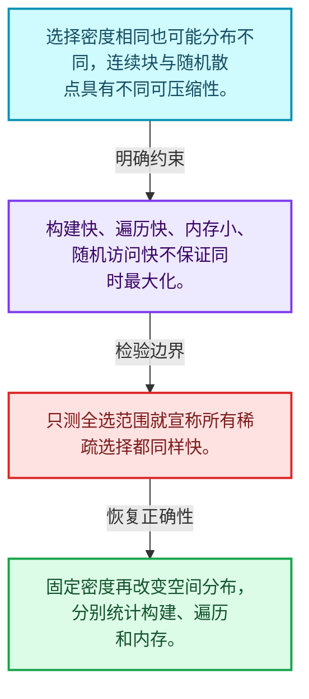
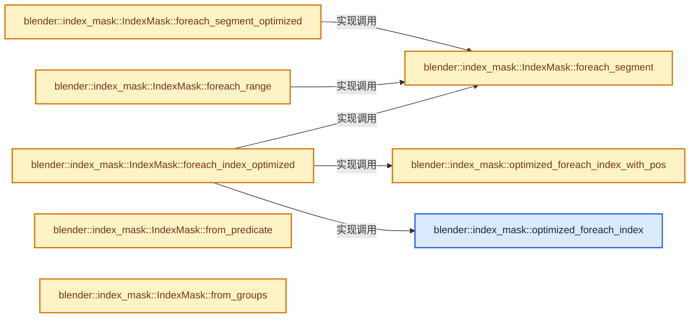
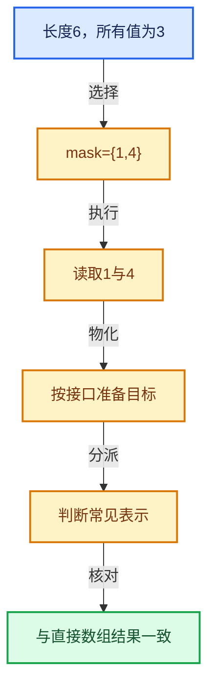

# 04-12 重构历史与基准练习

[方向导航](README.md) · [总目录](../README.md) · [实现索引](../%E7%AC%A6%E5%8F%B7%E4%BE%9D%E8%B5%96%E4%B8%8E%E5%AE%9E%E7%8E%B0%E7%B4%A2%E5%BC%95.md)

## 从问题到实现

如何判断压缩表示的收益与代价？

内存、随机访问、切片、构造和遍历必须分开测量；历史数字只说明当时环境。

**数据模型**

选择密度相同也可能分布不同，连续块与随机散点具有不同可压缩性。

**设计取舍**

构建快、遍历快、内存小、随机访问快不保证同时最大化。

**最小反例**

只测全选范围就宣称所有稀疏选择都同样快。

**推导**

固定密度再改变空间分布，分别统计构建、遍历和内存。

## 阅读地图与执行推演








图中的数值推演是本方向的教学模型；实际函数之间的调用边与概念分析边分别标注，不能把概念关系当作运行时调度顺序。

## 完整源码单元与就地讲解

中文讲解直接放在相关代码旁，复杂机制在代码下展开。原文折叠区保留基准行号；不需要在行号表和函数之间来回查找。类布局可分段展示，函数实现不按固定行数切开。

### 类型布局、声明与编译条件 · BLI_index_mask.hh L888—L890

<!-- annotated:f1c73325fc62b5 -->

```cpp

template<typename T, typename Fn>
#if (defined(__GNUC__) && !defined(__clang__))
```

<details>
<summary>核对原始源码：source/blender/blenlib/BLI_index_mask.hh · L888—L890</summary>

<!-- original:f1c73325fc62b5:source/blender/blenlib/BLI_index_mask.hh:888:890 -->

```cpp

template<typename T, typename Fn>
#if (defined(__GNUC__) && !defined(__clang__))
```

</details>

<a id="f-eda84a695b62dcb8"></a>

### `blender::index_mask::optimized_foreach_index`

实现位置：[source/blender/blenlib/BLI_index_mask.hh](../../../../../source/blender/blenlib/BLI_index_mask.hh) · L891—L908。

接口参数：

- `const IndexMaskSegment segment`
- `const Fn fn`

**教学注释版**

<!-- annotated:655859973b1e87 -->

```cpp
[[gnu::optimize("O3")]]
#endif
inline void optimized_foreach_index(const IndexMaskSegment segment, const Fn fn)
{
  // [讲解] std::numeric_limits<T>::max：按比较关系选取较大值。本讲解中的增长公式同时满足最低请求和几何增长；若保存返回引用，还需注意实参寿命。
  BLI_assert(segment.last() < std::numeric_limits<T>::max());
  if (unique_sorted_indices::non_empty_is_range(segment.base_span())) {
    const T start = T(segment[0]);
    const T last = T(segment.last());
    for (T i = start; i <= last; i++) {
      fn(i);
    }
  }
  else {
    for (const int64_t i : segment) {
      fn(T(i));
    }
  }
}
```

<details>
<summary>核对原始源码：source/blender/blenlib/BLI_index_mask.hh · L891—L908</summary>

<!-- original:655859973b1e87:source/blender/blenlib/BLI_index_mask.hh:891:908 -->

```cpp
[[gnu::optimize("O3")]]
#endif
inline void optimized_foreach_index(const IndexMaskSegment segment, const Fn fn)
{
  BLI_assert(segment.last() < std::numeric_limits<T>::max());
  if (unique_sorted_indices::non_empty_is_range(segment.base_span())) {
    const T start = T(segment[0]);
    const T last = T(segment.last());
    for (T i = start; i <= last; i++) {
      fn(i);
    }
  }
  else {
    for (const int64_t i : segment) {
      fn(T(i));
    }
  }
}
```

</details>

**继续追踪实现**

- `BLI_assert` → [BLI_assert · L48](../01-%E5%9F%BA%E7%A1%80%E5%AE%B9%E5%99%A8%E4%B8%8E%E7%8E%B0%E4%BB%A3CPP/%E4%BE%9D%E8%B5%96-BLI_assert-cc98e8.md#m-57a88495704d)；[BLI_assert · L63](../01-%E5%9F%BA%E7%A1%80%E5%AE%B9%E5%99%A8%E4%B8%8E%E7%8E%B0%E4%BB%A3CPP/%E4%BE%9D%E8%B5%96-BLI_assert-cc98e8.md#m-d07050020cb5)。宏定义由构建条件选择。
- `segment.last` → [blender::index_mask::IndexMask::last · L774](09-%E5%88%86%E6%AE%B5%E5%AD%98%E5%82%A8%E4%B8%8E%E9%81%8D%E5%8E%86.md#f-b0ceb4e14d4fa2ce)。
- `std::numeric_limits<T>::max` → [外部契约](https://eel.is/c++draft/alg.min.max)：按比较关系选取较大值。本讲解中的增长公式同时满足最低请求和几何增长；若保存返回引用，还需注意实参寿命。
- `unique_sorted_indices::non_empty_is_range` → [blender::unique_sorted_indices::non_empty_is_range · L37](../01-%E5%9F%BA%E7%A1%80%E5%AE%B9%E5%99%A8%E4%B8%8E%E7%8E%B0%E4%BB%A3CPP/%E4%BE%9D%E8%B5%96-BLI_unique_sorted_indices-4da7d3.md#f-f7e007562027c649)。
- `segment.base_span` → [blender::OffsetSpan::base_span · L33](../02-%E5%93%88%E5%B8%8C%E8%A1%A8%E4%B8%8E%E5%85%B3%E8%81%94%E6%95%B0%E6%8D%AE%E7%BB%93%E6%9E%84/%E4%BE%9D%E8%B5%96-BLI_offset_span-adb8e0.md#f-e962d3f4adef8faf)。
- `T` → [DiagSplit::T · L96](../05-%E5%87%A0%E4%BD%95%E5%AD%98%E5%82%A8%E4%B8%8E%E6%8B%93%E6%89%91%E6%98%A0%E5%B0%84/%E4%BE%9D%E8%B5%96-split-5f5804.md#f-d5d0885c790cc4e4)。
- `fn` → [调用协议](../%E6%A8%A1%E6%9D%BF%E5%AE%8F%E4%B8%8E%E5%8A%A8%E6%80%81%E5%88%86%E6%B4%BE%E5%8D%8F%E8%AE%AE.md)：局部可调用对象，须结合其初始化与捕获环境。调用位置L900。

### 类型布局、声明与编译条件 · BLI_index_mask.hh L909—L911

<!-- annotated:fa8bf78f2509de -->

```cpp

template<typename T, typename Fn>
#if (defined(__GNUC__) && !defined(__clang__))
```

<details>
<summary>核对原始源码：source/blender/blenlib/BLI_index_mask.hh · L909—L911</summary>

<!-- original:fa8bf78f2509de:source/blender/blenlib/BLI_index_mask.hh:909:911 -->

```cpp

template<typename T, typename Fn>
#if (defined(__GNUC__) && !defined(__clang__))
```

</details>

<a id="f-dec8d85922d17b4b"></a>

### `blender::index_mask::optimized_foreach_index_with_pos`

实现位置：[source/blender/blenlib/BLI_index_mask.hh](../../../../../source/blender/blenlib/BLI_index_mask.hh) · L912—L935。

接口参数：

- `const IndexMaskSegment segment`
- `const int64_t segment_pos`
- `const Fn fn`

**教学注释版**

<!-- annotated:e83e1694b57c69 -->

```cpp
[[gnu::optimize("O3")]]
#endif
inline void optimized_foreach_index_with_pos(const IndexMaskSegment segment,
                                             const int64_t segment_pos,
                                             const Fn fn)
{
  // [讲解] std::numeric_limits<T>::max：按比较关系选取较大值。本讲解中的增长公式同时满足最低请求和几何增长；若保存返回引用，还需注意实参寿命。
  BLI_assert(segment.last() < std::numeric_limits<T>::max());
  BLI_assert(segment.size() + segment_pos < std::numeric_limits<T>::max());
  if (unique_sorted_indices::non_empty_is_range(segment.base_span())) {
    const T start = T(segment[0]);
    const T last = T(segment.last());
    for (T i = start, pos = T(segment_pos); i <= last; i++, pos++) {
      fn(i, pos);
    }
  }
  else {
    T pos = T(segment_pos);
    for (const int64_t i : segment.index_range()) {
      const T index = T(segment[i]);
      fn(index, pos);
      pos++;
    }
  }
}
```

<details>
<summary>核对原始源码：source/blender/blenlib/BLI_index_mask.hh · L912—L935</summary>

<!-- original:e83e1694b57c69:source/blender/blenlib/BLI_index_mask.hh:912:935 -->

```cpp
[[gnu::optimize("O3")]]
#endif
inline void optimized_foreach_index_with_pos(const IndexMaskSegment segment,
                                             const int64_t segment_pos,
                                             const Fn fn)
{
  BLI_assert(segment.last() < std::numeric_limits<T>::max());
  BLI_assert(segment.size() + segment_pos < std::numeric_limits<T>::max());
  if (unique_sorted_indices::non_empty_is_range(segment.base_span())) {
    const T start = T(segment[0]);
    const T last = T(segment.last());
    for (T i = start, pos = T(segment_pos); i <= last; i++, pos++) {
      fn(i, pos);
    }
  }
  else {
    T pos = T(segment_pos);
    for (const int64_t i : segment.index_range()) {
      const T index = T(segment[i]);
      fn(index, pos);
      pos++;
    }
  }
}
```

</details>

**继续追踪实现**

- `BLI_assert` → [BLI_assert · L48](../01-%E5%9F%BA%E7%A1%80%E5%AE%B9%E5%99%A8%E4%B8%8E%E7%8E%B0%E4%BB%A3CPP/%E4%BE%9D%E8%B5%96-BLI_assert-cc98e8.md#m-57a88495704d)；[BLI_assert · L63](../01-%E5%9F%BA%E7%A1%80%E5%AE%B9%E5%99%A8%E4%B8%8E%E7%8E%B0%E4%BB%A3CPP/%E4%BE%9D%E8%B5%96-BLI_assert-cc98e8.md#m-d07050020cb5)。宏定义由构建条件选择。
- `segment.last` → [blender::index_mask::IndexMask::last · L774](09-%E5%88%86%E6%AE%B5%E5%AD%98%E5%82%A8%E4%B8%8E%E9%81%8D%E5%8E%86.md#f-b0ceb4e14d4fa2ce)。
- `std::numeric_limits<T>::max` → [外部契约](https://eel.is/c++draft/alg.min.max)：按比较关系选取较大值。本讲解中的增长公式同时满足最低请求和几何增长；若保存返回引用，还需注意实参寿命。
- `segment.size` → [blender::index_mask::IndexMask::size · L743](09-%E5%88%86%E6%AE%B5%E5%AD%98%E5%82%A8%E4%B8%8E%E9%81%8D%E5%8E%86.md#f-0163b32abc9a0d9c)。
- `unique_sorted_indices::non_empty_is_range` → [blender::unique_sorted_indices::non_empty_is_range · L37](../01-%E5%9F%BA%E7%A1%80%E5%AE%B9%E5%99%A8%E4%B8%8E%E7%8E%B0%E4%BB%A3CPP/%E4%BE%9D%E8%B5%96-BLI_unique_sorted_indices-4da7d3.md#f-f7e007562027c649)。
- `segment.base_span` → [blender::OffsetSpan::base_span · L33](../02-%E5%93%88%E5%B8%8C%E8%A1%A8%E4%B8%8E%E5%85%B3%E8%81%94%E6%95%B0%E6%8D%AE%E7%BB%93%E6%9E%84/%E4%BE%9D%E8%B5%96-BLI_offset_span-adb8e0.md#f-e962d3f4adef8faf)。
- `T` → [DiagSplit::T · L96](../05-%E5%87%A0%E4%BD%95%E5%AD%98%E5%82%A8%E4%B8%8E%E6%8B%93%E6%89%91%E6%98%A0%E5%B0%84/%E4%BE%9D%E8%B5%96-split-5f5804.md#f-d5d0885c790cc4e4)。
- `fn` → [调用协议](../%E6%A8%A1%E6%9D%BF%E5%AE%8F%E4%B8%8E%E5%8A%A8%E6%80%81%E5%88%86%E6%B4%BE%E5%8D%8F%E8%AE%AE.md)：局部可调用对象，须结合其初始化与捕获环境。调用位置L924。
- `segment.index_range` → [blender::index_mask::IndexMask::index_range · L753](09-%E5%88%86%E6%AE%B5%E5%AD%98%E5%82%A8%E4%B8%8E%E9%81%8D%E5%8E%86.md#f-749c399cf5bc4035)。

<!-- annotated:403aeba7e8d3f9 -->

```cpp

```

<details>
<summary>核对原始源码：source/blender/blenlib/BLI_index_mask.hh · L936—L936</summary>

<!-- original:403aeba7e8d3f9:source/blender/blenlib/BLI_index_mask.hh:936:936 -->

```cpp

```

</details>

<a id="f-a2c3e7876407eaaf"></a>

### `blender::index_mask::IndexMask::foreach_index_optimized`

实现位置：[source/blender/blenlib/BLI_index_mask.hh](../../../../../source/blender/blenlib/BLI_index_mask.hh) · L937—L966。

接口参数：

- `Fn &&fn`
- `Mode mode`

**教学注释版**

<!-- annotated:068a6c872e34c7 -->

```cpp
template<typename IndexT, ForeachIndexFn Fn, exec_mode::Tag Mode>
inline void IndexMask::foreach_index_optimized(Fn &&fn, Mode mode) const
{
  if constexpr (mode.is_parallel) {
    threading::parallel_for(
        this->index_range(), mode.grain_size(4096), [&](const IndexRange range) {
          const IndexMask sub_mask = this->slice(range);
          sub_mask.foreach_segment([&](const IndexMaskSegment segment,
                                       [[maybe_unused]] const int64_t segment_pos) {
            if constexpr (IndexPosFn<Fn>) {
              // [讲解] range.start：读取连续区间或分组的边界信息。
              optimized_foreach_index_with_pos<IndexT>(segment, segment_pos + range.start(), fn);
            }
            else {
              optimized_foreach_index<IndexT>(segment, fn);
            }
          });
        });
  }
  else {
    this->foreach_segment(
        [&](const IndexMaskSegment segment, [[maybe_unused]] const int64_t segment_pos) {
          if constexpr (IndexPosFn<Fn>) {
            optimized_foreach_index_with_pos<IndexT>(segment, segment_pos, fn);
          }
          else {
            optimized_foreach_index<IndexT>(segment, fn);
          }
        });
  }
}
```

<details>
<summary>核对原始源码：source/blender/blenlib/BLI_index_mask.hh · L937—L966</summary>

<!-- original:068a6c872e34c7:source/blender/blenlib/BLI_index_mask.hh:937:966 -->

```cpp
template<typename IndexT, ForeachIndexFn Fn, exec_mode::Tag Mode>
inline void IndexMask::foreach_index_optimized(Fn &&fn, Mode mode) const
{
  if constexpr (mode.is_parallel) {
    threading::parallel_for(
        this->index_range(), mode.grain_size(4096), [&](const IndexRange range) {
          const IndexMask sub_mask = this->slice(range);
          sub_mask.foreach_segment([&](const IndexMaskSegment segment,
                                       [[maybe_unused]] const int64_t segment_pos) {
            if constexpr (IndexPosFn<Fn>) {
              optimized_foreach_index_with_pos<IndexT>(segment, segment_pos + range.start(), fn);
            }
            else {
              optimized_foreach_index<IndexT>(segment, fn);
            }
          });
        });
  }
  else {
    this->foreach_segment(
        [&](const IndexMaskSegment segment, [[maybe_unused]] const int64_t segment_pos) {
          if constexpr (IndexPosFn<Fn>) {
            optimized_foreach_index_with_pos<IndexT>(segment, segment_pos, fn);
          }
          else {
            optimized_foreach_index<IndexT>(segment, fn);
          }
        });
  }
}
```

</details>

**继续追踪实现**

- `threading::parallel_for` → [blender::threading::parallel_for · L68](../11-Depsgraph%E4%B8%8E%E5%B9%B6%E8%A1%8C%E4%BB%BB%E5%8A%A1%E7%B3%BB%E7%BB%9F/07-%E4%BB%BB%E5%8A%A1%E6%B1%A0%E4%B8%8ETBB%E6%8E%A5%E5%85%A5.md#f-838294754c24426c)。
- `this->index_range` → [blender::index_mask::IndexMask::index_range · L753](09-%E5%88%86%E6%AE%B5%E5%AD%98%E5%82%A8%E4%B8%8E%E9%81%8D%E5%8E%86.md#f-749c399cf5bc4035)。
- `mode.grain_size` → [blender::exec_mode::Mode::grain_size · L70](../01-%E5%9F%BA%E7%A1%80%E5%AE%B9%E5%99%A8%E4%B8%8E%E7%8E%B0%E4%BB%A3CPP/%E4%BE%9D%E8%B5%96-BLI_execution_mode-1528fb.md#f-7a49477626a0a34d)。
- `this->slice` → [blender::index_mask::IndexMask::slice · L845](09-%E5%88%86%E6%AE%B5%E5%AD%98%E5%82%A8%E4%B8%8E%E9%81%8D%E5%8E%86.md#f-8c3ef56b66c5f123)。
- `sub_mask.foreach_segment` → [blender::index_mask::IndexMask::foreach_segment · L1012](12-%E9%87%8D%E6%9E%84%E5%8E%86%E5%8F%B2%E4%B8%8E%E5%9F%BA%E5%87%86%E7%BB%83%E4%B9%A0.md#f-ae3b9242dccf9a21)。
- `optimized_foreach_index_with_pos<IndexT>` → [blender::index_mask::optimized_foreach_index_with_pos · L912](12-%E9%87%8D%E6%9E%84%E5%8E%86%E5%8F%B2%E4%B8%8E%E5%9F%BA%E5%87%86%E7%BB%83%E4%B9%A0.md#f-dec8d85922d17b4b)。
- `range.start` → [blender::IndexRange::start · L243](../01-%E5%9F%BA%E7%A1%80%E5%AE%B9%E5%99%A8%E4%B8%8E%E7%8E%B0%E4%BB%A3CPP/04-IndexRange%E8%BF%9E%E7%BB%AD%E6%95%B4%E6%95%B0%E5%8C%BA%E9%97%B4.md#f-99d2195bd9cfd1f0)。
- `optimized_foreach_index<IndexT>` → [blender::index_mask::optimized_foreach_index · L891](12-%E9%87%8D%E6%9E%84%E5%8E%86%E5%8F%B2%E4%B8%8E%E5%9F%BA%E5%87%86%E7%BB%83%E4%B9%A0.md#f-eda84a695b62dcb8)。
- `this->foreach_segment` → [blender::index_mask::IndexMask::foreach_segment · L1012](12-%E9%87%8D%E6%9E%84%E5%8E%86%E5%8F%B2%E4%B8%8E%E5%9F%BA%E5%87%86%E7%BB%83%E4%B9%A0.md#f-ae3b9242dccf9a21)。

<!-- annotated:2789b4ffb0fb6d -->

```cpp

```

<details>
<summary>核对原始源码：source/blender/blenlib/BLI_index_mask.hh · L967—L967</summary>

<!-- original:2789b4ffb0fb6d:source/blender/blenlib/BLI_index_mask.hh:967:967 -->

```cpp

```

</details>

<a id="f-cf307bcd562186e0"></a>

### `blender::index_mask::IndexMask::foreach_segment_optimized`

实现位置：[source/blender/blenlib/BLI_index_mask.hh](../../../../../source/blender/blenlib/BLI_index_mask.hh) · L968—L1010。

接口参数：

- `Fn &&fn`
- `Mode mode`

**教学注释版**

<!-- annotated:8856874b48fe95 -->

```cpp
template<ForeachSegmentOrRangePosFn Fn, exec_mode::Tag Mode>
inline void IndexMask::foreach_segment_optimized(Fn &&fn, Mode mode) const
{
  if constexpr (mode.is_parallel) {
    threading::parallel_for(
        this->index_range(), mode.grain_size(4096), [&](const IndexRange range) {
          const IndexMask sub_mask = this->slice(range);
          sub_mask.foreach_segment_optimized(
              // [讲解] range.start：读取连续区间或分组的边界信息。
              [&fn, range_start = range.start()](
                  const auto segment, [[maybe_unused]] const int64_t start_segment_pos) {
                if constexpr (SegmentOrRangePosFn<Fn>) {
                  fn(segment, start_segment_pos + range_start);
                }
                else {
                  fn(segment);
                }
              });
        });
  }
  else {
    this->foreach_segment(
        [&](const IndexMaskSegment segment, [[maybe_unused]] const int64_t start_segment_pos) {
          if (unique_sorted_indices::non_empty_is_range(segment.base_span())) {
            const IndexRange range(segment[0], segment.size());
            if constexpr (SegmentOrRangePosFn<Fn>) {
              fn(range, start_segment_pos);
            }
            else {
              fn(range);
            }
          }
          else {
            if constexpr (SegmentOrRangePosFn<Fn>) {
              fn(segment, start_segment_pos);
            }
            else {
              fn(segment);
            }
          }
        },
        mode);
  }
}
```

<details>
<summary>核对原始源码：source/blender/blenlib/BLI_index_mask.hh · L968—L1010</summary>

<!-- original:8856874b48fe95:source/blender/blenlib/BLI_index_mask.hh:968:1010 -->

```cpp
template<ForeachSegmentOrRangePosFn Fn, exec_mode::Tag Mode>
inline void IndexMask::foreach_segment_optimized(Fn &&fn, Mode mode) const
{
  if constexpr (mode.is_parallel) {
    threading::parallel_for(
        this->index_range(), mode.grain_size(4096), [&](const IndexRange range) {
          const IndexMask sub_mask = this->slice(range);
          sub_mask.foreach_segment_optimized(
              [&fn, range_start = range.start()](
                  const auto segment, [[maybe_unused]] const int64_t start_segment_pos) {
                if constexpr (SegmentOrRangePosFn<Fn>) {
                  fn(segment, start_segment_pos + range_start);
                }
                else {
                  fn(segment);
                }
              });
        });
  }
  else {
    this->foreach_segment(
        [&](const IndexMaskSegment segment, [[maybe_unused]] const int64_t start_segment_pos) {
          if (unique_sorted_indices::non_empty_is_range(segment.base_span())) {
            const IndexRange range(segment[0], segment.size());
            if constexpr (SegmentOrRangePosFn<Fn>) {
              fn(range, start_segment_pos);
            }
            else {
              fn(range);
            }
          }
          else {
            if constexpr (SegmentOrRangePosFn<Fn>) {
              fn(segment, start_segment_pos);
            }
            else {
              fn(segment);
            }
          }
        },
        mode);
  }
}
```

</details>

**继续追踪实现**

- `threading::parallel_for` → [blender::threading::parallel_for · L68](../11-Depsgraph%E4%B8%8E%E5%B9%B6%E8%A1%8C%E4%BB%BB%E5%8A%A1%E7%B3%BB%E7%BB%9F/07-%E4%BB%BB%E5%8A%A1%E6%B1%A0%E4%B8%8ETBB%E6%8E%A5%E5%85%A5.md#f-838294754c24426c)。
- `this->index_range` → [blender::index_mask::IndexMask::index_range · L753](09-%E5%88%86%E6%AE%B5%E5%AD%98%E5%82%A8%E4%B8%8E%E9%81%8D%E5%8E%86.md#f-749c399cf5bc4035)。
- `mode.grain_size` → [blender::exec_mode::Mode::grain_size · L70](../01-%E5%9F%BA%E7%A1%80%E5%AE%B9%E5%99%A8%E4%B8%8E%E7%8E%B0%E4%BB%A3CPP/%E4%BE%9D%E8%B5%96-BLI_execution_mode-1528fb.md#f-7a49477626a0a34d)。
- `this->slice` → [blender::index_mask::IndexMask::slice · L845](09-%E5%88%86%E6%AE%B5%E5%AD%98%E5%82%A8%E4%B8%8E%E9%81%8D%E5%8E%86.md#f-8c3ef56b66c5f123)。
- `sub_mask.foreach_segment_optimized` → [blender::index_mask::IndexMask::foreach_segment_optimized · L968](12-%E9%87%8D%E6%9E%84%E5%8E%86%E5%8F%B2%E4%B8%8E%E5%9F%BA%E5%87%86%E7%BB%83%E4%B9%A0.md#f-cf307bcd562186e0)。
- `range.start` → [blender::IndexRange::start · L243](../01-%E5%9F%BA%E7%A1%80%E5%AE%B9%E5%99%A8%E4%B8%8E%E7%8E%B0%E4%BB%A3CPP/04-IndexRange%E8%BF%9E%E7%BB%AD%E6%95%B4%E6%95%B0%E5%8C%BA%E9%97%B4.md#f-99d2195bd9cfd1f0)。
- `fn` → [调用协议](../%E6%A8%A1%E6%9D%BF%E5%AE%8F%E4%B8%8E%E5%8A%A8%E6%80%81%E5%88%86%E6%B4%BE%E5%8D%8F%E8%AE%AE.md)：局部可调用对象，须结合其初始化与捕获环境。调用位置L979。
- `this->foreach_segment` → [blender::index_mask::IndexMask::foreach_segment · L1012](12-%E9%87%8D%E6%9E%84%E5%8E%86%E5%8F%B2%E4%B8%8E%E5%9F%BA%E5%87%86%E7%BB%83%E4%B9%A0.md#f-ae3b9242dccf9a21)。
- `unique_sorted_indices::non_empty_is_range` → [blender::unique_sorted_indices::non_empty_is_range · L37](../01-%E5%9F%BA%E7%A1%80%E5%AE%B9%E5%99%A8%E4%B8%8E%E7%8E%B0%E4%BB%A3CPP/%E4%BE%9D%E8%B5%96-BLI_unique_sorted_indices-4da7d3.md#f-f7e007562027c649)。
- `segment.base_span` → [blender::OffsetSpan::base_span · L33](../02-%E5%93%88%E5%B8%8C%E8%A1%A8%E4%B8%8E%E5%85%B3%E8%81%94%E6%95%B0%E6%8D%AE%E7%BB%93%E6%9E%84/%E4%BE%9D%E8%B5%96-BLI_offset_span-adb8e0.md#f-e962d3f4adef8faf)。
- `segment.size` → [blender::index_mask::IndexMask::size · L743](09-%E5%88%86%E6%AE%B5%E5%AD%98%E5%82%A8%E4%B8%8E%E9%81%8D%E5%8E%86.md#f-0163b32abc9a0d9c)。

<!-- annotated:41b4c835a9ab8d -->

```cpp

```

<details>
<summary>核对原始源码：source/blender/blenlib/BLI_index_mask.hh · L1011—L1011</summary>

<!-- original:41b4c835a9ab8d:source/blender/blenlib/BLI_index_mask.hh:1011:1011 -->

```cpp

```

</details>

<a id="f-ae3b9242dccf9a21"></a>

### `blender::index_mask::IndexMask::foreach_segment`

实现位置：[source/blender/blenlib/BLI_index_mask.hh](../../../../../source/blender/blenlib/BLI_index_mask.hh) · L1012—L1044。

接口参数：

- `Fn &&fn`
- `const exec_mode::Tag auto mode`

**教学注释版**

<!-- annotated:65688599622618 -->

```cpp
template<ForeachSegmentFn Fn>
inline void IndexMask::foreach_segment(Fn &&fn, const exec_mode::Tag auto mode) const
{
  if constexpr (mode.is_parallel) {
    threading::parallel_for(
        this->index_range(), mode.grain_size(256), [&](const IndexRange range) {
          const IndexMask sub_mask = this->slice(range);
          sub_mask.foreach_segment(
              // [讲解] range.start：读取连续区间或分组的边界信息。
              [&fn, range_start = range.start()](const IndexMaskSegment mask_segment,
                                                 [[maybe_unused]] const int64_t segment_pos) {
                if constexpr (SegmentPosFn<Fn>) {
                  fn(mask_segment, segment_pos + range_start);
                }
                else {
                  fn(mask_segment);
                }
              });
        });
  }
  else {
    [[maybe_unused]] int64_t segment_pos = 0;
    for (const int64_t segment_i : IndexRange(segments_num_)) {
      const IndexMaskSegment segment = this->segment(segment_i);
      if constexpr (SegmentPosFn<Fn>) {
        fn(segment, segment_pos);
        segment_pos += segment.size();
      }
      else {
        fn(segment);
      }
    }
  }
}
```

<details>
<summary>核对原始源码：source/blender/blenlib/BLI_index_mask.hh · L1012—L1044</summary>

<!-- original:65688599622618:source/blender/blenlib/BLI_index_mask.hh:1012:1044 -->

```cpp
template<ForeachSegmentFn Fn>
inline void IndexMask::foreach_segment(Fn &&fn, const exec_mode::Tag auto mode) const
{
  if constexpr (mode.is_parallel) {
    threading::parallel_for(
        this->index_range(), mode.grain_size(256), [&](const IndexRange range) {
          const IndexMask sub_mask = this->slice(range);
          sub_mask.foreach_segment(
              [&fn, range_start = range.start()](const IndexMaskSegment mask_segment,
                                                 [[maybe_unused]] const int64_t segment_pos) {
                if constexpr (SegmentPosFn<Fn>) {
                  fn(mask_segment, segment_pos + range_start);
                }
                else {
                  fn(mask_segment);
                }
              });
        });
  }
  else {
    [[maybe_unused]] int64_t segment_pos = 0;
    for (const int64_t segment_i : IndexRange(segments_num_)) {
      const IndexMaskSegment segment = this->segment(segment_i);
      if constexpr (SegmentPosFn<Fn>) {
        fn(segment, segment_pos);
        segment_pos += segment.size();
      }
      else {
        fn(segment);
      }
    }
  }
}
```

</details>

**沿实际写入检查状态**

- `segment_pos += segment.size();`

**继续追踪实现**

- `threading::parallel_for` → [blender::threading::parallel_for · L68](../11-Depsgraph%E4%B8%8E%E5%B9%B6%E8%A1%8C%E4%BB%BB%E5%8A%A1%E7%B3%BB%E7%BB%9F/07-%E4%BB%BB%E5%8A%A1%E6%B1%A0%E4%B8%8ETBB%E6%8E%A5%E5%85%A5.md#f-838294754c24426c)。
- `this->index_range` → [blender::index_mask::IndexMask::index_range · L753](09-%E5%88%86%E6%AE%B5%E5%AD%98%E5%82%A8%E4%B8%8E%E9%81%8D%E5%8E%86.md#f-749c399cf5bc4035)。
- `mode.grain_size` → [调用协议](../%E6%A8%A1%E6%9D%BF%E5%AE%8F%E4%B8%8E%E5%8A%A8%E6%80%81%E5%88%86%E6%B4%BE%E5%8D%8F%E8%AE%AE.md)：由接收对象具体类型或运行时策略提供实现。调用位置L1017。
- `this->slice` → [blender::index_mask::IndexMask::slice · L845](09-%E5%88%86%E6%AE%B5%E5%AD%98%E5%82%A8%E4%B8%8E%E9%81%8D%E5%8E%86.md#f-8c3ef56b66c5f123)。
- `sub_mask.foreach_segment` → [blender::index_mask::IndexMask::foreach_segment · L1012](12-%E9%87%8D%E6%9E%84%E5%8E%86%E5%8F%B2%E4%B8%8E%E5%9F%BA%E5%87%86%E7%BB%83%E4%B9%A0.md#f-ae3b9242dccf9a21)。
- `range.start` → [blender::IndexRange::start · L243](../01-%E5%9F%BA%E7%A1%80%E5%AE%B9%E5%99%A8%E4%B8%8E%E7%8E%B0%E4%BB%A3CPP/04-IndexRange%E8%BF%9E%E7%BB%AD%E6%95%B4%E6%95%B0%E5%8C%BA%E9%97%B4.md#f-99d2195bd9cfd1f0)。
- `fn` → [调用协议](../%E6%A8%A1%E6%9D%BF%E5%AE%8F%E4%B8%8E%E5%8A%A8%E6%80%81%E5%88%86%E6%B4%BE%E5%8D%8F%E8%AE%AE.md)：局部可调用对象，须结合其初始化与捕获环境。调用位置L1023。
- `IndexRange` → [blender::IndexRange](../01-%E5%9F%BA%E7%A1%80%E5%AE%B9%E5%99%A8%E4%B8%8E%E7%8E%B0%E4%BB%A3CPP/%E4%BE%9D%E8%B5%96-BLI_index_range-7d7cc5.md#t-caa3466d6776)；[blender::gpu::shader::parser::IndexRange](../05-%E5%87%A0%E4%BD%95%E5%AD%98%E5%82%A8%E4%B8%8E%E6%8B%93%E6%89%91%E6%98%A0%E5%B0%84/%E4%BE%9D%E8%B5%96-utils-06433d.md#t-82d2bd4ea71c)；[blender::IndexRange](../05-%E5%87%A0%E4%BD%95%E5%AD%98%E5%82%A8%E4%B8%8E%E6%8B%93%E6%89%91%E6%98%A0%E5%B0%84/%E4%BE%9D%E8%B5%96-DNA_node_types-6708b9.md#t-0448cc889d39)。
- `this->segment` → [blender::index_mask::IndexMask::segment · L831](09-%E5%88%86%E6%AE%B5%E5%AD%98%E5%82%A8%E4%B8%8E%E9%81%8D%E5%8E%86.md#f-a8ed8c6498a00acb)。
- `segment.size` → [blender::index_mask::IndexMask::size · L743](09-%E5%88%86%E6%AE%B5%E5%AD%98%E5%82%A8%E4%B8%8E%E9%81%8D%E5%8E%86.md#f-0163b32abc9a0d9c)。

<!-- annotated:353e1fe13204bb -->

```cpp

```

<details>
<summary>核对原始源码：source/blender/blenlib/BLI_index_mask.hh · L1045—L1045</summary>

<!-- original:353e1fe13204bb:source/blender/blenlib/BLI_index_mask.hh:1045:1045 -->

```cpp

```

</details>

<a id="f-dab36a132dcb5bac"></a>

### `blender::index_mask::IndexMask::foreach_range`

实现位置：[source/blender/blenlib/BLI_index_mask.hh](../../../../../source/blender/blenlib/BLI_index_mask.hh) · L1046—L1063。

接口参数：

- `Fn &&fn`

**教学注释版**

<!-- annotated:9227f707d38ed9 -->

```cpp
template<ForeachRangeFn Fn> inline void IndexMask::foreach_range(Fn &&fn) const
{
  this->foreach_segment([&](const IndexMaskSegment indices, [[maybe_unused]] int64_t segment_pos) {
    Span<int16_t> base_indices = indices.base_span();
    // [讲解] base_indices.is_empty：查询视图长度或生成对应有效索引区间。
    while (!base_indices.is_empty()) {
      const int64_t next_range_size = unique_sorted_indices::find_size_of_next_range(base_indices);
      const IndexRange range(int64_t(base_indices[0]) + indices.offset(), next_range_size);
      if constexpr (RangePosFn<Fn>) {
        fn(range, segment_pos);
      }
      else {
        fn(range);
      }
      segment_pos += next_range_size;
      // [讲解] base_indices.drop_front：从两端裁去或选取一定数量元素形成新视图。
      base_indices = base_indices.drop_front(next_range_size);
    }
  });
}
```

<details>
<summary>核对原始源码：source/blender/blenlib/BLI_index_mask.hh · L1046—L1063</summary>

<!-- original:9227f707d38ed9:source/blender/blenlib/BLI_index_mask.hh:1046:1063 -->

```cpp
template<ForeachRangeFn Fn> inline void IndexMask::foreach_range(Fn &&fn) const
{
  this->foreach_segment([&](const IndexMaskSegment indices, [[maybe_unused]] int64_t segment_pos) {
    Span<int16_t> base_indices = indices.base_span();
    while (!base_indices.is_empty()) {
      const int64_t next_range_size = unique_sorted_indices::find_size_of_next_range(base_indices);
      const IndexRange range(int64_t(base_indices[0]) + indices.offset(), next_range_size);
      if constexpr (RangePosFn<Fn>) {
        fn(range, segment_pos);
      }
      else {
        fn(range);
      }
      segment_pos += next_range_size;
      base_indices = base_indices.drop_front(next_range_size);
    }
  });
}
```

</details>

**沿实际写入检查状态**

- `segment_pos += next_range_size;`
- `base_indices = base_indices.drop_front(next_range_size);`

**继续追踪实现**

- `this->foreach_segment` → [blender::index_mask::IndexMask::foreach_segment · L1012](12-%E9%87%8D%E6%9E%84%E5%8E%86%E5%8F%B2%E4%B8%8E%E5%9F%BA%E5%87%86%E7%BB%83%E4%B9%A0.md#f-ae3b9242dccf9a21)。
- `indices.base_span` → [blender::OffsetSpan::base_span · L33](../02-%E5%93%88%E5%B8%8C%E8%A1%A8%E4%B8%8E%E5%85%B3%E8%81%94%E6%95%B0%E6%8D%AE%E7%BB%93%E6%9E%84/%E4%BE%9D%E8%B5%96-BLI_offset_span-adb8e0.md#f-e962d3f4adef8faf)。
- `base_indices.is_empty` → [blender::Span::is_empty · L264](../01-%E5%9F%BA%E7%A1%80%E5%AE%B9%E5%99%A8%E4%B8%8E%E7%8E%B0%E4%BB%A3CPP/05-Span%E5%8F%AA%E8%AF%BB%E8%BF%9E%E7%BB%AD%E8%A7%86%E5%9B%BE.md#f-8cc1d7ba8feb50e6)。
- `unique_sorted_indices::find_size_of_next_range` → [blender::unique_sorted_indices::find_size_of_next_range · L71](../01-%E5%9F%BA%E7%A1%80%E5%AE%B9%E5%99%A8%E4%B8%8E%E7%8E%B0%E4%BB%A3CPP/%E4%BE%9D%E8%B5%96-BLI_unique_sorted_indices-4da7d3.md#f-03df40e7fbf4ead3)。
- `indices.offset` → [调用协议](../%E6%A8%A1%E6%9D%BF%E5%AE%8F%E4%B8%8E%E5%8A%A8%E6%80%81%E5%88%86%E6%B4%BE%E5%8D%8F%E8%AE%AE.md)：由接收对象具体类型或运行时策略提供实现。调用位置L1052。
- `fn` → [调用协议](../%E6%A8%A1%E6%9D%BF%E5%AE%8F%E4%B8%8E%E5%8A%A8%E6%80%81%E5%88%86%E6%B4%BE%E5%8D%8F%E8%AE%AE.md)：局部可调用对象，须结合其初始化与捕获环境。调用位置L1054。
- `base_indices.drop_front` → [blender::Span::drop_front · L175](../01-%E5%9F%BA%E7%A1%80%E5%AE%B9%E5%99%A8%E4%B8%8E%E7%8E%B0%E4%BB%A3CPP/05-Span%E5%8F%AA%E8%AF%BB%E8%BF%9E%E7%BB%AD%E8%A7%86%E5%9B%BE.md#f-932897accbde3413)。

### 类型布局、声明与编译条件 · BLI_index_mask.hh L1064—L1072

<!-- annotated:7fc5ada00c51c4 -->

```cpp

namespace detail {
IndexMask from_predicate_impl(
    const IndexMask &universe,
    LinearAllocator<> &memory,
    FunctionRef<int64_t(IndexMaskSegment indices, int16_t *r_true_indices)> filter_indices,
    exec_mode::Mode mode);
}

```

<details>
<summary>核对原始源码：source/blender/blenlib/BLI_index_mask.hh · L1064—L1072</summary>

<!-- original:7fc5ada00c51c4:source/blender/blenlib/BLI_index_mask.hh:1064:1072 -->

```cpp

namespace detail {
IndexMask from_predicate_impl(
    const IndexMask &universe,
    LinearAllocator<> &memory,
    FunctionRef<int64_t(IndexMaskSegment indices, int16_t *r_true_indices)> filter_indices,
    exec_mode::Mode mode);
}

```

</details>

<a id="f-3864daa059098df8"></a>

### `blender::index_mask::IndexMask::from_predicate`

实现位置：[source/blender/blenlib/BLI_index_mask.hh](../../../../../source/blender/blenlib/BLI_index_mask.hh) · L1073—L1103。

接口参数：

- `const IndexMask &universe`
- `LinearAllocator<> &memory`
- `Fn &&predicate`
- `const exec_mode::Mode mode`

**教学注释版**

<!-- annotated:9d1674cbbb9b02 -->

```cpp
template<typename Fn>
inline IndexMask IndexMask::from_predicate(const IndexMask &universe,
                                           LinearAllocator<> &memory,
                                           Fn &&predicate,
                                           const exec_mode::Mode mode)
{
  return detail::from_predicate_impl(
      universe,
      memory,
      [&](const IndexMaskSegment indices, int16_t *__restrict r_true_indices) {
        int16_t *r_current = r_true_indices;
        const int16_t *in_end = indices.base_span().end();
        const int64_t offset = indices.offset();
        for (const int16_t *in_current = indices.base_span().data(); in_current < in_end;
             in_current++)
        {
          const int16_t local_index = *in_current;
          const int64_t global_index = int64_t(local_index) + offset;
          const bool condition = predicate(global_index);
          *r_current = local_index;
          /* This expects the boolean to be either 0 or 1 which is generally the case but may not
           * be if the values are uninitialized. */
          BLI_assert(ELEM(int8_t(condition), 0, 1));
          /* Branchless conditional increment. */
          r_current += condition;
        }
        const int16_t true_indices_num = int16_t(r_current - r_true_indices);
        return true_indices_num;
      },
      mode);
}
```

<details>
<summary>核对原始源码：source/blender/blenlib/BLI_index_mask.hh · L1073—L1103</summary>

<!-- original:9d1674cbbb9b02:source/blender/blenlib/BLI_index_mask.hh:1073:1103 -->

```cpp
template<typename Fn>
inline IndexMask IndexMask::from_predicate(const IndexMask &universe,
                                           LinearAllocator<> &memory,
                                           Fn &&predicate,
                                           const exec_mode::Mode mode)
{
  return detail::from_predicate_impl(
      universe,
      memory,
      [&](const IndexMaskSegment indices, int16_t *__restrict r_true_indices) {
        int16_t *r_current = r_true_indices;
        const int16_t *in_end = indices.base_span().end();
        const int64_t offset = indices.offset();
        for (const int16_t *in_current = indices.base_span().data(); in_current < in_end;
             in_current++)
        {
          const int16_t local_index = *in_current;
          const int64_t global_index = int64_t(local_index) + offset;
          const bool condition = predicate(global_index);
          *r_current = local_index;
          /* This expects the boolean to be either 0 or 1 which is generally the case but may not
           * be if the values are uninitialized. */
          BLI_assert(ELEM(int8_t(condition), 0, 1));
          /* Branchless conditional increment. */
          r_current += condition;
        }
        const int16_t true_indices_num = int16_t(r_current - r_true_indices);
        return true_indices_num;
      },
      mode);
}
```

</details>

**沿实际写入检查状态**

- `r_current += condition;`

**结果出口**

- `return detail::from_predicate_impl(`
- `return true_indices_num;`

**继续追踪实现**

- `detail::from_predicate_impl` → [blender::index_mask::detail::from_predicate_impl · L858](10-IndexMask%E6%9E%84%E5%BB%BA%E4%B8%8E%E5%B9%B6%E8%A1%8C.md#f-aa59b835e87db5e4)。
- `indices.base_span().end` → [调用协议](../%E6%A8%A1%E6%9D%BF%E5%AE%8F%E4%B8%8E%E5%8A%A8%E6%80%81%E5%88%86%E6%B4%BE%E5%8D%8F%E8%AE%AE.md)：接收对象类型依赖auto、返回值或模板实例；不按同名猜测目标。调用位置L1084。
- `indices.base_span` → [blender::OffsetSpan::base_span · L33](../02-%E5%93%88%E5%B8%8C%E8%A1%A8%E4%B8%8E%E5%85%B3%E8%81%94%E6%95%B0%E6%8D%AE%E7%BB%93%E6%9E%84/%E4%BE%9D%E8%B5%96-BLI_offset_span-adb8e0.md#f-e962d3f4adef8faf)。
- `indices.offset` → [调用协议](../%E6%A8%A1%E6%9D%BF%E5%AE%8F%E4%B8%8E%E5%8A%A8%E6%80%81%E5%88%86%E6%B4%BE%E5%8D%8F%E8%AE%AE.md)：由接收对象具体类型或运行时策略提供实现。调用位置L1085。
- `indices.base_span().data` → [调用协议](../%E6%A8%A1%E6%9D%BF%E5%AE%8F%E4%B8%8E%E5%8A%A8%E6%80%81%E5%88%86%E6%B4%BE%E5%8D%8F%E8%AE%AE.md)：接收对象类型依赖auto、返回值或模板实例；不按同名猜测目标。调用位置L1086。
- `predicate` → [调用协议](../%E6%A8%A1%E6%9D%BF%E5%AE%8F%E4%B8%8E%E5%8A%A8%E6%80%81%E5%88%86%E6%B4%BE%E5%8D%8F%E8%AE%AE.md)：局部可调用对象，须结合其初始化与捕获环境。调用位置L1091。
- `BLI_assert` → [BLI_assert · L48](../01-%E5%9F%BA%E7%A1%80%E5%AE%B9%E5%99%A8%E4%B8%8E%E7%8E%B0%E4%BB%A3CPP/%E4%BE%9D%E8%B5%96-BLI_assert-cc98e8.md#m-57a88495704d)；[BLI_assert · L63](../01-%E5%9F%BA%E7%A1%80%E5%AE%B9%E5%99%A8%E4%B8%8E%E7%8E%B0%E4%BB%A3CPP/%E4%BE%9D%E8%B5%96-BLI_assert-cc98e8.md#m-d07050020cb5)。宏定义由构建条件选择。
- `ELEM` → [ELEM · L88](../05-%E5%87%A0%E4%BD%95%E5%AD%98%E5%82%A8%E4%B8%8E%E6%8B%93%E6%89%91%E6%98%A0%E5%B0%84/%E4%BE%9D%E8%B5%96-GHOST_utildefines-34b996.md#m-d28724a15928)；[ELEM · L135](../01-%E5%9F%BA%E7%A1%80%E5%AE%B9%E5%99%A8%E4%B8%8E%E7%8E%B0%E4%BB%A3CPP/%E4%BE%9D%E8%B5%96-BLI_utildefines-293a0a.md#m-d6572de7cae0)。宏定义由构建条件选择。

<!-- annotated:c3468477a78865 -->

```cpp

```

<details>
<summary>核对原始源码：source/blender/blenlib/BLI_index_mask.hh · L1104—L1104</summary>

<!-- original:c3468477a78865:source/blender/blenlib/BLI_index_mask.hh:1104:1104 -->

```cpp

```

</details>

<a id="f-df7af197626c37f1"></a>

### `blender::index_mask::IndexMask::from_groups`

实现位置：[source/blender/blenlib/BLI_index_mask.hh](../../../../../source/blender/blenlib/BLI_index_mask.hh) · L1105—L1127。

接口参数：

- `const IndexMask &universe`
- `LinearAllocator<> &memory`
- `Fn &&get_group_index`
- `MutableSpan<IndexMask> r_masks`

**教学注释版**

<!-- annotated:3666de1ebaa404 -->

```cpp
template<typename T, typename Fn>
void IndexMask::from_groups(const IndexMask &universe,
                            LinearAllocator<> &memory,
                            Fn &&get_group_index,
                            MutableSpan<IndexMask> r_masks)
{
  // [讲解] r_masks.size：查询视图长度或生成对应有效索引区间。
  if (r_masks.size() == 1) {
#ifndef NDEBUG
    universe.foreach_index([&](const int i) { BLI_assert(get_group_index(i) == 0); });
#endif
    r_masks[0] = universe;
    return;
  }

  Vector<Vector<T>> indices_by_group(r_masks.size());
  universe.foreach_index([&](const int64_t i) {
    const int group_index = get_group_index(i);
    indices_by_group[group_index].append(T(i));
  });
  // [讲解] r_masks.index_range：查询视图长度或生成对应有效索引区间。
  for (const int64_t i : r_masks.index_range()) {
    r_masks[i] = IndexMask::from_indices<T>(indices_by_group[i], memory);
  }
}
```

<details>
<summary>核对原始源码：source/blender/blenlib/BLI_index_mask.hh · L1105—L1127</summary>

<!-- original:3666de1ebaa404:source/blender/blenlib/BLI_index_mask.hh:1105:1127 -->

```cpp
template<typename T, typename Fn>
void IndexMask::from_groups(const IndexMask &universe,
                            LinearAllocator<> &memory,
                            Fn &&get_group_index,
                            MutableSpan<IndexMask> r_masks)
{
  if (r_masks.size() == 1) {
#ifndef NDEBUG
    universe.foreach_index([&](const int i) { BLI_assert(get_group_index(i) == 0); });
#endif
    r_masks[0] = universe;
    return;
  }

  Vector<Vector<T>> indices_by_group(r_masks.size());
  universe.foreach_index([&](const int64_t i) {
    const int group_index = get_group_index(i);
    indices_by_group[group_index].append(T(i));
  });
  for (const int64_t i : r_masks.index_range()) {
    r_masks[i] = IndexMask::from_indices<T>(indices_by_group[i], memory);
  }
}
```

</details>

**沿实际写入检查状态**

- `r_masks[0] = universe;`
- `r_masks[i] = IndexMask::from_indices<T>(indices_by_group[i], memory);`

**继续追踪实现**

- `r_masks.size` → [blender::MutableSpan::size · L499](../01-%E5%9F%BA%E7%A1%80%E5%AE%B9%E5%99%A8%E4%B8%8E%E7%8E%B0%E4%BB%A3CPP/06-MutableSpan%E5%8F%AF%E5%86%99%E8%A7%86%E5%9B%BE.md#f-1de6a66839c304a8)。
- `universe.foreach_index` → [blender::index_mask::IndexMask::foreach_index · L855](09-%E5%88%86%E6%AE%B5%E5%AD%98%E5%82%A8%E4%B8%8E%E9%81%8D%E5%8E%86.md#f-cd6cd317e2e2812c)。
- `BLI_assert` → [BLI_assert · L48](../01-%E5%9F%BA%E7%A1%80%E5%AE%B9%E5%99%A8%E4%B8%8E%E7%8E%B0%E4%BB%A3CPP/%E4%BE%9D%E8%B5%96-BLI_assert-cc98e8.md#m-57a88495704d)；[BLI_assert · L63](../01-%E5%9F%BA%E7%A1%80%E5%AE%B9%E5%99%A8%E4%B8%8E%E7%8E%B0%E4%BB%A3CPP/%E4%BE%9D%E8%B5%96-BLI_assert-cc98e8.md#m-d07050020cb5)。宏定义由构建条件选择。
- `get_group_index` → [调用协议](../%E6%A8%A1%E6%9D%BF%E5%AE%8F%E4%B8%8E%E5%8A%A8%E6%80%81%E5%88%86%E6%B4%BE%E5%8D%8F%E8%AE%AE.md)：局部可调用对象，须结合其初始化与捕获环境。调用位置L1113。
- `indices_by_group[group_index].append` → [调用协议](../%E6%A8%A1%E6%9D%BF%E5%AE%8F%E4%B8%8E%E5%8A%A8%E6%80%81%E5%88%86%E6%B4%BE%E5%8D%8F%E8%AE%AE.md)：接收对象类型依赖auto、返回值或模板实例；不按同名猜测目标。调用位置L1122。
- `T` → [DiagSplit::T · L96](../05-%E5%87%A0%E4%BD%95%E5%AD%98%E5%82%A8%E4%B8%8E%E6%8B%93%E6%89%91%E6%98%A0%E5%B0%84/%E4%BE%9D%E8%B5%96-split-5f5804.md#f-d5d0885c790cc4e4)。
- `r_masks.index_range` → [blender::MutableSpan::index_range · L676](../01-%E5%9F%BA%E7%A1%80%E5%AE%B9%E5%99%A8%E4%B8%8E%E7%8E%B0%E4%BB%A3CPP/06-MutableSpan%E5%8F%AF%E5%86%99%E8%A7%86%E5%9B%BE.md#f-f9a9d59a69ca64b5)。
- `IndexMask::from_indices<T>` → [blender::index_mask::IndexMask::from_indices · L414](10-IndexMask%E6%9E%84%E5%BB%BA%E4%B8%8E%E5%B9%B6%E8%A1%8C.md#f-85c4cb3a40ba9bbe)。

<!-- annotated:5d0100f98821d2 -->

```cpp

```

<details>
<summary>核对原始源码：source/blender/blenlib/BLI_index_mask.hh · L1128—L1128</summary>

<!-- original:5d0100f98821d2:source/blender/blenlib/BLI_index_mask.hh:1128:1128 -->

```cpp

```

</details>

<a id="f-9821e0729f14f866"></a>

### `blender::index_mask::IndexMask::to_indices`

实现位置：[source/blender/blenlib/BLI_index_mask.hh](../../../../../source/blender/blenlib/BLI_index_mask.hh) · L1129—L1134。

**教学注释版**

<!-- annotated:28ecedc77be0c6 -->

```cpp
template<typename T> inline Vector<T> IndexMask::to_indices() const
{
  Vector<T> indices(indices_num_);
  this->to_indices<T>(indices);
  return indices;
}
```

<details>
<summary>核对原始源码：source/blender/blenlib/BLI_index_mask.hh · L1129—L1134</summary>

<!-- original:28ecedc77be0c6:source/blender/blenlib/BLI_index_mask.hh:1129:1134 -->

```cpp
template<typename T> inline Vector<T> IndexMask::to_indices() const
{
  Vector<T> indices(indices_num_);
  this->to_indices<T>(indices);
  return indices;
}
```

</details>

**结果出口**

- `return indices;`

**继续追踪实现**

- `this->to_indices<T>` → [blender::index_mask::IndexMask::to_indices · L1129](12-%E9%87%8D%E6%9E%84%E5%8E%86%E5%8F%B2%E4%B8%8E%E5%9F%BA%E5%87%86%E7%BB%83%E4%B9%A0.md#f-9821e0729f14f866)。

<!-- annotated:735725a257bc92 -->

```cpp

```

<details>
<summary>核对原始源码：source/blender/blenlib/BLI_index_mask.hh · L1135—L1135</summary>

<!-- original:735725a257bc92:source/blender/blenlib/BLI_index_mask.hh:1135:1135 -->

```cpp

```

</details>

<a id="f-bcc016bae424bbaf"></a>

### `blender::index_mask::IndexMask::to_range`

实现位置：[source/blender/blenlib/BLI_index_mask.hh](../../../../../source/blender/blenlib/BLI_index_mask.hh) · L1136—L1147。

**教学注释版**

<!-- annotated:379ba93348959e -->

```cpp
std::optional<IndexRange> inline IndexMask::to_range() const
{
  if (indices_num_ == 0) {
    return IndexRange{};
  }
  const int64_t first_index = this->first();
  const int64_t last_index = this->last();
  if (last_index - first_index == indices_num_ - 1) {
    return IndexRange(first_index, indices_num_);
  }
  return std::nullopt;
}
```

<details>
<summary>核对原始源码：source/blender/blenlib/BLI_index_mask.hh · L1136—L1147</summary>

<!-- original:379ba93348959e:source/blender/blenlib/BLI_index_mask.hh:1136:1147 -->

```cpp
std::optional<IndexRange> inline IndexMask::to_range() const
{
  if (indices_num_ == 0) {
    return IndexRange{};
  }
  const int64_t first_index = this->first();
  const int64_t last_index = this->last();
  if (last_index - first_index == indices_num_ - 1) {
    return IndexRange(first_index, indices_num_);
  }
  return std::nullopt;
}
```

</details>

**结果出口**

- `return IndexRange{};`
- `return IndexRange(first_index, indices_num_);`
- `return std::nullopt;`

**继续追踪实现**

- `this->first` → [blender::index_mask::IndexMask::first · L768](09-%E5%88%86%E6%AE%B5%E5%AD%98%E5%82%A8%E4%B8%8E%E9%81%8D%E5%8E%86.md#f-0fdcf75a0be7ad37)。
- `this->last` → [blender::index_mask::IndexMask::last · L774](09-%E5%88%86%E6%AE%B5%E5%AD%98%E5%82%A8%E4%B8%8E%E9%81%8D%E5%8E%86.md#f-b0ceb4e14d4fa2ce)。
- `IndexRange` → [blender::IndexRange](../01-%E5%9F%BA%E7%A1%80%E5%AE%B9%E5%99%A8%E4%B8%8E%E7%8E%B0%E4%BB%A3CPP/%E4%BE%9D%E8%B5%96-BLI_index_range-7d7cc5.md#t-caa3466d6776)；[blender::gpu::shader::parser::IndexRange](../05-%E5%87%A0%E4%BD%95%E5%AD%98%E5%82%A8%E4%B8%8E%E6%8B%93%E6%89%91%E6%98%A0%E5%B0%84/%E4%BE%9D%E8%B5%96-utils-06433d.md#t-82d2bd4ea71c)；[blender::IndexRange](../05-%E5%87%A0%E4%BD%95%E5%AD%98%E5%82%A8%E4%B8%8E%E6%8B%93%E6%89%91%E6%98%A0%E5%B0%84/%E4%BE%9D%E8%B5%96-DNA_node_types-6708b9.md#t-0448cc889d39)。

<!-- annotated:2a54f72d19803b -->

```cpp

```

<details>
<summary>核对原始源码：source/blender/blenlib/BLI_index_mask.hh · L1148—L1148</summary>

<!-- original:2a54f72d19803b:source/blender/blenlib/BLI_index_mask.hh:1148:1148 -->

```cpp

```

</details>

<a id="f-5b8d97a4a9df3559"></a>

### `blender::index_mask::IndexMask::to_spans_and_ranges`

实现位置：[source/blender/blenlib/BLI_index_mask.hh](../../../../../source/blender/blenlib/BLI_index_mask.hh) · L1149—L1155。

**教学注释版**

<!-- annotated:60b6b733ab8e76 -->

```cpp
template<int64_t N>
inline Vector<std::variant<IndexRange, IndexMaskSegment>, N> IndexMask::to_spans_and_ranges() const
{
  Vector<std::variant<IndexRange, IndexMaskSegment>, N> segments;
  // [讲解] segments.append：在尾部建立新元素，必要时先扩大存储。
  this->foreach_segment_optimized([&](const auto segment) { segments.append(segment); });
  return segments;
}
```

<details>
<summary>核对原始源码：source/blender/blenlib/BLI_index_mask.hh · L1149—L1155</summary>

<!-- original:60b6b733ab8e76:source/blender/blenlib/BLI_index_mask.hh:1149:1155 -->

```cpp
template<int64_t N>
inline Vector<std::variant<IndexRange, IndexMaskSegment>, N> IndexMask::to_spans_and_ranges() const
{
  Vector<std::variant<IndexRange, IndexMaskSegment>, N> segments;
  this->foreach_segment_optimized([&](const auto segment) { segments.append(segment); });
  return segments;
}
```

</details>

**结果出口**

- `return segments;`

**继续追踪实现**

- `this->foreach_segment_optimized` → [blender::index_mask::IndexMask::foreach_segment_optimized · L968](12-%E9%87%8D%E6%9E%84%E5%8E%86%E5%8F%B2%E4%B8%8E%E5%9F%BA%E5%87%86%E7%BB%83%E4%B9%A0.md#f-cf307bcd562186e0)。
- `segments.append` → [blender::Vector::append · L498](../01-%E5%9F%BA%E7%A1%80%E5%AE%B9%E5%99%A8%E4%B8%8E%E7%8E%B0%E4%BB%A3CPP/11-Vector%E6%8F%92%E5%85%A5%E5%88%A0%E9%99%A4%E4%B8%8E%E9%87%8D%E6%8E%92.md#f-5bde268a69e443ec)；[blender::Vector::append · L502](../01-%E5%9F%BA%E7%A1%80%E5%AE%B9%E5%99%A8%E4%B8%8E%E7%8E%B0%E4%BB%A3CPP/11-Vector%E6%8F%92%E5%85%A5%E5%88%A0%E9%99%A4%E4%B8%8E%E9%87%8D%E6%8E%92.md#f-591e0b15e6308532)。同名重载需按实参类型选择。

<!-- annotated:1fae825ef92323 -->

```cpp

```

<details>
<summary>核对原始源码：source/blender/blenlib/BLI_index_mask.hh · L1156—L1156</summary>

<!-- original:1fae825ef92323:source/blender/blenlib/BLI_index_mask.hh:1156:1156 -->

```cpp

```

</details>

<a id="f-e1763152614f7db3"></a>

### `blender::index_mask::operator!=`

实现位置：[source/blender/blenlib/BLI_index_mask.hh](../../../../../source/blender/blenlib/BLI_index_mask.hh) · L1157—L1160。

接口参数：

- `const IndexMask &a`
- `const IndexMask &b`

**教学注释版**

<!-- annotated:a78ac085be88c6 -->

```cpp
inline bool operator!=(const IndexMask &a, const IndexMask &b)
{
  return !(a == b);
}
```

<details>
<summary>核对原始源码：source/blender/blenlib/BLI_index_mask.hh · L1157—L1160</summary>

<!-- original:a78ac085be88c6:source/blender/blenlib/BLI_index_mask.hh:1157:1160 -->

```cpp
inline bool operator!=(const IndexMask &a, const IndexMask &b)
{
  return !(a == b);
}
```

</details>

**结果出口**

- `return !(a == b);`

**继续追踪实现**

本实现没有需要继续展开的显式调用；检查返回表达式、对象转换和调用者前置条件。

<!-- annotated:c087fe27a4effa -->

```cpp

```

<details>
<summary>核对原始源码：source/blender/blenlib/BLI_index_mask.hh · L1161—L1161</summary>

<!-- original:c087fe27a4effa:source/blender/blenlib/BLI_index_mask.hh:1161:1161 -->

```cpp

```

</details>

<a id="f-9bed203fab79eb5c"></a>

### `blender::index_mask::index_range_to_mask_segments`

实现位置：[source/blender/blenlib/BLI_index_mask.hh](../../../../../source/blender/blenlib/BLI_index_mask.hh) · L1162—L1174。

接口参数：

- `const IndexRange range`
- `Vector<IndexMaskSegment, N> &r_segments`

**教学注释版**

<!-- annotated:fa2ba6d5a74542 -->

```cpp
template<int64_t N>
inline void index_range_to_mask_segments(const IndexRange range,
                                         Vector<IndexMaskSegment, N> &r_segments)
{
  const std::array<int16_t, max_segment_size> &static_indices_array = get_static_indices_array();

  // [讲解] range.size：读取连续区间或分组的边界信息。
  const int64_t full_size = range.size();
  for (int64_t i = 0; i < full_size; i += max_segment_size) {
    // [讲解] std::min：按比较关系选取较小值；截断范围时还需先满足非负和可表示范围，min本身不会证明边界安全。
    const int64_t size = std::min(i + max_segment_size, full_size) - i;
    // [讲解] r_segments.append：在尾部建立新元素，必要时先扩大存储。
    r_segments.append(
        // [讲解] range.first：读取范围两端的有效索引或值。
        IndexMaskSegment(range.first() + i, Span(static_indices_array).take_front(size)));
  }
}
```

<details>
<summary>核对原始源码：source/blender/blenlib/BLI_index_mask.hh · L1162—L1174</summary>

<!-- original:fa2ba6d5a74542:source/blender/blenlib/BLI_index_mask.hh:1162:1174 -->

```cpp
template<int64_t N>
inline void index_range_to_mask_segments(const IndexRange range,
                                         Vector<IndexMaskSegment, N> &r_segments)
{
  const std::array<int16_t, max_segment_size> &static_indices_array = get_static_indices_array();

  const int64_t full_size = range.size();
  for (int64_t i = 0; i < full_size; i += max_segment_size) {
    const int64_t size = std::min(i + max_segment_size, full_size) - i;
    r_segments.append(
        IndexMaskSegment(range.first() + i, Span(static_indices_array).take_front(size)));
  }
}
```

</details>

**继续追踪实现**

- `get_static_indices_array` → [blender::index_mask::get_static_indices_array · L600](09-%E5%88%86%E6%AE%B5%E5%AD%98%E5%82%A8%E4%B8%8E%E9%81%8D%E5%8E%86.md#f-31f6d95c232aa378)。
- `range.size` → [blender::IndexRange::size · L156](../01-%E5%9F%BA%E7%A1%80%E5%AE%B9%E5%99%A8%E4%B8%8E%E7%8E%B0%E4%BB%A3CPP/04-IndexRange%E8%BF%9E%E7%BB%AD%E6%95%B4%E6%95%B0%E5%8C%BA%E9%97%B4.md#f-05f66c3ebb2fdfec)。
- `std::min` → [外部契约](https://eel.is/c++draft/alg.min.max)：按比较关系选取较小值；截断范围时还需先满足非负和可表示范围，min本身不会证明边界安全。
- `r_segments.append` → [blender::Vector::append · L498](../01-%E5%9F%BA%E7%A1%80%E5%AE%B9%E5%99%A8%E4%B8%8E%E7%8E%B0%E4%BB%A3CPP/11-Vector%E6%8F%92%E5%85%A5%E5%88%A0%E9%99%A4%E4%B8%8E%E9%87%8D%E6%8E%92.md#f-5bde268a69e443ec)；[blender::Vector::append · L502](../01-%E5%9F%BA%E7%A1%80%E5%AE%B9%E5%99%A8%E4%B8%8E%E7%8E%B0%E4%BB%A3CPP/11-Vector%E6%8F%92%E5%85%A5%E5%88%A0%E9%99%A4%E4%B8%8E%E9%87%8D%E6%8E%92.md#f-591e0b15e6308532)。同名重载需按实参类型选择。
- `IndexMaskSegment` → [blender::index_mask::IndexMaskSegment::IndexMaskSegment · L665](09-%E5%88%86%E6%AE%B5%E5%AD%98%E5%82%A8%E4%B8%8E%E9%81%8D%E5%8E%86.md#f-e03e31149bb40def)。
- `range.first` → [blender::IndexRange::first · L204](../01-%E5%9F%BA%E7%A1%80%E5%AE%B9%E5%99%A8%E4%B8%8E%E7%8E%B0%E4%BB%A3CPP/04-IndexRange%E8%BF%9E%E7%BB%AD%E6%95%B4%E6%95%B0%E5%8C%BA%E9%97%B4.md#f-ab443c94e531befa)。
- `Span(static_indices_array).take_front` → [调用协议](../%E6%A8%A1%E6%9D%BF%E5%AE%8F%E4%B8%8E%E5%8A%A8%E6%80%81%E5%88%86%E6%B4%BE%E5%8D%8F%E8%AE%AE.md)：接收对象类型依赖auto、返回值或模板实例；不按同名猜测目标。调用位置L1172。
- `Span` → [blender::Span](../01-%E5%9F%BA%E7%A1%80%E5%AE%B9%E5%99%A8%E4%B8%8E%E7%8E%B0%E4%BB%A3CPP/%E4%BE%9D%E8%B5%96-BLI_span-6aa95f.md#t-8765a8e0c1d5)；[blender::Span](../01-%E5%9F%BA%E7%A1%80%E5%AE%B9%E5%99%A8%E4%B8%8E%E7%8E%B0%E4%BB%A3CPP/%E4%BE%9D%E8%B5%96-BLI_index_range-7d7cc5.md#t-86091874a1c0)；[blender::Span](../05-%E5%87%A0%E4%BD%95%E5%AD%98%E5%82%A8%E4%B8%8E%E6%8B%93%E6%89%91%E6%98%A0%E5%B0%84/%E4%BE%9D%E8%B5%96-DNA_pointcloud_types-cfb82c.md#t-112aa6ed842c)；[blender::Span](../05-%E5%87%A0%E4%BD%95%E5%AD%98%E5%82%A8%E4%B8%8E%E6%8B%93%E6%89%91%E6%98%A0%E5%B0%84/%E4%BE%9D%E8%B5%96-DNA_node_types-6708b9.md#t-49ec6fbb9b69)；[blender::Span](../05-%E5%87%A0%E4%BD%95%E5%AD%98%E5%82%A8%E4%B8%8E%E6%8B%93%E6%89%91%E6%98%A0%E5%B0%84/%E4%BE%9D%E8%B5%96-DNA_mesh_types-81f02e.md#t-184fd48fb638)；[blender::Span](../05-%E5%87%A0%E4%BD%95%E5%AD%98%E5%82%A8%E4%B8%8E%E6%8B%93%E6%89%91%E6%98%A0%E5%B0%84/%E4%BE%9D%E8%B5%96-DNA_anim_types-39c5d9.md#t-d841071994c2)；[blender::Span](../05-%E5%87%A0%E4%BD%95%E5%AD%98%E5%82%A8%E4%B8%8E%E6%8B%93%E6%89%91%E6%98%A0%E5%B0%84/%E4%BE%9D%E8%B5%96-RNA_path_fwd-79c989.md#t-4dbb08969e41)。

### 类型布局、声明与编译条件 · BLI_index_mask.hh L1175—L1181

<!-- annotated:da18a761d84c45 -->

```cpp

namespace detail {

template<typename T, typename SegmentT>
#if (defined(__GNUC__) && !defined(__clang__))
[[gnu::optimize("-funroll-loops")]] [[gnu::optimize("O3")]]
#endif
```

<details>
<summary>核对原始源码：source/blender/blenlib/BLI_index_mask.hh · L1175—L1181</summary>

<!-- original:da18a761d84c45:source/blender/blenlib/BLI_index_mask.hh:1175:1181 -->

```cpp

namespace detail {

template<typename T, typename SegmentT>
#if (defined(__GNUC__) && !defined(__clang__))
[[gnu::optimize("-funroll-loops")]] [[gnu::optimize("O3")]]
#endif
```

</details>

<a id="f-f8fea6dc94181f8e"></a>

### `blender::index_mask::detail::gather_assign_segment`

实现位置：[source/blender/blenlib/BLI_index_mask.hh](../../../../../source/blender/blenlib/BLI_index_mask.hh) · L1182—L1189。

接口参数：

- `const T *__restrict src`
- `const SegmentT segment`
- `T *__restrict dst`

**教学注释版**

<!-- annotated:ccd5dbcffaf92c -->

```cpp
inline void gather_assign_segment(const T *__restrict src,
                                  const SegmentT segment,
                                  T *__restrict dst)
{
  for (int16_t i = 0; i < segment.size(); i++) {
    dst[i] = src[segment[i]];
  }
}
```

<details>
<summary>核对原始源码：source/blender/blenlib/BLI_index_mask.hh · L1182—L1189</summary>

<!-- original:ccd5dbcffaf92c:source/blender/blenlib/BLI_index_mask.hh:1182:1189 -->

```cpp
inline void gather_assign_segment(const T *__restrict src,
                                  const SegmentT segment,
                                  T *__restrict dst)
{
  for (int16_t i = 0; i < segment.size(); i++) {
    dst[i] = src[segment[i]];
  }
}
```

</details>

**沿实际写入检查状态**

- `dst[i] = src[segment[i]];`

**继续追踪实现**

- `segment.size` → [blender::index_mask::IndexMask::size · L743](09-%E5%88%86%E6%AE%B5%E5%AD%98%E5%82%A8%E4%B8%8E%E9%81%8D%E5%8E%86.md#f-0163b32abc9a0d9c)。

### 类型布局、声明与编译条件 · BLI_index_mask.hh L1190—L1194

<!-- annotated:eaef2f4b116931 -->

```cpp

template<typename T, typename SegmentT>
#if (defined(__GNUC__) && !defined(__clang__))
[[gnu::optimize("-funroll-loops")]] [[gnu::optimize("O3")]]
#endif
```

<details>
<summary>核对原始源码：source/blender/blenlib/BLI_index_mask.hh · L1190—L1194</summary>

<!-- original:eaef2f4b116931:source/blender/blenlib/BLI_index_mask.hh:1190:1194 -->

```cpp

template<typename T, typename SegmentT>
#if (defined(__GNUC__) && !defined(__clang__))
[[gnu::optimize("-funroll-loops")]] [[gnu::optimize("O3")]]
#endif
```

</details>

<a id="f-48e58ecbef90d7b3"></a>

### `blender::index_mask::detail::copy_assign_segment`

实现位置：[source/blender/blenlib/BLI_index_mask.hh](../../../../../source/blender/blenlib/BLI_index_mask.hh) · L1195—L1200。

接口参数：

- `const T *__restrict src`
- `const SegmentT segment`
- `T *__restrict dst`

**教学注释版**

<!-- annotated:06ca8318cced0b -->

```cpp
inline void copy_assign_segment(const T *__restrict src, const SegmentT segment, T *__restrict dst)
{
  for (const int64_t i : segment) {
    dst[i] = src[i];
  }
}
```

<details>
<summary>核对原始源码：source/blender/blenlib/BLI_index_mask.hh · L1195—L1200</summary>

<!-- original:06ca8318cced0b:source/blender/blenlib/BLI_index_mask.hh:1195:1200 -->

```cpp
inline void copy_assign_segment(const T *__restrict src, const SegmentT segment, T *__restrict dst)
{
  for (const int64_t i : segment) {
    dst[i] = src[i];
  }
}
```

</details>

**沿实际写入检查状态**

- `dst[i] = src[i];`

**继续追踪实现**

本实现没有需要继续展开的显式调用；检查返回表达式、对象转换和调用者前置条件。

### 类型布局、声明与编译条件 · BLI_index_mask.hh L1201—L1205

<!-- annotated:f97b88182cc250 -->

```cpp

template<typename T, typename SegmentT>
#if (defined(__GNUC__) && !defined(__clang__))
[[gnu::optimize("-funroll-loops")]] [[gnu::optimize("O3")]]
#endif
```

<details>
<summary>核对原始源码：source/blender/blenlib/BLI_index_mask.hh · L1201—L1205</summary>

<!-- original:f97b88182cc250:source/blender/blenlib/BLI_index_mask.hh:1201:1205 -->

```cpp

template<typename T, typename SegmentT>
#if (defined(__GNUC__) && !defined(__clang__))
[[gnu::optimize("-funroll-loops")]] [[gnu::optimize("O3")]]
#endif
```

</details>

<a id="f-84e6b66755b2a77b"></a>

### `blender::index_mask::detail::fill_segment`

实现位置：[source/blender/blenlib/BLI_index_mask.hh](../../../../../source/blender/blenlib/BLI_index_mask.hh) · L1206—L1229。

接口参数：

- `T *__restrict data`
- `const T &value`
- `const SegmentT segment`

**教学注释版**

<!-- annotated:124fc490a77631 -->

```cpp
inline void fill_segment(T *__restrict data, const T &value, const SegmentT segment)
{
  if constexpr (std::is_same_v<SegmentT, IndexRange>) {
    if constexpr (std::is_trivially_copy_assignable_v<T>) {
      if (value_is_zero_memory(value)) {
        const IndexRange range = segment;
/* GCC warns about memset on types without trivial copy-assignment even when guarded by
 * `if constexpr (std::is_trivially_copy_assignable_v<T>)`. Quiet the compiler bug. */
#if defined(__GNUC__) && !defined(__clang__)
#  pragma GCC diagnostic push
#  pragma GCC diagnostic ignored "-Wclass-memaccess"
#endif
        // [讲解] memset：填充字节，不调用T构造函数，也不保证任意类型的全零表示是合法或期望值。
        memset(data + range.start(), 0, range.size() * sizeof(T));
#if defined(__GNUC__) && !defined(__clang__)
#  pragma GCC diagnostic pop
#endif
        return;
      }
    }
  }
  for (const int64_t i : segment) {
    data[i] = value;
  }
}
```

<details>
<summary>核对原始源码：source/blender/blenlib/BLI_index_mask.hh · L1206—L1229</summary>

<!-- original:124fc490a77631:source/blender/blenlib/BLI_index_mask.hh:1206:1229 -->

```cpp
inline void fill_segment(T *__restrict data, const T &value, const SegmentT segment)
{
  if constexpr (std::is_same_v<SegmentT, IndexRange>) {
    if constexpr (std::is_trivially_copy_assignable_v<T>) {
      if (value_is_zero_memory(value)) {
        const IndexRange range = segment;
/* GCC warns about memset on types without trivial copy-assignment even when guarded by
 * `if constexpr (std::is_trivially_copy_assignable_v<T>)`. Quiet the compiler bug. */
#if defined(__GNUC__) && !defined(__clang__)
#  pragma GCC diagnostic push
#  pragma GCC diagnostic ignored "-Wclass-memaccess"
#endif
        memset(data + range.start(), 0, range.size() * sizeof(T));
#if defined(__GNUC__) && !defined(__clang__)
#  pragma GCC diagnostic pop
#endif
        return;
      }
    }
  }
  for (const int64_t i : segment) {
    data[i] = value;
  }
}
```

</details>

**沿实际写入检查状态**

- `data[i] = value;`

**继续追踪实现**

- `value_is_zero_memory` → [调用协议](../%E6%A8%A1%E6%9D%BF%E5%AE%8F%E4%B8%8E%E5%8A%A8%E6%80%81%E5%88%86%E6%B4%BE%E5%8D%8F%E8%AE%AE.md)：函数指针、局部可调用对象或未展开的宏；必须结合调用者环境。调用位置L1210。
- `memset` → [外部契约](https://eel.is/c++draft/cstring.syn)：填充字节，不调用T构造函数，也不保证任意类型的全零表示是合法或期望值。
- `range.start` → [blender::IndexRange::start · L243](../01-%E5%9F%BA%E7%A1%80%E5%AE%B9%E5%99%A8%E4%B8%8E%E7%8E%B0%E4%BB%A3CPP/04-IndexRange%E8%BF%9E%E7%BB%AD%E6%95%B4%E6%95%B0%E5%8C%BA%E9%97%B4.md#f-99d2195bd9cfd1f0)。
- `range.size` → [blender::IndexRange::size · L156](../01-%E5%9F%BA%E7%A1%80%E5%AE%B9%E5%99%A8%E4%B8%8E%E7%8E%B0%E4%BB%A3CPP/04-IndexRange%E8%BF%9E%E7%BB%AD%E6%95%B4%E6%95%B0%E5%8C%BA%E9%97%B4.md#f-05f66c3ebb2fdfec)。

<!-- annotated:e5cd09116f147f -->

```cpp

```

<details>
<summary>核对原始源码：source/blender/blenlib/BLI_index_mask.hh · L1230—L1230</summary>

<!-- original:e5cd09116f147f:source/blender/blenlib/BLI_index_mask.hh:1230:1230 -->

```cpp

```

</details>

<a id="f-be4df34f277f2f95"></a>

### `blender::index_mask::detail::copy_assign`

实现位置：[source/blender/blenlib/BLI_index_mask.hh](../../../../../source/blender/blenlib/BLI_index_mask.hh) · L1231—L1237。

接口参数：

- `const T *__restrict src`
- `const IndexMask &mask`
- `T *__restrict dst`

**教学注释版**

<!-- annotated:40a7acb2811db7 -->

```cpp
template<typename T>
BLI_NOINLINE void copy_assign(const T *__restrict src, const IndexMask &mask, T *__restrict dst)
{
  mask.foreach_segment_optimized(
      [src, dst](const auto segment) { copy_assign_segment(src, segment, dst); },
      exec_mode::serial);
}
```

<details>
<summary>核对原始源码：source/blender/blenlib/BLI_index_mask.hh · L1231—L1237</summary>

<!-- original:40a7acb2811db7:source/blender/blenlib/BLI_index_mask.hh:1231:1237 -->

```cpp
template<typename T>
BLI_NOINLINE void copy_assign(const T *__restrict src, const IndexMask &mask, T *__restrict dst)
{
  mask.foreach_segment_optimized(
      [src, dst](const auto segment) { copy_assign_segment(src, segment, dst); },
      exec_mode::serial);
}
```

</details>

**继续追踪实现**

- `mask.foreach_segment_optimized` → [blender::index_mask::IndexMask::foreach_segment_optimized · L968](12-%E9%87%8D%E6%9E%84%E5%8E%86%E5%8F%B2%E4%B8%8E%E5%9F%BA%E5%87%86%E7%BB%83%E4%B9%A0.md#f-cf307bcd562186e0)。
- `copy_assign_segment` → [blender::index_mask::detail::copy_assign_segment · L1195](12-%E9%87%8D%E6%9E%84%E5%8E%86%E5%8F%B2%E4%B8%8E%E5%9F%BA%E5%87%86%E7%BB%83%E4%B9%A0.md#f-48e58ecbef90d7b3)。

<!-- annotated:14550fae87ea24 -->

```cpp

```

<details>
<summary>核对原始源码：source/blender/blenlib/BLI_index_mask.hh · L1238—L1238</summary>

<!-- original:14550fae87ea24:source/blender/blenlib/BLI_index_mask.hh:1238:1238 -->

```cpp

```

</details>

<a id="f-6ca85cf84b731900"></a>

### `blender::index_mask::detail::gather_assign`

实现位置：[source/blender/blenlib/BLI_index_mask.hh](../../../../../source/blender/blenlib/BLI_index_mask.hh) · L1239—L1249。

接口参数：

- `const T *__restrict src`
- `const IndexMask &indices`
- `T *__restrict dst`

**教学注释版**

<!-- annotated:3dd35b07130977 -->

```cpp
template<typename T>
BLI_NOINLINE void gather_assign(const T *__restrict src,
                                const IndexMask &indices,
                                T *__restrict dst)
{
  indices.foreach_segment_optimized(
      [src, dst](const auto segment, const int64_t segment_pos) {
        gather_assign_segment(src, segment, dst + segment_pos);
      },
      exec_mode::serial);
}
```

<details>
<summary>核对原始源码：source/blender/blenlib/BLI_index_mask.hh · L1239—L1249</summary>

<!-- original:3dd35b07130977:source/blender/blenlib/BLI_index_mask.hh:1239:1249 -->

```cpp
template<typename T>
BLI_NOINLINE void gather_assign(const T *__restrict src,
                                const IndexMask &indices,
                                T *__restrict dst)
{
  indices.foreach_segment_optimized(
      [src, dst](const auto segment, const int64_t segment_pos) {
        gather_assign_segment(src, segment, dst + segment_pos);
      },
      exec_mode::serial);
}
```

</details>

**继续追踪实现**

- `indices.foreach_segment_optimized` → [blender::index_mask::IndexMask::foreach_segment_optimized · L968](12-%E9%87%8D%E6%9E%84%E5%8E%86%E5%8F%B2%E4%B8%8E%E5%9F%BA%E5%87%86%E7%BB%83%E4%B9%A0.md#f-cf307bcd562186e0)。
- `gather_assign_segment` → [blender::index_mask::detail::gather_assign_segment · L1182](12-%E9%87%8D%E6%9E%84%E5%8E%86%E5%8F%B2%E4%B8%8E%E5%9F%BA%E5%87%86%E7%BB%83%E4%B9%A0.md#f-f8fea6dc94181f8e)。

<!-- annotated:e6aa3bdbf490a8 -->

```cpp

```

<details>
<summary>核对原始源码：source/blender/blenlib/BLI_index_mask.hh · L1250—L1250</summary>

<!-- original:e6aa3bdbf490a8:source/blender/blenlib/BLI_index_mask.hh:1250:1250 -->

```cpp

```

</details>

<a id="f-ea2ed6e1c98523f9"></a>

### `blender::index_mask::detail::fill`

实现位置：[source/blender/blenlib/BLI_index_mask.hh](../../../../../source/blender/blenlib/BLI_index_mask.hh) · L1251—L1257。

接口参数：

- `T *__restrict data`
- `const T &value`
- `const IndexMask &mask`

**教学注释版**

<!-- annotated:d2d967e2cc0212 -->

```cpp
template<typename T>
BLI_NOINLINE void fill(T *__restrict data, const T &value, const IndexMask &mask)
{
  mask.foreach_segment_optimized(
      [data, value](const auto segment) { fill_segment(data, value, segment); },
      exec_mode::serial);
}
```

<details>
<summary>核对原始源码：source/blender/blenlib/BLI_index_mask.hh · L1251—L1257</summary>

<!-- original:d2d967e2cc0212:source/blender/blenlib/BLI_index_mask.hh:1251:1257 -->

```cpp
template<typename T>
BLI_NOINLINE void fill(T *__restrict data, const T &value, const IndexMask &mask)
{
  mask.foreach_segment_optimized(
      [data, value](const auto segment) { fill_segment(data, value, segment); },
      exec_mode::serial);
}
```

</details>

**继续追踪实现**

- `mask.foreach_segment_optimized` → [blender::index_mask::IndexMask::foreach_segment_optimized · L968](12-%E9%87%8D%E6%9E%84%E5%8E%86%E5%8F%B2%E4%B8%8E%E5%9F%BA%E5%87%86%E7%BB%83%E4%B9%A0.md#f-cf307bcd562186e0)。
- `fill_segment` → [blender::index_mask::detail::fill_segment · L1206](12-%E9%87%8D%E6%9E%84%E5%8E%86%E5%8F%B2%E4%B8%8E%E5%9F%BA%E5%87%86%E7%BB%83%E4%B9%A0.md#f-84e6b66755b2a77b)。

### 类型布局、声明与编译条件 · BLI_index_mask.hh L1258—L1260

<!-- annotated:e26b7612ee385e -->

```cpp

}  // namespace detail

```

<details>
<summary>核对原始源码：source/blender/blenlib/BLI_index_mask.hh · L1258—L1260</summary>

<!-- original:e26b7612ee385e:source/blender/blenlib/BLI_index_mask.hh:1258:1260 -->

```cpp

}  // namespace detail

```

</details>

<a id="f-00f1f611c7000f05"></a>

### `blender::index_mask::masked_fill`

实现位置：[source/blender/blenlib/BLI_index_mask.hh](../../../../../source/blender/blenlib/BLI_index_mask.hh) · L1261—L1266。

接口参数：

- `MutableSpan<T> data`
- `const T &value`
- `const IndexMask &mask`

**教学注释版**

<!-- annotated:920d8dfe574e2b -->

```cpp
template<typename T>
inline void masked_fill(MutableSpan<T> data, const T &value, const IndexMask &mask)
{
  // [讲解] data.size：查询视图长度或生成对应有效索引区间。
  BLI_assert(data.size() >= mask.min_array_size());
  // [讲解] data.data：返回借用范围的地址。
  detail::fill(data.data(), value, mask);
}
```

<details>
<summary>核对原始源码：source/blender/blenlib/BLI_index_mask.hh · L1261—L1266</summary>

<!-- original:920d8dfe574e2b:source/blender/blenlib/BLI_index_mask.hh:1261:1266 -->

```cpp
template<typename T>
inline void masked_fill(MutableSpan<T> data, const T &value, const IndexMask &mask)
{
  BLI_assert(data.size() >= mask.min_array_size());
  detail::fill(data.data(), value, mask);
}
```

</details>

**继续追踪实现**

- `BLI_assert` → [BLI_assert · L48](../01-%E5%9F%BA%E7%A1%80%E5%AE%B9%E5%99%A8%E4%B8%8E%E7%8E%B0%E4%BB%A3CPP/%E4%BE%9D%E8%B5%96-BLI_assert-cc98e8.md#m-57a88495704d)；[BLI_assert · L63](../01-%E5%9F%BA%E7%A1%80%E5%AE%B9%E5%99%A8%E4%B8%8E%E7%8E%B0%E4%BB%A3CPP/%E4%BE%9D%E8%B5%96-BLI_assert-cc98e8.md#m-d07050020cb5)。宏定义由构建条件选择。
- `data.size` → [blender::MutableSpan::size · L499](../01-%E5%9F%BA%E7%A1%80%E5%AE%B9%E5%99%A8%E4%B8%8E%E7%8E%B0%E4%BB%A3CPP/06-MutableSpan%E5%8F%AF%E5%86%99%E8%A7%86%E5%9B%BE.md#f-1de6a66839c304a8)。
- `mask.min_array_size` → [blender::index_mask::IndexMask::min_array_size · L782](09-%E5%88%86%E6%AE%B5%E5%AD%98%E5%82%A8%E4%B8%8E%E9%81%8D%E5%8E%86.md#f-f3a460d74b4fc7d6)。
- `detail::fill` → [blender::index_mask::detail::fill · L1251](12-%E9%87%8D%E6%9E%84%E5%8E%86%E5%8F%B2%E4%B8%8E%E5%9F%BA%E5%87%86%E7%BB%83%E4%B9%A0.md#f-ea2ed6e1c98523f9)。
- `data.data` → [blender::MutableSpan::data · L545](../01-%E5%9F%BA%E7%A1%80%E5%AE%B9%E5%99%A8%E4%B8%8E%E7%8E%B0%E4%BB%A3CPP/06-MutableSpan%E5%8F%AF%E5%86%99%E8%A7%86%E5%9B%BE.md#f-eb45a6e4d8211efd)。

### 类型布局、声明与编译条件 · BLI_index_mask.hh L1267—L1268

<!-- annotated:dc463b0caa3787 -->

```cpp

/** Copy every indexed value from src to the same index in dst. */
```

<details>
<summary>核对原始源码：source/blender/blenlib/BLI_index_mask.hh · L1267—L1268</summary>

<!-- original:dc463b0caa3787:source/blender/blenlib/BLI_index_mask.hh:1267:1268 -->

```cpp

/** Copy every indexed value from src to the same index in dst. */
```

</details>

<a id="f-43ed6243f2a54488"></a>

### `blender::index_mask::copy_assign`

实现位置：[source/blender/blenlib/BLI_index_mask.hh](../../../../../source/blender/blenlib/BLI_index_mask.hh) · L1269—L1275。

接口参数：

- `const Span<T> src`
- `const IndexMask &mask`
- `const MutableSpan<T> dst`

**教学注释版**

<!-- annotated:c6285176004fae -->

```cpp
template<typename T>
inline void copy_assign(const Span<T> src, const IndexMask &mask, const MutableSpan<T> dst)
{
  // [讲解] src.size：查询视图长度或生成对应有效索引区间。
  BLI_assert(src.size() >= mask.min_array_size());
  BLI_assert(dst.size() >= mask.min_array_size());
  // [讲解] src.data：返回借用范围的地址。
  detail::copy_assign(src.data(), mask, dst.data());
}
```

<details>
<summary>核对原始源码：source/blender/blenlib/BLI_index_mask.hh · L1269—L1275</summary>

<!-- original:c6285176004fae:source/blender/blenlib/BLI_index_mask.hh:1269:1275 -->

```cpp
template<typename T>
inline void copy_assign(const Span<T> src, const IndexMask &mask, const MutableSpan<T> dst)
{
  BLI_assert(src.size() >= mask.min_array_size());
  BLI_assert(dst.size() >= mask.min_array_size());
  detail::copy_assign(src.data(), mask, dst.data());
}
```

</details>

**继续追踪实现**

- `BLI_assert` → [BLI_assert · L48](../01-%E5%9F%BA%E7%A1%80%E5%AE%B9%E5%99%A8%E4%B8%8E%E7%8E%B0%E4%BB%A3CPP/%E4%BE%9D%E8%B5%96-BLI_assert-cc98e8.md#m-57a88495704d)；[BLI_assert · L63](../01-%E5%9F%BA%E7%A1%80%E5%AE%B9%E5%99%A8%E4%B8%8E%E7%8E%B0%E4%BB%A3CPP/%E4%BE%9D%E8%B5%96-BLI_assert-cc98e8.md#m-d07050020cb5)。宏定义由构建条件选择。
- `src.size` → [blender::Span::size · L256](../01-%E5%9F%BA%E7%A1%80%E5%AE%B9%E5%99%A8%E4%B8%8E%E7%8E%B0%E4%BB%A3CPP/05-Span%E5%8F%AA%E8%AF%BB%E8%BF%9E%E7%BB%AD%E8%A7%86%E5%9B%BE.md#f-5f80fa006089c998)。
- `mask.min_array_size` → [blender::index_mask::IndexMask::min_array_size · L782](09-%E5%88%86%E6%AE%B5%E5%AD%98%E5%82%A8%E4%B8%8E%E9%81%8D%E5%8E%86.md#f-f3a460d74b4fc7d6)。
- `dst.size` → [blender::MutableSpan::size · L499](../01-%E5%9F%BA%E7%A1%80%E5%AE%B9%E5%99%A8%E4%B8%8E%E7%8E%B0%E4%BB%A3CPP/06-MutableSpan%E5%8F%AF%E5%86%99%E8%A7%86%E5%9B%BE.md#f-1de6a66839c304a8)。
- `detail::copy_assign` → [blender::index_mask::detail::copy_assign · L1231](12-%E9%87%8D%E6%9E%84%E5%8E%86%E5%8F%B2%E4%B8%8E%E5%9F%BA%E5%87%86%E7%BB%83%E4%B9%A0.md#f-be4df34f277f2f95)。
- `src.data` → [blender::Span::data · L219](../01-%E5%9F%BA%E7%A1%80%E5%AE%B9%E5%99%A8%E4%B8%8E%E7%8E%B0%E4%BB%A3CPP/05-Span%E5%8F%AA%E8%AF%BB%E8%BF%9E%E7%BB%AD%E8%A7%86%E5%9B%BE.md#f-10c5889198935800)。
- `dst.data` → [blender::MutableSpan::data · L545](../01-%E5%9F%BA%E7%A1%80%E5%AE%B9%E5%99%A8%E4%B8%8E%E7%8E%B0%E4%BB%A3CPP/06-MutableSpan%E5%8F%AF%E5%86%99%E8%A7%86%E5%9B%BE.md#f-eb45a6e4d8211efd)。

### 类型布局、声明与编译条件 · BLI_index_mask.hh L1276—L1277

<!-- annotated:b45e52f82a0127 -->

```cpp

/** Fill the dst span such that for every index i, dst[i] = src[mask[i]]. */
```

<details>
<summary>核对原始源码：source/blender/blenlib/BLI_index_mask.hh · L1276—L1277</summary>

<!-- original:b45e52f82a0127:source/blender/blenlib/BLI_index_mask.hh:1276:1277 -->

```cpp

/** Fill the dst span such that for every index i, dst[i] = src[mask[i]]. */
```

</details>

<a id="f-e2c86f136b45d251"></a>

### `blender::index_mask::gather_assign`

实现位置：[source/blender/blenlib/BLI_index_mask.hh](../../../../../source/blender/blenlib/BLI_index_mask.hh) · L1278—L1284。

接口参数：

- `const Span<T> src`
- `const IndexMask &mask`
- `const MutableSpan<T> dst`

**教学注释版**

<!-- annotated:7dd7fd60493f0a -->

```cpp
template<typename T>
inline void gather_assign(const Span<T> src, const IndexMask &mask, const MutableSpan<T> dst)
{
  // [讲解] src.size：查询视图长度或生成对应有效索引区间。
  BLI_assert(src.size() >= mask.min_array_size());
  BLI_assert(dst.size() == mask.size());
  // [讲解] src.data：返回借用范围的地址。
  detail::gather_assign(src.data(), mask, dst.data());
}
```

<details>
<summary>核对原始源码：source/blender/blenlib/BLI_index_mask.hh · L1278—L1284</summary>

<!-- original:7dd7fd60493f0a:source/blender/blenlib/BLI_index_mask.hh:1278:1284 -->

```cpp
template<typename T>
inline void gather_assign(const Span<T> src, const IndexMask &mask, const MutableSpan<T> dst)
{
  BLI_assert(src.size() >= mask.min_array_size());
  BLI_assert(dst.size() == mask.size());
  detail::gather_assign(src.data(), mask, dst.data());
}
```

</details>

**继续追踪实现**

- `BLI_assert` → [BLI_assert · L48](../01-%E5%9F%BA%E7%A1%80%E5%AE%B9%E5%99%A8%E4%B8%8E%E7%8E%B0%E4%BB%A3CPP/%E4%BE%9D%E8%B5%96-BLI_assert-cc98e8.md#m-57a88495704d)；[BLI_assert · L63](../01-%E5%9F%BA%E7%A1%80%E5%AE%B9%E5%99%A8%E4%B8%8E%E7%8E%B0%E4%BB%A3CPP/%E4%BE%9D%E8%B5%96-BLI_assert-cc98e8.md#m-d07050020cb5)。宏定义由构建条件选择。
- `src.size` → [blender::Span::size · L256](../01-%E5%9F%BA%E7%A1%80%E5%AE%B9%E5%99%A8%E4%B8%8E%E7%8E%B0%E4%BB%A3CPP/05-Span%E5%8F%AA%E8%AF%BB%E8%BF%9E%E7%BB%AD%E8%A7%86%E5%9B%BE.md#f-5f80fa006089c998)。
- `mask.min_array_size` → [blender::index_mask::IndexMask::min_array_size · L782](09-%E5%88%86%E6%AE%B5%E5%AD%98%E5%82%A8%E4%B8%8E%E9%81%8D%E5%8E%86.md#f-f3a460d74b4fc7d6)。
- `dst.size` → [blender::MutableSpan::size · L499](../01-%E5%9F%BA%E7%A1%80%E5%AE%B9%E5%99%A8%E4%B8%8E%E7%8E%B0%E4%BB%A3CPP/06-MutableSpan%E5%8F%AF%E5%86%99%E8%A7%86%E5%9B%BE.md#f-1de6a66839c304a8)。
- `mask.size` → [blender::index_mask::IndexMask::size · L743](09-%E5%88%86%E6%AE%B5%E5%AD%98%E5%82%A8%E4%B8%8E%E9%81%8D%E5%8E%86.md#f-0163b32abc9a0d9c)。
- `detail::gather_assign` → [blender::index_mask::detail::gather_assign · L1239](12-%E9%87%8D%E6%9E%84%E5%8E%86%E5%8F%B2%E4%B8%8E%E5%9F%BA%E5%87%86%E7%BB%83%E4%B9%A0.md#f-6ca85cf84b731900)。
- `src.data` → [blender::Span::data · L219](../01-%E5%9F%BA%E7%A1%80%E5%AE%B9%E5%99%A8%E4%B8%8E%E7%8E%B0%E4%BB%A3CPP/05-Span%E5%8F%AA%E8%AF%BB%E8%BF%9E%E7%BB%AD%E8%A7%86%E5%9B%BE.md#f-10c5889198935800)。
- `dst.data` → [blender::MutableSpan::data · L545](../01-%E5%9F%BA%E7%A1%80%E5%AE%B9%E5%99%A8%E4%B8%8E%E7%8E%B0%E4%BB%A3CPP/06-MutableSpan%E5%8F%AF%E5%86%99%E8%A7%86%E5%9B%BE.md#f-eb45a6e4d8211efd)。

### 类型布局、声明与编译条件 · BLI_index_mask.hh L1285—L1315

<!-- annotated:b7dccadf5b7b09 -->

```cpp

/**
 * Return a mask of random points or curves.
 *
 * \param mask: (optional) The elements that should be used in the resulting mask.
 * \param universe_size: The size of the mask.
 * \param random_seed: The seed for the \a RandomNumberGenerator.
 * \param probability: Determines how likely a point/curve will be chosen.
 * If set to 0.0, nothing will be in the mask, if set to 1.0 everything will be in the mask.
 */
IndexMask random_mask(const IndexMask &mask,
                      const int64_t universe_size,
                      const uint32_t random_seed,
                      const float probability,
                      LinearAllocator<> &memory);

IndexMask random_mask(const int64_t universe_size,
                      const uint32_t random_seed,
                      const float probability,
                      LinearAllocator<> &memory);

/** \} */

}  // namespace index_mask

using index_mask::IndexMask;
using index_mask::IndexMaskFromSegment;
using index_mask::IndexMaskMemory;
using index_mask::IndexMaskSegment;

}  // namespace blender
```

<details>
<summary>核对原始源码：source/blender/blenlib/BLI_index_mask.hh · L1285—L1315</summary>

<!-- original:b7dccadf5b7b09:source/blender/blenlib/BLI_index_mask.hh:1285:1315 -->

```cpp

/**
 * Return a mask of random points or curves.
 *
 * \param mask: (optional) The elements that should be used in the resulting mask.
 * \param universe_size: The size of the mask.
 * \param random_seed: The seed for the \a RandomNumberGenerator.
 * \param probability: Determines how likely a point/curve will be chosen.
 * If set to 0.0, nothing will be in the mask, if set to 1.0 everything will be in the mask.
 */
IndexMask random_mask(const IndexMask &mask,
                      const int64_t universe_size,
                      const uint32_t random_seed,
                      const float probability,
                      LinearAllocator<> &memory);

IndexMask random_mask(const int64_t universe_size,
                      const uint32_t random_seed,
                      const float probability,
                      LinearAllocator<> &memory);

/** \} */

}  // namespace index_mask

using index_mask::IndexMask;
using index_mask::IndexMaskFromSegment;
using index_mask::IndexMaskMemory;
using index_mask::IndexMaskSegment;

}  // namespace blender
```

</details>

## 语法与相关类型

### 模板 template

模板把类型或常量作为生成实现的参数。读声明时先列出类型参数、非类型参数和默认值，再看使用者实际实例化了什么。模板声明本身不意味着每种T都支持其全部成员。

把T替换为int、string、只能移动的类型，分别检查每个被调用操作是否成立。

### 依赖名称 typename

typename既可引入类型模板参数，也可告诉编译器某个依赖名称是类型。它不创建运行时对象；解析期确认语法类别与实例化期检查具体类型是不同阶段。

区分typename T::value_type和T::size()，前者标记类型，后者是表达式。

### 常量求值 constexpr

constexpr声明允许相应实体参与常量求值，但constexpr函数仍可以在运行时执行。是否常量求值由调用场景和表达式合法性共同决定。

比较constexpr变量初始化和从运行时输入调用同一函数。

### 只读限定 const

const约束当前访问路径可做的修改。const指针、指向const的指针、const视图对象、const元素是不同位置的限定；其他别名可能仍可修改原对象。

分别写T* const、const T*与const T* const，并画出不可修改的层次。

### 可选值 optional

optional把不存在与存在的T区分开，T的构造和析构跟随engaged状态变化。访问前应由has_value或条件分支证明存在。

把空Field状态与合法常量零区分，不能用某个普通值代替不存在。

### 判别联合 variant

variant在若干候选类型中保存一个活动值，通过判别信息选择操作。它能把不同表示集中在值类型中，但各分支的复制移动成本不同。

列出活动分支及每种分支实际拥有或借用的数据。

### 对象表示 sizeof

sizeof给出对象表示大小，不是其引用的所有堆内存总量。sizeof视图很小并不说明底层数组很小。

分别统计容器对象、容量字节和元素拥有的间接资源。

### 内部断言 assert

断言表达开发者预期成立的内部契约，发布构建可能关闭。它不能替代对不可信输入的完整错误处理，也不保证后续操作被运行时保护。

对每条断言构造违反条件的输入，区分调用者错误与应向用户报告的错误。

### 编译期分支 if constexpr

条件在实例化时决定被保留的分支，这常用于不同类型的合法操作选择。它与运行时if有不同的实例化检查规则。

找出每个分支依赖哪些类型特征，再使用满足与不满足条件的类型。

### 类型别名 using

类型别名为已有类型建立名字，不创建运行期对象。它常把模板内部使用的类型统一暴露给泛型调用者。

展开别名直到基础类型，区分类型别名和变量声明。

## 实现练习与验证

对不同选择密度分别测构建和遍历，不把两种时间混成一个结论。

参考推理：固定密度再改变空间分布，分别统计构建、遍历和内存。

遍历结果按真实索引排序且无重复；单值、Span与计算表示在有效索引上返回一致语义。

## 历史、跨库比较与证据

对比普通Span、标准ranges惰性视图和虚拟数组时，明确随机索引能力、批量物化、类型擦除和拥有关系；接口外观相近不代表同一抽象。

[历史提交索引](../%E5%8E%86%E5%8F%B2%E6%8F%90%E4%BA%A4%E4%B8%8E%E8%AE%BE%E8%AE%A1%E6%BC%94%E5%8C%96%E7%B4%A2%E5%BC%95.md) · [源码基准](../%E6%BA%90%E7%A0%81%E7%89%88%E6%9C%AC%E4%B8%8E%E8%A6%86%E7%9B%96%E7%B4%A2%E5%BC%95.md) · [验收报告](../%E9%AA%8C%E6%94%B6%E6%8A%A5%E5%91%8A.md)
