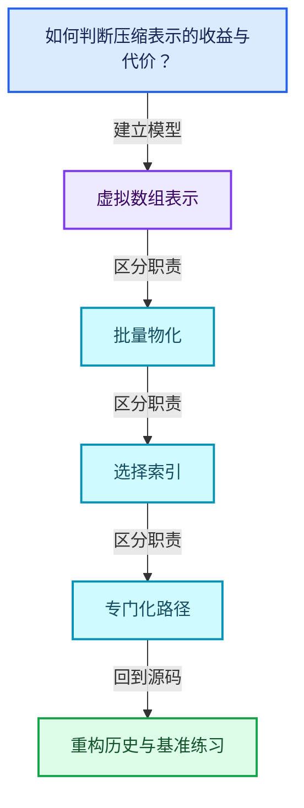
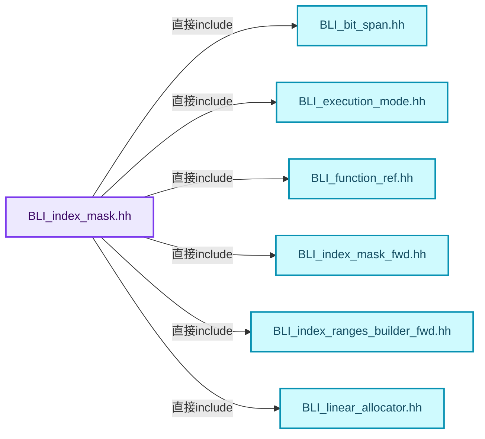
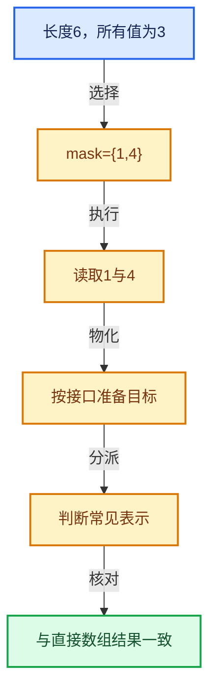

# 04-12 重构历史与基准练习

[方向导航](README.md) · [总目录](../README.md) · [覆盖索引](../%E6%BA%90%E7%A0%81%E7%89%88%E6%9C%AC%E4%B8%8E%E8%A6%86%E7%9B%96%E7%B4%A2%E5%BC%95.md)

> 阅读顺序：问题与数据模型 → 语法与类型 → 源码逐行 → 调用线索 → 历史与取舍 → 推演和练习。

- 基准 HEAD：`cbda6b96c26c0dee3c3b5cbb93960c4ac06a6b30`。
- 记录日期：2026-10-14。
- 教学示例状态：正文中的推演不是本机性能实测；已运行练习见验收报告。

## 一、从问题到设计

如何判断压缩表示的收益与代价？

内存、随机访问、切片、构造和遍历必须分开测量；历史数字只说明当时环境。

本篇把语法、数据语义和系统取舍连接起来。表示与接口分离，元素编号与选择内部位置分离，生成成本与执行成本分离。

### 本篇独立模型与设计推理

选择密度相同也可能分布不同，连续块与随机散点具有不同可压缩性。

设计取舍：构建快、遍历快、内存小、随机访问快不保证同时最大化。

最小反例：只测全选范围就宣称所有稀疏选择都同样快。

推导与处理：固定密度再改变空间分布，分别统计构建、遍历和内存。


### 源码范围与相邻篇章

| 文件 | 本篇逐行范围 | 基准SHA-256 |
|---|---|---|
| [source/blender/blenlib/BLI_index_mask.hh](../../../../../source/blender/blenlib/BLI_index_mask.hh) | L888—L1315 | `d86b6207c23b750c5e987e8f15485786460091055cb38ddd282aab938f2f54df` |

同一主讲文件可能分多篇覆盖；超出本篇范围的符号通过覆盖索引定位。空行与纯注释保留在源码摘录中，逐行表解释有效语句与语法边界；许可证头统一保留。

前篇：[集合表达式与运算](11-%E9%9B%86%E5%90%88%E8%A1%A8%E8%BE%BE%E5%BC%8F%E4%B8%8E%E8%BF%90%E7%AE%97.md).

## 二、类型、数据与阅读地图



这是概念依赖图，边表示阅读关系，不声称是运行时调用顺序。

### 直接编译依赖



箭头只表示头文件包含关系；完整调用线索见后面的符号定位表。

## 三、关键词、语法与类型角色

### 模板 template

模板把类型或常量作为生成实现的参数。读声明时先列出类型参数、非类型参数和默认值，再看使用者实际实例化了什么。模板声明本身不意味着每种T都支持其全部成员。

具体检查：把T替换为int、string、只能移动的类型，分别检查每个被调用操作是否成立。

### 依赖名称 typename

typename既可引入类型模板参数，也可告诉编译器某个依赖名称是类型。它不创建运行时对象；解析期确认语法类别与实例化期检查具体类型是不同阶段。

具体检查：区分typename T::value_type和T::size()，前者标记类型，后者是表达式。

### 常量求值 constexpr

constexpr声明允许相应实体参与常量求值，但constexpr函数仍可以在运行时执行。是否常量求值由调用场景和表达式合法性共同决定。

具体检查：比较constexpr变量初始化和从运行时输入调用同一函数。

### 只读限定 const

const约束当前访问路径可做的修改。const指针、指向const的指针、const视图对象、const元素是不同位置的限定；其他别名可能仍可修改原对象。

具体检查：分别写T* const、const T*与const T* const，并画出不可修改的层次。

### 可选值 optional

optional把不存在与存在的T区分开，T的构造和析构跟随engaged状态变化。访问前应由has_value或条件分支证明存在。

具体检查：把空Field状态与合法常量零区分，不能用某个普通值代替不存在。

### 判别联合 variant

variant在若干候选类型中保存一个活动值，通过判别信息选择操作。它能把不同表示集中在值类型中，但各分支的复制移动成本不同。

具体检查：列出活动分支及每种分支实际拥有或借用的数据。

### 对象表示 sizeof

sizeof给出对象表示大小，不是其引用的所有堆内存总量。sizeof视图很小并不说明底层数组很小。

具体检查：分别统计容器对象、容量字节和元素拥有的间接资源。

### 内部断言 assert

断言表达开发者预期成立的内部契约，发布构建可能关闭。它不能替代对不可信输入的完整错误处理，也不保证后续操作被运行时保护。

具体检查：对每条断言构造违反条件的输入，区分调用者错误与应向用户报告的错误。

### 编译期分支 if constexpr

条件在实例化时决定被保留的分支，这常用于不同类型的合法操作选择。它与运行时if有不同的实例化检查规则。

具体检查：找出每个分支依赖哪些类型特征，再使用满足与不满足条件的类型。

### 类型别名 using

类型别名为已有类型建立名字，不创建运行期对象。它常把模板内部使用的类型统一暴露给泛型调用者。

具体检查：展开别名直到基础类型，区分类型别名和变量声明。

## 四、真实源码与逐行讲解

源码块保持原行内容，原始行号由小节标题及逐行表给出。表中的调用定位是静态阅读辅助；重载、模板实例化、宏展开和虚调用需结合完整声明，不能仅凭词法出现证明动态调用。

### BLI_index_mask.hh：L888—L935

<!-- source:source/blender/blenlib/BLI_index_mask.hh:888:935 -->

```cpp

template<typename T, typename Fn>
#if (defined(__GNUC__) && !defined(__clang__))
[[gnu::optimize("O3")]]
#endif
inline void optimized_foreach_index(const IndexMaskSegment segment, const Fn fn)
{
  BLI_assert(segment.last() < std::numeric_limits<T>::max());
  if (unique_sorted_indices::non_empty_is_range(segment.base_span())) {
    const T start = T(segment[0]);
    const T last = T(segment.last());
    for (T i = start; i <= last; i++) {
      fn(i);
    }
  }
  else {
    for (const int64_t i : segment) {
      fn(T(i));
    }
  }
}

template<typename T, typename Fn>
#if (defined(__GNUC__) && !defined(__clang__))
[[gnu::optimize("O3")]]
#endif
inline void optimized_foreach_index_with_pos(const IndexMaskSegment segment,
                                             const int64_t segment_pos,
                                             const Fn fn)
{
  BLI_assert(segment.last() < std::numeric_limits<T>::max());
  BLI_assert(segment.size() + segment_pos < std::numeric_limits<T>::max());
  if (unique_sorted_indices::non_empty_is_range(segment.base_span())) {
    const T start = T(segment[0]);
    const T last = T(segment.last());
    for (T i = start, pos = T(segment_pos); i <= last; i++, pos++) {
      fn(i, pos);
    }
  }
  else {
    T pos = T(segment_pos);
    for (const int64_t i : segment.index_range()) {
      const T index = T(segment[i]);
      fn(index, pos);
      pos++;
    }
  }
}
```

本段语义重点：

- 分支证据 `defined(__GNUC__) && !defined(__clang__))`：分别推演条件成立与不成立，核对相同出口处的状态。
- 分支证据 `unique_sorted_indices::non_empty_is_range(segment.base_span()))`：分别推演条件成立与不成立，核对相同出口处的状态。

| 原始行 | 语义、约束与检查 |
|---|---|
| L889 | 声明模板参数 `template<typename T, typename Fn>`。类型参数决定生成操作的类型，非类型参数可决定内嵌容量或编译期分支。 |
| L890 | 预处理阶段处理 #if (defined(__GNUC__) && !defined(__clang__))。它决定哪些代码进入编译，不是运行时分支；阅读行为时必须结合实际构建宏。 |
| L891 | 出现调用或函数声明 `gnu::optimize`，对应表达式为 `[[gnu::optimize("O3")]]`。参数求值、返回类型与重载需结合前后完整语句；静态文本引用不能证明动态目标。 |
| L892 | 预处理阶段处理 #endif。它决定哪些代码进入编译，不是运行时分支；阅读行为时必须结合实际构建宏。 |
| L893 | 出现调用或函数声明 `optimized_foreach_index`，对应表达式为 `inline void optimized_foreach_index(const IndexMaskSegment segment, const Fn fn)`。参数求值、返回类型与重载需结合前后完整语句；静态文本引用不能证明动态目标。 |
| L894 | 连接上一行的声明或控制结构与其语句块；后续行在这个作用域中执行或声明。 |
| L895 | 断言约束 `BLI_assert(segment.last() < std::numeric_limits<T>::max());`。条件是后续访问的内部前置条件；发布构建可能不执行，不能把断言当作输入修复。 |
| L896 | 判断 `unique_sorted_indices::non_empty_is_range(segment.base_span())`，成立时进入本分支，否则继续后续路径。 |
| L897 | 把右侧 `T(segment[0])` 用于初始化或更新左侧 `const T start`。声明初始化与已有对象赋值应按上下文区分；有资源的类型会调用相应特殊成员。 |
| L898 | 把右侧 `T(segment.last())` 用于初始化或更新左侧 `const T last`。声明初始化与已有对象赋值应按上下文区分；有资源的类型会调用相应特殊成员。 |
| L899 | 按 `for (T i = start; i <= last; i++)` 指定的范围或条件重复执行。对照循环变量与真实元素编号；循环内调用成本乘以实际迭代次数。 |
| L900 | 出现调用或函数声明 `fn`，对应表达式为 `fn(i);`。参数求值、返回类型与重载需结合前后完整语句；静态文本引用不能证明动态目标。 |
| L901 | 结束当前语法单元。局部自动对象在离开其作用域时按规则销毁；这不等于所有被引用的外部数据也被释放。 |
| L902 | 结束当前语法单元。局部自动对象在离开其作用域时按规则销毁；这不等于所有被引用的外部数据也被释放。 |
| L903 | 处理前一条件不成立的互补路径。比较两条路径最后是否恢复同一不变量，以及是否产生不同的资源责任。 |
| L904 | 按 `for (const int64_t i : segment)` 指定的范围或条件重复执行。对照循环变量与真实元素编号；循环内调用成本乘以实际迭代次数。 |
| L905 | 出现调用或函数声明 `fn`，对应表达式为 `fn(T(i));`。参数求值、返回类型与重载需结合前后完整语句；静态文本引用不能证明动态目标。 |
| L906 | 结束当前语法单元。局部自动对象在离开其作用域时按规则销毁；这不等于所有被引用的外部数据也被释放。 |
| L907 | 结束当前语法单元。局部自动对象在离开其作用域时按规则销毁；这不等于所有被引用的外部数据也被释放。 |
| L908 | 结束当前语法单元。局部自动对象在离开其作用域时按规则销毁；这不等于所有被引用的外部数据也被释放。 |
| L910 | 声明模板参数 `template<typename T, typename Fn>`。类型参数决定生成操作的类型，非类型参数可决定内嵌容量或编译期分支。 |
| L911 | 预处理阶段处理 #if (defined(__GNUC__) && !defined(__clang__))。它决定哪些代码进入编译，不是运行时分支；阅读行为时必须结合实际构建宏。 |
| L912 | 出现调用或函数声明 `gnu::optimize`，对应表达式为 `[[gnu::optimize("O3")]]`。参数求值、返回类型与重载需结合前后完整语句；静态文本引用不能证明动态目标。 |
| L913 | 预处理阶段处理 #endif。它决定哪些代码进入编译，不是运行时分支；阅读行为时必须结合实际构建宏。 |
| L914 | 出现调用或函数声明 `optimized_foreach_index_with_pos`，对应表达式为 `inline void optimized_foreach_index_with_pos(const IndexMaskSegment segment,`。参数求值、返回类型与重载需结合前后完整语句；静态文本引用不能证明动态目标。 |
| L915 | 本行是连续声明或表达式的一部分：`const int64_t segment_pos,`。与本段前后行合读；逗号、括号和限定符决定它属于参数、初始化列表还是实际计算。 |
| L916 | 本行是连续声明或表达式的一部分：`const Fn fn)`。与本段前后行合读；逗号、括号和限定符决定它属于参数、初始化列表还是实际计算。 |
| L917 | 连接上一行的声明或控制结构与其语句块；后续行在这个作用域中执行或声明。 |
| L918 | 断言约束 `BLI_assert(segment.last() < std::numeric_limits<T>::max());`。条件是后续访问的内部前置条件；发布构建可能不执行，不能把断言当作输入修复。 |
| L919 | 断言约束 `BLI_assert(segment.size() + segment_pos < std::numeric_limits<T>::max());`。条件是后续访问的内部前置条件；发布构建可能不执行，不能把断言当作输入修复。 |
| L920 | 判断 `unique_sorted_indices::non_empty_is_range(segment.base_span())`，成立时进入本分支，否则继续后续路径。 |
| L921 | 把右侧 `T(segment[0])` 用于初始化或更新左侧 `const T start`。声明初始化与已有对象赋值应按上下文区分；有资源的类型会调用相应特殊成员。 |
| L922 | 把右侧 `T(segment.last())` 用于初始化或更新左侧 `const T last`。声明初始化与已有对象赋值应按上下文区分；有资源的类型会调用相应特殊成员。 |
| L923 | 按 `for (T i = start, pos = T(segment_pos); i <= last; i++, pos++)` 指定的范围或条件重复执行。对照循环变量与真实元素编号；循环内调用成本乘以实际迭代次数。 |
| L924 | 出现调用或函数声明 `fn`，对应表达式为 `fn(i, pos);`。参数求值、返回类型与重载需结合前后完整语句；静态文本引用不能证明动态目标。 |
| L925 | 结束当前语法单元。局部自动对象在离开其作用域时按规则销毁；这不等于所有被引用的外部数据也被释放。 |
| L926 | 结束当前语法单元。局部自动对象在离开其作用域时按规则销毁；这不等于所有被引用的外部数据也被释放。 |
| L927 | 处理前一条件不成立的互补路径。比较两条路径最后是否恢复同一不变量，以及是否产生不同的资源责任。 |
| L928 | 把右侧 `T(segment_pos)` 用于初始化或更新左侧 `T pos`。声明初始化与已有对象赋值应按上下文区分；有资源的类型会调用相应特殊成员。 |
| L929 | 按 `for (const int64_t i : segment.index_range())` 指定的范围或条件重复执行。对照循环变量与真实元素编号；循环内调用成本乘以实际迭代次数。 |
| L930 | 把右侧 `T(segment[i])` 用于初始化或更新左侧 `const T index`。声明初始化与已有对象赋值应按上下文区分；有资源的类型会调用相应特殊成员。 |
| L931 | 出现调用或函数声明 `fn`，对应表达式为 `fn(index, pos);`。参数求值、返回类型与重载需结合前后完整语句；静态文本引用不能证明动态目标。 |
| L932 | 递增或递减现有状态：`pos++;`。这改变计数或游标；检查边界、计数单位，以及并发访问是否有相应保护。 |
| L933 | 结束当前语法单元。局部自动对象在离开其作用域时按规则销毁；这不等于所有被引用的外部数据也被释放。 |
| L934 | 结束当前语法单元。局部自动对象在离开其作用域时按规则销毁；这不等于所有被引用的外部数据也被释放。 |
| L935 | 结束当前语法单元。局部自动对象在离开其作用域时按规则销毁；这不等于所有被引用的外部数据也被释放。 |

### BLI_index_mask.hh：L936—L966

<!-- source:source/blender/blenlib/BLI_index_mask.hh:936:966 -->

```cpp

template<typename IndexT, ForeachIndexFn Fn, exec_mode::Tag Mode>
inline void IndexMask::foreach_index_optimized(Fn &&fn, Mode mode) const
{
  if constexpr (mode.is_parallel) {
    threading::parallel_for(
        this->index_range(), mode.grain_size(4096), [&](const IndexRange range) {
          const IndexMask sub_mask = this->slice(range);
          sub_mask.foreach_segment([&](const IndexMaskSegment segment,
                                       [[maybe_unused]] const int64_t segment_pos) {
            if constexpr (IndexPosFn<Fn>) {
              optimized_foreach_index_with_pos<IndexT>(segment, segment_pos + range.start(), fn);
            }
            else {
              optimized_foreach_index<IndexT>(segment, fn);
            }
          });
        });
  }
  else {
    this->foreach_segment(
        [&](const IndexMaskSegment segment, [[maybe_unused]] const int64_t segment_pos) {
          if constexpr (IndexPosFn<Fn>) {
            optimized_foreach_index_with_pos<IndexT>(segment, segment_pos, fn);
          }
          else {
            optimized_foreach_index<IndexT>(segment, fn);
          }
        });
  }
}
```

| 原始行 | 语义、约束与检查 |
|---|---|
| L937 | 声明模板参数 `template<typename IndexT, ForeachIndexFn Fn, exec_mode::Tag Mode>`。类型参数决定生成操作的类型，非类型参数可决定内嵌容量或编译期分支。 |
| L938 | 出现调用或函数声明 `IndexMask::foreach_index_optimized`，对应表达式为 `inline void IndexMask::foreach_index_optimized(Fn &&fn, Mode mode) const`。参数求值、返回类型与重载需结合前后完整语句；静态文本引用不能证明动态目标。 |
| L939 | 连接上一行的声明或控制结构与其语句块；后续行在这个作用域中执行或声明。 |
| L940 | 编译期条件分支 `if constexpr (mode.is_parallel)`。按实例化类型选择相应实现；被舍弃分支和运行期if具有不同检查规则，不能当作运行时输入验证。 |
| L941 | 出现调用或函数声明 `threading::parallel_for`，对应表达式为 `threading::parallel_for(`。参数求值、返回类型与重载需结合前后完整语句；静态文本引用不能证明动态目标。 |
| L942 | 出现调用或函数声明 `index_range`，对应表达式为 `this->index_range(), mode.grain_size(4096), [&](const IndexRange range) {`。参数求值、返回类型与重载需结合前后完整语句；静态文本引用不能证明动态目标。 |
| L943 | 把右侧 `this->slice(range)` 用于初始化或更新左侧 `const IndexMask sub_mask`。声明初始化与已有对象赋值应按上下文区分；有资源的类型会调用相应特殊成员。 |
| L944 | 出现调用或函数声明 `foreach_segment`，对应表达式为 `sub_mask.foreach_segment([&](const IndexMaskSegment segment,`。参数求值、返回类型与重载需结合前后完整语句；静态文本引用不能证明动态目标。 |
| L945 | 本行是连续声明或表达式的一部分：`[[maybe_unused]] const int64_t segment_pos) {`。与本段前后行合读；逗号、括号和限定符决定它属于参数、初始化列表还是实际计算。 |
| L946 | 编译期条件分支 `if constexpr (IndexPosFn<Fn>)`。按实例化类型选择相应实现；被舍弃分支和运行期if具有不同检查规则，不能当作运行时输入验证。 |
| L947 | 出现调用或函数声明 `optimized_foreach_index_with_pos`，对应表达式为 `optimized_foreach_index_with_pos<IndexT>(segment, segment_pos + range.start(), fn);`。参数求值、返回类型与重载需结合前后完整语句；静态文本引用不能证明动态目标。 |
| L948 | 结束当前语法单元。局部自动对象在离开其作用域时按规则销毁；这不等于所有被引用的外部数据也被释放。 |
| L949 | 处理前一条件不成立的互补路径。比较两条路径最后是否恢复同一不变量，以及是否产生不同的资源责任。 |
| L950 | 出现调用或函数声明 `optimized_foreach_index`，对应表达式为 `optimized_foreach_index<IndexT>(segment, fn);`。参数求值、返回类型与重载需结合前后完整语句；静态文本引用不能证明动态目标。 |
| L951 | 结束当前语法单元。局部自动对象在离开其作用域时按规则销毁；这不等于所有被引用的外部数据也被释放。 |
| L952 | 结束当前语法单元。局部自动对象在离开其作用域时按规则销毁；这不等于所有被引用的外部数据也被释放。 |
| L953 | 结束当前语法单元。局部自动对象在离开其作用域时按规则销毁；这不等于所有被引用的外部数据也被释放。 |
| L954 | 结束当前语法单元。局部自动对象在离开其作用域时按规则销毁；这不等于所有被引用的外部数据也被释放。 |
| L955 | 处理前一条件不成立的互补路径。比较两条路径最后是否恢复同一不变量，以及是否产生不同的资源责任。 |
| L956 | 出现调用或函数声明 `foreach_segment`，对应表达式为 `this->foreach_segment(`。参数求值、返回类型与重载需结合前后完整语句；静态文本引用不能证明动态目标。 |
| L957 | 本行是连续声明或表达式的一部分：`[&](const IndexMaskSegment segment, [[maybe_unused]] const int64_t segment_pos) {`。与本段前后行合读；逗号、括号和限定符决定它属于参数、初始化列表还是实际计算。 |
| L958 | 编译期条件分支 `if constexpr (IndexPosFn<Fn>)`。按实例化类型选择相应实现；被舍弃分支和运行期if具有不同检查规则，不能当作运行时输入验证。 |
| L959 | 出现调用或函数声明 `optimized_foreach_index_with_pos`，对应表达式为 `optimized_foreach_index_with_pos<IndexT>(segment, segment_pos, fn);`。参数求值、返回类型与重载需结合前后完整语句；静态文本引用不能证明动态目标。 |
| L960 | 结束当前语法单元。局部自动对象在离开其作用域时按规则销毁；这不等于所有被引用的外部数据也被释放。 |
| L961 | 处理前一条件不成立的互补路径。比较两条路径最后是否恢复同一不变量，以及是否产生不同的资源责任。 |
| L962 | 出现调用或函数声明 `optimized_foreach_index`，对应表达式为 `optimized_foreach_index<IndexT>(segment, fn);`。参数求值、返回类型与重载需结合前后完整语句；静态文本引用不能证明动态目标。 |
| L963 | 结束当前语法单元。局部自动对象在离开其作用域时按规则销毁；这不等于所有被引用的外部数据也被释放。 |
| L964 | 结束当前语法单元。局部自动对象在离开其作用域时按规则销毁；这不等于所有被引用的外部数据也被释放。 |
| L965 | 结束当前语法单元。局部自动对象在离开其作用域时按规则销毁；这不等于所有被引用的外部数据也被释放。 |
| L966 | 结束当前语法单元。局部自动对象在离开其作用域时按规则销毁；这不等于所有被引用的外部数据也被释放。 |

### BLI_index_mask.hh：L967—L1010

<!-- source:source/blender/blenlib/BLI_index_mask.hh:967:1010 -->

```cpp

template<ForeachSegmentOrRangePosFn Fn, exec_mode::Tag Mode>
inline void IndexMask::foreach_segment_optimized(Fn &&fn, Mode mode) const
{
  if constexpr (mode.is_parallel) {
    threading::parallel_for(
        this->index_range(), mode.grain_size(4096), [&](const IndexRange range) {
          const IndexMask sub_mask = this->slice(range);
          sub_mask.foreach_segment_optimized(
              [&fn, range_start = range.start()](
                  const auto segment, [[maybe_unused]] const int64_t start_segment_pos) {
                if constexpr (SegmentOrRangePosFn<Fn>) {
                  fn(segment, start_segment_pos + range_start);
                }
                else {
                  fn(segment);
                }
              });
        });
  }
  else {
    this->foreach_segment(
        [&](const IndexMaskSegment segment, [[maybe_unused]] const int64_t start_segment_pos) {
          if (unique_sorted_indices::non_empty_is_range(segment.base_span())) {
            const IndexRange range(segment[0], segment.size());
            if constexpr (SegmentOrRangePosFn<Fn>) {
              fn(range, start_segment_pos);
            }
            else {
              fn(range);
            }
          }
          else {
            if constexpr (SegmentOrRangePosFn<Fn>) {
              fn(segment, start_segment_pos);
            }
            else {
              fn(segment);
            }
          }
        },
        mode);
  }
}
```

本段语义重点：

- 分支证据 `unique_sorted_indices::non_empty_is_range(segment.base_span()))`：分别推演条件成立与不成立，核对相同出口处的状态。

| 原始行 | 语义、约束与检查 |
|---|---|
| L968 | 声明模板参数 `template<ForeachSegmentOrRangePosFn Fn, exec_mode::Tag Mode>`。类型参数决定生成操作的类型，非类型参数可决定内嵌容量或编译期分支。 |
| L969 | 出现调用或函数声明 `IndexMask::foreach_segment_optimized`，对应表达式为 `inline void IndexMask::foreach_segment_optimized(Fn &&fn, Mode mode) const`。参数求值、返回类型与重载需结合前后完整语句；静态文本引用不能证明动态目标。 |
| L970 | 连接上一行的声明或控制结构与其语句块；后续行在这个作用域中执行或声明。 |
| L971 | 编译期条件分支 `if constexpr (mode.is_parallel)`。按实例化类型选择相应实现；被舍弃分支和运行期if具有不同检查规则，不能当作运行时输入验证。 |
| L972 | 出现调用或函数声明 `threading::parallel_for`，对应表达式为 `threading::parallel_for(`。参数求值、返回类型与重载需结合前后完整语句；静态文本引用不能证明动态目标。 |
| L973 | 出现调用或函数声明 `index_range`，对应表达式为 `this->index_range(), mode.grain_size(4096), [&](const IndexRange range) {`。参数求值、返回类型与重载需结合前后完整语句；静态文本引用不能证明动态目标。 |
| L974 | 把右侧 `this->slice(range)` 用于初始化或更新左侧 `const IndexMask sub_mask`。声明初始化与已有对象赋值应按上下文区分；有资源的类型会调用相应特殊成员。 |
| L975 | 出现调用或函数声明 `foreach_segment_optimized`，对应表达式为 `sub_mask.foreach_segment_optimized(`。参数求值、返回类型与重载需结合前后完整语句；静态文本引用不能证明动态目标。 |
| L976 | 把右侧 `range.start()](` 用于初始化或更新左侧 `[&fn, range_start`。声明初始化与已有对象赋值应按上下文区分；有资源的类型会调用相应特殊成员。 |
| L977 | 本行是连续声明或表达式的一部分：`const auto segment, [[maybe_unused]] const int64_t start_segment_pos) {`。与本段前后行合读；逗号、括号和限定符决定它属于参数、初始化列表还是实际计算。 |
| L978 | 编译期条件分支 `if constexpr (SegmentOrRangePosFn<Fn>)`。按实例化类型选择相应实现；被舍弃分支和运行期if具有不同检查规则，不能当作运行时输入验证。 |
| L979 | 出现调用或函数声明 `fn`，对应表达式为 `fn(segment, start_segment_pos + range_start);`。参数求值、返回类型与重载需结合前后完整语句；静态文本引用不能证明动态目标。 |
| L980 | 结束当前语法单元。局部自动对象在离开其作用域时按规则销毁；这不等于所有被引用的外部数据也被释放。 |
| L981 | 处理前一条件不成立的互补路径。比较两条路径最后是否恢复同一不变量，以及是否产生不同的资源责任。 |
| L982 | 出现调用或函数声明 `fn`，对应表达式为 `fn(segment);`。参数求值、返回类型与重载需结合前后完整语句；静态文本引用不能证明动态目标。 |
| L983 | 结束当前语法单元。局部自动对象在离开其作用域时按规则销毁；这不等于所有被引用的外部数据也被释放。 |
| L984 | 结束当前语法单元。局部自动对象在离开其作用域时按规则销毁；这不等于所有被引用的外部数据也被释放。 |
| L985 | 结束当前语法单元。局部自动对象在离开其作用域时按规则销毁；这不等于所有被引用的外部数据也被释放。 |
| L986 | 结束当前语法单元。局部自动对象在离开其作用域时按规则销毁；这不等于所有被引用的外部数据也被释放。 |
| L987 | 处理前一条件不成立的互补路径。比较两条路径最后是否恢复同一不变量，以及是否产生不同的资源责任。 |
| L988 | 出现调用或函数声明 `foreach_segment`，对应表达式为 `this->foreach_segment(`。参数求值、返回类型与重载需结合前后完整语句；静态文本引用不能证明动态目标。 |
| L989 | 本行是连续声明或表达式的一部分：`[&](const IndexMaskSegment segment, [[maybe_unused]] const int64_t start_segment_pos) {`。与本段前后行合读；逗号、括号和限定符决定它属于参数、初始化列表还是实际计算。 |
| L990 | 判断 `unique_sorted_indices::non_empty_is_range(segment.base_span())`，成立时进入本分支，否则继续后续路径。 |
| L991 | 声明接口 `const IndexRange range(segment[0], segment.size())`，本行没有对应函数体；返回类型、参数限定和const/noexcept共同组成调用契约，实际行为需继续定位实现。 |
| L992 | 编译期条件分支 `if constexpr (SegmentOrRangePosFn<Fn>)`。按实例化类型选择相应实现；被舍弃分支和运行期if具有不同检查规则，不能当作运行时输入验证。 |
| L993 | 出现调用或函数声明 `fn`，对应表达式为 `fn(range, start_segment_pos);`。参数求值、返回类型与重载需结合前后完整语句；静态文本引用不能证明动态目标。 |
| L994 | 结束当前语法单元。局部自动对象在离开其作用域时按规则销毁；这不等于所有被引用的外部数据也被释放。 |
| L995 | 处理前一条件不成立的互补路径。比较两条路径最后是否恢复同一不变量，以及是否产生不同的资源责任。 |
| L996 | 出现调用或函数声明 `fn`，对应表达式为 `fn(range);`。参数求值、返回类型与重载需结合前后完整语句；静态文本引用不能证明动态目标。 |
| L997 | 结束当前语法单元。局部自动对象在离开其作用域时按规则销毁；这不等于所有被引用的外部数据也被释放。 |
| L998 | 结束当前语法单元。局部自动对象在离开其作用域时按规则销毁；这不等于所有被引用的外部数据也被释放。 |
| L999 | 处理前一条件不成立的互补路径。比较两条路径最后是否恢复同一不变量，以及是否产生不同的资源责任。 |
| L1000 | 编译期条件分支 `if constexpr (SegmentOrRangePosFn<Fn>)`。按实例化类型选择相应实现；被舍弃分支和运行期if具有不同检查规则，不能当作运行时输入验证。 |
| L1001 | 出现调用或函数声明 `fn`，对应表达式为 `fn(segment, start_segment_pos);`。参数求值、返回类型与重载需结合前后完整语句；静态文本引用不能证明动态目标。 |
| L1002 | 结束当前语法单元。局部自动对象在离开其作用域时按规则销毁；这不等于所有被引用的外部数据也被释放。 |
| L1003 | 处理前一条件不成立的互补路径。比较两条路径最后是否恢复同一不变量，以及是否产生不同的资源责任。 |
| L1004 | 出现调用或函数声明 `fn`，对应表达式为 `fn(segment);`。参数求值、返回类型与重载需结合前后完整语句；静态文本引用不能证明动态目标。 |
| L1005 | 结束当前语法单元。局部自动对象在离开其作用域时按规则销毁；这不等于所有被引用的外部数据也被释放。 |
| L1006 | 结束当前语法单元。局部自动对象在离开其作用域时按规则销毁；这不等于所有被引用的外部数据也被释放。 |
| L1007 | 结束当前语法单元。局部自动对象在离开其作用域时按规则销毁；这不等于所有被引用的外部数据也被释放。 |
| L1008 | 声明成员、局部对象或完成语句 `mode)`。若为指针或引用，它本身不说明拥有；若为值对象，其构造析构由所在作用域或外层对象管理。 |
| L1009 | 结束当前语法单元。局部自动对象在离开其作用域时按规则销毁；这不等于所有被引用的外部数据也被释放。 |
| L1010 | 结束当前语法单元。局部自动对象在离开其作用域时按规则销毁；这不等于所有被引用的外部数据也被释放。 |

### BLI_index_mask.hh：L1011—L1063

<!-- source:source/blender/blenlib/BLI_index_mask.hh:1011:1063 -->

```cpp

template<ForeachSegmentFn Fn>
inline void IndexMask::foreach_segment(Fn &&fn, const exec_mode::Tag auto mode) const
{
  if constexpr (mode.is_parallel) {
    threading::parallel_for(
        this->index_range(), mode.grain_size(256), [&](const IndexRange range) {
          const IndexMask sub_mask = this->slice(range);
          sub_mask.foreach_segment(
              [&fn, range_start = range.start()](const IndexMaskSegment mask_segment,
                                                 [[maybe_unused]] const int64_t segment_pos) {
                if constexpr (SegmentPosFn<Fn>) {
                  fn(mask_segment, segment_pos + range_start);
                }
                else {
                  fn(mask_segment);
                }
              });
        });
  }
  else {
    [[maybe_unused]] int64_t segment_pos = 0;
    for (const int64_t segment_i : IndexRange(segments_num_)) {
      const IndexMaskSegment segment = this->segment(segment_i);
      if constexpr (SegmentPosFn<Fn>) {
        fn(segment, segment_pos);
        segment_pos += segment.size();
      }
      else {
        fn(segment);
      }
    }
  }
}

template<ForeachRangeFn Fn> inline void IndexMask::foreach_range(Fn &&fn) const
{
  this->foreach_segment([&](const IndexMaskSegment indices, [[maybe_unused]] int64_t segment_pos) {
    Span<int16_t> base_indices = indices.base_span();
    while (!base_indices.is_empty()) {
      const int64_t next_range_size = unique_sorted_indices::find_size_of_next_range(base_indices);
      const IndexRange range(int64_t(base_indices[0]) + indices.offset(), next_range_size);
      if constexpr (RangePosFn<Fn>) {
        fn(range, segment_pos);
      }
      else {
        fn(range);
      }
      segment_pos += next_range_size;
      base_indices = base_indices.drop_front(next_range_size);
    }
  });
}
```

本段语义重点：

- 分支证据 `!base_indices.is_empty())`：分别推演条件成立与不成立，核对相同出口处的状态。

| 原始行 | 语义、约束与检查 |
|---|---|
| L1012 | 声明模板参数 `template<ForeachSegmentFn Fn>`。类型参数决定生成操作的类型，非类型参数可决定内嵌容量或编译期分支。 |
| L1013 | 出现调用或函数声明 `IndexMask::foreach_segment`，对应表达式为 `inline void IndexMask::foreach_segment(Fn &&fn, const exec_mode::Tag auto mode) const`。参数求值、返回类型与重载需结合前后完整语句；静态文本引用不能证明动态目标。 |
| L1014 | 连接上一行的声明或控制结构与其语句块；后续行在这个作用域中执行或声明。 |
| L1015 | 编译期条件分支 `if constexpr (mode.is_parallel)`。按实例化类型选择相应实现；被舍弃分支和运行期if具有不同检查规则，不能当作运行时输入验证。 |
| L1016 | 出现调用或函数声明 `threading::parallel_for`，对应表达式为 `threading::parallel_for(`。参数求值、返回类型与重载需结合前后完整语句；静态文本引用不能证明动态目标。 |
| L1017 | 出现调用或函数声明 `index_range`，对应表达式为 `this->index_range(), mode.grain_size(256), [&](const IndexRange range) {`。参数求值、返回类型与重载需结合前后完整语句；静态文本引用不能证明动态目标。 |
| L1018 | 把右侧 `this->slice(range)` 用于初始化或更新左侧 `const IndexMask sub_mask`。声明初始化与已有对象赋值应按上下文区分；有资源的类型会调用相应特殊成员。 |
| L1019 | 出现调用或函数声明 `foreach_segment`，对应表达式为 `sub_mask.foreach_segment(`。参数求值、返回类型与重载需结合前后完整语句；静态文本引用不能证明动态目标。 |
| L1020 | 把右侧 `range.start()](const IndexMaskSegment mask_segment,` 用于初始化或更新左侧 `[&fn, range_start`。声明初始化与已有对象赋值应按上下文区分；有资源的类型会调用相应特殊成员。 |
| L1021 | 本行是连续声明或表达式的一部分：`[[maybe_unused]] const int64_t segment_pos) {`。与本段前后行合读；逗号、括号和限定符决定它属于参数、初始化列表还是实际计算。 |
| L1022 | 编译期条件分支 `if constexpr (SegmentPosFn<Fn>)`。按实例化类型选择相应实现；被舍弃分支和运行期if具有不同检查规则，不能当作运行时输入验证。 |
| L1023 | 出现调用或函数声明 `fn`，对应表达式为 `fn(mask_segment, segment_pos + range_start);`。参数求值、返回类型与重载需结合前后完整语句；静态文本引用不能证明动态目标。 |
| L1024 | 结束当前语法单元。局部自动对象在离开其作用域时按规则销毁；这不等于所有被引用的外部数据也被释放。 |
| L1025 | 处理前一条件不成立的互补路径。比较两条路径最后是否恢复同一不变量，以及是否产生不同的资源责任。 |
| L1026 | 出现调用或函数声明 `fn`，对应表达式为 `fn(mask_segment);`。参数求值、返回类型与重载需结合前后完整语句；静态文本引用不能证明动态目标。 |
| L1027 | 结束当前语法单元。局部自动对象在离开其作用域时按规则销毁；这不等于所有被引用的外部数据也被释放。 |
| L1028 | 结束当前语法单元。局部自动对象在离开其作用域时按规则销毁；这不等于所有被引用的外部数据也被释放。 |
| L1029 | 结束当前语法单元。局部自动对象在离开其作用域时按规则销毁；这不等于所有被引用的外部数据也被释放。 |
| L1030 | 结束当前语法单元。局部自动对象在离开其作用域时按规则销毁；这不等于所有被引用的外部数据也被释放。 |
| L1031 | 处理前一条件不成立的互补路径。比较两条路径最后是否恢复同一不变量，以及是否产生不同的资源责任。 |
| L1032 | 把右侧 `0` 用于初始化或更新左侧 `[[maybe_unused]] int64_t segment_pos`。声明初始化与已有对象赋值应按上下文区分；有资源的类型会调用相应特殊成员。 |
| L1033 | 按 `for (const int64_t segment_i : IndexRange(segments_num_))` 指定的范围或条件重复执行。对照循环变量与真实元素编号；循环内调用成本乘以实际迭代次数。 |
| L1034 | 把右侧 `this->segment(segment_i)` 用于初始化或更新左侧 `const IndexMaskSegment segment`。声明初始化与已有对象赋值应按上下文区分；有资源的类型会调用相应特殊成员。 |
| L1035 | 编译期条件分支 `if constexpr (SegmentPosFn<Fn>)`。按实例化类型选择相应实现；被舍弃分支和运行期if具有不同检查规则，不能当作运行时输入验证。 |
| L1036 | 出现调用或函数声明 `fn`，对应表达式为 `fn(segment, segment_pos);`。参数求值、返回类型与重载需结合前后完整语句；静态文本引用不能证明动态目标。 |
| L1037 | 复合更新 `segment_pos += segment.size()`：读取左侧现有值，与右侧按`+=`对应操作组合后写回。检查数值边界、位掩码或共享状态保护；它不是新对象的构造。 |
| L1038 | 结束当前语法单元。局部自动对象在离开其作用域时按规则销毁；这不等于所有被引用的外部数据也被释放。 |
| L1039 | 处理前一条件不成立的互补路径。比较两条路径最后是否恢复同一不变量，以及是否产生不同的资源责任。 |
| L1040 | 出现调用或函数声明 `fn`，对应表达式为 `fn(segment);`。参数求值、返回类型与重载需结合前后完整语句；静态文本引用不能证明动态目标。 |
| L1041 | 结束当前语法单元。局部自动对象在离开其作用域时按规则销毁；这不等于所有被引用的外部数据也被释放。 |
| L1042 | 结束当前语法单元。局部自动对象在离开其作用域时按规则销毁；这不等于所有被引用的外部数据也被释放。 |
| L1043 | 结束当前语法单元。局部自动对象在离开其作用域时按规则销毁；这不等于所有被引用的外部数据也被释放。 |
| L1044 | 结束当前语法单元。局部自动对象在离开其作用域时按规则销毁；这不等于所有被引用的外部数据也被释放。 |
| L1046 | 声明模板参数 `template<ForeachRangeFn Fn> inline void IndexMask::foreach_range(Fn &&fn) const`。类型参数决定生成操作的类型，非类型参数可决定内嵌容量或编译期分支。 |
| L1047 | 连接上一行的声明或控制结构与其语句块；后续行在这个作用域中执行或声明。 |
| L1048 | 出现调用或函数声明 `foreach_segment`，对应表达式为 `this->foreach_segment([&](const IndexMaskSegment indices, [[maybe_unused]] int64_t segment_pos) {`。参数求值、返回类型与重载需结合前后完整语句；静态文本引用不能证明动态目标。 |
| L1049 | 把右侧 `indices.base_span()` 用于初始化或更新左侧 `Span<int16_t> base_indices`。声明初始化与已有对象赋值应按上下文区分；有资源的类型会调用相应特殊成员。 |
| L1050 | 按 `while (!base_indices.is_empty())` 指定的范围或条件重复执行。对照循环变量与真实元素编号；循环内调用成本乘以实际迭代次数。 |
| L1051 | 把右侧 `unique_sorted_indices::find_size_of_next_range(base_indices)` 用于初始化或更新左侧 `const int64_t next_range_size`。声明初始化与已有对象赋值应按上下文区分；有资源的类型会调用相应特殊成员。 |
| L1052 | 声明接口 `const IndexRange range(int64_t(base_indices[0]) + indices.offset(), next_range_size)`，本行没有对应函数体；返回类型、参数限定和const/noexcept共同组成调用契约，实际行为需继续定位实现。 |
| L1053 | 编译期条件分支 `if constexpr (RangePosFn<Fn>)`。按实例化类型选择相应实现；被舍弃分支和运行期if具有不同检查规则，不能当作运行时输入验证。 |
| L1054 | 出现调用或函数声明 `fn`，对应表达式为 `fn(range, segment_pos);`。参数求值、返回类型与重载需结合前后完整语句；静态文本引用不能证明动态目标。 |
| L1055 | 结束当前语法单元。局部自动对象在离开其作用域时按规则销毁；这不等于所有被引用的外部数据也被释放。 |
| L1056 | 处理前一条件不成立的互补路径。比较两条路径最后是否恢复同一不变量，以及是否产生不同的资源责任。 |
| L1057 | 出现调用或函数声明 `fn`，对应表达式为 `fn(range);`。参数求值、返回类型与重载需结合前后完整语句；静态文本引用不能证明动态目标。 |
| L1058 | 结束当前语法单元。局部自动对象在离开其作用域时按规则销毁；这不等于所有被引用的外部数据也被释放。 |
| L1059 | 复合更新 `segment_pos += next_range_size`：读取左侧现有值，与右侧按`+=`对应操作组合后写回。检查数值边界、位掩码或共享状态保护；它不是新对象的构造。 |
| L1060 | 把右侧 `base_indices.drop_front(next_range_size)` 用于初始化或更新左侧 `base_indices`。声明初始化与已有对象赋值应按上下文区分；有资源的类型会调用相应特殊成员。 |
| L1061 | 结束当前语法单元。局部自动对象在离开其作用域时按规则销毁；这不等于所有被引用的外部数据也被释放。 |
| L1062 | 结束当前语法单元。局部自动对象在离开其作用域时按规则销毁；这不等于所有被引用的外部数据也被释放。 |
| L1063 | 结束当前语法单元。局部自动对象在离开其作用域时按规则销毁；这不等于所有被引用的外部数据也被释放。 |

### BLI_index_mask.hh：L1064—L1103

<!-- source:source/blender/blenlib/BLI_index_mask.hh:1064:1103 -->

```cpp

namespace detail {
IndexMask from_predicate_impl(
    const IndexMask &universe,
    LinearAllocator<> &memory,
    FunctionRef<int64_t(IndexMaskSegment indices, int16_t *r_true_indices)> filter_indices,
    exec_mode::Mode mode);
}

template<typename Fn>
inline IndexMask IndexMask::from_predicate(const IndexMask &universe,
                                           LinearAllocator<> &memory,
                                           Fn &&predicate,
                                           const exec_mode::Mode mode)
{
  return detail::from_predicate_impl(
      universe,
      memory,
      [&](const IndexMaskSegment indices, int16_t *__restrict r_true_indices) {
        int16_t *r_current = r_true_indices;
        const int16_t *in_end = indices.base_span().end();
        const int64_t offset = indices.offset();
        for (const int16_t *in_current = indices.base_span().data(); in_current < in_end;
             in_current++)
        {
          const int16_t local_index = *in_current;
          const int64_t global_index = int64_t(local_index) + offset;
          const bool condition = predicate(global_index);
          *r_current = local_index;
          /* This expects the boolean to be either 0 or 1 which is generally the case but may not
           * be if the values are uninitialized. */
          BLI_assert(ELEM(int8_t(condition), 0, 1));
          /* Branchless conditional increment. */
          r_current += condition;
        }
        const int16_t true_indices_num = int16_t(r_current - r_true_indices);
        return true_indices_num;
      },
      mode);
}
```

| 原始行 | 语义、约束与检查 |
|---|---|
| L1065 | 把后续声明放入 detail 命名空间，影响名称查找和符号归属，不创建运行时对象。 |
| L1066 | 出现调用或函数声明 `from_predicate_impl`，对应表达式为 `IndexMask from_predicate_impl(`。参数求值、返回类型与重载需结合前后完整语句；静态文本引用不能证明动态目标。 |
| L1067 | 本行是连续声明或表达式的一部分：`const IndexMask &universe,`。与本段前后行合读；逗号、括号和限定符决定它属于参数、初始化列表还是实际计算。 |
| L1068 | 本行是连续声明或表达式的一部分：`LinearAllocator<> &memory,`。与本段前后行合读；逗号、括号和限定符决定它属于参数、初始化列表还是实际计算。 |
| L1069 | 出现调用或函数声明 `int64_t`，对应表达式为 `FunctionRef<int64_t(IndexMaskSegment indices, int16_t *r_true_indices)> filter_indices,`。参数求值、返回类型与重载需结合前后完整语句；静态文本引用不能证明动态目标。 |
| L1070 | 声明成员、局部对象或完成语句 `exec_mode::Mode mode)`。若为指针或引用，它本身不说明拥有；若为值对象，其构造析构由所在作用域或外层对象管理。 |
| L1071 | 结束当前语法单元。局部自动对象在离开其作用域时按规则销毁；这不等于所有被引用的外部数据也被释放。 |
| L1073 | 声明模板参数 `template<typename Fn>`。类型参数决定生成操作的类型，非类型参数可决定内嵌容量或编译期分支。 |
| L1074 | 出现调用或函数声明 `IndexMask::from_predicate`，对应表达式为 `inline IndexMask IndexMask::from_predicate(const IndexMask &universe,`。参数求值、返回类型与重载需结合前后完整语句；静态文本引用不能证明动态目标。 |
| L1075 | 本行是连续声明或表达式的一部分：`LinearAllocator<> &memory,`。与本段前后行合读；逗号、括号和限定符决定它属于参数、初始化列表还是实际计算。 |
| L1076 | 本行是连续声明或表达式的一部分：`Fn &&predicate,`。与本段前后行合读；逗号、括号和限定符决定它属于参数、初始化列表还是实际计算。 |
| L1077 | 本行是连续声明或表达式的一部分：`const exec_mode::Mode mode)`。与本段前后行合读；逗号、括号和限定符决定它属于参数、初始化列表还是实际计算。 |
| L1078 | 连接上一行的声明或控制结构与其语句块；后续行在这个作用域中执行或声明。 |
| L1079 | 返回表达式 `detail::from_predicate_impl(`。 |
| L1080 | 本行是连续声明或表达式的一部分：`universe,`。与本段前后行合读；逗号、括号和限定符决定它属于参数、初始化列表还是实际计算。 |
| L1081 | 本行是连续声明或表达式的一部分：`memory,`。与本段前后行合读；逗号、括号和限定符决定它属于参数、初始化列表还是实际计算。 |
| L1082 | 本行是连续声明或表达式的一部分：`[&](const IndexMaskSegment indices, int16_t *__restrict r_true_indices) {`。与本段前后行合读；逗号、括号和限定符决定它属于参数、初始化列表还是实际计算。 |
| L1083 | 把右侧 `r_true_indices` 用于初始化或更新左侧 `int16_t *r_current`。声明初始化与已有对象赋值应按上下文区分；有资源的类型会调用相应特殊成员。 |
| L1084 | 把右侧 `indices.base_span().end()` 用于初始化或更新左侧 `const int16_t *in_end`。声明初始化与已有对象赋值应按上下文区分；有资源的类型会调用相应特殊成员。 |
| L1085 | 把右侧 `indices.offset()` 用于初始化或更新左侧 `const int64_t offset`。声明初始化与已有对象赋值应按上下文区分；有资源的类型会调用相应特殊成员。 |
| L1086 | 按 `for (const int16_t *in_current = indices.base_span().data(); in_current < in_end;` 指定的范围或条件重复执行。对照循环变量与真实元素编号；循环内调用成本乘以实际迭代次数。 |
| L1087 | 本行是连续声明或表达式的一部分：`in_current++)`。与本段前后行合读；逗号、括号和限定符决定它属于参数、初始化列表还是实际计算。 |
| L1088 | 连接上一行的声明或控制结构与其语句块；后续行在这个作用域中执行或声明。 |
| L1089 | 把右侧 `*in_current` 用于初始化或更新左侧 `const int16_t local_index`。声明初始化与已有对象赋值应按上下文区分；有资源的类型会调用相应特殊成员。 |
| L1090 | 把右侧 `int64_t(local_index) + offset` 用于初始化或更新左侧 `const int64_t global_index`。声明初始化与已有对象赋值应按上下文区分；有资源的类型会调用相应特殊成员。 |
| L1091 | 把右侧 `predicate(global_index)` 用于初始化或更新左侧 `const bool condition`。声明初始化与已有对象赋值应按上下文区分；有资源的类型会调用相应特殊成员。 |
| L1092 | 把右侧 `local_index` 用于初始化或更新左侧 `*r_current`。声明初始化与已有对象赋值应按上下文区分；有资源的类型会调用相应特殊成员。 |
| L1095 | 断言约束 `BLI_assert(ELEM(int8_t(condition), 0, 1));`。条件是后续访问的内部前置条件；发布构建可能不执行，不能把断言当作输入修复。 |
| L1097 | 复合更新 `r_current += condition`：读取左侧现有值，与右侧按`+=`对应操作组合后写回。检查数值边界、位掩码或共享状态保护；它不是新对象的构造。 |
| L1098 | 结束当前语法单元。局部自动对象在离开其作用域时按规则销毁；这不等于所有被引用的外部数据也被释放。 |
| L1099 | 把右侧 `int16_t(r_current - r_true_indices)` 用于初始化或更新左侧 `const int16_t true_indices_num`。声明初始化与已有对象赋值应按上下文区分；有资源的类型会调用相应特殊成员。 |
| L1100 | 返回表达式 `true_indices_num`。 |
| L1101 | 结束当前语法单元。局部自动对象在离开其作用域时按规则销毁；这不等于所有被引用的外部数据也被释放。 |
| L1102 | 声明成员、局部对象或完成语句 `mode)`。若为指针或引用，它本身不说明拥有；若为值对象，其构造析构由所在作用域或外层对象管理。 |
| L1103 | 结束当前语法单元。局部自动对象在离开其作用域时按规则销毁；这不等于所有被引用的外部数据也被释放。 |

### BLI_index_mask.hh：L1104—L1147

<!-- source:source/blender/blenlib/BLI_index_mask.hh:1104:1147 -->

```cpp

template<typename T, typename Fn>
void IndexMask::from_groups(const IndexMask &universe,
                            LinearAllocator<> &memory,
                            Fn &&get_group_index,
                            MutableSpan<IndexMask> r_masks)
{
  if (r_masks.size() == 1) {
#ifndef NDEBUG
    universe.foreach_index([&](const int i) { BLI_assert(get_group_index(i) == 0); });
#endif
    r_masks[0] = universe;
    return;
  }

  Vector<Vector<T>> indices_by_group(r_masks.size());
  universe.foreach_index([&](const int64_t i) {
    const int group_index = get_group_index(i);
    indices_by_group[group_index].append(T(i));
  });
  for (const int64_t i : r_masks.index_range()) {
    r_masks[i] = IndexMask::from_indices<T>(indices_by_group[i], memory);
  }
}

template<typename T> inline Vector<T> IndexMask::to_indices() const
{
  Vector<T> indices(indices_num_);
  this->to_indices<T>(indices);
  return indices;
}

std::optional<IndexRange> inline IndexMask::to_range() const
{
  if (indices_num_ == 0) {
    return IndexRange{};
  }
  const int64_t first_index = this->first();
  const int64_t last_index = this->last();
  if (last_index - first_index == indices_num_ - 1) {
    return IndexRange(first_index, indices_num_);
  }
  return std::nullopt;
}
```

本段语义重点：

- 分支证据 `r_masks.size() == 1)`：分别推演条件成立与不成立，核对相同出口处的状态。
- 分支证据 `indices_num_ == 0)`：分别推演条件成立与不成立，核对相同出口处的状态。

| 原始行 | 语义、约束与检查 |
|---|---|
| L1105 | 声明模板参数 `template<typename T, typename Fn>`。类型参数决定生成操作的类型，非类型参数可决定内嵌容量或编译期分支。 |
| L1106 | 出现调用或函数声明 `IndexMask::from_groups`，对应表达式为 `void IndexMask::from_groups(const IndexMask &universe,`。参数求值、返回类型与重载需结合前后完整语句；静态文本引用不能证明动态目标。 |
| L1107 | 本行是连续声明或表达式的一部分：`LinearAllocator<> &memory,`。与本段前后行合读；逗号、括号和限定符决定它属于参数、初始化列表还是实际计算。 |
| L1108 | 本行是连续声明或表达式的一部分：`Fn &&get_group_index,`。与本段前后行合读；逗号、括号和限定符决定它属于参数、初始化列表还是实际计算。 |
| L1109 | 本行是连续声明或表达式的一部分：`MutableSpan<IndexMask> r_masks)`。与本段前后行合读；逗号、括号和限定符决定它属于参数、初始化列表还是实际计算。 |
| L1110 | 连接上一行的声明或控制结构与其语句块；后续行在这个作用域中执行或声明。 |
| L1111 | 判断 `r_masks.size() == 1`，成立时进入本分支，否则继续后续路径。该边界影响可访问元素或可用容量，两者要按各变量的定义区分。 |
| L1112 | 预处理阶段处理 #ifndef NDEBUG。它决定哪些代码进入编译，不是运行时分支；阅读行为时必须结合实际构建宏。 |
| L1113 | 断言约束 `universe.foreach_index([&](const int i) { BLI_assert(get_group_index(i) == 0); });`。条件是后续访问的内部前置条件；发布构建可能不执行，不能把断言当作输入修复。 |
| L1114 | 预处理阶段处理 #endif。它决定哪些代码进入编译，不是运行时分支；阅读行为时必须结合实际构建宏。 |
| L1115 | 把右侧 `universe` 用于初始化或更新左侧 `r_masks[0]`。声明初始化与已有对象赋值应按上下文区分；有资源的类型会调用相应特殊成员。 |
| L1116 | 结束当前函数，本路径不再执行后续语句；局部对象按作用域规则清理。 |
| L1117 | 结束当前语法单元。局部自动对象在离开其作用域时按规则销毁；这不等于所有被引用的外部数据也被释放。 |
| L1119 | 出现调用或函数声明 `indices_by_group`，对应表达式为 `Vector<Vector<T>> indices_by_group(r_masks.size());`。参数求值、返回类型与重载需结合前后完整语句；静态文本引用不能证明动态目标。 |
| L1120 | 出现调用或函数声明 `foreach_index`，对应表达式为 `universe.foreach_index([&](const int64_t i) {`。参数求值、返回类型与重载需结合前后完整语句；静态文本引用不能证明动态目标。 |
| L1121 | 把右侧 `get_group_index(i)` 用于初始化或更新左侧 `const int group_index`。声明初始化与已有对象赋值应按上下文区分；有资源的类型会调用相应特殊成员。 |
| L1122 | 出现调用或函数声明 `append`，对应表达式为 `indices_by_group[group_index].append(T(i));`。参数求值、返回类型与重载需结合前后完整语句；静态文本引用不能证明动态目标。 |
| L1123 | 结束当前语法单元。局部自动对象在离开其作用域时按规则销毁；这不等于所有被引用的外部数据也被释放。 |
| L1124 | 按 `for (const int64_t i : r_masks.index_range())` 指定的范围或条件重复执行。对照循环变量与真实元素编号；循环内调用成本乘以实际迭代次数。 |
| L1125 | 把右侧 `IndexMask::from_indices<T>(indices_by_group[i], memory)` 用于初始化或更新左侧 `r_masks[i]`。声明初始化与已有对象赋值应按上下文区分；有资源的类型会调用相应特殊成员。 |
| L1126 | 结束当前语法单元。局部自动对象在离开其作用域时按规则销毁；这不等于所有被引用的外部数据也被释放。 |
| L1127 | 结束当前语法单元。局部自动对象在离开其作用域时按规则销毁；这不等于所有被引用的外部数据也被释放。 |
| L1129 | 声明模板参数 `template<typename T> inline Vector<T> IndexMask::to_indices() const`。类型参数决定生成操作的类型，非类型参数可决定内嵌容量或编译期分支。 |
| L1130 | 连接上一行的声明或控制结构与其语句块；后续行在这个作用域中执行或声明。 |
| L1131 | 出现调用或函数声明 `indices`，对应表达式为 `Vector<T> indices(indices_num_);`。参数求值、返回类型与重载需结合前后完整语句；静态文本引用不能证明动态目标。 |
| L1132 | 出现调用或函数声明 `to_indices`，对应表达式为 `this->to_indices<T>(indices);`。参数求值、返回类型与重载需结合前后完整语句；静态文本引用不能证明动态目标。 |
| L1133 | 返回表达式 `indices`。 |
| L1134 | 结束当前语法单元。局部自动对象在离开其作用域时按规则销毁；这不等于所有被引用的外部数据也被释放。 |
| L1136 | 出现调用或函数声明 `IndexMask::to_range`，对应表达式为 `std::optional<IndexRange> inline IndexMask::to_range() const`。参数求值、返回类型与重载需结合前后完整语句；静态文本引用不能证明动态目标。 |
| L1137 | 连接上一行的声明或控制结构与其语句块；后续行在这个作用域中执行或声明。 |
| L1138 | 判断 `indices_num_ == 0`，成立时进入本分支，否则继续后续路径。 |
| L1139 | 返回表达式 `IndexRange{}`。 |
| L1140 | 结束当前语法单元。局部自动对象在离开其作用域时按规则销毁；这不等于所有被引用的外部数据也被释放。 |
| L1141 | 把右侧 `this->first()` 用于初始化或更新左侧 `const int64_t first_index`。声明初始化与已有对象赋值应按上下文区分；有资源的类型会调用相应特殊成员。 |
| L1142 | 把右侧 `this->last()` 用于初始化或更新左侧 `const int64_t last_index`。声明初始化与已有对象赋值应按上下文区分；有资源的类型会调用相应特殊成员。 |
| L1143 | 判断 `last_index - first_index == indices_num_ - 1`，成立时进入本分支，否则继续后续路径。 |
| L1144 | 返回表达式 `IndexRange(first_index, indices_num_)`。 |
| L1145 | 结束当前语法单元。局部自动对象在离开其作用域时按规则销毁；这不等于所有被引用的外部数据也被释放。 |
| L1146 | 返回表达式 `std::nullopt`。 |
| L1147 | 结束当前语法单元。局部自动对象在离开其作用域时按规则销毁；这不等于所有被引用的外部数据也被释放。 |

### BLI_index_mask.hh：L1148—L1194

<!-- source:source/blender/blenlib/BLI_index_mask.hh:1148:1194 -->

```cpp

template<int64_t N>
inline Vector<std::variant<IndexRange, IndexMaskSegment>, N> IndexMask::to_spans_and_ranges() const
{
  Vector<std::variant<IndexRange, IndexMaskSegment>, N> segments;
  this->foreach_segment_optimized([&](const auto segment) { segments.append(segment); });
  return segments;
}

inline bool operator!=(const IndexMask &a, const IndexMask &b)
{
  return !(a == b);
}

template<int64_t N>
inline void index_range_to_mask_segments(const IndexRange range,
                                         Vector<IndexMaskSegment, N> &r_segments)
{
  const std::array<int16_t, max_segment_size> &static_indices_array = get_static_indices_array();

  const int64_t full_size = range.size();
  for (int64_t i = 0; i < full_size; i += max_segment_size) {
    const int64_t size = std::min(i + max_segment_size, full_size) - i;
    r_segments.append(
        IndexMaskSegment(range.first() + i, Span(static_indices_array).take_front(size)));
  }
}

namespace detail {

template<typename T, typename SegmentT>
#if (defined(__GNUC__) && !defined(__clang__))
[[gnu::optimize("-funroll-loops")]] [[gnu::optimize("O3")]]
#endif
inline void gather_assign_segment(const T *__restrict src,
                                  const SegmentT segment,
                                  T *__restrict dst)
{
  for (int16_t i = 0; i < segment.size(); i++) {
    dst[i] = src[segment[i]];
  }
}

template<typename T, typename SegmentT>
#if (defined(__GNUC__) && !defined(__clang__))
[[gnu::optimize("-funroll-loops")]] [[gnu::optimize("O3")]]
#endif
```

本段语义重点：

- `std::min`：取较小值，常用于截断范围；还要检查负值、溢出和空范围。

| 原始行 | 语义、约束与检查 |
|---|---|
| L1149 | 声明模板参数 `template<int64_t N>`。类型参数决定生成操作的类型，非类型参数可决定内嵌容量或编译期分支。 |
| L1150 | 出现调用或函数声明 `IndexMask::to_spans_and_ranges`，对应表达式为 `inline Vector<std::variant<IndexRange, IndexMaskSegment>, N> IndexMask::to_spans_and_ranges() const`。参数求值、返回类型与重载需结合前后完整语句；静态文本引用不能证明动态目标。 |
| L1151 | 连接上一行的声明或控制结构与其语句块；后续行在这个作用域中执行或声明。 |
| L1152 | 声明成员、局部对象或完成语句 `Vector<std::variant<IndexRange, IndexMaskSegment>, N> segments`。若为指针或引用，它本身不说明拥有；若为值对象，其构造析构由所在作用域或外层对象管理。 |
| L1153 | 出现调用或函数声明 `foreach_segment_optimized`，对应表达式为 `this->foreach_segment_optimized([&](const auto segment) { segments.append(segment); });`。参数求值、返回类型与重载需结合前后完整语句；静态文本引用不能证明动态目标。 |
| L1154 | 返回表达式 `segments`。结合函数声明检查返回值是否借用原存储，借用值不会自动延长其寿命。 |
| L1155 | 结束当前语法单元。局部自动对象在离开其作用域时按规则销毁；这不等于所有被引用的外部数据也被释放。 |
| L1157 | 运算符重载声明、定义或显式调用：`inline bool operator!=(const IndexMask &a, const IndexMask &b)`。结合参数和返回类型判断是赋值、索引、比较还是转换；operator=声明中的等号不是在给名为operator的变量赋值。 |
| L1158 | 连接上一行的声明或控制结构与其语句块；后续行在这个作用域中执行或声明。 |
| L1159 | 返回表达式 `!(a == b)`。 |
| L1160 | 结束当前语法单元。局部自动对象在离开其作用域时按规则销毁；这不等于所有被引用的外部数据也被释放。 |
| L1162 | 声明模板参数 `template<int64_t N>`。类型参数决定生成操作的类型，非类型参数可决定内嵌容量或编译期分支。 |
| L1163 | 出现调用或函数声明 `index_range_to_mask_segments`，对应表达式为 `inline void index_range_to_mask_segments(const IndexRange range,`。参数求值、返回类型与重载需结合前后完整语句；静态文本引用不能证明动态目标。 |
| L1164 | 本行是连续声明或表达式的一部分：`Vector<IndexMaskSegment, N> &r_segments)`。与本段前后行合读；逗号、括号和限定符决定它属于参数、初始化列表还是实际计算。 |
| L1165 | 连接上一行的声明或控制结构与其语句块；后续行在这个作用域中执行或声明。 |
| L1166 | 把右侧 `get_static_indices_array()` 用于初始化或更新左侧 `const std::array<int16_t, max_segment_size> &static_indices_array`。声明初始化与已有对象赋值应按上下文区分；有资源的类型会调用相应特殊成员。 |
| L1168 | 把右侧 `range.size()` 用于初始化或更新左侧 `const int64_t full_size`。声明初始化与已有对象赋值应按上下文区分；有资源的类型会调用相应特殊成员。 |
| L1169 | 纯虚接口声明：`for (int64_t i = 0; i < full_size; i += max_segment_size) {`。等号零标记抽象接口，需要按继承约定提供覆写；不表示执行函数并把结果设为零。 |
| L1170 | 本行使用 `std::min`：取较小值，常用于截断范围；还要检查负值、溢出和空范围。 |
| L1171 | 出现调用或函数声明 `append`，对应表达式为 `r_segments.append(`。参数求值、返回类型与重载需结合前后完整语句；静态文本引用不能证明动态目标。 |
| L1172 | 出现调用或函数声明 `IndexMaskSegment`，对应表达式为 `IndexMaskSegment(range.first() + i, Span(static_indices_array).take_front(size)));`。参数求值、返回类型与重载需结合前后完整语句；静态文本引用不能证明动态目标。 |
| L1173 | 结束当前语法单元。局部自动对象在离开其作用域时按规则销毁；这不等于所有被引用的外部数据也被释放。 |
| L1174 | 结束当前语法单元。局部自动对象在离开其作用域时按规则销毁；这不等于所有被引用的外部数据也被释放。 |
| L1176 | 把后续声明放入 detail 命名空间，影响名称查找和符号归属，不创建运行时对象。 |
| L1178 | 声明模板参数 `template<typename T, typename SegmentT>`。类型参数决定生成操作的类型，非类型参数可决定内嵌容量或编译期分支。 |
| L1179 | 预处理阶段处理 #if (defined(__GNUC__) && !defined(__clang__))。它决定哪些代码进入编译，不是运行时分支；阅读行为时必须结合实际构建宏。 |
| L1180 | 出现调用或函数声明 `gnu::optimize`，对应表达式为 `[[gnu::optimize("-funroll-loops")]] [[gnu::optimize("O3")]]`。参数求值、返回类型与重载需结合前后完整语句；静态文本引用不能证明动态目标。 |
| L1181 | 预处理阶段处理 #endif。它决定哪些代码进入编译，不是运行时分支；阅读行为时必须结合实际构建宏。 |
| L1182 | 出现调用或函数声明 `gather_assign_segment`，对应表达式为 `inline void gather_assign_segment(const T *__restrict src,`。参数求值、返回类型与重载需结合前后完整语句；静态文本引用不能证明动态目标。 |
| L1183 | 本行是连续声明或表达式的一部分：`const SegmentT segment,`。与本段前后行合读；逗号、括号和限定符决定它属于参数、初始化列表还是实际计算。 |
| L1184 | 本行是连续声明或表达式的一部分：`T *__restrict dst)`。与本段前后行合读；逗号、括号和限定符决定它属于参数、初始化列表还是实际计算。 |
| L1185 | 连接上一行的声明或控制结构与其语句块；后续行在这个作用域中执行或声明。 |
| L1186 | 纯虚接口声明：`for (int16_t i = 0; i < segment.size(); i++) {`。等号零标记抽象接口，需要按继承约定提供覆写；不表示执行函数并把结果设为零。 |
| L1187 | 把右侧 `src[segment[i]]` 用于初始化或更新左侧 `dst[i]`。声明初始化与已有对象赋值应按上下文区分；有资源的类型会调用相应特殊成员。 |
| L1188 | 结束当前语法单元。局部自动对象在离开其作用域时按规则销毁；这不等于所有被引用的外部数据也被释放。 |
| L1189 | 结束当前语法单元。局部自动对象在离开其作用域时按规则销毁；这不等于所有被引用的外部数据也被释放。 |
| L1191 | 声明模板参数 `template<typename T, typename SegmentT>`。类型参数决定生成操作的类型，非类型参数可决定内嵌容量或编译期分支。 |
| L1192 | 预处理阶段处理 #if (defined(__GNUC__) && !defined(__clang__))。它决定哪些代码进入编译，不是运行时分支；阅读行为时必须结合实际构建宏。 |
| L1193 | 出现调用或函数声明 `gnu::optimize`，对应表达式为 `[[gnu::optimize("-funroll-loops")]] [[gnu::optimize("O3")]]`。参数求值、返回类型与重载需结合前后完整语句；静态文本引用不能证明动态目标。 |
| L1194 | 预处理阶段处理 #endif。它决定哪些代码进入编译，不是运行时分支；阅读行为时必须结合实际构建宏。 |

### BLI_index_mask.hh：L1195—L1237

<!-- source:source/blender/blenlib/BLI_index_mask.hh:1195:1237 -->

```cpp
inline void copy_assign_segment(const T *__restrict src, const SegmentT segment, T *__restrict dst)
{
  for (const int64_t i : segment) {
    dst[i] = src[i];
  }
}

template<typename T, typename SegmentT>
#if (defined(__GNUC__) && !defined(__clang__))
[[gnu::optimize("-funroll-loops")]] [[gnu::optimize("O3")]]
#endif
inline void fill_segment(T *__restrict data, const T &value, const SegmentT segment)
{
  if constexpr (std::is_same_v<SegmentT, IndexRange>) {
    if constexpr (std::is_trivially_copy_assignable_v<T>) {
      if (value_is_zero_memory(value)) {
        const IndexRange range = segment;
/* GCC warns about memset on types without trivial copy-assignment even when guarded by
 * `if constexpr (std::is_trivially_copy_assignable_v<T>)`. Quiet the compiler bug. */
#if defined(__GNUC__) && !defined(__clang__)
#  pragma GCC diagnostic push
#  pragma GCC diagnostic ignored "-Wclass-memaccess"
#endif
        memset(data + range.start(), 0, range.size() * sizeof(T));
#if defined(__GNUC__) && !defined(__clang__)
#  pragma GCC diagnostic pop
#endif
        return;
      }
    }
  }
  for (const int64_t i : segment) {
    data[i] = value;
  }
}

template<typename T>
BLI_NOINLINE void copy_assign(const T *__restrict src, const IndexMask &mask, T *__restrict dst)
{
  mask.foreach_segment_optimized(
      [src, dst](const auto segment) { copy_assign_segment(src, segment, dst); },
      exec_mode::serial);
}
```

本段语义重点：

- 分支证据 `defined(__GNUC__) && !defined(__clang__))`：分别推演条件成立与不成立，核对相同出口处的状态。
- 分支证据 `value_is_zero_memory(value))`：分别推演条件成立与不成立，核对相同出口处的状态。

| 原始行 | 语义、约束与检查 |
|---|---|
| L1195 | 出现调用或函数声明 `copy_assign_segment`，对应表达式为 `inline void copy_assign_segment(const T *__restrict src, const SegmentT segment, T *__restrict dst)`。参数求值、返回类型与重载需结合前后完整语句；静态文本引用不能证明动态目标。 |
| L1196 | 连接上一行的声明或控制结构与其语句块；后续行在这个作用域中执行或声明。 |
| L1197 | 按 `for (const int64_t i : segment)` 指定的范围或条件重复执行。对照循环变量与真实元素编号；循环内调用成本乘以实际迭代次数。 |
| L1198 | 把右侧 `src[i]` 用于初始化或更新左侧 `dst[i]`。声明初始化与已有对象赋值应按上下文区分；有资源的类型会调用相应特殊成员。 |
| L1199 | 结束当前语法单元。局部自动对象在离开其作用域时按规则销毁；这不等于所有被引用的外部数据也被释放。 |
| L1200 | 结束当前语法单元。局部自动对象在离开其作用域时按规则销毁；这不等于所有被引用的外部数据也被释放。 |
| L1202 | 声明模板参数 `template<typename T, typename SegmentT>`。类型参数决定生成操作的类型，非类型参数可决定内嵌容量或编译期分支。 |
| L1203 | 预处理阶段处理 #if (defined(__GNUC__) && !defined(__clang__))。它决定哪些代码进入编译，不是运行时分支；阅读行为时必须结合实际构建宏。 |
| L1204 | 出现调用或函数声明 `gnu::optimize`，对应表达式为 `[[gnu::optimize("-funroll-loops")]] [[gnu::optimize("O3")]]`。参数求值、返回类型与重载需结合前后完整语句；静态文本引用不能证明动态目标。 |
| L1205 | 预处理阶段处理 #endif。它决定哪些代码进入编译，不是运行时分支；阅读行为时必须结合实际构建宏。 |
| L1206 | 出现调用或函数声明 `fill_segment`，对应表达式为 `inline void fill_segment(T *__restrict data, const T &value, const SegmentT segment)`。参数求值、返回类型与重载需结合前后完整语句；静态文本引用不能证明动态目标。 |
| L1207 | 连接上一行的声明或控制结构与其语句块；后续行在这个作用域中执行或声明。 |
| L1208 | 编译期条件分支 `if constexpr (std::is_same_v<SegmentT, IndexRange>)`。按实例化类型选择相应实现；被舍弃分支和运行期if具有不同检查规则，不能当作运行时输入验证。 |
| L1209 | 编译期条件分支 `if constexpr (std::is_trivially_copy_assignable_v<T>)`。按实例化类型选择相应实现；被舍弃分支和运行期if具有不同检查规则，不能当作运行时输入验证。 |
| L1210 | 判断 `value_is_zero_memory(value)`，成立时进入本分支，否则继续后续路径。 |
| L1211 | 把右侧 `segment` 用于初始化或更新左侧 `const IndexRange range`。声明初始化与已有对象赋值应按上下文区分；有资源的类型会调用相应特殊成员。 |
| L1214 | 预处理阶段处理 #if defined(__GNUC__) && !defined(__clang__)。它决定哪些代码进入编译，不是运行时分支；阅读行为时必须结合实际构建宏。 |
| L1215 | 本行是连续声明或表达式的一部分：`#  pragma GCC diagnostic push`。与本段前后行合读；逗号、括号和限定符决定它属于参数、初始化列表还是实际计算。 |
| L1216 | 本行是连续声明或表达式的一部分：`#  pragma GCC diagnostic ignored "-Wclass-memaccess"`。与本段前后行合读；逗号、括号和限定符决定它属于参数、初始化列表还是实际计算。 |
| L1217 | 预处理阶段处理 #endif。它决定哪些代码进入编译，不是运行时分支；阅读行为时必须结合实际构建宏。 |
| L1218 | 出现调用或函数声明 `memset`，对应表达式为 `memset(data + range.start(), 0, range.size() * sizeof(T));`。参数求值、返回类型与重载需结合前后完整语句；静态文本引用不能证明动态目标。 |
| L1219 | 预处理阶段处理 #if defined(__GNUC__) && !defined(__clang__)。它决定哪些代码进入编译，不是运行时分支；阅读行为时必须结合实际构建宏。 |
| L1220 | 本行是连续声明或表达式的一部分：`#  pragma GCC diagnostic pop`。与本段前后行合读；逗号、括号和限定符决定它属于参数、初始化列表还是实际计算。 |
| L1221 | 预处理阶段处理 #endif。它决定哪些代码进入编译，不是运行时分支；阅读行为时必须结合实际构建宏。 |
| L1222 | 结束当前函数，本路径不再执行后续语句；局部对象按作用域规则清理。 |
| L1223 | 结束当前语法单元。局部自动对象在离开其作用域时按规则销毁；这不等于所有被引用的外部数据也被释放。 |
| L1224 | 结束当前语法单元。局部自动对象在离开其作用域时按规则销毁；这不等于所有被引用的外部数据也被释放。 |
| L1225 | 结束当前语法单元。局部自动对象在离开其作用域时按规则销毁；这不等于所有被引用的外部数据也被释放。 |
| L1226 | 按 `for (const int64_t i : segment)` 指定的范围或条件重复执行。对照循环变量与真实元素编号；循环内调用成本乘以实际迭代次数。 |
| L1227 | 把右侧 `value` 用于初始化或更新左侧 `data[i]`。声明初始化与已有对象赋值应按上下文区分；有资源的类型会调用相应特殊成员。 |
| L1228 | 结束当前语法单元。局部自动对象在离开其作用域时按规则销毁；这不等于所有被引用的外部数据也被释放。 |
| L1229 | 结束当前语法单元。局部自动对象在离开其作用域时按规则销毁；这不等于所有被引用的外部数据也被释放。 |
| L1231 | 声明模板参数 `template<typename T>`。类型参数决定生成操作的类型，非类型参数可决定内嵌容量或编译期分支。 |
| L1232 | 出现调用或函数声明 `copy_assign`，对应表达式为 `BLI_NOINLINE void copy_assign(const T *__restrict src, const IndexMask &mask, T *__restrict dst)`。参数求值、返回类型与重载需结合前后完整语句；静态文本引用不能证明动态目标。 |
| L1233 | 连接上一行的声明或控制结构与其语句块；后续行在这个作用域中执行或声明。 |
| L1234 | 出现调用或函数声明 `foreach_segment_optimized`，对应表达式为 `mask.foreach_segment_optimized(`。参数求值、返回类型与重载需结合前后完整语句；静态文本引用不能证明动态目标。 |
| L1235 | 出现调用或函数声明 `copy_assign_segment`，对应表达式为 `[src, dst](const auto segment) { copy_assign_segment(src, segment, dst); },`。参数求值、返回类型与重载需结合前后完整语句；静态文本引用不能证明动态目标。 |
| L1236 | 声明成员、局部对象或完成语句 `exec_mode::serial)`。若为指针或引用，它本身不说明拥有；若为值对象，其构造析构由所在作用域或外层对象管理。 |
| L1237 | 结束当前语法单元。局部自动对象在离开其作用域时按规则销毁；这不等于所有被引用的外部数据也被释放。 |

### BLI_index_mask.hh：L1238—L1284

<!-- source:source/blender/blenlib/BLI_index_mask.hh:1238:1284 -->

```cpp

template<typename T>
BLI_NOINLINE void gather_assign(const T *__restrict src,
                                const IndexMask &indices,
                                T *__restrict dst)
{
  indices.foreach_segment_optimized(
      [src, dst](const auto segment, const int64_t segment_pos) {
        gather_assign_segment(src, segment, dst + segment_pos);
      },
      exec_mode::serial);
}

template<typename T>
BLI_NOINLINE void fill(T *__restrict data, const T &value, const IndexMask &mask)
{
  mask.foreach_segment_optimized(
      [data, value](const auto segment) { fill_segment(data, value, segment); },
      exec_mode::serial);
}

}  // namespace detail

template<typename T>
inline void masked_fill(MutableSpan<T> data, const T &value, const IndexMask &mask)
{
  BLI_assert(data.size() >= mask.min_array_size());
  detail::fill(data.data(), value, mask);
}

/** Copy every indexed value from src to the same index in dst. */
template<typename T>
inline void copy_assign(const Span<T> src, const IndexMask &mask, const MutableSpan<T> dst)
{
  BLI_assert(src.size() >= mask.min_array_size());
  BLI_assert(dst.size() >= mask.min_array_size());
  detail::copy_assign(src.data(), mask, dst.data());
}

/** Fill the dst span such that for every index i, dst[i] = src[mask[i]]. */
template<typename T>
inline void gather_assign(const Span<T> src, const IndexMask &mask, const MutableSpan<T> dst)
{
  BLI_assert(src.size() >= mask.min_array_size());
  BLI_assert(dst.size() == mask.size());
  detail::gather_assign(src.data(), mask, dst.data());
}
```

| 原始行 | 语义、约束与检查 |
|---|---|
| L1239 | 声明模板参数 `template<typename T>`。类型参数决定生成操作的类型，非类型参数可决定内嵌容量或编译期分支。 |
| L1240 | 出现调用或函数声明 `gather_assign`，对应表达式为 `BLI_NOINLINE void gather_assign(const T *__restrict src,`。参数求值、返回类型与重载需结合前后完整语句；静态文本引用不能证明动态目标。 |
| L1241 | 本行是连续声明或表达式的一部分：`const IndexMask &indices,`。与本段前后行合读；逗号、括号和限定符决定它属于参数、初始化列表还是实际计算。 |
| L1242 | 本行是连续声明或表达式的一部分：`T *__restrict dst)`。与本段前后行合读；逗号、括号和限定符决定它属于参数、初始化列表还是实际计算。 |
| L1243 | 连接上一行的声明或控制结构与其语句块；后续行在这个作用域中执行或声明。 |
| L1244 | 出现调用或函数声明 `foreach_segment_optimized`，对应表达式为 `indices.foreach_segment_optimized(`。参数求值、返回类型与重载需结合前后完整语句；静态文本引用不能证明动态目标。 |
| L1245 | 本行是连续声明或表达式的一部分：`[src, dst](const auto segment, const int64_t segment_pos) {`。与本段前后行合读；逗号、括号和限定符决定它属于参数、初始化列表还是实际计算。 |
| L1246 | 出现调用或函数声明 `gather_assign_segment`，对应表达式为 `gather_assign_segment(src, segment, dst + segment_pos);`。参数求值、返回类型与重载需结合前后完整语句；静态文本引用不能证明动态目标。 |
| L1247 | 结束当前语法单元。局部自动对象在离开其作用域时按规则销毁；这不等于所有被引用的外部数据也被释放。 |
| L1248 | 声明成员、局部对象或完成语句 `exec_mode::serial)`。若为指针或引用，它本身不说明拥有；若为值对象，其构造析构由所在作用域或外层对象管理。 |
| L1249 | 结束当前语法单元。局部自动对象在离开其作用域时按规则销毁；这不等于所有被引用的外部数据也被释放。 |
| L1251 | 声明模板参数 `template<typename T>`。类型参数决定生成操作的类型，非类型参数可决定内嵌容量或编译期分支。 |
| L1252 | 出现调用或函数声明 `fill`，对应表达式为 `BLI_NOINLINE void fill(T *__restrict data, const T &value, const IndexMask &mask)`。参数求值、返回类型与重载需结合前后完整语句；静态文本引用不能证明动态目标。 |
| L1253 | 连接上一行的声明或控制结构与其语句块；后续行在这个作用域中执行或声明。 |
| L1254 | 出现调用或函数声明 `foreach_segment_optimized`，对应表达式为 `mask.foreach_segment_optimized(`。参数求值、返回类型与重载需结合前后完整语句；静态文本引用不能证明动态目标。 |
| L1255 | 出现调用或函数声明 `fill_segment`，对应表达式为 `[data, value](const auto segment) { fill_segment(data, value, segment); },`。参数求值、返回类型与重载需结合前后完整语句；静态文本引用不能证明动态目标。 |
| L1256 | 声明成员、局部对象或完成语句 `exec_mode::serial)`。若为指针或引用，它本身不说明拥有；若为值对象，其构造析构由所在作用域或外层对象管理。 |
| L1257 | 结束当前语法单元。局部自动对象在离开其作用域时按规则销毁；这不等于所有被引用的外部数据也被释放。 |
| L1259 | 结束当前语法单元。局部自动对象在离开其作用域时按规则销毁；这不等于所有被引用的外部数据也被释放。 |
| L1261 | 声明模板参数 `template<typename T>`。类型参数决定生成操作的类型，非类型参数可决定内嵌容量或编译期分支。 |
| L1262 | 出现调用或函数声明 `masked_fill`，对应表达式为 `inline void masked_fill(MutableSpan<T> data, const T &value, const IndexMask &mask)`。参数求值、返回类型与重载需结合前后完整语句；静态文本引用不能证明动态目标。 |
| L1263 | 连接上一行的声明或控制结构与其语句块；后续行在这个作用域中执行或声明。 |
| L1264 | 断言约束 `BLI_assert(data.size() >= mask.min_array_size());`。条件是后续访问的内部前置条件；发布构建可能不执行，不能把断言当作输入修复。 |
| L1265 | 出现调用或函数声明 `detail::fill`，对应表达式为 `detail::fill(data.data(), value, mask);`。参数求值、返回类型与重载需结合前后完整语句；静态文本引用不能证明动态目标。 |
| L1266 | 结束当前语法单元。局部自动对象在离开其作用域时按规则销毁；这不等于所有被引用的外部数据也被释放。 |
| L1269 | 声明模板参数 `template<typename T>`。类型参数决定生成操作的类型，非类型参数可决定内嵌容量或编译期分支。 |
| L1270 | 出现调用或函数声明 `copy_assign`，对应表达式为 `inline void copy_assign(const Span<T> src, const IndexMask &mask, const MutableSpan<T> dst)`。参数求值、返回类型与重载需结合前后完整语句；静态文本引用不能证明动态目标。 |
| L1271 | 连接上一行的声明或控制结构与其语句块；后续行在这个作用域中执行或声明。 |
| L1272 | 断言约束 `BLI_assert(src.size() >= mask.min_array_size());`。条件是后续访问的内部前置条件；发布构建可能不执行，不能把断言当作输入修复。 |
| L1273 | 断言约束 `BLI_assert(dst.size() >= mask.min_array_size());`。条件是后续访问的内部前置条件；发布构建可能不执行，不能把断言当作输入修复。 |
| L1274 | 出现调用或函数声明 `detail::copy_assign`，对应表达式为 `detail::copy_assign(src.data(), mask, dst.data());`。参数求值、返回类型与重载需结合前后完整语句；静态文本引用不能证明动态目标。 |
| L1275 | 结束当前语法单元。局部自动对象在离开其作用域时按规则销毁；这不等于所有被引用的外部数据也被释放。 |
| L1278 | 声明模板参数 `template<typename T>`。类型参数决定生成操作的类型，非类型参数可决定内嵌容量或编译期分支。 |
| L1279 | 出现调用或函数声明 `gather_assign`，对应表达式为 `inline void gather_assign(const Span<T> src, const IndexMask &mask, const MutableSpan<T> dst)`。参数求值、返回类型与重载需结合前后完整语句；静态文本引用不能证明动态目标。 |
| L1280 | 连接上一行的声明或控制结构与其语句块；后续行在这个作用域中执行或声明。 |
| L1281 | 断言约束 `BLI_assert(src.size() >= mask.min_array_size());`。条件是后续访问的内部前置条件；发布构建可能不执行，不能把断言当作输入修复。 |
| L1282 | 断言约束 `BLI_assert(dst.size() == mask.size());`。条件是后续访问的内部前置条件；发布构建可能不执行，不能把断言当作输入修复。 |
| L1283 | 出现调用或函数声明 `detail::gather_assign`，对应表达式为 `detail::gather_assign(src.data(), mask, dst.data());`。参数求值、返回类型与重载需结合前后完整语句；静态文本引用不能证明动态目标。 |
| L1284 | 结束当前语法单元。局部自动对象在离开其作用域时按规则销毁；这不等于所有被引用的外部数据也被释放。 |

### BLI_index_mask.hh：L1285—L1315

<!-- source:source/blender/blenlib/BLI_index_mask.hh:1285:1315 -->

```cpp

/**
 * Return a mask of random points or curves.
 *
 * \param mask: (optional) The elements that should be used in the resulting mask.
 * \param universe_size: The size of the mask.
 * \param random_seed: The seed for the \a RandomNumberGenerator.
 * \param probability: Determines how likely a point/curve will be chosen.
 * If set to 0.0, nothing will be in the mask, if set to 1.0 everything will be in the mask.
 */
IndexMask random_mask(const IndexMask &mask,
                      const int64_t universe_size,
                      const uint32_t random_seed,
                      const float probability,
                      LinearAllocator<> &memory);

IndexMask random_mask(const int64_t universe_size,
                      const uint32_t random_seed,
                      const float probability,
                      LinearAllocator<> &memory);

/** \} */

}  // namespace index_mask

using index_mask::IndexMask;
using index_mask::IndexMaskFromSegment;
using index_mask::IndexMaskMemory;
using index_mask::IndexMaskSegment;

}  // namespace blender
```

| 原始行 | 语义、约束与检查 |
|---|---|
| L1295 | 出现调用或函数声明 `random_mask`，对应表达式为 `IndexMask random_mask(const IndexMask &mask,`。参数求值、返回类型与重载需结合前后完整语句；静态文本引用不能证明动态目标。 |
| L1296 | 本行是连续声明或表达式的一部分：`const int64_t universe_size,`。与本段前后行合读；逗号、括号和限定符决定它属于参数、初始化列表还是实际计算。 |
| L1297 | 本行是连续声明或表达式的一部分：`const uint32_t random_seed,`。与本段前后行合读；逗号、括号和限定符决定它属于参数、初始化列表还是实际计算。 |
| L1298 | 本行是连续声明或表达式的一部分：`const float probability,`。与本段前后行合读；逗号、括号和限定符决定它属于参数、初始化列表还是实际计算。 |
| L1299 | 声明成员、局部对象或完成语句 `LinearAllocator<> &memory)`。若为指针或引用，它本身不说明拥有；若为值对象，其构造析构由所在作用域或外层对象管理。 |
| L1301 | 出现调用或函数声明 `random_mask`，对应表达式为 `IndexMask random_mask(const int64_t universe_size,`。参数求值、返回类型与重载需结合前后完整语句；静态文本引用不能证明动态目标。 |
| L1302 | 本行是连续声明或表达式的一部分：`const uint32_t random_seed,`。与本段前后行合读；逗号、括号和限定符决定它属于参数、初始化列表还是实际计算。 |
| L1303 | 本行是连续声明或表达式的一部分：`const float probability,`。与本段前后行合读；逗号、括号和限定符决定它属于参数、初始化列表还是实际计算。 |
| L1304 | 声明成员、局部对象或完成语句 `LinearAllocator<> &memory)`。若为指针或引用，它本身不说明拥有；若为值对象，其构造析构由所在作用域或外层对象管理。 |
| L1308 | 结束当前语法单元。局部自动对象在离开其作用域时按规则销毁；这不等于所有被引用的外部数据也被释放。 |
| L1310 | 定义类型别名 `using index_mask::IndexMask`，为模板接口或内部实现统一命名；本行不分配该类型对象。 |
| L1311 | 定义类型别名 `using index_mask::IndexMaskFromSegment`，为模板接口或内部实现统一命名；本行不分配该类型对象。 |
| L1312 | 定义类型别名 `using index_mask::IndexMaskMemory`，为模板接口或内部实现统一命名；本行不分配该类型对象。 |
| L1313 | 定义类型别名 `using index_mask::IndexMaskSegment`，为模板接口或内部实现统一命名；本行不分配该类型对象。 |
| L1315 | 结束当前语法单元。局部自动对象在离开其作用域时按规则销毁；这不等于所有被引用的外部数据也被释放。 |

## 五、接口定位、调用线索与生命周期

### 本篇声明与实现入口

| 源码位置 | 实际声明片段 |
|---|---|
| [BLI_index_mask.hh:L893](../../../../../source/blender/blenlib/BLI_index_mask.hh#L893) | `inline void optimized_foreach_index(const IndexMaskSegment segment, const Fn fn)` |
| [BLI_index_mask.hh:L914](../../../../../source/blender/blenlib/BLI_index_mask.hh#L914) | `inline void optimized_foreach_index_with_pos(const IndexMaskSegment segment,` |
| [BLI_index_mask.hh:L938](../../../../../source/blender/blenlib/BLI_index_mask.hh#L938) | `inline void IndexMask::foreach_index_optimized(Fn &&fn, Mode mode) const` |
| [BLI_index_mask.hh:L969](../../../../../source/blender/blenlib/BLI_index_mask.hh#L969) | `inline void IndexMask::foreach_segment_optimized(Fn &&fn, Mode mode) const` |
| [BLI_index_mask.hh:L991](../../../../../source/blender/blenlib/BLI_index_mask.hh#L991) | `const IndexRange range(segment[0], segment.size());` |
| [BLI_index_mask.hh:L1013](../../../../../source/blender/blenlib/BLI_index_mask.hh#L1013) | `inline void IndexMask::foreach_segment(Fn &&fn, const exec_mode::Tag auto mode) const` |
| [BLI_index_mask.hh:L1046](../../../../../source/blender/blenlib/BLI_index_mask.hh#L1046) | `template<ForeachRangeFn Fn> inline void IndexMask::foreach_range(Fn &&fn) const` |
| [BLI_index_mask.hh:L1052](../../../../../source/blender/blenlib/BLI_index_mask.hh#L1052) | `const IndexRange range(int64_t(base_indices[0]) + indices.offset(), next_range_size);` |
| [BLI_index_mask.hh:L1066](../../../../../source/blender/blenlib/BLI_index_mask.hh#L1066) | `IndexMask from_predicate_impl(` |
| [BLI_index_mask.hh:L1074](../../../../../source/blender/blenlib/BLI_index_mask.hh#L1074) | `inline IndexMask IndexMask::from_predicate(const IndexMask &universe,` |
| [BLI_index_mask.hh:L1106](../../../../../source/blender/blenlib/BLI_index_mask.hh#L1106) | `void IndexMask::from_groups(const IndexMask &universe,` |
| [BLI_index_mask.hh:L1119](../../../../../source/blender/blenlib/BLI_index_mask.hh#L1119) | `Vector<Vector<T>> indices_by_group(r_masks.size());` |
| [BLI_index_mask.hh:L1129](../../../../../source/blender/blenlib/BLI_index_mask.hh#L1129) | `template<typename T> inline Vector<T> IndexMask::to_indices() const` |
| [BLI_index_mask.hh:L1131](../../../../../source/blender/blenlib/BLI_index_mask.hh#L1131) | `Vector<T> indices(indices_num_);` |
| [BLI_index_mask.hh:L1136](../../../../../source/blender/blenlib/BLI_index_mask.hh#L1136) | `std::optional<IndexRange> inline IndexMask::to_range() const` |
| [BLI_index_mask.hh:L1163](../../../../../source/blender/blenlib/BLI_index_mask.hh#L1163) | `inline void index_range_to_mask_segments(const IndexRange range,` |
| [BLI_index_mask.hh:L1172](../../../../../source/blender/blenlib/BLI_index_mask.hh#L1172) | `IndexMaskSegment(range.first() + i, Span(static_indices_array).take_front(size)));` |
| [BLI_index_mask.hh:L1182](../../../../../source/blender/blenlib/BLI_index_mask.hh#L1182) | `inline void gather_assign_segment(const T *__restrict src,` |
| [BLI_index_mask.hh:L1195](../../../../../source/blender/blenlib/BLI_index_mask.hh#L1195) | `inline void copy_assign_segment(const T *__restrict src, const SegmentT segment, T *__restrict dst)` |
| [BLI_index_mask.hh:L1206](../../../../../source/blender/blenlib/BLI_index_mask.hh#L1206) | `inline void fill_segment(T *__restrict data, const T &value, const SegmentT segment)` |
| [BLI_index_mask.hh:L1232](../../../../../source/blender/blenlib/BLI_index_mask.hh#L1232) | `BLI_NOINLINE void copy_assign(const T *__restrict src, const IndexMask &mask, T *__restrict dst)` |
| [BLI_index_mask.hh:L1240](../../../../../source/blender/blenlib/BLI_index_mask.hh#L1240) | `BLI_NOINLINE void gather_assign(const T *__restrict src,` |
| [BLI_index_mask.hh:L1252](../../../../../source/blender/blenlib/BLI_index_mask.hh#L1252) | `BLI_NOINLINE void fill(T *__restrict data, const T &value, const IndexMask &mask)` |
| [BLI_index_mask.hh:L1262](../../../../../source/blender/blenlib/BLI_index_mask.hh#L1262) | `inline void masked_fill(MutableSpan<T> data, const T &value, const IndexMask &mask)` |
| [BLI_index_mask.hh:L1270](../../../../../source/blender/blenlib/BLI_index_mask.hh#L1270) | `inline void copy_assign(const Span<T> src, const IndexMask &mask, const MutableSpan<T> dst)` |
| [BLI_index_mask.hh:L1279](../../../../../source/blender/blenlib/BLI_index_mask.hh#L1279) | `inline void gather_assign(const Span<T> src, const IndexMask &mask, const MutableSpan<T> dst)` |
| [BLI_index_mask.hh:L1295](../../../../../source/blender/blenlib/BLI_index_mask.hh#L1295) | `IndexMask random_mask(const IndexMask &mask,` |
| [BLI_index_mask.hh:L1301](../../../../../source/blender/blenlib/BLI_index_mask.hh#L1301) | `IndexMask random_mask(const int64_t universe_size,` |

### 同名符号出现位置

以下表提供跨文件阅读入口，包含声明、调用或测试使用；没有经过完整C++名称解析，不把它命名为已证明的运行时调用图。

| 符号 | 位置 | 文本证据 |
|---|---|---|
| `foreach_segment_optimized` | [index_mask.cc:L779](../../../../../source/blender/blenlib/intern/index_mask.cc#L779) | `this->foreach_segment_optimized([&](const auto segment) {` |
| `foreach_segment_optimized` | [offset_indices.cc:L122](../../../../../source/blender/blenlib/intern/offset_indices.cc#L122) | `mask.foreach_segment_optimized([&](const auto segment) {` |
| `range` | [task_range.cc:L112](../../../../../source/blender/blenlib/intern/task_range.cc#L112) | `const tbb::blocked_range<int> range(start, stop, grainsize);` |
| `foreach_segment` | [index_mask.cc:L580](../../../../../source/blender/blenlib/intern/index_mask.cc#L580) | `universe.foreach_segment(` |
| `foreach_segment` | [index_mask.cc:L881](../../../../../source/blender/blenlib/intern/index_mask.cc#L881) | `universe.foreach_segment(` |
| `foreach_segment` | [index_mask_expression.cc:L987](../../../../../source/blender/blenlib/intern/index_mask_expression.cc#L987) | `sliced_mask.foreach_segment(` |
| `foreach_range` | [index_mask.cc:L693](../../../../../source/blender/blenlib/intern/index_mask.cc#L693) | `mask.foreach_range([&](const IndexRange mask_range) {` |
| `foreach_range` | [index_mask.cc:L812](../../../../../source/blender/blenlib/intern/index_mask.cc#L812) | `this->foreach_range([&](const IndexRange range) { ranges.append(range); });` |
| `from_predicate_impl` | [index_mask.cc:L858](../../../../../source/blender/blenlib/intern/index_mask.cc#L858) | `IndexMask from_predicate_impl(` |
| `from_predicate` | [index_mask.cc:L661](../../../../../source/blender/blenlib/intern/index_mask.cc#L661) | `return IndexMask::from_predicate(` |
| `from_predicate` | [index_mask.cc:L680](../../../../../source/blender/blenlib/intern/index_mask.cc#L680) | `return IndexMask::from_predicate(` |
| `from_predicate` | [BLI_kdtree_test.cc:L266](../../../../../source/blender/blenlib/tests/BLI_kdtree_test.cc#L266) | `const IndexMask mask = IndexMask::from_predicate(` |
| `to_indices` | [index_mask.cc:L766](../../../../../source/blender/blenlib/intern/index_mask.cc#L766) | `template<typename T> void IndexMask::to_indices(MutableSpan<T> r_indices) const` |
| `to_indices` | [index_mask.cc:L1260](../../../../../source/blender/blenlib/intern/index_mask.cc#L1260) | `template void IndexMask::to_indices(MutableSpan<int32_t>) const;` |
| `to_indices` | [index_mask.cc:L1261](../../../../../source/blender/blenlib/intern/index_mask.cc#L1261) | `template void IndexMask::to_indices(MutableSpan<int64_t>) const;` |
| `indices` | [index_mask.cc:L106](../../../../../source/blender/blenlib/intern/index_mask.cc#L106) | `Array<int64_t> indices(mask.size());` |
| `indices` | [BLI_kdtree_test.cc:L66](../../../../../source/blender/blenlib/tests/BLI_kdtree_test.cc#L66) | `Vector<int> indices(points_num);` |
| `indices` | [lazy_function.cc:L43](../../../../../source/blender/functions/intern/lazy_function.cc#L43) | `Vector<int, 16> indices(inputs_.size());` |
| `to_range` | [index_mask.cc:L199](../../../../../source/blender/blenlib/intern/index_mask.cc#L199) | `if (std::optional<IndexRange> range = this->to_range()) {` |
| `to_range` | [index_mask.cc:L214](../../../../../source/blender/blenlib/intern/index_mask.cc#L214) | `if (std::optional<IndexRange> range = this->to_range()) {` |
| `to_range` | [index_mask.cc:L1035](../../../../../source/blender/blenlib/intern/index_mask.cc#L1035) | `const std::optional<IndexRange> range_to_repeat = mask_to_repeat.to_range();` |
| `index_range_to_mask_segments` | [index_mask.cc:L695](../../../../../source/blender/blenlib/intern/index_mask.cc#L695) | `index_range_to_mask_segments(range, segments);` |
| `index_range_to_mask_segments` | [index_mask_expression.cc:L981](../../../../../source/blender/blenlib/intern/index_mask_expression.cc#L981) | `index_range_to_mask_segments(evaluated_segment.bounds, result_mask_segments);` |
| `IndexMaskSegment` | [index_mask.cc:L247](../../../../../source/blender/blenlib/intern/index_mask.cc#L247) | `segments[group_start_segment_i] = IndexMaskSegment(range[0],` |
| `IndexMaskSegment` | [index_mask.cc:L1075](../../../../../source/blender/blenlib/intern/index_mask.cc#L1075) | `IndexMaskSegment(initial_offset + bounds.first() + i * stride * inline_repetitions_num,` |
| `IndexMaskSegment` | [index_mask.cc:L1086](../../../../../source/blender/blenlib/intern/index_mask.cc#L1086) | `repeated_segments.append(IndexMaskSegment(` |
| `copy_assign` | [BLI_cpp_type.hh:L299](../../../../../source/blender/blenlib/BLI_cpp_type.hh#L299) | `void copy_assign(const void *src, void *dst) const;` |
| `copy_assign` | [BLI_cpp_type.hh:L572](../../../../../source/blender/blenlib/BLI_cpp_type.hh#L572) | `inline void CPPType::copy_assign(const void *src, void *dst) const` |
| `copy_assign` | [BLI_cpp_type_make.hh:L96](../../../../../source/blender/blenlib/BLI_cpp_type_make.hh#L96) | `index_mask::detail::copy_assign(static_cast<const T *>(src), mask, static_cast<T *>(dst));` |
| `gather_assign` | [BLI_cpp_type_make.hh:L115](../../../../../source/blender/blenlib/BLI_cpp_type_make.hh#L115) | `index_mask::detail::gather_assign(static_cast<const T *>(src), mask, static_cast<T *>(dst));` |
| `gather_assign` | [BLI_virtual_array.hh:L252](../../../../../source/blender/blenlib/BLI_virtual_array.hh#L252) | `index_mask::detail::gather_assign(data_, mask, dst);` |

### 生命周期推理图


这是审查生命周期的通用模型。具体类是否拥有数据由本篇成员、构造、析构和调用者一起证明；任何箭头都不自动代表shared_ptr。

## 六、把代码放进具体数据中推演

本方向的共同数值模型如下。本篇的专门检查是：对不同选择密度分别测构建和遍历，不把两种时间混成一个结论。

| 步骤 | 数据或状态 | 为什么需要这一步 |
|---|---|---|
| 输入 | 长度6，所有值为3 | 单值表示可只存一个3 |
| 选择 | mask={1,4} | 内部位置0对应全局1 |
| 执行 | 读取1与4 | 避免读取未选位置 |
| 物化 | 按接口准备目标 | 支付真实存储和复制成本 |
| 分派 | 判断常见表示 | 专门化循环可避免逐项虚调用 |
| 核对 | 与直接数组结果一致 | 表示变化不能改变元素语义 |



图是教学推演模型；精确分支与状态更新以本篇摘录及调用契约为准。

### 本篇独立练习与参考思路

对不同选择密度分别测构建和遍历，不把两种时间混成一个结论。

参考思路：内存、随机访问、切片、构造和遍历必须分开测量；历史数字只说明当时环境。

将输入、预期结果和资源责任分成三张清单。先用最直接的实现给出可核对的答案，再替换成对应源码使用的表示；比较结果不变的条件，而不是只比较接口名字。

验收依据：遍历结果按真实索引排序且无重复；单值、Span与计算表示在有效索引上返回一致语义。

## 七、复杂度、设计取舍与其他基础库

对比普通Span、标准ranges惰性视图和虚拟数组时，明确随机索引能力、批量物化、类型擦除和拥有关系；接口外观相近不代表同一抽象。

本篇的具体取舍：内存、随机访问、切片、构造和遍历必须分开测量；历史数字只说明当时环境。

| 观察维度 | 从源码取得证据的方法 | 本篇要避免的误判 |
|---|---|---|
| 时间 | 对循环次数、分派次数和重建频率分别计数 | 看到单次常数操作就断定整个操作序列是常数成本 |
| 内存 | 区分对象本体、容量存储、间接资源和共享控制块 | 用sizeof代替总内存 |
| 安全 | 沿构造、失败回滚、销毁与失效逐路径检查 | 把断言或非空指针当作完整安全证明 |
| 并发 | 逐字段确认锁、发布顺序和借用寿命 | 把引用计数线程安全等同数据读写线程安全 |

相关一手资料：

- [C++公开工作草案](https://eel.is/c++draft/)：持续更新的工作草案；语言与标准库语义以相应章节为准。
- [LLVM Programmer’s Manual](https://llvm.org/docs/ProgrammersManual.html)：在线版，2026-10-14查阅；仅比较设计思路，不保证与本地LLVM版本一致。

资料用于核对契约和进一步阅读；这里没有声称外部库与Blender实现相同，也没有把上游性能数字当作本机实测。

## 八、历史提交与设计演化

### 2023-05-24 · Jacques Lucke

[BLI: refactor IndexMask for better performance and memory usage](https://projects.blender.org/blender/blender/commit/2cfcb8b0b805401a0ffb252fd41750fadb0392ab)

完整哈希：`2cfcb8b0b805401a0ffb252fd41750fadb0392ab`。提交标题与作者日期来自本地Git对象。

提交说明原文（历史证据，不能直接作为当前API说明）：

```text
BLI: refactor IndexMask for better performance and memory usage

Goals of this refactor:
* Reduce memory consumption of `IndexMask`. The old `IndexMask` uses an
  `int64_t` for each index which is more than necessary in pretty much all
  practical cases currently. Using `int32_t` might still become limiting
  in the future in case we use this to index e.g. byte buffers larger than
  a few gigabytes. We also don't want to template `IndexMask`, because
  that would cause a split in the "ecosystem", or everything would have to
  be implemented twice or templated.
* Allow for more multi-threading. The old `IndexMask` contains a single
  array. This is generally good but has the problem that it is hard to fill
  from multiple-threads when the final size is not known from the beginning.
  This is commonly the case when e.g. converting an array of bool to an
  index mask. Currently, this kind of code only runs on a single thread.
* Allow for efficient set operations like join, intersect and difference.
  It should be possible to multi-thread those operations.
* It should be possible to iterate over an `IndexMask` very efficiently.
  The most important part of that is to avoid all memory access when iterating
  over continuous ranges. For some core nodes (e.g. math nodes), we generate
  optimized code for the cases of irregular index masks and simple index ranges.

To achieve these goals, a few compromises had to made:
* Slicing of the mask (at specific indices) and random element access is
  `O(log #indices)` now, but with a low constant factor. It should be possible
  to split a mask into n approximately equally sized parts in `O(n)` though,
  making the time per split `O(1)`.
* Using range-based for loops does not work well when iterating over a nested
  data structure like the new `IndexMask`. Therefor, `foreach_*` functions with
  callbacks have to be used. To avoid extra code complexity at the call site,
  the `foreach_*` methods support multi-threading out of the box.

The new data structure splits an `IndexMask` into an arbitrary number of ordered
`IndexMaskSegment`. Each segment can contain at most `2^14 = 16384` indices. The
indices within a segment are stored as `int16_t`. Each segment has an additional
`int64_t` offset which allows storing arbitrary `int64_t` indices. This approach
has the main benefits that segments can be processed/constructed individually on
multiple threads without a serial bottleneck. Also it reduces the memory
requirements significantly.

For more details see comments in `BLI_index_mask.hh`.

I did a few tests to verify that the data structure generally improves
performance and does not cause regressions:
* Our field evaluation benchmarks take about as much as before. This is to be
  expected because we already made sure that e.g. add node evaluation is
  vectorized. The important thing here is to check that changes to the way we
  iterate over the indices still allows for auto-vectorization.
* Memory usage by a mask is about 1/4 of what it was before in the average case.
  That's mainly caused by the switch from `int64_t` to `int16_t` for indices.
  In the worst case, the memory requirements can be larger when there are many
  indices that are very far away. However, when they are far away from each other,
  that indicates that there aren't many indices in total. In common cases, memory
  usage can be way lower than 1/4 of before, because sub-ranges use static memory.
* For some more specific numbers I benchmarked `IndexMask::from_bools` in
  `index_mask_from_selection` on 10.000.000 elements at various probabilities for
  `true` at every index:
  ```
  Probability      Old        New
  0              4.6 ms     0.8 ms
  0.001          5.1 ms     1.3 ms
  0.2            8.4 ms     1.8 ms
  0.5           15.3 ms     3.0 ms
  0.8           20.1 ms     3.0 ms
  0.999         25.1 ms     1.7 ms
  1             13.5 ms     1.1 ms
  ```

Pull Request: https://projects.blender.org/blender/blender/pulls/104629
```

阅读任务：先根据说明复述旧问题，提出一个自己的修复方案，再对照diff。结合本篇重点“如何判断压缩表示的收益与代价？”判断方案改变的是表示、接口、生命周期还是调度。

### 2024-03-17 · Jacques Lucke

[BLI: support set operations on index masks](https://projects.blender.org/blender/blender/commit/ee1fa8e1ca62506a6dd6fd5d053648569c672faf)

完整哈希：`ee1fa8e1ca62506a6dd6fd5d053648569c672faf`。提交标题与作者日期来自本地Git对象。

提交说明原文（历史证据，不能直接作为当前API说明）：

```text
BLI: support set operations on index masks

The `IndexMask` data structure was designed to allow us to implement set
operations like `union`, `intersection` and `difference` efficiently
(2cfcb8b0b805401a0ffb252fd41750fadb0392ab). This patch adds an evaluator for
arbitrary expressions involving the mentioned operations. The evaluator makes
use of the design of the `IndexMask` data structure to be quite efficient.

In some common cases, the evaluator runs in constant time. So it's very fast
even if the mask contains many millions of indices. If possible the evaluator
works on entire segments at once instead of looking at the individual indices.
This results in a very low constant factor even if the evaluation time is
linear. If the evaluator has to look at the individual indices to be able to
perform the operation, it can make use of multi-threading.

The evaluation consists of the following steps:
1. A coarse evaluation that looks at entire segments at once.
2. All segments that couldn't be fully evaluated by the coarse evaluation are
   evaluated exactly by looking at the actual indices. There are two evaluators
   for this case. One that is based on `std::set_union` etc. The other one first
   converts the index masks to bit spans, then does bit operations to evaluate
   the expression, and then converts the bits back into indices. Depending on
   the expression, one or the other can be more efficient.
3. Construct an index mask from the evaluated segments.

Showing the performance of the evaluator is kind of difficult because it highly
depends on the input data. Comparing the performance to something that does not
short-circuit when there are full ranges is meaningless, because one can
construct an example where the new evaluator is arbitrarily faster. I'm still
working on a case where performance can be compared to e.g. using
`std::set_union`. This comparison is only fair when the input data when
constructing a case where the new evaluator can't short-circuit.

One of the main remaining bottlenecks are the calls to `slice_content` on large
index masks. I think the impact of those can still be reduced.

We are not using this evaluator much yet, except through `IndexMask::complement`
calls. I intend to use it when I get to refactoring the field evaluator for
geometry nodes to optimize the evaluation of selections.

Pull Request: https://projects.blender.org/blender/blender/pulls/117805
```

阅读任务：先根据说明复述旧问题，提出一个自己的修复方案，再对照diff。结合本篇重点“如何判断压缩表示的收益与代价？”判断方案改变的是表示、接口、生命周期还是调度。

## 九、反例、测试入口与掌握标准

仓库测试入口：

- [BLI_index_mask_test.cc](../../../../../source/blender/blenlib/tests/BLI_index_mask_test.cc)：阅读输入、断言与覆盖边界；本篇不把“存在测试”写成“本轮已运行”。

需要实际构造的反例：

- 空输入或没有结果需求：确认接口允许的空状态与不允许访问的操作。
- 边界位置和退化结构：把长度为1、末尾位置、重复值或深链代入真实分支。
- 生命周期结束或修改之后：检查保存的指针、引用、结果视图是否仍有效。
- 与本篇核心不变量相冲突的输入：对不同选择密度分别测构建和遍历，不把两种时间混成一个结论。

### 可运行的教学参考程序

[reference_exercises.cc](../_tools/reference_exercises.cc)包含独立于Blender的C++20参考检查：视图、简化SmallVector、异常回滚、哈希碰撞与删除、偏移数组、拓扑映射、共享缓存、表达式、惰性分支、闭包和暴力最近邻。

参考程序有意省略生产实现的完整能力。例如SmallVector禁止复制移动容器，不支持只能移动的元素，并禁止append参数别名到自身元素；TinyMap固定8槽，不提供增长。程序通过不能替代Blender实现测试。实际运行结果、编译器与命令见验收报告。

掌握标准：离开源码解释“如何判断压缩表示的收益与代价？”；独立完成上述练习；能指出一个会破坏虚拟数组表示相关约束的最小反例，并用具体代码行说明检查或修复应放在哪里。
