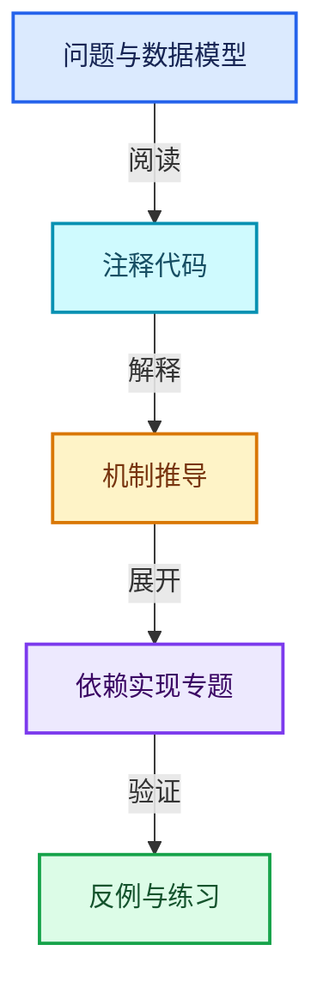
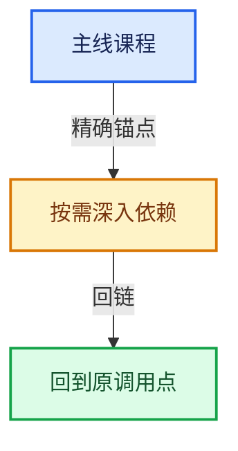

# 04-虚拟数组与索引选择

[总目录](../README.md) · [实现索引](../%E7%AC%A6%E5%8F%B7%E4%BE%9D%E8%B5%96%E4%B8%8E%E5%AE%9E%E7%8E%B0%E7%B4%A2%E5%BC%95.md)

## 主线课程

- [04-01 VArray表示与值语义](01-VArray%E8%A1%A8%E7%A4%BA%E4%B8%8E%E5%80%BC%E8%AF%AD%E4%B9%89.md)
- [04-02 VArrayImpl实现接口](02-VArrayImpl%E5%AE%9E%E7%8E%B0%E6%8E%A5%E5%8F%A3.md)
- [04-03 单值与Span表示](03-%E5%8D%95%E5%80%BC%E4%B8%8ESpan%E8%A1%A8%E7%A4%BA.md)
- [04-04 所有权与小对象优化](04-%E6%89%80%E6%9C%89%E6%9D%83%E4%B8%8E%E5%B0%8F%E5%AF%B9%E8%B1%A1%E4%BC%98%E5%8C%96.md)
- [04-05 GVArray运行时类型](05-GVArray%E8%BF%90%E8%A1%8C%E6%97%B6%E7%B1%BB%E5%9E%8B.md)
- [04-06 切片与物化](06-%E5%88%87%E7%89%87%E4%B8%8E%E7%89%A9%E5%8C%96.md)
- [04-07 去虚拟化与优化](07-%E5%8E%BB%E8%99%9A%E6%8B%9F%E5%8C%96%E4%B8%8E%E4%BC%98%E5%8C%96.md)
- [04-08 IndexMask总体表示](08-IndexMask%E6%80%BB%E4%BD%93%E8%A1%A8%E7%A4%BA.md)
- [04-09 分段存储与遍历](09-%E5%88%86%E6%AE%B5%E5%AD%98%E5%82%A8%E4%B8%8E%E9%81%8D%E5%8E%86.md)
- [04-10 IndexMask构建与并行](10-IndexMask%E6%9E%84%E5%BB%BA%E4%B8%8E%E5%B9%B6%E8%A1%8C.md)
- [04-11 集合表达式与运算](11-%E9%9B%86%E5%90%88%E8%A1%A8%E8%BE%BE%E5%BC%8F%E4%B8%8E%E8%BF%90%E7%AE%97.md)
- [04-12 重构历史与基准练习](12-%E9%87%8D%E6%9E%84%E5%8E%86%E5%8F%B2%E4%B8%8E%E5%9F%BA%E5%87%86%E7%BB%83%E4%B9%A0.md)

## 共享实现专题

- [source/blender/blenlib/BLI_generic_virtual_array.hh](%E4%BE%9D%E8%B5%96-BLI_generic_virtual_array-626a4a.md)
- [source/blender/blenlib/BLI_index_mask_expression.hh](%E4%BE%9D%E8%B5%96-BLI_index_mask_expression-5ed666.md)
- [source/blender/blenlib/BLI_virtual_array.hh](%E4%BE%9D%E8%B5%96-BLI_virtual_array-6ba937.md)
- [source/blender/blenlib/intern/index_mask_expression.cc](%E4%BE%9D%E8%B5%96-index_mask_expression-5c3c91.md)

