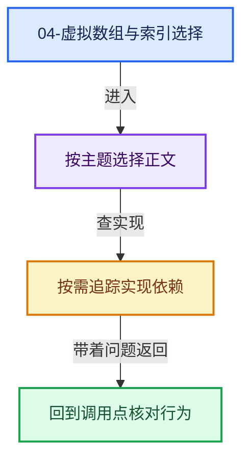
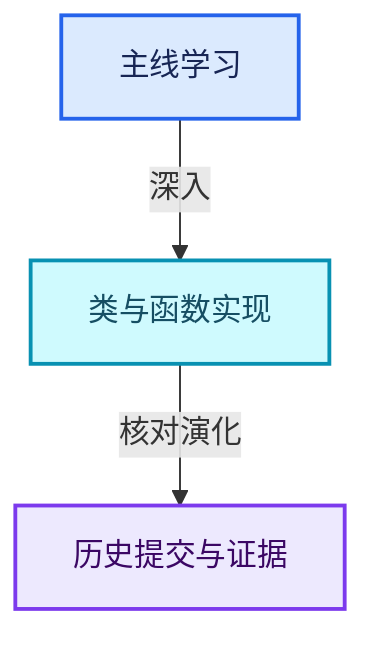

# 04-虚拟数组与索引选择

[总入口](../README.md) · [几何节点专题](../13-几何节点专题/README.md) · [实现依赖](../90-实现依赖专题/README.md)

## 阅读顺序

- [04-01 VArray表示与值语义](01-VArray表示与值语义.md)
- [04-02 VArrayImpl实现接口](02-VArrayImpl实现接口.md)
- [04-03 单值与Span表示](03-单值与Span表示.md)
- [04-04 所有权与小对象优化](04-所有权与小对象优化.md)
- [04-05 GVArray运行时类型](05-GVArray运行时类型.md)
- [04-06 切片与物化](06-切片与物化.md)
- [04-07 去虚拟化与优化](07-去虚拟化与优化.md)
- [04-08 IndexMask总体表示](08-IndexMask总体表示.md)
- [04-09 分段存储与遍历](09-分段存储与遍历.md)
- [04-10 IndexMask构建与并行](10-IndexMask构建与并行.md)
- [04-11 集合表达式与运算](11-集合表达式与运算.md)
- [04-12 重构历史与基准练习](12-重构历史与基准练习.md)

