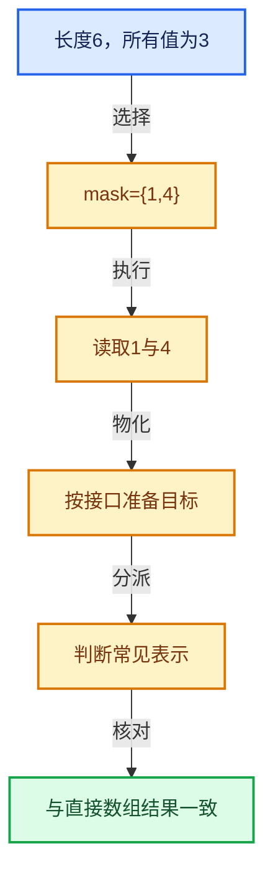

# 04-虚拟数组与索引选择

[总目录](../README.md)

表示与接口分离，元素编号与选择内部位置分离，生成成本与执行成本分离。

## 前置知识与阅读层次

- [01-基础容器与现代CPP](../01-%E5%9F%BA%E7%A1%80%E5%AE%B9%E5%99%A8%E4%B8%8E%E7%8E%B0%E4%BB%A3CPP/README.md)
- [03-内存分配与运行时类型](../03-%E5%86%85%E5%AD%98%E5%88%86%E9%85%8D%E4%B8%8E%E8%BF%90%E8%A1%8C%E6%97%B6%E7%B1%BB%E5%9E%8B/README.md)

初读抓住数据模型，复读逐行检查，再完成反例和独立实现。方向间允许按实际问题回查，不要求机械线性阅读。

## 正文与源码范围

| 顺序 | 文档 | 主讲文件与范围 |
|---|---|---|
| 04-01 | [VArray表示与值语义](01-VArray%E8%A1%A8%E7%A4%BA%E4%B8%8E%E5%80%BC%E8%AF%AD%E4%B9%89.md) | BLI_virtual_array.hh:L1—L306 |
| 04-02 | [VArrayImpl实现接口](02-VArrayImpl%E5%AE%9E%E7%8E%B0%E6%8E%A5%E5%8F%A3.md) | BLI_virtual_array.hh:L307—L606 |
| 04-03 | [单值与Span表示](03-%E5%8D%95%E5%80%BC%E4%B8%8ESpan%E8%A1%A8%E7%A4%BA.md) | BLI_virtual_array.hh:L607—L912 |
| 04-04 | [所有权与小对象优化](04-%E6%89%80%E6%9C%89%E6%9D%83%E4%B8%8E%E5%B0%8F%E5%AF%B9%E8%B1%A1%E4%BC%98%E5%8C%96.md) | BLI_virtual_array.hh:L913—L1219 |
| 04-05 | [GVArray运行时类型](05-GVArray%E8%BF%90%E8%A1%8C%E6%97%B6%E7%B1%BB%E5%9E%8B.md) | BLI_generic_virtual_array.hh:L1—L994；generic_virtual_array.cc:L1—L722 |
| 04-06 | [切片与物化](06-%E5%88%87%E7%89%87%E4%B8%8E%E7%89%A9%E5%8C%96.md) | virtual_array.cc:L1—L20；BLI_virtual_array_range_spans.hh:L1—L66 |
| 04-07 | [去虚拟化与优化](07-%E5%8E%BB%E8%99%9A%E6%8B%9F%E5%8C%96%E4%B8%8E%E4%BC%98%E5%8C%96.md) | BLI_devirtualize_parameters.hh:L1—L169 |
| 04-08 | [IndexMask总体表示](08-IndexMask%E6%80%BB%E4%BD%93%E8%A1%A8%E7%A4%BA.md) | BLI_index_mask.hh:L1—L437 |
| 04-09 | [分段存储与遍历](09-%E5%88%86%E6%AE%B5%E5%AD%98%E5%82%A8%E4%B8%8E%E9%81%8D%E5%8E%86.md) | BLI_index_mask.hh:L438—L887 |
| 04-10 | [IndexMask构建与并行](10-IndexMask%E6%9E%84%E5%BB%BA%E4%B8%8E%E5%B9%B6%E8%A1%8C.md) | index_mask.cc:L1—L1294 |
| 04-11 | [集合表达式与运算](11-%E9%9B%86%E5%90%88%E8%A1%A8%E8%BE%BE%E5%BC%8F%E4%B8%8E%E8%BF%90%E7%AE%97.md) | BLI_index_mask_expression.hh:L1—L98；index_mask_expression.cc:L1—L1351 |
| 04-12 | [重构历史与基准练习](12-%E9%87%8D%E6%9E%84%E5%8E%86%E5%8F%B2%E4%B8%8E%E5%9F%BA%E5%87%86%E7%BB%83%E4%B9%A0.md) | BLI_index_mask.hh:L888—L1315 |

## 本方向的数据模型

## 状态推演

## 历史入口

- [Geometry Nodes: refactor virtual array system](https://projects.blender.org/blender/blender/commit/d4c868da9f97a06c3457b8eafd344a23ed704874) · Jacques Lucke · 2021-11-16
- [Geometry Nodes: refactor array devirtualization](https://projects.blender.org/blender/blender/commit/ae94e36cfb2f3bc9a99b638782092d9c71d4b3c7) · Jacques Lucke · 2022-04-26
- [BLI: refactor IndexMask for better performance and memory usage](https://projects.blender.org/blender/blender/commit/2cfcb8b0b805401a0ffb252fd41750fadb0392ab) · Jacques Lucke · 2023-05-24
- [BLI: support set operations on index masks](https://projects.blender.org/blender/blender/commit/ee1fa8e1ca62506a6dd6fd5d053648569c672faf) · Jacques Lucke · 2024-03-17

## 跨库比较与验收

对比普通Span、标准ranges惰性视图和虚拟数组时，明确随机索引能力、批量物化、类型擦除和拥有关系；接口外观相近不代表同一抽象。

遍历结果按真实索引排序且无重复；单值、Span与计算表示在有效索引上返回一致语义。

正文和源码区间已建立；自动检查结果见根目录验收报告。阅读者的掌握程度以独立练习与反例推理为准。
