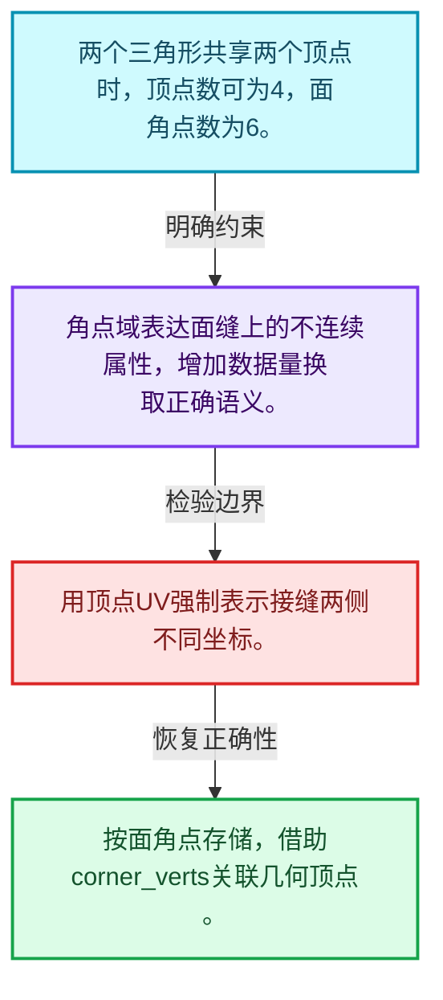
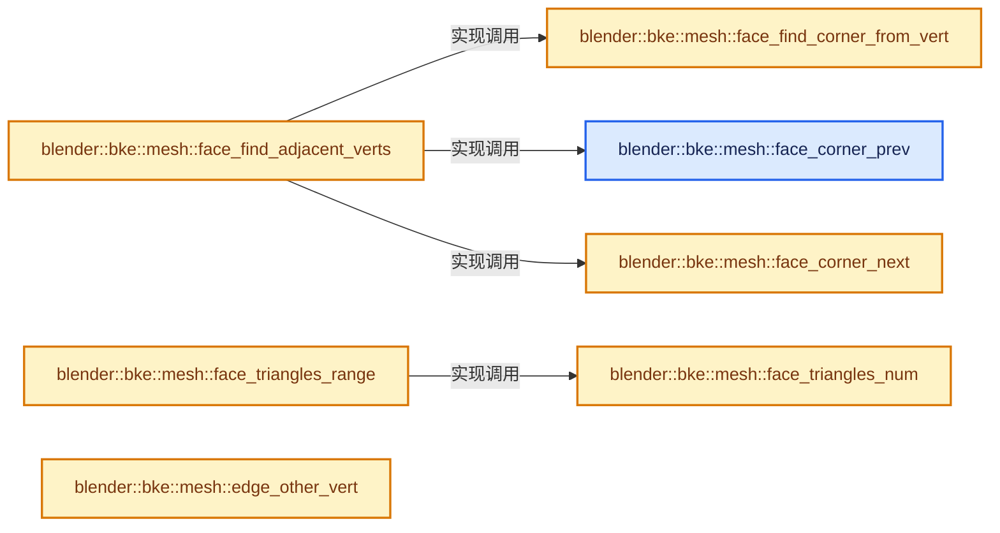
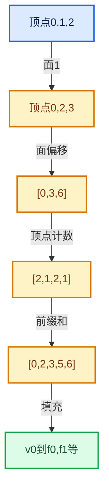

# 05-01 Mesh顶点边面角点

[方向导航](README.md) · [总目录](../README.md) · [实现索引](../00-课程指南/02-源码与提交索引/符号依赖与实现索引.md)

## 从问题到实现

顶点和面角点为什么属于不同属性域？

同一顶点可被多个面角点引用；UV等不连续数据需要角点域，不能按顶点数替代角点数。

**数据模型**

两个三角形共享两个顶点时，顶点数可为4，面角点数为6。

**设计取舍**

角点域表达面缝上的不连续属性，增加数据量换取正确语义。

**最小反例**

用顶点UV强制表示接缝两侧不同坐标。

**推导**

按面角点存储，借助corner_verts关联几何顶点。

## 阅读地图与执行推演








图中的数值推演是本方向的教学模型；实际函数之间的调用边与概念分析边分别标注，不能把概念关系当作运行时调度顺序。

## 完整源码单元与就地讲解

中文讲解直接放在相关代码旁，复杂机制在代码下展开。原文折叠区保留基准行号；不需要在行号表和函数之间来回查找。类布局可分段展示，函数实现不按固定行数切开。

### 类型布局、声明与编译条件 · BKE_mesh.hh L1—L305

<a id="t-f30c01e5b4fb"></a>

<a id="t-1b69a7460202"></a>

<a id="t-8ebc4589940f"></a>

<a id="t-0aed879995cb"></a>

<a id="t-0a24c7ed3ad1"></a>

<a id="t-5d550f37ce18"></a>

`CornerNormalSpace`在这里声明的数据成员：

- `float3 vec_lnor`
- `float3 vec_ref`
- `float3 vec_ortho`
- `float ref_alpha`
- `float ref_beta`

<a id="t-ea91c14a43c0"></a>

`CornerNormalSpaceArray`在这里声明的数据成员：

- `Vector<CornerNormalSpace> spaces`
- `Array<int> corner_space_indices`
- `Vector<Array<int>> corners_by_space`
- `bool create_corners_by_space`

<a id="t-37c805c50373"></a>

`NormalJoinInfo`在这里声明的数据成员：

- `Output result_type`
- `std::optional<bke::AttrDomain> result_domain`
- `void add_no_custom_normals`
- `void add_corner_fan_normals`
- `void add_domain`
- `void add_free_normals`
- `void add_mesh`

<a id="t-648a5c6d667e"></a>

<!-- annotated:cbd90b0cbf9933 -->

```cpp
/* SPDX-FileCopyrightText: 2023 Blender Authors
 *
 * SPDX-License-Identifier: GPL-2.0-or-later */

#pragma once

/** \file
 * \ingroup bke
 */

#include "BLI_index_mask_fwd.hh"
#include "BLI_math_matrix_types.hh"
#include "BLI_offset_indices.hh"
#include "BLI_string_ref.hh"

#include "BKE_mesh.h"         // IWYU pragma: export
#include "BKE_mesh_types.hh"  // IWYU pragma: export

namespace blender::bke {

enum class AttrDomain : int8_t;
enum class AttrType : int16_t;
struct AttributeMetaData;
struct AttributeAccessorFunctions;

struct AttributeFilter;

namespace mesh {
/* -------------------------------------------------------------------- */
/** \name Polygon Data Evaluation
 * \{ */

/** Calculate the up direction for the face, depending on its winding direction. */
float3 face_normal_calc(Span<float3> vert_positions, Span<int> face_verts);

void corner_tris_calc(Span<float3> vert_positions,
                      OffsetIndices<int> faces,
                      Span<int> corner_verts,
                      MutableSpan<int3> corner_tris);

/**
 * A version of #corner_tris_calc which takes pre-calculated face normals
 * (used to avoid having to calculate the face normal for NGON tessellation).
 *
 * \note Only use this function if normals have already been calculated, there is no need
 * to calculate normals just to use this function.
 */
void corner_tris_calc_with_normals(Span<float3> vert_positions,
                                   OffsetIndices<int> faces,
                                   Span<int> corner_verts,
                                   Span<float3> face_normals,
                                   MutableSpan<int3> corner_tris);

void corner_tris_calc_face_indices(OffsetIndices<int> faces, MutableSpan<int> tri_faces);

/**
 * Convert triangles encoded as face corner indices to triangles encoded as vertex indices.
 */
void vert_tris_from_corner_tris(Span<int> corner_verts,
                                Span<int3> corner_tris,
                                MutableSpan<int3> vert_tris);

/** Return the triangle's three edge indices if they are real edges, otherwise -1. */
int3 corner_tri_get_real_edges(Span<int2> edges,
                               Span<int> corner_verts,
                               Span<int> corner_edges,
                               const int3 &corner_tri);

/** Calculate the average position of the vertices in the face. */
float3 face_center_calc(Span<float3> vert_positions, Span<int> face_verts);

/** Calculate the surface area of the face described by the indexed vertices. */
float face_area_calc(Span<float3> vert_positions, Span<int> face_verts);

/** Calculate the angles at each of the faces corners. */
void face_angles_calc(Span<float3> vert_positions,
                      Span<int> face_verts,
                      MutableSpan<float> angles);

/** \} */

/* -------------------------------------------------------------------- */
/** \name Medium-Level Normals Calculation
 * \{ */

/**
 * Calculate face normals directly into a result array.
 *
 * \note Usually #Mesh::face_normals() is the preferred way to access face normals,
 * since they may already be calculated and cached on the mesh.
 */
void normals_calc_faces(Span<float3> vert_positions,
                        OffsetIndices<int> faces,
                        Span<int> corner_verts,
                        MutableSpan<float3> face_normals);

/**
 * Calculate vertex normals directly into the result array.
 *
 * \note Vertex and face normals can be calculated at the same time with
 * #normals_calc_faces_and_verts, which can have performance benefits in some cases.
 *
 * \note Usually #Mesh::vert_normals() is the preferred way to access vertex normals,
 * since they may already be calculated and cached on the mesh.
 */
void normals_calc_verts(Span<float3> vert_positions,
                        OffsetIndices<int> faces,
                        Span<int> corner_verts,
                        GroupedSpan<int> vert_to_face_map,
                        Span<float3> face_normals,
                        MutableSpan<float3> vert_normals);

/** \} */

/* -------------------------------------------------------------------- */
/** \name Face Corner Normal Calculation
 * \{ */

/**
 * Combined with the automatically calculated face corner normal, this gives a dimensional
 * coordinate space used to convert normals between the "custom normal" #short2 representation and
 * a regular #float3 format.
 */
struct CornerNormalSpace {
  /** The automatically computed face corner normal, not including influence of custom normals. */
  float3 vec_lnor;
  /**
   * Reference vector, orthogonal to #vec_lnor, aligned with one of the edges (borders) of the
   * smooth fan, called 'reference edge'.
   */
  float3 vec_ref;
  /** Third vector, orthogonal to #vec_lnor and #vec_ref. */
  float3 vec_ortho;
  /**
   * Reference angle around #vec_ortho, in (0, pi] range, between #vec_lnor and the reference edge.
   *
   * A 0.0 value marks that space as invalid, as it can only happen in extremely degenerate
   * geometry cases (it would mean that the default normal is perfectly aligned with the reference
   * edge).
   */
  float ref_alpha;
  /**
   * Reference angle around #vec_lnor, in (0, 2pi] range, between the reference edge and the other
   * border edge of the fan.
   *
   * A 0.0 value marks that space as invalid, as it can only happen in degenerate geometry cases
   * (it would mean that all the edges connected to that corner of the smooth fan are perfectly
   * aligned).
   */
  float ref_beta;
};

/**
 * Storage for corner fan coordinate spaces for an entire mesh.
 * For performance reason the distribution of #spaces and index mapping of them in
 * #corner_space_indices are non-deterministic.
 */
struct CornerNormalSpaceArray {
  /**
   * The normal coordinate spaces, potentially shared between multiple face corners in a smooth fan
   * connected to a vertex (and not per face corner). Depending on the mesh (the amount of sharing
   * / number of sharp edges / size of each fan), there may be many fewer spaces than face corners,
   * so they are stored in a separate vector.
   */
  Vector<CornerNormalSpace> spaces;

  /**
   * The index of the data in the #spaces array for each face corner (the array size is the
   * same as #Mesh::corners_num). Rare -1 values define face corners without a coordinate space.
   */
  Array<int> corner_space_indices;

  /**
   * A map containing the face corners that make up each space,
   * in the order that they were processed (winding around a vertex).
   */
  Vector<Array<int>> corners_by_space;
  /** Whether to create the above map when calculating normals. */
  bool create_corners_by_space = false;
};

short2 corner_space_custom_normal_to_data(const CornerNormalSpace &lnor_space,
                                          const float3 &custom_lnor);

/**
 * Compute custom normals, i.e. vertex normals associated with each face. Used to visualize sharp
 * edges (or non-smooth faces) without actually modifying the geometry (splitting edges).
 *
 * \param sharp_edges: Optional array of sharp edge tags, used to split the evaluated normals on
 * each side of the edge.
 * \param sharp_faces: Optional array of sharp face tags, used to split the evaluated normals on
 * the face's edges.
 * \param r_fan_spaces: Optional return data filled with information about the custom
 * normals spaces for each grouped fan of face corners.
 */
void normals_calc_corners(Span<float3> vert_positions,
                          OffsetIndices<int> faces,
                          Span<int> corner_verts,
                          Span<int> corner_edges,
                          GroupedSpan<int> vert_to_face_map,
                          Span<float3> face_normals,
                          Span<bool> sharp_edges,
                          Span<bool> sharp_faces,
                          Span<short2> custom_normals,
                          CornerNormalSpaceArray *r_fan_spaces,
                          MutableSpan<float3> r_corner_normals);

/**
 * \param sharp_faces: Optional array used to mark specific faces for sharp shading.
 */
void normals_corner_custom_set(Span<float3> vert_positions,
                               OffsetIndices<int> faces,
                               Span<int> corner_verts,
                               Span<int> corner_edges,
                               GroupedSpan<int> vert_to_face_map,
                               Span<float3> vert_normals,
                               Span<float3> face_normals,
                               Span<bool> sharp_faces,
                               MutableSpan<bool> sharp_edges,
                               MutableSpan<float3> r_custom_corner_normals,
                               MutableSpan<short2> r_clnors_data);

/**
 * \param sharp_faces: Optional array used to mark specific faces for sharp shading.
 */
void normals_corner_custom_set_from_verts(Span<float3> vert_positions,
                                          OffsetIndices<int> faces,
                                          Span<int> corner_verts,
                                          Span<int> corner_edges,
                                          GroupedSpan<int> vert_to_face_map,
                                          Span<float3> vert_normals,
                                          Span<float3> face_normals,
                                          Span<bool> sharp_faces,
                                          MutableSpan<bool> sharp_edges,
                                          MutableSpan<float3> r_custom_vert_normals,
                                          MutableSpan<short2> r_clnors_data);

/**
 * Define sharp edges as needed to mimic "auto-smooth" from angle threshold.
 *
 * Used when defining an empty custom corner normals data layer,
 * to keep same shading as with auto-smooth!
 *
 * \param sharp_faces: Optional array used to mark specific faces for sharp shading.
 */
void edges_sharp_from_angle_set(OffsetIndices<int> faces,
                                Span<int> corner_verts,
                                Span<int> corner_edges,
                                Span<float3> face_normals,
                                Span<int> corner_to_face,
                                Span<bool> sharp_faces,
                                const float split_angle,
                                MutableSpan<bool> sharp_edges);

/** Return true if the type and domain represent the tangent-space custom normals storage. */
bool is_corner_fan_normals(const AttributeMetaData &meta_data);

/** Tracks the storage format for a resulting mesh based on a combination of input meshes. */
class NormalJoinInfo {
 public:
  enum class Output : int8_t { None, CornerFan, Free };
  Output result_type = Output::None;
  std::optional<bke::AttrDomain> result_domain;

  void add_no_custom_normals(bke::MeshNormalDomain domain);
  void add_corner_fan_normals();
  void add_domain(bke::AttrDomain domain);
  void add_free_normals(bke::AttrDomain domain);
  void add_mesh(const Mesh &mesh);
};

}  // namespace mesh

/**
 * Higher level functions hiding most of the code needed around call to
 * #normals_corner_custom_set().
 *
 * \param corner_normals: Is mutable because zero vectors are replaced with automatically
 * computed normals.
 */
void mesh_set_custom_normals(Mesh &mesh, MutableSpan<float3> corner_normals);
void mesh_set_custom_normals_normalized(Mesh &mesh, MutableSpan<float3> corner_normals);

/**
 * Higher level functions hiding most of the code needed around call to
 * #normals_corner_custom_set_from_verts().
 *
 * \param vert_normals: Is mutable because zero vectors are replaced with automatically
 * computed normals.
 */
void mesh_set_custom_normals_from_verts(Mesh &mesh, MutableSpan<float3> vert_normals);
void mesh_set_custom_normals_from_verts_normalized(Mesh &mesh, MutableSpan<float3> vert_normals);

/** \} */

/* -------------------------------------------------------------------- */
/** \name Topology Queries
 * \{ */

namespace mesh {

/**
 * Find the index of the previous corner in the face, looping to the end if necessary.
 * The indices are into the entire corners array, not just the face's corners.
 */
```

<details>
<summary>核对原始源码：source/blender/blenkernel/BKE_mesh.hh · L1—L305</summary>

<!-- original:cbd90b0cbf9933:source/blender/blenkernel/BKE_mesh.hh:1:305 -->

```cpp
/* SPDX-FileCopyrightText: 2023 Blender Authors
 *
 * SPDX-License-Identifier: GPL-2.0-or-later */

#pragma once

/** \file
 * \ingroup bke
 */

#include "BLI_index_mask_fwd.hh"
#include "BLI_math_matrix_types.hh"
#include "BLI_offset_indices.hh"
#include "BLI_string_ref.hh"

#include "BKE_mesh.h"         // IWYU pragma: export
#include "BKE_mesh_types.hh"  // IWYU pragma: export

namespace blender::bke {

enum class AttrDomain : int8_t;
enum class AttrType : int16_t;
struct AttributeMetaData;
struct AttributeAccessorFunctions;

struct AttributeFilter;

namespace mesh {
/* -------------------------------------------------------------------- */
/** \name Polygon Data Evaluation
 * \{ */

/** Calculate the up direction for the face, depending on its winding direction. */
float3 face_normal_calc(Span<float3> vert_positions, Span<int> face_verts);

void corner_tris_calc(Span<float3> vert_positions,
                      OffsetIndices<int> faces,
                      Span<int> corner_verts,
                      MutableSpan<int3> corner_tris);

/**
 * A version of #corner_tris_calc which takes pre-calculated face normals
 * (used to avoid having to calculate the face normal for NGON tessellation).
 *
 * \note Only use this function if normals have already been calculated, there is no need
 * to calculate normals just to use this function.
 */
void corner_tris_calc_with_normals(Span<float3> vert_positions,
                                   OffsetIndices<int> faces,
                                   Span<int> corner_verts,
                                   Span<float3> face_normals,
                                   MutableSpan<int3> corner_tris);

void corner_tris_calc_face_indices(OffsetIndices<int> faces, MutableSpan<int> tri_faces);

/**
 * Convert triangles encoded as face corner indices to triangles encoded as vertex indices.
 */
void vert_tris_from_corner_tris(Span<int> corner_verts,
                                Span<int3> corner_tris,
                                MutableSpan<int3> vert_tris);

/** Return the triangle's three edge indices if they are real edges, otherwise -1. */
int3 corner_tri_get_real_edges(Span<int2> edges,
                               Span<int> corner_verts,
                               Span<int> corner_edges,
                               const int3 &corner_tri);

/** Calculate the average position of the vertices in the face. */
float3 face_center_calc(Span<float3> vert_positions, Span<int> face_verts);

/** Calculate the surface area of the face described by the indexed vertices. */
float face_area_calc(Span<float3> vert_positions, Span<int> face_verts);

/** Calculate the angles at each of the faces corners. */
void face_angles_calc(Span<float3> vert_positions,
                      Span<int> face_verts,
                      MutableSpan<float> angles);

/** \} */

/* -------------------------------------------------------------------- */
/** \name Medium-Level Normals Calculation
 * \{ */

/**
 * Calculate face normals directly into a result array.
 *
 * \note Usually #Mesh::face_normals() is the preferred way to access face normals,
 * since they may already be calculated and cached on the mesh.
 */
void normals_calc_faces(Span<float3> vert_positions,
                        OffsetIndices<int> faces,
                        Span<int> corner_verts,
                        MutableSpan<float3> face_normals);

/**
 * Calculate vertex normals directly into the result array.
 *
 * \note Vertex and face normals can be calculated at the same time with
 * #normals_calc_faces_and_verts, which can have performance benefits in some cases.
 *
 * \note Usually #Mesh::vert_normals() is the preferred way to access vertex normals,
 * since they may already be calculated and cached on the mesh.
 */
void normals_calc_verts(Span<float3> vert_positions,
                        OffsetIndices<int> faces,
                        Span<int> corner_verts,
                        GroupedSpan<int> vert_to_face_map,
                        Span<float3> face_normals,
                        MutableSpan<float3> vert_normals);

/** \} */

/* -------------------------------------------------------------------- */
/** \name Face Corner Normal Calculation
 * \{ */

/**
 * Combined with the automatically calculated face corner normal, this gives a dimensional
 * coordinate space used to convert normals between the "custom normal" #short2 representation and
 * a regular #float3 format.
 */
struct CornerNormalSpace {
  /** The automatically computed face corner normal, not including influence of custom normals. */
  float3 vec_lnor;
  /**
   * Reference vector, orthogonal to #vec_lnor, aligned with one of the edges (borders) of the
   * smooth fan, called 'reference edge'.
   */
  float3 vec_ref;
  /** Third vector, orthogonal to #vec_lnor and #vec_ref. */
  float3 vec_ortho;
  /**
   * Reference angle around #vec_ortho, in (0, pi] range, between #vec_lnor and the reference edge.
   *
   * A 0.0 value marks that space as invalid, as it can only happen in extremely degenerate
   * geometry cases (it would mean that the default normal is perfectly aligned with the reference
   * edge).
   */
  float ref_alpha;
  /**
   * Reference angle around #vec_lnor, in (0, 2pi] range, between the reference edge and the other
   * border edge of the fan.
   *
   * A 0.0 value marks that space as invalid, as it can only happen in degenerate geometry cases
   * (it would mean that all the edges connected to that corner of the smooth fan are perfectly
   * aligned).
   */
  float ref_beta;
};

/**
 * Storage for corner fan coordinate spaces for an entire mesh.
 * For performance reason the distribution of #spaces and index mapping of them in
 * #corner_space_indices are non-deterministic.
 */
struct CornerNormalSpaceArray {
  /**
   * The normal coordinate spaces, potentially shared between multiple face corners in a smooth fan
   * connected to a vertex (and not per face corner). Depending on the mesh (the amount of sharing
   * / number of sharp edges / size of each fan), there may be many fewer spaces than face corners,
   * so they are stored in a separate vector.
   */
  Vector<CornerNormalSpace> spaces;

  /**
   * The index of the data in the #spaces array for each face corner (the array size is the
   * same as #Mesh::corners_num). Rare -1 values define face corners without a coordinate space.
   */
  Array<int> corner_space_indices;

  /**
   * A map containing the face corners that make up each space,
   * in the order that they were processed (winding around a vertex).
   */
  Vector<Array<int>> corners_by_space;
  /** Whether to create the above map when calculating normals. */
  bool create_corners_by_space = false;
};

short2 corner_space_custom_normal_to_data(const CornerNormalSpace &lnor_space,
                                          const float3 &custom_lnor);

/**
 * Compute custom normals, i.e. vertex normals associated with each face. Used to visualize sharp
 * edges (or non-smooth faces) without actually modifying the geometry (splitting edges).
 *
 * \param sharp_edges: Optional array of sharp edge tags, used to split the evaluated normals on
 * each side of the edge.
 * \param sharp_faces: Optional array of sharp face tags, used to split the evaluated normals on
 * the face's edges.
 * \param r_fan_spaces: Optional return data filled with information about the custom
 * normals spaces for each grouped fan of face corners.
 */
void normals_calc_corners(Span<float3> vert_positions,
                          OffsetIndices<int> faces,
                          Span<int> corner_verts,
                          Span<int> corner_edges,
                          GroupedSpan<int> vert_to_face_map,
                          Span<float3> face_normals,
                          Span<bool> sharp_edges,
                          Span<bool> sharp_faces,
                          Span<short2> custom_normals,
                          CornerNormalSpaceArray *r_fan_spaces,
                          MutableSpan<float3> r_corner_normals);

/**
 * \param sharp_faces: Optional array used to mark specific faces for sharp shading.
 */
void normals_corner_custom_set(Span<float3> vert_positions,
                               OffsetIndices<int> faces,
                               Span<int> corner_verts,
                               Span<int> corner_edges,
                               GroupedSpan<int> vert_to_face_map,
                               Span<float3> vert_normals,
                               Span<float3> face_normals,
                               Span<bool> sharp_faces,
                               MutableSpan<bool> sharp_edges,
                               MutableSpan<float3> r_custom_corner_normals,
                               MutableSpan<short2> r_clnors_data);

/**
 * \param sharp_faces: Optional array used to mark specific faces for sharp shading.
 */
void normals_corner_custom_set_from_verts(Span<float3> vert_positions,
                                          OffsetIndices<int> faces,
                                          Span<int> corner_verts,
                                          Span<int> corner_edges,
                                          GroupedSpan<int> vert_to_face_map,
                                          Span<float3> vert_normals,
                                          Span<float3> face_normals,
                                          Span<bool> sharp_faces,
                                          MutableSpan<bool> sharp_edges,
                                          MutableSpan<float3> r_custom_vert_normals,
                                          MutableSpan<short2> r_clnors_data);

/**
 * Define sharp edges as needed to mimic "auto-smooth" from angle threshold.
 *
 * Used when defining an empty custom corner normals data layer,
 * to keep same shading as with auto-smooth!
 *
 * \param sharp_faces: Optional array used to mark specific faces for sharp shading.
 */
void edges_sharp_from_angle_set(OffsetIndices<int> faces,
                                Span<int> corner_verts,
                                Span<int> corner_edges,
                                Span<float3> face_normals,
                                Span<int> corner_to_face,
                                Span<bool> sharp_faces,
                                const float split_angle,
                                MutableSpan<bool> sharp_edges);

/** Return true if the type and domain represent the tangent-space custom normals storage. */
bool is_corner_fan_normals(const AttributeMetaData &meta_data);

/** Tracks the storage format for a resulting mesh based on a combination of input meshes. */
class NormalJoinInfo {
 public:
  enum class Output : int8_t { None, CornerFan, Free };
  Output result_type = Output::None;
  std::optional<bke::AttrDomain> result_domain;

  void add_no_custom_normals(bke::MeshNormalDomain domain);
  void add_corner_fan_normals();
  void add_domain(bke::AttrDomain domain);
  void add_free_normals(bke::AttrDomain domain);
  void add_mesh(const Mesh &mesh);
};

}  // namespace mesh

/**
 * Higher level functions hiding most of the code needed around call to
 * #normals_corner_custom_set().
 *
 * \param corner_normals: Is mutable because zero vectors are replaced with automatically
 * computed normals.
 */
void mesh_set_custom_normals(Mesh &mesh, MutableSpan<float3> corner_normals);
void mesh_set_custom_normals_normalized(Mesh &mesh, MutableSpan<float3> corner_normals);

/**
 * Higher level functions hiding most of the code needed around call to
 * #normals_corner_custom_set_from_verts().
 *
 * \param vert_normals: Is mutable because zero vectors are replaced with automatically
 * computed normals.
 */
void mesh_set_custom_normals_from_verts(Mesh &mesh, MutableSpan<float3> vert_normals);
void mesh_set_custom_normals_from_verts_normalized(Mesh &mesh, MutableSpan<float3> vert_normals);

/** \} */

/* -------------------------------------------------------------------- */
/** \name Topology Queries
 * \{ */

namespace mesh {

/**
 * Find the index of the previous corner in the face, looping to the end if necessary.
 * The indices are into the entire corners array, not just the face's corners.
 */
```

</details>

<a id="f-7d8f15af3216c9f5"></a>

### `blender::bke::mesh::face_corner_prev`

实现位置：[source/blender/blenkernel/BKE_mesh.hh](../../../../../source/blender/blenkernel/BKE_mesh.hh) · L306—L309。

接口参数：

- `const IndexRange face`
- `const int corner`

**教学注释版**

<!-- annotated:a28e79eb5bf17e -->

```cpp
inline int face_corner_prev(const IndexRange face, const int corner)
{
  // [讲解] face.start：读取连续区间或分组的边界信息。
  return corner - 1 + (corner == face.start()) * face.size();
}
```

<details>
<summary>核对原始源码：source/blender/blenkernel/BKE_mesh.hh · L306—L309</summary>

<!-- original:a28e79eb5bf17e:source/blender/blenkernel/BKE_mesh.hh:306:309 -->

```cpp
inline int face_corner_prev(const IndexRange face, const int corner)
{
  return corner - 1 + (corner == face.start()) * face.size();
}
```

</details>

**结果出口**

- `return corner - 1 + (corner == face.start()) * face.size();`

**继续追踪实现**

- `face.start` → [blender::IndexRange::start · L243](../01-基础容器与现代CPP/04-IndexRange连续整数区间.md#f-99d2195bd9cfd1f0)。
- `face.size` → [blender::IndexRange::size · L156](../01-基础容器与现代CPP/04-IndexRange连续整数区间.md#f-05f66c3ebb2fdfec)。

### 类型布局、声明与编译条件 · BKE_mesh.hh L310—L314

<!-- annotated:f59327631d1364 -->

```cpp

/**
 * Find the index of the next corner in the face, looping to the start if necessary.
 * The indices are into the entire corners array, not just the face's corners.
 */
```

<details>
<summary>核对原始源码：source/blender/blenkernel/BKE_mesh.hh · L310—L314</summary>

<!-- original:f59327631d1364:source/blender/blenkernel/BKE_mesh.hh:310:314 -->

```cpp

/**
 * Find the index of the next corner in the face, looping to the start if necessary.
 * The indices are into the entire corners array, not just the face's corners.
 */
```

</details>

<a id="f-bf639df87b51fe48"></a>

### `blender::bke::mesh::face_corner_next`

实现位置：[source/blender/blenkernel/BKE_mesh.hh](../../../../../source/blender/blenkernel/BKE_mesh.hh) · L315—L321。

接口参数：

- `const IndexRange face`
- `const int corner`

**教学注释版**

<!-- annotated:20720503d6c068 -->

```cpp
inline int face_corner_next(const IndexRange face, const int corner)
{
  // [讲解] face.last：读取范围两端的有效索引或值。
  if (corner == face.last()) {
    // [讲解] face.start：读取连续区间或分组的边界信息。
    return face.start();
  }
  return corner + 1;
}
```

<details>
<summary>核对原始源码：source/blender/blenkernel/BKE_mesh.hh · L315—L321</summary>

<!-- original:20720503d6c068:source/blender/blenkernel/BKE_mesh.hh:315:321 -->

```cpp
inline int face_corner_next(const IndexRange face, const int corner)
{
  if (corner == face.last()) {
    return face.start();
  }
  return corner + 1;
}
```

</details>

**结果出口**

- `return face.start();`
- `return corner + 1;`

**继续追踪实现**

- `face.last` → [blender::IndexRange::last · L214](../01-基础容器与现代CPP/04-IndexRange连续整数区间.md#f-66896c6351a40de1)；[blender::gpu::shader::parser::IndexRange::last · L62](../90-实现依赖专题/08-其他Blender模块/gpu/shader_tool/utils.hh.md#f-373501206569c3b3)。同名重载需按实参类型选择。
- `face.start` → [blender::IndexRange::start · L243](../01-基础容器与现代CPP/04-IndexRange连续整数区间.md#f-99d2195bd9cfd1f0)。

### 类型布局、声明与编译条件 · BKE_mesh.hh L322—L326

<!-- annotated:8f3e40b22bc867 -->

```cpp

/**
 * Find the index of the corner in the face that uses the given vertex.
 * The index is into the entire corners array, not just the face's corners.
 */
```

<details>
<summary>核对原始源码：source/blender/blenkernel/BKE_mesh.hh · L322—L326</summary>

<!-- original:8f3e40b22bc867:source/blender/blenkernel/BKE_mesh.hh:322:326 -->

```cpp

/**
 * Find the index of the corner in the face that uses the given vertex.
 * The index is into the entire corners array, not just the face's corners.
 */
```

</details>

<a id="f-6d7f1e04f4b052aa"></a>

### `blender::bke::mesh::face_find_corner_from_vert`

实现位置：[source/blender/blenkernel/BKE_mesh.hh](../../../../../source/blender/blenkernel/BKE_mesh.hh) · L327—L332。

接口参数：

- `const IndexRange face`
- `const Span<int> corner_verts`
- `const int vert`

**教学注释版**

<!-- annotated:5f5f8d74471743 -->

```cpp
inline int face_find_corner_from_vert(const IndexRange face,
                                      const Span<int> corner_verts,
                                      const int vert)
{
  // [讲解] corner_verts.slice：建立原连续范围的子视图。
  return face[corner_verts.slice(face).first_index(vert)];
}
```

<details>
<summary>核对原始源码：source/blender/blenkernel/BKE_mesh.hh · L327—L332</summary>

<!-- original:5f5f8d74471743:source/blender/blenkernel/BKE_mesh.hh:327:332 -->

```cpp
inline int face_find_corner_from_vert(const IndexRange face,
                                      const Span<int> corner_verts,
                                      const int vert)
{
  return face[corner_verts.slice(face).first_index(vert)];
}
```

</details>

**结果出口**

- `return face[corner_verts.slice(face).first_index(vert)];`

**继续追踪实现**

- `corner_verts.slice(face).first_index` → [调用协议](../00-课程指南/01-路线与规范/模板宏与动态分派协议.md)：接收对象类型依赖auto、返回值或模板实例；不按同名猜测目标。调用位置L331。
- `corner_verts.slice` → [blender::Span::slice · L141](../01-基础容器与现代CPP/05-Span只读连续视图.md#f-380a0e8fdcbd53cc)；[blender::Span::slice · L149](../01-基础容器与现代CPP/05-Span只读连续视图.md#f-9b9c15e78dd54eec)。同名重载需按实参类型选择。

### 类型布局、声明与编译条件 · BKE_mesh.hh L333—L337

<!-- annotated:a807f2ee3f38b2 -->

```cpp

/**
 * Return the vertex indices on either side of the given vertex, ordered based on the winding
 * direction of the face. The vertex must be in the face.
 */
```

<details>
<summary>核对原始源码：source/blender/blenkernel/BKE_mesh.hh · L333—L337</summary>

<!-- original:a807f2ee3f38b2:source/blender/blenkernel/BKE_mesh.hh:333:337 -->

```cpp

/**
 * Return the vertex indices on either side of the given vertex, ordered based on the winding
 * direction of the face. The vertex must be in the face.
 */
```

</details>

<a id="f-2c11a0178b78bf97"></a>

### `blender::bke::mesh::face_find_adjacent_verts`

实现位置：[source/blender/blenkernel/BKE_mesh.hh](../../../../../source/blender/blenkernel/BKE_mesh.hh) · L338—L345。

接口参数：

- `const IndexRange face`
- `const Span<int> corner_verts`
- `const int vert`

**教学注释版**

<!-- annotated:cdcadae0f7262c -->

```cpp
inline int2 face_find_adjacent_verts(const IndexRange face,
                                     const Span<int> corner_verts,
                                     const int vert)
{
  const int corner = face_find_corner_from_vert(face, corner_verts, vert);
  return {corner_verts[face_corner_prev(face, corner)],
          corner_verts[face_corner_next(face, corner)]};
}
```

<details>
<summary>核对原始源码：source/blender/blenkernel/BKE_mesh.hh · L338—L345</summary>

<!-- original:cdcadae0f7262c:source/blender/blenkernel/BKE_mesh.hh:338:345 -->

```cpp
inline int2 face_find_adjacent_verts(const IndexRange face,
                                     const Span<int> corner_verts,
                                     const int vert)
{
  const int corner = face_find_corner_from_vert(face, corner_verts, vert);
  return {corner_verts[face_corner_prev(face, corner)],
          corner_verts[face_corner_next(face, corner)]};
}
```

</details>

**结果出口**

- `return {corner_verts[face_corner_prev(face, corner)],`

**继续追踪实现**

- `face_find_corner_from_vert` → [blender::bke::mesh::face_find_corner_from_vert · L327](01-Mesh顶点边面角点.md#f-6d7f1e04f4b052aa)。
- `face_corner_prev` → [blender::bke::mesh::face_corner_prev · L306](01-Mesh顶点边面角点.md#f-7d8f15af3216c9f5)。
- `face_corner_next` → [blender::bke::mesh::face_corner_next · L315](01-Mesh顶点边面角点.md#f-bf639df87b51fe48)。

### 类型布局、声明与编译条件 · BKE_mesh.hh L346—L349

<!-- annotated:488044b1f16738 -->

```cpp

/**
 * Return the number of triangles needed to tessellate a face with \a face_size corners.
 */
```

<details>
<summary>核对原始源码：source/blender/blenkernel/BKE_mesh.hh · L346—L349</summary>

<!-- original:488044b1f16738:source/blender/blenkernel/BKE_mesh.hh:346:349 -->

```cpp

/**
 * Return the number of triangles needed to tessellate a face with \a face_size corners.
 */
```

</details>

<a id="f-720b4d927730b800"></a>

### `blender::bke::mesh::face_triangles_num`

实现位置：[source/blender/blenkernel/BKE_mesh.hh](../../../../../source/blender/blenkernel/BKE_mesh.hh) · L350—L354。

接口参数：

- `const int face_size`

**教学注释版**

<!-- annotated:6e95e729aab174 -->

```cpp
inline int face_triangles_num(const int face_size)
{
  BLI_assert(face_size > 2);
  return face_size - 2;
}
```

<details>
<summary>核对原始源码：source/blender/blenkernel/BKE_mesh.hh · L350—L354</summary>

<!-- original:6e95e729aab174:source/blender/blenkernel/BKE_mesh.hh:350:354 -->

```cpp
inline int face_triangles_num(const int face_size)
{
  BLI_assert(face_size > 2);
  return face_size - 2;
}
```

</details>

**结果出口**

- `return face_size - 2;`

**继续追踪实现**

- `BLI_assert` → [BLI_assert · L48](../90-实现依赖专题/01-BLI基础库/BLI_assert.hh.md#m-57a88495704d)；[BLI_assert · L63](../90-实现依赖专题/01-BLI基础库/BLI_assert.hh.md#m-d07050020cb5)。宏定义由构建条件选择。

### 类型布局、声明与编译条件 · BKE_mesh.hh L355—L358

<!-- annotated:a8914087aa3e6e -->

```cpp

/**
 * Return the range of triangles that belong to the given face.
 */
```

<details>
<summary>核对原始源码：source/blender/blenkernel/BKE_mesh.hh · L355—L358</summary>

<!-- original:a8914087aa3e6e:source/blender/blenkernel/BKE_mesh.hh:355:358 -->

```cpp

/**
 * Return the range of triangles that belong to the given face.
 */
```

</details>

<a id="f-029966d2ab83c686"></a>

### `blender::bke::mesh::face_triangles_range`

实现位置：[source/blender/blenkernel/BKE_mesh.hh](../../../../../source/blender/blenkernel/BKE_mesh.hh) · L359—L365。

接口参数：

- `OffsetIndices<int> faces`
- `int face_i`

**教学注释版**

<!-- annotated:aaed058169a334 -->

```cpp
inline IndexRange face_triangles_range(OffsetIndices<int> faces, int face_i)
{
  const IndexRange face = faces[face_i];
  /* This is the same as #poly_to_tri_count which is not included here. */
  // [讲解] face.start：读取连续区间或分组的边界信息。
  const int start_triangle = face.start() - face_i * 2;
  // [讲解] face.size：读取连续区间或分组的边界信息。
  return IndexRange(start_triangle, face_triangles_num(face.size()));
}
```

<details>
<summary>核对原始源码：source/blender/blenkernel/BKE_mesh.hh · L359—L365</summary>

<!-- original:aaed058169a334:source/blender/blenkernel/BKE_mesh.hh:359:365 -->

```cpp
inline IndexRange face_triangles_range(OffsetIndices<int> faces, int face_i)
{
  const IndexRange face = faces[face_i];
  /* This is the same as #poly_to_tri_count which is not included here. */
  const int start_triangle = face.start() - face_i * 2;
  return IndexRange(start_triangle, face_triangles_num(face.size()));
}
```

</details>

**结果出口**

- `return IndexRange(start_triangle, face_triangles_num(face.size()));`

**继续追踪实现**

- `face.start` → [blender::IndexRange::start · L243](../01-基础容器与现代CPP/04-IndexRange连续整数区间.md#f-99d2195bd9cfd1f0)。
- `IndexRange` → [blender::IndexRange](../90-实现依赖专题/01-BLI基础库/BLI_index_range.hh.md#t-caa3466d6776)；[blender::gpu::shader::parser::IndexRange](../90-实现依赖专题/08-其他Blender模块/gpu/shader_tool/utils.hh.md#t-82d2bd4ea71c)；[blender::IndexRange](../90-实现依赖专题/08-其他Blender模块/makesdna/DNA_node_types.h.md#t-0448cc889d39)。
- `face_triangles_num` → [blender::bke::mesh::face_triangles_num · L350](01-Mesh顶点边面角点.md#f-720b4d927730b800)。
- `face.size` → [blender::IndexRange::size · L156](../01-基础容器与现代CPP/04-IndexRange连续整数区间.md#f-05f66c3ebb2fdfec)。

### 类型布局、声明与编译条件 · BKE_mesh.hh L366—L369

<!-- annotated:4d5d00eb142bdd -->

```cpp

/**
 * Return the index of the edge's vertex that is not the \a vert.
 */
```

<details>
<summary>核对原始源码：source/blender/blenkernel/BKE_mesh.hh · L366—L369</summary>

<!-- original:4d5d00eb142bdd:source/blender/blenkernel/BKE_mesh.hh:366:369 -->

```cpp

/**
 * Return the index of the edge's vertex that is not the \a vert.
 */
```

</details>

<a id="f-1490bc33956b55a1"></a>

### `blender::bke::mesh::edge_other_vert`

实现位置：[source/blender/blenkernel/BKE_mesh.hh](../../../../../source/blender/blenkernel/BKE_mesh.hh) · L370—L377。

接口参数：

- `const int2 edge`
- `const int vert`

**教学注释版**

<!-- annotated:8b25b327c0003a -->

```cpp
inline int edge_other_vert(const int2 edge, const int vert)
{
  BLI_assert(ELEM(vert, edge[0], edge[1]));
  BLI_assert(edge[0] >= 0);
  BLI_assert(edge[1] >= 0);
  /* Order is important to avoid overflow. */
  return (edge[0] - vert) + edge[1];
}
```

<details>
<summary>核对原始源码：source/blender/blenkernel/BKE_mesh.hh · L370—L377</summary>

<!-- original:8b25b327c0003a:source/blender/blenkernel/BKE_mesh.hh:370:377 -->

```cpp
inline int edge_other_vert(const int2 edge, const int vert)
{
  BLI_assert(ELEM(vert, edge[0], edge[1]));
  BLI_assert(edge[0] >= 0);
  BLI_assert(edge[1] >= 0);
  /* Order is important to avoid overflow. */
  return (edge[0] - vert) + edge[1];
}
```

</details>

**结果出口**

- `return (edge[0] - vert) + edge[1];`

**继续追踪实现**

- `BLI_assert` → [BLI_assert · L48](../90-实现依赖专题/01-BLI基础库/BLI_assert.hh.md#m-57a88495704d)；[BLI_assert · L63](../90-实现依赖专题/01-BLI基础库/BLI_assert.hh.md#m-d07050020cb5)。宏定义由构建条件选择。
- `ELEM` → [ELEM · L88](../90-实现依赖专题/07-Intern运行时与平台/ghost/intern/GHOST_utildefines.hh.md#m-d28724a15928)；[ELEM · L135](../90-实现依赖专题/01-BLI基础库/BLI_utildefines.hh.md#m-d6572de7cae0)。宏定义由构建条件选择。

### 类型布局、声明与编译条件 · BKE_mesh.hh L378—L513

<!-- annotated:e5937199fa01f1 -->

```cpp

/** \} */

/** Whether the meta-data refers to a float2 type on the face corner domain. */
bool is_uv_map(const AttributeMetaData &meta_data);
bool is_uv_map(const std::optional<AttributeMetaData> &meta_data);

/** Whether the meta-data refers to a color type on the point or corner domain. */
bool is_color_attribute(const AttributeMetaData &meta_data);
bool is_color_attribute(const std::optional<AttributeMetaData> &meta_data);

}  // namespace mesh

/** Create a mesh with no built-in attributes. */
Mesh *mesh_new_no_attributes(int verts_num, int edges_num, int faces_num, int corners_num);

/** Calculate edges from faces. */
void mesh_calc_edges(Mesh &mesh, bool keep_existing_edges, bool select_new_edges);

void mesh_calc_edges(Mesh &mesh,
                     bool keep_existing_edges,
                     bool select_new_edges,
                     const AttributeFilter &attribute_filter);

void mesh_translate(Mesh &mesh, const float3 &translation, bool do_shape_keys);

void mesh_transform(Mesh &mesh, const float4x4 &transform, bool do_shape_keys);

void mesh_flip_faces(Mesh &mesh, const IndexMask &selection);

void mesh_ensure_required_data_layers(Mesh &mesh);

/** Set mesh vertex normals to known-correct values, avoiding future lazy computation. */
void mesh_vert_normals_assign(Mesh &mesh, Span<float3> vert_normals);

/** Set mesh vertex normals to known-correct values, avoiding future lazy computation. */
void mesh_vert_normals_assign(Mesh &mesh, Vector<float3> vert_normals);

void mesh_smooth_set(Mesh &mesh, bool use_smooth, bool keep_sharp_edges = false);
void mesh_sharp_edges_set_from_angle(Mesh &mesh, float angle, bool keep_sharp_edges = false);

/**
 * Calculate edge visibility based on vertex visibility, hides an edge when either of its
 * vertices are hidden.
 */
void mesh_edge_hide_from_vert(Span<int2> edges, Span<bool> hide_vert, MutableSpan<bool> hide_edge);

/* Hide faces when any of their vertices are hidden. */
void mesh_face_hide_from_vert(OffsetIndices<int> faces,
                              Span<int> corner_verts,
                              Span<bool> hide_vert,
                              MutableSpan<bool> hide_poly);

/** Make edge and face visibility consistent with vertices. */
void mesh_hide_vert_flush(Mesh &mesh);
/** Make vertex and edge visibility consistent with faces. */
void mesh_hide_face_flush(Mesh &mesh);

/** Make edge and face selection consistent with vertices. */
void mesh_select_vert_flush(Mesh &mesh);
/** Make vertex and face selection consistent with edges. */
void mesh_select_edge_flush(Mesh &mesh);
/** Make vertex and edge selection consistent with faces. */
void mesh_select_face_flush(Mesh &mesh);

/** Set the default name when adding a color attribute if there is no default yet. */
void mesh_ensure_default_color_attribute_on_add(Mesh &mesh,
                                                StringRef name,
                                                AttrDomain domain,
                                                bke::AttrType data_type);
void mesh_ensure_default_uv_attribute_on_add(Mesh &mesh,
                                             StringRef name,
                                             AttrDomain domain,
                                             bke::AttrType data_type);

/** Make sure that if there are any uv maps, the active one is set. */
void mesh_ensure_active_uv_map(Mesh &mesh);
/** Make sure that if there are any uv maps, the default one is set. */
void mesh_ensure_default_uv_map(Mesh &mesh);

void mesh_data_update(Depsgraph &depsgraph,
                      const Scene &scene,
                      Object &ob,
                      const CustomData_MeshMasks &dataMask);

/** Remove strings referring to attributes if they no longer exist. */
void mesh_remove_invalid_attribute_strings(Mesh &mesh);

/**
 * Check whether the mesh upholds required invariants and fix errors by removing invalid elements
 * or correcting attribute values.
 *
 * \param allow_missing_edges: When true, faces with missing edges are not treated as errors.
 * Missing edges are still computed, but no error is printed and the return value is not affected.
 * Useful for importers that produce faces without edges.
 *
 * \return True if the mesh was valid (fixes were not applied).
 */
bool mesh_validate(Mesh &mesh, bool verbose = false, bool allow_missing_edges = false);

/**
 * Check whether the mesh upholds required invariants.
 * \return True if the mesh is valid.
 */
bool mesh_is_valid(const Mesh &mesh, bool verbose = true);

/**
 * Check whether face material indices are valid, and correct them if not.
 * \return True if the indices were valid.
 */
bool mesh_validate_material_indices(Mesh &mesh);

/**
 * Check whether faces contain duplicate vertex indices.
 * \return a mask of all invalid faces.
 */
IndexMask mesh_find_faces_duplicate_verts(const Mesh &mesh, IndexMaskMemory &memory);

/**
 * Find faces that use the same vertices as another face, in either winding direction. For every
 * group of duplicates, the face that comes first in the mask isn't a part of the result. The faces
 * must not contain the same vertex more than once.
 *
 * \param r_originals: Optional array with an element for every face, where the face that each
 * duplicate face duplicates is stored.
 */
IndexMask find_duplicate_faces(OffsetIndices<int> faces,
                               Span<int> corner_verts,
                               const IndexMask &mask,
                               IndexMaskMemory &memory,
                               MutableSpan<int> r_originals = {});

void mesh_apply_spatial_organization(Mesh &mesh);
const AttributeAccessorFunctions &mesh_attribute_accessor_functions();

}  // namespace blender::bke
```

<details>
<summary>核对原始源码：source/blender/blenkernel/BKE_mesh.hh · L378—L513</summary>

<!-- original:e5937199fa01f1:source/blender/blenkernel/BKE_mesh.hh:378:513 -->

```cpp

/** \} */

/** Whether the meta-data refers to a float2 type on the face corner domain. */
bool is_uv_map(const AttributeMetaData &meta_data);
bool is_uv_map(const std::optional<AttributeMetaData> &meta_data);

/** Whether the meta-data refers to a color type on the point or corner domain. */
bool is_color_attribute(const AttributeMetaData &meta_data);
bool is_color_attribute(const std::optional<AttributeMetaData> &meta_data);

}  // namespace mesh

/** Create a mesh with no built-in attributes. */
Mesh *mesh_new_no_attributes(int verts_num, int edges_num, int faces_num, int corners_num);

/** Calculate edges from faces. */
void mesh_calc_edges(Mesh &mesh, bool keep_existing_edges, bool select_new_edges);

void mesh_calc_edges(Mesh &mesh,
                     bool keep_existing_edges,
                     bool select_new_edges,
                     const AttributeFilter &attribute_filter);

void mesh_translate(Mesh &mesh, const float3 &translation, bool do_shape_keys);

void mesh_transform(Mesh &mesh, const float4x4 &transform, bool do_shape_keys);

void mesh_flip_faces(Mesh &mesh, const IndexMask &selection);

void mesh_ensure_required_data_layers(Mesh &mesh);

/** Set mesh vertex normals to known-correct values, avoiding future lazy computation. */
void mesh_vert_normals_assign(Mesh &mesh, Span<float3> vert_normals);

/** Set mesh vertex normals to known-correct values, avoiding future lazy computation. */
void mesh_vert_normals_assign(Mesh &mesh, Vector<float3> vert_normals);

void mesh_smooth_set(Mesh &mesh, bool use_smooth, bool keep_sharp_edges = false);
void mesh_sharp_edges_set_from_angle(Mesh &mesh, float angle, bool keep_sharp_edges = false);

/**
 * Calculate edge visibility based on vertex visibility, hides an edge when either of its
 * vertices are hidden.
 */
void mesh_edge_hide_from_vert(Span<int2> edges, Span<bool> hide_vert, MutableSpan<bool> hide_edge);

/* Hide faces when any of their vertices are hidden. */
void mesh_face_hide_from_vert(OffsetIndices<int> faces,
                              Span<int> corner_verts,
                              Span<bool> hide_vert,
                              MutableSpan<bool> hide_poly);

/** Make edge and face visibility consistent with vertices. */
void mesh_hide_vert_flush(Mesh &mesh);
/** Make vertex and edge visibility consistent with faces. */
void mesh_hide_face_flush(Mesh &mesh);

/** Make edge and face selection consistent with vertices. */
void mesh_select_vert_flush(Mesh &mesh);
/** Make vertex and face selection consistent with edges. */
void mesh_select_edge_flush(Mesh &mesh);
/** Make vertex and edge selection consistent with faces. */
void mesh_select_face_flush(Mesh &mesh);

/** Set the default name when adding a color attribute if there is no default yet. */
void mesh_ensure_default_color_attribute_on_add(Mesh &mesh,
                                                StringRef name,
                                                AttrDomain domain,
                                                bke::AttrType data_type);
void mesh_ensure_default_uv_attribute_on_add(Mesh &mesh,
                                             StringRef name,
                                             AttrDomain domain,
                                             bke::AttrType data_type);

/** Make sure that if there are any uv maps, the active one is set. */
void mesh_ensure_active_uv_map(Mesh &mesh);
/** Make sure that if there are any uv maps, the default one is set. */
void mesh_ensure_default_uv_map(Mesh &mesh);

void mesh_data_update(Depsgraph &depsgraph,
                      const Scene &scene,
                      Object &ob,
                      const CustomData_MeshMasks &dataMask);

/** Remove strings referring to attributes if they no longer exist. */
void mesh_remove_invalid_attribute_strings(Mesh &mesh);

/**
 * Check whether the mesh upholds required invariants and fix errors by removing invalid elements
 * or correcting attribute values.
 *
 * \param allow_missing_edges: When true, faces with missing edges are not treated as errors.
 * Missing edges are still computed, but no error is printed and the return value is not affected.
 * Useful for importers that produce faces without edges.
 *
 * \return True if the mesh was valid (fixes were not applied).
 */
bool mesh_validate(Mesh &mesh, bool verbose = false, bool allow_missing_edges = false);

/**
 * Check whether the mesh upholds required invariants.
 * \return True if the mesh is valid.
 */
bool mesh_is_valid(const Mesh &mesh, bool verbose = true);

/**
 * Check whether face material indices are valid, and correct them if not.
 * \return True if the indices were valid.
 */
bool mesh_validate_material_indices(Mesh &mesh);

/**
 * Check whether faces contain duplicate vertex indices.
 * \return a mask of all invalid faces.
 */
IndexMask mesh_find_faces_duplicate_verts(const Mesh &mesh, IndexMaskMemory &memory);

/**
 * Find faces that use the same vertices as another face, in either winding direction. For every
 * group of duplicates, the face that comes first in the mask isn't a part of the result. The faces
 * must not contain the same vertex more than once.
 *
 * \param r_originals: Optional array with an element for every face, where the face that each
 * duplicate face duplicates is stored.
 */
IndexMask find_duplicate_faces(OffsetIndices<int> faces,
                               Span<int> corner_verts,
                               const IndexMask &mask,
                               IndexMaskMemory &memory,
                               MutableSpan<int> r_originals = {});

void mesh_apply_spatial_organization(Mesh &mesh);
const AttributeAccessorFunctions &mesh_attribute_accessor_functions();

}  // namespace blender::bke
```

</details>

## 语法与相关类型

### 只读限定 const

const约束当前访问路径可做的修改。const指针、指向const的指针、const视图对象、const元素是不同位置的限定；其他别名可能仍可修改原对象。

分别写T* const、const T*与const T* const，并画出不可修改的层次。

### 异常边界 try与catch

try定义异常传播的局部边界。失败路径需要销毁已经成功构造的部分并释放相应存储；未构造的对象不能被析构。

在第k次构造失败，列出已经存在的对象集合与待释放缓冲。

### 可选值 optional

optional把不存在与存在的T区分开，T的构造和析构跟随engaged状态变化。访问前应由has_value或条件分支证明存在。

把空Field状态与合法常量零区分，不能用某个普通值代替不存在。

### 内部断言 assert

断言表达开发者预期成立的内部契约，发布构建可能关闭。它不能替代对不可信输入的完整错误处理，也不保证后续操作被运行时保护。

对每条断言构造违反条件的输入，区分调用者错误与应向用户报告的错误。

### 枚举与状态模型 enum

枚举把有限状态命名；enum class避免许多隐式整数转换。状态机正确性还依赖允许的转移，不能只看有哪些枚举项。

列出每个状态的进入条件和离开条件，检查终止状态是否仍可能被调度。

## 实现练习与验证

用两个共享顶点的三角形标出顶点、边、面、角点编号。

参考推理：按面角点存储，借助corner_verts关联几何顶点。

偏移单调不减；最终偏移与存储边界对应；每个角点引用合法顶点，每个反向映射可由正向关系验证。

## 历史、跨库比较与证据

把偏移数组与vector<vector<int>>、CSR邻接表示作比较：前者集中存储，后者方便独立增长；是否稳定修改比容器名字更影响选型。

[历史提交索引](../00-课程指南/02-源码与提交索引/历史提交与设计演化索引.md) · [源码基准](../00-课程指南/02-源码与提交索引/源码版本与覆盖索引.md) · [验收报告](../00-课程指南/03-验收报告/验收报告.md)
