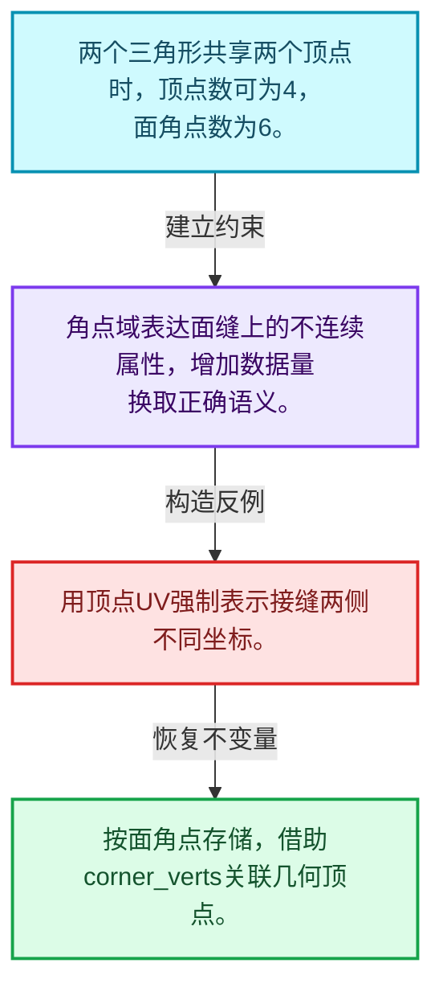
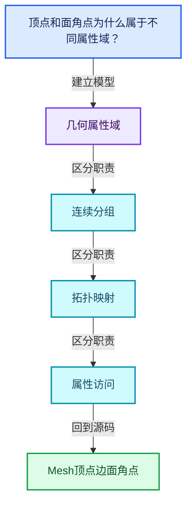
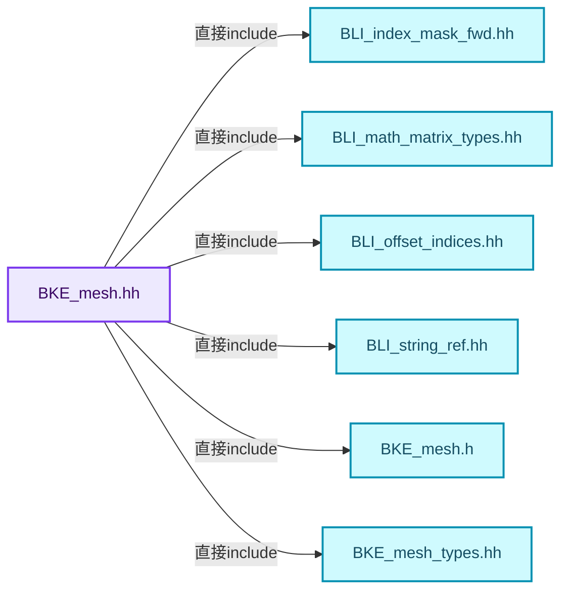
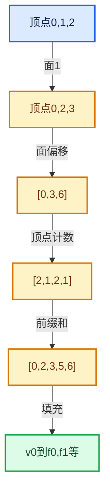

# 05-01 Mesh顶点边面角点

[方向导航](README.md) · [总目录](../README.md) · [覆盖索引](../%E6%BA%90%E7%A0%81%E7%89%88%E6%9C%AC%E4%B8%8E%E8%A6%86%E7%9B%96%E7%B4%A2%E5%BC%95.md)

> 阅读顺序：问题与数据模型 → 语法与类型 → 源码逐行 → 调用线索 → 历史与取舍 → 推演和练习。

- 基准 HEAD：`cbda6b96c26c0dee3c3b5cbb93960c4ac06a6b30`。
- 记录日期：2026-10-14。
- 教学示例状态：正文中的推演不是本机性能实测；已运行练习见验收报告。

## 一、从问题到设计

顶点和面角点为什么属于不同属性域？

同一顶点可被多个面角点引用；UV等不连续数据需要角点域，不能按顶点数替代角点数。

本篇把语法、数据语义和系统取舍连接起来。利用连续性和重复关系选择表示，让冗余状态尽量无法表达。

### 本篇独立模型与设计推理

两个三角形共享两个顶点时，顶点数可为4，面角点数为6。

设计取舍：角点域表达面缝上的不连续属性，增加数据量换取正确语义。

最小反例：用顶点UV强制表示接缝两侧不同坐标。

推导与处理：按面角点存储，借助corner_verts关联几何顶点。



### 源码范围与相邻篇章

| 文件 | 本篇逐行范围 | 基准SHA-256 |
|---|---|---|
| [source/blender/blenkernel/BKE_mesh.hh](../../../../../source/blender/blenkernel/BKE_mesh.hh) | L1—L513 | `6fc9977c8daeca6686fee3a5389a3ce9ecea2a69ddbdebc8536f71c84263f388` |

同一主讲文件可能分多篇覆盖；超出本篇范围的符号通过覆盖索引定位。空行与纯注释保留在源码摘录中，逐行表解释有效语句与语法边界；许可证头统一保留。

后篇：[OffsetIndices完整接口](02-OffsetIndices%E5%AE%8C%E6%95%B4%E6%8E%A5%E5%8F%A3.md).

## 二、类型、数据与阅读地图



这是概念依赖图，边表示阅读关系，不声称是运行时调用顺序。

### 直接编译依赖



箭头只表示头文件包含关系；完整调用线索见后面的符号定位表。

## 三、关键词、语法与类型角色

### 只读限定 const

const约束当前访问路径可做的修改。const指针、指向const的指针、const视图对象、const元素是不同位置的限定；其他别名可能仍可修改原对象。

具体检查：分别写T* const、const T*与const T* const，并画出不可修改的层次。

### 异常边界 try与catch

try定义异常传播的局部边界。失败路径需要销毁已经成功构造的部分并释放相应存储；未构造的对象不能被析构。

具体检查：在第k次构造失败，列出已经存在的对象集合与待释放缓冲。

### 可选值 optional

optional把不存在与存在的T区分开，T的构造和析构跟随engaged状态变化。访问前应由has_value或条件分支证明存在。

具体检查：把空Field状态与合法常量零区分，不能用某个普通值代替不存在。

### 内部断言 assert

断言表达开发者预期成立的内部契约，发布构建可能关闭。它不能替代对不可信输入的完整错误处理，也不保证后续操作被运行时保护。

具体检查：对每条断言构造违反条件的输入，区分调用者错误与应向用户报告的错误。

### 枚举与状态模型 enum

枚举把有限状态命名；enum class避免许多隐式整数转换。状态机正确性还依赖允许的转移，不能只看有哪些枚举项。

具体检查：列出每个状态的进入条件和离开条件，检查终止状态是否仍可能被调度。

## 四、真实源码与逐行讲解

源码块保持原行内容，原始行号由小节标题及逐行表给出。表中的调用定位是静态阅读辅助；重载、模板实例化、宏展开和虚调用需结合完整声明，不能仅凭词法出现证明动态调用。

### BKE_mesh.hh：L1—L52

<!-- source:source/blender/blenkernel/BKE_mesh.hh:1:52 -->

```cpp
/* SPDX-FileCopyrightText: 2023 Blender Authors
 *
 * SPDX-License-Identifier: GPL-2.0-or-later */

#pragma once

/** \file
 * \ingroup bke
 */

#include "BLI_index_mask_fwd.hh"
#include "BLI_math_matrix_types.hh"
#include "BLI_offset_indices.hh"
#include "BLI_string_ref.hh"

#include "BKE_mesh.h"         // IWYU pragma: export
#include "BKE_mesh_types.hh"  // IWYU pragma: export

namespace blender::bke {

enum class AttrDomain : int8_t;
enum class AttrType : int16_t;
struct AttributeMetaData;
struct AttributeAccessorFunctions;

struct AttributeFilter;

namespace mesh {
/* -------------------------------------------------------------------- */
/** \name Polygon Data Evaluation
 * \{ */

/** Calculate the up direction for the face, depending on its winding direction. */
float3 face_normal_calc(Span<float3> vert_positions, Span<int> face_verts);

void corner_tris_calc(Span<float3> vert_positions,
                      OffsetIndices<int> faces,
                      Span<int> corner_verts,
                      MutableSpan<int3> corner_tris);

/**
 * A version of #corner_tris_calc which takes pre-calculated face normals
 * (used to avoid having to calculate the face normal for NGON tessellation).
 *
 * \note Only use this function if normals have already been calculated, there is no need
 * to calculate normals just to use this function.
 */
void corner_tris_calc_with_normals(Span<float3> vert_positions,
                                   OffsetIndices<int> faces,
                                   Span<int> corner_verts,
                                   Span<float3> face_normals,
                                   MutableSpan<int3> corner_tris);
```

| 原始行 | 语义、约束与检查 |
|---|---|
| L5 | 防止同一头文件在一个翻译单元中重复展开；不控制多个源文件之间的链接或对象寿命。 |
| L11 | 引入编译依赖 "BLI_index_mask_fwd.hh"；这是声明可见性关系，不表示运行时一定调用该文件的所有接口。 |
| L12 | 引入编译依赖 "BLI_math_matrix_types.hh"；这是声明可见性关系，不表示运行时一定调用该文件的所有接口。 |
| L13 | 引入编译依赖 "BLI_offset_indices.hh"；这是声明可见性关系，不表示运行时一定调用该文件的所有接口。 |
| L14 | 引入编译依赖 "BLI_string_ref.hh"；这是声明可见性关系，不表示运行时一定调用该文件的所有接口。 |
| L16 | 引入编译依赖 "BKE_mesh.h"；这是声明可见性关系，不表示运行时一定调用该文件的所有接口。 |
| L17 | 引入编译依赖 "BKE_mesh_types.hh"；这是声明可见性关系，不表示运行时一定调用该文件的所有接口。 |
| L19 | 把后续声明放入 blender::bke 命名空间，影响名称查找和符号归属，不创建运行时对象。 |
| L21 | 声明或定义类型 `enum class AttrDomain : int8_t`。结合继承、访问权限和成员布局确认接口与拥有关系；前向声明本身没有完整对象布局。 |
| L22 | 声明或定义类型 `enum class AttrType : int16_t`。结合继承、访问权限和成员布局确认接口与拥有关系；前向声明本身没有完整对象布局。 |
| L23 | 声明或定义类型 `struct AttributeMetaData`。结合继承、访问权限和成员布局确认接口与拥有关系；前向声明本身没有完整对象布局。 |
| L24 | 声明或定义类型 `struct AttributeAccessorFunctions`。结合继承、访问权限和成员布局确认接口与拥有关系；前向声明本身没有完整对象布局。 |
| L26 | 声明或定义类型 `struct AttributeFilter`。结合继承、访问权限和成员布局确认接口与拥有关系；前向声明本身没有完整对象布局。 |
| L28 | 把后续声明放入 mesh 命名空间，影响名称查找和符号归属，不创建运行时对象。 |
| L34 | 出现调用或函数声明 `face_normal_calc`，对应表达式为 `float3 face_normal_calc(Span<float3> vert_positions, Span<int> face_verts);`。参数求值、返回类型与重载需结合前后完整语句；静态文本引用不能证明动态目标。 |
| L36 | 出现调用或函数声明 `corner_tris_calc`，对应表达式为 `void corner_tris_calc(Span<float3> vert_positions,`。参数求值、返回类型与重载需结合前后完整语句；静态文本引用不能证明动态目标。 |
| L37 | 本行是连续声明或表达式的一部分：`OffsetIndices<int> faces,`。与本段前后行合读；逗号、括号和限定符决定它属于参数、初始化列表还是实际计算。 |
| L38 | 本行是连续声明或表达式的一部分：`Span<int> corner_verts,`。与本段前后行合读；逗号、括号和限定符决定它属于参数、初始化列表还是实际计算。 |
| L39 | 声明成员、局部对象或完成语句 `MutableSpan<int3> corner_tris)`。若为指针或引用，它本身不说明拥有；若为值对象，其构造析构由所在作用域或外层对象管理。 |
| L48 | 出现调用或函数声明 `corner_tris_calc_with_normals`，对应表达式为 `void corner_tris_calc_with_normals(Span<float3> vert_positions,`。参数求值、返回类型与重载需结合前后完整语句；静态文本引用不能证明动态目标。 |
| L49 | 本行是连续声明或表达式的一部分：`OffsetIndices<int> faces,`。与本段前后行合读；逗号、括号和限定符决定它属于参数、初始化列表还是实际计算。 |
| L50 | 本行是连续声明或表达式的一部分：`Span<int> corner_verts,`。与本段前后行合读；逗号、括号和限定符决定它属于参数、初始化列表还是实际计算。 |
| L51 | 本行是连续声明或表达式的一部分：`Span<float3> face_normals,`。与本段前后行合读；逗号、括号和限定符决定它属于参数、初始化列表还是实际计算。 |
| L52 | 声明成员、局部对象或完成语句 `MutableSpan<int3> corner_tris)`。若为指针或引用，它本身不说明拥有；若为值对象，其构造析构由所在作用域或外层对象管理。 |

### BKE_mesh.hh：L53—L95

<!-- source:source/blender/blenkernel/BKE_mesh.hh:53:95 -->

```cpp

void corner_tris_calc_face_indices(OffsetIndices<int> faces, MutableSpan<int> tri_faces);

/**
 * Convert triangles encoded as face corner indices to triangles encoded as vertex indices.
 */
void vert_tris_from_corner_tris(Span<int> corner_verts,
                                Span<int3> corner_tris,
                                MutableSpan<int3> vert_tris);

/** Return the triangle's three edge indices if they are real edges, otherwise -1. */
int3 corner_tri_get_real_edges(Span<int2> edges,
                               Span<int> corner_verts,
                               Span<int> corner_edges,
                               const int3 &corner_tri);

/** Calculate the average position of the vertices in the face. */
float3 face_center_calc(Span<float3> vert_positions, Span<int> face_verts);

/** Calculate the surface area of the face described by the indexed vertices. */
float face_area_calc(Span<float3> vert_positions, Span<int> face_verts);

/** Calculate the angles at each of the faces corners. */
void face_angles_calc(Span<float3> vert_positions,
                      Span<int> face_verts,
                      MutableSpan<float> angles);

/** \} */

/* -------------------------------------------------------------------- */
/** \name Medium-Level Normals Calculation
 * \{ */

/**
 * Calculate face normals directly into a result array.
 *
 * \note Usually #Mesh::face_normals() is the preferred way to access face normals,
 * since they may already be calculated and cached on the mesh.
 */
void normals_calc_faces(Span<float3> vert_positions,
                        OffsetIndices<int> faces,
                        Span<int> corner_verts,
                        MutableSpan<float3> face_normals);
```

| 原始行 | 语义、约束与检查 |
|---|---|
| L54 | 声明接口 `void corner_tris_calc_face_indices(OffsetIndices<int> faces, MutableSpan<int> tri_faces)`，本行没有对应函数体；返回类型、参数限定和const/noexcept共同组成调用契约，实际行为需继续定位实现。 |
| L59 | 出现调用或函数声明 `vert_tris_from_corner_tris`，对应表达式为 `void vert_tris_from_corner_tris(Span<int> corner_verts,`。参数求值、返回类型与重载需结合前后完整语句；静态文本引用不能证明动态目标。 |
| L60 | 本行是连续声明或表达式的一部分：`Span<int3> corner_tris,`。与本段前后行合读；逗号、括号和限定符决定它属于参数、初始化列表还是实际计算。 |
| L61 | 声明成员、局部对象或完成语句 `MutableSpan<int3> vert_tris)`。若为指针或引用，它本身不说明拥有；若为值对象，其构造析构由所在作用域或外层对象管理。 |
| L64 | 出现调用或函数声明 `corner_tri_get_real_edges`，对应表达式为 `int3 corner_tri_get_real_edges(Span<int2> edges,`。参数求值、返回类型与重载需结合前后完整语句；静态文本引用不能证明动态目标。 |
| L65 | 本行是连续声明或表达式的一部分：`Span<int> corner_verts,`。与本段前后行合读；逗号、括号和限定符决定它属于参数、初始化列表还是实际计算。 |
| L66 | 本行是连续声明或表达式的一部分：`Span<int> corner_edges,`。与本段前后行合读；逗号、括号和限定符决定它属于参数、初始化列表还是实际计算。 |
| L67 | 声明成员、局部对象或完成语句 `const int3 &corner_tri)`。若为指针或引用，它本身不说明拥有；若为值对象，其构造析构由所在作用域或外层对象管理。 |
| L70 | 出现调用或函数声明 `face_center_calc`，对应表达式为 `float3 face_center_calc(Span<float3> vert_positions, Span<int> face_verts);`。参数求值、返回类型与重载需结合前后完整语句；静态文本引用不能证明动态目标。 |
| L73 | 出现调用或函数声明 `face_area_calc`，对应表达式为 `float face_area_calc(Span<float3> vert_positions, Span<int> face_verts);`。参数求值、返回类型与重载需结合前后完整语句；静态文本引用不能证明动态目标。 |
| L76 | 出现调用或函数声明 `face_angles_calc`，对应表达式为 `void face_angles_calc(Span<float3> vert_positions,`。参数求值、返回类型与重载需结合前后完整语句；静态文本引用不能证明动态目标。 |
| L77 | 本行是连续声明或表达式的一部分：`Span<int> face_verts,`。与本段前后行合读；逗号、括号和限定符决定它属于参数、初始化列表还是实际计算。 |
| L78 | 声明成员、局部对象或完成语句 `MutableSpan<float> angles)`。若为指针或引用，它本身不说明拥有；若为值对象，其构造析构由所在作用域或外层对象管理。 |
| L92 | 出现调用或函数声明 `normals_calc_faces`，对应表达式为 `void normals_calc_faces(Span<float3> vert_positions,`。参数求值、返回类型与重载需结合前后完整语句；静态文本引用不能证明动态目标。 |
| L93 | 本行是连续声明或表达式的一部分：`OffsetIndices<int> faces,`。与本段前后行合读；逗号、括号和限定符决定它属于参数、初始化列表还是实际计算。 |
| L94 | 本行是连续声明或表达式的一部分：`Span<int> corner_verts,`。与本段前后行合读；逗号、括号和限定符决定它属于参数、初始化列表还是实际计算。 |
| L95 | 声明成员、局部对象或完成语句 `MutableSpan<float3> face_normals)`。若为指针或引用，它本身不说明拥有；若为值对象，其构造析构由所在作用域或外层对象管理。 |

### BKE_mesh.hh：L96—L141

<!-- source:source/blender/blenkernel/BKE_mesh.hh:96:141 -->

```cpp

/**
 * Calculate vertex normals directly into the result array.
 *
 * \note Vertex and face normals can be calculated at the same time with
 * #normals_calc_faces_and_verts, which can have performance benefits in some cases.
 *
 * \note Usually #Mesh::vert_normals() is the preferred way to access vertex normals,
 * since they may already be calculated and cached on the mesh.
 */
void normals_calc_verts(Span<float3> vert_positions,
                        OffsetIndices<int> faces,
                        Span<int> corner_verts,
                        GroupedSpan<int> vert_to_face_map,
                        Span<float3> face_normals,
                        MutableSpan<float3> vert_normals);

/** \} */

/* -------------------------------------------------------------------- */
/** \name Face Corner Normal Calculation
 * \{ */

/**
 * Combined with the automatically calculated face corner normal, this gives a dimensional
 * coordinate space used to convert normals between the "custom normal" #short2 representation and
 * a regular #float3 format.
 */
struct CornerNormalSpace {
  /** The automatically computed face corner normal, not including influence of custom normals. */
  float3 vec_lnor;
  /**
   * Reference vector, orthogonal to #vec_lnor, aligned with one of the edges (borders) of the
   * smooth fan, called 'reference edge'.
   */
  float3 vec_ref;
  /** Third vector, orthogonal to #vec_lnor and #vec_ref. */
  float3 vec_ortho;
  /**
   * Reference angle around #vec_ortho, in (0, pi] range, between #vec_lnor and the reference edge.
   *
   * A 0.0 value marks that space as invalid, as it can only happen in extremely degenerate
   * geometry cases (it would mean that the default normal is perfectly aligned with the reference
   * edge).
   */
  float ref_alpha;
```

| 原始行 | 语义、约束与检查 |
|---|---|
| L106 | 出现调用或函数声明 `normals_calc_verts`，对应表达式为 `void normals_calc_verts(Span<float3> vert_positions,`。参数求值、返回类型与重载需结合前后完整语句；静态文本引用不能证明动态目标。 |
| L107 | 本行是连续声明或表达式的一部分：`OffsetIndices<int> faces,`。与本段前后行合读；逗号、括号和限定符决定它属于参数、初始化列表还是实际计算。 |
| L108 | 本行是连续声明或表达式的一部分：`Span<int> corner_verts,`。与本段前后行合读；逗号、括号和限定符决定它属于参数、初始化列表还是实际计算。 |
| L109 | 本行是连续声明或表达式的一部分：`GroupedSpan<int> vert_to_face_map,`。与本段前后行合读；逗号、括号和限定符决定它属于参数、初始化列表还是实际计算。 |
| L110 | 本行是连续声明或表达式的一部分：`Span<float3> face_normals,`。与本段前后行合读；逗号、括号和限定符决定它属于参数、初始化列表还是实际计算。 |
| L111 | 声明成员、局部对象或完成语句 `MutableSpan<float3> vert_normals)`。若为指针或引用，它本身不说明拥有；若为值对象，其构造析构由所在作用域或外层对象管理。 |
| L124 | 声明或定义类型 `struct CornerNormalSpace`。结合继承、访问权限和成员布局确认接口与拥有关系；前向声明本身没有完整对象布局。 |
| L126 | 声明成员、局部对象或完成语句 `float3 vec_lnor`。若为指针或引用，它本身不说明拥有；若为值对象，其构造析构由所在作用域或外层对象管理。 |
| L131 | 声明成员、局部对象或完成语句 `float3 vec_ref`。若为指针或引用，它本身不说明拥有；若为值对象，其构造析构由所在作用域或外层对象管理。 |
| L133 | 声明成员、局部对象或完成语句 `float3 vec_ortho`。若为指针或引用，它本身不说明拥有；若为值对象，其构造析构由所在作用域或外层对象管理。 |
| L141 | 声明成员、局部对象或完成语句 `float ref_alpha`。若为指针或引用，它本身不说明拥有；若为值对象，其构造析构由所在作用域或外层对象管理。 |

### BKE_mesh.hh：L142—L183

<!-- source:source/blender/blenkernel/BKE_mesh.hh:142:183 -->

```cpp
  /**
   * Reference angle around #vec_lnor, in (0, 2pi] range, between the reference edge and the other
   * border edge of the fan.
   *
   * A 0.0 value marks that space as invalid, as it can only happen in degenerate geometry cases
   * (it would mean that all the edges connected to that corner of the smooth fan are perfectly
   * aligned).
   */
  float ref_beta;
};

/**
 * Storage for corner fan coordinate spaces for an entire mesh.
 * For performance reason the distribution of #spaces and index mapping of them in
 * #corner_space_indices are non-deterministic.
 */
struct CornerNormalSpaceArray {
  /**
   * The normal coordinate spaces, potentially shared between multiple face corners in a smooth fan
   * connected to a vertex (and not per face corner). Depending on the mesh (the amount of sharing
   * / number of sharp edges / size of each fan), there may be many fewer spaces than face corners,
   * so they are stored in a separate vector.
   */
  Vector<CornerNormalSpace> spaces;

  /**
   * The index of the data in the #spaces array for each face corner (the array size is the
   * same as #Mesh::corners_num). Rare -1 values define face corners without a coordinate space.
   */
  Array<int> corner_space_indices;

  /**
   * A map containing the face corners that make up each space,
   * in the order that they were processed (winding around a vertex).
   */
  Vector<Array<int>> corners_by_space;
  /** Whether to create the above map when calculating normals. */
  bool create_corners_by_space = false;
};

short2 corner_space_custom_normal_to_data(const CornerNormalSpace &lnor_space,
                                          const float3 &custom_lnor);
```

| 原始行 | 语义、约束与检查 |
|---|---|
| L150 | 声明成员、局部对象或完成语句 `float ref_beta`。若为指针或引用，它本身不说明拥有；若为值对象，其构造析构由所在作用域或外层对象管理。 |
| L151 | 结束当前语法单元。局部自动对象在离开其作用域时按规则销毁；这不等于所有被引用的外部数据也被释放。 |
| L158 | 声明或定义类型 `struct CornerNormalSpaceArray`。结合继承、访问权限和成员布局确认接口与拥有关系；前向声明本身没有完整对象布局。 |
| L165 | 声明成员、局部对象或完成语句 `Vector<CornerNormalSpace> spaces`。若为指针或引用，它本身不说明拥有；若为值对象，其构造析构由所在作用域或外层对象管理。 |
| L171 | 声明成员、局部对象或完成语句 `Array<int> corner_space_indices`。若为指针或引用，它本身不说明拥有；若为值对象，其构造析构由所在作用域或外层对象管理。 |
| L177 | 声明成员、局部对象或完成语句 `Vector<Array<int>> corners_by_space`。若为指针或引用，它本身不说明拥有；若为值对象，其构造析构由所在作用域或外层对象管理。 |
| L179 | 把右侧 `false` 用于初始化或更新左侧 `bool create_corners_by_space`。声明初始化与已有对象赋值应按上下文区分；有资源的类型会调用相应特殊成员。 |
| L180 | 结束当前语法单元。局部自动对象在离开其作用域时按规则销毁；这不等于所有被引用的外部数据也被释放。 |
| L182 | 出现调用或函数声明 `corner_space_custom_normal_to_data`，对应表达式为 `short2 corner_space_custom_normal_to_data(const CornerNormalSpace &lnor_space,`。参数求值、返回类型与重载需结合前后完整语句；静态文本引用不能证明动态目标。 |
| L183 | 声明成员、局部对象或完成语句 `const float3 &custom_lnor)`。若为指针或引用，它本身不说明拥有；若为值对象，其构造析构由所在作用域或外层对象管理。 |

### BKE_mesh.hh：L184—L236

<!-- source:source/blender/blenkernel/BKE_mesh.hh:184:236 -->

```cpp

/**
 * Compute custom normals, i.e. vertex normals associated with each face. Used to visualize sharp
 * edges (or non-smooth faces) without actually modifying the geometry (splitting edges).
 *
 * \param sharp_edges: Optional array of sharp edge tags, used to split the evaluated normals on
 * each side of the edge.
 * \param sharp_faces: Optional array of sharp face tags, used to split the evaluated normals on
 * the face's edges.
 * \param r_fan_spaces: Optional return data filled with information about the custom
 * normals spaces for each grouped fan of face corners.
 */
void normals_calc_corners(Span<float3> vert_positions,
                          OffsetIndices<int> faces,
                          Span<int> corner_verts,
                          Span<int> corner_edges,
                          GroupedSpan<int> vert_to_face_map,
                          Span<float3> face_normals,
                          Span<bool> sharp_edges,
                          Span<bool> sharp_faces,
                          Span<short2> custom_normals,
                          CornerNormalSpaceArray *r_fan_spaces,
                          MutableSpan<float3> r_corner_normals);

/**
 * \param sharp_faces: Optional array used to mark specific faces for sharp shading.
 */
void normals_corner_custom_set(Span<float3> vert_positions,
                               OffsetIndices<int> faces,
                               Span<int> corner_verts,
                               Span<int> corner_edges,
                               GroupedSpan<int> vert_to_face_map,
                               Span<float3> vert_normals,
                               Span<float3> face_normals,
                               Span<bool> sharp_faces,
                               MutableSpan<bool> sharp_edges,
                               MutableSpan<float3> r_custom_corner_normals,
                               MutableSpan<short2> r_clnors_data);

/**
 * \param sharp_faces: Optional array used to mark specific faces for sharp shading.
 */
void normals_corner_custom_set_from_verts(Span<float3> vert_positions,
                                          OffsetIndices<int> faces,
                                          Span<int> corner_verts,
                                          Span<int> corner_edges,
                                          GroupedSpan<int> vert_to_face_map,
                                          Span<float3> vert_normals,
                                          Span<float3> face_normals,
                                          Span<bool> sharp_faces,
                                          MutableSpan<bool> sharp_edges,
                                          MutableSpan<float3> r_custom_vert_normals,
                                          MutableSpan<short2> r_clnors_data);
```

| 原始行 | 语义、约束与检查 |
|---|---|
| L196 | 出现调用或函数声明 `normals_calc_corners`，对应表达式为 `void normals_calc_corners(Span<float3> vert_positions,`。参数求值、返回类型与重载需结合前后完整语句；静态文本引用不能证明动态目标。 |
| L197 | 本行是连续声明或表达式的一部分：`OffsetIndices<int> faces,`。与本段前后行合读；逗号、括号和限定符决定它属于参数、初始化列表还是实际计算。 |
| L198 | 本行是连续声明或表达式的一部分：`Span<int> corner_verts,`。与本段前后行合读；逗号、括号和限定符决定它属于参数、初始化列表还是实际计算。 |
| L199 | 本行是连续声明或表达式的一部分：`Span<int> corner_edges,`。与本段前后行合读；逗号、括号和限定符决定它属于参数、初始化列表还是实际计算。 |
| L200 | 本行是连续声明或表达式的一部分：`GroupedSpan<int> vert_to_face_map,`。与本段前后行合读；逗号、括号和限定符决定它属于参数、初始化列表还是实际计算。 |
| L201 | 本行是连续声明或表达式的一部分：`Span<float3> face_normals,`。与本段前后行合读；逗号、括号和限定符决定它属于参数、初始化列表还是实际计算。 |
| L202 | 本行是连续声明或表达式的一部分：`Span<bool> sharp_edges,`。与本段前后行合读；逗号、括号和限定符决定它属于参数、初始化列表还是实际计算。 |
| L203 | 本行是连续声明或表达式的一部分：`Span<bool> sharp_faces,`。与本段前后行合读；逗号、括号和限定符决定它属于参数、初始化列表还是实际计算。 |
| L204 | 本行是连续声明或表达式的一部分：`Span<short2> custom_normals,`。与本段前后行合读；逗号、括号和限定符决定它属于参数、初始化列表还是实际计算。 |
| L205 | 本行是连续声明或表达式的一部分：`CornerNormalSpaceArray *r_fan_spaces,`。与本段前后行合读；逗号、括号和限定符决定它属于参数、初始化列表还是实际计算。 |
| L206 | 声明成员、局部对象或完成语句 `MutableSpan<float3> r_corner_normals)`。若为指针或引用，它本身不说明拥有；若为值对象，其构造析构由所在作用域或外层对象管理。 |
| L211 | 出现调用或函数声明 `normals_corner_custom_set`，对应表达式为 `void normals_corner_custom_set(Span<float3> vert_positions,`。参数求值、返回类型与重载需结合前后完整语句；静态文本引用不能证明动态目标。 |
| L212 | 本行是连续声明或表达式的一部分：`OffsetIndices<int> faces,`。与本段前后行合读；逗号、括号和限定符决定它属于参数、初始化列表还是实际计算。 |
| L213 | 本行是连续声明或表达式的一部分：`Span<int> corner_verts,`。与本段前后行合读；逗号、括号和限定符决定它属于参数、初始化列表还是实际计算。 |
| L214 | 本行是连续声明或表达式的一部分：`Span<int> corner_edges,`。与本段前后行合读；逗号、括号和限定符决定它属于参数、初始化列表还是实际计算。 |
| L215 | 本行是连续声明或表达式的一部分：`GroupedSpan<int> vert_to_face_map,`。与本段前后行合读；逗号、括号和限定符决定它属于参数、初始化列表还是实际计算。 |
| L216 | 本行是连续声明或表达式的一部分：`Span<float3> vert_normals,`。与本段前后行合读；逗号、括号和限定符决定它属于参数、初始化列表还是实际计算。 |
| L217 | 本行是连续声明或表达式的一部分：`Span<float3> face_normals,`。与本段前后行合读；逗号、括号和限定符决定它属于参数、初始化列表还是实际计算。 |
| L218 | 本行是连续声明或表达式的一部分：`Span<bool> sharp_faces,`。与本段前后行合读；逗号、括号和限定符决定它属于参数、初始化列表还是实际计算。 |
| L219 | 本行是连续声明或表达式的一部分：`MutableSpan<bool> sharp_edges,`。与本段前后行合读；逗号、括号和限定符决定它属于参数、初始化列表还是实际计算。 |
| L220 | 本行是连续声明或表达式的一部分：`MutableSpan<float3> r_custom_corner_normals,`。与本段前后行合读；逗号、括号和限定符决定它属于参数、初始化列表还是实际计算。 |
| L221 | 声明成员、局部对象或完成语句 `MutableSpan<short2> r_clnors_data)`。若为指针或引用，它本身不说明拥有；若为值对象，其构造析构由所在作用域或外层对象管理。 |
| L226 | 出现调用或函数声明 `normals_corner_custom_set_from_verts`，对应表达式为 `void normals_corner_custom_set_from_verts(Span<float3> vert_positions,`。参数求值、返回类型与重载需结合前后完整语句；静态文本引用不能证明动态目标。 |
| L227 | 本行是连续声明或表达式的一部分：`OffsetIndices<int> faces,`。与本段前后行合读；逗号、括号和限定符决定它属于参数、初始化列表还是实际计算。 |
| L228 | 本行是连续声明或表达式的一部分：`Span<int> corner_verts,`。与本段前后行合读；逗号、括号和限定符决定它属于参数、初始化列表还是实际计算。 |
| L229 | 本行是连续声明或表达式的一部分：`Span<int> corner_edges,`。与本段前后行合读；逗号、括号和限定符决定它属于参数、初始化列表还是实际计算。 |
| L230 | 本行是连续声明或表达式的一部分：`GroupedSpan<int> vert_to_face_map,`。与本段前后行合读；逗号、括号和限定符决定它属于参数、初始化列表还是实际计算。 |
| L231 | 本行是连续声明或表达式的一部分：`Span<float3> vert_normals,`。与本段前后行合读；逗号、括号和限定符决定它属于参数、初始化列表还是实际计算。 |
| L232 | 本行是连续声明或表达式的一部分：`Span<float3> face_normals,`。与本段前后行合读；逗号、括号和限定符决定它属于参数、初始化列表还是实际计算。 |
| L233 | 本行是连续声明或表达式的一部分：`Span<bool> sharp_faces,`。与本段前后行合读；逗号、括号和限定符决定它属于参数、初始化列表还是实际计算。 |
| L234 | 本行是连续声明或表达式的一部分：`MutableSpan<bool> sharp_edges,`。与本段前后行合读；逗号、括号和限定符决定它属于参数、初始化列表还是实际计算。 |
| L235 | 本行是连续声明或表达式的一部分：`MutableSpan<float3> r_custom_vert_normals,`。与本段前后行合读；逗号、括号和限定符决定它属于参数、初始化列表还是实际计算。 |
| L236 | 声明成员、局部对象或完成语句 `MutableSpan<short2> r_clnors_data)`。若为指针或引用，它本身不说明拥有；若为值对象，其构造析构由所在作用域或外层对象管理。 |

### BKE_mesh.hh：L237—L282

<!-- source:source/blender/blenkernel/BKE_mesh.hh:237:282 -->

```cpp

/**
 * Define sharp edges as needed to mimic "auto-smooth" from angle threshold.
 *
 * Used when defining an empty custom corner normals data layer,
 * to keep same shading as with auto-smooth!
 *
 * \param sharp_faces: Optional array used to mark specific faces for sharp shading.
 */
void edges_sharp_from_angle_set(OffsetIndices<int> faces,
                                Span<int> corner_verts,
                                Span<int> corner_edges,
                                Span<float3> face_normals,
                                Span<int> corner_to_face,
                                Span<bool> sharp_faces,
                                const float split_angle,
                                MutableSpan<bool> sharp_edges);

/** Return true if the type and domain represent the tangent-space custom normals storage. */
bool is_corner_fan_normals(const AttributeMetaData &meta_data);

/** Tracks the storage format for a resulting mesh based on a combination of input meshes. */
class NormalJoinInfo {
 public:
  enum class Output : int8_t { None, CornerFan, Free };
  Output result_type = Output::None;
  std::optional<bke::AttrDomain> result_domain;

  void add_no_custom_normals(bke::MeshNormalDomain domain);
  void add_corner_fan_normals();
  void add_domain(bke::AttrDomain domain);
  void add_free_normals(bke::AttrDomain domain);
  void add_mesh(const Mesh &mesh);
};

}  // namespace mesh

/**
 * Higher level functions hiding most of the code needed around call to
 * #normals_corner_custom_set().
 *
 * \param corner_normals: Is mutable because zero vectors are replaced with automatically
 * computed normals.
 */
void mesh_set_custom_normals(Mesh &mesh, MutableSpan<float3> corner_normals);
void mesh_set_custom_normals_normalized(Mesh &mesh, MutableSpan<float3> corner_normals);
```

| 原始行 | 语义、约束与检查 |
|---|---|
| L246 | 出现调用或函数声明 `edges_sharp_from_angle_set`，对应表达式为 `void edges_sharp_from_angle_set(OffsetIndices<int> faces,`。参数求值、返回类型与重载需结合前后完整语句；静态文本引用不能证明动态目标。 |
| L247 | 本行是连续声明或表达式的一部分：`Span<int> corner_verts,`。与本段前后行合读；逗号、括号和限定符决定它属于参数、初始化列表还是实际计算。 |
| L248 | 本行是连续声明或表达式的一部分：`Span<int> corner_edges,`。与本段前后行合读；逗号、括号和限定符决定它属于参数、初始化列表还是实际计算。 |
| L249 | 本行是连续声明或表达式的一部分：`Span<float3> face_normals,`。与本段前后行合读；逗号、括号和限定符决定它属于参数、初始化列表还是实际计算。 |
| L250 | 本行是连续声明或表达式的一部分：`Span<int> corner_to_face,`。与本段前后行合读；逗号、括号和限定符决定它属于参数、初始化列表还是实际计算。 |
| L251 | 本行是连续声明或表达式的一部分：`Span<bool> sharp_faces,`。与本段前后行合读；逗号、括号和限定符决定它属于参数、初始化列表还是实际计算。 |
| L252 | 本行是连续声明或表达式的一部分：`const float split_angle,`。与本段前后行合读；逗号、括号和限定符决定它属于参数、初始化列表还是实际计算。 |
| L253 | 声明成员、局部对象或完成语句 `MutableSpan<bool> sharp_edges)`。若为指针或引用，它本身不说明拥有；若为值对象，其构造析构由所在作用域或外层对象管理。 |
| L256 | 声明接口 `bool is_corner_fan_normals(const AttributeMetaData &meta_data)`，本行没有对应函数体；返回类型、参数限定和const/noexcept共同组成调用契约，实际行为需继续定位实现。 |
| L259 | 声明或定义类型 `class NormalJoinInfo`。结合继承、访问权限和成员布局确认接口与拥有关系；前向声明本身没有完整对象布局。 |
| L260 | 切换成员访问权限为 public；它是编译期接口边界，不是线程同步或内存保护。 |
| L261 | 声明或定义类型 `enum class Output : int8_t { None, CornerFan, Free }`。结合继承、访问权限和成员布局确认接口与拥有关系；前向声明本身没有完整对象布局。 |
| L262 | 把右侧 `Output::None` 用于初始化或更新左侧 `Output result_type`。声明初始化与已有对象赋值应按上下文区分；有资源的类型会调用相应特殊成员。 |
| L263 | 声明成员、局部对象或完成语句 `std::optional<bke::AttrDomain> result_domain`。若为指针或引用，它本身不说明拥有；若为值对象，其构造析构由所在作用域或外层对象管理。 |
| L265 | 声明接口 `void add_no_custom_normals(bke::MeshNormalDomain domain)`，本行没有对应函数体；返回类型、参数限定和const/noexcept共同组成调用契约，实际行为需继续定位实现。 |
| L266 | 声明接口 `void add_corner_fan_normals()`，本行没有对应函数体；返回类型、参数限定和const/noexcept共同组成调用契约，实际行为需继续定位实现。 |
| L267 | 声明接口 `void add_domain(bke::AttrDomain domain)`，本行没有对应函数体；返回类型、参数限定和const/noexcept共同组成调用契约，实际行为需继续定位实现。 |
| L268 | 声明接口 `void add_free_normals(bke::AttrDomain domain)`，本行没有对应函数体；返回类型、参数限定和const/noexcept共同组成调用契约，实际行为需继续定位实现。 |
| L269 | 声明接口 `void add_mesh(const Mesh &mesh)`，本行没有对应函数体；返回类型、参数限定和const/noexcept共同组成调用契约，实际行为需继续定位实现。 |
| L270 | 结束当前语法单元。局部自动对象在离开其作用域时按规则销毁；这不等于所有被引用的外部数据也被释放。 |
| L272 | 结束当前语法单元。局部自动对象在离开其作用域时按规则销毁；这不等于所有被引用的外部数据也被释放。 |
| L281 | 声明接口 `void mesh_set_custom_normals(Mesh &mesh, MutableSpan<float3> corner_normals)`，本行没有对应函数体；返回类型、参数限定和const/noexcept共同组成调用契约，实际行为需继续定位实现。 |
| L282 | 声明接口 `void mesh_set_custom_normals_normalized(Mesh &mesh, MutableSpan<float3> corner_normals)`，本行没有对应函数体；返回类型、参数限定和const/noexcept共同组成调用契约，实际行为需继续定位实现。 |

### BKE_mesh.hh：L283—L332

<!-- source:source/blender/blenkernel/BKE_mesh.hh:283:332 -->

```cpp

/**
 * Higher level functions hiding most of the code needed around call to
 * #normals_corner_custom_set_from_verts().
 *
 * \param vert_normals: Is mutable because zero vectors are replaced with automatically
 * computed normals.
 */
void mesh_set_custom_normals_from_verts(Mesh &mesh, MutableSpan<float3> vert_normals);
void mesh_set_custom_normals_from_verts_normalized(Mesh &mesh, MutableSpan<float3> vert_normals);

/** \} */

/* -------------------------------------------------------------------- */
/** \name Topology Queries
 * \{ */

namespace mesh {

/**
 * Find the index of the previous corner in the face, looping to the end if necessary.
 * The indices are into the entire corners array, not just the face's corners.
 */
inline int face_corner_prev(const IndexRange face, const int corner)
{
  return corner - 1 + (corner == face.start()) * face.size();
}

/**
 * Find the index of the next corner in the face, looping to the start if necessary.
 * The indices are into the entire corners array, not just the face's corners.
 */
inline int face_corner_next(const IndexRange face, const int corner)
{
  if (corner == face.last()) {
    return face.start();
  }
  return corner + 1;
}

/**
 * Find the index of the corner in the face that uses the given vertex.
 * The index is into the entire corners array, not just the face's corners.
 */
inline int face_find_corner_from_vert(const IndexRange face,
                                      const Span<int> corner_verts,
                                      const int vert)
{
  return face[corner_verts.slice(face).first_index(vert)];
}
```

本段语义重点：

- 分支证据 `corner == face.last())`：分别推演条件成立与不成立，核对相同出口处的状态。

| 原始行 | 语义、约束与检查 |
|---|---|
| L291 | 声明接口 `void mesh_set_custom_normals_from_verts(Mesh &mesh, MutableSpan<float3> vert_normals)`，本行没有对应函数体；返回类型、参数限定和const/noexcept共同组成调用契约，实际行为需继续定位实现。 |
| L292 | 声明接口 `void mesh_set_custom_normals_from_verts_normalized(Mesh &mesh, MutableSpan<float3> vert_normals)`，本行没有对应函数体；返回类型、参数限定和const/noexcept共同组成调用契约，实际行为需继续定位实现。 |
| L300 | 把后续声明放入 mesh 命名空间，影响名称查找和符号归属，不创建运行时对象。 |
| L306 | 出现调用或函数声明 `face_corner_prev`，对应表达式为 `inline int face_corner_prev(const IndexRange face, const int corner)`。参数求值、返回类型与重载需结合前后完整语句；静态文本引用不能证明动态目标。 |
| L307 | 连接上一行的声明或控制结构与其语句块；后续行在这个作用域中执行或声明。 |
| L308 | 返回表达式 `corner - 1 + (corner == face.start()) * face.size()`。 |
| L309 | 结束当前语法单元。局部自动对象在离开其作用域时按规则销毁；这不等于所有被引用的外部数据也被释放。 |
| L315 | 出现调用或函数声明 `face_corner_next`，对应表达式为 `inline int face_corner_next(const IndexRange face, const int corner)`。参数求值、返回类型与重载需结合前后完整语句；静态文本引用不能证明动态目标。 |
| L316 | 连接上一行的声明或控制结构与其语句块；后续行在这个作用域中执行或声明。 |
| L317 | 判断 `corner == face.last()`，成立时进入本分支，否则继续后续路径。 |
| L318 | 返回表达式 `face.start()`。 |
| L319 | 结束当前语法单元。局部自动对象在离开其作用域时按规则销毁；这不等于所有被引用的外部数据也被释放。 |
| L320 | 返回表达式 `corner + 1`。 |
| L321 | 结束当前语法单元。局部自动对象在离开其作用域时按规则销毁；这不等于所有被引用的外部数据也被释放。 |
| L327 | 出现调用或函数声明 `face_find_corner_from_vert`，对应表达式为 `inline int face_find_corner_from_vert(const IndexRange face,`。参数求值、返回类型与重载需结合前后完整语句；静态文本引用不能证明动态目标。 |
| L328 | 本行是连续声明或表达式的一部分：`const Span<int> corner_verts,`。与本段前后行合读；逗号、括号和限定符决定它属于参数、初始化列表还是实际计算。 |
| L329 | 本行是连续声明或表达式的一部分：`const int vert)`。与本段前后行合读；逗号、括号和限定符决定它属于参数、初始化列表还是实际计算。 |
| L330 | 连接上一行的声明或控制结构与其语句块；后续行在这个作用域中执行或声明。 |
| L331 | 返回表达式 `face[corner_verts.slice(face).first_index(vert)]`。 |
| L332 | 结束当前语法单元。局部自动对象在离开其作用域时按规则销毁；这不等于所有被引用的外部数据也被释放。 |

### BKE_mesh.hh：L333—L382

<!-- source:source/blender/blenkernel/BKE_mesh.hh:333:382 -->

```cpp

/**
 * Return the vertex indices on either side of the given vertex, ordered based on the winding
 * direction of the face. The vertex must be in the face.
 */
inline int2 face_find_adjacent_verts(const IndexRange face,
                                     const Span<int> corner_verts,
                                     const int vert)
{
  const int corner = face_find_corner_from_vert(face, corner_verts, vert);
  return {corner_verts[face_corner_prev(face, corner)],
          corner_verts[face_corner_next(face, corner)]};
}

/**
 * Return the number of triangles needed to tessellate a face with \a face_size corners.
 */
inline int face_triangles_num(const int face_size)
{
  BLI_assert(face_size > 2);
  return face_size - 2;
}

/**
 * Return the range of triangles that belong to the given face.
 */
inline IndexRange face_triangles_range(OffsetIndices<int> faces, int face_i)
{
  const IndexRange face = faces[face_i];
  /* This is the same as #poly_to_tri_count which is not included here. */
  const int start_triangle = face.start() - face_i * 2;
  return IndexRange(start_triangle, face_triangles_num(face.size()));
}

/**
 * Return the index of the edge's vertex that is not the \a vert.
 */
inline int edge_other_vert(const int2 edge, const int vert)
{
  BLI_assert(ELEM(vert, edge[0], edge[1]));
  BLI_assert(edge[0] >= 0);
  BLI_assert(edge[1] >= 0);
  /* Order is important to avoid overflow. */
  return (edge[0] - vert) + edge[1];
}

/** \} */

/** Whether the meta-data refers to a float2 type on the face corner domain. */
bool is_uv_map(const AttributeMetaData &meta_data);
```

| 原始行 | 语义、约束与检查 |
|---|---|
| L338 | 出现调用或函数声明 `face_find_adjacent_verts`，对应表达式为 `inline int2 face_find_adjacent_verts(const IndexRange face,`。参数求值、返回类型与重载需结合前后完整语句；静态文本引用不能证明动态目标。 |
| L339 | 本行是连续声明或表达式的一部分：`const Span<int> corner_verts,`。与本段前后行合读；逗号、括号和限定符决定它属于参数、初始化列表还是实际计算。 |
| L340 | 本行是连续声明或表达式的一部分：`const int vert)`。与本段前后行合读；逗号、括号和限定符决定它属于参数、初始化列表还是实际计算。 |
| L341 | 连接上一行的声明或控制结构与其语句块；后续行在这个作用域中执行或声明。 |
| L342 | 把右侧 `face_find_corner_from_vert(face, corner_verts, vert)` 用于初始化或更新左侧 `const int corner`。声明初始化与已有对象赋值应按上下文区分；有资源的类型会调用相应特殊成员。 |
| L343 | 返回表达式 `{corner_verts[face_corner_prev(face, corner)],`。 |
| L344 | 出现调用或函数声明 `face_corner_next`，对应表达式为 `corner_verts[face_corner_next(face, corner)]};`。参数求值、返回类型与重载需结合前后完整语句；静态文本引用不能证明动态目标。 |
| L345 | 结束当前语法单元。局部自动对象在离开其作用域时按规则销毁；这不等于所有被引用的外部数据也被释放。 |
| L350 | 出现调用或函数声明 `face_triangles_num`，对应表达式为 `inline int face_triangles_num(const int face_size)`。参数求值、返回类型与重载需结合前后完整语句；静态文本引用不能证明动态目标。 |
| L351 | 连接上一行的声明或控制结构与其语句块；后续行在这个作用域中执行或声明。 |
| L352 | 断言约束 `BLI_assert(face_size > 2);`。条件是后续访问的内部前置条件；发布构建可能不执行，不能把断言当作输入修复。 |
| L353 | 返回表达式 `face_size - 2`。 |
| L354 | 结束当前语法单元。局部自动对象在离开其作用域时按规则销毁；这不等于所有被引用的外部数据也被释放。 |
| L359 | 出现调用或函数声明 `face_triangles_range`，对应表达式为 `inline IndexRange face_triangles_range(OffsetIndices<int> faces, int face_i)`。参数求值、返回类型与重载需结合前后完整语句；静态文本引用不能证明动态目标。 |
| L360 | 连接上一行的声明或控制结构与其语句块；后续行在这个作用域中执行或声明。 |
| L361 | 把右侧 `faces[face_i]` 用于初始化或更新左侧 `const IndexRange face`。声明初始化与已有对象赋值应按上下文区分；有资源的类型会调用相应特殊成员。 |
| L363 | 把右侧 `face.start() - face_i * 2` 用于初始化或更新左侧 `const int start_triangle`。声明初始化与已有对象赋值应按上下文区分；有资源的类型会调用相应特殊成员。 |
| L364 | 返回表达式 `IndexRange(start_triangle, face_triangles_num(face.size()))`。结合函数声明检查返回值是否借用原存储，借用值不会自动延长其寿命。 |
| L365 | 结束当前语法单元。局部自动对象在离开其作用域时按规则销毁；这不等于所有被引用的外部数据也被释放。 |
| L370 | 出现调用或函数声明 `edge_other_vert`，对应表达式为 `inline int edge_other_vert(const int2 edge, const int vert)`。参数求值、返回类型与重载需结合前后完整语句；静态文本引用不能证明动态目标。 |
| L371 | 连接上一行的声明或控制结构与其语句块；后续行在这个作用域中执行或声明。 |
| L372 | 断言约束 `BLI_assert(ELEM(vert, edge[0], edge[1]));`。条件是后续访问的内部前置条件；发布构建可能不执行，不能把断言当作输入修复。 |
| L373 | 断言约束 `BLI_assert(edge[0] >= 0);`。条件是后续访问的内部前置条件；发布构建可能不执行，不能把断言当作输入修复。 |
| L374 | 断言约束 `BLI_assert(edge[1] >= 0);`。条件是后续访问的内部前置条件；发布构建可能不执行，不能把断言当作输入修复。 |
| L376 | 返回表达式 `(edge[0] - vert) + edge[1]`。 |
| L377 | 结束当前语法单元。局部自动对象在离开其作用域时按规则销毁；这不等于所有被引用的外部数据也被释放。 |
| L382 | 声明接口 `bool is_uv_map(const AttributeMetaData &meta_data)`，本行没有对应函数体；返回类型、参数限定和const/noexcept共同组成调用契约，实际行为需继续定位实现。 |

### BKE_mesh.hh：L383—L429

<!-- source:source/blender/blenkernel/BKE_mesh.hh:383:429 -->

```cpp
bool is_uv_map(const std::optional<AttributeMetaData> &meta_data);

/** Whether the meta-data refers to a color type on the point or corner domain. */
bool is_color_attribute(const AttributeMetaData &meta_data);
bool is_color_attribute(const std::optional<AttributeMetaData> &meta_data);

}  // namespace mesh

/** Create a mesh with no built-in attributes. */
Mesh *mesh_new_no_attributes(int verts_num, int edges_num, int faces_num, int corners_num);

/** Calculate edges from faces. */
void mesh_calc_edges(Mesh &mesh, bool keep_existing_edges, bool select_new_edges);

void mesh_calc_edges(Mesh &mesh,
                     bool keep_existing_edges,
                     bool select_new_edges,
                     const AttributeFilter &attribute_filter);

void mesh_translate(Mesh &mesh, const float3 &translation, bool do_shape_keys);

void mesh_transform(Mesh &mesh, const float4x4 &transform, bool do_shape_keys);

void mesh_flip_faces(Mesh &mesh, const IndexMask &selection);

void mesh_ensure_required_data_layers(Mesh &mesh);

/** Set mesh vertex normals to known-correct values, avoiding future lazy computation. */
void mesh_vert_normals_assign(Mesh &mesh, Span<float3> vert_normals);

/** Set mesh vertex normals to known-correct values, avoiding future lazy computation. */
void mesh_vert_normals_assign(Mesh &mesh, Vector<float3> vert_normals);

void mesh_smooth_set(Mesh &mesh, bool use_smooth, bool keep_sharp_edges = false);
void mesh_sharp_edges_set_from_angle(Mesh &mesh, float angle, bool keep_sharp_edges = false);

/**
 * Calculate edge visibility based on vertex visibility, hides an edge when either of its
 * vertices are hidden.
 */
void mesh_edge_hide_from_vert(Span<int2> edges, Span<bool> hide_vert, MutableSpan<bool> hide_edge);

/* Hide faces when any of their vertices are hidden. */
void mesh_face_hide_from_vert(OffsetIndices<int> faces,
                              Span<int> corner_verts,
                              Span<bool> hide_vert,
                              MutableSpan<bool> hide_poly);
```

| 原始行 | 语义、约束与检查 |
|---|---|
| L383 | 声明接口 `bool is_uv_map(const std::optional<AttributeMetaData> &meta_data)`，本行没有对应函数体；返回类型、参数限定和const/noexcept共同组成调用契约，实际行为需继续定位实现。 |
| L386 | 声明接口 `bool is_color_attribute(const AttributeMetaData &meta_data)`，本行没有对应函数体；返回类型、参数限定和const/noexcept共同组成调用契约，实际行为需继续定位实现。 |
| L387 | 声明接口 `bool is_color_attribute(const std::optional<AttributeMetaData> &meta_data)`，本行没有对应函数体；返回类型、参数限定和const/noexcept共同组成调用契约，实际行为需继续定位实现。 |
| L389 | 结束当前语法单元。局部自动对象在离开其作用域时按规则销毁；这不等于所有被引用的外部数据也被释放。 |
| L392 | 出现调用或函数声明 `mesh_new_no_attributes`，对应表达式为 `Mesh *mesh_new_no_attributes(int verts_num, int edges_num, int faces_num, int corners_num);`。参数求值、返回类型与重载需结合前后完整语句；静态文本引用不能证明动态目标。 |
| L395 | 声明接口 `void mesh_calc_edges(Mesh &mesh, bool keep_existing_edges, bool select_new_edges)`，本行没有对应函数体；返回类型、参数限定和const/noexcept共同组成调用契约，实际行为需继续定位实现。 |
| L397 | 出现调用或函数声明 `mesh_calc_edges`，对应表达式为 `void mesh_calc_edges(Mesh &mesh,`。参数求值、返回类型与重载需结合前后完整语句；静态文本引用不能证明动态目标。 |
| L398 | 本行是连续声明或表达式的一部分：`bool keep_existing_edges,`。与本段前后行合读；逗号、括号和限定符决定它属于参数、初始化列表还是实际计算。 |
| L399 | 本行是连续声明或表达式的一部分：`bool select_new_edges,`。与本段前后行合读；逗号、括号和限定符决定它属于参数、初始化列表还是实际计算。 |
| L400 | 声明成员、局部对象或完成语句 `const AttributeFilter &attribute_filter)`。若为指针或引用，它本身不说明拥有；若为值对象，其构造析构由所在作用域或外层对象管理。 |
| L402 | 声明接口 `void mesh_translate(Mesh &mesh, const float3 &translation, bool do_shape_keys)`，本行没有对应函数体；返回类型、参数限定和const/noexcept共同组成调用契约，实际行为需继续定位实现。 |
| L404 | 声明接口 `void mesh_transform(Mesh &mesh, const float4x4 &transform, bool do_shape_keys)`，本行没有对应函数体；返回类型、参数限定和const/noexcept共同组成调用契约，实际行为需继续定位实现。 |
| L406 | 声明接口 `void mesh_flip_faces(Mesh &mesh, const IndexMask &selection)`，本行没有对应函数体；返回类型、参数限定和const/noexcept共同组成调用契约，实际行为需继续定位实现。 |
| L408 | 声明接口 `void mesh_ensure_required_data_layers(Mesh &mesh)`，本行没有对应函数体；返回类型、参数限定和const/noexcept共同组成调用契约，实际行为需继续定位实现。 |
| L411 | 声明接口 `void mesh_vert_normals_assign(Mesh &mesh, Span<float3> vert_normals)`，本行没有对应函数体；返回类型、参数限定和const/noexcept共同组成调用契约，实际行为需继续定位实现。 |
| L414 | 声明接口 `void mesh_vert_normals_assign(Mesh &mesh, Vector<float3> vert_normals)`，本行没有对应函数体；返回类型、参数限定和const/noexcept共同组成调用契约，实际行为需继续定位实现。 |
| L416 | 把右侧 `false)` 用于初始化或更新左侧 `void mesh_smooth_set(Mesh &mesh, bool use_smooth, bool keep_sharp_edges`。声明初始化与已有对象赋值应按上下文区分；有资源的类型会调用相应特殊成员。 |
| L417 | 把右侧 `false)` 用于初始化或更新左侧 `void mesh_sharp_edges_set_from_angle(Mesh &mesh, float angle, bool keep_sharp_edges`。声明初始化与已有对象赋值应按上下文区分；有资源的类型会调用相应特殊成员。 |
| L423 | 声明接口 `void mesh_edge_hide_from_vert(Span<int2> edges, Span<bool> hide_vert, MutableSpan<bool> hide_edge)`，本行没有对应函数体；返回类型、参数限定和const/noexcept共同组成调用契约，实际行为需继续定位实现。 |
| L426 | 出现调用或函数声明 `mesh_face_hide_from_vert`，对应表达式为 `void mesh_face_hide_from_vert(OffsetIndices<int> faces,`。参数求值、返回类型与重载需结合前后完整语句；静态文本引用不能证明动态目标。 |
| L427 | 本行是连续声明或表达式的一部分：`Span<int> corner_verts,`。与本段前后行合读；逗号、括号和限定符决定它属于参数、初始化列表还是实际计算。 |
| L428 | 本行是连续声明或表达式的一部分：`Span<bool> hide_vert,`。与本段前后行合读；逗号、括号和限定符决定它属于参数、初始化列表还是实际计算。 |
| L429 | 声明成员、局部对象或完成语句 `MutableSpan<bool> hide_poly)`。若为指针或引用，它本身不说明拥有；若为值对象，其构造析构由所在作用域或外层对象管理。 |

### BKE_mesh.hh：L430—L476

<!-- source:source/blender/blenkernel/BKE_mesh.hh:430:476 -->

```cpp

/** Make edge and face visibility consistent with vertices. */
void mesh_hide_vert_flush(Mesh &mesh);
/** Make vertex and edge visibility consistent with faces. */
void mesh_hide_face_flush(Mesh &mesh);

/** Make edge and face selection consistent with vertices. */
void mesh_select_vert_flush(Mesh &mesh);
/** Make vertex and face selection consistent with edges. */
void mesh_select_edge_flush(Mesh &mesh);
/** Make vertex and edge selection consistent with faces. */
void mesh_select_face_flush(Mesh &mesh);

/** Set the default name when adding a color attribute if there is no default yet. */
void mesh_ensure_default_color_attribute_on_add(Mesh &mesh,
                                                StringRef name,
                                                AttrDomain domain,
                                                bke::AttrType data_type);
void mesh_ensure_default_uv_attribute_on_add(Mesh &mesh,
                                             StringRef name,
                                             AttrDomain domain,
                                             bke::AttrType data_type);

/** Make sure that if there are any uv maps, the active one is set. */
void mesh_ensure_active_uv_map(Mesh &mesh);
/** Make sure that if there are any uv maps, the default one is set. */
void mesh_ensure_default_uv_map(Mesh &mesh);

void mesh_data_update(Depsgraph &depsgraph,
                      const Scene &scene,
                      Object &ob,
                      const CustomData_MeshMasks &dataMask);

/** Remove strings referring to attributes if they no longer exist. */
void mesh_remove_invalid_attribute_strings(Mesh &mesh);

/**
 * Check whether the mesh upholds required invariants and fix errors by removing invalid elements
 * or correcting attribute values.
 *
 * \param allow_missing_edges: When true, faces with missing edges are not treated as errors.
 * Missing edges are still computed, but no error is printed and the return value is not affected.
 * Useful for importers that produce faces without edges.
 *
 * \return True if the mesh was valid (fixes were not applied).
 */
bool mesh_validate(Mesh &mesh, bool verbose = false, bool allow_missing_edges = false);
```

| 原始行 | 语义、约束与检查 |
|---|---|
| L432 | 声明接口 `void mesh_hide_vert_flush(Mesh &mesh)`，本行没有对应函数体；返回类型、参数限定和const/noexcept共同组成调用契约，实际行为需继续定位实现。 |
| L434 | 声明接口 `void mesh_hide_face_flush(Mesh &mesh)`，本行没有对应函数体；返回类型、参数限定和const/noexcept共同组成调用契约，实际行为需继续定位实现。 |
| L437 | 声明接口 `void mesh_select_vert_flush(Mesh &mesh)`，本行没有对应函数体；返回类型、参数限定和const/noexcept共同组成调用契约，实际行为需继续定位实现。 |
| L439 | 声明接口 `void mesh_select_edge_flush(Mesh &mesh)`，本行没有对应函数体；返回类型、参数限定和const/noexcept共同组成调用契约，实际行为需继续定位实现。 |
| L441 | 声明接口 `void mesh_select_face_flush(Mesh &mesh)`，本行没有对应函数体；返回类型、参数限定和const/noexcept共同组成调用契约，实际行为需继续定位实现。 |
| L444 | 出现调用或函数声明 `mesh_ensure_default_color_attribute_on_add`，对应表达式为 `void mesh_ensure_default_color_attribute_on_add(Mesh &mesh,`。参数求值、返回类型与重载需结合前后完整语句；静态文本引用不能证明动态目标。 |
| L445 | 本行是连续声明或表达式的一部分：`StringRef name,`。与本段前后行合读；逗号、括号和限定符决定它属于参数、初始化列表还是实际计算。 |
| L446 | 本行是连续声明或表达式的一部分：`AttrDomain domain,`。与本段前后行合读；逗号、括号和限定符决定它属于参数、初始化列表还是实际计算。 |
| L447 | 声明成员、局部对象或完成语句 `bke::AttrType data_type)`。若为指针或引用，它本身不说明拥有；若为值对象，其构造析构由所在作用域或外层对象管理。 |
| L448 | 出现调用或函数声明 `mesh_ensure_default_uv_attribute_on_add`，对应表达式为 `void mesh_ensure_default_uv_attribute_on_add(Mesh &mesh,`。参数求值、返回类型与重载需结合前后完整语句；静态文本引用不能证明动态目标。 |
| L449 | 本行是连续声明或表达式的一部分：`StringRef name,`。与本段前后行合读；逗号、括号和限定符决定它属于参数、初始化列表还是实际计算。 |
| L450 | 本行是连续声明或表达式的一部分：`AttrDomain domain,`。与本段前后行合读；逗号、括号和限定符决定它属于参数、初始化列表还是实际计算。 |
| L451 | 声明成员、局部对象或完成语句 `bke::AttrType data_type)`。若为指针或引用，它本身不说明拥有；若为值对象，其构造析构由所在作用域或外层对象管理。 |
| L454 | 声明接口 `void mesh_ensure_active_uv_map(Mesh &mesh)`，本行没有对应函数体；返回类型、参数限定和const/noexcept共同组成调用契约，实际行为需继续定位实现。 |
| L456 | 声明接口 `void mesh_ensure_default_uv_map(Mesh &mesh)`，本行没有对应函数体；返回类型、参数限定和const/noexcept共同组成调用契约，实际行为需继续定位实现。 |
| L458 | 出现调用或函数声明 `mesh_data_update`，对应表达式为 `void mesh_data_update(Depsgraph &depsgraph,`。参数求值、返回类型与重载需结合前后完整语句；静态文本引用不能证明动态目标。 |
| L459 | 本行是连续声明或表达式的一部分：`const Scene &scene,`。与本段前后行合读；逗号、括号和限定符决定它属于参数、初始化列表还是实际计算。 |
| L460 | 本行是连续声明或表达式的一部分：`Object &ob,`。与本段前后行合读；逗号、括号和限定符决定它属于参数、初始化列表还是实际计算。 |
| L461 | 声明成员、局部对象或完成语句 `const CustomData_MeshMasks &dataMask)`。若为指针或引用，它本身不说明拥有；若为值对象，其构造析构由所在作用域或外层对象管理。 |
| L464 | 声明接口 `void mesh_remove_invalid_attribute_strings(Mesh &mesh)`，本行没有对应函数体；返回类型、参数限定和const/noexcept共同组成调用契约，实际行为需继续定位实现。 |
| L476 | 把右侧 `false, bool allow_missing_edges = false)` 用于初始化或更新左侧 `bool mesh_validate(Mesh &mesh, bool verbose`。声明初始化与已有对象赋值应按上下文区分；有资源的类型会调用相应特殊成员。 |

### BKE_mesh.hh：L477—L513

<!-- source:source/blender/blenkernel/BKE_mesh.hh:477:513 -->

```cpp

/**
 * Check whether the mesh upholds required invariants.
 * \return True if the mesh is valid.
 */
bool mesh_is_valid(const Mesh &mesh, bool verbose = true);

/**
 * Check whether face material indices are valid, and correct them if not.
 * \return True if the indices were valid.
 */
bool mesh_validate_material_indices(Mesh &mesh);

/**
 * Check whether faces contain duplicate vertex indices.
 * \return a mask of all invalid faces.
 */
IndexMask mesh_find_faces_duplicate_verts(const Mesh &mesh, IndexMaskMemory &memory);

/**
 * Find faces that use the same vertices as another face, in either winding direction. For every
 * group of duplicates, the face that comes first in the mask isn't a part of the result. The faces
 * must not contain the same vertex more than once.
 *
 * \param r_originals: Optional array with an element for every face, where the face that each
 * duplicate face duplicates is stored.
 */
IndexMask find_duplicate_faces(OffsetIndices<int> faces,
                               Span<int> corner_verts,
                               const IndexMask &mask,
                               IndexMaskMemory &memory,
                               MutableSpan<int> r_originals = {});

void mesh_apply_spatial_organization(Mesh &mesh);
const AttributeAccessorFunctions &mesh_attribute_accessor_functions();

}  // namespace blender::bke
```

| 原始行 | 语义、约束与检查 |
|---|---|
| L482 | 把右侧 `true)` 用于初始化或更新左侧 `bool mesh_is_valid(const Mesh &mesh, bool verbose`。声明初始化与已有对象赋值应按上下文区分；有资源的类型会调用相应特殊成员。 |
| L488 | 声明接口 `bool mesh_validate_material_indices(Mesh &mesh)`，本行没有对应函数体；返回类型、参数限定和const/noexcept共同组成调用契约，实际行为需继续定位实现。 |
| L494 | 出现调用或函数声明 `mesh_find_faces_duplicate_verts`，对应表达式为 `IndexMask mesh_find_faces_duplicate_verts(const Mesh &mesh, IndexMaskMemory &memory);`。参数求值、返回类型与重载需结合前后完整语句；静态文本引用不能证明动态目标。 |
| L504 | 出现调用或函数声明 `find_duplicate_faces`，对应表达式为 `IndexMask find_duplicate_faces(OffsetIndices<int> faces,`。参数求值、返回类型与重载需结合前后完整语句；静态文本引用不能证明动态目标。 |
| L505 | 本行是连续声明或表达式的一部分：`Span<int> corner_verts,`。与本段前后行合读；逗号、括号和限定符决定它属于参数、初始化列表还是实际计算。 |
| L506 | 本行是连续声明或表达式的一部分：`const IndexMask &mask,`。与本段前后行合读；逗号、括号和限定符决定它属于参数、初始化列表还是实际计算。 |
| L507 | 本行是连续声明或表达式的一部分：`IndexMaskMemory &memory,`。与本段前后行合读；逗号、括号和限定符决定它属于参数、初始化列表还是实际计算。 |
| L508 | 把右侧 `{})` 用于初始化或更新左侧 `MutableSpan<int> r_originals`。声明初始化与已有对象赋值应按上下文区分；有资源的类型会调用相应特殊成员。 |
| L510 | 声明接口 `void mesh_apply_spatial_organization(Mesh &mesh)`，本行没有对应函数体；返回类型、参数限定和const/noexcept共同组成调用契约，实际行为需继续定位实现。 |
| L511 | 声明接口 `const AttributeAccessorFunctions &mesh_attribute_accessor_functions()`，本行没有对应函数体；返回类型、参数限定和const/noexcept共同组成调用契约，实际行为需继续定位实现。 |
| L513 | 结束当前语法单元。局部自动对象在离开其作用域时按规则销毁；这不等于所有被引用的外部数据也被释放。 |

## 五、接口定位、调用线索与生命周期

### 本篇声明与实现入口

| 源码位置 | 实际声明片段 |
|---|---|
| [BKE_mesh.hh:L21](../../../../../source/blender/blenkernel/BKE_mesh.hh#L21) | `enum class AttrDomain : int8_t;` |
| [BKE_mesh.hh:L22](../../../../../source/blender/blenkernel/BKE_mesh.hh#L22) | `enum class AttrType : int16_t;` |
| [BKE_mesh.hh:L23](../../../../../source/blender/blenkernel/BKE_mesh.hh#L23) | `struct AttributeMetaData;` |
| [BKE_mesh.hh:L24](../../../../../source/blender/blenkernel/BKE_mesh.hh#L24) | `struct AttributeAccessorFunctions;` |
| [BKE_mesh.hh:L26](../../../../../source/blender/blenkernel/BKE_mesh.hh#L26) | `struct AttributeFilter;` |
| [BKE_mesh.hh:L34](../../../../../source/blender/blenkernel/BKE_mesh.hh#L34) | `float3 face_normal_calc(Span<float3> vert_positions, Span<int> face_verts);` |
| [BKE_mesh.hh:L36](../../../../../source/blender/blenkernel/BKE_mesh.hh#L36) | `void corner_tris_calc(Span<float3> vert_positions,` |
| [BKE_mesh.hh:L48](../../../../../source/blender/blenkernel/BKE_mesh.hh#L48) | `void corner_tris_calc_with_normals(Span<float3> vert_positions,` |
| [BKE_mesh.hh:L54](../../../../../source/blender/blenkernel/BKE_mesh.hh#L54) | `void corner_tris_calc_face_indices(OffsetIndices<int> faces, MutableSpan<int> tri_faces);` |
| [BKE_mesh.hh:L59](../../../../../source/blender/blenkernel/BKE_mesh.hh#L59) | `void vert_tris_from_corner_tris(Span<int> corner_verts,` |
| [BKE_mesh.hh:L64](../../../../../source/blender/blenkernel/BKE_mesh.hh#L64) | `int3 corner_tri_get_real_edges(Span<int2> edges,` |
| [BKE_mesh.hh:L70](../../../../../source/blender/blenkernel/BKE_mesh.hh#L70) | `float3 face_center_calc(Span<float3> vert_positions, Span<int> face_verts);` |
| [BKE_mesh.hh:L73](../../../../../source/blender/blenkernel/BKE_mesh.hh#L73) | `float face_area_calc(Span<float3> vert_positions, Span<int> face_verts);` |
| [BKE_mesh.hh:L76](../../../../../source/blender/blenkernel/BKE_mesh.hh#L76) | `void face_angles_calc(Span<float3> vert_positions,` |
| [BKE_mesh.hh:L92](../../../../../source/blender/blenkernel/BKE_mesh.hh#L92) | `void normals_calc_faces(Span<float3> vert_positions,` |
| [BKE_mesh.hh:L106](../../../../../source/blender/blenkernel/BKE_mesh.hh#L106) | `void normals_calc_verts(Span<float3> vert_positions,` |
| [BKE_mesh.hh:L124](../../../../../source/blender/blenkernel/BKE_mesh.hh#L124) | `struct CornerNormalSpace` |
| [BKE_mesh.hh:L158](../../../../../source/blender/blenkernel/BKE_mesh.hh#L158) | `struct CornerNormalSpaceArray` |
| [BKE_mesh.hh:L182](../../../../../source/blender/blenkernel/BKE_mesh.hh#L182) | `short2 corner_space_custom_normal_to_data(const CornerNormalSpace &lnor_space,` |
| [BKE_mesh.hh:L196](../../../../../source/blender/blenkernel/BKE_mesh.hh#L196) | `void normals_calc_corners(Span<float3> vert_positions,` |
| [BKE_mesh.hh:L211](../../../../../source/blender/blenkernel/BKE_mesh.hh#L211) | `void normals_corner_custom_set(Span<float3> vert_positions,` |
| [BKE_mesh.hh:L226](../../../../../source/blender/blenkernel/BKE_mesh.hh#L226) | `void normals_corner_custom_set_from_verts(Span<float3> vert_positions,` |
| [BKE_mesh.hh:L246](../../../../../source/blender/blenkernel/BKE_mesh.hh#L246) | `void edges_sharp_from_angle_set(OffsetIndices<int> faces,` |
| [BKE_mesh.hh:L256](../../../../../source/blender/blenkernel/BKE_mesh.hh#L256) | `bool is_corner_fan_normals(const AttributeMetaData &meta_data);` |
| [BKE_mesh.hh:L259](../../../../../source/blender/blenkernel/BKE_mesh.hh#L259) | `class NormalJoinInfo` |
| [BKE_mesh.hh:L261](../../../../../source/blender/blenkernel/BKE_mesh.hh#L261) | `enum class Output : int8_t { None, CornerFan, Free };` |
| [BKE_mesh.hh:L265](../../../../../source/blender/blenkernel/BKE_mesh.hh#L265) | `void add_no_custom_normals(bke::MeshNormalDomain domain);` |
| [BKE_mesh.hh:L266](../../../../../source/blender/blenkernel/BKE_mesh.hh#L266) | `void add_corner_fan_normals();` |
| [BKE_mesh.hh:L267](../../../../../source/blender/blenkernel/BKE_mesh.hh#L267) | `void add_domain(bke::AttrDomain domain);` |
| [BKE_mesh.hh:L268](../../../../../source/blender/blenkernel/BKE_mesh.hh#L268) | `void add_free_normals(bke::AttrDomain domain);` |
| [BKE_mesh.hh:L269](../../../../../source/blender/blenkernel/BKE_mesh.hh#L269) | `void add_mesh(const Mesh &mesh);` |
| [BKE_mesh.hh:L281](../../../../../source/blender/blenkernel/BKE_mesh.hh#L281) | `void mesh_set_custom_normals(Mesh &mesh, MutableSpan<float3> corner_normals);` |
| [BKE_mesh.hh:L282](../../../../../source/blender/blenkernel/BKE_mesh.hh#L282) | `void mesh_set_custom_normals_normalized(Mesh &mesh, MutableSpan<float3> corner_normals);` |
| [BKE_mesh.hh:L291](../../../../../source/blender/blenkernel/BKE_mesh.hh#L291) | `void mesh_set_custom_normals_from_verts(Mesh &mesh, MutableSpan<float3> vert_normals);` |
| [BKE_mesh.hh:L292](../../../../../source/blender/blenkernel/BKE_mesh.hh#L292) | `void mesh_set_custom_normals_from_verts_normalized(Mesh &mesh, MutableSpan<float3> vert_normals);` |
| [BKE_mesh.hh:L306](../../../../../source/blender/blenkernel/BKE_mesh.hh#L306) | `inline int face_corner_prev(const IndexRange face, const int corner)` |
| [BKE_mesh.hh:L315](../../../../../source/blender/blenkernel/BKE_mesh.hh#L315) | `inline int face_corner_next(const IndexRange face, const int corner)` |
| [BKE_mesh.hh:L327](../../../../../source/blender/blenkernel/BKE_mesh.hh#L327) | `inline int face_find_corner_from_vert(const IndexRange face,` |
| [BKE_mesh.hh:L338](../../../../../source/blender/blenkernel/BKE_mesh.hh#L338) | `inline int2 face_find_adjacent_verts(const IndexRange face,` |
| [BKE_mesh.hh:L350](../../../../../source/blender/blenkernel/BKE_mesh.hh#L350) | `inline int face_triangles_num(const int face_size)` |
| [BKE_mesh.hh:L359](../../../../../source/blender/blenkernel/BKE_mesh.hh#L359) | `inline IndexRange face_triangles_range(OffsetIndices<int> faces, int face_i)` |
| [BKE_mesh.hh:L370](../../../../../source/blender/blenkernel/BKE_mesh.hh#L370) | `inline int edge_other_vert(const int2 edge, const int vert)` |
| [BKE_mesh.hh:L382](../../../../../source/blender/blenkernel/BKE_mesh.hh#L382) | `bool is_uv_map(const AttributeMetaData &meta_data);` |
| [BKE_mesh.hh:L383](../../../../../source/blender/blenkernel/BKE_mesh.hh#L383) | `bool is_uv_map(const std::optional<AttributeMetaData> &meta_data);` |
| [BKE_mesh.hh:L386](../../../../../source/blender/blenkernel/BKE_mesh.hh#L386) | `bool is_color_attribute(const AttributeMetaData &meta_data);` |
| [BKE_mesh.hh:L387](../../../../../source/blender/blenkernel/BKE_mesh.hh#L387) | `bool is_color_attribute(const std::optional<AttributeMetaData> &meta_data);` |
| [BKE_mesh.hh:L392](../../../../../source/blender/blenkernel/BKE_mesh.hh#L392) | `Mesh *mesh_new_no_attributes(int verts_num, int edges_num, int faces_num, int corners_num);` |
| [BKE_mesh.hh:L395](../../../../../source/blender/blenkernel/BKE_mesh.hh#L395) | `void mesh_calc_edges(Mesh &mesh, bool keep_existing_edges, bool select_new_edges);` |
| [BKE_mesh.hh:L397](../../../../../source/blender/blenkernel/BKE_mesh.hh#L397) | `void mesh_calc_edges(Mesh &mesh,` |
| [BKE_mesh.hh:L402](../../../../../source/blender/blenkernel/BKE_mesh.hh#L402) | `void mesh_translate(Mesh &mesh, const float3 &translation, bool do_shape_keys);` |
| [BKE_mesh.hh:L404](../../../../../source/blender/blenkernel/BKE_mesh.hh#L404) | `void mesh_transform(Mesh &mesh, const float4x4 &transform, bool do_shape_keys);` |
| [BKE_mesh.hh:L406](../../../../../source/blender/blenkernel/BKE_mesh.hh#L406) | `void mesh_flip_faces(Mesh &mesh, const IndexMask &selection);` |
| [BKE_mesh.hh:L408](../../../../../source/blender/blenkernel/BKE_mesh.hh#L408) | `void mesh_ensure_required_data_layers(Mesh &mesh);` |
| [BKE_mesh.hh:L411](../../../../../source/blender/blenkernel/BKE_mesh.hh#L411) | `void mesh_vert_normals_assign(Mesh &mesh, Span<float3> vert_normals);` |
| [BKE_mesh.hh:L414](../../../../../source/blender/blenkernel/BKE_mesh.hh#L414) | `void mesh_vert_normals_assign(Mesh &mesh, Vector<float3> vert_normals);` |
| [BKE_mesh.hh:L416](../../../../../source/blender/blenkernel/BKE_mesh.hh#L416) | `void mesh_smooth_set(Mesh &mesh, bool use_smooth, bool keep_sharp_edges = false);` |
| [BKE_mesh.hh:L417](../../../../../source/blender/blenkernel/BKE_mesh.hh#L417) | `void mesh_sharp_edges_set_from_angle(Mesh &mesh, float angle, bool keep_sharp_edges = false);` |
| [BKE_mesh.hh:L423](../../../../../source/blender/blenkernel/BKE_mesh.hh#L423) | `void mesh_edge_hide_from_vert(Span<int2> edges, Span<bool> hide_vert, MutableSpan<bool> hide_edge);` |
| [BKE_mesh.hh:L426](../../../../../source/blender/blenkernel/BKE_mesh.hh#L426) | `void mesh_face_hide_from_vert(OffsetIndices<int> faces,` |
| [BKE_mesh.hh:L432](../../../../../source/blender/blenkernel/BKE_mesh.hh#L432) | `void mesh_hide_vert_flush(Mesh &mesh);` |
| [BKE_mesh.hh:L434](../../../../../source/blender/blenkernel/BKE_mesh.hh#L434) | `void mesh_hide_face_flush(Mesh &mesh);` |
| [BKE_mesh.hh:L437](../../../../../source/blender/blenkernel/BKE_mesh.hh#L437) | `void mesh_select_vert_flush(Mesh &mesh);` |
| [BKE_mesh.hh:L439](../../../../../source/blender/blenkernel/BKE_mesh.hh#L439) | `void mesh_select_edge_flush(Mesh &mesh);` |
| [BKE_mesh.hh:L441](../../../../../source/blender/blenkernel/BKE_mesh.hh#L441) | `void mesh_select_face_flush(Mesh &mesh);` |
| [BKE_mesh.hh:L444](../../../../../source/blender/blenkernel/BKE_mesh.hh#L444) | `void mesh_ensure_default_color_attribute_on_add(Mesh &mesh,` |
| [BKE_mesh.hh:L448](../../../../../source/blender/blenkernel/BKE_mesh.hh#L448) | `void mesh_ensure_default_uv_attribute_on_add(Mesh &mesh,` |
| [BKE_mesh.hh:L454](../../../../../source/blender/blenkernel/BKE_mesh.hh#L454) | `void mesh_ensure_active_uv_map(Mesh &mesh);` |
| [BKE_mesh.hh:L456](../../../../../source/blender/blenkernel/BKE_mesh.hh#L456) | `void mesh_ensure_default_uv_map(Mesh &mesh);` |
| [BKE_mesh.hh:L458](../../../../../source/blender/blenkernel/BKE_mesh.hh#L458) | `void mesh_data_update(Depsgraph &depsgraph,` |
| [BKE_mesh.hh:L464](../../../../../source/blender/blenkernel/BKE_mesh.hh#L464) | `void mesh_remove_invalid_attribute_strings(Mesh &mesh);` |
| [BKE_mesh.hh:L476](../../../../../source/blender/blenkernel/BKE_mesh.hh#L476) | `bool mesh_validate(Mesh &mesh, bool verbose = false, bool allow_missing_edges = false);` |
| [BKE_mesh.hh:L482](../../../../../source/blender/blenkernel/BKE_mesh.hh#L482) | `bool mesh_is_valid(const Mesh &mesh, bool verbose = true);` |
| [BKE_mesh.hh:L488](../../../../../source/blender/blenkernel/BKE_mesh.hh#L488) | `bool mesh_validate_material_indices(Mesh &mesh);` |
| [BKE_mesh.hh:L494](../../../../../source/blender/blenkernel/BKE_mesh.hh#L494) | `IndexMask mesh_find_faces_duplicate_verts(const Mesh &mesh, IndexMaskMemory &memory);` |
| [BKE_mesh.hh:L504](../../../../../source/blender/blenkernel/BKE_mesh.hh#L504) | `IndexMask find_duplicate_faces(OffsetIndices<int> faces,` |
| [BKE_mesh.hh:L510](../../../../../source/blender/blenkernel/BKE_mesh.hh#L510) | `void mesh_apply_spatial_organization(Mesh &mesh);` |
| [BKE_mesh.hh:L511](../../../../../source/blender/blenkernel/BKE_mesh.hh#L511) | `const AttributeAccessorFunctions &mesh_attribute_accessor_functions();` |

### 同名符号出现位置

以下表提供跨文件阅读入口，包含声明、调用或测试使用；没有经过完整C++名称解析，不把它命名为已证明的运行时调用图。

| 符号 | 位置 | 文本证据 |
|---|---|---|
| `face_normal_calc` | [mesh_normals.cc:L143](../../../../../source/blender/blenkernel/intern/mesh_normals.cc#L143) | `float3 face_normal_calc(const Span<float3> vert_positions, const Span<int> face_verts)` |
| `corner_tris_calc` | [mesh_runtime.cc:L274](../../../../../source/blender/blenkernel/intern/mesh_runtime.cc#L274) | `bke::mesh::corner_tris_calc(positions, faces, corner_verts, r_data);` |
| `corner_tris_calc_with_normals` | [mesh_runtime.cc:L277](../../../../../source/blender/blenkernel/intern/mesh_runtime.cc#L277) | `bke::mesh::corner_tris_calc_with_normals(` |
| `corner_tris_calc_face_indices` | [mesh_runtime.cc:L290](../../../../../source/blender/blenkernel/intern/mesh_runtime.cc#L290) | `bke::mesh::corner_tris_calc_face_indices(faces, r_data);` |
| `normals_calc_faces` | [mesh_normals.cc:L180](../../../../../source/blender/blenkernel/intern/mesh_normals.cc#L180) | `void normals_calc_faces(const Span<float3> positions,` |
| `normals_calc_faces` | [mesh_normals.cc:L463](../../../../../source/blender/blenkernel/intern/mesh_normals.cc#L463) | `mesh::normals_calc_faces(this->vert_positions(), this->faces(), this->corner_verts(), r_data);` |
| `normals_calc_verts` | [mesh_normals.cc:L194](../../../../../source/blender/blenkernel/intern/mesh_normals.cc#L194) | `void normals_calc_verts(const Span<float3> vert_positions,` |
| `normals_calc_verts` | [mesh_normals.cc:L360](../../../../../source/blender/blenkernel/intern/mesh_normals.cc#L360) | `mesh::normals_calc_verts(this->vert_positions(),` |
| `normals_calc_verts` | [mesh_normals.cc:L405](../../../../../source/blender/blenkernel/intern/mesh_normals.cc#L405) | `mesh::normals_calc_verts(this->vert_positions(),` |
| `corner_space_custom_normal_to_data` | [mesh_normals.cc:L763](../../../../../source/blender/blenkernel/intern/mesh_normals.cc#L763) | `short2 corner_space_custom_normal_to_data(const CornerNormalSpace &lnor_space,` |
| `corner_space_custom_normal_to_data` | [mesh_normals.cc:L824](../../../../../source/blender/blenkernel/intern/mesh_normals.cc#L824) | `copy_v2_v2_short(r_clnor_data, corner_space_custom_normal_to_data(space, custom_lnor));` |
| `corner_space_custom_normal_to_data` | [mesh_normals.cc:L1579](../../../../../source/blender/blenkernel/intern/mesh_normals.cc#L1579) | `r_clnors_data[i] = corner_space_custom_normal_to_data(lnors_spacearr.spaces[space_index],` |
| `normals_calc_corners` | [mesh_normals.cc:L500](../../../../../source/blender/blenkernel/intern/mesh_normals.cc#L500) | `mesh::normals_calc_corners(this->vert_positions(),` |
| `normals_calc_corners` | [mesh_normals.cc:L1239](../../../../../source/blender/blenkernel/intern/mesh_normals.cc#L1239) | `void normals_calc_corners(const Span<float3> vert_positions,` |
| `normals_calc_corners` | [mesh_normals.cc:L1435](../../../../../source/blender/blenkernel/intern/mesh_normals.cc#L1435) | `normals_calc_corners(positions,` |
| `normals_corner_custom_set` | [mesh_normals.cc:L1600](../../../../../source/blender/blenkernel/intern/mesh_normals.cc#L1600) | `void normals_corner_custom_set(const Span<float3> vert_positions,` |
| `normals_corner_custom_set_from_verts` | [mesh_normals.cc:L1626](../../../../../source/blender/blenkernel/intern/mesh_normals.cc#L1626) | `void normals_corner_custom_set_from_verts(const Span<float3> vert_positions,` |
| `edges_sharp_from_angle_set` | [mesh.cc:L1929](../../../../../source/blender/blenkernel/intern/mesh.cc#L1929) | `mesh::edges_sharp_from_angle_set(mesh.faces(),` |
| `edges_sharp_from_angle_set` | [mesh_normals.cc:L903](../../../../../source/blender/blenkernel/intern/mesh_normals.cc#L903) | `void edges_sharp_from_angle_set(const OffsetIndices<int> faces,` |
| `is_corner_fan_normals` | [mesh_normals.cc:L1720](../../../../../source/blender/blenkernel/intern/mesh_normals.cc#L1720) | `bool is_corner_fan_normals(const AttributeMetaData &meta_data)` |
| `add_no_custom_normals` | [mesh_normals.cc:L1739](../../../../../source/blender/blenkernel/intern/mesh_normals.cc#L1739) | `void NormalJoinInfo::add_no_custom_normals(const bke::MeshNormalDomain domain)` |
| `add_no_custom_normals` | [mesh_normals.cc:L1777](../../../../../source/blender/blenkernel/intern/mesh_normals.cc#L1777) | `this->add_no_custom_normals(mesh.normals_domain());` |
| `add_no_custom_normals` | [mesh_normals.cc:L1783](../../../../../source/blender/blenkernel/intern/mesh_normals.cc#L1783) | `this->add_no_custom_normals(mesh.normals_domain());` |
| `add_corner_fan_normals` | [mesh_normals.cc:L1744](../../../../../source/blender/blenkernel/intern/mesh_normals.cc#L1744) | `void NormalJoinInfo::add_corner_fan_normals()` |
| `add_corner_fan_normals` | [mesh_normals.cc:L1789](../../../../../source/blender/blenkernel/intern/mesh_normals.cc#L1789) | `this->add_corner_fan_normals();` |
| `add_domain` | [mesh_normals.cc:L1741](../../../../../source/blender/blenkernel/intern/mesh_normals.cc#L1741) | `this->add_domain(normal_domain_to_domain(domain));` |
| `add_domain` | [mesh_normals.cc:L1746](../../../../../source/blender/blenkernel/intern/mesh_normals.cc#L1746) | `this->add_domain(bke::AttrDomain::Corner);` |
| `add_domain` | [mesh_normals.cc:L1752](../../../../../source/blender/blenkernel/intern/mesh_normals.cc#L1752) | `void NormalJoinInfo::add_domain(const bke::AttrDomain domain)` |
| `add_free_normals` | [mesh_normals.cc:L1765](../../../../../source/blender/blenkernel/intern/mesh_normals.cc#L1765) | `void NormalJoinInfo::add_free_normals(const bke::AttrDomain domain)` |
| `add_free_normals` | [mesh_normals.cc:L1786](../../../../../source/blender/blenkernel/intern/mesh_normals.cc#L1786) | `this->add_free_normals(custom_normal->domain);` |

### 生命周期推理图


这是审查生命周期的通用模型。具体类是否拥有数据由本篇成员、构造、析构和调用者一起证明；任何箭头都不自动代表shared_ptr。

## 六、把代码放进具体数据中推演

本方向的共同数值模型如下。本篇的专门检查是：用两个共享顶点的三角形标出顶点、边、面、角点编号。

| 步骤 | 数据或状态 | 为什么需要这一步 |
|---|---|---|
| 面0 | 顶点0,1,2 | 产生3个角点 |
| 面1 | 顶点0,2,3 | 另有3个角点 |
| 面偏移 | [0,3,6] | face0范围[0,3)，face1范围[3,6) |
| 顶点计数 | [2,1,2,1] | 分别统计相邻面数量 |
| 前缀和 | [0,2,3,5,6] | 分配6个映射条目 |
| 填充 | v0到f0,f1等 | 拓扑查询转为连续组访问 |



图是教学推演模型；精确分支与状态更新以本篇摘录及调用契约为准。

### 本篇独立练习与参考思路

用两个共享顶点的三角形标出顶点、边、面、角点编号。

参考思路：同一顶点可被多个面角点引用；UV等不连续数据需要角点域，不能按顶点数替代角点数。

将输入、预期结果和资源责任分成三张清单。先用最直接的实现给出可核对的答案，再替换成对应源码使用的表示；比较结果不变的条件，而不是只比较接口名字。

验收依据：偏移单调不减；最终偏移与存储边界对应；每个角点引用合法顶点，每个反向映射可由正向关系验证。

## 七、复杂度、设计取舍与其他基础库

把偏移数组与vector<vector<int>>、CSR邻接表示作比较：前者集中存储，后者方便独立增长；是否稳定修改比容器名字更影响选型。

本篇的具体取舍：同一顶点可被多个面角点引用；UV等不连续数据需要角点域，不能按顶点数替代角点数。

| 观察维度 | 从源码取得证据的方法 | 本篇要避免的误判 |
|---|---|---|
| 时间 | 对循环次数、分派次数和重建频率分别计数 | 看到单次常数操作就断定整个操作序列是常数成本 |
| 内存 | 区分对象本体、容量存储、间接资源和共享控制块 | 用sizeof代替总内存 |
| 安全 | 沿构造、失败回滚、销毁与失效逐路径检查 | 把断言或非空指针当作完整安全证明 |
| 并发 | 逐字段确认锁、发布顺序和借用寿命 | 把引用计数线程安全等同数据读写线程安全 |

相关一手资料：

- [C++公开工作草案](https://eel.is/c++draft/)：持续更新的工作草案；语言与标准库语义以相应章节为准。
- [Blender依赖图设计](https://developer.blender.org/docs/features/core/depsgraph/)：包含历史设计背景，当前行为以本地源码为准。

资料用于核对契约和进一步阅读；这里没有声称外部库与Blender实现相同，也没有把上游性能数字当作本机实测。

## 八、历史提交与设计演化

### 2023-04-04 · Hans Goudey

[Mesh: Replace MPoly struct with offset indices](https://projects.blender.org/blender/blender/commit/7966cd16d6dc4e66d01f7bd68a090107c1a7978c)

完整哈希：`7966cd16d6dc4e66d01f7bd68a090107c1a7978c`。提交标题与作者日期来自本地Git对象。

提交说明原文（历史证据，不能直接作为当前API说明）：

```text
Mesh: Replace MPoly struct with offset indices

Implements #95967.

Currently the `MPoly` struct is 12 bytes, and stores the index of a
face's first corner and the number of corners/verts/edges. Polygons
and corners are always created in order by Blender, meaning each
face's corners will be after the previous face's corners. We can take
advantage of this fact and eliminate the redundancy in mesh face
storage by only storing a single integer corner offset for each face.
The size of the face is then encoded by the offset of the next face.
The size of a single integer is 4 bytes, so this reduces memory
usage by 3 times.

The same method is used for `CurvesGeometry`, so Blender already has
an abstraction to simplify using these offsets called `OffsetIndices`.
This class is used to easily retrieve a range of corner indices for
each face. This also gives the opportunity for sharing some logic with
curves.

Another benefit of the change is that the offsets and sizes stored in
`MPoly` can no longer disagree with each other. Storing faces in the
order of their corners can simplify some code too.

Face/polygon variables now use the `IndexRange` type, which comes with
quite a few utilities that can simplify code.

Some:
- The offset integer array has to be one longer than the face count to
  avoid a branch for every face, which means the data is no longer part
  of the mesh's `CustomData`.
- We lose the ability to "reference" an original mesh's offset array
  until more reusable CoW from #104478 is committed. That will be added
  in a separate commit.
- Since they aren't part of `CustomData`, poly offsets often have to be
  copied manually.
- To simplify using `OffsetIndices` in many places, some functions and
  structs in headers were moved to only compile in C++.
- All meshes created by Blender use the same order for faces and face
  corners, but just in case, meshes with mismatched order are fixed by
  versioning code.
- `MeshPolygon.totloop` is no longer editable in RNA. This API break is
  necessary here unfortunately. It should be worth it in 3.6, since
  that's the best way to allow loading meshes from 4.0, which is
  important for an LTS version.

Pull Request: https://projects.blender.org/blender/blender/pulls/105938
```

阅读任务：先根据说明复述旧问题，提出一个自己的修复方案，再对照diff。结合本篇重点“顶点和面角点为什么属于不同属性域？”判断方案改变的是表示、接口、生命周期还是调度。

## 九、反例、测试入口与掌握标准

需要实际构造的反例：

- 空输入或没有结果需求：确认接口允许的空状态与不允许访问的操作。
- 边界位置和退化结构：把长度为1、末尾位置、重复值或深链代入真实分支。
- 生命周期结束或修改之后：检查保存的指针、引用、结果视图是否仍有效。
- 与本篇核心不变量相冲突的输入：用两个共享顶点的三角形标出顶点、边、面、角点编号。

### 可运行的教学参考程序

[reference_exercises.cc](../_tools/reference_exercises.cc)包含独立于Blender的C++20参考检查：视图、简化SmallVector、异常回滚、哈希碰撞与删除、偏移数组、拓扑映射、共享缓存、表达式、惰性分支、闭包和暴力最近邻。

参考程序有意省略生产实现的完整能力。例如SmallVector禁止复制移动容器，不支持只能移动的元素，并禁止append参数别名到自身元素；TinyMap固定8槽，不提供增长。程序通过不能替代Blender实现测试。实际运行结果、编译器与命令见验收报告。

掌握标准：离开源码解释“顶点和面角点为什么属于不同属性域？”；独立完成上述练习；能指出一个会破坏几何属性域相关约束的最小反例，并用具体代码行说明检查或修复应放在哪里。
