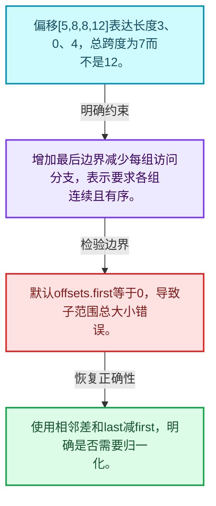
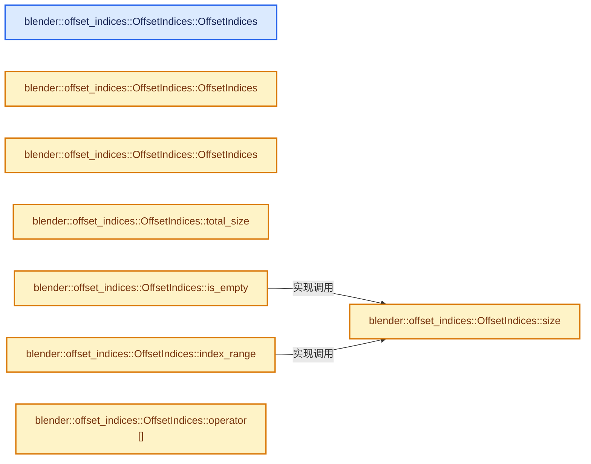
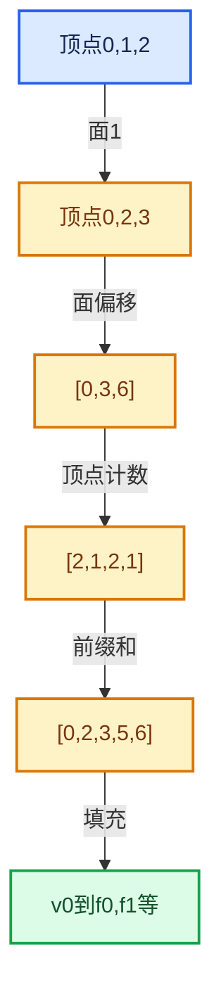

# 05-02 OffsetIndices完整接口

[方向导航](README.md) · [总目录](../README.md) · [实现索引](../00-课程指南/02-源码与提交索引/符号依赖与实现索引.md)

## 从问题到实现

为什么N个分组需要N加1个边界？

相邻偏移差定义分组大小，额外末边界避免末组特殊分支；单调不减允许空组。

**数据模型**

偏移[5,8,8,12]表达长度3、0、4，总跨度为7而不是12。

**设计取舍**

增加最后边界减少每组访问分支，表示要求各组连续且有序。

**最小反例**

默认offsets.first等于0，导致子范围总大小错误。

**推导**

使用相邻差和last减first，明确是否需要归一化。

## 阅读地图与执行推演








图中的数值推演是本方向的教学模型；实际函数之间的调用边与概念分析边分别标注，不能把概念关系当作运行时调度顺序。

## 完整源码单元与就地讲解

中文讲解直接放在相关代码旁，复杂机制在代码下展开。原文折叠区保留基准行号；不需要在行号表和函数之间来回查找。类布局可分段展示，函数实现不按固定行数切开。

### 类型布局、声明与编译条件 · BLI_offset_indices.hh L1—L43

<a id="t-4158d6354ada"></a>

<a id="t-2298383783db"></a>

`OffsetIndices`在这里声明的数据成员：

- `Span<T> offsets_`

<!-- annotated:e35486256534d5 -->

```cpp
/* SPDX-FileCopyrightText: 2023 Blender Authors
 *
 * SPDX-License-Identifier: GPL-2.0-or-later */

/** \file
 * \ingroup bli
 */

#pragma once

#include <algorithm>
#include <optional>

#include "BLI_array.hh"
#include "BLI_index_mask_fwd.hh"
#include "BLI_index_range.hh"
#include "BLI_span.hh"

namespace blender {

namespace offset_indices {

/** Utility struct that can be passed into a function to skip a check for sorted indices. */
struct NoSortCheck {};

/**
 * This class is a thin wrapper around an array of increasing indices that makes it easy to
 * retrieve an index range at a specific index. Each index range is typically a representation of
 * a contiguous chunk of a larger array.
 *
 * Another common way to store many index ranges is to store the start and size of every range.
 * Using #OffsetIndices instead requires that chunks are ordered consecutively but halves the
 * memory consumption. Another downside is that the underlying array has to be one element longer
 * than the total number of ranges. The extra element necessary to encode the size of the last
 * range without requiring a branch for each range access.
 */
template<typename T> class OffsetIndices {
 private:
  static_assert(std::is_integral_v<T>);

  Span<T> offsets_;

 public:
```

<details>
<summary>核对原始源码：source/blender/blenlib/BLI_offset_indices.hh · L1—L43</summary>

<!-- original:e35486256534d5:source/blender/blenlib/BLI_offset_indices.hh:1:43 -->

```cpp
/* SPDX-FileCopyrightText: 2023 Blender Authors
 *
 * SPDX-License-Identifier: GPL-2.0-or-later */

/** \file
 * \ingroup bli
 */

#pragma once

#include <algorithm>
#include <optional>

#include "BLI_array.hh"
#include "BLI_index_mask_fwd.hh"
#include "BLI_index_range.hh"
#include "BLI_span.hh"

namespace blender {

namespace offset_indices {

/** Utility struct that can be passed into a function to skip a check for sorted indices. */
struct NoSortCheck {};

/**
 * This class is a thin wrapper around an array of increasing indices that makes it easy to
 * retrieve an index range at a specific index. Each index range is typically a representation of
 * a contiguous chunk of a larger array.
 *
 * Another common way to store many index ranges is to store the start and size of every range.
 * Using #OffsetIndices instead requires that chunks are ordered consecutively but halves the
 * memory consumption. Another downside is that the underlying array has to be one element longer
 * than the total number of ranges. The extra element necessary to encode the size of the last
 * range without requiring a branch for each range access.
 */
template<typename T> class OffsetIndices {
 private:
  static_assert(std::is_integral_v<T>);

  Span<T> offsets_;

 public:
```

</details>

<a id="f-52a26009810ef8ec"></a>

### `blender::offset_indices::OffsetIndices::OffsetIndices`

实现位置：[source/blender/blenlib/BLI_offset_indices.hh](../../../../../source/blender/blenlib/BLI_offset_indices.hh) · L44—L44。

**教学注释版**

<!-- annotated:ffad096847b64e -->

```cpp
  OffsetIndices() = default;
```

<details>
<summary>核对原始源码：source/blender/blenlib/BLI_offset_indices.hh · L44—L44</summary>

<!-- original:ffad096847b64e:source/blender/blenlib/BLI_offset_indices.hh:44:44 -->

```cpp
  OffsetIndices() = default;
```

</details>

**继续追踪实现**

本实现没有需要继续展开的显式调用；检查返回表达式、对象转换和调用者前置条件。

<a id="f-7be713f9489f3dd7"></a>

### `blender::offset_indices::OffsetIndices::OffsetIndices`

实现位置：[source/blender/blenlib/BLI_offset_indices.hh](../../../../../source/blender/blenlib/BLI_offset_indices.hh) · L45—L48。

接口参数：

- `const Span<T> offsets`

**教学注释版**

<!-- annotated:a3ef76a875e9da -->

```cpp
  OffsetIndices(const Span<T> offsets) : offsets_(offsets)
  {
    // [讲解] offsets_.size：查询视图长度或生成对应有效索引区间。
    BLI_assert(offsets_.size() < 2 || std::is_sorted(offsets_.begin(), offsets_.end()));
  }
```

<details>
<summary>核对原始源码：source/blender/blenlib/BLI_offset_indices.hh · L45—L48</summary>

<!-- original:a3ef76a875e9da:source/blender/blenlib/BLI_offset_indices.hh:45:48 -->

```cpp
  OffsetIndices(const Span<T> offsets) : offsets_(offsets)
  {
    BLI_assert(offsets_.size() < 2 || std::is_sorted(offsets_.begin(), offsets_.end()));
  }
```

</details>

**继续追踪实现**

- `BLI_assert` → [BLI_assert · L48](../90-实现依赖专题/01-BLI基础库/BLI_assert.hh.md#m-57a88495704d)；[BLI_assert · L63](../90-实现依赖专题/01-BLI基础库/BLI_assert.hh.md#m-d07050020cb5)。宏定义由构建条件选择。
- `offsets_.size` → [blender::Span::size · L256](../01-基础容器与现代CPP/05-Span只读连续视图.md#f-5f80fa006089c998)。
- `std::is_sorted` → [外部契约](https://eel.is/c++draft/)：这个边界按实际表达式及所属类型核对参数、返回值、寿命与失败行为。这里提供接口入口，不声称已解释该第三方版本的内部实现。
- `offsets_.begin` → [blender::Span::begin · L224](../01-基础容器与现代CPP/05-Span只读连续视图.md#f-415883b512284f46)。
- `offsets_.end` → [blender::Span::end · L228](../01-基础容器与现代CPP/05-Span只读连续视图.md#f-a7d8b9e494c291a7)。

### 类型布局、声明与编译条件 · BLI_offset_indices.hh L49—L54

<!-- annotated:db621c64c71fbc -->

```cpp

  /**
   * Same as above, but skips the debug check that indices are sorted, because that can have a
   * high performance impact making debug builds unusable for files that would be fine otherwise.
   * This can be used when it is known that the indices are sorted already.
   */
```

<details>
<summary>核对原始源码：source/blender/blenlib/BLI_offset_indices.hh · L49—L54</summary>

<!-- original:db621c64c71fbc:source/blender/blenlib/BLI_offset_indices.hh:49:54 -->

```cpp

  /**
   * Same as above, but skips the debug check that indices are sorted, because that can have a
   * high performance impact making debug builds unusable for files that would be fine otherwise.
   * This can be used when it is known that the indices are sorted already.
   */
```

</details>

<a id="f-db7e81a5ec2dfb8d"></a>

### `blender::offset_indices::OffsetIndices::OffsetIndices`

实现位置：[source/blender/blenlib/BLI_offset_indices.hh](../../../../../source/blender/blenlib/BLI_offset_indices.hh) · L55—L55。

接口参数：

- `const Span<T> offsets`
- `NoSortCheck`

**教学注释版**

<!-- annotated:a028780ef522e9 -->

```cpp
  OffsetIndices(const Span<T> offsets, NoSortCheck /*no_sort_check*/) : offsets_(offsets) {}
```

<details>
<summary>核对原始源码：source/blender/blenlib/BLI_offset_indices.hh · L55—L55</summary>

<!-- original:a028780ef522e9:source/blender/blenlib/BLI_offset_indices.hh:55:55 -->

```cpp
  OffsetIndices(const Span<T> offsets, NoSortCheck /*no_sort_check*/) : offsets_(offsets) {}
```

</details>

**继续追踪实现**

本实现没有需要继续展开的显式调用；检查返回表达式、对象转换和调用者前置条件。

### 类型布局、声明与编译条件 · BLI_offset_indices.hh L56—L57

<!-- annotated:0ad03deb131dd2 -->

```cpp

  /** Return the total number of elements in the referenced arrays. */
```

<details>
<summary>核对原始源码：source/blender/blenlib/BLI_offset_indices.hh · L56—L57</summary>

<!-- original:0ad03deb131dd2:source/blender/blenlib/BLI_offset_indices.hh:56:57 -->

```cpp

  /** Return the total number of elements in the referenced arrays. */
```

</details>

<a id="f-c111ffdac7a19248"></a>

### `blender::offset_indices::OffsetIndices::total_size`

实现位置：[source/blender/blenlib/BLI_offset_indices.hh](../../../../../source/blender/blenlib/BLI_offset_indices.hh) · L58—L61。

**教学注释版**

<!-- annotated:3c1b9d6ad9e98e -->

```cpp
  T total_size() const
  {
    // [讲解] offsets_.size：查询视图长度或生成对应有效索引区间。
    return offsets_.size() > 1 ? offsets_.last() - offsets_.first() : 0;
  }
```

<details>
<summary>核对原始源码：source/blender/blenlib/BLI_offset_indices.hh · L58—L61</summary>

<!-- original:3c1b9d6ad9e98e:source/blender/blenlib/BLI_offset_indices.hh:58:61 -->

```cpp
  T total_size() const
  {
    return offsets_.size() > 1 ? offsets_.last() - offsets_.first() : 0;
  }
```

</details>

**结果出口**

- `return offsets_.size() > 1 ? offsets_.last() - offsets_.first() : 0;`

**继续追踪实现**

- `offsets_.size` → [blender::Span::size · L256](../01-基础容器与现代CPP/05-Span只读连续视图.md#f-5f80fa006089c998)。
- `offsets_.last` → [blender::Span::last · L329](../01-基础容器与现代CPP/05-Span只读连续视图.md#f-a92146c285596891)。
- `offsets_.first` → [blender::Span::first · L319](../01-基础容器与现代CPP/05-Span只读连续视图.md#f-d8c9bcc3e9757248)。

### 类型布局、声明与编译条件 · BLI_offset_indices.hh L62—L66

<!-- annotated:0c0cdddc254c66 -->

```cpp

  /**
   * Return the number of ranges encoded by the offsets, not including the last value used
   * internally.
   */
```

<details>
<summary>核对原始源码：source/blender/blenlib/BLI_offset_indices.hh · L62—L66</summary>

<!-- original:0c0cdddc254c66:source/blender/blenlib/BLI_offset_indices.hh:62:66 -->

```cpp

  /**
   * Return the number of ranges encoded by the offsets, not including the last value used
   * internally.
   */
```

</details>

<a id="f-e238abc62ed42abd"></a>

### `blender::offset_indices::OffsetIndices::size`

读取连续区间或分组的边界信息。

实现位置：[source/blender/blenlib/BLI_offset_indices.hh](../../../../../source/blender/blenlib/BLI_offset_indices.hh) · L67—L70。

**教学注释版**

<!-- annotated:880c01db75635a -->

```cpp
  int64_t size() const
  {
    // [讲解] std::max<int64_t>：按比较关系选取较大值。本讲解中的增长公式同时满足最低请求和几何增长；若保存返回引用，还需注意实参寿命。
    return std::max<int64_t>(offsets_.size() - 1, 0);
  }
```

<details>
<summary>核对原始源码：source/blender/blenlib/BLI_offset_indices.hh · L67—L70</summary>

<!-- original:880c01db75635a:source/blender/blenlib/BLI_offset_indices.hh:67:70 -->

```cpp
  int64_t size() const
  {
    return std::max<int64_t>(offsets_.size() - 1, 0);
  }
```

</details>

**接口与不变量**

尾后边界不是最后元素；OffsetIndices组数与底层边界数组长度差一个末边界。

**结果出口**

- `return std::max<int64_t>(offsets_.size() - 1, 0);`

**继续追踪实现**

- `std::max<int64_t>` → [外部契约](https://eel.is/c++draft/alg.min.max)：按比较关系选取较大值。本讲解中的增长公式同时满足最低请求和几何增长；若保存返回引用，还需注意实参寿命。
- `offsets_.size` → [blender::Span::size · L256](../01-基础容器与现代CPP/05-Span只读连续视图.md#f-5f80fa006089c998)。

<!-- annotated:e4e0b5991e055b -->

```cpp

```

<details>
<summary>核对原始源码：source/blender/blenlib/BLI_offset_indices.hh · L71—L71</summary>

<!-- original:e4e0b5991e055b:source/blender/blenlib/BLI_offset_indices.hh:71:71 -->

```cpp

```

</details>

<a id="f-e348e19b62d50b3e"></a>

### `blender::offset_indices::OffsetIndices::is_empty`

读取连续区间或分组的边界信息。

实现位置：[source/blender/blenlib/BLI_offset_indices.hh](../../../../../source/blender/blenlib/BLI_offset_indices.hh) · L72—L75。

**教学注释版**

<!-- annotated:cd19095ab6311f -->

```cpp
  bool is_empty() const
  {
    // [讲解] this->size：读取连续区间或分组的边界信息。
    return this->size() == 0;
  }
```

<details>
<summary>核对原始源码：source/blender/blenlib/BLI_offset_indices.hh · L72—L75</summary>

<!-- original:cd19095ab6311f:source/blender/blenlib/BLI_offset_indices.hh:72:75 -->

```cpp
  bool is_empty() const
  {
    return this->size() == 0;
  }
```

</details>

**接口与不变量**

尾后边界不是最后元素；OffsetIndices组数与底层边界数组长度差一个末边界。

**结果出口**

- `return this->size() == 0;`

**继续追踪实现**

- `this->size` → [blender::offset_indices::OffsetIndices::size · L67](02-OffsetIndices完整接口.md#f-e238abc62ed42abd)。

<!-- annotated:d339e0843e0348 -->

```cpp

```

<details>
<summary>核对原始源码：source/blender/blenlib/BLI_offset_indices.hh · L76—L76</summary>

<!-- original:d339e0843e0348:source/blender/blenlib/BLI_offset_indices.hh:76:76 -->

```cpp

```

</details>

<a id="f-19b5ca1456de007d"></a>

### `blender::offset_indices::OffsetIndices::index_range`

实现位置：[source/blender/blenlib/BLI_offset_indices.hh](../../../../../source/blender/blenlib/BLI_offset_indices.hh) · L77—L80。

**教学注释版**

<!-- annotated:fbbf86ec0a58f4 -->

```cpp
  IndexRange index_range() const
  {
    // [讲解] this->size：读取连续区间或分组的边界信息。
    return IndexRange(this->size());
  }
```

<details>
<summary>核对原始源码：source/blender/blenlib/BLI_offset_indices.hh · L77—L80</summary>

<!-- original:fbbf86ec0a58f4:source/blender/blenlib/BLI_offset_indices.hh:77:80 -->

```cpp
  IndexRange index_range() const
  {
    return IndexRange(this->size());
  }
```

</details>

**结果出口**

- `return IndexRange(this->size());`

**继续追踪实现**

- `IndexRange` → [blender::IndexRange](../90-实现依赖专题/01-BLI基础库/BLI_index_range.hh.md#t-caa3466d6776)；[blender::gpu::shader::parser::IndexRange](../90-实现依赖专题/08-其他Blender模块/gpu/shader_tool/utils.hh.md#t-82d2bd4ea71c)；[blender::IndexRange](../90-实现依赖专题/08-其他Blender模块/makesdna/DNA_node_types.h.md#t-0448cc889d39)。
- `this->size` → [blender::offset_indices::OffsetIndices::size · L67](02-OffsetIndices完整接口.md#f-e238abc62ed42abd)。

<!-- annotated:e35e6e879fea0a -->

```cpp

```

<details>
<summary>核对原始源码：source/blender/blenlib/BLI_offset_indices.hh · L81—L81</summary>

<!-- original:e35e6e879fea0a:source/blender/blenlib/BLI_offset_indices.hh:81:81 -->

```cpp

```

</details>

<a id="f-7859aaa7a67d7ad8"></a>

### `blender::offset_indices::OffsetIndices::operator[]`

把分组编号映射成相邻偏移定义的区间。

实现位置：[source/blender/blenlib/BLI_offset_indices.hh](../../../../../source/blender/blenlib/BLI_offset_indices.hh) · L82—L89。

接口参数：

- `const int64_t index`

**教学注释版**

<!-- annotated:bb0a46660c6b5c -->

```cpp
  IndexRange operator[](const int64_t index) const
  {
    BLI_assert(index >= 0);
    // [讲解] offsets_.size：查询视图长度或生成对应有效索引区间。
    BLI_assert(index < offsets_.size() - 1);
    const int64_t begin = offsets_[index];
    const int64_t end = offsets_[index + 1];
    return IndexRange::from_begin_end(begin, end);
  }
```

<details>
<summary>核对原始源码：source/blender/blenlib/BLI_offset_indices.hh · L82—L89</summary>

<!-- original:bb0a46660c6b5c:source/blender/blenlib/BLI_offset_indices.hh:82:89 -->

```cpp
  IndexRange operator[](const int64_t index) const
  {
    BLI_assert(index >= 0);
    BLI_assert(index < offsets_.size() - 1);
    const int64_t begin = offsets_[index];
    const int64_t end = offsets_[index + 1];
    return IndexRange::from_begin_end(begin, end);
  }
```

</details>

**接口与不变量**

offset[i+1]减offset[i]得到组长度，允许空组；编号和组内元素索引不要混用。

**结果出口**

- `return IndexRange::from_begin_end(begin, end);`

**继续追踪实现**

- `BLI_assert` → [BLI_assert · L48](../90-实现依赖专题/01-BLI基础库/BLI_assert.hh.md#m-57a88495704d)；[BLI_assert · L63](../90-实现依赖专题/01-BLI基础库/BLI_assert.hh.md#m-d07050020cb5)。宏定义由构建条件选择。
- `offsets_.size` → [blender::Span::size · L256](../01-基础容器与现代CPP/05-Span只读连续视图.md#f-5f80fa006089c998)。
- `IndexRange::from_begin_end` → [blender::IndexRange::from_begin_end · L78](../01-基础容器与现代CPP/04-IndexRange连续整数区间.md#f-a523839fb9650253)。

<!-- annotated:4486094a685926 -->

```cpp

```

<details>
<summary>核对原始源码：source/blender/blenlib/BLI_offset_indices.hh · L90—L90</summary>

<!-- original:4486094a685926:source/blender/blenlib/BLI_offset_indices.hh:90:90 -->

```cpp

```

</details>

<a id="f-057c979f4ae40216"></a>

### `blender::offset_indices::OffsetIndices::operator[]`

把分组编号映射成相邻偏移定义的区间。

实现位置：[source/blender/blenlib/BLI_offset_indices.hh](../../../../../source/blender/blenlib/BLI_offset_indices.hh) · L91—L96。

接口参数：

- `const IndexRange indices`

**教学注释版**

<!-- annotated:6b2b4a6241abe4 -->

```cpp
  IndexRange operator[](const IndexRange indices) const
  {
    // [讲解] indices.start：读取连续区间或分组的边界信息。
    const int64_t begin = offsets_[indices.start()];
    // [讲解] indices.one_after_last：读取连续区间或分组的边界信息。
    const int64_t end = offsets_[indices.one_after_last()];
    return IndexRange::from_begin_end(begin, end);
  }
```

<details>
<summary>核对原始源码：source/blender/blenlib/BLI_offset_indices.hh · L91—L96</summary>

<!-- original:6b2b4a6241abe4:source/blender/blenlib/BLI_offset_indices.hh:91:96 -->

```cpp
  IndexRange operator[](const IndexRange indices) const
  {
    const int64_t begin = offsets_[indices.start()];
    const int64_t end = offsets_[indices.one_after_last()];
    return IndexRange::from_begin_end(begin, end);
  }
```

</details>

**接口与不变量**

offset[i+1]减offset[i]得到组长度，允许空组；编号和组内元素索引不要混用。

**结果出口**

- `return IndexRange::from_begin_end(begin, end);`

**继续追踪实现**

- `indices.start` → [blender::IndexRange::start · L243](../01-基础容器与现代CPP/04-IndexRange连续整数区间.md#f-99d2195bd9cfd1f0)。
- `indices.one_after_last` → [blender::IndexRange::one_after_last · L235](../01-基础容器与现代CPP/04-IndexRange连续整数区间.md#f-ed04bec9c731fc86)。
- `IndexRange::from_begin_end` → [blender::IndexRange::from_begin_end · L78](../01-基础容器与现代CPP/04-IndexRange连续整数区间.md#f-a523839fb9650253)。

### 类型布局、声明与编译条件 · BLI_offset_indices.hh L97—L102

<!-- annotated:99a29bb128cfa2 -->

```cpp

  /**
   * Return a subset of the offsets describing the specified range of source elements.
   * This is a slice into the source ranges rather than the indexed elements described by the
   * offset values.
   */
```

<details>
<summary>核对原始源码：source/blender/blenlib/BLI_offset_indices.hh · L97—L102</summary>

<!-- original:99a29bb128cfa2:source/blender/blenlib/BLI_offset_indices.hh:97:102 -->

```cpp

  /**
   * Return a subset of the offsets describing the specified range of source elements.
   * This is a slice into the source ranges rather than the indexed elements described by the
   * offset values.
   */
```

</details>

<a id="f-79800a807858620a"></a>

### `blender::offset_indices::OffsetIndices::slice`

从已有范围生成子范围。

实现位置：[source/blender/blenlib/BLI_offset_indices.hh](../../../../../source/blender/blenlib/BLI_offset_indices.hh) · L103—L107。

接口参数：

- `const IndexRange range`

**教学注释版**

<!-- annotated:243e19ecca9497 -->

```cpp
  OffsetIndices slice(const IndexRange range) const
  {
    // [讲解] range.is_empty：读取连续区间或分组的边界信息。
    BLI_assert(range.is_empty() || offsets_.index_range().drop_back(1).contains(range.last()));
    // [讲解] offsets_.slice：建立原连续范围的子视图。
    return OffsetIndices(offsets_.slice(range.start(), range.size() + 1));
  }
```

<details>
<summary>核对原始源码：source/blender/blenlib/BLI_offset_indices.hh · L103—L107</summary>

<!-- original:243e19ecca9497:source/blender/blenlib/BLI_offset_indices.hh:103:107 -->

```cpp
  OffsetIndices slice(const IndexRange range) const
  {
    BLI_assert(range.is_empty() || offsets_.index_range().drop_back(1).contains(range.last()));
    return OffsetIndices(offsets_.slice(range.start(), range.size() + 1));
  }
```

</details>

**接口与不变量**

保留原坐标空间的索引，不自动把子范围归一化为零起点。

**结果出口**

- `return OffsetIndices(offsets_.slice(range.start(), range.size() + 1));`

**继续追踪实现**

- `BLI_assert` → [BLI_assert · L48](../90-实现依赖专题/01-BLI基础库/BLI_assert.hh.md#m-57a88495704d)；[BLI_assert · L63](../90-实现依赖专题/01-BLI基础库/BLI_assert.hh.md#m-d07050020cb5)。宏定义由构建条件选择。
- `range.is_empty` → [blender::IndexRange::is_empty · L169](../01-基础容器与现代CPP/04-IndexRange连续整数区间.md#f-9501e070be01ff71)。
- `offsets_.index_range().drop_back(1).contains` → [调用协议](../00-课程指南/01-路线与规范/模板宏与动态分派协议.md)：接收对象类型依赖auto、返回值或模板实例；不按同名猜测目标。调用位置L105。
- `offsets_.index_range().drop_back` → [调用协议](../00-课程指南/01-路线与规范/模板宏与动态分派协议.md)：接收对象类型依赖auto、返回值或模板实例；不按同名猜测目标。调用位置L105。
- `offsets_.index_range` → [blender::Span::index_range · L405](../01-基础容器与现代CPP/05-Span只读连续视图.md#f-caaa9b06e13e53e0)。
- `range.last` → [blender::IndexRange::last · L214](../01-基础容器与现代CPP/04-IndexRange连续整数区间.md#f-66896c6351a40de1)。
- `OffsetIndices` → [blender::offset_indices::OffsetIndices::OffsetIndices · L44](02-OffsetIndices完整接口.md#f-52a26009810ef8ec)；[blender::offset_indices::OffsetIndices::OffsetIndices · L45](02-OffsetIndices完整接口.md#f-7be713f9489f3dd7)；[blender::offset_indices::OffsetIndices::OffsetIndices · L55](02-OffsetIndices完整接口.md#f-db7e81a5ec2dfb8d)。同名重载需按实参类型选择。
- `offsets_.slice` → [blender::Span::slice · L141](../01-基础容器与现代CPP/05-Span只读连续视图.md#f-380a0e8fdcbd53cc)；[blender::Span::slice · L149](../01-基础容器与现代CPP/05-Span只读连续视图.md#f-9b9c15e78dd54eec)。同名重载需按实参类型选择。
- `range.start` → [blender::IndexRange::start · L243](../01-基础容器与现代CPP/04-IndexRange连续整数区间.md#f-99d2195bd9cfd1f0)。
- `range.size` → [blender::IndexRange::size · L156](../01-基础容器与现代CPP/04-IndexRange连续整数区间.md#f-05f66c3ebb2fdfec)。

<!-- annotated:8de8b07587afe4 -->

```cpp

```

<details>
<summary>核对原始源码：source/blender/blenlib/BLI_offset_indices.hh · L108—L108</summary>

<!-- original:8de8b07587afe4:source/blender/blenlib/BLI_offset_indices.hh:108:108 -->

```cpp

```

</details>

<a id="f-aab71e7e2c02fc06"></a>

### `blender::offset_indices::OffsetIndices::data`

实现位置：[source/blender/blenlib/BLI_offset_indices.hh](../../../../../source/blender/blenlib/BLI_offset_indices.hh) · L109—L112。

**教学注释版**

<!-- annotated:d0c06a50efab5e -->

```cpp
  Span<T> data() const
  {
    return offsets_;
  }
```

<details>
<summary>核对原始源码：source/blender/blenlib/BLI_offset_indices.hh · L109—L112</summary>

<!-- original:d0c06a50efab5e:source/blender/blenlib/BLI_offset_indices.hh:109:112 -->

```cpp
  Span<T> data() const
  {
    return offsets_;
  }
```

</details>

**结果出口**

- `return offsets_;`

**继续追踪实现**

本实现没有需要继续展开的显式调用；检查返回表达式、对象转换和调用者前置条件。

### 类型布局、声明与编译条件 · BLI_offset_indices.hh L113—L126

<a id="t-1db8173b01a5"></a>

`GroupedSpan`在这里声明的数据成员：

- `OffsetIndices<int> offsets`
- `Span<T> data`

<!-- annotated:bc7558745372cd -->

```cpp
};

/**
 * References many separate spans in a larger contiguous array. This gives a more efficient way to
 * store many grouped arrays, without requiring many small allocations, giving the general benefits
 * of using contiguous memory.
 *
 * \note If the offsets are shared between many #GroupedSpan objects, it will be more efficient
 * to retrieve the #IndexRange only once and slice each span.
 */
template<typename T> struct GroupedSpan {
  OffsetIndices<int> offsets;
  Span<T> data;

```

<details>
<summary>核对原始源码：source/blender/blenlib/BLI_offset_indices.hh · L113—L126</summary>

<!-- original:bc7558745372cd:source/blender/blenlib/BLI_offset_indices.hh:113:126 -->

```cpp
};

/**
 * References many separate spans in a larger contiguous array. This gives a more efficient way to
 * store many grouped arrays, without requiring many small allocations, giving the general benefits
 * of using contiguous memory.
 *
 * \note If the offsets are shared between many #GroupedSpan objects, it will be more efficient
 * to retrieve the #IndexRange only once and slice each span.
 */
template<typename T> struct GroupedSpan {
  OffsetIndices<int> offsets;
  Span<T> data;

```

</details>

<a id="f-7873f891bc51e8c7"></a>

### `blender::offset_indices::GroupedSpan::GroupedSpan`

实现位置：[source/blender/blenlib/BLI_offset_indices.hh](../../../../../source/blender/blenlib/BLI_offset_indices.hh) · L127—L127。

**教学注释版**

<!-- annotated:ea0ad337aa5729 -->

```cpp
  GroupedSpan() = default;
```

<details>
<summary>核对原始源码：source/blender/blenlib/BLI_offset_indices.hh · L127—L127</summary>

<!-- original:ea0ad337aa5729:source/blender/blenlib/BLI_offset_indices.hh:127:127 -->

```cpp
  GroupedSpan() = default;
```

</details>

**继续追踪实现**

本实现没有需要继续展开的显式调用；检查返回表达式、对象转换和调用者前置条件。

<a id="f-d59a6907578831ba"></a>

### `blender::offset_indices::GroupedSpan::GroupedSpan`

实现位置：[source/blender/blenlib/BLI_offset_indices.hh](../../../../../source/blender/blenlib/BLI_offset_indices.hh) · L128—L131。

接口参数：

- `OffsetIndices<int> offsets`
- `Span<T> data`

**教学注释版**

<!-- annotated:5bc525ca044055 -->

```cpp
  GroupedSpan(OffsetIndices<int> offsets, Span<T> data) : offsets(offsets), data(data)
  {
    BLI_assert(this->offsets.total_size() == this->data.size());
  }
```

<details>
<summary>核对原始源码：source/blender/blenlib/BLI_offset_indices.hh · L128—L131</summary>

<!-- original:5bc525ca044055:source/blender/blenlib/BLI_offset_indices.hh:128:131 -->

```cpp
  GroupedSpan(OffsetIndices<int> offsets, Span<T> data) : offsets(offsets), data(data)
  {
    BLI_assert(this->offsets.total_size() == this->data.size());
  }
```

</details>

**继续追踪实现**

- `BLI_assert` → [BLI_assert · L48](../90-实现依赖专题/01-BLI基础库/BLI_assert.hh.md#m-57a88495704d)；[BLI_assert · L63](../90-实现依赖专题/01-BLI基础库/BLI_assert.hh.md#m-d07050020cb5)。宏定义由构建条件选择。
- `this->offsets.total_size` → [调用协议](../00-课程指南/01-路线与规范/模板宏与动态分派协议.md)：接收对象类型依赖auto、返回值或模板实例；不按同名猜测目标。调用位置L130。
- `this->data.size` → [调用协议](../00-课程指南/01-路线与规范/模板宏与动态分派协议.md)：接收对象类型依赖auto、返回值或模板实例；不按同名猜测目标。调用位置L130。

<!-- annotated:a0b1200ca7ecd7 -->

```cpp

```

<details>
<summary>核对原始源码：source/blender/blenlib/BLI_offset_indices.hh · L132—L132</summary>

<!-- original:a0b1200ca7ecd7:source/blender/blenlib/BLI_offset_indices.hh:132:132 -->

```cpp

```

</details>

<a id="f-4ea42f93fe3651db"></a>

### `blender::offset_indices::GroupedSpan::operator[]`

实现位置：[source/blender/blenlib/BLI_offset_indices.hh](../../../../../source/blender/blenlib/BLI_offset_indices.hh) · L133—L136。

接口参数：

- `const int64_t index`

**教学注释版**

<!-- annotated:a7ab9b471965a5 -->

```cpp
  Span<T> operator[](const int64_t index) const
  {
    return this->data.slice(this->offsets[index]);
  }
```

<details>
<summary>核对原始源码：source/blender/blenlib/BLI_offset_indices.hh · L133—L136</summary>

<!-- original:a7ab9b471965a5:source/blender/blenlib/BLI_offset_indices.hh:133:136 -->

```cpp
  Span<T> operator[](const int64_t index) const
  {
    return this->data.slice(this->offsets[index]);
  }
```

</details>

**结果出口**

- `return this->data.slice(this->offsets[index]);`

**继续追踪实现**

- `this->data.slice` → [调用协议](../00-课程指南/01-路线与规范/模板宏与动态分派协议.md)：接收对象类型依赖auto、返回值或模板实例；不按同名猜测目标。调用位置L135。

<!-- annotated:a935cb6f117561 -->

```cpp

```

<details>
<summary>核对原始源码：source/blender/blenlib/BLI_offset_indices.hh · L137—L137</summary>

<!-- original:a935cb6f117561:source/blender/blenlib/BLI_offset_indices.hh:137:137 -->

```cpp

```

</details>

<a id="f-05d068a7e35e9521"></a>

### `blender::offset_indices::GroupedSpan::size`

实现位置：[source/blender/blenlib/BLI_offset_indices.hh](../../../../../source/blender/blenlib/BLI_offset_indices.hh) · L138—L141。

**教学注释版**

<!-- annotated:715602c7b2101a -->

```cpp
  int64_t size() const
  {
    return this->offsets.size();
  }
```

<details>
<summary>核对原始源码：source/blender/blenlib/BLI_offset_indices.hh · L138—L141</summary>

<!-- original:715602c7b2101a:source/blender/blenlib/BLI_offset_indices.hh:138:141 -->

```cpp
  int64_t size() const
  {
    return this->offsets.size();
  }
```

</details>

**结果出口**

- `return this->offsets.size();`

**继续追踪实现**

- `this->offsets.size` → [调用协议](../00-课程指南/01-路线与规范/模板宏与动态分派协议.md)：接收对象类型依赖auto、返回值或模板实例；不按同名猜测目标。调用位置L140。

<!-- annotated:15fc56e9c86eb2 -->

```cpp

```

<details>
<summary>核对原始源码：source/blender/blenlib/BLI_offset_indices.hh · L142—L142</summary>

<!-- original:15fc56e9c86eb2:source/blender/blenlib/BLI_offset_indices.hh:142:142 -->

```cpp

```

</details>

<a id="f-b8ff7336d5914412"></a>

### `blender::offset_indices::GroupedSpan::index_range`

实现位置：[source/blender/blenlib/BLI_offset_indices.hh](../../../../../source/blender/blenlib/BLI_offset_indices.hh) · L143—L146。

**教学注释版**

<!-- annotated:d49b281a3f3e50 -->

```cpp
  IndexRange index_range() const
  {
    return this->offsets.index_range();
  }
```

<details>
<summary>核对原始源码：source/blender/blenlib/BLI_offset_indices.hh · L143—L146</summary>

<!-- original:d49b281a3f3e50:source/blender/blenlib/BLI_offset_indices.hh:143:146 -->

```cpp
  IndexRange index_range() const
  {
    return this->offsets.index_range();
  }
```

</details>

**结果出口**

- `return this->offsets.index_range();`

**继续追踪实现**

- `this->offsets.index_range` → [调用协议](../00-课程指南/01-路线与规范/模板宏与动态分派协议.md)：接收对象类型依赖auto、返回值或模板实例；不按同名猜测目标。调用位置L145。

<!-- annotated:f2b168e16f6a84 -->

```cpp

```

<details>
<summary>核对原始源码：source/blender/blenlib/BLI_offset_indices.hh · L147—L147</summary>

<!-- original:f2b168e16f6a84:source/blender/blenlib/BLI_offset_indices.hh:147:147 -->

```cpp

```

</details>

<a id="f-fbf8831b9c376155"></a>

### `blender::offset_indices::GroupedSpan::is_empty`

实现位置：[source/blender/blenlib/BLI_offset_indices.hh](../../../../../source/blender/blenlib/BLI_offset_indices.hh) · L148—L151。

**教学注释版**

<!-- annotated:d73ae5cea5ea75 -->

```cpp
  bool is_empty() const
  {
    return this->data.size() == 0;
  }
```

<details>
<summary>核对原始源码：source/blender/blenlib/BLI_offset_indices.hh · L148—L151</summary>

<!-- original:d73ae5cea5ea75:source/blender/blenlib/BLI_offset_indices.hh:148:151 -->

```cpp
  bool is_empty() const
  {
    return this->data.size() == 0;
  }
```

</details>

**结果出口**

- `return this->data.size() == 0;`

**继续追踪实现**

- `this->data.size` → [调用协议](../00-课程指南/01-路线与规范/模板宏与动态分派协议.md)：接收对象类型依赖auto、返回值或模板实例；不按同名猜测目标。调用位置L150。

### 类型布局、声明与编译条件 · BLI_offset_indices.hh L152—L181

<!-- annotated:af7849b38506c8 -->

```cpp
};

/**
 * Turn an array of sizes into the offset at each index including all previous sizes.
 */
OffsetIndices<int> accumulate_counts_to_offsets(MutableSpan<int> counts_to_offsets,
                                                int start_offset = 0);

std::optional<OffsetIndices<int>> accumulate_counts_to_offsets_with_overflow_check(
    MutableSpan<int> counts_to_offsets, int start_offset = 0);

/** Create offsets where every group has the same size. */
void fill_constant_group_size(int size, int start_offset, MutableSpan<int> offsets);

/** Copy the number of indices in every group in the mask to the corresponding index. */
void copy_group_sizes(OffsetIndices<int> offsets, const IndexMask &mask, MutableSpan<int> sizes);

/** Gather the number of indices in each indexed group to sizes. */
void gather_group_sizes(OffsetIndices<int> offsets, const IndexMask &mask, MutableSpan<int> sizes);
void gather_group_sizes(OffsetIndices<int> offsets, Span<int> indices, MutableSpan<int> sizes);

/** Calculate the total size of all the referenced groups. */
int sum_group_sizes(OffsetIndices<int> offsets, const IndexMask &mask);
int sum_group_sizes(OffsetIndices<int> offsets, Span<int> indices);

/** Build new offsets that contains only the groups chosen by \a selection. */
OffsetIndices<int> gather_selected_offsets(OffsetIndices<int> src_offsets,
                                           const IndexMask &selection,
                                           int start_offset,
                                           MutableSpan<int> dst_offsets);
```

<details>
<summary>核对原始源码：source/blender/blenlib/BLI_offset_indices.hh · L152—L181</summary>

<!-- original:af7849b38506c8:source/blender/blenlib/BLI_offset_indices.hh:152:181 -->

```cpp
};

/**
 * Turn an array of sizes into the offset at each index including all previous sizes.
 */
OffsetIndices<int> accumulate_counts_to_offsets(MutableSpan<int> counts_to_offsets,
                                                int start_offset = 0);

std::optional<OffsetIndices<int>> accumulate_counts_to_offsets_with_overflow_check(
    MutableSpan<int> counts_to_offsets, int start_offset = 0);

/** Create offsets where every group has the same size. */
void fill_constant_group_size(int size, int start_offset, MutableSpan<int> offsets);

/** Copy the number of indices in every group in the mask to the corresponding index. */
void copy_group_sizes(OffsetIndices<int> offsets, const IndexMask &mask, MutableSpan<int> sizes);

/** Gather the number of indices in each indexed group to sizes. */
void gather_group_sizes(OffsetIndices<int> offsets, const IndexMask &mask, MutableSpan<int> sizes);
void gather_group_sizes(OffsetIndices<int> offsets, Span<int> indices, MutableSpan<int> sizes);

/** Calculate the total size of all the referenced groups. */
int sum_group_sizes(OffsetIndices<int> offsets, const IndexMask &mask);
int sum_group_sizes(OffsetIndices<int> offsets, Span<int> indices);

/** Build new offsets that contains only the groups chosen by \a selection. */
OffsetIndices<int> gather_selected_offsets(OffsetIndices<int> src_offsets,
                                           const IndexMask &selection,
                                           int start_offset,
                                           MutableSpan<int> dst_offsets);
```

</details>

<a id="f-7114c46ef264d80b"></a>

### `blender::offset_indices::gather_selected_offsets`

实现位置：[source/blender/blenlib/BLI_offset_indices.hh](../../../../../source/blender/blenlib/BLI_offset_indices.hh) · L182—L187。

接口参数：

- `OffsetIndices<int> src_offsets`
- `const IndexMask &selection`
- `MutableSpan<int> dst_offsets`

**教学注释版**

<!-- annotated:d0ab26a86ec3b5 -->

```cpp
inline OffsetIndices<int> gather_selected_offsets(OffsetIndices<int> src_offsets,
                                                  const IndexMask &selection,
                                                  MutableSpan<int> dst_offsets)
{
  return gather_selected_offsets(src_offsets, selection, 0, dst_offsets);
}
```

<details>
<summary>核对原始源码：source/blender/blenlib/BLI_offset_indices.hh · L182—L187</summary>

<!-- original:d0ab26a86ec3b5:source/blender/blenlib/BLI_offset_indices.hh:182:187 -->

```cpp
inline OffsetIndices<int> gather_selected_offsets(OffsetIndices<int> src_offsets,
                                                  const IndexMask &selection,
                                                  MutableSpan<int> dst_offsets)
{
  return gather_selected_offsets(src_offsets, selection, 0, dst_offsets);
}
```

</details>

**结果出口**

- `return gather_selected_offsets(src_offsets, selection, 0, dst_offsets);`

**继续追踪实现**

- `gather_selected_offsets` → [blender::offset_indices::gather_selected_offsets · L182](02-OffsetIndices完整接口.md#f-7114c46ef264d80b)；[blender::offset_indices::gather_selected_offsets · L192](02-OffsetIndices完整接口.md#f-25cd4510af788ad9)。同名重载需按实参类型选择。

### 类型布局、声明与编译条件 · BLI_offset_indices.hh L188—L191

<!-- annotated:c788e94a610a89 -->

```cpp
OffsetIndices<int> gather_selected_offsets(OffsetIndices<int> src_offsets,
                                           Span<int> selection,
                                           int start_offset,
                                           MutableSpan<int> dst_offsets);
```

<details>
<summary>核对原始源码：source/blender/blenlib/BLI_offset_indices.hh · L188—L191</summary>

<!-- original:c788e94a610a89:source/blender/blenlib/BLI_offset_indices.hh:188:191 -->

```cpp
OffsetIndices<int> gather_selected_offsets(OffsetIndices<int> src_offsets,
                                           Span<int> selection,
                                           int start_offset,
                                           MutableSpan<int> dst_offsets);
```

</details>

<a id="f-25cd4510af788ad9"></a>

### `blender::offset_indices::gather_selected_offsets`

实现位置：[source/blender/blenlib/BLI_offset_indices.hh](../../../../../source/blender/blenlib/BLI_offset_indices.hh) · L192—L197。

接口参数：

- `OffsetIndices<int> src_offsets`
- `const Span<int> selection`
- `MutableSpan<int> dst_offsets`

**教学注释版**

<!-- annotated:281770381facae -->

```cpp
inline OffsetIndices<int> gather_selected_offsets(OffsetIndices<int> src_offsets,
                                                  const Span<int> selection,
                                                  MutableSpan<int> dst_offsets)
{
  return gather_selected_offsets(src_offsets, selection, 0, dst_offsets);
}
```

<details>
<summary>核对原始源码：source/blender/blenlib/BLI_offset_indices.hh · L192—L197</summary>

<!-- original:281770381facae:source/blender/blenlib/BLI_offset_indices.hh:192:197 -->

```cpp
inline OffsetIndices<int> gather_selected_offsets(OffsetIndices<int> src_offsets,
                                                  const Span<int> selection,
                                                  MutableSpan<int> dst_offsets)
{
  return gather_selected_offsets(src_offsets, selection, 0, dst_offsets);
}
```

</details>

**结果出口**

- `return gather_selected_offsets(src_offsets, selection, 0, dst_offsets);`

**继续追踪实现**

- `gather_selected_offsets` → [blender::offset_indices::gather_selected_offsets · L182](02-OffsetIndices完整接口.md#f-7114c46ef264d80b)；[blender::offset_indices::gather_selected_offsets · L192](02-OffsetIndices完整接口.md#f-25cd4510af788ad9)。同名重载需按实参类型选择。

### 类型布局、声明与编译条件 · BLI_offset_indices.hh L198—L284

<!-- annotated:5c6f634f444e88 -->

```cpp

/**
 * Create a map from indexed elements to the source indices, in other words from the larger array
 * to the smaller array.
 *
 * Example: `[0, 2, 2, 5] -> [0, 0, 2, 2, 2]`.
 */
void build_reverse_map(OffsetIndices<int> offsets, MutableSpan<int> r_map);

/**
 * Build offsets to group the elements of \a indices pointing to the same index.
 *
 * Example: `[1, 0, 1, 1] -> [0, 1, 4]`.
 */
OffsetIndices<int> build_reverse_offsets(Span<int> indices, MutableSpan<int> offsets);

/**
 * Used as a final step for parallel creation of grouped indices, to make results deterministic as
 * each group's indices are potentially filled from multiple threads.
 */
void sort_groups(OffsetIndices<int> groups, MutableSpan<int> indices);

/**
 * Where the `group_indices` argument maps elements into buckets, and the `offsets` argument
 * describes the size of each bucket, this function fills `results` with the indices in each bucket
 * grouped by `offsets`. The `sort` argument makes the results deterministic, ordering each bucket
 * by the position in `group_indices`. Otherwise internal parallelism makes this non-deterministic.
 *
 * Example: `[1, 0, 1, 1], offsets [0, 1, 4] -> [1, 0, 2, 3]`.
 */
void reverse_indices_in_groups(Span<int> group_indices,
                               OffsetIndices<int> offsets,
                               MutableSpan<int> results,
                               bool sort = true);

/**
 * Same as above, but every element belongs to one of the larger groups described by `value_groups`
 * Results contain the index of each group, and are always sorted.
 *
 * Example: `[1, 0, 1, 1], offsets [0, 1, 4], value_groups [0, 2, 4] -> [0, 0, 1, 1]`.
 */
void reverse_indices_in_groups(Span<int> group_indices,
                               OffsetIndices<int> offsets,
                               MutableSpan<int> results,
                               OffsetIndices<int> value_groups);

/**
 * Same as above, for the case where every group in `value_groups` has the same size.
 *
 * Example: `[1, 0, 1, 1], offsets [0, 1, 4], value_group_size 2 -> [0, 0, 1, 1]`.
 */
void reverse_indices_in_groups(Span<int> group_indices,
                               OffsetIndices<int> offsets,
                               MutableSpan<int> results,
                               int value_group_size);

/**
 * With `indices` divided in a certain number of unique groups, reverse the index mapping so that
 * the indices in each group can be index by the group index. Similar to
 * #reverse_indices_in_groups, but also creates the offsets.
 *
 * Example: `[1, 0, 1, 1], groups_num 2 -> offsets [0, 1, 4], indices [1, 0, 2, 3]`.
 */
GroupedSpan<int> build_groups_from_indices(Span<int> indices,
                                           int groups_num,
                                           Array<int> &offset_data,
                                           Array<int> &index_data);

/**
 * Same as above, but for `indices` gathered from a subset of a larger array, described by the
 * `values` mask. Groups then contain `values[position]` of every element instead of `position`.
 *
 * Example: `[1, 0, 1, 1], groups_num 2, values [10, 11, 13, 17]
 *          -> offsets [0, 1, 4], indices [11, 10, 13, 17]`.
 */
GroupedSpan<int> build_groups_from_indices(Span<int> indices,
                                           int groups_num,
                                           Array<int> &offset_data,
                                           Array<int> &index_data,
                                           const IndexMask &values);

}  // namespace offset_indices

using offset_indices::GroupedSpan;
using offset_indices::OffsetIndices;

}  // namespace blender
```

<details>
<summary>核对原始源码：source/blender/blenlib/BLI_offset_indices.hh · L198—L284</summary>

<!-- original:5c6f634f444e88:source/blender/blenlib/BLI_offset_indices.hh:198:284 -->

```cpp

/**
 * Create a map from indexed elements to the source indices, in other words from the larger array
 * to the smaller array.
 *
 * Example: `[0, 2, 2, 5] -> [0, 0, 2, 2, 2]`.
 */
void build_reverse_map(OffsetIndices<int> offsets, MutableSpan<int> r_map);

/**
 * Build offsets to group the elements of \a indices pointing to the same index.
 *
 * Example: `[1, 0, 1, 1] -> [0, 1, 4]`.
 */
OffsetIndices<int> build_reverse_offsets(Span<int> indices, MutableSpan<int> offsets);

/**
 * Used as a final step for parallel creation of grouped indices, to make results deterministic as
 * each group's indices are potentially filled from multiple threads.
 */
void sort_groups(OffsetIndices<int> groups, MutableSpan<int> indices);

/**
 * Where the `group_indices` argument maps elements into buckets, and the `offsets` argument
 * describes the size of each bucket, this function fills `results` with the indices in each bucket
 * grouped by `offsets`. The `sort` argument makes the results deterministic, ordering each bucket
 * by the position in `group_indices`. Otherwise internal parallelism makes this non-deterministic.
 *
 * Example: `[1, 0, 1, 1], offsets [0, 1, 4] -> [1, 0, 2, 3]`.
 */
void reverse_indices_in_groups(Span<int> group_indices,
                               OffsetIndices<int> offsets,
                               MutableSpan<int> results,
                               bool sort = true);

/**
 * Same as above, but every element belongs to one of the larger groups described by `value_groups`
 * Results contain the index of each group, and are always sorted.
 *
 * Example: `[1, 0, 1, 1], offsets [0, 1, 4], value_groups [0, 2, 4] -> [0, 0, 1, 1]`.
 */
void reverse_indices_in_groups(Span<int> group_indices,
                               OffsetIndices<int> offsets,
                               MutableSpan<int> results,
                               OffsetIndices<int> value_groups);

/**
 * Same as above, for the case where every group in `value_groups` has the same size.
 *
 * Example: `[1, 0, 1, 1], offsets [0, 1, 4], value_group_size 2 -> [0, 0, 1, 1]`.
 */
void reverse_indices_in_groups(Span<int> group_indices,
                               OffsetIndices<int> offsets,
                               MutableSpan<int> results,
                               int value_group_size);

/**
 * With `indices` divided in a certain number of unique groups, reverse the index mapping so that
 * the indices in each group can be index by the group index. Similar to
 * #reverse_indices_in_groups, but also creates the offsets.
 *
 * Example: `[1, 0, 1, 1], groups_num 2 -> offsets [0, 1, 4], indices [1, 0, 2, 3]`.
 */
GroupedSpan<int> build_groups_from_indices(Span<int> indices,
                                           int groups_num,
                                           Array<int> &offset_data,
                                           Array<int> &index_data);

/**
 * Same as above, but for `indices` gathered from a subset of a larger array, described by the
 * `values` mask. Groups then contain `values[position]` of every element instead of `position`.
 *
 * Example: `[1, 0, 1, 1], groups_num 2, values [10, 11, 13, 17]
 *          -> offsets [0, 1, 4], indices [11, 10, 13, 17]`.
 */
GroupedSpan<int> build_groups_from_indices(Span<int> indices,
                                           int groups_num,
                                           Array<int> &offset_data,
                                           Array<int> &index_data,
                                           const IndexMask &values);

}  // namespace offset_indices

using offset_indices::GroupedSpan;
using offset_indices::OffsetIndices;

}  // namespace blender
```

</details>

## 语法与相关类型

### 模板 template

模板把类型或常量作为生成实现的参数。读声明时先列出类型参数、非类型参数和默认值，再看使用者实际实例化了什么。模板声明本身不意味着每种T都支持其全部成员。

把T替换为int、string、只能移动的类型，分别检查每个被调用操作是否成立。

### 依赖名称 typename

typename既可引入类型模板参数，也可告诉编译器某个依赖名称是类型。它不创建运行时对象；解析期确认语法类别与实例化期检查具体类型是不同阶段。

区分typename T::value_type和T::size()，前者标记类型，后者是表达式。

### 约束 requires

requires表达式或requires子句限制模板参与重载的条件。它提供编译期可用性检查，不是运行时if，不能指望输入到达程序后再被这一机制验证。

构造满足和不满足约束的两个类型，观察候选被排除而不是在函数内返回错误。

### 只读限定 const

const约束当前访问路径可做的修改。const指针、指向const的指针、const视图对象、const元素是不同位置的限定；其他别名可能仍可修改原对象。

分别写T* const、const T*与const T* const，并画出不可修改的层次。

### 可选值 optional

optional把不存在与存在的T区分开，T的构造和析构跟随engaged状态变化。访问前应由has_value或条件分支证明存在。

把空Field状态与合法常量零区分，不能用某个普通值代替不存在。

### 构造与new表达式

普通new可能分配并构造；placement new在给定地址构造，存储由其他机制提供。失败回滚应区分两类责任。

追踪地址来自哪里、构造何时成功、由谁析构、由谁释放。

### 内部断言 assert

断言表达开发者预期成立的内部契约，发布构建可能关闭。它不能替代对不可信输入的完整错误处理，也不保证后续操作被运行时保护。

对每条断言构造违反条件的输入，区分调用者错误与应向用户报告的错误。

### 类型别名 using

类型别名为已有类型建立名字，不创建运行期对象。它常把模板内部使用的类型统一暴露给泛型调用者。

展开别名直到基础类型，区分类型别名和变量声明。

## 实现练习与验证

对0、3、3、7推演三个分组并检查空组。

参考推理：使用相邻差和last减first，明确是否需要归一化。

偏移单调不减；最终偏移与存储边界对应；每个角点引用合法顶点，每个反向映射可由正向关系验证。

## 历史、跨库比较与证据

把偏移数组与vector<vector<int>>、CSR邻接表示作比较：前者集中存储，后者方便独立增长；是否稳定修改比容器名字更影响选型。

[历史提交索引](../00-课程指南/02-源码与提交索引/历史提交与设计演化索引.md) · [源码基准](../00-课程指南/02-源码与提交索引/源码版本与覆盖索引.md) · [验收报告](../00-课程指南/03-验收报告/验收报告.md)
