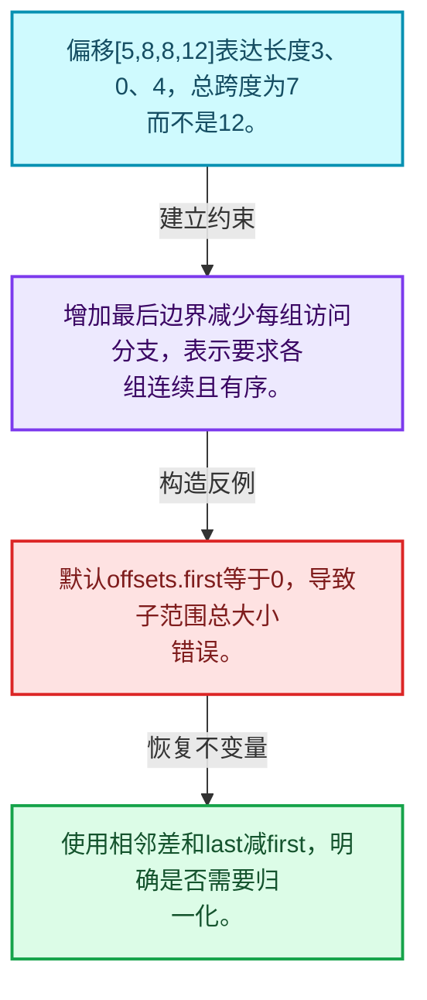
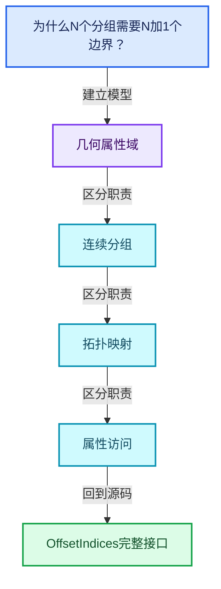
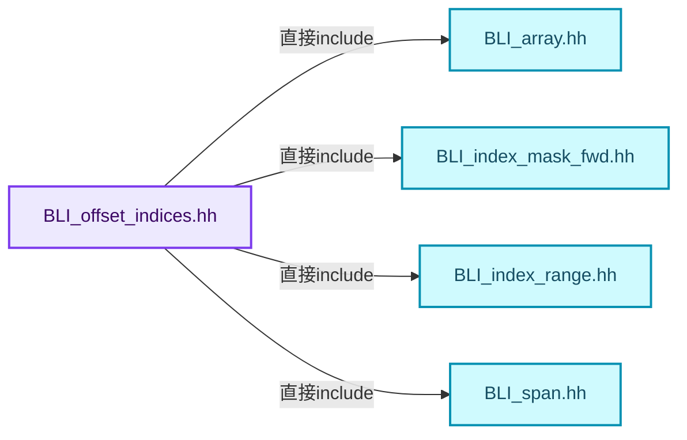
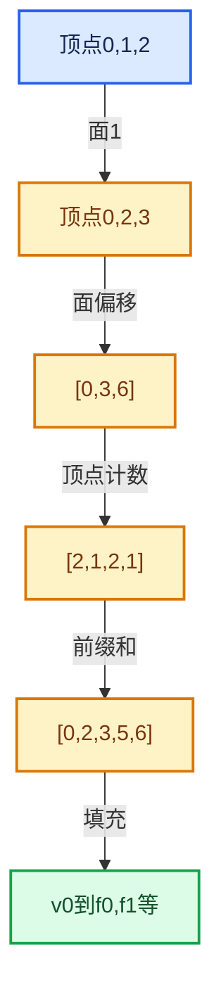

# 05-02 OffsetIndices完整接口

[方向导航](README.md) · [总目录](../README.md) · [覆盖索引](../%E6%BA%90%E7%A0%81%E7%89%88%E6%9C%AC%E4%B8%8E%E8%A6%86%E7%9B%96%E7%B4%A2%E5%BC%95.md)

> 阅读顺序：问题与数据模型 → 语法与类型 → 源码逐行 → 调用线索 → 历史与取舍 → 推演和练习。

- 基准 HEAD：`cbda6b96c26c0dee3c3b5cbb93960c4ac06a6b30`。
- 记录日期：2026-10-14。
- 教学示例状态：正文中的推演不是本机性能实测；已运行练习见验收报告。

## 一、从问题到设计

为什么N个分组需要N加1个边界？

相邻偏移差定义分组大小，额外末边界避免末组特殊分支；单调不减允许空组。

本篇把语法、数据语义和系统取舍连接起来。利用连续性和重复关系选择表示，让冗余状态尽量无法表达。

### 本篇独立模型与设计推理

偏移[5,8,8,12]表达长度3、0、4，总跨度为7而不是12。

设计取舍：增加最后边界减少每组访问分支，表示要求各组连续且有序。

最小反例：默认offsets.first等于0，导致子范围总大小错误。

推导与处理：使用相邻差和last减first，明确是否需要归一化。



### 源码范围与相邻篇章

| 文件 | 本篇逐行范围 | 基准SHA-256 |
|---|---|---|
| [source/blender/blenlib/BLI_offset_indices.hh](../../../../../source/blender/blenlib/BLI_offset_indices.hh) | L1—L284 | `12eed50b3acf97556a786873863b6581fba659b33f2ddb99eef51d373cb6b801` |

同一主讲文件可能分多篇覆盖；超出本篇范围的符号通过覆盖索引定位。空行与纯注释保留在源码摘录中，逐行表解释有效语句与语法边界；许可证头统一保留。

前篇：[Mesh顶点边面角点](01-Mesh%E9%A1%B6%E7%82%B9%E8%BE%B9%E9%9D%A2%E8%A7%92%E7%82%B9.md).

后篇：[MPoly迁移与兼容](03-MPoly%E8%BF%81%E7%A7%BB%E4%B8%8E%E5%85%BC%E5%AE%B9.md).

## 二、类型、数据与阅读地图



这是概念依赖图，边表示阅读关系，不声称是运行时调用顺序。

### 直接编译依赖



箭头只表示头文件包含关系；完整调用线索见后面的符号定位表。

## 三、关键词、语法与类型角色

### 模板 template

模板把类型或常量作为生成实现的参数。读声明时先列出类型参数、非类型参数和默认值，再看使用者实际实例化了什么。模板声明本身不意味着每种T都支持其全部成员。

具体检查：把T替换为int、string、只能移动的类型，分别检查每个被调用操作是否成立。

### 依赖名称 typename

typename既可引入类型模板参数，也可告诉编译器某个依赖名称是类型。它不创建运行时对象；解析期确认语法类别与实例化期检查具体类型是不同阶段。

具体检查：区分typename T::value_type和T::size()，前者标记类型，后者是表达式。

### 约束 requires

requires表达式或requires子句限制模板参与重载的条件。它提供编译期可用性检查，不是运行时if，不能指望输入到达程序后再被这一机制验证。

具体检查：构造满足和不满足约束的两个类型，观察候选被排除而不是在函数内返回错误。

### 只读限定 const

const约束当前访问路径可做的修改。const指针、指向const的指针、const视图对象、const元素是不同位置的限定；其他别名可能仍可修改原对象。

具体检查：分别写T* const、const T*与const T* const，并画出不可修改的层次。

### 可选值 optional

optional把不存在与存在的T区分开，T的构造和析构跟随engaged状态变化。访问前应由has_value或条件分支证明存在。

具体检查：把空Field状态与合法常量零区分，不能用某个普通值代替不存在。

### 构造与new表达式

普通new可能分配并构造；placement new在给定地址构造，存储由其他机制提供。失败回滚应区分两类责任。

具体检查：追踪地址来自哪里、构造何时成功、由谁析构、由谁释放。

### 内部断言 assert

断言表达开发者预期成立的内部契约，发布构建可能关闭。它不能替代对不可信输入的完整错误处理，也不保证后续操作被运行时保护。

具体检查：对每条断言构造违反条件的输入，区分调用者错误与应向用户报告的错误。

### 类型别名 using

类型别名为已有类型建立名字，不创建运行期对象。它常把模板内部使用的类型统一暴露给泛型调用者。

具体检查：展开别名直到基础类型，区分类型别名和变量声明。

### 偏移数组不一定从零开始

OffsetIndices可以包装切片后的偏移，所以total_size的实现是last减first，而不直接返回last。
例如offsets为`[5,8,8,12]`，组长度仍为3、0、4，总跨度为7。
operator[]返回的IndexRange仍使用存储中的边界，是否归一化由调用场景决定。
把所有偏移都假定从0开始会使子范围访问产生错误。
最后一个边界不代表另一个分组；分组数是偏移数减1，再按实现处理空输入。

## 四、真实源码与逐行讲解

源码块保持原行内容，原始行号由小节标题及逐行表给出。表中的调用定位是静态阅读辅助；重载、模板实例化、宏展开和虚调用需结合完整声明，不能仅凭词法出现证明动态调用。

### BLI_offset_indices.hh：L1—L48

<!-- source:source/blender/blenlib/BLI_offset_indices.hh:1:48 -->

```cpp
/* SPDX-FileCopyrightText: 2023 Blender Authors
 *
 * SPDX-License-Identifier: GPL-2.0-or-later */

/** \file
 * \ingroup bli
 */

#pragma once

#include <algorithm>
#include <optional>

#include "BLI_array.hh"
#include "BLI_index_mask_fwd.hh"
#include "BLI_index_range.hh"
#include "BLI_span.hh"

namespace blender {

namespace offset_indices {

/** Utility struct that can be passed into a function to skip a check for sorted indices. */
struct NoSortCheck {};

/**
 * This class is a thin wrapper around an array of increasing indices that makes it easy to
 * retrieve an index range at a specific index. Each index range is typically a representation of
 * a contiguous chunk of a larger array.
 *
 * Another common way to store many index ranges is to store the start and size of every range.
 * Using #OffsetIndices instead requires that chunks are ordered consecutively but halves the
 * memory consumption. Another downside is that the underlying array has to be one element longer
 * than the total number of ranges. The extra element necessary to encode the size of the last
 * range without requiring a branch for each range access.
 */
template<typename T> class OffsetIndices {
 private:
  static_assert(std::is_integral_v<T>);

  Span<T> offsets_;

 public:
  OffsetIndices() = default;
  OffsetIndices(const Span<T> offsets) : offsets_(offsets)
  {
    BLI_assert(offsets_.size() < 2 || std::is_sorted(offsets_.begin(), offsets_.end()));
  }
```

本段语义重点：

- `offsets_`：分组边界数组，相邻边界差给出组长度。

| 原始行 | 语义、约束与检查 |
|---|---|
| L9 | 防止同一头文件在一个翻译单元中重复展开；不控制多个源文件之间的链接或对象寿命。 |
| L11 | 引入编译依赖 <algorithm>；这是声明可见性关系，不表示运行时一定调用该文件的所有接口。 |
| L12 | 引入编译依赖 <optional>；这是声明可见性关系，不表示运行时一定调用该文件的所有接口。 |
| L14 | 引入编译依赖 "BLI_array.hh"；这是声明可见性关系，不表示运行时一定调用该文件的所有接口。 |
| L15 | 引入编译依赖 "BLI_index_mask_fwd.hh"；这是声明可见性关系，不表示运行时一定调用该文件的所有接口。 |
| L16 | 引入编译依赖 "BLI_index_range.hh"；这是声明可见性关系，不表示运行时一定调用该文件的所有接口。 |
| L17 | 引入编译依赖 "BLI_span.hh"；这是声明可见性关系，不表示运行时一定调用该文件的所有接口。 |
| L19 | 把后续声明放入 blender 命名空间，影响名称查找和符号归属，不创建运行时对象。 |
| L21 | 把后续声明放入 offset_indices 命名空间，影响名称查找和符号归属，不创建运行时对象。 |
| L24 | 声明或定义类型 `struct NoSortCheck {}`。结合继承、访问权限和成员布局确认接口与拥有关系；前向声明本身没有完整对象布局。 |
| L37 | 声明模板参数 `template<typename T> class OffsetIndices {`。类型参数决定生成操作的类型，非类型参数可决定内嵌容量或编译期分支。 |
| L38 | 切换成员访问权限为 private；它是编译期接口边界，不是线程同步或内存保护。 |
| L39 | 在编译期检查 `static_assert(std::is_integral_v<T>);`；条件失败导致编译错误，不存在运行时错误恢复路径。 |
| L41 | 本行涉及 `offsets_`：分组边界数组，相邻边界差给出组长度。按此语义解读 `Span<T> offsets_`，不要把地址、数量或状态混用。 |
| L43 | 切换成员访问权限为 public；它是编译期接口边界，不是线程同步或内存保护。 |
| L44 | 显式采用编译器生成的特殊成员行为：`OffsetIndices() = default;`。成员和基类的性质决定该操作是否可用、是否被删除及异常约定，不表示运行时给对象赋值为default。 |
| L45 | 本行涉及 `offsets_`：分组边界数组，相邻边界差给出组长度。按此语义解读 `OffsetIndices(const Span<T> offsets) : offsets_(offsets)`，不要把地址、数量或状态混用。 |
| L46 | 连接上一行的声明或控制结构与其语句块；后续行在这个作用域中执行或声明。 |
| L47 | 断言约束 `BLI_assert(offsets_.size() < 2 &#124;&#124; std::is_sorted(offsets_.begin(), offsets_.end()));`。条件是后续访问的内部前置条件；发布构建可能不执行，不能把断言当作输入修复。 |
| L48 | 结束当前语法单元。局部自动对象在离开其作用域时按规则销毁；这不等于所有被引用的外部数据也被释放。 |

### BLI_offset_indices.hh：L49—L96

<!-- source:source/blender/blenlib/BLI_offset_indices.hh:49:96 -->

```cpp

  /**
   * Same as above, but skips the debug check that indices are sorted, because that can have a
   * high performance impact making debug builds unusable for files that would be fine otherwise.
   * This can be used when it is known that the indices are sorted already.
   */
  OffsetIndices(const Span<T> offsets, NoSortCheck /*no_sort_check*/) : offsets_(offsets) {}

  /** Return the total number of elements in the referenced arrays. */
  T total_size() const
  {
    return offsets_.size() > 1 ? offsets_.last() - offsets_.first() : 0;
  }

  /**
   * Return the number of ranges encoded by the offsets, not including the last value used
   * internally.
   */
  int64_t size() const
  {
    return std::max<int64_t>(offsets_.size() - 1, 0);
  }

  bool is_empty() const
  {
    return this->size() == 0;
  }

  IndexRange index_range() const
  {
    return IndexRange(this->size());
  }

  IndexRange operator[](const int64_t index) const
  {
    BLI_assert(index >= 0);
    BLI_assert(index < offsets_.size() - 1);
    const int64_t begin = offsets_[index];
    const int64_t end = offsets_[index + 1];
    return IndexRange::from_begin_end(begin, end);
  }

  IndexRange operator[](const IndexRange indices) const
  {
    const int64_t begin = offsets_[indices.start()];
    const int64_t end = offsets_[indices.one_after_last()];
    return IndexRange::from_begin_end(begin, end);
  }
```

本段语义重点：

- `std::max`：取较大值，在容量计算中常用于同时满足请求量和增长策略。
- `offsets_`：分组边界数组，相邻边界差给出组长度。
- `total_size`：布局所需总字节数或范围总量，具体单位由声明和使用决定。

| 原始行 | 语义、约束与检查 |
|---|---|
| L55 | 本行涉及 `offsets_`：分组边界数组，相邻边界差给出组长度。按此语义解读 `OffsetIndices(const Span<T> offsets, NoSortCheck ) : offsets_(offsets) {}`，不要把地址、数量或状态混用。 |
| L58 | 本行涉及 `total_size`：布局所需总字节数或范围总量，具体单位由声明和使用决定。按此语义解读 `T total_size() const`，不要把地址、数量或状态混用。 |
| L59 | 连接上一行的声明或控制结构与其语句块；后续行在这个作用域中执行或声明。 |
| L60 | 返回表达式 `offsets_.size() > 1 ? offsets_.last() - offsets_.first() : 0`。 |
| L61 | 结束当前语法单元。局部自动对象在离开其作用域时按规则销毁；这不等于所有被引用的外部数据也被释放。 |
| L67 | 出现调用或函数声明 `size`，对应表达式为 `int64_t size() const`。参数求值、返回类型与重载需结合前后完整语句；静态文本引用不能证明动态目标。 |
| L68 | 连接上一行的声明或控制结构与其语句块；后续行在这个作用域中执行或声明。 |
| L69 | 本行使用 `std::max`：取较大值，在容量计算中常用于同时满足请求量和增长策略。 |
| L70 | 结束当前语法单元。局部自动对象在离开其作用域时按规则销毁；这不等于所有被引用的外部数据也被释放。 |
| L72 | 出现调用或函数声明 `is_empty`，对应表达式为 `bool is_empty() const`。参数求值、返回类型与重载需结合前后完整语句；静态文本引用不能证明动态目标。 |
| L73 | 连接上一行的声明或控制结构与其语句块；后续行在这个作用域中执行或声明。 |
| L74 | 纯虚接口声明：`return this->size() == 0;`。等号零标记抽象接口，需要按继承约定提供覆写；不表示执行函数并把结果设为零。 |
| L75 | 结束当前语法单元。局部自动对象在离开其作用域时按规则销毁；这不等于所有被引用的外部数据也被释放。 |
| L77 | 出现调用或函数声明 `index_range`，对应表达式为 `IndexRange index_range() const`。参数求值、返回类型与重载需结合前后完整语句；静态文本引用不能证明动态目标。 |
| L78 | 连接上一行的声明或控制结构与其语句块；后续行在这个作用域中执行或声明。 |
| L79 | 返回表达式 `IndexRange(this->size())`。 |
| L80 | 结束当前语法单元。局部自动对象在离开其作用域时按规则销毁；这不等于所有被引用的外部数据也被释放。 |
| L82 | 运算符重载声明、定义或显式调用：`IndexRange operator[](const int64_t index) const`。结合参数和返回类型判断是赋值、索引、比较还是转换；operator=声明中的等号不是在给名为operator的变量赋值。 |
| L83 | 连接上一行的声明或控制结构与其语句块；后续行在这个作用域中执行或声明。 |
| L84 | 断言约束 `BLI_assert(index >= 0);`。条件是后续访问的内部前置条件；发布构建可能不执行，不能把断言当作输入修复。 |
| L85 | 断言约束 `BLI_assert(index < offsets_.size() - 1);`。条件是后续访问的内部前置条件；发布构建可能不执行，不能把断言当作输入修复。 |
| L86 | 建立或更新 `offsets_`：分组边界数组，相邻边界差给出组长度。本行的具体值关系为 `const int64_t begin = offsets_[index]`；对照更新前后相应范围或状态是否一致。 |
| L87 | 建立或更新 `offsets_`：分组边界数组，相邻边界差给出组长度。本行的具体值关系为 `const int64_t end = offsets_[index + 1]`；对照更新前后相应范围或状态是否一致。 |
| L88 | 返回表达式 `IndexRange::from_begin_end(begin, end)`。 |
| L89 | 结束当前语法单元。局部自动对象在离开其作用域时按规则销毁；这不等于所有被引用的外部数据也被释放。 |
| L91 | 运算符重载声明、定义或显式调用：`IndexRange operator[](const IndexRange indices) const`。结合参数和返回类型判断是赋值、索引、比较还是转换；operator=声明中的等号不是在给名为operator的变量赋值。 |
| L92 | 连接上一行的声明或控制结构与其语句块；后续行在这个作用域中执行或声明。 |
| L93 | 建立或更新 `offsets_`：分组边界数组，相邻边界差给出组长度。本行的具体值关系为 `const int64_t begin = offsets_[indices.start()]`；对照更新前后相应范围或状态是否一致。 |
| L94 | 建立或更新 `offsets_`：分组边界数组，相邻边界差给出组长度。本行的具体值关系为 `const int64_t end = offsets_[indices.one_after_last()]`；对照更新前后相应范围或状态是否一致。 |
| L95 | 返回表达式 `IndexRange::from_begin_end(begin, end)`。 |
| L96 | 结束当前语法单元。局部自动对象在离开其作用域时按规则销毁；这不等于所有被引用的外部数据也被释放。 |

### BLI_offset_indices.hh：L97—L146

<!-- source:source/blender/blenlib/BLI_offset_indices.hh:97:146 -->

```cpp

  /**
   * Return a subset of the offsets describing the specified range of source elements.
   * This is a slice into the source ranges rather than the indexed elements described by the
   * offset values.
   */
  OffsetIndices slice(const IndexRange range) const
  {
    BLI_assert(range.is_empty() || offsets_.index_range().drop_back(1).contains(range.last()));
    return OffsetIndices(offsets_.slice(range.start(), range.size() + 1));
  }

  Span<T> data() const
  {
    return offsets_;
  }
};

/**
 * References many separate spans in a larger contiguous array. This gives a more efficient way to
 * store many grouped arrays, without requiring many small allocations, giving the general benefits
 * of using contiguous memory.
 *
 * \note If the offsets are shared between many #GroupedSpan objects, it will be more efficient
 * to retrieve the #IndexRange only once and slice each span.
 */
template<typename T> struct GroupedSpan {
  OffsetIndices<int> offsets;
  Span<T> data;

  GroupedSpan() = default;
  GroupedSpan(OffsetIndices<int> offsets, Span<T> data) : offsets(offsets), data(data)
  {
    BLI_assert(this->offsets.total_size() == this->data.size());
  }

  Span<T> operator[](const int64_t index) const
  {
    return this->data.slice(this->offsets[index]);
  }

  int64_t size() const
  {
    return this->offsets.size();
  }

  IndexRange index_range() const
  {
    return this->offsets.index_range();
  }
```

本段语义重点：

- `offsets_`：分组边界数组，相邻边界差给出组长度。
- `total_size`：布局所需总字节数或范围总量，具体单位由声明和使用决定。

| 原始行 | 语义、约束与检查 |
|---|---|
| L103 | 出现调用或函数声明 `slice`，对应表达式为 `OffsetIndices slice(const IndexRange range) const`。参数求值、返回类型与重载需结合前后完整语句；静态文本引用不能证明动态目标。 |
| L104 | 连接上一行的声明或控制结构与其语句块；后续行在这个作用域中执行或声明。 |
| L105 | 断言约束 `BLI_assert(range.is_empty() &#124;&#124; offsets_.index_range().drop_back(1).contains(range.last()));`。条件是后续访问的内部前置条件；发布构建可能不执行，不能把断言当作输入修复。 |
| L106 | 返回表达式 `OffsetIndices(offsets_.slice(range.start(), range.size() + 1))`。 |
| L107 | 结束当前语法单元。局部自动对象在离开其作用域时按规则销毁；这不等于所有被引用的外部数据也被释放。 |
| L109 | 出现调用或函数声明 `data`，对应表达式为 `Span<T> data() const`。参数求值、返回类型与重载需结合前后完整语句；静态文本引用不能证明动态目标。 |
| L110 | 连接上一行的声明或控制结构与其语句块；后续行在这个作用域中执行或声明。 |
| L111 | 返回表达式 `offsets_`。 |
| L112 | 结束当前语法单元。局部自动对象在离开其作用域时按规则销毁；这不等于所有被引用的外部数据也被释放。 |
| L113 | 结束当前语法单元。局部自动对象在离开其作用域时按规则销毁；这不等于所有被引用的外部数据也被释放。 |
| L123 | 声明模板参数 `template<typename T> struct GroupedSpan {`。类型参数决定生成操作的类型，非类型参数可决定内嵌容量或编译期分支。 |
| L124 | 声明成员、局部对象或完成语句 `OffsetIndices<int> offsets`。若为指针或引用，它本身不说明拥有；若为值对象，其构造析构由所在作用域或外层对象管理。 |
| L125 | 声明成员、局部对象或完成语句 `Span<T> data`。若为指针或引用，它本身不说明拥有；若为值对象，其构造析构由所在作用域或外层对象管理。 |
| L127 | 显式采用编译器生成的特殊成员行为：`GroupedSpan() = default;`。成员和基类的性质决定该操作是否可用、是否被删除及异常约定，不表示运行时给对象赋值为default。 |
| L128 | 出现调用或函数声明 `GroupedSpan`，对应表达式为 `GroupedSpan(OffsetIndices<int> offsets, Span<T> data) : offsets(offsets), data(data)`。参数求值、返回类型与重载需结合前后完整语句；静态文本引用不能证明动态目标。 |
| L129 | 连接上一行的声明或控制结构与其语句块；后续行在这个作用域中执行或声明。 |
| L130 | 断言约束 `BLI_assert(this->offsets.total_size() == this->data.size());`。条件是后续访问的内部前置条件；发布构建可能不执行，不能把断言当作输入修复。 |
| L131 | 结束当前语法单元。局部自动对象在离开其作用域时按规则销毁；这不等于所有被引用的外部数据也被释放。 |
| L133 | 运算符重载声明、定义或显式调用：`Span<T> operator[](const int64_t index) const`。结合参数和返回类型判断是赋值、索引、比较还是转换；operator=声明中的等号不是在给名为operator的变量赋值。 |
| L134 | 连接上一行的声明或控制结构与其语句块；后续行在这个作用域中执行或声明。 |
| L135 | 返回表达式 `this->data.slice(this->offsets[index])`。 |
| L136 | 结束当前语法单元。局部自动对象在离开其作用域时按规则销毁；这不等于所有被引用的外部数据也被释放。 |
| L138 | 出现调用或函数声明 `size`，对应表达式为 `int64_t size() const`。参数求值、返回类型与重载需结合前后完整语句；静态文本引用不能证明动态目标。 |
| L139 | 连接上一行的声明或控制结构与其语句块；后续行在这个作用域中执行或声明。 |
| L140 | 返回表达式 `this->offsets.size()`。 |
| L141 | 结束当前语法单元。局部自动对象在离开其作用域时按规则销毁；这不等于所有被引用的外部数据也被释放。 |
| L143 | 出现调用或函数声明 `index_range`，对应表达式为 `IndexRange index_range() const`。参数求值、返回类型与重载需结合前后完整语句；静态文本引用不能证明动态目标。 |
| L144 | 连接上一行的声明或控制结构与其语句块；后续行在这个作用域中执行或声明。 |
| L145 | 返回表达式 `this->offsets.index_range()`。 |
| L146 | 结束当前语法单元。局部自动对象在离开其作用域时按规则销毁；这不等于所有被引用的外部数据也被释放。 |

### BLI_offset_indices.hh：L147—L191

<!-- source:source/blender/blenlib/BLI_offset_indices.hh:147:191 -->

```cpp

  bool is_empty() const
  {
    return this->data.size() == 0;
  }
};

/**
 * Turn an array of sizes into the offset at each index including all previous sizes.
 */
OffsetIndices<int> accumulate_counts_to_offsets(MutableSpan<int> counts_to_offsets,
                                                int start_offset = 0);

std::optional<OffsetIndices<int>> accumulate_counts_to_offsets_with_overflow_check(
    MutableSpan<int> counts_to_offsets, int start_offset = 0);

/** Create offsets where every group has the same size. */
void fill_constant_group_size(int size, int start_offset, MutableSpan<int> offsets);

/** Copy the number of indices in every group in the mask to the corresponding index. */
void copy_group_sizes(OffsetIndices<int> offsets, const IndexMask &mask, MutableSpan<int> sizes);

/** Gather the number of indices in each indexed group to sizes. */
void gather_group_sizes(OffsetIndices<int> offsets, const IndexMask &mask, MutableSpan<int> sizes);
void gather_group_sizes(OffsetIndices<int> offsets, Span<int> indices, MutableSpan<int> sizes);

/** Calculate the total size of all the referenced groups. */
int sum_group_sizes(OffsetIndices<int> offsets, const IndexMask &mask);
int sum_group_sizes(OffsetIndices<int> offsets, Span<int> indices);

/** Build new offsets that contains only the groups chosen by \a selection. */
OffsetIndices<int> gather_selected_offsets(OffsetIndices<int> src_offsets,
                                           const IndexMask &selection,
                                           int start_offset,
                                           MutableSpan<int> dst_offsets);
inline OffsetIndices<int> gather_selected_offsets(OffsetIndices<int> src_offsets,
                                                  const IndexMask &selection,
                                                  MutableSpan<int> dst_offsets)
{
  return gather_selected_offsets(src_offsets, selection, 0, dst_offsets);
}
OffsetIndices<int> gather_selected_offsets(OffsetIndices<int> src_offsets,
                                           Span<int> selection,
                                           int start_offset,
                                           MutableSpan<int> dst_offsets);
```

| 原始行 | 语义、约束与检查 |
|---|---|
| L148 | 出现调用或函数声明 `is_empty`，对应表达式为 `bool is_empty() const`。参数求值、返回类型与重载需结合前后完整语句；静态文本引用不能证明动态目标。 |
| L149 | 连接上一行的声明或控制结构与其语句块；后续行在这个作用域中执行或声明。 |
| L150 | 纯虚接口声明：`return this->data.size() == 0;`。等号零标记抽象接口，需要按继承约定提供覆写；不表示执行函数并把结果设为零。 |
| L151 | 结束当前语法单元。局部自动对象在离开其作用域时按规则销毁；这不等于所有被引用的外部数据也被释放。 |
| L152 | 结束当前语法单元。局部自动对象在离开其作用域时按规则销毁；这不等于所有被引用的外部数据也被释放。 |
| L157 | 出现调用或函数声明 `accumulate_counts_to_offsets`，对应表达式为 `OffsetIndices<int> accumulate_counts_to_offsets(MutableSpan<int> counts_to_offsets,`。参数求值、返回类型与重载需结合前后完整语句；静态文本引用不能证明动态目标。 |
| L158 | 把右侧 `0)` 用于初始化或更新左侧 `int start_offset`。声明初始化与已有对象赋值应按上下文区分；有资源的类型会调用相应特殊成员。 |
| L160 | 出现调用或函数声明 `accumulate_counts_to_offsets_with_overflow_check`，对应表达式为 `std::optional<OffsetIndices<int>> accumulate_counts_to_offsets_with_overflow_check(`。参数求值、返回类型与重载需结合前后完整语句；静态文本引用不能证明动态目标。 |
| L161 | 把右侧 `0)` 用于初始化或更新左侧 `MutableSpan<int> counts_to_offsets, int start_offset`。声明初始化与已有对象赋值应按上下文区分；有资源的类型会调用相应特殊成员。 |
| L164 | 声明接口 `void fill_constant_group_size(int size, int start_offset, MutableSpan<int> offsets)`，本行没有对应函数体；返回类型、参数限定和const/noexcept共同组成调用契约，实际行为需继续定位实现。 |
| L167 | 声明接口 `void copy_group_sizes(OffsetIndices<int> offsets, const IndexMask &mask, MutableSpan<int> sizes)`，本行没有对应函数体；返回类型、参数限定和const/noexcept共同组成调用契约，实际行为需继续定位实现。 |
| L170 | 声明接口 `void gather_group_sizes(OffsetIndices<int> offsets, const IndexMask &mask, MutableSpan<int> sizes)`，本行没有对应函数体；返回类型、参数限定和const/noexcept共同组成调用契约，实际行为需继续定位实现。 |
| L171 | 声明接口 `void gather_group_sizes(OffsetIndices<int> offsets, Span<int> indices, MutableSpan<int> sizes)`，本行没有对应函数体；返回类型、参数限定和const/noexcept共同组成调用契约，实际行为需继续定位实现。 |
| L174 | 声明接口 `int sum_group_sizes(OffsetIndices<int> offsets, const IndexMask &mask)`，本行没有对应函数体；返回类型、参数限定和const/noexcept共同组成调用契约，实际行为需继续定位实现。 |
| L175 | 声明接口 `int sum_group_sizes(OffsetIndices<int> offsets, Span<int> indices)`，本行没有对应函数体；返回类型、参数限定和const/noexcept共同组成调用契约，实际行为需继续定位实现。 |
| L178 | 出现调用或函数声明 `gather_selected_offsets`，对应表达式为 `OffsetIndices<int> gather_selected_offsets(OffsetIndices<int> src_offsets,`。参数求值、返回类型与重载需结合前后完整语句；静态文本引用不能证明动态目标。 |
| L179 | 本行是连续声明或表达式的一部分：`const IndexMask &selection,`。与本段前后行合读；逗号、括号和限定符决定它属于参数、初始化列表还是实际计算。 |
| L180 | 本行是连续声明或表达式的一部分：`int start_offset,`。与本段前后行合读；逗号、括号和限定符决定它属于参数、初始化列表还是实际计算。 |
| L181 | 声明成员、局部对象或完成语句 `MutableSpan<int> dst_offsets)`。若为指针或引用，它本身不说明拥有；若为值对象，其构造析构由所在作用域或外层对象管理。 |
| L182 | 出现调用或函数声明 `gather_selected_offsets`，对应表达式为 `inline OffsetIndices<int> gather_selected_offsets(OffsetIndices<int> src_offsets,`。参数求值、返回类型与重载需结合前后完整语句；静态文本引用不能证明动态目标。 |
| L183 | 本行是连续声明或表达式的一部分：`const IndexMask &selection,`。与本段前后行合读；逗号、括号和限定符决定它属于参数、初始化列表还是实际计算。 |
| L184 | 本行是连续声明或表达式的一部分：`MutableSpan<int> dst_offsets)`。与本段前后行合读；逗号、括号和限定符决定它属于参数、初始化列表还是实际计算。 |
| L185 | 连接上一行的声明或控制结构与其语句块；后续行在这个作用域中执行或声明。 |
| L186 | 返回表达式 `gather_selected_offsets(src_offsets, selection, 0, dst_offsets)`。 |
| L187 | 结束当前语法单元。局部自动对象在离开其作用域时按规则销毁；这不等于所有被引用的外部数据也被释放。 |
| L188 | 出现调用或函数声明 `gather_selected_offsets`，对应表达式为 `OffsetIndices<int> gather_selected_offsets(OffsetIndices<int> src_offsets,`。参数求值、返回类型与重载需结合前后完整语句；静态文本引用不能证明动态目标。 |
| L189 | 本行是连续声明或表达式的一部分：`Span<int> selection,`。与本段前后行合读；逗号、括号和限定符决定它属于参数、初始化列表还是实际计算。 |
| L190 | 本行是连续声明或表达式的一部分：`int start_offset,`。与本段前后行合读；逗号、括号和限定符决定它属于参数、初始化列表还是实际计算。 |
| L191 | 声明成员、局部对象或完成语句 `MutableSpan<int> dst_offsets)`。若为指针或引用，它本身不说明拥有；若为值对象，其构造析构由所在作用域或外层对象管理。 |

### BLI_offset_indices.hh：L192—L242

<!-- source:source/blender/blenlib/BLI_offset_indices.hh:192:242 -->

```cpp
inline OffsetIndices<int> gather_selected_offsets(OffsetIndices<int> src_offsets,
                                                  const Span<int> selection,
                                                  MutableSpan<int> dst_offsets)
{
  return gather_selected_offsets(src_offsets, selection, 0, dst_offsets);
}

/**
 * Create a map from indexed elements to the source indices, in other words from the larger array
 * to the smaller array.
 *
 * Example: `[0, 2, 2, 5] -> [0, 0, 2, 2, 2]`.
 */
void build_reverse_map(OffsetIndices<int> offsets, MutableSpan<int> r_map);

/**
 * Build offsets to group the elements of \a indices pointing to the same index.
 *
 * Example: `[1, 0, 1, 1] -> [0, 1, 4]`.
 */
OffsetIndices<int> build_reverse_offsets(Span<int> indices, MutableSpan<int> offsets);

/**
 * Used as a final step for parallel creation of grouped indices, to make results deterministic as
 * each group's indices are potentially filled from multiple threads.
 */
void sort_groups(OffsetIndices<int> groups, MutableSpan<int> indices);

/**
 * Where the `group_indices` argument maps elements into buckets, and the `offsets` argument
 * describes the size of each bucket, this function fills `results` with the indices in each bucket
 * grouped by `offsets`. The `sort` argument makes the results deterministic, ordering each bucket
 * by the position in `group_indices`. Otherwise internal parallelism makes this non-deterministic.
 *
 * Example: `[1, 0, 1, 1], offsets [0, 1, 4] -> [1, 0, 2, 3]`.
 */
void reverse_indices_in_groups(Span<int> group_indices,
                               OffsetIndices<int> offsets,
                               MutableSpan<int> results,
                               bool sort = true);

/**
 * Same as above, but every element belongs to one of the larger groups described by `value_groups`
 * Results contain the index of each group, and are always sorted.
 *
 * Example: `[1, 0, 1, 1], offsets [0, 1, 4], value_groups [0, 2, 4] -> [0, 0, 1, 1]`.
 */
void reverse_indices_in_groups(Span<int> group_indices,
                               OffsetIndices<int> offsets,
                               MutableSpan<int> results,
                               OffsetIndices<int> value_groups);
```

| 原始行 | 语义、约束与检查 |
|---|---|
| L192 | 出现调用或函数声明 `gather_selected_offsets`，对应表达式为 `inline OffsetIndices<int> gather_selected_offsets(OffsetIndices<int> src_offsets,`。参数求值、返回类型与重载需结合前后完整语句；静态文本引用不能证明动态目标。 |
| L193 | 本行是连续声明或表达式的一部分：`const Span<int> selection,`。与本段前后行合读；逗号、括号和限定符决定它属于参数、初始化列表还是实际计算。 |
| L194 | 本行是连续声明或表达式的一部分：`MutableSpan<int> dst_offsets)`。与本段前后行合读；逗号、括号和限定符决定它属于参数、初始化列表还是实际计算。 |
| L195 | 连接上一行的声明或控制结构与其语句块；后续行在这个作用域中执行或声明。 |
| L196 | 返回表达式 `gather_selected_offsets(src_offsets, selection, 0, dst_offsets)`。 |
| L197 | 结束当前语法单元。局部自动对象在离开其作用域时按规则销毁；这不等于所有被引用的外部数据也被释放。 |
| L205 | 声明接口 `void build_reverse_map(OffsetIndices<int> offsets, MutableSpan<int> r_map)`，本行没有对应函数体；返回类型、参数限定和const/noexcept共同组成调用契约，实际行为需继续定位实现。 |
| L212 | 出现调用或函数声明 `build_reverse_offsets`，对应表达式为 `OffsetIndices<int> build_reverse_offsets(Span<int> indices, MutableSpan<int> offsets);`。参数求值、返回类型与重载需结合前后完整语句；静态文本引用不能证明动态目标。 |
| L218 | 声明接口 `void sort_groups(OffsetIndices<int> groups, MutableSpan<int> indices)`，本行没有对应函数体；返回类型、参数限定和const/noexcept共同组成调用契约，实际行为需继续定位实现。 |
| L228 | 出现调用或函数声明 `reverse_indices_in_groups`，对应表达式为 `void reverse_indices_in_groups(Span<int> group_indices,`。参数求值、返回类型与重载需结合前后完整语句；静态文本引用不能证明动态目标。 |
| L229 | 本行是连续声明或表达式的一部分：`OffsetIndices<int> offsets,`。与本段前后行合读；逗号、括号和限定符决定它属于参数、初始化列表还是实际计算。 |
| L230 | 本行是连续声明或表达式的一部分：`MutableSpan<int> results,`。与本段前后行合读；逗号、括号和限定符决定它属于参数、初始化列表还是实际计算。 |
| L231 | 把右侧 `true)` 用于初始化或更新左侧 `bool sort`。声明初始化与已有对象赋值应按上下文区分；有资源的类型会调用相应特殊成员。 |
| L239 | 出现调用或函数声明 `reverse_indices_in_groups`，对应表达式为 `void reverse_indices_in_groups(Span<int> group_indices,`。参数求值、返回类型与重载需结合前后完整语句；静态文本引用不能证明动态目标。 |
| L240 | 本行是连续声明或表达式的一部分：`OffsetIndices<int> offsets,`。与本段前后行合读；逗号、括号和限定符决定它属于参数、初始化列表还是实际计算。 |
| L241 | 本行是连续声明或表达式的一部分：`MutableSpan<int> results,`。与本段前后行合读；逗号、括号和限定符决定它属于参数、初始化列表还是实际计算。 |
| L242 | 声明成员、局部对象或完成语句 `OffsetIndices<int> value_groups)`。若为指针或引用，它本身不说明拥有；若为值对象，其构造析构由所在作用域或外层对象管理。 |

### BLI_offset_indices.hh：L243—L284

<!-- source:source/blender/blenlib/BLI_offset_indices.hh:243:284 -->

```cpp

/**
 * Same as above, for the case where every group in `value_groups` has the same size.
 *
 * Example: `[1, 0, 1, 1], offsets [0, 1, 4], value_group_size 2 -> [0, 0, 1, 1]`.
 */
void reverse_indices_in_groups(Span<int> group_indices,
                               OffsetIndices<int> offsets,
                               MutableSpan<int> results,
                               int value_group_size);

/**
 * With `indices` divided in a certain number of unique groups, reverse the index mapping so that
 * the indices in each group can be index by the group index. Similar to
 * #reverse_indices_in_groups, but also creates the offsets.
 *
 * Example: `[1, 0, 1, 1], groups_num 2 -> offsets [0, 1, 4], indices [1, 0, 2, 3]`.
 */
GroupedSpan<int> build_groups_from_indices(Span<int> indices,
                                           int groups_num,
                                           Array<int> &offset_data,
                                           Array<int> &index_data);

/**
 * Same as above, but for `indices` gathered from a subset of a larger array, described by the
 * `values` mask. Groups then contain `values[position]` of every element instead of `position`.
 *
 * Example: `[1, 0, 1, 1], groups_num 2, values [10, 11, 13, 17]
 *          -> offsets [0, 1, 4], indices [11, 10, 13, 17]`.
 */
GroupedSpan<int> build_groups_from_indices(Span<int> indices,
                                           int groups_num,
                                           Array<int> &offset_data,
                                           Array<int> &index_data,
                                           const IndexMask &values);

}  // namespace offset_indices

using offset_indices::GroupedSpan;
using offset_indices::OffsetIndices;

}  // namespace blender
```

| 原始行 | 语义、约束与检查 |
|---|---|
| L249 | 出现调用或函数声明 `reverse_indices_in_groups`，对应表达式为 `void reverse_indices_in_groups(Span<int> group_indices,`。参数求值、返回类型与重载需结合前后完整语句；静态文本引用不能证明动态目标。 |
| L250 | 本行是连续声明或表达式的一部分：`OffsetIndices<int> offsets,`。与本段前后行合读；逗号、括号和限定符决定它属于参数、初始化列表还是实际计算。 |
| L251 | 本行是连续声明或表达式的一部分：`MutableSpan<int> results,`。与本段前后行合读；逗号、括号和限定符决定它属于参数、初始化列表还是实际计算。 |
| L252 | 声明成员、局部对象或完成语句 `int value_group_size)`。若为指针或引用，它本身不说明拥有；若为值对象，其构造析构由所在作用域或外层对象管理。 |
| L261 | 出现调用或函数声明 `build_groups_from_indices`，对应表达式为 `GroupedSpan<int> build_groups_from_indices(Span<int> indices,`。参数求值、返回类型与重载需结合前后完整语句；静态文本引用不能证明动态目标。 |
| L262 | 本行是连续声明或表达式的一部分：`int groups_num,`。与本段前后行合读；逗号、括号和限定符决定它属于参数、初始化列表还是实际计算。 |
| L263 | 本行是连续声明或表达式的一部分：`Array<int> &offset_data,`。与本段前后行合读；逗号、括号和限定符决定它属于参数、初始化列表还是实际计算。 |
| L264 | 声明成员、局部对象或完成语句 `Array<int> &index_data)`。若为指针或引用，它本身不说明拥有；若为值对象，其构造析构由所在作用域或外层对象管理。 |
| L273 | 出现调用或函数声明 `build_groups_from_indices`，对应表达式为 `GroupedSpan<int> build_groups_from_indices(Span<int> indices,`。参数求值、返回类型与重载需结合前后完整语句；静态文本引用不能证明动态目标。 |
| L274 | 本行是连续声明或表达式的一部分：`int groups_num,`。与本段前后行合读；逗号、括号和限定符决定它属于参数、初始化列表还是实际计算。 |
| L275 | 本行是连续声明或表达式的一部分：`Array<int> &offset_data,`。与本段前后行合读；逗号、括号和限定符决定它属于参数、初始化列表还是实际计算。 |
| L276 | 本行是连续声明或表达式的一部分：`Array<int> &index_data,`。与本段前后行合读；逗号、括号和限定符决定它属于参数、初始化列表还是实际计算。 |
| L277 | 声明成员、局部对象或完成语句 `const IndexMask &values)`。若为指针或引用，它本身不说明拥有；若为值对象，其构造析构由所在作用域或外层对象管理。 |
| L279 | 结束当前语法单元。局部自动对象在离开其作用域时按规则销毁；这不等于所有被引用的外部数据也被释放。 |
| L281 | 定义类型别名 `using offset_indices::GroupedSpan`，为模板接口或内部实现统一命名；本行不分配该类型对象。 |
| L282 | 定义类型别名 `using offset_indices::OffsetIndices`，为模板接口或内部实现统一命名；本行不分配该类型对象。 |
| L284 | 结束当前语法单元。局部自动对象在离开其作用域时按规则销毁；这不等于所有被引用的外部数据也被释放。 |

## 五、接口定位、调用线索与生命周期

### 本篇声明与实现入口

| 源码位置 | 实际声明片段 |
|---|---|
| [BLI_offset_indices.hh:L24](../../../../../source/blender/blenlib/BLI_offset_indices.hh#L24) | `struct NoSortCheck {};` |
| [BLI_offset_indices.hh:L37](../../../../../source/blender/blenlib/BLI_offset_indices.hh#L37) | `template<typename T> class OffsetIndices` |
| [BLI_offset_indices.hh:L44](../../../../../source/blender/blenlib/BLI_offset_indices.hh#L44) | `OffsetIndices() = default;` |
| [BLI_offset_indices.hh:L45](../../../../../source/blender/blenlib/BLI_offset_indices.hh#L45) | `OffsetIndices(const Span<T> offsets) : offsets_(offsets)` |
| [BLI_offset_indices.hh:L55](../../../../../source/blender/blenlib/BLI_offset_indices.hh#L55) | `OffsetIndices(const Span<T> offsets, NoSortCheck /*no_sort_check*/) : offsets_(offsets) {}` |
| [BLI_offset_indices.hh:L58](../../../../../source/blender/blenlib/BLI_offset_indices.hh#L58) | `T total_size() const` |
| [BLI_offset_indices.hh:L67](../../../../../source/blender/blenlib/BLI_offset_indices.hh#L67) | `int64_t size() const` |
| [BLI_offset_indices.hh:L72](../../../../../source/blender/blenlib/BLI_offset_indices.hh#L72) | `bool is_empty() const` |
| [BLI_offset_indices.hh:L77](../../../../../source/blender/blenlib/BLI_offset_indices.hh#L77) | `IndexRange index_range() const` |
| [BLI_offset_indices.hh:L103](../../../../../source/blender/blenlib/BLI_offset_indices.hh#L103) | `OffsetIndices slice(const IndexRange range) const` |
| [BLI_offset_indices.hh:L109](../../../../../source/blender/blenlib/BLI_offset_indices.hh#L109) | `Span<T> data() const` |
| [BLI_offset_indices.hh:L123](../../../../../source/blender/blenlib/BLI_offset_indices.hh#L123) | `template<typename T> struct GroupedSpan` |
| [BLI_offset_indices.hh:L127](../../../../../source/blender/blenlib/BLI_offset_indices.hh#L127) | `GroupedSpan() = default;` |
| [BLI_offset_indices.hh:L128](../../../../../source/blender/blenlib/BLI_offset_indices.hh#L128) | `GroupedSpan(OffsetIndices<int> offsets, Span<T> data) : offsets(offsets), data(data)` |
| [BLI_offset_indices.hh:L138](../../../../../source/blender/blenlib/BLI_offset_indices.hh#L138) | `int64_t size() const` |
| [BLI_offset_indices.hh:L143](../../../../../source/blender/blenlib/BLI_offset_indices.hh#L143) | `IndexRange index_range() const` |
| [BLI_offset_indices.hh:L148](../../../../../source/blender/blenlib/BLI_offset_indices.hh#L148) | `bool is_empty() const` |
| [BLI_offset_indices.hh:L157](../../../../../source/blender/blenlib/BLI_offset_indices.hh#L157) | `OffsetIndices<int> accumulate_counts_to_offsets(MutableSpan<int> counts_to_offsets,` |
| [BLI_offset_indices.hh:L160](../../../../../source/blender/blenlib/BLI_offset_indices.hh#L160) | `std::optional<OffsetIndices<int>> accumulate_counts_to_offsets_with_overflow_check(` |
| [BLI_offset_indices.hh:L164](../../../../../source/blender/blenlib/BLI_offset_indices.hh#L164) | `void fill_constant_group_size(int size, int start_offset, MutableSpan<int> offsets);` |
| [BLI_offset_indices.hh:L167](../../../../../source/blender/blenlib/BLI_offset_indices.hh#L167) | `void copy_group_sizes(OffsetIndices<int> offsets, const IndexMask &mask, MutableSpan<int> sizes);` |
| [BLI_offset_indices.hh:L170](../../../../../source/blender/blenlib/BLI_offset_indices.hh#L170) | `void gather_group_sizes(OffsetIndices<int> offsets, const IndexMask &mask, MutableSpan<int> sizes);` |
| [BLI_offset_indices.hh:L171](../../../../../source/blender/blenlib/BLI_offset_indices.hh#L171) | `void gather_group_sizes(OffsetIndices<int> offsets, Span<int> indices, MutableSpan<int> sizes);` |
| [BLI_offset_indices.hh:L174](../../../../../source/blender/blenlib/BLI_offset_indices.hh#L174) | `int sum_group_sizes(OffsetIndices<int> offsets, const IndexMask &mask);` |
| [BLI_offset_indices.hh:L175](../../../../../source/blender/blenlib/BLI_offset_indices.hh#L175) | `int sum_group_sizes(OffsetIndices<int> offsets, Span<int> indices);` |
| [BLI_offset_indices.hh:L178](../../../../../source/blender/blenlib/BLI_offset_indices.hh#L178) | `OffsetIndices<int> gather_selected_offsets(OffsetIndices<int> src_offsets,` |
| [BLI_offset_indices.hh:L182](../../../../../source/blender/blenlib/BLI_offset_indices.hh#L182) | `inline OffsetIndices<int> gather_selected_offsets(OffsetIndices<int> src_offsets,` |
| [BLI_offset_indices.hh:L188](../../../../../source/blender/blenlib/BLI_offset_indices.hh#L188) | `OffsetIndices<int> gather_selected_offsets(OffsetIndices<int> src_offsets,` |
| [BLI_offset_indices.hh:L192](../../../../../source/blender/blenlib/BLI_offset_indices.hh#L192) | `inline OffsetIndices<int> gather_selected_offsets(OffsetIndices<int> src_offsets,` |
| [BLI_offset_indices.hh:L205](../../../../../source/blender/blenlib/BLI_offset_indices.hh#L205) | `void build_reverse_map(OffsetIndices<int> offsets, MutableSpan<int> r_map);` |
| [BLI_offset_indices.hh:L212](../../../../../source/blender/blenlib/BLI_offset_indices.hh#L212) | `OffsetIndices<int> build_reverse_offsets(Span<int> indices, MutableSpan<int> offsets);` |
| [BLI_offset_indices.hh:L218](../../../../../source/blender/blenlib/BLI_offset_indices.hh#L218) | `void sort_groups(OffsetIndices<int> groups, MutableSpan<int> indices);` |
| [BLI_offset_indices.hh:L228](../../../../../source/blender/blenlib/BLI_offset_indices.hh#L228) | `void reverse_indices_in_groups(Span<int> group_indices,` |
| [BLI_offset_indices.hh:L239](../../../../../source/blender/blenlib/BLI_offset_indices.hh#L239) | `void reverse_indices_in_groups(Span<int> group_indices,` |
| [BLI_offset_indices.hh:L249](../../../../../source/blender/blenlib/BLI_offset_indices.hh#L249) | `void reverse_indices_in_groups(Span<int> group_indices,` |
| [BLI_offset_indices.hh:L261](../../../../../source/blender/blenlib/BLI_offset_indices.hh#L261) | `GroupedSpan<int> build_groups_from_indices(Span<int> indices,` |
| [BLI_offset_indices.hh:L273](../../../../../source/blender/blenlib/BLI_offset_indices.hh#L273) | `GroupedSpan<int> build_groups_from_indices(Span<int> indices,` |

### 同名符号出现位置

以下表提供跨文件阅读入口，包含声明、调用或测试使用；没有经过完整C++名称解析，不把它命名为已证明的运行时调用图。

| 符号 | 位置 | 文本证据 |
|---|---|---|
| `total_size` | [BKE_curves.hh:L1067](../../../../../source/blender/blenkernel/BKE_curves.hh#L1067) | `return this->evaluated_points_by_curve().total_size();` |
| `total_size` | [mesh_mapping.cc:L48](../../../../../source/blender/blenkernel/intern/mesh_mapping.cc#L48) | `const int corners_num = faces.total_size();` |
| `total_size` | [mesh_mapping.cc:L273](../../../../../source/blender/blenkernel/intern/mesh_mapping.cc#L273) | `Array<int> map(faces.total_size());` |
| `size` | [BKE_curves.hh:L599](../../../../../source/blender/blenkernel/BKE_curves.hh#L599) | `return {curve_index + points.start(), points.size() + 1};` |
| `size` | [BKE_curves.hh:L1085](../../../../../source/blender/blenkernel/BKE_curves.hh#L1085) | `return {start, curves::segments_num(points.size(), cyclic)};` |
| `size` | [BKE_mesh.hh:L308](../../../../../source/blender/blenkernel/BKE_mesh.hh#L308) | `return corner - 1 + (corner == face.start()) * face.size();` |
| `is_empty` | [BKE_attribute.hh:L780](../../../../../source/blender/blenkernel/BKE_attribute.hh#L780) | `if (name.is_empty()) {` |
| `is_empty` | [BKE_attribute.hh:L798](../../../../../source/blender/blenkernel/BKE_attribute.hh#L798) | `if (name.is_empty()) {` |
| `is_empty` | [BKE_curves.hh:L185](../../../../../source/blender/blenkernel/BKE_curves.hh#L185) | `bool is_empty() const;` |
| `index_range` | [bvhutils.cc:L492](../../../../../source/blender/blenkernel/intern/bvhutils.cc#L492) | `for (const int i : faces.index_range()) {` |
| `index_range` | [bvhutils.cc:L514](../../../../../source/blender/blenkernel/intern/bvhutils.cc#L514) | `for (const int tri : corner_tris.index_range()) {` |
| `index_range` | [bvhutils.cc:L589](../../../../../source/blender/blenkernel/intern/bvhutils.cc#L589) | `for (const int i : edges.index_range()) {` |
| `slice` | [BKE_curves.hh:L1076](../../../../../source/blender/blenkernel/BKE_curves.hh#L1076) | `return offsets.slice(range);` |
| `slice` | [BKE_curves.hh:L1092](../../../../../source/blender/blenkernel/BKE_curves.hh#L1092) | `return this->runtime->evaluated_length_cache.data().as_span().slice(range);` |
| `slice` | [BKE_mesh.hh:L331](../../../../../source/blender/blenkernel/BKE_mesh.hh#L331) | `return face[corner_verts.slice(face).first_index(vert)];` |
| `data` | [BKE_attribute.hh:L133](../../../../../source/blender/blenkernel/BKE_attribute.hh#L133) | `: AttributeInit(Type::Shared), data(data), sharing_info(&sharing_info)` |
| `data` | [BKE_attribute_storage.hh:L112](../../../../../source/blender/blenkernel/BKE_attribute_storage.hh#L112) | `const DataVariant &data() const;` |
| `data` | [BKE_attribute_storage.hh:L296](../../../../../source/blender/blenkernel/BKE_attribute_storage.hh#L296) | `inline const Attribute::DataVariant &Attribute::data() const` |
| `accumulate_counts_to_offsets` | [mesh.cc:L1049](../../../../../source/blender/blenkernel/intern/mesh.cc#L1049) | `offset_indices::accumulate_counts_to_offsets(face_offsets);` |
| `accumulate_counts_to_offsets` | [mesh_normals.cc:L1359](../../../../../source/blender/blenkernel/intern/mesh_normals.cc#L1359) | `const OffsetIndices<int> space_offsets = offset_indices::accumulate_counts_to_offsets(` |
| `accumulate_counts_to_offsets` | [offset_indices.cc:L24](../../../../../source/blender/blenlib/intern/offset_indices.cc#L24) | `OffsetIndices<int> accumulate_counts_to_offsets(MutableSpan<int> counts_to_offsets,` |
| `accumulate_counts_to_offsets_with_overflow_check` | [offset_indices.cc:L47](../../../../../source/blender/blenlib/intern/offset_indices.cc#L47) | `std::optional<OffsetIndices<int>> accumulate_counts_to_offsets_with_overflow_check(` |
| `fill_constant_group_size` | [offset_indices.cc:L68](../../../../../source/blender/blenlib/intern/offset_indices.cc#L68) | `void fill_constant_group_size(const int size, const int start_offset, MutableSpan<int> offsets)` |
| `copy_group_sizes` | [offset_indices.cc:L79](../../../../../source/blender/blenlib/intern/offset_indices.cc#L79) | `void copy_group_sizes(const OffsetIndices<int> offsets,` |
| `gather_group_sizes` | [mesh.cc:L1046](../../../../../source/blender/blenkernel/intern/mesh.cc#L1046) | `gather_group_sizes(old_faces, new_face_order, face_sizes);` |
| `gather_group_sizes` | [offset_indices.cc:L87](../../../../../source/blender/blenlib/intern/offset_indices.cc#L87) | `void gather_group_sizes(const OffsetIndices<int> offsets,` |
| `gather_group_sizes` | [offset_indices.cc:L96](../../../../../source/blender/blenlib/intern/offset_indices.cc#L96) | `void gather_group_sizes(const OffsetIndices<int> offsets,` |
| `sum_group_sizes` | [offset_indices.cc:L110](../../../../../source/blender/blenlib/intern/offset_indices.cc#L110) | `int sum_group_sizes(const OffsetIndices<int> offsets, const Span<int> indices)` |
| `sum_group_sizes` | [offset_indices.cc:L119](../../../../../source/blender/blenlib/intern/offset_indices.cc#L119) | `int sum_group_sizes(const OffsetIndices<int> offsets, const IndexMask &mask)` |
| `gather_selected_offsets` | [offset_indices.cc:L135](../../../../../source/blender/blenlib/intern/offset_indices.cc#L135) | `OffsetIndices<int> gather_selected_offsets(const OffsetIndices<int> src_offsets,` |
| `gather_selected_offsets` | [offset_indices.cc:L152](../../../../../source/blender/blenlib/intern/offset_indices.cc#L152) | `OffsetIndices<int> gather_selected_offsets(const OffsetIndices<int> src_offsets,` |

### 生命周期推理图


这是审查生命周期的通用模型。具体类是否拥有数据由本篇成员、构造、析构和调用者一起证明；任何箭头都不自动代表shared_ptr。

## 六、把代码放进具体数据中推演

本方向的共同数值模型如下。本篇的专门检查是：对0、3、3、7推演三个分组并检查空组。

| 步骤 | 数据或状态 | 为什么需要这一步 |
|---|---|---|
| 面0 | 顶点0,1,2 | 产生3个角点 |
| 面1 | 顶点0,2,3 | 另有3个角点 |
| 面偏移 | [0,3,6] | face0范围[0,3)，face1范围[3,6) |
| 顶点计数 | [2,1,2,1] | 分别统计相邻面数量 |
| 前缀和 | [0,2,3,5,6] | 分配6个映射条目 |
| 填充 | v0到f0,f1等 | 拓扑查询转为连续组访问 |



图是教学推演模型；精确分支与状态更新以本篇摘录及调用契约为准。

### 本篇独立练习与参考思路

对0、3、3、7推演三个分组并检查空组。

参考思路：相邻偏移差定义分组大小，额外末边界避免末组特殊分支；单调不减允许空组。

将输入、预期结果和资源责任分成三张清单。先用最直接的实现给出可核对的答案，再替换成对应源码使用的表示；比较结果不变的条件，而不是只比较接口名字。

验收依据：偏移单调不减；最终偏移与存储边界对应；每个角点引用合法顶点，每个反向映射可由正向关系验证。

## 七、复杂度、设计取舍与其他基础库

把偏移数组与vector<vector<int>>、CSR邻接表示作比较：前者集中存储，后者方便独立增长；是否稳定修改比容器名字更影响选型。

本篇的具体取舍：相邻偏移差定义分组大小，额外末边界避免末组特殊分支；单调不减允许空组。

| 观察维度 | 从源码取得证据的方法 | 本篇要避免的误判 |
|---|---|---|
| 时间 | 对循环次数、分派次数和重建频率分别计数 | 看到单次常数操作就断定整个操作序列是常数成本 |
| 内存 | 区分对象本体、容量存储、间接资源和共享控制块 | 用sizeof代替总内存 |
| 安全 | 沿构造、失败回滚、销毁与失效逐路径检查 | 把断言或非空指针当作完整安全证明 |
| 并发 | 逐字段确认锁、发布顺序和借用寿命 | 把引用计数线程安全等同数据读写线程安全 |

相关一手资料：

- [C++公开工作草案](https://eel.is/c++draft/)：持续更新的工作草案；语言与标准库语义以相应章节为准。
- [Blender依赖图设计](https://developer.blender.org/docs/features/core/depsgraph/)：包含历史设计背景，当前行为以本地源码为准。

资料用于核对契约和进一步阅读；这里没有声称外部库与Blender实现相同，也没有把上游性能数字当作本机实测。

## 八、历史提交与设计演化

### 2023-04-04 · Hans Goudey

[Mesh: Replace MPoly struct with offset indices](https://projects.blender.org/blender/blender/commit/7966cd16d6dc4e66d01f7bd68a090107c1a7978c)

完整哈希：`7966cd16d6dc4e66d01f7bd68a090107c1a7978c`。提交标题与作者日期来自本地Git对象。

提交说明原文（历史证据，不能直接作为当前API说明）：

```text
Mesh: Replace MPoly struct with offset indices

Implements #95967.

Currently the `MPoly` struct is 12 bytes, and stores the index of a
face's first corner and the number of corners/verts/edges. Polygons
and corners are always created in order by Blender, meaning each
face's corners will be after the previous face's corners. We can take
advantage of this fact and eliminate the redundancy in mesh face
storage by only storing a single integer corner offset for each face.
The size of the face is then encoded by the offset of the next face.
The size of a single integer is 4 bytes, so this reduces memory
usage by 3 times.

The same method is used for `CurvesGeometry`, so Blender already has
an abstraction to simplify using these offsets called `OffsetIndices`.
This class is used to easily retrieve a range of corner indices for
each face. This also gives the opportunity for sharing some logic with
curves.

Another benefit of the change is that the offsets and sizes stored in
`MPoly` can no longer disagree with each other. Storing faces in the
order of their corners can simplify some code too.

Face/polygon variables now use the `IndexRange` type, which comes with
quite a few utilities that can simplify code.

Some:
- The offset integer array has to be one longer than the face count to
  avoid a branch for every face, which means the data is no longer part
  of the mesh's `CustomData`.
- We lose the ability to "reference" an original mesh's offset array
  until more reusable CoW from #104478 is committed. That will be added
  in a separate commit.
- Since they aren't part of `CustomData`, poly offsets often have to be
  copied manually.
- To simplify using `OffsetIndices` in many places, some functions and
  structs in headers were moved to only compile in C++.
- All meshes created by Blender use the same order for faces and face
  corners, but just in case, meshes with mismatched order are fixed by
  versioning code.
- `MeshPolygon.totloop` is no longer editable in RNA. This API break is
  necessary here unfortunately. It should be worth it in 3.6, since
  that's the best way to allow loading meshes from 4.0, which is
  important for an LTS version.

Pull Request: https://projects.blender.org/blender/blender/pulls/105938
```

阅读任务：先根据说明复述旧问题，提出一个自己的修复方案，再对照diff。结合本篇重点“为什么N个分组需要N加1个边界？”判断方案改变的是表示、接口、生命周期还是调度。

### 2023-05-24 · Hans Goudey

[Mesh: Reimplement and unify topology maps](https://projects.blender.org/blender/blender/commit/4d841e1b355959aba4b55e9f7bfa83af0ed2d162)

完整哈希：`4d841e1b355959aba4b55e9f7bfa83af0ed2d162`。提交标题与作者日期来自本地Git对象。

提交说明原文（历史证据，不能直接作为当前API说明）：

```text
Mesh: Reimplement and unify topology maps

Combine the newer less efficient C++ implementations and the older
less convenient C functions. The maps now contain one large array of
indices, split into groups by a separate array of offset indices.
Though performance of creating the maps is relatively unchanged, the
new implementation uses 4 bytes less per source element than the C
maps, and 20 bytes less than the newer C++ functions (which also
had more overhead with larger N-gons). The usage syntax is simpler
than the C functions as well.

The reduced memory usage is helpful for when these maps are cached
in the near future. It will also allow sharing the offsets between
maps for different domains like vertex to corner and vertex to face.

A simple `GroupedSpan` class is introduced to make accessing the
topology maps much simpler. It combines offset indices and a separate
span, splitting it into chunks in an efficient way.

Pull Request: https://projects.blender.org/blender/blender/pulls/107861
```

阅读任务：先根据说明复述旧问题，提出一个自己的修复方案，再对照diff。结合本篇重点“为什么N个分组需要N加1个边界？”判断方案改变的是表示、接口、生命周期还是调度。

## 九、反例、测试入口与掌握标准

仓库测试入口：

- [BLI_offset_indices_test.cc](../../../../../source/blender/blenlib/tests/BLI_offset_indices_test.cc)：阅读输入、断言与覆盖边界；本篇不把“存在测试”写成“本轮已运行”。

需要实际构造的反例：

- 空输入或没有结果需求：确认接口允许的空状态与不允许访问的操作。
- 边界位置和退化结构：把长度为1、末尾位置、重复值或深链代入真实分支。
- 生命周期结束或修改之后：检查保存的指针、引用、结果视图是否仍有效。
- 与本篇核心不变量相冲突的输入：对0、3、3、7推演三个分组并检查空组。

### 可运行的教学参考程序

[reference_exercises.cc](../_tools/reference_exercises.cc)包含独立于Blender的C++20参考检查：视图、简化SmallVector、异常回滚、哈希碰撞与删除、偏移数组、拓扑映射、共享缓存、表达式、惰性分支、闭包和暴力最近邻。

参考程序有意省略生产实现的完整能力。例如SmallVector禁止复制移动容器，不支持只能移动的元素，并禁止append参数别名到自身元素；TinyMap固定8槽，不提供增长。程序通过不能替代Blender实现测试。实际运行结果、编译器与命令见验收报告。

掌握标准：离开源码解释“为什么N个分组需要N加1个边界？”；独立完成上述练习；能指出一个会破坏几何属性域相关约束的最小反例，并用具体代码行说明检查或修复应放在哪里。
