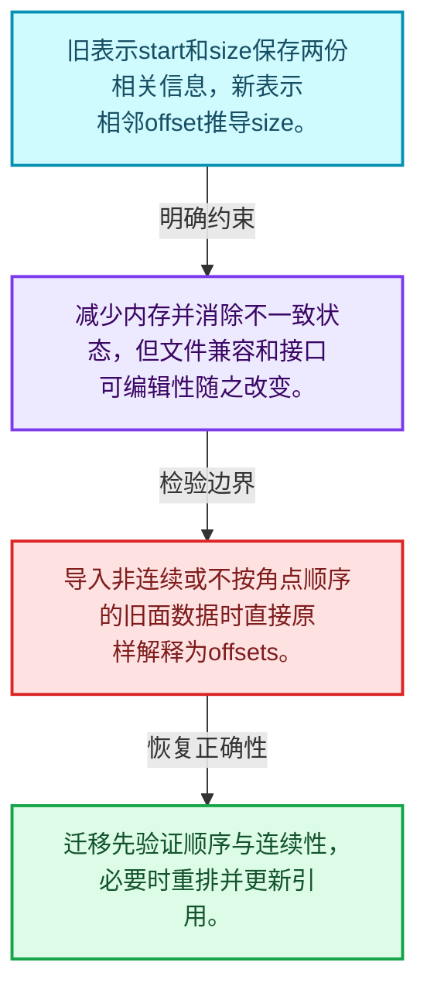
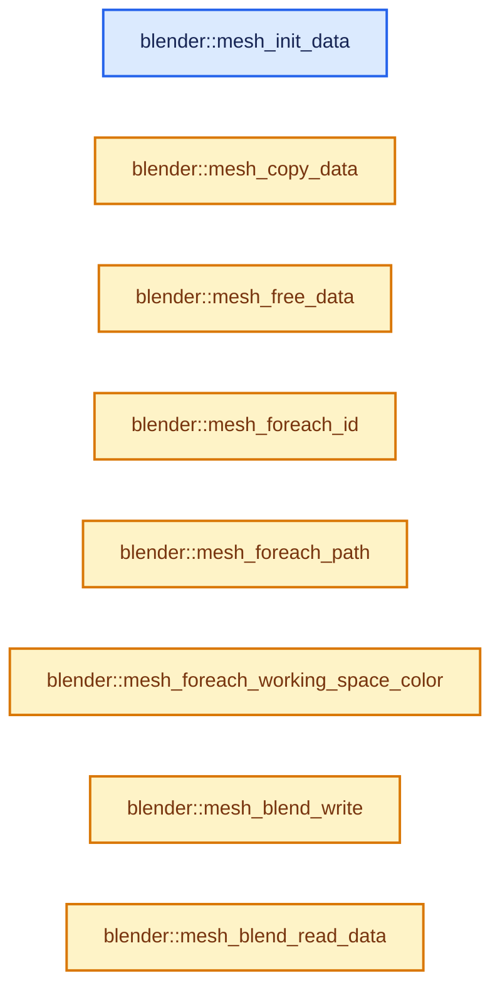
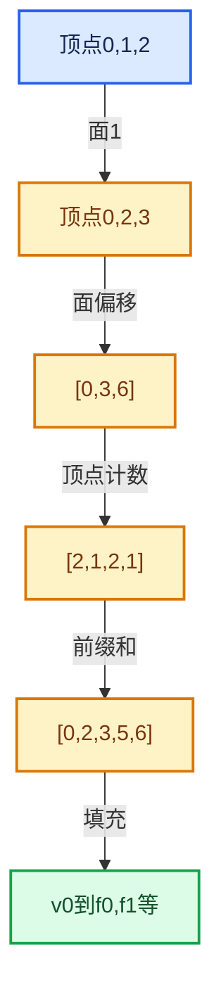

# 05-03 MPoly迁移与兼容

[方向导航](README.md) · [总目录](../README.md) · [实现索引](../00-课程指南/02-源码与提交索引/符号依赖与实现索引.md)

## 从问题到实现

改变基础存储为何牵涉读写与兼容？

消除冗余字段改善不变量，但持久化格式、RNA和调用者不能假定自动兼容。

**数据模型**

旧表示start和size保存两份相关信息，新表示相邻offset推导size。

**设计取舍**

减少内存并消除不一致状态，但文件兼容和接口可编辑性随之改变。

**最小反例**

导入非连续或不按角点顺序的旧面数据时直接原样解释为offsets。

**推导**

迁移先验证顺序与连续性，必要时重排并更新引用。

## 阅读地图与执行推演








图中的数值推演是本方向的教学模型；实际函数之间的调用边与概念分析边分别标注，不能把概念关系当作运行时调度顺序。

## 完整源码单元与就地讲解

中文讲解直接放在相关代码旁，复杂机制在代码下展开。原文折叠区保留基准行号；不需要在行号表和函数之间来回查找。类布局可分段展示，函数实现不按固定行数切开。

### 类型布局、声明与编译条件 · mesh.cc L1—L88

<!-- annotated:04fb073a6a2e34 -->

```cpp
/* SPDX-FileCopyrightText: 2001-2002 NaN Holding BV. All rights reserved.
 *
 * SPDX-License-Identifier: GPL-2.0-or-later */

/** \file
 * \ingroup bke
 */

#include <optional>

#include "MEM_guardedalloc.h"

/* Allow using deprecated functionality for .blend file I/O. */
#define DNA_DEPRECATED_ALLOW

#include "DNA_key_types.h"
#include "DNA_material_types.h"
#include "DNA_mesh_types.h"
#include "DNA_meshdata_types.h"
#include "DNA_object_types.h"

#include "BLI_array_utils.hh"
#include "BLI_bounds.hh"
#include "BLI_hash_c.hh"
#include "BLI_implicit_sharing.hh"
#include "BLI_index_range.hh"
#include "BLI_listbase.hh"
#include "BLI_math_matrix.hh"
#include "BLI_math_vector.hh"
#include "BLI_math_vector_c.hh"
#include "BLI_memory_counter.hh"
#include "BLI_resource_scope.hh"
#include "BLI_set.hh"
#include "BLI_span.hh"
#include "BLI_string.hh"
#include "BLI_task.hh"
#include "BLI_time.hh"
#include "BLI_utildefines.hh"
#include "BLI_vector.hh"
#include "BLI_virtual_array.hh"

#include "BLT_translation.hh"

#include "BKE_anim_data.hh"
#include "BKE_anonymous_attribute_id.hh"
#include "BKE_attribute.hh"
#include "BKE_attribute_legacy_convert.hh"
#include "BKE_attribute_storage.hh"
#include "BKE_attribute_storage_blend_write.hh"
#include "BKE_bake_data_block_id.hh"
#include "BKE_bpath.hh"
#include "BKE_deform.hh"
#include "BKE_editmesh.hh"
#include "BKE_editmesh_cache.hh"
#include "BKE_global.hh"
#include "BKE_idtype.hh"
#include "BKE_key.hh"
#include "BKE_lib_id.hh"
#include "BKE_lib_query.hh"
#include "BKE_main.hh"
#include "BKE_material.hh"
#include "BKE_mesh.hh"
#include "BKE_mesh_legacy_convert.hh"
#include "BKE_mesh_runtime.hh"
#include "BKE_mesh_wrapper.hh"
#include "BKE_modifier.hh"
#include "BKE_multires.hh"
#include "BKE_object.hh"
#include "BKE_paint_bvh.hh"

#include "DEG_depsgraph.hh"
#include "DEG_depsgraph_query.hh"

#include "BLO_read_write.hh"

#include "CLG_log.h"

#include "attribute_storage_access.hh"

namespace blender {

static CLG_LogRef LOG = {"geom.mesh"};

/** Using STACK_FIXED_DEPTH to keep the implementation in line with `pbvh.cc`. */
#define STACK_FIXED_DEPTH 100

static void mesh_tessface_clear_intern(Mesh *mesh, int free_customdata);

```

<details>
<summary>核对原始源码：source/blender/blenkernel/intern/mesh.cc · L1—L88</summary>

<!-- original:04fb073a6a2e34:source/blender/blenkernel/intern/mesh.cc:1:88 -->

```cpp
/* SPDX-FileCopyrightText: 2001-2002 NaN Holding BV. All rights reserved.
 *
 * SPDX-License-Identifier: GPL-2.0-or-later */

/** \file
 * \ingroup bke
 */

#include <optional>

#include "MEM_guardedalloc.h"

/* Allow using deprecated functionality for .blend file I/O. */
#define DNA_DEPRECATED_ALLOW

#include "DNA_key_types.h"
#include "DNA_material_types.h"
#include "DNA_mesh_types.h"
#include "DNA_meshdata_types.h"
#include "DNA_object_types.h"

#include "BLI_array_utils.hh"
#include "BLI_bounds.hh"
#include "BLI_hash_c.hh"
#include "BLI_implicit_sharing.hh"
#include "BLI_index_range.hh"
#include "BLI_listbase.hh"
#include "BLI_math_matrix.hh"
#include "BLI_math_vector.hh"
#include "BLI_math_vector_c.hh"
#include "BLI_memory_counter.hh"
#include "BLI_resource_scope.hh"
#include "BLI_set.hh"
#include "BLI_span.hh"
#include "BLI_string.hh"
#include "BLI_task.hh"
#include "BLI_time.hh"
#include "BLI_utildefines.hh"
#include "BLI_vector.hh"
#include "BLI_virtual_array.hh"

#include "BLT_translation.hh"

#include "BKE_anim_data.hh"
#include "BKE_anonymous_attribute_id.hh"
#include "BKE_attribute.hh"
#include "BKE_attribute_legacy_convert.hh"
#include "BKE_attribute_storage.hh"
#include "BKE_attribute_storage_blend_write.hh"
#include "BKE_bake_data_block_id.hh"
#include "BKE_bpath.hh"
#include "BKE_deform.hh"
#include "BKE_editmesh.hh"
#include "BKE_editmesh_cache.hh"
#include "BKE_global.hh"
#include "BKE_idtype.hh"
#include "BKE_key.hh"
#include "BKE_lib_id.hh"
#include "BKE_lib_query.hh"
#include "BKE_main.hh"
#include "BKE_material.hh"
#include "BKE_mesh.hh"
#include "BKE_mesh_legacy_convert.hh"
#include "BKE_mesh_runtime.hh"
#include "BKE_mesh_wrapper.hh"
#include "BKE_modifier.hh"
#include "BKE_multires.hh"
#include "BKE_object.hh"
#include "BKE_paint_bvh.hh"

#include "DEG_depsgraph.hh"
#include "DEG_depsgraph_query.hh"

#include "BLO_read_write.hh"

#include "CLG_log.h"

#include "attribute_storage_access.hh"

namespace blender {

static CLG_LogRef LOG = {"geom.mesh"};

/** Using STACK_FIXED_DEPTH to keep the implementation in line with `pbvh.cc`. */
#define STACK_FIXED_DEPTH 100

static void mesh_tessface_clear_intern(Mesh *mesh, int free_customdata);

```

</details>

<a id="f-1757cdb9b7da70a7"></a>

### `blender::mesh_init_data`

实现位置：[source/blender/blenkernel/intern/mesh.cc](../../../../../source/blender/blenkernel/intern/mesh.cc) · L89—L104。

接口参数：

- `ID *id`

**教学注释版**

<!-- annotated:a981110f49f3c4 -->

```cpp
static void mesh_init_data(ID *id)
{
  Mesh *mesh = reinterpret_cast<Mesh *>(id);
  INIT_DEFAULT_STRUCT_AFTER(mesh, id);

  CustomData_reset(&mesh->vert_data);
  CustomData_reset(&mesh->edge_data);
  CustomData_reset(&mesh->fdata_legacy);
  CustomData_reset(&mesh->face_data);
  CustomData_reset(&mesh->corner_data);

  new (&mesh->attribute_storage.wrap()) bke::AttributeStorage();
  mesh->runtime = new bke::MeshRuntime();

  mesh->face_sets_color_seed = BLI_hash_int(BLI_time_now_seconds_i() & UINT_MAX);
}
```

<details>
<summary>核对原始源码：source/blender/blenkernel/intern/mesh.cc · L89—L104</summary>

<!-- original:a981110f49f3c4:source/blender/blenkernel/intern/mesh.cc:89:104 -->

```cpp
static void mesh_init_data(ID *id)
{
  Mesh *mesh = reinterpret_cast<Mesh *>(id);
  INIT_DEFAULT_STRUCT_AFTER(mesh, id);

  CustomData_reset(&mesh->vert_data);
  CustomData_reset(&mesh->edge_data);
  CustomData_reset(&mesh->fdata_legacy);
  CustomData_reset(&mesh->face_data);
  CustomData_reset(&mesh->corner_data);

  new (&mesh->attribute_storage.wrap()) bke::AttributeStorage();
  mesh->runtime = new bke::MeshRuntime();

  mesh->face_sets_color_seed = BLI_hash_int(BLI_time_now_seconds_i() & UINT_MAX);
}
```

</details>

**沿实际写入检查状态**

- `mesh->runtime = new bke::MeshRuntime();`
- `mesh->face_sets_color_seed = BLI_hash_int(BLI_time_now_seconds_i() & UINT_MAX);`

**继续追踪实现**

- `INIT_DEFAULT_STRUCT_AFTER` → [INIT_DEFAULT_STRUCT_AFTER · L422](../90-实现依赖专题/01-BLI基础库/BLI_utildefines.hh.md#m-30b1f74075b1)。宏定义由构建条件选择。
- `CustomData_reset` → [blender::CustomData_reset · L2495](../90-实现依赖专题/02-BKE几何与数据/intern/customdata.cc.md#f-b5d2fd143bcd64b1)。
- `mesh->attribute_storage.wrap` → [调用协议](../00-课程指南/01-路线与规范/模板宏与动态分派协议.md)：接收对象类型依赖auto、返回值或模板实例；不按同名猜测目标。调用位置L100。
- `BLI_hash_int` → [blender::BLI_hash_int · L89](../90-实现依赖专题/01-BLI基础库/BLI_hash_c.hh.md#f-32ff2a82e559cc1e)。
- `BLI_time_now_seconds_i` → [blender::BLI_time_now_seconds_i · L36](../90-实现依赖专题/01-BLI基础库/intern/time.cc.md#f-38db665188e3ded7)。

<!-- annotated:f067780e1b9394 -->

```cpp

```

<details>
<summary>核对原始源码：source/blender/blenkernel/intern/mesh.cc · L105—L105</summary>

<!-- original:f067780e1b9394:source/blender/blenkernel/intern/mesh.cc:105:105 -->

```cpp

```

</details>

<a id="f-d3ba4614831672c7"></a>

### `blender::mesh_copy_data`

实现位置：[source/blender/blenkernel/intern/mesh.cc](../../../../../source/blender/blenkernel/intern/mesh.cc) · L106—L254。

接口参数：

- `Main *bmain`
- `std::optional<Library *> owner_library`
- `ID *id_dst`
- `const ID *id_src`
- `const int flag`

**教学注释版**

<!-- annotated:a3743d14f3ff86 -->

```cpp
static void mesh_copy_data(Main *bmain,
                           std::optional<Library *> owner_library,
                           ID *id_dst,
                           const ID *id_src,
                           const int flag)
{
  Mesh *mesh_dst = reinterpret_cast<Mesh *>(id_dst);
  const Mesh *mesh_src = reinterpret_cast<const Mesh *>(id_src);

  mesh_dst->runtime = new bke::MeshRuntime();
  mesh_dst->runtime->deformed_only = mesh_src->runtime->deformed_only;
  /* Subd runtime.mesh_eval is not copied, will need to be reevaluated. */
  mesh_dst->runtime->wrapper_type = (mesh_src->runtime->wrapper_type == ME_WRAPPER_TYPE_SUBD) ?
                                        ME_WRAPPER_TYPE_MDATA :
                                        mesh_src->runtime->wrapper_type;
  mesh_dst->runtime->subsurf_runtime_data = mesh_src->runtime->subsurf_runtime_data;
  mesh_dst->runtime->cd_mask_extra = mesh_src->runtime->cd_mask_extra;
  /* Copy face dot tags and edge tags, since meshes may be duplicated after a subsurf modifier or
   * node, but we still need to be able to draw face center vertices and "optimal edges"
   * differently. The tags may be cleared explicitly when the topology is changed. */
  mesh_dst->runtime->subsurf_face_dot_tags = mesh_src->runtime->subsurf_face_dot_tags;
  mesh_dst->runtime->subsurf_optimal_display_edges =
      mesh_src->runtime->subsurf_optimal_display_edges;
  if ((mesh_src->id.tag & ID_TAG_NO_MAIN) == 0) {
    /* This is a direct copy of a main mesh, so for now it has the same topology. */
    mesh_dst->runtime->deformed_only = true;
  }
  /* This option is set for run-time meshes that have been copied from the current object's mode.
   * Currently this is used for edit-mesh although it could be used for sculpt or other
   * kinds of data specific to an object's mode.
   *
   * The flag signals that the mesh hasn't been modified from the data that generated it,
   * allowing us to use the object-mode data for drawing.
   *
   * While this could be the caller's responsibility, keep here since it's
   * highly unlikely we want to create a duplicate and not use it for drawing. */
  mesh_dst->runtime->is_original_bmesh = false;

  /* Share various derived caches between the source and destination mesh for improved performance
   * when the source is persistent and edits to the destination mesh don't affect the caches.
   * Caches will be "un-shared" as necessary later on. */
  mesh_dst->runtime->bounds_cache = mesh_src->runtime->bounds_cache;
  mesh_dst->runtime->vert_normals_cache = mesh_src->runtime->vert_normals_cache;
  mesh_dst->runtime->vert_normals_true_cache = mesh_src->runtime->vert_normals_true_cache;
  mesh_dst->runtime->face_normals_cache = mesh_src->runtime->face_normals_cache;
  mesh_dst->runtime->face_normals_true_cache = mesh_src->runtime->face_normals_true_cache;
  mesh_dst->runtime->corner_normals_cache = mesh_src->runtime->corner_normals_cache;
  mesh_dst->runtime->loose_verts_cache = mesh_src->runtime->loose_verts_cache;
  mesh_dst->runtime->verts_no_face_cache = mesh_src->runtime->verts_no_face_cache;
  mesh_dst->runtime->loose_edges_cache = mesh_src->runtime->loose_edges_cache;
  mesh_dst->runtime->corner_tris_cache = mesh_src->runtime->corner_tris_cache;
  mesh_dst->runtime->corner_tri_faces_cache = mesh_src->runtime->corner_tri_faces_cache;
  mesh_dst->runtime->vert_to_face_offset_cache = mesh_src->runtime->vert_to_face_offset_cache;
  mesh_dst->runtime->vert_to_face_map_cache = mesh_src->runtime->vert_to_face_map_cache;
  mesh_dst->runtime->vert_to_corner_map_cache = mesh_src->runtime->vert_to_corner_map_cache;
  mesh_dst->runtime->corner_to_face_map_cache = mesh_src->runtime->corner_to_face_map_cache;
  mesh_dst->runtime->edge_to_corner_offset_cache = mesh_src->runtime->edge_to_corner_offset_cache;
  mesh_dst->runtime->edge_to_corner_map_cache = mesh_src->runtime->edge_to_corner_map_cache;
  mesh_dst->runtime->bvh_cache_edges = mesh_src->runtime->bvh_cache_edges;
  mesh_dst->runtime->bvh_cache_faces = mesh_src->runtime->bvh_cache_faces;
  mesh_dst->runtime->bvh_cache_corner_tris = mesh_src->runtime->bvh_cache_corner_tris;
  mesh_dst->runtime->bvh_cache_corner_tris_no_hidden =
      mesh_src->runtime->bvh_cache_corner_tris_no_hidden;
  mesh_dst->runtime->bvh_cache_loose_verts = mesh_src->runtime->bvh_cache_loose_verts;
  mesh_dst->runtime->bvh_cache_loose_verts_no_hidden =
      mesh_src->runtime->bvh_cache_loose_verts_no_hidden;
  mesh_dst->runtime->bvh_cache_loose_edges = mesh_src->runtime->bvh_cache_loose_edges;
  mesh_dst->runtime->bvh_cache_loose_edges_no_hidden =
      mesh_src->runtime->bvh_cache_loose_edges_no_hidden;
  mesh_dst->runtime->bvh_embree_tris_cache = mesh_src->runtime->bvh_embree_tris_cache;
  mesh_dst->runtime->bvh_embree_verts_cache = mesh_src->runtime->bvh_embree_verts_cache;
  mesh_dst->runtime->bvh_embree_edges_cache = mesh_src->runtime->bvh_embree_edges_cache;
  mesh_dst->runtime->max_material_index = mesh_src->runtime->max_material_index;
  if (mesh_src->runtime->bake_materials) {
    // [讲解] std::make_unique<bke::bake::BakeMaterialsList>：创建独占拥有的对象，拥有关系可移动，get返回的借用指针不自动延长寿命。
    mesh_dst->runtime->bake_materials = std::make_unique<bke::bake::BakeMaterialsList>(
        *mesh_src->runtime->bake_materials);
  }

  /* Only do tessface if we have no faces. */
  const bool do_tessface = ((mesh_src->totface_legacy != 0) && (mesh_src->faces_num == 0));

  CustomData_MeshMasks mask = CD_MASK_MESH;

  if (mesh_src->id.tag & ID_TAG_NO_MAIN) {
    /* For copies in depsgraph, keep data like #CD_ORIGINDEX and #CD_ORCO. */
    CustomData_MeshMasks_update(&mask, &CD_MASK_DERIVEDMESH);

    /* Meshes copied during evaluation pass the edit mesh pointer to determine whether a mapping
     * from the evaluated to the original state is possible. */
    mesh_dst->runtime->edit_mesh = mesh_src->runtime->edit_mesh;
    if (const bke::EditMeshData *edit_data = mesh_src->runtime->edit_data.get()) {
      mesh_dst->runtime->edit_data = std::make_unique<bke::EditMeshData>(*edit_data);
    }
  }

  mesh_dst->mat = MEM_dupalloc(mesh_src->mat);

  BKE_defgroup_copy_list(&mesh_dst->vertex_group_names, &mesh_src->vertex_group_names);
  mesh_dst->active_color_attribute = static_cast<char *>(
      MEM_dupalloc(mesh_src->active_color_attribute));
  mesh_dst->default_color_attribute = static_cast<char *>(
      MEM_dupalloc(mesh_src->default_color_attribute));
  mesh_dst->active_uv_map_attribute = static_cast<char *>(
      MEM_dupalloc(mesh_src->active_uv_map_attribute));
  mesh_dst->default_uv_map_attribute = static_cast<char *>(
      MEM_dupalloc(mesh_src->default_uv_map_attribute));
  mesh_dst->stencil_uv_map_attribute = static_cast<char *>(
      MEM_dupalloc(mesh_src->stencil_uv_map_attribute));
  mesh_dst->clone_uv_map_attribute = static_cast<char *>(
      MEM_dupalloc(mesh_src->clone_uv_map_attribute));

  CustomData_init_from(
      &mesh_src->vert_data, &mesh_dst->vert_data, mask.vmask, mesh_dst->verts_num);
  CustomData_init_from(
      &mesh_src->edge_data, &mesh_dst->edge_data, mask.emask, mesh_dst->edges_num);
  CustomData_init_from(
      &mesh_src->corner_data, &mesh_dst->corner_data, mask.lmask, mesh_dst->corners_num);
  CustomData_init_from(
      &mesh_src->face_data, &mesh_dst->face_data, mask.pmask, mesh_dst->faces_num);
  new (&mesh_dst->attribute_storage.wrap())
      bke::AttributeStorage(mesh_src->attribute_storage.wrap());
  implicit_sharing::copy_shared_pointer(mesh_src->face_offset_indices,
                                        mesh_src->runtime->face_offsets_sharing_info,
                                        &mesh_dst->face_offset_indices,
                                        &mesh_dst->runtime->face_offsets_sharing_info);
  if (do_tessface) {
    CustomData_init_from(
        &mesh_src->fdata_legacy, &mesh_dst->fdata_legacy, mask.fmask, mesh_dst->totface_legacy);
  }
  else {
    mesh_tessface_clear_intern(mesh_dst, false);
  }

  mesh_dst->mselect = MEM_dupalloc(mesh_dst->mselect);

  if (mesh_src->key && (flag & LIB_ID_COPY_SHAPEKEY)) {
    BKE_id_copy_in_lib(bmain,
                       owner_library,
                       &mesh_src->key->id,
                       &mesh_dst->id,
                       reinterpret_cast<ID **>(&mesh_dst->key),
                       flag);
    /* It has one user, but its owner reference (added in #id_copy_libmanagement_cb)
     * is the real owner, remove the reference here, see: #159691. */
    if ((flag & LIB_ID_CREATE_NO_USER_REFCOUNT) == 0) {
      id_us_min(&mesh_dst->key->id);
    }
  }
}
```

<details>
<summary>核对原始源码：source/blender/blenkernel/intern/mesh.cc · L106—L254</summary>

<!-- original:a3743d14f3ff86:source/blender/blenkernel/intern/mesh.cc:106:254 -->

```cpp
static void mesh_copy_data(Main *bmain,
                           std::optional<Library *> owner_library,
                           ID *id_dst,
                           const ID *id_src,
                           const int flag)
{
  Mesh *mesh_dst = reinterpret_cast<Mesh *>(id_dst);
  const Mesh *mesh_src = reinterpret_cast<const Mesh *>(id_src);

  mesh_dst->runtime = new bke::MeshRuntime();
  mesh_dst->runtime->deformed_only = mesh_src->runtime->deformed_only;
  /* Subd runtime.mesh_eval is not copied, will need to be reevaluated. */
  mesh_dst->runtime->wrapper_type = (mesh_src->runtime->wrapper_type == ME_WRAPPER_TYPE_SUBD) ?
                                        ME_WRAPPER_TYPE_MDATA :
                                        mesh_src->runtime->wrapper_type;
  mesh_dst->runtime->subsurf_runtime_data = mesh_src->runtime->subsurf_runtime_data;
  mesh_dst->runtime->cd_mask_extra = mesh_src->runtime->cd_mask_extra;
  /* Copy face dot tags and edge tags, since meshes may be duplicated after a subsurf modifier or
   * node, but we still need to be able to draw face center vertices and "optimal edges"
   * differently. The tags may be cleared explicitly when the topology is changed. */
  mesh_dst->runtime->subsurf_face_dot_tags = mesh_src->runtime->subsurf_face_dot_tags;
  mesh_dst->runtime->subsurf_optimal_display_edges =
      mesh_src->runtime->subsurf_optimal_display_edges;
  if ((mesh_src->id.tag & ID_TAG_NO_MAIN) == 0) {
    /* This is a direct copy of a main mesh, so for now it has the same topology. */
    mesh_dst->runtime->deformed_only = true;
  }
  /* This option is set for run-time meshes that have been copied from the current object's mode.
   * Currently this is used for edit-mesh although it could be used for sculpt or other
   * kinds of data specific to an object's mode.
   *
   * The flag signals that the mesh hasn't been modified from the data that generated it,
   * allowing us to use the object-mode data for drawing.
   *
   * While this could be the caller's responsibility, keep here since it's
   * highly unlikely we want to create a duplicate and not use it for drawing. */
  mesh_dst->runtime->is_original_bmesh = false;

  /* Share various derived caches between the source and destination mesh for improved performance
   * when the source is persistent and edits to the destination mesh don't affect the caches.
   * Caches will be "un-shared" as necessary later on. */
  mesh_dst->runtime->bounds_cache = mesh_src->runtime->bounds_cache;
  mesh_dst->runtime->vert_normals_cache = mesh_src->runtime->vert_normals_cache;
  mesh_dst->runtime->vert_normals_true_cache = mesh_src->runtime->vert_normals_true_cache;
  mesh_dst->runtime->face_normals_cache = mesh_src->runtime->face_normals_cache;
  mesh_dst->runtime->face_normals_true_cache = mesh_src->runtime->face_normals_true_cache;
  mesh_dst->runtime->corner_normals_cache = mesh_src->runtime->corner_normals_cache;
  mesh_dst->runtime->loose_verts_cache = mesh_src->runtime->loose_verts_cache;
  mesh_dst->runtime->verts_no_face_cache = mesh_src->runtime->verts_no_face_cache;
  mesh_dst->runtime->loose_edges_cache = mesh_src->runtime->loose_edges_cache;
  mesh_dst->runtime->corner_tris_cache = mesh_src->runtime->corner_tris_cache;
  mesh_dst->runtime->corner_tri_faces_cache = mesh_src->runtime->corner_tri_faces_cache;
  mesh_dst->runtime->vert_to_face_offset_cache = mesh_src->runtime->vert_to_face_offset_cache;
  mesh_dst->runtime->vert_to_face_map_cache = mesh_src->runtime->vert_to_face_map_cache;
  mesh_dst->runtime->vert_to_corner_map_cache = mesh_src->runtime->vert_to_corner_map_cache;
  mesh_dst->runtime->corner_to_face_map_cache = mesh_src->runtime->corner_to_face_map_cache;
  mesh_dst->runtime->edge_to_corner_offset_cache = mesh_src->runtime->edge_to_corner_offset_cache;
  mesh_dst->runtime->edge_to_corner_map_cache = mesh_src->runtime->edge_to_corner_map_cache;
  mesh_dst->runtime->bvh_cache_edges = mesh_src->runtime->bvh_cache_edges;
  mesh_dst->runtime->bvh_cache_faces = mesh_src->runtime->bvh_cache_faces;
  mesh_dst->runtime->bvh_cache_corner_tris = mesh_src->runtime->bvh_cache_corner_tris;
  mesh_dst->runtime->bvh_cache_corner_tris_no_hidden =
      mesh_src->runtime->bvh_cache_corner_tris_no_hidden;
  mesh_dst->runtime->bvh_cache_loose_verts = mesh_src->runtime->bvh_cache_loose_verts;
  mesh_dst->runtime->bvh_cache_loose_verts_no_hidden =
      mesh_src->runtime->bvh_cache_loose_verts_no_hidden;
  mesh_dst->runtime->bvh_cache_loose_edges = mesh_src->runtime->bvh_cache_loose_edges;
  mesh_dst->runtime->bvh_cache_loose_edges_no_hidden =
      mesh_src->runtime->bvh_cache_loose_edges_no_hidden;
  mesh_dst->runtime->bvh_embree_tris_cache = mesh_src->runtime->bvh_embree_tris_cache;
  mesh_dst->runtime->bvh_embree_verts_cache = mesh_src->runtime->bvh_embree_verts_cache;
  mesh_dst->runtime->bvh_embree_edges_cache = mesh_src->runtime->bvh_embree_edges_cache;
  mesh_dst->runtime->max_material_index = mesh_src->runtime->max_material_index;
  if (mesh_src->runtime->bake_materials) {
    mesh_dst->runtime->bake_materials = std::make_unique<bke::bake::BakeMaterialsList>(
        *mesh_src->runtime->bake_materials);
  }

  /* Only do tessface if we have no faces. */
  const bool do_tessface = ((mesh_src->totface_legacy != 0) && (mesh_src->faces_num == 0));

  CustomData_MeshMasks mask = CD_MASK_MESH;

  if (mesh_src->id.tag & ID_TAG_NO_MAIN) {
    /* For copies in depsgraph, keep data like #CD_ORIGINDEX and #CD_ORCO. */
    CustomData_MeshMasks_update(&mask, &CD_MASK_DERIVEDMESH);

    /* Meshes copied during evaluation pass the edit mesh pointer to determine whether a mapping
     * from the evaluated to the original state is possible. */
    mesh_dst->runtime->edit_mesh = mesh_src->runtime->edit_mesh;
    if (const bke::EditMeshData *edit_data = mesh_src->runtime->edit_data.get()) {
      mesh_dst->runtime->edit_data = std::make_unique<bke::EditMeshData>(*edit_data);
    }
  }

  mesh_dst->mat = MEM_dupalloc(mesh_src->mat);

  BKE_defgroup_copy_list(&mesh_dst->vertex_group_names, &mesh_src->vertex_group_names);
  mesh_dst->active_color_attribute = static_cast<char *>(
      MEM_dupalloc(mesh_src->active_color_attribute));
  mesh_dst->default_color_attribute = static_cast<char *>(
      MEM_dupalloc(mesh_src->default_color_attribute));
  mesh_dst->active_uv_map_attribute = static_cast<char *>(
      MEM_dupalloc(mesh_src->active_uv_map_attribute));
  mesh_dst->default_uv_map_attribute = static_cast<char *>(
      MEM_dupalloc(mesh_src->default_uv_map_attribute));
  mesh_dst->stencil_uv_map_attribute = static_cast<char *>(
      MEM_dupalloc(mesh_src->stencil_uv_map_attribute));
  mesh_dst->clone_uv_map_attribute = static_cast<char *>(
      MEM_dupalloc(mesh_src->clone_uv_map_attribute));

  CustomData_init_from(
      &mesh_src->vert_data, &mesh_dst->vert_data, mask.vmask, mesh_dst->verts_num);
  CustomData_init_from(
      &mesh_src->edge_data, &mesh_dst->edge_data, mask.emask, mesh_dst->edges_num);
  CustomData_init_from(
      &mesh_src->corner_data, &mesh_dst->corner_data, mask.lmask, mesh_dst->corners_num);
  CustomData_init_from(
      &mesh_src->face_data, &mesh_dst->face_data, mask.pmask, mesh_dst->faces_num);
  new (&mesh_dst->attribute_storage.wrap())
      bke::AttributeStorage(mesh_src->attribute_storage.wrap());
  implicit_sharing::copy_shared_pointer(mesh_src->face_offset_indices,
                                        mesh_src->runtime->face_offsets_sharing_info,
                                        &mesh_dst->face_offset_indices,
                                        &mesh_dst->runtime->face_offsets_sharing_info);
  if (do_tessface) {
    CustomData_init_from(
        &mesh_src->fdata_legacy, &mesh_dst->fdata_legacy, mask.fmask, mesh_dst->totface_legacy);
  }
  else {
    mesh_tessface_clear_intern(mesh_dst, false);
  }

  mesh_dst->mselect = MEM_dupalloc(mesh_dst->mselect);

  if (mesh_src->key && (flag & LIB_ID_COPY_SHAPEKEY)) {
    BKE_id_copy_in_lib(bmain,
                       owner_library,
                       &mesh_src->key->id,
                       &mesh_dst->id,
                       reinterpret_cast<ID **>(&mesh_dst->key),
                       flag);
    /* It has one user, but its owner reference (added in #id_copy_libmanagement_cb)
     * is the real owner, remove the reference here, see: #159691. */
    if ((flag & LIB_ID_CREATE_NO_USER_REFCOUNT) == 0) {
      id_us_min(&mesh_dst->key->id);
    }
  }
}
```

</details>

**沿实际写入检查状态**

- `mesh_dst->runtime = new bke::MeshRuntime();`
- `mesh_dst->runtime->deformed_only = mesh_src->runtime->deformed_only;`
- `mesh_dst->runtime->wrapper_type = (mesh_src->runtime->wrapper_type == ME_WRAPPER_TYPE_SUBD) ?`
- `mesh_dst->runtime->subsurf_runtime_data = mesh_src->runtime->subsurf_runtime_data;`
- `mesh_dst->runtime->cd_mask_extra = mesh_src->runtime->cd_mask_extra;`
- `mesh_dst->runtime->subsurf_face_dot_tags = mesh_src->runtime->subsurf_face_dot_tags;`
- `mesh_dst->runtime->subsurf_optimal_display_edges =`
- `mesh_dst->runtime->deformed_only = true;`
- `mesh_dst->runtime->is_original_bmesh = false;`
- `mesh_dst->runtime->bounds_cache = mesh_src->runtime->bounds_cache;`
- `mesh_dst->runtime->vert_normals_cache = mesh_src->runtime->vert_normals_cache;`
- `mesh_dst->runtime->vert_normals_true_cache = mesh_src->runtime->vert_normals_true_cache;`
- `mesh_dst->runtime->face_normals_cache = mesh_src->runtime->face_normals_cache;`
- `mesh_dst->runtime->face_normals_true_cache = mesh_src->runtime->face_normals_true_cache;`
- `mesh_dst->runtime->corner_normals_cache = mesh_src->runtime->corner_normals_cache;`
- `mesh_dst->runtime->loose_verts_cache = mesh_src->runtime->loose_verts_cache;`
- `mesh_dst->runtime->verts_no_face_cache = mesh_src->runtime->verts_no_face_cache;`
- `mesh_dst->runtime->loose_edges_cache = mesh_src->runtime->loose_edges_cache;`
- `mesh_dst->runtime->corner_tris_cache = mesh_src->runtime->corner_tris_cache;`
- `mesh_dst->runtime->corner_tri_faces_cache = mesh_src->runtime->corner_tri_faces_cache;`
- `mesh_dst->runtime->vert_to_face_offset_cache = mesh_src->runtime->vert_to_face_offset_cache;`
- `mesh_dst->runtime->vert_to_face_map_cache = mesh_src->runtime->vert_to_face_map_cache;`
- `mesh_dst->runtime->vert_to_corner_map_cache = mesh_src->runtime->vert_to_corner_map_cache;`
- `mesh_dst->runtime->corner_to_face_map_cache = mesh_src->runtime->corner_to_face_map_cache;`
- `mesh_dst->runtime->edge_to_corner_offset_cache = mesh_src->runtime->edge_to_corner_offset_cache;`
- `mesh_dst->runtime->edge_to_corner_map_cache = mesh_src->runtime->edge_to_corner_map_cache;`
- `mesh_dst->runtime->bvh_cache_edges = mesh_src->runtime->bvh_cache_edges;`
- `mesh_dst->runtime->bvh_cache_faces = mesh_src->runtime->bvh_cache_faces;`
- `mesh_dst->runtime->bvh_cache_corner_tris = mesh_src->runtime->bvh_cache_corner_tris;`
- `mesh_dst->runtime->bvh_cache_corner_tris_no_hidden =`
- `mesh_dst->runtime->bvh_cache_loose_verts = mesh_src->runtime->bvh_cache_loose_verts;`
- `mesh_dst->runtime->bvh_cache_loose_verts_no_hidden =`
- `mesh_dst->runtime->bvh_cache_loose_edges = mesh_src->runtime->bvh_cache_loose_edges;`
- `mesh_dst->runtime->bvh_cache_loose_edges_no_hidden =`
- `mesh_dst->runtime->bvh_embree_tris_cache = mesh_src->runtime->bvh_embree_tris_cache;`
- `mesh_dst->runtime->bvh_embree_verts_cache = mesh_src->runtime->bvh_embree_verts_cache;`
- `mesh_dst->runtime->bvh_embree_edges_cache = mesh_src->runtime->bvh_embree_edges_cache;`
- `mesh_dst->runtime->max_material_index = mesh_src->runtime->max_material_index;`
- `mesh_dst->runtime->bake_materials = std::make_unique<bke::bake::BakeMaterialsList>(`
- `mesh_dst->runtime->edit_mesh = mesh_src->runtime->edit_mesh;`
- `mesh_dst->runtime->edit_data = std::make_unique<bke::EditMeshData>(*edit_data);`
- `mesh_dst->mat = MEM_dupalloc(mesh_src->mat);`
- `mesh_dst->active_color_attribute = static_cast<char *>(`
- `mesh_dst->default_color_attribute = static_cast<char *>(`
- `mesh_dst->active_uv_map_attribute = static_cast<char *>(`
- `mesh_dst->default_uv_map_attribute = static_cast<char *>(`
- `mesh_dst->stencil_uv_map_attribute = static_cast<char *>(`
- `mesh_dst->clone_uv_map_attribute = static_cast<char *>(`
- `mesh_dst->mselect = MEM_dupalloc(mesh_dst->mselect);`

**继续追踪实现**

- `std::make_unique<bke::bake::BakeMaterialsList>` → [外部契约](https://eel.is/c++draft/unique.ptr.create)：创建独占拥有的对象，拥有关系可移动，get返回的借用指针不自动延长寿命。
- `CustomData_MeshMasks_update` → [blender::CustomData_MeshMasks_update · L89](../90-实现依赖专题/02-BKE几何与数据/intern/customdata.cc.md#f-5a41f0d857270b16)。
- `mesh_src->runtime->edit_data.get` → [调用协议](../00-课程指南/01-路线与规范/模板宏与动态分派协议.md)：接收对象类型依赖auto、返回值或模板实例；不按同名猜测目标。调用位置L196。
- `std::make_unique<bke::EditMeshData>` → [外部契约](https://eel.is/c++draft/unique.ptr.create)：创建独占拥有的对象，拥有关系可移动，get返回的借用指针不自动延长寿命。
- `MEM_dupalloc` → [MEM_dupalloc · L627](../90-实现依赖专题/07-Intern运行时与平台/guardedalloc/MEM_guardedalloc.h.md#f-78a72b71e3c57010)。
- `BKE_defgroup_copy_list` → [blender::BKE_defgroup_copy_list · L75](../90-实现依赖专题/02-BKE几何与数据/intern/deform.cc.md#f-abb39694bedcca18)。
- `CustomData_init_from` → [blender::CustomData_init_from · L2448](../90-实现依赖专题/02-BKE几何与数据/intern/customdata.cc.md#f-f317525a89779ded)。
- `mesh_dst->attribute_storage.wrap` → [调用协议](../00-课程指南/01-路线与规范/模板宏与动态分派协议.md)：接收对象类型依赖auto、返回值或模板实例；不按同名猜测目标。调用位置L225。
- `mesh_src->attribute_storage.wrap` → [调用协议](../00-课程指南/01-路线与规范/模板宏与动态分派协议.md)：接收对象类型依赖auto、返回值或模板实例；不按同名猜测目标。调用位置L226。
- `implicit_sharing::copy_shared_pointer` → [blender::implicit_sharing::copy_shared_pointer · L270](../06-隐式共享与缓存系统/02-ImplicitSharingInfo计数.md#f-6888195eb0e306f7)。
- `mesh_tessface_clear_intern` → [mesh_tessface_clear_intern · L1155](03-MPoly迁移与兼容.md#f-572aa4b8a6355d9c)。
- `BKE_id_copy_in_lib` → [blender::BKE_id_copy_in_lib · L749](../90-实现依赖专题/02-BKE几何与数据/intern/lib_id.cc.md#f-1ed32b930b96ebb2)。
- `id_us_min` → [blender::id_us_min · L441](../90-实现依赖专题/02-BKE几何与数据/intern/lib_id.cc.md#f-c5e5246a79962257)。

<!-- annotated:5b16431789c7c2 -->

```cpp

```

<details>
<summary>核对原始源码：source/blender/blenkernel/intern/mesh.cc · L255—L255</summary>

<!-- original:5b16431789c7c2:source/blender/blenkernel/intern/mesh.cc:255:255 -->

```cpp

```

</details>

<a id="f-c6c080776573cb1f"></a>

### `blender::mesh_free_data`

实现位置：[source/blender/blenkernel/intern/mesh.cc](../../../../../source/blender/blenkernel/intern/mesh.cc) · L256—L280。

接口参数：

- `ID *id`

**教学注释版**

<!-- annotated:30bd5c0fe3d375 -->

```cpp
static void mesh_free_data(ID *id)
{
  Mesh *mesh = reinterpret_cast<Mesh *>(id);

  CustomData_free(&mesh->vert_data);
  CustomData_free(&mesh->edge_data);
  CustomData_free(&mesh->fdata_legacy);
  CustomData_free(&mesh->corner_data);
  CustomData_free(&mesh->face_data);
  mesh->vertex_group_names.free_no_destruct();
  MEM_SAFE_DELETE(mesh->active_color_attribute);
  MEM_SAFE_DELETE(mesh->default_color_attribute);
  MEM_SAFE_DELETE(mesh->active_uv_map_attribute);
  MEM_SAFE_DELETE(mesh->default_uv_map_attribute);
  MEM_SAFE_DELETE(mesh->stencil_uv_map_attribute);
  MEM_SAFE_DELETE(mesh->clone_uv_map_attribute);
  mesh->attribute_storage.wrap().~AttributeStorage();
  if (mesh->face_offset_indices) {
    implicit_sharing::free_shared_data(&mesh->face_offset_indices,
                                       &mesh->runtime->face_offsets_sharing_info);
  }
  MEM_SAFE_DELETE(mesh->mselect);
  MEM_SAFE_DELETE(mesh->mat);
  delete mesh->runtime;
}
```

<details>
<summary>核对原始源码：source/blender/blenkernel/intern/mesh.cc · L256—L280</summary>

<!-- original:30bd5c0fe3d375:source/blender/blenkernel/intern/mesh.cc:256:280 -->

```cpp
static void mesh_free_data(ID *id)
{
  Mesh *mesh = reinterpret_cast<Mesh *>(id);

  CustomData_free(&mesh->vert_data);
  CustomData_free(&mesh->edge_data);
  CustomData_free(&mesh->fdata_legacy);
  CustomData_free(&mesh->corner_data);
  CustomData_free(&mesh->face_data);
  mesh->vertex_group_names.free_no_destruct();
  MEM_SAFE_DELETE(mesh->active_color_attribute);
  MEM_SAFE_DELETE(mesh->default_color_attribute);
  MEM_SAFE_DELETE(mesh->active_uv_map_attribute);
  MEM_SAFE_DELETE(mesh->default_uv_map_attribute);
  MEM_SAFE_DELETE(mesh->stencil_uv_map_attribute);
  MEM_SAFE_DELETE(mesh->clone_uv_map_attribute);
  mesh->attribute_storage.wrap().~AttributeStorage();
  if (mesh->face_offset_indices) {
    implicit_sharing::free_shared_data(&mesh->face_offset_indices,
                                       &mesh->runtime->face_offsets_sharing_info);
  }
  MEM_SAFE_DELETE(mesh->mselect);
  MEM_SAFE_DELETE(mesh->mat);
  delete mesh->runtime;
}
```

</details>

**继续追踪实现**

- `CustomData_free` → [blender::CustomData_free · L2501](../90-实现依赖专题/02-BKE几何与数据/intern/customdata.cc.md#f-af45329c2d7b60ae)。
- `mesh->vertex_group_names.free_no_destruct` → [调用协议](../00-课程指南/01-路线与规范/模板宏与动态分派协议.md)：接收对象类型依赖auto、返回值或模板实例；不按同名猜测目标。调用位置L265。
- `MEM_SAFE_DELETE` → [MEM_SAFE_DELETE · L436](../90-实现依赖专题/07-Intern运行时与平台/guardedalloc/MEM_guardedalloc.h.md#m-eadb3bc5b902)。宏定义由构建条件选择。
- `mesh->attribute_storage.wrap().~AttributeStorage` → [调用协议](../00-课程指南/01-路线与规范/模板宏与动态分派协议.md)：接收对象类型依赖auto、返回值或模板实例；不按同名猜测目标。调用位置L272。
- `mesh->attribute_storage.wrap` → [调用协议](../00-课程指南/01-路线与规范/模板宏与动态分派协议.md)：接收对象类型依赖auto、返回值或模板实例；不按同名猜测目标。调用位置L272。
- `implicit_sharing::free_shared_data` → [blender::implicit_sharing::free_shared_data · L287](../06-隐式共享与缓存系统/02-ImplicitSharingInfo计数.md#f-8e443cc043206969)。

<!-- annotated:1993b2f830e1c4 -->

```cpp

```

<details>
<summary>核对原始源码：source/blender/blenkernel/intern/mesh.cc · L281—L281</summary>

<!-- original:1993b2f830e1c4:source/blender/blenkernel/intern/mesh.cc:281:281 -->

```cpp

```

</details>

<a id="f-b0b201b59126df3d"></a>

### `blender::mesh_foreach_id`

实现位置：[source/blender/blenkernel/intern/mesh.cc](../../../../../source/blender/blenkernel/intern/mesh.cc) · L282—L291。

接口参数：

- `ID *id`
- `LibraryForeachIDData *data`

**教学注释版**

<!-- annotated:689ed4b743b1cd -->

```cpp
static void mesh_foreach_id(ID *id, LibraryForeachIDData *data)
{
  Mesh *mesh = reinterpret_cast<Mesh *>(id);

  BKE_LIB_FOREACHID_PROCESS_IDSUPER(data, mesh->texcomesh, IDWALK_CB_NEVER_SELF);
  BKE_LIB_FOREACHID_PROCESS_IDSUPER(data, mesh->key, IDWALK_CB_USER);
  for (int i = 0; i < mesh->totcol; i++) {
    BKE_LIB_FOREACHID_PROCESS_IDSUPER(data, mesh->mat[i], IDWALK_CB_USER);
  }
}
```

<details>
<summary>核对原始源码：source/blender/blenkernel/intern/mesh.cc · L282—L291</summary>

<!-- original:689ed4b743b1cd:source/blender/blenkernel/intern/mesh.cc:282:291 -->

```cpp
static void mesh_foreach_id(ID *id, LibraryForeachIDData *data)
{
  Mesh *mesh = reinterpret_cast<Mesh *>(id);

  BKE_LIB_FOREACHID_PROCESS_IDSUPER(data, mesh->texcomesh, IDWALK_CB_NEVER_SELF);
  BKE_LIB_FOREACHID_PROCESS_IDSUPER(data, mesh->key, IDWALK_CB_USER);
  for (int i = 0; i < mesh->totcol; i++) {
    BKE_LIB_FOREACHID_PROCESS_IDSUPER(data, mesh->mat[i], IDWALK_CB_USER);
  }
}
```

</details>

**继续追踪实现**

- `BKE_LIB_FOREACHID_PROCESS_IDSUPER` → [BKE_LIB_FOREACHID_PROCESS_IDSUPER · L293](../90-实现依赖专题/02-BKE几何与数据/BKE_lib_query.hh.md#m-1b059b49d6cb)。宏定义由构建条件选择。

<!-- annotated:355d37c778f28f -->

```cpp

```

<details>
<summary>核对原始源码：source/blender/blenkernel/intern/mesh.cc · L292—L292</summary>

<!-- original:355d37c778f28f:source/blender/blenkernel/intern/mesh.cc:292:292 -->

```cpp

```

</details>

<a id="f-4482daef9c988c6c"></a>

### `blender::mesh_foreach_path`

实现位置：[source/blender/blenkernel/intern/mesh.cc](../../../../../source/blender/blenkernel/intern/mesh.cc) · L293—L311。

接口参数：

- `ID *id`
- `BPathForeachPathData *bpath_data`

**教学注释版**

<!-- annotated:2020e933b84842 -->

```cpp
static void mesh_foreach_path(ID *id, BPathForeachPathData *bpath_data)
{
  Mesh *mesh = reinterpret_cast<Mesh *>(id);
  CustomData &data = mesh->corner_data;
  if (data.external) {
    /* CustomDataExternal should only be the case for CD_MDISPS, but check all layers regardless.
     */
    const Span<CustomDataLayer> layers(data.layers, data.totlayer);
    // [讲解] layers.begin：返回借用范围的地址。
    if (std::any_of(layers.begin(),
                    // [讲解] layers.end：返回借用范围的地址。
                    layers.end(),
                    [&](const CustomDataLayer &layer) {
                      return CustomData_external_test(&data, eCustomDataType(layer.type));
                    }))
    {
      BKE_bpath_foreach_path_fixed_process(
          bpath_data, data.external->filepath, sizeof(data.external->filepath));
    }
  }
}
```

<details>
<summary>核对原始源码：source/blender/blenkernel/intern/mesh.cc · L293—L311</summary>

<!-- original:2020e933b84842:source/blender/blenkernel/intern/mesh.cc:293:311 -->

```cpp
static void mesh_foreach_path(ID *id, BPathForeachPathData *bpath_data)
{
  Mesh *mesh = reinterpret_cast<Mesh *>(id);
  CustomData &data = mesh->corner_data;
  if (data.external) {
    /* CustomDataExternal should only be the case for CD_MDISPS, but check all layers regardless.
     */
    const Span<CustomDataLayer> layers(data.layers, data.totlayer);
    if (std::any_of(layers.begin(),
                    layers.end(),
                    [&](const CustomDataLayer &layer) {
                      return CustomData_external_test(&data, eCustomDataType(layer.type));
                    }))
    {
      BKE_bpath_foreach_path_fixed_process(
          bpath_data, data.external->filepath, sizeof(data.external->filepath));
    }
  }
}
```

</details>

**结果出口**

- `return CustomData_external_test(&data, eCustomDataType(layer.type));`

**继续追踪实现**

- `std::any_of` → [外部契约](https://eel.is/c++draft/)：这个边界按实际表达式及所属类型核对参数、返回值、寿命与失败行为。这里提供接口入口，不声称已解释该第三方版本的内部实现。
- `layers.begin` → [blender::Span::begin · L224](../01-基础容器与现代CPP/05-Span只读连续视图.md#f-415883b512284f46)。
- `layers.end` → [blender::Span::end · L228](../01-基础容器与现代CPP/05-Span只读连续视图.md#f-a7d8b9e494c291a7)。
- `CustomData_external_test` → [blender::CustomData_external_test · L4471](../90-实现依赖专题/02-BKE几何与数据/intern/customdata.cc.md#f-fa4fc636dd1438c4)。
- `eCustomDataType` → [blender::eCustomDataType](../90-实现依赖专题/08-其他Blender模块/makesdna/DNA_customdata_types.h.md#t-dfbf4a4ce0e1)。
- `BKE_bpath_foreach_path_fixed_process` → [blender::BKE_bpath_foreach_path_fixed_process · L130](../90-实现依赖专题/02-BKE几何与数据/intern/bpath.cc.md#f-4bb257dc829a7935)。

<!-- annotated:cf6b0b2fd1b68c -->

```cpp

```

<details>
<summary>核对原始源码：source/blender/blenkernel/intern/mesh.cc · L312—L312</summary>

<!-- original:cf6b0b2fd1b68c:source/blender/blenkernel/intern/mesh.cc:312:312 -->

```cpp

```

</details>

<a id="f-4cc758ccec4c0837"></a>

### `blender::mesh_foreach_working_space_color`

实现位置：[source/blender/blenkernel/intern/mesh.cc](../../../../../source/blender/blenkernel/intern/mesh.cc) · L313—L336。

接口参数：

- `ID *id`
- `const IDTypeForeachColorFunctionCallback &fn`

**教学注释版**

<!-- annotated:d720523fcc39cc -->

```cpp
static void mesh_foreach_working_space_color(ID *id, const IDTypeForeachColorFunctionCallback &fn)
{
  Mesh *mesh = reinterpret_cast<Mesh *>(id);
#if 0
  /* In the future we'll be able to use just this. */
  mesh->attribute_storage.wrap().foreach_working_space_color(fn);
#else
  auto convert_domain = [&fn](CustomData *customdata, size_t size) {
    for (int i = 0; i < customdata->totlayer; i++) {
      CustomDataLayer *layer = &customdata->layers[i];
      if (layer->data && layer->type == CD_PROP_COLOR) {
        fn.implicit_sharing_array(*reinterpret_cast<ImplicitSharingPtr<> *>(&layer->sharing_info),
                                  reinterpret_cast<ColorGeometry4f *&>(layer->data),
                                  size);
      }
    }
  };

  convert_domain(&mesh->vert_data, mesh->verts_num);
  convert_domain(&mesh->edge_data, mesh->edges_num);
  convert_domain(&mesh->face_data, mesh->faces_num);
  convert_domain(&mesh->corner_data, mesh->corners_num);
#endif
}
```

<details>
<summary>核对原始源码：source/blender/blenkernel/intern/mesh.cc · L313—L336</summary>

<!-- original:d720523fcc39cc:source/blender/blenkernel/intern/mesh.cc:313:336 -->

```cpp
static void mesh_foreach_working_space_color(ID *id, const IDTypeForeachColorFunctionCallback &fn)
{
  Mesh *mesh = reinterpret_cast<Mesh *>(id);
#if 0
  /* In the future we'll be able to use just this. */
  mesh->attribute_storage.wrap().foreach_working_space_color(fn);
#else
  auto convert_domain = [&fn](CustomData *customdata, size_t size) {
    for (int i = 0; i < customdata->totlayer; i++) {
      CustomDataLayer *layer = &customdata->layers[i];
      if (layer->data && layer->type == CD_PROP_COLOR) {
        fn.implicit_sharing_array(*reinterpret_cast<ImplicitSharingPtr<> *>(&layer->sharing_info),
                                  reinterpret_cast<ColorGeometry4f *&>(layer->data),
                                  size);
      }
    }
  };

  convert_domain(&mesh->vert_data, mesh->verts_num);
  convert_domain(&mesh->edge_data, mesh->edges_num);
  convert_domain(&mesh->face_data, mesh->faces_num);
  convert_domain(&mesh->corner_data, mesh->corners_num);
#endif
}
```

</details>

**继续追踪实现**

- `mesh->attribute_storage.wrap().foreach_working_space_color` → [调用协议](../00-课程指南/01-路线与规范/模板宏与动态分派协议.md)：接收对象类型依赖auto、返回值或模板实例；不按同名猜测目标。调用位置L318。
- `mesh->attribute_storage.wrap` → [调用协议](../00-课程指南/01-路线与规范/模板宏与动态分派协议.md)：接收对象类型依赖auto、返回值或模板实例；不按同名猜测目标。调用位置L318。
- `fn.implicit_sharing_array` → [调用协议](../00-课程指南/01-路线与规范/模板宏与动态分派协议.md)：由接收对象具体类型或运行时策略提供实现。调用位置L324。
- `convert_domain` → [调用协议](../00-课程指南/01-路线与规范/模板宏与动态分派协议.md)：局部可调用对象，须结合其初始化与捕获环境。调用位置L331。

<!-- annotated:e85c2ce6282e81 -->

```cpp

```

<details>
<summary>核对原始源码：source/blender/blenkernel/intern/mesh.cc · L337—L337</summary>

<!-- original:e85c2ce6282e81:source/blender/blenkernel/intern/mesh.cc:337:337 -->

```cpp

```

</details>

<a id="f-c93e65eefab216aa"></a>

### `blender::mesh_blend_write`

实现位置：[source/blender/blenkernel/intern/mesh.cc](../../../../../source/blender/blenkernel/intern/mesh.cc) · L338—L437。

接口参数：

- `BlendWriter *writer`
- `ID *id`
- `const void *id_address`

**教学注释版**

<!-- annotated:0a65e16a2b08a5 -->

```cpp
static void mesh_blend_write(BlendWriter *writer, ID *id, const void *id_address)
{
  using namespace blender::bke;
  Mesh *mesh = reinterpret_cast<Mesh *>(id);
  const bool is_undo = writer->is_undo();

  ResourceScope scope;
  Vector<CustomDataLayer, 16> vert_layers;
  Vector<CustomDataLayer, 16> edge_layers;
  Vector<CustomDataLayer, 16> loop_layers;
  Vector<CustomDataLayer, 16> face_layers;
  bke::AttributeStorage::BlendWriteData attribute_data{writer, scope};

  /* Cache only - don't write. */
  mesh->mface = nullptr;
  mesh->totface_legacy = 0;
  mesh->fdata_legacy = CustomData{};

  /* Do not store actual geometry data in case this is a library override ID. */
  if (ID_IS_OVERRIDE_LIBRARY(mesh) && !is_undo) {
    mesh->verts_num = 0;
    mesh->vert_data = CustomData{};

    mesh->edges_num = 0;
    mesh->edge_data = CustomData{};

    mesh->corners_num = 0;
    mesh->corner_data = CustomData{};

    mesh->faces_num = 0;
    mesh->face_data = CustomData{};
    mesh->face_offset_indices = nullptr;
  }
  else {
    /* No need to store data in 5.0 data format, because it uses #CustomData at runtime anyway. */
    attribute_storage_blend_write_prepare(
        mesh->attribute_storage.wrap(),
        false,
        [&](const AttrDomain domain) { return mesh->attributes().domain_size(domain); },
        attribute_data);
    CustomData_blend_write_prepare(mesh->vert_data, vert_layers);
    CustomData_blend_write_prepare(mesh->edge_data, edge_layers);
    CustomData_blend_write_prepare(mesh->face_data, face_layers);
    CustomData_blend_write_prepare(mesh->corner_data, loop_layers);
    if (!is_undo) {
      mesh_skin_to_legacy(attribute_data, mesh->vert_data, vert_layers, mesh->verts_num);
    }
    if (attribute_data.attributes.is_empty()) {
      mesh->attribute_storage.dna_attributes = nullptr;
      mesh->attribute_storage.dna_attributes_num = 0;
    }
    else {
      mesh->attribute_storage.dna_attributes = attribute_data.attributes.data();
      mesh->attribute_storage.dna_attributes_num = attribute_data.attributes.size();
    }
  }

  const bke::MeshRuntime *mesh_runtime = mesh->runtime;
  mesh->runtime = nullptr;

  writer->generated_pointer_tag(mesh->attribute_storage.dna_attributes);

  writer->write_id_struct(id_address, mesh, [](BlendStructWriter<Mesh> &struct_writer) {
    struct_writer.generated_ptr(offsetof(Mesh, attribute_storage.dna_attributes));
  });
  BKE_id_blend_write(writer, &mesh->id);

  BKE_defbase_blend_write(writer, &mesh->vertex_group_names);
  writer->write_string(mesh->active_color_attribute);
  writer->write_string(mesh->default_color_attribute);
  writer->write_string(mesh->active_uv_map_attribute);
  writer->write_string(mesh->default_uv_map_attribute);
  writer->write_string(mesh->stencil_uv_map_attribute);
  writer->write_string(mesh->clone_uv_map_attribute);

  writer->write_pointer_array(mesh->totcol, mesh->mat);
  writer->write_struct_array(mesh->totselect, mesh->mselect);

  CustomData_blend_write(
      writer, &mesh->vert_data, vert_layers, mesh->verts_num, CD_MASK_MESH.vmask, &mesh->id);
  CustomData_blend_write(
      writer, &mesh->edge_data, edge_layers, mesh->edges_num, CD_MASK_MESH.emask, &mesh->id);
  /* `fdata` is cleared above but written so slots align. */
  CustomData_blend_write(
      writer, &mesh->fdata_legacy, {}, mesh->totface_legacy, CD_MASK_MESH.fmask, &mesh->id);
  CustomData_blend_write(
      writer, &mesh->corner_data, loop_layers, mesh->corners_num, CD_MASK_MESH.lmask, &mesh->id);
  CustomData_blend_write(
      writer, &mesh->face_data, face_layers, mesh->faces_num, CD_MASK_MESH.pmask, &mesh->id);

  mesh->attribute_storage.wrap().blend_write(*writer, attribute_data);

  if (mesh->face_offset_indices) {
    writer->write_shared(
        mesh->face_offset_indices,
        sizeof(int) * mesh->faces_num,
        mesh_runtime->face_offsets_sharing_info,
        [&]() { writer->write_int32_array(mesh->faces_num + 1, mesh->face_offset_indices); });
  }
}
```

<details>
<summary>核对原始源码：source/blender/blenkernel/intern/mesh.cc · L338—L437</summary>

<!-- original:0a65e16a2b08a5:source/blender/blenkernel/intern/mesh.cc:338:437 -->

```cpp
static void mesh_blend_write(BlendWriter *writer, ID *id, const void *id_address)
{
  using namespace blender::bke;
  Mesh *mesh = reinterpret_cast<Mesh *>(id);
  const bool is_undo = writer->is_undo();

  ResourceScope scope;
  Vector<CustomDataLayer, 16> vert_layers;
  Vector<CustomDataLayer, 16> edge_layers;
  Vector<CustomDataLayer, 16> loop_layers;
  Vector<CustomDataLayer, 16> face_layers;
  bke::AttributeStorage::BlendWriteData attribute_data{writer, scope};

  /* Cache only - don't write. */
  mesh->mface = nullptr;
  mesh->totface_legacy = 0;
  mesh->fdata_legacy = CustomData{};

  /* Do not store actual geometry data in case this is a library override ID. */
  if (ID_IS_OVERRIDE_LIBRARY(mesh) && !is_undo) {
    mesh->verts_num = 0;
    mesh->vert_data = CustomData{};

    mesh->edges_num = 0;
    mesh->edge_data = CustomData{};

    mesh->corners_num = 0;
    mesh->corner_data = CustomData{};

    mesh->faces_num = 0;
    mesh->face_data = CustomData{};
    mesh->face_offset_indices = nullptr;
  }
  else {
    /* No need to store data in 5.0 data format, because it uses #CustomData at runtime anyway. */
    attribute_storage_blend_write_prepare(
        mesh->attribute_storage.wrap(),
        false,
        [&](const AttrDomain domain) { return mesh->attributes().domain_size(domain); },
        attribute_data);
    CustomData_blend_write_prepare(mesh->vert_data, vert_layers);
    CustomData_blend_write_prepare(mesh->edge_data, edge_layers);
    CustomData_blend_write_prepare(mesh->face_data, face_layers);
    CustomData_blend_write_prepare(mesh->corner_data, loop_layers);
    if (!is_undo) {
      mesh_skin_to_legacy(attribute_data, mesh->vert_data, vert_layers, mesh->verts_num);
    }
    if (attribute_data.attributes.is_empty()) {
      mesh->attribute_storage.dna_attributes = nullptr;
      mesh->attribute_storage.dna_attributes_num = 0;
    }
    else {
      mesh->attribute_storage.dna_attributes = attribute_data.attributes.data();
      mesh->attribute_storage.dna_attributes_num = attribute_data.attributes.size();
    }
  }

  const bke::MeshRuntime *mesh_runtime = mesh->runtime;
  mesh->runtime = nullptr;

  writer->generated_pointer_tag(mesh->attribute_storage.dna_attributes);

  writer->write_id_struct(id_address, mesh, [](BlendStructWriter<Mesh> &struct_writer) {
    struct_writer.generated_ptr(offsetof(Mesh, attribute_storage.dna_attributes));
  });
  BKE_id_blend_write(writer, &mesh->id);

  BKE_defbase_blend_write(writer, &mesh->vertex_group_names);
  writer->write_string(mesh->active_color_attribute);
  writer->write_string(mesh->default_color_attribute);
  writer->write_string(mesh->active_uv_map_attribute);
  writer->write_string(mesh->default_uv_map_attribute);
  writer->write_string(mesh->stencil_uv_map_attribute);
  writer->write_string(mesh->clone_uv_map_attribute);

  writer->write_pointer_array(mesh->totcol, mesh->mat);
  writer->write_struct_array(mesh->totselect, mesh->mselect);

  CustomData_blend_write(
      writer, &mesh->vert_data, vert_layers, mesh->verts_num, CD_MASK_MESH.vmask, &mesh->id);
  CustomData_blend_write(
      writer, &mesh->edge_data, edge_layers, mesh->edges_num, CD_MASK_MESH.emask, &mesh->id);
  /* `fdata` is cleared above but written so slots align. */
  CustomData_blend_write(
      writer, &mesh->fdata_legacy, {}, mesh->totface_legacy, CD_MASK_MESH.fmask, &mesh->id);
  CustomData_blend_write(
      writer, &mesh->corner_data, loop_layers, mesh->corners_num, CD_MASK_MESH.lmask, &mesh->id);
  CustomData_blend_write(
      writer, &mesh->face_data, face_layers, mesh->faces_num, CD_MASK_MESH.pmask, &mesh->id);

  mesh->attribute_storage.wrap().blend_write(*writer, attribute_data);

  if (mesh->face_offset_indices) {
    writer->write_shared(
        mesh->face_offset_indices,
        sizeof(int) * mesh->faces_num,
        mesh_runtime->face_offsets_sharing_info,
        [&]() { writer->write_int32_array(mesh->faces_num + 1, mesh->face_offset_indices); });
  }
}
```

</details>

**沿实际写入检查状态**

- `mesh->mface = nullptr;`
- `mesh->totface_legacy = 0;`
- `mesh->fdata_legacy = CustomData{};`
- `mesh->verts_num = 0;`
- `mesh->vert_data = CustomData{};`
- `mesh->edges_num = 0;`
- `mesh->edge_data = CustomData{};`
- `mesh->corners_num = 0;`
- `mesh->corner_data = CustomData{};`
- `mesh->faces_num = 0;`
- `mesh->face_data = CustomData{};`
- `mesh->face_offset_indices = nullptr;`
- `mesh->attribute_storage.dna_attributes = nullptr;`
- `mesh->attribute_storage.dna_attributes_num = 0;`
- `mesh->attribute_storage.dna_attributes = attribute_data.attributes.data();`
- `mesh->attribute_storage.dna_attributes_num = attribute_data.attributes.size();`
- `mesh->runtime = nullptr;`

**继续追踪实现**

- `writer->is_undo` → [blender::BlendWriter::is_undo · L2199](../90-实现依赖专题/08-其他Blender模块/blenloader/intern/writefile.cc.md#f-575a0be6b62031df)。
- `ID_IS_OVERRIDE_LIBRARY` → [ID_IS_OVERRIDE_LIBRARY · L736](../90-实现依赖专题/08-其他Blender模块/makesdna/DNA_ID.h.md#m-c84b86cfb14f)。宏定义由构建条件选择。
- `attribute_storage_blend_write_prepare` → [blender::bke::attribute_storage_blend_write_prepare · L599](../90-实现依赖专题/02-BKE几何与数据/intern/attribute_storage.cc.md#f-4cc74c04f88b3aee)。
- `mesh->attribute_storage.wrap` → [调用协议](../00-课程指南/01-路线与规范/模板宏与动态分派协议.md)：接收对象类型依赖auto、返回值或模板实例；不按同名猜测目标。调用位置L374。
- `mesh->attributes().domain_size` → [调用协议](../00-课程指南/01-路线与规范/模板宏与动态分派协议.md)：接收对象类型依赖auto、返回值或模板实例；不按同名猜测目标。调用位置L376。
- `mesh->attributes` → [Mesh::attributes · L1298](03-MPoly迁移与兼容.md#f-607bbfe3e57cfc7f)。
- `CustomData_blend_write_prepare` → [blender::CustomData_blend_write_prepare · L4716](../90-实现依赖专题/02-BKE几何与数据/intern/customdata.cc.md#f-dcc81dc3ae68b598)。
- `mesh_skin_to_legacy` → [bke::mesh_skin_to_legacy · L2537](../90-实现依赖专题/02-BKE几何与数据/intern/mesh_legacy_convert.cc.md#f-767c084009227caa)。
- `attribute_data.attributes.is_empty` → [调用协议](../00-课程指南/01-路线与规范/模板宏与动态分派协议.md)：接收对象类型依赖auto、返回值或模板实例；不按同名猜测目标。调用位置L385。
- `attribute_data.attributes.data` → [调用协议](../00-课程指南/01-路线与规范/模板宏与动态分派协议.md)：接收对象类型依赖auto、返回值或模板实例；不按同名猜测目标。调用位置L390。
- `attribute_data.attributes.size` → [调用协议](../00-课程指南/01-路线与规范/模板宏与动态分派协议.md)：接收对象类型依赖auto、返回值或模板实例；不按同名猜测目标。调用位置L391。
- `writer->generated_pointer_tag` → [blender::BlendWriter::generated_pointer_tag · L2364](../90-实现依赖专题/08-其他Blender模块/blenloader/intern/writefile.cc.md#f-ab0ea35e3e80b4ed)。
- `writer->write_id_struct` → [blender::BlendWriter::write_id_struct · L305](../90-实现依赖专题/08-其他Blender模块/blenloader/BLO_read_write.hh.md#f-78070d7dc12e9476)；[blender::BlendWriter::write_id_struct · L322](../90-实现依赖专题/08-其他Blender模块/blenloader/BLO_read_write.hh.md#f-24d448cce2a1cc5b)。同名重载需按实参类型选择。
- `struct_writer.generated_ptr` → [blender::BlendStructWriterVoid::generated_ptr · L986](../90-实现依赖专题/08-其他Blender模块/blenloader/intern/writefile.cc.md#f-56a411a03902a3d8)。
- `BKE_id_blend_write` → [blender::BKE_id_blend_write · L2890](../90-实现依赖专题/02-BKE几何与数据/intern/lib_id.cc.md#f-85ea0225c867bd69)。
- `BKE_defbase_blend_write` → [blender::BKE_defbase_blend_write · L1597](../90-实现依赖专题/02-BKE几何与数据/intern/deform.cc.md#f-78eb2228b5b9335f)。
- `writer->write_string` → [blender::BlendWriter::write_string · L2357](../90-实现依赖专题/08-其他Blender模块/blenloader/intern/writefile.cc.md#f-3fd83db72afbdcbe)。
- `writer->write_pointer_array` → [blender::BlendWriter::write_pointer_array · L2344](../90-实现依赖专题/08-其他Blender模块/blenloader/intern/writefile.cc.md#f-cc1f2cbff41105e7)。
- `writer->write_struct_array` → [blender::BlendWriter::write_struct_array · L267](../90-实现依赖专题/08-其他Blender模块/blenloader/BLO_read_write.hh.md#f-0dbd1649a1c88312)。
- `CustomData_blend_write` → [blender::CustomData_blend_write · L4826](../90-实现依赖专题/02-BKE几何与数据/intern/customdata.cc.md#f-125208f466b1dce7)。
- `mesh->attribute_storage.wrap().blend_write` → [调用协议](../00-课程指南/01-路线与规范/模板宏与动态分派协议.md)：接收对象类型依赖auto、返回值或模板实例；不按同名猜测目标。调用位置L428。
- `writer->write_shared` → [blender::BlendWriter::write_shared · L2384](../90-实现依赖专题/08-其他Blender模块/blenloader/intern/writefile.cc.md#f-e666f6767154bed1)。
- `writer->write_int32_array` → [blender::BlendWriter::write_int32_array · L2319](../90-实现依赖专题/08-其他Blender模块/blenloader/intern/writefile.cc.md#f-c9f578dfe7ff0191)。

<!-- annotated:30fddd75481349 -->

```cpp

```

<details>
<summary>核对原始源码：source/blender/blenkernel/intern/mesh.cc · L438—L438</summary>

<!-- original:30fddd75481349:source/blender/blenkernel/intern/mesh.cc:438:438 -->

```cpp

```

</details>

<a id="f-110362c7a559c4fd"></a>

### `blender::mesh_blend_read_data`

实现位置：[source/blender/blenkernel/intern/mesh.cc](../../../../../source/blender/blenkernel/intern/mesh.cc) · L439—L506。

接口参数：

- `BlendDataReader *reader`
- `ID *id`

**教学注释版**

<!-- annotated:1c6fe3ea2a64bd -->

```cpp
static void mesh_blend_read_data(BlendDataReader *reader, ID *id)
{
  Mesh *mesh = reinterpret_cast<Mesh *>(id);
  BLO_read_pointer_array_and_validate_size(reader, &mesh->mat, &mesh->totcol);
  /* This check added for python created meshes. */
  if (!mesh->mat) {
    mesh->totcol = 0;
  }

  /* Deprecated pointers to custom data layers are read here for backward compatibility
   * with files where these were owning pointers rather than a view into custom data.
   *
   * Ignore failure to read, these arrays are not further accessed here and blend file
   * read will abort before versioning runs. */
  (void)BLO_read_array(reader, &mesh->mvert, mesh->verts_num);
  (void)BLO_read_array(reader, &mesh->medge, mesh->edges_num);
  (void)BLO_read_array(reader, &mesh->mface, mesh->totface_legacy);
  (void)BLO_read_array(reader, &mesh->mtface, mesh->totface_legacy);
  (void)BLO_read_array(reader, &mesh->dvert, mesh->verts_num);
  (void)BLO_read_array(reader, &mesh->tface, mesh->totface_legacy);
  (void)BLO_read_array(reader, &mesh->mcol, mesh->totface_legacy);

  BLO_read_array_and_validate_size(reader, &mesh->mselect, &mesh->totselect);

  BLO_read_struct_list(reader, bDeformGroup, &mesh->vertex_group_names);

  CustomData_blend_read(reader, &mesh->vert_data, mesh->verts_num);
  CustomData_blend_read(reader, &mesh->edge_data, mesh->edges_num);
  CustomData_blend_read(reader, &mesh->fdata_legacy, mesh->totface_legacy);
  CustomData_blend_read(reader, &mesh->corner_data, mesh->corners_num);
  CustomData_blend_read(reader, &mesh->face_data, mesh->faces_num);
  mesh->attribute_storage.wrap().blend_read(*reader);
  if (mesh->deform_verts().is_empty()) {
    /* Vertex group data was also an owning pointer in old Blender versions.
     * Don't read them again if they were read as part of #CustomData. */
    BKE_defvert_blend_read(reader, mesh->verts_num, mesh->dvert);
  }
  BLO_read_string(reader, &mesh->active_color_attribute);
  BLO_read_string(reader, &mesh->default_color_attribute);
  BLO_read_string(reader, &mesh->active_uv_map_attribute);
  BLO_read_string(reader, &mesh->default_uv_map_attribute);
  BLO_read_string(reader, &mesh->stencil_uv_map_attribute);
  BLO_read_string(reader, &mesh->clone_uv_map_attribute);

  mesh->texspace_flag &= ~ME_TEXSPACE_FLAG_AUTO_EVALUATED;

  mesh->runtime = new bke::MeshRuntime();

  if (mesh->face_offset_indices) {
    mesh->runtime->face_offsets_sharing_info = BLO_read_shared(
        reader, &mesh->face_offset_indices, [&]() {
          if (!BLO_read_array(reader, &mesh->face_offset_indices, int64_t(mesh->faces_num) + 1)) {
            mesh->faces_num = 0;
          }
          return mesh->face_offset_indices ?
                     implicit_sharing::info_for_mem_free(mesh->face_offset_indices) :
                     nullptr;
        });
  }

  if (mesh->mselect == nullptr) {
    mesh->totselect = 0;
  }

  /* NOTE: this is endianness-sensitive. */
  /* Each legacy TFace would need to undo the automatic DNA switch of its array of four uint32_t
   * RGBA colors. */
}
```

<details>
<summary>核对原始源码：source/blender/blenkernel/intern/mesh.cc · L439—L506</summary>

<!-- original:1c6fe3ea2a64bd:source/blender/blenkernel/intern/mesh.cc:439:506 -->

```cpp
static void mesh_blend_read_data(BlendDataReader *reader, ID *id)
{
  Mesh *mesh = reinterpret_cast<Mesh *>(id);
  BLO_read_pointer_array_and_validate_size(reader, &mesh->mat, &mesh->totcol);
  /* This check added for python created meshes. */
  if (!mesh->mat) {
    mesh->totcol = 0;
  }

  /* Deprecated pointers to custom data layers are read here for backward compatibility
   * with files where these were owning pointers rather than a view into custom data.
   *
   * Ignore failure to read, these arrays are not further accessed here and blend file
   * read will abort before versioning runs. */
  (void)BLO_read_array(reader, &mesh->mvert, mesh->verts_num);
  (void)BLO_read_array(reader, &mesh->medge, mesh->edges_num);
  (void)BLO_read_array(reader, &mesh->mface, mesh->totface_legacy);
  (void)BLO_read_array(reader, &mesh->mtface, mesh->totface_legacy);
  (void)BLO_read_array(reader, &mesh->dvert, mesh->verts_num);
  (void)BLO_read_array(reader, &mesh->tface, mesh->totface_legacy);
  (void)BLO_read_array(reader, &mesh->mcol, mesh->totface_legacy);

  BLO_read_array_and_validate_size(reader, &mesh->mselect, &mesh->totselect);

  BLO_read_struct_list(reader, bDeformGroup, &mesh->vertex_group_names);

  CustomData_blend_read(reader, &mesh->vert_data, mesh->verts_num);
  CustomData_blend_read(reader, &mesh->edge_data, mesh->edges_num);
  CustomData_blend_read(reader, &mesh->fdata_legacy, mesh->totface_legacy);
  CustomData_blend_read(reader, &mesh->corner_data, mesh->corners_num);
  CustomData_blend_read(reader, &mesh->face_data, mesh->faces_num);
  mesh->attribute_storage.wrap().blend_read(*reader);
  if (mesh->deform_verts().is_empty()) {
    /* Vertex group data was also an owning pointer in old Blender versions.
     * Don't read them again if they were read as part of #CustomData. */
    BKE_defvert_blend_read(reader, mesh->verts_num, mesh->dvert);
  }
  BLO_read_string(reader, &mesh->active_color_attribute);
  BLO_read_string(reader, &mesh->default_color_attribute);
  BLO_read_string(reader, &mesh->active_uv_map_attribute);
  BLO_read_string(reader, &mesh->default_uv_map_attribute);
  BLO_read_string(reader, &mesh->stencil_uv_map_attribute);
  BLO_read_string(reader, &mesh->clone_uv_map_attribute);

  mesh->texspace_flag &= ~ME_TEXSPACE_FLAG_AUTO_EVALUATED;

  mesh->runtime = new bke::MeshRuntime();

  if (mesh->face_offset_indices) {
    mesh->runtime->face_offsets_sharing_info = BLO_read_shared(
        reader, &mesh->face_offset_indices, [&]() {
          if (!BLO_read_array(reader, &mesh->face_offset_indices, int64_t(mesh->faces_num) + 1)) {
            mesh->faces_num = 0;
          }
          return mesh->face_offset_indices ?
                     implicit_sharing::info_for_mem_free(mesh->face_offset_indices) :
                     nullptr;
        });
  }

  if (mesh->mselect == nullptr) {
    mesh->totselect = 0;
  }

  /* NOTE: this is endianness-sensitive. */
  /* Each legacy TFace would need to undo the automatic DNA switch of its array of four uint32_t
   * RGBA colors. */
}
```

</details>

**沿实际写入检查状态**

- `mesh->totcol = 0;`
- `mesh->texspace_flag &= ~ME_TEXSPACE_FLAG_AUTO_EVALUATED;`
- `mesh->runtime = new bke::MeshRuntime();`
- `mesh->runtime->face_offsets_sharing_info = BLO_read_shared(`
- `mesh->faces_num = 0;`
- `mesh->totselect = 0;`

**结果出口**

- `return mesh->face_offset_indices ?`

**继续追踪实现**

- `BLO_read_pointer_array_and_validate_size` → [blender::BLO_read_pointer_array_and_validate_size · L602](../90-实现依赖专题/08-其他Blender模块/blenloader/BLO_read_write.hh.md#f-339156ce23ff000f)。
- `BLO_read_array` → [blender::BLO_read_array · L560](../90-实现依赖专题/08-其他Blender模块/blenloader/BLO_read_write.hh.md#f-72510af36964431f)。
- `BLO_read_array_and_validate_size` → [blender::BLO_read_array_and_validate_size · L571](../90-实现依赖专题/08-其他Blender模块/blenloader/BLO_read_write.hh.md#f-645e9600b66d0b15)。
- `BLO_read_struct_list` → [BLO_read_struct_list · L542](../90-实现依赖专题/08-其他Blender模块/blenloader/BLO_read_write.hh.md#m-7f0b2171679f)。宏定义由构建条件选择。
- `CustomData_blend_read` → [blender::CustomData_blend_read · L4952](../90-实现依赖专题/02-BKE几何与数据/intern/customdata.cc.md#f-2181b5f20a9d0db1)。
- `mesh->attribute_storage.wrap().blend_read` → [调用协议](../00-课程指南/01-路线与规范/模板宏与动态分派协议.md)：接收对象类型依赖auto、返回值或模板实例；不按同名猜测目标。调用位置L470。
- `mesh->attribute_storage.wrap` → [调用协议](../00-课程指南/01-路线与规范/模板宏与动态分派协议.md)：接收对象类型依赖auto、返回值或模板实例；不按同名猜测目标。调用位置L470。
- `mesh->deform_verts().is_empty` → [调用协议](../00-课程指南/01-路线与规范/模板宏与动态分派协议.md)：接收对象类型依赖auto、返回值或模板实例；不按同名猜测目标。调用位置L471。
- `mesh->deform_verts` → [Mesh::deform_verts · L1266](03-MPoly迁移与兼容.md#f-4c0433aad24aa301)。
- `BKE_defvert_blend_read` → [blender::BKE_defvert_blend_read · L1621](../90-实现依赖专题/02-BKE几何与数据/intern/deform.cc.md#f-bbdea50fd243433d)。
- `BLO_read_string` → [BLO_read_string · L6348](../90-实现依赖专题/08-其他Blender模块/blenloader/intern/readfile.cc.md#f-b9cb42e390941235)；[BLO_read_string · L6370](../90-实现依赖专题/08-其他Blender模块/blenloader/intern/readfile.cc.md#f-1bb75b8661d718d2)；[BLO_read_string · L6375](../90-实现依赖专题/08-其他Blender模块/blenloader/intern/readfile.cc.md#f-5714da923b3ad83d)。同名重载需按实参类型选择。
- `BLO_read_shared` → [blender::BLO_read_shared · L630](../90-实现依赖专题/08-其他Blender模块/blenloader/BLO_read_write.hh.md#f-80b03c9e038d30eb)。
- `implicit_sharing::info_for_mem_free` → [blender::implicit_sharing::info_for_mem_free · L301](../06-隐式共享与缓存系统/02-ImplicitSharingInfo计数.md#f-7ad95caa930eb54d)。

### 类型布局、声明与编译条件 · mesh.cc L507—L539

<!-- annotated:ee70522387fa4f -->

```cpp

IDTypeInfo IDType_ID_ME = {
    .id_code = Mesh::id_type,
    .id_filter = FILTER_ID_ME,
    .dependencies_id_types = FILTER_ID_ME | FILTER_ID_MA | FILTER_ID_IM | FILTER_ID_KE,
    .main_listbase_index = INDEX_ID_ME,
    .struct_size = sizeof(Mesh),
    .name = "Mesh",
    .name_plural = N_("meshes"),
    .translation_context = BLT_I18NCONTEXT_ID_MESH,
    .flags = IDTYPE_FLAGS_APPEND_IS_REUSABLE,
    .asset_type_info = nullptr,

    .init_data = mesh_init_data,
    .copy_data = mesh_copy_data,
    .free_data = mesh_free_data,
    .make_local = nullptr,
    .foreach_id = mesh_foreach_id,
    .foreach_cache = nullptr,
    .foreach_path = mesh_foreach_path,
    .foreach_working_space_color = mesh_foreach_working_space_color,
    .foreach_asset_weak_reference = nullptr,
    .owner_pointer_get = nullptr,

    .blend_write = mesh_blend_write,
    .blend_read_data = mesh_blend_read_data,
    .blend_read_after_liblink = nullptr,

    .blend_read_undo_preserve = nullptr,

    .lib_override_apply_post = nullptr,
};

```

<details>
<summary>核对原始源码：source/blender/blenkernel/intern/mesh.cc · L507—L539</summary>

<!-- original:ee70522387fa4f:source/blender/blenkernel/intern/mesh.cc:507:539 -->

```cpp

IDTypeInfo IDType_ID_ME = {
    .id_code = Mesh::id_type,
    .id_filter = FILTER_ID_ME,
    .dependencies_id_types = FILTER_ID_ME | FILTER_ID_MA | FILTER_ID_IM | FILTER_ID_KE,
    .main_listbase_index = INDEX_ID_ME,
    .struct_size = sizeof(Mesh),
    .name = "Mesh",
    .name_plural = N_("meshes"),
    .translation_context = BLT_I18NCONTEXT_ID_MESH,
    .flags = IDTYPE_FLAGS_APPEND_IS_REUSABLE,
    .asset_type_info = nullptr,

    .init_data = mesh_init_data,
    .copy_data = mesh_copy_data,
    .free_data = mesh_free_data,
    .make_local = nullptr,
    .foreach_id = mesh_foreach_id,
    .foreach_cache = nullptr,
    .foreach_path = mesh_foreach_path,
    .foreach_working_space_color = mesh_foreach_working_space_color,
    .foreach_asset_weak_reference = nullptr,
    .owner_pointer_get = nullptr,

    .blend_write = mesh_blend_write,
    .blend_read_data = mesh_blend_read_data,
    .blend_read_after_liblink = nullptr,

    .blend_read_undo_preserve = nullptr,

    .lib_override_apply_post = nullptr,
};

```

</details>

<a id="f-0ba7a34fa5134ce0"></a>

### `blender::BKE_mesh_attribute_required`

实现位置：[source/blender/blenkernel/intern/mesh.cc](../../../../../source/blender/blenkernel/intern/mesh.cc) · L540—L543。

接口参数：

- `const StringRef name`

**教学注释版**

<!-- annotated:ed0f9fdabf6e21 -->

```cpp
bool BKE_mesh_attribute_required(const StringRef name)
{
  return ELEM(name, "position", ".corner_vert", ".corner_edge", ".edge_verts");
}
```

<details>
<summary>核对原始源码：source/blender/blenkernel/intern/mesh.cc · L540—L543</summary>

<!-- original:ed0f9fdabf6e21:source/blender/blenkernel/intern/mesh.cc:540:543 -->

```cpp
bool BKE_mesh_attribute_required(const StringRef name)
{
  return ELEM(name, "position", ".corner_vert", ".corner_edge", ".edge_verts");
}
```

</details>

**结果出口**

- `return ELEM(name, "position", ".corner_vert", ".corner_edge", ".edge_verts");`

**继续追踪实现**

- `ELEM` → [ELEM · L88](../90-实现依赖专题/07-Intern运行时与平台/ghost/intern/GHOST_utildefines.hh.md#m-d28724a15928)；[ELEM · L135](../90-实现依赖专题/01-BLI基础库/BLI_utildefines.hh.md#m-d6572de7cae0)。宏定义由构建条件选择。

<!-- annotated:f7603b091ff5f2 -->

```cpp

```

<details>
<summary>核对原始源码：source/blender/blenkernel/intern/mesh.cc · L544—L544</summary>

<!-- original:f7603b091ff5f2:source/blender/blenkernel/intern/mesh.cc:544:544 -->

```cpp

```

</details>

<a id="f-04ea4a98e381e43f"></a>

### `blender::BKE_mesh_ensure_skin_customdata`

实现位置：[source/blender/blenkernel/intern/mesh.cc](../../../../../source/blender/blenkernel/intern/mesh.cc) · L545—L571。

接口参数：

- `Mesh *mesh`

**教学注释版**

<!-- annotated:cf0d3510cc1aa1 -->

```cpp
void BKE_mesh_ensure_skin_customdata(Mesh *mesh)
{
  using namespace bke;
  if (BMesh *bm = BKE_editmesh_bmesh_get_for_write(mesh)) {
    if (!CustomData_has_layer_named(&bm->vdata, CD_PROP_FLOAT2, "skin_modifier_radius")) {
      BM_data_layer_add_named(bm, &bm->vdata, CD_PROP_FLOAT2, "skin_modifier_radius");
      const int offset = CustomData_get_offset_named(
          &bm->vdata, CD_PROP_FLOAT2, "skin_modifier_radius");
      BMVert *v;
      BMIter iter;
      BM_ITER_MESH (v, &iter, bm, BM_VERTS_OF_MESH) {
        *static_cast<float2 *>(BM_ELEM_CD_GET_VOID_P(v, offset)) = float2(0.25f);
      }
    }
    if (!CustomData_has_layer_named(&bm->vdata, CD_PROP_BOOL, "skin_modifier_root")) {
      BM_data_layer_add_named(bm, &bm->vdata, CD_PROP_BOOL, "skin_modifier_root");
      const int offset = CustomData_get_offset_named(
          &bm->vdata, CD_PROP_BOOL, "skin_modifier_root");
      /* Mark an arbitrary vertex as root */
      BMVert *v;
      BMIter iter;
      BM_ITER_MESH (v, &iter, bm, BM_VERTS_OF_MESH) {
        BM_ELEM_CD_SET_BOOL(v, offset, true);
        break;
      }
    }
  }
```

<details>
<summary>核对原始源码：source/blender/blenkernel/intern/mesh.cc · L545—L571</summary>

<!-- original:cf0d3510cc1aa1:source/blender/blenkernel/intern/mesh.cc:545:571 -->

```cpp
void BKE_mesh_ensure_skin_customdata(Mesh *mesh)
{
  using namespace bke;
  if (BMesh *bm = BKE_editmesh_bmesh_get_for_write(mesh)) {
    if (!CustomData_has_layer_named(&bm->vdata, CD_PROP_FLOAT2, "skin_modifier_radius")) {
      BM_data_layer_add_named(bm, &bm->vdata, CD_PROP_FLOAT2, "skin_modifier_radius");
      const int offset = CustomData_get_offset_named(
          &bm->vdata, CD_PROP_FLOAT2, "skin_modifier_radius");
      BMVert *v;
      BMIter iter;
      BM_ITER_MESH (v, &iter, bm, BM_VERTS_OF_MESH) {
        *static_cast<float2 *>(BM_ELEM_CD_GET_VOID_P(v, offset)) = float2(0.25f);
      }
    }
    if (!CustomData_has_layer_named(&bm->vdata, CD_PROP_BOOL, "skin_modifier_root")) {
      BM_data_layer_add_named(bm, &bm->vdata, CD_PROP_BOOL, "skin_modifier_root");
      const int offset = CustomData_get_offset_named(
          &bm->vdata, CD_PROP_BOOL, "skin_modifier_root");
      /* Mark an arbitrary vertex as root */
      BMVert *v;
      BMIter iter;
      BM_ITER_MESH (v, &iter, bm, BM_VERTS_OF_MESH) {
        BM_ELEM_CD_SET_BOOL(v, offset, true);
        break;
      }
    }
  }
```

</details>

**继续追踪实现**

- `BKE_editmesh_bmesh_get_for_write` → [blender::BKE_editmesh_bmesh_get_for_write · L79](../90-实现依赖专题/02-BKE几何与数据/intern/editmesh.cc.md#f-fa556ba8fafc4b41)；[blender::BKE_editmesh_bmesh_get_for_write · L87](../90-实现依赖专题/02-BKE几何与数据/intern/editmesh.cc.md#f-6137590869c86e48)。同名重载需按实参类型选择。
- `CustomData_has_layer_named` → [blender::CustomData_has_layer_named · L2998](../90-实现依赖专题/02-BKE几何与数据/intern/customdata.cc.md#f-5faa0eea3d0b58c5)。
- `BM_data_layer_add_named` → [blender::BM_data_layer_add_named · L866](../90-实现依赖专题/08-其他Blender模块/bmesh/intern/bmesh_interp.cc.md#f-4683d35b7673494f)。
- `CustomData_get_offset_named` → [blender::CustomData_get_offset_named · L3398](../90-实现依赖专题/02-BKE几何与数据/intern/customdata.cc.md#f-fe199f3da62e9c30)。
- `BM_ITER_MESH` → [BM_ITER_MESH · L72](../90-实现依赖专题/08-其他Blender模块/bmesh/intern/bmesh_iterators.hh.md#m-cfc837c73218)。宏定义由构建条件选择。
- `BM_ELEM_CD_GET_VOID_P` → [BM_ELEM_CD_GET_VOID_P · L610](../90-实现依赖专题/08-其他Blender模块/bmesh/bmesh_class.hh.md#m-cdfe9f3023fa)；[BM_ELEM_CD_GET_VOID_P · L618](../90-实现依赖专题/08-其他Blender模块/bmesh/bmesh_class.hh.md#m-126b1260772d)。宏定义由构建条件选择。
- `float2` → [float2::float2 · L45](../90-实现依赖专题/07-Intern运行时与平台/sky/source/sky_math.h.md#f-04c2783f21f996aa)；[float2::float2 · L47](../90-实现依赖专题/07-Intern运行时与平台/sky/source/sky_math.h.md#f-dba79c4c10e5ea46)；[float2::float2 · L49](../90-实现依赖专题/07-Intern运行时与平台/sky/source/sky_math.h.md#f-920ca90efa37bf0b)；[float2::float2 · L51](../90-实现依赖专题/07-Intern运行时与平台/sky/source/sky_math.h.md#f-4b3fbf848d719a63)；[float2::float2 · L53](../90-实现依赖专题/07-Intern运行时与平台/sky/source/sky_math.h.md#f-9b2acd8475cc2843)；[float2::float2 · L55](../90-实现依赖专题/07-Intern运行时与平台/sky/source/sky_math.h.md#f-1e9233a9a231be51)。同名重载需按实参类型选择。
- `BM_ELEM_CD_SET_BOOL` → [BM_ELEM_CD_SET_BOOL · L585](../90-实现依赖专题/08-其他Blender模块/bmesh/bmesh_class.hh.md#m-3ead25bdabee)。宏定义由构建条件选择。

### 类型布局、声明与编译条件 · mesh.cc L572—L587

<!-- annotated:84088019af0dec -->

```cpp
  else {
    MutableAttributeAccessor attributes = mesh->attributes_for_write();
    attributes.add<float2>(
        "skin_modifier_radius", AttrDomain::Point, AttributeInitValue(float2(0.25f)));
    if (attributes.add<bool>("skin_modifier_root", AttrDomain::Point, AttributeInitDefaultValue()))
    {
      /* Mark an arbitrary vertex as root */
      if (mesh->verts_num > 0) {
        AttributeWriter<bool> root = attributes.lookup_for_write<bool>("skin_modifier_root");
        root.varray.set(0, true);
        root.finish();
      }
    }
  }
}

```

<details>
<summary>核对原始源码：source/blender/blenkernel/intern/mesh.cc · L572—L587</summary>

<!-- original:84088019af0dec:source/blender/blenkernel/intern/mesh.cc:572:587 -->

```cpp
  else {
    MutableAttributeAccessor attributes = mesh->attributes_for_write();
    attributes.add<float2>(
        "skin_modifier_radius", AttrDomain::Point, AttributeInitValue(float2(0.25f)));
    if (attributes.add<bool>("skin_modifier_root", AttrDomain::Point, AttributeInitDefaultValue()))
    {
      /* Mark an arbitrary vertex as root */
      if (mesh->verts_num > 0) {
        AttributeWriter<bool> root = attributes.lookup_for_write<bool>("skin_modifier_root");
        root.varray.set(0, true);
        root.finish();
      }
    }
  }
}

```

</details>

<a id="f-0c859997d804d699"></a>

### `BKE_mesh_has_custom_loop_normals`

实现位置：[source/blender/blenkernel/intern/mesh.cc](../../../../../source/blender/blenkernel/intern/mesh.cc) · L588—L595。

接口参数：

- `Mesh *mesh`

**教学注释版**

<!-- annotated:315928eec1aacb -->

```cpp
bool BKE_mesh_has_custom_loop_normals(Mesh *mesh)
{
  if (BMesh *bm = BKE_editmesh_bmesh_get_for_write(mesh)) {
    return CustomData_has_layer_named(&bm->ldata, CD_PROP_INT16_2D, "custom_normal");
  }

  return mesh->attributes().contains("custom_normal");
}
```

<details>
<summary>核对原始源码：source/blender/blenkernel/intern/mesh.cc · L588—L595</summary>

<!-- original:315928eec1aacb:source/blender/blenkernel/intern/mesh.cc:588:595 -->

```cpp
bool BKE_mesh_has_custom_loop_normals(Mesh *mesh)
{
  if (BMesh *bm = BKE_editmesh_bmesh_get_for_write(mesh)) {
    return CustomData_has_layer_named(&bm->ldata, CD_PROP_INT16_2D, "custom_normal");
  }

  return mesh->attributes().contains("custom_normal");
}
```

</details>

**结果出口**

- `return CustomData_has_layer_named(&bm->ldata, CD_PROP_INT16_2D, "custom_normal");`
- `return mesh->attributes().contains("custom_normal");`

**继续追踪实现**

- `BKE_editmesh_bmesh_get_for_write` → [blender::BKE_editmesh_bmesh_get_for_write · L79](../90-实现依赖专题/02-BKE几何与数据/intern/editmesh.cc.md#f-fa556ba8fafc4b41)；[blender::BKE_editmesh_bmesh_get_for_write · L87](../90-实现依赖专题/02-BKE几何与数据/intern/editmesh.cc.md#f-6137590869c86e48)。同名重载需按实参类型选择。
- `CustomData_has_layer_named` → [blender::CustomData_has_layer_named · L2998](../90-实现依赖专题/02-BKE几何与数据/intern/customdata.cc.md#f-5faa0eea3d0b58c5)。
- `mesh->attributes().contains` → [调用协议](../00-课程指南/01-路线与规范/模板宏与动态分派协议.md)：接收对象类型依赖auto、返回值或模板实例；不按同名猜测目标。调用位置L594。
- `mesh->attributes` → [Mesh::attributes · L1298](03-MPoly迁移与兼容.md#f-607bbfe3e57cfc7f)。

### 类型布局、声明与编译条件 · mesh.cc L596—L598

<!-- annotated:ea9c2238193a3d -->

```cpp

namespace bke {

```

<details>
<summary>核对原始源码：source/blender/blenkernel/intern/mesh.cc · L596—L598</summary>

<!-- original:ea9c2238193a3d:source/blender/blenkernel/intern/mesh.cc:596:598 -->

```cpp

namespace bke {

```

</details>

<a id="f-04ccdee1a3de59c3"></a>

### `bke::mesh_ensure_default_color_attribute_on_add`

实现位置：[source/blender/blenkernel/intern/mesh.cc](../../../../../source/blender/blenkernel/intern/mesh.cc) · L599—L614。

接口参数：

- `Mesh &mesh`
- `const StringRef name`
- `AttrDomain domain`
- `bke::AttrType data_type`

**教学注释版**

<!-- annotated:ac95756532194f -->

```cpp
void mesh_ensure_default_color_attribute_on_add(Mesh &mesh,
                                                const StringRef name,
                                                AttrDomain domain,
                                                bke::AttrType data_type)
{
  if (bke::attribute_name_is_anonymous(name)) {
    return;
  }
  if (!mesh::is_color_attribute({domain, data_type})) {
    return;
  }
  if (mesh.default_color_attribute) {
    return;
  }
  mesh.default_color_attribute = BLI_strdupn(name.data(), name.size());
}
```

<details>
<summary>核对原始源码：source/blender/blenkernel/intern/mesh.cc · L599—L614</summary>

<!-- original:ac95756532194f:source/blender/blenkernel/intern/mesh.cc:599:614 -->

```cpp
void mesh_ensure_default_color_attribute_on_add(Mesh &mesh,
                                                const StringRef name,
                                                AttrDomain domain,
                                                bke::AttrType data_type)
{
  if (bke::attribute_name_is_anonymous(name)) {
    return;
  }
  if (!mesh::is_color_attribute({domain, data_type})) {
    return;
  }
  if (mesh.default_color_attribute) {
    return;
  }
  mesh.default_color_attribute = BLI_strdupn(name.data(), name.size());
}
```

</details>

**沿实际写入检查状态**

- `mesh.default_color_attribute = BLI_strdupn(name.data(), name.size());`

**继续追踪实现**

- `bke::attribute_name_is_anonymous` → [blender::bke::attribute_name_is_anonymous · L24](../10-引用生命周期与Closure/01-匿名属性与引用问题.md#f-ce0c92720483f1bc)。
- `mesh::is_color_attribute` → [bke::mesh::is_color_attribute · L1400](03-MPoly迁移与兼容.md#f-a46946697ca88d8b)；[bke::mesh::is_color_attribute · L1406](03-MPoly迁移与兼容.md#f-a459162c156510fd)。同名重载需按实参类型选择。
- `BLI_strdupn` → [blender::BLI_strdupn · L32](../90-实现依赖专题/01-BLI基础库/intern/string.cc.md#f-65dc033cf6e67cff)。
- `name.data` → [调用协议](../00-课程指南/01-路线与规范/模板宏与动态分派协议.md)：由接收对象具体类型或运行时策略提供实现。调用位置L613。
- `name.size` → [调用协议](../00-课程指南/01-路线与规范/模板宏与动态分派协议.md)：由接收对象具体类型或运行时策略提供实现。调用位置L613。

<!-- annotated:86bf914831e04d -->

```cpp

```

<details>
<summary>核对原始源码：source/blender/blenkernel/intern/mesh.cc · L615—L615</summary>

<!-- original:86bf914831e04d:source/blender/blenkernel/intern/mesh.cc:615:615 -->

```cpp

```

</details>

<a id="f-c9d50f5a439bb907"></a>

### `bke::mesh_ensure_default_uv_attribute_on_add`

实现位置：[source/blender/blenkernel/intern/mesh.cc](../../../../../source/blender/blenkernel/intern/mesh.cc) · L616—L631。

接口参数：

- `Mesh &mesh`
- `const StringRef name`
- `AttrDomain domain`
- `bke::AttrType data_type`

**教学注释版**

<!-- annotated:13ed92eb515408 -->

```cpp
void mesh_ensure_default_uv_attribute_on_add(Mesh &mesh,
                                             const StringRef name,
                                             AttrDomain domain,
                                             bke::AttrType data_type)
{
  if (bke::attribute_name_is_anonymous(name)) {
    return;
  }
  if (!mesh::is_uv_map({domain, data_type})) {
    return;
  }
  if (!mesh.default_uv_map_name().is_empty()) {
    return;
  }
  mesh.uv_maps_default_set(name);
}
```

<details>
<summary>核对原始源码：source/blender/blenkernel/intern/mesh.cc · L616—L631</summary>

<!-- original:13ed92eb515408:source/blender/blenkernel/intern/mesh.cc:616:631 -->

```cpp
void mesh_ensure_default_uv_attribute_on_add(Mesh &mesh,
                                             const StringRef name,
                                             AttrDomain domain,
                                             bke::AttrType data_type)
{
  if (bke::attribute_name_is_anonymous(name)) {
    return;
  }
  if (!mesh::is_uv_map({domain, data_type})) {
    return;
  }
  if (!mesh.default_uv_map_name().is_empty()) {
    return;
  }
  mesh.uv_maps_default_set(name);
}
```

</details>

**继续追踪实现**

- `bke::attribute_name_is_anonymous` → [blender::bke::attribute_name_is_anonymous · L24](../10-引用生命周期与Closure/01-匿名属性与引用问题.md#f-ce0c92720483f1bc)。
- `mesh::is_uv_map` → [bke::mesh::is_uv_map · L1390](03-MPoly迁移与兼容.md#f-d54e2b7387551a2a)；[bke::mesh::is_uv_map · L1395](03-MPoly迁移与兼容.md#f-ccba85e25e6455e3)。同名重载需按实参类型选择。
- `mesh.default_uv_map_name().is_empty` → [调用协议](../00-课程指南/01-路线与规范/模板宏与动态分派协议.md)：接收对象类型依赖auto、返回值或模板实例；不按同名猜测目标。调用位置L627。
- `mesh.default_uv_map_name` → [Mesh::default_uv_map_name · L1328](03-MPoly迁移与兼容.md#f-69e95ac159da434a)。
- `mesh.uv_maps_default_set` → [Mesh::uv_maps_default_set · L1361](03-MPoly迁移与兼容.md#f-d754397489bfa6aa)。

<!-- annotated:39bbb5b110f999 -->

```cpp

```

<details>
<summary>核对原始源码：source/blender/blenkernel/intern/mesh.cc · L632—L632</summary>

<!-- original:39bbb5b110f999:source/blender/blenkernel/intern/mesh.cc:632:632 -->

```cpp

```

</details>

<a id="f-7c7ac295b149daf7"></a>

### `bke::mesh_ensure_required_data_layers`

实现位置：[source/blender/blenkernel/intern/mesh.cc](../../../../../source/blender/blenkernel/intern/mesh.cc) · L633—L643。

接口参数：

- `Mesh &mesh`

**教学注释版**

<!-- annotated:334c8f57986af7 -->

```cpp
void mesh_ensure_required_data_layers(Mesh &mesh)
{
  MutableAttributeAccessor attributes = mesh.attributes_for_write();
  AttributeInitConstruct attribute_init;

  /* Try to create attributes if they do not exist. */
  attributes.add("position", AttrDomain::Point, bke::AttrType::Float3, attribute_init);
  attributes.add(".edge_verts", AttrDomain::Edge, bke::AttrType::Int32_2D, attribute_init);
  attributes.add(".corner_vert", AttrDomain::Corner, bke::AttrType::Int32, attribute_init);
  attributes.add(".corner_edge", AttrDomain::Corner, bke::AttrType::Int32, attribute_init);
}
```

<details>
<summary>核对原始源码：source/blender/blenkernel/intern/mesh.cc · L633—L643</summary>

<!-- original:334c8f57986af7:source/blender/blenkernel/intern/mesh.cc:633:643 -->

```cpp
void mesh_ensure_required_data_layers(Mesh &mesh)
{
  MutableAttributeAccessor attributes = mesh.attributes_for_write();
  AttributeInitConstruct attribute_init;

  /* Try to create attributes if they do not exist. */
  attributes.add("position", AttrDomain::Point, bke::AttrType::Float3, attribute_init);
  attributes.add(".edge_verts", AttrDomain::Edge, bke::AttrType::Int32_2D, attribute_init);
  attributes.add(".corner_vert", AttrDomain::Corner, bke::AttrType::Int32, attribute_init);
  attributes.add(".corner_edge", AttrDomain::Corner, bke::AttrType::Int32, attribute_init);
}
```

</details>

**继续追踪实现**

- `mesh.attributes_for_write` → [Mesh::attributes_for_write · L1303](03-MPoly迁移与兼容.md#f-ca7af2f1a15f0bc4)。
- `attributes.add` → [blender::bke::MutableAttributeAccessor::add · L769](08-AttributeAccessor接口.md#f-5fa7f06d7e22891a)；[blender::bke::MutableAttributeAccessor::add · L785](08-AttributeAccessor接口.md#f-42998ceb23ada8cc)。同名重载需按实参类型选择。

<!-- annotated:d2ccfcfc35fcdf -->

```cpp

```

<details>
<summary>核对原始源码：source/blender/blenkernel/intern/mesh.cc · L644—L644</summary>

<!-- original:d2ccfcfc35fcdf:source/blender/blenkernel/intern/mesh.cc:644:644 -->

```cpp

```

</details>

<a id="f-23fcc2a43421fff9"></a>

### `bke::get_first_uv_map_name`

实现位置：[source/blender/blenkernel/intern/mesh.cc](../../../../../source/blender/blenkernel/intern/mesh.cc) · L645—L655。

接口参数：

- `const Mesh &mesh`

**教学注释版**

<!-- annotated:a3b8a2ee32bcdb -->

```cpp
static StringRefNull get_first_uv_map_name(const Mesh &mesh)
{
  StringRefNull found;
  mesh.attributes().foreach_attribute([&](const AttributeIter &iter) {
    if (iter.domain == AttrDomain::Corner && iter.data_type == AttrType::Float2) {
      found = iter.name;
      iter.stop();
    }
  });
  return found;
}
```

<details>
<summary>核对原始源码：source/blender/blenkernel/intern/mesh.cc · L645—L655</summary>

<!-- original:a3b8a2ee32bcdb:source/blender/blenkernel/intern/mesh.cc:645:655 -->

```cpp
static StringRefNull get_first_uv_map_name(const Mesh &mesh)
{
  StringRefNull found;
  mesh.attributes().foreach_attribute([&](const AttributeIter &iter) {
    if (iter.domain == AttrDomain::Corner && iter.data_type == AttrType::Float2) {
      found = iter.name;
      iter.stop();
    }
  });
  return found;
}
```

</details>

**沿实际写入检查状态**

- `found = iter.name;`

**结果出口**

- `return found;`

**继续追踪实现**

- `mesh.attributes().foreach_attribute` → [调用协议](../00-课程指南/01-路线与规范/模板宏与动态分派协议.md)：接收对象类型依赖auto、返回值或模板实例；不按同名猜测目标。调用位置L648。
- `mesh.attributes` → [Mesh::attributes · L1298](03-MPoly迁移与兼容.md#f-607bbfe3e57cfc7f)。
- `iter.stop` → [blender::bke::AttributeIter::stop · L414](08-AttributeAccessor接口.md#f-d7a4971daaf59ad1)。

<!-- annotated:b9c6e838c78edc -->

```cpp

```

<details>
<summary>核对原始源码：source/blender/blenkernel/intern/mesh.cc · L656—L656</summary>

<!-- original:b9c6e838c78edc:source/blender/blenkernel/intern/mesh.cc:656:656 -->

```cpp

```

</details>

<a id="f-bc8aa66962212cf2"></a>

### `bke::mesh_ensure_active_uv_map`

实现位置：[source/blender/blenkernel/intern/mesh.cc](../../../../../source/blender/blenkernel/intern/mesh.cc) · L657—L672。

接口参数：

- `Mesh &mesh`

**教学注释版**

<!-- annotated:27a5024e7aabbe -->

```cpp
void mesh_ensure_active_uv_map(Mesh &mesh)
{
  const StringRefNull active_name = mesh.active_uv_map_name();
  if (!active_name.is_empty()) {
    return;
  }
  const StringRefNull default_name = mesh.default_uv_map_name();
  if (!default_name.is_empty()) {
    mesh.uv_maps_active_set(default_name);
    return;
  }
  const StringRefNull found = get_first_uv_map_name(mesh);
  if (!found.is_empty()) {
    mesh.uv_maps_active_set(found);
  }
}
```

<details>
<summary>核对原始源码：source/blender/blenkernel/intern/mesh.cc · L657—L672</summary>

<!-- original:27a5024e7aabbe:source/blender/blenkernel/intern/mesh.cc:657:672 -->

```cpp
void mesh_ensure_active_uv_map(Mesh &mesh)
{
  const StringRefNull active_name = mesh.active_uv_map_name();
  if (!active_name.is_empty()) {
    return;
  }
  const StringRefNull default_name = mesh.default_uv_map_name();
  if (!default_name.is_empty()) {
    mesh.uv_maps_active_set(default_name);
    return;
  }
  const StringRefNull found = get_first_uv_map_name(mesh);
  if (!found.is_empty()) {
    mesh.uv_maps_active_set(found);
  }
}
```

</details>

**继续追踪实现**

- `mesh.active_uv_map_name` → [Mesh::active_uv_map_name · L1319](03-MPoly迁移与兼容.md#f-9b4762e851836e79)。
- `active_name.is_empty` → [调用协议](../00-课程指南/01-路线与规范/模板宏与动态分派协议.md)：由接收对象具体类型或运行时策略提供实现。调用位置L660。
- `mesh.default_uv_map_name` → [Mesh::default_uv_map_name · L1328](03-MPoly迁移与兼容.md#f-69e95ac159da434a)。
- `default_name.is_empty` → [调用协议](../00-课程指南/01-路线与规范/模板宏与动态分派协议.md)：由接收对象具体类型或运行时策略提供实现。调用位置L664。
- `mesh.uv_maps_active_set` → [Mesh::uv_maps_active_set · L1346](03-MPoly迁移与兼容.md#f-bcaa0129e8e6bbb3)。
- `get_first_uv_map_name` → [bke::get_first_uv_map_name · L645](03-MPoly迁移与兼容.md#f-23fcc2a43421fff9)。
- `found.is_empty` → [调用协议](../00-课程指南/01-路线与规范/模板宏与动态分派协议.md)：由接收对象具体类型或运行时策略提供实现。调用位置L669。

<!-- annotated:d76a11e286383f -->

```cpp

```

<details>
<summary>核对原始源码：source/blender/blenkernel/intern/mesh.cc · L673—L673</summary>

<!-- original:d76a11e286383f:source/blender/blenkernel/intern/mesh.cc:673:673 -->

```cpp

```

</details>

<a id="f-2150d3924b7a76b9"></a>

### `bke::mesh_ensure_default_uv_map`

实现位置：[source/blender/blenkernel/intern/mesh.cc](../../../../../source/blender/blenkernel/intern/mesh.cc) · L674—L684。

接口参数：

- `Mesh &mesh`

**教学注释版**

<!-- annotated:af8eb3fe7d69b5 -->

```cpp
void mesh_ensure_default_uv_map(Mesh &mesh)
{
  const StringRefNull default_name = mesh.default_uv_map_name();
  if (!default_name.is_empty()) {
    return;
  }
  const StringRefNull found = get_first_uv_map_name(mesh);
  if (!found.is_empty()) {
    mesh.uv_maps_default_set(found);
  }
}
```

<details>
<summary>核对原始源码：source/blender/blenkernel/intern/mesh.cc · L674—L684</summary>

<!-- original:af8eb3fe7d69b5:source/blender/blenkernel/intern/mesh.cc:674:684 -->

```cpp
void mesh_ensure_default_uv_map(Mesh &mesh)
{
  const StringRefNull default_name = mesh.default_uv_map_name();
  if (!default_name.is_empty()) {
    return;
  }
  const StringRefNull found = get_first_uv_map_name(mesh);
  if (!found.is_empty()) {
    mesh.uv_maps_default_set(found);
  }
}
```

</details>

**继续追踪实现**

- `mesh.default_uv_map_name` → [Mesh::default_uv_map_name · L1328](03-MPoly迁移与兼容.md#f-69e95ac159da434a)。
- `default_name.is_empty` → [调用协议](../00-课程指南/01-路线与规范/模板宏与动态分派协议.md)：由接收对象具体类型或运行时策略提供实现。调用位置L677。
- `get_first_uv_map_name` → [bke::get_first_uv_map_name · L645](03-MPoly迁移与兼容.md#f-23fcc2a43421fff9)。
- `found.is_empty` → [调用协议](../00-课程指南/01-路线与规范/模板宏与动态分派协议.md)：由接收对象具体类型或运行时策略提供实现。调用位置L681。
- `mesh.uv_maps_default_set` → [Mesh::uv_maps_default_set · L1361](03-MPoly迁移与兼容.md#f-d754397489bfa6aa)。

<!-- annotated:be1e4c08b11510 -->

```cpp

```

<details>
<summary>核对原始源码：source/blender/blenkernel/intern/mesh.cc · L685—L685</summary>

<!-- original:be1e4c08b11510:source/blender/blenkernel/intern/mesh.cc:685:685 -->

```cpp

```

</details>

<a id="f-44d0125984c059c6"></a>

### `bke::mesh_remove_invalid_attribute_strings`

实现位置：[source/blender/blenkernel/intern/mesh.cc](../../../../../source/blender/blenkernel/intern/mesh.cc) · L686—L707。

接口参数：

- `Mesh &mesh`

**教学注释版**

<!-- annotated:2179f425cfac33 -->

```cpp
void mesh_remove_invalid_attribute_strings(Mesh &mesh)
{
  bke::AttributeAccessor attributes = mesh.attributes();
  if (!mesh::is_color_attribute(attributes.lookup_meta_data(mesh.active_color_attribute))) {
    MEM_SAFE_DELETE(mesh.active_color_attribute);
  }
  if (!mesh::is_color_attribute(attributes.lookup_meta_data(mesh.default_color_attribute))) {
    MEM_SAFE_DELETE(mesh.default_color_attribute);
  }
  if (!mesh::is_uv_map(attributes.lookup_meta_data(mesh.active_uv_map_name()))) {
    MEM_SAFE_DELETE(mesh.active_uv_map_attribute);
  }
  if (!mesh::is_uv_map(attributes.lookup_meta_data(mesh.default_uv_map_name()))) {
    MEM_SAFE_DELETE(mesh.default_uv_map_attribute);
  }
  if (!mesh::is_uv_map(attributes.lookup_meta_data(mesh.stencil_uv_map_attribute))) {
    MEM_SAFE_DELETE(mesh.stencil_uv_map_attribute);
  }
  if (!mesh::is_uv_map(attributes.lookup_meta_data(mesh.clone_uv_map_attribute))) {
    MEM_SAFE_DELETE(mesh.clone_uv_map_attribute);
  }
}
```

<details>
<summary>核对原始源码：source/blender/blenkernel/intern/mesh.cc · L686—L707</summary>

<!-- original:2179f425cfac33:source/blender/blenkernel/intern/mesh.cc:686:707 -->

```cpp
void mesh_remove_invalid_attribute_strings(Mesh &mesh)
{
  bke::AttributeAccessor attributes = mesh.attributes();
  if (!mesh::is_color_attribute(attributes.lookup_meta_data(mesh.active_color_attribute))) {
    MEM_SAFE_DELETE(mesh.active_color_attribute);
  }
  if (!mesh::is_color_attribute(attributes.lookup_meta_data(mesh.default_color_attribute))) {
    MEM_SAFE_DELETE(mesh.default_color_attribute);
  }
  if (!mesh::is_uv_map(attributes.lookup_meta_data(mesh.active_uv_map_name()))) {
    MEM_SAFE_DELETE(mesh.active_uv_map_attribute);
  }
  if (!mesh::is_uv_map(attributes.lookup_meta_data(mesh.default_uv_map_name()))) {
    MEM_SAFE_DELETE(mesh.default_uv_map_attribute);
  }
  if (!mesh::is_uv_map(attributes.lookup_meta_data(mesh.stencil_uv_map_attribute))) {
    MEM_SAFE_DELETE(mesh.stencil_uv_map_attribute);
  }
  if (!mesh::is_uv_map(attributes.lookup_meta_data(mesh.clone_uv_map_attribute))) {
    MEM_SAFE_DELETE(mesh.clone_uv_map_attribute);
  }
}
```

</details>

**继续追踪实现**

- `mesh.attributes` → [Mesh::attributes · L1298](03-MPoly迁移与兼容.md#f-607bbfe3e57cfc7f)。
- `mesh::is_color_attribute` → [bke::mesh::is_color_attribute · L1400](03-MPoly迁移与兼容.md#f-a46946697ca88d8b)；[bke::mesh::is_color_attribute · L1406](03-MPoly迁移与兼容.md#f-a459162c156510fd)。同名重载需按实参类型选择。
- `attributes.lookup_meta_data` → [blender::bke::AttributeAccessor::lookup_meta_data · L533](08-AttributeAccessor接口.md#f-8e846cee4b51f075)。
- `MEM_SAFE_DELETE` → [MEM_SAFE_DELETE · L436](../90-实现依赖专题/07-Intern运行时与平台/guardedalloc/MEM_guardedalloc.h.md#m-eadb3bc5b902)。宏定义由构建条件选择。
- `mesh::is_uv_map` → [bke::mesh::is_uv_map · L1390](03-MPoly迁移与兼容.md#f-d54e2b7387551a2a)；[bke::mesh::is_uv_map · L1395](03-MPoly迁移与兼容.md#f-ccba85e25e6455e3)。同名重载需按实参类型选择。
- `mesh.active_uv_map_name` → [Mesh::active_uv_map_name · L1319](03-MPoly迁移与兼容.md#f-9b4762e851836e79)。
- `mesh.default_uv_map_name` → [Mesh::default_uv_map_name · L1328](03-MPoly迁移与兼容.md#f-69e95ac159da434a)。

<!-- annotated:564e24b39a8389 -->

```cpp

```

<details>
<summary>核对原始源码：source/blender/blenkernel/intern/mesh.cc · L708—L708</summary>

<!-- original:564e24b39a8389:source/blender/blenkernel/intern/mesh.cc:708:708 -->

```cpp

```

</details>

<a id="f-f374bcaaa37341c1"></a>

### `bke::merge_bounds`

实现位置：[source/blender/blenkernel/intern/mesh.cc](../../../../../source/blender/blenkernel/intern/mesh.cc) · L709—L712。

接口参数：

- `const Bounds<float3> &a`
- `const Bounds<float3> &b`

**教学注释版**

<!-- annotated:31be1415bb81ea -->

```cpp
static Bounds<float3> merge_bounds(const Bounds<float3> &a, const Bounds<float3> &b)
{
  return bounds::merge(a, b);
}
```

<details>
<summary>核对原始源码：source/blender/blenkernel/intern/mesh.cc · L709—L712</summary>

<!-- original:31be1415bb81ea:source/blender/blenkernel/intern/mesh.cc:709:712 -->

```cpp
static Bounds<float3> merge_bounds(const Bounds<float3> &a, const Bounds<float3> &b)
{
  return bounds::merge(a, b);
}
```

</details>

**结果出口**

- `return bounds::merge(a, b);`

**继续追踪实现**

- `bounds::merge` → [blender::bounds::merge · L27](../12-空间数据结构与几何算法/07-Bounds与BVH对比.md#f-26dade32771df176)；[blender::bounds::merge · L32](../12-空间数据结构与几何算法/07-Bounds与BVH对比.md#f-f539fea5d229191a)；[blender::bounds::merge · L48](../12-空间数据结构与几何算法/07-Bounds与BVH对比.md#f-34b53687690dd2a5)。同名重载需按实参类型选择。

<!-- annotated:bae2bc7423cd90 -->

```cpp

```

<details>
<summary>核对原始源码：source/blender/blenkernel/intern/mesh.cc · L713—L713</summary>

<!-- original:bae2bc7423cd90:source/blender/blenkernel/intern/mesh.cc:713:713 -->

```cpp

```

</details>

<a id="f-3f6d98cb4546b669"></a>

### `bke::negative_bounds`

实现位置：[source/blender/blenkernel/intern/mesh.cc](../../../../../source/blender/blenkernel/intern/mesh.cc) · L714—L717。

**教学注释版**

<!-- annotated:2f0ffbf179cdac -->

```cpp
static Bounds<float3> negative_bounds()
{
  // [讲解] std::numeric_limits<float>::max：按比较关系选取较大值。本讲解中的增长公式同时满足最低请求和几何增长；若保存返回引用，还需注意实参寿命。
  return {float3(std::numeric_limits<float>::max()), float3(std::numeric_limits<float>::lowest())};
}
```

<details>
<summary>核对原始源码：source/blender/blenkernel/intern/mesh.cc · L714—L717</summary>

<!-- original:2f0ffbf179cdac:source/blender/blenkernel/intern/mesh.cc:714:717 -->

```cpp
static Bounds<float3> negative_bounds()
{
  return {float3(std::numeric_limits<float>::max()), float3(std::numeric_limits<float>::lowest())};
}
```

</details>

**结果出口**

- `return {float3(std::numeric_limits<float>::max()), float3(std::numeric_limits<float>::lowest())};`

**继续追踪实现**

- `float3` → [float3 · L641](../90-实现依赖专题/08-其他Blender模块/compositor/algorithms/intern/smaa.cc.md#m-0ea8254cfdb4)。宏定义由构建条件选择。
- `std::numeric_limits<float>::max` → [外部契约](https://eel.is/c++draft/alg.min.max)：按比较关系选取较大值。本讲解中的增长公式同时满足最低请求和几何增长；若保存返回引用，还需注意实参寿命。
- `std::numeric_limits<float>::lowest` → [外部契约](https://eel.is/c++draft/)：这个边界按实际表达式及所属类型核对参数、返回值、寿命与失败行为。这里提供接口入口，不声称已解释该第三方版本的内部实现。

### 类型布局、声明与编译条件 · mesh.cc L718—L727

<a id="t-de02acade39c"></a>

`NonContiguousGroup`在这里声明的数据成员：

- `Array<int> unique_verts`
- `Array<int> faces`
- `Array<int> shared_verts`
- `int corner_count`
- `int parent`
- `int children_offset`

<!-- annotated:7dc4402b8cc49f -->

```cpp

struct NonContiguousGroup {
  Array<int> unique_verts;
  Array<int> faces;
  Array<int> shared_verts;
  int corner_count;
  int parent;
  int children_offset;
};

```

<details>
<summary>核对原始源码：source/blender/blenkernel/intern/mesh.cc · L718—L727</summary>

<!-- original:7dc4402b8cc49f:source/blender/blenkernel/intern/mesh.cc:718:727 -->

```cpp

struct NonContiguousGroup {
  Array<int> unique_verts;
  Array<int> faces;
  Array<int> shared_verts;
  int corner_count;
  int parent;
  int children_offset;
};

```

</details>

<a id="f-9222cb7d5ca6b0e5"></a>

### `bke::partition_faces_recursively`

实现位置：[source/blender/blenkernel/intern/mesh.cc](../../../../../source/blender/blenkernel/intern/mesh.cc) · L728—L797。

接口参数：

- `const Span<float3> face_centers`
- `MutableSpan<int> face_indices`
- `Vector<NonContiguousGroup> &groups`
- `int node_index`
- `int depth`
- `const std::optional<Bounds<float3>> &bounds_precalc`
- `const Span<int> material_indices`
- `int target_group_size`

**教学注释版**

<!-- annotated:719bf681852434 -->

```cpp
static void partition_faces_recursively(const Span<float3> face_centers,
                                        MutableSpan<int> face_indices,
                                        Vector<NonContiguousGroup> &groups,
                                        int node_index,
                                        int depth,
                                        const std::optional<Bounds<float3>> &bounds_precalc,
                                        const Span<int> material_indices,
                                        int target_group_size)
{
  // [讲解] face_indices.size：查询视图长度或生成对应有效索引区间。
  if (face_indices.size() <= target_group_size || depth >= STACK_FIXED_DEPTH - 1) {
    if (!bke::pbvh::leaf_needs_material_split(face_indices, material_indices)) {
      groups[node_index].children_offset = 0;
      groups[node_index].faces = Array<int>(face_indices.size(), NoInitialization());
      // [讲解] face_indices.begin：返回借用范围的地址。
      std::copy(face_indices.begin(), face_indices.end(), groups[node_index].faces.begin());
      return;
    }
  }

  const int children_start = groups.size();
  groups[node_index].children_offset = children_start;

  // [讲解] groups.resize：把有效元素数调整为new_size。增长路径构造新元素，缩小路径销毁尾部对象，最后才提交新的end_。
  groups.resize(groups.size() + 2);
  groups[children_start].parent = node_index;
  groups[children_start + 1].parent = node_index;

  int split;
  if (!(face_indices.size() <= target_group_size || depth >= STACK_FIXED_DEPTH - 1)) {
    Bounds<float3> bounds;
    if (bounds_precalc) {
      bounds = *bounds_precalc;
    }
    else {
      bounds = threading::parallel_reduce(
          // [讲解] face_indices.index_range：查询视图长度或生成对应有效索引区间。
          face_indices.index_range(),
          1024,
          negative_bounds(),
          [&](const IndexRange range, Bounds<float3> value) {
            // [讲解] face_indices.slice：建立原连续范围的子视图。
            for (const int face : face_indices.slice(range)) {
              math::min_max(face_centers[face], value.min, value.max);
            }
            return value;
          },
          merge_bounds);
    }
    const int axis = math::dominant_axis(bounds.max - bounds.min);

    split = bke::pbvh::partition_along_axis(
        face_centers, face_indices, axis, math::midpoint(bounds.min[axis], bounds.max[axis]));
  }
  else {
    split = bke::pbvh::partition_material_indices(material_indices, face_indices);
  }

  partition_faces_recursively(face_centers,
                              // [讲解] face_indices.take_front：从两端裁去或选取一定数量元素形成新视图。
                              face_indices.take_front(split),
                              groups,
                              children_start,
                              depth + 1,
                              std::nullopt,
                              material_indices,
                              target_group_size);
  partition_faces_recursively(face_centers,
                              // [讲解] face_indices.drop_front：从两端裁去或选取一定数量元素形成新视图。
                              face_indices.drop_front(split),
                              groups,
                              children_start + 1,
                              depth + 1,
                              std::nullopt,
                              material_indices,
                              target_group_size);
}
```

<details>
<summary>核对原始源码：source/blender/blenkernel/intern/mesh.cc · L728—L797</summary>

<!-- original:719bf681852434:source/blender/blenkernel/intern/mesh.cc:728:797 -->

```cpp
static void partition_faces_recursively(const Span<float3> face_centers,
                                        MutableSpan<int> face_indices,
                                        Vector<NonContiguousGroup> &groups,
                                        int node_index,
                                        int depth,
                                        const std::optional<Bounds<float3>> &bounds_precalc,
                                        const Span<int> material_indices,
                                        int target_group_size)
{
  if (face_indices.size() <= target_group_size || depth >= STACK_FIXED_DEPTH - 1) {
    if (!bke::pbvh::leaf_needs_material_split(face_indices, material_indices)) {
      groups[node_index].children_offset = 0;
      groups[node_index].faces = Array<int>(face_indices.size(), NoInitialization());
      std::copy(face_indices.begin(), face_indices.end(), groups[node_index].faces.begin());
      return;
    }
  }

  const int children_start = groups.size();
  groups[node_index].children_offset = children_start;

  groups.resize(groups.size() + 2);
  groups[children_start].parent = node_index;
  groups[children_start + 1].parent = node_index;

  int split;
  if (!(face_indices.size() <= target_group_size || depth >= STACK_FIXED_DEPTH - 1)) {
    Bounds<float3> bounds;
    if (bounds_precalc) {
      bounds = *bounds_precalc;
    }
    else {
      bounds = threading::parallel_reduce(
          face_indices.index_range(),
          1024,
          negative_bounds(),
          [&](const IndexRange range, Bounds<float3> value) {
            for (const int face : face_indices.slice(range)) {
              math::min_max(face_centers[face], value.min, value.max);
            }
            return value;
          },
          merge_bounds);
    }
    const int axis = math::dominant_axis(bounds.max - bounds.min);

    split = bke::pbvh::partition_along_axis(
        face_centers, face_indices, axis, math::midpoint(bounds.min[axis], bounds.max[axis]));
  }
  else {
    split = bke::pbvh::partition_material_indices(material_indices, face_indices);
  }

  partition_faces_recursively(face_centers,
                              face_indices.take_front(split),
                              groups,
                              children_start,
                              depth + 1,
                              std::nullopt,
                              material_indices,
                              target_group_size);
  partition_faces_recursively(face_centers,
                              face_indices.drop_front(split),
                              groups,
                              children_start + 1,
                              depth + 1,
                              std::nullopt,
                              material_indices,
                              target_group_size);
}
```

</details>

**沿实际写入检查状态**

- `groups[node_index].children_offset = 0;`
- `groups[node_index].faces = Array<int>(face_indices.size(), NoInitialization());`
- `groups[node_index].children_offset = children_start;`
- `groups[children_start].parent = node_index;`
- `bounds = *bounds_precalc;`
- `bounds = threading::parallel_reduce(`
- `split = bke::pbvh::partition_along_axis(`
- `split = bke::pbvh::partition_material_indices(material_indices, face_indices);`

**结果出口**

- `return value;`

**继续追踪实现**

- `face_indices.size` → [blender::MutableSpan::size · L499](../01-基础容器与现代CPP/06-MutableSpan可写视图.md#f-1de6a66839c304a8)；[blender::gpu::shader::parser::MutableSpan::size · L87](../90-实现依赖专题/08-其他Blender模块/gpu/shader_tool/utils.hh.md#f-5e684af6ee7990e9)。同名重载需按实参类型选择。
- `bke::pbvh::leaf_needs_material_split` → [blender::bke::pbvh::leaf_needs_material_split · L132](../90-实现依赖专题/02-BKE几何与数据/intern/pbvh.cc.md#f-f86df6e34a2a5e9b)。
- `Array<int>` → [blender::Array::Array · L78](../01-基础容器与现代CPP/07-Array构造与存储.md#f-001fd5eb3c658238)；[blender::Array::Array · L84](../01-基础容器与现代CPP/07-Array构造与存储.md#f-674e2f10361a462b)；[blender::Array::Array · L89](../01-基础容器与现代CPP/07-Array构造与存储.md#f-aa1e5908a9b67557)；[blender::Array::Array · L103](../01-基础容器与现代CPP/07-Array构造与存储.md#f-b141be39084346f3)；[blender::Array::Array · L110](../01-基础容器与现代CPP/07-Array构造与存储.md#f-452e276f39e81a2a)；[blender::Array::Array · L123](../01-基础容器与现代CPP/07-Array构造与存储.md#f-646aa58152ec44f6)；[blender::Array::Array · L135](../01-基础容器与现代CPP/07-Array构造与存储.md#f-0a9de4a549125f99)；[blender::Array::Array · L168](../01-基础容器与现代CPP/07-Array构造与存储.md#f-31f001eb92069e9d)；[blender::Array::Array · L176](../01-基础容器与现代CPP/07-Array构造与存储.md#f-cf8148f06fc6747a)；[blender::Array::Array · L178](../01-基础容器与现代CPP/07-Array构造与存储.md#f-2ddca2fb9dd964b3)。同名重载需按实参类型选择。
- `NoInitialization` → [blender::NoInitialization](../90-实现依赖专题/01-BLI基础库/BLI_memory_utils.hh.md#t-3502e11e3a54)。
- `std::copy` → [外部契约](https://eel.is/c++draft/)：这个边界按实际表达式及所属类型核对参数、返回值、寿命与失败行为。这里提供接口入口，不声称已解释该第三方版本的内部实现。
- `face_indices.begin` → [blender::MutableSpan::begin · L550](../01-基础容器与现代CPP/06-MutableSpan可写视图.md#f-02a6b28889d59da1)；[blender::gpu::shader::parser::MutableSpan::begin · L97](../90-实现依赖专题/08-其他Blender模块/gpu/shader_tool/utils.hh.md#f-707ab8fcbd90899b)；[blender::gpu::shader::parser::MutableSpan::begin · L106](../90-实现依赖专题/08-其他Blender模块/gpu/shader_tool/utils.hh.md#f-24291c7b5f37860b)。同名重载需按实参类型选择。
- `face_indices.end` → [blender::MutableSpan::end · L554](../01-基础容器与现代CPP/06-MutableSpan可写视图.md#f-4bf60034b9ddbc44)；[blender::gpu::shader::parser::MutableSpan::end · L101](../90-实现依赖专题/08-其他Blender模块/gpu/shader_tool/utils.hh.md#f-21cd00bb95944779)；[blender::gpu::shader::parser::MutableSpan::end · L110](../90-实现依赖专题/08-其他Blender模块/gpu/shader_tool/utils.hh.md#f-b75205cae5a07f2c)。同名重载需按实参类型选择。
- `groups[node_index].faces.begin` → [调用协议](../00-课程指南/01-路线与规范/模板宏与动态分派协议.md)：接收对象类型依赖auto、返回值或模板实例；不按同名猜测目标。调用位置L741。
- `groups.size` → [blender::Vector::size · L780](../01-基础容器与现代CPP/11-Vector插入删除与重排.md#f-714773731767349c)。
- `groups.resize` → [blender::Vector::resize · L418](../01-基础容器与现代CPP/10-Vector扩容与增长.md#f-059312cabb8abe3a)；[blender::Vector::resize · L439](../01-基础容器与现代CPP/10-Vector扩容与增长.md#f-ab8f94924ebe2d12)。同名重载需按实参类型选择。
- `threading::parallel_reduce` → [blender::threading::parallel_reduce · L126](../11-Depsgraph与并行任务系统/07-任务池与TBB接入.md#f-9225ddb5efb97fcc)。
- `face_indices.index_range` → [blender::MutableSpan::index_range · L676](../01-基础容器与现代CPP/06-MutableSpan可写视图.md#f-f9a9d59a69ca64b5)。
- `negative_bounds` → [bke::negative_bounds · L714](03-MPoly迁移与兼容.md#f-3f6d98cb4546b669)。
- `face_indices.slice` → [blender::MutableSpan::slice · L579](../01-基础容器与现代CPP/06-MutableSpan可写视图.md#f-6808b4aefbf58808)；[blender::MutableSpan::slice · L587](../01-基础容器与现代CPP/06-MutableSpan可写视图.md#f-c05b010821861e4f)。同名重载需按实参类型选择。
- `math::min_max` → [blender::math::min_max · L331](../90-实现依赖专题/01-BLI基础库/BLI_math_vector.hh.md#f-d0ca25e982d9489c)；[blender::math::min_max · L99](../90-实现依赖专题/01-BLI基础库/BLI_math_base.hh.md#f-d076aca4030981e7)。同名重载需按实参类型选择。
- `math::dominant_axis` → [blender::math::dominant_axis · L668](../90-实现依赖专题/01-BLI基础库/BLI_math_vector.hh.md#f-29bbd91a3e22182f)。
- `bke::pbvh::partition_along_axis` → [blender::bke::pbvh::partition_along_axis · L62](../90-实现依赖专题/02-BKE几何与数据/intern/pbvh.cc.md#f-ae9fd987bee6a323)。
- `math::midpoint` → [blender::math::midpoint · L647](../90-实现依赖专题/01-BLI基础库/BLI_math_vector.hh.md#f-383eeed0051cc8bd)；[blender::math::midpoint · L288](../90-实现依赖专题/01-BLI基础库/BLI_math_base.hh.md#f-1a01baa0be6c0b84)。同名重载需按实参类型选择。
- `bke::pbvh::partition_material_indices` → [blender::bke::pbvh::partition_material_indices · L73](../90-实现依赖专题/02-BKE几何与数据/intern/pbvh.cc.md#f-a1add5883631ceb6)。
- `partition_faces_recursively` → [bke::partition_faces_recursively · L728](03-MPoly迁移与兼容.md#f-9222cb7d5ca6b0e5)。
- `face_indices.take_front` → [blender::MutableSpan::take_front · L635](../01-基础容器与现代CPP/06-MutableSpan可写视图.md#f-0a0235d84ddc265d)。
- `face_indices.drop_front` → [blender::MutableSpan::drop_front · L613](../01-基础容器与现代CPP/06-MutableSpan可写视图.md#f-3ed1464d2e0d1608)。

<!-- annotated:369a7053a77409 -->

```cpp

```

<details>
<summary>核对原始源码：source/blender/blenkernel/intern/mesh.cc · L798—L798</summary>

<!-- original:369a7053a77409:source/blender/blenkernel/intern/mesh.cc:798:798 -->

```cpp

```

</details>

<a id="f-4cfdb321d04541e5"></a>

### `bke::build_vertex_groups_for_leaves`

实现位置：[source/blender/blenkernel/intern/mesh.cc](../../../../../source/blender/blenkernel/intern/mesh.cc) · L799—L864。

接口参数：

- `const int verts_num`
- `const OffsetIndices<int> faces`
- `const Span<int> corner_verts`
- `Vector<NonContiguousGroup> &groups`

**教学注释版**

<!-- annotated:fa54b0933e29c1 -->

```cpp
static void build_vertex_groups_for_leaves(const int verts_num,
                                           const OffsetIndices<int> faces,
                                           const Span<int> corner_verts,
                                           Vector<NonContiguousGroup> &groups)
{
  Vector<int> leaf_indices;
  for (const int i : groups.index_range()) {
    if (groups[i].children_offset == 0 && !groups[i].faces.is_empty()) {
      // [讲解] leaf_indices.append：在尾部建立新元素，必要时先扩大存储。
      leaf_indices.append(i);
    }
  }

  // [讲解] leaf_indices.size：用end_减begin_得到活元素数量。
  Array<Array<int>> verts_per_leaf(leaf_indices.size(), NoInitialization());

  threading::parallel_for(leaf_indices.index_range(), 8, [&](const IndexRange range) {
    Set<int> verts;
    for (const int i : range) {
      const int group_idx = leaf_indices[i];
      NonContiguousGroup &group = groups[group_idx];
      // [讲解] verts.clear：移除全部活项，并按接口决定是否归还存储。
      verts.clear();
      int corners_count = 0;

      for (const int face_index : group.faces) {
        const IndexRange face = faces[face_index];
        // [讲解] corner_verts.slice：建立原连续范围的子视图。
        verts.add_multiple(corner_verts.slice(face));
        corners_count += face.size();
      }

      new (&verts_per_leaf[i]) Array<int>(verts.size());
      std::copy(verts.begin(), verts.end(), verts_per_leaf[i].begin());
      std::ranges::sort(verts_per_leaf[i]);
      group.corner_count = corners_count;
    }
  });

  Vector<int> owned_verts;
  Vector<int> shared_verts;
  BitVector<> vert_used(verts_num);

  for (const int i : leaf_indices.index_range()) {
    const int group_idx = leaf_indices[i];
    NonContiguousGroup &group = groups[group_idx];
    owned_verts.clear();
    shared_verts.clear();

    for (const int vert : verts_per_leaf[i]) {
      if (vert_used[vert]) {
        shared_verts.append(vert);
      }
      else {
        vert_used[vert].set();
        owned_verts.append(vert);
      }
    }

    if (!owned_verts.is_empty()) {
      group.unique_verts = Array<int>(owned_verts.size());
      // [讲解] owned_verts.begin：提供当前存储或有效范围的地址。
      std::copy(owned_verts.begin(), owned_verts.end(), group.unique_verts.begin());
    }

    if (!shared_verts.is_empty()) {
      group.shared_verts = Array<int>(shared_verts.size());
      // [讲解] shared_verts.end：提供当前存储或有效范围的地址。
      std::copy(shared_verts.begin(), shared_verts.end(), group.shared_verts.begin());
    }
  }
}
```

<details>
<summary>核对原始源码：source/blender/blenkernel/intern/mesh.cc · L799—L864</summary>

<!-- original:fa54b0933e29c1:source/blender/blenkernel/intern/mesh.cc:799:864 -->

```cpp
static void build_vertex_groups_for_leaves(const int verts_num,
                                           const OffsetIndices<int> faces,
                                           const Span<int> corner_verts,
                                           Vector<NonContiguousGroup> &groups)
{
  Vector<int> leaf_indices;
  for (const int i : groups.index_range()) {
    if (groups[i].children_offset == 0 && !groups[i].faces.is_empty()) {
      leaf_indices.append(i);
    }
  }

  Array<Array<int>> verts_per_leaf(leaf_indices.size(), NoInitialization());

  threading::parallel_for(leaf_indices.index_range(), 8, [&](const IndexRange range) {
    Set<int> verts;
    for (const int i : range) {
      const int group_idx = leaf_indices[i];
      NonContiguousGroup &group = groups[group_idx];
      verts.clear();
      int corners_count = 0;

      for (const int face_index : group.faces) {
        const IndexRange face = faces[face_index];
        verts.add_multiple(corner_verts.slice(face));
        corners_count += face.size();
      }

      new (&verts_per_leaf[i]) Array<int>(verts.size());
      std::copy(verts.begin(), verts.end(), verts_per_leaf[i].begin());
      std::ranges::sort(verts_per_leaf[i]);
      group.corner_count = corners_count;
    }
  });

  Vector<int> owned_verts;
  Vector<int> shared_verts;
  BitVector<> vert_used(verts_num);

  for (const int i : leaf_indices.index_range()) {
    const int group_idx = leaf_indices[i];
    NonContiguousGroup &group = groups[group_idx];
    owned_verts.clear();
    shared_verts.clear();

    for (const int vert : verts_per_leaf[i]) {
      if (vert_used[vert]) {
        shared_verts.append(vert);
      }
      else {
        vert_used[vert].set();
        owned_verts.append(vert);
      }
    }

    if (!owned_verts.is_empty()) {
      group.unique_verts = Array<int>(owned_verts.size());
      std::copy(owned_verts.begin(), owned_verts.end(), group.unique_verts.begin());
    }

    if (!shared_verts.is_empty()) {
      group.shared_verts = Array<int>(shared_verts.size());
      std::copy(shared_verts.begin(), shared_verts.end(), group.shared_verts.begin());
    }
  }
}
```

</details>

**沿实际写入检查状态**

- `corners_count += face.size();`
- `group.corner_count = corners_count;`
- `group.unique_verts = Array<int>(owned_verts.size());`
- `group.shared_verts = Array<int>(shared_verts.size());`

**继续追踪实现**

- `groups.index_range` → [blender::Vector::index_range · L1026](../01-基础容器与现代CPP/12-Vector异常安全与边界.md#f-ac29cf36ef185ab9)。
- `groups[i].faces.is_empty` → [调用协议](../00-课程指南/01-路线与规范/模板宏与动态分派协议.md)：接收对象类型依赖auto、返回值或模板实例；不按同名猜测目标。调用位置L806。
- `leaf_indices.append` → [blender::Vector::append · L498](../01-基础容器与现代CPP/11-Vector插入删除与重排.md#f-5bde268a69e443ec)；[blender::Vector::append · L502](../01-基础容器与现代CPP/11-Vector插入删除与重排.md#f-591e0b15e6308532)。同名重载需按实参类型选择。
- `leaf_indices.size` → [blender::Vector::size · L780](../01-基础容器与现代CPP/11-Vector插入删除与重排.md#f-714773731767349c)。
- `NoInitialization` → [blender::NoInitialization](../90-实现依赖专题/01-BLI基础库/BLI_memory_utils.hh.md#t-3502e11e3a54)。
- `threading::parallel_for` → [blender::threading::parallel_for · L68](../11-Depsgraph与并行任务系统/07-任务池与TBB接入.md#f-838294754c24426c)。
- `leaf_indices.index_range` → [blender::Vector::index_range · L1026](../01-基础容器与现代CPP/12-Vector异常安全与边界.md#f-ac29cf36ef185ab9)。
- `verts.clear` → [blender::Set::clear · L570](../02-哈希表与关联数据结构/08-Set与集合语义.md#f-ca1071f7960a58f0)。
- `verts.add_multiple` → [blender::Set::add_multiple · L287](../02-哈希表与关联数据结构/08-Set与集合语义.md#f-18a099a39b0fcf37)。
- `corner_verts.slice` → [blender::Span::slice · L141](../01-基础容器与现代CPP/05-Span只读连续视图.md#f-380a0e8fdcbd53cc)；[blender::Span::slice · L149](../01-基础容器与现代CPP/05-Span只读连续视图.md#f-9b9c15e78dd54eec)。同名重载需按实参类型选择。
- `face.size` → [blender::IndexRange::size · L156](../01-基础容器与现代CPP/04-IndexRange连续整数区间.md#f-05f66c3ebb2fdfec)。
- `verts.size` → [blender::Set::size · L606](../02-哈希表与关联数据结构/08-Set与集合语义.md#f-4f8f88fffeb44b15)。
- `std::copy` → [外部契约](https://eel.is/c++draft/)：这个边界按实际表达式及所属类型核对参数、返回值、寿命与失败行为。这里提供接口入口，不声称已解释该第三方版本的内部实现。
- `verts.begin` → [blender::Set::begin · L499](../02-哈希表与关联数据结构/08-Set与集合语义.md#f-2885cc115ca7486f)。
- `verts.end` → [blender::Set::end · L509](../02-哈希表与关联数据结构/08-Set与集合语义.md#f-553fc42e3d469eaa)。
- `verts_per_leaf[i].begin` → [调用协议](../00-课程指南/01-路线与规范/模板宏与动态分派协议.md)：接收对象类型依赖auto、返回值或模板实例；不按同名猜测目标。调用位置L828。
- `std::ranges::sort` → [外部契约](https://eel.is/c++draft/)：这个边界按实际表达式及所属类型核对参数、返回值、寿命与失败行为。这里提供接口入口，不声称已解释该第三方版本的内部实现。
- `owned_verts.clear` → [blender::Vector::clear · L468](../01-基础容器与现代CPP/10-Vector扩容与增长.md#f-d051bebff5275a43)。
- `shared_verts.clear` → [blender::Vector::clear · L468](../01-基础容器与现代CPP/10-Vector扩容与增长.md#f-d051bebff5275a43)。
- `shared_verts.append` → [blender::Vector::append · L498](../01-基础容器与现代CPP/11-Vector插入删除与重排.md#f-5bde268a69e443ec)；[blender::Vector::append · L502](../01-基础容器与现代CPP/11-Vector插入删除与重排.md#f-591e0b15e6308532)。同名重载需按实参类型选择。
- `vert_used[vert].set` → [调用协议](../00-课程指南/01-路线与规范/模板宏与动态分派协议.md)：接收对象类型依赖auto、返回值或模板实例；不按同名猜测目标。调用位置L849。
- `owned_verts.append` → [blender::Vector::append · L498](../01-基础容器与现代CPP/11-Vector插入删除与重排.md#f-5bde268a69e443ec)；[blender::Vector::append · L502](../01-基础容器与现代CPP/11-Vector插入删除与重排.md#f-591e0b15e6308532)。同名重载需按实参类型选择。
- `owned_verts.is_empty` → [blender::Vector::is_empty · L792](../01-基础容器与现代CPP/11-Vector插入删除与重排.md#f-937bbd9cb80bdcc8)。
- `Array<int>` → [blender::Array::Array · L78](../01-基础容器与现代CPP/07-Array构造与存储.md#f-001fd5eb3c658238)；[blender::Array::Array · L84](../01-基础容器与现代CPP/07-Array构造与存储.md#f-674e2f10361a462b)；[blender::Array::Array · L89](../01-基础容器与现代CPP/07-Array构造与存储.md#f-aa1e5908a9b67557)；[blender::Array::Array · L103](../01-基础容器与现代CPP/07-Array构造与存储.md#f-b141be39084346f3)；[blender::Array::Array · L110](../01-基础容器与现代CPP/07-Array构造与存储.md#f-452e276f39e81a2a)；[blender::Array::Array · L123](../01-基础容器与现代CPP/07-Array构造与存储.md#f-646aa58152ec44f6)；[blender::Array::Array · L135](../01-基础容器与现代CPP/07-Array构造与存储.md#f-0a9de4a549125f99)；[blender::Array::Array · L168](../01-基础容器与现代CPP/07-Array构造与存储.md#f-31f001eb92069e9d)；[blender::Array::Array · L176](../01-基础容器与现代CPP/07-Array构造与存储.md#f-cf8148f06fc6747a)；[blender::Array::Array · L178](../01-基础容器与现代CPP/07-Array构造与存储.md#f-2ddca2fb9dd964b3)。同名重载需按实参类型选择。
- `owned_verts.size` → [blender::Vector::size · L780](../01-基础容器与现代CPP/11-Vector插入删除与重排.md#f-714773731767349c)。
- `owned_verts.begin` → [blender::Vector::begin · L967](../01-基础容器与现代CPP/12-Vector异常安全与边界.md#f-64fb75a6663b953c)；[blender::Vector::begin · L976](../01-基础容器与现代CPP/12-Vector异常安全与边界.md#f-7c6486a8b8e8f13f)。同名重载需按实参类型选择。
- `owned_verts.end` → [blender::Vector::end · L971](../01-基础容器与现代CPP/12-Vector异常安全与边界.md#f-8a6033745be8f712)；[blender::Vector::end · L980](../01-基础容器与现代CPP/12-Vector异常安全与边界.md#f-ebb3ada259887677)。同名重载需按实参类型选择。
- `group.unique_verts.begin` → [调用协议](../00-课程指南/01-路线与规范/模板宏与动态分派协议.md)：接收对象类型依赖auto、返回值或模板实例；不按同名猜测目标。调用位置L856。
- `shared_verts.is_empty` → [blender::Vector::is_empty · L792](../01-基础容器与现代CPP/11-Vector插入删除与重排.md#f-937bbd9cb80bdcc8)。
- `shared_verts.size` → [blender::Vector::size · L780](../01-基础容器与现代CPP/11-Vector插入删除与重排.md#f-714773731767349c)。
- `shared_verts.begin` → [blender::Vector::begin · L967](../01-基础容器与现代CPP/12-Vector异常安全与边界.md#f-64fb75a6663b953c)；[blender::Vector::begin · L976](../01-基础容器与现代CPP/12-Vector异常安全与边界.md#f-7c6486a8b8e8f13f)。同名重载需按实参类型选择。
- `shared_verts.end` → [blender::Vector::end · L971](../01-基础容器与现代CPP/12-Vector异常安全与边界.md#f-8a6033745be8f712)；[blender::Vector::end · L980](../01-基础容器与现代CPP/12-Vector异常安全与边界.md#f-ebb3ada259887677)。同名重载需按实参类型选择。
- `group.shared_verts.begin` → [调用协议](../00-课程指南/01-路线与规范/模板宏与动态分派协议.md)：接收对象类型依赖auto、返回值或模板实例；不按同名猜测目标。调用位置L861。

<!-- annotated:26f3809f232d19 -->

```cpp

```

<details>
<summary>核对原始源码：source/blender/blenkernel/intern/mesh.cc · L865—L865</summary>

<!-- original:26f3809f232d19:source/blender/blenkernel/intern/mesh.cc:865:865 -->

```cpp

```

</details>

<a id="f-eb63c10d2aa8607b"></a>

### `bke::compute_local_mesh_groups`

实现位置：[source/blender/blenkernel/intern/mesh.cc](../../../../../source/blender/blenkernel/intern/mesh.cc) · L866—L910。

接口参数：

- `Mesh &mesh`

**教学注释版**

<!-- annotated:7902b173cdca6c -->

```cpp
static Vector<NonContiguousGroup> compute_local_mesh_groups(Mesh &mesh)
{
  const Span<float3> vert_positions = mesh.vert_positions();
  const OffsetIndices<int> faces = mesh.faces();
  const Span<int> corner_verts = mesh.corner_verts();

  // [讲解] faces.is_empty：读取连续区间或分组的边界信息。
  if (faces.is_empty()) {
    return {};
  }

  // [讲解] faces.size：读取连续区间或分组的边界信息。
  Array<float3> face_centers(faces.size());
  const Bounds<float3> bounds = threading::parallel_reduce(
      faces.index_range(),
      1024,
      negative_bounds(),
      [&](const IndexRange range, const Bounds<float3> &init) {
        Bounds<float3> current = init;
        for (const int face : range) {
          const Bounds<float3> bounds = bke::pbvh::calc_face_bounds(
              // [讲解] corner_verts.slice：建立原连续范围的子视图。
              vert_positions, corner_verts.slice(faces[face]));
          face_centers[face] = bounds.center();
          current = bounds::merge(current, bounds);
        }
        return current;
      },
      merge_bounds);

  Array<int> prim_face_indices(mesh.faces_num);
  array_utils::fill_index_range<int>(prim_face_indices);

  Vector<NonContiguousGroup> groups;
  // [讲解] groups.resize：把有效元素数调整为new_size。增长路径构造新元素，缩小路径销毁尾部对象，最后才提交新的end_。
  groups.resize(1);
  groups[0].parent = -1;
  groups[0].children_offset = 0;

  const AttributeAccessor attributes = mesh.attributes();
  const VArraySpan material_index = *attributes.lookup<int>("material_index", AttrDomain::Face);

  partition_faces_recursively(
      face_centers, prim_face_indices, groups, 0, 0, bounds, material_index, 2500);

  build_vertex_groups_for_leaves(mesh.verts_num, faces, corner_verts, groups);

  return groups;
}
```

<details>
<summary>核对原始源码：source/blender/blenkernel/intern/mesh.cc · L866—L910</summary>

<!-- original:7902b173cdca6c:source/blender/blenkernel/intern/mesh.cc:866:910 -->

```cpp
static Vector<NonContiguousGroup> compute_local_mesh_groups(Mesh &mesh)
{
  const Span<float3> vert_positions = mesh.vert_positions();
  const OffsetIndices<int> faces = mesh.faces();
  const Span<int> corner_verts = mesh.corner_verts();

  if (faces.is_empty()) {
    return {};
  }

  Array<float3> face_centers(faces.size());
  const Bounds<float3> bounds = threading::parallel_reduce(
      faces.index_range(),
      1024,
      negative_bounds(),
      [&](const IndexRange range, const Bounds<float3> &init) {
        Bounds<float3> current = init;
        for (const int face : range) {
          const Bounds<float3> bounds = bke::pbvh::calc_face_bounds(
              vert_positions, corner_verts.slice(faces[face]));
          face_centers[face] = bounds.center();
          current = bounds::merge(current, bounds);
        }
        return current;
      },
      merge_bounds);

  Array<int> prim_face_indices(mesh.faces_num);
  array_utils::fill_index_range<int>(prim_face_indices);

  Vector<NonContiguousGroup> groups;
  groups.resize(1);
  groups[0].parent = -1;
  groups[0].children_offset = 0;

  const AttributeAccessor attributes = mesh.attributes();
  const VArraySpan material_index = *attributes.lookup<int>("material_index", AttrDomain::Face);

  partition_faces_recursively(
      face_centers, prim_face_indices, groups, 0, 0, bounds, material_index, 2500);

  build_vertex_groups_for_leaves(mesh.verts_num, faces, corner_verts, groups);

  return groups;
}
```

</details>

**沿实际写入检查状态**

- `face_centers[face] = bounds.center();`
- `current = bounds::merge(current, bounds);`
- `groups[0].parent = -1;`
- `groups[0].children_offset = 0;`

**结果出口**

- `return {};`
- `return current;`
- `return groups;`

**继续追踪实现**

- `mesh.vert_positions` → [Mesh::vert_positions · L1193](03-MPoly迁移与兼容.md#f-ae4177e5c5f2b371)。
- `mesh.faces` → [Mesh::faces · L1217](03-MPoly迁移与兼容.md#f-ea444760154e17b2)。
- `mesh.corner_verts` → [Mesh::corner_verts · L1238](03-MPoly迁移与兼容.md#f-a59c61f583b64bc4)。
- `faces.is_empty` → [blender::offset_indices::OffsetIndices::is_empty · L72](02-OffsetIndices完整接口.md#f-e348e19b62d50b3e)。
- `faces.size` → [blender::offset_indices::OffsetIndices::size · L67](02-OffsetIndices完整接口.md#f-e238abc62ed42abd)。
- `threading::parallel_reduce` → [blender::threading::parallel_reduce · L126](../11-Depsgraph与并行任务系统/07-任务池与TBB接入.md#f-9225ddb5efb97fcc)。
- `faces.index_range` → [blender::offset_indices::OffsetIndices::index_range · L77](02-OffsetIndices完整接口.md#f-19b5ca1456de007d)。
- `negative_bounds` → [bke::negative_bounds · L714](03-MPoly迁移与兼容.md#f-3f6d98cb4546b669)。
- `bke::pbvh::calc_face_bounds` → [blender::bke::pbvh::calc_face_bounds · L351](../90-实现依赖专题/02-BKE几何与数据/BKE_paint_bvh.hh.md#f-d81ecbaa32a5dce1)。
- `corner_verts.slice` → [blender::Span::slice · L141](../01-基础容器与现代CPP/05-Span只读连续视图.md#f-380a0e8fdcbd53cc)；[blender::Span::slice · L149](../01-基础容器与现代CPP/05-Span只读连续视图.md#f-9b9c15e78dd54eec)。同名重载需按实参类型选择。
- `bounds.center` → [blender::Bounds<T>::center · L538](../12-空间数据结构与几何算法/07-Bounds与BVH对比.md#f-7b998bf9d20cb6a5)。
- `bounds::merge` → [blender::bounds::merge · L27](../12-空间数据结构与几何算法/07-Bounds与BVH对比.md#f-26dade32771df176)；[blender::bounds::merge · L32](../12-空间数据结构与几何算法/07-Bounds与BVH对比.md#f-f539fea5d229191a)；[blender::bounds::merge · L48](../12-空间数据结构与几何算法/07-Bounds与BVH对比.md#f-34b53687690dd2a5)。同名重载需按实参类型选择。
- `array_utils::fill_index_range<int>` → [blender::array_utils::fill_index_range · L434](07-分组访问与反向索引.md#f-f8128b104d76df0f)；[blender::array_utils::fill_index_range · L439](07-分组访问与反向索引.md#f-95ca84458bfc7e7e)；[blender::array_utils::fill_index_range · L445](07-分组访问与反向索引.md#f-c11b114c213cd61a)。同名重载需按实参类型选择。
- `groups.resize` → [blender::Vector::resize · L418](../01-基础容器与现代CPP/10-Vector扩容与增长.md#f-059312cabb8abe3a)；[blender::Vector::resize · L439](../01-基础容器与现代CPP/10-Vector扩容与增长.md#f-ab8f94924ebe2d12)。同名重载需按实参类型选择。
- `mesh.attributes` → [Mesh::attributes · L1298](03-MPoly迁移与兼容.md#f-607bbfe3e57cfc7f)。
- `attributes.lookup<int>` → [blender::bke::AttributeAccessor::lookup · L401](../90-实现依赖专题/02-BKE几何与数据/intern/attribute_access.cc.md#f-4673351b7bb3b651)。
- `partition_faces_recursively` → [bke::partition_faces_recursively · L728](03-MPoly迁移与兼容.md#f-9222cb7d5ca6b0e5)。
- `build_vertex_groups_for_leaves` → [bke::build_vertex_groups_for_leaves · L799](03-MPoly迁移与兼容.md#f-4cfdb321d04541e5)。

<!-- annotated:e3d4330ea9d82d -->

```cpp

```

<details>
<summary>核对原始源码：source/blender/blenkernel/intern/mesh.cc · L911—L911</summary>

<!-- original:e3d4330ea9d82d:source/blender/blenkernel/intern/mesh.cc:911:911 -->

```cpp

```

</details>

<a id="f-25299a32e0defc14"></a>

### `bke::mesh_apply_spatial_organization`

实现位置：[source/blender/blenkernel/intern/mesh.cc](../../../../../source/blender/blenkernel/intern/mesh.cc) · L912—L1092。

接口参数：

- `Mesh &mesh`

**教学注释版**

<!-- annotated:72de5e002e4873 -->

```cpp
void mesh_apply_spatial_organization(Mesh &mesh)
{
  BLI_assert(mesh.faces_num != 0);
  if (mesh.verts_num == 0 || mesh.faces_num == 0) {
    return;
  }

  Vector<NonContiguousGroup> local_groups = compute_local_mesh_groups(mesh);

  Vector<int> new_vert_order;
  // [讲解] new_vert_order.reserve：确保可容纳至少min_capacity个元素；当前size和已有元素值不因容量请求本身而增加。
  new_vert_order.reserve(mesh.verts_num);

  Vector<int> new_face_order;
  new_face_order.reserve(mesh.faces_num);

  BitVector<> added_verts(mesh.verts_num, false);

  Vector<int> group_unique_offsets;
  // [讲解] local_groups.size：用end_减begin_得到活元素数量。
  group_unique_offsets.reserve(local_groups.size() + 1);
  // [讲解] group_unique_offsets.append：在尾部建立新元素，必要时先扩大存储。
  group_unique_offsets.append(0);

  Vector<int> group_face_offsets;
  group_face_offsets.reserve(local_groups.size() + 1);
  group_face_offsets.append(0);

  for (const int group_index : local_groups.index_range()) {
    const NonContiguousGroup &local_group = local_groups[group_index];

    for (const int vert_idx : local_group.unique_verts) {
      if (!added_verts[vert_idx]) {
        new_vert_order.append(vert_idx);
        added_verts[vert_idx].set();
      }
    }
    group_unique_offsets.append(new_vert_order.size());

    for (const int vert_idx : local_group.shared_verts) {
      if (!added_verts[vert_idx]) {
        new_vert_order.append(vert_idx);
        added_verts[vert_idx].set();
      }
    }

    for (const int face_idx : local_group.faces) {
      new_face_order.append(face_idx);
    }
    group_face_offsets.append(new_face_order.size());
  }

  for (const int vert : IndexRange(mesh.verts_num)) {
    if (!added_verts[vert]) {
      new_vert_order.append(vert);
      added_verts[vert].set();
    }
  }

  Array<int> vert_reverse_map(mesh.verts_num);
  for (const int i : IndexRange(mesh.verts_num)) {
    vert_reverse_map[new_vert_order[i]] = i;
  }

  MutableSpan edges = mesh.edges_for_write();
  for (int2 &edge : edges) {
    edge.x = vert_reverse_map[edge.x];
    edge.y = vert_reverse_map[edge.y];
  }

  MutableSpan<int> corner_verts = mesh.corner_verts_for_write();
  Array<int> new_corner_verts(corner_verts.size());
  const OffsetIndices<int> old_faces = mesh.faces();

  int new_corner_idx = 0;
  for (const int old_face_idx : new_face_order) {
    const IndexRange face = old_faces[old_face_idx];
    for (const int corner : face) {
      new_corner_verts[new_corner_idx] = vert_reverse_map[corner_verts[corner]];
      new_corner_idx++;
    }
  }
  // [讲解] corner_verts.copy_from：修改已有目标元素，不改变底层容器长度。
  corner_verts.copy_from(new_corner_verts);

  MutableAttributeAccessor attributes_for_write = mesh.attributes_for_write();
  attributes_for_write.foreach_attribute([&](const bke::AttributeIter &iter) {
    if (iter.storage_type == bke::AttrStorageType::Single) {
      return;
    }
    if (iter.domain == bke::AttrDomain::Face) {
      bke::GSpanAttributeWriter attribute = attributes_for_write.lookup_for_write_span(iter.name);
      GMutableSpan attribute_data = attribute.span;
      const CPPType &type = attribute_data.type();
      GArray<> new_values(type, new_face_order.size());

      int new_face_idx = 0;
      for (const int old_face_idx : new_face_order) {
        type.copy_construct(attribute_data[old_face_idx], new_values[new_face_idx]);
        new_face_idx++;
      }
      attribute_data.copy_from(new_values.as_span());
      attribute.finish();
    }
    else if (iter.domain == bke::AttrDomain::Point) {
      bke::GSpanAttributeWriter attribute = attributes_for_write.lookup_for_write_span(iter.name);
      GMutableSpan attribute_data = attribute.span;
      const CPPType &type = attribute_data.type();
      GArray<> new_values(type, new_vert_order.size());

      int new_vert_idx = 0;
      for (const int old_vert_idx : new_vert_order) {
        type.copy_construct(attribute_data[old_vert_idx], new_values[new_vert_idx]);
        new_vert_idx++;
      }
      attribute_data.copy_from(new_values.as_span());
      attribute.finish();
    }
    else if (iter.domain == bke::AttrDomain::Corner && iter.name != ".corner_vert") {
      bke::GSpanAttributeWriter attribute = attributes_for_write.lookup_for_write_span(iter.name);
      GMutableSpan attribute_data = attribute.span;
      const CPPType &type = attribute_data.type();
      GArray<> new_values(type, attribute_data.size());

      int new_corner_idx = 0;
      for (const int old_face_idx : new_face_order) {
        const IndexRange face = old_faces[old_face_idx];
        for (const int old_corner_idx : face) {
          type.copy_construct(attribute_data[old_corner_idx], new_values[new_corner_idx]);
          new_corner_idx++;
        }
      }
      attribute_data.copy_from(new_values.as_span());
      attribute.finish();
    }
  });

  Vector<int> face_sizes(new_face_order.size());
  gather_group_sizes(old_faces, new_face_order, face_sizes);
  MutableSpan<int> face_offsets = mesh.face_offsets_for_write();
  // [讲解] face_offsets.take_front：从两端裁去或选取一定数量元素形成新视图。
  face_offsets.take_front(face_sizes.size()).copy_from(face_sizes);
  offset_indices::accumulate_counts_to_offsets(face_offsets);

  for (NonContiguousGroup &local_group : local_groups) {
    for (int &vert_idx : local_group.unique_verts) {
      vert_idx = vert_reverse_map[vert_idx];
    }
    for (int &vert_idx : local_group.shared_verts) {
      vert_idx = vert_reverse_map[vert_idx];
    }
  }

  Array<MeshGroup> nodes(local_groups.size());

  for (const int node_idx : local_groups.index_range()) {
    const NonContiguousGroup &local_group = local_groups[node_idx];
    MeshGroup &node = nodes[node_idx];

    node.parent = local_group.parent;
    node.children_offset = local_group.children_offset;
    node.corners_count = local_group.corner_count;
    node.unique_verts = IndexRange(0, 0);
    node.faces = IndexRange(0, 0);
    if (local_group.children_offset == 0 && !local_group.faces.is_empty()) {
      int unique_start = (node_idx == 0) ? 0 : group_unique_offsets[node_idx];
      int unique_end = group_unique_offsets[node_idx + 1];
      node.unique_verts = IndexRange(unique_start, unique_end - unique_start);

      int face_start = (node_idx == 0) ? 0 : group_face_offsets[node_idx];
      int face_end = group_face_offsets[node_idx + 1];
      node.faces = IndexRange(face_start, face_end - face_start);

      if (!local_group.shared_verts.is_empty()) {
        node.shared_verts = Array<int>(local_group.shared_verts.size());
        for (const int j : local_group.shared_verts.index_range()) {
          node.shared_verts[j] = local_group.shared_verts[j];
        }
      }
    }
  }

  mesh.tag_positions_changed();
  mesh.tag_topology_changed();
  // [讲解] std::make_unique<Array<MeshGroup>>：创建独占拥有的对象，拥有关系可移动，get返回的借用指针不自动延长寿命。
  mesh.runtime->spatial_groups = std::make_unique<Array<MeshGroup>>(std::move(nodes));
}
```

<details>
<summary>核对原始源码：source/blender/blenkernel/intern/mesh.cc · L912—L1092</summary>

<!-- original:72de5e002e4873:source/blender/blenkernel/intern/mesh.cc:912:1092 -->

```cpp
void mesh_apply_spatial_organization(Mesh &mesh)
{
  BLI_assert(mesh.faces_num != 0);
  if (mesh.verts_num == 0 || mesh.faces_num == 0) {
    return;
  }

  Vector<NonContiguousGroup> local_groups = compute_local_mesh_groups(mesh);

  Vector<int> new_vert_order;
  new_vert_order.reserve(mesh.verts_num);

  Vector<int> new_face_order;
  new_face_order.reserve(mesh.faces_num);

  BitVector<> added_verts(mesh.verts_num, false);

  Vector<int> group_unique_offsets;
  group_unique_offsets.reserve(local_groups.size() + 1);
  group_unique_offsets.append(0);

  Vector<int> group_face_offsets;
  group_face_offsets.reserve(local_groups.size() + 1);
  group_face_offsets.append(0);

  for (const int group_index : local_groups.index_range()) {
    const NonContiguousGroup &local_group = local_groups[group_index];

    for (const int vert_idx : local_group.unique_verts) {
      if (!added_verts[vert_idx]) {
        new_vert_order.append(vert_idx);
        added_verts[vert_idx].set();
      }
    }
    group_unique_offsets.append(new_vert_order.size());

    for (const int vert_idx : local_group.shared_verts) {
      if (!added_verts[vert_idx]) {
        new_vert_order.append(vert_idx);
        added_verts[vert_idx].set();
      }
    }

    for (const int face_idx : local_group.faces) {
      new_face_order.append(face_idx);
    }
    group_face_offsets.append(new_face_order.size());
  }

  for (const int vert : IndexRange(mesh.verts_num)) {
    if (!added_verts[vert]) {
      new_vert_order.append(vert);
      added_verts[vert].set();
    }
  }

  Array<int> vert_reverse_map(mesh.verts_num);
  for (const int i : IndexRange(mesh.verts_num)) {
    vert_reverse_map[new_vert_order[i]] = i;
  }

  MutableSpan edges = mesh.edges_for_write();
  for (int2 &edge : edges) {
    edge.x = vert_reverse_map[edge.x];
    edge.y = vert_reverse_map[edge.y];
  }

  MutableSpan<int> corner_verts = mesh.corner_verts_for_write();
  Array<int> new_corner_verts(corner_verts.size());
  const OffsetIndices<int> old_faces = mesh.faces();

  int new_corner_idx = 0;
  for (const int old_face_idx : new_face_order) {
    const IndexRange face = old_faces[old_face_idx];
    for (const int corner : face) {
      new_corner_verts[new_corner_idx] = vert_reverse_map[corner_verts[corner]];
      new_corner_idx++;
    }
  }
  corner_verts.copy_from(new_corner_verts);

  MutableAttributeAccessor attributes_for_write = mesh.attributes_for_write();
  attributes_for_write.foreach_attribute([&](const bke::AttributeIter &iter) {
    if (iter.storage_type == bke::AttrStorageType::Single) {
      return;
    }
    if (iter.domain == bke::AttrDomain::Face) {
      bke::GSpanAttributeWriter attribute = attributes_for_write.lookup_for_write_span(iter.name);
      GMutableSpan attribute_data = attribute.span;
      const CPPType &type = attribute_data.type();
      GArray<> new_values(type, new_face_order.size());

      int new_face_idx = 0;
      for (const int old_face_idx : new_face_order) {
        type.copy_construct(attribute_data[old_face_idx], new_values[new_face_idx]);
        new_face_idx++;
      }
      attribute_data.copy_from(new_values.as_span());
      attribute.finish();
    }
    else if (iter.domain == bke::AttrDomain::Point) {
      bke::GSpanAttributeWriter attribute = attributes_for_write.lookup_for_write_span(iter.name);
      GMutableSpan attribute_data = attribute.span;
      const CPPType &type = attribute_data.type();
      GArray<> new_values(type, new_vert_order.size());

      int new_vert_idx = 0;
      for (const int old_vert_idx : new_vert_order) {
        type.copy_construct(attribute_data[old_vert_idx], new_values[new_vert_idx]);
        new_vert_idx++;
      }
      attribute_data.copy_from(new_values.as_span());
      attribute.finish();
    }
    else if (iter.domain == bke::AttrDomain::Corner && iter.name != ".corner_vert") {
      bke::GSpanAttributeWriter attribute = attributes_for_write.lookup_for_write_span(iter.name);
      GMutableSpan attribute_data = attribute.span;
      const CPPType &type = attribute_data.type();
      GArray<> new_values(type, attribute_data.size());

      int new_corner_idx = 0;
      for (const int old_face_idx : new_face_order) {
        const IndexRange face = old_faces[old_face_idx];
        for (const int old_corner_idx : face) {
          type.copy_construct(attribute_data[old_corner_idx], new_values[new_corner_idx]);
          new_corner_idx++;
        }
      }
      attribute_data.copy_from(new_values.as_span());
      attribute.finish();
    }
  });

  Vector<int> face_sizes(new_face_order.size());
  gather_group_sizes(old_faces, new_face_order, face_sizes);
  MutableSpan<int> face_offsets = mesh.face_offsets_for_write();
  face_offsets.take_front(face_sizes.size()).copy_from(face_sizes);
  offset_indices::accumulate_counts_to_offsets(face_offsets);

  for (NonContiguousGroup &local_group : local_groups) {
    for (int &vert_idx : local_group.unique_verts) {
      vert_idx = vert_reverse_map[vert_idx];
    }
    for (int &vert_idx : local_group.shared_verts) {
      vert_idx = vert_reverse_map[vert_idx];
    }
  }

  Array<MeshGroup> nodes(local_groups.size());

  for (const int node_idx : local_groups.index_range()) {
    const NonContiguousGroup &local_group = local_groups[node_idx];
    MeshGroup &node = nodes[node_idx];

    node.parent = local_group.parent;
    node.children_offset = local_group.children_offset;
    node.corners_count = local_group.corner_count;
    node.unique_verts = IndexRange(0, 0);
    node.faces = IndexRange(0, 0);
    if (local_group.children_offset == 0 && !local_group.faces.is_empty()) {
      int unique_start = (node_idx == 0) ? 0 : group_unique_offsets[node_idx];
      int unique_end = group_unique_offsets[node_idx + 1];
      node.unique_verts = IndexRange(unique_start, unique_end - unique_start);

      int face_start = (node_idx == 0) ? 0 : group_face_offsets[node_idx];
      int face_end = group_face_offsets[node_idx + 1];
      node.faces = IndexRange(face_start, face_end - face_start);

      if (!local_group.shared_verts.is_empty()) {
        node.shared_verts = Array<int>(local_group.shared_verts.size());
        for (const int j : local_group.shared_verts.index_range()) {
          node.shared_verts[j] = local_group.shared_verts[j];
        }
      }
    }
  }

  mesh.tag_positions_changed();
  mesh.tag_topology_changed();
  mesh.runtime->spatial_groups = std::make_unique<Array<MeshGroup>>(std::move(nodes));
}
```

</details>

**沿实际写入检查状态**

- `vert_reverse_map[new_vert_order[i]] = i;`
- `edge.x = vert_reverse_map[edge.x];`
- `edge.y = vert_reverse_map[edge.y];`
- `new_corner_verts[new_corner_idx] = vert_reverse_map[corner_verts[corner]];`
- `vert_idx = vert_reverse_map[vert_idx];`
- `node.parent = local_group.parent;`
- `node.children_offset = local_group.children_offset;`
- `node.corners_count = local_group.corner_count;`
- `node.unique_verts = IndexRange(0, 0);`
- `node.faces = IndexRange(0, 0);`
- `node.unique_verts = IndexRange(unique_start, unique_end - unique_start);`
- `node.faces = IndexRange(face_start, face_end - face_start);`
- `node.shared_verts = Array<int>(local_group.shared_verts.size());`
- `node.shared_verts[j] = local_group.shared_verts[j];`
- `mesh.runtime->spatial_groups = std::make_unique<Array<MeshGroup>>(std::move(nodes));`

**继续追踪实现**

- `BLI_assert` → [BLI_assert · L48](../90-实现依赖专题/01-BLI基础库/BLI_assert.hh.md#m-57a88495704d)；[BLI_assert · L63](../90-实现依赖专题/01-BLI基础库/BLI_assert.hh.md#m-d07050020cb5)。宏定义由构建条件选择。
- `compute_local_mesh_groups` → [bke::compute_local_mesh_groups · L866](03-MPoly迁移与兼容.md#f-eb63c10d2aa8607b)。
- `new_vert_order.reserve` → [blender::Vector::reserve · L405](../01-基础容器与现代CPP/10-Vector扩容与增长.md#f-4cf9c0f00e01102e)。
- `new_face_order.reserve` → [blender::Vector::reserve · L405](../01-基础容器与现代CPP/10-Vector扩容与增长.md#f-4cf9c0f00e01102e)。
- `group_unique_offsets.reserve` → [blender::Vector::reserve · L405](../01-基础容器与现代CPP/10-Vector扩容与增长.md#f-4cf9c0f00e01102e)。
- `local_groups.size` → [blender::Vector::size · L780](../01-基础容器与现代CPP/11-Vector插入删除与重排.md#f-714773731767349c)。
- `group_unique_offsets.append` → [blender::Vector::append · L498](../01-基础容器与现代CPP/11-Vector插入删除与重排.md#f-5bde268a69e443ec)；[blender::Vector::append · L502](../01-基础容器与现代CPP/11-Vector插入删除与重排.md#f-591e0b15e6308532)。同名重载需按实参类型选择。
- `group_face_offsets.reserve` → [blender::Vector::reserve · L405](../01-基础容器与现代CPP/10-Vector扩容与增长.md#f-4cf9c0f00e01102e)。
- `group_face_offsets.append` → [blender::Vector::append · L498](../01-基础容器与现代CPP/11-Vector插入删除与重排.md#f-5bde268a69e443ec)；[blender::Vector::append · L502](../01-基础容器与现代CPP/11-Vector插入删除与重排.md#f-591e0b15e6308532)。同名重载需按实参类型选择。
- `local_groups.index_range` → [blender::Vector::index_range · L1026](../01-基础容器与现代CPP/12-Vector异常安全与边界.md#f-ac29cf36ef185ab9)。
- `new_vert_order.append` → [blender::Vector::append · L498](../01-基础容器与现代CPP/11-Vector插入删除与重排.md#f-5bde268a69e443ec)；[blender::Vector::append · L502](../01-基础容器与现代CPP/11-Vector插入删除与重排.md#f-591e0b15e6308532)。同名重载需按实参类型选择。
- `added_verts[vert_idx].set` → [调用协议](../00-课程指南/01-路线与规范/模板宏与动态分派协议.md)：接收对象类型依赖auto、返回值或模板实例；不按同名猜测目标。调用位置L943。
- `new_vert_order.size` → [blender::Vector::size · L780](../01-基础容器与现代CPP/11-Vector插入删除与重排.md#f-714773731767349c)。
- `new_face_order.append` → [blender::Vector::append · L498](../01-基础容器与现代CPP/11-Vector插入删除与重排.md#f-5bde268a69e443ec)；[blender::Vector::append · L502](../01-基础容器与现代CPP/11-Vector插入删除与重排.md#f-591e0b15e6308532)。同名重载需按实参类型选择。
- `new_face_order.size` → [blender::Vector::size · L780](../01-基础容器与现代CPP/11-Vector插入删除与重排.md#f-714773731767349c)。
- `IndexRange` → [blender::IndexRange](../90-实现依赖专题/01-BLI基础库/BLI_index_range.hh.md#t-caa3466d6776)；[blender::gpu::shader::parser::IndexRange](../90-实现依赖专题/08-其他Blender模块/gpu/shader_tool/utils.hh.md#t-82d2bd4ea71c)；[blender::IndexRange](../90-实现依赖专题/08-其他Blender模块/makesdna/DNA_node_types.h.md#t-0448cc889d39)。
- `added_verts[vert].set` → [调用协议](../00-课程指南/01-路线与规范/模板宏与动态分派协议.md)：接收对象类型依赖auto、返回值或模板实例；不按同名猜测目标。调用位置L964。
- `mesh.edges_for_write` → [Mesh::edges_for_write · L1211](03-MPoly迁移与兼容.md#f-a4c919c44eeede7c)。
- `mesh.corner_verts_for_write` → [Mesh::corner_verts_for_write · L1246](03-MPoly迁移与兼容.md#f-6dfaf316a81ba215)。
- `corner_verts.size` → [blender::MutableSpan::size · L499](../01-基础容器与现代CPP/06-MutableSpan可写视图.md#f-1de6a66839c304a8)；[blender::gpu::shader::parser::MutableSpan::size · L87](../90-实现依赖专题/08-其他Blender模块/gpu/shader_tool/utils.hh.md#f-5e684af6ee7990e9)。同名重载需按实参类型选择。
- `mesh.faces` → [Mesh::faces · L1217](03-MPoly迁移与兼容.md#f-ea444760154e17b2)。
- `corner_verts.copy_from` → [blender::MutableSpan::copy_from · L745](../01-基础容器与现代CPP/06-MutableSpan可写视图.md#f-e4f099b1497adddb)。
- `mesh.attributes_for_write` → [Mesh::attributes_for_write · L1303](03-MPoly迁移与兼容.md#f-ca7af2f1a15f0bc4)。
- `attributes_for_write.foreach_attribute` → [调用协议](../00-课程指南/01-路线与规范/模板宏与动态分派协议.md)：由接收对象具体类型或运行时策略提供实现。调用位置L994。
- `attributes_for_write.lookup_for_write_span` → [blender::bke::MutableAttributeAccessor::lookup_for_write_span · L505](../90-实现依赖专题/02-BKE几何与数据/intern/attribute_access.cc.md#f-eac5b5d8814ff900)。
- `attribute_data.type` → [blender::GMutableSpan::type · L182](../03-内存分配与运行时类型/11-GSpan与GArray.md#f-74385040046c86d5)。
- `type.copy_construct` → [blender::CPPType::copy_construct · L594](../03-内存分配与运行时类型/09-CPPType复制移动重定位.md#f-cfda413a9784073e)。
- `attribute_data.copy_from` → [blender::GMutableSpan::copy_from · L273](../03-内存分配与运行时类型/11-GSpan与GArray.md#f-a171994cef44e883)。
- `new_values.as_span` → [blender::GArray::as_span · L193](../03-内存分配与运行时类型/11-GSpan与GArray.md#f-3f8b9fae52fa4eca)。
- `attribute.finish` → [blender::bke::GSpanAttributeWriter::finish · L372](08-AttributeAccessor接口.md#f-6e58c9c72c82f592)。
- `attribute_data.size` → [blender::GMutableSpan::size · L198](../03-内存分配与运行时类型/11-GSpan与GArray.md#f-ecf8873167fb66c8)。
- `gather_group_sizes` → [blender::offset_indices::gather_group_sizes · L87](05-邻接关系与前缀和.md#f-19204b84ba6992bb)；[blender::offset_indices::gather_group_sizes · L96](05-邻接关系与前缀和.md#f-4bb5520e88589c9b)。同名重载需按实参类型选择。
- `mesh.face_offsets_for_write` → [Mesh::face_offsets_for_write · L1228](03-MPoly迁移与兼容.md#f-483f42747ab436a2)。
- `face_offsets.take_front(face_sizes.size()).copy_from` → [调用协议](../00-课程指南/01-路线与规范/模板宏与动态分派协议.md)：接收对象类型依赖auto、返回值或模板实例；不按同名猜测目标。调用位置L1048。
- `face_offsets.take_front` → [blender::MutableSpan::take_front · L635](../01-基础容器与现代CPP/06-MutableSpan可写视图.md#f-0a0235d84ddc265d)。
- `face_sizes.size` → [blender::Vector::size · L780](../01-基础容器与现代CPP/11-Vector插入删除与重排.md#f-714773731767349c)。
- `offset_indices::accumulate_counts_to_offsets` → [blender::offset_indices::accumulate_counts_to_offsets · L24](05-邻接关系与前缀和.md#f-cfa9fbd186afcdd5)。
- `local_group.faces.is_empty` → [调用协议](../00-课程指南/01-路线与规范/模板宏与动态分派协议.md)：接收对象类型依赖auto、返回值或模板实例；不按同名猜测目标。调用位置L1071。
- `local_group.shared_verts.is_empty` → [调用协议](../00-课程指南/01-路线与规范/模板宏与动态分派协议.md)：接收对象类型依赖auto、返回值或模板实例；不按同名猜测目标。调用位置L1080。
- `Array<int>` → [blender::Array::Array · L78](../01-基础容器与现代CPP/07-Array构造与存储.md#f-001fd5eb3c658238)；[blender::Array::Array · L84](../01-基础容器与现代CPP/07-Array构造与存储.md#f-674e2f10361a462b)；[blender::Array::Array · L89](../01-基础容器与现代CPP/07-Array构造与存储.md#f-aa1e5908a9b67557)；[blender::Array::Array · L103](../01-基础容器与现代CPP/07-Array构造与存储.md#f-b141be39084346f3)；[blender::Array::Array · L110](../01-基础容器与现代CPP/07-Array构造与存储.md#f-452e276f39e81a2a)；[blender::Array::Array · L123](../01-基础容器与现代CPP/07-Array构造与存储.md#f-646aa58152ec44f6)；[blender::Array::Array · L135](../01-基础容器与现代CPP/07-Array构造与存储.md#f-0a9de4a549125f99)；[blender::Array::Array · L168](../01-基础容器与现代CPP/07-Array构造与存储.md#f-31f001eb92069e9d)；[blender::Array::Array · L176](../01-基础容器与现代CPP/07-Array构造与存储.md#f-cf8148f06fc6747a)；[blender::Array::Array · L178](../01-基础容器与现代CPP/07-Array构造与存储.md#f-2ddca2fb9dd964b3)。同名重载需按实参类型选择。
- `local_group.shared_verts.size` → [调用协议](../00-课程指南/01-路线与规范/模板宏与动态分派协议.md)：接收对象类型依赖auto、返回值或模板实例；不按同名猜测目标。调用位置L1081。
- `local_group.shared_verts.index_range` → [调用协议](../00-课程指南/01-路线与规范/模板宏与动态分派协议.md)：接收对象类型依赖auto、返回值或模板实例；不按同名猜测目标。调用位置L1082。
- `mesh.tag_positions_changed` → [blender::Mesh::tag_positions_changed · L407](../06-隐式共享与缓存系统/10-局部更新与失效修复.md#f-90e852663d44ad53)。
- `mesh.tag_topology_changed` → [blender::Mesh::tag_topology_changed · L433](../06-隐式共享与缓存系统/10-局部更新与失效修复.md#f-fab19a295d0a1a6b)。
- `std::make_unique<Array<MeshGroup>>` → [外部契约](https://eel.is/c++draft/unique.ptr.create)：创建独占拥有的对象，拥有关系可移动，get返回的借用指针不自动延长寿命。
- `std::move` → [外部契约](https://eel.is/c++draft/utility.forward)：把表达式转换成可供移动重载选择的值类别；不保证真的移动，不结束源对象寿命，对const值可能选择复制。

### 类型布局、声明与编译条件 · mesh.cc L1093—L1107

<!-- annotated:97bcc2cc7879a6 -->

```cpp

}  // namespace bke

/**
 * \note on data that this function intentionally doesn't free:
 *
 * - Materials and shape keys are not freed here (#Mesh.mat & #Mesh.key).
 *   As freeing shape keys requires tagging the depsgraph for updated relations,
 *   which is expensive.
 *   Material slots should be kept in sync with the object.
 *
 * - Edit-Mesh (#Mesh.edit_mesh)
 *   Since edit-mesh is tied to the object's mode, which crashes when called in edit-mode.
 *   See: #90972.
 */
```

<details>
<summary>核对原始源码：source/blender/blenkernel/intern/mesh.cc · L1093—L1107</summary>

<!-- original:97bcc2cc7879a6:source/blender/blenkernel/intern/mesh.cc:1093:1107 -->

```cpp

}  // namespace bke

/**
 * \note on data that this function intentionally doesn't free:
 *
 * - Materials and shape keys are not freed here (#Mesh.mat & #Mesh.key).
 *   As freeing shape keys requires tagging the depsgraph for updated relations,
 *   which is expensive.
 *   Material slots should be kept in sync with the object.
 *
 * - Edit-Mesh (#Mesh.edit_mesh)
 *   Since edit-mesh is tied to the object's mode, which crashes when called in edit-mode.
 *   See: #90972.
 */
```

</details>

<a id="f-d554ddea2a3a42a0"></a>

### `mesh_clear_geometry`

实现位置：[source/blender/blenkernel/intern/mesh.cc](../../../../../source/blender/blenkernel/intern/mesh.cc) · L1108—L1129。

接口参数：

- `Mesh &mesh`

**教学注释版**

<!-- annotated:0be2c72aedc581 -->

```cpp
static void mesh_clear_geometry(Mesh &mesh)
{
  CustomData_free(&mesh.vert_data);
  CustomData_free(&mesh.edge_data);
  CustomData_free(&mesh.fdata_legacy);
  CustomData_free(&mesh.corner_data);
  CustomData_free(&mesh.face_data);
  mesh.attribute_storage.wrap() = bke::AttributeStorage();
  if (mesh.face_offset_indices) {
    implicit_sharing::free_shared_data(&mesh.face_offset_indices,
                                       &mesh.runtime->face_offsets_sharing_info);
  }
  MEM_SAFE_DELETE(mesh.mselect);

  mesh.verts_num = 0;
  mesh.edges_num = 0;
  mesh.totface_legacy = 0;
  mesh.corners_num = 0;
  mesh.faces_num = 0;
  mesh.act_face = -1;
  mesh.totselect = 0;
}
```

<details>
<summary>核对原始源码：source/blender/blenkernel/intern/mesh.cc · L1108—L1129</summary>

<!-- original:0be2c72aedc581:source/blender/blenkernel/intern/mesh.cc:1108:1129 -->

```cpp
static void mesh_clear_geometry(Mesh &mesh)
{
  CustomData_free(&mesh.vert_data);
  CustomData_free(&mesh.edge_data);
  CustomData_free(&mesh.fdata_legacy);
  CustomData_free(&mesh.corner_data);
  CustomData_free(&mesh.face_data);
  mesh.attribute_storage.wrap() = bke::AttributeStorage();
  if (mesh.face_offset_indices) {
    implicit_sharing::free_shared_data(&mesh.face_offset_indices,
                                       &mesh.runtime->face_offsets_sharing_info);
  }
  MEM_SAFE_DELETE(mesh.mselect);

  mesh.verts_num = 0;
  mesh.edges_num = 0;
  mesh.totface_legacy = 0;
  mesh.corners_num = 0;
  mesh.faces_num = 0;
  mesh.act_face = -1;
  mesh.totselect = 0;
}
```

</details>

**沿实际写入检查状态**

- `mesh.verts_num = 0;`
- `mesh.edges_num = 0;`
- `mesh.totface_legacy = 0;`
- `mesh.corners_num = 0;`
- `mesh.faces_num = 0;`
- `mesh.act_face = -1;`
- `mesh.totselect = 0;`

**继续追踪实现**

- `CustomData_free` → [blender::CustomData_free · L2501](../90-实现依赖专题/02-BKE几何与数据/intern/customdata.cc.md#f-af45329c2d7b60ae)。
- `mesh.attribute_storage.wrap` → [调用协议](../00-课程指南/01-路线与规范/模板宏与动态分派协议.md)：接收对象类型依赖auto、返回值或模板实例；不按同名猜测目标。调用位置L1115。
- `bke::AttributeStorage` → [blender::bke::AttributeStorage::AttributeStorage · L148](../90-实现依赖专题/02-BKE几何与数据/intern/attribute_storage.cc.md#f-e5c702d5ffb065f8)；[blender::bke::AttributeStorage::AttributeStorage · L156](../90-实现依赖专题/02-BKE几何与数据/intern/attribute_storage.cc.md#f-bab78cd4e1ffd63e)；[blender::bke::AttributeStorage::AttributeStorage · L177](../90-实现依赖专题/02-BKE几何与数据/intern/attribute_storage.cc.md#f-3e357248d6c93d6d)。同名重载需按实参类型选择。
- `implicit_sharing::free_shared_data` → [blender::implicit_sharing::free_shared_data · L287](../06-隐式共享与缓存系统/02-ImplicitSharingInfo计数.md#f-8e443cc043206969)。
- `MEM_SAFE_DELETE` → [MEM_SAFE_DELETE · L436](../90-实现依赖专题/07-Intern运行时与平台/guardedalloc/MEM_guardedalloc.h.md#m-eadb3bc5b902)。宏定义由构建条件选择。

<!-- annotated:44fca3302b4585 -->

```cpp

```

<details>
<summary>核对原始源码：source/blender/blenkernel/intern/mesh.cc · L1130—L1130</summary>

<!-- original:44fca3302b4585:source/blender/blenkernel/intern/mesh.cc:1130:1130 -->

```cpp

```

</details>

<a id="f-0bec14220ddbaa3d"></a>

### `clear_attribute_names`

实现位置：[source/blender/blenkernel/intern/mesh.cc](../../../../../source/blender/blenkernel/intern/mesh.cc) · L1131—L1140。

接口参数：

- `Mesh &mesh`

**教学注释版**

<!-- annotated:f3d9324e1bdd0f -->

```cpp
static void clear_attribute_names(Mesh &mesh)
{
  mesh.vertex_group_names.free_no_destruct();
  MEM_SAFE_DELETE(mesh.active_color_attribute);
  MEM_SAFE_DELETE(mesh.default_color_attribute);
  MEM_SAFE_DELETE(mesh.active_uv_map_attribute);
  MEM_SAFE_DELETE(mesh.default_uv_map_attribute);
  MEM_SAFE_DELETE(mesh.stencil_uv_map_attribute);
  MEM_SAFE_DELETE(mesh.clone_uv_map_attribute);
}
```

<details>
<summary>核对原始源码：source/blender/blenkernel/intern/mesh.cc · L1131—L1140</summary>

<!-- original:f3d9324e1bdd0f:source/blender/blenkernel/intern/mesh.cc:1131:1140 -->

```cpp
static void clear_attribute_names(Mesh &mesh)
{
  mesh.vertex_group_names.free_no_destruct();
  MEM_SAFE_DELETE(mesh.active_color_attribute);
  MEM_SAFE_DELETE(mesh.default_color_attribute);
  MEM_SAFE_DELETE(mesh.active_uv_map_attribute);
  MEM_SAFE_DELETE(mesh.default_uv_map_attribute);
  MEM_SAFE_DELETE(mesh.stencil_uv_map_attribute);
  MEM_SAFE_DELETE(mesh.clone_uv_map_attribute);
}
```

</details>

**继续追踪实现**

- `mesh.vertex_group_names.free_no_destruct` → [调用协议](../00-课程指南/01-路线与规范/模板宏与动态分派协议.md)：接收对象类型依赖auto、返回值或模板实例；不按同名猜测目标。调用位置L1133。
- `MEM_SAFE_DELETE` → [MEM_SAFE_DELETE · L436](../90-实现依赖专题/07-Intern运行时与平台/guardedalloc/MEM_guardedalloc.h.md#m-eadb3bc5b902)。宏定义由构建条件选择。

<!-- annotated:c515452eb77c04 -->

```cpp

```

<details>
<summary>核对原始源码：source/blender/blenkernel/intern/mesh.cc · L1141—L1141</summary>

<!-- original:c515452eb77c04:source/blender/blenkernel/intern/mesh.cc:1141:1141 -->

```cpp

```

</details>

<a id="f-42690fbc498b2f85"></a>

### `BKE_mesh_clear_geometry`

实现位置：[source/blender/blenkernel/intern/mesh.cc](../../../../../source/blender/blenkernel/intern/mesh.cc) · L1142—L1146。

接口参数：

- `Mesh *mesh`

**教学注释版**

<!-- annotated:09c18f7b0cbf76 -->

```cpp
void BKE_mesh_clear_geometry(Mesh *mesh)
{
  BKE_mesh_runtime_clear_cache(mesh);
  mesh_clear_geometry(*mesh);
}
```

<details>
<summary>核对原始源码：source/blender/blenkernel/intern/mesh.cc · L1142—L1146</summary>

<!-- original:09c18f7b0cbf76:source/blender/blenkernel/intern/mesh.cc:1142:1146 -->

```cpp
void BKE_mesh_clear_geometry(Mesh *mesh)
{
  BKE_mesh_runtime_clear_cache(mesh);
  mesh_clear_geometry(*mesh);
}
```

</details>

**继续追踪实现**

- `BKE_mesh_runtime_clear_cache` → [blender::BKE_mesh_runtime_clear_cache · L308](../06-隐式共享与缓存系统/10-局部更新与失效修复.md#f-de9b4245f2adf2e7)。
- `mesh_clear_geometry` → [mesh_clear_geometry · L1108](03-MPoly迁移与兼容.md#f-d554ddea2a3a42a0)。

<!-- annotated:baca8eaf7653ac -->

```cpp

```

<details>
<summary>核对原始源码：source/blender/blenkernel/intern/mesh.cc · L1147—L1147</summary>

<!-- original:baca8eaf7653ac:source/blender/blenkernel/intern/mesh.cc:1147:1147 -->

```cpp

```

</details>

<a id="f-7d598a950a1f4f4a"></a>

### `BKE_mesh_clear_geometry_and_metadata`

实现位置：[source/blender/blenkernel/intern/mesh.cc](../../../../../source/blender/blenkernel/intern/mesh.cc) · L1148—L1153。

接口参数：

- `Mesh *mesh`

**教学注释版**

<!-- annotated:76a67a68183bc0 -->

```cpp
void BKE_mesh_clear_geometry_and_metadata(Mesh *mesh)
{
  BKE_mesh_runtime_clear_cache(mesh);
  mesh_clear_geometry(*mesh);
  clear_attribute_names(*mesh);
}
```

<details>
<summary>核对原始源码：source/blender/blenkernel/intern/mesh.cc · L1148—L1153</summary>

<!-- original:76a67a68183bc0:source/blender/blenkernel/intern/mesh.cc:1148:1153 -->

```cpp
void BKE_mesh_clear_geometry_and_metadata(Mesh *mesh)
{
  BKE_mesh_runtime_clear_cache(mesh);
  mesh_clear_geometry(*mesh);
  clear_attribute_names(*mesh);
}
```

</details>

**继续追踪实现**

- `BKE_mesh_runtime_clear_cache` → [blender::BKE_mesh_runtime_clear_cache · L308](../06-隐式共享与缓存系统/10-局部更新与失效修复.md#f-de9b4245f2adf2e7)。
- `mesh_clear_geometry` → [mesh_clear_geometry · L1108](03-MPoly迁移与兼容.md#f-d554ddea2a3a42a0)。
- `clear_attribute_names` → [clear_attribute_names · L1131](03-MPoly迁移与兼容.md#f-0bec14220ddbaa3d)。

<!-- annotated:d29483fa830328 -->

```cpp

```

<details>
<summary>核对原始源码：source/blender/blenkernel/intern/mesh.cc · L1154—L1154</summary>

<!-- original:d29483fa830328:source/blender/blenkernel/intern/mesh.cc:1154:1154 -->

```cpp

```

</details>

<a id="f-572aa4b8a6355d9c"></a>

### `mesh_tessface_clear_intern`

实现位置：[source/blender/blenkernel/intern/mesh.cc](../../../../../source/blender/blenkernel/intern/mesh.cc) · L1155—L1165。

接口参数：

- `Mesh *mesh`
- `int free_customdata`

**教学注释版**

<!-- annotated:bc214a9cb0a1dc -->

```cpp
static void mesh_tessface_clear_intern(Mesh *mesh, int free_customdata)
{
  if (free_customdata) {
    CustomData_free(&mesh->fdata_legacy);
  }
  else {
    CustomData_reset(&mesh->fdata_legacy);
  }

  mesh->totface_legacy = 0;
}
```

<details>
<summary>核对原始源码：source/blender/blenkernel/intern/mesh.cc · L1155—L1165</summary>

<!-- original:bc214a9cb0a1dc:source/blender/blenkernel/intern/mesh.cc:1155:1165 -->

```cpp
static void mesh_tessface_clear_intern(Mesh *mesh, int free_customdata)
{
  if (free_customdata) {
    CustomData_free(&mesh->fdata_legacy);
  }
  else {
    CustomData_reset(&mesh->fdata_legacy);
  }

  mesh->totface_legacy = 0;
}
```

</details>

**沿实际写入检查状态**

- `mesh->totface_legacy = 0;`

**继续追踪实现**

- `CustomData_free` → [blender::CustomData_free · L2501](../90-实现依赖专题/02-BKE几何与数据/intern/customdata.cc.md#f-af45329c2d7b60ae)。
- `CustomData_reset` → [blender::CustomData_reset · L2495](../90-实现依赖专题/02-BKE几何与数据/intern/customdata.cc.md#f-b5d2fd143bcd64b1)。

<!-- annotated:fa34a76f25624d -->

```cpp

```

<details>
<summary>核对原始源码：source/blender/blenkernel/intern/mesh.cc · L1166—L1166</summary>

<!-- original:fa34a76f25624d:source/blender/blenkernel/intern/mesh.cc:1166:1166 -->

```cpp

```

</details>

<a id="f-33de92ce6cf34362"></a>

### `BKE_mesh_add`

实现位置：[source/blender/blenkernel/intern/mesh.cc](../../../../../source/blender/blenkernel/intern/mesh.cc) · L1167—L1170。

接口参数：

- `Main *bmain`
- `const char *name`

**教学注释版**

<!-- annotated:d912cf49f6221d -->

```cpp
Mesh *BKE_mesh_add(Main *bmain, const char *name)
{
  return BKE_id_new<Mesh>(bmain, name);
}
```

<details>
<summary>核对原始源码：source/blender/blenkernel/intern/mesh.cc · L1167—L1170</summary>

<!-- original:d912cf49f6221d:source/blender/blenkernel/intern/mesh.cc:1167:1170 -->

```cpp
Mesh *BKE_mesh_add(Main *bmain, const char *name)
{
  return BKE_id_new<Mesh>(bmain, name);
}
```

</details>

**结果出口**

- `return BKE_id_new<Mesh>(bmain, name);`

**继续追踪实现**

- `BKE_id_new<Mesh>` → [blender::BKE_id_new · L1612](../90-实现依赖专题/02-BKE几何与数据/intern/lib_id.cc.md#f-5335c97ce0a8fbc8)。

<!-- annotated:66e2896bf0d0d5 -->

```cpp

```

<details>
<summary>核对原始源码：source/blender/blenkernel/intern/mesh.cc · L1171—L1171</summary>

<!-- original:66e2896bf0d0d5:source/blender/blenkernel/intern/mesh.cc:1171:1171 -->

```cpp

```

</details>

<a id="f-84769033a40a5901"></a>

### `BKE_mesh_face_offsets_ensure_alloc`

实现位置：[source/blender/blenkernel/intern/mesh.cc](../../../../../source/blender/blenkernel/intern/mesh.cc) · L1172—L1191。

接口参数：

- `Mesh *mesh`

**教学注释版**

<!-- annotated:6c7b7d9ac3a8f3 -->

```cpp
void BKE_mesh_face_offsets_ensure_alloc(Mesh *mesh)
{
  BLI_assert(mesh->face_offset_indices == nullptr);
  BLI_assert(mesh->runtime->face_offsets_sharing_info == nullptr);
  if (mesh->faces_num == 0) {
    return;
  }
  mesh->face_offset_indices = MEM_new_array_uninitialized<int>(size_t(mesh->faces_num) + 1,
                                                               __func__);
  mesh->runtime->face_offsets_sharing_info = implicit_sharing::info_for_mem_free(
      mesh->face_offset_indices);

#ifndef NDEBUG
  /* Fill offsets with obviously bad values to simplify finding missing initialization. */
  mesh->face_offsets_for_write().fill(-1);
#endif
  /* Set common values for convenience. */
  mesh->face_offset_indices[0] = 0;
  mesh->face_offset_indices[mesh->faces_num] = mesh->corners_num;
}
```

<details>
<summary>核对原始源码：source/blender/blenkernel/intern/mesh.cc · L1172—L1191</summary>

<!-- original:6c7b7d9ac3a8f3:source/blender/blenkernel/intern/mesh.cc:1172:1191 -->

```cpp
void BKE_mesh_face_offsets_ensure_alloc(Mesh *mesh)
{
  BLI_assert(mesh->face_offset_indices == nullptr);
  BLI_assert(mesh->runtime->face_offsets_sharing_info == nullptr);
  if (mesh->faces_num == 0) {
    return;
  }
  mesh->face_offset_indices = MEM_new_array_uninitialized<int>(size_t(mesh->faces_num) + 1,
                                                               __func__);
  mesh->runtime->face_offsets_sharing_info = implicit_sharing::info_for_mem_free(
      mesh->face_offset_indices);

#ifndef NDEBUG
  /* Fill offsets with obviously bad values to simplify finding missing initialization. */
  mesh->face_offsets_for_write().fill(-1);
#endif
  /* Set common values for convenience. */
  mesh->face_offset_indices[0] = 0;
  mesh->face_offset_indices[mesh->faces_num] = mesh->corners_num;
}
```

</details>

**沿实际写入检查状态**

- `mesh->face_offset_indices = MEM_new_array_uninitialized<int>(size_t(mesh->faces_num) + 1,`
- `mesh->runtime->face_offsets_sharing_info = implicit_sharing::info_for_mem_free(`
- `mesh->face_offset_indices[0] = 0;`
- `mesh->face_offset_indices[mesh->faces_num] = mesh->corners_num;`

**继续追踪实现**

- `BLI_assert` → [BLI_assert · L48](../90-实现依赖专题/01-BLI基础库/BLI_assert.hh.md#m-57a88495704d)；[BLI_assert · L63](../90-实现依赖专题/01-BLI基础库/BLI_assert.hh.md#m-d07050020cb5)。宏定义由构建条件选择。
- `MEM_new_array_uninitialized<int>` → [MEM_new_array_uninitialized · L608](../90-实现依赖专题/07-Intern运行时与平台/guardedalloc/MEM_guardedalloc.h.md#f-b7103eae8eb57b05)；[MEM_new_array_uninitialized · L129](../90-实现依赖专题/07-Intern运行时与平台/guardedalloc/intern/mallocn.cc.md#f-bf6ef4ddcfb6e5df)。同名重载需按实参类型选择。
- `implicit_sharing::info_for_mem_free` → [blender::implicit_sharing::info_for_mem_free · L301](../06-隐式共享与缓存系统/02-ImplicitSharingInfo计数.md#f-7ad95caa930eb54d)。
- `mesh->face_offsets_for_write().fill` → [调用协议](../00-课程指南/01-路线与规范/模板宏与动态分派协议.md)：接收对象类型依赖auto、返回值或模板实例；不按同名猜测目标。调用位置L1186。
- `mesh->face_offsets_for_write` → [Mesh::face_offsets_for_write · L1228](03-MPoly迁移与兼容.md#f-483f42747ab436a2)。

<!-- annotated:829f11d570e356 -->

```cpp

```

<details>
<summary>核对原始源码：source/blender/blenkernel/intern/mesh.cc · L1192—L1192</summary>

<!-- original:829f11d570e356:source/blender/blenkernel/intern/mesh.cc:1192:1192 -->

```cpp

```

</details>

<a id="f-ae4177e5c5f2b371"></a>

### `Mesh::vert_positions`

实现位置：[source/blender/blenkernel/intern/mesh.cc](../../../../../source/blender/blenkernel/intern/mesh.cc) · L1193—L1198。

**教学注释版**

<!-- annotated:3e4e97b3a773da -->

```cpp
Span<float3> Mesh::vert_positions() const
{
  return bke::get_span_attribute<float3>(
             this->attribute_storage.wrap(), bke::AttrDomain::Point, "position", this->verts_num)
      .value_or(Span<float3>());
}
```

<details>
<summary>核对原始源码：source/blender/blenkernel/intern/mesh.cc · L1193—L1198</summary>

<!-- original:3e4e97b3a773da:source/blender/blenkernel/intern/mesh.cc:1193:1198 -->

```cpp
Span<float3> Mesh::vert_positions() const
{
  return bke::get_span_attribute<float3>(
             this->attribute_storage.wrap(), bke::AttrDomain::Point, "position", this->verts_num)
      .value_or(Span<float3>());
}
```

</details>

**结果出口**

- `return bke::get_span_attribute<float3>(`

**继续追踪实现**

- `bke::get_span_attribute<float3>( this->attribute_storage.wrap(), bke::AttrDomain::Point, "position", this->verts_num) .value_or` → [调用协议](../00-课程指南/01-路线与规范/模板宏与动态分派协议.md)：接收对象类型依赖auto、返回值或模板实例；不按同名猜测目标。调用位置L1195。
- `bke::get_span_attribute<float3>` → [blender::bke::get_span_attribute · L69](../90-实现依赖专题/02-BKE几何与数据/intern/attribute_storage_access.hh.md#f-31bf92bc55779d80)；[blender::bke::get_span_attribute · L167](../90-实现依赖专题/02-BKE几何与数据/intern/attribute_storage_access.cc.md#f-043f0c9c1fd78c2f)。同名重载需按实参类型选择。
- `this->attribute_storage.wrap` → [调用协议](../00-课程指南/01-路线与规范/模板宏与动态分派协议.md)：接收对象类型依赖auto、返回值或模板实例；不按同名猜测目标。调用位置L1196。
- `Span<float3>` → [blender::Span](../90-实现依赖专题/01-BLI基础库/BLI_span.hh.md#t-8765a8e0c1d5)；[blender::Span](../90-实现依赖专题/01-BLI基础库/BLI_index_range.hh.md#t-86091874a1c0)；[blender::Span](../90-实现依赖专题/08-其他Blender模块/makesdna/DNA_pointcloud_types.h.md#t-112aa6ed842c)；[blender::Span](../90-实现依赖专题/08-其他Blender模块/makesdna/DNA_node_types.h.md#t-49ec6fbb9b69)；[blender::Span](../90-实现依赖专题/08-其他Blender模块/makesdna/DNA_mesh_types.h.md#t-184fd48fb638)；[blender::Span](../90-实现依赖专题/08-其他Blender模块/makesdna/DNA_anim_types.h.md#t-d841071994c2)；[blender::Span](../90-实现依赖专题/08-其他Blender模块/makesrna/RNA_path_fwd.hh.md#t-4dbb08969e41)。

<a id="f-ae8d77205112d843"></a>

### `Mesh::vert_positions_for_write`

实现位置：[source/blender/blenkernel/intern/mesh.cc](../../../../../source/blender/blenkernel/intern/mesh.cc) · L1199—L1203。

**教学注释版**

<!-- annotated:951ea9c4caf895 -->

```cpp
MutableSpan<float3> Mesh::vert_positions_for_write()
{
  return bke::get_mutable_attribute<float3>(
      this->attribute_storage.wrap(), bke::AttrDomain::Point, "position", this->verts_num);
}
```

<details>
<summary>核对原始源码：source/blender/blenkernel/intern/mesh.cc · L1199—L1203</summary>

<!-- original:951ea9c4caf895:source/blender/blenkernel/intern/mesh.cc:1199:1203 -->

```cpp
MutableSpan<float3> Mesh::vert_positions_for_write()
{
  return bke::get_mutable_attribute<float3>(
      this->attribute_storage.wrap(), bke::AttrDomain::Point, "position", this->verts_num);
}
```

</details>

**结果出口**

- `return bke::get_mutable_attribute<float3>(`

**继续追踪实现**

- `bke::get_mutable_attribute<float3>` → [blender::bke::get_mutable_attribute · L90](../90-实现依赖专题/02-BKE几何与数据/intern/attribute_storage_access.hh.md#f-94948323441578df)；[blender::bke::get_mutable_attribute · L188](../90-实现依赖专题/02-BKE几何与数据/intern/attribute_storage_access.cc.md#f-1dc04fa7db8e0dd3)。同名重载需按实参类型选择。
- `this->attribute_storage.wrap` → [调用协议](../00-课程指南/01-路线与规范/模板宏与动态分派协议.md)：接收对象类型依赖auto、返回值或模板实例；不按同名猜测目标。调用位置L1202。

<!-- annotated:557f3144ac4998 -->

```cpp

```

<details>
<summary>核对原始源码：source/blender/blenkernel/intern/mesh.cc · L1204—L1204</summary>

<!-- original:557f3144ac4998:source/blender/blenkernel/intern/mesh.cc:1204:1204 -->

```cpp

```

</details>

<a id="f-7232f6756b674d12"></a>

### `Mesh::edges`

实现位置：[source/blender/blenkernel/intern/mesh.cc](../../../../../source/blender/blenkernel/intern/mesh.cc) · L1205—L1210。

**教学注释版**

<!-- annotated:d13dd3a669b32e -->

```cpp
Span<int2> Mesh::edges() const
{
  return bke::get_span_attribute<int2>(
             this->attribute_storage.wrap(), bke::AttrDomain::Edge, ".edge_verts", this->edges_num)
      .value_or(Span<int2>());
}
```

<details>
<summary>核对原始源码：source/blender/blenkernel/intern/mesh.cc · L1205—L1210</summary>

<!-- original:d13dd3a669b32e:source/blender/blenkernel/intern/mesh.cc:1205:1210 -->

```cpp
Span<int2> Mesh::edges() const
{
  return bke::get_span_attribute<int2>(
             this->attribute_storage.wrap(), bke::AttrDomain::Edge, ".edge_verts", this->edges_num)
      .value_or(Span<int2>());
}
```

</details>

**结果出口**

- `return bke::get_span_attribute<int2>(`

**继续追踪实现**

- `bke::get_span_attribute<int2>( this->attribute_storage.wrap(), bke::AttrDomain::Edge, ".edge_verts", this->edges_num) .value_or` → [调用协议](../00-课程指南/01-路线与规范/模板宏与动态分派协议.md)：接收对象类型依赖auto、返回值或模板实例；不按同名猜测目标。调用位置L1207。
- `bke::get_span_attribute<int2>` → [blender::bke::get_span_attribute · L69](../90-实现依赖专题/02-BKE几何与数据/intern/attribute_storage_access.hh.md#f-31bf92bc55779d80)；[blender::bke::get_span_attribute · L167](../90-实现依赖专题/02-BKE几何与数据/intern/attribute_storage_access.cc.md#f-043f0c9c1fd78c2f)。同名重载需按实参类型选择。
- `this->attribute_storage.wrap` → [调用协议](../00-课程指南/01-路线与规范/模板宏与动态分派协议.md)：接收对象类型依赖auto、返回值或模板实例；不按同名猜测目标。调用位置L1208。
- `Span<int2>` → [blender::Span](../90-实现依赖专题/01-BLI基础库/BLI_span.hh.md#t-8765a8e0c1d5)；[blender::Span](../90-实现依赖专题/01-BLI基础库/BLI_index_range.hh.md#t-86091874a1c0)；[blender::Span](../90-实现依赖专题/08-其他Blender模块/makesdna/DNA_pointcloud_types.h.md#t-112aa6ed842c)；[blender::Span](../90-实现依赖专题/08-其他Blender模块/makesdna/DNA_node_types.h.md#t-49ec6fbb9b69)；[blender::Span](../90-实现依赖专题/08-其他Blender模块/makesdna/DNA_mesh_types.h.md#t-184fd48fb638)；[blender::Span](../90-实现依赖专题/08-其他Blender模块/makesdna/DNA_anim_types.h.md#t-d841071994c2)；[blender::Span](../90-实现依赖专题/08-其他Blender模块/makesrna/RNA_path_fwd.hh.md#t-4dbb08969e41)。

<a id="f-a4c919c44eeede7c"></a>

### `Mesh::edges_for_write`

实现位置：[source/blender/blenkernel/intern/mesh.cc](../../../../../source/blender/blenkernel/intern/mesh.cc) · L1211—L1215。

**教学注释版**

<!-- annotated:29f018920c428e -->

```cpp
MutableSpan<int2> Mesh::edges_for_write()
{
  return bke::get_mutable_attribute<int2>(
      this->attribute_storage.wrap(), bke::AttrDomain::Edge, ".edge_verts", this->edges_num);
}
```

<details>
<summary>核对原始源码：source/blender/blenkernel/intern/mesh.cc · L1211—L1215</summary>

<!-- original:29f018920c428e:source/blender/blenkernel/intern/mesh.cc:1211:1215 -->

```cpp
MutableSpan<int2> Mesh::edges_for_write()
{
  return bke::get_mutable_attribute<int2>(
      this->attribute_storage.wrap(), bke::AttrDomain::Edge, ".edge_verts", this->edges_num);
}
```

</details>

**结果出口**

- `return bke::get_mutable_attribute<int2>(`

**继续追踪实现**

- `bke::get_mutable_attribute<int2>` → [blender::bke::get_mutable_attribute · L90](../90-实现依赖专题/02-BKE几何与数据/intern/attribute_storage_access.hh.md#f-94948323441578df)；[blender::bke::get_mutable_attribute · L188](../90-实现依赖专题/02-BKE几何与数据/intern/attribute_storage_access.cc.md#f-1dc04fa7db8e0dd3)。同名重载需按实参类型选择。
- `this->attribute_storage.wrap` → [调用协议](../00-课程指南/01-路线与规范/模板宏与动态分派协议.md)：接收对象类型依赖auto、返回值或模板实例；不按同名猜测目标。调用位置L1214。

<!-- annotated:1d3fe113c645a7 -->

```cpp

```

<details>
<summary>核对原始源码：source/blender/blenkernel/intern/mesh.cc · L1216—L1216</summary>

<!-- original:1d3fe113c645a7:source/blender/blenkernel/intern/mesh.cc:1216:1216 -->

```cpp

```

</details>

<a id="f-ea444760154e17b2"></a>

### `Mesh::faces`

实现位置：[source/blender/blenkernel/intern/mesh.cc](../../../../../source/blender/blenkernel/intern/mesh.cc) · L1217—L1220。

**教学注释版**

<!-- annotated:eb9c5b4f7463db -->

```cpp
OffsetIndices<int> Mesh::faces() const
{
  return Span(this->face_offset_indices, this->faces_num + 1);
}
```

<details>
<summary>核对原始源码：source/blender/blenkernel/intern/mesh.cc · L1217—L1220</summary>

<!-- original:eb9c5b4f7463db:source/blender/blenkernel/intern/mesh.cc:1217:1220 -->

```cpp
OffsetIndices<int> Mesh::faces() const
{
  return Span(this->face_offset_indices, this->faces_num + 1);
}
```

</details>

**结果出口**

- `return Span(this->face_offset_indices, this->faces_num + 1);`

**继续追踪实现**

- `Span` → [blender::Span](../90-实现依赖专题/01-BLI基础库/BLI_span.hh.md#t-8765a8e0c1d5)；[blender::Span](../90-实现依赖专题/01-BLI基础库/BLI_index_range.hh.md#t-86091874a1c0)；[blender::Span](../90-实现依赖专题/08-其他Blender模块/makesdna/DNA_pointcloud_types.h.md#t-112aa6ed842c)；[blender::Span](../90-实现依赖专题/08-其他Blender模块/makesdna/DNA_node_types.h.md#t-49ec6fbb9b69)；[blender::Span](../90-实现依赖专题/08-其他Blender模块/makesdna/DNA_mesh_types.h.md#t-184fd48fb638)；[blender::Span](../90-实现依赖专题/08-其他Blender模块/makesdna/DNA_anim_types.h.md#t-d841071994c2)；[blender::Span](../90-实现依赖专题/08-其他Blender模块/makesrna/RNA_path_fwd.hh.md#t-4dbb08969e41)。

<a id="f-49a5e24b1b5e8989"></a>

### `Mesh::face_offsets`

实现位置：[source/blender/blenkernel/intern/mesh.cc](../../../../../source/blender/blenkernel/intern/mesh.cc) · L1221—L1227。

**教学注释版**

<!-- annotated:e7a6a7f948da74 -->

```cpp
Span<int> Mesh::face_offsets() const
{
  if (this->faces_num == 0) {
    return {};
  }
  return {this->face_offset_indices, this->faces_num + 1};
}
```

<details>
<summary>核对原始源码：source/blender/blenkernel/intern/mesh.cc · L1221—L1227</summary>

<!-- original:e7a6a7f948da74:source/blender/blenkernel/intern/mesh.cc:1221:1227 -->

```cpp
Span<int> Mesh::face_offsets() const
{
  if (this->faces_num == 0) {
    return {};
  }
  return {this->face_offset_indices, this->faces_num + 1};
}
```

</details>

**结果出口**

- `return {};`
- `return {this->face_offset_indices, this->faces_num + 1};`

**继续追踪实现**

本实现没有需要继续展开的显式调用；检查返回表达式、对象转换和调用者前置条件。

<a id="f-483f42747ab436a2"></a>

### `Mesh::face_offsets_for_write`

实现位置：[source/blender/blenkernel/intern/mesh.cc](../../../../../source/blender/blenkernel/intern/mesh.cc) · L1228—L1236。

**教学注释版**

<!-- annotated:ddf9ac5fdcb18c -->

```cpp
MutableSpan<int> Mesh::face_offsets_for_write()
{
  if (this->faces_num == 0) {
    return {};
  }
  implicit_sharing::make_trivial_data_mutable(
      &this->face_offset_indices, &this->runtime->face_offsets_sharing_info, this->faces_num + 1);
  return {this->face_offset_indices, this->faces_num + 1};
}
```

<details>
<summary>核对原始源码：source/blender/blenkernel/intern/mesh.cc · L1228—L1236</summary>

<!-- original:ddf9ac5fdcb18c:source/blender/blenkernel/intern/mesh.cc:1228:1236 -->

```cpp
MutableSpan<int> Mesh::face_offsets_for_write()
{
  if (this->faces_num == 0) {
    return {};
  }
  implicit_sharing::make_trivial_data_mutable(
      &this->face_offset_indices, &this->runtime->face_offsets_sharing_info, this->faces_num + 1);
  return {this->face_offset_indices, this->faces_num + 1};
}
```

</details>

**结果出口**

- `return {};`
- `return {this->face_offset_indices, this->faces_num + 1};`

**继续追踪实现**

- `implicit_sharing::make_trivial_data_mutable` → [blender::implicit_sharing::make_trivial_data_mutable · L312](../06-隐式共享与缓存系统/02-ImplicitSharingInfo计数.md#f-b499c16ddcf078f7)。

<!-- annotated:9c980bb1fbb503 -->

```cpp

```

<details>
<summary>核对原始源码：source/blender/blenkernel/intern/mesh.cc · L1237—L1237</summary>

<!-- original:9c980bb1fbb503:source/blender/blenkernel/intern/mesh.cc:1237:1237 -->

```cpp

```

</details>

<a id="f-a59c61f583b64bc4"></a>

### `Mesh::corner_verts`

实现位置：[source/blender/blenkernel/intern/mesh.cc](../../../../../source/blender/blenkernel/intern/mesh.cc) · L1238—L1245。

**教学注释版**

<!-- annotated:08caa9c0e06198 -->

```cpp
Span<int> Mesh::corner_verts() const
{
  return bke::get_span_attribute<int>(this->attribute_storage.wrap(),
                                      bke::AttrDomain::Corner,
                                      ".corner_vert",
                                      this->corners_num)
      .value_or(Span<int>());
}
```

<details>
<summary>核对原始源码：source/blender/blenkernel/intern/mesh.cc · L1238—L1245</summary>

<!-- original:08caa9c0e06198:source/blender/blenkernel/intern/mesh.cc:1238:1245 -->

```cpp
Span<int> Mesh::corner_verts() const
{
  return bke::get_span_attribute<int>(this->attribute_storage.wrap(),
                                      bke::AttrDomain::Corner,
                                      ".corner_vert",
                                      this->corners_num)
      .value_or(Span<int>());
}
```

</details>

**结果出口**

- `return bke::get_span_attribute<int>(this->attribute_storage.wrap(),`

**继续追踪实现**

- `bke::get_span_attribute<int>(this->attribute_storage.wrap(), bke::AttrDomain::Corner, ".corner_vert", this->corners_num) .value_or` → [调用协议](../00-课程指南/01-路线与规范/模板宏与动态分派协议.md)：接收对象类型依赖auto、返回值或模板实例；不按同名猜测目标。调用位置L1240。
- `bke::get_span_attribute<int>` → [blender::bke::get_span_attribute · L69](../90-实现依赖专题/02-BKE几何与数据/intern/attribute_storage_access.hh.md#f-31bf92bc55779d80)；[blender::bke::get_span_attribute · L167](../90-实现依赖专题/02-BKE几何与数据/intern/attribute_storage_access.cc.md#f-043f0c9c1fd78c2f)。同名重载需按实参类型选择。
- `this->attribute_storage.wrap` → [调用协议](../00-课程指南/01-路线与规范/模板宏与动态分派协议.md)：接收对象类型依赖auto、返回值或模板实例；不按同名猜测目标。调用位置L1240。
- `Span<int>` → [blender::Span](../90-实现依赖专题/01-BLI基础库/BLI_span.hh.md#t-8765a8e0c1d5)；[blender::Span](../90-实现依赖专题/01-BLI基础库/BLI_index_range.hh.md#t-86091874a1c0)；[blender::Span](../90-实现依赖专题/08-其他Blender模块/makesdna/DNA_pointcloud_types.h.md#t-112aa6ed842c)；[blender::Span](../90-实现依赖专题/08-其他Blender模块/makesdna/DNA_node_types.h.md#t-49ec6fbb9b69)；[blender::Span](../90-实现依赖专题/08-其他Blender模块/makesdna/DNA_mesh_types.h.md#t-184fd48fb638)；[blender::Span](../90-实现依赖专题/08-其他Blender模块/makesdna/DNA_anim_types.h.md#t-d841071994c2)；[blender::Span](../90-实现依赖专题/08-其他Blender模块/makesrna/RNA_path_fwd.hh.md#t-4dbb08969e41)。

<a id="f-6dfaf316a81ba215"></a>

### `Mesh::corner_verts_for_write`

实现位置：[source/blender/blenkernel/intern/mesh.cc](../../../../../source/blender/blenkernel/intern/mesh.cc) · L1246—L1250。

**教学注释版**

<!-- annotated:2df67b7a332f26 -->

```cpp
MutableSpan<int> Mesh::corner_verts_for_write()
{
  return bke::get_mutable_attribute<int>(
      this->attribute_storage.wrap(), bke::AttrDomain::Corner, ".corner_vert", this->corners_num);
}
```

<details>
<summary>核对原始源码：source/blender/blenkernel/intern/mesh.cc · L1246—L1250</summary>

<!-- original:2df67b7a332f26:source/blender/blenkernel/intern/mesh.cc:1246:1250 -->

```cpp
MutableSpan<int> Mesh::corner_verts_for_write()
{
  return bke::get_mutable_attribute<int>(
      this->attribute_storage.wrap(), bke::AttrDomain::Corner, ".corner_vert", this->corners_num);
}
```

</details>

**结果出口**

- `return bke::get_mutable_attribute<int>(`

**继续追踪实现**

- `bke::get_mutable_attribute<int>` → [blender::bke::get_mutable_attribute · L90](../90-实现依赖专题/02-BKE几何与数据/intern/attribute_storage_access.hh.md#f-94948323441578df)；[blender::bke::get_mutable_attribute · L188](../90-实现依赖专题/02-BKE几何与数据/intern/attribute_storage_access.cc.md#f-1dc04fa7db8e0dd3)。同名重载需按实参类型选择。
- `this->attribute_storage.wrap` → [调用协议](../00-课程指南/01-路线与规范/模板宏与动态分派协议.md)：接收对象类型依赖auto、返回值或模板实例；不按同名猜测目标。调用位置L1249。

<!-- annotated:931e519d01f1df -->

```cpp

```

<details>
<summary>核对原始源码：source/blender/blenkernel/intern/mesh.cc · L1251—L1251</summary>

<!-- original:931e519d01f1df:source/blender/blenkernel/intern/mesh.cc:1251:1251 -->

```cpp

```

</details>

<a id="f-687b790868e7f257"></a>

### `Mesh::corner_edges`

实现位置：[source/blender/blenkernel/intern/mesh.cc](../../../../../source/blender/blenkernel/intern/mesh.cc) · L1252—L1259。

**教学注释版**

<!-- annotated:303f7c6d8ef65b -->

```cpp
Span<int> Mesh::corner_edges() const
{
  return bke::get_span_attribute<int>(this->attribute_storage.wrap(),
                                      bke::AttrDomain::Corner,
                                      ".corner_edge",
                                      this->corners_num)
      .value_or(Span<int>());
}
```

<details>
<summary>核对原始源码：source/blender/blenkernel/intern/mesh.cc · L1252—L1259</summary>

<!-- original:303f7c6d8ef65b:source/blender/blenkernel/intern/mesh.cc:1252:1259 -->

```cpp
Span<int> Mesh::corner_edges() const
{
  return bke::get_span_attribute<int>(this->attribute_storage.wrap(),
                                      bke::AttrDomain::Corner,
                                      ".corner_edge",
                                      this->corners_num)
      .value_or(Span<int>());
}
```

</details>

**结果出口**

- `return bke::get_span_attribute<int>(this->attribute_storage.wrap(),`

**继续追踪实现**

- `bke::get_span_attribute<int>(this->attribute_storage.wrap(), bke::AttrDomain::Corner, ".corner_edge", this->corners_num) .value_or` → [调用协议](../00-课程指南/01-路线与规范/模板宏与动态分派协议.md)：接收对象类型依赖auto、返回值或模板实例；不按同名猜测目标。调用位置L1254。
- `bke::get_span_attribute<int>` → [blender::bke::get_span_attribute · L69](../90-实现依赖专题/02-BKE几何与数据/intern/attribute_storage_access.hh.md#f-31bf92bc55779d80)；[blender::bke::get_span_attribute · L167](../90-实现依赖专题/02-BKE几何与数据/intern/attribute_storage_access.cc.md#f-043f0c9c1fd78c2f)。同名重载需按实参类型选择。
- `this->attribute_storage.wrap` → [调用协议](../00-课程指南/01-路线与规范/模板宏与动态分派协议.md)：接收对象类型依赖auto、返回值或模板实例；不按同名猜测目标。调用位置L1254。
- `Span<int>` → [blender::Span](../90-实现依赖专题/01-BLI基础库/BLI_span.hh.md#t-8765a8e0c1d5)；[blender::Span](../90-实现依赖专题/01-BLI基础库/BLI_index_range.hh.md#t-86091874a1c0)；[blender::Span](../90-实现依赖专题/08-其他Blender模块/makesdna/DNA_pointcloud_types.h.md#t-112aa6ed842c)；[blender::Span](../90-实现依赖专题/08-其他Blender模块/makesdna/DNA_node_types.h.md#t-49ec6fbb9b69)；[blender::Span](../90-实现依赖专题/08-其他Blender模块/makesdna/DNA_mesh_types.h.md#t-184fd48fb638)；[blender::Span](../90-实现依赖专题/08-其他Blender模块/makesdna/DNA_anim_types.h.md#t-d841071994c2)；[blender::Span](../90-实现依赖专题/08-其他Blender模块/makesrna/RNA_path_fwd.hh.md#t-4dbb08969e41)。

<a id="f-51e939a4353adb83"></a>

### `Mesh::corner_edges_for_write`

实现位置：[source/blender/blenkernel/intern/mesh.cc](../../../../../source/blender/blenkernel/intern/mesh.cc) · L1260—L1264。

**教学注释版**

<!-- annotated:9001d26b223751 -->

```cpp
MutableSpan<int> Mesh::corner_edges_for_write()
{
  return bke::get_mutable_attribute<int>(
      this->attribute_storage.wrap(), bke::AttrDomain::Corner, ".corner_edge", this->corners_num);
}
```

<details>
<summary>核对原始源码：source/blender/blenkernel/intern/mesh.cc · L1260—L1264</summary>

<!-- original:9001d26b223751:source/blender/blenkernel/intern/mesh.cc:1260:1264 -->

```cpp
MutableSpan<int> Mesh::corner_edges_for_write()
{
  return bke::get_mutable_attribute<int>(
      this->attribute_storage.wrap(), bke::AttrDomain::Corner, ".corner_edge", this->corners_num);
}
```

</details>

**结果出口**

- `return bke::get_mutable_attribute<int>(`

**继续追踪实现**

- `bke::get_mutable_attribute<int>` → [blender::bke::get_mutable_attribute · L90](../90-实现依赖专题/02-BKE几何与数据/intern/attribute_storage_access.hh.md#f-94948323441578df)；[blender::bke::get_mutable_attribute · L188](../90-实现依赖专题/02-BKE几何与数据/intern/attribute_storage_access.cc.md#f-1dc04fa7db8e0dd3)。同名重载需按实参类型选择。
- `this->attribute_storage.wrap` → [调用协议](../00-课程指南/01-路线与规范/模板宏与动态分派协议.md)：接收对象类型依赖auto、返回值或模板实例；不按同名猜测目标。调用位置L1263。

<!-- annotated:6418724e0f89d3 -->

```cpp

```

<details>
<summary>核对原始源码：source/blender/blenkernel/intern/mesh.cc · L1265—L1265</summary>

<!-- original:6418724e0f89d3:source/blender/blenkernel/intern/mesh.cc:1265:1265 -->

```cpp

```

</details>

<a id="f-4c0433aad24aa301"></a>

### `Mesh::deform_verts`

实现位置：[source/blender/blenkernel/intern/mesh.cc](../../../../../source/blender/blenkernel/intern/mesh.cc) · L1266—L1274。

**教学注释版**

<!-- annotated:5f2ddf1524ccb9 -->

```cpp
Span<MDeformVert> Mesh::deform_verts() const
{
  const MDeformVert *dverts = static_cast<const MDeformVert *>(
      CustomData_get_layer(&this->vert_data, CD_MDEFORMVERT));
  if (!dverts) {
    return {};
  }
  return {dverts, this->verts_num};
}
```

<details>
<summary>核对原始源码：source/blender/blenkernel/intern/mesh.cc · L1266—L1274</summary>

<!-- original:5f2ddf1524ccb9:source/blender/blenkernel/intern/mesh.cc:1266:1274 -->

```cpp
Span<MDeformVert> Mesh::deform_verts() const
{
  const MDeformVert *dverts = static_cast<const MDeformVert *>(
      CustomData_get_layer(&this->vert_data, CD_MDEFORMVERT));
  if (!dverts) {
    return {};
  }
  return {dverts, this->verts_num};
}
```

</details>

**结果出口**

- `return {};`
- `return {dverts, this->verts_num};`

**继续追踪实现**

- `CustomData_get_layer` → [blender::CustomData_get_layer · L3308](../90-实现依赖专题/02-BKE几何与数据/intern/customdata.cc.md#f-add1273f3ef3e57b)。

<a id="f-7f671db4897482dc"></a>

### `Mesh::deform_verts_for_write`

实现位置：[source/blender/blenkernel/intern/mesh.cc](../../../../../source/blender/blenkernel/intern/mesh.cc) · L1275—L1285。

**教学注释版**

<!-- annotated:c694d5a70ba262 -->

```cpp
MutableSpan<MDeformVert> Mesh::deform_verts_for_write()
{
  MDeformVert *dvert = static_cast<MDeformVert *>(
      CustomData_get_layer_for_write(&this->vert_data, CD_MDEFORMVERT, this->verts_num));
  if (dvert) {
    return {dvert, this->verts_num};
  }
  return {static_cast<MDeformVert *>(CustomData_add_layer(
              &this->vert_data, CD_MDEFORMVERT, CD_SET_DEFAULT, this->verts_num)),
          this->verts_num};
}
```

<details>
<summary>核对原始源码：source/blender/blenkernel/intern/mesh.cc · L1275—L1285</summary>

<!-- original:c694d5a70ba262:source/blender/blenkernel/intern/mesh.cc:1275:1285 -->

```cpp
MutableSpan<MDeformVert> Mesh::deform_verts_for_write()
{
  MDeformVert *dvert = static_cast<MDeformVert *>(
      CustomData_get_layer_for_write(&this->vert_data, CD_MDEFORMVERT, this->verts_num));
  if (dvert) {
    return {dvert, this->verts_num};
  }
  return {static_cast<MDeformVert *>(CustomData_add_layer(
              &this->vert_data, CD_MDEFORMVERT, CD_SET_DEFAULT, this->verts_num)),
          this->verts_num};
}
```

</details>

**结果出口**

- `return {dvert, this->verts_num};`
- `return {static_cast<MDeformVert *>(CustomData_add_layer(`

**继续追踪实现**

- `CustomData_get_layer_for_write` → [blender::CustomData_get_layer_for_write · L3318](../90-实现依赖专题/02-BKE几何与数据/intern/customdata.cc.md#f-6af158905e2c1274)。
- `CustomData_add_layer` → [blender::CustomData_add_layer · L2851](../90-实现依赖专题/02-BKE几何与数据/intern/customdata.cc.md#f-4c7988e825541059)。

<!-- annotated:26d5005bd8e704 -->

```cpp

```

<details>
<summary>核对原始源码：source/blender/blenkernel/intern/mesh.cc · L1286—L1286</summary>

<!-- original:26d5005bd8e704:source/blender/blenkernel/intern/mesh.cc:1286:1286 -->

```cpp

```

</details>

<a id="f-97f255348389ed15"></a>

### `Mesh::count_memory`

实现位置：[source/blender/blenkernel/intern/mesh.cc](../../../../../source/blender/blenkernel/intern/mesh.cc) · L1287—L1296。

接口参数：

- `MemoryCounter &memory`

**教学注释版**

<!-- annotated:77180dc1b6ab18 -->

```cpp
void Mesh::count_memory(MemoryCounter &memory) const
{
  memory.add_shared(this->runtime->face_offsets_sharing_info,
                    this->face_offsets().size_in_bytes());
  this->attribute_storage.wrap().count_memory(memory);
  CustomData_count_memory(this->vert_data, this->verts_num, memory);
  CustomData_count_memory(this->edge_data, this->edges_num, memory);
  CustomData_count_memory(this->face_data, this->faces_num, memory);
  CustomData_count_memory(this->corner_data, this->corners_num, memory);
}
```

<details>
<summary>核对原始源码：source/blender/blenkernel/intern/mesh.cc · L1287—L1296</summary>

<!-- original:77180dc1b6ab18:source/blender/blenkernel/intern/mesh.cc:1287:1296 -->

```cpp
void Mesh::count_memory(MemoryCounter &memory) const
{
  memory.add_shared(this->runtime->face_offsets_sharing_info,
                    this->face_offsets().size_in_bytes());
  this->attribute_storage.wrap().count_memory(memory);
  CustomData_count_memory(this->vert_data, this->verts_num, memory);
  CustomData_count_memory(this->edge_data, this->edges_num, memory);
  CustomData_count_memory(this->face_data, this->faces_num, memory);
  CustomData_count_memory(this->corner_data, this->corners_num, memory);
}
```

</details>

**继续追踪实现**

- `memory.add_shared` → [blender::memory_counter::MemoryCounter::add_shared · L20](../90-实现依赖专题/01-BLI基础库/intern/memory_counter.cc.md#f-0a7db687f64344cf)；[blender::memory_counter::MemoryCounter::add_shared · L38](../90-实现依赖专题/01-BLI基础库/intern/memory_counter.cc.md#f-63a65a1c4c176990)。同名重载需按实参类型选择。
- `this->face_offsets().size_in_bytes` → [调用协议](../00-课程指南/01-路线与规范/模板宏与动态分派协议.md)：接收对象类型依赖auto、返回值或模板实例；不按同名猜测目标。调用位置L1290。
- `this->face_offsets` → [Mesh::face_offsets · L1221](03-MPoly迁移与兼容.md#f-49a5e24b1b5e8989)。
- `this->attribute_storage.wrap().count_memory` → [调用协议](../00-课程指南/01-路线与规范/模板宏与动态分派协议.md)：接收对象类型依赖auto、返回值或模板实例；不按同名猜测目标。调用位置L1291。
- `this->attribute_storage.wrap` → [调用协议](../00-课程指南/01-路线与规范/模板宏与动态分派协议.md)：接收对象类型依赖auto、返回值或模板实例；不按同名猜测目标。调用位置L1291。
- `CustomData_count_memory` → [blender::CustomData_count_memory · L5087](../90-实现依赖专题/02-BKE几何与数据/intern/customdata.cc.md#f-586f99101fad9075)。

<!-- annotated:1ae5f5c8305222 -->

```cpp

```

<details>
<summary>核对原始源码：source/blender/blenkernel/intern/mesh.cc · L1297—L1297</summary>

<!-- original:1ae5f5c8305222:source/blender/blenkernel/intern/mesh.cc:1297:1297 -->

```cpp

```

</details>

<a id="f-607bbfe3e57cfc7f"></a>

### `Mesh::attributes`

实现位置：[source/blender/blenkernel/intern/mesh.cc](../../../../../source/blender/blenkernel/intern/mesh.cc) · L1298—L1301。

**教学注释版**

<!-- annotated:acb082fe36a5f1 -->

```cpp
bke::AttributeAccessor Mesh::attributes() const
{
  return bke::AttributeAccessor(this, bke::mesh_attribute_accessor_functions());
}
```

<details>
<summary>核对原始源码：source/blender/blenkernel/intern/mesh.cc · L1298—L1301</summary>

<!-- original:acb082fe36a5f1:source/blender/blenkernel/intern/mesh.cc:1298:1301 -->

```cpp
bke::AttributeAccessor Mesh::attributes() const
{
  return bke::AttributeAccessor(this, bke::mesh_attribute_accessor_functions());
}
```

</details>

**结果出口**

- `return bke::AttributeAccessor(this, bke::mesh_attribute_accessor_functions());`

**继续追踪实现**

- `bke::AttributeAccessor` → [blender::bke::AttributeAccessor::AttributeAccessor · L512](08-AttributeAccessor接口.md#f-9d1f53e927223cec)。
- `bke::mesh_attribute_accessor_functions` → [blender::bke::mesh_attribute_accessor_functions · L1018](../90-实现依赖专题/02-BKE几何与数据/intern/mesh_attributes.cc.md#f-29f5d8f40f81ca0e)。

<!-- annotated:6abd3825d17e65 -->

```cpp

```

<details>
<summary>核对原始源码：source/blender/blenkernel/intern/mesh.cc · L1302—L1302</summary>

<!-- original:6abd3825d17e65:source/blender/blenkernel/intern/mesh.cc:1302:1302 -->

```cpp

```

</details>

<a id="f-ca7af2f1a15f0bc4"></a>

### `Mesh::attributes_for_write`

实现位置：[source/blender/blenkernel/intern/mesh.cc](../../../../../source/blender/blenkernel/intern/mesh.cc) · L1303—L1306。

**教学注释版**

<!-- annotated:07351bc2347be2 -->

```cpp
bke::MutableAttributeAccessor Mesh::attributes_for_write()
{
  return bke::MutableAttributeAccessor(this, bke::mesh_attribute_accessor_functions());
}
```

<details>
<summary>核对原始源码：source/blender/blenkernel/intern/mesh.cc · L1303—L1306</summary>

<!-- original:07351bc2347be2:source/blender/blenkernel/intern/mesh.cc:1303:1306 -->

```cpp
bke::MutableAttributeAccessor Mesh::attributes_for_write()
{
  return bke::MutableAttributeAccessor(this, bke::mesh_attribute_accessor_functions());
}
```

</details>

**结果出口**

- `return bke::MutableAttributeAccessor(this, bke::mesh_attribute_accessor_functions());`

**继续追踪实现**

- `bke::MutableAttributeAccessor` → [blender::bke::MutableAttributeAccessor::MutableAttributeAccessor · L709](08-AttributeAccessor接口.md#f-22c329b6ae0e6946)。
- `bke::mesh_attribute_accessor_functions` → [blender::bke::mesh_attribute_accessor_functions · L1018](../90-实现依赖专题/02-BKE几何与数据/intern/mesh_attributes.cc.md#f-29f5d8f40f81ca0e)。

<!-- annotated:242845606f7dac -->

```cpp

```

<details>
<summary>核对原始源码：source/blender/blenkernel/intern/mesh.cc · L1307—L1307</summary>

<!-- original:242845606f7dac:source/blender/blenkernel/intern/mesh.cc:1307:1307 -->

```cpp

```

</details>

<a id="f-6f71b15466566fad"></a>

### `Mesh::uv_map_names`

实现位置：[source/blender/blenkernel/intern/mesh.cc](../../../../../source/blender/blenkernel/intern/mesh.cc) · L1308—L1317。

**教学注释版**

<!-- annotated:d514b1480d3984 -->

```cpp
VectorSet<StringRefNull> Mesh::uv_map_names() const
{
  VectorSet<StringRefNull> names;
  this->attributes().foreach_attribute([&](const bke::AttributeIter &iter) {
    if (bke::mesh::is_uv_map({iter.domain, iter.data_type})) {
      // [讲解] names.add_new：按哈希与相等关系加入键或键值。
      names.add_new(iter.name);
    }
  });
  return names;
}
```

<details>
<summary>核对原始源码：source/blender/blenkernel/intern/mesh.cc · L1308—L1317</summary>

<!-- original:d514b1480d3984:source/blender/blenkernel/intern/mesh.cc:1308:1317 -->

```cpp
VectorSet<StringRefNull> Mesh::uv_map_names() const
{
  VectorSet<StringRefNull> names;
  this->attributes().foreach_attribute([&](const bke::AttributeIter &iter) {
    if (bke::mesh::is_uv_map({iter.domain, iter.data_type})) {
      names.add_new(iter.name);
    }
  });
  return names;
}
```

</details>

**结果出口**

- `return names;`

**继续追踪实现**

- `this->attributes().foreach_attribute` → [调用协议](../00-课程指南/01-路线与规范/模板宏与动态分派协议.md)：接收对象类型依赖auto、返回值或模板实例；不按同名猜测目标。调用位置L1311。
- `this->attributes` → [Mesh::attributes · L1298](03-MPoly迁移与兼容.md#f-607bbfe3e57cfc7f)。
- `bke::mesh::is_uv_map` → [bke::mesh::is_uv_map · L1390](03-MPoly迁移与兼容.md#f-d54e2b7387551a2a)；[bke::mesh::is_uv_map · L1395](03-MPoly迁移与兼容.md#f-ccba85e25e6455e3)。同名重载需按实参类型选择。
- `names.add_new` → [blender::VectorSet::add_new · L336](../01-基础容器与现代CPP/14-VectorSet稳定索引与去重.md#f-03989f7359a8636d)；[blender::VectorSet::add_new · L340](../01-基础容器与现代CPP/14-VectorSet稳定索引与去重.md#f-ef9174f041011a6b)。同名重载需按实参类型选择。

<!-- annotated:0aecfeb47db457 -->

```cpp

```

<details>
<summary>核对原始源码：source/blender/blenkernel/intern/mesh.cc · L1318—L1318</summary>

<!-- original:0aecfeb47db457:source/blender/blenkernel/intern/mesh.cc:1318:1318 -->

```cpp

```

</details>

<a id="f-9b4762e851836e79"></a>

### `Mesh::active_uv_map_name`

实现位置：[source/blender/blenkernel/intern/mesh.cc](../../../../../source/blender/blenkernel/intern/mesh.cc) · L1319—L1326。

**教学注释版**

<!-- annotated:1002a234c8f881 -->

```cpp
StringRefNull Mesh::active_uv_map_name() const
{
  if (const BMesh *bm = BKE_editmesh_bmesh_get(this)) {
    const char *name = CustomData_get_active_layer_name(&bm->ldata, CD_PROP_FLOAT2);
    return name ? name : "";
  }
  return this->active_uv_map_attribute ? this->active_uv_map_attribute : "";
}
```

<details>
<summary>核对原始源码：source/blender/blenkernel/intern/mesh.cc · L1319—L1326</summary>

<!-- original:1002a234c8f881:source/blender/blenkernel/intern/mesh.cc:1319:1326 -->

```cpp
StringRefNull Mesh::active_uv_map_name() const
{
  if (const BMesh *bm = BKE_editmesh_bmesh_get(this)) {
    const char *name = CustomData_get_active_layer_name(&bm->ldata, CD_PROP_FLOAT2);
    return name ? name : "";
  }
  return this->active_uv_map_attribute ? this->active_uv_map_attribute : "";
}
```

</details>

**结果出口**

- `return name ? name : "";`
- `return this->active_uv_map_attribute ? this->active_uv_map_attribute : "";`

**继续追踪实现**

- `BKE_editmesh_bmesh_get` → [blender::BKE_editmesh_bmesh_get · L65](../90-实现依赖专题/02-BKE几何与数据/intern/editmesh.cc.md#f-2afdd2773d3f0d88)；[blender::BKE_editmesh_bmesh_get · L71](../90-实现依赖专题/02-BKE几何与数据/intern/editmesh.cc.md#f-80631d704a7e9947)。同名重载需按实参类型选择。
- `CustomData_get_active_layer_name` → [blender::CustomData_get_active_layer_name · L2642](../90-实现依赖专题/02-BKE几何与数据/intern/customdata.cc.md#f-7270960aab2e3699)。

<!-- annotated:afdacdb77fdb2f -->

```cpp

```

<details>
<summary>核对原始源码：source/blender/blenkernel/intern/mesh.cc · L1327—L1327</summary>

<!-- original:afdacdb77fdb2f:source/blender/blenkernel/intern/mesh.cc:1327:1327 -->

```cpp

```

</details>

<a id="f-69e95ac159da434a"></a>

### `Mesh::default_uv_map_name`

实现位置：[source/blender/blenkernel/intern/mesh.cc](../../../../../source/blender/blenkernel/intern/mesh.cc) · L1328—L1335。

**教学注释版**

<!-- annotated:42c006f3ea744e -->

```cpp
StringRefNull Mesh::default_uv_map_name() const
{
  if (const BMesh *bm = BKE_editmesh_bmesh_get(this)) {
    const char *name = CustomData_get_render_layer_name(&bm->ldata, CD_PROP_FLOAT2);
    return name ? name : "";
  }
  return this->default_uv_map_attribute ? this->default_uv_map_attribute : "";
}
```

<details>
<summary>核对原始源码：source/blender/blenkernel/intern/mesh.cc · L1328—L1335</summary>

<!-- original:42c006f3ea744e:source/blender/blenkernel/intern/mesh.cc:1328:1335 -->

```cpp
StringRefNull Mesh::default_uv_map_name() const
{
  if (const BMesh *bm = BKE_editmesh_bmesh_get(this)) {
    const char *name = CustomData_get_render_layer_name(&bm->ldata, CD_PROP_FLOAT2);
    return name ? name : "";
  }
  return this->default_uv_map_attribute ? this->default_uv_map_attribute : "";
}
```

</details>

**结果出口**

- `return name ? name : "";`
- `return this->default_uv_map_attribute ? this->default_uv_map_attribute : "";`

**继续追踪实现**

- `BKE_editmesh_bmesh_get` → [blender::BKE_editmesh_bmesh_get · L65](../90-实现依赖专题/02-BKE几何与数据/intern/editmesh.cc.md#f-2afdd2773d3f0d88)；[blender::BKE_editmesh_bmesh_get · L71](../90-实现依赖专题/02-BKE几何与数据/intern/editmesh.cc.md#f-80631d704a7e9947)。同名重载需按实参类型选择。
- `CustomData_get_render_layer_name` → [blender::CustomData_get_render_layer_name · L2649](../90-实现依赖专题/02-BKE几何与数据/intern/customdata.cc.md#f-46837f7f30739924)。

<!-- annotated:0769929d53bd90 -->

```cpp

```

<details>
<summary>核对原始源码：source/blender/blenkernel/intern/mesh.cc · L1336—L1336</summary>

<!-- original:0769929d53bd90:source/blender/blenkernel/intern/mesh.cc:1336:1336 -->

```cpp

```

</details>

<a id="f-325a42222bc2c9c2"></a>

### `Mesh::active_or_default_uv_map_name`

实现位置：[source/blender/blenkernel/intern/mesh.cc](../../../../../source/blender/blenkernel/intern/mesh.cc) · L1337—L1344。

**教学注释版**

<!-- annotated:6ca38489d39020 -->

```cpp
StringRefNull Mesh::active_or_default_uv_map_name() const
{
  const StringRefNull active_name = this->active_uv_map_name();
  if (!active_name.is_empty()) {
    return active_name;
  }
  return this->default_uv_map_name();
}
```

<details>
<summary>核对原始源码：source/blender/blenkernel/intern/mesh.cc · L1337—L1344</summary>

<!-- original:6ca38489d39020:source/blender/blenkernel/intern/mesh.cc:1337:1344 -->

```cpp
StringRefNull Mesh::active_or_default_uv_map_name() const
{
  const StringRefNull active_name = this->active_uv_map_name();
  if (!active_name.is_empty()) {
    return active_name;
  }
  return this->default_uv_map_name();
}
```

</details>

**结果出口**

- `return active_name;`
- `return this->default_uv_map_name();`

**继续追踪实现**

- `this->active_uv_map_name` → [Mesh::active_uv_map_name · L1319](03-MPoly迁移与兼容.md#f-9b4762e851836e79)。
- `active_name.is_empty` → [GraphicsInteropBuffer::is_empty · L30](../90-实现依赖专题/07-Intern运行时与平台/cycles/session/display_driver.cpp.md#f-b5ec16e52880859c)。
- `this->default_uv_map_name` → [Mesh::default_uv_map_name · L1328](03-MPoly迁移与兼容.md#f-69e95ac159da434a)。

<!-- annotated:3f96cd1612b40a -->

```cpp

```

<details>
<summary>核对原始源码：source/blender/blenkernel/intern/mesh.cc · L1345—L1345</summary>

<!-- original:3f96cd1612b40a:source/blender/blenkernel/intern/mesh.cc:1345:1345 -->

```cpp

```

</details>

<a id="f-bcaa0129e8e6bbb3"></a>

### `Mesh::uv_maps_active_set`

实现位置：[source/blender/blenkernel/intern/mesh.cc](../../../../../source/blender/blenkernel/intern/mesh.cc) · L1346—L1359。

接口参数：

- `const StringRef name`

**教学注释版**

<!-- annotated:3887b7071a849d -->

```cpp
void Mesh::uv_maps_active_set(const StringRef name)
{
  MEM_SAFE_DELETE(this->active_uv_map_attribute);
  if (!name.is_empty()) {
    this->active_uv_map_attribute = BLI_strdupn(name.data(), name.size());
  }
  if (BMesh *bm = BKE_editmesh_bmesh_get_for_write(this)) {
    int index = CustomData_get_named_layer_index(&bm->ldata, CD_PROP_FLOAT2, name);
    if (index == -1) {
      index = CustomData_get_layer_index(&bm->ldata, CD_PROP_FLOAT2);
    }
    CustomData_set_layer_active_index(&bm->ldata, CD_PROP_FLOAT2, index);
  }
}
```

<details>
<summary>核对原始源码：source/blender/blenkernel/intern/mesh.cc · L1346—L1359</summary>

<!-- original:3887b7071a849d:source/blender/blenkernel/intern/mesh.cc:1346:1359 -->

```cpp
void Mesh::uv_maps_active_set(const StringRef name)
{
  MEM_SAFE_DELETE(this->active_uv_map_attribute);
  if (!name.is_empty()) {
    this->active_uv_map_attribute = BLI_strdupn(name.data(), name.size());
  }
  if (BMesh *bm = BKE_editmesh_bmesh_get_for_write(this)) {
    int index = CustomData_get_named_layer_index(&bm->ldata, CD_PROP_FLOAT2, name);
    if (index == -1) {
      index = CustomData_get_layer_index(&bm->ldata, CD_PROP_FLOAT2);
    }
    CustomData_set_layer_active_index(&bm->ldata, CD_PROP_FLOAT2, index);
  }
}
```

</details>

**沿实际写入检查状态**

- `this->active_uv_map_attribute = BLI_strdupn(name.data(), name.size());`
- `index = CustomData_get_layer_index(&bm->ldata, CD_PROP_FLOAT2);`

**继续追踪实现**

- `MEM_SAFE_DELETE` → [MEM_SAFE_DELETE · L436](../90-实现依赖专题/07-Intern运行时与平台/guardedalloc/MEM_guardedalloc.h.md#m-eadb3bc5b902)。宏定义由构建条件选择。
- `name.is_empty` → [GraphicsInteropBuffer::is_empty · L30](../90-实现依赖专题/07-Intern运行时与平台/cycles/session/display_driver.cpp.md#f-b5ec16e52880859c)。
- `BLI_strdupn` → [blender::BLI_strdupn · L32](../90-实现依赖专题/01-BLI基础库/intern/string.cc.md#f-65dc033cf6e67cff)。
- `name.data` → [data · L201](../90-实现依赖专题/07-Intern运行时与平台/cycles/util/array.h.md#f-39af3495ae01b907)；[data · L206](../90-实现依赖专题/07-Intern运行时与平台/cycles/util/array.h.md#f-5d3c70b7e27b7334)。同名重载需按实参类型选择。
- `name.size` → [size · L64](../90-实现依赖专题/07-Intern运行时与平台/cycles/util/unique_ptr_vector.h.md#f-d3b2dd87c6f8a696)；[size · L196](../90-实现依赖专题/07-Intern运行时与平台/cycles/util/array.h.md#f-5c1d85869b1a39ff)；[AttributeRequestSet::size · L1350](../90-实现依赖专题/07-Intern运行时与平台/cycles/scene/attribute.cpp.md#f-3bc2ce0e765ca68d)；[size · L1450](../90-实现依赖专题/08-其他Blender模块/draw/intern/DRW_gpu_wrapper.hh.md#f-82bf5ab482066826)；[SocketType::size · L30](../90-实现依赖专题/07-Intern运行时与平台/cycles/graph/node_type.cpp.md#f-07d22bce254c9492)。同名重载需按实参类型选择。
- `BKE_editmesh_bmesh_get_for_write` → [blender::BKE_editmesh_bmesh_get_for_write · L79](../90-实现依赖专题/02-BKE几何与数据/intern/editmesh.cc.md#f-fa556ba8fafc4b41)；[blender::BKE_editmesh_bmesh_get_for_write · L87](../90-实现依赖专题/02-BKE几何与数据/intern/editmesh.cc.md#f-6137590869c86e48)。同名重载需按实参类型选择。
- `CustomData_get_named_layer_index` → [blender::CustomData_get_named_layer_index · L2575](../90-实现依赖专题/02-BKE几何与数据/intern/customdata.cc.md#f-73565438765aba60)。
- `CustomData_get_layer_index` → [blender::CustomData_get_layer_index · L2556](../90-实现依赖专题/02-BKE几何与数据/intern/customdata.cc.md#f-e6d99d20af929991)。
- `CustomData_set_layer_active_index` → [blender::CustomData_set_layer_active_index · L2681](../90-实现依赖专题/02-BKE几何与数据/intern/customdata.cc.md#f-5889c81d2e3c8c55)。

<!-- annotated:b10d22f99f6bc1 -->

```cpp

```

<details>
<summary>核对原始源码：source/blender/blenkernel/intern/mesh.cc · L1360—L1360</summary>

<!-- original:b10d22f99f6bc1:source/blender/blenkernel/intern/mesh.cc:1360:1360 -->

```cpp

```

</details>

<a id="f-d754397489bfa6aa"></a>

### `Mesh::uv_maps_default_set`

实现位置：[source/blender/blenkernel/intern/mesh.cc](../../../../../source/blender/blenkernel/intern/mesh.cc) · L1361—L1374。

接口参数：

- `const StringRef name`

**教学注释版**

<!-- annotated:6074ab6939666a -->

```cpp
void Mesh::uv_maps_default_set(const StringRef name)
{
  MEM_SAFE_DELETE(this->default_uv_map_attribute);
  if (!name.is_empty()) {
    this->default_uv_map_attribute = BLI_strdupn(name.data(), name.size());
  }
  if (BMesh *bm = BKE_editmesh_bmesh_get_for_write(this)) {
    int index = CustomData_get_named_layer_index(&bm->ldata, CD_PROP_FLOAT2, name);
    if (index == -1) {
      index = CustomData_get_layer_index(&bm->ldata, CD_PROP_FLOAT2);
    }
    CustomData_set_layer_render_index(&bm->ldata, CD_PROP_FLOAT2, index);
  }
}
```

<details>
<summary>核对原始源码：source/blender/blenkernel/intern/mesh.cc · L1361—L1374</summary>

<!-- original:6074ab6939666a:source/blender/blenkernel/intern/mesh.cc:1361:1374 -->

```cpp
void Mesh::uv_maps_default_set(const StringRef name)
{
  MEM_SAFE_DELETE(this->default_uv_map_attribute);
  if (!name.is_empty()) {
    this->default_uv_map_attribute = BLI_strdupn(name.data(), name.size());
  }
  if (BMesh *bm = BKE_editmesh_bmesh_get_for_write(this)) {
    int index = CustomData_get_named_layer_index(&bm->ldata, CD_PROP_FLOAT2, name);
    if (index == -1) {
      index = CustomData_get_layer_index(&bm->ldata, CD_PROP_FLOAT2);
    }
    CustomData_set_layer_render_index(&bm->ldata, CD_PROP_FLOAT2, index);
  }
}
```

</details>

**沿实际写入检查状态**

- `this->default_uv_map_attribute = BLI_strdupn(name.data(), name.size());`
- `index = CustomData_get_layer_index(&bm->ldata, CD_PROP_FLOAT2);`

**继续追踪实现**

- `MEM_SAFE_DELETE` → [MEM_SAFE_DELETE · L436](../90-实现依赖专题/07-Intern运行时与平台/guardedalloc/MEM_guardedalloc.h.md#m-eadb3bc5b902)。宏定义由构建条件选择。
- `name.is_empty` → [GraphicsInteropBuffer::is_empty · L30](../90-实现依赖专题/07-Intern运行时与平台/cycles/session/display_driver.cpp.md#f-b5ec16e52880859c)。
- `BLI_strdupn` → [blender::BLI_strdupn · L32](../90-实现依赖专题/01-BLI基础库/intern/string.cc.md#f-65dc033cf6e67cff)。
- `name.data` → [data · L201](../90-实现依赖专题/07-Intern运行时与平台/cycles/util/array.h.md#f-39af3495ae01b907)；[data · L206](../90-实现依赖专题/07-Intern运行时与平台/cycles/util/array.h.md#f-5d3c70b7e27b7334)。同名重载需按实参类型选择。
- `name.size` → [size · L64](../90-实现依赖专题/07-Intern运行时与平台/cycles/util/unique_ptr_vector.h.md#f-d3b2dd87c6f8a696)；[size · L196](../90-实现依赖专题/07-Intern运行时与平台/cycles/util/array.h.md#f-5c1d85869b1a39ff)；[AttributeRequestSet::size · L1350](../90-实现依赖专题/07-Intern运行时与平台/cycles/scene/attribute.cpp.md#f-3bc2ce0e765ca68d)；[size · L1450](../90-实现依赖专题/08-其他Blender模块/draw/intern/DRW_gpu_wrapper.hh.md#f-82bf5ab482066826)；[SocketType::size · L30](../90-实现依赖专题/07-Intern运行时与平台/cycles/graph/node_type.cpp.md#f-07d22bce254c9492)。同名重载需按实参类型选择。
- `BKE_editmesh_bmesh_get_for_write` → [blender::BKE_editmesh_bmesh_get_for_write · L79](../90-实现依赖专题/02-BKE几何与数据/intern/editmesh.cc.md#f-fa556ba8fafc4b41)；[blender::BKE_editmesh_bmesh_get_for_write · L87](../90-实现依赖专题/02-BKE几何与数据/intern/editmesh.cc.md#f-6137590869c86e48)。同名重载需按实参类型选择。
- `CustomData_get_named_layer_index` → [blender::CustomData_get_named_layer_index · L2575](../90-实现依赖专题/02-BKE几何与数据/intern/customdata.cc.md#f-73565438765aba60)。
- `CustomData_get_layer_index` → [blender::CustomData_get_layer_index · L2556](../90-实现依赖专题/02-BKE几何与数据/intern/customdata.cc.md#f-e6d99d20af929991)。
- `CustomData_set_layer_render_index` → [blender::CustomData_set_layer_render_index · L2697](../90-实现依赖专题/02-BKE几何与数据/intern/customdata.cc.md#f-d31aca701132e82e)。

<!-- annotated:c3f5784e5bd648 -->

```cpp

```

<details>
<summary>核对原始源码：source/blender/blenkernel/intern/mesh.cc · L1375—L1375</summary>

<!-- original:c3f5784e5bd648:source/blender/blenkernel/intern/mesh.cc:1375:1375 -->

```cpp

```

</details>

<a id="f-d63806a6e34190f2"></a>

### `BKE_mesh_new_nomain`

实现位置：[source/blender/blenkernel/intern/mesh.cc](../../../../../source/blender/blenkernel/intern/mesh.cc) · L1376—L1384。

接口参数：

- `const int verts_num`
- `const int edges_num`
- `const int faces_num`
- `const int corners_num`

**教学注释版**

<!-- annotated:7fceff7c1d0cda -->

```cpp
Mesh *BKE_mesh_new_nomain(const int verts_num,
                          const int edges_num,
                          const int faces_num,
                          const int corners_num)
{
  Mesh *mesh = bke::mesh_new_no_attributes(verts_num, edges_num, faces_num, corners_num);
  bke::mesh_ensure_required_data_layers(*mesh);
  return mesh;
}
```

<details>
<summary>核对原始源码：source/blender/blenkernel/intern/mesh.cc · L1376—L1384</summary>

<!-- original:7fceff7c1d0cda:source/blender/blenkernel/intern/mesh.cc:1376:1384 -->

```cpp
Mesh *BKE_mesh_new_nomain(const int verts_num,
                          const int edges_num,
                          const int faces_num,
                          const int corners_num)
{
  Mesh *mesh = bke::mesh_new_no_attributes(verts_num, edges_num, faces_num, corners_num);
  bke::mesh_ensure_required_data_layers(*mesh);
  return mesh;
}
```

</details>

**结果出口**

- `return mesh;`

**继续追踪实现**

- `bke::mesh_new_no_attributes` → [bke::mesh_new_no_attributes · L1413](03-MPoly迁移与兼容.md#f-7e0ad807b58050cf)。
- `bke::mesh_ensure_required_data_layers` → [bke::mesh_ensure_required_data_layers · L633](03-MPoly迁移与兼容.md#f-7c7ac295b149daf7)。

### 类型布局、声明与编译条件 · mesh.cc L1385—L1389

<!-- annotated:f57788a26bfd94 -->

```cpp

namespace bke {

namespace mesh {

```

<details>
<summary>核对原始源码：source/blender/blenkernel/intern/mesh.cc · L1385—L1389</summary>

<!-- original:f57788a26bfd94:source/blender/blenkernel/intern/mesh.cc:1385:1389 -->

```cpp

namespace bke {

namespace mesh {

```

</details>

<a id="f-d54e2b7387551a2a"></a>

### `bke::mesh::is_uv_map`

实现位置：[source/blender/blenkernel/intern/mesh.cc](../../../../../source/blender/blenkernel/intern/mesh.cc) · L1390—L1393。

接口参数：

- `const AttributeMetaData &meta_data`

**教学注释版**

<!-- annotated:758dd9b92c4e23 -->

```cpp
bool is_uv_map(const AttributeMetaData &meta_data)
{
  return meta_data.domain == AttrDomain::Corner && meta_data.data_type == AttrType::Float2;
}
```

<details>
<summary>核对原始源码：source/blender/blenkernel/intern/mesh.cc · L1390—L1393</summary>

<!-- original:758dd9b92c4e23:source/blender/blenkernel/intern/mesh.cc:1390:1393 -->

```cpp
bool is_uv_map(const AttributeMetaData &meta_data)
{
  return meta_data.domain == AttrDomain::Corner && meta_data.data_type == AttrType::Float2;
}
```

</details>

**结果出口**

- `return meta_data.domain == AttrDomain::Corner && meta_data.data_type == AttrType::Float2;`

**继续追踪实现**

本实现没有需要继续展开的显式调用；检查返回表达式、对象转换和调用者前置条件。

<!-- annotated:831571774dfc74 -->

```cpp

```

<details>
<summary>核对原始源码：source/blender/blenkernel/intern/mesh.cc · L1394—L1394</summary>

<!-- original:831571774dfc74:source/blender/blenkernel/intern/mesh.cc:1394:1394 -->

```cpp

```

</details>

<a id="f-ccba85e25e6455e3"></a>

### `bke::mesh::is_uv_map`

实现位置：[source/blender/blenkernel/intern/mesh.cc](../../../../../source/blender/blenkernel/intern/mesh.cc) · L1395—L1398。

接口参数：

- `const std::optional<AttributeMetaData> &meta_data`

**教学注释版**

<!-- annotated:007834dc5dd424 -->

```cpp
bool is_uv_map(const std::optional<AttributeMetaData> &meta_data)
{
  return meta_data && is_uv_map(*meta_data);
}
```

<details>
<summary>核对原始源码：source/blender/blenkernel/intern/mesh.cc · L1395—L1398</summary>

<!-- original:007834dc5dd424:source/blender/blenkernel/intern/mesh.cc:1395:1398 -->

```cpp
bool is_uv_map(const std::optional<AttributeMetaData> &meta_data)
{
  return meta_data && is_uv_map(*meta_data);
}
```

</details>

**结果出口**

- `return meta_data && is_uv_map(*meta_data);`

**继续追踪实现**

- `is_uv_map` → [bke::mesh::is_uv_map · L1390](03-MPoly迁移与兼容.md#f-d54e2b7387551a2a)；[bke::mesh::is_uv_map · L1395](03-MPoly迁移与兼容.md#f-ccba85e25e6455e3)。同名重载需按实参类型选择。

<!-- annotated:49e279c96d321b -->

```cpp

```

<details>
<summary>核对原始源码：source/blender/blenkernel/intern/mesh.cc · L1399—L1399</summary>

<!-- original:49e279c96d321b:source/blender/blenkernel/intern/mesh.cc:1399:1399 -->

```cpp

```

</details>

<a id="f-a46946697ca88d8b"></a>

### `bke::mesh::is_color_attribute`

实现位置：[source/blender/blenkernel/intern/mesh.cc](../../../../../source/blender/blenkernel/intern/mesh.cc) · L1400—L1404。

接口参数：

- `const bke::AttributeMetaData &meta_data`

**教学注释版**

<!-- annotated:2c501232d9c84f -->

```cpp
bool is_color_attribute(const bke::AttributeMetaData &meta_data)
{
  return ELEM(meta_data.domain, bke::AttrDomain::Point, bke::AttrDomain::Corner) &&
         ELEM(meta_data.data_type, bke::AttrType::ColorByte, bke::AttrType::ColorFloat);
}
```

<details>
<summary>核对原始源码：source/blender/blenkernel/intern/mesh.cc · L1400—L1404</summary>

<!-- original:2c501232d9c84f:source/blender/blenkernel/intern/mesh.cc:1400:1404 -->

```cpp
bool is_color_attribute(const bke::AttributeMetaData &meta_data)
{
  return ELEM(meta_data.domain, bke::AttrDomain::Point, bke::AttrDomain::Corner) &&
         ELEM(meta_data.data_type, bke::AttrType::ColorByte, bke::AttrType::ColorFloat);
}
```

</details>

**结果出口**

- `return ELEM(meta_data.domain, bke::AttrDomain::Point, bke::AttrDomain::Corner) &&`

**继续追踪实现**

- `ELEM` → [ELEM · L88](../90-实现依赖专题/07-Intern运行时与平台/ghost/intern/GHOST_utildefines.hh.md#m-d28724a15928)；[ELEM · L135](../90-实现依赖专题/01-BLI基础库/BLI_utildefines.hh.md#m-d6572de7cae0)。宏定义由构建条件选择。

<!-- annotated:18a84fd4acf07a -->

```cpp

```

<details>
<summary>核对原始源码：source/blender/blenkernel/intern/mesh.cc · L1405—L1405</summary>

<!-- original:18a84fd4acf07a:source/blender/blenkernel/intern/mesh.cc:1405:1405 -->

```cpp

```

</details>

<a id="f-a459162c156510fd"></a>

### `bke::mesh::is_color_attribute`

实现位置：[source/blender/blenkernel/intern/mesh.cc](../../../../../source/blender/blenkernel/intern/mesh.cc) · L1406—L1409。

接口参数：

- `const std::optional<bke::AttributeMetaData> &meta_data`

**教学注释版**

<!-- annotated:0ef581bc6593fd -->

```cpp
bool is_color_attribute(const std::optional<bke::AttributeMetaData> &meta_data)
{
  return meta_data && is_color_attribute(*meta_data);
}
```

<details>
<summary>核对原始源码：source/blender/blenkernel/intern/mesh.cc · L1406—L1409</summary>

<!-- original:0ef581bc6593fd:source/blender/blenkernel/intern/mesh.cc:1406:1409 -->

```cpp
bool is_color_attribute(const std::optional<bke::AttributeMetaData> &meta_data)
{
  return meta_data && is_color_attribute(*meta_data);
}
```

</details>

**结果出口**

- `return meta_data && is_color_attribute(*meta_data);`

**继续追踪实现**

- `is_color_attribute` → [bke::mesh::is_color_attribute · L1400](03-MPoly迁移与兼容.md#f-a46946697ca88d8b)；[bke::mesh::is_color_attribute · L1406](03-MPoly迁移与兼容.md#f-a459162c156510fd)。同名重载需按实参类型选择。

### 类型布局、声明与编译条件 · mesh.cc L1410—L1412

<!-- annotated:a9149c20d37d2c -->

```cpp

}  // namespace mesh

```

<details>
<summary>核对原始源码：source/blender/blenkernel/intern/mesh.cc · L1410—L1412</summary>

<!-- original:a9149c20d37d2c:source/blender/blenkernel/intern/mesh.cc:1410:1412 -->

```cpp

}  // namespace mesh

```

</details>

<a id="f-7e0ad807b58050cf"></a>

### `bke::mesh_new_no_attributes`

实现位置：[source/blender/blenkernel/intern/mesh.cc](../../../../../source/blender/blenkernel/intern/mesh.cc) · L1413—L1430。

接口参数：

- `const int verts_num`
- `const int edges_num`
- `const int faces_num`
- `const int corners_num`

**教学注释版**

<!-- annotated:10ca940dd256d6 -->

```cpp
Mesh *mesh_new_no_attributes(const int verts_num,
                             const int edges_num,
                             const int faces_num,
                             const int corners_num)
{
  Mesh *mesh = static_cast<Mesh *>(BKE_libblock_alloc(
      nullptr, ID_ME, BKE_idtype_idcode_to_name(ID_ME), LIB_ID_CREATE_LOCALIZE));
  BKE_libblock_init_empty(&mesh->id);

  mesh->verts_num = verts_num;
  mesh->edges_num = edges_num;
  mesh->faces_num = faces_num;
  mesh->corners_num = corners_num;

  BKE_mesh_face_offsets_ensure_alloc(mesh);

  return mesh;
}
```

<details>
<summary>核对原始源码：source/blender/blenkernel/intern/mesh.cc · L1413—L1430</summary>

<!-- original:10ca940dd256d6:source/blender/blenkernel/intern/mesh.cc:1413:1430 -->

```cpp
Mesh *mesh_new_no_attributes(const int verts_num,
                             const int edges_num,
                             const int faces_num,
                             const int corners_num)
{
  Mesh *mesh = static_cast<Mesh *>(BKE_libblock_alloc(
      nullptr, ID_ME, BKE_idtype_idcode_to_name(ID_ME), LIB_ID_CREATE_LOCALIZE));
  BKE_libblock_init_empty(&mesh->id);

  mesh->verts_num = verts_num;
  mesh->edges_num = edges_num;
  mesh->faces_num = faces_num;
  mesh->corners_num = corners_num;

  BKE_mesh_face_offsets_ensure_alloc(mesh);

  return mesh;
}
```

</details>

**沿实际写入检查状态**

- `mesh->verts_num = verts_num;`
- `mesh->edges_num = edges_num;`
- `mesh->faces_num = faces_num;`
- `mesh->corners_num = corners_num;`

**结果出口**

- `return mesh;`

**继续追踪实现**

- `BKE_libblock_alloc` → [blender::BKE_libblock_alloc · L1545](../90-实现依赖专题/02-BKE几何与数据/intern/lib_id.cc.md#f-135c8eaf9ed20667)。
- `BKE_idtype_idcode_to_name` → [blender::BKE_idtype_idcode_to_name · L261](../90-实现依赖专题/02-BKE几何与数据/intern/idtype.cc.md#f-282fc9db6d5f0eb2)。
- `BKE_libblock_init_empty` → [blender::BKE_libblock_init_empty · L1550](../90-实现依赖专题/02-BKE几何与数据/intern/lib_id.cc.md#f-5036d15511807417)。
- `BKE_mesh_face_offsets_ensure_alloc` → [BKE_mesh_face_offsets_ensure_alloc · L1172](03-MPoly迁移与兼容.md#f-84769033a40a5901)。

### 类型布局、声明与编译条件 · mesh.cc L1431—L1433

<!-- annotated:9866fee34974be -->

```cpp

}  // namespace bke

```

<details>
<summary>核对原始源码：source/blender/blenkernel/intern/mesh.cc · L1431—L1433</summary>

<!-- original:9866fee34974be:source/blender/blenkernel/intern/mesh.cc:1431:1433 -->

```cpp

}  // namespace bke

```

</details>

<a id="f-be76c778e1f2cf54"></a>

### `copy_attribute_names`

实现位置：[source/blender/blenkernel/intern/mesh.cc](../../../../../source/blender/blenkernel/intern/mesh.cc) · L1434—L1460。

接口参数：

- `const Mesh &mesh_src`
- `Mesh &mesh_dst`

**教学注释版**

<!-- annotated:45d8228ff7a3f7 -->

```cpp
static void copy_attribute_names(const Mesh &mesh_src, Mesh &mesh_dst)
{
  if (mesh_src.active_color_attribute) {
    MEM_SAFE_DELETE(mesh_dst.active_color_attribute);
    mesh_dst.active_color_attribute = BLI_strdup(mesh_src.active_color_attribute);
  }
  if (mesh_src.default_color_attribute) {
    MEM_SAFE_DELETE(mesh_dst.default_color_attribute);
    mesh_dst.default_color_attribute = BLI_strdup(mesh_src.default_color_attribute);
  }
  if (mesh_src.active_uv_map_attribute) {
    MEM_SAFE_DELETE(mesh_dst.active_uv_map_attribute);
    mesh_dst.active_uv_map_attribute = BLI_strdup(mesh_src.active_uv_map_attribute);
  }
  if (mesh_src.default_uv_map_attribute) {
    MEM_SAFE_DELETE(mesh_dst.default_uv_map_attribute);
    mesh_dst.default_uv_map_attribute = BLI_strdup(mesh_src.default_uv_map_attribute);
  }
  if (mesh_src.stencil_uv_map_attribute) {
    MEM_SAFE_DELETE(mesh_dst.stencil_uv_map_attribute);
    mesh_dst.stencil_uv_map_attribute = BLI_strdup(mesh_src.stencil_uv_map_attribute);
  }
  if (mesh_src.clone_uv_map_attribute) {
    MEM_SAFE_DELETE(mesh_dst.clone_uv_map_attribute);
    mesh_dst.clone_uv_map_attribute = BLI_strdup(mesh_src.clone_uv_map_attribute);
  }
}
```

<details>
<summary>核对原始源码：source/blender/blenkernel/intern/mesh.cc · L1434—L1460</summary>

<!-- original:45d8228ff7a3f7:source/blender/blenkernel/intern/mesh.cc:1434:1460 -->

```cpp
static void copy_attribute_names(const Mesh &mesh_src, Mesh &mesh_dst)
{
  if (mesh_src.active_color_attribute) {
    MEM_SAFE_DELETE(mesh_dst.active_color_attribute);
    mesh_dst.active_color_attribute = BLI_strdup(mesh_src.active_color_attribute);
  }
  if (mesh_src.default_color_attribute) {
    MEM_SAFE_DELETE(mesh_dst.default_color_attribute);
    mesh_dst.default_color_attribute = BLI_strdup(mesh_src.default_color_attribute);
  }
  if (mesh_src.active_uv_map_attribute) {
    MEM_SAFE_DELETE(mesh_dst.active_uv_map_attribute);
    mesh_dst.active_uv_map_attribute = BLI_strdup(mesh_src.active_uv_map_attribute);
  }
  if (mesh_src.default_uv_map_attribute) {
    MEM_SAFE_DELETE(mesh_dst.default_uv_map_attribute);
    mesh_dst.default_uv_map_attribute = BLI_strdup(mesh_src.default_uv_map_attribute);
  }
  if (mesh_src.stencil_uv_map_attribute) {
    MEM_SAFE_DELETE(mesh_dst.stencil_uv_map_attribute);
    mesh_dst.stencil_uv_map_attribute = BLI_strdup(mesh_src.stencil_uv_map_attribute);
  }
  if (mesh_src.clone_uv_map_attribute) {
    MEM_SAFE_DELETE(mesh_dst.clone_uv_map_attribute);
    mesh_dst.clone_uv_map_attribute = BLI_strdup(mesh_src.clone_uv_map_attribute);
  }
}
```

</details>

**沿实际写入检查状态**

- `mesh_dst.active_color_attribute = BLI_strdup(mesh_src.active_color_attribute);`
- `mesh_dst.default_color_attribute = BLI_strdup(mesh_src.default_color_attribute);`
- `mesh_dst.active_uv_map_attribute = BLI_strdup(mesh_src.active_uv_map_attribute);`
- `mesh_dst.default_uv_map_attribute = BLI_strdup(mesh_src.default_uv_map_attribute);`
- `mesh_dst.stencil_uv_map_attribute = BLI_strdup(mesh_src.stencil_uv_map_attribute);`
- `mesh_dst.clone_uv_map_attribute = BLI_strdup(mesh_src.clone_uv_map_attribute);`

**继续追踪实现**

- `MEM_SAFE_DELETE` → [MEM_SAFE_DELETE · L436](../90-实现依赖专题/07-Intern运行时与平台/guardedalloc/MEM_guardedalloc.h.md#m-eadb3bc5b902)。宏定义由构建条件选择。
- `BLI_strdup` → [blender::BLI_strdup · L43](../90-实现依赖专题/01-BLI基础库/intern/string.cc.md#f-7e6d5c696c20c0e1)。

<!-- annotated:615dcc8c104f7d -->

```cpp

```

<details>
<summary>核对原始源码：source/blender/blenkernel/intern/mesh.cc · L1461—L1461</summary>

<!-- original:615dcc8c104f7d:source/blender/blenkernel/intern/mesh.cc:1461:1461 -->

```cpp

```

</details>

<a id="f-ef5676005d694d8d"></a>

### `BKE_mesh_copy_parameters`

实现位置：[source/blender/blenkernel/intern/mesh.cc](../../../../../source/blender/blenkernel/intern/mesh.cc) · L1462—L1482。

接口参数：

- `Mesh *me_dst`
- `const Mesh *me_src`

**教学注释版**

<!-- annotated:c43e453ac16410 -->

```cpp
void BKE_mesh_copy_parameters(Mesh *me_dst, const Mesh *me_src)
{
  /* Copy general settings. */
  me_dst->editflag = me_src->editflag;
  me_dst->flag = me_src->flag;
  me_dst->remesh_voxel_size = me_src->remesh_voxel_size;
  me_dst->remesh_voxel_adaptivity = me_src->remesh_voxel_adaptivity;
  me_dst->remesh_mode = me_src->remesh_mode;
  me_dst->symmetry = me_src->symmetry;

  me_dst->face_sets_color_seed = me_src->face_sets_color_seed;
  me_dst->face_sets_color_default = me_src->face_sets_color_default;

  /* Copy texture space. */
  me_dst->texspace_flag = me_src->texspace_flag;
  copy_v3_v3(me_dst->texspace_location, me_src->texspace_location);
  copy_v3_v3(me_dst->texspace_size, me_src->texspace_size);

  me_dst->vertex_group_active_index = me_src->vertex_group_active_index;
  me_dst->attributes_active_index = me_src->attributes_active_index;
}
```

<details>
<summary>核对原始源码：source/blender/blenkernel/intern/mesh.cc · L1462—L1482</summary>

<!-- original:c43e453ac16410:source/blender/blenkernel/intern/mesh.cc:1462:1482 -->

```cpp
void BKE_mesh_copy_parameters(Mesh *me_dst, const Mesh *me_src)
{
  /* Copy general settings. */
  me_dst->editflag = me_src->editflag;
  me_dst->flag = me_src->flag;
  me_dst->remesh_voxel_size = me_src->remesh_voxel_size;
  me_dst->remesh_voxel_adaptivity = me_src->remesh_voxel_adaptivity;
  me_dst->remesh_mode = me_src->remesh_mode;
  me_dst->symmetry = me_src->symmetry;

  me_dst->face_sets_color_seed = me_src->face_sets_color_seed;
  me_dst->face_sets_color_default = me_src->face_sets_color_default;

  /* Copy texture space. */
  me_dst->texspace_flag = me_src->texspace_flag;
  copy_v3_v3(me_dst->texspace_location, me_src->texspace_location);
  copy_v3_v3(me_dst->texspace_size, me_src->texspace_size);

  me_dst->vertex_group_active_index = me_src->vertex_group_active_index;
  me_dst->attributes_active_index = me_src->attributes_active_index;
}
```

</details>

**沿实际写入检查状态**

- `me_dst->editflag = me_src->editflag;`
- `me_dst->flag = me_src->flag;`
- `me_dst->remesh_voxel_size = me_src->remesh_voxel_size;`
- `me_dst->remesh_voxel_adaptivity = me_src->remesh_voxel_adaptivity;`
- `me_dst->remesh_mode = me_src->remesh_mode;`
- `me_dst->symmetry = me_src->symmetry;`
- `me_dst->face_sets_color_seed = me_src->face_sets_color_seed;`
- `me_dst->face_sets_color_default = me_src->face_sets_color_default;`
- `me_dst->texspace_flag = me_src->texspace_flag;`
- `me_dst->vertex_group_active_index = me_src->vertex_group_active_index;`
- `me_dst->attributes_active_index = me_src->attributes_active_index;`

**继续追踪实现**

- `copy_v3_v3` → [copy_v3_v3 · L828](../90-实现依赖专题/07-Intern运行时与平台/cycles/util/math_float3.h.md#f-5c67e0fefe437332)。

<!-- annotated:30962b7b6d67dc -->

```cpp

```

<details>
<summary>核对原始源码：source/blender/blenkernel/intern/mesh.cc · L1483—L1483</summary>

<!-- original:30962b7b6d67dc:source/blender/blenkernel/intern/mesh.cc:1483:1483 -->

```cpp

```

</details>

<a id="f-71bebe4e73fe4c13"></a>

### `BKE_mesh_copy_parameters_for_eval`

实现位置：[source/blender/blenkernel/intern/mesh.cc](../../../../../source/blender/blenkernel/intern/mesh.cc) · L1484—L1505。

接口参数：

- `Mesh *me_dst`
- `const Mesh *me_src`

**教学注释版**

<!-- annotated:f8de6720c7f564 -->

```cpp
void BKE_mesh_copy_parameters_for_eval(Mesh *me_dst, const Mesh *me_src)
{
  /* User counts aren't handled, don't copy into a mesh from #G_MAIN. */
  BLI_assert(me_dst->id.tag & (ID_TAG_NO_MAIN | ID_TAG_COPIED_ON_EVAL));

  STRNCPY(me_dst->id.name, me_src->id.name);
  BKE_mesh_copy_parameters(me_dst, me_src);
  copy_attribute_names(*me_src, *me_dst);

  /* Copy vertex group names. */
  BLI_assert(me_dst->vertex_group_names.is_empty());
  BKE_defgroup_copy_list(&me_dst->vertex_group_names, &me_src->vertex_group_names);

  /* Copy materials. */
  if (me_dst->mat != nullptr) {
    MEM_delete(me_dst->mat);
  }
  me_dst->mat = MEM_dupalloc(me_src->mat);
  me_dst->totcol = me_src->totcol;

  me_dst->runtime->edit_mesh = me_src->runtime->edit_mesh;
}
```

<details>
<summary>核对原始源码：source/blender/blenkernel/intern/mesh.cc · L1484—L1505</summary>

<!-- original:f8de6720c7f564:source/blender/blenkernel/intern/mesh.cc:1484:1505 -->

```cpp
void BKE_mesh_copy_parameters_for_eval(Mesh *me_dst, const Mesh *me_src)
{
  /* User counts aren't handled, don't copy into a mesh from #G_MAIN. */
  BLI_assert(me_dst->id.tag & (ID_TAG_NO_MAIN | ID_TAG_COPIED_ON_EVAL));

  STRNCPY(me_dst->id.name, me_src->id.name);
  BKE_mesh_copy_parameters(me_dst, me_src);
  copy_attribute_names(*me_src, *me_dst);

  /* Copy vertex group names. */
  BLI_assert(me_dst->vertex_group_names.is_empty());
  BKE_defgroup_copy_list(&me_dst->vertex_group_names, &me_src->vertex_group_names);

  /* Copy materials. */
  if (me_dst->mat != nullptr) {
    MEM_delete(me_dst->mat);
  }
  me_dst->mat = MEM_dupalloc(me_src->mat);
  me_dst->totcol = me_src->totcol;

  me_dst->runtime->edit_mesh = me_src->runtime->edit_mesh;
}
```

</details>

**沿实际写入检查状态**

- `me_dst->mat = MEM_dupalloc(me_src->mat);`
- `me_dst->totcol = me_src->totcol;`
- `me_dst->runtime->edit_mesh = me_src->runtime->edit_mesh;`

**继续追踪实现**

- `BLI_assert` → [BLI_assert · L48](../90-实现依赖专题/01-BLI基础库/BLI_assert.hh.md#m-57a88495704d)；[BLI_assert · L63](../90-实现依赖专题/01-BLI基础库/BLI_assert.hh.md#m-d07050020cb5)。宏定义由构建条件选择。
- `STRNCPY` → [blender::STRNCPY · L690](../90-实现依赖专题/01-BLI基础库/BLI_string.hh.md#f-6b2d861724026be6)。
- `BKE_mesh_copy_parameters` → [BKE_mesh_copy_parameters · L1462](03-MPoly迁移与兼容.md#f-ef5676005d694d8d)。
- `copy_attribute_names` → [copy_attribute_names · L1434](03-MPoly迁移与兼容.md#f-be76c778e1f2cf54)。
- `me_dst->vertex_group_names.is_empty` → [调用协议](../00-课程指南/01-路线与规范/模板宏与动态分派协议.md)：接收对象类型依赖auto、返回值或模板实例；不按同名猜测目标。调用位置L1494。
- `BKE_defgroup_copy_list` → [blender::BKE_defgroup_copy_list · L75](../90-实现依赖专题/02-BKE几何与数据/intern/deform.cc.md#f-abb39694bedcca18)。
- `MEM_delete` → [MEM_delete · L400](../90-实现依赖专题/07-Intern运行时与平台/guardedalloc/MEM_guardedalloc.h.md#f-9049ffdd1682887c)。
- `MEM_dupalloc` → [MEM_dupalloc · L627](../90-实现依赖专题/07-Intern运行时与平台/guardedalloc/MEM_guardedalloc.h.md#f-78a72b71e3c57010)。

<!-- annotated:0933632d90ebfa -->

```cpp

```

<details>
<summary>核对原始源码：source/blender/blenkernel/intern/mesh.cc · L1506—L1506</summary>

<!-- original:0933632d90ebfa:source/blender/blenkernel/intern/mesh.cc:1506:1506 -->

```cpp

```

</details>

<a id="f-3c31b7952495cb58"></a>

### `BKE_mesh_new_nomain_from_template_ex`

实现位置：[source/blender/blenkernel/intern/mesh.cc](../../../../../source/blender/blenkernel/intern/mesh.cc) · L1507—L1565。

接口参数：

- `const Mesh *me_src`
- `const int verts_num`
- `const int edges_num`
- `const int tessface_num`
- `const int faces_num`
- `const int corners_num`
- `const CustomData_MeshMasks mask`

**教学注释版**

<!-- annotated:7fdc85d66e6331 -->

```cpp
Mesh *BKE_mesh_new_nomain_from_template_ex(const Mesh *me_src,
                                           const int verts_num,
                                           const int edges_num,
                                           const int tessface_num,
                                           const int faces_num,
                                           const int corners_num,
                                           const CustomData_MeshMasks mask)
{
  /* Only do tessface if we are creating tessfaces or copying from mesh with only tessfaces. */
  const bool do_tessface = (tessface_num ||
                            ((me_src->totface_legacy != 0) && (me_src->faces_num == 0)));

  Mesh *me_dst = BKE_id_new_nomain<Mesh>(nullptr);
  STRNCPY(me_dst->id.name, me_src->id.name);

  me_dst->mselect = MEM_dupalloc(me_src->mselect);

  me_dst->verts_num = verts_num;
  me_dst->edges_num = edges_num;
  me_dst->faces_num = faces_num;
  me_dst->corners_num = corners_num;
  me_dst->totface_legacy = tessface_num;

  BKE_mesh_copy_parameters_for_eval(me_dst, me_src);

  CustomData_init_layout_from(
      &me_src->vert_data, &me_dst->vert_data, mask.vmask, CD_SET_DEFAULT, verts_num);
  CustomData_init_layout_from(
      &me_src->edge_data, &me_dst->edge_data, mask.emask, CD_SET_DEFAULT, edges_num);
  CustomData_init_layout_from(
      &me_src->face_data, &me_dst->face_data, mask.pmask, CD_SET_DEFAULT, faces_num);
  CustomData_init_layout_from(
      &me_src->corner_data, &me_dst->corner_data, mask.lmask, CD_SET_DEFAULT, corners_num);
  if (do_tessface) {
    CustomData_init_layout_from(
        &me_src->fdata_legacy, &me_dst->fdata_legacy, mask.fmask, CD_SET_DEFAULT, tessface_num);
  }
  else {
    mesh_tessface_clear_intern(me_dst, false);
  }

  /* The destination mesh should at least have valid primary CD layers,
   * even in cases where the source mesh does not. */
  bke::mesh_ensure_required_data_layers(*me_dst);
  BKE_mesh_face_offsets_ensure_alloc(me_dst);
  if (do_tessface && !CustomData_get_layer(&me_dst->fdata_legacy, CD_MFACE)) {
    CustomData_add_layer(&me_dst->fdata_legacy, CD_MFACE, CD_SET_DEFAULT, me_dst->totface_legacy);
  }

  bke::MutableAttributeAccessor dst_attrs = me_dst->attributes_for_write();
  for (const bke::Attribute &attr : me_src->attribute_storage.wrap()) {
    if (dst_attrs.contains(attr.name())) {
      continue;
    }
    dst_attrs.add(attr.name(), attr.domain(), attr.data_type(), bke::AttributeInitDefaultValue());
  }

  return me_dst;
}
```

<details>
<summary>核对原始源码：source/blender/blenkernel/intern/mesh.cc · L1507—L1565</summary>

<!-- original:7fdc85d66e6331:source/blender/blenkernel/intern/mesh.cc:1507:1565 -->

```cpp
Mesh *BKE_mesh_new_nomain_from_template_ex(const Mesh *me_src,
                                           const int verts_num,
                                           const int edges_num,
                                           const int tessface_num,
                                           const int faces_num,
                                           const int corners_num,
                                           const CustomData_MeshMasks mask)
{
  /* Only do tessface if we are creating tessfaces or copying from mesh with only tessfaces. */
  const bool do_tessface = (tessface_num ||
                            ((me_src->totface_legacy != 0) && (me_src->faces_num == 0)));

  Mesh *me_dst = BKE_id_new_nomain<Mesh>(nullptr);
  STRNCPY(me_dst->id.name, me_src->id.name);

  me_dst->mselect = MEM_dupalloc(me_src->mselect);

  me_dst->verts_num = verts_num;
  me_dst->edges_num = edges_num;
  me_dst->faces_num = faces_num;
  me_dst->corners_num = corners_num;
  me_dst->totface_legacy = tessface_num;

  BKE_mesh_copy_parameters_for_eval(me_dst, me_src);

  CustomData_init_layout_from(
      &me_src->vert_data, &me_dst->vert_data, mask.vmask, CD_SET_DEFAULT, verts_num);
  CustomData_init_layout_from(
      &me_src->edge_data, &me_dst->edge_data, mask.emask, CD_SET_DEFAULT, edges_num);
  CustomData_init_layout_from(
      &me_src->face_data, &me_dst->face_data, mask.pmask, CD_SET_DEFAULT, faces_num);
  CustomData_init_layout_from(
      &me_src->corner_data, &me_dst->corner_data, mask.lmask, CD_SET_DEFAULT, corners_num);
  if (do_tessface) {
    CustomData_init_layout_from(
        &me_src->fdata_legacy, &me_dst->fdata_legacy, mask.fmask, CD_SET_DEFAULT, tessface_num);
  }
  else {
    mesh_tessface_clear_intern(me_dst, false);
  }

  /* The destination mesh should at least have valid primary CD layers,
   * even in cases where the source mesh does not. */
  bke::mesh_ensure_required_data_layers(*me_dst);
  BKE_mesh_face_offsets_ensure_alloc(me_dst);
  if (do_tessface && !CustomData_get_layer(&me_dst->fdata_legacy, CD_MFACE)) {
    CustomData_add_layer(&me_dst->fdata_legacy, CD_MFACE, CD_SET_DEFAULT, me_dst->totface_legacy);
  }

  bke::MutableAttributeAccessor dst_attrs = me_dst->attributes_for_write();
  for (const bke::Attribute &attr : me_src->attribute_storage.wrap()) {
    if (dst_attrs.contains(attr.name())) {
      continue;
    }
    dst_attrs.add(attr.name(), attr.domain(), attr.data_type(), bke::AttributeInitDefaultValue());
  }

  return me_dst;
}
```

</details>

**沿实际写入检查状态**

- `me_dst->mselect = MEM_dupalloc(me_src->mselect);`
- `me_dst->verts_num = verts_num;`
- `me_dst->edges_num = edges_num;`
- `me_dst->faces_num = faces_num;`
- `me_dst->corners_num = corners_num;`
- `me_dst->totface_legacy = tessface_num;`

**结果出口**

- `return me_dst;`

**继续追踪实现**

- `BKE_id_new_nomain<Mesh>` → [blender::BKE_id_new_nomain · L1617](../90-实现依赖专题/02-BKE几何与数据/intern/lib_id.cc.md#f-b72d7abbfd8aeae3)。
- `STRNCPY` → [blender::STRNCPY · L690](../90-实现依赖专题/01-BLI基础库/BLI_string.hh.md#f-6b2d861724026be6)。
- `MEM_dupalloc` → [MEM_dupalloc · L627](../90-实现依赖专题/07-Intern运行时与平台/guardedalloc/MEM_guardedalloc.h.md#f-78a72b71e3c57010)。
- `BKE_mesh_copy_parameters_for_eval` → [BKE_mesh_copy_parameters_for_eval · L1484](03-MPoly迁移与兼容.md#f-71bebe4e73fe4c13)。
- `CustomData_init_layout_from` → [blender::CustomData_init_layout_from · L2462](../90-实现依赖专题/02-BKE几何与数据/intern/customdata.cc.md#f-eca3e47bb8d9590e)。
- `mesh_tessface_clear_intern` → [mesh_tessface_clear_intern · L1155](03-MPoly迁移与兼容.md#f-572aa4b8a6355d9c)。
- `bke::mesh_ensure_required_data_layers` → [bke::mesh_ensure_required_data_layers · L633](03-MPoly迁移与兼容.md#f-7c7ac295b149daf7)。
- `BKE_mesh_face_offsets_ensure_alloc` → [BKE_mesh_face_offsets_ensure_alloc · L1172](03-MPoly迁移与兼容.md#f-84769033a40a5901)。
- `CustomData_get_layer` → [blender::CustomData_get_layer · L3308](../90-实现依赖专题/02-BKE几何与数据/intern/customdata.cc.md#f-add1273f3ef3e57b)。
- `CustomData_add_layer` → [blender::CustomData_add_layer · L2851](../90-实现依赖专题/02-BKE几何与数据/intern/customdata.cc.md#f-4c7988e825541059)。
- `me_dst->attributes_for_write` → [Mesh::attributes_for_write · L1303](03-MPoly迁移与兼容.md#f-ca7af2f1a15f0bc4)。
- `me_src->attribute_storage.wrap` → [调用协议](../00-课程指南/01-路线与规范/模板宏与动态分派协议.md)：接收对象类型依赖auto、返回值或模板实例；不按同名猜测目标。调用位置L1557。
- `dst_attrs.contains` → [Pass::contains · L404](../90-实现依赖专题/07-Intern运行时与平台/cycles/scene/pass.cpp.md#f-b14b6e695646a066)。
- `attr.name` → [调用协议](../00-课程指南/01-路线与规范/模板宏与动态分派协议.md)：接收对象类型依赖auto、返回值或模板实例；不按同名猜测目标。调用位置L1558。
- `dst_attrs.add` → [blender::bke::MutableAttributeAccessor::add · L769](08-AttributeAccessor接口.md#f-5fa7f06d7e22891a)；[blender::bke::MutableAttributeAccessor::add · L785](08-AttributeAccessor接口.md#f-42998ceb23ada8cc)。同名重载需按实参类型选择。
- `attr.domain` → [调用协议](../00-课程指南/01-路线与规范/模板宏与动态分派协议.md)：接收对象类型依赖auto、返回值或模板实例；不按同名猜测目标。调用位置L1561。
- `attr.data_type` → [调用协议](../00-课程指南/01-路线与规范/模板宏与动态分派协议.md)：接收对象类型依赖auto、返回值或模板实例；不按同名猜测目标。调用位置L1561。
- `bke::AttributeInitDefaultValue` → [blender::bke::AttributeInitDefaultValue::AttributeInitDefaultValue · L111](08-AttributeAccessor接口.md#f-7601b35c9f910252)。

<!-- annotated:362138857c018b -->

```cpp

```

<details>
<summary>核对原始源码：source/blender/blenkernel/intern/mesh.cc · L1566—L1566</summary>

<!-- original:362138857c018b:source/blender/blenkernel/intern/mesh.cc:1566:1566 -->

```cpp

```

</details>

<a id="f-ec9d18994432323b"></a>

### `BKE_mesh_new_nomain_from_template`

实现位置：[source/blender/blenkernel/intern/mesh.cc](../../../../../source/blender/blenkernel/intern/mesh.cc) · L1567—L1575。

接口参数：

- `const Mesh *me_src`
- `const int verts_num`
- `const int edges_num`
- `const int faces_num`
- `const int corners_num`

**教学注释版**

<!-- annotated:f6b61c254b114f -->

```cpp
Mesh *BKE_mesh_new_nomain_from_template(const Mesh *me_src,
                                        const int verts_num,
                                        const int edges_num,
                                        const int faces_num,
                                        const int corners_num)
{
  return BKE_mesh_new_nomain_from_template_ex(
      me_src, verts_num, edges_num, 0, faces_num, corners_num, CD_MASK_EVERYTHING);
}
```

<details>
<summary>核对原始源码：source/blender/blenkernel/intern/mesh.cc · L1567—L1575</summary>

<!-- original:f6b61c254b114f:source/blender/blenkernel/intern/mesh.cc:1567:1575 -->

```cpp
Mesh *BKE_mesh_new_nomain_from_template(const Mesh *me_src,
                                        const int verts_num,
                                        const int edges_num,
                                        const int faces_num,
                                        const int corners_num)
{
  return BKE_mesh_new_nomain_from_template_ex(
      me_src, verts_num, edges_num, 0, faces_num, corners_num, CD_MASK_EVERYTHING);
}
```

</details>

**结果出口**

- `return BKE_mesh_new_nomain_from_template_ex(`

**继续追踪实现**

- `BKE_mesh_new_nomain_from_template_ex` → [BKE_mesh_new_nomain_from_template_ex · L1507](03-MPoly迁移与兼容.md#f-3c31b7952495cb58)。

<!-- annotated:4a631aa1f6a6ee -->

```cpp

```

<details>
<summary>核对原始源码：source/blender/blenkernel/intern/mesh.cc · L1576—L1576</summary>

<!-- original:4a631aa1f6a6ee:source/blender/blenkernel/intern/mesh.cc:1576:1576 -->

```cpp

```

</details>

<a id="f-32e8f0e51faecc10"></a>

### `BKE_mesh_copy_for_eval`

实现位置：[source/blender/blenkernel/intern/mesh.cc](../../../../../source/blender/blenkernel/intern/mesh.cc) · L1577—L1581。

接口参数：

- `const Mesh &source`

**教学注释版**

<!-- annotated:a73b9387d24b45 -->

```cpp
Mesh *BKE_mesh_copy_for_eval(const Mesh &source)
{
  return reinterpret_cast<Mesh *>(
      BKE_id_copy_ex(nullptr, &source.id, nullptr, LIB_ID_COPY_LOCALIZE));
}
```

<details>
<summary>核对原始源码：source/blender/blenkernel/intern/mesh.cc · L1577—L1581</summary>

<!-- original:a73b9387d24b45:source/blender/blenkernel/intern/mesh.cc:1577:1581 -->

```cpp
Mesh *BKE_mesh_copy_for_eval(const Mesh &source)
{
  return reinterpret_cast<Mesh *>(
      BKE_id_copy_ex(nullptr, &source.id, nullptr, LIB_ID_COPY_LOCALIZE));
}
```

</details>

**结果出口**

- `return reinterpret_cast<Mesh *>(`

**继续追踪实现**

- `BKE_id_copy_ex` → [blender::BKE_id_copy_ex · L851](../90-实现依赖专题/02-BKE几何与数据/intern/lib_id.cc.md#f-24272170c95f49fb)。

<!-- annotated:34a76b55fffd43 -->

```cpp

```

<details>
<summary>核对原始源码：source/blender/blenkernel/intern/mesh.cc · L1582—L1582</summary>

<!-- original:34a76b55fffd43:source/blender/blenkernel/intern/mesh.cc:1582:1582 -->

```cpp

```

</details>

<a id="f-dd2f413684da0188"></a>

### `BKE_mesh_to_bmesh_ex`

实现位置：[source/blender/blenkernel/intern/mesh.cc](../../../../../source/blender/blenkernel/intern/mesh.cc) · L1583—L1593。

接口参数：

- `const Mesh *mesh`
- `const BMeshCreateParams *create_params`
- `const BMeshFromMeshParams *convert_params`

**教学注释版**

<!-- annotated:e7404605c66d72 -->

```cpp
BMesh *BKE_mesh_to_bmesh_ex(const Mesh *mesh,
                            const BMeshCreateParams *create_params,
                            const BMeshFromMeshParams *convert_params)
{
  const BMAllocTemplate allocsize = BMALLOC_TEMPLATE_FROM_ME(mesh);

  BMesh *bm = BM_mesh_create(&allocsize, create_params);
  BM_mesh_bm_from_me(bm, mesh, convert_params);

  return bm;
}
```

<details>
<summary>核对原始源码：source/blender/blenkernel/intern/mesh.cc · L1583—L1593</summary>

<!-- original:e7404605c66d72:source/blender/blenkernel/intern/mesh.cc:1583:1593 -->

```cpp
BMesh *BKE_mesh_to_bmesh_ex(const Mesh *mesh,
                            const BMeshCreateParams *create_params,
                            const BMeshFromMeshParams *convert_params)
{
  const BMAllocTemplate allocsize = BMALLOC_TEMPLATE_FROM_ME(mesh);

  BMesh *bm = BM_mesh_create(&allocsize, create_params);
  BM_mesh_bm_from_me(bm, mesh, convert_params);

  return bm;
}
```

</details>

**结果出口**

- `return bm;`

**继续追踪实现**

- `BMALLOC_TEMPLATE_FROM_ME` → [BMALLOC_TEMPLATE_FROM_ME · L206](../90-实现依赖专题/08-其他Blender模块/bmesh/intern/bmesh_mesh.hh.md#m-5e1aa99d2227)。宏定义由构建条件选择。
- `BM_mesh_create` → [blender::BM_mesh_create · L128](../90-实现依赖专题/08-其他Blender模块/bmesh/intern/bmesh_mesh.cc.md#f-af852087bbdba512)。
- `BM_mesh_bm_from_me` → [blender::BM_mesh_bm_from_me · L318](../90-实现依赖专题/08-其他Blender模块/bmesh/intern/bmesh_mesh_convert.cc.md#f-42cdcd301dcfbcd6)。

<!-- annotated:906e39e75ecc3c -->

```cpp

```

<details>
<summary>核对原始源码：source/blender/blenkernel/intern/mesh.cc · L1594—L1594</summary>

<!-- original:906e39e75ecc3c:source/blender/blenkernel/intern/mesh.cc:1594:1594 -->

```cpp

```

</details>

<a id="f-f55531d87037a905"></a>

### `BKE_mesh_to_bmesh`

实现位置：[source/blender/blenkernel/intern/mesh.cc](../../../../../source/blender/blenkernel/intern/mesh.cc) · L1595—L1607。

接口参数：

- `Mesh *mesh`
- `const int active_shapekey`
- `const bool add_key_index`
- `const BMeshCreateParams *params`

**教学注释版**

<!-- annotated:a8b27cd0ef7ebb -->

```cpp
BMesh *BKE_mesh_to_bmesh(Mesh *mesh,
                         const int active_shapekey,
                         const bool add_key_index,
                         const BMeshCreateParams *params)
{
  BMeshFromMeshParams bmesh_from_mesh_params{};
  bmesh_from_mesh_params.calc_face_normal = false;
  bmesh_from_mesh_params.calc_vert_normal = false;
  bmesh_from_mesh_params.add_key_index = add_key_index;
  bmesh_from_mesh_params.use_shapekey = true;
  bmesh_from_mesh_params.active_shapekey = active_shapekey;
  return BKE_mesh_to_bmesh_ex(mesh, params, &bmesh_from_mesh_params);
}
```

<details>
<summary>核对原始源码：source/blender/blenkernel/intern/mesh.cc · L1595—L1607</summary>

<!-- original:a8b27cd0ef7ebb:source/blender/blenkernel/intern/mesh.cc:1595:1607 -->

```cpp
BMesh *BKE_mesh_to_bmesh(Mesh *mesh,
                         const int active_shapekey,
                         const bool add_key_index,
                         const BMeshCreateParams *params)
{
  BMeshFromMeshParams bmesh_from_mesh_params{};
  bmesh_from_mesh_params.calc_face_normal = false;
  bmesh_from_mesh_params.calc_vert_normal = false;
  bmesh_from_mesh_params.add_key_index = add_key_index;
  bmesh_from_mesh_params.use_shapekey = true;
  bmesh_from_mesh_params.active_shapekey = active_shapekey;
  return BKE_mesh_to_bmesh_ex(mesh, params, &bmesh_from_mesh_params);
}
```

</details>

**沿实际写入检查状态**

- `bmesh_from_mesh_params.calc_face_normal = false;`
- `bmesh_from_mesh_params.calc_vert_normal = false;`
- `bmesh_from_mesh_params.add_key_index = add_key_index;`
- `bmesh_from_mesh_params.use_shapekey = true;`
- `bmesh_from_mesh_params.active_shapekey = active_shapekey;`

**结果出口**

- `return BKE_mesh_to_bmesh_ex(mesh, params, &bmesh_from_mesh_params);`

**继续追踪实现**

- `BKE_mesh_to_bmesh_ex` → [BKE_mesh_to_bmesh_ex · L1583](03-MPoly迁移与兼容.md#f-dd2f413684da0188)。

<!-- annotated:a490ef610ad7bb -->

```cpp

```

<details>
<summary>核对原始源码：source/blender/blenkernel/intern/mesh.cc · L1608—L1608</summary>

<!-- original:a490ef610ad7bb:source/blender/blenkernel/intern/mesh.cc:1608:1608 -->

```cpp

```

</details>

<a id="f-3fb9685e560c61d5"></a>

### `BKE_mesh_from_bmesh_nomain`

实现位置：[source/blender/blenkernel/intern/mesh.cc](../../../../../source/blender/blenkernel/intern/mesh.cc) · L1609—L1618。

接口参数：

- `BMesh *bm`
- `const BMeshToMeshParams *params`
- `const Mesh *me_settings`

**教学注释版**

<!-- annotated:9b56816f775eab -->

```cpp
Mesh *BKE_mesh_from_bmesh_nomain(BMesh *bm,
                                 const BMeshToMeshParams *params,
                                 const Mesh *me_settings)
{
  BLI_assert(params->calc_object_remap == false);
  Mesh *mesh = BKE_id_new_nomain<Mesh>(nullptr);
  BM_mesh_bm_to_me(nullptr, bm, mesh, params);
  BKE_mesh_copy_parameters_for_eval(mesh, me_settings);
  return mesh;
}
```

<details>
<summary>核对原始源码：source/blender/blenkernel/intern/mesh.cc · L1609—L1618</summary>

<!-- original:9b56816f775eab:source/blender/blenkernel/intern/mesh.cc:1609:1618 -->

```cpp
Mesh *BKE_mesh_from_bmesh_nomain(BMesh *bm,
                                 const BMeshToMeshParams *params,
                                 const Mesh *me_settings)
{
  BLI_assert(params->calc_object_remap == false);
  Mesh *mesh = BKE_id_new_nomain<Mesh>(nullptr);
  BM_mesh_bm_to_me(nullptr, bm, mesh, params);
  BKE_mesh_copy_parameters_for_eval(mesh, me_settings);
  return mesh;
}
```

</details>

**结果出口**

- `return mesh;`

**继续追踪实现**

- `BLI_assert` → [BLI_assert · L48](../90-实现依赖专题/01-BLI基础库/BLI_assert.hh.md#m-57a88495704d)；[BLI_assert · L63](../90-实现依赖专题/01-BLI基础库/BLI_assert.hh.md#m-d07050020cb5)。宏定义由构建条件选择。
- `BKE_id_new_nomain<Mesh>` → [blender::BKE_id_new_nomain · L1617](../90-实现依赖专题/02-BKE几何与数据/intern/lib_id.cc.md#f-b72d7abbfd8aeae3)。
- `BM_mesh_bm_to_me` → [blender::BM_mesh_bm_to_me · L1668](../90-实现依赖专题/08-其他Blender模块/bmesh/intern/bmesh_mesh_convert.cc.md#f-32502224f5928f98)。
- `BKE_mesh_copy_parameters_for_eval` → [BKE_mesh_copy_parameters_for_eval · L1484](03-MPoly迁移与兼容.md#f-71bebe4e73fe4c13)。

<!-- annotated:8d795ea847affb -->

```cpp

```

<details>
<summary>核对原始源码：source/blender/blenkernel/intern/mesh.cc · L1619—L1619</summary>

<!-- original:8d795ea847affb:source/blender/blenkernel/intern/mesh.cc:1619:1619 -->

```cpp

```

</details>

<a id="f-92b713674a1be50c"></a>

### `BKE_mesh_from_bmesh_for_eval_nomain`

实现位置：[source/blender/blenkernel/intern/mesh.cc](../../../../../source/blender/blenkernel/intern/mesh.cc) · L1620—L1628。

接口参数：

- `BMesh *bm`
- `const CustomData_MeshMasks *cd_mask_extra`
- `const Mesh *me_settings`

**教学注释版**

<!-- annotated:39c7fff7133193 -->

```cpp
Mesh *BKE_mesh_from_bmesh_for_eval_nomain(BMesh *bm,
                                          const CustomData_MeshMasks *cd_mask_extra,
                                          const Mesh *me_settings)
{
  Mesh *mesh = BKE_id_new_nomain<Mesh>(nullptr);
  BM_mesh_bm_to_me_for_eval(*bm, *mesh, cd_mask_extra);
  BKE_mesh_copy_parameters_for_eval(mesh, me_settings);
  return mesh;
}
```

<details>
<summary>核对原始源码：source/blender/blenkernel/intern/mesh.cc · L1620—L1628</summary>

<!-- original:39c7fff7133193:source/blender/blenkernel/intern/mesh.cc:1620:1628 -->

```cpp
Mesh *BKE_mesh_from_bmesh_for_eval_nomain(BMesh *bm,
                                          const CustomData_MeshMasks *cd_mask_extra,
                                          const Mesh *me_settings)
{
  Mesh *mesh = BKE_id_new_nomain<Mesh>(nullptr);
  BM_mesh_bm_to_me_for_eval(*bm, *mesh, cd_mask_extra);
  BKE_mesh_copy_parameters_for_eval(mesh, me_settings);
  return mesh;
}
```

</details>

**结果出口**

- `return mesh;`

**继续追踪实现**

- `BKE_id_new_nomain<Mesh>` → [blender::BKE_id_new_nomain · L1617](../90-实现依赖专题/02-BKE几何与数据/intern/lib_id.cc.md#f-b72d7abbfd8aeae3)。
- `BM_mesh_bm_to_me_for_eval` → [blender::BM_mesh_bm_to_me_for_eval · L2226](../90-实现依赖专题/08-其他Blender模块/bmesh/intern/bmesh_mesh_convert.cc.md#f-d52b5f348bb9a67d)。
- `BKE_mesh_copy_parameters_for_eval` → [BKE_mesh_copy_parameters_for_eval · L1484](03-MPoly迁移与兼容.md#f-71bebe4e73fe4c13)。

<!-- annotated:7fa6289f8a99f8 -->

```cpp

```

<details>
<summary>核对原始源码：source/blender/blenkernel/intern/mesh.cc · L1629—L1629</summary>

<!-- original:7fa6289f8a99f8:source/blender/blenkernel/intern/mesh.cc:1629:1629 -->

```cpp

```

</details>

<a id="f-a2d4744fe86ae45f"></a>

### `ensure_orig_index_layer`

实现位置：[source/blender/blenkernel/intern/mesh.cc](../../../../../source/blender/blenkernel/intern/mesh.cc) · L1630—L1638。

接口参数：

- `CustomData &data`
- `const int size`

**教学注释版**

<!-- annotated:31456b67863e45 -->

```cpp
static void ensure_orig_index_layer(CustomData &data, const int size)
{
  if (CustomData_has_layer(&data, CD_ORIGINDEX)) {
    return;
  }
  int *indices = static_cast<int *>(
      CustomData_add_layer(&data, CD_ORIGINDEX, CD_SET_DEFAULT, size));
  array_utils::fill_index_range<int>({indices, size});
}
```

<details>
<summary>核对原始源码：source/blender/blenkernel/intern/mesh.cc · L1630—L1638</summary>

<!-- original:31456b67863e45:source/blender/blenkernel/intern/mesh.cc:1630:1638 -->

```cpp
static void ensure_orig_index_layer(CustomData &data, const int size)
{
  if (CustomData_has_layer(&data, CD_ORIGINDEX)) {
    return;
  }
  int *indices = static_cast<int *>(
      CustomData_add_layer(&data, CD_ORIGINDEX, CD_SET_DEFAULT, size));
  array_utils::fill_index_range<int>({indices, size});
}
```

</details>

**继续追踪实现**

- `CustomData_has_layer` → [blender::CustomData_has_layer · L3005](../90-实现依赖专题/02-BKE几何与数据/intern/customdata.cc.md#f-7333340531d48ea3)。
- `CustomData_add_layer` → [blender::CustomData_add_layer · L2851](../90-实现依赖专题/02-BKE几何与数据/intern/customdata.cc.md#f-4c7988e825541059)。
- `array_utils::fill_index_range<int>` → [blender::array_utils::fill_index_range · L434](07-分组访问与反向索引.md#f-f8128b104d76df0f)；[blender::array_utils::fill_index_range · L439](07-分组访问与反向索引.md#f-95ca84458bfc7e7e)；[blender::array_utils::fill_index_range · L445](07-分组访问与反向索引.md#f-c11b114c213cd61a)。同名重载需按实参类型选择。

<!-- annotated:e17a1e3d3f4965 -->

```cpp

```

<details>
<summary>核对原始源码：source/blender/blenkernel/intern/mesh.cc · L1639—L1639</summary>

<!-- original:e17a1e3d3f4965:source/blender/blenkernel/intern/mesh.cc:1639:1639 -->

```cpp

```

</details>

<a id="f-293b886fbcab7b85"></a>

### `BKE_mesh_ensure_default_orig_index_customdata`

实现位置：[source/blender/blenkernel/intern/mesh.cc](../../../../../source/blender/blenkernel/intern/mesh.cc) · L1640—L1644。

接口参数：

- `Mesh *mesh`

**教学注释版**

<!-- annotated:07227dbbc56a7b -->

```cpp
void BKE_mesh_ensure_default_orig_index_customdata(Mesh *mesh)
{
  BLI_assert(mesh->runtime->wrapper_type == ME_WRAPPER_TYPE_MDATA);
  BKE_mesh_ensure_default_orig_index_customdata_no_check(mesh);
}
```

<details>
<summary>核对原始源码：source/blender/blenkernel/intern/mesh.cc · L1640—L1644</summary>

<!-- original:07227dbbc56a7b:source/blender/blenkernel/intern/mesh.cc:1640:1644 -->

```cpp
void BKE_mesh_ensure_default_orig_index_customdata(Mesh *mesh)
{
  BLI_assert(mesh->runtime->wrapper_type == ME_WRAPPER_TYPE_MDATA);
  BKE_mesh_ensure_default_orig_index_customdata_no_check(mesh);
}
```

</details>

**继续追踪实现**

- `BLI_assert` → [BLI_assert · L48](../90-实现依赖专题/01-BLI基础库/BLI_assert.hh.md#m-57a88495704d)；[BLI_assert · L63](../90-实现依赖专题/01-BLI基础库/BLI_assert.hh.md#m-d07050020cb5)。宏定义由构建条件选择。
- `BKE_mesh_ensure_default_orig_index_customdata_no_check` → [BKE_mesh_ensure_default_orig_index_customdata_no_check · L1646](03-MPoly迁移与兼容.md#f-dc77a46e5a456b24)。

<!-- annotated:d446368ce13293 -->

```cpp

```

<details>
<summary>核对原始源码：source/blender/blenkernel/intern/mesh.cc · L1645—L1645</summary>

<!-- original:d446368ce13293:source/blender/blenkernel/intern/mesh.cc:1645:1645 -->

```cpp

```

</details>

<a id="f-dc77a46e5a456b24"></a>

### `BKE_mesh_ensure_default_orig_index_customdata_no_check`

实现位置：[source/blender/blenkernel/intern/mesh.cc](../../../../../source/blender/blenkernel/intern/mesh.cc) · L1646—L1651。

接口参数：

- `Mesh *mesh`

**教学注释版**

<!-- annotated:c86d9d1149bf18 -->

```cpp
void BKE_mesh_ensure_default_orig_index_customdata_no_check(Mesh *mesh)
{
  ensure_orig_index_layer(mesh->vert_data, mesh->verts_num);
  ensure_orig_index_layer(mesh->edge_data, mesh->edges_num);
  ensure_orig_index_layer(mesh->face_data, mesh->faces_num);
}
```

<details>
<summary>核对原始源码：source/blender/blenkernel/intern/mesh.cc · L1646—L1651</summary>

<!-- original:c86d9d1149bf18:source/blender/blenkernel/intern/mesh.cc:1646:1651 -->

```cpp
void BKE_mesh_ensure_default_orig_index_customdata_no_check(Mesh *mesh)
{
  ensure_orig_index_layer(mesh->vert_data, mesh->verts_num);
  ensure_orig_index_layer(mesh->edge_data, mesh->edges_num);
  ensure_orig_index_layer(mesh->face_data, mesh->faces_num);
}
```

</details>

**继续追踪实现**

- `ensure_orig_index_layer` → [ensure_orig_index_layer · L1630](03-MPoly迁移与兼容.md#f-a2d4744fe86ae45f)。

<!-- annotated:8e3bd60d367332 -->

```cpp

```

<details>
<summary>核对原始源码：source/blender/blenkernel/intern/mesh.cc · L1652—L1652</summary>

<!-- original:8e3bd60d367332:source/blender/blenkernel/intern/mesh.cc:1652:1652 -->

```cpp

```

</details>

<a id="f-6bc56fb8c90adbe6"></a>

### `BKE_mesh_texspace_calc`

实现位置：[source/blender/blenkernel/intern/mesh.cc](../../../../../source/blender/blenkernel/intern/mesh.cc) · L1653—L1683。

接口参数：

- `Mesh *mesh`

**教学注释版**

<!-- annotated:c206364e8605ec -->

```cpp
void BKE_mesh_texspace_calc(Mesh *mesh)
{
  if (mesh->texspace_flag & ME_TEXSPACE_FLAG_AUTO) {
    const Bounds<float3> bounds = mesh->bounds_min_max().value_or(
        Bounds(float3(-1.0f), float3(1.0f)));

    float texspace_location[3], texspace_size[3];
    mid_v3_v3v3(texspace_location, bounds.min, bounds.max);

    texspace_size[0] = (bounds.max[0] - bounds.min[0]) / 2.0f;
    texspace_size[1] = (bounds.max[1] - bounds.min[1]) / 2.0f;
    texspace_size[2] = (bounds.max[2] - bounds.min[2]) / 2.0f;

    for (int a = 0; a < 3; a++) {
      if (texspace_size[a] == 0.0f) {
        texspace_size[a] = 1.0f;
      }
      else if (texspace_size[a] > 0.0f && texspace_size[a] < 0.00001f) {
        texspace_size[a] = 0.00001f;
      }
      else if (texspace_size[a] < 0.0f && texspace_size[a] > -0.00001f) {
        texspace_size[a] = -0.00001f;
      }
    }

    copy_v3_v3(mesh->texspace_location, texspace_location);
    copy_v3_v3(mesh->texspace_size, texspace_size);

    mesh->texspace_flag |= ME_TEXSPACE_FLAG_AUTO_EVALUATED;
  }
}
```

<details>
<summary>核对原始源码：source/blender/blenkernel/intern/mesh.cc · L1653—L1683</summary>

<!-- original:c206364e8605ec:source/blender/blenkernel/intern/mesh.cc:1653:1683 -->

```cpp
void BKE_mesh_texspace_calc(Mesh *mesh)
{
  if (mesh->texspace_flag & ME_TEXSPACE_FLAG_AUTO) {
    const Bounds<float3> bounds = mesh->bounds_min_max().value_or(
        Bounds(float3(-1.0f), float3(1.0f)));

    float texspace_location[3], texspace_size[3];
    mid_v3_v3v3(texspace_location, bounds.min, bounds.max);

    texspace_size[0] = (bounds.max[0] - bounds.min[0]) / 2.0f;
    texspace_size[1] = (bounds.max[1] - bounds.min[1]) / 2.0f;
    texspace_size[2] = (bounds.max[2] - bounds.min[2]) / 2.0f;

    for (int a = 0; a < 3; a++) {
      if (texspace_size[a] == 0.0f) {
        texspace_size[a] = 1.0f;
      }
      else if (texspace_size[a] > 0.0f && texspace_size[a] < 0.00001f) {
        texspace_size[a] = 0.00001f;
      }
      else if (texspace_size[a] < 0.0f && texspace_size[a] > -0.00001f) {
        texspace_size[a] = -0.00001f;
      }
    }

    copy_v3_v3(mesh->texspace_location, texspace_location);
    copy_v3_v3(mesh->texspace_size, texspace_size);

    mesh->texspace_flag |= ME_TEXSPACE_FLAG_AUTO_EVALUATED;
  }
}
```

</details>

**沿实际写入检查状态**

- `texspace_size[0] = (bounds.max[0] - bounds.min[0]) / 2.0f;`
- `texspace_size[1] = (bounds.max[1] - bounds.min[1]) / 2.0f;`
- `texspace_size[2] = (bounds.max[2] - bounds.min[2]) / 2.0f;`
- `texspace_size[a] = 1.0f;`
- `texspace_size[a] = 0.00001f;`
- `texspace_size[a] = -0.00001f;`
- `mesh->texspace_flag |= ME_TEXSPACE_FLAG_AUTO_EVALUATED;`

**继续追踪实现**

- `mesh->bounds_min_max().value_or` → [调用协议](../00-课程指南/01-路线与规范/模板宏与动态分派协议.md)：接收对象类型依赖auto、返回值或模板实例；不按同名猜测目标。调用位置L1656。
- `mesh->bounds_min_max` → [Mesh::bounds_min_max · L1942](03-MPoly迁移与兼容.md#f-1a7c466d855d52a6)。
- `Bounds` → [blender::Bounds](../90-实现依赖专题/01-BLI基础库/BLI_bounds_types.hh.md#t-034e001bc6d9)；[blender::Bounds](../90-实现依赖专题/08-其他Blender模块/io/usd/intern/usd_writer_abstract.hh.md#t-c611d2724544)；[blender::Bounds](../90-实现依赖专题/08-其他Blender模块/makesdna/DNA_mesh_types.h.md#t-3124dc634817)；[blender::draw::overlay::Bounds](../90-实现依赖专题/08-其他Blender模块/draw/engines/overlay/overlay_bounds.hh.md#t-1e10f8dc8848)。
- `float3` → [float3 · L41](../90-实现依赖专题/07-Intern运行时与平台/cycles/util/types_float3.h.md#f-7da2e52c0fb766ec)；[float3 · L42](../90-实现依赖专题/07-Intern运行时与平台/cycles/util/types_float3.h.md#f-4c476b25be347939)；[float3 · L43](../90-实现依赖专题/07-Intern运行时与平台/cycles/util/types_float3.h.md#f-776e8df31bde8162)。同名重载需按实参类型选择。
- `mid_v3_v3v3` → [blender::mid_v3_v3v3 · L183](../90-实现依赖专题/01-BLI基础库/intern/math_vector.cc.md#f-b748c1b0b472ad9b)。
- `copy_v3_v3` → [copy_v3_v3 · L828](../90-实现依赖专题/07-Intern运行时与平台/cycles/util/math_float3.h.md#f-5c67e0fefe437332)。

<!-- annotated:364a0e5af1b3c1 -->

```cpp

```

<details>
<summary>核对原始源码：source/blender/blenkernel/intern/mesh.cc · L1684—L1684</summary>

<!-- original:364a0e5af1b3c1:source/blender/blenkernel/intern/mesh.cc:1684:1684 -->

```cpp

```

</details>

<a id="f-a6adaa6cf1c082d5"></a>

### `BKE_mesh_texspace_ensure`

实现位置：[source/blender/blenkernel/intern/mesh.cc](../../../../../source/blender/blenkernel/intern/mesh.cc) · L1685—L1692。

接口参数：

- `Mesh *mesh`

**教学注释版**

<!-- annotated:7864fd38a94b36 -->

```cpp
void BKE_mesh_texspace_ensure(Mesh *mesh)
{
  if ((mesh->texspace_flag & ME_TEXSPACE_FLAG_AUTO) &&
      !(mesh->texspace_flag & ME_TEXSPACE_FLAG_AUTO_EVALUATED))
  {
    BKE_mesh_texspace_calc(mesh);
  }
}
```

<details>
<summary>核对原始源码：source/blender/blenkernel/intern/mesh.cc · L1685—L1692</summary>

<!-- original:7864fd38a94b36:source/blender/blenkernel/intern/mesh.cc:1685:1692 -->

```cpp
void BKE_mesh_texspace_ensure(Mesh *mesh)
{
  if ((mesh->texspace_flag & ME_TEXSPACE_FLAG_AUTO) &&
      !(mesh->texspace_flag & ME_TEXSPACE_FLAG_AUTO_EVALUATED))
  {
    BKE_mesh_texspace_calc(mesh);
  }
}
```

</details>

**继续追踪实现**

- `BKE_mesh_texspace_calc` → [BKE_mesh_texspace_calc · L1653](03-MPoly迁移与兼容.md#f-6bc56fb8c90adbe6)。

<!-- annotated:74bceea3efed9c -->

```cpp

```

<details>
<summary>核对原始源码：source/blender/blenkernel/intern/mesh.cc · L1693—L1693</summary>

<!-- original:74bceea3efed9c:source/blender/blenkernel/intern/mesh.cc:1693:1693 -->

```cpp

```

</details>

<a id="f-e04048b821aedff8"></a>

### `BKE_mesh_texspace_get`

实现位置：[source/blender/blenkernel/intern/mesh.cc](../../../../../source/blender/blenkernel/intern/mesh.cc) · L1694—L1704。

接口参数：

- `Mesh *mesh`
- `float r_texspace_location[3]`
- `float r_texspace_size[3]`

**教学注释版**

<!-- annotated:a58b0ec7065925 -->

```cpp
void BKE_mesh_texspace_get(Mesh *mesh, float r_texspace_location[3], float r_texspace_size[3])
{
  BKE_mesh_texspace_ensure(mesh);

  if (r_texspace_location) {
    copy_v3_v3(r_texspace_location, mesh->texspace_location);
  }
  if (r_texspace_size) {
    copy_v3_v3(r_texspace_size, mesh->texspace_size);
  }
}
```

<details>
<summary>核对原始源码：source/blender/blenkernel/intern/mesh.cc · L1694—L1704</summary>

<!-- original:a58b0ec7065925:source/blender/blenkernel/intern/mesh.cc:1694:1704 -->

```cpp
void BKE_mesh_texspace_get(Mesh *mesh, float r_texspace_location[3], float r_texspace_size[3])
{
  BKE_mesh_texspace_ensure(mesh);

  if (r_texspace_location) {
    copy_v3_v3(r_texspace_location, mesh->texspace_location);
  }
  if (r_texspace_size) {
    copy_v3_v3(r_texspace_size, mesh->texspace_size);
  }
}
```

</details>

**继续追踪实现**

- `BKE_mesh_texspace_ensure` → [BKE_mesh_texspace_ensure · L1685](03-MPoly迁移与兼容.md#f-a6adaa6cf1c082d5)。
- `copy_v3_v3` → [copy_v3_v3 · L828](../90-实现依赖专题/07-Intern运行时与平台/cycles/util/math_float3.h.md#f-5c67e0fefe437332)。

<!-- annotated:61afb3ff5fe350 -->

```cpp

```

<details>
<summary>核对原始源码：source/blender/blenkernel/intern/mesh.cc · L1705—L1705</summary>

<!-- original:61afb3ff5fe350:source/blender/blenkernel/intern/mesh.cc:1705:1705 -->

```cpp

```

</details>

<a id="f-eb76ab4dfbb96919"></a>

### `BKE_mesh_texspace_get_reference`

实现位置：[source/blender/blenkernel/intern/mesh.cc](../../../../../source/blender/blenkernel/intern/mesh.cc) · L1706—L1722。

接口参数：

- `Mesh *mesh`
- `char **r_texspace_flag`
- `float **r_texspace_location`
- `float **r_texspace_size`

**教学注释版**

<!-- annotated:6724fe2ec8b33d -->

```cpp
void BKE_mesh_texspace_get_reference(Mesh *mesh,
                                     char **r_texspace_flag,
                                     float **r_texspace_location,
                                     float **r_texspace_size)
{
  BKE_mesh_texspace_ensure(mesh);

  if (r_texspace_flag != nullptr) {
    *r_texspace_flag = &mesh->texspace_flag;
  }
  if (r_texspace_location != nullptr) {
    *r_texspace_location = mesh->texspace_location;
  }
  if (r_texspace_size != nullptr) {
    *r_texspace_size = mesh->texspace_size;
  }
}
```

<details>
<summary>核对原始源码：source/blender/blenkernel/intern/mesh.cc · L1706—L1722</summary>

<!-- original:6724fe2ec8b33d:source/blender/blenkernel/intern/mesh.cc:1706:1722 -->

```cpp
void BKE_mesh_texspace_get_reference(Mesh *mesh,
                                     char **r_texspace_flag,
                                     float **r_texspace_location,
                                     float **r_texspace_size)
{
  BKE_mesh_texspace_ensure(mesh);

  if (r_texspace_flag != nullptr) {
    *r_texspace_flag = &mesh->texspace_flag;
  }
  if (r_texspace_location != nullptr) {
    *r_texspace_location = mesh->texspace_location;
  }
  if (r_texspace_size != nullptr) {
    *r_texspace_size = mesh->texspace_size;
  }
}
```

</details>

**继续追踪实现**

- `BKE_mesh_texspace_ensure` → [BKE_mesh_texspace_ensure · L1685](03-MPoly迁移与兼容.md#f-a6adaa6cf1c082d5)。

<!-- annotated:1259fd653fdb42 -->

```cpp

```

<details>
<summary>核对原始源码：source/blender/blenkernel/intern/mesh.cc · L1723—L1723</summary>

<!-- original:1259fd653fdb42:source/blender/blenkernel/intern/mesh.cc:1723:1723 -->

```cpp

```

</details>

<a id="f-bbe92d4086086176"></a>

### `BKE_mesh_orco_verts_get`

实现位置：[source/blender/blenkernel/intern/mesh.cc](../../../../../source/blender/blenkernel/intern/mesh.cc) · L1724—L1735。

接口参数：

- `const Object *ob`

**教学注释版**

<!-- annotated:e316824eeaca1a -->

```cpp
Array<float3> BKE_mesh_orco_verts_get(const Object *ob)
{
  const Mesh *mesh = id_cast<const Mesh *>(ob->data);
  const Mesh *tme = mesh->texcomesh ? mesh->texcomesh : mesh;

  Array<float3> result(mesh->verts_num);
  const Span<float3> positions = tme->vert_positions();
  // [讲解] result.as_mutable_span：提供数组的借用访问入口。
  result.as_mutable_span().take_front(positions.size()).copy_from(positions);
  // [讲解] positions.size：查询视图长度或生成对应有效索引区间。
  result.as_mutable_span().drop_front(positions.size()).fill(float3(0));

  return result;
}
```

<details>
<summary>核对原始源码：source/blender/blenkernel/intern/mesh.cc · L1724—L1735</summary>

<!-- original:e316824eeaca1a:source/blender/blenkernel/intern/mesh.cc:1724:1735 -->

```cpp
Array<float3> BKE_mesh_orco_verts_get(const Object *ob)
{
  const Mesh *mesh = id_cast<const Mesh *>(ob->data);
  const Mesh *tme = mesh->texcomesh ? mesh->texcomesh : mesh;

  Array<float3> result(mesh->verts_num);
  const Span<float3> positions = tme->vert_positions();
  result.as_mutable_span().take_front(positions.size()).copy_from(positions);
  result.as_mutable_span().drop_front(positions.size()).fill(float3(0));

  return result;
}
```

</details>

**结果出口**

- `return result;`

**继续追踪实现**

- `id_cast<const Mesh *>` → [blender::id_cast · L1417](../90-实现依赖专题/08-其他Blender模块/makesdna/DNA_ID.h.md#f-6c8ac6412850ac5a)。
- `tme->vert_positions` → [Mesh::vert_positions · L1193](03-MPoly迁移与兼容.md#f-ae4177e5c5f2b371)。
- `result.as_mutable_span().take_front(positions.size()).copy_from` → [调用协议](../00-课程指南/01-路线与规范/模板宏与动态分派协议.md)：接收对象类型依赖auto、返回值或模板实例；不按同名猜测目标。调用位置L1731。
- `result.as_mutable_span().take_front` → [调用协议](../00-课程指南/01-路线与规范/模板宏与动态分派协议.md)：接收对象类型依赖auto、返回值或模板实例；不按同名猜测目标。调用位置L1731。
- `result.as_mutable_span` → [blender::Array::as_mutable_span · L259](../01-基础容器与现代CPP/08-Array复制移动与销毁.md#f-4e91de9f1337c144)。
- `positions.size` → [blender::Span::size · L256](../01-基础容器与现代CPP/05-Span只读连续视图.md#f-5f80fa006089c998)。
- `result.as_mutable_span().drop_front(positions.size()).fill` → [调用协议](../00-课程指南/01-路线与规范/模板宏与动态分派协议.md)：接收对象类型依赖auto、返回值或模板实例；不按同名猜测目标。调用位置L1732。
- `result.as_mutable_span().drop_front` → [调用协议](../00-课程指南/01-路线与规范/模板宏与动态分派协议.md)：接收对象类型依赖auto、返回值或模板实例；不按同名猜测目标。调用位置L1732。
- `float3` → [float3 · L41](../90-实现依赖专题/07-Intern运行时与平台/cycles/util/types_float3.h.md#f-7da2e52c0fb766ec)；[float3 · L42](../90-实现依赖专题/07-Intern运行时与平台/cycles/util/types_float3.h.md#f-4c476b25be347939)；[float3 · L43](../90-实现依赖专题/07-Intern运行时与平台/cycles/util/types_float3.h.md#f-776e8df31bde8162)。同名重载需按实参类型选择。

<!-- annotated:32592facc4dcb0 -->

```cpp

```

<details>
<summary>核对原始源码：source/blender/blenkernel/intern/mesh.cc · L1736—L1736</summary>

<!-- original:32592facc4dcb0:source/blender/blenkernel/intern/mesh.cc:1736:1736 -->

```cpp

```

</details>

<a id="f-0310af64073b6afe"></a>

### `BKE_mesh_orco_verts_transform`

实现位置：[source/blender/blenkernel/intern/mesh.cc](../../../../../source/blender/blenkernel/intern/mesh.cc) · L1737—L1758。

接口参数：

- `Mesh *mesh`
- `MutableSpan<float3> orco`
- `const bool invert`

**教学注释版**

<!-- annotated:ff6a4a4679c408 -->

```cpp
void BKE_mesh_orco_verts_transform(Mesh *mesh, MutableSpan<float3> orco, const bool invert)
{
  float texspace_location[3], texspace_size[3];

  BKE_mesh_texspace_get(
      mesh->texcomesh ? mesh->texcomesh : mesh, texspace_location, texspace_size);

  if (invert) {
    // [讲解] orco.index_range：查询视图长度或生成对应有效索引区间。
    for (const int a : orco.index_range()) {
      float3 &co = orco[a];
      madd_v3_v3v3v3(co, texspace_location, co, texspace_size);
    }
  }
  else {
    for (const int a : orco.index_range()) {
      float3 &co = orco[a];
      co[0] = (co[0] - texspace_location[0]) / texspace_size[0];
      co[1] = (co[1] - texspace_location[1]) / texspace_size[1];
      co[2] = (co[2] - texspace_location[2]) / texspace_size[2];
    }
  }
}
```

<details>
<summary>核对原始源码：source/blender/blenkernel/intern/mesh.cc · L1737—L1758</summary>

<!-- original:ff6a4a4679c408:source/blender/blenkernel/intern/mesh.cc:1737:1758 -->

```cpp
void BKE_mesh_orco_verts_transform(Mesh *mesh, MutableSpan<float3> orco, const bool invert)
{
  float texspace_location[3], texspace_size[3];

  BKE_mesh_texspace_get(
      mesh->texcomesh ? mesh->texcomesh : mesh, texspace_location, texspace_size);

  if (invert) {
    for (const int a : orco.index_range()) {
      float3 &co = orco[a];
      madd_v3_v3v3v3(co, texspace_location, co, texspace_size);
    }
  }
  else {
    for (const int a : orco.index_range()) {
      float3 &co = orco[a];
      co[0] = (co[0] - texspace_location[0]) / texspace_size[0];
      co[1] = (co[1] - texspace_location[1]) / texspace_size[1];
      co[2] = (co[2] - texspace_location[2]) / texspace_size[2];
    }
  }
}
```

</details>

**沿实际写入检查状态**

- `co[0] = (co[0] - texspace_location[0]) / texspace_size[0];`
- `co[1] = (co[1] - texspace_location[1]) / texspace_size[1];`
- `co[2] = (co[2] - texspace_location[2]) / texspace_size[2];`

**继续追踪实现**

- `BKE_mesh_texspace_get` → [BKE_mesh_texspace_get · L1694](03-MPoly迁移与兼容.md#f-e04048b821aedff8)。
- `orco.index_range` → [blender::MutableSpan::index_range · L676](../01-基础容器与现代CPP/06-MutableSpan可写视图.md#f-f9a9d59a69ca64b5)。
- `madd_v3_v3v3v3` → [blender::madd_v3_v3v3v3 · L521](../90-实现依赖专题/01-BLI基础库/intern/math_vector_inline.cc.md#f-3da6245802b6dcfc)。

<!-- annotated:7e2251522eff17 -->

```cpp

```

<details>
<summary>核对原始源码：source/blender/blenkernel/intern/mesh.cc · L1759—L1759</summary>

<!-- original:7e2251522eff17:source/blender/blenkernel/intern/mesh.cc:1759:1759 -->

```cpp

```

</details>

<a id="f-1e12235ffe4ed6d7"></a>

### `BKE_mesh_orco_verts_transform`

实现位置：[source/blender/blenkernel/intern/mesh.cc](../../../../../source/blender/blenkernel/intern/mesh.cc) · L1760—L1763。

接口参数：

- `Mesh *mesh`
- `float (*orco)[3]`
- `int totvert`
- `bool invert`

**教学注释版**

<!-- annotated:896d5ed641b2f2 -->

```cpp
void BKE_mesh_orco_verts_transform(Mesh *mesh, float (*orco)[3], int totvert, bool invert)
{
  BKE_mesh_orco_verts_transform(mesh, {reinterpret_cast<float3 *>(orco), totvert}, invert);
}
```

<details>
<summary>核对原始源码：source/blender/blenkernel/intern/mesh.cc · L1760—L1763</summary>

<!-- original:896d5ed641b2f2:source/blender/blenkernel/intern/mesh.cc:1760:1763 -->

```cpp
void BKE_mesh_orco_verts_transform(Mesh *mesh, float (*orco)[3], int totvert, bool invert)
{
  BKE_mesh_orco_verts_transform(mesh, {reinterpret_cast<float3 *>(orco), totvert}, invert);
}
```

</details>

**继续追踪实现**

- `BKE_mesh_orco_verts_transform` → [BKE_mesh_orco_verts_transform · L1737](03-MPoly迁移与兼容.md#f-0310af64073b6afe)；[BKE_mesh_orco_verts_transform · L1760](03-MPoly迁移与兼容.md#f-1e12235ffe4ed6d7)。同名重载需按实参类型选择。

<!-- annotated:57da7fe82ac4ac -->

```cpp

```

<details>
<summary>核对原始源码：source/blender/blenkernel/intern/mesh.cc · L1764—L1764</summary>

<!-- original:57da7fe82ac4ac:source/blender/blenkernel/intern/mesh.cc:1764:1764 -->

```cpp

```

</details>

<a id="f-ae5ef716846ed6a3"></a>

### `BKE_mesh_orco_ensure`

实现位置：[source/blender/blenkernel/intern/mesh.cc](../../../../../source/blender/blenkernel/intern/mesh.cc) · L1765—L1777。

接口参数：

- `Object *ob`
- `Mesh *mesh`

**教学注释版**

<!-- annotated:d401793202071f -->

```cpp
void BKE_mesh_orco_ensure(Object *ob, Mesh *mesh)
{
  if (CustomData_has_layer(&mesh->vert_data, CD_ORCO)) {
    return;
  }

  /* Orcos are stored in normalized 0..1 range by convention. */
  Array<float3> orcodata = BKE_mesh_orco_verts_get(ob);
  BKE_mesh_orco_verts_transform(mesh, orcodata, false);
  float3 *data = static_cast<float3 *>(
      CustomData_add_layer(&mesh->vert_data, CD_ORCO, CD_CONSTRUCT, mesh->verts_num));
  MutableSpan(data, mesh->verts_num).copy_from(orcodata);
}
```

<details>
<summary>核对原始源码：source/blender/blenkernel/intern/mesh.cc · L1765—L1777</summary>

<!-- original:d401793202071f:source/blender/blenkernel/intern/mesh.cc:1765:1777 -->

```cpp
void BKE_mesh_orco_ensure(Object *ob, Mesh *mesh)
{
  if (CustomData_has_layer(&mesh->vert_data, CD_ORCO)) {
    return;
  }

  /* Orcos are stored in normalized 0..1 range by convention. */
  Array<float3> orcodata = BKE_mesh_orco_verts_get(ob);
  BKE_mesh_orco_verts_transform(mesh, orcodata, false);
  float3 *data = static_cast<float3 *>(
      CustomData_add_layer(&mesh->vert_data, CD_ORCO, CD_CONSTRUCT, mesh->verts_num));
  MutableSpan(data, mesh->verts_num).copy_from(orcodata);
}
```

</details>

**继续追踪实现**

- `CustomData_has_layer` → [blender::CustomData_has_layer · L3005](../90-实现依赖专题/02-BKE几何与数据/intern/customdata.cc.md#f-7333340531d48ea3)。
- `BKE_mesh_orco_verts_get` → [BKE_mesh_orco_verts_get · L1724](03-MPoly迁移与兼容.md#f-bbe92d4086086176)。
- `BKE_mesh_orco_verts_transform` → [BKE_mesh_orco_verts_transform · L1737](03-MPoly迁移与兼容.md#f-0310af64073b6afe)；[BKE_mesh_orco_verts_transform · L1760](03-MPoly迁移与兼容.md#f-1e12235ffe4ed6d7)。同名重载需按实参类型选择。
- `CustomData_add_layer` → [blender::CustomData_add_layer · L2851](../90-实现依赖专题/02-BKE几何与数据/intern/customdata.cc.md#f-4c7988e825541059)。
- `MutableSpan(data, mesh->verts_num).copy_from` → [调用协议](../00-课程指南/01-路线与规范/模板宏与动态分派协议.md)：接收对象类型依赖auto、返回值或模板实例；不按同名猜测目标。调用位置L1776。
- `MutableSpan` → [blender::MutableSpan::MutableSpan · L462](../01-基础容器与现代CPP/06-MutableSpan可写视图.md#f-0f07034aaffc3384)；[blender::MutableSpan::MutableSpan · L464](../01-基础容器与现代CPP/06-MutableSpan可写视图.md#f-39977234ad0ce192)；[blender::MutableSpan::MutableSpan · L466](../01-基础容器与现代CPP/06-MutableSpan可写视图.md#f-ee249b5042dd38aa)；[blender::MutableSpan::MutableSpan · L468](../01-基础容器与现代CPP/06-MutableSpan可写视图.md#f-479c5f85921e531f)；[blender::MutableSpan::MutableSpan · L477](../01-基础容器与现代CPP/06-MutableSpan可写视图.md#f-afcce5325e6f19e0)。同名重载需按实参类型选择。

<!-- annotated:a43ae7d6ca00de -->

```cpp

```

<details>
<summary>核对原始源码：source/blender/blenkernel/intern/mesh.cc · L1778—L1778</summary>

<!-- original:a43ae7d6ca00de:source/blender/blenkernel/intern/mesh.cc:1778:1778 -->

```cpp

```

</details>

<a id="f-b61ea0a2928af719"></a>

### `BKE_mesh_from_object`

实现位置：[source/blender/blenkernel/intern/mesh.cc](../../../../../source/blender/blenkernel/intern/mesh.cc) · L1779—L1789。

接口参数：

- `Object *ob`

**教学注释版**

<!-- annotated:a4bfc91580832b -->

```cpp
Mesh *BKE_mesh_from_object(Object *ob)
{
  if (ob == nullptr) {
    return nullptr;
  }
  if (ob->type == OB_MESH) {
    return id_cast<Mesh *>(ob->data);
  }

  return nullptr;
}
```

<details>
<summary>核对原始源码：source/blender/blenkernel/intern/mesh.cc · L1779—L1789</summary>

<!-- original:a4bfc91580832b:source/blender/blenkernel/intern/mesh.cc:1779:1789 -->

```cpp
Mesh *BKE_mesh_from_object(Object *ob)
{
  if (ob == nullptr) {
    return nullptr;
  }
  if (ob->type == OB_MESH) {
    return id_cast<Mesh *>(ob->data);
  }

  return nullptr;
}
```

</details>

**结果出口**

- `return nullptr;`
- `return id_cast<Mesh *>(ob->data);`

**继续追踪实现**

- `id_cast<Mesh *>` → [blender::id_cast · L1417](../90-实现依赖专题/08-其他Blender模块/makesdna/DNA_ID.h.md#f-6c8ac6412850ac5a)。

<!-- annotated:1b41b41a244ee3 -->

```cpp

```

<details>
<summary>核对原始源码：source/blender/blenkernel/intern/mesh.cc · L1790—L1790</summary>

<!-- original:1b41b41a244ee3:source/blender/blenkernel/intern/mesh.cc:1790:1790 -->

```cpp

```

</details>

<a id="f-0c606b0b5482cdc9"></a>

### `BKE_mesh_assign_object`

实现位置：[source/blender/blenkernel/intern/mesh.cc](../../../../../source/blender/blenkernel/intern/mesh.cc) · L1791—L1813。

接口参数：

- `Main *bmain`
- `Object *ob`
- `Mesh *mesh`

**教学注释版**

<!-- annotated:14925cb28b531e -->

```cpp
void BKE_mesh_assign_object(Main *bmain, Object *ob, Mesh *mesh)
{
  ID *old = nullptr;

  if (ob == nullptr) {
    return;
  }

  multires_force_sculpt_rebuild(ob);

  if (ob->type == OB_MESH) {
    old = ob->data;
    if (old) {
      id_us_min(old);
    }
    ob->data = id_cast<ID *>(mesh);
    id_us_plus(ob->data);
  }

  BKE_object_materials_sync_length(bmain, ob, id_cast<ID *>(mesh));

  BKE_modifiers_test_object(ob);
}
```

<details>
<summary>核对原始源码：source/blender/blenkernel/intern/mesh.cc · L1791—L1813</summary>

<!-- original:14925cb28b531e:source/blender/blenkernel/intern/mesh.cc:1791:1813 -->

```cpp
void BKE_mesh_assign_object(Main *bmain, Object *ob, Mesh *mesh)
{
  ID *old = nullptr;

  if (ob == nullptr) {
    return;
  }

  multires_force_sculpt_rebuild(ob);

  if (ob->type == OB_MESH) {
    old = ob->data;
    if (old) {
      id_us_min(old);
    }
    ob->data = id_cast<ID *>(mesh);
    id_us_plus(ob->data);
  }

  BKE_object_materials_sync_length(bmain, ob, id_cast<ID *>(mesh));

  BKE_modifiers_test_object(ob);
}
```

</details>

**沿实际写入检查状态**

- `old = ob->data;`
- `ob->data = id_cast<ID *>(mesh);`

**继续追踪实现**

- `multires_force_sculpt_rebuild` → [blender::multires_force_sculpt_rebuild · L332](../90-实现依赖专题/02-BKE几何与数据/intern/multires.cc.md#f-843eb01be1cd1dee)。
- `id_us_min` → [blender::id_us_min · L441](../90-实现依赖专题/02-BKE几何与数据/intern/lib_id.cc.md#f-c5e5246a79962257)。
- `id_cast<ID *>` → [blender::id_cast · L1417](../90-实现依赖专题/08-其他Blender模块/makesdna/DNA_ID.h.md#f-6c8ac6412850ac5a)。
- `id_us_plus` → [blender::id_us_plus · L433](../90-实现依赖专题/02-BKE几何与数据/intern/lib_id.cc.md#f-1b90ef7608c4f32e)。
- `BKE_object_materials_sync_length` → [blender::BKE_object_materials_sync_length · L1060](../90-实现依赖专题/02-BKE几何与数据/intern/material.cc.md#f-b879972e7f061cb6)。
- `BKE_modifiers_test_object` → [blender::BKE_modifiers_test_object · L889](../90-实现依赖专题/02-BKE几何与数据/intern/modifier.cc.md#f-f6767bae7ea8b3f8)。

<!-- annotated:f55dc7f9209e72 -->

```cpp

```

<details>
<summary>核对原始源码：source/blender/blenkernel/intern/mesh.cc · L1814—L1814</summary>

<!-- original:f55dc7f9209e72:source/blender/blenkernel/intern/mesh.cc:1814:1814 -->

```cpp

```

</details>

<a id="f-47c85ab7fa51a699"></a>

### `BKE_mesh_material_index_remove`

实现位置：[source/blender/blenkernel/intern/mesh.cc](../../../../../source/blender/blenkernel/intern/mesh.cc) · L1815—L1837。

接口参数：

- `Mesh *mesh`
- `short index`

**教学注释版**

<!-- annotated:722ca9bd69d654 -->

```cpp
void BKE_mesh_material_index_remove(Mesh *mesh, short index)
{
  using namespace blender::bke;
  MutableAttributeAccessor attributes = mesh->attributes_for_write();
  AttributeWriter<int> material_indices = attributes.lookup_for_write<int>("material_index");
  if (!material_indices) {
    return;
  }
  if (material_indices.domain != AttrDomain::Face) {
    BLI_assert_unreachable();
    return;
  }
  MutableVArraySpan<int> indices_span(material_indices.varray);
  for (const int i : indices_span.index_range()) {
    if (indices_span[i] > 0 && indices_span[i] >= index) {
      indices_span[i]--;
    }
  }
  indices_span.save();
  material_indices.finish();

  BKE_mesh_tessface_clear(mesh);
}
```

<details>
<summary>核对原始源码：source/blender/blenkernel/intern/mesh.cc · L1815—L1837</summary>

<!-- original:722ca9bd69d654:source/blender/blenkernel/intern/mesh.cc:1815:1837 -->

```cpp
void BKE_mesh_material_index_remove(Mesh *mesh, short index)
{
  using namespace blender::bke;
  MutableAttributeAccessor attributes = mesh->attributes_for_write();
  AttributeWriter<int> material_indices = attributes.lookup_for_write<int>("material_index");
  if (!material_indices) {
    return;
  }
  if (material_indices.domain != AttrDomain::Face) {
    BLI_assert_unreachable();
    return;
  }
  MutableVArraySpan<int> indices_span(material_indices.varray);
  for (const int i : indices_span.index_range()) {
    if (indices_span[i] > 0 && indices_span[i] >= index) {
      indices_span[i]--;
    }
  }
  indices_span.save();
  material_indices.finish();

  BKE_mesh_tessface_clear(mesh);
}
```

</details>

**继续追踪实现**

- `mesh->attributes_for_write` → [Mesh::attributes_for_write · L1303](03-MPoly迁移与兼容.md#f-ca7af2f1a15f0bc4)。
- `attributes.lookup_for_write<int>` → [blender::bke::MutableAttributeAccessor::lookup_for_write · L485](../90-实现依赖专题/02-BKE几何与数据/intern/attribute_access.cc.md#f-626a06b469b879d0)。
- `BLI_assert_unreachable` → [BLI_assert_unreachable · L77](../90-实现依赖专题/01-BLI基础库/BLI_assert.hh.md#m-7a2d91a67d8e)。宏定义由构建条件选择。
- `indices_span.index_range` → [调用协议](../00-课程指南/01-路线与规范/模板宏与动态分派协议.md)：由接收对象具体类型或运行时策略提供实现。调用位置L1828。
- `indices_span.save` → [blender::MutableVArraySpan::save · L1101](../04-虚拟数组与索引选择/04-所有权与小对象优化.md#f-f8d37593880473b7)。
- `material_indices.finish` → [blender::bke::AttributeWriter::finish · L233](08-AttributeAccessor接口.md#f-b6b3155626d94225)。
- `BKE_mesh_tessface_clear` → [BKE_mesh_tessface_clear · L2108](03-MPoly迁移与兼容.md#f-6e1c9d5c6f446c2d)。

<!-- annotated:5f41b9fbe20ee6 -->

```cpp

```

<details>
<summary>核对原始源码：source/blender/blenkernel/intern/mesh.cc · L1838—L1838</summary>

<!-- original:5f41b9fbe20ee6:source/blender/blenkernel/intern/mesh.cc:1838:1838 -->

```cpp

```

</details>

<a id="f-e3f1fc816f3a5703"></a>

### `BKE_mesh_material_index_used`

实现位置：[source/blender/blenkernel/intern/mesh.cc](../../../../../source/blender/blenkernel/intern/mesh.cc) · L1839—L1850。

接口参数：

- `Mesh *mesh`
- `short index`

**教学注释版**

<!-- annotated:da282df43bf6ba -->

```cpp
bool BKE_mesh_material_index_used(Mesh *mesh, short index)
{
  using namespace blender::bke;
  const AttributeAccessor attributes = mesh->attributes();
  const VArray<int> material_indices = *attributes.lookup_or_default<int>(
      "material_index", AttrDomain::Face, 0);
  if (material_indices.is_single()) {
    return material_indices.get_internal_single() == index;
  }
  const VArraySpan<int> indices_span(material_indices);
  return indices_span.contains(index);
}
```

<details>
<summary>核对原始源码：source/blender/blenkernel/intern/mesh.cc · L1839—L1850</summary>

<!-- original:da282df43bf6ba:source/blender/blenkernel/intern/mesh.cc:1839:1850 -->

```cpp
bool BKE_mesh_material_index_used(Mesh *mesh, short index)
{
  using namespace blender::bke;
  const AttributeAccessor attributes = mesh->attributes();
  const VArray<int> material_indices = *attributes.lookup_or_default<int>(
      "material_index", AttrDomain::Face, 0);
  if (material_indices.is_single()) {
    return material_indices.get_internal_single() == index;
  }
  const VArraySpan<int> indices_span(material_indices);
  return indices_span.contains(index);
}
```

</details>

**结果出口**

- `return material_indices.get_internal_single() == index;`
- `return indices_span.contains(index);`

**继续追踪实现**

- `mesh->attributes` → [Mesh::attributes · L1298](03-MPoly迁移与兼容.md#f-607bbfe3e57cfc7f)。
- `attributes.lookup_or_default<int>` → [blender::bke::AttributeAccessor::lookup_or_default · L415](../90-实现依赖专题/02-BKE几何与数据/intern/attribute_access.cc.md#f-a0cc3e316f1da4bd)。
- `material_indices.is_single` → [SocketValueVariant::is_single · L501](../90-实现依赖专题/02-BKE几何与数据/intern/node_socket_value.cc.md#f-305458280511ae60)。
- `material_indices.get_internal_single` → [调用协议](../00-课程指南/01-路线与规范/模板宏与动态分派协议.md)：由接收对象具体类型或运行时策略提供实现。调用位置L1846。
- `indices_span.contains` → [Pass::contains · L404](../90-实现依赖专题/07-Intern运行时与平台/cycles/scene/pass.cpp.md#f-b14b6e695646a066)。

<!-- annotated:7848dacb75db82 -->

```cpp

```

<details>
<summary>核对原始源码：source/blender/blenkernel/intern/mesh.cc · L1851—L1851</summary>

<!-- original:7848dacb75db82:source/blender/blenkernel/intern/mesh.cc:1851:1851 -->

```cpp

```

</details>

<a id="f-3336d19c9790ebc2"></a>

### `BKE_mesh_material_index_clear`

实现位置：[source/blender/blenkernel/intern/mesh.cc](../../../../../source/blender/blenkernel/intern/mesh.cc) · L1852—L1859。

接口参数：

- `Mesh *mesh`

**教学注释版**

<!-- annotated:215303aeaa8067 -->

```cpp
void BKE_mesh_material_index_clear(Mesh *mesh)
{
  using namespace blender::bke;
  MutableAttributeAccessor attributes = mesh->attributes_for_write();
  attributes.remove("material_index");

  BKE_mesh_tessface_clear(mesh);
}
```

<details>
<summary>核对原始源码：source/blender/blenkernel/intern/mesh.cc · L1852—L1859</summary>

<!-- original:215303aeaa8067:source/blender/blenkernel/intern/mesh.cc:1852:1859 -->

```cpp
void BKE_mesh_material_index_clear(Mesh *mesh)
{
  using namespace blender::bke;
  MutableAttributeAccessor attributes = mesh->attributes_for_write();
  attributes.remove("material_index");

  BKE_mesh_tessface_clear(mesh);
}
```

</details>

**继续追踪实现**

- `mesh->attributes_for_write` → [Mesh::attributes_for_write · L1303](03-MPoly迁移与兼容.md#f-ca7af2f1a15f0bc4)。
- `attributes.remove` → [blender::bke::MutableAttributeAccessor::remove · L1007](08-AttributeAccessor接口.md#f-70cc562b046f24be)。
- `BKE_mesh_tessface_clear` → [BKE_mesh_tessface_clear · L2108](03-MPoly迁移与兼容.md#f-6e1c9d5c6f446c2d)。

<!-- annotated:f6689d703fc85a -->

```cpp

```

<details>
<summary>核对原始源码：source/blender/blenkernel/intern/mesh.cc · L1860—L1860</summary>

<!-- original:f6689d703fc85a:source/blender/blenkernel/intern/mesh.cc:1860:1860 -->

```cpp

```

</details>

<a id="f-5b13785586927329"></a>

### `BKE_mesh_material_remap`

实现位置：[source/blender/blenkernel/intern/mesh.cc](../../../../../source/blender/blenkernel/intern/mesh.cc) · L1861—L1896。

接口参数：

- `Mesh *mesh`
- `const uint *remap`
- `uint remap_len`

**教学注释版**

<!-- annotated:8b914f992b0379 -->

```cpp
void BKE_mesh_material_remap(Mesh *mesh, const uint *remap, uint remap_len)
{
  using namespace blender::bke;
  const short remap_len_short = short(remap_len);

#define MAT_NR_REMAP(n) \
  if (n < remap_len_short) { \
    BLI_assert(n >= 0 && remap[n] < remap_len_short); \
    n = remap[n]; \
  } \
  ((void)0)

  if (BMesh *bm = BKE_editmesh_bmesh_get_for_write(mesh)) {
    BMIter iter;
    BMFace *efa;

    BM_ITER_MESH (efa, &iter, bm, BM_FACES_OF_MESH) {
      MAT_NR_REMAP(efa->mat_nr);
    }
  }
  else {
    MutableAttributeAccessor attributes = mesh->attributes_for_write();
    SpanAttributeWriter<int> material_indices = attributes.lookup_or_add_for_write_span<int>(
        "material_index", AttrDomain::Face);
    if (!material_indices) {
      return;
    }
    for (const int i : material_indices.span.index_range()) {
      MAT_NR_REMAP(material_indices.span[i]);
    }
    material_indices.span.save();
    material_indices.finish();
  }

#undef MAT_NR_REMAP
}
```

<details>
<summary>核对原始源码：source/blender/blenkernel/intern/mesh.cc · L1861—L1896</summary>

<!-- original:8b914f992b0379:source/blender/blenkernel/intern/mesh.cc:1861:1896 -->

```cpp
void BKE_mesh_material_remap(Mesh *mesh, const uint *remap, uint remap_len)
{
  using namespace blender::bke;
  const short remap_len_short = short(remap_len);

#define MAT_NR_REMAP(n) \
  if (n < remap_len_short) { \
    BLI_assert(n >= 0 && remap[n] < remap_len_short); \
    n = remap[n]; \
  } \
  ((void)0)

  if (BMesh *bm = BKE_editmesh_bmesh_get_for_write(mesh)) {
    BMIter iter;
    BMFace *efa;

    BM_ITER_MESH (efa, &iter, bm, BM_FACES_OF_MESH) {
      MAT_NR_REMAP(efa->mat_nr);
    }
  }
  else {
    MutableAttributeAccessor attributes = mesh->attributes_for_write();
    SpanAttributeWriter<int> material_indices = attributes.lookup_or_add_for_write_span<int>(
        "material_index", AttrDomain::Face);
    if (!material_indices) {
      return;
    }
    for (const int i : material_indices.span.index_range()) {
      MAT_NR_REMAP(material_indices.span[i]);
    }
    material_indices.span.save();
    material_indices.finish();
  }

#undef MAT_NR_REMAP
}
```

</details>

**沿实际写入检查状态**

- `n = remap[n]; \`

**继续追踪实现**

- `BKE_editmesh_bmesh_get_for_write` → [blender::BKE_editmesh_bmesh_get_for_write · L79](../90-实现依赖专题/02-BKE几何与数据/intern/editmesh.cc.md#f-fa556ba8fafc4b41)；[blender::BKE_editmesh_bmesh_get_for_write · L87](../90-实现依赖专题/02-BKE几何与数据/intern/editmesh.cc.md#f-6137590869c86e48)。同名重载需按实参类型选择。
- `BM_ITER_MESH` → [BM_ITER_MESH · L72](../90-实现依赖专题/08-其他Blender模块/bmesh/intern/bmesh_iterators.hh.md#m-cfc837c73218)。宏定义由构建条件选择。
- `MAT_NR_REMAP` → [调用协议](../00-课程指南/01-路线与规范/模板宏与动态分派协议.md)：函数指针、局部可调用对象或未展开的宏；必须结合调用者环境。调用位置L1878。
- `mesh->attributes_for_write` → [Mesh::attributes_for_write · L1303](03-MPoly迁移与兼容.md#f-ca7af2f1a15f0bc4)。
- `attributes.lookup_or_add_for_write_span<int>` → [blender::bke::MutableAttributeAccessor::lookup_or_add_for_write_span · L533](../90-实现依赖专题/02-BKE几何与数据/intern/attribute_access.cc.md#f-c533eff1b9a4973e)。
- `material_indices.span.index_range` → [调用协议](../00-课程指南/01-路线与规范/模板宏与动态分派协议.md)：接收对象类型依赖auto、返回值或模板实例；不按同名猜测目标。调用位置L1888。
- `material_indices.span.save` → [调用协议](../00-课程指南/01-路线与规范/模板宏与动态分派协议.md)：接收对象类型依赖auto、返回值或模板实例；不按同名猜测目标。调用位置L1891。
- `material_indices.finish` → [blender::bke::SpanAttributeWriter::finish · L279](08-AttributeAccessor接口.md#f-585970a3b1bd4da4)。

### 类型布局、声明与编译条件 · mesh.cc L1897—L1899

<!-- annotated:b32272f7880d71 -->

```cpp

namespace bke {

```

<details>
<summary>核对原始源码：source/blender/blenkernel/intern/mesh.cc · L1897—L1899</summary>

<!-- original:b32272f7880d71:source/blender/blenkernel/intern/mesh.cc:1897:1899 -->

```cpp

namespace bke {

```

</details>

<a id="f-61497df030106e04"></a>

### `bke::mesh_smooth_set`

实现位置：[source/blender/blenkernel/intern/mesh.cc](../../../../../source/blender/blenkernel/intern/mesh.cc) · L1900—L1910。

接口参数：

- `Mesh &mesh`
- `const bool use_smooth`
- `const bool keep_sharp_edges`

**教学注释版**

<!-- annotated:03c580f20ed3d6 -->

```cpp
void mesh_smooth_set(Mesh &mesh, const bool use_smooth, const bool keep_sharp_edges)
{
  MutableAttributeAccessor attributes = mesh.attributes_for_write();
  if (!keep_sharp_edges) {
    attributes.remove("sharp_edge");
  }
  attributes.remove("sharp_face");
  if (!use_smooth) {
    attributes.add<bool>("sharp_face", AttrDomain::Face, AttributeInitValue(true));
  }
}
```

<details>
<summary>核对原始源码：source/blender/blenkernel/intern/mesh.cc · L1900—L1910</summary>

<!-- original:03c580f20ed3d6:source/blender/blenkernel/intern/mesh.cc:1900:1910 -->

```cpp
void mesh_smooth_set(Mesh &mesh, const bool use_smooth, const bool keep_sharp_edges)
{
  MutableAttributeAccessor attributes = mesh.attributes_for_write();
  if (!keep_sharp_edges) {
    attributes.remove("sharp_edge");
  }
  attributes.remove("sharp_face");
  if (!use_smooth) {
    attributes.add<bool>("sharp_face", AttrDomain::Face, AttributeInitValue(true));
  }
}
```

</details>

**继续追踪实现**

- `mesh.attributes_for_write` → [Mesh::attributes_for_write · L1303](03-MPoly迁移与兼容.md#f-ca7af2f1a15f0bc4)。
- `attributes.remove` → [blender::bke::MutableAttributeAccessor::remove · L1007](08-AttributeAccessor接口.md#f-70cc562b046f24be)。
- `attributes.add<bool>` → [blender::bke::MutableAttributeAccessor::add · L769](08-AttributeAccessor接口.md#f-5fa7f06d7e22891a)；[blender::bke::MutableAttributeAccessor::add · L785](08-AttributeAccessor接口.md#f-42998ceb23ada8cc)。同名重载需按实参类型选择。
- `AttributeInitValue` → [blender::bke::AttributeInitValue::AttributeInitValue · L100](08-AttributeAccessor接口.md#f-cd502d5742ad6d0f)；[blender::bke::AttributeInitValue::AttributeInitValue · L104](08-AttributeAccessor接口.md#f-54b1dad08bff7914)。同名重载需按实参类型选择。

<!-- annotated:7222105594b376 -->

```cpp

```

<details>
<summary>核对原始源码：source/blender/blenkernel/intern/mesh.cc · L1911—L1911</summary>

<!-- original:7222105594b376:source/blender/blenkernel/intern/mesh.cc:1911:1911 -->

```cpp

```

</details>

<a id="f-2021081d6a131dbe"></a>

### `bke::mesh_sharp_edges_set_from_angle`

实现位置：[source/blender/blenkernel/intern/mesh.cc](../../../../../source/blender/blenkernel/intern/mesh.cc) · L1912—L1938。

接口参数：

- `Mesh &mesh`
- `const float angle`
- `const bool keep_sharp_edges`

**教学注释版**

<!-- annotated:bf75f0ff139afd -->

```cpp
void mesh_sharp_edges_set_from_angle(Mesh &mesh, const float angle, const bool keep_sharp_edges)
{
  MutableAttributeAccessor attributes = mesh.attributes_for_write();
  if (angle >= M_PI) {
    mesh_smooth_set(mesh, true, keep_sharp_edges);
    return;
  }
  if (angle == 0.0f) {
    mesh_smooth_set(mesh, false, keep_sharp_edges);
    return;
  }
  if (!keep_sharp_edges) {
    attributes.remove("sharp_edge");
  }
  SpanAttributeWriter<bool> sharp_edges = attributes.lookup_or_add_for_write_span<bool>(
      "sharp_edge", AttrDomain::Edge);
  const VArraySpan<bool> sharp_faces = *attributes.lookup<bool>("sharp_face", AttrDomain::Face);
  mesh::edges_sharp_from_angle_set(mesh.faces(),
                                   mesh.corner_verts(),
                                   mesh.corner_edges(),
                                   mesh.face_normals(),
                                   mesh.corner_to_face_map(),
                                   sharp_faces,
                                   angle,
                                   sharp_edges.span);
  sharp_edges.finish();
}
```

<details>
<summary>核对原始源码：source/blender/blenkernel/intern/mesh.cc · L1912—L1938</summary>

<!-- original:bf75f0ff139afd:source/blender/blenkernel/intern/mesh.cc:1912:1938 -->

```cpp
void mesh_sharp_edges_set_from_angle(Mesh &mesh, const float angle, const bool keep_sharp_edges)
{
  MutableAttributeAccessor attributes = mesh.attributes_for_write();
  if (angle >= M_PI) {
    mesh_smooth_set(mesh, true, keep_sharp_edges);
    return;
  }
  if (angle == 0.0f) {
    mesh_smooth_set(mesh, false, keep_sharp_edges);
    return;
  }
  if (!keep_sharp_edges) {
    attributes.remove("sharp_edge");
  }
  SpanAttributeWriter<bool> sharp_edges = attributes.lookup_or_add_for_write_span<bool>(
      "sharp_edge", AttrDomain::Edge);
  const VArraySpan<bool> sharp_faces = *attributes.lookup<bool>("sharp_face", AttrDomain::Face);
  mesh::edges_sharp_from_angle_set(mesh.faces(),
                                   mesh.corner_verts(),
                                   mesh.corner_edges(),
                                   mesh.face_normals(),
                                   mesh.corner_to_face_map(),
                                   sharp_faces,
                                   angle,
                                   sharp_edges.span);
  sharp_edges.finish();
}
```

</details>

**继续追踪实现**

- `mesh.attributes_for_write` → [Mesh::attributes_for_write · L1303](03-MPoly迁移与兼容.md#f-ca7af2f1a15f0bc4)。
- `mesh_smooth_set` → [bke::mesh_smooth_set · L1900](03-MPoly迁移与兼容.md#f-61497df030106e04)。
- `attributes.remove` → [blender::bke::MutableAttributeAccessor::remove · L1007](08-AttributeAccessor接口.md#f-70cc562b046f24be)。
- `attributes.lookup_or_add_for_write_span<bool>` → [blender::bke::MutableAttributeAccessor::lookup_or_add_for_write_span · L533](../90-实现依赖专题/02-BKE几何与数据/intern/attribute_access.cc.md#f-c533eff1b9a4973e)。
- `attributes.lookup<bool>` → [调用协议](../00-课程指南/01-路线与规范/模板宏与动态分派协议.md)：由接收对象具体类型或运行时策略提供实现。调用位置L1928。
- `mesh::edges_sharp_from_angle_set` → [blender::bke::mesh::edges_sharp_from_angle_set · L903](../06-隐式共享与缓存系统/08-法线缓存的真实依赖.md#f-d05898a8e91b4b5f)。
- `mesh.faces` → [Mesh::faces · L1217](03-MPoly迁移与兼容.md#f-ea444760154e17b2)。
- `mesh.corner_verts` → [Mesh::corner_verts · L1238](03-MPoly迁移与兼容.md#f-a59c61f583b64bc4)。
- `mesh.corner_edges` → [Mesh::corner_edges · L1252](03-MPoly迁移与兼容.md#f-687b790868e7f257)。
- `mesh.face_normals` → [blender::Mesh::face_normals · L415](../06-隐式共享与缓存系统/08-法线缓存的真实依赖.md#f-65ff7730b863cee0)。
- `mesh.corner_to_face_map` → [blender::Mesh::corner_to_face_map · L101](../06-隐式共享与缓存系统/10-局部更新与失效修复.md#f-43907d9811e2baa7)。
- `sharp_edges.finish` → [blender::bke::SpanAttributeWriter::finish · L279](08-AttributeAccessor接口.md#f-585970a3b1bd4da4)。

### 类型布局、声明与编译条件 · mesh.cc L1939—L1941

<!-- annotated:232ffa298ef16f -->

```cpp

}  // namespace bke

```

<details>
<summary>核对原始源码：source/blender/blenkernel/intern/mesh.cc · L1939—L1941</summary>

<!-- original:232ffa298ef16f:source/blender/blenkernel/intern/mesh.cc:1939:1941 -->

```cpp

}  // namespace bke

```

</details>

<a id="f-1a7c466d855d52a6"></a>

### `Mesh::bounds_min_max`

实现位置：[source/blender/blenkernel/intern/mesh.cc](../../../../../source/blender/blenkernel/intern/mesh.cc) · L1942—L1961。

**教学注释版**

<!-- annotated:8ead389df8156a -->

```cpp
std::optional<Bounds<float3>> Mesh::bounds_min_max() const
{
  const int verts_num = BKE_mesh_wrapper_vert_len(this);
  if (verts_num == 0) {
    return std::nullopt;
  }
  this->runtime->bounds_cache.ensure([&](Bounds<float3> &r_bounds) {
    switch (this->runtime->wrapper_type) {
      case ME_WRAPPER_TYPE_BMESH:
        r_bounds = *BKE_editmesh_cache_calc_minmax(
            *const_cast<BMesh *>(BKE_editmesh_bmesh_get(this)), *this->runtime->edit_data);
        break;
      case ME_WRAPPER_TYPE_MDATA:
      case ME_WRAPPER_TYPE_SUBD:
        r_bounds = *bounds::min_max(this->vert_positions());
        break;
    }
  });
  return this->runtime->bounds_cache.data();
}
```

<details>
<summary>核对原始源码：source/blender/blenkernel/intern/mesh.cc · L1942—L1961</summary>

<!-- original:8ead389df8156a:source/blender/blenkernel/intern/mesh.cc:1942:1961 -->

```cpp
std::optional<Bounds<float3>> Mesh::bounds_min_max() const
{
  const int verts_num = BKE_mesh_wrapper_vert_len(this);
  if (verts_num == 0) {
    return std::nullopt;
  }
  this->runtime->bounds_cache.ensure([&](Bounds<float3> &r_bounds) {
    switch (this->runtime->wrapper_type) {
      case ME_WRAPPER_TYPE_BMESH:
        r_bounds = *BKE_editmesh_cache_calc_minmax(
            *const_cast<BMesh *>(BKE_editmesh_bmesh_get(this)), *this->runtime->edit_data);
        break;
      case ME_WRAPPER_TYPE_MDATA:
      case ME_WRAPPER_TYPE_SUBD:
        r_bounds = *bounds::min_max(this->vert_positions());
        break;
    }
  });
  return this->runtime->bounds_cache.data();
}
```

</details>

**沿实际写入检查状态**

- `r_bounds = *BKE_editmesh_cache_calc_minmax(`
- `r_bounds = *bounds::min_max(this->vert_positions());`

**结果出口**

- `return std::nullopt;`
- `return this->runtime->bounds_cache.data();`

**继续追踪实现**

- `BKE_mesh_wrapper_vert_len` → [blender::BKE_mesh_wrapper_vert_len · L253](../90-实现依赖专题/02-BKE几何与数据/intern/mesh_wrapper.cc.md#f-386380c15d2cf0cb)。
- `this->runtime->bounds_cache.ensure` → [调用协议](../00-课程指南/01-路线与规范/模板宏与动态分派协议.md)：接收对象类型依赖auto、返回值或模板实例；不按同名猜测目标。调用位置L1948。
- `BKE_editmesh_cache_calc_minmax` → [blender::BKE_editmesh_cache_calc_minmax · L91](../90-实现依赖专题/02-BKE几何与数据/intern/editmesh_cache.cc.md#f-eabf52399317fe7a)。
- `BKE_editmesh_bmesh_get` → [blender::BKE_editmesh_bmesh_get · L65](../90-实现依赖专题/02-BKE几何与数据/intern/editmesh.cc.md#f-2afdd2773d3f0d88)；[blender::BKE_editmesh_bmesh_get · L71](../90-实现依赖专题/02-BKE几何与数据/intern/editmesh.cc.md#f-80631d704a7e9947)。同名重载需按实参类型选择。
- `bounds::min_max` → [blender::bounds::min_max · L55](../12-空间数据结构与几何算法/07-Bounds与BVH对比.md#f-8ec8264a27aee526)；[blender::bounds::min_max · L142](../12-空间数据结构与几何算法/07-Bounds与BVH对比.md#f-54be182a0edebcb6)；[blender::bounds::min_max · L159](../12-空间数据结构与几何算法/07-Bounds与BVH对比.md#f-c05654b35c75b0ff)；[blender::bounds::min_max · L212](../12-空间数据结构与几何算法/07-Bounds与BVH对比.md#f-6c1add8352426e55)。同名重载需按实参类型选择。
- `this->vert_positions` → [Mesh::vert_positions · L1193](03-MPoly迁移与兼容.md#f-ae4177e5c5f2b371)。
- `this->runtime->bounds_cache.data` → [调用协议](../00-课程指南/01-路线与规范/模板宏与动态分派协议.md)：接收对象类型依赖auto、返回值或模板实例；不按同名猜测目标。调用位置L1960。

<!-- annotated:9d4ece94c483b6 -->

```cpp

```

<details>
<summary>核对原始源码：source/blender/blenkernel/intern/mesh.cc · L1962—L1962</summary>

<!-- original:9d4ece94c483b6:source/blender/blenkernel/intern/mesh.cc:1962:1962 -->

```cpp

```

</details>

<a id="f-6991ba836567c364"></a>

### `Mesh::bounds_set_eager`

实现位置：[source/blender/blenkernel/intern/mesh.cc](../../../../../source/blender/blenkernel/intern/mesh.cc) · L1963—L1966。

接口参数：

- `const Bounds<float3> &bounds`

**教学注释版**

<!-- annotated:abf42c3746c4cd -->

```cpp
void Mesh::bounds_set_eager(const Bounds<float3> &bounds)
{
  this->runtime->bounds_cache.ensure([&](Bounds<float3> &r_data) { r_data = bounds; });
}
```

<details>
<summary>核对原始源码：source/blender/blenkernel/intern/mesh.cc · L1963—L1966</summary>

<!-- original:abf42c3746c4cd:source/blender/blenkernel/intern/mesh.cc:1963:1966 -->

```cpp
void Mesh::bounds_set_eager(const Bounds<float3> &bounds)
{
  this->runtime->bounds_cache.ensure([&](Bounds<float3> &r_data) { r_data = bounds; });
}
```

</details>

**继续追踪实现**

- `this->runtime->bounds_cache.ensure` → [调用协议](../00-课程指南/01-路线与规范/模板宏与动态分派协议.md)：接收对象类型依赖auto、返回值或模板实例；不按同名猜测目标。调用位置L1965。

<!-- annotated:e951cacc1f751b -->

```cpp

```

<details>
<summary>核对原始源码：source/blender/blenkernel/intern/mesh.cc · L1967—L1967</summary>

<!-- original:e951cacc1f751b:source/blender/blenkernel/intern/mesh.cc:1967:1967 -->

```cpp

```

</details>

<a id="f-ad2ddede29357dee"></a>

### `use_bmesh_material_indices`

实现位置：[source/blender/blenkernel/intern/mesh.cc](../../../../../source/blender/blenkernel/intern/mesh.cc) · L1968—L1971。

接口参数：

- `const Mesh &mesh`

**教学注释版**

<!-- annotated:58eb0ee39484a7 -->

```cpp
static bool use_bmesh_material_indices(const Mesh &mesh)
{
  return mesh.runtime->wrapper_type == ME_WRAPPER_TYPE_BMESH && BKE_editmesh_bmesh_get(&mesh);
}
```

<details>
<summary>核对原始源码：source/blender/blenkernel/intern/mesh.cc · L1968—L1971</summary>

<!-- original:58eb0ee39484a7:source/blender/blenkernel/intern/mesh.cc:1968:1971 -->

```cpp
static bool use_bmesh_material_indices(const Mesh &mesh)
{
  return mesh.runtime->wrapper_type == ME_WRAPPER_TYPE_BMESH && BKE_editmesh_bmesh_get(&mesh);
}
```

</details>

**结果出口**

- `return mesh.runtime->wrapper_type == ME_WRAPPER_TYPE_BMESH && BKE_editmesh_bmesh_get(&mesh);`

**继续追踪实现**

- `BKE_editmesh_bmesh_get` → [blender::BKE_editmesh_bmesh_get · L65](../90-实现依赖专题/02-BKE几何与数据/intern/editmesh.cc.md#f-2afdd2773d3f0d88)；[blender::BKE_editmesh_bmesh_get · L71](../90-实现依赖专题/02-BKE几何与数据/intern/editmesh.cc.md#f-80631d704a7e9947)。同名重载需按实参类型选择。

<!-- annotated:8fe2b5be38a60e -->

```cpp

```

<details>
<summary>核对原始源码：source/blender/blenkernel/intern/mesh.cc · L1972—L1972</summary>

<!-- original:8fe2b5be38a60e:source/blender/blenkernel/intern/mesh.cc:1972:1972 -->

```cpp

```

</details>

<a id="f-fcaa1e6e793473e9"></a>

### `Mesh::material_index_max`

实现位置：[source/blender/blenkernel/intern/mesh.cc](../../../../../source/blender/blenkernel/intern/mesh.cc) · L1973—L2002。

**教学注释版**

<!-- annotated:0d535d6636f86a -->

```cpp
std::optional<int> Mesh::material_index_max() const
{
  this->runtime->max_material_index.ensure([&](std::optional<int> &value) {
    if (use_bmesh_material_indices(*this)) {
      const BMesh *bm = BKE_editmesh_bmesh_get(this);
      if (bm->totface == 0) {
        value = std::nullopt;
        return;
      }
      int max_material_index = 0;
      BMFace *efa;
      BMIter iter;
      BM_ITER_MESH (efa, &iter, const_cast<BMesh *>(bm), BM_FACES_OF_MESH) {
        // [讲解] std::max<int>：按比较关系选取较大值。本讲解中的增长公式同时满足最低请求和几何增长；若保存返回引用，还需注意实参寿命。
        max_material_index = std::max<int>(max_material_index, efa->mat_nr);
      }
      value = max_material_index;
      return;
    }
    if (this->faces_num == 0) {
      value = std::nullopt;
      return;
    }
    value = bounds::max<int>(
        *this->attributes().lookup_or_default<int>("material_index", bke::AttrDomain::Face, 0));
    if (value.has_value()) {
      value = std::clamp(*value, 0, MAXMAT);
    }
  });
  return this->runtime->max_material_index.data();
}
```

<details>
<summary>核对原始源码：source/blender/blenkernel/intern/mesh.cc · L1973—L2002</summary>

<!-- original:0d535d6636f86a:source/blender/blenkernel/intern/mesh.cc:1973:2002 -->

```cpp
std::optional<int> Mesh::material_index_max() const
{
  this->runtime->max_material_index.ensure([&](std::optional<int> &value) {
    if (use_bmesh_material_indices(*this)) {
      const BMesh *bm = BKE_editmesh_bmesh_get(this);
      if (bm->totface == 0) {
        value = std::nullopt;
        return;
      }
      int max_material_index = 0;
      BMFace *efa;
      BMIter iter;
      BM_ITER_MESH (efa, &iter, const_cast<BMesh *>(bm), BM_FACES_OF_MESH) {
        max_material_index = std::max<int>(max_material_index, efa->mat_nr);
      }
      value = max_material_index;
      return;
    }
    if (this->faces_num == 0) {
      value = std::nullopt;
      return;
    }
    value = bounds::max<int>(
        *this->attributes().lookup_or_default<int>("material_index", bke::AttrDomain::Face, 0));
    if (value.has_value()) {
      value = std::clamp(*value, 0, MAXMAT);
    }
  });
  return this->runtime->max_material_index.data();
}
```

</details>

**沿实际写入检查状态**

- `value = std::nullopt;`
- `max_material_index = std::max<int>(max_material_index, efa->mat_nr);`
- `value = max_material_index;`
- `value = bounds::max<int>(`
- `value = std::clamp(*value, 0, MAXMAT);`

**结果出口**

- `return this->runtime->max_material_index.data();`

**继续追踪实现**

- `this->runtime->max_material_index.ensure` → [调用协议](../00-课程指南/01-路线与规范/模板宏与动态分派协议.md)：接收对象类型依赖auto、返回值或模板实例；不按同名猜测目标。调用位置L1975。
- `use_bmesh_material_indices` → [use_bmesh_material_indices · L1968](03-MPoly迁移与兼容.md#f-ad2ddede29357dee)。
- `BKE_editmesh_bmesh_get` → [blender::BKE_editmesh_bmesh_get · L65](../90-实现依赖专题/02-BKE几何与数据/intern/editmesh.cc.md#f-2afdd2773d3f0d88)；[blender::BKE_editmesh_bmesh_get · L71](../90-实现依赖专题/02-BKE几何与数据/intern/editmesh.cc.md#f-80631d704a7e9947)。同名重载需按实参类型选择。
- `BM_ITER_MESH` → [BM_ITER_MESH · L72](../90-实现依赖专题/08-其他Blender模块/bmesh/intern/bmesh_iterators.hh.md#m-cfc837c73218)。宏定义由构建条件选择。
- `std::max<int>` → [外部契约](https://eel.is/c++draft/alg.min.max)：按比较关系选取较大值。本讲解中的增长公式同时满足最低请求和几何增长；若保存返回引用，还需注意实参寿命。
- `bounds::max<int>` → [blender::bounds::max · L268](../12-空间数据结构与几何算法/07-Bounds与BVH对比.md#f-407b28b5a068f9a0)。
- `this->attributes().lookup_or_default<int>` → [调用协议](../00-课程指南/01-路线与规范/模板宏与动态分派协议.md)：接收对象类型依赖auto、返回值或模板实例；不按同名猜测目标。调用位置L1996。
- `this->attributes` → [Mesh::attributes · L1298](03-MPoly迁移与兼容.md#f-607bbfe3e57cfc7f)。
- `value.has_value` → [外部契约](https://eel.is/c++draft/)：这个边界按实际表达式及所属类型核对参数、返回值、寿命与失败行为。这里提供接口入口，不声称已解释该第三方版本的内部实现。
- `std::clamp` → [外部契约](https://eel.is/c++draft/)：这个边界按实际表达式及所属类型核对参数、返回值、寿命与失败行为。这里提供接口入口，不声称已解释该第三方版本的内部实现。
- `this->runtime->max_material_index.data` → [调用协议](../00-课程指南/01-路线与规范/模板宏与动态分派协议.md)：接收对象类型依赖auto、返回值或模板实例；不按同名猜测目标。调用位置L2001。

<!-- annotated:edfb41defc7e85 -->

```cpp

```

<details>
<summary>核对原始源码：source/blender/blenkernel/intern/mesh.cc · L2003—L2003</summary>

<!-- original:edfb41defc7e85:source/blender/blenkernel/intern/mesh.cc:2003:2003 -->

```cpp

```

</details>

<a id="f-58546dc5868e876a"></a>

### `Mesh::material_indices_used`

实现位置：[source/blender/blenkernel/intern/mesh.cc](../../../../../source/blender/blenkernel/intern/mesh.cc) · L2004—L2050。

**教学注释版**

<!-- annotated:3899c9a2285421 -->

```cpp
const VectorSet<int> &Mesh::material_indices_used() const
{
  this->runtime->used_material_indices.ensure([&](VectorSet<int> &r_data) {
    const std::optional<int> max_material_index_opt = this->material_index_max();
    // [讲解] r_data.clear：移除全部活项，并按接口决定是否归还存储。
    r_data.clear();
    if (!max_material_index_opt.has_value()) {
      return;
    }
    const int max_material_index = *max_material_index_opt;
    const auto clamp_material_index = [&](const int index) {
      return std::clamp<int>(index, 0, max_material_index);
    };

    /* Find used indices in parallel and then create the vector set in the end. */
    Array<bool> used_indices(max_material_index + 1, false);
    if (use_bmesh_material_indices(*this)) {
      const BMesh *bm = BKE_editmesh_bmesh_get(this);
      BMFace *efa;
      BMIter iter;
      BM_ITER_MESH (efa, &iter, const_cast<BMesh *>(bm), BM_FACES_OF_MESH) {
        used_indices[clamp_material_index(efa->mat_nr)] = true;
      }
    }
    else if (const VArray<int> material_indices = *this->attributes().lookup_or_default<int>(
                 "material_index", bke::AttrDomain::Face, 0))
    {
      if (const std::optional<int> single_material_index = material_indices.get_if_single()) {
        used_indices[clamp_material_index(*single_material_index)] = true;
      }
      else {
        VArraySpan<int> material_indices_span = material_indices;
        threading::parallel_for(
            material_indices_span.index_range(), 8096, [&](const IndexRange range) {
              for (const int i : range) {
                used_indices[clamp_material_index(material_indices_span[i])] = true;
              }
            });
      }
    }
    // [讲解] used_indices.index_range：查询固定有效长度及其索引范围。
    for (const int i : used_indices.index_range()) {
      if (used_indices[i]) {
        // [讲解] r_data.add_new：按哈希与相等关系加入键或键值。
        r_data.add_new(i);
      }
    }
  });
  return this->runtime->used_material_indices.data();
}
```

<details>
<summary>核对原始源码：source/blender/blenkernel/intern/mesh.cc · L2004—L2050</summary>

<!-- original:3899c9a2285421:source/blender/blenkernel/intern/mesh.cc:2004:2050 -->

```cpp
const VectorSet<int> &Mesh::material_indices_used() const
{
  this->runtime->used_material_indices.ensure([&](VectorSet<int> &r_data) {
    const std::optional<int> max_material_index_opt = this->material_index_max();
    r_data.clear();
    if (!max_material_index_opt.has_value()) {
      return;
    }
    const int max_material_index = *max_material_index_opt;
    const auto clamp_material_index = [&](const int index) {
      return std::clamp<int>(index, 0, max_material_index);
    };

    /* Find used indices in parallel and then create the vector set in the end. */
    Array<bool> used_indices(max_material_index + 1, false);
    if (use_bmesh_material_indices(*this)) {
      const BMesh *bm = BKE_editmesh_bmesh_get(this);
      BMFace *efa;
      BMIter iter;
      BM_ITER_MESH (efa, &iter, const_cast<BMesh *>(bm), BM_FACES_OF_MESH) {
        used_indices[clamp_material_index(efa->mat_nr)] = true;
      }
    }
    else if (const VArray<int> material_indices = *this->attributes().lookup_or_default<int>(
                 "material_index", bke::AttrDomain::Face, 0))
    {
      if (const std::optional<int> single_material_index = material_indices.get_if_single()) {
        used_indices[clamp_material_index(*single_material_index)] = true;
      }
      else {
        VArraySpan<int> material_indices_span = material_indices;
        threading::parallel_for(
            material_indices_span.index_range(), 8096, [&](const IndexRange range) {
              for (const int i : range) {
                used_indices[clamp_material_index(material_indices_span[i])] = true;
              }
            });
      }
    }
    for (const int i : used_indices.index_range()) {
      if (used_indices[i]) {
        r_data.add_new(i);
      }
    }
  });
  return this->runtime->used_material_indices.data();
}
```

</details>

**结果出口**

- `return std::clamp<int>(index, 0, max_material_index);`
- `return this->runtime->used_material_indices.data();`

**继续追踪实现**

- `this->runtime->used_material_indices.ensure` → [调用协议](../00-课程指南/01-路线与规范/模板宏与动态分派协议.md)：接收对象类型依赖auto、返回值或模板实例；不按同名猜测目标。调用位置L2006。
- `this->material_index_max` → [Mesh::material_index_max · L1973](03-MPoly迁移与兼容.md#f-fcaa1e6e793473e9)。
- `r_data.clear` → [blender::VectorSet::clear · L670](../01-基础容器与现代CPP/14-VectorSet稳定索引与去重.md#f-e4faa0f2bc3037ea)。
- `max_material_index_opt.has_value` → [外部契约](https://eel.is/c++draft/)：这个边界按实际表达式及所属类型核对参数、返回值、寿命与失败行为。这里提供接口入口，不声称已解释该第三方版本的内部实现。
- `std::clamp<int>` → [外部契约](https://eel.is/c++draft/)：这个边界按实际表达式及所属类型核对参数、返回值、寿命与失败行为。这里提供接口入口，不声称已解释该第三方版本的内部实现。
- `use_bmesh_material_indices` → [use_bmesh_material_indices · L1968](03-MPoly迁移与兼容.md#f-ad2ddede29357dee)。
- `BKE_editmesh_bmesh_get` → [blender::BKE_editmesh_bmesh_get · L65](../90-实现依赖专题/02-BKE几何与数据/intern/editmesh.cc.md#f-2afdd2773d3f0d88)；[blender::BKE_editmesh_bmesh_get · L71](../90-实现依赖专题/02-BKE几何与数据/intern/editmesh.cc.md#f-80631d704a7e9947)。同名重载需按实参类型选择。
- `BM_ITER_MESH` → [BM_ITER_MESH · L72](../90-实现依赖专题/08-其他Blender模块/bmesh/intern/bmesh_iterators.hh.md#m-cfc837c73218)。宏定义由构建条件选择。
- `clamp_material_index` → [调用协议](../00-课程指南/01-路线与规范/模板宏与动态分派协议.md)：局部可调用对象，须结合其初始化与捕获环境。调用位置L2024。
- `this->attributes().lookup_or_default<int>` → [调用协议](../00-课程指南/01-路线与规范/模板宏与动态分派协议.md)：接收对象类型依赖auto、返回值或模板实例；不按同名猜测目标。调用位置L2027。
- `this->attributes` → [Mesh::attributes · L1298](03-MPoly迁移与兼容.md#f-607bbfe3e57cfc7f)。
- `material_indices.get_if_single` → [blender::VArrayCommon::get_if_single · L649](../04-虚拟数组与索引选择/03-单值与Span表示.md#f-779c11c4fd8e6ac3)。
- `threading::parallel_for` → [blender::threading::parallel_for · L68](../11-Depsgraph与并行任务系统/07-任务池与TBB接入.md#f-838294754c24426c)。
- `material_indices_span.index_range` → [调用协议](../00-课程指南/01-路线与规范/模板宏与动态分派协议.md)：由接收对象具体类型或运行时策略提供实现。调用位置L2036。
- `used_indices.index_range` → [blender::Array::index_range · L371](../01-基础容器与现代CPP/08-Array复制移动与销毁.md#f-50a09e14742887a0)。
- `r_data.add_new` → [blender::VectorSet::add_new · L336](../01-基础容器与现代CPP/14-VectorSet稳定索引与去重.md#f-03989f7359a8636d)；[blender::VectorSet::add_new · L340](../01-基础容器与现代CPP/14-VectorSet稳定索引与去重.md#f-ef9174f041011a6b)。同名重载需按实参类型选择。
- `this->runtime->used_material_indices.data` → [调用协议](../00-课程指南/01-路线与规范/模板宏与动态分派协议.md)：接收对象类型依赖auto、返回值或模板实例；不按同名猜测目标。调用位置L2049。

### 类型布局、声明与编译条件 · mesh.cc L2051—L2053

<!-- annotated:89d3d984122dd2 -->

```cpp

namespace bke {

```

<details>
<summary>核对原始源码：source/blender/blenkernel/intern/mesh.cc · L2051—L2053</summary>

<!-- original:89d3d984122dd2:source/blender/blenkernel/intern/mesh.cc:2051:2053 -->

```cpp

namespace bke {

```

</details>

<a id="f-31a55f799beb7d91"></a>

### `bke::translate_positions`

实现位置：[source/blender/blenkernel/intern/mesh.cc](../../../../../source/blender/blenkernel/intern/mesh.cc) · L2054—L2061。

接口参数：

- `MutableSpan<float3> positions`
- `const float3 &translation`

**教学注释版**

<!-- annotated:33947175540f83 -->

```cpp
static void translate_positions(MutableSpan<float3> positions, const float3 &translation)
{
  // [讲解] positions.index_range：查询视图长度或生成对应有效索引区间。
  threading::parallel_for(positions.index_range(), 2048, [&](const IndexRange range) {
    // [讲解] positions.slice：建立原连续范围的子视图。
    for (float3 &position : positions.slice(range)) {
      position += translation;
    }
  });
}
```

<details>
<summary>核对原始源码：source/blender/blenkernel/intern/mesh.cc · L2054—L2061</summary>

<!-- original:33947175540f83:source/blender/blenkernel/intern/mesh.cc:2054:2061 -->

```cpp
static void translate_positions(MutableSpan<float3> positions, const float3 &translation)
{
  threading::parallel_for(positions.index_range(), 2048, [&](const IndexRange range) {
    for (float3 &position : positions.slice(range)) {
      position += translation;
    }
  });
}
```

</details>

**沿实际写入检查状态**

- `position += translation;`

**继续追踪实现**

- `threading::parallel_for` → [blender::threading::parallel_for · L68](../11-Depsgraph与并行任务系统/07-任务池与TBB接入.md#f-838294754c24426c)。
- `positions.index_range` → [blender::MutableSpan::index_range · L676](../01-基础容器与现代CPP/06-MutableSpan可写视图.md#f-f9a9d59a69ca64b5)。
- `positions.slice` → [blender::MutableSpan::slice · L579](../01-基础容器与现代CPP/06-MutableSpan可写视图.md#f-6808b4aefbf58808)；[blender::MutableSpan::slice · L587](../01-基础容器与现代CPP/06-MutableSpan可写视图.md#f-c05b010821861e4f)。同名重载需按实参类型选择。

<!-- annotated:0521db9c246fa1 -->

```cpp

```

<details>
<summary>核对原始源码：source/blender/blenkernel/intern/mesh.cc · L2062—L2062</summary>

<!-- original:0521db9c246fa1:source/blender/blenkernel/intern/mesh.cc:2062:2062 -->

```cpp

```

</details>

<a id="f-658a68334fe6ad23"></a>

### `bke::mesh_translate`

实现位置：[source/blender/blenkernel/intern/mesh.cc](../../../../../source/blender/blenkernel/intern/mesh.cc) · L2063—L2089。

接口参数：

- `Mesh &mesh`
- `const float3 &translation`
- `const bool do_shape_keys`

**教学注释版**

<!-- annotated:cf33f425717953 -->

```cpp
void mesh_translate(Mesh &mesh, const float3 &translation, const bool do_shape_keys)
{
  if (math::is_zero(translation)) {
    return;
  }

  std::optional<Bounds<float3>> bounds;
  if (mesh.runtime->bounds_cache.is_cached()) {
    bounds = mesh.runtime->bounds_cache.data();
  }

  translate_positions(mesh.vert_positions_for_write(), translation);

  if (do_shape_keys && mesh.key) {
    for (KeyBlock &kb : mesh.key->block) {
      translate_positions({static_cast<float3 *>(kb.data), kb.totelem}, translation);
    }
  }

  mesh.tag_positions_changed_uniformly();

  if (bounds) {
    bounds->min += translation;
    bounds->max += translation;
    mesh.bounds_set_eager(*bounds);
  }
}
```

<details>
<summary>核对原始源码：source/blender/blenkernel/intern/mesh.cc · L2063—L2089</summary>

<!-- original:cf33f425717953:source/blender/blenkernel/intern/mesh.cc:2063:2089 -->

```cpp
void mesh_translate(Mesh &mesh, const float3 &translation, const bool do_shape_keys)
{
  if (math::is_zero(translation)) {
    return;
  }

  std::optional<Bounds<float3>> bounds;
  if (mesh.runtime->bounds_cache.is_cached()) {
    bounds = mesh.runtime->bounds_cache.data();
  }

  translate_positions(mesh.vert_positions_for_write(), translation);

  if (do_shape_keys && mesh.key) {
    for (KeyBlock &kb : mesh.key->block) {
      translate_positions({static_cast<float3 *>(kb.data), kb.totelem}, translation);
    }
  }

  mesh.tag_positions_changed_uniformly();

  if (bounds) {
    bounds->min += translation;
    bounds->max += translation;
    mesh.bounds_set_eager(*bounds);
  }
}
```

</details>

**沿实际写入检查状态**

- `bounds = mesh.runtime->bounds_cache.data();`
- `bounds->min += translation;`
- `bounds->max += translation;`

**继续追踪实现**

- `math::is_zero` → [blender::math::is_zero · L784](../90-实现依赖专题/01-BLI基础库/BLI_math_vector.hh.md#f-b05b3db842a9f17e)；[blender::math::is_zero · L108](../90-实现依赖专题/01-BLI基础库/BLI_math_quaternion.hh.md#f-b97bee3fbc328c0d)；[blender::math::is_zero · L593](../90-实现依赖专题/01-BLI基础库/BLI_math_matrix.hh.md#f-b879ac524126b464)；[blender::math::is_zero · L23](../90-实现依赖专题/01-BLI基础库/BLI_math_base.hh.md#f-6fdcc74ca7338838)。同名重载需按实参类型选择。
- `mesh.runtime->bounds_cache.is_cached` → [调用协议](../00-课程指南/01-路线与规范/模板宏与动态分派协议.md)：接收对象类型依赖auto、返回值或模板实例；不按同名猜测目标。调用位置L2070。
- `mesh.runtime->bounds_cache.data` → [调用协议](../00-课程指南/01-路线与规范/模板宏与动态分派协议.md)：接收对象类型依赖auto、返回值或模板实例；不按同名猜测目标。调用位置L2071。
- `translate_positions` → [bke::translate_positions · L2054](03-MPoly迁移与兼容.md#f-31a55f799beb7d91)。
- `mesh.vert_positions_for_write` → [Mesh::vert_positions_for_write · L1199](03-MPoly迁移与兼容.md#f-ae8d77205112d843)。
- `mesh.tag_positions_changed_uniformly` → [blender::Mesh::tag_positions_changed_uniformly · L426](../06-隐式共享与缓存系统/10-局部更新与失效修复.md#f-8cd0155fb6d86941)。
- `mesh.bounds_set_eager` → [Mesh::bounds_set_eager · L1963](03-MPoly迁移与兼容.md#f-6991ba836567c364)。

<!-- annotated:1150c6acf57dc7 -->

```cpp

```

<details>
<summary>核对原始源码：source/blender/blenkernel/intern/mesh.cc · L2090—L2090</summary>

<!-- original:1150c6acf57dc7:source/blender/blenkernel/intern/mesh.cc:2090:2090 -->

```cpp

```

</details>

<a id="f-642e61047e97e364"></a>

### `bke::mesh_transform`

实现位置：[source/blender/blenkernel/intern/mesh.cc](../../../../../source/blender/blenkernel/intern/mesh.cc) · L2091—L2104。

接口参数：

- `Mesh &mesh`
- `const float4x4 &transform`
- `bool do_shape_keys`

**教学注释版**

<!-- annotated:6057a0e5a84d0c -->

```cpp
void mesh_transform(Mesh &mesh, const float4x4 &transform, bool do_shape_keys)
{
  math::transform_points(transform, mesh.vert_positions_for_write());

  if (do_shape_keys && mesh.key) {
    for (KeyBlock &kb : mesh.key->block) {
      math::transform_points(transform, MutableSpan(static_cast<float3 *>(kb.data), kb.totelem));
    }
  }
  MutableAttributeAccessor attributes = mesh.attributes_for_write();
  transform_custom_normal_attribute(transform, attributes);

  mesh.tag_positions_changed();
}
```

<details>
<summary>核对原始源码：source/blender/blenkernel/intern/mesh.cc · L2091—L2104</summary>

<!-- original:6057a0e5a84d0c:source/blender/blenkernel/intern/mesh.cc:2091:2104 -->

```cpp
void mesh_transform(Mesh &mesh, const float4x4 &transform, bool do_shape_keys)
{
  math::transform_points(transform, mesh.vert_positions_for_write());

  if (do_shape_keys && mesh.key) {
    for (KeyBlock &kb : mesh.key->block) {
      math::transform_points(transform, MutableSpan(static_cast<float3 *>(kb.data), kb.totelem));
    }
  }
  MutableAttributeAccessor attributes = mesh.attributes_for_write();
  transform_custom_normal_attribute(transform, attributes);

  mesh.tag_positions_changed();
}
```

</details>

**继续追踪实现**

- `math::transform_points` → [blender::math::transform_points · L618](../90-实现依赖专题/01-BLI基础库/intern/math_matrix.cc.md#f-fea7092a41505676)；[blender::math::transform_points · L646](../90-实现依赖专题/01-BLI基础库/intern/math_matrix.cc.md#f-f77b7d3852a0cac9)。同名重载需按实参类型选择。
- `mesh.vert_positions_for_write` → [Mesh::vert_positions_for_write · L1199](03-MPoly迁移与兼容.md#f-ae8d77205112d843)。
- `MutableSpan` → [blender::MutableSpan::MutableSpan · L462](../01-基础容器与现代CPP/06-MutableSpan可写视图.md#f-0f07034aaffc3384)；[blender::MutableSpan::MutableSpan · L464](../01-基础容器与现代CPP/06-MutableSpan可写视图.md#f-39977234ad0ce192)；[blender::MutableSpan::MutableSpan · L466](../01-基础容器与现代CPP/06-MutableSpan可写视图.md#f-ee249b5042dd38aa)；[blender::MutableSpan::MutableSpan · L468](../01-基础容器与现代CPP/06-MutableSpan可写视图.md#f-479c5f85921e531f)；[blender::MutableSpan::MutableSpan · L477](../01-基础容器与现代CPP/06-MutableSpan可写视图.md#f-afcce5325e6f19e0)。同名重载需按实参类型选择。
- `mesh.attributes_for_write` → [Mesh::attributes_for_write · L1303](03-MPoly迁移与兼容.md#f-ca7af2f1a15f0bc4)。
- `transform_custom_normal_attribute` → [blender::bke::transform_custom_normal_attribute · L984](../90-实现依赖专题/02-BKE几何与数据/intern/attribute_access.cc.md#f-173ededd9307850f)。
- `mesh.tag_positions_changed` → [blender::Mesh::tag_positions_changed · L407](../06-隐式共享与缓存系统/10-局部更新与失效修复.md#f-90e852663d44ad53)。

### 类型布局、声明与编译条件 · mesh.cc L2105—L2107

<!-- annotated:69ddb5e5ced253 -->

```cpp

}  // namespace bke

```

<details>
<summary>核对原始源码：source/blender/blenkernel/intern/mesh.cc · L2105—L2107</summary>

<!-- original:69ddb5e5ced253:source/blender/blenkernel/intern/mesh.cc:2105:2107 -->

```cpp

}  // namespace bke

```

</details>

<a id="f-6e1c9d5c6f446c2d"></a>

### `BKE_mesh_tessface_clear`

实现位置：[source/blender/blenkernel/intern/mesh.cc](../../../../../source/blender/blenkernel/intern/mesh.cc) · L2108—L2111。

接口参数：

- `Mesh *mesh`

**教学注释版**

<!-- annotated:5e145ba87408ae -->

```cpp
void BKE_mesh_tessface_clear(Mesh *mesh)
{
  mesh_tessface_clear_intern(mesh, true);
}
```

<details>
<summary>核对原始源码：source/blender/blenkernel/intern/mesh.cc · L2108—L2111</summary>

<!-- original:5e145ba87408ae:source/blender/blenkernel/intern/mesh.cc:2108:2111 -->

```cpp
void BKE_mesh_tessface_clear(Mesh *mesh)
{
  mesh_tessface_clear_intern(mesh, true);
}
```

</details>

**继续追踪实现**

- `mesh_tessface_clear_intern` → [mesh_tessface_clear_intern · L1155](03-MPoly迁移与兼容.md#f-572aa4b8a6355d9c)。

### 类型布局、声明与编译条件 · mesh.cc L2112—L2115

<!-- annotated:2c990a9c60e941 -->

```cpp

/* -------------------------------------------------------------------- */
/* MSelect functions (currently used in weight paint mode) */

```

<details>
<summary>核对原始源码：source/blender/blenkernel/intern/mesh.cc · L2112—L2115</summary>

<!-- original:2c990a9c60e941:source/blender/blenkernel/intern/mesh.cc:2112:2115 -->

```cpp

/* -------------------------------------------------------------------- */
/* MSelect functions (currently used in weight paint mode) */

```

</details>

<a id="f-d659e4f8dd816a04"></a>

### `BKE_mesh_mselect_clear`

实现位置：[source/blender/blenkernel/intern/mesh.cc](../../../../../source/blender/blenkernel/intern/mesh.cc) · L2116—L2120。

接口参数：

- `Mesh *mesh`

**教学注释版**

<!-- annotated:097eda774dace9 -->

```cpp
void BKE_mesh_mselect_clear(Mesh *mesh)
{
  MEM_SAFE_DELETE(mesh->mselect);
  mesh->totselect = 0;
}
```

<details>
<summary>核对原始源码：source/blender/blenkernel/intern/mesh.cc · L2116—L2120</summary>

<!-- original:097eda774dace9:source/blender/blenkernel/intern/mesh.cc:2116:2120 -->

```cpp
void BKE_mesh_mselect_clear(Mesh *mesh)
{
  MEM_SAFE_DELETE(mesh->mselect);
  mesh->totselect = 0;
}
```

</details>

**沿实际写入检查状态**

- `mesh->totselect = 0;`

**继续追踪实现**

- `MEM_SAFE_DELETE` → [MEM_SAFE_DELETE · L436](../90-实现依赖专题/07-Intern运行时与平台/guardedalloc/MEM_guardedalloc.h.md#m-eadb3bc5b902)。宏定义由构建条件选择。

<!-- annotated:df9b8dbb9b4e07 -->

```cpp

```

<details>
<summary>核对原始源码：source/blender/blenkernel/intern/mesh.cc · L2121—L2121</summary>

<!-- original:df9b8dbb9b4e07:source/blender/blenkernel/intern/mesh.cc:2121:2121 -->

```cpp

```

</details>

<a id="f-2279da437de8776b"></a>

### `BKE_mesh_mselect_validate`

实现位置：[source/blender/blenkernel/intern/mesh.cc](../../../../../source/blender/blenkernel/intern/mesh.cc) · L2122—L2188。

接口参数：

- `Mesh *mesh`

**教学注释版**

<!-- annotated:f1ab01a4803a83 -->

```cpp
void BKE_mesh_mselect_validate(Mesh *mesh)
{
  using namespace blender::bke;
  MSelect *mselect_src, *mselect_dst;
  int i_src, i_dst;

  if (mesh->totselect == 0) {
    return;
  }

  mselect_src = mesh->mselect;
  mselect_dst = MEM_new_array_uninitialized<MSelect>(size_t(mesh->totselect),
                                                     "Mesh selection history");

  const AttributeAccessor attributes = mesh->attributes();
  const VArray<bool> select_vert = *attributes.lookup_or_default<bool>(
      ".select_vert", AttrDomain::Point, false);
  const VArray<bool> select_edge = *attributes.lookup_or_default<bool>(
      ".select_edge", AttrDomain::Edge, false);
  const VArray<bool> select_poly = *attributes.lookup_or_default<bool>(
      ".select_poly", AttrDomain::Face, false);

  for (i_src = 0, i_dst = 0; i_src < mesh->totselect; i_src++) {
    int index = mselect_src[i_src].index;
    switch (mselect_src[i_src].type) {
      case ME_VSEL: {
        if (select_vert[index]) {
          mselect_dst[i_dst] = mselect_src[i_src];
          i_dst++;
        }
        break;
      }
      case ME_ESEL: {
        if (select_edge[index]) {
          mselect_dst[i_dst] = mselect_src[i_src];
          i_dst++;
        }
        break;
      }
      case ME_FSEL: {
        if (select_poly[index]) {
          mselect_dst[i_dst] = mselect_src[i_src];
          i_dst++;
        }
        break;
      }
      default: {
        BLI_assert_unreachable();
        break;
      }
    }
  }

  MEM_delete(mselect_src);

  if (i_dst == 0) {
    MEM_delete(mselect_dst);
    mselect_dst = nullptr;
  }
  else if (i_dst != mesh->totselect) {
    mselect_dst = static_cast<MSelect *>(
        MEM_realloc_uninitialized(mselect_dst, sizeof(MSelect) * i_dst));
  }

  mesh->totselect = i_dst;
  mesh->mselect = mselect_dst;
}
```

<details>
<summary>核对原始源码：source/blender/blenkernel/intern/mesh.cc · L2122—L2188</summary>

<!-- original:f1ab01a4803a83:source/blender/blenkernel/intern/mesh.cc:2122:2188 -->

```cpp
void BKE_mesh_mselect_validate(Mesh *mesh)
{
  using namespace blender::bke;
  MSelect *mselect_src, *mselect_dst;
  int i_src, i_dst;

  if (mesh->totselect == 0) {
    return;
  }

  mselect_src = mesh->mselect;
  mselect_dst = MEM_new_array_uninitialized<MSelect>(size_t(mesh->totselect),
                                                     "Mesh selection history");

  const AttributeAccessor attributes = mesh->attributes();
  const VArray<bool> select_vert = *attributes.lookup_or_default<bool>(
      ".select_vert", AttrDomain::Point, false);
  const VArray<bool> select_edge = *attributes.lookup_or_default<bool>(
      ".select_edge", AttrDomain::Edge, false);
  const VArray<bool> select_poly = *attributes.lookup_or_default<bool>(
      ".select_poly", AttrDomain::Face, false);

  for (i_src = 0, i_dst = 0; i_src < mesh->totselect; i_src++) {
    int index = mselect_src[i_src].index;
    switch (mselect_src[i_src].type) {
      case ME_VSEL: {
        if (select_vert[index]) {
          mselect_dst[i_dst] = mselect_src[i_src];
          i_dst++;
        }
        break;
      }
      case ME_ESEL: {
        if (select_edge[index]) {
          mselect_dst[i_dst] = mselect_src[i_src];
          i_dst++;
        }
        break;
      }
      case ME_FSEL: {
        if (select_poly[index]) {
          mselect_dst[i_dst] = mselect_src[i_src];
          i_dst++;
        }
        break;
      }
      default: {
        BLI_assert_unreachable();
        break;
      }
    }
  }

  MEM_delete(mselect_src);

  if (i_dst == 0) {
    MEM_delete(mselect_dst);
    mselect_dst = nullptr;
  }
  else if (i_dst != mesh->totselect) {
    mselect_dst = static_cast<MSelect *>(
        MEM_realloc_uninitialized(mselect_dst, sizeof(MSelect) * i_dst));
  }

  mesh->totselect = i_dst;
  mesh->mselect = mselect_dst;
}
```

</details>

**沿实际写入检查状态**

- `mselect_src = mesh->mselect;`
- `mselect_dst = MEM_new_array_uninitialized<MSelect>(size_t(mesh->totselect),`
- `mselect_dst[i_dst] = mselect_src[i_src];`
- `mselect_dst = nullptr;`
- `mselect_dst = static_cast<MSelect *>(`
- `mesh->totselect = i_dst;`
- `mesh->mselect = mselect_dst;`

**继续追踪实现**

- `MEM_new_array_uninitialized<MSelect>` → [MEM_new_array_uninitialized · L608](../90-实现依赖专题/07-Intern运行时与平台/guardedalloc/MEM_guardedalloc.h.md#f-b7103eae8eb57b05)；[MEM_new_array_uninitialized · L129](../90-实现依赖专题/07-Intern运行时与平台/guardedalloc/intern/mallocn.cc.md#f-bf6ef4ddcfb6e5df)。同名重载需按实参类型选择。
- `mesh->attributes` → [Mesh::attributes · L1298](03-MPoly迁移与兼容.md#f-607bbfe3e57cfc7f)。
- `attributes.lookup_or_default<bool>` → [blender::bke::AttributeAccessor::lookup_or_default · L415](../90-实现依赖专题/02-BKE几何与数据/intern/attribute_access.cc.md#f-a0cc3e316f1da4bd)。
- `BLI_assert_unreachable` → [BLI_assert_unreachable · L77](../90-实现依赖专题/01-BLI基础库/BLI_assert.hh.md#m-7a2d91a67d8e)。宏定义由构建条件选择。
- `MEM_delete` → [MEM_delete · L400](../90-实现依赖专题/07-Intern运行时与平台/guardedalloc/MEM_guardedalloc.h.md#f-9049ffdd1682887c)。
- `MEM_realloc_uninitialized` → [MEM_realloc_uninitialized · L118](../90-实现依赖专题/07-Intern运行时与平台/guardedalloc/MEM_guardedalloc.h.md#m-813b7cd3fcff)。宏定义由构建条件选择。

<!-- annotated:73b48dd66d3049 -->

```cpp

```

<details>
<summary>核对原始源码：source/blender/blenkernel/intern/mesh.cc · L2189—L2189</summary>

<!-- original:73b48dd66d3049:source/blender/blenkernel/intern/mesh.cc:2189:2189 -->

```cpp

```

</details>

<a id="f-ec3ef7cc45e15dec"></a>

### `BKE_mesh_mselect_find`

实现位置：[source/blender/blenkernel/intern/mesh.cc](../../../../../source/blender/blenkernel/intern/mesh.cc) · L2190—L2201。

接口参数：

- `const Mesh *mesh`
- `int index`
- `eMSelect_Type type`

**教学注释版**

<!-- annotated:f42c87d012f562 -->

```cpp
int BKE_mesh_mselect_find(const Mesh *mesh, int index, eMSelect_Type type)
{
  BLI_assert(ELEM(type, ME_VSEL, ME_ESEL, ME_FSEL));

  for (int i = 0; i < mesh->totselect; i++) {
    if ((mesh->mselect[i].index == index) && (mesh->mselect[i].type == type)) {
      return i;
    }
  }

  return -1;
}
```

<details>
<summary>核对原始源码：source/blender/blenkernel/intern/mesh.cc · L2190—L2201</summary>

<!-- original:f42c87d012f562:source/blender/blenkernel/intern/mesh.cc:2190:2201 -->

```cpp
int BKE_mesh_mselect_find(const Mesh *mesh, int index, eMSelect_Type type)
{
  BLI_assert(ELEM(type, ME_VSEL, ME_ESEL, ME_FSEL));

  for (int i = 0; i < mesh->totselect; i++) {
    if ((mesh->mselect[i].index == index) && (mesh->mselect[i].type == type)) {
      return i;
    }
  }

  return -1;
}
```

</details>

**结果出口**

- `return i;`
- `return -1;`

**继续追踪实现**

- `BLI_assert` → [BLI_assert · L48](../90-实现依赖专题/01-BLI基础库/BLI_assert.hh.md#m-57a88495704d)；[BLI_assert · L63](../90-实现依赖专题/01-BLI基础库/BLI_assert.hh.md#m-d07050020cb5)。宏定义由构建条件选择。
- `ELEM` → [ELEM · L88](../90-实现依赖专题/07-Intern运行时与平台/ghost/intern/GHOST_utildefines.hh.md#m-d28724a15928)；[ELEM · L135](../90-实现依赖专题/01-BLI基础库/BLI_utildefines.hh.md#m-d6572de7cae0)。宏定义由构建条件选择。

<!-- annotated:9d7707af937b7a -->

```cpp

```

<details>
<summary>核对原始源码：source/blender/blenkernel/intern/mesh.cc · L2202—L2202</summary>

<!-- original:9d7707af937b7a:source/blender/blenkernel/intern/mesh.cc:2202:2202 -->

```cpp

```

</details>

<a id="f-e6ca6cc4b1568159"></a>

### `BKE_mesh_mselect_active_get`

实现位置：[source/blender/blenkernel/intern/mesh.cc](../../../../../source/blender/blenkernel/intern/mesh.cc) · L2203—L2213。

接口参数：

- `const Mesh *mesh`
- `eMSelect_Type type`

**教学注释版**

<!-- annotated:7dd2b37e5c5579 -->

```cpp
int BKE_mesh_mselect_active_get(const Mesh *mesh, eMSelect_Type type)
{
  BLI_assert(ELEM(type, ME_VSEL, ME_ESEL, ME_FSEL));

  if (mesh->totselect) {
    if (mesh->mselect[mesh->totselect - 1].type == type) {
      return mesh->mselect[mesh->totselect - 1].index;
    }
  }
  return -1;
}
```

<details>
<summary>核对原始源码：source/blender/blenkernel/intern/mesh.cc · L2203—L2213</summary>

<!-- original:7dd2b37e5c5579:source/blender/blenkernel/intern/mesh.cc:2203:2213 -->

```cpp
int BKE_mesh_mselect_active_get(const Mesh *mesh, eMSelect_Type type)
{
  BLI_assert(ELEM(type, ME_VSEL, ME_ESEL, ME_FSEL));

  if (mesh->totselect) {
    if (mesh->mselect[mesh->totselect - 1].type == type) {
      return mesh->mselect[mesh->totselect - 1].index;
    }
  }
  return -1;
}
```

</details>

**结果出口**

- `return mesh->mselect[mesh->totselect - 1].index;`
- `return -1;`

**继续追踪实现**

- `BLI_assert` → [BLI_assert · L48](../90-实现依赖专题/01-BLI基础库/BLI_assert.hh.md#m-57a88495704d)；[BLI_assert · L63](../90-实现依赖专题/01-BLI基础库/BLI_assert.hh.md#m-d07050020cb5)。宏定义由构建条件选择。
- `ELEM` → [ELEM · L88](../90-实现依赖专题/07-Intern运行时与平台/ghost/intern/GHOST_utildefines.hh.md#m-d28724a15928)；[ELEM · L135](../90-实现依赖专题/01-BLI基础库/BLI_utildefines.hh.md#m-d6572de7cae0)。宏定义由构建条件选择。

<!-- annotated:a4a6d0b29cd946 -->

```cpp

```

<details>
<summary>核对原始源码：source/blender/blenkernel/intern/mesh.cc · L2214—L2214</summary>

<!-- original:a4a6d0b29cd946:source/blender/blenkernel/intern/mesh.cc:2214:2214 -->

```cpp

```

</details>

<a id="f-44f858a3e2128864"></a>

### `BKE_mesh_mselect_active_set`

实现位置：[source/blender/blenkernel/intern/mesh.cc](../../../../../source/blender/blenkernel/intern/mesh.cc) · L2215—L2234。

接口参数：

- `Mesh *mesh`
- `int index`
- `eMSelect_Type type`

**教学注释版**

<!-- annotated:140abc72e9ab2d -->

```cpp
void BKE_mesh_mselect_active_set(Mesh *mesh, int index, eMSelect_Type type)
{
  const int msel_index = BKE_mesh_mselect_find(mesh, index, type);

  if (msel_index == -1) {
    /* add to the end */
    mesh->mselect = static_cast<MSelect *>(
        MEM_realloc_uninitialized(mesh->mselect, sizeof(MSelect) * (mesh->totselect + 1)));
    mesh->mselect[mesh->totselect].index = index;
    mesh->mselect[mesh->totselect].type = eMSelect_Type(type);
    mesh->totselect++;
  }
  else if (msel_index != mesh->totselect - 1) {
    /* move to the end */
    std::swap(mesh->mselect[msel_index], mesh->mselect[mesh->totselect - 1]);
  }

  BLI_assert((mesh->mselect[mesh->totselect - 1].index == index) &&
             (mesh->mselect[mesh->totselect - 1].type == type));
}
```

<details>
<summary>核对原始源码：source/blender/blenkernel/intern/mesh.cc · L2215—L2234</summary>

<!-- original:140abc72e9ab2d:source/blender/blenkernel/intern/mesh.cc:2215:2234 -->

```cpp
void BKE_mesh_mselect_active_set(Mesh *mesh, int index, eMSelect_Type type)
{
  const int msel_index = BKE_mesh_mselect_find(mesh, index, type);

  if (msel_index == -1) {
    /* add to the end */
    mesh->mselect = static_cast<MSelect *>(
        MEM_realloc_uninitialized(mesh->mselect, sizeof(MSelect) * (mesh->totselect + 1)));
    mesh->mselect[mesh->totselect].index = index;
    mesh->mselect[mesh->totselect].type = eMSelect_Type(type);
    mesh->totselect++;
  }
  else if (msel_index != mesh->totselect - 1) {
    /* move to the end */
    std::swap(mesh->mselect[msel_index], mesh->mselect[mesh->totselect - 1]);
  }

  BLI_assert((mesh->mselect[mesh->totselect - 1].index == index) &&
             (mesh->mselect[mesh->totselect - 1].type == type));
}
```

</details>

**沿实际写入检查状态**

- `mesh->mselect = static_cast<MSelect *>(`
- `mesh->mselect[mesh->totselect].index = index;`
- `mesh->mselect[mesh->totselect].type = eMSelect_Type(type);`

**继续追踪实现**

- `BKE_mesh_mselect_find` → [BKE_mesh_mselect_find · L2190](03-MPoly迁移与兼容.md#f-ec3ef7cc45e15dec)。
- `MEM_realloc_uninitialized` → [MEM_realloc_uninitialized · L118](../90-实现依赖专题/07-Intern运行时与平台/guardedalloc/MEM_guardedalloc.h.md#m-813b7cd3fcff)。宏定义由构建条件选择。
- `eMSelect_Type` → [blender::eMSelect_Type](../90-实现依赖专题/02-BKE几何与数据/BKE_mesh.h.md#t-b18bf0b29ee4)；[blender::eMSelect_Type](../90-实现依赖专题/08-其他Blender模块/makesdna/DNA_meshdata_types.h.md#t-b3603d4ae6aa)。
- `std::swap` → [外部契约](https://eel.is/c++draft/)：这个边界按实际表达式及所属类型核对参数、返回值、寿命与失败行为。这里提供接口入口，不声称已解释该第三方版本的内部实现。
- `BLI_assert` → [BLI_assert · L48](../90-实现依赖专题/01-BLI基础库/BLI_assert.hh.md#m-57a88495704d)；[BLI_assert · L63](../90-实现依赖专题/01-BLI基础库/BLI_assert.hh.md#m-d07050020cb5)。宏定义由构建条件选择。

<!-- annotated:735bd36a7fa432 -->

```cpp

```

<details>
<summary>核对原始源码：source/blender/blenkernel/intern/mesh.cc · L2235—L2235</summary>

<!-- original:735bd36a7fa432:source/blender/blenkernel/intern/mesh.cc:2235:2235 -->

```cpp

```

</details>

<a id="f-1910bfd7e8ea86e3"></a>

### `BKE_mesh_count_selected_items`

实现位置：[source/blender/blenkernel/intern/mesh.cc](../../../../../source/blender/blenkernel/intern/mesh.cc) · L2236—L2245。

接口参数：

- `const Mesh *mesh`
- `int r_count[3]`

**教学注释版**

<!-- annotated:96818d254e00c5 -->

```cpp
void BKE_mesh_count_selected_items(const Mesh *mesh, int r_count[3])
{
  r_count[0] = r_count[1] = r_count[2] = 0;
  if (const BMesh *bm = BKE_editmesh_bmesh_get(mesh)) {
    r_count[0] = bm->totvertsel;
    r_count[1] = bm->totedgesel;
    r_count[2] = bm->totfacesel;
  }
  /* We could support faces in paint modes. */
}
```

<details>
<summary>核对原始源码：source/blender/blenkernel/intern/mesh.cc · L2236—L2245</summary>

<!-- original:96818d254e00c5:source/blender/blenkernel/intern/mesh.cc:2236:2245 -->

```cpp
void BKE_mesh_count_selected_items(const Mesh *mesh, int r_count[3])
{
  r_count[0] = r_count[1] = r_count[2] = 0;
  if (const BMesh *bm = BKE_editmesh_bmesh_get(mesh)) {
    r_count[0] = bm->totvertsel;
    r_count[1] = bm->totedgesel;
    r_count[2] = bm->totfacesel;
  }
  /* We could support faces in paint modes. */
}
```

</details>

**沿实际写入检查状态**

- `r_count[0] = r_count[1] = r_count[2] = 0;`
- `r_count[0] = bm->totvertsel;`
- `r_count[1] = bm->totedgesel;`
- `r_count[2] = bm->totfacesel;`

**继续追踪实现**

- `BKE_editmesh_bmesh_get` → [blender::BKE_editmesh_bmesh_get · L65](../90-实现依赖专题/02-BKE几何与数据/intern/editmesh.cc.md#f-2afdd2773d3f0d88)；[blender::BKE_editmesh_bmesh_get · L71](../90-实现依赖专题/02-BKE几何与数据/intern/editmesh.cc.md#f-80631d704a7e9947)。同名重载需按实参类型选择。

### 类型布局、声明与编译条件 · mesh.cc L2246—L2248

<!-- annotated:76823014f567e3 -->

```cpp

/* **** Depsgraph evaluation **** */

```

<details>
<summary>核对原始源码：source/blender/blenkernel/intern/mesh.cc · L2246—L2248</summary>

<!-- original:76823014f567e3:source/blender/blenkernel/intern/mesh.cc:2246:2248 -->

```cpp

/* **** Depsgraph evaluation **** */

```

</details>

<a id="f-f62f730e0a4d20fd"></a>

### `BKE_mesh_eval_geometry`

实现位置：[source/blender/blenkernel/intern/mesh.cc](../../../../../source/blender/blenkernel/intern/mesh.cc) · L2249—L2268。

接口参数：

- `Depsgraph *depsgraph`
- `Mesh *mesh`

**教学注释版**

<!-- annotated:41f3632bd9ab85 -->

```cpp
void BKE_mesh_eval_geometry(Depsgraph *depsgraph, Mesh *mesh)
{
  DEG_debug_print_eval(depsgraph, __func__, mesh->id.name, mesh);
  BKE_mesh_texspace_calc(mesh);
  /* We are here because something did change in the mesh. This means we can not trust the existing
   * evaluated mesh, and we don't know what parts of the mesh did change. So we simply delete the
   * evaluated mesh and let objects to re-create it with updated settings. */
  if (mesh->runtime->mesh_eval != nullptr) {
    BKE_id_free(nullptr, mesh->runtime->mesh_eval);
    mesh->runtime->mesh_eval = nullptr;
  }
  if (DEG_is_active(depsgraph)) {
    Mesh *mesh_orig = DEG_get_original(mesh);
    if (mesh->texspace_flag & ME_TEXSPACE_FLAG_AUTO_EVALUATED) {
      mesh_orig->texspace_flag |= ME_TEXSPACE_FLAG_AUTO_EVALUATED;
      copy_v3_v3(mesh_orig->texspace_location, mesh->texspace_location);
      copy_v3_v3(mesh_orig->texspace_size, mesh->texspace_size);
    }
  }
}
```

<details>
<summary>核对原始源码：source/blender/blenkernel/intern/mesh.cc · L2249—L2268</summary>

<!-- original:41f3632bd9ab85:source/blender/blenkernel/intern/mesh.cc:2249:2268 -->

```cpp
void BKE_mesh_eval_geometry(Depsgraph *depsgraph, Mesh *mesh)
{
  DEG_debug_print_eval(depsgraph, __func__, mesh->id.name, mesh);
  BKE_mesh_texspace_calc(mesh);
  /* We are here because something did change in the mesh. This means we can not trust the existing
   * evaluated mesh, and we don't know what parts of the mesh did change. So we simply delete the
   * evaluated mesh and let objects to re-create it with updated settings. */
  if (mesh->runtime->mesh_eval != nullptr) {
    BKE_id_free(nullptr, mesh->runtime->mesh_eval);
    mesh->runtime->mesh_eval = nullptr;
  }
  if (DEG_is_active(depsgraph)) {
    Mesh *mesh_orig = DEG_get_original(mesh);
    if (mesh->texspace_flag & ME_TEXSPACE_FLAG_AUTO_EVALUATED) {
      mesh_orig->texspace_flag |= ME_TEXSPACE_FLAG_AUTO_EVALUATED;
      copy_v3_v3(mesh_orig->texspace_location, mesh->texspace_location);
      copy_v3_v3(mesh_orig->texspace_size, mesh->texspace_size);
    }
  }
}
```

</details>

**沿实际写入检查状态**

- `mesh->runtime->mesh_eval = nullptr;`
- `mesh_orig->texspace_flag |= ME_TEXSPACE_FLAG_AUTO_EVALUATED;`

**继续追踪实现**

- `DEG_debug_print_eval` → [blender::DEG_debug_print_eval · L240](../90-实现依赖专题/06-Depsgraph依赖图/intern/depsgraph_debug.cc.md#f-f2c4ea506dd14a2f)。
- `BKE_mesh_texspace_calc` → [BKE_mesh_texspace_calc · L1653](03-MPoly迁移与兼容.md#f-6bc56fb8c90adbe6)。
- `BKE_id_free` → [blender::BKE_id_free · L224](../90-实现依赖专题/02-BKE几何与数据/intern/lib_id_delete.cc.md#f-28ed02c41d0f2d5b)。
- `DEG_is_active` → [blender::DEG_is_active · L324](../90-实现依赖专题/06-Depsgraph依赖图/intern/depsgraph.cc.md#f-d561ff15ce03c64a)。
- `DEG_get_original` → [blender::DEG_get_original · L128](../90-实现依赖专题/06-Depsgraph依赖图/DEG_depsgraph_query.hh.md#f-79782eab82a92d86)；[blender::DEG_get_original · L134](../90-实现依赖专题/06-Depsgraph依赖图/DEG_depsgraph_query.hh.md#f-c032f06e9ef8f0cb)。同名重载需按实参类型选择。
- `copy_v3_v3` → [copy_v3_v3 · L828](../90-实现依赖专题/07-Intern运行时与平台/cycles/util/math_float3.h.md#f-5c67e0fefe437332)。

### 类型布局、声明与编译条件 · mesh.cc L2269—L2270

<!-- annotated:754779ec36bd3c -->

```cpp

}  // namespace blender
```

<details>
<summary>核对原始源码：source/blender/blenkernel/intern/mesh.cc · L2269—L2270</summary>

<!-- original:754779ec36bd3c:source/blender/blenkernel/intern/mesh.cc:2269:2270 -->

```cpp

}  // namespace blender
```

</details>

## 语法与相关类型

### 模板 template

模板把类型或常量作为生成实现的参数。读声明时先列出类型参数、非类型参数和默认值，再看使用者实际实例化了什么。模板声明本身不意味着每种T都支持其全部成员。

把T替换为int、string、只能移动的类型，分别检查每个被调用操作是否成立。

### 约束 requires

requires表达式或requires子句限制模板参与重载的条件。它提供编译期可用性检查，不是运行时if，不能指望输入到达程序后再被这一机制验证。

构造满足和不满足约束的两个类型，观察候选被排除而不是在函数内返回错误。

### 只读限定 const

const约束当前访问路径可做的修改。const指针、指向const的指针、const视图对象、const元素是不同位置的限定；其他别名可能仍可修改原对象。

分别写T* const、const T*与const T* const，并画出不可修改的层次。

### 移动转换 std::move

std::move把表达式转换为可供移动重载选择的值类别，实际资源转移发生在被选中的构造或赋值中。对const对象move可能仍调用复制，对视图move也不会获得底层数据所有权。

记录移动构造调用次数，不用变量名或std::move的出现次数替代测量。

### 异常边界 try与catch

try定义异常传播的局部边界。失败路径需要销毁已经成功构造的部分并释放相应存储；未构造的对象不能被析构。

在第k次构造失败，列出已经存在的对象集合与待释放缓冲。

### 显式静态转换 static_cast

static_cast表达编译期允许的转换，不会自动验证运行时真实类型、指针寿命或索引边界。由void指针恢复T指针时，调用者仍须保证实际存储中确有合法T对象。

标出转换前后的类型以及正确性依据来自哪里。

### 表示层转换 reinterpret_cast

reinterpret_cast不能自动开始任意对象的生命周期，也不能豁免对齐和别名规则。读这类代码需要追溯原始分配与实际构造操作。

分别检查大小、对齐、生命周期和可访问类型，四项不能互相替代。

### 限定转换 const_cast

const_cast可以改变访问路径的限定，但不能让本来就是const的对象合法可写。常用于复用只读实现时，仍需检查底层对象是否实际可变。

对非const对象的const引用与真正const对象分别分析修改是否合法。

### 运行时多态 virtual

虚调用根据实际动态类型选择实现；经基类指针销毁对象时通常需要相应虚析构契约。每元素虚调用和循环外一次分派有不同开销。

找出虚接口的实现类和调用频率，再讨论是否值得去虚拟化。

### 覆写检查 override

override要求函数确实覆盖基类虚函数，可捕获参数类型和const限定不匹配。它不改变基类规定的生命周期或线程约束。

故意改变一个参数或const，观察编译器如何拒绝误写的新函数。

### 可选值 optional

optional把不存在与存在的T区分开，T的构造和析构跟随engaged状态变化。访问前应由has_value或条件分支证明存在。

把空Field状态与合法常量零区分，不能用某个普通值代替不存在。

### 对象表示 sizeof

sizeof给出对象表示大小，不是其引用的所有堆内存总量。sizeof视图很小并不说明底层数组很小。

分别统计容器对象、容量字节和元素拥有的间接资源。

### 构造与new表达式

普通new可能分配并构造；placement new在给定地址构造，存储由其他机制提供。失败回滚应区分两类责任。

追踪地址来自哪里、构造何时成功、由谁析构、由谁释放。

### 内部断言 assert

断言表达开发者预期成立的内部契约，发布构建可能关闭。它不能替代对不可信输入的完整错误处理，也不保证后续操作被运行时保护。

对每条断言构造违反条件的输入，区分调用者错误与应向用户报告的错误。

### 类型别名 using

类型别名为已有类型建立名字，不创建运行期对象。它常把模板内部使用的类型统一暴露给泛型调用者。

展开别名直到基础类型，区分类型别名和变量声明。

## 实现练习与验证

列出旧start加size表示转为offsets时必须验证的数据条件。

参考推理：迁移先验证顺序与连续性，必要时重排并更新引用。

偏移单调不减；最终偏移与存储边界对应；每个角点引用合法顶点，每个反向映射可由正向关系验证。

## 历史、跨库比较与证据

把偏移数组与vector<vector<int>>、CSR邻接表示作比较：前者集中存储，后者方便独立增长；是否稳定修改比容器名字更影响选型。

[历史提交索引](../00-课程指南/02-源码与提交索引/历史提交与设计演化索引.md) · [源码基准](../00-课程指南/02-源码与提交索引/源码版本与覆盖索引.md) · [验收报告](../00-课程指南/03-验收报告/验收报告.md)
