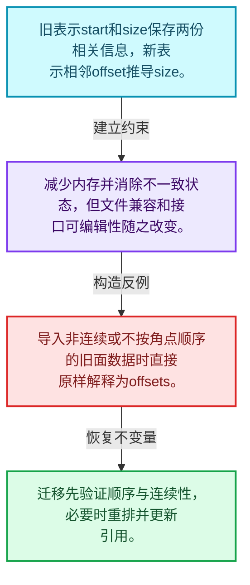
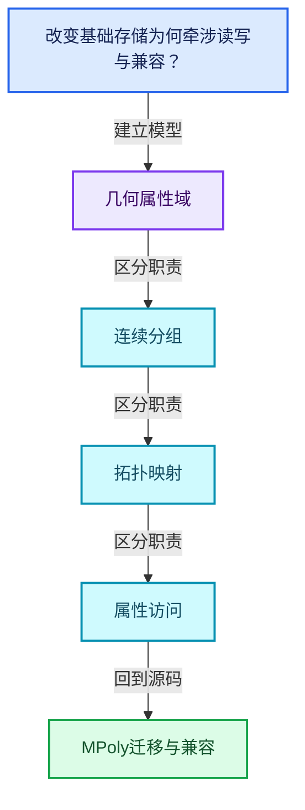
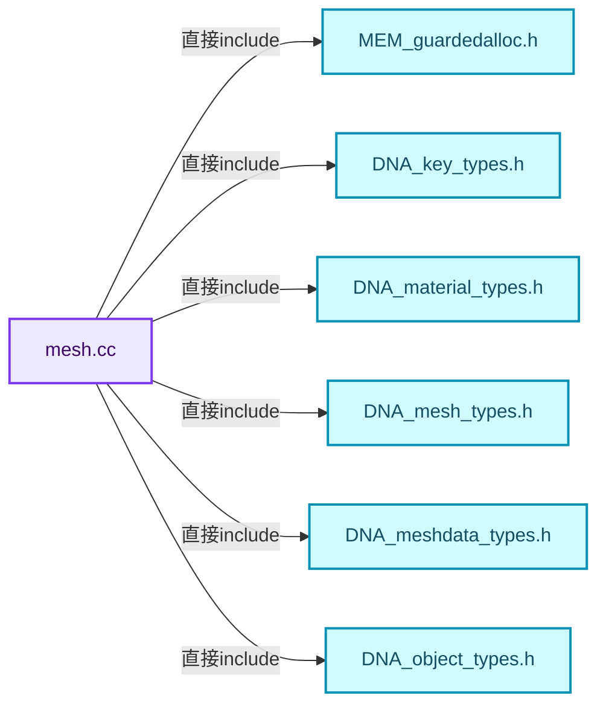
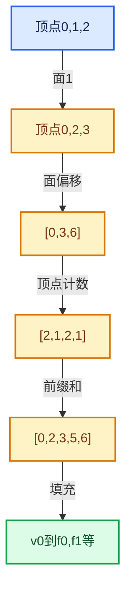

# 05-03 MPoly迁移与兼容

[方向导航](README.md) · [总目录](../README.md) · [覆盖索引](../%E6%BA%90%E7%A0%81%E7%89%88%E6%9C%AC%E4%B8%8E%E8%A6%86%E7%9B%96%E7%B4%A2%E5%BC%95.md)

> 阅读顺序：问题与数据模型 → 语法与类型 → 源码逐行 → 调用线索 → 历史与取舍 → 推演和练习。

- 基准 HEAD：`cbda6b96c26c0dee3c3b5cbb93960c4ac06a6b30`。
- 记录日期：2026-10-14。
- 教学示例状态：正文中的推演不是本机性能实测；已运行练习见验收报告。

## 一、从问题到设计

改变基础存储为何牵涉读写与兼容？

消除冗余字段改善不变量，但持久化格式、RNA和调用者不能假定自动兼容。

本篇把语法、数据语义和系统取舍连接起来。利用连续性和重复关系选择表示，让冗余状态尽量无法表达。

### 本篇独立模型与设计推理

旧表示start和size保存两份相关信息，新表示相邻offset推导size。

设计取舍：减少内存并消除不一致状态，但文件兼容和接口可编辑性随之改变。

最小反例：导入非连续或不按角点顺序的旧面数据时直接原样解释为offsets。

推导与处理：迁移先验证顺序与连续性，必要时重排并更新引用。



### 源码范围与相邻篇章

| 文件 | 本篇逐行范围 | 基准SHA-256 |
|---|---|---|
| [source/blender/blenkernel/intern/mesh.cc](../../../../../source/blender/blenkernel/intern/mesh.cc) | L1—L2270 | `e5582ea53adb16682bab08a9f64ebb92eae0a1d769e144451f55100d0d579119` |

同一主讲文件可能分多篇覆盖；超出本篇范围的符号通过覆盖索引定位。空行与纯注释保留在源码摘录中，逐行表解释有效语句与语法边界；许可证头统一保留。

前篇：[OffsetIndices完整接口](02-OffsetIndices%E5%AE%8C%E6%95%B4%E6%8E%A5%E5%8F%A3.md).

后篇：[CurvesGeometry存储](04-CurvesGeometry%E5%AD%98%E5%82%A8.md).

## 二、类型、数据与阅读地图



这是概念依赖图，边表示阅读关系，不声称是运行时调用顺序。

### 直接编译依赖



箭头只表示头文件包含关系；完整调用线索见后面的符号定位表。

## 三、关键词、语法与类型角色

### 模板 template

模板把类型或常量作为生成实现的参数。读声明时先列出类型参数、非类型参数和默认值，再看使用者实际实例化了什么。模板声明本身不意味着每种T都支持其全部成员。

具体检查：把T替换为int、string、只能移动的类型，分别检查每个被调用操作是否成立。

### 约束 requires

requires表达式或requires子句限制模板参与重载的条件。它提供编译期可用性检查，不是运行时if，不能指望输入到达程序后再被这一机制验证。

具体检查：构造满足和不满足约束的两个类型，观察候选被排除而不是在函数内返回错误。

### 只读限定 const

const约束当前访问路径可做的修改。const指针、指向const的指针、const视图对象、const元素是不同位置的限定；其他别名可能仍可修改原对象。

具体检查：分别写T* const、const T*与const T* const，并画出不可修改的层次。

### 移动转换 std::move

std::move把表达式转换为可供移动重载选择的值类别，实际资源转移发生在被选中的构造或赋值中。对const对象move可能仍调用复制，对视图move也不会获得底层数据所有权。

具体检查：记录移动构造调用次数，不用变量名或std::move的出现次数替代测量。

### 异常边界 try与catch

try定义异常传播的局部边界。失败路径需要销毁已经成功构造的部分并释放相应存储；未构造的对象不能被析构。

具体检查：在第k次构造失败，列出已经存在的对象集合与待释放缓冲。

### 显式静态转换 static_cast

static_cast表达编译期允许的转换，不会自动验证运行时真实类型、指针寿命或索引边界。由void指针恢复T指针时，调用者仍须保证实际存储中确有合法T对象。

具体检查：标出转换前后的类型以及正确性依据来自哪里。

### 表示层转换 reinterpret_cast

reinterpret_cast不能自动开始任意对象的生命周期，也不能豁免对齐和别名规则。读这类代码需要追溯原始分配与实际构造操作。

具体检查：分别检查大小、对齐、生命周期和可访问类型，四项不能互相替代。

### 限定转换 const_cast

const_cast可以改变访问路径的限定，但不能让本来就是const的对象合法可写。常用于复用只读实现时，仍需检查底层对象是否实际可变。

具体检查：对非const对象的const引用与真正const对象分别分析修改是否合法。

### 运行时多态 virtual

虚调用根据实际动态类型选择实现；经基类指针销毁对象时通常需要相应虚析构契约。每元素虚调用和循环外一次分派有不同开销。

具体检查：找出虚接口的实现类和调用频率，再讨论是否值得去虚拟化。

### 覆写检查 override

override要求函数确实覆盖基类虚函数，可捕获参数类型和const限定不匹配。它不改变基类规定的生命周期或线程约束。

具体检查：故意改变一个参数或const，观察编译器如何拒绝误写的新函数。

### 可选值 optional

optional把不存在与存在的T区分开，T的构造和析构跟随engaged状态变化。访问前应由has_value或条件分支证明存在。

具体检查：把空Field状态与合法常量零区分，不能用某个普通值代替不存在。

### 对象表示 sizeof

sizeof给出对象表示大小，不是其引用的所有堆内存总量。sizeof视图很小并不说明底层数组很小。

具体检查：分别统计容器对象、容量字节和元素拥有的间接资源。

### 构造与new表达式

普通new可能分配并构造；placement new在给定地址构造，存储由其他机制提供。失败回滚应区分两类责任。

具体检查：追踪地址来自哪里、构造何时成功、由谁析构、由谁释放。

### 内部断言 assert

断言表达开发者预期成立的内部契约，发布构建可能关闭。它不能替代对不可信输入的完整错误处理，也不保证后续操作被运行时保护。

具体检查：对每条断言构造违反条件的输入，区分调用者错误与应向用户报告的错误。

### 类型别名 using

类型别名为已有类型建立名字，不创建运行期对象。它常把模板内部使用的类型统一暴露给泛型调用者。

具体检查：展开别名直到基础类型，区分类型别名和变量声明。

## 四、真实源码与逐行讲解

源码块保持原行内容，原始行号由小节标题及逐行表给出。表中的调用定位是静态阅读辅助；重载、模板实例化、宏展开和虚调用需结合完整声明，不能仅凭词法出现证明动态调用。

### mesh.cc：L1—L48

<!-- source:source/blender/blenkernel/intern/mesh.cc:1:48 -->

```cpp
/* SPDX-FileCopyrightText: 2001-2002 NaN Holding BV. All rights reserved.
 *
 * SPDX-License-Identifier: GPL-2.0-or-later */

/** \file
 * \ingroup bke
 */

#include <optional>

#include "MEM_guardedalloc.h"

/* Allow using deprecated functionality for .blend file I/O. */
#define DNA_DEPRECATED_ALLOW

#include "DNA_key_types.h"
#include "DNA_material_types.h"
#include "DNA_mesh_types.h"
#include "DNA_meshdata_types.h"
#include "DNA_object_types.h"

#include "BLI_array_utils.hh"
#include "BLI_bounds.hh"
#include "BLI_hash_c.hh"
#include "BLI_implicit_sharing.hh"
#include "BLI_index_range.hh"
#include "BLI_listbase.hh"
#include "BLI_math_matrix.hh"
#include "BLI_math_vector.hh"
#include "BLI_math_vector_c.hh"
#include "BLI_memory_counter.hh"
#include "BLI_resource_scope.hh"
#include "BLI_set.hh"
#include "BLI_span.hh"
#include "BLI_string.hh"
#include "BLI_task.hh"
#include "BLI_time.hh"
#include "BLI_utildefines.hh"
#include "BLI_vector.hh"
#include "BLI_virtual_array.hh"

#include "BLT_translation.hh"

#include "BKE_anim_data.hh"
#include "BKE_anonymous_attribute_id.hh"
#include "BKE_attribute.hh"
#include "BKE_attribute_legacy_convert.hh"
#include "BKE_attribute_storage.hh"
```

| 原始行 | 语义、约束与检查 |
|---|---|
| L9 | 引入编译依赖 <optional>；这是声明可见性关系，不表示运行时一定调用该文件的所有接口。 |
| L11 | 引入编译依赖 "MEM_guardedalloc.h"；这是声明可见性关系，不表示运行时一定调用该文件的所有接口。 |
| L14 | 预处理阶段处理 #define DNA_DEPRECATED_ALLOW。它决定哪些代码进入编译，不是运行时分支；阅读行为时必须结合实际构建宏。 |
| L16 | 引入编译依赖 "DNA_key_types.h"；这是声明可见性关系，不表示运行时一定调用该文件的所有接口。 |
| L17 | 引入编译依赖 "DNA_material_types.h"；这是声明可见性关系，不表示运行时一定调用该文件的所有接口。 |
| L18 | 引入编译依赖 "DNA_mesh_types.h"；这是声明可见性关系，不表示运行时一定调用该文件的所有接口。 |
| L19 | 引入编译依赖 "DNA_meshdata_types.h"；这是声明可见性关系，不表示运行时一定调用该文件的所有接口。 |
| L20 | 引入编译依赖 "DNA_object_types.h"；这是声明可见性关系，不表示运行时一定调用该文件的所有接口。 |
| L22 | 引入编译依赖 "BLI_array_utils.hh"；这是声明可见性关系，不表示运行时一定调用该文件的所有接口。 |
| L23 | 引入编译依赖 "BLI_bounds.hh"；这是声明可见性关系，不表示运行时一定调用该文件的所有接口。 |
| L24 | 引入编译依赖 "BLI_hash_c.hh"；这是声明可见性关系，不表示运行时一定调用该文件的所有接口。 |
| L25 | 引入编译依赖 "BLI_implicit_sharing.hh"；这是声明可见性关系，不表示运行时一定调用该文件的所有接口。 |
| L26 | 引入编译依赖 "BLI_index_range.hh"；这是声明可见性关系，不表示运行时一定调用该文件的所有接口。 |
| L27 | 引入编译依赖 "BLI_listbase.hh"；这是声明可见性关系，不表示运行时一定调用该文件的所有接口。 |
| L28 | 引入编译依赖 "BLI_math_matrix.hh"；这是声明可见性关系，不表示运行时一定调用该文件的所有接口。 |
| L29 | 引入编译依赖 "BLI_math_vector.hh"；这是声明可见性关系，不表示运行时一定调用该文件的所有接口。 |
| L30 | 引入编译依赖 "BLI_math_vector_c.hh"；这是声明可见性关系，不表示运行时一定调用该文件的所有接口。 |
| L31 | 引入编译依赖 "BLI_memory_counter.hh"；这是声明可见性关系，不表示运行时一定调用该文件的所有接口。 |
| L32 | 引入编译依赖 "BLI_resource_scope.hh"；这是声明可见性关系，不表示运行时一定调用该文件的所有接口。 |
| L33 | 引入编译依赖 "BLI_set.hh"；这是声明可见性关系，不表示运行时一定调用该文件的所有接口。 |
| L34 | 引入编译依赖 "BLI_span.hh"；这是声明可见性关系，不表示运行时一定调用该文件的所有接口。 |
| L35 | 引入编译依赖 "BLI_string.hh"；这是声明可见性关系，不表示运行时一定调用该文件的所有接口。 |
| L36 | 引入编译依赖 "BLI_task.hh"；这是声明可见性关系，不表示运行时一定调用该文件的所有接口。 |
| L37 | 引入编译依赖 "BLI_time.hh"；这是声明可见性关系，不表示运行时一定调用该文件的所有接口。 |
| L38 | 引入编译依赖 "BLI_utildefines.hh"；这是声明可见性关系，不表示运行时一定调用该文件的所有接口。 |
| L39 | 引入编译依赖 "BLI_vector.hh"；这是声明可见性关系，不表示运行时一定调用该文件的所有接口。 |
| L40 | 引入编译依赖 "BLI_virtual_array.hh"；这是声明可见性关系，不表示运行时一定调用该文件的所有接口。 |
| L42 | 引入编译依赖 "BLT_translation.hh"；这是声明可见性关系，不表示运行时一定调用该文件的所有接口。 |
| L44 | 引入编译依赖 "BKE_anim_data.hh"；这是声明可见性关系，不表示运行时一定调用该文件的所有接口。 |
| L45 | 引入编译依赖 "BKE_anonymous_attribute_id.hh"；这是声明可见性关系，不表示运行时一定调用该文件的所有接口。 |
| L46 | 引入编译依赖 "BKE_attribute.hh"；这是声明可见性关系，不表示运行时一定调用该文件的所有接口。 |
| L47 | 引入编译依赖 "BKE_attribute_legacy_convert.hh"；这是声明可见性关系，不表示运行时一定调用该文件的所有接口。 |
| L48 | 引入编译依赖 "BKE_attribute_storage.hh"；这是声明可见性关系，不表示运行时一定调用该文件的所有接口。 |

### mesh.cc：L49—L104

<!-- source:source/blender/blenkernel/intern/mesh.cc:49:104 -->

```cpp
#include "BKE_attribute_storage_blend_write.hh"
#include "BKE_bake_data_block_id.hh"
#include "BKE_bpath.hh"
#include "BKE_deform.hh"
#include "BKE_editmesh.hh"
#include "BKE_editmesh_cache.hh"
#include "BKE_global.hh"
#include "BKE_idtype.hh"
#include "BKE_key.hh"
#include "BKE_lib_id.hh"
#include "BKE_lib_query.hh"
#include "BKE_main.hh"
#include "BKE_material.hh"
#include "BKE_mesh.hh"
#include "BKE_mesh_legacy_convert.hh"
#include "BKE_mesh_runtime.hh"
#include "BKE_mesh_wrapper.hh"
#include "BKE_modifier.hh"
#include "BKE_multires.hh"
#include "BKE_object.hh"
#include "BKE_paint_bvh.hh"

#include "DEG_depsgraph.hh"
#include "DEG_depsgraph_query.hh"

#include "BLO_read_write.hh"

#include "CLG_log.h"

#include "attribute_storage_access.hh"

namespace blender {

static CLG_LogRef LOG = {"geom.mesh"};

/** Using STACK_FIXED_DEPTH to keep the implementation in line with `pbvh.cc`. */
#define STACK_FIXED_DEPTH 100

static void mesh_tessface_clear_intern(Mesh *mesh, int free_customdata);

static void mesh_init_data(ID *id)
{
  Mesh *mesh = reinterpret_cast<Mesh *>(id);
  INIT_DEFAULT_STRUCT_AFTER(mesh, id);

  CustomData_reset(&mesh->vert_data);
  CustomData_reset(&mesh->edge_data);
  CustomData_reset(&mesh->fdata_legacy);
  CustomData_reset(&mesh->face_data);
  CustomData_reset(&mesh->corner_data);

  new (&mesh->attribute_storage.wrap()) bke::AttributeStorage();
  mesh->runtime = new bke::MeshRuntime();

  mesh->face_sets_color_seed = BLI_hash_int(BLI_time_now_seconds_i() & UINT_MAX);
}
```

| 原始行 | 语义、约束与检查 |
|---|---|
| L49 | 引入编译依赖 "BKE_attribute_storage_blend_write.hh"；这是声明可见性关系，不表示运行时一定调用该文件的所有接口。 |
| L50 | 引入编译依赖 "BKE_bake_data_block_id.hh"；这是声明可见性关系，不表示运行时一定调用该文件的所有接口。 |
| L51 | 引入编译依赖 "BKE_bpath.hh"；这是声明可见性关系，不表示运行时一定调用该文件的所有接口。 |
| L52 | 引入编译依赖 "BKE_deform.hh"；这是声明可见性关系，不表示运行时一定调用该文件的所有接口。 |
| L53 | 引入编译依赖 "BKE_editmesh.hh"；这是声明可见性关系，不表示运行时一定调用该文件的所有接口。 |
| L54 | 引入编译依赖 "BKE_editmesh_cache.hh"；这是声明可见性关系，不表示运行时一定调用该文件的所有接口。 |
| L55 | 引入编译依赖 "BKE_global.hh"；这是声明可见性关系，不表示运行时一定调用该文件的所有接口。 |
| L56 | 引入编译依赖 "BKE_idtype.hh"；这是声明可见性关系，不表示运行时一定调用该文件的所有接口。 |
| L57 | 引入编译依赖 "BKE_key.hh"；这是声明可见性关系，不表示运行时一定调用该文件的所有接口。 |
| L58 | 引入编译依赖 "BKE_lib_id.hh"；这是声明可见性关系，不表示运行时一定调用该文件的所有接口。 |
| L59 | 引入编译依赖 "BKE_lib_query.hh"；这是声明可见性关系，不表示运行时一定调用该文件的所有接口。 |
| L60 | 引入编译依赖 "BKE_main.hh"；这是声明可见性关系，不表示运行时一定调用该文件的所有接口。 |
| L61 | 引入编译依赖 "BKE_material.hh"；这是声明可见性关系，不表示运行时一定调用该文件的所有接口。 |
| L62 | 引入编译依赖 "BKE_mesh.hh"；这是声明可见性关系，不表示运行时一定调用该文件的所有接口。 |
| L63 | 引入编译依赖 "BKE_mesh_legacy_convert.hh"；这是声明可见性关系，不表示运行时一定调用该文件的所有接口。 |
| L64 | 引入编译依赖 "BKE_mesh_runtime.hh"；这是声明可见性关系，不表示运行时一定调用该文件的所有接口。 |
| L65 | 引入编译依赖 "BKE_mesh_wrapper.hh"；这是声明可见性关系，不表示运行时一定调用该文件的所有接口。 |
| L66 | 引入编译依赖 "BKE_modifier.hh"；这是声明可见性关系，不表示运行时一定调用该文件的所有接口。 |
| L67 | 引入编译依赖 "BKE_multires.hh"；这是声明可见性关系，不表示运行时一定调用该文件的所有接口。 |
| L68 | 引入编译依赖 "BKE_object.hh"；这是声明可见性关系，不表示运行时一定调用该文件的所有接口。 |
| L69 | 引入编译依赖 "BKE_paint_bvh.hh"；这是声明可见性关系，不表示运行时一定调用该文件的所有接口。 |
| L71 | 引入编译依赖 "DEG_depsgraph.hh"；这是声明可见性关系，不表示运行时一定调用该文件的所有接口。 |
| L72 | 引入编译依赖 "DEG_depsgraph_query.hh"；这是声明可见性关系，不表示运行时一定调用该文件的所有接口。 |
| L74 | 引入编译依赖 "BLO_read_write.hh"；这是声明可见性关系，不表示运行时一定调用该文件的所有接口。 |
| L76 | 引入编译依赖 "CLG_log.h"；这是声明可见性关系，不表示运行时一定调用该文件的所有接口。 |
| L78 | 引入编译依赖 "attribute_storage_access.hh"；这是声明可见性关系，不表示运行时一定调用该文件的所有接口。 |
| L80 | 把后续声明放入 blender 命名空间，影响名称查找和符号归属，不创建运行时对象。 |
| L82 | 把右侧 `{"geom.mesh"}` 用于初始化或更新左侧 `static CLG_LogRef LOG`。声明初始化与已有对象赋值应按上下文区分；有资源的类型会调用相应特殊成员。 |
| L85 | 预处理阶段处理 #define STACK_FIXED_DEPTH 100。它决定哪些代码进入编译，不是运行时分支；阅读行为时必须结合实际构建宏。 |
| L87 | 声明接口 `static void mesh_tessface_clear_intern(Mesh *mesh, int free_customdata)`，本行没有对应函数体；返回类型、参数限定和const/noexcept共同组成调用契约，实际行为需继续定位实现。 |
| L89 | 出现调用或函数声明 `mesh_init_data`，对应表达式为 `static void mesh_init_data(ID *id)`。参数求值、返回类型与重载需结合前后完整语句；静态文本引用不能证明动态目标。 |
| L90 | 连接上一行的声明或控制结构与其语句块；后续行在这个作用域中执行或声明。 |
| L91 | 把右侧 `reinterpret_cast<Mesh *>(id)` 用于初始化或更新左侧 `Mesh *mesh`。声明初始化与已有对象赋值应按上下文区分；有资源的类型会调用相应特殊成员。 |
| L92 | 出现调用或函数声明 `INIT_DEFAULT_STRUCT_AFTER`，对应表达式为 `INIT_DEFAULT_STRUCT_AFTER(mesh, id);`。参数求值、返回类型与重载需结合前后完整语句；静态文本引用不能证明动态目标。 |
| L94 | 出现调用或函数声明 `CustomData_reset`，对应表达式为 `CustomData_reset(&mesh->vert_data);`。参数求值、返回类型与重载需结合前后完整语句；静态文本引用不能证明动态目标。 |
| L95 | 出现调用或函数声明 `CustomData_reset`，对应表达式为 `CustomData_reset(&mesh->edge_data);`。参数求值、返回类型与重载需结合前后完整语句；静态文本引用不能证明动态目标。 |
| L96 | 出现调用或函数声明 `CustomData_reset`，对应表达式为 `CustomData_reset(&mesh->fdata_legacy);`。参数求值、返回类型与重载需结合前后完整语句；静态文本引用不能证明动态目标。 |
| L97 | 出现调用或函数声明 `CustomData_reset`，对应表达式为 `CustomData_reset(&mesh->face_data);`。参数求值、返回类型与重载需结合前后完整语句；静态文本引用不能证明动态目标。 |
| L98 | 出现调用或函数声明 `CustomData_reset`，对应表达式为 `CustomData_reset(&mesh->corner_data);`。参数求值、返回类型与重载需结合前后完整语句；静态文本引用不能证明动态目标。 |
| L100 | 出现调用或函数声明 `new`，对应表达式为 `new (&mesh->attribute_storage.wrap()) bke::AttributeStorage();`。参数求值、返回类型与重载需结合前后完整语句；静态文本引用不能证明动态目标。 |
| L101 | 把右侧 `new bke::MeshRuntime()` 用于初始化或更新左侧 `mesh->runtime`。声明初始化与已有对象赋值应按上下文区分；有资源的类型会调用相应特殊成员。 |
| L103 | 把右侧 `BLI_hash_int(BLI_time_now_seconds_i() & UINT_MAX)` 用于初始化或更新左侧 `mesh->face_sets_color_seed`。声明初始化与已有对象赋值应按上下文区分；有资源的类型会调用相应特殊成员。 |
| L104 | 结束当前语法单元。局部自动对象在离开其作用域时按规则销毁；这不等于所有被引用的外部数据也被释放。 |

### mesh.cc：L105—L254

<!-- source:source/blender/blenkernel/intern/mesh.cc:105:254 -->

```cpp

static void mesh_copy_data(Main *bmain,
                           std::optional<Library *> owner_library,
                           ID *id_dst,
                           const ID *id_src,
                           const int flag)
{
  Mesh *mesh_dst = reinterpret_cast<Mesh *>(id_dst);
  const Mesh *mesh_src = reinterpret_cast<const Mesh *>(id_src);

  mesh_dst->runtime = new bke::MeshRuntime();
  mesh_dst->runtime->deformed_only = mesh_src->runtime->deformed_only;
  /* Subd runtime.mesh_eval is not copied, will need to be reevaluated. */
  mesh_dst->runtime->wrapper_type = (mesh_src->runtime->wrapper_type == ME_WRAPPER_TYPE_SUBD) ?
                                        ME_WRAPPER_TYPE_MDATA :
                                        mesh_src->runtime->wrapper_type;
  mesh_dst->runtime->subsurf_runtime_data = mesh_src->runtime->subsurf_runtime_data;
  mesh_dst->runtime->cd_mask_extra = mesh_src->runtime->cd_mask_extra;
  /* Copy face dot tags and edge tags, since meshes may be duplicated after a subsurf modifier or
   * node, but we still need to be able to draw face center vertices and "optimal edges"
   * differently. The tags may be cleared explicitly when the topology is changed. */
  mesh_dst->runtime->subsurf_face_dot_tags = mesh_src->runtime->subsurf_face_dot_tags;
  mesh_dst->runtime->subsurf_optimal_display_edges =
      mesh_src->runtime->subsurf_optimal_display_edges;
  if ((mesh_src->id.tag & ID_TAG_NO_MAIN) == 0) {
    /* This is a direct copy of a main mesh, so for now it has the same topology. */
    mesh_dst->runtime->deformed_only = true;
  }
  /* This option is set for run-time meshes that have been copied from the current object's mode.
   * Currently this is used for edit-mesh although it could be used for sculpt or other
   * kinds of data specific to an object's mode.
   *
   * The flag signals that the mesh hasn't been modified from the data that generated it,
   * allowing us to use the object-mode data for drawing.
   *
   * While this could be the caller's responsibility, keep here since it's
   * highly unlikely we want to create a duplicate and not use it for drawing. */
  mesh_dst->runtime->is_original_bmesh = false;

  /* Share various derived caches between the source and destination mesh for improved performance
   * when the source is persistent and edits to the destination mesh don't affect the caches.
   * Caches will be "un-shared" as necessary later on. */
  mesh_dst->runtime->bounds_cache = mesh_src->runtime->bounds_cache;
  mesh_dst->runtime->vert_normals_cache = mesh_src->runtime->vert_normals_cache;
  mesh_dst->runtime->vert_normals_true_cache = mesh_src->runtime->vert_normals_true_cache;
  mesh_dst->runtime->face_normals_cache = mesh_src->runtime->face_normals_cache;
  mesh_dst->runtime->face_normals_true_cache = mesh_src->runtime->face_normals_true_cache;
  mesh_dst->runtime->corner_normals_cache = mesh_src->runtime->corner_normals_cache;
  mesh_dst->runtime->loose_verts_cache = mesh_src->runtime->loose_verts_cache;
  mesh_dst->runtime->verts_no_face_cache = mesh_src->runtime->verts_no_face_cache;
  mesh_dst->runtime->loose_edges_cache = mesh_src->runtime->loose_edges_cache;
  mesh_dst->runtime->corner_tris_cache = mesh_src->runtime->corner_tris_cache;
  mesh_dst->runtime->corner_tri_faces_cache = mesh_src->runtime->corner_tri_faces_cache;
  mesh_dst->runtime->vert_to_face_offset_cache = mesh_src->runtime->vert_to_face_offset_cache;
  mesh_dst->runtime->vert_to_face_map_cache = mesh_src->runtime->vert_to_face_map_cache;
  mesh_dst->runtime->vert_to_corner_map_cache = mesh_src->runtime->vert_to_corner_map_cache;
  mesh_dst->runtime->corner_to_face_map_cache = mesh_src->runtime->corner_to_face_map_cache;
  mesh_dst->runtime->edge_to_corner_offset_cache = mesh_src->runtime->edge_to_corner_offset_cache;
  mesh_dst->runtime->edge_to_corner_map_cache = mesh_src->runtime->edge_to_corner_map_cache;
  mesh_dst->runtime->bvh_cache_edges = mesh_src->runtime->bvh_cache_edges;
  mesh_dst->runtime->bvh_cache_faces = mesh_src->runtime->bvh_cache_faces;
  mesh_dst->runtime->bvh_cache_corner_tris = mesh_src->runtime->bvh_cache_corner_tris;
  mesh_dst->runtime->bvh_cache_corner_tris_no_hidden =
      mesh_src->runtime->bvh_cache_corner_tris_no_hidden;
  mesh_dst->runtime->bvh_cache_loose_verts = mesh_src->runtime->bvh_cache_loose_verts;
  mesh_dst->runtime->bvh_cache_loose_verts_no_hidden =
      mesh_src->runtime->bvh_cache_loose_verts_no_hidden;
  mesh_dst->runtime->bvh_cache_loose_edges = mesh_src->runtime->bvh_cache_loose_edges;
  mesh_dst->runtime->bvh_cache_loose_edges_no_hidden =
      mesh_src->runtime->bvh_cache_loose_edges_no_hidden;
  mesh_dst->runtime->bvh_embree_tris_cache = mesh_src->runtime->bvh_embree_tris_cache;
  mesh_dst->runtime->bvh_embree_verts_cache = mesh_src->runtime->bvh_embree_verts_cache;
  mesh_dst->runtime->bvh_embree_edges_cache = mesh_src->runtime->bvh_embree_edges_cache;
  mesh_dst->runtime->max_material_index = mesh_src->runtime->max_material_index;
  if (mesh_src->runtime->bake_materials) {
    mesh_dst->runtime->bake_materials = std::make_unique<bke::bake::BakeMaterialsList>(
        *mesh_src->runtime->bake_materials);
  }

  /* Only do tessface if we have no faces. */
  const bool do_tessface = ((mesh_src->totface_legacy != 0) && (mesh_src->faces_num == 0));

  CustomData_MeshMasks mask = CD_MASK_MESH;

  if (mesh_src->id.tag & ID_TAG_NO_MAIN) {
    /* For copies in depsgraph, keep data like #CD_ORIGINDEX and #CD_ORCO. */
    CustomData_MeshMasks_update(&mask, &CD_MASK_DERIVEDMESH);

    /* Meshes copied during evaluation pass the edit mesh pointer to determine whether a mapping
     * from the evaluated to the original state is possible. */
    mesh_dst->runtime->edit_mesh = mesh_src->runtime->edit_mesh;
    if (const bke::EditMeshData *edit_data = mesh_src->runtime->edit_data.get()) {
      mesh_dst->runtime->edit_data = std::make_unique<bke::EditMeshData>(*edit_data);
    }
  }

  mesh_dst->mat = MEM_dupalloc(mesh_src->mat);

  BKE_defgroup_copy_list(&mesh_dst->vertex_group_names, &mesh_src->vertex_group_names);
  mesh_dst->active_color_attribute = static_cast<char *>(
      MEM_dupalloc(mesh_src->active_color_attribute));
  mesh_dst->default_color_attribute = static_cast<char *>(
      MEM_dupalloc(mesh_src->default_color_attribute));
  mesh_dst->active_uv_map_attribute = static_cast<char *>(
      MEM_dupalloc(mesh_src->active_uv_map_attribute));
  mesh_dst->default_uv_map_attribute = static_cast<char *>(
      MEM_dupalloc(mesh_src->default_uv_map_attribute));
  mesh_dst->stencil_uv_map_attribute = static_cast<char *>(
      MEM_dupalloc(mesh_src->stencil_uv_map_attribute));
  mesh_dst->clone_uv_map_attribute = static_cast<char *>(
      MEM_dupalloc(mesh_src->clone_uv_map_attribute));

  CustomData_init_from(
      &mesh_src->vert_data, &mesh_dst->vert_data, mask.vmask, mesh_dst->verts_num);
  CustomData_init_from(
      &mesh_src->edge_data, &mesh_dst->edge_data, mask.emask, mesh_dst->edges_num);
  CustomData_init_from(
      &mesh_src->corner_data, &mesh_dst->corner_data, mask.lmask, mesh_dst->corners_num);
  CustomData_init_from(
      &mesh_src->face_data, &mesh_dst->face_data, mask.pmask, mesh_dst->faces_num);
  new (&mesh_dst->attribute_storage.wrap())
      bke::AttributeStorage(mesh_src->attribute_storage.wrap());
  implicit_sharing::copy_shared_pointer(mesh_src->face_offset_indices,
                                        mesh_src->runtime->face_offsets_sharing_info,
                                        &mesh_dst->face_offset_indices,
                                        &mesh_dst->runtime->face_offsets_sharing_info);
  if (do_tessface) {
    CustomData_init_from(
        &mesh_src->fdata_legacy, &mesh_dst->fdata_legacy, mask.fmask, mesh_dst->totface_legacy);
  }
  else {
    mesh_tessface_clear_intern(mesh_dst, false);
  }

  mesh_dst->mselect = MEM_dupalloc(mesh_dst->mselect);

  if (mesh_src->key && (flag & LIB_ID_COPY_SHAPEKEY)) {
    BKE_id_copy_in_lib(bmain,
                       owner_library,
                       &mesh_src->key->id,
                       &mesh_dst->id,
                       reinterpret_cast<ID **>(&mesh_dst->key),
                       flag);
    /* It has one user, but its owner reference (added in #id_copy_libmanagement_cb)
     * is the real owner, remove the reference here, see: #159691. */
    if ((flag & LIB_ID_CREATE_NO_USER_REFCOUNT) == 0) {
      id_us_min(&mesh_dst->key->id);
    }
  }
}
```

本段语义重点：

- 分支证据 `(mesh_src->id.tag & ID_TAG_NO_MAIN) == 0)`：分别推演条件成立与不成立，核对相同出口处的状态。
- 分支证据 `mesh_src->runtime->bake_materials)`：分别推演条件成立与不成立，核对相同出口处的状态。

| 原始行 | 语义、约束与检查 |
|---|---|
| L106 | 出现调用或函数声明 `mesh_copy_data`，对应表达式为 `static void mesh_copy_data(Main *bmain,`。参数求值、返回类型与重载需结合前后完整语句；静态文本引用不能证明动态目标。 |
| L107 | 本行是连续声明或表达式的一部分：`std::optional<Library *> owner_library,`。与本段前后行合读；逗号、括号和限定符决定它属于参数、初始化列表还是实际计算。 |
| L108 | 本行是连续声明或表达式的一部分：`ID *id_dst,`。与本段前后行合读；逗号、括号和限定符决定它属于参数、初始化列表还是实际计算。 |
| L109 | 本行是连续声明或表达式的一部分：`const ID *id_src,`。与本段前后行合读；逗号、括号和限定符决定它属于参数、初始化列表还是实际计算。 |
| L110 | 本行是连续声明或表达式的一部分：`const int flag)`。与本段前后行合读；逗号、括号和限定符决定它属于参数、初始化列表还是实际计算。 |
| L111 | 连接上一行的声明或控制结构与其语句块；后续行在这个作用域中执行或声明。 |
| L112 | 把右侧 `reinterpret_cast<Mesh *>(id_dst)` 用于初始化或更新左侧 `Mesh *mesh_dst`。声明初始化与已有对象赋值应按上下文区分；有资源的类型会调用相应特殊成员。 |
| L113 | 把右侧 `reinterpret_cast<const Mesh *>(id_src)` 用于初始化或更新左侧 `const Mesh *mesh_src`。声明初始化与已有对象赋值应按上下文区分；有资源的类型会调用相应特殊成员。 |
| L115 | 把右侧 `new bke::MeshRuntime()` 用于初始化或更新左侧 `mesh_dst->runtime`。声明初始化与已有对象赋值应按上下文区分；有资源的类型会调用相应特殊成员。 |
| L116 | 把右侧 `mesh_src->runtime->deformed_only` 用于初始化或更新左侧 `mesh_dst->runtime->deformed_only`。声明初始化与已有对象赋值应按上下文区分；有资源的类型会调用相应特殊成员。 |
| L118 | 把右侧 `(mesh_src->runtime->wrapper_type == ME_WRAPPER_TYPE_SUBD) ?` 用于初始化或更新左侧 `mesh_dst->runtime->wrapper_type`。声明初始化与已有对象赋值应按上下文区分；有资源的类型会调用相应特殊成员。 |
| L119 | 本行是连续声明或表达式的一部分：`ME_WRAPPER_TYPE_MDATA :`。与本段前后行合读；逗号、括号和限定符决定它属于参数、初始化列表还是实际计算。 |
| L120 | 声明成员、局部对象或完成语句 `mesh_src->runtime->wrapper_type`。若为指针或引用，它本身不说明拥有；若为值对象，其构造析构由所在作用域或外层对象管理。 |
| L121 | 把右侧 `mesh_src->runtime->subsurf_runtime_data` 用于初始化或更新左侧 `mesh_dst->runtime->subsurf_runtime_data`。声明初始化与已有对象赋值应按上下文区分；有资源的类型会调用相应特殊成员。 |
| L122 | 把右侧 `mesh_src->runtime->cd_mask_extra` 用于初始化或更新左侧 `mesh_dst->runtime->cd_mask_extra`。声明初始化与已有对象赋值应按上下文区分；有资源的类型会调用相应特殊成员。 |
| L126 | 把右侧 `mesh_src->runtime->subsurf_face_dot_tags` 用于初始化或更新左侧 `mesh_dst->runtime->subsurf_face_dot_tags`。声明初始化与已有对象赋值应按上下文区分；有资源的类型会调用相应特殊成员。 |
| L127 | 把右侧 `` 用于初始化或更新左侧 `mesh_dst->runtime->subsurf_optimal_display_edges`。声明初始化与已有对象赋值应按上下文区分；有资源的类型会调用相应特殊成员。 |
| L128 | 声明成员、局部对象或完成语句 `mesh_src->runtime->subsurf_optimal_display_edges`。若为指针或引用，它本身不说明拥有；若为值对象，其构造析构由所在作用域或外层对象管理。 |
| L129 | 判断 `(mesh_src->id.tag & ID_TAG_NO_MAIN) == 0`，成立时进入本分支，否则继续后续路径。 |
| L131 | 把右侧 `true` 用于初始化或更新左侧 `mesh_dst->runtime->deformed_only`。声明初始化与已有对象赋值应按上下文区分；有资源的类型会调用相应特殊成员。 |
| L132 | 结束当前语法单元。局部自动对象在离开其作用域时按规则销毁；这不等于所有被引用的外部数据也被释放。 |
| L142 | 把右侧 `false` 用于初始化或更新左侧 `mesh_dst->runtime->is_original_bmesh`。声明初始化与已有对象赋值应按上下文区分；有资源的类型会调用相应特殊成员。 |
| L147 | 把右侧 `mesh_src->runtime->bounds_cache` 用于初始化或更新左侧 `mesh_dst->runtime->bounds_cache`。声明初始化与已有对象赋值应按上下文区分；有资源的类型会调用相应特殊成员。 |
| L148 | 把右侧 `mesh_src->runtime->vert_normals_cache` 用于初始化或更新左侧 `mesh_dst->runtime->vert_normals_cache`。声明初始化与已有对象赋值应按上下文区分；有资源的类型会调用相应特殊成员。 |
| L149 | 把右侧 `mesh_src->runtime->vert_normals_true_cache` 用于初始化或更新左侧 `mesh_dst->runtime->vert_normals_true_cache`。声明初始化与已有对象赋值应按上下文区分；有资源的类型会调用相应特殊成员。 |
| L150 | 把右侧 `mesh_src->runtime->face_normals_cache` 用于初始化或更新左侧 `mesh_dst->runtime->face_normals_cache`。声明初始化与已有对象赋值应按上下文区分；有资源的类型会调用相应特殊成员。 |
| L151 | 把右侧 `mesh_src->runtime->face_normals_true_cache` 用于初始化或更新左侧 `mesh_dst->runtime->face_normals_true_cache`。声明初始化与已有对象赋值应按上下文区分；有资源的类型会调用相应特殊成员。 |
| L152 | 把右侧 `mesh_src->runtime->corner_normals_cache` 用于初始化或更新左侧 `mesh_dst->runtime->corner_normals_cache`。声明初始化与已有对象赋值应按上下文区分；有资源的类型会调用相应特殊成员。 |
| L153 | 把右侧 `mesh_src->runtime->loose_verts_cache` 用于初始化或更新左侧 `mesh_dst->runtime->loose_verts_cache`。声明初始化与已有对象赋值应按上下文区分；有资源的类型会调用相应特殊成员。 |
| L154 | 把右侧 `mesh_src->runtime->verts_no_face_cache` 用于初始化或更新左侧 `mesh_dst->runtime->verts_no_face_cache`。声明初始化与已有对象赋值应按上下文区分；有资源的类型会调用相应特殊成员。 |
| L155 | 把右侧 `mesh_src->runtime->loose_edges_cache` 用于初始化或更新左侧 `mesh_dst->runtime->loose_edges_cache`。声明初始化与已有对象赋值应按上下文区分；有资源的类型会调用相应特殊成员。 |
| L156 | 把右侧 `mesh_src->runtime->corner_tris_cache` 用于初始化或更新左侧 `mesh_dst->runtime->corner_tris_cache`。声明初始化与已有对象赋值应按上下文区分；有资源的类型会调用相应特殊成员。 |
| L157 | 把右侧 `mesh_src->runtime->corner_tri_faces_cache` 用于初始化或更新左侧 `mesh_dst->runtime->corner_tri_faces_cache`。声明初始化与已有对象赋值应按上下文区分；有资源的类型会调用相应特殊成员。 |
| L158 | 把右侧 `mesh_src->runtime->vert_to_face_offset_cache` 用于初始化或更新左侧 `mesh_dst->runtime->vert_to_face_offset_cache`。声明初始化与已有对象赋值应按上下文区分；有资源的类型会调用相应特殊成员。 |
| L159 | 把右侧 `mesh_src->runtime->vert_to_face_map_cache` 用于初始化或更新左侧 `mesh_dst->runtime->vert_to_face_map_cache`。声明初始化与已有对象赋值应按上下文区分；有资源的类型会调用相应特殊成员。 |
| L160 | 把右侧 `mesh_src->runtime->vert_to_corner_map_cache` 用于初始化或更新左侧 `mesh_dst->runtime->vert_to_corner_map_cache`。声明初始化与已有对象赋值应按上下文区分；有资源的类型会调用相应特殊成员。 |
| L161 | 把右侧 `mesh_src->runtime->corner_to_face_map_cache` 用于初始化或更新左侧 `mesh_dst->runtime->corner_to_face_map_cache`。声明初始化与已有对象赋值应按上下文区分；有资源的类型会调用相应特殊成员。 |
| L162 | 把右侧 `mesh_src->runtime->edge_to_corner_offset_cache` 用于初始化或更新左侧 `mesh_dst->runtime->edge_to_corner_offset_cache`。声明初始化与已有对象赋值应按上下文区分；有资源的类型会调用相应特殊成员。 |
| L163 | 把右侧 `mesh_src->runtime->edge_to_corner_map_cache` 用于初始化或更新左侧 `mesh_dst->runtime->edge_to_corner_map_cache`。声明初始化与已有对象赋值应按上下文区分；有资源的类型会调用相应特殊成员。 |
| L164 | 把右侧 `mesh_src->runtime->bvh_cache_edges` 用于初始化或更新左侧 `mesh_dst->runtime->bvh_cache_edges`。声明初始化与已有对象赋值应按上下文区分；有资源的类型会调用相应特殊成员。 |
| L165 | 把右侧 `mesh_src->runtime->bvh_cache_faces` 用于初始化或更新左侧 `mesh_dst->runtime->bvh_cache_faces`。声明初始化与已有对象赋值应按上下文区分；有资源的类型会调用相应特殊成员。 |
| L166 | 把右侧 `mesh_src->runtime->bvh_cache_corner_tris` 用于初始化或更新左侧 `mesh_dst->runtime->bvh_cache_corner_tris`。声明初始化与已有对象赋值应按上下文区分；有资源的类型会调用相应特殊成员。 |
| L167 | 把右侧 `` 用于初始化或更新左侧 `mesh_dst->runtime->bvh_cache_corner_tris_no_hidden`。声明初始化与已有对象赋值应按上下文区分；有资源的类型会调用相应特殊成员。 |
| L168 | 声明成员、局部对象或完成语句 `mesh_src->runtime->bvh_cache_corner_tris_no_hidden`。若为指针或引用，它本身不说明拥有；若为值对象，其构造析构由所在作用域或外层对象管理。 |
| L169 | 把右侧 `mesh_src->runtime->bvh_cache_loose_verts` 用于初始化或更新左侧 `mesh_dst->runtime->bvh_cache_loose_verts`。声明初始化与已有对象赋值应按上下文区分；有资源的类型会调用相应特殊成员。 |
| L170 | 把右侧 `` 用于初始化或更新左侧 `mesh_dst->runtime->bvh_cache_loose_verts_no_hidden`。声明初始化与已有对象赋值应按上下文区分；有资源的类型会调用相应特殊成员。 |
| L171 | 声明成员、局部对象或完成语句 `mesh_src->runtime->bvh_cache_loose_verts_no_hidden`。若为指针或引用，它本身不说明拥有；若为值对象，其构造析构由所在作用域或外层对象管理。 |
| L172 | 把右侧 `mesh_src->runtime->bvh_cache_loose_edges` 用于初始化或更新左侧 `mesh_dst->runtime->bvh_cache_loose_edges`。声明初始化与已有对象赋值应按上下文区分；有资源的类型会调用相应特殊成员。 |
| L173 | 把右侧 `` 用于初始化或更新左侧 `mesh_dst->runtime->bvh_cache_loose_edges_no_hidden`。声明初始化与已有对象赋值应按上下文区分；有资源的类型会调用相应特殊成员。 |
| L174 | 声明成员、局部对象或完成语句 `mesh_src->runtime->bvh_cache_loose_edges_no_hidden`。若为指针或引用，它本身不说明拥有；若为值对象，其构造析构由所在作用域或外层对象管理。 |
| L175 | 把右侧 `mesh_src->runtime->bvh_embree_tris_cache` 用于初始化或更新左侧 `mesh_dst->runtime->bvh_embree_tris_cache`。声明初始化与已有对象赋值应按上下文区分；有资源的类型会调用相应特殊成员。 |
| L176 | 把右侧 `mesh_src->runtime->bvh_embree_verts_cache` 用于初始化或更新左侧 `mesh_dst->runtime->bvh_embree_verts_cache`。声明初始化与已有对象赋值应按上下文区分；有资源的类型会调用相应特殊成员。 |
| L177 | 把右侧 `mesh_src->runtime->bvh_embree_edges_cache` 用于初始化或更新左侧 `mesh_dst->runtime->bvh_embree_edges_cache`。声明初始化与已有对象赋值应按上下文区分；有资源的类型会调用相应特殊成员。 |
| L178 | 把右侧 `mesh_src->runtime->max_material_index` 用于初始化或更新左侧 `mesh_dst->runtime->max_material_index`。声明初始化与已有对象赋值应按上下文区分；有资源的类型会调用相应特殊成员。 |
| L179 | 判断 `mesh_src->runtime->bake_materials`，成立时进入本分支，否则继续后续路径。 |
| L180 | 把右侧 `std::make_unique<bke::bake::BakeMaterialsList>(` 用于初始化或更新左侧 `mesh_dst->runtime->bake_materials`。声明初始化与已有对象赋值应按上下文区分；有资源的类型会调用相应特殊成员。 |
| L181 | 声明成员、局部对象或完成语句 `*mesh_src->runtime->bake_materials)`。若为指针或引用，它本身不说明拥有；若为值对象，其构造析构由所在作用域或外层对象管理。 |
| L182 | 结束当前语法单元。局部自动对象在离开其作用域时按规则销毁；这不等于所有被引用的外部数据也被释放。 |
| L185 | 把右侧 `((mesh_src->totface_legacy != 0) && (mesh_src->faces_num == 0))` 用于初始化或更新左侧 `const bool do_tessface`。声明初始化与已有对象赋值应按上下文区分；有资源的类型会调用相应特殊成员。 |
| L187 | 把右侧 `CD_MASK_MESH` 用于初始化或更新左侧 `CustomData_MeshMasks mask`。声明初始化与已有对象赋值应按上下文区分；有资源的类型会调用相应特殊成员。 |
| L189 | 判断 `mesh_src->id.tag & ID_TAG_NO_MAIN`，成立时进入本分支，否则继续后续路径。 |
| L191 | 出现调用或函数声明 `CustomData_MeshMasks_update`，对应表达式为 `CustomData_MeshMasks_update(&mask, &CD_MASK_DERIVEDMESH);`。参数求值、返回类型与重载需结合前后完整语句；静态文本引用不能证明动态目标。 |
| L195 | 把右侧 `mesh_src->runtime->edit_mesh` 用于初始化或更新左侧 `mesh_dst->runtime->edit_mesh`。声明初始化与已有对象赋值应按上下文区分；有资源的类型会调用相应特殊成员。 |
| L196 | 判断 `const bke::EditMeshData *edit_data = mesh_src->runtime->edit_data.get()`，成立时进入本分支，否则继续后续路径。 |
| L197 | 把右侧 `std::make_unique<bke::EditMeshData>(*edit_data)` 用于初始化或更新左侧 `mesh_dst->runtime->edit_data`。声明初始化与已有对象赋值应按上下文区分；有资源的类型会调用相应特殊成员。 |
| L198 | 结束当前语法单元。局部自动对象在离开其作用域时按规则销毁；这不等于所有被引用的外部数据也被释放。 |
| L199 | 结束当前语法单元。局部自动对象在离开其作用域时按规则销毁；这不等于所有被引用的外部数据也被释放。 |
| L201 | 把右侧 `MEM_dupalloc(mesh_src->mat)` 用于初始化或更新左侧 `mesh_dst->mat`。声明初始化与已有对象赋值应按上下文区分；有资源的类型会调用相应特殊成员。 |
| L203 | 出现调用或函数声明 `BKE_defgroup_copy_list`，对应表达式为 `BKE_defgroup_copy_list(&mesh_dst->vertex_group_names, &mesh_src->vertex_group_names);`。参数求值、返回类型与重载需结合前后完整语句；静态文本引用不能证明动态目标。 |
| L204 | 把右侧 `static_cast<char *>(` 用于初始化或更新左侧 `mesh_dst->active_color_attribute`。声明初始化与已有对象赋值应按上下文区分；有资源的类型会调用相应特殊成员。 |
| L205 | 出现调用或函数声明 `MEM_dupalloc`，对应表达式为 `MEM_dupalloc(mesh_src->active_color_attribute));`。参数求值、返回类型与重载需结合前后完整语句；静态文本引用不能证明动态目标。 |
| L206 | 把右侧 `static_cast<char *>(` 用于初始化或更新左侧 `mesh_dst->default_color_attribute`。声明初始化与已有对象赋值应按上下文区分；有资源的类型会调用相应特殊成员。 |
| L207 | 出现调用或函数声明 `MEM_dupalloc`，对应表达式为 `MEM_dupalloc(mesh_src->default_color_attribute));`。参数求值、返回类型与重载需结合前后完整语句；静态文本引用不能证明动态目标。 |
| L208 | 把右侧 `static_cast<char *>(` 用于初始化或更新左侧 `mesh_dst->active_uv_map_attribute`。声明初始化与已有对象赋值应按上下文区分；有资源的类型会调用相应特殊成员。 |
| L209 | 出现调用或函数声明 `MEM_dupalloc`，对应表达式为 `MEM_dupalloc(mesh_src->active_uv_map_attribute));`。参数求值、返回类型与重载需结合前后完整语句；静态文本引用不能证明动态目标。 |
| L210 | 把右侧 `static_cast<char *>(` 用于初始化或更新左侧 `mesh_dst->default_uv_map_attribute`。声明初始化与已有对象赋值应按上下文区分；有资源的类型会调用相应特殊成员。 |
| L211 | 出现调用或函数声明 `MEM_dupalloc`，对应表达式为 `MEM_dupalloc(mesh_src->default_uv_map_attribute));`。参数求值、返回类型与重载需结合前后完整语句；静态文本引用不能证明动态目标。 |
| L212 | 把右侧 `static_cast<char *>(` 用于初始化或更新左侧 `mesh_dst->stencil_uv_map_attribute`。声明初始化与已有对象赋值应按上下文区分；有资源的类型会调用相应特殊成员。 |
| L213 | 出现调用或函数声明 `MEM_dupalloc`，对应表达式为 `MEM_dupalloc(mesh_src->stencil_uv_map_attribute));`。参数求值、返回类型与重载需结合前后完整语句；静态文本引用不能证明动态目标。 |
| L214 | 把右侧 `static_cast<char *>(` 用于初始化或更新左侧 `mesh_dst->clone_uv_map_attribute`。声明初始化与已有对象赋值应按上下文区分；有资源的类型会调用相应特殊成员。 |
| L215 | 出现调用或函数声明 `MEM_dupalloc`，对应表达式为 `MEM_dupalloc(mesh_src->clone_uv_map_attribute));`。参数求值、返回类型与重载需结合前后完整语句；静态文本引用不能证明动态目标。 |
| L217 | 出现调用或函数声明 `CustomData_init_from`，对应表达式为 `CustomData_init_from(`。参数求值、返回类型与重载需结合前后完整语句；静态文本引用不能证明动态目标。 |
| L218 | 声明成员、局部对象或完成语句 `&mesh_src->vert_data, &mesh_dst->vert_data, mask.vmask, mesh_dst->verts_num)`。若为指针或引用，它本身不说明拥有；若为值对象，其构造析构由所在作用域或外层对象管理。 |
| L219 | 出现调用或函数声明 `CustomData_init_from`，对应表达式为 `CustomData_init_from(`。参数求值、返回类型与重载需结合前后完整语句；静态文本引用不能证明动态目标。 |
| L220 | 声明成员、局部对象或完成语句 `&mesh_src->edge_data, &mesh_dst->edge_data, mask.emask, mesh_dst->edges_num)`。若为指针或引用，它本身不说明拥有；若为值对象，其构造析构由所在作用域或外层对象管理。 |
| L221 | 出现调用或函数声明 `CustomData_init_from`，对应表达式为 `CustomData_init_from(`。参数求值、返回类型与重载需结合前后完整语句；静态文本引用不能证明动态目标。 |
| L222 | 声明成员、局部对象或完成语句 `&mesh_src->corner_data, &mesh_dst->corner_data, mask.lmask, mesh_dst->corners_num)`。若为指针或引用，它本身不说明拥有；若为值对象，其构造析构由所在作用域或外层对象管理。 |
| L223 | 出现调用或函数声明 `CustomData_init_from`，对应表达式为 `CustomData_init_from(`。参数求值、返回类型与重载需结合前后完整语句；静态文本引用不能证明动态目标。 |
| L224 | 声明成员、局部对象或完成语句 `&mesh_src->face_data, &mesh_dst->face_data, mask.pmask, mesh_dst->faces_num)`。若为指针或引用，它本身不说明拥有；若为值对象，其构造析构由所在作用域或外层对象管理。 |
| L225 | 出现调用或函数声明 `new`，对应表达式为 `new (&mesh_dst->attribute_storage.wrap())`。参数求值、返回类型与重载需结合前后完整语句；静态文本引用不能证明动态目标。 |
| L226 | 出现调用或函数声明 `bke::AttributeStorage`，对应表达式为 `bke::AttributeStorage(mesh_src->attribute_storage.wrap());`。参数求值、返回类型与重载需结合前后完整语句；静态文本引用不能证明动态目标。 |
| L227 | 出现调用或函数声明 `implicit_sharing::copy_shared_pointer`，对应表达式为 `implicit_sharing::copy_shared_pointer(mesh_src->face_offset_indices,`。参数求值、返回类型与重载需结合前后完整语句；静态文本引用不能证明动态目标。 |
| L228 | 本行是连续声明或表达式的一部分：`mesh_src->runtime->face_offsets_sharing_info,`。与本段前后行合读；逗号、括号和限定符决定它属于参数、初始化列表还是实际计算。 |
| L229 | 本行是连续声明或表达式的一部分：`&mesh_dst->face_offset_indices,`。与本段前后行合读；逗号、括号和限定符决定它属于参数、初始化列表还是实际计算。 |
| L230 | 声明成员、局部对象或完成语句 `&mesh_dst->runtime->face_offsets_sharing_info)`。若为指针或引用，它本身不说明拥有；若为值对象，其构造析构由所在作用域或外层对象管理。 |
| L231 | 判断 `do_tessface`，成立时进入本分支，否则继续后续路径。 |
| L232 | 出现调用或函数声明 `CustomData_init_from`，对应表达式为 `CustomData_init_from(`。参数求值、返回类型与重载需结合前后完整语句；静态文本引用不能证明动态目标。 |
| L233 | 声明成员、局部对象或完成语句 `&mesh_src->fdata_legacy, &mesh_dst->fdata_legacy, mask.fmask, mesh_dst->totface_legacy)`。若为指针或引用，它本身不说明拥有；若为值对象，其构造析构由所在作用域或外层对象管理。 |
| L234 | 结束当前语法单元。局部自动对象在离开其作用域时按规则销毁；这不等于所有被引用的外部数据也被释放。 |
| L235 | 处理前一条件不成立的互补路径。比较两条路径最后是否恢复同一不变量，以及是否产生不同的资源责任。 |
| L236 | 出现调用或函数声明 `mesh_tessface_clear_intern`，对应表达式为 `mesh_tessface_clear_intern(mesh_dst, false);`。参数求值、返回类型与重载需结合前后完整语句；静态文本引用不能证明动态目标。 |
| L237 | 结束当前语法单元。局部自动对象在离开其作用域时按规则销毁；这不等于所有被引用的外部数据也被释放。 |
| L239 | 把右侧 `MEM_dupalloc(mesh_dst->mselect)` 用于初始化或更新左侧 `mesh_dst->mselect`。声明初始化与已有对象赋值应按上下文区分；有资源的类型会调用相应特殊成员。 |
| L241 | 判断 `mesh_src->key && (flag & LIB_ID_COPY_SHAPEKEY)`，成立时进入本分支，否则继续后续路径。 |
| L242 | 出现调用或函数声明 `BKE_id_copy_in_lib`，对应表达式为 `BKE_id_copy_in_lib(bmain,`。参数求值、返回类型与重载需结合前后完整语句；静态文本引用不能证明动态目标。 |
| L243 | 本行是连续声明或表达式的一部分：`owner_library,`。与本段前后行合读；逗号、括号和限定符决定它属于参数、初始化列表还是实际计算。 |
| L244 | 本行是连续声明或表达式的一部分：`&mesh_src->key->id,`。与本段前后行合读；逗号、括号和限定符决定它属于参数、初始化列表还是实际计算。 |
| L245 | 本行是连续声明或表达式的一部分：`&mesh_dst->id,`。与本段前后行合读；逗号、括号和限定符决定它属于参数、初始化列表还是实际计算。 |
| L246 | 出现调用或函数声明 `reinterpret_cast`，对应表达式为 `reinterpret_cast<ID **>(&mesh_dst->key),`。参数求值、返回类型与重载需结合前后完整语句；静态文本引用不能证明动态目标。 |
| L247 | 声明成员、局部对象或完成语句 `flag)`。若为指针或引用，它本身不说明拥有；若为值对象，其构造析构由所在作用域或外层对象管理。 |
| L250 | 判断 `(flag & LIB_ID_CREATE_NO_USER_REFCOUNT) == 0`，成立时进入本分支，否则继续后续路径。 |
| L251 | 出现调用或函数声明 `id_us_min`，对应表达式为 `id_us_min(&mesh_dst->key->id);`。参数求值、返回类型与重载需结合前后完整语句；静态文本引用不能证明动态目标。 |
| L252 | 结束当前语法单元。局部自动对象在离开其作用域时按规则销毁；这不等于所有被引用的外部数据也被释放。 |
| L253 | 结束当前语法单元。局部自动对象在离开其作用域时按规则销毁；这不等于所有被引用的外部数据也被释放。 |
| L254 | 结束当前语法单元。局部自动对象在离开其作用域时按规则销毁；这不等于所有被引用的外部数据也被释放。 |

### mesh.cc：L255—L311

<!-- source:source/blender/blenkernel/intern/mesh.cc:255:311 -->

```cpp

static void mesh_free_data(ID *id)
{
  Mesh *mesh = reinterpret_cast<Mesh *>(id);

  CustomData_free(&mesh->vert_data);
  CustomData_free(&mesh->edge_data);
  CustomData_free(&mesh->fdata_legacy);
  CustomData_free(&mesh->corner_data);
  CustomData_free(&mesh->face_data);
  mesh->vertex_group_names.free_no_destruct();
  MEM_SAFE_DELETE(mesh->active_color_attribute);
  MEM_SAFE_DELETE(mesh->default_color_attribute);
  MEM_SAFE_DELETE(mesh->active_uv_map_attribute);
  MEM_SAFE_DELETE(mesh->default_uv_map_attribute);
  MEM_SAFE_DELETE(mesh->stencil_uv_map_attribute);
  MEM_SAFE_DELETE(mesh->clone_uv_map_attribute);
  mesh->attribute_storage.wrap().~AttributeStorage();
  if (mesh->face_offset_indices) {
    implicit_sharing::free_shared_data(&mesh->face_offset_indices,
                                       &mesh->runtime->face_offsets_sharing_info);
  }
  MEM_SAFE_DELETE(mesh->mselect);
  MEM_SAFE_DELETE(mesh->mat);
  delete mesh->runtime;
}

static void mesh_foreach_id(ID *id, LibraryForeachIDData *data)
{
  Mesh *mesh = reinterpret_cast<Mesh *>(id);

  BKE_LIB_FOREACHID_PROCESS_IDSUPER(data, mesh->texcomesh, IDWALK_CB_NEVER_SELF);
  BKE_LIB_FOREACHID_PROCESS_IDSUPER(data, mesh->key, IDWALK_CB_USER);
  for (int i = 0; i < mesh->totcol; i++) {
    BKE_LIB_FOREACHID_PROCESS_IDSUPER(data, mesh->mat[i], IDWALK_CB_USER);
  }
}

static void mesh_foreach_path(ID *id, BPathForeachPathData *bpath_data)
{
  Mesh *mesh = reinterpret_cast<Mesh *>(id);
  CustomData &data = mesh->corner_data;
  if (data.external) {
    /* CustomDataExternal should only be the case for CD_MDISPS, but check all layers regardless.
     */
    const Span<CustomDataLayer> layers(data.layers, data.totlayer);
    if (std::any_of(layers.begin(),
                    layers.end(),
                    [&](const CustomDataLayer &layer) {
                      return CustomData_external_test(&data, eCustomDataType(layer.type));
                    }))
    {
      BKE_bpath_foreach_path_fixed_process(
          bpath_data, data.external->filepath, sizeof(data.external->filepath));
    }
  }
}
```

本段语义重点：

- 分支证据 `mesh->face_offset_indices)`：分别推演条件成立与不成立，核对相同出口处的状态。
- 分支证据 `data.external)`：分别推演条件成立与不成立，核对相同出口处的状态。

| 原始行 | 语义、约束与检查 |
|---|---|
| L256 | 出现调用或函数声明 `mesh_free_data`，对应表达式为 `static void mesh_free_data(ID *id)`。参数求值、返回类型与重载需结合前后完整语句；静态文本引用不能证明动态目标。 |
| L257 | 连接上一行的声明或控制结构与其语句块；后续行在这个作用域中执行或声明。 |
| L258 | 把右侧 `reinterpret_cast<Mesh *>(id)` 用于初始化或更新左侧 `Mesh *mesh`。声明初始化与已有对象赋值应按上下文区分；有资源的类型会调用相应特殊成员。 |
| L260 | 出现调用或函数声明 `CustomData_free`，对应表达式为 `CustomData_free(&mesh->vert_data);`。参数求值、返回类型与重载需结合前后完整语句；静态文本引用不能证明动态目标。 |
| L261 | 出现调用或函数声明 `CustomData_free`，对应表达式为 `CustomData_free(&mesh->edge_data);`。参数求值、返回类型与重载需结合前后完整语句；静态文本引用不能证明动态目标。 |
| L262 | 出现调用或函数声明 `CustomData_free`，对应表达式为 `CustomData_free(&mesh->fdata_legacy);`。参数求值、返回类型与重载需结合前后完整语句；静态文本引用不能证明动态目标。 |
| L263 | 出现调用或函数声明 `CustomData_free`，对应表达式为 `CustomData_free(&mesh->corner_data);`。参数求值、返回类型与重载需结合前后完整语句；静态文本引用不能证明动态目标。 |
| L264 | 出现调用或函数声明 `CustomData_free`，对应表达式为 `CustomData_free(&mesh->face_data);`。参数求值、返回类型与重载需结合前后完整语句；静态文本引用不能证明动态目标。 |
| L265 | 出现调用或函数声明 `free_no_destruct`，对应表达式为 `mesh->vertex_group_names.free_no_destruct();`。参数求值、返回类型与重载需结合前后完整语句；静态文本引用不能证明动态目标。 |
| L266 | 出现调用或函数声明 `MEM_SAFE_DELETE`，对应表达式为 `MEM_SAFE_DELETE(mesh->active_color_attribute);`。参数求值、返回类型与重载需结合前后完整语句；静态文本引用不能证明动态目标。 |
| L267 | 出现调用或函数声明 `MEM_SAFE_DELETE`，对应表达式为 `MEM_SAFE_DELETE(mesh->default_color_attribute);`。参数求值、返回类型与重载需结合前后完整语句；静态文本引用不能证明动态目标。 |
| L268 | 出现调用或函数声明 `MEM_SAFE_DELETE`，对应表达式为 `MEM_SAFE_DELETE(mesh->active_uv_map_attribute);`。参数求值、返回类型与重载需结合前后完整语句；静态文本引用不能证明动态目标。 |
| L269 | 出现调用或函数声明 `MEM_SAFE_DELETE`，对应表达式为 `MEM_SAFE_DELETE(mesh->default_uv_map_attribute);`。参数求值、返回类型与重载需结合前后完整语句；静态文本引用不能证明动态目标。 |
| L270 | 出现调用或函数声明 `MEM_SAFE_DELETE`，对应表达式为 `MEM_SAFE_DELETE(mesh->stencil_uv_map_attribute);`。参数求值、返回类型与重载需结合前后完整语句；静态文本引用不能证明动态目标。 |
| L271 | 出现调用或函数声明 `MEM_SAFE_DELETE`，对应表达式为 `MEM_SAFE_DELETE(mesh->clone_uv_map_attribute);`。参数求值、返回类型与重载需结合前后完整语句；静态文本引用不能证明动态目标。 |
| L272 | 涉及析构接口或显式析构：`mesh->attribute_storage.wrap().~AttributeStorage();`。检查目标对象已成功构造，且资源不会在另一条清理路径再次销毁。 |
| L273 | 判断 `mesh->face_offset_indices`，成立时进入本分支，否则继续后续路径。 |
| L274 | 出现调用或函数声明 `implicit_sharing::free_shared_data`，对应表达式为 `implicit_sharing::free_shared_data(&mesh->face_offset_indices,`。参数求值、返回类型与重载需结合前后完整语句；静态文本引用不能证明动态目标。 |
| L275 | 声明成员、局部对象或完成语句 `&mesh->runtime->face_offsets_sharing_info)`。若为指针或引用，它本身不说明拥有；若为值对象，其构造析构由所在作用域或外层对象管理。 |
| L276 | 结束当前语法单元。局部自动对象在离开其作用域时按规则销毁；这不等于所有被引用的外部数据也被释放。 |
| L277 | 出现调用或函数声明 `MEM_SAFE_DELETE`，对应表达式为 `MEM_SAFE_DELETE(mesh->mselect);`。参数求值、返回类型与重载需结合前后完整语句；静态文本引用不能证明动态目标。 |
| L278 | 出现调用或函数声明 `MEM_SAFE_DELETE`，对应表达式为 `MEM_SAFE_DELETE(mesh->mat);`。参数求值、返回类型与重载需结合前后完整语句；静态文本引用不能证明动态目标。 |
| L279 | 声明成员、局部对象或完成语句 `delete mesh->runtime`。若为指针或引用，它本身不说明拥有；若为值对象，其构造析构由所在作用域或外层对象管理。 |
| L280 | 结束当前语法单元。局部自动对象在离开其作用域时按规则销毁；这不等于所有被引用的外部数据也被释放。 |
| L282 | 出现调用或函数声明 `mesh_foreach_id`，对应表达式为 `static void mesh_foreach_id(ID *id, LibraryForeachIDData *data)`。参数求值、返回类型与重载需结合前后完整语句；静态文本引用不能证明动态目标。 |
| L283 | 连接上一行的声明或控制结构与其语句块；后续行在这个作用域中执行或声明。 |
| L284 | 把右侧 `reinterpret_cast<Mesh *>(id)` 用于初始化或更新左侧 `Mesh *mesh`。声明初始化与已有对象赋值应按上下文区分；有资源的类型会调用相应特殊成员。 |
| L286 | 出现调用或函数声明 `BKE_LIB_FOREACHID_PROCESS_IDSUPER`，对应表达式为 `BKE_LIB_FOREACHID_PROCESS_IDSUPER(data, mesh->texcomesh, IDWALK_CB_NEVER_SELF);`。参数求值、返回类型与重载需结合前后完整语句；静态文本引用不能证明动态目标。 |
| L287 | 出现调用或函数声明 `BKE_LIB_FOREACHID_PROCESS_IDSUPER`，对应表达式为 `BKE_LIB_FOREACHID_PROCESS_IDSUPER(data, mesh->key, IDWALK_CB_USER);`。参数求值、返回类型与重载需结合前后完整语句；静态文本引用不能证明动态目标。 |
| L288 | 纯虚接口声明：`for (int i = 0; i < mesh->totcol; i++) {`。等号零标记抽象接口，需要按继承约定提供覆写；不表示执行函数并把结果设为零。 |
| L289 | 出现调用或函数声明 `BKE_LIB_FOREACHID_PROCESS_IDSUPER`，对应表达式为 `BKE_LIB_FOREACHID_PROCESS_IDSUPER(data, mesh->mat[i], IDWALK_CB_USER);`。参数求值、返回类型与重载需结合前后完整语句；静态文本引用不能证明动态目标。 |
| L290 | 结束当前语法单元。局部自动对象在离开其作用域时按规则销毁；这不等于所有被引用的外部数据也被释放。 |
| L291 | 结束当前语法单元。局部自动对象在离开其作用域时按规则销毁；这不等于所有被引用的外部数据也被释放。 |
| L293 | 出现调用或函数声明 `mesh_foreach_path`，对应表达式为 `static void mesh_foreach_path(ID *id, BPathForeachPathData *bpath_data)`。参数求值、返回类型与重载需结合前后完整语句；静态文本引用不能证明动态目标。 |
| L294 | 连接上一行的声明或控制结构与其语句块；后续行在这个作用域中执行或声明。 |
| L295 | 把右侧 `reinterpret_cast<Mesh *>(id)` 用于初始化或更新左侧 `Mesh *mesh`。声明初始化与已有对象赋值应按上下文区分；有资源的类型会调用相应特殊成员。 |
| L296 | 把右侧 `mesh->corner_data` 用于初始化或更新左侧 `CustomData &data`。声明初始化与已有对象赋值应按上下文区分；有资源的类型会调用相应特殊成员。 |
| L297 | 判断 `data.external`，成立时进入本分支，否则继续后续路径。 |
| L300 | 声明接口 `const Span<CustomDataLayer> layers(data.layers, data.totlayer)`，本行没有对应函数体；返回类型、参数限定和const/noexcept共同组成调用契约，实际行为需继续定位实现。 |
| L301 | 判断 `std::any_of(layers.begin(`，成立时进入本分支，否则继续后续路径。 |
| L302 | 出现调用或函数声明 `end`，对应表达式为 `layers.end(),`。参数求值、返回类型与重载需结合前后完整语句；静态文本引用不能证明动态目标。 |
| L303 | 本行是连续声明或表达式的一部分：`[&](const CustomDataLayer &layer) {`。与本段前后行合读；逗号、括号和限定符决定它属于参数、初始化列表还是实际计算。 |
| L304 | 返回表达式 `CustomData_external_test(&data, eCustomDataType(layer.type))`。结合函数声明检查返回值是否借用原存储，借用值不会自动延长其寿命。 |
| L305 | 本行是连续声明或表达式的一部分：`}))`。与本段前后行合读；逗号、括号和限定符决定它属于参数、初始化列表还是实际计算。 |
| L306 | 连接上一行的声明或控制结构与其语句块；后续行在这个作用域中执行或声明。 |
| L307 | 出现调用或函数声明 `BKE_bpath_foreach_path_fixed_process`，对应表达式为 `BKE_bpath_foreach_path_fixed_process(`。参数求值、返回类型与重载需结合前后完整语句；静态文本引用不能证明动态目标。 |
| L308 | 出现调用或函数声明 `sizeof`，对应表达式为 `bpath_data, data.external->filepath, sizeof(data.external->filepath));`。参数求值、返回类型与重载需结合前后完整语句；静态文本引用不能证明动态目标。 |
| L309 | 结束当前语法单元。局部自动对象在离开其作用域时按规则销毁；这不等于所有被引用的外部数据也被释放。 |
| L310 | 结束当前语法单元。局部自动对象在离开其作用域时按规则销毁；这不等于所有被引用的外部数据也被释放。 |
| L311 | 结束当前语法单元。局部自动对象在离开其作用域时按规则销毁；这不等于所有被引用的外部数据也被释放。 |

### mesh.cc：L312—L336

<!-- source:source/blender/blenkernel/intern/mesh.cc:312:336 -->

```cpp

static void mesh_foreach_working_space_color(ID *id, const IDTypeForeachColorFunctionCallback &fn)
{
  Mesh *mesh = reinterpret_cast<Mesh *>(id);
#if 0
  /* In the future we'll be able to use just this. */
  mesh->attribute_storage.wrap().foreach_working_space_color(fn);
#else
  auto convert_domain = [&fn](CustomData *customdata, size_t size) {
    for (int i = 0; i < customdata->totlayer; i++) {
      CustomDataLayer *layer = &customdata->layers[i];
      if (layer->data && layer->type == CD_PROP_COLOR) {
        fn.implicit_sharing_array(*reinterpret_cast<ImplicitSharingPtr<> *>(&layer->sharing_info),
                                  reinterpret_cast<ColorGeometry4f *&>(layer->data),
                                  size);
      }
    }
  };

  convert_domain(&mesh->vert_data, mesh->verts_num);
  convert_domain(&mesh->edge_data, mesh->edges_num);
  convert_domain(&mesh->face_data, mesh->faces_num);
  convert_domain(&mesh->corner_data, mesh->corners_num);
#endif
}
```

本段语义重点：

- 分支证据 `layer->data && layer->type == CD_PROP_COLOR)`：分别推演条件成立与不成立，核对相同出口处的状态。

| 原始行 | 语义、约束与检查 |
|---|---|
| L313 | 出现调用或函数声明 `mesh_foreach_working_space_color`，对应表达式为 `static void mesh_foreach_working_space_color(ID *id, const IDTypeForeachColorFunctionCallback &fn)`。参数求值、返回类型与重载需结合前后完整语句；静态文本引用不能证明动态目标。 |
| L314 | 连接上一行的声明或控制结构与其语句块；后续行在这个作用域中执行或声明。 |
| L315 | 把右侧 `reinterpret_cast<Mesh *>(id)` 用于初始化或更新左侧 `Mesh *mesh`。声明初始化与已有对象赋值应按上下文区分；有资源的类型会调用相应特殊成员。 |
| L316 | 预处理阶段处理 #if 0。它决定哪些代码进入编译，不是运行时分支；阅读行为时必须结合实际构建宏。 |
| L318 | 出现调用或函数声明 `wrap`，对应表达式为 `mesh->attribute_storage.wrap().foreach_working_space_color(fn);`。参数求值、返回类型与重载需结合前后完整语句；静态文本引用不能证明动态目标。 |
| L319 | 预处理阶段处理 #else。它决定哪些代码进入编译，不是运行时分支；阅读行为时必须结合实际构建宏。 |
| L320 | 把右侧 `[&fn](CustomData *customdata, size_t size) {` 用于初始化或更新左侧 `auto convert_domain`。声明初始化与已有对象赋值应按上下文区分；有资源的类型会调用相应特殊成员。 |
| L321 | 纯虚接口声明：`for (int i = 0; i < customdata->totlayer; i++) {`。等号零标记抽象接口，需要按继承约定提供覆写；不表示执行函数并把结果设为零。 |
| L322 | 把右侧 `&customdata->layers[i]` 用于初始化或更新左侧 `CustomDataLayer *layer`。声明初始化与已有对象赋值应按上下文区分；有资源的类型会调用相应特殊成员。 |
| L323 | 判断 `layer->data && layer->type == CD_PROP_COLOR`，成立时进入本分支，否则继续后续路径。 |
| L324 | 出现调用或函数声明 `implicit_sharing_array`，对应表达式为 `fn.implicit_sharing_array(*reinterpret_cast<ImplicitSharingPtr<> *>(&layer->sharing_info),`。参数求值、返回类型与重载需结合前后完整语句；静态文本引用不能证明动态目标。 |
| L325 | 出现调用或函数声明 `reinterpret_cast`，对应表达式为 `reinterpret_cast<ColorGeometry4f *&>(layer->data),`。参数求值、返回类型与重载需结合前后完整语句；静态文本引用不能证明动态目标。 |
| L326 | 声明成员、局部对象或完成语句 `size)`。若为指针或引用，它本身不说明拥有；若为值对象，其构造析构由所在作用域或外层对象管理。 |
| L327 | 结束当前语法单元。局部自动对象在离开其作用域时按规则销毁；这不等于所有被引用的外部数据也被释放。 |
| L328 | 结束当前语法单元。局部自动对象在离开其作用域时按规则销毁；这不等于所有被引用的外部数据也被释放。 |
| L329 | 结束当前语法单元。局部自动对象在离开其作用域时按规则销毁；这不等于所有被引用的外部数据也被释放。 |
| L331 | 出现调用或函数声明 `convert_domain`，对应表达式为 `convert_domain(&mesh->vert_data, mesh->verts_num);`。参数求值、返回类型与重载需结合前后完整语句；静态文本引用不能证明动态目标。 |
| L332 | 出现调用或函数声明 `convert_domain`，对应表达式为 `convert_domain(&mesh->edge_data, mesh->edges_num);`。参数求值、返回类型与重载需结合前后完整语句；静态文本引用不能证明动态目标。 |
| L333 | 出现调用或函数声明 `convert_domain`，对应表达式为 `convert_domain(&mesh->face_data, mesh->faces_num);`。参数求值、返回类型与重载需结合前后完整语句；静态文本引用不能证明动态目标。 |
| L334 | 出现调用或函数声明 `convert_domain`，对应表达式为 `convert_domain(&mesh->corner_data, mesh->corners_num);`。参数求值、返回类型与重载需结合前后完整语句；静态文本引用不能证明动态目标。 |
| L335 | 预处理阶段处理 #endif。它决定哪些代码进入编译，不是运行时分支；阅读行为时必须结合实际构建宏。 |
| L336 | 结束当前语法单元。局部自动对象在离开其作用域时按规则销毁；这不等于所有被引用的外部数据也被释放。 |

### mesh.cc：L337—L437

<!-- source:source/blender/blenkernel/intern/mesh.cc:337:437 -->

```cpp

static void mesh_blend_write(BlendWriter *writer, ID *id, const void *id_address)
{
  using namespace blender::bke;
  Mesh *mesh = reinterpret_cast<Mesh *>(id);
  const bool is_undo = writer->is_undo();

  ResourceScope scope;
  Vector<CustomDataLayer, 16> vert_layers;
  Vector<CustomDataLayer, 16> edge_layers;
  Vector<CustomDataLayer, 16> loop_layers;
  Vector<CustomDataLayer, 16> face_layers;
  bke::AttributeStorage::BlendWriteData attribute_data{writer, scope};

  /* Cache only - don't write. */
  mesh->mface = nullptr;
  mesh->totface_legacy = 0;
  mesh->fdata_legacy = CustomData{};

  /* Do not store actual geometry data in case this is a library override ID. */
  if (ID_IS_OVERRIDE_LIBRARY(mesh) && !is_undo) {
    mesh->verts_num = 0;
    mesh->vert_data = CustomData{};

    mesh->edges_num = 0;
    mesh->edge_data = CustomData{};

    mesh->corners_num = 0;
    mesh->corner_data = CustomData{};

    mesh->faces_num = 0;
    mesh->face_data = CustomData{};
    mesh->face_offset_indices = nullptr;
  }
  else {
    /* No need to store data in 5.0 data format, because it uses #CustomData at runtime anyway. */
    attribute_storage_blend_write_prepare(
        mesh->attribute_storage.wrap(),
        false,
        [&](const AttrDomain domain) { return mesh->attributes().domain_size(domain); },
        attribute_data);
    CustomData_blend_write_prepare(mesh->vert_data, vert_layers);
    CustomData_blend_write_prepare(mesh->edge_data, edge_layers);
    CustomData_blend_write_prepare(mesh->face_data, face_layers);
    CustomData_blend_write_prepare(mesh->corner_data, loop_layers);
    if (!is_undo) {
      mesh_skin_to_legacy(attribute_data, mesh->vert_data, vert_layers, mesh->verts_num);
    }
    if (attribute_data.attributes.is_empty()) {
      mesh->attribute_storage.dna_attributes = nullptr;
      mesh->attribute_storage.dna_attributes_num = 0;
    }
    else {
      mesh->attribute_storage.dna_attributes = attribute_data.attributes.data();
      mesh->attribute_storage.dna_attributes_num = attribute_data.attributes.size();
    }
  }

  const bke::MeshRuntime *mesh_runtime = mesh->runtime;
  mesh->runtime = nullptr;

  writer->generated_pointer_tag(mesh->attribute_storage.dna_attributes);

  writer->write_id_struct(id_address, mesh, [](BlendStructWriter<Mesh> &struct_writer) {
    struct_writer.generated_ptr(offsetof(Mesh, attribute_storage.dna_attributes));
  });
  BKE_id_blend_write(writer, &mesh->id);

  BKE_defbase_blend_write(writer, &mesh->vertex_group_names);
  writer->write_string(mesh->active_color_attribute);
  writer->write_string(mesh->default_color_attribute);
  writer->write_string(mesh->active_uv_map_attribute);
  writer->write_string(mesh->default_uv_map_attribute);
  writer->write_string(mesh->stencil_uv_map_attribute);
  writer->write_string(mesh->clone_uv_map_attribute);

  writer->write_pointer_array(mesh->totcol, mesh->mat);
  writer->write_struct_array(mesh->totselect, mesh->mselect);

  CustomData_blend_write(
      writer, &mesh->vert_data, vert_layers, mesh->verts_num, CD_MASK_MESH.vmask, &mesh->id);
  CustomData_blend_write(
      writer, &mesh->edge_data, edge_layers, mesh->edges_num, CD_MASK_MESH.emask, &mesh->id);
  /* `fdata` is cleared above but written so slots align. */
  CustomData_blend_write(
      writer, &mesh->fdata_legacy, {}, mesh->totface_legacy, CD_MASK_MESH.fmask, &mesh->id);
  CustomData_blend_write(
      writer, &mesh->corner_data, loop_layers, mesh->corners_num, CD_MASK_MESH.lmask, &mesh->id);
  CustomData_blend_write(
      writer, &mesh->face_data, face_layers, mesh->faces_num, CD_MASK_MESH.pmask, &mesh->id);

  mesh->attribute_storage.wrap().blend_write(*writer, attribute_data);

  if (mesh->face_offset_indices) {
    writer->write_shared(
        mesh->face_offset_indices,
        sizeof(int) * mesh->faces_num,
        mesh_runtime->face_offsets_sharing_info,
        [&]() { writer->write_int32_array(mesh->faces_num + 1, mesh->face_offset_indices); });
  }
}
```

本段语义重点：

- 分支证据 `ID_IS_OVERRIDE_LIBRARY(mesh) && !is_undo)`：分别推演条件成立与不成立，核对相同出口处的状态。
- 分支证据 `!is_undo)`：分别推演条件成立与不成立，核对相同出口处的状态。

| 原始行 | 语义、约束与检查 |
|---|---|
| L338 | 出现调用或函数声明 `mesh_blend_write`，对应表达式为 `static void mesh_blend_write(BlendWriter *writer, ID *id, const void *id_address)`。参数求值、返回类型与重载需结合前后完整语句；静态文本引用不能证明动态目标。 |
| L339 | 连接上一行的声明或控制结构与其语句块；后续行在这个作用域中执行或声明。 |
| L340 | 定义类型别名 `using namespace blender::bke`，为模板接口或内部实现统一命名；本行不分配该类型对象。 |
| L341 | 把右侧 `reinterpret_cast<Mesh *>(id)` 用于初始化或更新左侧 `Mesh *mesh`。声明初始化与已有对象赋值应按上下文区分；有资源的类型会调用相应特殊成员。 |
| L342 | 把右侧 `writer->is_undo()` 用于初始化或更新左侧 `const bool is_undo`。声明初始化与已有对象赋值应按上下文区分；有资源的类型会调用相应特殊成员。 |
| L344 | 声明成员、局部对象或完成语句 `ResourceScope scope`。若为指针或引用，它本身不说明拥有；若为值对象，其构造析构由所在作用域或外层对象管理。 |
| L345 | 声明成员、局部对象或完成语句 `Vector<CustomDataLayer, 16> vert_layers`。若为指针或引用，它本身不说明拥有；若为值对象，其构造析构由所在作用域或外层对象管理。 |
| L346 | 声明成员、局部对象或完成语句 `Vector<CustomDataLayer, 16> edge_layers`。若为指针或引用，它本身不说明拥有；若为值对象，其构造析构由所在作用域或外层对象管理。 |
| L347 | 声明成员、局部对象或完成语句 `Vector<CustomDataLayer, 16> loop_layers`。若为指针或引用，它本身不说明拥有；若为值对象，其构造析构由所在作用域或外层对象管理。 |
| L348 | 声明成员、局部对象或完成语句 `Vector<CustomDataLayer, 16> face_layers`。若为指针或引用，它本身不说明拥有；若为值对象，其构造析构由所在作用域或外层对象管理。 |
| L349 | 声明成员、局部对象或完成语句 `bke::AttributeStorage::BlendWriteData attribute_data{writer, scope}`。若为指针或引用，它本身不说明拥有；若为值对象，其构造析构由所在作用域或外层对象管理。 |
| L352 | 把右侧 `nullptr` 用于初始化或更新左侧 `mesh->mface`。声明初始化与已有对象赋值应按上下文区分；有资源的类型会调用相应特殊成员。 |
| L353 | 把右侧 `0` 用于初始化或更新左侧 `mesh->totface_legacy`。声明初始化与已有对象赋值应按上下文区分；有资源的类型会调用相应特殊成员。 |
| L354 | 把右侧 `CustomData{}` 用于初始化或更新左侧 `mesh->fdata_legacy`。声明初始化与已有对象赋值应按上下文区分；有资源的类型会调用相应特殊成员。 |
| L357 | 判断 `ID_IS_OVERRIDE_LIBRARY(mesh) && !is_undo`，成立时进入本分支，否则继续后续路径。 |
| L358 | 把右侧 `0` 用于初始化或更新左侧 `mesh->verts_num`。声明初始化与已有对象赋值应按上下文区分；有资源的类型会调用相应特殊成员。 |
| L359 | 把右侧 `CustomData{}` 用于初始化或更新左侧 `mesh->vert_data`。声明初始化与已有对象赋值应按上下文区分；有资源的类型会调用相应特殊成员。 |
| L361 | 把右侧 `0` 用于初始化或更新左侧 `mesh->edges_num`。声明初始化与已有对象赋值应按上下文区分；有资源的类型会调用相应特殊成员。 |
| L362 | 把右侧 `CustomData{}` 用于初始化或更新左侧 `mesh->edge_data`。声明初始化与已有对象赋值应按上下文区分；有资源的类型会调用相应特殊成员。 |
| L364 | 把右侧 `0` 用于初始化或更新左侧 `mesh->corners_num`。声明初始化与已有对象赋值应按上下文区分；有资源的类型会调用相应特殊成员。 |
| L365 | 把右侧 `CustomData{}` 用于初始化或更新左侧 `mesh->corner_data`。声明初始化与已有对象赋值应按上下文区分；有资源的类型会调用相应特殊成员。 |
| L367 | 把右侧 `0` 用于初始化或更新左侧 `mesh->faces_num`。声明初始化与已有对象赋值应按上下文区分；有资源的类型会调用相应特殊成员。 |
| L368 | 把右侧 `CustomData{}` 用于初始化或更新左侧 `mesh->face_data`。声明初始化与已有对象赋值应按上下文区分；有资源的类型会调用相应特殊成员。 |
| L369 | 把右侧 `nullptr` 用于初始化或更新左侧 `mesh->face_offset_indices`。声明初始化与已有对象赋值应按上下文区分；有资源的类型会调用相应特殊成员。 |
| L370 | 结束当前语法单元。局部自动对象在离开其作用域时按规则销毁；这不等于所有被引用的外部数据也被释放。 |
| L371 | 处理前一条件不成立的互补路径。比较两条路径最后是否恢复同一不变量，以及是否产生不同的资源责任。 |
| L373 | 出现调用或函数声明 `attribute_storage_blend_write_prepare`，对应表达式为 `attribute_storage_blend_write_prepare(`。参数求值、返回类型与重载需结合前后完整语句；静态文本引用不能证明动态目标。 |
| L374 | 出现调用或函数声明 `wrap`，对应表达式为 `mesh->attribute_storage.wrap(),`。参数求值、返回类型与重载需结合前后完整语句；静态文本引用不能证明动态目标。 |
| L375 | 本行是连续声明或表达式的一部分：`false,`。与本段前后行合读；逗号、括号和限定符决定它属于参数、初始化列表还是实际计算。 |
| L376 | 出现调用或函数声明 `attributes`，对应表达式为 `[&](const AttrDomain domain) { return mesh->attributes().domain_size(domain); },`。参数求值、返回类型与重载需结合前后完整语句；静态文本引用不能证明动态目标。 |
| L377 | 声明成员、局部对象或完成语句 `attribute_data)`。若为指针或引用，它本身不说明拥有；若为值对象，其构造析构由所在作用域或外层对象管理。 |
| L378 | 出现调用或函数声明 `CustomData_blend_write_prepare`，对应表达式为 `CustomData_blend_write_prepare(mesh->vert_data, vert_layers);`。参数求值、返回类型与重载需结合前后完整语句；静态文本引用不能证明动态目标。 |
| L379 | 出现调用或函数声明 `CustomData_blend_write_prepare`，对应表达式为 `CustomData_blend_write_prepare(mesh->edge_data, edge_layers);`。参数求值、返回类型与重载需结合前后完整语句；静态文本引用不能证明动态目标。 |
| L380 | 出现调用或函数声明 `CustomData_blend_write_prepare`，对应表达式为 `CustomData_blend_write_prepare(mesh->face_data, face_layers);`。参数求值、返回类型与重载需结合前后完整语句；静态文本引用不能证明动态目标。 |
| L381 | 出现调用或函数声明 `CustomData_blend_write_prepare`，对应表达式为 `CustomData_blend_write_prepare(mesh->corner_data, loop_layers);`。参数求值、返回类型与重载需结合前后完整语句；静态文本引用不能证明动态目标。 |
| L382 | 判断 `!is_undo`，成立时进入本分支，否则继续后续路径。 |
| L383 | 出现调用或函数声明 `mesh_skin_to_legacy`，对应表达式为 `mesh_skin_to_legacy(attribute_data, mesh->vert_data, vert_layers, mesh->verts_num);`。参数求值、返回类型与重载需结合前后完整语句；静态文本引用不能证明动态目标。 |
| L384 | 结束当前语法单元。局部自动对象在离开其作用域时按规则销毁；这不等于所有被引用的外部数据也被释放。 |
| L385 | 判断 `attribute_data.attributes.is_empty()`，成立时进入本分支，否则继续后续路径。 |
| L386 | 把右侧 `nullptr` 用于初始化或更新左侧 `mesh->attribute_storage.dna_attributes`。声明初始化与已有对象赋值应按上下文区分；有资源的类型会调用相应特殊成员。 |
| L387 | 把右侧 `0` 用于初始化或更新左侧 `mesh->attribute_storage.dna_attributes_num`。声明初始化与已有对象赋值应按上下文区分；有资源的类型会调用相应特殊成员。 |
| L388 | 结束当前语法单元。局部自动对象在离开其作用域时按规则销毁；这不等于所有被引用的外部数据也被释放。 |
| L389 | 处理前一条件不成立的互补路径。比较两条路径最后是否恢复同一不变量，以及是否产生不同的资源责任。 |
| L390 | 把右侧 `attribute_data.attributes.data()` 用于初始化或更新左侧 `mesh->attribute_storage.dna_attributes`。声明初始化与已有对象赋值应按上下文区分；有资源的类型会调用相应特殊成员。 |
| L391 | 把右侧 `attribute_data.attributes.size()` 用于初始化或更新左侧 `mesh->attribute_storage.dna_attributes_num`。声明初始化与已有对象赋值应按上下文区分；有资源的类型会调用相应特殊成员。 |
| L392 | 结束当前语法单元。局部自动对象在离开其作用域时按规则销毁；这不等于所有被引用的外部数据也被释放。 |
| L393 | 结束当前语法单元。局部自动对象在离开其作用域时按规则销毁；这不等于所有被引用的外部数据也被释放。 |
| L395 | 把右侧 `mesh->runtime` 用于初始化或更新左侧 `const bke::MeshRuntime *mesh_runtime`。声明初始化与已有对象赋值应按上下文区分；有资源的类型会调用相应特殊成员。 |
| L396 | 把右侧 `nullptr` 用于初始化或更新左侧 `mesh->runtime`。声明初始化与已有对象赋值应按上下文区分；有资源的类型会调用相应特殊成员。 |
| L398 | 出现调用或函数声明 `generated_pointer_tag`，对应表达式为 `writer->generated_pointer_tag(mesh->attribute_storage.dna_attributes);`。参数求值、返回类型与重载需结合前后完整语句；静态文本引用不能证明动态目标。 |
| L400 | 出现调用或函数声明 `write_id_struct`，对应表达式为 `writer->write_id_struct(id_address, mesh, [](BlendStructWriter<Mesh> &struct_writer) {`。参数求值、返回类型与重载需结合前后完整语句；静态文本引用不能证明动态目标。 |
| L401 | 出现调用或函数声明 `generated_ptr`，对应表达式为 `struct_writer.generated_ptr(offsetof(Mesh, attribute_storage.dna_attributes));`。参数求值、返回类型与重载需结合前后完整语句；静态文本引用不能证明动态目标。 |
| L402 | 结束当前语法单元。局部自动对象在离开其作用域时按规则销毁；这不等于所有被引用的外部数据也被释放。 |
| L403 | 出现调用或函数声明 `BKE_id_blend_write`，对应表达式为 `BKE_id_blend_write(writer, &mesh->id);`。参数求值、返回类型与重载需结合前后完整语句；静态文本引用不能证明动态目标。 |
| L405 | 出现调用或函数声明 `BKE_defbase_blend_write`，对应表达式为 `BKE_defbase_blend_write(writer, &mesh->vertex_group_names);`。参数求值、返回类型与重载需结合前后完整语句；静态文本引用不能证明动态目标。 |
| L406 | 出现调用或函数声明 `write_string`，对应表达式为 `writer->write_string(mesh->active_color_attribute);`。参数求值、返回类型与重载需结合前后完整语句；静态文本引用不能证明动态目标。 |
| L407 | 出现调用或函数声明 `write_string`，对应表达式为 `writer->write_string(mesh->default_color_attribute);`。参数求值、返回类型与重载需结合前后完整语句；静态文本引用不能证明动态目标。 |
| L408 | 出现调用或函数声明 `write_string`，对应表达式为 `writer->write_string(mesh->active_uv_map_attribute);`。参数求值、返回类型与重载需结合前后完整语句；静态文本引用不能证明动态目标。 |
| L409 | 出现调用或函数声明 `write_string`，对应表达式为 `writer->write_string(mesh->default_uv_map_attribute);`。参数求值、返回类型与重载需结合前后完整语句；静态文本引用不能证明动态目标。 |
| L410 | 出现调用或函数声明 `write_string`，对应表达式为 `writer->write_string(mesh->stencil_uv_map_attribute);`。参数求值、返回类型与重载需结合前后完整语句；静态文本引用不能证明动态目标。 |
| L411 | 出现调用或函数声明 `write_string`，对应表达式为 `writer->write_string(mesh->clone_uv_map_attribute);`。参数求值、返回类型与重载需结合前后完整语句；静态文本引用不能证明动态目标。 |
| L413 | 出现调用或函数声明 `write_pointer_array`，对应表达式为 `writer->write_pointer_array(mesh->totcol, mesh->mat);`。参数求值、返回类型与重载需结合前后完整语句；静态文本引用不能证明动态目标。 |
| L414 | 出现调用或函数声明 `write_struct_array`，对应表达式为 `writer->write_struct_array(mesh->totselect, mesh->mselect);`。参数求值、返回类型与重载需结合前后完整语句；静态文本引用不能证明动态目标。 |
| L416 | 出现调用或函数声明 `CustomData_blend_write`，对应表达式为 `CustomData_blend_write(`。参数求值、返回类型与重载需结合前后完整语句；静态文本引用不能证明动态目标。 |
| L417 | 声明成员、局部对象或完成语句 `writer, &mesh->vert_data, vert_layers, mesh->verts_num, CD_MASK_MESH.vmask, &mesh->id)`。若为指针或引用，它本身不说明拥有；若为值对象，其构造析构由所在作用域或外层对象管理。 |
| L418 | 出现调用或函数声明 `CustomData_blend_write`，对应表达式为 `CustomData_blend_write(`。参数求值、返回类型与重载需结合前后完整语句；静态文本引用不能证明动态目标。 |
| L419 | 声明成员、局部对象或完成语句 `writer, &mesh->edge_data, edge_layers, mesh->edges_num, CD_MASK_MESH.emask, &mesh->id)`。若为指针或引用，它本身不说明拥有；若为值对象，其构造析构由所在作用域或外层对象管理。 |
| L421 | 出现调用或函数声明 `CustomData_blend_write`，对应表达式为 `CustomData_blend_write(`。参数求值、返回类型与重载需结合前后完整语句；静态文本引用不能证明动态目标。 |
| L422 | 声明成员、局部对象或完成语句 `writer, &mesh->fdata_legacy, {}, mesh->totface_legacy, CD_MASK_MESH.fmask, &mesh->id)`。若为指针或引用，它本身不说明拥有；若为值对象，其构造析构由所在作用域或外层对象管理。 |
| L423 | 出现调用或函数声明 `CustomData_blend_write`，对应表达式为 `CustomData_blend_write(`。参数求值、返回类型与重载需结合前后完整语句；静态文本引用不能证明动态目标。 |
| L424 | 声明成员、局部对象或完成语句 `writer, &mesh->corner_data, loop_layers, mesh->corners_num, CD_MASK_MESH.lmask, &mesh->id)`。若为指针或引用，它本身不说明拥有；若为值对象，其构造析构由所在作用域或外层对象管理。 |
| L425 | 出现调用或函数声明 `CustomData_blend_write`，对应表达式为 `CustomData_blend_write(`。参数求值、返回类型与重载需结合前后完整语句；静态文本引用不能证明动态目标。 |
| L426 | 声明成员、局部对象或完成语句 `writer, &mesh->face_data, face_layers, mesh->faces_num, CD_MASK_MESH.pmask, &mesh->id)`。若为指针或引用，它本身不说明拥有；若为值对象，其构造析构由所在作用域或外层对象管理。 |
| L428 | 出现调用或函数声明 `wrap`，对应表达式为 `mesh->attribute_storage.wrap().blend_write(*writer, attribute_data);`。参数求值、返回类型与重载需结合前后完整语句；静态文本引用不能证明动态目标。 |
| L430 | 判断 `mesh->face_offset_indices`，成立时进入本分支，否则继续后续路径。 |
| L431 | 出现调用或函数声明 `write_shared`，对应表达式为 `writer->write_shared(`。参数求值、返回类型与重载需结合前后完整语句；静态文本引用不能证明动态目标。 |
| L432 | 本行是连续声明或表达式的一部分：`mesh->face_offset_indices,`。与本段前后行合读；逗号、括号和限定符决定它属于参数、初始化列表还是实际计算。 |
| L433 | 出现调用或函数声明 `sizeof`，对应表达式为 `sizeof(int) * mesh->faces_num,`。参数求值、返回类型与重载需结合前后完整语句；静态文本引用不能证明动态目标。 |
| L434 | 本行是连续声明或表达式的一部分：`mesh_runtime->face_offsets_sharing_info,`。与本段前后行合读；逗号、括号和限定符决定它属于参数、初始化列表还是实际计算。 |
| L435 | 出现调用或函数声明 `write_int32_array`，对应表达式为 `[&]() { writer->write_int32_array(mesh->faces_num + 1, mesh->face_offset_indices); });`。参数求值、返回类型与重载需结合前后完整语句；静态文本引用不能证明动态目标。 |
| L436 | 结束当前语法单元。局部自动对象在离开其作用域时按规则销毁；这不等于所有被引用的外部数据也被释放。 |
| L437 | 结束当前语法单元。局部自动对象在离开其作用域时按规则销毁；这不等于所有被引用的外部数据也被释放。 |

### mesh.cc：L438—L506

<!-- source:source/blender/blenkernel/intern/mesh.cc:438:506 -->

```cpp

static void mesh_blend_read_data(BlendDataReader *reader, ID *id)
{
  Mesh *mesh = reinterpret_cast<Mesh *>(id);
  BLO_read_pointer_array_and_validate_size(reader, &mesh->mat, &mesh->totcol);
  /* This check added for python created meshes. */
  if (!mesh->mat) {
    mesh->totcol = 0;
  }

  /* Deprecated pointers to custom data layers are read here for backward compatibility
   * with files where these were owning pointers rather than a view into custom data.
   *
   * Ignore failure to read, these arrays are not further accessed here and blend file
   * read will abort before versioning runs. */
  (void)BLO_read_array(reader, &mesh->mvert, mesh->verts_num);
  (void)BLO_read_array(reader, &mesh->medge, mesh->edges_num);
  (void)BLO_read_array(reader, &mesh->mface, mesh->totface_legacy);
  (void)BLO_read_array(reader, &mesh->mtface, mesh->totface_legacy);
  (void)BLO_read_array(reader, &mesh->dvert, mesh->verts_num);
  (void)BLO_read_array(reader, &mesh->tface, mesh->totface_legacy);
  (void)BLO_read_array(reader, &mesh->mcol, mesh->totface_legacy);

  BLO_read_array_and_validate_size(reader, &mesh->mselect, &mesh->totselect);

  BLO_read_struct_list(reader, bDeformGroup, &mesh->vertex_group_names);

  CustomData_blend_read(reader, &mesh->vert_data, mesh->verts_num);
  CustomData_blend_read(reader, &mesh->edge_data, mesh->edges_num);
  CustomData_blend_read(reader, &mesh->fdata_legacy, mesh->totface_legacy);
  CustomData_blend_read(reader, &mesh->corner_data, mesh->corners_num);
  CustomData_blend_read(reader, &mesh->face_data, mesh->faces_num);
  mesh->attribute_storage.wrap().blend_read(*reader);
  if (mesh->deform_verts().is_empty()) {
    /* Vertex group data was also an owning pointer in old Blender versions.
     * Don't read them again if they were read as part of #CustomData. */
    BKE_defvert_blend_read(reader, mesh->verts_num, mesh->dvert);
  }
  BLO_read_string(reader, &mesh->active_color_attribute);
  BLO_read_string(reader, &mesh->default_color_attribute);
  BLO_read_string(reader, &mesh->active_uv_map_attribute);
  BLO_read_string(reader, &mesh->default_uv_map_attribute);
  BLO_read_string(reader, &mesh->stencil_uv_map_attribute);
  BLO_read_string(reader, &mesh->clone_uv_map_attribute);

  mesh->texspace_flag &= ~ME_TEXSPACE_FLAG_AUTO_EVALUATED;

  mesh->runtime = new bke::MeshRuntime();

  if (mesh->face_offset_indices) {
    mesh->runtime->face_offsets_sharing_info = BLO_read_shared(
        reader, &mesh->face_offset_indices, [&]() {
          if (!BLO_read_array(reader, &mesh->face_offset_indices, int64_t(mesh->faces_num) + 1)) {
            mesh->faces_num = 0;
          }
          return mesh->face_offset_indices ?
                     implicit_sharing::info_for_mem_free(mesh->face_offset_indices) :
                     nullptr;
        });
  }

  if (mesh->mselect == nullptr) {
    mesh->totselect = 0;
  }

  /* NOTE: this is endianness-sensitive. */
  /* Each legacy TFace would need to undo the automatic DNA switch of its array of four uint32_t
   * RGBA colors. */
}
```

本段语义重点：

- 分支证据 `!mesh->mat)`：分别推演条件成立与不成立，核对相同出口处的状态。
- 分支证据 `mesh->deform_verts().is_empty())`：分别推演条件成立与不成立，核对相同出口处的状态。

| 原始行 | 语义、约束与检查 |
|---|---|
| L439 | 出现调用或函数声明 `mesh_blend_read_data`，对应表达式为 `static void mesh_blend_read_data(BlendDataReader *reader, ID *id)`。参数求值、返回类型与重载需结合前后完整语句；静态文本引用不能证明动态目标。 |
| L440 | 连接上一行的声明或控制结构与其语句块；后续行在这个作用域中执行或声明。 |
| L441 | 把右侧 `reinterpret_cast<Mesh *>(id)` 用于初始化或更新左侧 `Mesh *mesh`。声明初始化与已有对象赋值应按上下文区分；有资源的类型会调用相应特殊成员。 |
| L442 | 出现调用或函数声明 `BLO_read_pointer_array_and_validate_size`，对应表达式为 `BLO_read_pointer_array_and_validate_size(reader, &mesh->mat, &mesh->totcol);`。参数求值、返回类型与重载需结合前后完整语句；静态文本引用不能证明动态目标。 |
| L444 | 判断 `!mesh->mat`，成立时进入本分支，否则继续后续路径。 |
| L445 | 把右侧 `0` 用于初始化或更新左侧 `mesh->totcol`。声明初始化与已有对象赋值应按上下文区分；有资源的类型会调用相应特殊成员。 |
| L446 | 结束当前语法单元。局部自动对象在离开其作用域时按规则销毁；这不等于所有被引用的外部数据也被释放。 |
| L453 | 出现调用或函数声明 `BLO_read_array`，对应表达式为 `(void)BLO_read_array(reader, &mesh->mvert, mesh->verts_num);`。参数求值、返回类型与重载需结合前后完整语句；静态文本引用不能证明动态目标。 |
| L454 | 出现调用或函数声明 `BLO_read_array`，对应表达式为 `(void)BLO_read_array(reader, &mesh->medge, mesh->edges_num);`。参数求值、返回类型与重载需结合前后完整语句；静态文本引用不能证明动态目标。 |
| L455 | 出现调用或函数声明 `BLO_read_array`，对应表达式为 `(void)BLO_read_array(reader, &mesh->mface, mesh->totface_legacy);`。参数求值、返回类型与重载需结合前后完整语句；静态文本引用不能证明动态目标。 |
| L456 | 出现调用或函数声明 `BLO_read_array`，对应表达式为 `(void)BLO_read_array(reader, &mesh->mtface, mesh->totface_legacy);`。参数求值、返回类型与重载需结合前后完整语句；静态文本引用不能证明动态目标。 |
| L457 | 出现调用或函数声明 `BLO_read_array`，对应表达式为 `(void)BLO_read_array(reader, &mesh->dvert, mesh->verts_num);`。参数求值、返回类型与重载需结合前后完整语句；静态文本引用不能证明动态目标。 |
| L458 | 出现调用或函数声明 `BLO_read_array`，对应表达式为 `(void)BLO_read_array(reader, &mesh->tface, mesh->totface_legacy);`。参数求值、返回类型与重载需结合前后完整语句；静态文本引用不能证明动态目标。 |
| L459 | 出现调用或函数声明 `BLO_read_array`，对应表达式为 `(void)BLO_read_array(reader, &mesh->mcol, mesh->totface_legacy);`。参数求值、返回类型与重载需结合前后完整语句；静态文本引用不能证明动态目标。 |
| L461 | 出现调用或函数声明 `BLO_read_array_and_validate_size`，对应表达式为 `BLO_read_array_and_validate_size(reader, &mesh->mselect, &mesh->totselect);`。参数求值、返回类型与重载需结合前后完整语句；静态文本引用不能证明动态目标。 |
| L463 | 出现调用或函数声明 `BLO_read_struct_list`，对应表达式为 `BLO_read_struct_list(reader, bDeformGroup, &mesh->vertex_group_names);`。参数求值、返回类型与重载需结合前后完整语句；静态文本引用不能证明动态目标。 |
| L465 | 出现调用或函数声明 `CustomData_blend_read`，对应表达式为 `CustomData_blend_read(reader, &mesh->vert_data, mesh->verts_num);`。参数求值、返回类型与重载需结合前后完整语句；静态文本引用不能证明动态目标。 |
| L466 | 出现调用或函数声明 `CustomData_blend_read`，对应表达式为 `CustomData_blend_read(reader, &mesh->edge_data, mesh->edges_num);`。参数求值、返回类型与重载需结合前后完整语句；静态文本引用不能证明动态目标。 |
| L467 | 出现调用或函数声明 `CustomData_blend_read`，对应表达式为 `CustomData_blend_read(reader, &mesh->fdata_legacy, mesh->totface_legacy);`。参数求值、返回类型与重载需结合前后完整语句；静态文本引用不能证明动态目标。 |
| L468 | 出现调用或函数声明 `CustomData_blend_read`，对应表达式为 `CustomData_blend_read(reader, &mesh->corner_data, mesh->corners_num);`。参数求值、返回类型与重载需结合前后完整语句；静态文本引用不能证明动态目标。 |
| L469 | 出现调用或函数声明 `CustomData_blend_read`，对应表达式为 `CustomData_blend_read(reader, &mesh->face_data, mesh->faces_num);`。参数求值、返回类型与重载需结合前后完整语句；静态文本引用不能证明动态目标。 |
| L470 | 出现调用或函数声明 `wrap`，对应表达式为 `mesh->attribute_storage.wrap().blend_read(*reader);`。参数求值、返回类型与重载需结合前后完整语句；静态文本引用不能证明动态目标。 |
| L471 | 判断 `mesh->deform_verts().is_empty()`，成立时进入本分支，否则继续后续路径。 |
| L474 | 出现调用或函数声明 `BKE_defvert_blend_read`，对应表达式为 `BKE_defvert_blend_read(reader, mesh->verts_num, mesh->dvert);`。参数求值、返回类型与重载需结合前后完整语句；静态文本引用不能证明动态目标。 |
| L475 | 结束当前语法单元。局部自动对象在离开其作用域时按规则销毁；这不等于所有被引用的外部数据也被释放。 |
| L476 | 出现调用或函数声明 `BLO_read_string`，对应表达式为 `BLO_read_string(reader, &mesh->active_color_attribute);`。参数求值、返回类型与重载需结合前后完整语句；静态文本引用不能证明动态目标。 |
| L477 | 出现调用或函数声明 `BLO_read_string`，对应表达式为 `BLO_read_string(reader, &mesh->default_color_attribute);`。参数求值、返回类型与重载需结合前后完整语句；静态文本引用不能证明动态目标。 |
| L478 | 出现调用或函数声明 `BLO_read_string`，对应表达式为 `BLO_read_string(reader, &mesh->active_uv_map_attribute);`。参数求值、返回类型与重载需结合前后完整语句；静态文本引用不能证明动态目标。 |
| L479 | 出现调用或函数声明 `BLO_read_string`，对应表达式为 `BLO_read_string(reader, &mesh->default_uv_map_attribute);`。参数求值、返回类型与重载需结合前后完整语句；静态文本引用不能证明动态目标。 |
| L480 | 出现调用或函数声明 `BLO_read_string`，对应表达式为 `BLO_read_string(reader, &mesh->stencil_uv_map_attribute);`。参数求值、返回类型与重载需结合前后完整语句；静态文本引用不能证明动态目标。 |
| L481 | 出现调用或函数声明 `BLO_read_string`，对应表达式为 `BLO_read_string(reader, &mesh->clone_uv_map_attribute);`。参数求值、返回类型与重载需结合前后完整语句；静态文本引用不能证明动态目标。 |
| L483 | 复合更新 `mesh->texspace_flag &= ~ME_TEXSPACE_FLAG_AUTO_EVALUATED`：读取左侧现有值，与右侧按`&=`对应操作组合后写回。检查数值边界、位掩码或共享状态保护；它不是新对象的构造。 |
| L485 | 把右侧 `new bke::MeshRuntime()` 用于初始化或更新左侧 `mesh->runtime`。声明初始化与已有对象赋值应按上下文区分；有资源的类型会调用相应特殊成员。 |
| L487 | 判断 `mesh->face_offset_indices`，成立时进入本分支，否则继续后续路径。 |
| L488 | 把右侧 `BLO_read_shared(` 用于初始化或更新左侧 `mesh->runtime->face_offsets_sharing_info`。声明初始化与已有对象赋值应按上下文区分；有资源的类型会调用相应特殊成员。 |
| L489 | 本行是连续声明或表达式的一部分：`reader, &mesh->face_offset_indices, [&]() {`。与本段前后行合读；逗号、括号和限定符决定它属于参数、初始化列表还是实际计算。 |
| L490 | 判断 `!BLO_read_array(reader, &mesh->face_offset_indices, int64_t(mesh->faces_num) + 1)`，成立时进入本分支，否则继续后续路径。 |
| L491 | 把右侧 `0` 用于初始化或更新左侧 `mesh->faces_num`。声明初始化与已有对象赋值应按上下文区分；有资源的类型会调用相应特殊成员。 |
| L492 | 结束当前语法单元。局部自动对象在离开其作用域时按规则销毁；这不等于所有被引用的外部数据也被释放。 |
| L493 | 返回表达式 `mesh->face_offset_indices ?`。 |
| L494 | 出现调用或函数声明 `implicit_sharing::info_for_mem_free`，对应表达式为 `implicit_sharing::info_for_mem_free(mesh->face_offset_indices) :`。参数求值、返回类型与重载需结合前后完整语句；静态文本引用不能证明动态目标。 |
| L495 | 声明成员、局部对象或完成语句 `nullptr`。若为指针或引用，它本身不说明拥有；若为值对象，其构造析构由所在作用域或外层对象管理。 |
| L496 | 结束当前语法单元。局部自动对象在离开其作用域时按规则销毁；这不等于所有被引用的外部数据也被释放。 |
| L497 | 结束当前语法单元。局部自动对象在离开其作用域时按规则销毁；这不等于所有被引用的外部数据也被释放。 |
| L499 | 判断 `mesh->mselect == nullptr`，成立时进入本分支，否则继续后续路径。这里区分空地址与可用地址，但非空本身仍不能证明对象存活。 |
| L500 | 把右侧 `0` 用于初始化或更新左侧 `mesh->totselect`。声明初始化与已有对象赋值应按上下文区分；有资源的类型会调用相应特殊成员。 |
| L501 | 结束当前语法单元。局部自动对象在离开其作用域时按规则销毁；这不等于所有被引用的外部数据也被释放。 |
| L506 | 结束当前语法单元。局部自动对象在离开其作用域时按规则销毁；这不等于所有被引用的外部数据也被释放。 |

### mesh.cc：L507—L543

<!-- source:source/blender/blenkernel/intern/mesh.cc:507:543 -->

```cpp

IDTypeInfo IDType_ID_ME = {
    .id_code = Mesh::id_type,
    .id_filter = FILTER_ID_ME,
    .dependencies_id_types = FILTER_ID_ME | FILTER_ID_MA | FILTER_ID_IM | FILTER_ID_KE,
    .main_listbase_index = INDEX_ID_ME,
    .struct_size = sizeof(Mesh),
    .name = "Mesh",
    .name_plural = N_("meshes"),
    .translation_context = BLT_I18NCONTEXT_ID_MESH,
    .flags = IDTYPE_FLAGS_APPEND_IS_REUSABLE,
    .asset_type_info = nullptr,

    .init_data = mesh_init_data,
    .copy_data = mesh_copy_data,
    .free_data = mesh_free_data,
    .make_local = nullptr,
    .foreach_id = mesh_foreach_id,
    .foreach_cache = nullptr,
    .foreach_path = mesh_foreach_path,
    .foreach_working_space_color = mesh_foreach_working_space_color,
    .foreach_asset_weak_reference = nullptr,
    .owner_pointer_get = nullptr,

    .blend_write = mesh_blend_write,
    .blend_read_data = mesh_blend_read_data,
    .blend_read_after_liblink = nullptr,

    .blend_read_undo_preserve = nullptr,

    .lib_override_apply_post = nullptr,
};

bool BKE_mesh_attribute_required(const StringRef name)
{
  return ELEM(name, "position", ".corner_vert", ".corner_edge", ".edge_verts");
}
```

| 原始行 | 语义、约束与检查 |
|---|---|
| L508 | 把右侧 `{` 用于初始化或更新左侧 `IDTypeInfo IDType_ID_ME`。声明初始化与已有对象赋值应按上下文区分；有资源的类型会调用相应特殊成员。 |
| L509 | 把右侧 `Mesh::id_type,` 用于初始化或更新左侧 `.id_code`。声明初始化与已有对象赋值应按上下文区分；有资源的类型会调用相应特殊成员。 |
| L510 | 把右侧 `FILTER_ID_ME,` 用于初始化或更新左侧 `.id_filter`。声明初始化与已有对象赋值应按上下文区分；有资源的类型会调用相应特殊成员。 |
| L511 | 把右侧 `FILTER_ID_ME &#124; FILTER_ID_MA &#124; FILTER_ID_IM &#124; FILTER_ID_KE,` 用于初始化或更新左侧 `.dependencies_id_types`。声明初始化与已有对象赋值应按上下文区分；有资源的类型会调用相应特殊成员。 |
| L512 | 把右侧 `INDEX_ID_ME,` 用于初始化或更新左侧 `.main_listbase_index`。声明初始化与已有对象赋值应按上下文区分；有资源的类型会调用相应特殊成员。 |
| L513 | 把右侧 `sizeof(Mesh),` 用于初始化或更新左侧 `.struct_size`。声明初始化与已有对象赋值应按上下文区分；有资源的类型会调用相应特殊成员。 |
| L514 | 把右侧 `"Mesh",` 用于初始化或更新左侧 `.name`。声明初始化与已有对象赋值应按上下文区分；有资源的类型会调用相应特殊成员。 |
| L515 | 把右侧 `N_("meshes"),` 用于初始化或更新左侧 `.name_plural`。声明初始化与已有对象赋值应按上下文区分；有资源的类型会调用相应特殊成员。 |
| L516 | 把右侧 `BLT_I18NCONTEXT_ID_MESH,` 用于初始化或更新左侧 `.translation_context`。声明初始化与已有对象赋值应按上下文区分；有资源的类型会调用相应特殊成员。 |
| L517 | 把右侧 `IDTYPE_FLAGS_APPEND_IS_REUSABLE,` 用于初始化或更新左侧 `.flags`。声明初始化与已有对象赋值应按上下文区分；有资源的类型会调用相应特殊成员。 |
| L518 | 把右侧 `nullptr,` 用于初始化或更新左侧 `.asset_type_info`。声明初始化与已有对象赋值应按上下文区分；有资源的类型会调用相应特殊成员。 |
| L520 | 把右侧 `mesh_init_data,` 用于初始化或更新左侧 `.init_data`。声明初始化与已有对象赋值应按上下文区分；有资源的类型会调用相应特殊成员。 |
| L521 | 把右侧 `mesh_copy_data,` 用于初始化或更新左侧 `.copy_data`。声明初始化与已有对象赋值应按上下文区分；有资源的类型会调用相应特殊成员。 |
| L522 | 把右侧 `mesh_free_data,` 用于初始化或更新左侧 `.free_data`。声明初始化与已有对象赋值应按上下文区分；有资源的类型会调用相应特殊成员。 |
| L523 | 把右侧 `nullptr,` 用于初始化或更新左侧 `.make_local`。声明初始化与已有对象赋值应按上下文区分；有资源的类型会调用相应特殊成员。 |
| L524 | 把右侧 `mesh_foreach_id,` 用于初始化或更新左侧 `.foreach_id`。声明初始化与已有对象赋值应按上下文区分；有资源的类型会调用相应特殊成员。 |
| L525 | 把右侧 `nullptr,` 用于初始化或更新左侧 `.foreach_cache`。声明初始化与已有对象赋值应按上下文区分；有资源的类型会调用相应特殊成员。 |
| L526 | 把右侧 `mesh_foreach_path,` 用于初始化或更新左侧 `.foreach_path`。声明初始化与已有对象赋值应按上下文区分；有资源的类型会调用相应特殊成员。 |
| L527 | 把右侧 `mesh_foreach_working_space_color,` 用于初始化或更新左侧 `.foreach_working_space_color`。声明初始化与已有对象赋值应按上下文区分；有资源的类型会调用相应特殊成员。 |
| L528 | 把右侧 `nullptr,` 用于初始化或更新左侧 `.foreach_asset_weak_reference`。声明初始化与已有对象赋值应按上下文区分；有资源的类型会调用相应特殊成员。 |
| L529 | 把右侧 `nullptr,` 用于初始化或更新左侧 `.owner_pointer_get`。声明初始化与已有对象赋值应按上下文区分；有资源的类型会调用相应特殊成员。 |
| L531 | 把右侧 `mesh_blend_write,` 用于初始化或更新左侧 `.blend_write`。声明初始化与已有对象赋值应按上下文区分；有资源的类型会调用相应特殊成员。 |
| L532 | 把右侧 `mesh_blend_read_data,` 用于初始化或更新左侧 `.blend_read_data`。声明初始化与已有对象赋值应按上下文区分；有资源的类型会调用相应特殊成员。 |
| L533 | 把右侧 `nullptr,` 用于初始化或更新左侧 `.blend_read_after_liblink`。声明初始化与已有对象赋值应按上下文区分；有资源的类型会调用相应特殊成员。 |
| L535 | 把右侧 `nullptr,` 用于初始化或更新左侧 `.blend_read_undo_preserve`。声明初始化与已有对象赋值应按上下文区分；有资源的类型会调用相应特殊成员。 |
| L537 | 把右侧 `nullptr,` 用于初始化或更新左侧 `.lib_override_apply_post`。声明初始化与已有对象赋值应按上下文区分；有资源的类型会调用相应特殊成员。 |
| L538 | 结束当前语法单元。局部自动对象在离开其作用域时按规则销毁；这不等于所有被引用的外部数据也被释放。 |
| L540 | 出现调用或函数声明 `BKE_mesh_attribute_required`，对应表达式为 `bool BKE_mesh_attribute_required(const StringRef name)`。参数求值、返回类型与重载需结合前后完整语句；静态文本引用不能证明动态目标。 |
| L541 | 连接上一行的声明或控制结构与其语句块；后续行在这个作用域中执行或声明。 |
| L542 | 返回表达式 `ELEM(name, "position", ".corner_vert", ".corner_edge", ".edge_verts")`。 |
| L543 | 结束当前语法单元。局部自动对象在离开其作用域时按规则销毁；这不等于所有被引用的外部数据也被释放。 |

### mesh.cc：L544—L595

<!-- source:source/blender/blenkernel/intern/mesh.cc:544:595 -->

```cpp

void BKE_mesh_ensure_skin_customdata(Mesh *mesh)
{
  using namespace bke;
  if (BMesh *bm = BKE_editmesh_bmesh_get_for_write(mesh)) {
    if (!CustomData_has_layer_named(&bm->vdata, CD_PROP_FLOAT2, "skin_modifier_radius")) {
      BM_data_layer_add_named(bm, &bm->vdata, CD_PROP_FLOAT2, "skin_modifier_radius");
      const int offset = CustomData_get_offset_named(
          &bm->vdata, CD_PROP_FLOAT2, "skin_modifier_radius");
      BMVert *v;
      BMIter iter;
      BM_ITER_MESH (v, &iter, bm, BM_VERTS_OF_MESH) {
        *static_cast<float2 *>(BM_ELEM_CD_GET_VOID_P(v, offset)) = float2(0.25f);
      }
    }
    if (!CustomData_has_layer_named(&bm->vdata, CD_PROP_BOOL, "skin_modifier_root")) {
      BM_data_layer_add_named(bm, &bm->vdata, CD_PROP_BOOL, "skin_modifier_root");
      const int offset = CustomData_get_offset_named(
          &bm->vdata, CD_PROP_BOOL, "skin_modifier_root");
      /* Mark an arbitrary vertex as root */
      BMVert *v;
      BMIter iter;
      BM_ITER_MESH (v, &iter, bm, BM_VERTS_OF_MESH) {
        BM_ELEM_CD_SET_BOOL(v, offset, true);
        break;
      }
    }
  }
  else {
    MutableAttributeAccessor attributes = mesh->attributes_for_write();
    attributes.add<float2>(
        "skin_modifier_radius", AttrDomain::Point, AttributeInitValue(float2(0.25f)));
    if (attributes.add<bool>("skin_modifier_root", AttrDomain::Point, AttributeInitDefaultValue()))
    {
      /* Mark an arbitrary vertex as root */
      if (mesh->verts_num > 0) {
        AttributeWriter<bool> root = attributes.lookup_for_write<bool>("skin_modifier_root");
        root.varray.set(0, true);
        root.finish();
      }
    }
  }
}

bool BKE_mesh_has_custom_loop_normals(Mesh *mesh)
{
  if (BMesh *bm = BKE_editmesh_bmesh_get_for_write(mesh)) {
    return CustomData_has_layer_named(&bm->ldata, CD_PROP_INT16_2D, "custom_normal");
  }

  return mesh->attributes().contains("custom_normal");
}
```

本段语义重点：

- `get_for_write`：进入可变访问边界，需落实共享数据分离；不要通过读取接口强转绕过。

| 原始行 | 语义、约束与检查 |
|---|---|
| L545 | 出现调用或函数声明 `BKE_mesh_ensure_skin_customdata`，对应表达式为 `void BKE_mesh_ensure_skin_customdata(Mesh *mesh)`。参数求值、返回类型与重载需结合前后完整语句；静态文本引用不能证明动态目标。 |
| L546 | 连接上一行的声明或控制结构与其语句块；后续行在这个作用域中执行或声明。 |
| L547 | 定义类型别名 `using namespace bke`，为模板接口或内部实现统一命名；本行不分配该类型对象。 |
| L548 | 判断 `BMesh *bm = BKE_editmesh_bmesh_get_for_write(mesh)`，成立时进入本分支，否则继续后续路径。 |
| L549 | 判断 `!CustomData_has_layer_named(&bm->vdata, CD_PROP_FLOAT2, "skin_modifier_radius")`，成立时进入本分支，否则继续后续路径。 |
| L550 | 出现调用或函数声明 `BM_data_layer_add_named`，对应表达式为 `BM_data_layer_add_named(bm, &bm->vdata, CD_PROP_FLOAT2, "skin_modifier_radius");`。参数求值、返回类型与重载需结合前后完整语句；静态文本引用不能证明动态目标。 |
| L551 | 把右侧 `CustomData_get_offset_named(` 用于初始化或更新左侧 `const int offset`。声明初始化与已有对象赋值应按上下文区分；有资源的类型会调用相应特殊成员。 |
| L552 | 声明成员、局部对象或完成语句 `&bm->vdata, CD_PROP_FLOAT2, "skin_modifier_radius")`。若为指针或引用，它本身不说明拥有；若为值对象，其构造析构由所在作用域或外层对象管理。 |
| L553 | 声明成员、局部对象或完成语句 `BMVert *v`。若为指针或引用，它本身不说明拥有；若为值对象，其构造析构由所在作用域或外层对象管理。 |
| L554 | 声明成员、局部对象或完成语句 `BMIter iter`。若为指针或引用，它本身不说明拥有；若为值对象，其构造析构由所在作用域或外层对象管理。 |
| L555 | 出现调用或函数声明 `BM_ITER_MESH`，对应表达式为 `BM_ITER_MESH (v, &iter, bm, BM_VERTS_OF_MESH) {`。参数求值、返回类型与重载需结合前后完整语句；静态文本引用不能证明动态目标。 |
| L556 | 把右侧 `float2(0.25f)` 用于初始化或更新左侧 `*static_cast<float2 *>(BM_ELEM_CD_GET_VOID_P(v, offset))`。声明初始化与已有对象赋值应按上下文区分；有资源的类型会调用相应特殊成员。 |
| L557 | 结束当前语法单元。局部自动对象在离开其作用域时按规则销毁；这不等于所有被引用的外部数据也被释放。 |
| L558 | 结束当前语法单元。局部自动对象在离开其作用域时按规则销毁；这不等于所有被引用的外部数据也被释放。 |
| L559 | 判断 `!CustomData_has_layer_named(&bm->vdata, CD_PROP_BOOL, "skin_modifier_root")`，成立时进入本分支，否则继续后续路径。 |
| L560 | 出现调用或函数声明 `BM_data_layer_add_named`，对应表达式为 `BM_data_layer_add_named(bm, &bm->vdata, CD_PROP_BOOL, "skin_modifier_root");`。参数求值、返回类型与重载需结合前后完整语句；静态文本引用不能证明动态目标。 |
| L561 | 把右侧 `CustomData_get_offset_named(` 用于初始化或更新左侧 `const int offset`。声明初始化与已有对象赋值应按上下文区分；有资源的类型会调用相应特殊成员。 |
| L562 | 声明成员、局部对象或完成语句 `&bm->vdata, CD_PROP_BOOL, "skin_modifier_root")`。若为指针或引用，它本身不说明拥有；若为值对象，其构造析构由所在作用域或外层对象管理。 |
| L564 | 声明成员、局部对象或完成语句 `BMVert *v`。若为指针或引用，它本身不说明拥有；若为值对象，其构造析构由所在作用域或外层对象管理。 |
| L565 | 声明成员、局部对象或完成语句 `BMIter iter`。若为指针或引用，它本身不说明拥有；若为值对象，其构造析构由所在作用域或外层对象管理。 |
| L566 | 出现调用或函数声明 `BM_ITER_MESH`，对应表达式为 `BM_ITER_MESH (v, &iter, bm, BM_VERTS_OF_MESH) {`。参数求值、返回类型与重载需结合前后完整语句；静态文本引用不能证明动态目标。 |
| L567 | 出现调用或函数声明 `BM_ELEM_CD_SET_BOOL`，对应表达式为 `BM_ELEM_CD_SET_BOOL(v, offset, true);`。参数求值、返回类型与重载需结合前后完整语句；静态文本引用不能证明动态目标。 |
| L568 | 离开最近的循环或switch；不是离开整个函数，后续清理和提交代码可能仍会执行。 |
| L569 | 结束当前语法单元。局部自动对象在离开其作用域时按规则销毁；这不等于所有被引用的外部数据也被释放。 |
| L570 | 结束当前语法单元。局部自动对象在离开其作用域时按规则销毁；这不等于所有被引用的外部数据也被释放。 |
| L571 | 结束当前语法单元。局部自动对象在离开其作用域时按规则销毁；这不等于所有被引用的外部数据也被释放。 |
| L572 | 处理前一条件不成立的互补路径。比较两条路径最后是否恢复同一不变量，以及是否产生不同的资源责任。 |
| L573 | 把右侧 `mesh->attributes_for_write()` 用于初始化或更新左侧 `MutableAttributeAccessor attributes`。声明初始化与已有对象赋值应按上下文区分；有资源的类型会调用相应特殊成员。 |
| L574 | 出现调用或函数声明 `add`，对应表达式为 `attributes.add<float2>(`。参数求值、返回类型与重载需结合前后完整语句；静态文本引用不能证明动态目标。 |
| L575 | 出现调用或函数声明 `AttributeInitValue`，对应表达式为 `"skin_modifier_radius", AttrDomain::Point, AttributeInitValue(float2(0.25f)));`。参数求值、返回类型与重载需结合前后完整语句；静态文本引用不能证明动态目标。 |
| L576 | 判断 `attributes.add<bool>("skin_modifier_root", AttrDomain::Point, AttributeInitDefaultValue())`，成立时进入本分支，否则继续后续路径。 |
| L577 | 连接上一行的声明或控制结构与其语句块；后续行在这个作用域中执行或声明。 |
| L579 | 判断 `mesh->verts_num > 0`，成立时进入本分支，否则继续后续路径。 |
| L580 | 把右侧 `attributes.lookup_for_write<bool>("skin_modifier_root")` 用于初始化或更新左侧 `AttributeWriter<bool> root`。声明初始化与已有对象赋值应按上下文区分；有资源的类型会调用相应特殊成员。 |
| L581 | 出现调用或函数声明 `set`，对应表达式为 `root.varray.set(0, true);`。参数求值、返回类型与重载需结合前后完整语句；静态文本引用不能证明动态目标。 |
| L582 | 出现调用或函数声明 `finish`，对应表达式为 `root.finish();`。参数求值、返回类型与重载需结合前后完整语句；静态文本引用不能证明动态目标。 |
| L583 | 结束当前语法单元。局部自动对象在离开其作用域时按规则销毁；这不等于所有被引用的外部数据也被释放。 |
| L584 | 结束当前语法单元。局部自动对象在离开其作用域时按规则销毁；这不等于所有被引用的外部数据也被释放。 |
| L585 | 结束当前语法单元。局部自动对象在离开其作用域时按规则销毁；这不等于所有被引用的外部数据也被释放。 |
| L586 | 结束当前语法单元。局部自动对象在离开其作用域时按规则销毁；这不等于所有被引用的外部数据也被释放。 |
| L588 | 出现调用或函数声明 `BKE_mesh_has_custom_loop_normals`，对应表达式为 `bool BKE_mesh_has_custom_loop_normals(Mesh *mesh)`。参数求值、返回类型与重载需结合前后完整语句；静态文本引用不能证明动态目标。 |
| L589 | 连接上一行的声明或控制结构与其语句块；后续行在这个作用域中执行或声明。 |
| L590 | 判断 `BMesh *bm = BKE_editmesh_bmesh_get_for_write(mesh)`，成立时进入本分支，否则继续后续路径。 |
| L591 | 返回表达式 `CustomData_has_layer_named(&bm->ldata, CD_PROP_INT16_2D, "custom_normal")`。结合函数声明检查返回值是否借用原存储，借用值不会自动延长其寿命。 |
| L592 | 结束当前语法单元。局部自动对象在离开其作用域时按规则销毁；这不等于所有被引用的外部数据也被释放。 |
| L594 | 返回表达式 `mesh->attributes().contains("custom_normal")`。 |
| L595 | 结束当前语法单元。局部自动对象在离开其作用域时按规则销毁；这不等于所有被引用的外部数据也被释放。 |

### mesh.cc：L596—L643

<!-- source:source/blender/blenkernel/intern/mesh.cc:596:643 -->

```cpp

namespace bke {

void mesh_ensure_default_color_attribute_on_add(Mesh &mesh,
                                                const StringRef name,
                                                AttrDomain domain,
                                                bke::AttrType data_type)
{
  if (bke::attribute_name_is_anonymous(name)) {
    return;
  }
  if (!mesh::is_color_attribute({domain, data_type})) {
    return;
  }
  if (mesh.default_color_attribute) {
    return;
  }
  mesh.default_color_attribute = BLI_strdupn(name.data(), name.size());
}

void mesh_ensure_default_uv_attribute_on_add(Mesh &mesh,
                                             const StringRef name,
                                             AttrDomain domain,
                                             bke::AttrType data_type)
{
  if (bke::attribute_name_is_anonymous(name)) {
    return;
  }
  if (!mesh::is_uv_map({domain, data_type})) {
    return;
  }
  if (!mesh.default_uv_map_name().is_empty()) {
    return;
  }
  mesh.uv_maps_default_set(name);
}

void mesh_ensure_required_data_layers(Mesh &mesh)
{
  MutableAttributeAccessor attributes = mesh.attributes_for_write();
  AttributeInitConstruct attribute_init;

  /* Try to create attributes if they do not exist. */
  attributes.add("position", AttrDomain::Point, bke::AttrType::Float3, attribute_init);
  attributes.add(".edge_verts", AttrDomain::Edge, bke::AttrType::Int32_2D, attribute_init);
  attributes.add(".corner_vert", AttrDomain::Corner, bke::AttrType::Int32, attribute_init);
  attributes.add(".corner_edge", AttrDomain::Corner, bke::AttrType::Int32, attribute_init);
}
```

本段语义重点：

- 分支证据 `bke::attribute_name_is_anonymous(name))`：分别推演条件成立与不成立，核对相同出口处的状态。
- 分支证据 `!mesh::is_color_attribute({domain, data_type}))`：分别推演条件成立与不成立，核对相同出口处的状态。

| 原始行 | 语义、约束与检查 |
|---|---|
| L597 | 把后续声明放入 bke 命名空间，影响名称查找和符号归属，不创建运行时对象。 |
| L599 | 出现调用或函数声明 `mesh_ensure_default_color_attribute_on_add`，对应表达式为 `void mesh_ensure_default_color_attribute_on_add(Mesh &mesh,`。参数求值、返回类型与重载需结合前后完整语句；静态文本引用不能证明动态目标。 |
| L600 | 本行是连续声明或表达式的一部分：`const StringRef name,`。与本段前后行合读；逗号、括号和限定符决定它属于参数、初始化列表还是实际计算。 |
| L601 | 本行是连续声明或表达式的一部分：`AttrDomain domain,`。与本段前后行合读；逗号、括号和限定符决定它属于参数、初始化列表还是实际计算。 |
| L602 | 本行是连续声明或表达式的一部分：`bke::AttrType data_type)`。与本段前后行合读；逗号、括号和限定符决定它属于参数、初始化列表还是实际计算。 |
| L603 | 连接上一行的声明或控制结构与其语句块；后续行在这个作用域中执行或声明。 |
| L604 | 判断 `bke::attribute_name_is_anonymous(name)`，成立时进入本分支，否则继续后续路径。 |
| L605 | 结束当前函数，本路径不再执行后续语句；局部对象按作用域规则清理。 |
| L606 | 结束当前语法单元。局部自动对象在离开其作用域时按规则销毁；这不等于所有被引用的外部数据也被释放。 |
| L607 | 判断 `!mesh::is_color_attribute({domain, data_type})`，成立时进入本分支，否则继续后续路径。 |
| L608 | 结束当前函数，本路径不再执行后续语句；局部对象按作用域规则清理。 |
| L609 | 结束当前语法单元。局部自动对象在离开其作用域时按规则销毁；这不等于所有被引用的外部数据也被释放。 |
| L610 | 判断 `mesh.default_color_attribute`，成立时进入本分支，否则继续后续路径。 |
| L611 | 结束当前函数，本路径不再执行后续语句；局部对象按作用域规则清理。 |
| L612 | 结束当前语法单元。局部自动对象在离开其作用域时按规则销毁；这不等于所有被引用的外部数据也被释放。 |
| L613 | 把右侧 `BLI_strdupn(name.data(), name.size())` 用于初始化或更新左侧 `mesh.default_color_attribute`。声明初始化与已有对象赋值应按上下文区分；有资源的类型会调用相应特殊成员。 |
| L614 | 结束当前语法单元。局部自动对象在离开其作用域时按规则销毁；这不等于所有被引用的外部数据也被释放。 |
| L616 | 出现调用或函数声明 `mesh_ensure_default_uv_attribute_on_add`，对应表达式为 `void mesh_ensure_default_uv_attribute_on_add(Mesh &mesh,`。参数求值、返回类型与重载需结合前后完整语句；静态文本引用不能证明动态目标。 |
| L617 | 本行是连续声明或表达式的一部分：`const StringRef name,`。与本段前后行合读；逗号、括号和限定符决定它属于参数、初始化列表还是实际计算。 |
| L618 | 本行是连续声明或表达式的一部分：`AttrDomain domain,`。与本段前后行合读；逗号、括号和限定符决定它属于参数、初始化列表还是实际计算。 |
| L619 | 本行是连续声明或表达式的一部分：`bke::AttrType data_type)`。与本段前后行合读；逗号、括号和限定符决定它属于参数、初始化列表还是实际计算。 |
| L620 | 连接上一行的声明或控制结构与其语句块；后续行在这个作用域中执行或声明。 |
| L621 | 判断 `bke::attribute_name_is_anonymous(name)`，成立时进入本分支，否则继续后续路径。 |
| L622 | 结束当前函数，本路径不再执行后续语句；局部对象按作用域规则清理。 |
| L623 | 结束当前语法单元。局部自动对象在离开其作用域时按规则销毁；这不等于所有被引用的外部数据也被释放。 |
| L624 | 判断 `!mesh::is_uv_map({domain, data_type})`，成立时进入本分支，否则继续后续路径。 |
| L625 | 结束当前函数，本路径不再执行后续语句；局部对象按作用域规则清理。 |
| L626 | 结束当前语法单元。局部自动对象在离开其作用域时按规则销毁；这不等于所有被引用的外部数据也被释放。 |
| L627 | 判断 `!mesh.default_uv_map_name().is_empty()`，成立时进入本分支，否则继续后续路径。 |
| L628 | 结束当前函数，本路径不再执行后续语句；局部对象按作用域规则清理。 |
| L629 | 结束当前语法单元。局部自动对象在离开其作用域时按规则销毁；这不等于所有被引用的外部数据也被释放。 |
| L630 | 出现调用或函数声明 `uv_maps_default_set`，对应表达式为 `mesh.uv_maps_default_set(name);`。参数求值、返回类型与重载需结合前后完整语句；静态文本引用不能证明动态目标。 |
| L631 | 结束当前语法单元。局部自动对象在离开其作用域时按规则销毁；这不等于所有被引用的外部数据也被释放。 |
| L633 | 出现调用或函数声明 `mesh_ensure_required_data_layers`，对应表达式为 `void mesh_ensure_required_data_layers(Mesh &mesh)`。参数求值、返回类型与重载需结合前后完整语句；静态文本引用不能证明动态目标。 |
| L634 | 连接上一行的声明或控制结构与其语句块；后续行在这个作用域中执行或声明。 |
| L635 | 把右侧 `mesh.attributes_for_write()` 用于初始化或更新左侧 `MutableAttributeAccessor attributes`。声明初始化与已有对象赋值应按上下文区分；有资源的类型会调用相应特殊成员。 |
| L636 | 声明成员、局部对象或完成语句 `AttributeInitConstruct attribute_init`。若为指针或引用，它本身不说明拥有；若为值对象，其构造析构由所在作用域或外层对象管理。 |
| L639 | 出现调用或函数声明 `add`，对应表达式为 `attributes.add("position", AttrDomain::Point, bke::AttrType::Float3, attribute_init);`。参数求值、返回类型与重载需结合前后完整语句；静态文本引用不能证明动态目标。 |
| L640 | 出现调用或函数声明 `add`，对应表达式为 `attributes.add(".edge_verts", AttrDomain::Edge, bke::AttrType::Int32_2D, attribute_init);`。参数求值、返回类型与重载需结合前后完整语句；静态文本引用不能证明动态目标。 |
| L641 | 出现调用或函数声明 `add`，对应表达式为 `attributes.add(".corner_vert", AttrDomain::Corner, bke::AttrType::Int32, attribute_init);`。参数求值、返回类型与重载需结合前后完整语句；静态文本引用不能证明动态目标。 |
| L642 | 出现调用或函数声明 `add`，对应表达式为 `attributes.add(".corner_edge", AttrDomain::Corner, bke::AttrType::Int32, attribute_init);`。参数求值、返回类型与重载需结合前后完整语句；静态文本引用不能证明动态目标。 |
| L643 | 结束当前语法单元。局部自动对象在离开其作用域时按规则销毁；这不等于所有被引用的外部数据也被释放。 |

### mesh.cc：L644—L684

<!-- source:source/blender/blenkernel/intern/mesh.cc:644:684 -->

```cpp

static StringRefNull get_first_uv_map_name(const Mesh &mesh)
{
  StringRefNull found;
  mesh.attributes().foreach_attribute([&](const AttributeIter &iter) {
    if (iter.domain == AttrDomain::Corner && iter.data_type == AttrType::Float2) {
      found = iter.name;
      iter.stop();
    }
  });
  return found;
}

void mesh_ensure_active_uv_map(Mesh &mesh)
{
  const StringRefNull active_name = mesh.active_uv_map_name();
  if (!active_name.is_empty()) {
    return;
  }
  const StringRefNull default_name = mesh.default_uv_map_name();
  if (!default_name.is_empty()) {
    mesh.uv_maps_active_set(default_name);
    return;
  }
  const StringRefNull found = get_first_uv_map_name(mesh);
  if (!found.is_empty()) {
    mesh.uv_maps_active_set(found);
  }
}

void mesh_ensure_default_uv_map(Mesh &mesh)
{
  const StringRefNull default_name = mesh.default_uv_map_name();
  if (!default_name.is_empty()) {
    return;
  }
  const StringRefNull found = get_first_uv_map_name(mesh);
  if (!found.is_empty()) {
    mesh.uv_maps_default_set(found);
  }
}
```

本段语义重点：

- 分支证据 `iter.domain == AttrDomain::Corner && iter.data_type == AttrType::Float2)`：分别推演条件成立与不成立，核对相同出口处的状态。
- 分支证据 `!active_name.is_empty())`：分别推演条件成立与不成立，核对相同出口处的状态。

| 原始行 | 语义、约束与检查 |
|---|---|
| L645 | 出现调用或函数声明 `get_first_uv_map_name`，对应表达式为 `static StringRefNull get_first_uv_map_name(const Mesh &mesh)`。参数求值、返回类型与重载需结合前后完整语句；静态文本引用不能证明动态目标。 |
| L646 | 连接上一行的声明或控制结构与其语句块；后续行在这个作用域中执行或声明。 |
| L647 | 声明成员、局部对象或完成语句 `StringRefNull found`。若为指针或引用，它本身不说明拥有；若为值对象，其构造析构由所在作用域或外层对象管理。 |
| L648 | 出现调用或函数声明 `attributes`，对应表达式为 `mesh.attributes().foreach_attribute([&](const AttributeIter &iter) {`。参数求值、返回类型与重载需结合前后完整语句；静态文本引用不能证明动态目标。 |
| L649 | 判断 `iter.domain == AttrDomain::Corner && iter.data_type == AttrType::Float2`，成立时进入本分支，否则继续后续路径。 |
| L650 | 把右侧 `iter.name` 用于初始化或更新左侧 `found`。声明初始化与已有对象赋值应按上下文区分；有资源的类型会调用相应特殊成员。 |
| L651 | 出现调用或函数声明 `stop`，对应表达式为 `iter.stop();`。参数求值、返回类型与重载需结合前后完整语句；静态文本引用不能证明动态目标。 |
| L652 | 结束当前语法单元。局部自动对象在离开其作用域时按规则销毁；这不等于所有被引用的外部数据也被释放。 |
| L653 | 结束当前语法单元。局部自动对象在离开其作用域时按规则销毁；这不等于所有被引用的外部数据也被释放。 |
| L654 | 返回表达式 `found`。 |
| L655 | 结束当前语法单元。局部自动对象在离开其作用域时按规则销毁；这不等于所有被引用的外部数据也被释放。 |
| L657 | 出现调用或函数声明 `mesh_ensure_active_uv_map`，对应表达式为 `void mesh_ensure_active_uv_map(Mesh &mesh)`。参数求值、返回类型与重载需结合前后完整语句；静态文本引用不能证明动态目标。 |
| L658 | 连接上一行的声明或控制结构与其语句块；后续行在这个作用域中执行或声明。 |
| L659 | 把右侧 `mesh.active_uv_map_name()` 用于初始化或更新左侧 `const StringRefNull active_name`。声明初始化与已有对象赋值应按上下文区分；有资源的类型会调用相应特殊成员。 |
| L660 | 判断 `!active_name.is_empty()`，成立时进入本分支，否则继续后续路径。 |
| L661 | 结束当前函数，本路径不再执行后续语句；局部对象按作用域规则清理。 |
| L662 | 结束当前语法单元。局部自动对象在离开其作用域时按规则销毁；这不等于所有被引用的外部数据也被释放。 |
| L663 | 把右侧 `mesh.default_uv_map_name()` 用于初始化或更新左侧 `const StringRefNull default_name`。声明初始化与已有对象赋值应按上下文区分；有资源的类型会调用相应特殊成员。 |
| L664 | 判断 `!default_name.is_empty()`，成立时进入本分支，否则继续后续路径。 |
| L665 | 出现调用或函数声明 `uv_maps_active_set`，对应表达式为 `mesh.uv_maps_active_set(default_name);`。参数求值、返回类型与重载需结合前后完整语句；静态文本引用不能证明动态目标。 |
| L666 | 结束当前函数，本路径不再执行后续语句；局部对象按作用域规则清理。 |
| L667 | 结束当前语法单元。局部自动对象在离开其作用域时按规则销毁；这不等于所有被引用的外部数据也被释放。 |
| L668 | 把右侧 `get_first_uv_map_name(mesh)` 用于初始化或更新左侧 `const StringRefNull found`。声明初始化与已有对象赋值应按上下文区分；有资源的类型会调用相应特殊成员。 |
| L669 | 判断 `!found.is_empty()`，成立时进入本分支，否则继续后续路径。 |
| L670 | 出现调用或函数声明 `uv_maps_active_set`，对应表达式为 `mesh.uv_maps_active_set(found);`。参数求值、返回类型与重载需结合前后完整语句；静态文本引用不能证明动态目标。 |
| L671 | 结束当前语法单元。局部自动对象在离开其作用域时按规则销毁；这不等于所有被引用的外部数据也被释放。 |
| L672 | 结束当前语法单元。局部自动对象在离开其作用域时按规则销毁；这不等于所有被引用的外部数据也被释放。 |
| L674 | 出现调用或函数声明 `mesh_ensure_default_uv_map`，对应表达式为 `void mesh_ensure_default_uv_map(Mesh &mesh)`。参数求值、返回类型与重载需结合前后完整语句；静态文本引用不能证明动态目标。 |
| L675 | 连接上一行的声明或控制结构与其语句块；后续行在这个作用域中执行或声明。 |
| L676 | 把右侧 `mesh.default_uv_map_name()` 用于初始化或更新左侧 `const StringRefNull default_name`。声明初始化与已有对象赋值应按上下文区分；有资源的类型会调用相应特殊成员。 |
| L677 | 判断 `!default_name.is_empty()`，成立时进入本分支，否则继续后续路径。 |
| L678 | 结束当前函数，本路径不再执行后续语句；局部对象按作用域规则清理。 |
| L679 | 结束当前语法单元。局部自动对象在离开其作用域时按规则销毁；这不等于所有被引用的外部数据也被释放。 |
| L680 | 把右侧 `get_first_uv_map_name(mesh)` 用于初始化或更新左侧 `const StringRefNull found`。声明初始化与已有对象赋值应按上下文区分；有资源的类型会调用相应特殊成员。 |
| L681 | 判断 `!found.is_empty()`，成立时进入本分支，否则继续后续路径。 |
| L682 | 出现调用或函数声明 `uv_maps_default_set`，对应表达式为 `mesh.uv_maps_default_set(found);`。参数求值、返回类型与重载需结合前后完整语句；静态文本引用不能证明动态目标。 |
| L683 | 结束当前语法单元。局部自动对象在离开其作用域时按规则销毁；这不等于所有被引用的外部数据也被释放。 |
| L684 | 结束当前语法单元。局部自动对象在离开其作用域时按规则销毁；这不等于所有被引用的外部数据也被释放。 |

### mesh.cc：L685—L726

<!-- source:source/blender/blenkernel/intern/mesh.cc:685:726 -->

```cpp

void mesh_remove_invalid_attribute_strings(Mesh &mesh)
{
  bke::AttributeAccessor attributes = mesh.attributes();
  if (!mesh::is_color_attribute(attributes.lookup_meta_data(mesh.active_color_attribute))) {
    MEM_SAFE_DELETE(mesh.active_color_attribute);
  }
  if (!mesh::is_color_attribute(attributes.lookup_meta_data(mesh.default_color_attribute))) {
    MEM_SAFE_DELETE(mesh.default_color_attribute);
  }
  if (!mesh::is_uv_map(attributes.lookup_meta_data(mesh.active_uv_map_name()))) {
    MEM_SAFE_DELETE(mesh.active_uv_map_attribute);
  }
  if (!mesh::is_uv_map(attributes.lookup_meta_data(mesh.default_uv_map_name()))) {
    MEM_SAFE_DELETE(mesh.default_uv_map_attribute);
  }
  if (!mesh::is_uv_map(attributes.lookup_meta_data(mesh.stencil_uv_map_attribute))) {
    MEM_SAFE_DELETE(mesh.stencil_uv_map_attribute);
  }
  if (!mesh::is_uv_map(attributes.lookup_meta_data(mesh.clone_uv_map_attribute))) {
    MEM_SAFE_DELETE(mesh.clone_uv_map_attribute);
  }
}

static Bounds<float3> merge_bounds(const Bounds<float3> &a, const Bounds<float3> &b)
{
  return bounds::merge(a, b);
}

static Bounds<float3> negative_bounds()
{
  return {float3(std::numeric_limits<float>::max()), float3(std::numeric_limits<float>::lowest())};
}

struct NonContiguousGroup {
  Array<int> unique_verts;
  Array<int> faces;
  Array<int> shared_verts;
  int corner_count;
  int parent;
  int children_offset;
};
```

本段语义重点：

- 分支证据 `!mesh::is_color_attribute(attributes.lookup_meta_data(mesh.active_color_attribute)))`：分别推演条件成立与不成立，核对相同出口处的状态。
- 分支证据 `!mesh::is_color_attribute(attributes.lookup_meta_data(mesh.default_color_attribute)))`：分别推演条件成立与不成立，核对相同出口处的状态。

| 原始行 | 语义、约束与检查 |
|---|---|
| L686 | 出现调用或函数声明 `mesh_remove_invalid_attribute_strings`，对应表达式为 `void mesh_remove_invalid_attribute_strings(Mesh &mesh)`。参数求值、返回类型与重载需结合前后完整语句；静态文本引用不能证明动态目标。 |
| L687 | 连接上一行的声明或控制结构与其语句块；后续行在这个作用域中执行或声明。 |
| L688 | 把右侧 `mesh.attributes()` 用于初始化或更新左侧 `bke::AttributeAccessor attributes`。声明初始化与已有对象赋值应按上下文区分；有资源的类型会调用相应特殊成员。 |
| L689 | 判断 `!mesh::is_color_attribute(attributes.lookup_meta_data(mesh.active_color_attribute))`，成立时进入本分支，否则继续后续路径。 |
| L690 | 出现调用或函数声明 `MEM_SAFE_DELETE`，对应表达式为 `MEM_SAFE_DELETE(mesh.active_color_attribute);`。参数求值、返回类型与重载需结合前后完整语句；静态文本引用不能证明动态目标。 |
| L691 | 结束当前语法单元。局部自动对象在离开其作用域时按规则销毁；这不等于所有被引用的外部数据也被释放。 |
| L692 | 判断 `!mesh::is_color_attribute(attributes.lookup_meta_data(mesh.default_color_attribute))`，成立时进入本分支，否则继续后续路径。 |
| L693 | 出现调用或函数声明 `MEM_SAFE_DELETE`，对应表达式为 `MEM_SAFE_DELETE(mesh.default_color_attribute);`。参数求值、返回类型与重载需结合前后完整语句；静态文本引用不能证明动态目标。 |
| L694 | 结束当前语法单元。局部自动对象在离开其作用域时按规则销毁；这不等于所有被引用的外部数据也被释放。 |
| L695 | 判断 `!mesh::is_uv_map(attributes.lookup_meta_data(mesh.active_uv_map_name()))`，成立时进入本分支，否则继续后续路径。 |
| L696 | 出现调用或函数声明 `MEM_SAFE_DELETE`，对应表达式为 `MEM_SAFE_DELETE(mesh.active_uv_map_attribute);`。参数求值、返回类型与重载需结合前后完整语句；静态文本引用不能证明动态目标。 |
| L697 | 结束当前语法单元。局部自动对象在离开其作用域时按规则销毁；这不等于所有被引用的外部数据也被释放。 |
| L698 | 判断 `!mesh::is_uv_map(attributes.lookup_meta_data(mesh.default_uv_map_name()))`，成立时进入本分支，否则继续后续路径。 |
| L699 | 出现调用或函数声明 `MEM_SAFE_DELETE`，对应表达式为 `MEM_SAFE_DELETE(mesh.default_uv_map_attribute);`。参数求值、返回类型与重载需结合前后完整语句；静态文本引用不能证明动态目标。 |
| L700 | 结束当前语法单元。局部自动对象在离开其作用域时按规则销毁；这不等于所有被引用的外部数据也被释放。 |
| L701 | 判断 `!mesh::is_uv_map(attributes.lookup_meta_data(mesh.stencil_uv_map_attribute))`，成立时进入本分支，否则继续后续路径。 |
| L702 | 出现调用或函数声明 `MEM_SAFE_DELETE`，对应表达式为 `MEM_SAFE_DELETE(mesh.stencil_uv_map_attribute);`。参数求值、返回类型与重载需结合前后完整语句；静态文本引用不能证明动态目标。 |
| L703 | 结束当前语法单元。局部自动对象在离开其作用域时按规则销毁；这不等于所有被引用的外部数据也被释放。 |
| L704 | 判断 `!mesh::is_uv_map(attributes.lookup_meta_data(mesh.clone_uv_map_attribute))`，成立时进入本分支，否则继续后续路径。 |
| L705 | 出现调用或函数声明 `MEM_SAFE_DELETE`，对应表达式为 `MEM_SAFE_DELETE(mesh.clone_uv_map_attribute);`。参数求值、返回类型与重载需结合前后完整语句；静态文本引用不能证明动态目标。 |
| L706 | 结束当前语法单元。局部自动对象在离开其作用域时按规则销毁；这不等于所有被引用的外部数据也被释放。 |
| L707 | 结束当前语法单元。局部自动对象在离开其作用域时按规则销毁；这不等于所有被引用的外部数据也被释放。 |
| L709 | 出现调用或函数声明 `merge_bounds`，对应表达式为 `static Bounds<float3> merge_bounds(const Bounds<float3> &a, const Bounds<float3> &b)`。参数求值、返回类型与重载需结合前后完整语句；静态文本引用不能证明动态目标。 |
| L710 | 连接上一行的声明或控制结构与其语句块；后续行在这个作用域中执行或声明。 |
| L711 | 返回表达式 `bounds::merge(a, b)`。 |
| L712 | 结束当前语法单元。局部自动对象在离开其作用域时按规则销毁；这不等于所有被引用的外部数据也被释放。 |
| L714 | 出现调用或函数声明 `negative_bounds`，对应表达式为 `static Bounds<float3> negative_bounds()`。参数求值、返回类型与重载需结合前后完整语句；静态文本引用不能证明动态目标。 |
| L715 | 连接上一行的声明或控制结构与其语句块；后续行在这个作用域中执行或声明。 |
| L716 | 返回表达式 `{float3(std::numeric_limits<float>::max()), float3(std::numeric_limits<float>::lowest())}`。 |
| L717 | 结束当前语法单元。局部自动对象在离开其作用域时按规则销毁；这不等于所有被引用的外部数据也被释放。 |
| L719 | 声明或定义类型 `struct NonContiguousGroup`。结合继承、访问权限和成员布局确认接口与拥有关系；前向声明本身没有完整对象布局。 |
| L720 | 声明成员、局部对象或完成语句 `Array<int> unique_verts`。若为指针或引用，它本身不说明拥有；若为值对象，其构造析构由所在作用域或外层对象管理。 |
| L721 | 声明成员、局部对象或完成语句 `Array<int> faces`。若为指针或引用，它本身不说明拥有；若为值对象，其构造析构由所在作用域或外层对象管理。 |
| L722 | 声明成员、局部对象或完成语句 `Array<int> shared_verts`。若为指针或引用，它本身不说明拥有；若为值对象，其构造析构由所在作用域或外层对象管理。 |
| L723 | 声明成员、局部对象或完成语句 `int corner_count`。若为指针或引用，它本身不说明拥有；若为值对象，其构造析构由所在作用域或外层对象管理。 |
| L724 | 声明成员、局部对象或完成语句 `int parent`。若为指针或引用，它本身不说明拥有；若为值对象，其构造析构由所在作用域或外层对象管理。 |
| L725 | 声明成员、局部对象或完成语句 `int children_offset`。若为指针或引用，它本身不说明拥有；若为值对象，其构造析构由所在作用域或外层对象管理。 |
| L726 | 结束当前语法单元。局部自动对象在离开其作用域时按规则销毁；这不等于所有被引用的外部数据也被释放。 |

### mesh.cc：L727—L797

<!-- source:source/blender/blenkernel/intern/mesh.cc:727:797 -->

```cpp

static void partition_faces_recursively(const Span<float3> face_centers,
                                        MutableSpan<int> face_indices,
                                        Vector<NonContiguousGroup> &groups,
                                        int node_index,
                                        int depth,
                                        const std::optional<Bounds<float3>> &bounds_precalc,
                                        const Span<int> material_indices,
                                        int target_group_size)
{
  if (face_indices.size() <= target_group_size || depth >= STACK_FIXED_DEPTH - 1) {
    if (!bke::pbvh::leaf_needs_material_split(face_indices, material_indices)) {
      groups[node_index].children_offset = 0;
      groups[node_index].faces = Array<int>(face_indices.size(), NoInitialization());
      std::copy(face_indices.begin(), face_indices.end(), groups[node_index].faces.begin());
      return;
    }
  }

  const int children_start = groups.size();
  groups[node_index].children_offset = children_start;

  groups.resize(groups.size() + 2);
  groups[children_start].parent = node_index;
  groups[children_start + 1].parent = node_index;

  int split;
  if (!(face_indices.size() <= target_group_size || depth >= STACK_FIXED_DEPTH - 1)) {
    Bounds<float3> bounds;
    if (bounds_precalc) {
      bounds = *bounds_precalc;
    }
    else {
      bounds = threading::parallel_reduce(
          face_indices.index_range(),
          1024,
          negative_bounds(),
          [&](const IndexRange range, Bounds<float3> value) {
            for (const int face : face_indices.slice(range)) {
              math::min_max(face_centers[face], value.min, value.max);
            }
            return value;
          },
          merge_bounds);
    }
    const int axis = math::dominant_axis(bounds.max - bounds.min);

    split = bke::pbvh::partition_along_axis(
        face_centers, face_indices, axis, math::midpoint(bounds.min[axis], bounds.max[axis]));
  }
  else {
    split = bke::pbvh::partition_material_indices(material_indices, face_indices);
  }

  partition_faces_recursively(face_centers,
                              face_indices.take_front(split),
                              groups,
                              children_start,
                              depth + 1,
                              std::nullopt,
                              material_indices,
                              target_group_size);
  partition_faces_recursively(face_centers,
                              face_indices.drop_front(split),
                              groups,
                              children_start + 1,
                              depth + 1,
                              std::nullopt,
                              material_indices,
                              target_group_size);
}
```

本段语义重点：

- 分支证据 `face_indices.size() <= target_group_size &#124;&#124; depth >= STACK_FIXED_DEPTH - 1)`：分别推演条件成立与不成立，核对相同出口处的状态。
- 分支证据 `!bke::pbvh::leaf_needs_material_split(face_indices, material_indices))`：分别推演条件成立与不成立，核对相同出口处的状态。

| 原始行 | 语义、约束与检查 |
|---|---|
| L728 | 出现调用或函数声明 `partition_faces_recursively`，对应表达式为 `static void partition_faces_recursively(const Span<float3> face_centers,`。参数求值、返回类型与重载需结合前后完整语句；静态文本引用不能证明动态目标。 |
| L729 | 本行是连续声明或表达式的一部分：`MutableSpan<int> face_indices,`。与本段前后行合读；逗号、括号和限定符决定它属于参数、初始化列表还是实际计算。 |
| L730 | 本行是连续声明或表达式的一部分：`Vector<NonContiguousGroup> &groups,`。与本段前后行合读；逗号、括号和限定符决定它属于参数、初始化列表还是实际计算。 |
| L731 | 本行是连续声明或表达式的一部分：`int node_index,`。与本段前后行合读；逗号、括号和限定符决定它属于参数、初始化列表还是实际计算。 |
| L732 | 本行是连续声明或表达式的一部分：`int depth,`。与本段前后行合读；逗号、括号和限定符决定它属于参数、初始化列表还是实际计算。 |
| L733 | 本行是连续声明或表达式的一部分：`const std::optional<Bounds<float3>> &bounds_precalc,`。与本段前后行合读；逗号、括号和限定符决定它属于参数、初始化列表还是实际计算。 |
| L734 | 本行是连续声明或表达式的一部分：`const Span<int> material_indices,`。与本段前后行合读；逗号、括号和限定符决定它属于参数、初始化列表还是实际计算。 |
| L735 | 本行是连续声明或表达式的一部分：`int target_group_size)`。与本段前后行合读；逗号、括号和限定符决定它属于参数、初始化列表还是实际计算。 |
| L736 | 连接上一行的声明或控制结构与其语句块；后续行在这个作用域中执行或声明。 |
| L737 | 判断 `face_indices.size() <= target_group_size &#124;&#124; depth >= STACK_FIXED_DEPTH - 1`，成立时进入本分支，否则继续后续路径。该边界影响可访问元素或可用容量，两者要按各变量的定义区分。 |
| L738 | 判断 `!bke::pbvh::leaf_needs_material_split(face_indices, material_indices)`，成立时进入本分支，否则继续后续路径。 |
| L739 | 把右侧 `0` 用于初始化或更新左侧 `groups[node_index].children_offset`。声明初始化与已有对象赋值应按上下文区分；有资源的类型会调用相应特殊成员。 |
| L740 | 把右侧 `Array<int>(face_indices.size(), NoInitialization())` 用于初始化或更新左侧 `groups[node_index].faces`。声明初始化与已有对象赋值应按上下文区分；有资源的类型会调用相应特殊成员。 |
| L741 | 出现调用或函数声明 `std::copy`，对应表达式为 `std::copy(face_indices.begin(), face_indices.end(), groups[node_index].faces.begin());`。参数求值、返回类型与重载需结合前后完整语句；静态文本引用不能证明动态目标。 |
| L742 | 结束当前函数，本路径不再执行后续语句；局部对象按作用域规则清理。 |
| L743 | 结束当前语法单元。局部自动对象在离开其作用域时按规则销毁；这不等于所有被引用的外部数据也被释放。 |
| L744 | 结束当前语法单元。局部自动对象在离开其作用域时按规则销毁；这不等于所有被引用的外部数据也被释放。 |
| L746 | 把右侧 `groups.size()` 用于初始化或更新左侧 `const int children_start`。声明初始化与已有对象赋值应按上下文区分；有资源的类型会调用相应特殊成员。 |
| L747 | 把右侧 `children_start` 用于初始化或更新左侧 `groups[node_index].children_offset`。声明初始化与已有对象赋值应按上下文区分；有资源的类型会调用相应特殊成员。 |
| L749 | 出现调用或函数声明 `resize`，对应表达式为 `groups.resize(groups.size() + 2);`。参数求值、返回类型与重载需结合前后完整语句；静态文本引用不能证明动态目标。 |
| L750 | 把右侧 `node_index` 用于初始化或更新左侧 `groups[children_start].parent`。声明初始化与已有对象赋值应按上下文区分；有资源的类型会调用相应特殊成员。 |
| L751 | 把右侧 `node_index` 用于初始化或更新左侧 `groups[children_start + 1].parent`。声明初始化与已有对象赋值应按上下文区分；有资源的类型会调用相应特殊成员。 |
| L753 | 声明成员、局部对象或完成语句 `int split`。若为指针或引用，它本身不说明拥有；若为值对象，其构造析构由所在作用域或外层对象管理。 |
| L754 | 判断 `!(face_indices.size() <= target_group_size &#124;&#124; depth >= STACK_FIXED_DEPTH - 1)`，成立时进入本分支，否则继续后续路径。该边界影响可访问元素或可用容量，两者要按各变量的定义区分。 |
| L755 | 声明成员、局部对象或完成语句 `Bounds<float3> bounds`。若为指针或引用，它本身不说明拥有；若为值对象，其构造析构由所在作用域或外层对象管理。 |
| L756 | 判断 `bounds_precalc`，成立时进入本分支，否则继续后续路径。 |
| L757 | 把右侧 `*bounds_precalc` 用于初始化或更新左侧 `bounds`。声明初始化与已有对象赋值应按上下文区分；有资源的类型会调用相应特殊成员。 |
| L758 | 结束当前语法单元。局部自动对象在离开其作用域时按规则销毁；这不等于所有被引用的外部数据也被释放。 |
| L759 | 处理前一条件不成立的互补路径。比较两条路径最后是否恢复同一不变量，以及是否产生不同的资源责任。 |
| L760 | 把右侧 `threading::parallel_reduce(` 用于初始化或更新左侧 `bounds`。声明初始化与已有对象赋值应按上下文区分；有资源的类型会调用相应特殊成员。 |
| L761 | 出现调用或函数声明 `index_range`，对应表达式为 `face_indices.index_range(),`。参数求值、返回类型与重载需结合前后完整语句；静态文本引用不能证明动态目标。 |
| L762 | 本行是连续声明或表达式的一部分：`1024,`。与本段前后行合读；逗号、括号和限定符决定它属于参数、初始化列表还是实际计算。 |
| L763 | 出现调用或函数声明 `negative_bounds`，对应表达式为 `negative_bounds(),`。参数求值、返回类型与重载需结合前后完整语句；静态文本引用不能证明动态目标。 |
| L764 | 本行是连续声明或表达式的一部分：`[&](const IndexRange range, Bounds<float3> value) {`。与本段前后行合读；逗号、括号和限定符决定它属于参数、初始化列表还是实际计算。 |
| L765 | 按 `for (const int face : face_indices.slice(range))` 指定的范围或条件重复执行。对照循环变量与真实元素编号；循环内调用成本乘以实际迭代次数。 |
| L766 | 出现调用或函数声明 `math::min_max`，对应表达式为 `math::min_max(face_centers[face], value.min, value.max);`。参数求值、返回类型与重载需结合前后完整语句；静态文本引用不能证明动态目标。 |
| L767 | 结束当前语法单元。局部自动对象在离开其作用域时按规则销毁；这不等于所有被引用的外部数据也被释放。 |
| L768 | 返回表达式 `value`。 |
| L769 | 结束当前语法单元。局部自动对象在离开其作用域时按规则销毁；这不等于所有被引用的外部数据也被释放。 |
| L770 | 声明成员、局部对象或完成语句 `merge_bounds)`。若为指针或引用，它本身不说明拥有；若为值对象，其构造析构由所在作用域或外层对象管理。 |
| L771 | 结束当前语法单元。局部自动对象在离开其作用域时按规则销毁；这不等于所有被引用的外部数据也被释放。 |
| L772 | 把右侧 `math::dominant_axis(bounds.max - bounds.min)` 用于初始化或更新左侧 `const int axis`。声明初始化与已有对象赋值应按上下文区分；有资源的类型会调用相应特殊成员。 |
| L774 | 把右侧 `bke::pbvh::partition_along_axis(` 用于初始化或更新左侧 `split`。声明初始化与已有对象赋值应按上下文区分；有资源的类型会调用相应特殊成员。 |
| L775 | 出现调用或函数声明 `math::midpoint`，对应表达式为 `face_centers, face_indices, axis, math::midpoint(bounds.min[axis], bounds.max[axis]));`。参数求值、返回类型与重载需结合前后完整语句；静态文本引用不能证明动态目标。 |
| L776 | 结束当前语法单元。局部自动对象在离开其作用域时按规则销毁；这不等于所有被引用的外部数据也被释放。 |
| L777 | 处理前一条件不成立的互补路径。比较两条路径最后是否恢复同一不变量，以及是否产生不同的资源责任。 |
| L778 | 把右侧 `bke::pbvh::partition_material_indices(material_indices, face_indices)` 用于初始化或更新左侧 `split`。声明初始化与已有对象赋值应按上下文区分；有资源的类型会调用相应特殊成员。 |
| L779 | 结束当前语法单元。局部自动对象在离开其作用域时按规则销毁；这不等于所有被引用的外部数据也被释放。 |
| L781 | 出现调用或函数声明 `partition_faces_recursively`，对应表达式为 `partition_faces_recursively(face_centers,`。参数求值、返回类型与重载需结合前后完整语句；静态文本引用不能证明动态目标。 |
| L782 | 出现调用或函数声明 `take_front`，对应表达式为 `face_indices.take_front(split),`。参数求值、返回类型与重载需结合前后完整语句；静态文本引用不能证明动态目标。 |
| L783 | 本行是连续声明或表达式的一部分：`groups,`。与本段前后行合读；逗号、括号和限定符决定它属于参数、初始化列表还是实际计算。 |
| L784 | 本行是连续声明或表达式的一部分：`children_start,`。与本段前后行合读；逗号、括号和限定符决定它属于参数、初始化列表还是实际计算。 |
| L785 | 本行是连续声明或表达式的一部分：`depth + 1,`。与本段前后行合读；逗号、括号和限定符决定它属于参数、初始化列表还是实际计算。 |
| L786 | 本行是连续声明或表达式的一部分：`std::nullopt,`。与本段前后行合读；逗号、括号和限定符决定它属于参数、初始化列表还是实际计算。 |
| L787 | 本行是连续声明或表达式的一部分：`material_indices,`。与本段前后行合读；逗号、括号和限定符决定它属于参数、初始化列表还是实际计算。 |
| L788 | 声明成员、局部对象或完成语句 `target_group_size)`。若为指针或引用，它本身不说明拥有；若为值对象，其构造析构由所在作用域或外层对象管理。 |
| L789 | 出现调用或函数声明 `partition_faces_recursively`，对应表达式为 `partition_faces_recursively(face_centers,`。参数求值、返回类型与重载需结合前后完整语句；静态文本引用不能证明动态目标。 |
| L790 | 出现调用或函数声明 `drop_front`，对应表达式为 `face_indices.drop_front(split),`。参数求值、返回类型与重载需结合前后完整语句；静态文本引用不能证明动态目标。 |
| L791 | 本行是连续声明或表达式的一部分：`groups,`。与本段前后行合读；逗号、括号和限定符决定它属于参数、初始化列表还是实际计算。 |
| L792 | 本行是连续声明或表达式的一部分：`children_start + 1,`。与本段前后行合读；逗号、括号和限定符决定它属于参数、初始化列表还是实际计算。 |
| L793 | 本行是连续声明或表达式的一部分：`depth + 1,`。与本段前后行合读；逗号、括号和限定符决定它属于参数、初始化列表还是实际计算。 |
| L794 | 本行是连续声明或表达式的一部分：`std::nullopt,`。与本段前后行合读；逗号、括号和限定符决定它属于参数、初始化列表还是实际计算。 |
| L795 | 本行是连续声明或表达式的一部分：`material_indices,`。与本段前后行合读；逗号、括号和限定符决定它属于参数、初始化列表还是实际计算。 |
| L796 | 声明成员、局部对象或完成语句 `target_group_size)`。若为指针或引用，它本身不说明拥有；若为值对象，其构造析构由所在作用域或外层对象管理。 |
| L797 | 结束当前语法单元。局部自动对象在离开其作用域时按规则销毁；这不等于所有被引用的外部数据也被释放。 |

### mesh.cc：L798—L864

<!-- source:source/blender/blenkernel/intern/mesh.cc:798:864 -->

```cpp

static void build_vertex_groups_for_leaves(const int verts_num,
                                           const OffsetIndices<int> faces,
                                           const Span<int> corner_verts,
                                           Vector<NonContiguousGroup> &groups)
{
  Vector<int> leaf_indices;
  for (const int i : groups.index_range()) {
    if (groups[i].children_offset == 0 && !groups[i].faces.is_empty()) {
      leaf_indices.append(i);
    }
  }

  Array<Array<int>> verts_per_leaf(leaf_indices.size(), NoInitialization());

  threading::parallel_for(leaf_indices.index_range(), 8, [&](const IndexRange range) {
    Set<int> verts;
    for (const int i : range) {
      const int group_idx = leaf_indices[i];
      NonContiguousGroup &group = groups[group_idx];
      verts.clear();
      int corners_count = 0;

      for (const int face_index : group.faces) {
        const IndexRange face = faces[face_index];
        verts.add_multiple(corner_verts.slice(face));
        corners_count += face.size();
      }

      new (&verts_per_leaf[i]) Array<int>(verts.size());
      std::copy(verts.begin(), verts.end(), verts_per_leaf[i].begin());
      std::ranges::sort(verts_per_leaf[i]);
      group.corner_count = corners_count;
    }
  });

  Vector<int> owned_verts;
  Vector<int> shared_verts;
  BitVector<> vert_used(verts_num);

  for (const int i : leaf_indices.index_range()) {
    const int group_idx = leaf_indices[i];
    NonContiguousGroup &group = groups[group_idx];
    owned_verts.clear();
    shared_verts.clear();

    for (const int vert : verts_per_leaf[i]) {
      if (vert_used[vert]) {
        shared_verts.append(vert);
      }
      else {
        vert_used[vert].set();
        owned_verts.append(vert);
      }
    }

    if (!owned_verts.is_empty()) {
      group.unique_verts = Array<int>(owned_verts.size());
      std::copy(owned_verts.begin(), owned_verts.end(), group.unique_verts.begin());
    }

    if (!shared_verts.is_empty()) {
      group.shared_verts = Array<int>(shared_verts.size());
      std::copy(shared_verts.begin(), shared_verts.end(), group.shared_verts.begin());
    }
  }
}
```

本段语义重点：

- 分支证据 `groups[i].children_offset == 0 && !groups[i].faces.is_empty())`：分别推演条件成立与不成立，核对相同出口处的状态。
- 分支证据 `vert_used[vert])`：分别推演条件成立与不成立，核对相同出口处的状态。

| 原始行 | 语义、约束与检查 |
|---|---|
| L799 | 出现调用或函数声明 `build_vertex_groups_for_leaves`，对应表达式为 `static void build_vertex_groups_for_leaves(const int verts_num,`。参数求值、返回类型与重载需结合前后完整语句；静态文本引用不能证明动态目标。 |
| L800 | 本行是连续声明或表达式的一部分：`const OffsetIndices<int> faces,`。与本段前后行合读；逗号、括号和限定符决定它属于参数、初始化列表还是实际计算。 |
| L801 | 本行是连续声明或表达式的一部分：`const Span<int> corner_verts,`。与本段前后行合读；逗号、括号和限定符决定它属于参数、初始化列表还是实际计算。 |
| L802 | 本行是连续声明或表达式的一部分：`Vector<NonContiguousGroup> &groups)`。与本段前后行合读；逗号、括号和限定符决定它属于参数、初始化列表还是实际计算。 |
| L803 | 连接上一行的声明或控制结构与其语句块；后续行在这个作用域中执行或声明。 |
| L804 | 声明成员、局部对象或完成语句 `Vector<int> leaf_indices`。若为指针或引用，它本身不说明拥有；若为值对象，其构造析构由所在作用域或外层对象管理。 |
| L805 | 按 `for (const int i : groups.index_range())` 指定的范围或条件重复执行。对照循环变量与真实元素编号；循环内调用成本乘以实际迭代次数。 |
| L806 | 判断 `groups[i].children_offset == 0 && !groups[i].faces.is_empty()`，成立时进入本分支，否则继续后续路径。 |
| L807 | 出现调用或函数声明 `append`，对应表达式为 `leaf_indices.append(i);`。参数求值、返回类型与重载需结合前后完整语句；静态文本引用不能证明动态目标。 |
| L808 | 结束当前语法单元。局部自动对象在离开其作用域时按规则销毁；这不等于所有被引用的外部数据也被释放。 |
| L809 | 结束当前语法单元。局部自动对象在离开其作用域时按规则销毁；这不等于所有被引用的外部数据也被释放。 |
| L811 | 出现调用或函数声明 `verts_per_leaf`，对应表达式为 `Array<Array<int>> verts_per_leaf(leaf_indices.size(), NoInitialization());`。参数求值、返回类型与重载需结合前后完整语句；静态文本引用不能证明动态目标。 |
| L813 | 出现调用或函数声明 `threading::parallel_for`，对应表达式为 `threading::parallel_for(leaf_indices.index_range(), 8, [&](const IndexRange range) {`。参数求值、返回类型与重载需结合前后完整语句；静态文本引用不能证明动态目标。 |
| L814 | 声明成员、局部对象或完成语句 `Set<int> verts`。若为指针或引用，它本身不说明拥有；若为值对象，其构造析构由所在作用域或外层对象管理。 |
| L815 | 按 `for (const int i : range)` 指定的范围或条件重复执行。对照循环变量与真实元素编号；循环内调用成本乘以实际迭代次数。 |
| L816 | 把右侧 `leaf_indices[i]` 用于初始化或更新左侧 `const int group_idx`。声明初始化与已有对象赋值应按上下文区分；有资源的类型会调用相应特殊成员。 |
| L817 | 把右侧 `groups[group_idx]` 用于初始化或更新左侧 `NonContiguousGroup &group`。声明初始化与已有对象赋值应按上下文区分；有资源的类型会调用相应特殊成员。 |
| L818 | 出现调用或函数声明 `clear`，对应表达式为 `verts.clear();`。参数求值、返回类型与重载需结合前后完整语句；静态文本引用不能证明动态目标。 |
| L819 | 把右侧 `0` 用于初始化或更新左侧 `int corners_count`。声明初始化与已有对象赋值应按上下文区分；有资源的类型会调用相应特殊成员。 |
| L821 | 按 `for (const int face_index : group.faces)` 指定的范围或条件重复执行。对照循环变量与真实元素编号；循环内调用成本乘以实际迭代次数。 |
| L822 | 把右侧 `faces[face_index]` 用于初始化或更新左侧 `const IndexRange face`。声明初始化与已有对象赋值应按上下文区分；有资源的类型会调用相应特殊成员。 |
| L823 | 出现调用或函数声明 `add_multiple`，对应表达式为 `verts.add_multiple(corner_verts.slice(face));`。参数求值、返回类型与重载需结合前后完整语句；静态文本引用不能证明动态目标。 |
| L824 | 复合更新 `corners_count += face.size()`：读取左侧现有值，与右侧按`+=`对应操作组合后写回。检查数值边界、位掩码或共享状态保护；它不是新对象的构造。 |
| L825 | 结束当前语法单元。局部自动对象在离开其作用域时按规则销毁；这不等于所有被引用的外部数据也被释放。 |
| L827 | 出现调用或函数声明 `new`，对应表达式为 `new (&verts_per_leaf[i]) Array<int>(verts.size());`。参数求值、返回类型与重载需结合前后完整语句；静态文本引用不能证明动态目标。 |
| L828 | 出现调用或函数声明 `std::copy`，对应表达式为 `std::copy(verts.begin(), verts.end(), verts_per_leaf[i].begin());`。参数求值、返回类型与重载需结合前后完整语句；静态文本引用不能证明动态目标。 |
| L829 | 出现调用或函数声明 `std::ranges::sort`，对应表达式为 `std::ranges::sort(verts_per_leaf[i]);`。参数求值、返回类型与重载需结合前后完整语句；静态文本引用不能证明动态目标。 |
| L830 | 把右侧 `corners_count` 用于初始化或更新左侧 `group.corner_count`。声明初始化与已有对象赋值应按上下文区分；有资源的类型会调用相应特殊成员。 |
| L831 | 结束当前语法单元。局部自动对象在离开其作用域时按规则销毁；这不等于所有被引用的外部数据也被释放。 |
| L832 | 结束当前语法单元。局部自动对象在离开其作用域时按规则销毁；这不等于所有被引用的外部数据也被释放。 |
| L834 | 声明成员、局部对象或完成语句 `Vector<int> owned_verts`。若为指针或引用，它本身不说明拥有；若为值对象，其构造析构由所在作用域或外层对象管理。 |
| L835 | 声明成员、局部对象或完成语句 `Vector<int> shared_verts`。若为指针或引用，它本身不说明拥有；若为值对象，其构造析构由所在作用域或外层对象管理。 |
| L836 | 出现调用或函数声明 `vert_used`，对应表达式为 `BitVector<> vert_used(verts_num);`。参数求值、返回类型与重载需结合前后完整语句；静态文本引用不能证明动态目标。 |
| L838 | 按 `for (const int i : leaf_indices.index_range())` 指定的范围或条件重复执行。对照循环变量与真实元素编号；循环内调用成本乘以实际迭代次数。 |
| L839 | 把右侧 `leaf_indices[i]` 用于初始化或更新左侧 `const int group_idx`。声明初始化与已有对象赋值应按上下文区分；有资源的类型会调用相应特殊成员。 |
| L840 | 把右侧 `groups[group_idx]` 用于初始化或更新左侧 `NonContiguousGroup &group`。声明初始化与已有对象赋值应按上下文区分；有资源的类型会调用相应特殊成员。 |
| L841 | 出现调用或函数声明 `clear`，对应表达式为 `owned_verts.clear();`。参数求值、返回类型与重载需结合前后完整语句；静态文本引用不能证明动态目标。 |
| L842 | 出现调用或函数声明 `clear`，对应表达式为 `shared_verts.clear();`。参数求值、返回类型与重载需结合前后完整语句；静态文本引用不能证明动态目标。 |
| L844 | 按 `for (const int vert : verts_per_leaf[i])` 指定的范围或条件重复执行。对照循环变量与真实元素编号；循环内调用成本乘以实际迭代次数。 |
| L845 | 判断 `vert_used[vert]`，成立时进入本分支，否则继续后续路径。 |
| L846 | 出现调用或函数声明 `append`，对应表达式为 `shared_verts.append(vert);`。参数求值、返回类型与重载需结合前后完整语句；静态文本引用不能证明动态目标。 |
| L847 | 结束当前语法单元。局部自动对象在离开其作用域时按规则销毁；这不等于所有被引用的外部数据也被释放。 |
| L848 | 处理前一条件不成立的互补路径。比较两条路径最后是否恢复同一不变量，以及是否产生不同的资源责任。 |
| L849 | 出现调用或函数声明 `set`，对应表达式为 `vert_used[vert].set();`。参数求值、返回类型与重载需结合前后完整语句；静态文本引用不能证明动态目标。 |
| L850 | 出现调用或函数声明 `append`，对应表达式为 `owned_verts.append(vert);`。参数求值、返回类型与重载需结合前后完整语句；静态文本引用不能证明动态目标。 |
| L851 | 结束当前语法单元。局部自动对象在离开其作用域时按规则销毁；这不等于所有被引用的外部数据也被释放。 |
| L852 | 结束当前语法单元。局部自动对象在离开其作用域时按规则销毁；这不等于所有被引用的外部数据也被释放。 |
| L854 | 判断 `!owned_verts.is_empty()`，成立时进入本分支，否则继续后续路径。 |
| L855 | 把右侧 `Array<int>(owned_verts.size())` 用于初始化或更新左侧 `group.unique_verts`。声明初始化与已有对象赋值应按上下文区分；有资源的类型会调用相应特殊成员。 |
| L856 | 出现调用或函数声明 `std::copy`，对应表达式为 `std::copy(owned_verts.begin(), owned_verts.end(), group.unique_verts.begin());`。参数求值、返回类型与重载需结合前后完整语句；静态文本引用不能证明动态目标。 |
| L857 | 结束当前语法单元。局部自动对象在离开其作用域时按规则销毁；这不等于所有被引用的外部数据也被释放。 |
| L859 | 判断 `!shared_verts.is_empty()`，成立时进入本分支，否则继续后续路径。 |
| L860 | 把右侧 `Array<int>(shared_verts.size())` 用于初始化或更新左侧 `group.shared_verts`。声明初始化与已有对象赋值应按上下文区分；有资源的类型会调用相应特殊成员。 |
| L861 | 出现调用或函数声明 `std::copy`，对应表达式为 `std::copy(shared_verts.begin(), shared_verts.end(), group.shared_verts.begin());`。参数求值、返回类型与重载需结合前后完整语句；静态文本引用不能证明动态目标。 |
| L862 | 结束当前语法单元。局部自动对象在离开其作用域时按规则销毁；这不等于所有被引用的外部数据也被释放。 |
| L863 | 结束当前语法单元。局部自动对象在离开其作用域时按规则销毁；这不等于所有被引用的外部数据也被释放。 |
| L864 | 结束当前语法单元。局部自动对象在离开其作用域时按规则销毁；这不等于所有被引用的外部数据也被释放。 |

### mesh.cc：L865—L910

<!-- source:source/blender/blenkernel/intern/mesh.cc:865:910 -->

```cpp

static Vector<NonContiguousGroup> compute_local_mesh_groups(Mesh &mesh)
{
  const Span<float3> vert_positions = mesh.vert_positions();
  const OffsetIndices<int> faces = mesh.faces();
  const Span<int> corner_verts = mesh.corner_verts();

  if (faces.is_empty()) {
    return {};
  }

  Array<float3> face_centers(faces.size());
  const Bounds<float3> bounds = threading::parallel_reduce(
      faces.index_range(),
      1024,
      negative_bounds(),
      [&](const IndexRange range, const Bounds<float3> &init) {
        Bounds<float3> current = init;
        for (const int face : range) {
          const Bounds<float3> bounds = bke::pbvh::calc_face_bounds(
              vert_positions, corner_verts.slice(faces[face]));
          face_centers[face] = bounds.center();
          current = bounds::merge(current, bounds);
        }
        return current;
      },
      merge_bounds);

  Array<int> prim_face_indices(mesh.faces_num);
  array_utils::fill_index_range<int>(prim_face_indices);

  Vector<NonContiguousGroup> groups;
  groups.resize(1);
  groups[0].parent = -1;
  groups[0].children_offset = 0;

  const AttributeAccessor attributes = mesh.attributes();
  const VArraySpan material_index = *attributes.lookup<int>("material_index", AttrDomain::Face);

  partition_faces_recursively(
      face_centers, prim_face_indices, groups, 0, 0, bounds, material_index, 2500);

  build_vertex_groups_for_leaves(mesh.verts_num, faces, corner_verts, groups);

  return groups;
}
```

本段语义重点：

- 分支证据 `faces.is_empty())`：分别推演条件成立与不成立，核对相同出口处的状态。

| 原始行 | 语义、约束与检查 |
|---|---|
| L866 | 出现调用或函数声明 `compute_local_mesh_groups`，对应表达式为 `static Vector<NonContiguousGroup> compute_local_mesh_groups(Mesh &mesh)`。参数求值、返回类型与重载需结合前后完整语句；静态文本引用不能证明动态目标。 |
| L867 | 连接上一行的声明或控制结构与其语句块；后续行在这个作用域中执行或声明。 |
| L868 | 把右侧 `mesh.vert_positions()` 用于初始化或更新左侧 `const Span<float3> vert_positions`。声明初始化与已有对象赋值应按上下文区分；有资源的类型会调用相应特殊成员。 |
| L869 | 把右侧 `mesh.faces()` 用于初始化或更新左侧 `const OffsetIndices<int> faces`。声明初始化与已有对象赋值应按上下文区分；有资源的类型会调用相应特殊成员。 |
| L870 | 把右侧 `mesh.corner_verts()` 用于初始化或更新左侧 `const Span<int> corner_verts`。声明初始化与已有对象赋值应按上下文区分；有资源的类型会调用相应特殊成员。 |
| L872 | 判断 `faces.is_empty()`，成立时进入本分支，否则继续后续路径。 |
| L873 | 返回表达式 `{}`。 |
| L874 | 结束当前语法单元。局部自动对象在离开其作用域时按规则销毁；这不等于所有被引用的外部数据也被释放。 |
| L876 | 出现调用或函数声明 `face_centers`，对应表达式为 `Array<float3> face_centers(faces.size());`。参数求值、返回类型与重载需结合前后完整语句；静态文本引用不能证明动态目标。 |
| L877 | 把右侧 `threading::parallel_reduce(` 用于初始化或更新左侧 `const Bounds<float3> bounds`。声明初始化与已有对象赋值应按上下文区分；有资源的类型会调用相应特殊成员。 |
| L878 | 出现调用或函数声明 `index_range`，对应表达式为 `faces.index_range(),`。参数求值、返回类型与重载需结合前后完整语句；静态文本引用不能证明动态目标。 |
| L879 | 本行是连续声明或表达式的一部分：`1024,`。与本段前后行合读；逗号、括号和限定符决定它属于参数、初始化列表还是实际计算。 |
| L880 | 出现调用或函数声明 `negative_bounds`，对应表达式为 `negative_bounds(),`。参数求值、返回类型与重载需结合前后完整语句；静态文本引用不能证明动态目标。 |
| L881 | 本行是连续声明或表达式的一部分：`[&](const IndexRange range, const Bounds<float3> &init) {`。与本段前后行合读；逗号、括号和限定符决定它属于参数、初始化列表还是实际计算。 |
| L882 | 把右侧 `init` 用于初始化或更新左侧 `Bounds<float3> current`。声明初始化与已有对象赋值应按上下文区分；有资源的类型会调用相应特殊成员。 |
| L883 | 按 `for (const int face : range)` 指定的范围或条件重复执行。对照循环变量与真实元素编号；循环内调用成本乘以实际迭代次数。 |
| L884 | 把右侧 `bke::pbvh::calc_face_bounds(` 用于初始化或更新左侧 `const Bounds<float3> bounds`。声明初始化与已有对象赋值应按上下文区分；有资源的类型会调用相应特殊成员。 |
| L885 | 出现调用或函数声明 `slice`，对应表达式为 `vert_positions, corner_verts.slice(faces[face]));`。参数求值、返回类型与重载需结合前后完整语句；静态文本引用不能证明动态目标。 |
| L886 | 把右侧 `bounds.center()` 用于初始化或更新左侧 `face_centers[face]`。声明初始化与已有对象赋值应按上下文区分；有资源的类型会调用相应特殊成员。 |
| L887 | 把右侧 `bounds::merge(current, bounds)` 用于初始化或更新左侧 `current`。声明初始化与已有对象赋值应按上下文区分；有资源的类型会调用相应特殊成员。 |
| L888 | 结束当前语法单元。局部自动对象在离开其作用域时按规则销毁；这不等于所有被引用的外部数据也被释放。 |
| L889 | 返回表达式 `current`。 |
| L890 | 结束当前语法单元。局部自动对象在离开其作用域时按规则销毁；这不等于所有被引用的外部数据也被释放。 |
| L891 | 声明成员、局部对象或完成语句 `merge_bounds)`。若为指针或引用，它本身不说明拥有；若为值对象，其构造析构由所在作用域或外层对象管理。 |
| L893 | 出现调用或函数声明 `prim_face_indices`，对应表达式为 `Array<int> prim_face_indices(mesh.faces_num);`。参数求值、返回类型与重载需结合前后完整语句；静态文本引用不能证明动态目标。 |
| L894 | 出现调用或函数声明 `array_utils::fill_index_range`，对应表达式为 `array_utils::fill_index_range<int>(prim_face_indices);`。参数求值、返回类型与重载需结合前后完整语句；静态文本引用不能证明动态目标。 |
| L896 | 声明成员、局部对象或完成语句 `Vector<NonContiguousGroup> groups`。若为指针或引用，它本身不说明拥有；若为值对象，其构造析构由所在作用域或外层对象管理。 |
| L897 | 出现调用或函数声明 `resize`，对应表达式为 `groups.resize(1);`。参数求值、返回类型与重载需结合前后完整语句；静态文本引用不能证明动态目标。 |
| L898 | 把右侧 `-1` 用于初始化或更新左侧 `groups[0].parent`。声明初始化与已有对象赋值应按上下文区分；有资源的类型会调用相应特殊成员。 |
| L899 | 把右侧 `0` 用于初始化或更新左侧 `groups[0].children_offset`。声明初始化与已有对象赋值应按上下文区分；有资源的类型会调用相应特殊成员。 |
| L901 | 把右侧 `mesh.attributes()` 用于初始化或更新左侧 `const AttributeAccessor attributes`。声明初始化与已有对象赋值应按上下文区分；有资源的类型会调用相应特殊成员。 |
| L902 | 把右侧 `*attributes.lookup<int>("material_index", AttrDomain::Face)` 用于初始化或更新左侧 `const VArraySpan material_index`。声明初始化与已有对象赋值应按上下文区分；有资源的类型会调用相应特殊成员。 |
| L904 | 出现调用或函数声明 `partition_faces_recursively`，对应表达式为 `partition_faces_recursively(`。参数求值、返回类型与重载需结合前后完整语句；静态文本引用不能证明动态目标。 |
| L905 | 声明成员、局部对象或完成语句 `face_centers, prim_face_indices, groups, 0, 0, bounds, material_index, 2500)`。若为指针或引用，它本身不说明拥有；若为值对象，其构造析构由所在作用域或外层对象管理。 |
| L907 | 出现调用或函数声明 `build_vertex_groups_for_leaves`，对应表达式为 `build_vertex_groups_for_leaves(mesh.verts_num, faces, corner_verts, groups);`。参数求值、返回类型与重载需结合前后完整语句；静态文本引用不能证明动态目标。 |
| L909 | 返回表达式 `groups`。 |
| L910 | 结束当前语法单元。局部自动对象在离开其作用域时按规则销毁；这不等于所有被引用的外部数据也被释放。 |

### mesh.cc：L911—L1092

<!-- source:source/blender/blenkernel/intern/mesh.cc:911:1092 -->

```cpp

void mesh_apply_spatial_organization(Mesh &mesh)
{
  BLI_assert(mesh.faces_num != 0);
  if (mesh.verts_num == 0 || mesh.faces_num == 0) {
    return;
  }

  Vector<NonContiguousGroup> local_groups = compute_local_mesh_groups(mesh);

  Vector<int> new_vert_order;
  new_vert_order.reserve(mesh.verts_num);

  Vector<int> new_face_order;
  new_face_order.reserve(mesh.faces_num);

  BitVector<> added_verts(mesh.verts_num, false);

  Vector<int> group_unique_offsets;
  group_unique_offsets.reserve(local_groups.size() + 1);
  group_unique_offsets.append(0);

  Vector<int> group_face_offsets;
  group_face_offsets.reserve(local_groups.size() + 1);
  group_face_offsets.append(0);

  for (const int group_index : local_groups.index_range()) {
    const NonContiguousGroup &local_group = local_groups[group_index];

    for (const int vert_idx : local_group.unique_verts) {
      if (!added_verts[vert_idx]) {
        new_vert_order.append(vert_idx);
        added_verts[vert_idx].set();
      }
    }
    group_unique_offsets.append(new_vert_order.size());

    for (const int vert_idx : local_group.shared_verts) {
      if (!added_verts[vert_idx]) {
        new_vert_order.append(vert_idx);
        added_verts[vert_idx].set();
      }
    }

    for (const int face_idx : local_group.faces) {
      new_face_order.append(face_idx);
    }
    group_face_offsets.append(new_face_order.size());
  }

  for (const int vert : IndexRange(mesh.verts_num)) {
    if (!added_verts[vert]) {
      new_vert_order.append(vert);
      added_verts[vert].set();
    }
  }

  Array<int> vert_reverse_map(mesh.verts_num);
  for (const int i : IndexRange(mesh.verts_num)) {
    vert_reverse_map[new_vert_order[i]] = i;
  }

  MutableSpan edges = mesh.edges_for_write();
  for (int2 &edge : edges) {
    edge.x = vert_reverse_map[edge.x];
    edge.y = vert_reverse_map[edge.y];
  }

  MutableSpan<int> corner_verts = mesh.corner_verts_for_write();
  Array<int> new_corner_verts(corner_verts.size());
  const OffsetIndices<int> old_faces = mesh.faces();

  int new_corner_idx = 0;
  for (const int old_face_idx : new_face_order) {
    const IndexRange face = old_faces[old_face_idx];
    for (const int corner : face) {
      new_corner_verts[new_corner_idx] = vert_reverse_map[corner_verts[corner]];
      new_corner_idx++;
    }
  }
  corner_verts.copy_from(new_corner_verts);

  MutableAttributeAccessor attributes_for_write = mesh.attributes_for_write();
  attributes_for_write.foreach_attribute([&](const bke::AttributeIter &iter) {
    if (iter.storage_type == bke::AttrStorageType::Single) {
      return;
    }
    if (iter.domain == bke::AttrDomain::Face) {
      bke::GSpanAttributeWriter attribute = attributes_for_write.lookup_for_write_span(iter.name);
      GMutableSpan attribute_data = attribute.span;
      const CPPType &type = attribute_data.type();
      GArray<> new_values(type, new_face_order.size());

      int new_face_idx = 0;
      for (const int old_face_idx : new_face_order) {
        type.copy_construct(attribute_data[old_face_idx], new_values[new_face_idx]);
        new_face_idx++;
      }
      attribute_data.copy_from(new_values.as_span());
      attribute.finish();
    }
    else if (iter.domain == bke::AttrDomain::Point) {
      bke::GSpanAttributeWriter attribute = attributes_for_write.lookup_for_write_span(iter.name);
      GMutableSpan attribute_data = attribute.span;
      const CPPType &type = attribute_data.type();
      GArray<> new_values(type, new_vert_order.size());

      int new_vert_idx = 0;
      for (const int old_vert_idx : new_vert_order) {
        type.copy_construct(attribute_data[old_vert_idx], new_values[new_vert_idx]);
        new_vert_idx++;
      }
      attribute_data.copy_from(new_values.as_span());
      attribute.finish();
    }
    else if (iter.domain == bke::AttrDomain::Corner && iter.name != ".corner_vert") {
      bke::GSpanAttributeWriter attribute = attributes_for_write.lookup_for_write_span(iter.name);
      GMutableSpan attribute_data = attribute.span;
      const CPPType &type = attribute_data.type();
      GArray<> new_values(type, attribute_data.size());

      int new_corner_idx = 0;
      for (const int old_face_idx : new_face_order) {
        const IndexRange face = old_faces[old_face_idx];
        for (const int old_corner_idx : face) {
          type.copy_construct(attribute_data[old_corner_idx], new_values[new_corner_idx]);
          new_corner_idx++;
        }
      }
      attribute_data.copy_from(new_values.as_span());
      attribute.finish();
    }
  });

  Vector<int> face_sizes(new_face_order.size());
  gather_group_sizes(old_faces, new_face_order, face_sizes);
  MutableSpan<int> face_offsets = mesh.face_offsets_for_write();
  face_offsets.take_front(face_sizes.size()).copy_from(face_sizes);
  offset_indices::accumulate_counts_to_offsets(face_offsets);

  for (NonContiguousGroup &local_group : local_groups) {
    for (int &vert_idx : local_group.unique_verts) {
      vert_idx = vert_reverse_map[vert_idx];
    }
    for (int &vert_idx : local_group.shared_verts) {
      vert_idx = vert_reverse_map[vert_idx];
    }
  }

  Array<MeshGroup> nodes(local_groups.size());

  for (const int node_idx : local_groups.index_range()) {
    const NonContiguousGroup &local_group = local_groups[node_idx];
    MeshGroup &node = nodes[node_idx];

    node.parent = local_group.parent;
    node.children_offset = local_group.children_offset;
    node.corners_count = local_group.corner_count;
    node.unique_verts = IndexRange(0, 0);
    node.faces = IndexRange(0, 0);
    if (local_group.children_offset == 0 && !local_group.faces.is_empty()) {
      int unique_start = (node_idx == 0) ? 0 : group_unique_offsets[node_idx];
      int unique_end = group_unique_offsets[node_idx + 1];
      node.unique_verts = IndexRange(unique_start, unique_end - unique_start);

      int face_start = (node_idx == 0) ? 0 : group_face_offsets[node_idx];
      int face_end = group_face_offsets[node_idx + 1];
      node.faces = IndexRange(face_start, face_end - face_start);

      if (!local_group.shared_verts.is_empty()) {
        node.shared_verts = Array<int>(local_group.shared_verts.size());
        for (const int j : local_group.shared_verts.index_range()) {
          node.shared_verts[j] = local_group.shared_verts[j];
        }
      }
    }
  }

  mesh.tag_positions_changed();
  mesh.tag_topology_changed();
  mesh.runtime->spatial_groups = std::make_unique<Array<MeshGroup>>(std::move(nodes));
}
```

本段语义重点：

- 分支证据 `mesh.verts_num == 0 &#124;&#124; mesh.faces_num == 0)`：分别推演条件成立与不成立，核对相同出口处的状态。
- 分支证据 `!added_verts[vert_idx])`：分别推演条件成立与不成立，核对相同出口处的状态。

| 原始行 | 语义、约束与检查 |
|---|---|
| L912 | 出现调用或函数声明 `mesh_apply_spatial_organization`，对应表达式为 `void mesh_apply_spatial_organization(Mesh &mesh)`。参数求值、返回类型与重载需结合前后完整语句；静态文本引用不能证明动态目标。 |
| L913 | 连接上一行的声明或控制结构与其语句块；后续行在这个作用域中执行或声明。 |
| L914 | 断言约束 `BLI_assert(mesh.faces_num != 0);`。条件是后续访问的内部前置条件；发布构建可能不执行，不能把断言当作输入修复。 |
| L915 | 判断 `mesh.verts_num == 0 &#124;&#124; mesh.faces_num == 0`，成立时进入本分支，否则继续后续路径。 |
| L916 | 结束当前函数，本路径不再执行后续语句；局部对象按作用域规则清理。 |
| L917 | 结束当前语法单元。局部自动对象在离开其作用域时按规则销毁；这不等于所有被引用的外部数据也被释放。 |
| L919 | 把右侧 `compute_local_mesh_groups(mesh)` 用于初始化或更新左侧 `Vector<NonContiguousGroup> local_groups`。声明初始化与已有对象赋值应按上下文区分；有资源的类型会调用相应特殊成员。 |
| L921 | 声明成员、局部对象或完成语句 `Vector<int> new_vert_order`。若为指针或引用，它本身不说明拥有；若为值对象，其构造析构由所在作用域或外层对象管理。 |
| L922 | 出现调用或函数声明 `reserve`，对应表达式为 `new_vert_order.reserve(mesh.verts_num);`。参数求值、返回类型与重载需结合前后完整语句；静态文本引用不能证明动态目标。 |
| L924 | 声明成员、局部对象或完成语句 `Vector<int> new_face_order`。若为指针或引用，它本身不说明拥有；若为值对象，其构造析构由所在作用域或外层对象管理。 |
| L925 | 出现调用或函数声明 `reserve`，对应表达式为 `new_face_order.reserve(mesh.faces_num);`。参数求值、返回类型与重载需结合前后完整语句；静态文本引用不能证明动态目标。 |
| L927 | 出现调用或函数声明 `added_verts`，对应表达式为 `BitVector<> added_verts(mesh.verts_num, false);`。参数求值、返回类型与重载需结合前后完整语句；静态文本引用不能证明动态目标。 |
| L929 | 声明成员、局部对象或完成语句 `Vector<int> group_unique_offsets`。若为指针或引用，它本身不说明拥有；若为值对象，其构造析构由所在作用域或外层对象管理。 |
| L930 | 出现调用或函数声明 `reserve`，对应表达式为 `group_unique_offsets.reserve(local_groups.size() + 1);`。参数求值、返回类型与重载需结合前后完整语句；静态文本引用不能证明动态目标。 |
| L931 | 出现调用或函数声明 `append`，对应表达式为 `group_unique_offsets.append(0);`。参数求值、返回类型与重载需结合前后完整语句；静态文本引用不能证明动态目标。 |
| L933 | 声明成员、局部对象或完成语句 `Vector<int> group_face_offsets`。若为指针或引用，它本身不说明拥有；若为值对象，其构造析构由所在作用域或外层对象管理。 |
| L934 | 出现调用或函数声明 `reserve`，对应表达式为 `group_face_offsets.reserve(local_groups.size() + 1);`。参数求值、返回类型与重载需结合前后完整语句；静态文本引用不能证明动态目标。 |
| L935 | 出现调用或函数声明 `append`，对应表达式为 `group_face_offsets.append(0);`。参数求值、返回类型与重载需结合前后完整语句；静态文本引用不能证明动态目标。 |
| L937 | 按 `for (const int group_index : local_groups.index_range())` 指定的范围或条件重复执行。对照循环变量与真实元素编号；循环内调用成本乘以实际迭代次数。 |
| L938 | 把右侧 `local_groups[group_index]` 用于初始化或更新左侧 `const NonContiguousGroup &local_group`。声明初始化与已有对象赋值应按上下文区分；有资源的类型会调用相应特殊成员。 |
| L940 | 按 `for (const int vert_idx : local_group.unique_verts)` 指定的范围或条件重复执行。对照循环变量与真实元素编号；循环内调用成本乘以实际迭代次数。 |
| L941 | 判断 `!added_verts[vert_idx]`，成立时进入本分支，否则继续后续路径。 |
| L942 | 出现调用或函数声明 `append`，对应表达式为 `new_vert_order.append(vert_idx);`。参数求值、返回类型与重载需结合前后完整语句；静态文本引用不能证明动态目标。 |
| L943 | 出现调用或函数声明 `set`，对应表达式为 `added_verts[vert_idx].set();`。参数求值、返回类型与重载需结合前后完整语句；静态文本引用不能证明动态目标。 |
| L944 | 结束当前语法单元。局部自动对象在离开其作用域时按规则销毁；这不等于所有被引用的外部数据也被释放。 |
| L945 | 结束当前语法单元。局部自动对象在离开其作用域时按规则销毁；这不等于所有被引用的外部数据也被释放。 |
| L946 | 出现调用或函数声明 `append`，对应表达式为 `group_unique_offsets.append(new_vert_order.size());`。参数求值、返回类型与重载需结合前后完整语句；静态文本引用不能证明动态目标。 |
| L948 | 按 `for (const int vert_idx : local_group.shared_verts)` 指定的范围或条件重复执行。对照循环变量与真实元素编号；循环内调用成本乘以实际迭代次数。 |
| L949 | 判断 `!added_verts[vert_idx]`，成立时进入本分支，否则继续后续路径。 |
| L950 | 出现调用或函数声明 `append`，对应表达式为 `new_vert_order.append(vert_idx);`。参数求值、返回类型与重载需结合前后完整语句；静态文本引用不能证明动态目标。 |
| L951 | 出现调用或函数声明 `set`，对应表达式为 `added_verts[vert_idx].set();`。参数求值、返回类型与重载需结合前后完整语句；静态文本引用不能证明动态目标。 |
| L952 | 结束当前语法单元。局部自动对象在离开其作用域时按规则销毁；这不等于所有被引用的外部数据也被释放。 |
| L953 | 结束当前语法单元。局部自动对象在离开其作用域时按规则销毁；这不等于所有被引用的外部数据也被释放。 |
| L955 | 按 `for (const int face_idx : local_group.faces)` 指定的范围或条件重复执行。对照循环变量与真实元素编号；循环内调用成本乘以实际迭代次数。 |
| L956 | 出现调用或函数声明 `append`，对应表达式为 `new_face_order.append(face_idx);`。参数求值、返回类型与重载需结合前后完整语句；静态文本引用不能证明动态目标。 |
| L957 | 结束当前语法单元。局部自动对象在离开其作用域时按规则销毁；这不等于所有被引用的外部数据也被释放。 |
| L958 | 出现调用或函数声明 `append`，对应表达式为 `group_face_offsets.append(new_face_order.size());`。参数求值、返回类型与重载需结合前后完整语句；静态文本引用不能证明动态目标。 |
| L959 | 结束当前语法单元。局部自动对象在离开其作用域时按规则销毁；这不等于所有被引用的外部数据也被释放。 |
| L961 | 按 `for (const int vert : IndexRange(mesh.verts_num))` 指定的范围或条件重复执行。对照循环变量与真实元素编号；循环内调用成本乘以实际迭代次数。 |
| L962 | 判断 `!added_verts[vert]`，成立时进入本分支，否则继续后续路径。 |
| L963 | 出现调用或函数声明 `append`，对应表达式为 `new_vert_order.append(vert);`。参数求值、返回类型与重载需结合前后完整语句；静态文本引用不能证明动态目标。 |
| L964 | 出现调用或函数声明 `set`，对应表达式为 `added_verts[vert].set();`。参数求值、返回类型与重载需结合前后完整语句；静态文本引用不能证明动态目标。 |
| L965 | 结束当前语法单元。局部自动对象在离开其作用域时按规则销毁；这不等于所有被引用的外部数据也被释放。 |
| L966 | 结束当前语法单元。局部自动对象在离开其作用域时按规则销毁；这不等于所有被引用的外部数据也被释放。 |
| L968 | 出现调用或函数声明 `vert_reverse_map`，对应表达式为 `Array<int> vert_reverse_map(mesh.verts_num);`。参数求值、返回类型与重载需结合前后完整语句；静态文本引用不能证明动态目标。 |
| L969 | 按 `for (const int i : IndexRange(mesh.verts_num))` 指定的范围或条件重复执行。对照循环变量与真实元素编号；循环内调用成本乘以实际迭代次数。 |
| L970 | 把右侧 `i` 用于初始化或更新左侧 `vert_reverse_map[new_vert_order[i]]`。声明初始化与已有对象赋值应按上下文区分；有资源的类型会调用相应特殊成员。 |
| L971 | 结束当前语法单元。局部自动对象在离开其作用域时按规则销毁；这不等于所有被引用的外部数据也被释放。 |
| L973 | 把右侧 `mesh.edges_for_write()` 用于初始化或更新左侧 `MutableSpan edges`。声明初始化与已有对象赋值应按上下文区分；有资源的类型会调用相应特殊成员。 |
| L974 | 按 `for (int2 &edge : edges)` 指定的范围或条件重复执行。对照循环变量与真实元素编号；循环内调用成本乘以实际迭代次数。 |
| L975 | 把右侧 `vert_reverse_map[edge.x]` 用于初始化或更新左侧 `edge.x`。声明初始化与已有对象赋值应按上下文区分；有资源的类型会调用相应特殊成员。 |
| L976 | 把右侧 `vert_reverse_map[edge.y]` 用于初始化或更新左侧 `edge.y`。声明初始化与已有对象赋值应按上下文区分；有资源的类型会调用相应特殊成员。 |
| L977 | 结束当前语法单元。局部自动对象在离开其作用域时按规则销毁；这不等于所有被引用的外部数据也被释放。 |
| L979 | 把右侧 `mesh.corner_verts_for_write()` 用于初始化或更新左侧 `MutableSpan<int> corner_verts`。声明初始化与已有对象赋值应按上下文区分；有资源的类型会调用相应特殊成员。 |
| L980 | 出现调用或函数声明 `new_corner_verts`，对应表达式为 `Array<int> new_corner_verts(corner_verts.size());`。参数求值、返回类型与重载需结合前后完整语句；静态文本引用不能证明动态目标。 |
| L981 | 把右侧 `mesh.faces()` 用于初始化或更新左侧 `const OffsetIndices<int> old_faces`。声明初始化与已有对象赋值应按上下文区分；有资源的类型会调用相应特殊成员。 |
| L983 | 把右侧 `0` 用于初始化或更新左侧 `int new_corner_idx`。声明初始化与已有对象赋值应按上下文区分；有资源的类型会调用相应特殊成员。 |
| L984 | 按 `for (const int old_face_idx : new_face_order)` 指定的范围或条件重复执行。对照循环变量与真实元素编号；循环内调用成本乘以实际迭代次数。 |
| L985 | 把右侧 `old_faces[old_face_idx]` 用于初始化或更新左侧 `const IndexRange face`。声明初始化与已有对象赋值应按上下文区分；有资源的类型会调用相应特殊成员。 |
| L986 | 按 `for (const int corner : face)` 指定的范围或条件重复执行。对照循环变量与真实元素编号；循环内调用成本乘以实际迭代次数。 |
| L987 | 把右侧 `vert_reverse_map[corner_verts[corner]]` 用于初始化或更新左侧 `new_corner_verts[new_corner_idx]`。声明初始化与已有对象赋值应按上下文区分；有资源的类型会调用相应特殊成员。 |
| L988 | 递增或递减现有状态：`new_corner_idx++;`。这改变计数或游标；检查边界、计数单位，以及并发访问是否有相应保护。 |
| L989 | 结束当前语法单元。局部自动对象在离开其作用域时按规则销毁；这不等于所有被引用的外部数据也被释放。 |
| L990 | 结束当前语法单元。局部自动对象在离开其作用域时按规则销毁；这不等于所有被引用的外部数据也被释放。 |
| L991 | 出现调用或函数声明 `copy_from`，对应表达式为 `corner_verts.copy_from(new_corner_verts);`。参数求值、返回类型与重载需结合前后完整语句；静态文本引用不能证明动态目标。 |
| L993 | 把右侧 `mesh.attributes_for_write()` 用于初始化或更新左侧 `MutableAttributeAccessor attributes_for_write`。声明初始化与已有对象赋值应按上下文区分；有资源的类型会调用相应特殊成员。 |
| L994 | 出现调用或函数声明 `foreach_attribute`，对应表达式为 `attributes_for_write.foreach_attribute([&](const bke::AttributeIter &iter) {`。参数求值、返回类型与重载需结合前后完整语句；静态文本引用不能证明动态目标。 |
| L995 | 判断 `iter.storage_type == bke::AttrStorageType::Single`，成立时进入本分支，否则继续后续路径。 |
| L996 | 结束当前函数，本路径不再执行后续语句；局部对象按作用域规则清理。 |
| L997 | 结束当前语法单元。局部自动对象在离开其作用域时按规则销毁；这不等于所有被引用的外部数据也被释放。 |
| L998 | 判断 `iter.domain == bke::AttrDomain::Face`，成立时进入本分支，否则继续后续路径。 |
| L999 | 把右侧 `attributes_for_write.lookup_for_write_span(iter.name)` 用于初始化或更新左侧 `bke::GSpanAttributeWriter attribute`。声明初始化与已有对象赋值应按上下文区分；有资源的类型会调用相应特殊成员。 |
| L1000 | 把右侧 `attribute.span` 用于初始化或更新左侧 `GMutableSpan attribute_data`。声明初始化与已有对象赋值应按上下文区分；有资源的类型会调用相应特殊成员。 |
| L1001 | 把右侧 `attribute_data.type()` 用于初始化或更新左侧 `const CPPType &type`。声明初始化与已有对象赋值应按上下文区分；有资源的类型会调用相应特殊成员。 |
| L1002 | 出现调用或函数声明 `new_values`，对应表达式为 `GArray<> new_values(type, new_face_order.size());`。参数求值、返回类型与重载需结合前后完整语句；静态文本引用不能证明动态目标。 |
| L1004 | 把右侧 `0` 用于初始化或更新左侧 `int new_face_idx`。声明初始化与已有对象赋值应按上下文区分；有资源的类型会调用相应特殊成员。 |
| L1005 | 按 `for (const int old_face_idx : new_face_order)` 指定的范围或条件重复执行。对照循环变量与真实元素编号；循环内调用成本乘以实际迭代次数。 |
| L1006 | 出现调用或函数声明 `copy_construct`，对应表达式为 `type.copy_construct(attribute_data[old_face_idx], new_values[new_face_idx]);`。参数求值、返回类型与重载需结合前后完整语句；静态文本引用不能证明动态目标。 |
| L1007 | 递增或递减现有状态：`new_face_idx++;`。这改变计数或游标；检查边界、计数单位，以及并发访问是否有相应保护。 |
| L1008 | 结束当前语法单元。局部自动对象在离开其作用域时按规则销毁；这不等于所有被引用的外部数据也被释放。 |
| L1009 | 出现调用或函数声明 `copy_from`，对应表达式为 `attribute_data.copy_from(new_values.as_span());`。参数求值、返回类型与重载需结合前后完整语句；静态文本引用不能证明动态目标。 |
| L1010 | 出现调用或函数声明 `finish`，对应表达式为 `attribute.finish();`。参数求值、返回类型与重载需结合前后完整语句；静态文本引用不能证明动态目标。 |
| L1011 | 结束当前语法单元。局部自动对象在离开其作用域时按规则销毁；这不等于所有被引用的外部数据也被释放。 |
| L1012 | 判断 `iter.domain == bke::AttrDomain::Point`，成立时进入本分支，否则继续后续路径。 |
| L1013 | 把右侧 `attributes_for_write.lookup_for_write_span(iter.name)` 用于初始化或更新左侧 `bke::GSpanAttributeWriter attribute`。声明初始化与已有对象赋值应按上下文区分；有资源的类型会调用相应特殊成员。 |
| L1014 | 把右侧 `attribute.span` 用于初始化或更新左侧 `GMutableSpan attribute_data`。声明初始化与已有对象赋值应按上下文区分；有资源的类型会调用相应特殊成员。 |
| L1015 | 把右侧 `attribute_data.type()` 用于初始化或更新左侧 `const CPPType &type`。声明初始化与已有对象赋值应按上下文区分；有资源的类型会调用相应特殊成员。 |
| L1016 | 出现调用或函数声明 `new_values`，对应表达式为 `GArray<> new_values(type, new_vert_order.size());`。参数求值、返回类型与重载需结合前后完整语句；静态文本引用不能证明动态目标。 |
| L1018 | 把右侧 `0` 用于初始化或更新左侧 `int new_vert_idx`。声明初始化与已有对象赋值应按上下文区分；有资源的类型会调用相应特殊成员。 |
| L1019 | 按 `for (const int old_vert_idx : new_vert_order)` 指定的范围或条件重复执行。对照循环变量与真实元素编号；循环内调用成本乘以实际迭代次数。 |
| L1020 | 出现调用或函数声明 `copy_construct`，对应表达式为 `type.copy_construct(attribute_data[old_vert_idx], new_values[new_vert_idx]);`。参数求值、返回类型与重载需结合前后完整语句；静态文本引用不能证明动态目标。 |
| L1021 | 递增或递减现有状态：`new_vert_idx++;`。这改变计数或游标；检查边界、计数单位，以及并发访问是否有相应保护。 |
| L1022 | 结束当前语法单元。局部自动对象在离开其作用域时按规则销毁；这不等于所有被引用的外部数据也被释放。 |
| L1023 | 出现调用或函数声明 `copy_from`，对应表达式为 `attribute_data.copy_from(new_values.as_span());`。参数求值、返回类型与重载需结合前后完整语句；静态文本引用不能证明动态目标。 |
| L1024 | 出现调用或函数声明 `finish`，对应表达式为 `attribute.finish();`。参数求值、返回类型与重载需结合前后完整语句；静态文本引用不能证明动态目标。 |
| L1025 | 结束当前语法单元。局部自动对象在离开其作用域时按规则销毁；这不等于所有被引用的外部数据也被释放。 |
| L1026 | 判断 `iter.domain == bke::AttrDomain::Corner && iter.name != ".corner_vert"`，成立时进入本分支，否则继续后续路径。 |
| L1027 | 把右侧 `attributes_for_write.lookup_for_write_span(iter.name)` 用于初始化或更新左侧 `bke::GSpanAttributeWriter attribute`。声明初始化与已有对象赋值应按上下文区分；有资源的类型会调用相应特殊成员。 |
| L1028 | 把右侧 `attribute.span` 用于初始化或更新左侧 `GMutableSpan attribute_data`。声明初始化与已有对象赋值应按上下文区分；有资源的类型会调用相应特殊成员。 |
| L1029 | 把右侧 `attribute_data.type()` 用于初始化或更新左侧 `const CPPType &type`。声明初始化与已有对象赋值应按上下文区分；有资源的类型会调用相应特殊成员。 |
| L1030 | 出现调用或函数声明 `new_values`，对应表达式为 `GArray<> new_values(type, attribute_data.size());`。参数求值、返回类型与重载需结合前后完整语句；静态文本引用不能证明动态目标。 |
| L1032 | 把右侧 `0` 用于初始化或更新左侧 `int new_corner_idx`。声明初始化与已有对象赋值应按上下文区分；有资源的类型会调用相应特殊成员。 |
| L1033 | 按 `for (const int old_face_idx : new_face_order)` 指定的范围或条件重复执行。对照循环变量与真实元素编号；循环内调用成本乘以实际迭代次数。 |
| L1034 | 把右侧 `old_faces[old_face_idx]` 用于初始化或更新左侧 `const IndexRange face`。声明初始化与已有对象赋值应按上下文区分；有资源的类型会调用相应特殊成员。 |
| L1035 | 按 `for (const int old_corner_idx : face)` 指定的范围或条件重复执行。对照循环变量与真实元素编号；循环内调用成本乘以实际迭代次数。 |
| L1036 | 出现调用或函数声明 `copy_construct`，对应表达式为 `type.copy_construct(attribute_data[old_corner_idx], new_values[new_corner_idx]);`。参数求值、返回类型与重载需结合前后完整语句；静态文本引用不能证明动态目标。 |
| L1037 | 递增或递减现有状态：`new_corner_idx++;`。这改变计数或游标；检查边界、计数单位，以及并发访问是否有相应保护。 |
| L1038 | 结束当前语法单元。局部自动对象在离开其作用域时按规则销毁；这不等于所有被引用的外部数据也被释放。 |
| L1039 | 结束当前语法单元。局部自动对象在离开其作用域时按规则销毁；这不等于所有被引用的外部数据也被释放。 |
| L1040 | 出现调用或函数声明 `copy_from`，对应表达式为 `attribute_data.copy_from(new_values.as_span());`。参数求值、返回类型与重载需结合前后完整语句；静态文本引用不能证明动态目标。 |
| L1041 | 出现调用或函数声明 `finish`，对应表达式为 `attribute.finish();`。参数求值、返回类型与重载需结合前后完整语句；静态文本引用不能证明动态目标。 |
| L1042 | 结束当前语法单元。局部自动对象在离开其作用域时按规则销毁；这不等于所有被引用的外部数据也被释放。 |
| L1043 | 结束当前语法单元。局部自动对象在离开其作用域时按规则销毁；这不等于所有被引用的外部数据也被释放。 |
| L1045 | 出现调用或函数声明 `face_sizes`，对应表达式为 `Vector<int> face_sizes(new_face_order.size());`。参数求值、返回类型与重载需结合前后完整语句；静态文本引用不能证明动态目标。 |
| L1046 | 出现调用或函数声明 `gather_group_sizes`，对应表达式为 `gather_group_sizes(old_faces, new_face_order, face_sizes);`。参数求值、返回类型与重载需结合前后完整语句；静态文本引用不能证明动态目标。 |
| L1047 | 把右侧 `mesh.face_offsets_for_write()` 用于初始化或更新左侧 `MutableSpan<int> face_offsets`。声明初始化与已有对象赋值应按上下文区分；有资源的类型会调用相应特殊成员。 |
| L1048 | 出现调用或函数声明 `take_front`，对应表达式为 `face_offsets.take_front(face_sizes.size()).copy_from(face_sizes);`。参数求值、返回类型与重载需结合前后完整语句；静态文本引用不能证明动态目标。 |
| L1049 | 出现调用或函数声明 `offset_indices::accumulate_counts_to_offsets`，对应表达式为 `offset_indices::accumulate_counts_to_offsets(face_offsets);`。参数求值、返回类型与重载需结合前后完整语句；静态文本引用不能证明动态目标。 |
| L1051 | 按 `for (NonContiguousGroup &local_group : local_groups)` 指定的范围或条件重复执行。对照循环变量与真实元素编号；循环内调用成本乘以实际迭代次数。 |
| L1052 | 按 `for (int &vert_idx : local_group.unique_verts)` 指定的范围或条件重复执行。对照循环变量与真实元素编号；循环内调用成本乘以实际迭代次数。 |
| L1053 | 把右侧 `vert_reverse_map[vert_idx]` 用于初始化或更新左侧 `vert_idx`。声明初始化与已有对象赋值应按上下文区分；有资源的类型会调用相应特殊成员。 |
| L1054 | 结束当前语法单元。局部自动对象在离开其作用域时按规则销毁；这不等于所有被引用的外部数据也被释放。 |
| L1055 | 按 `for (int &vert_idx : local_group.shared_verts)` 指定的范围或条件重复执行。对照循环变量与真实元素编号；循环内调用成本乘以实际迭代次数。 |
| L1056 | 把右侧 `vert_reverse_map[vert_idx]` 用于初始化或更新左侧 `vert_idx`。声明初始化与已有对象赋值应按上下文区分；有资源的类型会调用相应特殊成员。 |
| L1057 | 结束当前语法单元。局部自动对象在离开其作用域时按规则销毁；这不等于所有被引用的外部数据也被释放。 |
| L1058 | 结束当前语法单元。局部自动对象在离开其作用域时按规则销毁；这不等于所有被引用的外部数据也被释放。 |
| L1060 | 出现调用或函数声明 `nodes`，对应表达式为 `Array<MeshGroup> nodes(local_groups.size());`。参数求值、返回类型与重载需结合前后完整语句；静态文本引用不能证明动态目标。 |
| L1062 | 按 `for (const int node_idx : local_groups.index_range())` 指定的范围或条件重复执行。对照循环变量与真实元素编号；循环内调用成本乘以实际迭代次数。 |
| L1063 | 把右侧 `local_groups[node_idx]` 用于初始化或更新左侧 `const NonContiguousGroup &local_group`。声明初始化与已有对象赋值应按上下文区分；有资源的类型会调用相应特殊成员。 |
| L1064 | 把右侧 `nodes[node_idx]` 用于初始化或更新左侧 `MeshGroup &node`。声明初始化与已有对象赋值应按上下文区分；有资源的类型会调用相应特殊成员。 |
| L1066 | 把右侧 `local_group.parent` 用于初始化或更新左侧 `node.parent`。声明初始化与已有对象赋值应按上下文区分；有资源的类型会调用相应特殊成员。 |
| L1067 | 把右侧 `local_group.children_offset` 用于初始化或更新左侧 `node.children_offset`。声明初始化与已有对象赋值应按上下文区分；有资源的类型会调用相应特殊成员。 |
| L1068 | 把右侧 `local_group.corner_count` 用于初始化或更新左侧 `node.corners_count`。声明初始化与已有对象赋值应按上下文区分；有资源的类型会调用相应特殊成员。 |
| L1069 | 把右侧 `IndexRange(0, 0)` 用于初始化或更新左侧 `node.unique_verts`。声明初始化与已有对象赋值应按上下文区分；有资源的类型会调用相应特殊成员。 |
| L1070 | 把右侧 `IndexRange(0, 0)` 用于初始化或更新左侧 `node.faces`。声明初始化与已有对象赋值应按上下文区分；有资源的类型会调用相应特殊成员。 |
| L1071 | 判断 `local_group.children_offset == 0 && !local_group.faces.is_empty()`，成立时进入本分支，否则继续后续路径。 |
| L1072 | 把右侧 `(node_idx == 0) ? 0 : group_unique_offsets[node_idx]` 用于初始化或更新左侧 `int unique_start`。声明初始化与已有对象赋值应按上下文区分；有资源的类型会调用相应特殊成员。 |
| L1073 | 把右侧 `group_unique_offsets[node_idx + 1]` 用于初始化或更新左侧 `int unique_end`。声明初始化与已有对象赋值应按上下文区分；有资源的类型会调用相应特殊成员。 |
| L1074 | 把右侧 `IndexRange(unique_start, unique_end - unique_start)` 用于初始化或更新左侧 `node.unique_verts`。声明初始化与已有对象赋值应按上下文区分；有资源的类型会调用相应特殊成员。 |
| L1076 | 把右侧 `(node_idx == 0) ? 0 : group_face_offsets[node_idx]` 用于初始化或更新左侧 `int face_start`。声明初始化与已有对象赋值应按上下文区分；有资源的类型会调用相应特殊成员。 |
| L1077 | 把右侧 `group_face_offsets[node_idx + 1]` 用于初始化或更新左侧 `int face_end`。声明初始化与已有对象赋值应按上下文区分；有资源的类型会调用相应特殊成员。 |
| L1078 | 把右侧 `IndexRange(face_start, face_end - face_start)` 用于初始化或更新左侧 `node.faces`。声明初始化与已有对象赋值应按上下文区分；有资源的类型会调用相应特殊成员。 |
| L1080 | 判断 `!local_group.shared_verts.is_empty()`，成立时进入本分支，否则继续后续路径。 |
| L1081 | 把右侧 `Array<int>(local_group.shared_verts.size())` 用于初始化或更新左侧 `node.shared_verts`。声明初始化与已有对象赋值应按上下文区分；有资源的类型会调用相应特殊成员。 |
| L1082 | 按 `for (const int j : local_group.shared_verts.index_range())` 指定的范围或条件重复执行。对照循环变量与真实元素编号；循环内调用成本乘以实际迭代次数。 |
| L1083 | 把右侧 `local_group.shared_verts[j]` 用于初始化或更新左侧 `node.shared_verts[j]`。声明初始化与已有对象赋值应按上下文区分；有资源的类型会调用相应特殊成员。 |
| L1084 | 结束当前语法单元。局部自动对象在离开其作用域时按规则销毁；这不等于所有被引用的外部数据也被释放。 |
| L1085 | 结束当前语法单元。局部自动对象在离开其作用域时按规则销毁；这不等于所有被引用的外部数据也被释放。 |
| L1086 | 结束当前语法单元。局部自动对象在离开其作用域时按规则销毁；这不等于所有被引用的外部数据也被释放。 |
| L1087 | 结束当前语法单元。局部自动对象在离开其作用域时按规则销毁；这不等于所有被引用的外部数据也被释放。 |
| L1089 | 出现调用或函数声明 `tag_positions_changed`，对应表达式为 `mesh.tag_positions_changed();`。参数求值、返回类型与重载需结合前后完整语句；静态文本引用不能证明动态目标。 |
| L1090 | 出现调用或函数声明 `tag_topology_changed`，对应表达式为 `mesh.tag_topology_changed();`。参数求值、返回类型与重载需结合前后完整语句；静态文本引用不能证明动态目标。 |
| L1091 | 把右侧 `std::make_unique<Array<MeshGroup>>(std::move(nodes))` 用于初始化或更新左侧 `mesh.runtime->spatial_groups`。声明初始化与已有对象赋值应按上下文区分；有资源的类型会调用相应特殊成员。 |
| L1092 | 结束当前语法单元。局部自动对象在离开其作用域时按规则销毁；这不等于所有被引用的外部数据也被释放。 |

### mesh.cc：L1093—L1140

<!-- source:source/blender/blenkernel/intern/mesh.cc:1093:1140 -->

```cpp

}  // namespace bke

/**
 * \note on data that this function intentionally doesn't free:
 *
 * - Materials and shape keys are not freed here (#Mesh.mat & #Mesh.key).
 *   As freeing shape keys requires tagging the depsgraph for updated relations,
 *   which is expensive.
 *   Material slots should be kept in sync with the object.
 *
 * - Edit-Mesh (#Mesh.edit_mesh)
 *   Since edit-mesh is tied to the object's mode, which crashes when called in edit-mode.
 *   See: #90972.
 */
static void mesh_clear_geometry(Mesh &mesh)
{
  CustomData_free(&mesh.vert_data);
  CustomData_free(&mesh.edge_data);
  CustomData_free(&mesh.fdata_legacy);
  CustomData_free(&mesh.corner_data);
  CustomData_free(&mesh.face_data);
  mesh.attribute_storage.wrap() = bke::AttributeStorage();
  if (mesh.face_offset_indices) {
    implicit_sharing::free_shared_data(&mesh.face_offset_indices,
                                       &mesh.runtime->face_offsets_sharing_info);
  }
  MEM_SAFE_DELETE(mesh.mselect);

  mesh.verts_num = 0;
  mesh.edges_num = 0;
  mesh.totface_legacy = 0;
  mesh.corners_num = 0;
  mesh.faces_num = 0;
  mesh.act_face = -1;
  mesh.totselect = 0;
}

static void clear_attribute_names(Mesh &mesh)
{
  mesh.vertex_group_names.free_no_destruct();
  MEM_SAFE_DELETE(mesh.active_color_attribute);
  MEM_SAFE_DELETE(mesh.default_color_attribute);
  MEM_SAFE_DELETE(mesh.active_uv_map_attribute);
  MEM_SAFE_DELETE(mesh.default_uv_map_attribute);
  MEM_SAFE_DELETE(mesh.stencil_uv_map_attribute);
  MEM_SAFE_DELETE(mesh.clone_uv_map_attribute);
}
```

本段语义重点：

- 分支证据 `mesh.face_offset_indices)`：分别推演条件成立与不成立，核对相同出口处的状态。

| 原始行 | 语义、约束与检查 |
|---|---|
| L1094 | 结束当前语法单元。局部自动对象在离开其作用域时按规则销毁；这不等于所有被引用的外部数据也被释放。 |
| L1108 | 出现调用或函数声明 `mesh_clear_geometry`，对应表达式为 `static void mesh_clear_geometry(Mesh &mesh)`。参数求值、返回类型与重载需结合前后完整语句；静态文本引用不能证明动态目标。 |
| L1109 | 连接上一行的声明或控制结构与其语句块；后续行在这个作用域中执行或声明。 |
| L1110 | 出现调用或函数声明 `CustomData_free`，对应表达式为 `CustomData_free(&mesh.vert_data);`。参数求值、返回类型与重载需结合前后完整语句；静态文本引用不能证明动态目标。 |
| L1111 | 出现调用或函数声明 `CustomData_free`，对应表达式为 `CustomData_free(&mesh.edge_data);`。参数求值、返回类型与重载需结合前后完整语句；静态文本引用不能证明动态目标。 |
| L1112 | 出现调用或函数声明 `CustomData_free`，对应表达式为 `CustomData_free(&mesh.fdata_legacy);`。参数求值、返回类型与重载需结合前后完整语句；静态文本引用不能证明动态目标。 |
| L1113 | 出现调用或函数声明 `CustomData_free`，对应表达式为 `CustomData_free(&mesh.corner_data);`。参数求值、返回类型与重载需结合前后完整语句；静态文本引用不能证明动态目标。 |
| L1114 | 出现调用或函数声明 `CustomData_free`，对应表达式为 `CustomData_free(&mesh.face_data);`。参数求值、返回类型与重载需结合前后完整语句；静态文本引用不能证明动态目标。 |
| L1115 | 把右侧 `bke::AttributeStorage()` 用于初始化或更新左侧 `mesh.attribute_storage.wrap()`。声明初始化与已有对象赋值应按上下文区分；有资源的类型会调用相应特殊成员。 |
| L1116 | 判断 `mesh.face_offset_indices`，成立时进入本分支，否则继续后续路径。 |
| L1117 | 出现调用或函数声明 `implicit_sharing::free_shared_data`，对应表达式为 `implicit_sharing::free_shared_data(&mesh.face_offset_indices,`。参数求值、返回类型与重载需结合前后完整语句；静态文本引用不能证明动态目标。 |
| L1118 | 声明成员、局部对象或完成语句 `&mesh.runtime->face_offsets_sharing_info)`。若为指针或引用，它本身不说明拥有；若为值对象，其构造析构由所在作用域或外层对象管理。 |
| L1119 | 结束当前语法单元。局部自动对象在离开其作用域时按规则销毁；这不等于所有被引用的外部数据也被释放。 |
| L1120 | 出现调用或函数声明 `MEM_SAFE_DELETE`，对应表达式为 `MEM_SAFE_DELETE(mesh.mselect);`。参数求值、返回类型与重载需结合前后完整语句；静态文本引用不能证明动态目标。 |
| L1122 | 把右侧 `0` 用于初始化或更新左侧 `mesh.verts_num`。声明初始化与已有对象赋值应按上下文区分；有资源的类型会调用相应特殊成员。 |
| L1123 | 把右侧 `0` 用于初始化或更新左侧 `mesh.edges_num`。声明初始化与已有对象赋值应按上下文区分；有资源的类型会调用相应特殊成员。 |
| L1124 | 把右侧 `0` 用于初始化或更新左侧 `mesh.totface_legacy`。声明初始化与已有对象赋值应按上下文区分；有资源的类型会调用相应特殊成员。 |
| L1125 | 把右侧 `0` 用于初始化或更新左侧 `mesh.corners_num`。声明初始化与已有对象赋值应按上下文区分；有资源的类型会调用相应特殊成员。 |
| L1126 | 把右侧 `0` 用于初始化或更新左侧 `mesh.faces_num`。声明初始化与已有对象赋值应按上下文区分；有资源的类型会调用相应特殊成员。 |
| L1127 | 把右侧 `-1` 用于初始化或更新左侧 `mesh.act_face`。声明初始化与已有对象赋值应按上下文区分；有资源的类型会调用相应特殊成员。 |
| L1128 | 把右侧 `0` 用于初始化或更新左侧 `mesh.totselect`。声明初始化与已有对象赋值应按上下文区分；有资源的类型会调用相应特殊成员。 |
| L1129 | 结束当前语法单元。局部自动对象在离开其作用域时按规则销毁；这不等于所有被引用的外部数据也被释放。 |
| L1131 | 出现调用或函数声明 `clear_attribute_names`，对应表达式为 `static void clear_attribute_names(Mesh &mesh)`。参数求值、返回类型与重载需结合前后完整语句；静态文本引用不能证明动态目标。 |
| L1132 | 连接上一行的声明或控制结构与其语句块；后续行在这个作用域中执行或声明。 |
| L1133 | 出现调用或函数声明 `free_no_destruct`，对应表达式为 `mesh.vertex_group_names.free_no_destruct();`。参数求值、返回类型与重载需结合前后完整语句；静态文本引用不能证明动态目标。 |
| L1134 | 出现调用或函数声明 `MEM_SAFE_DELETE`，对应表达式为 `MEM_SAFE_DELETE(mesh.active_color_attribute);`。参数求值、返回类型与重载需结合前后完整语句；静态文本引用不能证明动态目标。 |
| L1135 | 出现调用或函数声明 `MEM_SAFE_DELETE`，对应表达式为 `MEM_SAFE_DELETE(mesh.default_color_attribute);`。参数求值、返回类型与重载需结合前后完整语句；静态文本引用不能证明动态目标。 |
| L1136 | 出现调用或函数声明 `MEM_SAFE_DELETE`，对应表达式为 `MEM_SAFE_DELETE(mesh.active_uv_map_attribute);`。参数求值、返回类型与重载需结合前后完整语句；静态文本引用不能证明动态目标。 |
| L1137 | 出现调用或函数声明 `MEM_SAFE_DELETE`，对应表达式为 `MEM_SAFE_DELETE(mesh.default_uv_map_attribute);`。参数求值、返回类型与重载需结合前后完整语句；静态文本引用不能证明动态目标。 |
| L1138 | 出现调用或函数声明 `MEM_SAFE_DELETE`，对应表达式为 `MEM_SAFE_DELETE(mesh.stencil_uv_map_attribute);`。参数求值、返回类型与重载需结合前后完整语句；静态文本引用不能证明动态目标。 |
| L1139 | 出现调用或函数声明 `MEM_SAFE_DELETE`，对应表达式为 `MEM_SAFE_DELETE(mesh.clone_uv_map_attribute);`。参数求值、返回类型与重载需结合前后完整语句；静态文本引用不能证明动态目标。 |
| L1140 | 结束当前语法单元。局部自动对象在离开其作用域时按规则销毁；这不等于所有被引用的外部数据也被释放。 |

### mesh.cc：L1141—L1191

<!-- source:source/blender/blenkernel/intern/mesh.cc:1141:1191 -->

```cpp

void BKE_mesh_clear_geometry(Mesh *mesh)
{
  BKE_mesh_runtime_clear_cache(mesh);
  mesh_clear_geometry(*mesh);
}

void BKE_mesh_clear_geometry_and_metadata(Mesh *mesh)
{
  BKE_mesh_runtime_clear_cache(mesh);
  mesh_clear_geometry(*mesh);
  clear_attribute_names(*mesh);
}

static void mesh_tessface_clear_intern(Mesh *mesh, int free_customdata)
{
  if (free_customdata) {
    CustomData_free(&mesh->fdata_legacy);
  }
  else {
    CustomData_reset(&mesh->fdata_legacy);
  }

  mesh->totface_legacy = 0;
}

Mesh *BKE_mesh_add(Main *bmain, const char *name)
{
  return BKE_id_new<Mesh>(bmain, name);
}

void BKE_mesh_face_offsets_ensure_alloc(Mesh *mesh)
{
  BLI_assert(mesh->face_offset_indices == nullptr);
  BLI_assert(mesh->runtime->face_offsets_sharing_info == nullptr);
  if (mesh->faces_num == 0) {
    return;
  }
  mesh->face_offset_indices = MEM_new_array_uninitialized<int>(size_t(mesh->faces_num) + 1,
                                                               __func__);
  mesh->runtime->face_offsets_sharing_info = implicit_sharing::info_for_mem_free(
      mesh->face_offset_indices);

#ifndef NDEBUG
  /* Fill offsets with obviously bad values to simplify finding missing initialization. */
  mesh->face_offsets_for_write().fill(-1);
#endif
  /* Set common values for convenience. */
  mesh->face_offset_indices[0] = 0;
  mesh->face_offset_indices[mesh->faces_num] = mesh->corners_num;
}
```

本段语义重点：

- 分支证据 `free_customdata)`：分别推演条件成立与不成立，核对相同出口处的状态。
- 分支证据 `mesh->faces_num == 0)`：分别推演条件成立与不成立，核对相同出口处的状态。

| 原始行 | 语义、约束与检查 |
|---|---|
| L1142 | 出现调用或函数声明 `BKE_mesh_clear_geometry`，对应表达式为 `void BKE_mesh_clear_geometry(Mesh *mesh)`。参数求值、返回类型与重载需结合前后完整语句；静态文本引用不能证明动态目标。 |
| L1143 | 连接上一行的声明或控制结构与其语句块；后续行在这个作用域中执行或声明。 |
| L1144 | 出现调用或函数声明 `BKE_mesh_runtime_clear_cache`，对应表达式为 `BKE_mesh_runtime_clear_cache(mesh);`。参数求值、返回类型与重载需结合前后完整语句；静态文本引用不能证明动态目标。 |
| L1145 | 出现调用或函数声明 `mesh_clear_geometry`，对应表达式为 `mesh_clear_geometry(*mesh);`。参数求值、返回类型与重载需结合前后完整语句；静态文本引用不能证明动态目标。 |
| L1146 | 结束当前语法单元。局部自动对象在离开其作用域时按规则销毁；这不等于所有被引用的外部数据也被释放。 |
| L1148 | 出现调用或函数声明 `BKE_mesh_clear_geometry_and_metadata`，对应表达式为 `void BKE_mesh_clear_geometry_and_metadata(Mesh *mesh)`。参数求值、返回类型与重载需结合前后完整语句；静态文本引用不能证明动态目标。 |
| L1149 | 连接上一行的声明或控制结构与其语句块；后续行在这个作用域中执行或声明。 |
| L1150 | 出现调用或函数声明 `BKE_mesh_runtime_clear_cache`，对应表达式为 `BKE_mesh_runtime_clear_cache(mesh);`。参数求值、返回类型与重载需结合前后完整语句；静态文本引用不能证明动态目标。 |
| L1151 | 出现调用或函数声明 `mesh_clear_geometry`，对应表达式为 `mesh_clear_geometry(*mesh);`。参数求值、返回类型与重载需结合前后完整语句；静态文本引用不能证明动态目标。 |
| L1152 | 出现调用或函数声明 `clear_attribute_names`，对应表达式为 `clear_attribute_names(*mesh);`。参数求值、返回类型与重载需结合前后完整语句；静态文本引用不能证明动态目标。 |
| L1153 | 结束当前语法单元。局部自动对象在离开其作用域时按规则销毁；这不等于所有被引用的外部数据也被释放。 |
| L1155 | 出现调用或函数声明 `mesh_tessface_clear_intern`，对应表达式为 `static void mesh_tessface_clear_intern(Mesh *mesh, int free_customdata)`。参数求值、返回类型与重载需结合前后完整语句；静态文本引用不能证明动态目标。 |
| L1156 | 连接上一行的声明或控制结构与其语句块；后续行在这个作用域中执行或声明。 |
| L1157 | 判断 `free_customdata`，成立时进入本分支，否则继续后续路径。 |
| L1158 | 出现调用或函数声明 `CustomData_free`，对应表达式为 `CustomData_free(&mesh->fdata_legacy);`。参数求值、返回类型与重载需结合前后完整语句；静态文本引用不能证明动态目标。 |
| L1159 | 结束当前语法单元。局部自动对象在离开其作用域时按规则销毁；这不等于所有被引用的外部数据也被释放。 |
| L1160 | 处理前一条件不成立的互补路径。比较两条路径最后是否恢复同一不变量，以及是否产生不同的资源责任。 |
| L1161 | 出现调用或函数声明 `CustomData_reset`，对应表达式为 `CustomData_reset(&mesh->fdata_legacy);`。参数求值、返回类型与重载需结合前后完整语句；静态文本引用不能证明动态目标。 |
| L1162 | 结束当前语法单元。局部自动对象在离开其作用域时按规则销毁；这不等于所有被引用的外部数据也被释放。 |
| L1164 | 把右侧 `0` 用于初始化或更新左侧 `mesh->totface_legacy`。声明初始化与已有对象赋值应按上下文区分；有资源的类型会调用相应特殊成员。 |
| L1165 | 结束当前语法单元。局部自动对象在离开其作用域时按规则销毁；这不等于所有被引用的外部数据也被释放。 |
| L1167 | 出现调用或函数声明 `BKE_mesh_add`，对应表达式为 `Mesh *BKE_mesh_add(Main *bmain, const char *name)`。参数求值、返回类型与重载需结合前后完整语句；静态文本引用不能证明动态目标。 |
| L1168 | 连接上一行的声明或控制结构与其语句块；后续行在这个作用域中执行或声明。 |
| L1169 | 返回表达式 `BKE_id_new<Mesh>(bmain, name)`。 |
| L1170 | 结束当前语法单元。局部自动对象在离开其作用域时按规则销毁；这不等于所有被引用的外部数据也被释放。 |
| L1172 | 出现调用或函数声明 `BKE_mesh_face_offsets_ensure_alloc`，对应表达式为 `void BKE_mesh_face_offsets_ensure_alloc(Mesh *mesh)`。参数求值、返回类型与重载需结合前后完整语句；静态文本引用不能证明动态目标。 |
| L1173 | 连接上一行的声明或控制结构与其语句块；后续行在这个作用域中执行或声明。 |
| L1174 | 断言约束 `BLI_assert(mesh->face_offset_indices == nullptr);`。条件是后续访问的内部前置条件；发布构建可能不执行，不能把断言当作输入修复。 |
| L1175 | 断言约束 `BLI_assert(mesh->runtime->face_offsets_sharing_info == nullptr);`。条件是后续访问的内部前置条件；发布构建可能不执行，不能把断言当作输入修复。 |
| L1176 | 判断 `mesh->faces_num == 0`，成立时进入本分支，否则继续后续路径。 |
| L1177 | 结束当前函数，本路径不再执行后续语句；局部对象按作用域规则清理。 |
| L1178 | 结束当前语法单元。局部自动对象在离开其作用域时按规则销毁；这不等于所有被引用的外部数据也被释放。 |
| L1179 | 把右侧 `MEM_new_array_uninitialized<int>(size_t(mesh->faces_num) + 1,` 用于初始化或更新左侧 `mesh->face_offset_indices`。声明初始化与已有对象赋值应按上下文区分；有资源的类型会调用相应特殊成员。 |
| L1180 | 声明成员、局部对象或完成语句 `__func__)`。若为指针或引用，它本身不说明拥有；若为值对象，其构造析构由所在作用域或外层对象管理。 |
| L1181 | 把右侧 `implicit_sharing::info_for_mem_free(` 用于初始化或更新左侧 `mesh->runtime->face_offsets_sharing_info`。声明初始化与已有对象赋值应按上下文区分；有资源的类型会调用相应特殊成员。 |
| L1182 | 声明成员、局部对象或完成语句 `mesh->face_offset_indices)`。若为指针或引用，它本身不说明拥有；若为值对象，其构造析构由所在作用域或外层对象管理。 |
| L1184 | 预处理阶段处理 #ifndef NDEBUG。它决定哪些代码进入编译，不是运行时分支；阅读行为时必须结合实际构建宏。 |
| L1186 | 出现调用或函数声明 `face_offsets_for_write`，对应表达式为 `mesh->face_offsets_for_write().fill(-1);`。参数求值、返回类型与重载需结合前后完整语句；静态文本引用不能证明动态目标。 |
| L1187 | 预处理阶段处理 #endif。它决定哪些代码进入编译，不是运行时分支；阅读行为时必须结合实际构建宏。 |
| L1189 | 把右侧 `0` 用于初始化或更新左侧 `mesh->face_offset_indices[0]`。声明初始化与已有对象赋值应按上下文区分；有资源的类型会调用相应特殊成员。 |
| L1190 | 把右侧 `mesh->corners_num` 用于初始化或更新左侧 `mesh->face_offset_indices[mesh->faces_num]`。声明初始化与已有对象赋值应按上下文区分；有资源的类型会调用相应特殊成员。 |
| L1191 | 结束当前语法单元。局部自动对象在离开其作用域时按规则销毁；这不等于所有被引用的外部数据也被释放。 |

### mesh.cc：L1192—L1236

<!-- source:source/blender/blenkernel/intern/mesh.cc:1192:1236 -->

```cpp

Span<float3> Mesh::vert_positions() const
{
  return bke::get_span_attribute<float3>(
             this->attribute_storage.wrap(), bke::AttrDomain::Point, "position", this->verts_num)
      .value_or(Span<float3>());
}
MutableSpan<float3> Mesh::vert_positions_for_write()
{
  return bke::get_mutable_attribute<float3>(
      this->attribute_storage.wrap(), bke::AttrDomain::Point, "position", this->verts_num);
}

Span<int2> Mesh::edges() const
{
  return bke::get_span_attribute<int2>(
             this->attribute_storage.wrap(), bke::AttrDomain::Edge, ".edge_verts", this->edges_num)
      .value_or(Span<int2>());
}
MutableSpan<int2> Mesh::edges_for_write()
{
  return bke::get_mutable_attribute<int2>(
      this->attribute_storage.wrap(), bke::AttrDomain::Edge, ".edge_verts", this->edges_num);
}

OffsetIndices<int> Mesh::faces() const
{
  return Span(this->face_offset_indices, this->faces_num + 1);
}
Span<int> Mesh::face_offsets() const
{
  if (this->faces_num == 0) {
    return {};
  }
  return {this->face_offset_indices, this->faces_num + 1};
}
MutableSpan<int> Mesh::face_offsets_for_write()
{
  if (this->faces_num == 0) {
    return {};
  }
  implicit_sharing::make_trivial_data_mutable(
      &this->face_offset_indices, &this->runtime->face_offsets_sharing_info, this->faces_num + 1);
  return {this->face_offset_indices, this->faces_num + 1};
}
```

本段语义重点：

- 分支证据 `this->faces_num == 0)`：分别推演条件成立与不成立，核对相同出口处的状态。
- 分支证据 `this->faces_num == 0)`：分别推演条件成立与不成立，核对相同出口处的状态。

| 原始行 | 语义、约束与检查 |
|---|---|
| L1193 | 出现调用或函数声明 `Mesh::vert_positions`，对应表达式为 `Span<float3> Mesh::vert_positions() const`。参数求值、返回类型与重载需结合前后完整语句；静态文本引用不能证明动态目标。 |
| L1194 | 连接上一行的声明或控制结构与其语句块；后续行在这个作用域中执行或声明。 |
| L1195 | 返回表达式 `bke::get_span_attribute<float3>(`。 |
| L1196 | 出现调用或函数声明 `wrap`，对应表达式为 `this->attribute_storage.wrap(), bke::AttrDomain::Point, "position", this->verts_num)`。参数求值、返回类型与重载需结合前后完整语句；静态文本引用不能证明动态目标。 |
| L1197 | 出现调用或函数声明 `value_or`，对应表达式为 `.value_or(Span<float3>());`。参数求值、返回类型与重载需结合前后完整语句；静态文本引用不能证明动态目标。 |
| L1198 | 结束当前语法单元。局部自动对象在离开其作用域时按规则销毁；这不等于所有被引用的外部数据也被释放。 |
| L1199 | 出现调用或函数声明 `Mesh::vert_positions_for_write`，对应表达式为 `MutableSpan<float3> Mesh::vert_positions_for_write()`。参数求值、返回类型与重载需结合前后完整语句；静态文本引用不能证明动态目标。 |
| L1200 | 连接上一行的声明或控制结构与其语句块；后续行在这个作用域中执行或声明。 |
| L1201 | 返回表达式 `bke::get_mutable_attribute<float3>(`。 |
| L1202 | 出现调用或函数声明 `wrap`，对应表达式为 `this->attribute_storage.wrap(), bke::AttrDomain::Point, "position", this->verts_num);`。参数求值、返回类型与重载需结合前后完整语句；静态文本引用不能证明动态目标。 |
| L1203 | 结束当前语法单元。局部自动对象在离开其作用域时按规则销毁；这不等于所有被引用的外部数据也被释放。 |
| L1205 | 出现调用或函数声明 `Mesh::edges`，对应表达式为 `Span<int2> Mesh::edges() const`。参数求值、返回类型与重载需结合前后完整语句；静态文本引用不能证明动态目标。 |
| L1206 | 连接上一行的声明或控制结构与其语句块；后续行在这个作用域中执行或声明。 |
| L1207 | 返回表达式 `bke::get_span_attribute<int2>(`。 |
| L1208 | 出现调用或函数声明 `wrap`，对应表达式为 `this->attribute_storage.wrap(), bke::AttrDomain::Edge, ".edge_verts", this->edges_num)`。参数求值、返回类型与重载需结合前后完整语句；静态文本引用不能证明动态目标。 |
| L1209 | 出现调用或函数声明 `value_or`，对应表达式为 `.value_or(Span<int2>());`。参数求值、返回类型与重载需结合前后完整语句；静态文本引用不能证明动态目标。 |
| L1210 | 结束当前语法单元。局部自动对象在离开其作用域时按规则销毁；这不等于所有被引用的外部数据也被释放。 |
| L1211 | 出现调用或函数声明 `Mesh::edges_for_write`，对应表达式为 `MutableSpan<int2> Mesh::edges_for_write()`。参数求值、返回类型与重载需结合前后完整语句；静态文本引用不能证明动态目标。 |
| L1212 | 连接上一行的声明或控制结构与其语句块；后续行在这个作用域中执行或声明。 |
| L1213 | 返回表达式 `bke::get_mutable_attribute<int2>(`。 |
| L1214 | 出现调用或函数声明 `wrap`，对应表达式为 `this->attribute_storage.wrap(), bke::AttrDomain::Edge, ".edge_verts", this->edges_num);`。参数求值、返回类型与重载需结合前后完整语句；静态文本引用不能证明动态目标。 |
| L1215 | 结束当前语法单元。局部自动对象在离开其作用域时按规则销毁；这不等于所有被引用的外部数据也被释放。 |
| L1217 | 出现调用或函数声明 `Mesh::faces`，对应表达式为 `OffsetIndices<int> Mesh::faces() const`。参数求值、返回类型与重载需结合前后完整语句；静态文本引用不能证明动态目标。 |
| L1218 | 连接上一行的声明或控制结构与其语句块；后续行在这个作用域中执行或声明。 |
| L1219 | 返回表达式 `Span(this->face_offset_indices, this->faces_num + 1)`。 |
| L1220 | 结束当前语法单元。局部自动对象在离开其作用域时按规则销毁；这不等于所有被引用的外部数据也被释放。 |
| L1221 | 出现调用或函数声明 `Mesh::face_offsets`，对应表达式为 `Span<int> Mesh::face_offsets() const`。参数求值、返回类型与重载需结合前后完整语句；静态文本引用不能证明动态目标。 |
| L1222 | 连接上一行的声明或控制结构与其语句块；后续行在这个作用域中执行或声明。 |
| L1223 | 判断 `this->faces_num == 0`，成立时进入本分支，否则继续后续路径。 |
| L1224 | 返回表达式 `{}`。 |
| L1225 | 结束当前语法单元。局部自动对象在离开其作用域时按规则销毁；这不等于所有被引用的外部数据也被释放。 |
| L1226 | 返回表达式 `{this->face_offset_indices, this->faces_num + 1}`。 |
| L1227 | 结束当前语法单元。局部自动对象在离开其作用域时按规则销毁；这不等于所有被引用的外部数据也被释放。 |
| L1228 | 出现调用或函数声明 `Mesh::face_offsets_for_write`，对应表达式为 `MutableSpan<int> Mesh::face_offsets_for_write()`。参数求值、返回类型与重载需结合前后完整语句；静态文本引用不能证明动态目标。 |
| L1229 | 连接上一行的声明或控制结构与其语句块；后续行在这个作用域中执行或声明。 |
| L1230 | 判断 `this->faces_num == 0`，成立时进入本分支，否则继续后续路径。 |
| L1231 | 返回表达式 `{}`。 |
| L1232 | 结束当前语法单元。局部自动对象在离开其作用域时按规则销毁；这不等于所有被引用的外部数据也被释放。 |
| L1233 | 出现调用或函数声明 `implicit_sharing::make_trivial_data_mutable`，对应表达式为 `implicit_sharing::make_trivial_data_mutable(`。参数求值、返回类型与重载需结合前后完整语句；静态文本引用不能证明动态目标。 |
| L1234 | 声明成员、局部对象或完成语句 `&this->face_offset_indices, &this->runtime->face_offsets_sharing_info, this->faces_num + 1)`。若为指针或引用，它本身不说明拥有；若为值对象，其构造析构由所在作用域或外层对象管理。 |
| L1235 | 返回表达式 `{this->face_offset_indices, this->faces_num + 1}`。结合函数声明检查返回值是否借用原存储，借用值不会自动延长其寿命。 |
| L1236 | 结束当前语法单元。局部自动对象在离开其作用域时按规则销毁；这不等于所有被引用的外部数据也被释放。 |

### mesh.cc：L1237—L1285

<!-- source:source/blender/blenkernel/intern/mesh.cc:1237:1285 -->

```cpp

Span<int> Mesh::corner_verts() const
{
  return bke::get_span_attribute<int>(this->attribute_storage.wrap(),
                                      bke::AttrDomain::Corner,
                                      ".corner_vert",
                                      this->corners_num)
      .value_or(Span<int>());
}
MutableSpan<int> Mesh::corner_verts_for_write()
{
  return bke::get_mutable_attribute<int>(
      this->attribute_storage.wrap(), bke::AttrDomain::Corner, ".corner_vert", this->corners_num);
}

Span<int> Mesh::corner_edges() const
{
  return bke::get_span_attribute<int>(this->attribute_storage.wrap(),
                                      bke::AttrDomain::Corner,
                                      ".corner_edge",
                                      this->corners_num)
      .value_or(Span<int>());
}
MutableSpan<int> Mesh::corner_edges_for_write()
{
  return bke::get_mutable_attribute<int>(
      this->attribute_storage.wrap(), bke::AttrDomain::Corner, ".corner_edge", this->corners_num);
}

Span<MDeformVert> Mesh::deform_verts() const
{
  const MDeformVert *dverts = static_cast<const MDeformVert *>(
      CustomData_get_layer(&this->vert_data, CD_MDEFORMVERT));
  if (!dverts) {
    return {};
  }
  return {dverts, this->verts_num};
}
MutableSpan<MDeformVert> Mesh::deform_verts_for_write()
{
  MDeformVert *dvert = static_cast<MDeformVert *>(
      CustomData_get_layer_for_write(&this->vert_data, CD_MDEFORMVERT, this->verts_num));
  if (dvert) {
    return {dvert, this->verts_num};
  }
  return {static_cast<MDeformVert *>(CustomData_add_layer(
              &this->vert_data, CD_MDEFORMVERT, CD_SET_DEFAULT, this->verts_num)),
          this->verts_num};
}
```

本段语义重点：

- 分支证据 `!dverts)`：分别推演条件成立与不成立，核对相同出口处的状态。
- 分支证据 `dvert)`：分别推演条件成立与不成立，核对相同出口处的状态。

| 原始行 | 语义、约束与检查 |
|---|---|
| L1238 | 出现调用或函数声明 `Mesh::corner_verts`，对应表达式为 `Span<int> Mesh::corner_verts() const`。参数求值、返回类型与重载需结合前后完整语句；静态文本引用不能证明动态目标。 |
| L1239 | 连接上一行的声明或控制结构与其语句块；后续行在这个作用域中执行或声明。 |
| L1240 | 返回表达式 `bke::get_span_attribute<int>(this->attribute_storage.wrap(),`。 |
| L1241 | 本行是连续声明或表达式的一部分：`bke::AttrDomain::Corner,`。与本段前后行合读；逗号、括号和限定符决定它属于参数、初始化列表还是实际计算。 |
| L1242 | 本行是连续声明或表达式的一部分：`".corner_vert",`。与本段前后行合读；逗号、括号和限定符决定它属于参数、初始化列表还是实际计算。 |
| L1243 | 本行是连续声明或表达式的一部分：`this->corners_num)`。与本段前后行合读；逗号、括号和限定符决定它属于参数、初始化列表还是实际计算。 |
| L1244 | 出现调用或函数声明 `value_or`，对应表达式为 `.value_or(Span<int>());`。参数求值、返回类型与重载需结合前后完整语句；静态文本引用不能证明动态目标。 |
| L1245 | 结束当前语法单元。局部自动对象在离开其作用域时按规则销毁；这不等于所有被引用的外部数据也被释放。 |
| L1246 | 出现调用或函数声明 `Mesh::corner_verts_for_write`，对应表达式为 `MutableSpan<int> Mesh::corner_verts_for_write()`。参数求值、返回类型与重载需结合前后完整语句；静态文本引用不能证明动态目标。 |
| L1247 | 连接上一行的声明或控制结构与其语句块；后续行在这个作用域中执行或声明。 |
| L1248 | 返回表达式 `bke::get_mutable_attribute<int>(`。 |
| L1249 | 出现调用或函数声明 `wrap`，对应表达式为 `this->attribute_storage.wrap(), bke::AttrDomain::Corner, ".corner_vert", this->corners_num);`。参数求值、返回类型与重载需结合前后完整语句；静态文本引用不能证明动态目标。 |
| L1250 | 结束当前语法单元。局部自动对象在离开其作用域时按规则销毁；这不等于所有被引用的外部数据也被释放。 |
| L1252 | 出现调用或函数声明 `Mesh::corner_edges`，对应表达式为 `Span<int> Mesh::corner_edges() const`。参数求值、返回类型与重载需结合前后完整语句；静态文本引用不能证明动态目标。 |
| L1253 | 连接上一行的声明或控制结构与其语句块；后续行在这个作用域中执行或声明。 |
| L1254 | 返回表达式 `bke::get_span_attribute<int>(this->attribute_storage.wrap(),`。 |
| L1255 | 本行是连续声明或表达式的一部分：`bke::AttrDomain::Corner,`。与本段前后行合读；逗号、括号和限定符决定它属于参数、初始化列表还是实际计算。 |
| L1256 | 本行是连续声明或表达式的一部分：`".corner_edge",`。与本段前后行合读；逗号、括号和限定符决定它属于参数、初始化列表还是实际计算。 |
| L1257 | 本行是连续声明或表达式的一部分：`this->corners_num)`。与本段前后行合读；逗号、括号和限定符决定它属于参数、初始化列表还是实际计算。 |
| L1258 | 出现调用或函数声明 `value_or`，对应表达式为 `.value_or(Span<int>());`。参数求值、返回类型与重载需结合前后完整语句；静态文本引用不能证明动态目标。 |
| L1259 | 结束当前语法单元。局部自动对象在离开其作用域时按规则销毁；这不等于所有被引用的外部数据也被释放。 |
| L1260 | 出现调用或函数声明 `Mesh::corner_edges_for_write`，对应表达式为 `MutableSpan<int> Mesh::corner_edges_for_write()`。参数求值、返回类型与重载需结合前后完整语句；静态文本引用不能证明动态目标。 |
| L1261 | 连接上一行的声明或控制结构与其语句块；后续行在这个作用域中执行或声明。 |
| L1262 | 返回表达式 `bke::get_mutable_attribute<int>(`。 |
| L1263 | 出现调用或函数声明 `wrap`，对应表达式为 `this->attribute_storage.wrap(), bke::AttrDomain::Corner, ".corner_edge", this->corners_num);`。参数求值、返回类型与重载需结合前后完整语句；静态文本引用不能证明动态目标。 |
| L1264 | 结束当前语法单元。局部自动对象在离开其作用域时按规则销毁；这不等于所有被引用的外部数据也被释放。 |
| L1266 | 出现调用或函数声明 `Mesh::deform_verts`，对应表达式为 `Span<MDeformVert> Mesh::deform_verts() const`。参数求值、返回类型与重载需结合前后完整语句；静态文本引用不能证明动态目标。 |
| L1267 | 连接上一行的声明或控制结构与其语句块；后续行在这个作用域中执行或声明。 |
| L1268 | 把右侧 `static_cast<const MDeformVert *>(` 用于初始化或更新左侧 `const MDeformVert *dverts`。声明初始化与已有对象赋值应按上下文区分；有资源的类型会调用相应特殊成员。 |
| L1269 | 出现调用或函数声明 `CustomData_get_layer`，对应表达式为 `CustomData_get_layer(&this->vert_data, CD_MDEFORMVERT));`。参数求值、返回类型与重载需结合前后完整语句；静态文本引用不能证明动态目标。 |
| L1270 | 判断 `!dverts`，成立时进入本分支，否则继续后续路径。 |
| L1271 | 返回表达式 `{}`。 |
| L1272 | 结束当前语法单元。局部自动对象在离开其作用域时按规则销毁；这不等于所有被引用的外部数据也被释放。 |
| L1273 | 返回表达式 `{dverts, this->verts_num}`。 |
| L1274 | 结束当前语法单元。局部自动对象在离开其作用域时按规则销毁；这不等于所有被引用的外部数据也被释放。 |
| L1275 | 出现调用或函数声明 `Mesh::deform_verts_for_write`，对应表达式为 `MutableSpan<MDeformVert> Mesh::deform_verts_for_write()`。参数求值、返回类型与重载需结合前后完整语句；静态文本引用不能证明动态目标。 |
| L1276 | 连接上一行的声明或控制结构与其语句块；后续行在这个作用域中执行或声明。 |
| L1277 | 把右侧 `static_cast<MDeformVert *>(` 用于初始化或更新左侧 `MDeformVert *dvert`。声明初始化与已有对象赋值应按上下文区分；有资源的类型会调用相应特殊成员。 |
| L1278 | 出现调用或函数声明 `CustomData_get_layer_for_write`，对应表达式为 `CustomData_get_layer_for_write(&this->vert_data, CD_MDEFORMVERT, this->verts_num));`。参数求值、返回类型与重载需结合前后完整语句；静态文本引用不能证明动态目标。 |
| L1279 | 判断 `dvert`，成立时进入本分支，否则继续后续路径。 |
| L1280 | 返回表达式 `{dvert, this->verts_num}`。 |
| L1281 | 结束当前语法单元。局部自动对象在离开其作用域时按规则销毁；这不等于所有被引用的外部数据也被释放。 |
| L1282 | 返回表达式 `{static_cast<MDeformVert *>(CustomData_add_layer(`。 |
| L1283 | 本行是连续声明或表达式的一部分：`&this->vert_data, CD_MDEFORMVERT, CD_SET_DEFAULT, this->verts_num)),`。与本段前后行合读；逗号、括号和限定符决定它属于参数、初始化列表还是实际计算。 |
| L1284 | 声明成员、局部对象或完成语句 `this->verts_num}`。若为指针或引用，它本身不说明拥有；若为值对象，其构造析构由所在作用域或外层对象管理。 |
| L1285 | 结束当前语法单元。局部自动对象在离开其作用域时按规则销毁；这不等于所有被引用的外部数据也被释放。 |

### mesh.cc：L1286—L1335

<!-- source:source/blender/blenkernel/intern/mesh.cc:1286:1335 -->

```cpp

void Mesh::count_memory(MemoryCounter &memory) const
{
  memory.add_shared(this->runtime->face_offsets_sharing_info,
                    this->face_offsets().size_in_bytes());
  this->attribute_storage.wrap().count_memory(memory);
  CustomData_count_memory(this->vert_data, this->verts_num, memory);
  CustomData_count_memory(this->edge_data, this->edges_num, memory);
  CustomData_count_memory(this->face_data, this->faces_num, memory);
  CustomData_count_memory(this->corner_data, this->corners_num, memory);
}

bke::AttributeAccessor Mesh::attributes() const
{
  return bke::AttributeAccessor(this, bke::mesh_attribute_accessor_functions());
}

bke::MutableAttributeAccessor Mesh::attributes_for_write()
{
  return bke::MutableAttributeAccessor(this, bke::mesh_attribute_accessor_functions());
}

VectorSet<StringRefNull> Mesh::uv_map_names() const
{
  VectorSet<StringRefNull> names;
  this->attributes().foreach_attribute([&](const bke::AttributeIter &iter) {
    if (bke::mesh::is_uv_map({iter.domain, iter.data_type})) {
      names.add_new(iter.name);
    }
  });
  return names;
}

StringRefNull Mesh::active_uv_map_name() const
{
  if (const BMesh *bm = BKE_editmesh_bmesh_get(this)) {
    const char *name = CustomData_get_active_layer_name(&bm->ldata, CD_PROP_FLOAT2);
    return name ? name : "";
  }
  return this->active_uv_map_attribute ? this->active_uv_map_attribute : "";
}

StringRefNull Mesh::default_uv_map_name() const
{
  if (const BMesh *bm = BKE_editmesh_bmesh_get(this)) {
    const char *name = CustomData_get_render_layer_name(&bm->ldata, CD_PROP_FLOAT2);
    return name ? name : "";
  }
  return this->default_uv_map_attribute ? this->default_uv_map_attribute : "";
}
```

本段语义重点：

- 分支证据 `bke::mesh::is_uv_map({iter.domain, iter.data_type}))`：分别推演条件成立与不成立，核对相同出口处的状态。
- 分支证据 `const BMesh *bm = BKE_editmesh_bmesh_get(this))`：分别推演条件成立与不成立，核对相同出口处的状态。

| 原始行 | 语义、约束与检查 |
|---|---|
| L1287 | 出现调用或函数声明 `Mesh::count_memory`，对应表达式为 `void Mesh::count_memory(MemoryCounter &memory) const`。参数求值、返回类型与重载需结合前后完整语句；静态文本引用不能证明动态目标。 |
| L1288 | 连接上一行的声明或控制结构与其语句块；后续行在这个作用域中执行或声明。 |
| L1289 | 出现调用或函数声明 `add_shared`，对应表达式为 `memory.add_shared(this->runtime->face_offsets_sharing_info,`。参数求值、返回类型与重载需结合前后完整语句；静态文本引用不能证明动态目标。 |
| L1290 | 出现调用或函数声明 `face_offsets`，对应表达式为 `this->face_offsets().size_in_bytes());`。参数求值、返回类型与重载需结合前后完整语句；静态文本引用不能证明动态目标。 |
| L1291 | 出现调用或函数声明 `wrap`，对应表达式为 `this->attribute_storage.wrap().count_memory(memory);`。参数求值、返回类型与重载需结合前后完整语句；静态文本引用不能证明动态目标。 |
| L1292 | 出现调用或函数声明 `CustomData_count_memory`，对应表达式为 `CustomData_count_memory(this->vert_data, this->verts_num, memory);`。参数求值、返回类型与重载需结合前后完整语句；静态文本引用不能证明动态目标。 |
| L1293 | 出现调用或函数声明 `CustomData_count_memory`，对应表达式为 `CustomData_count_memory(this->edge_data, this->edges_num, memory);`。参数求值、返回类型与重载需结合前后完整语句；静态文本引用不能证明动态目标。 |
| L1294 | 出现调用或函数声明 `CustomData_count_memory`，对应表达式为 `CustomData_count_memory(this->face_data, this->faces_num, memory);`。参数求值、返回类型与重载需结合前后完整语句；静态文本引用不能证明动态目标。 |
| L1295 | 出现调用或函数声明 `CustomData_count_memory`，对应表达式为 `CustomData_count_memory(this->corner_data, this->corners_num, memory);`。参数求值、返回类型与重载需结合前后完整语句；静态文本引用不能证明动态目标。 |
| L1296 | 结束当前语法单元。局部自动对象在离开其作用域时按规则销毁；这不等于所有被引用的外部数据也被释放。 |
| L1298 | 出现调用或函数声明 `Mesh::attributes`，对应表达式为 `bke::AttributeAccessor Mesh::attributes() const`。参数求值、返回类型与重载需结合前后完整语句；静态文本引用不能证明动态目标。 |
| L1299 | 连接上一行的声明或控制结构与其语句块；后续行在这个作用域中执行或声明。 |
| L1300 | 返回表达式 `bke::AttributeAccessor(this, bke::mesh_attribute_accessor_functions())`。 |
| L1301 | 结束当前语法单元。局部自动对象在离开其作用域时按规则销毁；这不等于所有被引用的外部数据也被释放。 |
| L1303 | 出现调用或函数声明 `Mesh::attributes_for_write`，对应表达式为 `bke::MutableAttributeAccessor Mesh::attributes_for_write()`。参数求值、返回类型与重载需结合前后完整语句；静态文本引用不能证明动态目标。 |
| L1304 | 连接上一行的声明或控制结构与其语句块；后续行在这个作用域中执行或声明。 |
| L1305 | 返回表达式 `bke::MutableAttributeAccessor(this, bke::mesh_attribute_accessor_functions())`。 |
| L1306 | 结束当前语法单元。局部自动对象在离开其作用域时按规则销毁；这不等于所有被引用的外部数据也被释放。 |
| L1308 | 出现调用或函数声明 `Mesh::uv_map_names`，对应表达式为 `VectorSet<StringRefNull> Mesh::uv_map_names() const`。参数求值、返回类型与重载需结合前后完整语句；静态文本引用不能证明动态目标。 |
| L1309 | 连接上一行的声明或控制结构与其语句块；后续行在这个作用域中执行或声明。 |
| L1310 | 声明成员、局部对象或完成语句 `VectorSet<StringRefNull> names`。若为指针或引用，它本身不说明拥有；若为值对象，其构造析构由所在作用域或外层对象管理。 |
| L1311 | 出现调用或函数声明 `attributes`，对应表达式为 `this->attributes().foreach_attribute([&](const bke::AttributeIter &iter) {`。参数求值、返回类型与重载需结合前后完整语句；静态文本引用不能证明动态目标。 |
| L1312 | 判断 `bke::mesh::is_uv_map({iter.domain, iter.data_type})`，成立时进入本分支，否则继续后续路径。 |
| L1313 | 出现调用或函数声明 `add_new`，对应表达式为 `names.add_new(iter.name);`。参数求值、返回类型与重载需结合前后完整语句；静态文本引用不能证明动态目标。 |
| L1314 | 结束当前语法单元。局部自动对象在离开其作用域时按规则销毁；这不等于所有被引用的外部数据也被释放。 |
| L1315 | 结束当前语法单元。局部自动对象在离开其作用域时按规则销毁；这不等于所有被引用的外部数据也被释放。 |
| L1316 | 返回表达式 `names`。 |
| L1317 | 结束当前语法单元。局部自动对象在离开其作用域时按规则销毁；这不等于所有被引用的外部数据也被释放。 |
| L1319 | 出现调用或函数声明 `Mesh::active_uv_map_name`，对应表达式为 `StringRefNull Mesh::active_uv_map_name() const`。参数求值、返回类型与重载需结合前后完整语句；静态文本引用不能证明动态目标。 |
| L1320 | 连接上一行的声明或控制结构与其语句块；后续行在这个作用域中执行或声明。 |
| L1321 | 判断 `const BMesh *bm = BKE_editmesh_bmesh_get(this)`，成立时进入本分支，否则继续后续路径。 |
| L1322 | 把右侧 `CustomData_get_active_layer_name(&bm->ldata, CD_PROP_FLOAT2)` 用于初始化或更新左侧 `const char *name`。声明初始化与已有对象赋值应按上下文区分；有资源的类型会调用相应特殊成员。 |
| L1323 | 返回表达式 `name ? name : ""`。结合函数声明检查返回值是否借用原存储，借用值不会自动延长其寿命。 |
| L1324 | 结束当前语法单元。局部自动对象在离开其作用域时按规则销毁；这不等于所有被引用的外部数据也被释放。 |
| L1325 | 返回表达式 `this->active_uv_map_attribute ? this->active_uv_map_attribute : ""`。 |
| L1326 | 结束当前语法单元。局部自动对象在离开其作用域时按规则销毁；这不等于所有被引用的外部数据也被释放。 |
| L1328 | 出现调用或函数声明 `Mesh::default_uv_map_name`，对应表达式为 `StringRefNull Mesh::default_uv_map_name() const`。参数求值、返回类型与重载需结合前后完整语句；静态文本引用不能证明动态目标。 |
| L1329 | 连接上一行的声明或控制结构与其语句块；后续行在这个作用域中执行或声明。 |
| L1330 | 判断 `const BMesh *bm = BKE_editmesh_bmesh_get(this)`，成立时进入本分支，否则继续后续路径。 |
| L1331 | 把右侧 `CustomData_get_render_layer_name(&bm->ldata, CD_PROP_FLOAT2)` 用于初始化或更新左侧 `const char *name`。声明初始化与已有对象赋值应按上下文区分；有资源的类型会调用相应特殊成员。 |
| L1332 | 返回表达式 `name ? name : ""`。结合函数声明检查返回值是否借用原存储，借用值不会自动延长其寿命。 |
| L1333 | 结束当前语法单元。局部自动对象在离开其作用域时按规则销毁；这不等于所有被引用的外部数据也被释放。 |
| L1334 | 返回表达式 `this->default_uv_map_attribute ? this->default_uv_map_attribute : ""`。 |
| L1335 | 结束当前语法单元。局部自动对象在离开其作用域时按规则销毁；这不等于所有被引用的外部数据也被释放。 |

### mesh.cc：L1336—L1384

<!-- source:source/blender/blenkernel/intern/mesh.cc:1336:1384 -->

```cpp

StringRefNull Mesh::active_or_default_uv_map_name() const
{
  const StringRefNull active_name = this->active_uv_map_name();
  if (!active_name.is_empty()) {
    return active_name;
  }
  return this->default_uv_map_name();
}

void Mesh::uv_maps_active_set(const StringRef name)
{
  MEM_SAFE_DELETE(this->active_uv_map_attribute);
  if (!name.is_empty()) {
    this->active_uv_map_attribute = BLI_strdupn(name.data(), name.size());
  }
  if (BMesh *bm = BKE_editmesh_bmesh_get_for_write(this)) {
    int index = CustomData_get_named_layer_index(&bm->ldata, CD_PROP_FLOAT2, name);
    if (index == -1) {
      index = CustomData_get_layer_index(&bm->ldata, CD_PROP_FLOAT2);
    }
    CustomData_set_layer_active_index(&bm->ldata, CD_PROP_FLOAT2, index);
  }
}

void Mesh::uv_maps_default_set(const StringRef name)
{
  MEM_SAFE_DELETE(this->default_uv_map_attribute);
  if (!name.is_empty()) {
    this->default_uv_map_attribute = BLI_strdupn(name.data(), name.size());
  }
  if (BMesh *bm = BKE_editmesh_bmesh_get_for_write(this)) {
    int index = CustomData_get_named_layer_index(&bm->ldata, CD_PROP_FLOAT2, name);
    if (index == -1) {
      index = CustomData_get_layer_index(&bm->ldata, CD_PROP_FLOAT2);
    }
    CustomData_set_layer_render_index(&bm->ldata, CD_PROP_FLOAT2, index);
  }
}

Mesh *BKE_mesh_new_nomain(const int verts_num,
                          const int edges_num,
                          const int faces_num,
                          const int corners_num)
{
  Mesh *mesh = bke::mesh_new_no_attributes(verts_num, edges_num, faces_num, corners_num);
  bke::mesh_ensure_required_data_layers(*mesh);
  return mesh;
}
```

本段语义重点：

- `get_for_write`：进入可变访问边界，需落实共享数据分离；不要通过读取接口强转绕过。

| 原始行 | 语义、约束与检查 |
|---|---|
| L1337 | 出现调用或函数声明 `Mesh::active_or_default_uv_map_name`，对应表达式为 `StringRefNull Mesh::active_or_default_uv_map_name() const`。参数求值、返回类型与重载需结合前后完整语句；静态文本引用不能证明动态目标。 |
| L1338 | 连接上一行的声明或控制结构与其语句块；后续行在这个作用域中执行或声明。 |
| L1339 | 把右侧 `this->active_uv_map_name()` 用于初始化或更新左侧 `const StringRefNull active_name`。声明初始化与已有对象赋值应按上下文区分；有资源的类型会调用相应特殊成员。 |
| L1340 | 判断 `!active_name.is_empty()`，成立时进入本分支，否则继续后续路径。 |
| L1341 | 返回表达式 `active_name`。 |
| L1342 | 结束当前语法单元。局部自动对象在离开其作用域时按规则销毁；这不等于所有被引用的外部数据也被释放。 |
| L1343 | 返回表达式 `this->default_uv_map_name()`。 |
| L1344 | 结束当前语法单元。局部自动对象在离开其作用域时按规则销毁；这不等于所有被引用的外部数据也被释放。 |
| L1346 | 出现调用或函数声明 `Mesh::uv_maps_active_set`，对应表达式为 `void Mesh::uv_maps_active_set(const StringRef name)`。参数求值、返回类型与重载需结合前后完整语句；静态文本引用不能证明动态目标。 |
| L1347 | 连接上一行的声明或控制结构与其语句块；后续行在这个作用域中执行或声明。 |
| L1348 | 出现调用或函数声明 `MEM_SAFE_DELETE`，对应表达式为 `MEM_SAFE_DELETE(this->active_uv_map_attribute);`。参数求值、返回类型与重载需结合前后完整语句；静态文本引用不能证明动态目标。 |
| L1349 | 判断 `!name.is_empty()`，成立时进入本分支，否则继续后续路径。 |
| L1350 | 把右侧 `BLI_strdupn(name.data(), name.size())` 用于初始化或更新左侧 `this->active_uv_map_attribute`。声明初始化与已有对象赋值应按上下文区分；有资源的类型会调用相应特殊成员。 |
| L1351 | 结束当前语法单元。局部自动对象在离开其作用域时按规则销毁；这不等于所有被引用的外部数据也被释放。 |
| L1352 | 判断 `BMesh *bm = BKE_editmesh_bmesh_get_for_write(this)`，成立时进入本分支，否则继续后续路径。 |
| L1353 | 把右侧 `CustomData_get_named_layer_index(&bm->ldata, CD_PROP_FLOAT2, name)` 用于初始化或更新左侧 `int index`。声明初始化与已有对象赋值应按上下文区分；有资源的类型会调用相应特殊成员。 |
| L1354 | 判断 `index == -1`，成立时进入本分支，否则继续后续路径。 |
| L1355 | 把右侧 `CustomData_get_layer_index(&bm->ldata, CD_PROP_FLOAT2)` 用于初始化或更新左侧 `index`。声明初始化与已有对象赋值应按上下文区分；有资源的类型会调用相应特殊成员。 |
| L1356 | 结束当前语法单元。局部自动对象在离开其作用域时按规则销毁；这不等于所有被引用的外部数据也被释放。 |
| L1357 | 出现调用或函数声明 `CustomData_set_layer_active_index`，对应表达式为 `CustomData_set_layer_active_index(&bm->ldata, CD_PROP_FLOAT2, index);`。参数求值、返回类型与重载需结合前后完整语句；静态文本引用不能证明动态目标。 |
| L1358 | 结束当前语法单元。局部自动对象在离开其作用域时按规则销毁；这不等于所有被引用的外部数据也被释放。 |
| L1359 | 结束当前语法单元。局部自动对象在离开其作用域时按规则销毁；这不等于所有被引用的外部数据也被释放。 |
| L1361 | 出现调用或函数声明 `Mesh::uv_maps_default_set`，对应表达式为 `void Mesh::uv_maps_default_set(const StringRef name)`。参数求值、返回类型与重载需结合前后完整语句；静态文本引用不能证明动态目标。 |
| L1362 | 连接上一行的声明或控制结构与其语句块；后续行在这个作用域中执行或声明。 |
| L1363 | 出现调用或函数声明 `MEM_SAFE_DELETE`，对应表达式为 `MEM_SAFE_DELETE(this->default_uv_map_attribute);`。参数求值、返回类型与重载需结合前后完整语句；静态文本引用不能证明动态目标。 |
| L1364 | 判断 `!name.is_empty()`，成立时进入本分支，否则继续后续路径。 |
| L1365 | 把右侧 `BLI_strdupn(name.data(), name.size())` 用于初始化或更新左侧 `this->default_uv_map_attribute`。声明初始化与已有对象赋值应按上下文区分；有资源的类型会调用相应特殊成员。 |
| L1366 | 结束当前语法单元。局部自动对象在离开其作用域时按规则销毁；这不等于所有被引用的外部数据也被释放。 |
| L1367 | 判断 `BMesh *bm = BKE_editmesh_bmesh_get_for_write(this)`，成立时进入本分支，否则继续后续路径。 |
| L1368 | 把右侧 `CustomData_get_named_layer_index(&bm->ldata, CD_PROP_FLOAT2, name)` 用于初始化或更新左侧 `int index`。声明初始化与已有对象赋值应按上下文区分；有资源的类型会调用相应特殊成员。 |
| L1369 | 判断 `index == -1`，成立时进入本分支，否则继续后续路径。 |
| L1370 | 把右侧 `CustomData_get_layer_index(&bm->ldata, CD_PROP_FLOAT2)` 用于初始化或更新左侧 `index`。声明初始化与已有对象赋值应按上下文区分；有资源的类型会调用相应特殊成员。 |
| L1371 | 结束当前语法单元。局部自动对象在离开其作用域时按规则销毁；这不等于所有被引用的外部数据也被释放。 |
| L1372 | 出现调用或函数声明 `CustomData_set_layer_render_index`，对应表达式为 `CustomData_set_layer_render_index(&bm->ldata, CD_PROP_FLOAT2, index);`。参数求值、返回类型与重载需结合前后完整语句；静态文本引用不能证明动态目标。 |
| L1373 | 结束当前语法单元。局部自动对象在离开其作用域时按规则销毁；这不等于所有被引用的外部数据也被释放。 |
| L1374 | 结束当前语法单元。局部自动对象在离开其作用域时按规则销毁；这不等于所有被引用的外部数据也被释放。 |
| L1376 | 出现调用或函数声明 `BKE_mesh_new_nomain`，对应表达式为 `Mesh *BKE_mesh_new_nomain(const int verts_num,`。参数求值、返回类型与重载需结合前后完整语句；静态文本引用不能证明动态目标。 |
| L1377 | 本行是连续声明或表达式的一部分：`const int edges_num,`。与本段前后行合读；逗号、括号和限定符决定它属于参数、初始化列表还是实际计算。 |
| L1378 | 本行是连续声明或表达式的一部分：`const int faces_num,`。与本段前后行合读；逗号、括号和限定符决定它属于参数、初始化列表还是实际计算。 |
| L1379 | 本行是连续声明或表达式的一部分：`const int corners_num)`。与本段前后行合读；逗号、括号和限定符决定它属于参数、初始化列表还是实际计算。 |
| L1380 | 连接上一行的声明或控制结构与其语句块；后续行在这个作用域中执行或声明。 |
| L1381 | 把右侧 `bke::mesh_new_no_attributes(verts_num, edges_num, faces_num, corners_num)` 用于初始化或更新左侧 `Mesh *mesh`。声明初始化与已有对象赋值应按上下文区分；有资源的类型会调用相应特殊成员。 |
| L1382 | 出现调用或函数声明 `bke::mesh_ensure_required_data_layers`，对应表达式为 `bke::mesh_ensure_required_data_layers(*mesh);`。参数求值、返回类型与重载需结合前后完整语句；静态文本引用不能证明动态目标。 |
| L1383 | 返回表达式 `mesh`。结合函数声明检查返回值是否借用原存储，借用值不会自动延长其寿命。 |
| L1384 | 结束当前语法单元。局部自动对象在离开其作用域时按规则销毁；这不等于所有被引用的外部数据也被释放。 |

### mesh.cc：L1385—L1432

<!-- source:source/blender/blenkernel/intern/mesh.cc:1385:1432 -->

```cpp

namespace bke {

namespace mesh {

bool is_uv_map(const AttributeMetaData &meta_data)
{
  return meta_data.domain == AttrDomain::Corner && meta_data.data_type == AttrType::Float2;
}

bool is_uv_map(const std::optional<AttributeMetaData> &meta_data)
{
  return meta_data && is_uv_map(*meta_data);
}

bool is_color_attribute(const bke::AttributeMetaData &meta_data)
{
  return ELEM(meta_data.domain, bke::AttrDomain::Point, bke::AttrDomain::Corner) &&
         ELEM(meta_data.data_type, bke::AttrType::ColorByte, bke::AttrType::ColorFloat);
}

bool is_color_attribute(const std::optional<bke::AttributeMetaData> &meta_data)
{
  return meta_data && is_color_attribute(*meta_data);
}

}  // namespace mesh

Mesh *mesh_new_no_attributes(const int verts_num,
                             const int edges_num,
                             const int faces_num,
                             const int corners_num)
{
  Mesh *mesh = static_cast<Mesh *>(BKE_libblock_alloc(
      nullptr, ID_ME, BKE_idtype_idcode_to_name(ID_ME), LIB_ID_CREATE_LOCALIZE));
  BKE_libblock_init_empty(&mesh->id);

  mesh->verts_num = verts_num;
  mesh->edges_num = edges_num;
  mesh->faces_num = faces_num;
  mesh->corners_num = corners_num;

  BKE_mesh_face_offsets_ensure_alloc(mesh);

  return mesh;
}

}  // namespace bke
```

| 原始行 | 语义、约束与检查 |
|---|---|
| L1386 | 把后续声明放入 bke 命名空间，影响名称查找和符号归属，不创建运行时对象。 |
| L1388 | 把后续声明放入 mesh 命名空间，影响名称查找和符号归属，不创建运行时对象。 |
| L1390 | 出现调用或函数声明 `is_uv_map`，对应表达式为 `bool is_uv_map(const AttributeMetaData &meta_data)`。参数求值、返回类型与重载需结合前后完整语句；静态文本引用不能证明动态目标。 |
| L1391 | 连接上一行的声明或控制结构与其语句块；后续行在这个作用域中执行或声明。 |
| L1392 | 返回表达式 `meta_data.domain == AttrDomain::Corner && meta_data.data_type == AttrType::Float2`。 |
| L1393 | 结束当前语法单元。局部自动对象在离开其作用域时按规则销毁；这不等于所有被引用的外部数据也被释放。 |
| L1395 | 出现调用或函数声明 `is_uv_map`，对应表达式为 `bool is_uv_map(const std::optional<AttributeMetaData> &meta_data)`。参数求值、返回类型与重载需结合前后完整语句；静态文本引用不能证明动态目标。 |
| L1396 | 连接上一行的声明或控制结构与其语句块；后续行在这个作用域中执行或声明。 |
| L1397 | 返回表达式 `meta_data && is_uv_map(*meta_data)`。 |
| L1398 | 结束当前语法单元。局部自动对象在离开其作用域时按规则销毁；这不等于所有被引用的外部数据也被释放。 |
| L1400 | 出现调用或函数声明 `is_color_attribute`，对应表达式为 `bool is_color_attribute(const bke::AttributeMetaData &meta_data)`。参数求值、返回类型与重载需结合前后完整语句；静态文本引用不能证明动态目标。 |
| L1401 | 连接上一行的声明或控制结构与其语句块；后续行在这个作用域中执行或声明。 |
| L1402 | 返回表达式 `ELEM(meta_data.domain, bke::AttrDomain::Point, bke::AttrDomain::Corner) &&`。 |
| L1403 | 出现调用或函数声明 `ELEM`，对应表达式为 `ELEM(meta_data.data_type, bke::AttrType::ColorByte, bke::AttrType::ColorFloat);`。参数求值、返回类型与重载需结合前后完整语句；静态文本引用不能证明动态目标。 |
| L1404 | 结束当前语法单元。局部自动对象在离开其作用域时按规则销毁；这不等于所有被引用的外部数据也被释放。 |
| L1406 | 出现调用或函数声明 `is_color_attribute`，对应表达式为 `bool is_color_attribute(const std::optional<bke::AttributeMetaData> &meta_data)`。参数求值、返回类型与重载需结合前后完整语句；静态文本引用不能证明动态目标。 |
| L1407 | 连接上一行的声明或控制结构与其语句块；后续行在这个作用域中执行或声明。 |
| L1408 | 返回表达式 `meta_data && is_color_attribute(*meta_data)`。 |
| L1409 | 结束当前语法单元。局部自动对象在离开其作用域时按规则销毁；这不等于所有被引用的外部数据也被释放。 |
| L1411 | 结束当前语法单元。局部自动对象在离开其作用域时按规则销毁；这不等于所有被引用的外部数据也被释放。 |
| L1413 | 出现调用或函数声明 `mesh_new_no_attributes`，对应表达式为 `Mesh *mesh_new_no_attributes(const int verts_num,`。参数求值、返回类型与重载需结合前后完整语句；静态文本引用不能证明动态目标。 |
| L1414 | 本行是连续声明或表达式的一部分：`const int edges_num,`。与本段前后行合读；逗号、括号和限定符决定它属于参数、初始化列表还是实际计算。 |
| L1415 | 本行是连续声明或表达式的一部分：`const int faces_num,`。与本段前后行合读；逗号、括号和限定符决定它属于参数、初始化列表还是实际计算。 |
| L1416 | 本行是连续声明或表达式的一部分：`const int corners_num)`。与本段前后行合读；逗号、括号和限定符决定它属于参数、初始化列表还是实际计算。 |
| L1417 | 连接上一行的声明或控制结构与其语句块；后续行在这个作用域中执行或声明。 |
| L1418 | 把右侧 `static_cast<Mesh *>(BKE_libblock_alloc(` 用于初始化或更新左侧 `Mesh *mesh`。声明初始化与已有对象赋值应按上下文区分；有资源的类型会调用相应特殊成员。 |
| L1419 | 出现调用或函数声明 `BKE_idtype_idcode_to_name`，对应表达式为 `nullptr, ID_ME, BKE_idtype_idcode_to_name(ID_ME), LIB_ID_CREATE_LOCALIZE));`。参数求值、返回类型与重载需结合前后完整语句；静态文本引用不能证明动态目标。 |
| L1420 | 出现调用或函数声明 `BKE_libblock_init_empty`，对应表达式为 `BKE_libblock_init_empty(&mesh->id);`。参数求值、返回类型与重载需结合前后完整语句；静态文本引用不能证明动态目标。 |
| L1422 | 把右侧 `verts_num` 用于初始化或更新左侧 `mesh->verts_num`。声明初始化与已有对象赋值应按上下文区分；有资源的类型会调用相应特殊成员。 |
| L1423 | 把右侧 `edges_num` 用于初始化或更新左侧 `mesh->edges_num`。声明初始化与已有对象赋值应按上下文区分；有资源的类型会调用相应特殊成员。 |
| L1424 | 把右侧 `faces_num` 用于初始化或更新左侧 `mesh->faces_num`。声明初始化与已有对象赋值应按上下文区分；有资源的类型会调用相应特殊成员。 |
| L1425 | 把右侧 `corners_num` 用于初始化或更新左侧 `mesh->corners_num`。声明初始化与已有对象赋值应按上下文区分；有资源的类型会调用相应特殊成员。 |
| L1427 | 出现调用或函数声明 `BKE_mesh_face_offsets_ensure_alloc`，对应表达式为 `BKE_mesh_face_offsets_ensure_alloc(mesh);`。参数求值、返回类型与重载需结合前后完整语句；静态文本引用不能证明动态目标。 |
| L1429 | 返回表达式 `mesh`。 |
| L1430 | 结束当前语法单元。局部自动对象在离开其作用域时按规则销毁；这不等于所有被引用的外部数据也被释放。 |
| L1432 | 结束当前语法单元。局部自动对象在离开其作用域时按规则销毁；这不等于所有被引用的外部数据也被释放。 |

### mesh.cc：L1433—L1482

<!-- source:source/blender/blenkernel/intern/mesh.cc:1433:1482 -->

```cpp

static void copy_attribute_names(const Mesh &mesh_src, Mesh &mesh_dst)
{
  if (mesh_src.active_color_attribute) {
    MEM_SAFE_DELETE(mesh_dst.active_color_attribute);
    mesh_dst.active_color_attribute = BLI_strdup(mesh_src.active_color_attribute);
  }
  if (mesh_src.default_color_attribute) {
    MEM_SAFE_DELETE(mesh_dst.default_color_attribute);
    mesh_dst.default_color_attribute = BLI_strdup(mesh_src.default_color_attribute);
  }
  if (mesh_src.active_uv_map_attribute) {
    MEM_SAFE_DELETE(mesh_dst.active_uv_map_attribute);
    mesh_dst.active_uv_map_attribute = BLI_strdup(mesh_src.active_uv_map_attribute);
  }
  if (mesh_src.default_uv_map_attribute) {
    MEM_SAFE_DELETE(mesh_dst.default_uv_map_attribute);
    mesh_dst.default_uv_map_attribute = BLI_strdup(mesh_src.default_uv_map_attribute);
  }
  if (mesh_src.stencil_uv_map_attribute) {
    MEM_SAFE_DELETE(mesh_dst.stencil_uv_map_attribute);
    mesh_dst.stencil_uv_map_attribute = BLI_strdup(mesh_src.stencil_uv_map_attribute);
  }
  if (mesh_src.clone_uv_map_attribute) {
    MEM_SAFE_DELETE(mesh_dst.clone_uv_map_attribute);
    mesh_dst.clone_uv_map_attribute = BLI_strdup(mesh_src.clone_uv_map_attribute);
  }
}

void BKE_mesh_copy_parameters(Mesh *me_dst, const Mesh *me_src)
{
  /* Copy general settings. */
  me_dst->editflag = me_src->editflag;
  me_dst->flag = me_src->flag;
  me_dst->remesh_voxel_size = me_src->remesh_voxel_size;
  me_dst->remesh_voxel_adaptivity = me_src->remesh_voxel_adaptivity;
  me_dst->remesh_mode = me_src->remesh_mode;
  me_dst->symmetry = me_src->symmetry;

  me_dst->face_sets_color_seed = me_src->face_sets_color_seed;
  me_dst->face_sets_color_default = me_src->face_sets_color_default;

  /* Copy texture space. */
  me_dst->texspace_flag = me_src->texspace_flag;
  copy_v3_v3(me_dst->texspace_location, me_src->texspace_location);
  copy_v3_v3(me_dst->texspace_size, me_src->texspace_size);

  me_dst->vertex_group_active_index = me_src->vertex_group_active_index;
  me_dst->attributes_active_index = me_src->attributes_active_index;
}
```

本段语义重点：

- 分支证据 `mesh_src.active_color_attribute)`：分别推演条件成立与不成立，核对相同出口处的状态。
- 分支证据 `mesh_src.default_color_attribute)`：分别推演条件成立与不成立，核对相同出口处的状态。

| 原始行 | 语义、约束与检查 |
|---|---|
| L1434 | 出现调用或函数声明 `copy_attribute_names`，对应表达式为 `static void copy_attribute_names(const Mesh &mesh_src, Mesh &mesh_dst)`。参数求值、返回类型与重载需结合前后完整语句；静态文本引用不能证明动态目标。 |
| L1435 | 连接上一行的声明或控制结构与其语句块；后续行在这个作用域中执行或声明。 |
| L1436 | 判断 `mesh_src.active_color_attribute`，成立时进入本分支，否则继续后续路径。 |
| L1437 | 出现调用或函数声明 `MEM_SAFE_DELETE`，对应表达式为 `MEM_SAFE_DELETE(mesh_dst.active_color_attribute);`。参数求值、返回类型与重载需结合前后完整语句；静态文本引用不能证明动态目标。 |
| L1438 | 把右侧 `BLI_strdup(mesh_src.active_color_attribute)` 用于初始化或更新左侧 `mesh_dst.active_color_attribute`。声明初始化与已有对象赋值应按上下文区分；有资源的类型会调用相应特殊成员。 |
| L1439 | 结束当前语法单元。局部自动对象在离开其作用域时按规则销毁；这不等于所有被引用的外部数据也被释放。 |
| L1440 | 判断 `mesh_src.default_color_attribute`，成立时进入本分支，否则继续后续路径。 |
| L1441 | 出现调用或函数声明 `MEM_SAFE_DELETE`，对应表达式为 `MEM_SAFE_DELETE(mesh_dst.default_color_attribute);`。参数求值、返回类型与重载需结合前后完整语句；静态文本引用不能证明动态目标。 |
| L1442 | 把右侧 `BLI_strdup(mesh_src.default_color_attribute)` 用于初始化或更新左侧 `mesh_dst.default_color_attribute`。声明初始化与已有对象赋值应按上下文区分；有资源的类型会调用相应特殊成员。 |
| L1443 | 结束当前语法单元。局部自动对象在离开其作用域时按规则销毁；这不等于所有被引用的外部数据也被释放。 |
| L1444 | 判断 `mesh_src.active_uv_map_attribute`，成立时进入本分支，否则继续后续路径。 |
| L1445 | 出现调用或函数声明 `MEM_SAFE_DELETE`，对应表达式为 `MEM_SAFE_DELETE(mesh_dst.active_uv_map_attribute);`。参数求值、返回类型与重载需结合前后完整语句；静态文本引用不能证明动态目标。 |
| L1446 | 把右侧 `BLI_strdup(mesh_src.active_uv_map_attribute)` 用于初始化或更新左侧 `mesh_dst.active_uv_map_attribute`。声明初始化与已有对象赋值应按上下文区分；有资源的类型会调用相应特殊成员。 |
| L1447 | 结束当前语法单元。局部自动对象在离开其作用域时按规则销毁；这不等于所有被引用的外部数据也被释放。 |
| L1448 | 判断 `mesh_src.default_uv_map_attribute`，成立时进入本分支，否则继续后续路径。 |
| L1449 | 出现调用或函数声明 `MEM_SAFE_DELETE`，对应表达式为 `MEM_SAFE_DELETE(mesh_dst.default_uv_map_attribute);`。参数求值、返回类型与重载需结合前后完整语句；静态文本引用不能证明动态目标。 |
| L1450 | 把右侧 `BLI_strdup(mesh_src.default_uv_map_attribute)` 用于初始化或更新左侧 `mesh_dst.default_uv_map_attribute`。声明初始化与已有对象赋值应按上下文区分；有资源的类型会调用相应特殊成员。 |
| L1451 | 结束当前语法单元。局部自动对象在离开其作用域时按规则销毁；这不等于所有被引用的外部数据也被释放。 |
| L1452 | 判断 `mesh_src.stencil_uv_map_attribute`，成立时进入本分支，否则继续后续路径。 |
| L1453 | 出现调用或函数声明 `MEM_SAFE_DELETE`，对应表达式为 `MEM_SAFE_DELETE(mesh_dst.stencil_uv_map_attribute);`。参数求值、返回类型与重载需结合前后完整语句；静态文本引用不能证明动态目标。 |
| L1454 | 把右侧 `BLI_strdup(mesh_src.stencil_uv_map_attribute)` 用于初始化或更新左侧 `mesh_dst.stencil_uv_map_attribute`。声明初始化与已有对象赋值应按上下文区分；有资源的类型会调用相应特殊成员。 |
| L1455 | 结束当前语法单元。局部自动对象在离开其作用域时按规则销毁；这不等于所有被引用的外部数据也被释放。 |
| L1456 | 判断 `mesh_src.clone_uv_map_attribute`，成立时进入本分支，否则继续后续路径。 |
| L1457 | 出现调用或函数声明 `MEM_SAFE_DELETE`，对应表达式为 `MEM_SAFE_DELETE(mesh_dst.clone_uv_map_attribute);`。参数求值、返回类型与重载需结合前后完整语句；静态文本引用不能证明动态目标。 |
| L1458 | 把右侧 `BLI_strdup(mesh_src.clone_uv_map_attribute)` 用于初始化或更新左侧 `mesh_dst.clone_uv_map_attribute`。声明初始化与已有对象赋值应按上下文区分；有资源的类型会调用相应特殊成员。 |
| L1459 | 结束当前语法单元。局部自动对象在离开其作用域时按规则销毁；这不等于所有被引用的外部数据也被释放。 |
| L1460 | 结束当前语法单元。局部自动对象在离开其作用域时按规则销毁；这不等于所有被引用的外部数据也被释放。 |
| L1462 | 出现调用或函数声明 `BKE_mesh_copy_parameters`，对应表达式为 `void BKE_mesh_copy_parameters(Mesh *me_dst, const Mesh *me_src)`。参数求值、返回类型与重载需结合前后完整语句；静态文本引用不能证明动态目标。 |
| L1463 | 连接上一行的声明或控制结构与其语句块；后续行在这个作用域中执行或声明。 |
| L1465 | 把右侧 `me_src->editflag` 用于初始化或更新左侧 `me_dst->editflag`。声明初始化与已有对象赋值应按上下文区分；有资源的类型会调用相应特殊成员。 |
| L1466 | 把右侧 `me_src->flag` 用于初始化或更新左侧 `me_dst->flag`。声明初始化与已有对象赋值应按上下文区分；有资源的类型会调用相应特殊成员。 |
| L1467 | 把右侧 `me_src->remesh_voxel_size` 用于初始化或更新左侧 `me_dst->remesh_voxel_size`。声明初始化与已有对象赋值应按上下文区分；有资源的类型会调用相应特殊成员。 |
| L1468 | 把右侧 `me_src->remesh_voxel_adaptivity` 用于初始化或更新左侧 `me_dst->remesh_voxel_adaptivity`。声明初始化与已有对象赋值应按上下文区分；有资源的类型会调用相应特殊成员。 |
| L1469 | 把右侧 `me_src->remesh_mode` 用于初始化或更新左侧 `me_dst->remesh_mode`。声明初始化与已有对象赋值应按上下文区分；有资源的类型会调用相应特殊成员。 |
| L1470 | 把右侧 `me_src->symmetry` 用于初始化或更新左侧 `me_dst->symmetry`。声明初始化与已有对象赋值应按上下文区分；有资源的类型会调用相应特殊成员。 |
| L1472 | 把右侧 `me_src->face_sets_color_seed` 用于初始化或更新左侧 `me_dst->face_sets_color_seed`。声明初始化与已有对象赋值应按上下文区分；有资源的类型会调用相应特殊成员。 |
| L1473 | 把右侧 `me_src->face_sets_color_default` 用于初始化或更新左侧 `me_dst->face_sets_color_default`。声明初始化与已有对象赋值应按上下文区分；有资源的类型会调用相应特殊成员。 |
| L1476 | 把右侧 `me_src->texspace_flag` 用于初始化或更新左侧 `me_dst->texspace_flag`。声明初始化与已有对象赋值应按上下文区分；有资源的类型会调用相应特殊成员。 |
| L1477 | 出现调用或函数声明 `copy_v3_v3`，对应表达式为 `copy_v3_v3(me_dst->texspace_location, me_src->texspace_location);`。参数求值、返回类型与重载需结合前后完整语句；静态文本引用不能证明动态目标。 |
| L1478 | 出现调用或函数声明 `copy_v3_v3`，对应表达式为 `copy_v3_v3(me_dst->texspace_size, me_src->texspace_size);`。参数求值、返回类型与重载需结合前后完整语句；静态文本引用不能证明动态目标。 |
| L1480 | 把右侧 `me_src->vertex_group_active_index` 用于初始化或更新左侧 `me_dst->vertex_group_active_index`。声明初始化与已有对象赋值应按上下文区分；有资源的类型会调用相应特殊成员。 |
| L1481 | 把右侧 `me_src->attributes_active_index` 用于初始化或更新左侧 `me_dst->attributes_active_index`。声明初始化与已有对象赋值应按上下文区分；有资源的类型会调用相应特殊成员。 |
| L1482 | 结束当前语法单元。局部自动对象在离开其作用域时按规则销毁；这不等于所有被引用的外部数据也被释放。 |

### mesh.cc：L1483—L1565

<!-- source:source/blender/blenkernel/intern/mesh.cc:1483:1565 -->

```cpp

void BKE_mesh_copy_parameters_for_eval(Mesh *me_dst, const Mesh *me_src)
{
  /* User counts aren't handled, don't copy into a mesh from #G_MAIN. */
  BLI_assert(me_dst->id.tag & (ID_TAG_NO_MAIN | ID_TAG_COPIED_ON_EVAL));

  STRNCPY(me_dst->id.name, me_src->id.name);
  BKE_mesh_copy_parameters(me_dst, me_src);
  copy_attribute_names(*me_src, *me_dst);

  /* Copy vertex group names. */
  BLI_assert(me_dst->vertex_group_names.is_empty());
  BKE_defgroup_copy_list(&me_dst->vertex_group_names, &me_src->vertex_group_names);

  /* Copy materials. */
  if (me_dst->mat != nullptr) {
    MEM_delete(me_dst->mat);
  }
  me_dst->mat = MEM_dupalloc(me_src->mat);
  me_dst->totcol = me_src->totcol;

  me_dst->runtime->edit_mesh = me_src->runtime->edit_mesh;
}

Mesh *BKE_mesh_new_nomain_from_template_ex(const Mesh *me_src,
                                           const int verts_num,
                                           const int edges_num,
                                           const int tessface_num,
                                           const int faces_num,
                                           const int corners_num,
                                           const CustomData_MeshMasks mask)
{
  /* Only do tessface if we are creating tessfaces or copying from mesh with only tessfaces. */
  const bool do_tessface = (tessface_num ||
                            ((me_src->totface_legacy != 0) && (me_src->faces_num == 0)));

  Mesh *me_dst = BKE_id_new_nomain<Mesh>(nullptr);
  STRNCPY(me_dst->id.name, me_src->id.name);

  me_dst->mselect = MEM_dupalloc(me_src->mselect);

  me_dst->verts_num = verts_num;
  me_dst->edges_num = edges_num;
  me_dst->faces_num = faces_num;
  me_dst->corners_num = corners_num;
  me_dst->totface_legacy = tessface_num;

  BKE_mesh_copy_parameters_for_eval(me_dst, me_src);

  CustomData_init_layout_from(
      &me_src->vert_data, &me_dst->vert_data, mask.vmask, CD_SET_DEFAULT, verts_num);
  CustomData_init_layout_from(
      &me_src->edge_data, &me_dst->edge_data, mask.emask, CD_SET_DEFAULT, edges_num);
  CustomData_init_layout_from(
      &me_src->face_data, &me_dst->face_data, mask.pmask, CD_SET_DEFAULT, faces_num);
  CustomData_init_layout_from(
      &me_src->corner_data, &me_dst->corner_data, mask.lmask, CD_SET_DEFAULT, corners_num);
  if (do_tessface) {
    CustomData_init_layout_from(
        &me_src->fdata_legacy, &me_dst->fdata_legacy, mask.fmask, CD_SET_DEFAULT, tessface_num);
  }
  else {
    mesh_tessface_clear_intern(me_dst, false);
  }

  /* The destination mesh should at least have valid primary CD layers,
   * even in cases where the source mesh does not. */
  bke::mesh_ensure_required_data_layers(*me_dst);
  BKE_mesh_face_offsets_ensure_alloc(me_dst);
  if (do_tessface && !CustomData_get_layer(&me_dst->fdata_legacy, CD_MFACE)) {
    CustomData_add_layer(&me_dst->fdata_legacy, CD_MFACE, CD_SET_DEFAULT, me_dst->totface_legacy);
  }

  bke::MutableAttributeAccessor dst_attrs = me_dst->attributes_for_write();
  for (const bke::Attribute &attr : me_src->attribute_storage.wrap()) {
    if (dst_attrs.contains(attr.name())) {
      continue;
    }
    dst_attrs.add(attr.name(), attr.domain(), attr.data_type(), bke::AttributeInitDefaultValue());
  }

  return me_dst;
}
```

本段语义重点：

- 分支证据 `me_dst->mat != nullptr)`：分别推演条件成立与不成立，核对相同出口处的状态。
- 分支证据 `do_tessface)`：分别推演条件成立与不成立，核对相同出口处的状态。

| 原始行 | 语义、约束与检查 |
|---|---|
| L1484 | 出现调用或函数声明 `BKE_mesh_copy_parameters_for_eval`，对应表达式为 `void BKE_mesh_copy_parameters_for_eval(Mesh *me_dst, const Mesh *me_src)`。参数求值、返回类型与重载需结合前后完整语句；静态文本引用不能证明动态目标。 |
| L1485 | 连接上一行的声明或控制结构与其语句块；后续行在这个作用域中执行或声明。 |
| L1487 | 断言约束 `BLI_assert(me_dst->id.tag & (ID_TAG_NO_MAIN &#124; ID_TAG_COPIED_ON_EVAL));`。条件是后续访问的内部前置条件；发布构建可能不执行，不能把断言当作输入修复。 |
| L1489 | 出现调用或函数声明 `STRNCPY`，对应表达式为 `STRNCPY(me_dst->id.name, me_src->id.name);`。参数求值、返回类型与重载需结合前后完整语句；静态文本引用不能证明动态目标。 |
| L1490 | 出现调用或函数声明 `BKE_mesh_copy_parameters`，对应表达式为 `BKE_mesh_copy_parameters(me_dst, me_src);`。参数求值、返回类型与重载需结合前后完整语句；静态文本引用不能证明动态目标。 |
| L1491 | 出现调用或函数声明 `copy_attribute_names`，对应表达式为 `copy_attribute_names(*me_src, *me_dst);`。参数求值、返回类型与重载需结合前后完整语句；静态文本引用不能证明动态目标。 |
| L1494 | 断言约束 `BLI_assert(me_dst->vertex_group_names.is_empty());`。条件是后续访问的内部前置条件；发布构建可能不执行，不能把断言当作输入修复。 |
| L1495 | 出现调用或函数声明 `BKE_defgroup_copy_list`，对应表达式为 `BKE_defgroup_copy_list(&me_dst->vertex_group_names, &me_src->vertex_group_names);`。参数求值、返回类型与重载需结合前后完整语句；静态文本引用不能证明动态目标。 |
| L1498 | 判断 `me_dst->mat != nullptr`，成立时进入本分支，否则继续后续路径。这里区分空地址与可用地址，但非空本身仍不能证明对象存活。 |
| L1499 | 出现调用或函数声明 `MEM_delete`，对应表达式为 `MEM_delete(me_dst->mat);`。参数求值、返回类型与重载需结合前后完整语句；静态文本引用不能证明动态目标。 |
| L1500 | 结束当前语法单元。局部自动对象在离开其作用域时按规则销毁；这不等于所有被引用的外部数据也被释放。 |
| L1501 | 把右侧 `MEM_dupalloc(me_src->mat)` 用于初始化或更新左侧 `me_dst->mat`。声明初始化与已有对象赋值应按上下文区分；有资源的类型会调用相应特殊成员。 |
| L1502 | 把右侧 `me_src->totcol` 用于初始化或更新左侧 `me_dst->totcol`。声明初始化与已有对象赋值应按上下文区分；有资源的类型会调用相应特殊成员。 |
| L1504 | 把右侧 `me_src->runtime->edit_mesh` 用于初始化或更新左侧 `me_dst->runtime->edit_mesh`。声明初始化与已有对象赋值应按上下文区分；有资源的类型会调用相应特殊成员。 |
| L1505 | 结束当前语法单元。局部自动对象在离开其作用域时按规则销毁；这不等于所有被引用的外部数据也被释放。 |
| L1507 | 出现调用或函数声明 `BKE_mesh_new_nomain_from_template_ex`，对应表达式为 `Mesh *BKE_mesh_new_nomain_from_template_ex(const Mesh *me_src,`。参数求值、返回类型与重载需结合前后完整语句；静态文本引用不能证明动态目标。 |
| L1508 | 本行是连续声明或表达式的一部分：`const int verts_num,`。与本段前后行合读；逗号、括号和限定符决定它属于参数、初始化列表还是实际计算。 |
| L1509 | 本行是连续声明或表达式的一部分：`const int edges_num,`。与本段前后行合读；逗号、括号和限定符决定它属于参数、初始化列表还是实际计算。 |
| L1510 | 本行是连续声明或表达式的一部分：`const int tessface_num,`。与本段前后行合读；逗号、括号和限定符决定它属于参数、初始化列表还是实际计算。 |
| L1511 | 本行是连续声明或表达式的一部分：`const int faces_num,`。与本段前后行合读；逗号、括号和限定符决定它属于参数、初始化列表还是实际计算。 |
| L1512 | 本行是连续声明或表达式的一部分：`const int corners_num,`。与本段前后行合读；逗号、括号和限定符决定它属于参数、初始化列表还是实际计算。 |
| L1513 | 本行是连续声明或表达式的一部分：`const CustomData_MeshMasks mask)`。与本段前后行合读；逗号、括号和限定符决定它属于参数、初始化列表还是实际计算。 |
| L1514 | 连接上一行的声明或控制结构与其语句块；后续行在这个作用域中执行或声明。 |
| L1516 | 把右侧 `(tessface_num &#124;&#124;` 用于初始化或更新左侧 `const bool do_tessface`。声明初始化与已有对象赋值应按上下文区分；有资源的类型会调用相应特殊成员。 |
| L1517 | 声明成员、局部对象或完成语句 `((me_src->totface_legacy != 0) && (me_src->faces_num == 0)))`。若为指针或引用，它本身不说明拥有；若为值对象，其构造析构由所在作用域或外层对象管理。 |
| L1519 | 把右侧 `BKE_id_new_nomain<Mesh>(nullptr)` 用于初始化或更新左侧 `Mesh *me_dst`。声明初始化与已有对象赋值应按上下文区分；有资源的类型会调用相应特殊成员。 |
| L1520 | 出现调用或函数声明 `STRNCPY`，对应表达式为 `STRNCPY(me_dst->id.name, me_src->id.name);`。参数求值、返回类型与重载需结合前后完整语句；静态文本引用不能证明动态目标。 |
| L1522 | 把右侧 `MEM_dupalloc(me_src->mselect)` 用于初始化或更新左侧 `me_dst->mselect`。声明初始化与已有对象赋值应按上下文区分；有资源的类型会调用相应特殊成员。 |
| L1524 | 把右侧 `verts_num` 用于初始化或更新左侧 `me_dst->verts_num`。声明初始化与已有对象赋值应按上下文区分；有资源的类型会调用相应特殊成员。 |
| L1525 | 把右侧 `edges_num` 用于初始化或更新左侧 `me_dst->edges_num`。声明初始化与已有对象赋值应按上下文区分；有资源的类型会调用相应特殊成员。 |
| L1526 | 把右侧 `faces_num` 用于初始化或更新左侧 `me_dst->faces_num`。声明初始化与已有对象赋值应按上下文区分；有资源的类型会调用相应特殊成员。 |
| L1527 | 把右侧 `corners_num` 用于初始化或更新左侧 `me_dst->corners_num`。声明初始化与已有对象赋值应按上下文区分；有资源的类型会调用相应特殊成员。 |
| L1528 | 把右侧 `tessface_num` 用于初始化或更新左侧 `me_dst->totface_legacy`。声明初始化与已有对象赋值应按上下文区分；有资源的类型会调用相应特殊成员。 |
| L1530 | 出现调用或函数声明 `BKE_mesh_copy_parameters_for_eval`，对应表达式为 `BKE_mesh_copy_parameters_for_eval(me_dst, me_src);`。参数求值、返回类型与重载需结合前后完整语句；静态文本引用不能证明动态目标。 |
| L1532 | 出现调用或函数声明 `CustomData_init_layout_from`，对应表达式为 `CustomData_init_layout_from(`。参数求值、返回类型与重载需结合前后完整语句；静态文本引用不能证明动态目标。 |
| L1533 | 声明成员、局部对象或完成语句 `&me_src->vert_data, &me_dst->vert_data, mask.vmask, CD_SET_DEFAULT, verts_num)`。若为指针或引用，它本身不说明拥有；若为值对象，其构造析构由所在作用域或外层对象管理。 |
| L1534 | 出现调用或函数声明 `CustomData_init_layout_from`，对应表达式为 `CustomData_init_layout_from(`。参数求值、返回类型与重载需结合前后完整语句；静态文本引用不能证明动态目标。 |
| L1535 | 声明成员、局部对象或完成语句 `&me_src->edge_data, &me_dst->edge_data, mask.emask, CD_SET_DEFAULT, edges_num)`。若为指针或引用，它本身不说明拥有；若为值对象，其构造析构由所在作用域或外层对象管理。 |
| L1536 | 出现调用或函数声明 `CustomData_init_layout_from`，对应表达式为 `CustomData_init_layout_from(`。参数求值、返回类型与重载需结合前后完整语句；静态文本引用不能证明动态目标。 |
| L1537 | 声明成员、局部对象或完成语句 `&me_src->face_data, &me_dst->face_data, mask.pmask, CD_SET_DEFAULT, faces_num)`。若为指针或引用，它本身不说明拥有；若为值对象，其构造析构由所在作用域或外层对象管理。 |
| L1538 | 出现调用或函数声明 `CustomData_init_layout_from`，对应表达式为 `CustomData_init_layout_from(`。参数求值、返回类型与重载需结合前后完整语句；静态文本引用不能证明动态目标。 |
| L1539 | 声明成员、局部对象或完成语句 `&me_src->corner_data, &me_dst->corner_data, mask.lmask, CD_SET_DEFAULT, corners_num)`。若为指针或引用，它本身不说明拥有；若为值对象，其构造析构由所在作用域或外层对象管理。 |
| L1540 | 判断 `do_tessface`，成立时进入本分支，否则继续后续路径。 |
| L1541 | 出现调用或函数声明 `CustomData_init_layout_from`，对应表达式为 `CustomData_init_layout_from(`。参数求值、返回类型与重载需结合前后完整语句；静态文本引用不能证明动态目标。 |
| L1542 | 声明成员、局部对象或完成语句 `&me_src->fdata_legacy, &me_dst->fdata_legacy, mask.fmask, CD_SET_DEFAULT, tessface_num)`。若为指针或引用，它本身不说明拥有；若为值对象，其构造析构由所在作用域或外层对象管理。 |
| L1543 | 结束当前语法单元。局部自动对象在离开其作用域时按规则销毁；这不等于所有被引用的外部数据也被释放。 |
| L1544 | 处理前一条件不成立的互补路径。比较两条路径最后是否恢复同一不变量，以及是否产生不同的资源责任。 |
| L1545 | 出现调用或函数声明 `mesh_tessface_clear_intern`，对应表达式为 `mesh_tessface_clear_intern(me_dst, false);`。参数求值、返回类型与重载需结合前后完整语句；静态文本引用不能证明动态目标。 |
| L1546 | 结束当前语法单元。局部自动对象在离开其作用域时按规则销毁；这不等于所有被引用的外部数据也被释放。 |
| L1550 | 出现调用或函数声明 `bke::mesh_ensure_required_data_layers`，对应表达式为 `bke::mesh_ensure_required_data_layers(*me_dst);`。参数求值、返回类型与重载需结合前后完整语句；静态文本引用不能证明动态目标。 |
| L1551 | 出现调用或函数声明 `BKE_mesh_face_offsets_ensure_alloc`，对应表达式为 `BKE_mesh_face_offsets_ensure_alloc(me_dst);`。参数求值、返回类型与重载需结合前后完整语句；静态文本引用不能证明动态目标。 |
| L1552 | 判断 `do_tessface && !CustomData_get_layer(&me_dst->fdata_legacy, CD_MFACE)`，成立时进入本分支，否则继续后续路径。 |
| L1553 | 出现调用或函数声明 `CustomData_add_layer`，对应表达式为 `CustomData_add_layer(&me_dst->fdata_legacy, CD_MFACE, CD_SET_DEFAULT, me_dst->totface_legacy);`。参数求值、返回类型与重载需结合前后完整语句；静态文本引用不能证明动态目标。 |
| L1554 | 结束当前语法单元。局部自动对象在离开其作用域时按规则销毁；这不等于所有被引用的外部数据也被释放。 |
| L1556 | 把右侧 `me_dst->attributes_for_write()` 用于初始化或更新左侧 `bke::MutableAttributeAccessor dst_attrs`。声明初始化与已有对象赋值应按上下文区分；有资源的类型会调用相应特殊成员。 |
| L1557 | 按 `for (const bke::Attribute &attr : me_src->attribute_storage.wrap())` 指定的范围或条件重复执行。对照循环变量与真实元素编号；循环内调用成本乘以实际迭代次数。 |
| L1558 | 判断 `dst_attrs.contains(attr.name())`，成立时进入本分支，否则继续后续路径。 |
| L1559 | 结束本轮循环并进入下一轮；核对本轮已经取得的资源是否由作用域或显式代码清理。 |
| L1560 | 结束当前语法单元。局部自动对象在离开其作用域时按规则销毁；这不等于所有被引用的外部数据也被释放。 |
| L1561 | 出现调用或函数声明 `add`，对应表达式为 `dst_attrs.add(attr.name(), attr.domain(), attr.data_type(), bke::AttributeInitDefaultValue());`。参数求值、返回类型与重载需结合前后完整语句；静态文本引用不能证明动态目标。 |
| L1562 | 结束当前语法单元。局部自动对象在离开其作用域时按规则销毁；这不等于所有被引用的外部数据也被释放。 |
| L1564 | 返回表达式 `me_dst`。 |
| L1565 | 结束当前语法单元。局部自动对象在离开其作用域时按规则销毁；这不等于所有被引用的外部数据也被释放。 |

### mesh.cc：L1566—L1618

<!-- source:source/blender/blenkernel/intern/mesh.cc:1566:1618 -->

```cpp

Mesh *BKE_mesh_new_nomain_from_template(const Mesh *me_src,
                                        const int verts_num,
                                        const int edges_num,
                                        const int faces_num,
                                        const int corners_num)
{
  return BKE_mesh_new_nomain_from_template_ex(
      me_src, verts_num, edges_num, 0, faces_num, corners_num, CD_MASK_EVERYTHING);
}

Mesh *BKE_mesh_copy_for_eval(const Mesh &source)
{
  return reinterpret_cast<Mesh *>(
      BKE_id_copy_ex(nullptr, &source.id, nullptr, LIB_ID_COPY_LOCALIZE));
}

BMesh *BKE_mesh_to_bmesh_ex(const Mesh *mesh,
                            const BMeshCreateParams *create_params,
                            const BMeshFromMeshParams *convert_params)
{
  const BMAllocTemplate allocsize = BMALLOC_TEMPLATE_FROM_ME(mesh);

  BMesh *bm = BM_mesh_create(&allocsize, create_params);
  BM_mesh_bm_from_me(bm, mesh, convert_params);

  return bm;
}

BMesh *BKE_mesh_to_bmesh(Mesh *mesh,
                         const int active_shapekey,
                         const bool add_key_index,
                         const BMeshCreateParams *params)
{
  BMeshFromMeshParams bmesh_from_mesh_params{};
  bmesh_from_mesh_params.calc_face_normal = false;
  bmesh_from_mesh_params.calc_vert_normal = false;
  bmesh_from_mesh_params.add_key_index = add_key_index;
  bmesh_from_mesh_params.use_shapekey = true;
  bmesh_from_mesh_params.active_shapekey = active_shapekey;
  return BKE_mesh_to_bmesh_ex(mesh, params, &bmesh_from_mesh_params);
}

Mesh *BKE_mesh_from_bmesh_nomain(BMesh *bm,
                                 const BMeshToMeshParams *params,
                                 const Mesh *me_settings)
{
  BLI_assert(params->calc_object_remap == false);
  Mesh *mesh = BKE_id_new_nomain<Mesh>(nullptr);
  BM_mesh_bm_to_me(nullptr, bm, mesh, params);
  BKE_mesh_copy_parameters_for_eval(mesh, me_settings);
  return mesh;
}
```

| 原始行 | 语义、约束与检查 |
|---|---|
| L1567 | 出现调用或函数声明 `BKE_mesh_new_nomain_from_template`，对应表达式为 `Mesh *BKE_mesh_new_nomain_from_template(const Mesh *me_src,`。参数求值、返回类型与重载需结合前后完整语句；静态文本引用不能证明动态目标。 |
| L1568 | 本行是连续声明或表达式的一部分：`const int verts_num,`。与本段前后行合读；逗号、括号和限定符决定它属于参数、初始化列表还是实际计算。 |
| L1569 | 本行是连续声明或表达式的一部分：`const int edges_num,`。与本段前后行合读；逗号、括号和限定符决定它属于参数、初始化列表还是实际计算。 |
| L1570 | 本行是连续声明或表达式的一部分：`const int faces_num,`。与本段前后行合读；逗号、括号和限定符决定它属于参数、初始化列表还是实际计算。 |
| L1571 | 本行是连续声明或表达式的一部分：`const int corners_num)`。与本段前后行合读；逗号、括号和限定符决定它属于参数、初始化列表还是实际计算。 |
| L1572 | 连接上一行的声明或控制结构与其语句块；后续行在这个作用域中执行或声明。 |
| L1573 | 返回表达式 `BKE_mesh_new_nomain_from_template_ex(`。 |
| L1574 | 声明成员、局部对象或完成语句 `me_src, verts_num, edges_num, 0, faces_num, corners_num, CD_MASK_EVERYTHING)`。若为指针或引用，它本身不说明拥有；若为值对象，其构造析构由所在作用域或外层对象管理。 |
| L1575 | 结束当前语法单元。局部自动对象在离开其作用域时按规则销毁；这不等于所有被引用的外部数据也被释放。 |
| L1577 | 出现调用或函数声明 `BKE_mesh_copy_for_eval`，对应表达式为 `Mesh *BKE_mesh_copy_for_eval(const Mesh &source)`。参数求值、返回类型与重载需结合前后完整语句；静态文本引用不能证明动态目标。 |
| L1578 | 连接上一行的声明或控制结构与其语句块；后续行在这个作用域中执行或声明。 |
| L1579 | 返回表达式 `reinterpret_cast<Mesh *>(`。 |
| L1580 | 出现调用或函数声明 `BKE_id_copy_ex`，对应表达式为 `BKE_id_copy_ex(nullptr, &source.id, nullptr, LIB_ID_COPY_LOCALIZE));`。参数求值、返回类型与重载需结合前后完整语句；静态文本引用不能证明动态目标。 |
| L1581 | 结束当前语法单元。局部自动对象在离开其作用域时按规则销毁；这不等于所有被引用的外部数据也被释放。 |
| L1583 | 出现调用或函数声明 `BKE_mesh_to_bmesh_ex`，对应表达式为 `BMesh *BKE_mesh_to_bmesh_ex(const Mesh *mesh,`。参数求值、返回类型与重载需结合前后完整语句；静态文本引用不能证明动态目标。 |
| L1584 | 本行是连续声明或表达式的一部分：`const BMeshCreateParams *create_params,`。与本段前后行合读；逗号、括号和限定符决定它属于参数、初始化列表还是实际计算。 |
| L1585 | 本行是连续声明或表达式的一部分：`const BMeshFromMeshParams *convert_params)`。与本段前后行合读；逗号、括号和限定符决定它属于参数、初始化列表还是实际计算。 |
| L1586 | 连接上一行的声明或控制结构与其语句块；后续行在这个作用域中执行或声明。 |
| L1587 | 把右侧 `BMALLOC_TEMPLATE_FROM_ME(mesh)` 用于初始化或更新左侧 `const BMAllocTemplate allocsize`。声明初始化与已有对象赋值应按上下文区分；有资源的类型会调用相应特殊成员。 |
| L1589 | 把右侧 `BM_mesh_create(&allocsize, create_params)` 用于初始化或更新左侧 `BMesh *bm`。声明初始化与已有对象赋值应按上下文区分；有资源的类型会调用相应特殊成员。 |
| L1590 | 出现调用或函数声明 `BM_mesh_bm_from_me`，对应表达式为 `BM_mesh_bm_from_me(bm, mesh, convert_params);`。参数求值、返回类型与重载需结合前后完整语句；静态文本引用不能证明动态目标。 |
| L1592 | 返回表达式 `bm`。 |
| L1593 | 结束当前语法单元。局部自动对象在离开其作用域时按规则销毁；这不等于所有被引用的外部数据也被释放。 |
| L1595 | 出现调用或函数声明 `BKE_mesh_to_bmesh`，对应表达式为 `BMesh *BKE_mesh_to_bmesh(Mesh *mesh,`。参数求值、返回类型与重载需结合前后完整语句；静态文本引用不能证明动态目标。 |
| L1596 | 本行是连续声明或表达式的一部分：`const int active_shapekey,`。与本段前后行合读；逗号、括号和限定符决定它属于参数、初始化列表还是实际计算。 |
| L1597 | 本行是连续声明或表达式的一部分：`const bool add_key_index,`。与本段前后行合读；逗号、括号和限定符决定它属于参数、初始化列表还是实际计算。 |
| L1598 | 本行是连续声明或表达式的一部分：`const BMeshCreateParams *params)`。与本段前后行合读；逗号、括号和限定符决定它属于参数、初始化列表还是实际计算。 |
| L1599 | 连接上一行的声明或控制结构与其语句块；后续行在这个作用域中执行或声明。 |
| L1600 | 声明成员、局部对象或完成语句 `BMeshFromMeshParams bmesh_from_mesh_params{}`。若为指针或引用，它本身不说明拥有；若为值对象，其构造析构由所在作用域或外层对象管理。 |
| L1601 | 把右侧 `false` 用于初始化或更新左侧 `bmesh_from_mesh_params.calc_face_normal`。声明初始化与已有对象赋值应按上下文区分；有资源的类型会调用相应特殊成员。 |
| L1602 | 把右侧 `false` 用于初始化或更新左侧 `bmesh_from_mesh_params.calc_vert_normal`。声明初始化与已有对象赋值应按上下文区分；有资源的类型会调用相应特殊成员。 |
| L1603 | 把右侧 `add_key_index` 用于初始化或更新左侧 `bmesh_from_mesh_params.add_key_index`。声明初始化与已有对象赋值应按上下文区分；有资源的类型会调用相应特殊成员。 |
| L1604 | 把右侧 `true` 用于初始化或更新左侧 `bmesh_from_mesh_params.use_shapekey`。声明初始化与已有对象赋值应按上下文区分；有资源的类型会调用相应特殊成员。 |
| L1605 | 把右侧 `active_shapekey` 用于初始化或更新左侧 `bmesh_from_mesh_params.active_shapekey`。声明初始化与已有对象赋值应按上下文区分；有资源的类型会调用相应特殊成员。 |
| L1606 | 返回表达式 `BKE_mesh_to_bmesh_ex(mesh, params, &bmesh_from_mesh_params)`。 |
| L1607 | 结束当前语法单元。局部自动对象在离开其作用域时按规则销毁；这不等于所有被引用的外部数据也被释放。 |
| L1609 | 出现调用或函数声明 `BKE_mesh_from_bmesh_nomain`，对应表达式为 `Mesh *BKE_mesh_from_bmesh_nomain(BMesh *bm,`。参数求值、返回类型与重载需结合前后完整语句；静态文本引用不能证明动态目标。 |
| L1610 | 本行是连续声明或表达式的一部分：`const BMeshToMeshParams *params,`。与本段前后行合读；逗号、括号和限定符决定它属于参数、初始化列表还是实际计算。 |
| L1611 | 本行是连续声明或表达式的一部分：`const Mesh *me_settings)`。与本段前后行合读；逗号、括号和限定符决定它属于参数、初始化列表还是实际计算。 |
| L1612 | 连接上一行的声明或控制结构与其语句块；后续行在这个作用域中执行或声明。 |
| L1613 | 断言约束 `BLI_assert(params->calc_object_remap == false);`。条件是后续访问的内部前置条件；发布构建可能不执行，不能把断言当作输入修复。 |
| L1614 | 把右侧 `BKE_id_new_nomain<Mesh>(nullptr)` 用于初始化或更新左侧 `Mesh *mesh`。声明初始化与已有对象赋值应按上下文区分；有资源的类型会调用相应特殊成员。 |
| L1615 | 出现调用或函数声明 `BM_mesh_bm_to_me`，对应表达式为 `BM_mesh_bm_to_me(nullptr, bm, mesh, params);`。参数求值、返回类型与重载需结合前后完整语句；静态文本引用不能证明动态目标。 |
| L1616 | 出现调用或函数声明 `BKE_mesh_copy_parameters_for_eval`，对应表达式为 `BKE_mesh_copy_parameters_for_eval(mesh, me_settings);`。参数求值、返回类型与重载需结合前后完整语句；静态文本引用不能证明动态目标。 |
| L1617 | 返回表达式 `mesh`。 |
| L1618 | 结束当前语法单元。局部自动对象在离开其作用域时按规则销毁；这不等于所有被引用的外部数据也被释放。 |

### mesh.cc：L1619—L1651

<!-- source:source/blender/blenkernel/intern/mesh.cc:1619:1651 -->

```cpp

Mesh *BKE_mesh_from_bmesh_for_eval_nomain(BMesh *bm,
                                          const CustomData_MeshMasks *cd_mask_extra,
                                          const Mesh *me_settings)
{
  Mesh *mesh = BKE_id_new_nomain<Mesh>(nullptr);
  BM_mesh_bm_to_me_for_eval(*bm, *mesh, cd_mask_extra);
  BKE_mesh_copy_parameters_for_eval(mesh, me_settings);
  return mesh;
}

static void ensure_orig_index_layer(CustomData &data, const int size)
{
  if (CustomData_has_layer(&data, CD_ORIGINDEX)) {
    return;
  }
  int *indices = static_cast<int *>(
      CustomData_add_layer(&data, CD_ORIGINDEX, CD_SET_DEFAULT, size));
  array_utils::fill_index_range<int>({indices, size});
}

void BKE_mesh_ensure_default_orig_index_customdata(Mesh *mesh)
{
  BLI_assert(mesh->runtime->wrapper_type == ME_WRAPPER_TYPE_MDATA);
  BKE_mesh_ensure_default_orig_index_customdata_no_check(mesh);
}

void BKE_mesh_ensure_default_orig_index_customdata_no_check(Mesh *mesh)
{
  ensure_orig_index_layer(mesh->vert_data, mesh->verts_num);
  ensure_orig_index_layer(mesh->edge_data, mesh->edges_num);
  ensure_orig_index_layer(mesh->face_data, mesh->faces_num);
}
```

本段语义重点：

- 分支证据 `CustomData_has_layer(&data, CD_ORIGINDEX))`：分别推演条件成立与不成立，核对相同出口处的状态。

| 原始行 | 语义、约束与检查 |
|---|---|
| L1620 | 出现调用或函数声明 `BKE_mesh_from_bmesh_for_eval_nomain`，对应表达式为 `Mesh *BKE_mesh_from_bmesh_for_eval_nomain(BMesh *bm,`。参数求值、返回类型与重载需结合前后完整语句；静态文本引用不能证明动态目标。 |
| L1621 | 本行是连续声明或表达式的一部分：`const CustomData_MeshMasks *cd_mask_extra,`。与本段前后行合读；逗号、括号和限定符决定它属于参数、初始化列表还是实际计算。 |
| L1622 | 本行是连续声明或表达式的一部分：`const Mesh *me_settings)`。与本段前后行合读；逗号、括号和限定符决定它属于参数、初始化列表还是实际计算。 |
| L1623 | 连接上一行的声明或控制结构与其语句块；后续行在这个作用域中执行或声明。 |
| L1624 | 把右侧 `BKE_id_new_nomain<Mesh>(nullptr)` 用于初始化或更新左侧 `Mesh *mesh`。声明初始化与已有对象赋值应按上下文区分；有资源的类型会调用相应特殊成员。 |
| L1625 | 出现调用或函数声明 `BM_mesh_bm_to_me_for_eval`，对应表达式为 `BM_mesh_bm_to_me_for_eval(*bm, *mesh, cd_mask_extra);`。参数求值、返回类型与重载需结合前后完整语句；静态文本引用不能证明动态目标。 |
| L1626 | 出现调用或函数声明 `BKE_mesh_copy_parameters_for_eval`，对应表达式为 `BKE_mesh_copy_parameters_for_eval(mesh, me_settings);`。参数求值、返回类型与重载需结合前后完整语句；静态文本引用不能证明动态目标。 |
| L1627 | 返回表达式 `mesh`。 |
| L1628 | 结束当前语法单元。局部自动对象在离开其作用域时按规则销毁；这不等于所有被引用的外部数据也被释放。 |
| L1630 | 出现调用或函数声明 `ensure_orig_index_layer`，对应表达式为 `static void ensure_orig_index_layer(CustomData &data, const int size)`。参数求值、返回类型与重载需结合前后完整语句；静态文本引用不能证明动态目标。 |
| L1631 | 连接上一行的声明或控制结构与其语句块；后续行在这个作用域中执行或声明。 |
| L1632 | 判断 `CustomData_has_layer(&data, CD_ORIGINDEX)`，成立时进入本分支，否则继续后续路径。 |
| L1633 | 结束当前函数，本路径不再执行后续语句；局部对象按作用域规则清理。 |
| L1634 | 结束当前语法单元。局部自动对象在离开其作用域时按规则销毁；这不等于所有被引用的外部数据也被释放。 |
| L1635 | 把右侧 `static_cast<int *>(` 用于初始化或更新左侧 `int *indices`。声明初始化与已有对象赋值应按上下文区分；有资源的类型会调用相应特殊成员。 |
| L1636 | 出现调用或函数声明 `CustomData_add_layer`，对应表达式为 `CustomData_add_layer(&data, CD_ORIGINDEX, CD_SET_DEFAULT, size));`。参数求值、返回类型与重载需结合前后完整语句；静态文本引用不能证明动态目标。 |
| L1637 | 出现调用或函数声明 `array_utils::fill_index_range`，对应表达式为 `array_utils::fill_index_range<int>({indices, size});`。参数求值、返回类型与重载需结合前后完整语句；静态文本引用不能证明动态目标。 |
| L1638 | 结束当前语法单元。局部自动对象在离开其作用域时按规则销毁；这不等于所有被引用的外部数据也被释放。 |
| L1640 | 出现调用或函数声明 `BKE_mesh_ensure_default_orig_index_customdata`，对应表达式为 `void BKE_mesh_ensure_default_orig_index_customdata(Mesh *mesh)`。参数求值、返回类型与重载需结合前后完整语句；静态文本引用不能证明动态目标。 |
| L1641 | 连接上一行的声明或控制结构与其语句块；后续行在这个作用域中执行或声明。 |
| L1642 | 断言约束 `BLI_assert(mesh->runtime->wrapper_type == ME_WRAPPER_TYPE_MDATA);`。条件是后续访问的内部前置条件；发布构建可能不执行，不能把断言当作输入修复。 |
| L1643 | 出现调用或函数声明 `BKE_mesh_ensure_default_orig_index_customdata_no_check`，对应表达式为 `BKE_mesh_ensure_default_orig_index_customdata_no_check(mesh);`。参数求值、返回类型与重载需结合前后完整语句；静态文本引用不能证明动态目标。 |
| L1644 | 结束当前语法单元。局部自动对象在离开其作用域时按规则销毁；这不等于所有被引用的外部数据也被释放。 |
| L1646 | 出现调用或函数声明 `BKE_mesh_ensure_default_orig_index_customdata_no_check`，对应表达式为 `void BKE_mesh_ensure_default_orig_index_customdata_no_check(Mesh *mesh)`。参数求值、返回类型与重载需结合前后完整语句；静态文本引用不能证明动态目标。 |
| L1647 | 连接上一行的声明或控制结构与其语句块；后续行在这个作用域中执行或声明。 |
| L1648 | 出现调用或函数声明 `ensure_orig_index_layer`，对应表达式为 `ensure_orig_index_layer(mesh->vert_data, mesh->verts_num);`。参数求值、返回类型与重载需结合前后完整语句；静态文本引用不能证明动态目标。 |
| L1649 | 出现调用或函数声明 `ensure_orig_index_layer`，对应表达式为 `ensure_orig_index_layer(mesh->edge_data, mesh->edges_num);`。参数求值、返回类型与重载需结合前后完整语句；静态文本引用不能证明动态目标。 |
| L1650 | 出现调用或函数声明 `ensure_orig_index_layer`，对应表达式为 `ensure_orig_index_layer(mesh->face_data, mesh->faces_num);`。参数求值、返回类型与重载需结合前后完整语句；静态文本引用不能证明动态目标。 |
| L1651 | 结束当前语法单元。局部自动对象在离开其作用域时按规则销毁；这不等于所有被引用的外部数据也被释放。 |

### mesh.cc：L1652—L1704

<!-- source:source/blender/blenkernel/intern/mesh.cc:1652:1704 -->

```cpp

void BKE_mesh_texspace_calc(Mesh *mesh)
{
  if (mesh->texspace_flag & ME_TEXSPACE_FLAG_AUTO) {
    const Bounds<float3> bounds = mesh->bounds_min_max().value_or(
        Bounds(float3(-1.0f), float3(1.0f)));

    float texspace_location[3], texspace_size[3];
    mid_v3_v3v3(texspace_location, bounds.min, bounds.max);

    texspace_size[0] = (bounds.max[0] - bounds.min[0]) / 2.0f;
    texspace_size[1] = (bounds.max[1] - bounds.min[1]) / 2.0f;
    texspace_size[2] = (bounds.max[2] - bounds.min[2]) / 2.0f;

    for (int a = 0; a < 3; a++) {
      if (texspace_size[a] == 0.0f) {
        texspace_size[a] = 1.0f;
      }
      else if (texspace_size[a] > 0.0f && texspace_size[a] < 0.00001f) {
        texspace_size[a] = 0.00001f;
      }
      else if (texspace_size[a] < 0.0f && texspace_size[a] > -0.00001f) {
        texspace_size[a] = -0.00001f;
      }
    }

    copy_v3_v3(mesh->texspace_location, texspace_location);
    copy_v3_v3(mesh->texspace_size, texspace_size);

    mesh->texspace_flag |= ME_TEXSPACE_FLAG_AUTO_EVALUATED;
  }
}

void BKE_mesh_texspace_ensure(Mesh *mesh)
{
  if ((mesh->texspace_flag & ME_TEXSPACE_FLAG_AUTO) &&
      !(mesh->texspace_flag & ME_TEXSPACE_FLAG_AUTO_EVALUATED))
  {
    BKE_mesh_texspace_calc(mesh);
  }
}

void BKE_mesh_texspace_get(Mesh *mesh, float r_texspace_location[3], float r_texspace_size[3])
{
  BKE_mesh_texspace_ensure(mesh);

  if (r_texspace_location) {
    copy_v3_v3(r_texspace_location, mesh->texspace_location);
  }
  if (r_texspace_size) {
    copy_v3_v3(r_texspace_size, mesh->texspace_size);
  }
}
```

本段语义重点：

- 分支证据 `mesh->texspace_flag & ME_TEXSPACE_FLAG_AUTO)`：分别推演条件成立与不成立，核对相同出口处的状态。
- 分支证据 `texspace_size[a] == 0.0f)`：分别推演条件成立与不成立，核对相同出口处的状态。

| 原始行 | 语义、约束与检查 |
|---|---|
| L1653 | 出现调用或函数声明 `BKE_mesh_texspace_calc`，对应表达式为 `void BKE_mesh_texspace_calc(Mesh *mesh)`。参数求值、返回类型与重载需结合前后完整语句；静态文本引用不能证明动态目标。 |
| L1654 | 连接上一行的声明或控制结构与其语句块；后续行在这个作用域中执行或声明。 |
| L1655 | 判断 `mesh->texspace_flag & ME_TEXSPACE_FLAG_AUTO`，成立时进入本分支，否则继续后续路径。 |
| L1656 | 把右侧 `mesh->bounds_min_max().value_or(` 用于初始化或更新左侧 `const Bounds<float3> bounds`。声明初始化与已有对象赋值应按上下文区分；有资源的类型会调用相应特殊成员。 |
| L1657 | 出现调用或函数声明 `Bounds`，对应表达式为 `Bounds(float3(-1.0f), float3(1.0f)));`。参数求值、返回类型与重载需结合前后完整语句；静态文本引用不能证明动态目标。 |
| L1659 | 声明成员、局部对象或完成语句 `float texspace_location[3], texspace_size[3]`。若为指针或引用，它本身不说明拥有；若为值对象，其构造析构由所在作用域或外层对象管理。 |
| L1660 | 出现调用或函数声明 `mid_v3_v3v3`，对应表达式为 `mid_v3_v3v3(texspace_location, bounds.min, bounds.max);`。参数求值、返回类型与重载需结合前后完整语句；静态文本引用不能证明动态目标。 |
| L1662 | 把右侧 `(bounds.max[0] - bounds.min[0]) / 2.0f` 用于初始化或更新左侧 `texspace_size[0]`。声明初始化与已有对象赋值应按上下文区分；有资源的类型会调用相应特殊成员。 |
| L1663 | 把右侧 `(bounds.max[1] - bounds.min[1]) / 2.0f` 用于初始化或更新左侧 `texspace_size[1]`。声明初始化与已有对象赋值应按上下文区分；有资源的类型会调用相应特殊成员。 |
| L1664 | 把右侧 `(bounds.max[2] - bounds.min[2]) / 2.0f` 用于初始化或更新左侧 `texspace_size[2]`。声明初始化与已有对象赋值应按上下文区分；有资源的类型会调用相应特殊成员。 |
| L1666 | 纯虚接口声明：`for (int a = 0; a < 3; a++) {`。等号零标记抽象接口，需要按继承约定提供覆写；不表示执行函数并把结果设为零。 |
| L1667 | 判断 `texspace_size[a] == 0.0f`，成立时进入本分支，否则继续后续路径。该边界影响可访问元素或可用容量，两者要按各变量的定义区分。 |
| L1668 | 把右侧 `1.0f` 用于初始化或更新左侧 `texspace_size[a]`。声明初始化与已有对象赋值应按上下文区分；有资源的类型会调用相应特殊成员。 |
| L1669 | 结束当前语法单元。局部自动对象在离开其作用域时按规则销毁；这不等于所有被引用的外部数据也被释放。 |
| L1670 | 判断 `texspace_size[a] > 0.0f && texspace_size[a] < 0.00001f`，成立时进入本分支，否则继续后续路径。该边界影响可访问元素或可用容量，两者要按各变量的定义区分。 |
| L1671 | 把右侧 `0.00001f` 用于初始化或更新左侧 `texspace_size[a]`。声明初始化与已有对象赋值应按上下文区分；有资源的类型会调用相应特殊成员。 |
| L1672 | 结束当前语法单元。局部自动对象在离开其作用域时按规则销毁；这不等于所有被引用的外部数据也被释放。 |
| L1673 | 判断 `texspace_size[a] < 0.0f && texspace_size[a] > -0.00001f`，成立时进入本分支，否则继续后续路径。该边界影响可访问元素或可用容量，两者要按各变量的定义区分。 |
| L1674 | 把右侧 `-0.00001f` 用于初始化或更新左侧 `texspace_size[a]`。声明初始化与已有对象赋值应按上下文区分；有资源的类型会调用相应特殊成员。 |
| L1675 | 结束当前语法单元。局部自动对象在离开其作用域时按规则销毁；这不等于所有被引用的外部数据也被释放。 |
| L1676 | 结束当前语法单元。局部自动对象在离开其作用域时按规则销毁；这不等于所有被引用的外部数据也被释放。 |
| L1678 | 出现调用或函数声明 `copy_v3_v3`，对应表达式为 `copy_v3_v3(mesh->texspace_location, texspace_location);`。参数求值、返回类型与重载需结合前后完整语句；静态文本引用不能证明动态目标。 |
| L1679 | 出现调用或函数声明 `copy_v3_v3`，对应表达式为 `copy_v3_v3(mesh->texspace_size, texspace_size);`。参数求值、返回类型与重载需结合前后完整语句；静态文本引用不能证明动态目标。 |
| L1681 | 复合更新 `mesh->texspace_flag &#124;= ME_TEXSPACE_FLAG_AUTO_EVALUATED`：读取左侧现有值，与右侧按`&#124;=`对应操作组合后写回。检查数值边界、位掩码或共享状态保护；它不是新对象的构造。 |
| L1682 | 结束当前语法单元。局部自动对象在离开其作用域时按规则销毁；这不等于所有被引用的外部数据也被释放。 |
| L1683 | 结束当前语法单元。局部自动对象在离开其作用域时按规则销毁；这不等于所有被引用的外部数据也被释放。 |
| L1685 | 出现调用或函数声明 `BKE_mesh_texspace_ensure`，对应表达式为 `void BKE_mesh_texspace_ensure(Mesh *mesh)`。参数求值、返回类型与重载需结合前后完整语句；静态文本引用不能证明动态目标。 |
| L1686 | 连接上一行的声明或控制结构与其语句块；后续行在这个作用域中执行或声明。 |
| L1687 | 判断 `(mesh->texspace_flag & ME_TEXSPACE_FLAG_AUTO`，成立时进入本分支，否则继续后续路径。 |
| L1688 | 本行是连续声明或表达式的一部分：`!(mesh->texspace_flag & ME_TEXSPACE_FLAG_AUTO_EVALUATED))`。与本段前后行合读；逗号、括号和限定符决定它属于参数、初始化列表还是实际计算。 |
| L1689 | 连接上一行的声明或控制结构与其语句块；后续行在这个作用域中执行或声明。 |
| L1690 | 出现调用或函数声明 `BKE_mesh_texspace_calc`，对应表达式为 `BKE_mesh_texspace_calc(mesh);`。参数求值、返回类型与重载需结合前后完整语句；静态文本引用不能证明动态目标。 |
| L1691 | 结束当前语法单元。局部自动对象在离开其作用域时按规则销毁；这不等于所有被引用的外部数据也被释放。 |
| L1692 | 结束当前语法单元。局部自动对象在离开其作用域时按规则销毁；这不等于所有被引用的外部数据也被释放。 |
| L1694 | 出现调用或函数声明 `BKE_mesh_texspace_get`，对应表达式为 `void BKE_mesh_texspace_get(Mesh *mesh, float r_texspace_location[3], float r_texspace_size[3])`。参数求值、返回类型与重载需结合前后完整语句；静态文本引用不能证明动态目标。 |
| L1695 | 连接上一行的声明或控制结构与其语句块；后续行在这个作用域中执行或声明。 |
| L1696 | 出现调用或函数声明 `BKE_mesh_texspace_ensure`，对应表达式为 `BKE_mesh_texspace_ensure(mesh);`。参数求值、返回类型与重载需结合前后完整语句；静态文本引用不能证明动态目标。 |
| L1698 | 判断 `r_texspace_location`，成立时进入本分支，否则继续后续路径。 |
| L1699 | 出现调用或函数声明 `copy_v3_v3`，对应表达式为 `copy_v3_v3(r_texspace_location, mesh->texspace_location);`。参数求值、返回类型与重载需结合前后完整语句；静态文本引用不能证明动态目标。 |
| L1700 | 结束当前语法单元。局部自动对象在离开其作用域时按规则销毁；这不等于所有被引用的外部数据也被释放。 |
| L1701 | 判断 `r_texspace_size`，成立时进入本分支，否则继续后续路径。该边界影响可访问元素或可用容量，两者要按各变量的定义区分。 |
| L1702 | 出现调用或函数声明 `copy_v3_v3`，对应表达式为 `copy_v3_v3(r_texspace_size, mesh->texspace_size);`。参数求值、返回类型与重载需结合前后完整语句；静态文本引用不能证明动态目标。 |
| L1703 | 结束当前语法单元。局部自动对象在离开其作用域时按规则销毁；这不等于所有被引用的外部数据也被释放。 |
| L1704 | 结束当前语法单元。局部自动对象在离开其作用域时按规则销毁；这不等于所有被引用的外部数据也被释放。 |

### mesh.cc：L1705—L1758

<!-- source:source/blender/blenkernel/intern/mesh.cc:1705:1758 -->

```cpp

void BKE_mesh_texspace_get_reference(Mesh *mesh,
                                     char **r_texspace_flag,
                                     float **r_texspace_location,
                                     float **r_texspace_size)
{
  BKE_mesh_texspace_ensure(mesh);

  if (r_texspace_flag != nullptr) {
    *r_texspace_flag = &mesh->texspace_flag;
  }
  if (r_texspace_location != nullptr) {
    *r_texspace_location = mesh->texspace_location;
  }
  if (r_texspace_size != nullptr) {
    *r_texspace_size = mesh->texspace_size;
  }
}

Array<float3> BKE_mesh_orco_verts_get(const Object *ob)
{
  const Mesh *mesh = id_cast<const Mesh *>(ob->data);
  const Mesh *tme = mesh->texcomesh ? mesh->texcomesh : mesh;

  Array<float3> result(mesh->verts_num);
  const Span<float3> positions = tme->vert_positions();
  result.as_mutable_span().take_front(positions.size()).copy_from(positions);
  result.as_mutable_span().drop_front(positions.size()).fill(float3(0));

  return result;
}

void BKE_mesh_orco_verts_transform(Mesh *mesh, MutableSpan<float3> orco, const bool invert)
{
  float texspace_location[3], texspace_size[3];

  BKE_mesh_texspace_get(
      mesh->texcomesh ? mesh->texcomesh : mesh, texspace_location, texspace_size);

  if (invert) {
    for (const int a : orco.index_range()) {
      float3 &co = orco[a];
      madd_v3_v3v3v3(co, texspace_location, co, texspace_size);
    }
  }
  else {
    for (const int a : orco.index_range()) {
      float3 &co = orco[a];
      co[0] = (co[0] - texspace_location[0]) / texspace_size[0];
      co[1] = (co[1] - texspace_location[1]) / texspace_size[1];
      co[2] = (co[2] - texspace_location[2]) / texspace_size[2];
    }
  }
}
```

本段语义重点：

- 分支证据 `r_texspace_flag != nullptr)`：分别推演条件成立与不成立，核对相同出口处的状态。
- 分支证据 `r_texspace_location != nullptr)`：分别推演条件成立与不成立，核对相同出口处的状态。

| 原始行 | 语义、约束与检查 |
|---|---|
| L1706 | 出现调用或函数声明 `BKE_mesh_texspace_get_reference`，对应表达式为 `void BKE_mesh_texspace_get_reference(Mesh *mesh,`。参数求值、返回类型与重载需结合前后完整语句；静态文本引用不能证明动态目标。 |
| L1707 | 本行是连续声明或表达式的一部分：`char **r_texspace_flag,`。与本段前后行合读；逗号、括号和限定符决定它属于参数、初始化列表还是实际计算。 |
| L1708 | 本行是连续声明或表达式的一部分：`float **r_texspace_location,`。与本段前后行合读；逗号、括号和限定符决定它属于参数、初始化列表还是实际计算。 |
| L1709 | 本行是连续声明或表达式的一部分：`float **r_texspace_size)`。与本段前后行合读；逗号、括号和限定符决定它属于参数、初始化列表还是实际计算。 |
| L1710 | 连接上一行的声明或控制结构与其语句块；后续行在这个作用域中执行或声明。 |
| L1711 | 出现调用或函数声明 `BKE_mesh_texspace_ensure`，对应表达式为 `BKE_mesh_texspace_ensure(mesh);`。参数求值、返回类型与重载需结合前后完整语句；静态文本引用不能证明动态目标。 |
| L1713 | 判断 `r_texspace_flag != nullptr`，成立时进入本分支，否则继续后续路径。这里区分空地址与可用地址，但非空本身仍不能证明对象存活。 |
| L1714 | 把右侧 `&mesh->texspace_flag` 用于初始化或更新左侧 `*r_texspace_flag`。声明初始化与已有对象赋值应按上下文区分；有资源的类型会调用相应特殊成员。 |
| L1715 | 结束当前语法单元。局部自动对象在离开其作用域时按规则销毁；这不等于所有被引用的外部数据也被释放。 |
| L1716 | 判断 `r_texspace_location != nullptr`，成立时进入本分支，否则继续后续路径。这里区分空地址与可用地址，但非空本身仍不能证明对象存活。 |
| L1717 | 把右侧 `mesh->texspace_location` 用于初始化或更新左侧 `*r_texspace_location`。声明初始化与已有对象赋值应按上下文区分；有资源的类型会调用相应特殊成员。 |
| L1718 | 结束当前语法单元。局部自动对象在离开其作用域时按规则销毁；这不等于所有被引用的外部数据也被释放。 |
| L1719 | 判断 `r_texspace_size != nullptr`，成立时进入本分支，否则继续后续路径。这里区分空地址与可用地址，但非空本身仍不能证明对象存活。 |
| L1720 | 把右侧 `mesh->texspace_size` 用于初始化或更新左侧 `*r_texspace_size`。声明初始化与已有对象赋值应按上下文区分；有资源的类型会调用相应特殊成员。 |
| L1721 | 结束当前语法单元。局部自动对象在离开其作用域时按规则销毁；这不等于所有被引用的外部数据也被释放。 |
| L1722 | 结束当前语法单元。局部自动对象在离开其作用域时按规则销毁；这不等于所有被引用的外部数据也被释放。 |
| L1724 | 出现调用或函数声明 `BKE_mesh_orco_verts_get`，对应表达式为 `Array<float3> BKE_mesh_orco_verts_get(const Object *ob)`。参数求值、返回类型与重载需结合前后完整语句；静态文本引用不能证明动态目标。 |
| L1725 | 连接上一行的声明或控制结构与其语句块；后续行在这个作用域中执行或声明。 |
| L1726 | 把右侧 `id_cast<const Mesh *>(ob->data)` 用于初始化或更新左侧 `const Mesh *mesh`。声明初始化与已有对象赋值应按上下文区分；有资源的类型会调用相应特殊成员。 |
| L1727 | 把右侧 `mesh->texcomesh ? mesh->texcomesh : mesh` 用于初始化或更新左侧 `const Mesh *tme`。声明初始化与已有对象赋值应按上下文区分；有资源的类型会调用相应特殊成员。 |
| L1729 | 出现调用或函数声明 `result`，对应表达式为 `Array<float3> result(mesh->verts_num);`。参数求值、返回类型与重载需结合前后完整语句；静态文本引用不能证明动态目标。 |
| L1730 | 把右侧 `tme->vert_positions()` 用于初始化或更新左侧 `const Span<float3> positions`。声明初始化与已有对象赋值应按上下文区分；有资源的类型会调用相应特殊成员。 |
| L1731 | 出现调用或函数声明 `as_mutable_span`，对应表达式为 `result.as_mutable_span().take_front(positions.size()).copy_from(positions);`。参数求值、返回类型与重载需结合前后完整语句；静态文本引用不能证明动态目标。 |
| L1732 | 出现调用或函数声明 `as_mutable_span`，对应表达式为 `result.as_mutable_span().drop_front(positions.size()).fill(float3(0));`。参数求值、返回类型与重载需结合前后完整语句；静态文本引用不能证明动态目标。 |
| L1734 | 返回表达式 `result`。 |
| L1735 | 结束当前语法单元。局部自动对象在离开其作用域时按规则销毁；这不等于所有被引用的外部数据也被释放。 |
| L1737 | 出现调用或函数声明 `BKE_mesh_orco_verts_transform`，对应表达式为 `void BKE_mesh_orco_verts_transform(Mesh *mesh, MutableSpan<float3> orco, const bool invert)`。参数求值、返回类型与重载需结合前后完整语句；静态文本引用不能证明动态目标。 |
| L1738 | 连接上一行的声明或控制结构与其语句块；后续行在这个作用域中执行或声明。 |
| L1739 | 声明成员、局部对象或完成语句 `float texspace_location[3], texspace_size[3]`。若为指针或引用，它本身不说明拥有；若为值对象，其构造析构由所在作用域或外层对象管理。 |
| L1741 | 出现调用或函数声明 `BKE_mesh_texspace_get`，对应表达式为 `BKE_mesh_texspace_get(`。参数求值、返回类型与重载需结合前后完整语句；静态文本引用不能证明动态目标。 |
| L1742 | 声明成员、局部对象或完成语句 `mesh->texcomesh ? mesh->texcomesh : mesh, texspace_location, texspace_size)`。若为指针或引用，它本身不说明拥有；若为值对象，其构造析构由所在作用域或外层对象管理。 |
| L1744 | 判断 `invert`，成立时进入本分支，否则继续后续路径。 |
| L1745 | 按 `for (const int a : orco.index_range())` 指定的范围或条件重复执行。对照循环变量与真实元素编号；循环内调用成本乘以实际迭代次数。 |
| L1746 | 把右侧 `orco[a]` 用于初始化或更新左侧 `float3 &co`。声明初始化与已有对象赋值应按上下文区分；有资源的类型会调用相应特殊成员。 |
| L1747 | 出现调用或函数声明 `madd_v3_v3v3v3`，对应表达式为 `madd_v3_v3v3v3(co, texspace_location, co, texspace_size);`。参数求值、返回类型与重载需结合前后完整语句；静态文本引用不能证明动态目标。 |
| L1748 | 结束当前语法单元。局部自动对象在离开其作用域时按规则销毁；这不等于所有被引用的外部数据也被释放。 |
| L1749 | 结束当前语法单元。局部自动对象在离开其作用域时按规则销毁；这不等于所有被引用的外部数据也被释放。 |
| L1750 | 处理前一条件不成立的互补路径。比较两条路径最后是否恢复同一不变量，以及是否产生不同的资源责任。 |
| L1751 | 按 `for (const int a : orco.index_range())` 指定的范围或条件重复执行。对照循环变量与真实元素编号；循环内调用成本乘以实际迭代次数。 |
| L1752 | 把右侧 `orco[a]` 用于初始化或更新左侧 `float3 &co`。声明初始化与已有对象赋值应按上下文区分；有资源的类型会调用相应特殊成员。 |
| L1753 | 把右侧 `(co[0] - texspace_location[0]) / texspace_size[0]` 用于初始化或更新左侧 `co[0]`。声明初始化与已有对象赋值应按上下文区分；有资源的类型会调用相应特殊成员。 |
| L1754 | 把右侧 `(co[1] - texspace_location[1]) / texspace_size[1]` 用于初始化或更新左侧 `co[1]`。声明初始化与已有对象赋值应按上下文区分；有资源的类型会调用相应特殊成员。 |
| L1755 | 把右侧 `(co[2] - texspace_location[2]) / texspace_size[2]` 用于初始化或更新左侧 `co[2]`。声明初始化与已有对象赋值应按上下文区分；有资源的类型会调用相应特殊成员。 |
| L1756 | 结束当前语法单元。局部自动对象在离开其作用域时按规则销毁；这不等于所有被引用的外部数据也被释放。 |
| L1757 | 结束当前语法单元。局部自动对象在离开其作用域时按规则销毁；这不等于所有被引用的外部数据也被释放。 |
| L1758 | 结束当前语法单元。局部自动对象在离开其作用域时按规则销毁；这不等于所有被引用的外部数据也被释放。 |

### mesh.cc：L1759—L1813

<!-- source:source/blender/blenkernel/intern/mesh.cc:1759:1813 -->

```cpp

void BKE_mesh_orco_verts_transform(Mesh *mesh, float (*orco)[3], int totvert, bool invert)
{
  BKE_mesh_orco_verts_transform(mesh, {reinterpret_cast<float3 *>(orco), totvert}, invert);
}

void BKE_mesh_orco_ensure(Object *ob, Mesh *mesh)
{
  if (CustomData_has_layer(&mesh->vert_data, CD_ORCO)) {
    return;
  }

  /* Orcos are stored in normalized 0..1 range by convention. */
  Array<float3> orcodata = BKE_mesh_orco_verts_get(ob);
  BKE_mesh_orco_verts_transform(mesh, orcodata, false);
  float3 *data = static_cast<float3 *>(
      CustomData_add_layer(&mesh->vert_data, CD_ORCO, CD_CONSTRUCT, mesh->verts_num));
  MutableSpan(data, mesh->verts_num).copy_from(orcodata);
}

Mesh *BKE_mesh_from_object(Object *ob)
{
  if (ob == nullptr) {
    return nullptr;
  }
  if (ob->type == OB_MESH) {
    return id_cast<Mesh *>(ob->data);
  }

  return nullptr;
}

void BKE_mesh_assign_object(Main *bmain, Object *ob, Mesh *mesh)
{
  ID *old = nullptr;

  if (ob == nullptr) {
    return;
  }

  multires_force_sculpt_rebuild(ob);

  if (ob->type == OB_MESH) {
    old = ob->data;
    if (old) {
      id_us_min(old);
    }
    ob->data = id_cast<ID *>(mesh);
    id_us_plus(ob->data);
  }

  BKE_object_materials_sync_length(bmain, ob, id_cast<ID *>(mesh));

  BKE_modifiers_test_object(ob);
}
```

本段语义重点：

- 分支证据 `CustomData_has_layer(&mesh->vert_data, CD_ORCO))`：分别推演条件成立与不成立，核对相同出口处的状态。
- 分支证据 `ob == nullptr)`：分别推演条件成立与不成立，核对相同出口处的状态。

| 原始行 | 语义、约束与检查 |
|---|---|
| L1760 | 出现调用或函数声明 `BKE_mesh_orco_verts_transform`，对应表达式为 `void BKE_mesh_orco_verts_transform(Mesh *mesh, float (*orco)[3], int totvert, bool invert)`。参数求值、返回类型与重载需结合前后完整语句；静态文本引用不能证明动态目标。 |
| L1761 | 连接上一行的声明或控制结构与其语句块；后续行在这个作用域中执行或声明。 |
| L1762 | 出现调用或函数声明 `BKE_mesh_orco_verts_transform`，对应表达式为 `BKE_mesh_orco_verts_transform(mesh, {reinterpret_cast<float3 *>(orco), totvert}, invert);`。参数求值、返回类型与重载需结合前后完整语句；静态文本引用不能证明动态目标。 |
| L1763 | 结束当前语法单元。局部自动对象在离开其作用域时按规则销毁；这不等于所有被引用的外部数据也被释放。 |
| L1765 | 出现调用或函数声明 `BKE_mesh_orco_ensure`，对应表达式为 `void BKE_mesh_orco_ensure(Object *ob, Mesh *mesh)`。参数求值、返回类型与重载需结合前后完整语句；静态文本引用不能证明动态目标。 |
| L1766 | 连接上一行的声明或控制结构与其语句块；后续行在这个作用域中执行或声明。 |
| L1767 | 判断 `CustomData_has_layer(&mesh->vert_data, CD_ORCO)`，成立时进入本分支，否则继续后续路径。 |
| L1768 | 结束当前函数，本路径不再执行后续语句；局部对象按作用域规则清理。 |
| L1769 | 结束当前语法单元。局部自动对象在离开其作用域时按规则销毁；这不等于所有被引用的外部数据也被释放。 |
| L1772 | 把右侧 `BKE_mesh_orco_verts_get(ob)` 用于初始化或更新左侧 `Array<float3> orcodata`。声明初始化与已有对象赋值应按上下文区分；有资源的类型会调用相应特殊成员。 |
| L1773 | 出现调用或函数声明 `BKE_mesh_orco_verts_transform`，对应表达式为 `BKE_mesh_orco_verts_transform(mesh, orcodata, false);`。参数求值、返回类型与重载需结合前后完整语句；静态文本引用不能证明动态目标。 |
| L1774 | 把右侧 `static_cast<float3 *>(` 用于初始化或更新左侧 `float3 *data`。声明初始化与已有对象赋值应按上下文区分；有资源的类型会调用相应特殊成员。 |
| L1775 | 出现调用或函数声明 `CustomData_add_layer`，对应表达式为 `CustomData_add_layer(&mesh->vert_data, CD_ORCO, CD_CONSTRUCT, mesh->verts_num));`。参数求值、返回类型与重载需结合前后完整语句；静态文本引用不能证明动态目标。 |
| L1776 | 出现调用或函数声明 `MutableSpan`，对应表达式为 `MutableSpan(data, mesh->verts_num).copy_from(orcodata);`。参数求值、返回类型与重载需结合前后完整语句；静态文本引用不能证明动态目标。 |
| L1777 | 结束当前语法单元。局部自动对象在离开其作用域时按规则销毁；这不等于所有被引用的外部数据也被释放。 |
| L1779 | 出现调用或函数声明 `BKE_mesh_from_object`，对应表达式为 `Mesh *BKE_mesh_from_object(Object *ob)`。参数求值、返回类型与重载需结合前后完整语句；静态文本引用不能证明动态目标。 |
| L1780 | 连接上一行的声明或控制结构与其语句块；后续行在这个作用域中执行或声明。 |
| L1781 | 判断 `ob == nullptr`，成立时进入本分支，否则继续后续路径。这里区分空地址与可用地址，但非空本身仍不能证明对象存活。 |
| L1782 | 返回表达式 `nullptr`。 |
| L1783 | 结束当前语法单元。局部自动对象在离开其作用域时按规则销毁；这不等于所有被引用的外部数据也被释放。 |
| L1784 | 判断 `ob->type == OB_MESH`，成立时进入本分支，否则继续后续路径。 |
| L1785 | 返回表达式 `id_cast<Mesh *>(ob->data)`。 |
| L1786 | 结束当前语法单元。局部自动对象在离开其作用域时按规则销毁；这不等于所有被引用的外部数据也被释放。 |
| L1788 | 返回表达式 `nullptr`。 |
| L1789 | 结束当前语法单元。局部自动对象在离开其作用域时按规则销毁；这不等于所有被引用的外部数据也被释放。 |
| L1791 | 出现调用或函数声明 `BKE_mesh_assign_object`，对应表达式为 `void BKE_mesh_assign_object(Main *bmain, Object *ob, Mesh *mesh)`。参数求值、返回类型与重载需结合前后完整语句；静态文本引用不能证明动态目标。 |
| L1792 | 连接上一行的声明或控制结构与其语句块；后续行在这个作用域中执行或声明。 |
| L1793 | 把右侧 `nullptr` 用于初始化或更新左侧 `ID *old`。声明初始化与已有对象赋值应按上下文区分；有资源的类型会调用相应特殊成员。 |
| L1795 | 判断 `ob == nullptr`，成立时进入本分支，否则继续后续路径。这里区分空地址与可用地址，但非空本身仍不能证明对象存活。 |
| L1796 | 结束当前函数，本路径不再执行后续语句；局部对象按作用域规则清理。 |
| L1797 | 结束当前语法单元。局部自动对象在离开其作用域时按规则销毁；这不等于所有被引用的外部数据也被释放。 |
| L1799 | 出现调用或函数声明 `multires_force_sculpt_rebuild`，对应表达式为 `multires_force_sculpt_rebuild(ob);`。参数求值、返回类型与重载需结合前后完整语句；静态文本引用不能证明动态目标。 |
| L1801 | 判断 `ob->type == OB_MESH`，成立时进入本分支，否则继续后续路径。 |
| L1802 | 把右侧 `ob->data` 用于初始化或更新左侧 `old`。声明初始化与已有对象赋值应按上下文区分；有资源的类型会调用相应特殊成员。 |
| L1803 | 判断 `old`，成立时进入本分支，否则继续后续路径。 |
| L1804 | 出现调用或函数声明 `id_us_min`，对应表达式为 `id_us_min(old);`。参数求值、返回类型与重载需结合前后完整语句；静态文本引用不能证明动态目标。 |
| L1805 | 结束当前语法单元。局部自动对象在离开其作用域时按规则销毁；这不等于所有被引用的外部数据也被释放。 |
| L1806 | 把右侧 `id_cast<ID *>(mesh)` 用于初始化或更新左侧 `ob->data`。声明初始化与已有对象赋值应按上下文区分；有资源的类型会调用相应特殊成员。 |
| L1807 | 出现调用或函数声明 `id_us_plus`，对应表达式为 `id_us_plus(ob->data);`。参数求值、返回类型与重载需结合前后完整语句；静态文本引用不能证明动态目标。 |
| L1808 | 结束当前语法单元。局部自动对象在离开其作用域时按规则销毁；这不等于所有被引用的外部数据也被释放。 |
| L1810 | 出现调用或函数声明 `BKE_object_materials_sync_length`，对应表达式为 `BKE_object_materials_sync_length(bmain, ob, id_cast<ID *>(mesh));`。参数求值、返回类型与重载需结合前后完整语句；静态文本引用不能证明动态目标。 |
| L1812 | 出现调用或函数声明 `BKE_modifiers_test_object`，对应表达式为 `BKE_modifiers_test_object(ob);`。参数求值、返回类型与重载需结合前后完整语句；静态文本引用不能证明动态目标。 |
| L1813 | 结束当前语法单元。局部自动对象在离开其作用域时按规则销毁；这不等于所有被引用的外部数据也被释放。 |

### mesh.cc：L1814—L1859

<!-- source:source/blender/blenkernel/intern/mesh.cc:1814:1859 -->

```cpp

void BKE_mesh_material_index_remove(Mesh *mesh, short index)
{
  using namespace blender::bke;
  MutableAttributeAccessor attributes = mesh->attributes_for_write();
  AttributeWriter<int> material_indices = attributes.lookup_for_write<int>("material_index");
  if (!material_indices) {
    return;
  }
  if (material_indices.domain != AttrDomain::Face) {
    BLI_assert_unreachable();
    return;
  }
  MutableVArraySpan<int> indices_span(material_indices.varray);
  for (const int i : indices_span.index_range()) {
    if (indices_span[i] > 0 && indices_span[i] >= index) {
      indices_span[i]--;
    }
  }
  indices_span.save();
  material_indices.finish();

  BKE_mesh_tessface_clear(mesh);
}

bool BKE_mesh_material_index_used(Mesh *mesh, short index)
{
  using namespace blender::bke;
  const AttributeAccessor attributes = mesh->attributes();
  const VArray<int> material_indices = *attributes.lookup_or_default<int>(
      "material_index", AttrDomain::Face, 0);
  if (material_indices.is_single()) {
    return material_indices.get_internal_single() == index;
  }
  const VArraySpan<int> indices_span(material_indices);
  return indices_span.contains(index);
}

void BKE_mesh_material_index_clear(Mesh *mesh)
{
  using namespace blender::bke;
  MutableAttributeAccessor attributes = mesh->attributes_for_write();
  attributes.remove("material_index");

  BKE_mesh_tessface_clear(mesh);
}
```

本段语义重点：

- 分支证据 `!material_indices)`：分别推演条件成立与不成立，核对相同出口处的状态。
- 分支证据 `material_indices.domain != AttrDomain::Face)`：分别推演条件成立与不成立，核对相同出口处的状态。

| 原始行 | 语义、约束与检查 |
|---|---|
| L1815 | 出现调用或函数声明 `BKE_mesh_material_index_remove`，对应表达式为 `void BKE_mesh_material_index_remove(Mesh *mesh, short index)`。参数求值、返回类型与重载需结合前后完整语句；静态文本引用不能证明动态目标。 |
| L1816 | 连接上一行的声明或控制结构与其语句块；后续行在这个作用域中执行或声明。 |
| L1817 | 定义类型别名 `using namespace blender::bke`，为模板接口或内部实现统一命名；本行不分配该类型对象。 |
| L1818 | 把右侧 `mesh->attributes_for_write()` 用于初始化或更新左侧 `MutableAttributeAccessor attributes`。声明初始化与已有对象赋值应按上下文区分；有资源的类型会调用相应特殊成员。 |
| L1819 | 把右侧 `attributes.lookup_for_write<int>("material_index")` 用于初始化或更新左侧 `AttributeWriter<int> material_indices`。声明初始化与已有对象赋值应按上下文区分；有资源的类型会调用相应特殊成员。 |
| L1820 | 判断 `!material_indices`，成立时进入本分支，否则继续后续路径。 |
| L1821 | 结束当前函数，本路径不再执行后续语句；局部对象按作用域规则清理。 |
| L1822 | 结束当前语法单元。局部自动对象在离开其作用域时按规则销毁；这不等于所有被引用的外部数据也被释放。 |
| L1823 | 判断 `material_indices.domain != AttrDomain::Face`，成立时进入本分支，否则继续后续路径。 |
| L1824 | 断言约束 `BLI_assert_unreachable();`。条件是后续访问的内部前置条件；发布构建可能不执行，不能把断言当作输入修复。 |
| L1825 | 结束当前函数，本路径不再执行后续语句；局部对象按作用域规则清理。 |
| L1826 | 结束当前语法单元。局部自动对象在离开其作用域时按规则销毁；这不等于所有被引用的外部数据也被释放。 |
| L1827 | 出现调用或函数声明 `indices_span`，对应表达式为 `MutableVArraySpan<int> indices_span(material_indices.varray);`。参数求值、返回类型与重载需结合前后完整语句；静态文本引用不能证明动态目标。 |
| L1828 | 按 `for (const int i : indices_span.index_range())` 指定的范围或条件重复执行。对照循环变量与真实元素编号；循环内调用成本乘以实际迭代次数。 |
| L1829 | 判断 `indices_span[i] > 0 && indices_span[i] >= index`，成立时进入本分支，否则继续后续路径。 |
| L1830 | 声明成员、局部对象或完成语句 `indices_span[i]--`。若为指针或引用，它本身不说明拥有；若为值对象，其构造析构由所在作用域或外层对象管理。 |
| L1831 | 结束当前语法单元。局部自动对象在离开其作用域时按规则销毁；这不等于所有被引用的外部数据也被释放。 |
| L1832 | 结束当前语法单元。局部自动对象在离开其作用域时按规则销毁；这不等于所有被引用的外部数据也被释放。 |
| L1833 | 出现调用或函数声明 `save`，对应表达式为 `indices_span.save();`。参数求值、返回类型与重载需结合前后完整语句；静态文本引用不能证明动态目标。 |
| L1834 | 出现调用或函数声明 `finish`，对应表达式为 `material_indices.finish();`。参数求值、返回类型与重载需结合前后完整语句；静态文本引用不能证明动态目标。 |
| L1836 | 出现调用或函数声明 `BKE_mesh_tessface_clear`，对应表达式为 `BKE_mesh_tessface_clear(mesh);`。参数求值、返回类型与重载需结合前后完整语句；静态文本引用不能证明动态目标。 |
| L1837 | 结束当前语法单元。局部自动对象在离开其作用域时按规则销毁；这不等于所有被引用的外部数据也被释放。 |
| L1839 | 出现调用或函数声明 `BKE_mesh_material_index_used`，对应表达式为 `bool BKE_mesh_material_index_used(Mesh *mesh, short index)`。参数求值、返回类型与重载需结合前后完整语句；静态文本引用不能证明动态目标。 |
| L1840 | 连接上一行的声明或控制结构与其语句块；后续行在这个作用域中执行或声明。 |
| L1841 | 定义类型别名 `using namespace blender::bke`，为模板接口或内部实现统一命名；本行不分配该类型对象。 |
| L1842 | 把右侧 `mesh->attributes()` 用于初始化或更新左侧 `const AttributeAccessor attributes`。声明初始化与已有对象赋值应按上下文区分；有资源的类型会调用相应特殊成员。 |
| L1843 | 把右侧 `*attributes.lookup_or_default<int>(` 用于初始化或更新左侧 `const VArray<int> material_indices`。声明初始化与已有对象赋值应按上下文区分；有资源的类型会调用相应特殊成员。 |
| L1844 | 声明成员、局部对象或完成语句 `"material_index", AttrDomain::Face, 0)`。若为指针或引用，它本身不说明拥有；若为值对象，其构造析构由所在作用域或外层对象管理。 |
| L1845 | 判断 `material_indices.is_single()`，成立时进入本分支，否则继续后续路径。单值表示可以避免逐元素读取，仍须保留逻辑长度。 |
| L1846 | 返回表达式 `material_indices.get_internal_single() == index`。 |
| L1847 | 结束当前语法单元。局部自动对象在离开其作用域时按规则销毁；这不等于所有被引用的外部数据也被释放。 |
| L1848 | 声明接口 `const VArraySpan<int> indices_span(material_indices)`，本行没有对应函数体；返回类型、参数限定和const/noexcept共同组成调用契约，实际行为需继续定位实现。 |
| L1849 | 返回表达式 `indices_span.contains(index)`。 |
| L1850 | 结束当前语法单元。局部自动对象在离开其作用域时按规则销毁；这不等于所有被引用的外部数据也被释放。 |
| L1852 | 出现调用或函数声明 `BKE_mesh_material_index_clear`，对应表达式为 `void BKE_mesh_material_index_clear(Mesh *mesh)`。参数求值、返回类型与重载需结合前后完整语句；静态文本引用不能证明动态目标。 |
| L1853 | 连接上一行的声明或控制结构与其语句块；后续行在这个作用域中执行或声明。 |
| L1854 | 定义类型别名 `using namespace blender::bke`，为模板接口或内部实现统一命名；本行不分配该类型对象。 |
| L1855 | 把右侧 `mesh->attributes_for_write()` 用于初始化或更新左侧 `MutableAttributeAccessor attributes`。声明初始化与已有对象赋值应按上下文区分；有资源的类型会调用相应特殊成员。 |
| L1856 | 出现调用或函数声明 `remove`，对应表达式为 `attributes.remove("material_index");`。参数求值、返回类型与重载需结合前后完整语句；静态文本引用不能证明动态目标。 |
| L1858 | 出现调用或函数声明 `BKE_mesh_tessface_clear`，对应表达式为 `BKE_mesh_tessface_clear(mesh);`。参数求值、返回类型与重载需结合前后完整语句；静态文本引用不能证明动态目标。 |
| L1859 | 结束当前语法单元。局部自动对象在离开其作用域时按规则销毁；这不等于所有被引用的外部数据也被释放。 |

### mesh.cc：L1860—L1910

<!-- source:source/blender/blenkernel/intern/mesh.cc:1860:1910 -->

```cpp

void BKE_mesh_material_remap(Mesh *mesh, const uint *remap, uint remap_len)
{
  using namespace blender::bke;
  const short remap_len_short = short(remap_len);

#define MAT_NR_REMAP(n) \
  if (n < remap_len_short) { \
    BLI_assert(n >= 0 && remap[n] < remap_len_short); \
    n = remap[n]; \
  } \
  ((void)0)

  if (BMesh *bm = BKE_editmesh_bmesh_get_for_write(mesh)) {
    BMIter iter;
    BMFace *efa;

    BM_ITER_MESH (efa, &iter, bm, BM_FACES_OF_MESH) {
      MAT_NR_REMAP(efa->mat_nr);
    }
  }
  else {
    MutableAttributeAccessor attributes = mesh->attributes_for_write();
    SpanAttributeWriter<int> material_indices = attributes.lookup_or_add_for_write_span<int>(
        "material_index", AttrDomain::Face);
    if (!material_indices) {
      return;
    }
    for (const int i : material_indices.span.index_range()) {
      MAT_NR_REMAP(material_indices.span[i]);
    }
    material_indices.span.save();
    material_indices.finish();
  }

#undef MAT_NR_REMAP
}

namespace bke {

void mesh_smooth_set(Mesh &mesh, const bool use_smooth, const bool keep_sharp_edges)
{
  MutableAttributeAccessor attributes = mesh.attributes_for_write();
  if (!keep_sharp_edges) {
    attributes.remove("sharp_edge");
  }
  attributes.remove("sharp_face");
  if (!use_smooth) {
    attributes.add<bool>("sharp_face", AttrDomain::Face, AttributeInitValue(true));
  }
}
```

本段语义重点：

- `get_for_write`：进入可变访问边界，需落实共享数据分离；不要通过读取接口强转绕过。

| 原始行 | 语义、约束与检查 |
|---|---|
| L1861 | 出现调用或函数声明 `BKE_mesh_material_remap`，对应表达式为 `void BKE_mesh_material_remap(Mesh *mesh, const uint *remap, uint remap_len)`。参数求值、返回类型与重载需结合前后完整语句；静态文本引用不能证明动态目标。 |
| L1862 | 连接上一行的声明或控制结构与其语句块；后续行在这个作用域中执行或声明。 |
| L1863 | 定义类型别名 `using namespace blender::bke`，为模板接口或内部实现统一命名；本行不分配该类型对象。 |
| L1864 | 把右侧 `short(remap_len)` 用于初始化或更新左侧 `const short remap_len_short`。声明初始化与已有对象赋值应按上下文区分；有资源的类型会调用相应特殊成员。 |
| L1866 | 预处理阶段处理 #define MAT_NR_REMAP(n) \。它决定哪些代码进入编译，不是运行时分支；阅读行为时必须结合实际构建宏。 |
| L1867 | 判断 `n < remap_len_short`，成立时进入本分支，否则继续后续路径。 |
| L1868 | 断言约束 `BLI_assert(n >= 0 && remap[n] < remap_len_short); \`。条件是后续访问的内部前置条件；发布构建可能不执行，不能把断言当作输入修复。 |
| L1869 | 把右侧 `remap[n]; \` 用于初始化或更新左侧 `n`。声明初始化与已有对象赋值应按上下文区分；有资源的类型会调用相应特殊成员。 |
| L1870 | 本行是连续声明或表达式的一部分：`} \`。与本段前后行合读；逗号、括号和限定符决定它属于参数、初始化列表还是实际计算。 |
| L1871 | 本行是连续声明或表达式的一部分：`((void)0)`。与本段前后行合读；逗号、括号和限定符决定它属于参数、初始化列表还是实际计算。 |
| L1873 | 判断 `BMesh *bm = BKE_editmesh_bmesh_get_for_write(mesh)`，成立时进入本分支，否则继续后续路径。 |
| L1874 | 声明成员、局部对象或完成语句 `BMIter iter`。若为指针或引用，它本身不说明拥有；若为值对象，其构造析构由所在作用域或外层对象管理。 |
| L1875 | 声明成员、局部对象或完成语句 `BMFace *efa`。若为指针或引用，它本身不说明拥有；若为值对象，其构造析构由所在作用域或外层对象管理。 |
| L1877 | 出现调用或函数声明 `BM_ITER_MESH`，对应表达式为 `BM_ITER_MESH (efa, &iter, bm, BM_FACES_OF_MESH) {`。参数求值、返回类型与重载需结合前后完整语句；静态文本引用不能证明动态目标。 |
| L1878 | 出现调用或函数声明 `MAT_NR_REMAP`，对应表达式为 `MAT_NR_REMAP(efa->mat_nr);`。参数求值、返回类型与重载需结合前后完整语句；静态文本引用不能证明动态目标。 |
| L1879 | 结束当前语法单元。局部自动对象在离开其作用域时按规则销毁；这不等于所有被引用的外部数据也被释放。 |
| L1880 | 结束当前语法单元。局部自动对象在离开其作用域时按规则销毁；这不等于所有被引用的外部数据也被释放。 |
| L1881 | 处理前一条件不成立的互补路径。比较两条路径最后是否恢复同一不变量，以及是否产生不同的资源责任。 |
| L1882 | 把右侧 `mesh->attributes_for_write()` 用于初始化或更新左侧 `MutableAttributeAccessor attributes`。声明初始化与已有对象赋值应按上下文区分；有资源的类型会调用相应特殊成员。 |
| L1883 | 把右侧 `attributes.lookup_or_add_for_write_span<int>(` 用于初始化或更新左侧 `SpanAttributeWriter<int> material_indices`。声明初始化与已有对象赋值应按上下文区分；有资源的类型会调用相应特殊成员。 |
| L1884 | 声明成员、局部对象或完成语句 `"material_index", AttrDomain::Face)`。若为指针或引用，它本身不说明拥有；若为值对象，其构造析构由所在作用域或外层对象管理。 |
| L1885 | 判断 `!material_indices`，成立时进入本分支，否则继续后续路径。 |
| L1886 | 结束当前函数，本路径不再执行后续语句；局部对象按作用域规则清理。 |
| L1887 | 结束当前语法单元。局部自动对象在离开其作用域时按规则销毁；这不等于所有被引用的外部数据也被释放。 |
| L1888 | 按 `for (const int i : material_indices.span.index_range())` 指定的范围或条件重复执行。对照循环变量与真实元素编号；循环内调用成本乘以实际迭代次数。 |
| L1889 | 出现调用或函数声明 `MAT_NR_REMAP`，对应表达式为 `MAT_NR_REMAP(material_indices.span[i]);`。参数求值、返回类型与重载需结合前后完整语句；静态文本引用不能证明动态目标。 |
| L1890 | 结束当前语法单元。局部自动对象在离开其作用域时按规则销毁；这不等于所有被引用的外部数据也被释放。 |
| L1891 | 出现调用或函数声明 `save`，对应表达式为 `material_indices.span.save();`。参数求值、返回类型与重载需结合前后完整语句；静态文本引用不能证明动态目标。 |
| L1892 | 出现调用或函数声明 `finish`，对应表达式为 `material_indices.finish();`。参数求值、返回类型与重载需结合前后完整语句；静态文本引用不能证明动态目标。 |
| L1893 | 结束当前语法单元。局部自动对象在离开其作用域时按规则销毁；这不等于所有被引用的外部数据也被释放。 |
| L1895 | 预处理阶段处理 #undef MAT_NR_REMAP。它决定哪些代码进入编译，不是运行时分支；阅读行为时必须结合实际构建宏。 |
| L1896 | 结束当前语法单元。局部自动对象在离开其作用域时按规则销毁；这不等于所有被引用的外部数据也被释放。 |
| L1898 | 把后续声明放入 bke 命名空间，影响名称查找和符号归属，不创建运行时对象。 |
| L1900 | 出现调用或函数声明 `mesh_smooth_set`，对应表达式为 `void mesh_smooth_set(Mesh &mesh, const bool use_smooth, const bool keep_sharp_edges)`。参数求值、返回类型与重载需结合前后完整语句；静态文本引用不能证明动态目标。 |
| L1901 | 连接上一行的声明或控制结构与其语句块；后续行在这个作用域中执行或声明。 |
| L1902 | 把右侧 `mesh.attributes_for_write()` 用于初始化或更新左侧 `MutableAttributeAccessor attributes`。声明初始化与已有对象赋值应按上下文区分；有资源的类型会调用相应特殊成员。 |
| L1903 | 判断 `!keep_sharp_edges`，成立时进入本分支，否则继续后续路径。 |
| L1904 | 出现调用或函数声明 `remove`，对应表达式为 `attributes.remove("sharp_edge");`。参数求值、返回类型与重载需结合前后完整语句；静态文本引用不能证明动态目标。 |
| L1905 | 结束当前语法单元。局部自动对象在离开其作用域时按规则销毁；这不等于所有被引用的外部数据也被释放。 |
| L1906 | 出现调用或函数声明 `remove`，对应表达式为 `attributes.remove("sharp_face");`。参数求值、返回类型与重载需结合前后完整语句；静态文本引用不能证明动态目标。 |
| L1907 | 判断 `!use_smooth`，成立时进入本分支，否则继续后续路径。 |
| L1908 | 出现调用或函数声明 `add`，对应表达式为 `attributes.add<bool>("sharp_face", AttrDomain::Face, AttributeInitValue(true));`。参数求值、返回类型与重载需结合前后完整语句；静态文本引用不能证明动态目标。 |
| L1909 | 结束当前语法单元。局部自动对象在离开其作用域时按规则销毁；这不等于所有被引用的外部数据也被释放。 |
| L1910 | 结束当前语法单元。局部自动对象在离开其作用域时按规则销毁；这不等于所有被引用的外部数据也被释放。 |

### mesh.cc：L1911—L1961

<!-- source:source/blender/blenkernel/intern/mesh.cc:1911:1961 -->

```cpp

void mesh_sharp_edges_set_from_angle(Mesh &mesh, const float angle, const bool keep_sharp_edges)
{
  MutableAttributeAccessor attributes = mesh.attributes_for_write();
  if (angle >= M_PI) {
    mesh_smooth_set(mesh, true, keep_sharp_edges);
    return;
  }
  if (angle == 0.0f) {
    mesh_smooth_set(mesh, false, keep_sharp_edges);
    return;
  }
  if (!keep_sharp_edges) {
    attributes.remove("sharp_edge");
  }
  SpanAttributeWriter<bool> sharp_edges = attributes.lookup_or_add_for_write_span<bool>(
      "sharp_edge", AttrDomain::Edge);
  const VArraySpan<bool> sharp_faces = *attributes.lookup<bool>("sharp_face", AttrDomain::Face);
  mesh::edges_sharp_from_angle_set(mesh.faces(),
                                   mesh.corner_verts(),
                                   mesh.corner_edges(),
                                   mesh.face_normals(),
                                   mesh.corner_to_face_map(),
                                   sharp_faces,
                                   angle,
                                   sharp_edges.span);
  sharp_edges.finish();
}

}  // namespace bke

std::optional<Bounds<float3>> Mesh::bounds_min_max() const
{
  const int verts_num = BKE_mesh_wrapper_vert_len(this);
  if (verts_num == 0) {
    return std::nullopt;
  }
  this->runtime->bounds_cache.ensure([&](Bounds<float3> &r_bounds) {
    switch (this->runtime->wrapper_type) {
      case ME_WRAPPER_TYPE_BMESH:
        r_bounds = *BKE_editmesh_cache_calc_minmax(
            *const_cast<BMesh *>(BKE_editmesh_bmesh_get(this)), *this->runtime->edit_data);
        break;
      case ME_WRAPPER_TYPE_MDATA:
      case ME_WRAPPER_TYPE_SUBD:
        r_bounds = *bounds::min_max(this->vert_positions());
        break;
    }
  });
  return this->runtime->bounds_cache.data();
}
```

本段语义重点：

- 分支证据 `angle >= M_PI)`：分别推演条件成立与不成立，核对相同出口处的状态。
- 分支证据 `angle == 0.0f)`：分别推演条件成立与不成立，核对相同出口处的状态。

| 原始行 | 语义、约束与检查 |
|---|---|
| L1912 | 出现调用或函数声明 `mesh_sharp_edges_set_from_angle`，对应表达式为 `void mesh_sharp_edges_set_from_angle(Mesh &mesh, const float angle, const bool keep_sharp_edges)`。参数求值、返回类型与重载需结合前后完整语句；静态文本引用不能证明动态目标。 |
| L1913 | 连接上一行的声明或控制结构与其语句块；后续行在这个作用域中执行或声明。 |
| L1914 | 把右侧 `mesh.attributes_for_write()` 用于初始化或更新左侧 `MutableAttributeAccessor attributes`。声明初始化与已有对象赋值应按上下文区分；有资源的类型会调用相应特殊成员。 |
| L1915 | 判断 `angle >= M_PI`，成立时进入本分支，否则继续后续路径。 |
| L1916 | 出现调用或函数声明 `mesh_smooth_set`，对应表达式为 `mesh_smooth_set(mesh, true, keep_sharp_edges);`。参数求值、返回类型与重载需结合前后完整语句；静态文本引用不能证明动态目标。 |
| L1917 | 结束当前函数，本路径不再执行后续语句；局部对象按作用域规则清理。 |
| L1918 | 结束当前语法单元。局部自动对象在离开其作用域时按规则销毁；这不等于所有被引用的外部数据也被释放。 |
| L1919 | 判断 `angle == 0.0f`，成立时进入本分支，否则继续后续路径。 |
| L1920 | 出现调用或函数声明 `mesh_smooth_set`，对应表达式为 `mesh_smooth_set(mesh, false, keep_sharp_edges);`。参数求值、返回类型与重载需结合前后完整语句；静态文本引用不能证明动态目标。 |
| L1921 | 结束当前函数，本路径不再执行后续语句；局部对象按作用域规则清理。 |
| L1922 | 结束当前语法单元。局部自动对象在离开其作用域时按规则销毁；这不等于所有被引用的外部数据也被释放。 |
| L1923 | 判断 `!keep_sharp_edges`，成立时进入本分支，否则继续后续路径。 |
| L1924 | 出现调用或函数声明 `remove`，对应表达式为 `attributes.remove("sharp_edge");`。参数求值、返回类型与重载需结合前后完整语句；静态文本引用不能证明动态目标。 |
| L1925 | 结束当前语法单元。局部自动对象在离开其作用域时按规则销毁；这不等于所有被引用的外部数据也被释放。 |
| L1926 | 把右侧 `attributes.lookup_or_add_for_write_span<bool>(` 用于初始化或更新左侧 `SpanAttributeWriter<bool> sharp_edges`。声明初始化与已有对象赋值应按上下文区分；有资源的类型会调用相应特殊成员。 |
| L1927 | 声明成员、局部对象或完成语句 `"sharp_edge", AttrDomain::Edge)`。若为指针或引用，它本身不说明拥有；若为值对象，其构造析构由所在作用域或外层对象管理。 |
| L1928 | 把右侧 `*attributes.lookup<bool>("sharp_face", AttrDomain::Face)` 用于初始化或更新左侧 `const VArraySpan<bool> sharp_faces`。声明初始化与已有对象赋值应按上下文区分；有资源的类型会调用相应特殊成员。 |
| L1929 | 出现调用或函数声明 `mesh::edges_sharp_from_angle_set`，对应表达式为 `mesh::edges_sharp_from_angle_set(mesh.faces(),`。参数求值、返回类型与重载需结合前后完整语句；静态文本引用不能证明动态目标。 |
| L1930 | 出现调用或函数声明 `corner_verts`，对应表达式为 `mesh.corner_verts(),`。参数求值、返回类型与重载需结合前后完整语句；静态文本引用不能证明动态目标。 |
| L1931 | 出现调用或函数声明 `corner_edges`，对应表达式为 `mesh.corner_edges(),`。参数求值、返回类型与重载需结合前后完整语句；静态文本引用不能证明动态目标。 |
| L1932 | 出现调用或函数声明 `face_normals`，对应表达式为 `mesh.face_normals(),`。参数求值、返回类型与重载需结合前后完整语句；静态文本引用不能证明动态目标。 |
| L1933 | 出现调用或函数声明 `corner_to_face_map`，对应表达式为 `mesh.corner_to_face_map(),`。参数求值、返回类型与重载需结合前后完整语句；静态文本引用不能证明动态目标。 |
| L1934 | 本行是连续声明或表达式的一部分：`sharp_faces,`。与本段前后行合读；逗号、括号和限定符决定它属于参数、初始化列表还是实际计算。 |
| L1935 | 本行是连续声明或表达式的一部分：`angle,`。与本段前后行合读；逗号、括号和限定符决定它属于参数、初始化列表还是实际计算。 |
| L1936 | 声明成员、局部对象或完成语句 `sharp_edges.span)`。若为指针或引用，它本身不说明拥有；若为值对象，其构造析构由所在作用域或外层对象管理。 |
| L1937 | 出现调用或函数声明 `finish`，对应表达式为 `sharp_edges.finish();`。参数求值、返回类型与重载需结合前后完整语句；静态文本引用不能证明动态目标。 |
| L1938 | 结束当前语法单元。局部自动对象在离开其作用域时按规则销毁；这不等于所有被引用的外部数据也被释放。 |
| L1940 | 结束当前语法单元。局部自动对象在离开其作用域时按规则销毁；这不等于所有被引用的外部数据也被释放。 |
| L1942 | 出现调用或函数声明 `Mesh::bounds_min_max`，对应表达式为 `std::optional<Bounds<float3>> Mesh::bounds_min_max() const`。参数求值、返回类型与重载需结合前后完整语句；静态文本引用不能证明动态目标。 |
| L1943 | 连接上一行的声明或控制结构与其语句块；后续行在这个作用域中执行或声明。 |
| L1944 | 把右侧 `BKE_mesh_wrapper_vert_len(this)` 用于初始化或更新左侧 `const int verts_num`。声明初始化与已有对象赋值应按上下文区分；有资源的类型会调用相应特殊成员。 |
| L1945 | 判断 `verts_num == 0`，成立时进入本分支，否则继续后续路径。 |
| L1946 | 返回表达式 `std::nullopt`。 |
| L1947 | 结束当前语法单元。局部自动对象在离开其作用域时按规则销毁；这不等于所有被引用的外部数据也被释放。 |
| L1948 | 出现调用或函数声明 `ensure`，对应表达式为 `this->runtime->bounds_cache.ensure([&](Bounds<float3> &r_bounds) {`。参数求值、返回类型与重载需结合前后完整语句；静态文本引用不能证明动态目标。 |
| L1949 | 按 switch (this->runtime->wrapper_type) 选择状态处理路径；每个case的break、return或贯穿行为决定下一步。 |
| L1950 | 进入枚举或判别值对应分支 case ME_WRAPPER_TYPE_BMESH:；结合状态定义和后续更新判断允许的转移。 |
| L1951 | 把右侧 `*BKE_editmesh_cache_calc_minmax(` 用于初始化或更新左侧 `r_bounds`。声明初始化与已有对象赋值应按上下文区分；有资源的类型会调用相应特殊成员。 |
| L1952 | 出现调用或函数声明 `const_cast`，对应表达式为 `*const_cast<BMesh *>(BKE_editmesh_bmesh_get(this)), *this->runtime->edit_data);`。参数求值、返回类型与重载需结合前后完整语句；静态文本引用不能证明动态目标。 |
| L1953 | 离开最近的循环或switch；不是离开整个函数，后续清理和提交代码可能仍会执行。 |
| L1954 | 进入枚举或判别值对应分支 case ME_WRAPPER_TYPE_MDATA:；结合状态定义和后续更新判断允许的转移。 |
| L1955 | 进入枚举或判别值对应分支 case ME_WRAPPER_TYPE_SUBD:；结合状态定义和后续更新判断允许的转移。 |
| L1956 | 把右侧 `*bounds::min_max(this->vert_positions())` 用于初始化或更新左侧 `r_bounds`。声明初始化与已有对象赋值应按上下文区分；有资源的类型会调用相应特殊成员。 |
| L1957 | 离开最近的循环或switch；不是离开整个函数，后续清理和提交代码可能仍会执行。 |
| L1958 | 结束当前语法单元。局部自动对象在离开其作用域时按规则销毁；这不等于所有被引用的外部数据也被释放。 |
| L1959 | 结束当前语法单元。局部自动对象在离开其作用域时按规则销毁；这不等于所有被引用的外部数据也被释放。 |
| L1960 | 返回表达式 `this->runtime->bounds_cache.data()`。 |
| L1961 | 结束当前语法单元。局部自动对象在离开其作用域时按规则销毁；这不等于所有被引用的外部数据也被释放。 |

### mesh.cc：L1962—L2002

<!-- source:source/blender/blenkernel/intern/mesh.cc:1962:2002 -->

```cpp

void Mesh::bounds_set_eager(const Bounds<float3> &bounds)
{
  this->runtime->bounds_cache.ensure([&](Bounds<float3> &r_data) { r_data = bounds; });
}

static bool use_bmesh_material_indices(const Mesh &mesh)
{
  return mesh.runtime->wrapper_type == ME_WRAPPER_TYPE_BMESH && BKE_editmesh_bmesh_get(&mesh);
}

std::optional<int> Mesh::material_index_max() const
{
  this->runtime->max_material_index.ensure([&](std::optional<int> &value) {
    if (use_bmesh_material_indices(*this)) {
      const BMesh *bm = BKE_editmesh_bmesh_get(this);
      if (bm->totface == 0) {
        value = std::nullopt;
        return;
      }
      int max_material_index = 0;
      BMFace *efa;
      BMIter iter;
      BM_ITER_MESH (efa, &iter, const_cast<BMesh *>(bm), BM_FACES_OF_MESH) {
        max_material_index = std::max<int>(max_material_index, efa->mat_nr);
      }
      value = max_material_index;
      return;
    }
    if (this->faces_num == 0) {
      value = std::nullopt;
      return;
    }
    value = bounds::max<int>(
        *this->attributes().lookup_or_default<int>("material_index", bke::AttrDomain::Face, 0));
    if (value.has_value()) {
      value = std::clamp(*value, 0, MAXMAT);
    }
  });
  return this->runtime->max_material_index.data();
}
```

本段语义重点：

- `std::max`：取较大值，在容量计算中常用于同时满足请求量和增长策略。

| 原始行 | 语义、约束与检查 |
|---|---|
| L1963 | 出现调用或函数声明 `Mesh::bounds_set_eager`，对应表达式为 `void Mesh::bounds_set_eager(const Bounds<float3> &bounds)`。参数求值、返回类型与重载需结合前后完整语句；静态文本引用不能证明动态目标。 |
| L1964 | 连接上一行的声明或控制结构与其语句块；后续行在这个作用域中执行或声明。 |
| L1965 | 把右侧 `bounds; })` 用于初始化或更新左侧 `this->runtime->bounds_cache.ensure([&](Bounds<float3> &r_data) { r_data`。声明初始化与已有对象赋值应按上下文区分；有资源的类型会调用相应特殊成员。 |
| L1966 | 结束当前语法单元。局部自动对象在离开其作用域时按规则销毁；这不等于所有被引用的外部数据也被释放。 |
| L1968 | 出现调用或函数声明 `use_bmesh_material_indices`，对应表达式为 `static bool use_bmesh_material_indices(const Mesh &mesh)`。参数求值、返回类型与重载需结合前后完整语句；静态文本引用不能证明动态目标。 |
| L1969 | 连接上一行的声明或控制结构与其语句块；后续行在这个作用域中执行或声明。 |
| L1970 | 返回表达式 `mesh.runtime->wrapper_type == ME_WRAPPER_TYPE_BMESH && BKE_editmesh_bmesh_get(&mesh)`。 |
| L1971 | 结束当前语法单元。局部自动对象在离开其作用域时按规则销毁；这不等于所有被引用的外部数据也被释放。 |
| L1973 | 出现调用或函数声明 `Mesh::material_index_max`，对应表达式为 `std::optional<int> Mesh::material_index_max() const`。参数求值、返回类型与重载需结合前后完整语句；静态文本引用不能证明动态目标。 |
| L1974 | 连接上一行的声明或控制结构与其语句块；后续行在这个作用域中执行或声明。 |
| L1975 | 出现调用或函数声明 `ensure`，对应表达式为 `this->runtime->max_material_index.ensure([&](std::optional<int> &value) {`。参数求值、返回类型与重载需结合前后完整语句；静态文本引用不能证明动态目标。 |
| L1976 | 判断 `use_bmesh_material_indices(*this)`，成立时进入本分支，否则继续后续路径。 |
| L1977 | 把右侧 `BKE_editmesh_bmesh_get(this)` 用于初始化或更新左侧 `const BMesh *bm`。声明初始化与已有对象赋值应按上下文区分；有资源的类型会调用相应特殊成员。 |
| L1978 | 判断 `bm->totface == 0`，成立时进入本分支，否则继续后续路径。 |
| L1979 | 把右侧 `std::nullopt` 用于初始化或更新左侧 `value`。声明初始化与已有对象赋值应按上下文区分；有资源的类型会调用相应特殊成员。 |
| L1980 | 结束当前函数，本路径不再执行后续语句；局部对象按作用域规则清理。 |
| L1981 | 结束当前语法单元。局部自动对象在离开其作用域时按规则销毁；这不等于所有被引用的外部数据也被释放。 |
| L1982 | 把右侧 `0` 用于初始化或更新左侧 `int max_material_index`。声明初始化与已有对象赋值应按上下文区分；有资源的类型会调用相应特殊成员。 |
| L1983 | 声明成员、局部对象或完成语句 `BMFace *efa`。若为指针或引用，它本身不说明拥有；若为值对象，其构造析构由所在作用域或外层对象管理。 |
| L1984 | 声明成员、局部对象或完成语句 `BMIter iter`。若为指针或引用，它本身不说明拥有；若为值对象，其构造析构由所在作用域或外层对象管理。 |
| L1985 | 出现调用或函数声明 `BM_ITER_MESH`，对应表达式为 `BM_ITER_MESH (efa, &iter, const_cast<BMesh *>(bm), BM_FACES_OF_MESH) {`。参数求值、返回类型与重载需结合前后完整语句；静态文本引用不能证明动态目标。 |
| L1986 | 本行使用 `std::max`：取较大值，在容量计算中常用于同时满足请求量和增长策略。 |
| L1987 | 结束当前语法单元。局部自动对象在离开其作用域时按规则销毁；这不等于所有被引用的外部数据也被释放。 |
| L1988 | 把右侧 `max_material_index` 用于初始化或更新左侧 `value`。声明初始化与已有对象赋值应按上下文区分；有资源的类型会调用相应特殊成员。 |
| L1989 | 结束当前函数，本路径不再执行后续语句；局部对象按作用域规则清理。 |
| L1990 | 结束当前语法单元。局部自动对象在离开其作用域时按规则销毁；这不等于所有被引用的外部数据也被释放。 |
| L1991 | 判断 `this->faces_num == 0`，成立时进入本分支，否则继续后续路径。 |
| L1992 | 把右侧 `std::nullopt` 用于初始化或更新左侧 `value`。声明初始化与已有对象赋值应按上下文区分；有资源的类型会调用相应特殊成员。 |
| L1993 | 结束当前函数，本路径不再执行后续语句；局部对象按作用域规则清理。 |
| L1994 | 结束当前语法单元。局部自动对象在离开其作用域时按规则销毁；这不等于所有被引用的外部数据也被释放。 |
| L1995 | 把右侧 `bounds::max<int>(` 用于初始化或更新左侧 `value`。声明初始化与已有对象赋值应按上下文区分；有资源的类型会调用相应特殊成员。 |
| L1996 | 出现调用或函数声明 `attributes`，对应表达式为 `*this->attributes().lookup_or_default<int>("material_index", bke::AttrDomain::Face, 0));`。参数求值、返回类型与重载需结合前后完整语句；静态文本引用不能证明动态目标。 |
| L1997 | 判断 `value.has_value()`，成立时进入本分支，否则继续后续路径。 |
| L1998 | 把右侧 `std::clamp(*value, 0, MAXMAT)` 用于初始化或更新左侧 `value`。声明初始化与已有对象赋值应按上下文区分；有资源的类型会调用相应特殊成员。 |
| L1999 | 结束当前语法单元。局部自动对象在离开其作用域时按规则销毁；这不等于所有被引用的外部数据也被释放。 |
| L2000 | 结束当前语法单元。局部自动对象在离开其作用域时按规则销毁；这不等于所有被引用的外部数据也被释放。 |
| L2001 | 返回表达式 `this->runtime->max_material_index.data()`。 |
| L2002 | 结束当前语法单元。局部自动对象在离开其作用域时按规则销毁；这不等于所有被引用的外部数据也被释放。 |

### mesh.cc：L2003—L2050

<!-- source:source/blender/blenkernel/intern/mesh.cc:2003:2050 -->

```cpp

const VectorSet<int> &Mesh::material_indices_used() const
{
  this->runtime->used_material_indices.ensure([&](VectorSet<int> &r_data) {
    const std::optional<int> max_material_index_opt = this->material_index_max();
    r_data.clear();
    if (!max_material_index_opt.has_value()) {
      return;
    }
    const int max_material_index = *max_material_index_opt;
    const auto clamp_material_index = [&](const int index) {
      return std::clamp<int>(index, 0, max_material_index);
    };

    /* Find used indices in parallel and then create the vector set in the end. */
    Array<bool> used_indices(max_material_index + 1, false);
    if (use_bmesh_material_indices(*this)) {
      const BMesh *bm = BKE_editmesh_bmesh_get(this);
      BMFace *efa;
      BMIter iter;
      BM_ITER_MESH (efa, &iter, const_cast<BMesh *>(bm), BM_FACES_OF_MESH) {
        used_indices[clamp_material_index(efa->mat_nr)] = true;
      }
    }
    else if (const VArray<int> material_indices = *this->attributes().lookup_or_default<int>(
                 "material_index", bke::AttrDomain::Face, 0))
    {
      if (const std::optional<int> single_material_index = material_indices.get_if_single()) {
        used_indices[clamp_material_index(*single_material_index)] = true;
      }
      else {
        VArraySpan<int> material_indices_span = material_indices;
        threading::parallel_for(
            material_indices_span.index_range(), 8096, [&](const IndexRange range) {
              for (const int i : range) {
                used_indices[clamp_material_index(material_indices_span[i])] = true;
              }
            });
      }
    }
    for (const int i : used_indices.index_range()) {
      if (used_indices[i]) {
        r_data.add_new(i);
      }
    }
  });
  return this->runtime->used_material_indices.data();
}
```

本段语义重点：

- 分支证据 `!max_material_index_opt.has_value())`：分别推演条件成立与不成立，核对相同出口处的状态。
- 分支证据 `use_bmesh_material_indices(*this))`：分别推演条件成立与不成立，核对相同出口处的状态。

| 原始行 | 语义、约束与检查 |
|---|---|
| L2004 | 出现调用或函数声明 `Mesh::material_indices_used`，对应表达式为 `const VectorSet<int> &Mesh::material_indices_used() const`。参数求值、返回类型与重载需结合前后完整语句；静态文本引用不能证明动态目标。 |
| L2005 | 连接上一行的声明或控制结构与其语句块；后续行在这个作用域中执行或声明。 |
| L2006 | 出现调用或函数声明 `ensure`，对应表达式为 `this->runtime->used_material_indices.ensure([&](VectorSet<int> &r_data) {`。参数求值、返回类型与重载需结合前后完整语句；静态文本引用不能证明动态目标。 |
| L2007 | 把右侧 `this->material_index_max()` 用于初始化或更新左侧 `const std::optional<int> max_material_index_opt`。声明初始化与已有对象赋值应按上下文区分；有资源的类型会调用相应特殊成员。 |
| L2008 | 出现调用或函数声明 `clear`，对应表达式为 `r_data.clear();`。参数求值、返回类型与重载需结合前后完整语句；静态文本引用不能证明动态目标。 |
| L2009 | 判断 `!max_material_index_opt.has_value()`，成立时进入本分支，否则继续后续路径。 |
| L2010 | 结束当前函数，本路径不再执行后续语句；局部对象按作用域规则清理。 |
| L2011 | 结束当前语法单元。局部自动对象在离开其作用域时按规则销毁；这不等于所有被引用的外部数据也被释放。 |
| L2012 | 把右侧 `*max_material_index_opt` 用于初始化或更新左侧 `const int max_material_index`。声明初始化与已有对象赋值应按上下文区分；有资源的类型会调用相应特殊成员。 |
| L2013 | 把右侧 `[&](const int index) {` 用于初始化或更新左侧 `const auto clamp_material_index`。声明初始化与已有对象赋值应按上下文区分；有资源的类型会调用相应特殊成员。 |
| L2014 | 返回表达式 `std::clamp<int>(index, 0, max_material_index)`。结合函数声明检查返回值是否借用原存储，借用值不会自动延长其寿命。 |
| L2015 | 结束当前语法单元。局部自动对象在离开其作用域时按规则销毁；这不等于所有被引用的外部数据也被释放。 |
| L2018 | 出现调用或函数声明 `used_indices`，对应表达式为 `Array<bool> used_indices(max_material_index + 1, false);`。参数求值、返回类型与重载需结合前后完整语句；静态文本引用不能证明动态目标。 |
| L2019 | 判断 `use_bmesh_material_indices(*this)`，成立时进入本分支，否则继续后续路径。 |
| L2020 | 把右侧 `BKE_editmesh_bmesh_get(this)` 用于初始化或更新左侧 `const BMesh *bm`。声明初始化与已有对象赋值应按上下文区分；有资源的类型会调用相应特殊成员。 |
| L2021 | 声明成员、局部对象或完成语句 `BMFace *efa`。若为指针或引用，它本身不说明拥有；若为值对象，其构造析构由所在作用域或外层对象管理。 |
| L2022 | 声明成员、局部对象或完成语句 `BMIter iter`。若为指针或引用，它本身不说明拥有；若为值对象，其构造析构由所在作用域或外层对象管理。 |
| L2023 | 出现调用或函数声明 `BM_ITER_MESH`，对应表达式为 `BM_ITER_MESH (efa, &iter, const_cast<BMesh *>(bm), BM_FACES_OF_MESH) {`。参数求值、返回类型与重载需结合前后完整语句；静态文本引用不能证明动态目标。 |
| L2024 | 把右侧 `true` 用于初始化或更新左侧 `used_indices[clamp_material_index(efa->mat_nr)]`。声明初始化与已有对象赋值应按上下文区分；有资源的类型会调用相应特殊成员。 |
| L2025 | 结束当前语法单元。局部自动对象在离开其作用域时按规则销毁；这不等于所有被引用的外部数据也被释放。 |
| L2026 | 结束当前语法单元。局部自动对象在离开其作用域时按规则销毁；这不等于所有被引用的外部数据也被释放。 |
| L2027 | 判断 `const VArray<int> material_indices = *this->attributes(`，成立时进入本分支，否则继续后续路径。 |
| L2028 | 本行是连续声明或表达式的一部分：`"material_index", bke::AttrDomain::Face, 0))`。与本段前后行合读；逗号、括号和限定符决定它属于参数、初始化列表还是实际计算。 |
| L2029 | 连接上一行的声明或控制结构与其语句块；后续行在这个作用域中执行或声明。 |
| L2030 | 判断 `const std::optional<int> single_material_index = material_indices.get_if_single()`，成立时进入本分支，否则继续后续路径。 |
| L2031 | 把右侧 `true` 用于初始化或更新左侧 `used_indices[clamp_material_index(*single_material_index)]`。声明初始化与已有对象赋值应按上下文区分；有资源的类型会调用相应特殊成员。 |
| L2032 | 结束当前语法单元。局部自动对象在离开其作用域时按规则销毁；这不等于所有被引用的外部数据也被释放。 |
| L2033 | 处理前一条件不成立的互补路径。比较两条路径最后是否恢复同一不变量，以及是否产生不同的资源责任。 |
| L2034 | 把右侧 `material_indices` 用于初始化或更新左侧 `VArraySpan<int> material_indices_span`。声明初始化与已有对象赋值应按上下文区分；有资源的类型会调用相应特殊成员。 |
| L2035 | 出现调用或函数声明 `threading::parallel_for`，对应表达式为 `threading::parallel_for(`。参数求值、返回类型与重载需结合前后完整语句；静态文本引用不能证明动态目标。 |
| L2036 | 出现调用或函数声明 `index_range`，对应表达式为 `material_indices_span.index_range(), 8096, [&](const IndexRange range) {`。参数求值、返回类型与重载需结合前后完整语句；静态文本引用不能证明动态目标。 |
| L2037 | 按 `for (const int i : range)` 指定的范围或条件重复执行。对照循环变量与真实元素编号；循环内调用成本乘以实际迭代次数。 |
| L2038 | 把右侧 `true` 用于初始化或更新左侧 `used_indices[clamp_material_index(material_indices_span[i])]`。声明初始化与已有对象赋值应按上下文区分；有资源的类型会调用相应特殊成员。 |
| L2039 | 结束当前语法单元。局部自动对象在离开其作用域时按规则销毁；这不等于所有被引用的外部数据也被释放。 |
| L2040 | 结束当前语法单元。局部自动对象在离开其作用域时按规则销毁；这不等于所有被引用的外部数据也被释放。 |
| L2041 | 结束当前语法单元。局部自动对象在离开其作用域时按规则销毁；这不等于所有被引用的外部数据也被释放。 |
| L2042 | 结束当前语法单元。局部自动对象在离开其作用域时按规则销毁；这不等于所有被引用的外部数据也被释放。 |
| L2043 | 按 `for (const int i : used_indices.index_range())` 指定的范围或条件重复执行。对照循环变量与真实元素编号；循环内调用成本乘以实际迭代次数。 |
| L2044 | 判断 `used_indices[i]`，成立时进入本分支，否则继续后续路径。 |
| L2045 | 出现调用或函数声明 `add_new`，对应表达式为 `r_data.add_new(i);`。参数求值、返回类型与重载需结合前后完整语句；静态文本引用不能证明动态目标。 |
| L2046 | 结束当前语法单元。局部自动对象在离开其作用域时按规则销毁；这不等于所有被引用的外部数据也被释放。 |
| L2047 | 结束当前语法单元。局部自动对象在离开其作用域时按规则销毁；这不等于所有被引用的外部数据也被释放。 |
| L2048 | 结束当前语法单元。局部自动对象在离开其作用域时按规则销毁；这不等于所有被引用的外部数据也被释放。 |
| L2049 | 返回表达式 `this->runtime->used_material_indices.data()`。 |
| L2050 | 结束当前语法单元。局部自动对象在离开其作用域时按规则销毁；这不等于所有被引用的外部数据也被释放。 |

### mesh.cc：L2051—L2104

<!-- source:source/blender/blenkernel/intern/mesh.cc:2051:2104 -->

```cpp

namespace bke {

static void translate_positions(MutableSpan<float3> positions, const float3 &translation)
{
  threading::parallel_for(positions.index_range(), 2048, [&](const IndexRange range) {
    for (float3 &position : positions.slice(range)) {
      position += translation;
    }
  });
}

void mesh_translate(Mesh &mesh, const float3 &translation, const bool do_shape_keys)
{
  if (math::is_zero(translation)) {
    return;
  }

  std::optional<Bounds<float3>> bounds;
  if (mesh.runtime->bounds_cache.is_cached()) {
    bounds = mesh.runtime->bounds_cache.data();
  }

  translate_positions(mesh.vert_positions_for_write(), translation);

  if (do_shape_keys && mesh.key) {
    for (KeyBlock &kb : mesh.key->block) {
      translate_positions({static_cast<float3 *>(kb.data), kb.totelem}, translation);
    }
  }

  mesh.tag_positions_changed_uniformly();

  if (bounds) {
    bounds->min += translation;
    bounds->max += translation;
    mesh.bounds_set_eager(*bounds);
  }
}

void mesh_transform(Mesh &mesh, const float4x4 &transform, bool do_shape_keys)
{
  math::transform_points(transform, mesh.vert_positions_for_write());

  if (do_shape_keys && mesh.key) {
    for (KeyBlock &kb : mesh.key->block) {
      math::transform_points(transform, MutableSpan(static_cast<float3 *>(kb.data), kb.totelem));
    }
  }
  MutableAttributeAccessor attributes = mesh.attributes_for_write();
  transform_custom_normal_attribute(transform, attributes);

  mesh.tag_positions_changed();
}
```

本段语义重点：

- 分支证据 `math::is_zero(translation))`：分别推演条件成立与不成立，核对相同出口处的状态。
- 分支证据 `mesh.runtime->bounds_cache.is_cached())`：分别推演条件成立与不成立，核对相同出口处的状态。

| 原始行 | 语义、约束与检查 |
|---|---|
| L2052 | 把后续声明放入 bke 命名空间，影响名称查找和符号归属，不创建运行时对象。 |
| L2054 | 出现调用或函数声明 `translate_positions`，对应表达式为 `static void translate_positions(MutableSpan<float3> positions, const float3 &translation)`。参数求值、返回类型与重载需结合前后完整语句；静态文本引用不能证明动态目标。 |
| L2055 | 连接上一行的声明或控制结构与其语句块；后续行在这个作用域中执行或声明。 |
| L2056 | 出现调用或函数声明 `threading::parallel_for`，对应表达式为 `threading::parallel_for(positions.index_range(), 2048, [&](const IndexRange range) {`。参数求值、返回类型与重载需结合前后完整语句；静态文本引用不能证明动态目标。 |
| L2057 | 按 `for (float3 &position : positions.slice(range))` 指定的范围或条件重复执行。对照循环变量与真实元素编号；循环内调用成本乘以实际迭代次数。 |
| L2058 | 复合更新 `position += translation`：读取左侧现有值，与右侧按`+=`对应操作组合后写回。检查数值边界、位掩码或共享状态保护；它不是新对象的构造。 |
| L2059 | 结束当前语法单元。局部自动对象在离开其作用域时按规则销毁；这不等于所有被引用的外部数据也被释放。 |
| L2060 | 结束当前语法单元。局部自动对象在离开其作用域时按规则销毁；这不等于所有被引用的外部数据也被释放。 |
| L2061 | 结束当前语法单元。局部自动对象在离开其作用域时按规则销毁；这不等于所有被引用的外部数据也被释放。 |
| L2063 | 出现调用或函数声明 `mesh_translate`，对应表达式为 `void mesh_translate(Mesh &mesh, const float3 &translation, const bool do_shape_keys)`。参数求值、返回类型与重载需结合前后完整语句；静态文本引用不能证明动态目标。 |
| L2064 | 连接上一行的声明或控制结构与其语句块；后续行在这个作用域中执行或声明。 |
| L2065 | 判断 `math::is_zero(translation)`，成立时进入本分支，否则继续后续路径。 |
| L2066 | 结束当前函数，本路径不再执行后续语句；局部对象按作用域规则清理。 |
| L2067 | 结束当前语法单元。局部自动对象在离开其作用域时按规则销毁；这不等于所有被引用的外部数据也被释放。 |
| L2069 | 声明成员、局部对象或完成语句 `std::optional<Bounds<float3>> bounds`。若为指针或引用，它本身不说明拥有；若为值对象，其构造析构由所在作用域或外层对象管理。 |
| L2070 | 判断 `mesh.runtime->bounds_cache.is_cached()`，成立时进入本分支，否则继续后续路径。 |
| L2071 | 把右侧 `mesh.runtime->bounds_cache.data()` 用于初始化或更新左侧 `bounds`。声明初始化与已有对象赋值应按上下文区分；有资源的类型会调用相应特殊成员。 |
| L2072 | 结束当前语法单元。局部自动对象在离开其作用域时按规则销毁；这不等于所有被引用的外部数据也被释放。 |
| L2074 | 出现调用或函数声明 `translate_positions`，对应表达式为 `translate_positions(mesh.vert_positions_for_write(), translation);`。参数求值、返回类型与重载需结合前后完整语句；静态文本引用不能证明动态目标。 |
| L2076 | 判断 `do_shape_keys && mesh.key`，成立时进入本分支，否则继续后续路径。 |
| L2077 | 按 `for (KeyBlock &kb : mesh.key->block)` 指定的范围或条件重复执行。对照循环变量与真实元素编号；循环内调用成本乘以实际迭代次数。 |
| L2078 | 出现调用或函数声明 `translate_positions`，对应表达式为 `translate_positions({static_cast<float3 *>(kb.data), kb.totelem}, translation);`。参数求值、返回类型与重载需结合前后完整语句；静态文本引用不能证明动态目标。 |
| L2079 | 结束当前语法单元。局部自动对象在离开其作用域时按规则销毁；这不等于所有被引用的外部数据也被释放。 |
| L2080 | 结束当前语法单元。局部自动对象在离开其作用域时按规则销毁；这不等于所有被引用的外部数据也被释放。 |
| L2082 | 出现调用或函数声明 `tag_positions_changed_uniformly`，对应表达式为 `mesh.tag_positions_changed_uniformly();`。参数求值、返回类型与重载需结合前后完整语句；静态文本引用不能证明动态目标。 |
| L2084 | 判断 `bounds`，成立时进入本分支，否则继续后续路径。 |
| L2085 | 复合更新 `bounds->min += translation`：读取左侧现有值，与右侧按`+=`对应操作组合后写回。检查数值边界、位掩码或共享状态保护；它不是新对象的构造。 |
| L2086 | 复合更新 `bounds->max += translation`：读取左侧现有值，与右侧按`+=`对应操作组合后写回。检查数值边界、位掩码或共享状态保护；它不是新对象的构造。 |
| L2087 | 出现调用或函数声明 `bounds_set_eager`，对应表达式为 `mesh.bounds_set_eager(*bounds);`。参数求值、返回类型与重载需结合前后完整语句；静态文本引用不能证明动态目标。 |
| L2088 | 结束当前语法单元。局部自动对象在离开其作用域时按规则销毁；这不等于所有被引用的外部数据也被释放。 |
| L2089 | 结束当前语法单元。局部自动对象在离开其作用域时按规则销毁；这不等于所有被引用的外部数据也被释放。 |
| L2091 | 出现调用或函数声明 `mesh_transform`，对应表达式为 `void mesh_transform(Mesh &mesh, const float4x4 &transform, bool do_shape_keys)`。参数求值、返回类型与重载需结合前后完整语句；静态文本引用不能证明动态目标。 |
| L2092 | 连接上一行的声明或控制结构与其语句块；后续行在这个作用域中执行或声明。 |
| L2093 | 出现调用或函数声明 `math::transform_points`，对应表达式为 `math::transform_points(transform, mesh.vert_positions_for_write());`。参数求值、返回类型与重载需结合前后完整语句；静态文本引用不能证明动态目标。 |
| L2095 | 判断 `do_shape_keys && mesh.key`，成立时进入本分支，否则继续后续路径。 |
| L2096 | 按 `for (KeyBlock &kb : mesh.key->block)` 指定的范围或条件重复执行。对照循环变量与真实元素编号；循环内调用成本乘以实际迭代次数。 |
| L2097 | 出现调用或函数声明 `math::transform_points`，对应表达式为 `math::transform_points(transform, MutableSpan(static_cast<float3 *>(kb.data), kb.totelem));`。参数求值、返回类型与重载需结合前后完整语句；静态文本引用不能证明动态目标。 |
| L2098 | 结束当前语法单元。局部自动对象在离开其作用域时按规则销毁；这不等于所有被引用的外部数据也被释放。 |
| L2099 | 结束当前语法单元。局部自动对象在离开其作用域时按规则销毁；这不等于所有被引用的外部数据也被释放。 |
| L2100 | 把右侧 `mesh.attributes_for_write()` 用于初始化或更新左侧 `MutableAttributeAccessor attributes`。声明初始化与已有对象赋值应按上下文区分；有资源的类型会调用相应特殊成员。 |
| L2101 | 出现调用或函数声明 `transform_custom_normal_attribute`，对应表达式为 `transform_custom_normal_attribute(transform, attributes);`。参数求值、返回类型与重载需结合前后完整语句；静态文本引用不能证明动态目标。 |
| L2103 | 出现调用或函数声明 `tag_positions_changed`，对应表达式为 `mesh.tag_positions_changed();`。参数求值、返回类型与重载需结合前后完整语句；静态文本引用不能证明动态目标。 |
| L2104 | 结束当前语法单元。局部自动对象在离开其作用域时按规则销毁；这不等于所有被引用的外部数据也被释放。 |

### mesh.cc：L2105—L2188

<!-- source:source/blender/blenkernel/intern/mesh.cc:2105:2188 -->

```cpp

}  // namespace bke

void BKE_mesh_tessface_clear(Mesh *mesh)
{
  mesh_tessface_clear_intern(mesh, true);
}

/* -------------------------------------------------------------------- */
/* MSelect functions (currently used in weight paint mode) */

void BKE_mesh_mselect_clear(Mesh *mesh)
{
  MEM_SAFE_DELETE(mesh->mselect);
  mesh->totselect = 0;
}

void BKE_mesh_mselect_validate(Mesh *mesh)
{
  using namespace blender::bke;
  MSelect *mselect_src, *mselect_dst;
  int i_src, i_dst;

  if (mesh->totselect == 0) {
    return;
  }

  mselect_src = mesh->mselect;
  mselect_dst = MEM_new_array_uninitialized<MSelect>(size_t(mesh->totselect),
                                                     "Mesh selection history");

  const AttributeAccessor attributes = mesh->attributes();
  const VArray<bool> select_vert = *attributes.lookup_or_default<bool>(
      ".select_vert", AttrDomain::Point, false);
  const VArray<bool> select_edge = *attributes.lookup_or_default<bool>(
      ".select_edge", AttrDomain::Edge, false);
  const VArray<bool> select_poly = *attributes.lookup_or_default<bool>(
      ".select_poly", AttrDomain::Face, false);

  for (i_src = 0, i_dst = 0; i_src < mesh->totselect; i_src++) {
    int index = mselect_src[i_src].index;
    switch (mselect_src[i_src].type) {
      case ME_VSEL: {
        if (select_vert[index]) {
          mselect_dst[i_dst] = mselect_src[i_src];
          i_dst++;
        }
        break;
      }
      case ME_ESEL: {
        if (select_edge[index]) {
          mselect_dst[i_dst] = mselect_src[i_src];
          i_dst++;
        }
        break;
      }
      case ME_FSEL: {
        if (select_poly[index]) {
          mselect_dst[i_dst] = mselect_src[i_src];
          i_dst++;
        }
        break;
      }
      default: {
        BLI_assert_unreachable();
        break;
      }
    }
  }

  MEM_delete(mselect_src);

  if (i_dst == 0) {
    MEM_delete(mselect_dst);
    mselect_dst = nullptr;
  }
  else if (i_dst != mesh->totselect) {
    mselect_dst = static_cast<MSelect *>(
        MEM_realloc_uninitialized(mselect_dst, sizeof(MSelect) * i_dst));
  }

  mesh->totselect = i_dst;
  mesh->mselect = mselect_dst;
}
```

本段语义重点：

- 分支证据 `mesh->totselect == 0)`：分别推演条件成立与不成立，核对相同出口处的状态。
- 分支证据 `select_vert[index])`：分别推演条件成立与不成立，核对相同出口处的状态。

| 原始行 | 语义、约束与检查 |
|---|---|
| L2106 | 结束当前语法单元。局部自动对象在离开其作用域时按规则销毁；这不等于所有被引用的外部数据也被释放。 |
| L2108 | 出现调用或函数声明 `BKE_mesh_tessface_clear`，对应表达式为 `void BKE_mesh_tessface_clear(Mesh *mesh)`。参数求值、返回类型与重载需结合前后完整语句；静态文本引用不能证明动态目标。 |
| L2109 | 连接上一行的声明或控制结构与其语句块；后续行在这个作用域中执行或声明。 |
| L2110 | 出现调用或函数声明 `mesh_tessface_clear_intern`，对应表达式为 `mesh_tessface_clear_intern(mesh, true);`。参数求值、返回类型与重载需结合前后完整语句；静态文本引用不能证明动态目标。 |
| L2111 | 结束当前语法单元。局部自动对象在离开其作用域时按规则销毁；这不等于所有被引用的外部数据也被释放。 |
| L2116 | 出现调用或函数声明 `BKE_mesh_mselect_clear`，对应表达式为 `void BKE_mesh_mselect_clear(Mesh *mesh)`。参数求值、返回类型与重载需结合前后完整语句；静态文本引用不能证明动态目标。 |
| L2117 | 连接上一行的声明或控制结构与其语句块；后续行在这个作用域中执行或声明。 |
| L2118 | 出现调用或函数声明 `MEM_SAFE_DELETE`，对应表达式为 `MEM_SAFE_DELETE(mesh->mselect);`。参数求值、返回类型与重载需结合前后完整语句；静态文本引用不能证明动态目标。 |
| L2119 | 把右侧 `0` 用于初始化或更新左侧 `mesh->totselect`。声明初始化与已有对象赋值应按上下文区分；有资源的类型会调用相应特殊成员。 |
| L2120 | 结束当前语法单元。局部自动对象在离开其作用域时按规则销毁；这不等于所有被引用的外部数据也被释放。 |
| L2122 | 出现调用或函数声明 `BKE_mesh_mselect_validate`，对应表达式为 `void BKE_mesh_mselect_validate(Mesh *mesh)`。参数求值、返回类型与重载需结合前后完整语句；静态文本引用不能证明动态目标。 |
| L2123 | 连接上一行的声明或控制结构与其语句块；后续行在这个作用域中执行或声明。 |
| L2124 | 定义类型别名 `using namespace blender::bke`，为模板接口或内部实现统一命名；本行不分配该类型对象。 |
| L2125 | 声明成员、局部对象或完成语句 `MSelect *mselect_src, *mselect_dst`。若为指针或引用，它本身不说明拥有；若为值对象，其构造析构由所在作用域或外层对象管理。 |
| L2126 | 声明成员、局部对象或完成语句 `int i_src, i_dst`。若为指针或引用，它本身不说明拥有；若为值对象，其构造析构由所在作用域或外层对象管理。 |
| L2128 | 判断 `mesh->totselect == 0`，成立时进入本分支，否则继续后续路径。 |
| L2129 | 结束当前函数，本路径不再执行后续语句；局部对象按作用域规则清理。 |
| L2130 | 结束当前语法单元。局部自动对象在离开其作用域时按规则销毁；这不等于所有被引用的外部数据也被释放。 |
| L2132 | 把右侧 `mesh->mselect` 用于初始化或更新左侧 `mselect_src`。声明初始化与已有对象赋值应按上下文区分；有资源的类型会调用相应特殊成员。 |
| L2133 | 把右侧 `MEM_new_array_uninitialized<MSelect>(size_t(mesh->totselect),` 用于初始化或更新左侧 `mselect_dst`。声明初始化与已有对象赋值应按上下文区分；有资源的类型会调用相应特殊成员。 |
| L2134 | 声明成员、局部对象或完成语句 `"Mesh selection history")`。若为指针或引用，它本身不说明拥有；若为值对象，其构造析构由所在作用域或外层对象管理。 |
| L2136 | 把右侧 `mesh->attributes()` 用于初始化或更新左侧 `const AttributeAccessor attributes`。声明初始化与已有对象赋值应按上下文区分；有资源的类型会调用相应特殊成员。 |
| L2137 | 把右侧 `*attributes.lookup_or_default<bool>(` 用于初始化或更新左侧 `const VArray<bool> select_vert`。声明初始化与已有对象赋值应按上下文区分；有资源的类型会调用相应特殊成员。 |
| L2138 | 声明成员、局部对象或完成语句 `".select_vert", AttrDomain::Point, false)`。若为指针或引用，它本身不说明拥有；若为值对象，其构造析构由所在作用域或外层对象管理。 |
| L2139 | 把右侧 `*attributes.lookup_or_default<bool>(` 用于初始化或更新左侧 `const VArray<bool> select_edge`。声明初始化与已有对象赋值应按上下文区分；有资源的类型会调用相应特殊成员。 |
| L2140 | 声明成员、局部对象或完成语句 `".select_edge", AttrDomain::Edge, false)`。若为指针或引用，它本身不说明拥有；若为值对象，其构造析构由所在作用域或外层对象管理。 |
| L2141 | 把右侧 `*attributes.lookup_or_default<bool>(` 用于初始化或更新左侧 `const VArray<bool> select_poly`。声明初始化与已有对象赋值应按上下文区分；有资源的类型会调用相应特殊成员。 |
| L2142 | 声明成员、局部对象或完成语句 `".select_poly", AttrDomain::Face, false)`。若为指针或引用，它本身不说明拥有；若为值对象，其构造析构由所在作用域或外层对象管理。 |
| L2144 | 纯虚接口声明：`for (i_src = 0, i_dst = 0; i_src < mesh->totselect; i_src++) {`。等号零标记抽象接口，需要按继承约定提供覆写；不表示执行函数并把结果设为零。 |
| L2145 | 把右侧 `mselect_src[i_src].index` 用于初始化或更新左侧 `int index`。声明初始化与已有对象赋值应按上下文区分；有资源的类型会调用相应特殊成员。 |
| L2146 | 按 switch (mselect_src[i_src].type) 选择状态处理路径；每个case的break、return或贯穿行为决定下一步。 |
| L2147 | 进入枚举或判别值对应分支 case ME_VSEL: {；结合状态定义和后续更新判断允许的转移。 |
| L2148 | 判断 `select_vert[index]`，成立时进入本分支，否则继续后续路径。 |
| L2149 | 把右侧 `mselect_src[i_src]` 用于初始化或更新左侧 `mselect_dst[i_dst]`。声明初始化与已有对象赋值应按上下文区分；有资源的类型会调用相应特殊成员。 |
| L2150 | 递增或递减现有状态：`i_dst++;`。这改变计数或游标；检查边界、计数单位，以及并发访问是否有相应保护。 |
| L2151 | 结束当前语法单元。局部自动对象在离开其作用域时按规则销毁；这不等于所有被引用的外部数据也被释放。 |
| L2152 | 离开最近的循环或switch；不是离开整个函数，后续清理和提交代码可能仍会执行。 |
| L2153 | 结束当前语法单元。局部自动对象在离开其作用域时按规则销毁；这不等于所有被引用的外部数据也被释放。 |
| L2154 | 进入枚举或判别值对应分支 case ME_ESEL: {；结合状态定义和后续更新判断允许的转移。 |
| L2155 | 判断 `select_edge[index]`，成立时进入本分支，否则继续后续路径。 |
| L2156 | 把右侧 `mselect_src[i_src]` 用于初始化或更新左侧 `mselect_dst[i_dst]`。声明初始化与已有对象赋值应按上下文区分；有资源的类型会调用相应特殊成员。 |
| L2157 | 递增或递减现有状态：`i_dst++;`。这改变计数或游标；检查边界、计数单位，以及并发访问是否有相应保护。 |
| L2158 | 结束当前语法单元。局部自动对象在离开其作用域时按规则销毁；这不等于所有被引用的外部数据也被释放。 |
| L2159 | 离开最近的循环或switch；不是离开整个函数，后续清理和提交代码可能仍会执行。 |
| L2160 | 结束当前语法单元。局部自动对象在离开其作用域时按规则销毁；这不等于所有被引用的外部数据也被释放。 |
| L2161 | 进入枚举或判别值对应分支 case ME_FSEL: {；结合状态定义和后续更新判断允许的转移。 |
| L2162 | 判断 `select_poly[index]`，成立时进入本分支，否则继续后续路径。 |
| L2163 | 把右侧 `mselect_src[i_src]` 用于初始化或更新左侧 `mselect_dst[i_dst]`。声明初始化与已有对象赋值应按上下文区分；有资源的类型会调用相应特殊成员。 |
| L2164 | 递增或递减现有状态：`i_dst++;`。这改变计数或游标；检查边界、计数单位，以及并发访问是否有相应保护。 |
| L2165 | 结束当前语法单元。局部自动对象在离开其作用域时按规则销毁；这不等于所有被引用的外部数据也被释放。 |
| L2166 | 离开最近的循环或switch；不是离开整个函数，后续清理和提交代码可能仍会执行。 |
| L2167 | 结束当前语法单元。局部自动对象在离开其作用域时按规则销毁；这不等于所有被引用的外部数据也被释放。 |
| L2168 | 进入枚举或判别值对应分支 default: {；结合状态定义和后续更新判断允许的转移。 |
| L2169 | 断言约束 `BLI_assert_unreachable();`。条件是后续访问的内部前置条件；发布构建可能不执行，不能把断言当作输入修复。 |
| L2170 | 离开最近的循环或switch；不是离开整个函数，后续清理和提交代码可能仍会执行。 |
| L2171 | 结束当前语法单元。局部自动对象在离开其作用域时按规则销毁；这不等于所有被引用的外部数据也被释放。 |
| L2172 | 结束当前语法单元。局部自动对象在离开其作用域时按规则销毁；这不等于所有被引用的外部数据也被释放。 |
| L2173 | 结束当前语法单元。局部自动对象在离开其作用域时按规则销毁；这不等于所有被引用的外部数据也被释放。 |
| L2175 | 出现调用或函数声明 `MEM_delete`，对应表达式为 `MEM_delete(mselect_src);`。参数求值、返回类型与重载需结合前后完整语句；静态文本引用不能证明动态目标。 |
| L2177 | 判断 `i_dst == 0`，成立时进入本分支，否则继续后续路径。 |
| L2178 | 出现调用或函数声明 `MEM_delete`，对应表达式为 `MEM_delete(mselect_dst);`。参数求值、返回类型与重载需结合前后完整语句；静态文本引用不能证明动态目标。 |
| L2179 | 把右侧 `nullptr` 用于初始化或更新左侧 `mselect_dst`。声明初始化与已有对象赋值应按上下文区分；有资源的类型会调用相应特殊成员。 |
| L2180 | 结束当前语法单元。局部自动对象在离开其作用域时按规则销毁；这不等于所有被引用的外部数据也被释放。 |
| L2181 | 判断 `i_dst != mesh->totselect`，成立时进入本分支，否则继续后续路径。 |
| L2182 | 把右侧 `static_cast<MSelect *>(` 用于初始化或更新左侧 `mselect_dst`。声明初始化与已有对象赋值应按上下文区分；有资源的类型会调用相应特殊成员。 |
| L2183 | 出现调用或函数声明 `MEM_realloc_uninitialized`，对应表达式为 `MEM_realloc_uninitialized(mselect_dst, sizeof(MSelect) * i_dst));`。参数求值、返回类型与重载需结合前后完整语句；静态文本引用不能证明动态目标。 |
| L2184 | 结束当前语法单元。局部自动对象在离开其作用域时按规则销毁；这不等于所有被引用的外部数据也被释放。 |
| L2186 | 把右侧 `i_dst` 用于初始化或更新左侧 `mesh->totselect`。声明初始化与已有对象赋值应按上下文区分；有资源的类型会调用相应特殊成员。 |
| L2187 | 把右侧 `mselect_dst` 用于初始化或更新左侧 `mesh->mselect`。声明初始化与已有对象赋值应按上下文区分；有资源的类型会调用相应特殊成员。 |
| L2188 | 结束当前语法单元。局部自动对象在离开其作用域时按规则销毁；这不等于所有被引用的外部数据也被释放。 |

### mesh.cc：L2189—L2234

<!-- source:source/blender/blenkernel/intern/mesh.cc:2189:2234 -->

```cpp

int BKE_mesh_mselect_find(const Mesh *mesh, int index, eMSelect_Type type)
{
  BLI_assert(ELEM(type, ME_VSEL, ME_ESEL, ME_FSEL));

  for (int i = 0; i < mesh->totselect; i++) {
    if ((mesh->mselect[i].index == index) && (mesh->mselect[i].type == type)) {
      return i;
    }
  }

  return -1;
}

int BKE_mesh_mselect_active_get(const Mesh *mesh, eMSelect_Type type)
{
  BLI_assert(ELEM(type, ME_VSEL, ME_ESEL, ME_FSEL));

  if (mesh->totselect) {
    if (mesh->mselect[mesh->totselect - 1].type == type) {
      return mesh->mselect[mesh->totselect - 1].index;
    }
  }
  return -1;
}

void BKE_mesh_mselect_active_set(Mesh *mesh, int index, eMSelect_Type type)
{
  const int msel_index = BKE_mesh_mselect_find(mesh, index, type);

  if (msel_index == -1) {
    /* add to the end */
    mesh->mselect = static_cast<MSelect *>(
        MEM_realloc_uninitialized(mesh->mselect, sizeof(MSelect) * (mesh->totselect + 1)));
    mesh->mselect[mesh->totselect].index = index;
    mesh->mselect[mesh->totselect].type = eMSelect_Type(type);
    mesh->totselect++;
  }
  else if (msel_index != mesh->totselect - 1) {
    /* move to the end */
    std::swap(mesh->mselect[msel_index], mesh->mselect[mesh->totselect - 1]);
  }

  BLI_assert((mesh->mselect[mesh->totselect - 1].index == index) &&
             (mesh->mselect[mesh->totselect - 1].type == type));
}
```

本段语义重点：

- 分支证据 `(mesh->mselect[i].index == index) && (mesh->mselect[i].type == type))`：分别推演条件成立与不成立，核对相同出口处的状态。
- 分支证据 `mesh->totselect)`：分别推演条件成立与不成立，核对相同出口处的状态。

| 原始行 | 语义、约束与检查 |
|---|---|
| L2190 | 出现调用或函数声明 `BKE_mesh_mselect_find`，对应表达式为 `int BKE_mesh_mselect_find(const Mesh *mesh, int index, eMSelect_Type type)`。参数求值、返回类型与重载需结合前后完整语句；静态文本引用不能证明动态目标。 |
| L2191 | 连接上一行的声明或控制结构与其语句块；后续行在这个作用域中执行或声明。 |
| L2192 | 断言约束 `BLI_assert(ELEM(type, ME_VSEL, ME_ESEL, ME_FSEL));`。条件是后续访问的内部前置条件；发布构建可能不执行，不能把断言当作输入修复。 |
| L2194 | 纯虚接口声明：`for (int i = 0; i < mesh->totselect; i++) {`。等号零标记抽象接口，需要按继承约定提供覆写；不表示执行函数并把结果设为零。 |
| L2195 | 判断 `(mesh->mselect[i].index == index) && (mesh->mselect[i].type == type)`，成立时进入本分支，否则继续后续路径。 |
| L2196 | 返回表达式 `i`。结合函数声明检查返回值是否借用原存储，借用值不会自动延长其寿命。 |
| L2197 | 结束当前语法单元。局部自动对象在离开其作用域时按规则销毁；这不等于所有被引用的外部数据也被释放。 |
| L2198 | 结束当前语法单元。局部自动对象在离开其作用域时按规则销毁；这不等于所有被引用的外部数据也被释放。 |
| L2200 | 返回表达式 `-1`。 |
| L2201 | 结束当前语法单元。局部自动对象在离开其作用域时按规则销毁；这不等于所有被引用的外部数据也被释放。 |
| L2203 | 出现调用或函数声明 `BKE_mesh_mselect_active_get`，对应表达式为 `int BKE_mesh_mselect_active_get(const Mesh *mesh, eMSelect_Type type)`。参数求值、返回类型与重载需结合前后完整语句；静态文本引用不能证明动态目标。 |
| L2204 | 连接上一行的声明或控制结构与其语句块；后续行在这个作用域中执行或声明。 |
| L2205 | 断言约束 `BLI_assert(ELEM(type, ME_VSEL, ME_ESEL, ME_FSEL));`。条件是后续访问的内部前置条件；发布构建可能不执行，不能把断言当作输入修复。 |
| L2207 | 判断 `mesh->totselect`，成立时进入本分支，否则继续后续路径。 |
| L2208 | 判断 `mesh->mselect[mesh->totselect - 1].type == type`，成立时进入本分支，否则继续后续路径。 |
| L2209 | 返回表达式 `mesh->mselect[mesh->totselect - 1].index`。 |
| L2210 | 结束当前语法单元。局部自动对象在离开其作用域时按规则销毁；这不等于所有被引用的外部数据也被释放。 |
| L2211 | 结束当前语法单元。局部自动对象在离开其作用域时按规则销毁；这不等于所有被引用的外部数据也被释放。 |
| L2212 | 返回表达式 `-1`。 |
| L2213 | 结束当前语法单元。局部自动对象在离开其作用域时按规则销毁；这不等于所有被引用的外部数据也被释放。 |
| L2215 | 出现调用或函数声明 `BKE_mesh_mselect_active_set`，对应表达式为 `void BKE_mesh_mselect_active_set(Mesh *mesh, int index, eMSelect_Type type)`。参数求值、返回类型与重载需结合前后完整语句；静态文本引用不能证明动态目标。 |
| L2216 | 连接上一行的声明或控制结构与其语句块；后续行在这个作用域中执行或声明。 |
| L2217 | 把右侧 `BKE_mesh_mselect_find(mesh, index, type)` 用于初始化或更新左侧 `const int msel_index`。声明初始化与已有对象赋值应按上下文区分；有资源的类型会调用相应特殊成员。 |
| L2219 | 判断 `msel_index == -1`，成立时进入本分支，否则继续后续路径。 |
| L2221 | 把右侧 `static_cast<MSelect *>(` 用于初始化或更新左侧 `mesh->mselect`。声明初始化与已有对象赋值应按上下文区分；有资源的类型会调用相应特殊成员。 |
| L2222 | 出现调用或函数声明 `MEM_realloc_uninitialized`，对应表达式为 `MEM_realloc_uninitialized(mesh->mselect, sizeof(MSelect) * (mesh->totselect + 1)));`。参数求值、返回类型与重载需结合前后完整语句；静态文本引用不能证明动态目标。 |
| L2223 | 把右侧 `index` 用于初始化或更新左侧 `mesh->mselect[mesh->totselect].index`。声明初始化与已有对象赋值应按上下文区分；有资源的类型会调用相应特殊成员。 |
| L2224 | 把右侧 `eMSelect_Type(type)` 用于初始化或更新左侧 `mesh->mselect[mesh->totselect].type`。声明初始化与已有对象赋值应按上下文区分；有资源的类型会调用相应特殊成员。 |
| L2225 | 递增或递减现有状态：`mesh->totselect++;`。这改变计数或游标；检查边界、计数单位，以及并发访问是否有相应保护。 |
| L2226 | 结束当前语法单元。局部自动对象在离开其作用域时按规则销毁；这不等于所有被引用的外部数据也被释放。 |
| L2227 | 判断 `msel_index != mesh->totselect - 1`，成立时进入本分支，否则继续后续路径。 |
| L2229 | 出现调用或函数声明 `std::swap`，对应表达式为 `std::swap(mesh->mselect[msel_index], mesh->mselect[mesh->totselect - 1]);`。参数求值、返回类型与重载需结合前后完整语句；静态文本引用不能证明动态目标。 |
| L2230 | 结束当前语法单元。局部自动对象在离开其作用域时按规则销毁；这不等于所有被引用的外部数据也被释放。 |
| L2232 | 断言约束 `BLI_assert((mesh->mselect[mesh->totselect - 1].index == index) &&`。条件是后续访问的内部前置条件；发布构建可能不执行，不能把断言当作输入修复。 |
| L2233 | 声明成员、局部对象或完成语句 `(mesh->mselect[mesh->totselect - 1].type == type))`。若为指针或引用，它本身不说明拥有；若为值对象，其构造析构由所在作用域或外层对象管理。 |
| L2234 | 结束当前语法单元。局部自动对象在离开其作用域时按规则销毁；这不等于所有被引用的外部数据也被释放。 |

### mesh.cc：L2235—L2270

<!-- source:source/blender/blenkernel/intern/mesh.cc:2235:2270 -->

```cpp

void BKE_mesh_count_selected_items(const Mesh *mesh, int r_count[3])
{
  r_count[0] = r_count[1] = r_count[2] = 0;
  if (const BMesh *bm = BKE_editmesh_bmesh_get(mesh)) {
    r_count[0] = bm->totvertsel;
    r_count[1] = bm->totedgesel;
    r_count[2] = bm->totfacesel;
  }
  /* We could support faces in paint modes. */
}

/* **** Depsgraph evaluation **** */

void BKE_mesh_eval_geometry(Depsgraph *depsgraph, Mesh *mesh)
{
  DEG_debug_print_eval(depsgraph, __func__, mesh->id.name, mesh);
  BKE_mesh_texspace_calc(mesh);
  /* We are here because something did change in the mesh. This means we can not trust the existing
   * evaluated mesh, and we don't know what parts of the mesh did change. So we simply delete the
   * evaluated mesh and let objects to re-create it with updated settings. */
  if (mesh->runtime->mesh_eval != nullptr) {
    BKE_id_free(nullptr, mesh->runtime->mesh_eval);
    mesh->runtime->mesh_eval = nullptr;
  }
  if (DEG_is_active(depsgraph)) {
    Mesh *mesh_orig = DEG_get_original(mesh);
    if (mesh->texspace_flag & ME_TEXSPACE_FLAG_AUTO_EVALUATED) {
      mesh_orig->texspace_flag |= ME_TEXSPACE_FLAG_AUTO_EVALUATED;
      copy_v3_v3(mesh_orig->texspace_location, mesh->texspace_location);
      copy_v3_v3(mesh_orig->texspace_size, mesh->texspace_size);
    }
  }
}

}  // namespace blender
```

本段语义重点：

- 分支证据 `const BMesh *bm = BKE_editmesh_bmesh_get(mesh))`：分别推演条件成立与不成立，核对相同出口处的状态。
- 分支证据 `mesh->runtime->mesh_eval != nullptr)`：分别推演条件成立与不成立，核对相同出口处的状态。

| 原始行 | 语义、约束与检查 |
|---|---|
| L2236 | 出现调用或函数声明 `BKE_mesh_count_selected_items`，对应表达式为 `void BKE_mesh_count_selected_items(const Mesh *mesh, int r_count[3])`。参数求值、返回类型与重载需结合前后完整语句；静态文本引用不能证明动态目标。 |
| L2237 | 连接上一行的声明或控制结构与其语句块；后续行在这个作用域中执行或声明。 |
| L2238 | 把右侧 `r_count[1] = r_count[2] = 0` 用于初始化或更新左侧 `r_count[0]`。声明初始化与已有对象赋值应按上下文区分；有资源的类型会调用相应特殊成员。 |
| L2239 | 判断 `const BMesh *bm = BKE_editmesh_bmesh_get(mesh)`，成立时进入本分支，否则继续后续路径。 |
| L2240 | 把右侧 `bm->totvertsel` 用于初始化或更新左侧 `r_count[0]`。声明初始化与已有对象赋值应按上下文区分；有资源的类型会调用相应特殊成员。 |
| L2241 | 把右侧 `bm->totedgesel` 用于初始化或更新左侧 `r_count[1]`。声明初始化与已有对象赋值应按上下文区分；有资源的类型会调用相应特殊成员。 |
| L2242 | 把右侧 `bm->totfacesel` 用于初始化或更新左侧 `r_count[2]`。声明初始化与已有对象赋值应按上下文区分；有资源的类型会调用相应特殊成员。 |
| L2243 | 结束当前语法单元。局部自动对象在离开其作用域时按规则销毁；这不等于所有被引用的外部数据也被释放。 |
| L2245 | 结束当前语法单元。局部自动对象在离开其作用域时按规则销毁；这不等于所有被引用的外部数据也被释放。 |
| L2249 | 出现调用或函数声明 `BKE_mesh_eval_geometry`，对应表达式为 `void BKE_mesh_eval_geometry(Depsgraph *depsgraph, Mesh *mesh)`。参数求值、返回类型与重载需结合前后完整语句；静态文本引用不能证明动态目标。 |
| L2250 | 连接上一行的声明或控制结构与其语句块；后续行在这个作用域中执行或声明。 |
| L2251 | 出现调用或函数声明 `DEG_debug_print_eval`，对应表达式为 `DEG_debug_print_eval(depsgraph, __func__, mesh->id.name, mesh);`。参数求值、返回类型与重载需结合前后完整语句；静态文本引用不能证明动态目标。 |
| L2252 | 出现调用或函数声明 `BKE_mesh_texspace_calc`，对应表达式为 `BKE_mesh_texspace_calc(mesh);`。参数求值、返回类型与重载需结合前后完整语句；静态文本引用不能证明动态目标。 |
| L2256 | 判断 `mesh->runtime->mesh_eval != nullptr`，成立时进入本分支，否则继续后续路径。这里区分空地址与可用地址，但非空本身仍不能证明对象存活。 |
| L2257 | 出现调用或函数声明 `BKE_id_free`，对应表达式为 `BKE_id_free(nullptr, mesh->runtime->mesh_eval);`。参数求值、返回类型与重载需结合前后完整语句；静态文本引用不能证明动态目标。 |
| L2258 | 把右侧 `nullptr` 用于初始化或更新左侧 `mesh->runtime->mesh_eval`。声明初始化与已有对象赋值应按上下文区分；有资源的类型会调用相应特殊成员。 |
| L2259 | 结束当前语法单元。局部自动对象在离开其作用域时按规则销毁；这不等于所有被引用的外部数据也被释放。 |
| L2260 | 判断 `DEG_is_active(depsgraph)`，成立时进入本分支，否则继续后续路径。 |
| L2261 | 把右侧 `DEG_get_original(mesh)` 用于初始化或更新左侧 `Mesh *mesh_orig`。声明初始化与已有对象赋值应按上下文区分；有资源的类型会调用相应特殊成员。 |
| L2262 | 判断 `mesh->texspace_flag & ME_TEXSPACE_FLAG_AUTO_EVALUATED`，成立时进入本分支，否则继续后续路径。 |
| L2263 | 复合更新 `mesh_orig->texspace_flag &#124;= ME_TEXSPACE_FLAG_AUTO_EVALUATED`：读取左侧现有值，与右侧按`&#124;=`对应操作组合后写回。检查数值边界、位掩码或共享状态保护；它不是新对象的构造。 |
| L2264 | 出现调用或函数声明 `copy_v3_v3`，对应表达式为 `copy_v3_v3(mesh_orig->texspace_location, mesh->texspace_location);`。参数求值、返回类型与重载需结合前后完整语句；静态文本引用不能证明动态目标。 |
| L2265 | 出现调用或函数声明 `copy_v3_v3`，对应表达式为 `copy_v3_v3(mesh_orig->texspace_size, mesh->texspace_size);`。参数求值、返回类型与重载需结合前后完整语句；静态文本引用不能证明动态目标。 |
| L2266 | 结束当前语法单元。局部自动对象在离开其作用域时按规则销毁；这不等于所有被引用的外部数据也被释放。 |
| L2267 | 结束当前语法单元。局部自动对象在离开其作用域时按规则销毁；这不等于所有被引用的外部数据也被释放。 |
| L2268 | 结束当前语法单元。局部自动对象在离开其作用域时按规则销毁；这不等于所有被引用的外部数据也被释放。 |
| L2270 | 结束当前语法单元。局部自动对象在离开其作用域时按规则销毁；这不等于所有被引用的外部数据也被释放。 |

## 五、接口定位、调用线索与生命周期

### 本篇声明与实现入口

| 源码位置 | 实际声明片段 |
|---|---|
| [mesh.cc:L87](../../../../../source/blender/blenkernel/intern/mesh.cc#L87) | `static void mesh_tessface_clear_intern(Mesh *mesh, int free_customdata);` |
| [mesh.cc:L89](../../../../../source/blender/blenkernel/intern/mesh.cc#L89) | `static void mesh_init_data(ID *id)` |
| [mesh.cc:L92](../../../../../source/blender/blenkernel/intern/mesh.cc#L92) | `INIT_DEFAULT_STRUCT_AFTER(mesh, id);` |
| [mesh.cc:L94](../../../../../source/blender/blenkernel/intern/mesh.cc#L94) | `CustomData_reset(&mesh->vert_data);` |
| [mesh.cc:L95](../../../../../source/blender/blenkernel/intern/mesh.cc#L95) | `CustomData_reset(&mesh->edge_data);` |
| [mesh.cc:L96](../../../../../source/blender/blenkernel/intern/mesh.cc#L96) | `CustomData_reset(&mesh->fdata_legacy);` |
| [mesh.cc:L97](../../../../../source/blender/blenkernel/intern/mesh.cc#L97) | `CustomData_reset(&mesh->face_data);` |
| [mesh.cc:L98](../../../../../source/blender/blenkernel/intern/mesh.cc#L98) | `CustomData_reset(&mesh->corner_data);` |
| [mesh.cc:L106](../../../../../source/blender/blenkernel/intern/mesh.cc#L106) | `static void mesh_copy_data(Main *bmain,` |
| [mesh.cc:L191](../../../../../source/blender/blenkernel/intern/mesh.cc#L191) | `CustomData_MeshMasks_update(&mask, &CD_MASK_DERIVEDMESH);` |
| [mesh.cc:L203](../../../../../source/blender/blenkernel/intern/mesh.cc#L203) | `BKE_defgroup_copy_list(&mesh_dst->vertex_group_names, &mesh_src->vertex_group_names);` |
| [mesh.cc:L205](../../../../../source/blender/blenkernel/intern/mesh.cc#L205) | `MEM_dupalloc(mesh_src->active_color_attribute));` |
| [mesh.cc:L207](../../../../../source/blender/blenkernel/intern/mesh.cc#L207) | `MEM_dupalloc(mesh_src->default_color_attribute));` |
| [mesh.cc:L209](../../../../../source/blender/blenkernel/intern/mesh.cc#L209) | `MEM_dupalloc(mesh_src->active_uv_map_attribute));` |
| [mesh.cc:L211](../../../../../source/blender/blenkernel/intern/mesh.cc#L211) | `MEM_dupalloc(mesh_src->default_uv_map_attribute));` |
| [mesh.cc:L213](../../../../../source/blender/blenkernel/intern/mesh.cc#L213) | `MEM_dupalloc(mesh_src->stencil_uv_map_attribute));` |
| [mesh.cc:L215](../../../../../source/blender/blenkernel/intern/mesh.cc#L215) | `MEM_dupalloc(mesh_src->clone_uv_map_attribute));` |
| [mesh.cc:L217](../../../../../source/blender/blenkernel/intern/mesh.cc#L217) | `CustomData_init_from(` |
| [mesh.cc:L219](../../../../../source/blender/blenkernel/intern/mesh.cc#L219) | `CustomData_init_from(` |
| [mesh.cc:L221](../../../../../source/blender/blenkernel/intern/mesh.cc#L221) | `CustomData_init_from(` |
| [mesh.cc:L223](../../../../../source/blender/blenkernel/intern/mesh.cc#L223) | `CustomData_init_from(` |
| [mesh.cc:L232](../../../../../source/blender/blenkernel/intern/mesh.cc#L232) | `CustomData_init_from(` |
| [mesh.cc:L242](../../../../../source/blender/blenkernel/intern/mesh.cc#L242) | `BKE_id_copy_in_lib(bmain,` |
| [mesh.cc:L256](../../../../../source/blender/blenkernel/intern/mesh.cc#L256) | `static void mesh_free_data(ID *id)` |
| [mesh.cc:L260](../../../../../source/blender/blenkernel/intern/mesh.cc#L260) | `CustomData_free(&mesh->vert_data);` |
| [mesh.cc:L261](../../../../../source/blender/blenkernel/intern/mesh.cc#L261) | `CustomData_free(&mesh->edge_data);` |
| [mesh.cc:L262](../../../../../source/blender/blenkernel/intern/mesh.cc#L262) | `CustomData_free(&mesh->fdata_legacy);` |
| [mesh.cc:L263](../../../../../source/blender/blenkernel/intern/mesh.cc#L263) | `CustomData_free(&mesh->corner_data);` |
| [mesh.cc:L264](../../../../../source/blender/blenkernel/intern/mesh.cc#L264) | `CustomData_free(&mesh->face_data);` |
| [mesh.cc:L266](../../../../../source/blender/blenkernel/intern/mesh.cc#L266) | `MEM_SAFE_DELETE(mesh->active_color_attribute);` |
| [mesh.cc:L267](../../../../../source/blender/blenkernel/intern/mesh.cc#L267) | `MEM_SAFE_DELETE(mesh->default_color_attribute);` |
| [mesh.cc:L268](../../../../../source/blender/blenkernel/intern/mesh.cc#L268) | `MEM_SAFE_DELETE(mesh->active_uv_map_attribute);` |
| [mesh.cc:L269](../../../../../source/blender/blenkernel/intern/mesh.cc#L269) | `MEM_SAFE_DELETE(mesh->default_uv_map_attribute);` |
| [mesh.cc:L270](../../../../../source/blender/blenkernel/intern/mesh.cc#L270) | `MEM_SAFE_DELETE(mesh->stencil_uv_map_attribute);` |
| [mesh.cc:L271](../../../../../source/blender/blenkernel/intern/mesh.cc#L271) | `MEM_SAFE_DELETE(mesh->clone_uv_map_attribute);` |
| [mesh.cc:L277](../../../../../source/blender/blenkernel/intern/mesh.cc#L277) | `MEM_SAFE_DELETE(mesh->mselect);` |
| [mesh.cc:L278](../../../../../source/blender/blenkernel/intern/mesh.cc#L278) | `MEM_SAFE_DELETE(mesh->mat);` |
| [mesh.cc:L282](../../../../../source/blender/blenkernel/intern/mesh.cc#L282) | `static void mesh_foreach_id(ID *id, LibraryForeachIDData *data)` |
| [mesh.cc:L286](../../../../../source/blender/blenkernel/intern/mesh.cc#L286) | `BKE_LIB_FOREACHID_PROCESS_IDSUPER(data, mesh->texcomesh, IDWALK_CB_NEVER_SELF);` |
| [mesh.cc:L287](../../../../../source/blender/blenkernel/intern/mesh.cc#L287) | `BKE_LIB_FOREACHID_PROCESS_IDSUPER(data, mesh->key, IDWALK_CB_USER);` |
| [mesh.cc:L289](../../../../../source/blender/blenkernel/intern/mesh.cc#L289) | `BKE_LIB_FOREACHID_PROCESS_IDSUPER(data, mesh->mat[i], IDWALK_CB_USER);` |
| [mesh.cc:L293](../../../../../source/blender/blenkernel/intern/mesh.cc#L293) | `static void mesh_foreach_path(ID *id, BPathForeachPathData *bpath_data)` |
| [mesh.cc:L300](../../../../../source/blender/blenkernel/intern/mesh.cc#L300) | `const Span<CustomDataLayer> layers(data.layers, data.totlayer);` |
| [mesh.cc:L307](../../../../../source/blender/blenkernel/intern/mesh.cc#L307) | `BKE_bpath_foreach_path_fixed_process(` |
| [mesh.cc:L313](../../../../../source/blender/blenkernel/intern/mesh.cc#L313) | `static void mesh_foreach_working_space_color(ID *id, const IDTypeForeachColorFunctionCallback &fn)` |
| [mesh.cc:L338](../../../../../source/blender/blenkernel/intern/mesh.cc#L338) | `static void mesh_blend_write(BlendWriter *writer, ID *id, const void *id_address)` |
| [mesh.cc:L378](../../../../../source/blender/blenkernel/intern/mesh.cc#L378) | `CustomData_blend_write_prepare(mesh->vert_data, vert_layers);` |
| [mesh.cc:L379](../../../../../source/blender/blenkernel/intern/mesh.cc#L379) | `CustomData_blend_write_prepare(mesh->edge_data, edge_layers);` |
| [mesh.cc:L380](../../../../../source/blender/blenkernel/intern/mesh.cc#L380) | `CustomData_blend_write_prepare(mesh->face_data, face_layers);` |
| [mesh.cc:L381](../../../../../source/blender/blenkernel/intern/mesh.cc#L381) | `CustomData_blend_write_prepare(mesh->corner_data, loop_layers);` |
| [mesh.cc:L403](../../../../../source/blender/blenkernel/intern/mesh.cc#L403) | `BKE_id_blend_write(writer, &mesh->id);` |
| [mesh.cc:L405](../../../../../source/blender/blenkernel/intern/mesh.cc#L405) | `BKE_defbase_blend_write(writer, &mesh->vertex_group_names);` |
| [mesh.cc:L416](../../../../../source/blender/blenkernel/intern/mesh.cc#L416) | `CustomData_blend_write(` |
| [mesh.cc:L418](../../../../../source/blender/blenkernel/intern/mesh.cc#L418) | `CustomData_blend_write(` |
| [mesh.cc:L421](../../../../../source/blender/blenkernel/intern/mesh.cc#L421) | `CustomData_blend_write(` |
| [mesh.cc:L423](../../../../../source/blender/blenkernel/intern/mesh.cc#L423) | `CustomData_blend_write(` |
| [mesh.cc:L425](../../../../../source/blender/blenkernel/intern/mesh.cc#L425) | `CustomData_blend_write(` |
| [mesh.cc:L439](../../../../../source/blender/blenkernel/intern/mesh.cc#L439) | `static void mesh_blend_read_data(BlendDataReader *reader, ID *id)` |
| [mesh.cc:L442](../../../../../source/blender/blenkernel/intern/mesh.cc#L442) | `BLO_read_pointer_array_and_validate_size(reader, &mesh->mat, &mesh->totcol);` |
| [mesh.cc:L461](../../../../../source/blender/blenkernel/intern/mesh.cc#L461) | `BLO_read_array_and_validate_size(reader, &mesh->mselect, &mesh->totselect);` |
| [mesh.cc:L463](../../../../../source/blender/blenkernel/intern/mesh.cc#L463) | `BLO_read_struct_list(reader, bDeformGroup, &mesh->vertex_group_names);` |
| [mesh.cc:L465](../../../../../source/blender/blenkernel/intern/mesh.cc#L465) | `CustomData_blend_read(reader, &mesh->vert_data, mesh->verts_num);` |
| [mesh.cc:L466](../../../../../source/blender/blenkernel/intern/mesh.cc#L466) | `CustomData_blend_read(reader, &mesh->edge_data, mesh->edges_num);` |
| [mesh.cc:L467](../../../../../source/blender/blenkernel/intern/mesh.cc#L467) | `CustomData_blend_read(reader, &mesh->fdata_legacy, mesh->totface_legacy);` |
| [mesh.cc:L468](../../../../../source/blender/blenkernel/intern/mesh.cc#L468) | `CustomData_blend_read(reader, &mesh->corner_data, mesh->corners_num);` |
| [mesh.cc:L469](../../../../../source/blender/blenkernel/intern/mesh.cc#L469) | `CustomData_blend_read(reader, &mesh->face_data, mesh->faces_num);` |
| [mesh.cc:L474](../../../../../source/blender/blenkernel/intern/mesh.cc#L474) | `BKE_defvert_blend_read(reader, mesh->verts_num, mesh->dvert);` |
| [mesh.cc:L476](../../../../../source/blender/blenkernel/intern/mesh.cc#L476) | `BLO_read_string(reader, &mesh->active_color_attribute);` |
| [mesh.cc:L477](../../../../../source/blender/blenkernel/intern/mesh.cc#L477) | `BLO_read_string(reader, &mesh->default_color_attribute);` |
| [mesh.cc:L478](../../../../../source/blender/blenkernel/intern/mesh.cc#L478) | `BLO_read_string(reader, &mesh->active_uv_map_attribute);` |
| [mesh.cc:L479](../../../../../source/blender/blenkernel/intern/mesh.cc#L479) | `BLO_read_string(reader, &mesh->default_uv_map_attribute);` |
| [mesh.cc:L480](../../../../../source/blender/blenkernel/intern/mesh.cc#L480) | `BLO_read_string(reader, &mesh->stencil_uv_map_attribute);` |
| [mesh.cc:L481](../../../../../source/blender/blenkernel/intern/mesh.cc#L481) | `BLO_read_string(reader, &mesh->clone_uv_map_attribute);` |
| [mesh.cc:L540](../../../../../source/blender/blenkernel/intern/mesh.cc#L540) | `bool BKE_mesh_attribute_required(const StringRef name)` |
| [mesh.cc:L545](../../../../../source/blender/blenkernel/intern/mesh.cc#L545) | `void BKE_mesh_ensure_skin_customdata(Mesh *mesh)` |
| [mesh.cc:L550](../../../../../source/blender/blenkernel/intern/mesh.cc#L550) | `BM_data_layer_add_named(bm, &bm->vdata, CD_PROP_FLOAT2, "skin_modifier_radius");` |
| [mesh.cc:L555](../../../../../source/blender/blenkernel/intern/mesh.cc#L555) | `BM_ITER_MESH (v, &iter, bm, BM_VERTS_OF_MESH)` |
| [mesh.cc:L560](../../../../../source/blender/blenkernel/intern/mesh.cc#L560) | `BM_data_layer_add_named(bm, &bm->vdata, CD_PROP_BOOL, "skin_modifier_root");` |
| [mesh.cc:L566](../../../../../source/blender/blenkernel/intern/mesh.cc#L566) | `BM_ITER_MESH (v, &iter, bm, BM_VERTS_OF_MESH)` |
| [mesh.cc:L567](../../../../../source/blender/blenkernel/intern/mesh.cc#L567) | `BM_ELEM_CD_SET_BOOL(v, offset, true);` |
| [mesh.cc:L588](../../../../../source/blender/blenkernel/intern/mesh.cc#L588) | `bool BKE_mesh_has_custom_loop_normals(Mesh *mesh)` |
| [mesh.cc:L599](../../../../../source/blender/blenkernel/intern/mesh.cc#L599) | `void mesh_ensure_default_color_attribute_on_add(Mesh &mesh,` |
| [mesh.cc:L616](../../../../../source/blender/blenkernel/intern/mesh.cc#L616) | `void mesh_ensure_default_uv_attribute_on_add(Mesh &mesh,` |
| [mesh.cc:L633](../../../../../source/blender/blenkernel/intern/mesh.cc#L633) | `void mesh_ensure_required_data_layers(Mesh &mesh)` |
| [mesh.cc:L645](../../../../../source/blender/blenkernel/intern/mesh.cc#L645) | `static StringRefNull get_first_uv_map_name(const Mesh &mesh)` |
| [mesh.cc:L657](../../../../../source/blender/blenkernel/intern/mesh.cc#L657) | `void mesh_ensure_active_uv_map(Mesh &mesh)` |
| [mesh.cc:L674](../../../../../source/blender/blenkernel/intern/mesh.cc#L674) | `void mesh_ensure_default_uv_map(Mesh &mesh)` |
| [mesh.cc:L686](../../../../../source/blender/blenkernel/intern/mesh.cc#L686) | `void mesh_remove_invalid_attribute_strings(Mesh &mesh)` |
| [mesh.cc:L690](../../../../../source/blender/blenkernel/intern/mesh.cc#L690) | `MEM_SAFE_DELETE(mesh.active_color_attribute);` |
| [mesh.cc:L693](../../../../../source/blender/blenkernel/intern/mesh.cc#L693) | `MEM_SAFE_DELETE(mesh.default_color_attribute);` |
| [mesh.cc:L696](../../../../../source/blender/blenkernel/intern/mesh.cc#L696) | `MEM_SAFE_DELETE(mesh.active_uv_map_attribute);` |
| [mesh.cc:L699](../../../../../source/blender/blenkernel/intern/mesh.cc#L699) | `MEM_SAFE_DELETE(mesh.default_uv_map_attribute);` |
| [mesh.cc:L702](../../../../../source/blender/blenkernel/intern/mesh.cc#L702) | `MEM_SAFE_DELETE(mesh.stencil_uv_map_attribute);` |
| [mesh.cc:L705](../../../../../source/blender/blenkernel/intern/mesh.cc#L705) | `MEM_SAFE_DELETE(mesh.clone_uv_map_attribute);` |
| [mesh.cc:L709](../../../../../source/blender/blenkernel/intern/mesh.cc#L709) | `static Bounds<float3> merge_bounds(const Bounds<float3> &a, const Bounds<float3> &b)` |
| [mesh.cc:L714](../../../../../source/blender/blenkernel/intern/mesh.cc#L714) | `static Bounds<float3> negative_bounds()` |
| [mesh.cc:L719](../../../../../source/blender/blenkernel/intern/mesh.cc#L719) | `struct NonContiguousGroup` |
| [mesh.cc:L728](../../../../../source/blender/blenkernel/intern/mesh.cc#L728) | `static void partition_faces_recursively(const Span<float3> face_centers,` |
| [mesh.cc:L799](../../../../../source/blender/blenkernel/intern/mesh.cc#L799) | `static void build_vertex_groups_for_leaves(const int verts_num,` |
| [mesh.cc:L811](../../../../../source/blender/blenkernel/intern/mesh.cc#L811) | `Array<Array<int>> verts_per_leaf(leaf_indices.size(), NoInitialization());` |
| [mesh.cc:L836](../../../../../source/blender/blenkernel/intern/mesh.cc#L836) | `BitVector<> vert_used(verts_num);` |
| [mesh.cc:L866](../../../../../source/blender/blenkernel/intern/mesh.cc#L866) | `static Vector<NonContiguousGroup> compute_local_mesh_groups(Mesh &mesh)` |
| [mesh.cc:L876](../../../../../source/blender/blenkernel/intern/mesh.cc#L876) | `Array<float3> face_centers(faces.size());` |
| [mesh.cc:L893](../../../../../source/blender/blenkernel/intern/mesh.cc#L893) | `Array<int> prim_face_indices(mesh.faces_num);` |
| [mesh.cc:L912](../../../../../source/blender/blenkernel/intern/mesh.cc#L912) | `void mesh_apply_spatial_organization(Mesh &mesh)` |
| [mesh.cc:L927](../../../../../source/blender/blenkernel/intern/mesh.cc#L927) | `BitVector<> added_verts(mesh.verts_num, false);` |
| [mesh.cc:L968](../../../../../source/blender/blenkernel/intern/mesh.cc#L968) | `Array<int> vert_reverse_map(mesh.verts_num);` |
| [mesh.cc:L980](../../../../../source/blender/blenkernel/intern/mesh.cc#L980) | `Array<int> new_corner_verts(corner_verts.size());` |
| [mesh.cc:L1002](../../../../../source/blender/blenkernel/intern/mesh.cc#L1002) | `GArray<> new_values(type, new_face_order.size());` |
| [mesh.cc:L1012](../../../../../source/blender/blenkernel/intern/mesh.cc#L1012) | `else if (iter.domain == bke::AttrDomain::Point)` |
| [mesh.cc:L1016](../../../../../source/blender/blenkernel/intern/mesh.cc#L1016) | `GArray<> new_values(type, new_vert_order.size());` |
| [mesh.cc:L1026](../../../../../source/blender/blenkernel/intern/mesh.cc#L1026) | `else if (iter.domain == bke::AttrDomain::Corner && iter.name != ".corner_vert")` |
| [mesh.cc:L1030](../../../../../source/blender/blenkernel/intern/mesh.cc#L1030) | `GArray<> new_values(type, attribute_data.size());` |
| [mesh.cc:L1045](../../../../../source/blender/blenkernel/intern/mesh.cc#L1045) | `Vector<int> face_sizes(new_face_order.size());` |
| [mesh.cc:L1060](../../../../../source/blender/blenkernel/intern/mesh.cc#L1060) | `Array<MeshGroup> nodes(local_groups.size());` |
| [mesh.cc:L1108](../../../../../source/blender/blenkernel/intern/mesh.cc#L1108) | `static void mesh_clear_geometry(Mesh &mesh)` |
| [mesh.cc:L1110](../../../../../source/blender/blenkernel/intern/mesh.cc#L1110) | `CustomData_free(&mesh.vert_data);` |
| [mesh.cc:L1111](../../../../../source/blender/blenkernel/intern/mesh.cc#L1111) | `CustomData_free(&mesh.edge_data);` |
| [mesh.cc:L1112](../../../../../source/blender/blenkernel/intern/mesh.cc#L1112) | `CustomData_free(&mesh.fdata_legacy);` |
| [mesh.cc:L1113](../../../../../source/blender/blenkernel/intern/mesh.cc#L1113) | `CustomData_free(&mesh.corner_data);` |
| [mesh.cc:L1114](../../../../../source/blender/blenkernel/intern/mesh.cc#L1114) | `CustomData_free(&mesh.face_data);` |
| [mesh.cc:L1120](../../../../../source/blender/blenkernel/intern/mesh.cc#L1120) | `MEM_SAFE_DELETE(mesh.mselect);` |
| [mesh.cc:L1131](../../../../../source/blender/blenkernel/intern/mesh.cc#L1131) | `static void clear_attribute_names(Mesh &mesh)` |
| [mesh.cc:L1134](../../../../../source/blender/blenkernel/intern/mesh.cc#L1134) | `MEM_SAFE_DELETE(mesh.active_color_attribute);` |
| [mesh.cc:L1135](../../../../../source/blender/blenkernel/intern/mesh.cc#L1135) | `MEM_SAFE_DELETE(mesh.default_color_attribute);` |
| [mesh.cc:L1136](../../../../../source/blender/blenkernel/intern/mesh.cc#L1136) | `MEM_SAFE_DELETE(mesh.active_uv_map_attribute);` |
| [mesh.cc:L1137](../../../../../source/blender/blenkernel/intern/mesh.cc#L1137) | `MEM_SAFE_DELETE(mesh.default_uv_map_attribute);` |
| [mesh.cc:L1138](../../../../../source/blender/blenkernel/intern/mesh.cc#L1138) | `MEM_SAFE_DELETE(mesh.stencil_uv_map_attribute);` |
| [mesh.cc:L1139](../../../../../source/blender/blenkernel/intern/mesh.cc#L1139) | `MEM_SAFE_DELETE(mesh.clone_uv_map_attribute);` |
| [mesh.cc:L1142](../../../../../source/blender/blenkernel/intern/mesh.cc#L1142) | `void BKE_mesh_clear_geometry(Mesh *mesh)` |
| [mesh.cc:L1144](../../../../../source/blender/blenkernel/intern/mesh.cc#L1144) | `BKE_mesh_runtime_clear_cache(mesh);` |
| [mesh.cc:L1148](../../../../../source/blender/blenkernel/intern/mesh.cc#L1148) | `void BKE_mesh_clear_geometry_and_metadata(Mesh *mesh)` |
| [mesh.cc:L1150](../../../../../source/blender/blenkernel/intern/mesh.cc#L1150) | `BKE_mesh_runtime_clear_cache(mesh);` |
| [mesh.cc:L1155](../../../../../source/blender/blenkernel/intern/mesh.cc#L1155) | `static void mesh_tessface_clear_intern(Mesh *mesh, int free_customdata)` |
| [mesh.cc:L1158](../../../../../source/blender/blenkernel/intern/mesh.cc#L1158) | `CustomData_free(&mesh->fdata_legacy);` |
| [mesh.cc:L1161](../../../../../source/blender/blenkernel/intern/mesh.cc#L1161) | `CustomData_reset(&mesh->fdata_legacy);` |
| [mesh.cc:L1167](../../../../../source/blender/blenkernel/intern/mesh.cc#L1167) | `Mesh *BKE_mesh_add(Main *bmain, const char *name)` |
| [mesh.cc:L1172](../../../../../source/blender/blenkernel/intern/mesh.cc#L1172) | `void BKE_mesh_face_offsets_ensure_alloc(Mesh *mesh)` |
| [mesh.cc:L1193](../../../../../source/blender/blenkernel/intern/mesh.cc#L1193) | `Span<float3> Mesh::vert_positions() const` |
| [mesh.cc:L1199](../../../../../source/blender/blenkernel/intern/mesh.cc#L1199) | `MutableSpan<float3> Mesh::vert_positions_for_write()` |
| [mesh.cc:L1205](../../../../../source/blender/blenkernel/intern/mesh.cc#L1205) | `Span<int2> Mesh::edges() const` |
| [mesh.cc:L1211](../../../../../source/blender/blenkernel/intern/mesh.cc#L1211) | `MutableSpan<int2> Mesh::edges_for_write()` |
| [mesh.cc:L1217](../../../../../source/blender/blenkernel/intern/mesh.cc#L1217) | `OffsetIndices<int> Mesh::faces() const` |
| [mesh.cc:L1221](../../../../../source/blender/blenkernel/intern/mesh.cc#L1221) | `Span<int> Mesh::face_offsets() const` |
| [mesh.cc:L1228](../../../../../source/blender/blenkernel/intern/mesh.cc#L1228) | `MutableSpan<int> Mesh::face_offsets_for_write()` |
| [mesh.cc:L1238](../../../../../source/blender/blenkernel/intern/mesh.cc#L1238) | `Span<int> Mesh::corner_verts() const` |
| [mesh.cc:L1246](../../../../../source/blender/blenkernel/intern/mesh.cc#L1246) | `MutableSpan<int> Mesh::corner_verts_for_write()` |
| [mesh.cc:L1252](../../../../../source/blender/blenkernel/intern/mesh.cc#L1252) | `Span<int> Mesh::corner_edges() const` |
| [mesh.cc:L1260](../../../../../source/blender/blenkernel/intern/mesh.cc#L1260) | `MutableSpan<int> Mesh::corner_edges_for_write()` |
| [mesh.cc:L1266](../../../../../source/blender/blenkernel/intern/mesh.cc#L1266) | `Span<MDeformVert> Mesh::deform_verts() const` |
| [mesh.cc:L1269](../../../../../source/blender/blenkernel/intern/mesh.cc#L1269) | `CustomData_get_layer(&this->vert_data, CD_MDEFORMVERT));` |
| [mesh.cc:L1275](../../../../../source/blender/blenkernel/intern/mesh.cc#L1275) | `MutableSpan<MDeformVert> Mesh::deform_verts_for_write()` |
| [mesh.cc:L1278](../../../../../source/blender/blenkernel/intern/mesh.cc#L1278) | `CustomData_get_layer_for_write(&this->vert_data, CD_MDEFORMVERT, this->verts_num));` |
| [mesh.cc:L1287](../../../../../source/blender/blenkernel/intern/mesh.cc#L1287) | `void Mesh::count_memory(MemoryCounter &memory) const` |
| [mesh.cc:L1292](../../../../../source/blender/blenkernel/intern/mesh.cc#L1292) | `CustomData_count_memory(this->vert_data, this->verts_num, memory);` |
| [mesh.cc:L1293](../../../../../source/blender/blenkernel/intern/mesh.cc#L1293) | `CustomData_count_memory(this->edge_data, this->edges_num, memory);` |
| [mesh.cc:L1294](../../../../../source/blender/blenkernel/intern/mesh.cc#L1294) | `CustomData_count_memory(this->face_data, this->faces_num, memory);` |
| [mesh.cc:L1295](../../../../../source/blender/blenkernel/intern/mesh.cc#L1295) | `CustomData_count_memory(this->corner_data, this->corners_num, memory);` |
| [mesh.cc:L1298](../../../../../source/blender/blenkernel/intern/mesh.cc#L1298) | `bke::AttributeAccessor Mesh::attributes() const` |
| [mesh.cc:L1303](../../../../../source/blender/blenkernel/intern/mesh.cc#L1303) | `bke::MutableAttributeAccessor Mesh::attributes_for_write()` |
| [mesh.cc:L1308](../../../../../source/blender/blenkernel/intern/mesh.cc#L1308) | `VectorSet<StringRefNull> Mesh::uv_map_names() const` |
| [mesh.cc:L1319](../../../../../source/blender/blenkernel/intern/mesh.cc#L1319) | `StringRefNull Mesh::active_uv_map_name() const` |
| [mesh.cc:L1328](../../../../../source/blender/blenkernel/intern/mesh.cc#L1328) | `StringRefNull Mesh::default_uv_map_name() const` |
| [mesh.cc:L1337](../../../../../source/blender/blenkernel/intern/mesh.cc#L1337) | `StringRefNull Mesh::active_or_default_uv_map_name() const` |
| [mesh.cc:L1346](../../../../../source/blender/blenkernel/intern/mesh.cc#L1346) | `void Mesh::uv_maps_active_set(const StringRef name)` |
| [mesh.cc:L1348](../../../../../source/blender/blenkernel/intern/mesh.cc#L1348) | `MEM_SAFE_DELETE(this->active_uv_map_attribute);` |
| [mesh.cc:L1357](../../../../../source/blender/blenkernel/intern/mesh.cc#L1357) | `CustomData_set_layer_active_index(&bm->ldata, CD_PROP_FLOAT2, index);` |
| [mesh.cc:L1361](../../../../../source/blender/blenkernel/intern/mesh.cc#L1361) | `void Mesh::uv_maps_default_set(const StringRef name)` |
| [mesh.cc:L1363](../../../../../source/blender/blenkernel/intern/mesh.cc#L1363) | `MEM_SAFE_DELETE(this->default_uv_map_attribute);` |
| [mesh.cc:L1372](../../../../../source/blender/blenkernel/intern/mesh.cc#L1372) | `CustomData_set_layer_render_index(&bm->ldata, CD_PROP_FLOAT2, index);` |
| [mesh.cc:L1376](../../../../../source/blender/blenkernel/intern/mesh.cc#L1376) | `Mesh *BKE_mesh_new_nomain(const int verts_num,` |
| [mesh.cc:L1390](../../../../../source/blender/blenkernel/intern/mesh.cc#L1390) | `bool is_uv_map(const AttributeMetaData &meta_data)` |
| [mesh.cc:L1395](../../../../../source/blender/blenkernel/intern/mesh.cc#L1395) | `bool is_uv_map(const std::optional<AttributeMetaData> &meta_data)` |
| [mesh.cc:L1400](../../../../../source/blender/blenkernel/intern/mesh.cc#L1400) | `bool is_color_attribute(const bke::AttributeMetaData &meta_data)` |
| [mesh.cc:L1403](../../../../../source/blender/blenkernel/intern/mesh.cc#L1403) | `ELEM(meta_data.data_type, bke::AttrType::ColorByte, bke::AttrType::ColorFloat);` |
| [mesh.cc:L1406](../../../../../source/blender/blenkernel/intern/mesh.cc#L1406) | `bool is_color_attribute(const std::optional<bke::AttributeMetaData> &meta_data)` |
| [mesh.cc:L1413](../../../../../source/blender/blenkernel/intern/mesh.cc#L1413) | `Mesh *mesh_new_no_attributes(const int verts_num,` |
| [mesh.cc:L1420](../../../../../source/blender/blenkernel/intern/mesh.cc#L1420) | `BKE_libblock_init_empty(&mesh->id);` |
| [mesh.cc:L1427](../../../../../source/blender/blenkernel/intern/mesh.cc#L1427) | `BKE_mesh_face_offsets_ensure_alloc(mesh);` |
| [mesh.cc:L1434](../../../../../source/blender/blenkernel/intern/mesh.cc#L1434) | `static void copy_attribute_names(const Mesh &mesh_src, Mesh &mesh_dst)` |
| [mesh.cc:L1437](../../../../../source/blender/blenkernel/intern/mesh.cc#L1437) | `MEM_SAFE_DELETE(mesh_dst.active_color_attribute);` |
| [mesh.cc:L1441](../../../../../source/blender/blenkernel/intern/mesh.cc#L1441) | `MEM_SAFE_DELETE(mesh_dst.default_color_attribute);` |
| [mesh.cc:L1445](../../../../../source/blender/blenkernel/intern/mesh.cc#L1445) | `MEM_SAFE_DELETE(mesh_dst.active_uv_map_attribute);` |
| [mesh.cc:L1449](../../../../../source/blender/blenkernel/intern/mesh.cc#L1449) | `MEM_SAFE_DELETE(mesh_dst.default_uv_map_attribute);` |
| [mesh.cc:L1453](../../../../../source/blender/blenkernel/intern/mesh.cc#L1453) | `MEM_SAFE_DELETE(mesh_dst.stencil_uv_map_attribute);` |
| [mesh.cc:L1457](../../../../../source/blender/blenkernel/intern/mesh.cc#L1457) | `MEM_SAFE_DELETE(mesh_dst.clone_uv_map_attribute);` |
| [mesh.cc:L1462](../../../../../source/blender/blenkernel/intern/mesh.cc#L1462) | `void BKE_mesh_copy_parameters(Mesh *me_dst, const Mesh *me_src)` |
| [mesh.cc:L1484](../../../../../source/blender/blenkernel/intern/mesh.cc#L1484) | `void BKE_mesh_copy_parameters_for_eval(Mesh *me_dst, const Mesh *me_src)` |
| [mesh.cc:L1489](../../../../../source/blender/blenkernel/intern/mesh.cc#L1489) | `STRNCPY(me_dst->id.name, me_src->id.name);` |
| [mesh.cc:L1490](../../../../../source/blender/blenkernel/intern/mesh.cc#L1490) | `BKE_mesh_copy_parameters(me_dst, me_src);` |
| [mesh.cc:L1495](../../../../../source/blender/blenkernel/intern/mesh.cc#L1495) | `BKE_defgroup_copy_list(&me_dst->vertex_group_names, &me_src->vertex_group_names);` |
| [mesh.cc:L1499](../../../../../source/blender/blenkernel/intern/mesh.cc#L1499) | `MEM_delete(me_dst->mat);` |
| [mesh.cc:L1507](../../../../../source/blender/blenkernel/intern/mesh.cc#L1507) | `Mesh *BKE_mesh_new_nomain_from_template_ex(const Mesh *me_src,` |
| [mesh.cc:L1520](../../../../../source/blender/blenkernel/intern/mesh.cc#L1520) | `STRNCPY(me_dst->id.name, me_src->id.name);` |
| [mesh.cc:L1530](../../../../../source/blender/blenkernel/intern/mesh.cc#L1530) | `BKE_mesh_copy_parameters_for_eval(me_dst, me_src);` |
| [mesh.cc:L1532](../../../../../source/blender/blenkernel/intern/mesh.cc#L1532) | `CustomData_init_layout_from(` |
| [mesh.cc:L1534](../../../../../source/blender/blenkernel/intern/mesh.cc#L1534) | `CustomData_init_layout_from(` |
| [mesh.cc:L1536](../../../../../source/blender/blenkernel/intern/mesh.cc#L1536) | `CustomData_init_layout_from(` |
| [mesh.cc:L1538](../../../../../source/blender/blenkernel/intern/mesh.cc#L1538) | `CustomData_init_layout_from(` |
| [mesh.cc:L1541](../../../../../source/blender/blenkernel/intern/mesh.cc#L1541) | `CustomData_init_layout_from(` |
| [mesh.cc:L1551](../../../../../source/blender/blenkernel/intern/mesh.cc#L1551) | `BKE_mesh_face_offsets_ensure_alloc(me_dst);` |
| [mesh.cc:L1553](../../../../../source/blender/blenkernel/intern/mesh.cc#L1553) | `CustomData_add_layer(&me_dst->fdata_legacy, CD_MFACE, CD_SET_DEFAULT, me_dst->totface_legacy);` |
| [mesh.cc:L1567](../../../../../source/blender/blenkernel/intern/mesh.cc#L1567) | `Mesh *BKE_mesh_new_nomain_from_template(const Mesh *me_src,` |
| [mesh.cc:L1577](../../../../../source/blender/blenkernel/intern/mesh.cc#L1577) | `Mesh *BKE_mesh_copy_for_eval(const Mesh &source)` |
| [mesh.cc:L1580](../../../../../source/blender/blenkernel/intern/mesh.cc#L1580) | `BKE_id_copy_ex(nullptr, &source.id, nullptr, LIB_ID_COPY_LOCALIZE));` |
| [mesh.cc:L1583](../../../../../source/blender/blenkernel/intern/mesh.cc#L1583) | `BMesh *BKE_mesh_to_bmesh_ex(const Mesh *mesh,` |
| [mesh.cc:L1590](../../../../../source/blender/blenkernel/intern/mesh.cc#L1590) | `BM_mesh_bm_from_me(bm, mesh, convert_params);` |
| [mesh.cc:L1595](../../../../../source/blender/blenkernel/intern/mesh.cc#L1595) | `BMesh *BKE_mesh_to_bmesh(Mesh *mesh,` |
| [mesh.cc:L1609](../../../../../source/blender/blenkernel/intern/mesh.cc#L1609) | `Mesh *BKE_mesh_from_bmesh_nomain(BMesh *bm,` |
| [mesh.cc:L1615](../../../../../source/blender/blenkernel/intern/mesh.cc#L1615) | `BM_mesh_bm_to_me(nullptr, bm, mesh, params);` |
| [mesh.cc:L1616](../../../../../source/blender/blenkernel/intern/mesh.cc#L1616) | `BKE_mesh_copy_parameters_for_eval(mesh, me_settings);` |
| [mesh.cc:L1620](../../../../../source/blender/blenkernel/intern/mesh.cc#L1620) | `Mesh *BKE_mesh_from_bmesh_for_eval_nomain(BMesh *bm,` |
| [mesh.cc:L1625](../../../../../source/blender/blenkernel/intern/mesh.cc#L1625) | `BM_mesh_bm_to_me_for_eval(*bm, *mesh, cd_mask_extra);` |
| [mesh.cc:L1626](../../../../../source/blender/blenkernel/intern/mesh.cc#L1626) | `BKE_mesh_copy_parameters_for_eval(mesh, me_settings);` |
| [mesh.cc:L1630](../../../../../source/blender/blenkernel/intern/mesh.cc#L1630) | `static void ensure_orig_index_layer(CustomData &data, const int size)` |
| [mesh.cc:L1636](../../../../../source/blender/blenkernel/intern/mesh.cc#L1636) | `CustomData_add_layer(&data, CD_ORIGINDEX, CD_SET_DEFAULT, size));` |
| [mesh.cc:L1640](../../../../../source/blender/blenkernel/intern/mesh.cc#L1640) | `void BKE_mesh_ensure_default_orig_index_customdata(Mesh *mesh)` |
| [mesh.cc:L1643](../../../../../source/blender/blenkernel/intern/mesh.cc#L1643) | `BKE_mesh_ensure_default_orig_index_customdata_no_check(mesh);` |
| [mesh.cc:L1646](../../../../../source/blender/blenkernel/intern/mesh.cc#L1646) | `void BKE_mesh_ensure_default_orig_index_customdata_no_check(Mesh *mesh)` |
| [mesh.cc:L1653](../../../../../source/blender/blenkernel/intern/mesh.cc#L1653) | `void BKE_mesh_texspace_calc(Mesh *mesh)` |
| [mesh.cc:L1657](../../../../../source/blender/blenkernel/intern/mesh.cc#L1657) | `Bounds(float3(-1.0f), float3(1.0f)));` |
| [mesh.cc:L1670](../../../../../source/blender/blenkernel/intern/mesh.cc#L1670) | `else if (texspace_size[a] > 0.0f && texspace_size[a] < 0.00001f)` |
| [mesh.cc:L1673](../../../../../source/blender/blenkernel/intern/mesh.cc#L1673) | `else if (texspace_size[a] < 0.0f && texspace_size[a] > -0.00001f)` |
| [mesh.cc:L1685](../../../../../source/blender/blenkernel/intern/mesh.cc#L1685) | `void BKE_mesh_texspace_ensure(Mesh *mesh)` |
| [mesh.cc:L1690](../../../../../source/blender/blenkernel/intern/mesh.cc#L1690) | `BKE_mesh_texspace_calc(mesh);` |
| [mesh.cc:L1694](../../../../../source/blender/blenkernel/intern/mesh.cc#L1694) | `void BKE_mesh_texspace_get(Mesh *mesh, float r_texspace_location[3], float r_texspace_size[3])` |
| [mesh.cc:L1696](../../../../../source/blender/blenkernel/intern/mesh.cc#L1696) | `BKE_mesh_texspace_ensure(mesh);` |
| [mesh.cc:L1706](../../../../../source/blender/blenkernel/intern/mesh.cc#L1706) | `void BKE_mesh_texspace_get_reference(Mesh *mesh,` |
| [mesh.cc:L1711](../../../../../source/blender/blenkernel/intern/mesh.cc#L1711) | `BKE_mesh_texspace_ensure(mesh);` |
| [mesh.cc:L1724](../../../../../source/blender/blenkernel/intern/mesh.cc#L1724) | `Array<float3> BKE_mesh_orco_verts_get(const Object *ob)` |
| [mesh.cc:L1729](../../../../../source/blender/blenkernel/intern/mesh.cc#L1729) | `Array<float3> result(mesh->verts_num);` |
| [mesh.cc:L1737](../../../../../source/blender/blenkernel/intern/mesh.cc#L1737) | `void BKE_mesh_orco_verts_transform(Mesh *mesh, MutableSpan<float3> orco, const bool invert)` |
| [mesh.cc:L1741](../../../../../source/blender/blenkernel/intern/mesh.cc#L1741) | `BKE_mesh_texspace_get(` |
| [mesh.cc:L1760](../../../../../source/blender/blenkernel/intern/mesh.cc#L1760) | `void BKE_mesh_orco_verts_transform(Mesh *mesh, float (*orco)[3], int totvert, bool invert)` |
| [mesh.cc:L1762](../../../../../source/blender/blenkernel/intern/mesh.cc#L1762) | `BKE_mesh_orco_verts_transform(mesh, {reinterpret_cast<float3 *>(orco), totvert}, invert);` |
| [mesh.cc:L1765](../../../../../source/blender/blenkernel/intern/mesh.cc#L1765) | `void BKE_mesh_orco_ensure(Object *ob, Mesh *mesh)` |
| [mesh.cc:L1773](../../../../../source/blender/blenkernel/intern/mesh.cc#L1773) | `BKE_mesh_orco_verts_transform(mesh, orcodata, false);` |
| [mesh.cc:L1775](../../../../../source/blender/blenkernel/intern/mesh.cc#L1775) | `CustomData_add_layer(&mesh->vert_data, CD_ORCO, CD_CONSTRUCT, mesh->verts_num));` |
| [mesh.cc:L1776](../../../../../source/blender/blenkernel/intern/mesh.cc#L1776) | `MutableSpan(data, mesh->verts_num).copy_from(orcodata);` |
| [mesh.cc:L1779](../../../../../source/blender/blenkernel/intern/mesh.cc#L1779) | `Mesh *BKE_mesh_from_object(Object *ob)` |
| [mesh.cc:L1791](../../../../../source/blender/blenkernel/intern/mesh.cc#L1791) | `void BKE_mesh_assign_object(Main *bmain, Object *ob, Mesh *mesh)` |
| [mesh.cc:L1810](../../../../../source/blender/blenkernel/intern/mesh.cc#L1810) | `BKE_object_materials_sync_length(bmain, ob, id_cast<ID *>(mesh));` |
| [mesh.cc:L1812](../../../../../source/blender/blenkernel/intern/mesh.cc#L1812) | `BKE_modifiers_test_object(ob);` |
| [mesh.cc:L1815](../../../../../source/blender/blenkernel/intern/mesh.cc#L1815) | `void BKE_mesh_material_index_remove(Mesh *mesh, short index)` |
| [mesh.cc:L1827](../../../../../source/blender/blenkernel/intern/mesh.cc#L1827) | `MutableVArraySpan<int> indices_span(material_indices.varray);` |
| [mesh.cc:L1836](../../../../../source/blender/blenkernel/intern/mesh.cc#L1836) | `BKE_mesh_tessface_clear(mesh);` |
| [mesh.cc:L1839](../../../../../source/blender/blenkernel/intern/mesh.cc#L1839) | `bool BKE_mesh_material_index_used(Mesh *mesh, short index)` |
| [mesh.cc:L1848](../../../../../source/blender/blenkernel/intern/mesh.cc#L1848) | `const VArraySpan<int> indices_span(material_indices);` |
| [mesh.cc:L1852](../../../../../source/blender/blenkernel/intern/mesh.cc#L1852) | `void BKE_mesh_material_index_clear(Mesh *mesh)` |
| [mesh.cc:L1858](../../../../../source/blender/blenkernel/intern/mesh.cc#L1858) | `BKE_mesh_tessface_clear(mesh);` |
| [mesh.cc:L1861](../../../../../source/blender/blenkernel/intern/mesh.cc#L1861) | `void BKE_mesh_material_remap(Mesh *mesh, const uint *remap, uint remap_len)` |
| [mesh.cc:L1877](../../../../../source/blender/blenkernel/intern/mesh.cc#L1877) | `BM_ITER_MESH (efa, &iter, bm, BM_FACES_OF_MESH)` |
| [mesh.cc:L1878](../../../../../source/blender/blenkernel/intern/mesh.cc#L1878) | `MAT_NR_REMAP(efa->mat_nr);` |
| [mesh.cc:L1889](../../../../../source/blender/blenkernel/intern/mesh.cc#L1889) | `MAT_NR_REMAP(material_indices.span[i]);` |
| [mesh.cc:L1900](../../../../../source/blender/blenkernel/intern/mesh.cc#L1900) | `void mesh_smooth_set(Mesh &mesh, const bool use_smooth, const bool keep_sharp_edges)` |
| [mesh.cc:L1912](../../../../../source/blender/blenkernel/intern/mesh.cc#L1912) | `void mesh_sharp_edges_set_from_angle(Mesh &mesh, const float angle, const bool keep_sharp_edges)` |
| [mesh.cc:L1942](../../../../../source/blender/blenkernel/intern/mesh.cc#L1942) | `std::optional<Bounds<float3>> Mesh::bounds_min_max() const` |
| [mesh.cc:L1963](../../../../../source/blender/blenkernel/intern/mesh.cc#L1963) | `void Mesh::bounds_set_eager(const Bounds<float3> &bounds)` |
| [mesh.cc:L1968](../../../../../source/blender/blenkernel/intern/mesh.cc#L1968) | `static bool use_bmesh_material_indices(const Mesh &mesh)` |
| [mesh.cc:L1973](../../../../../source/blender/blenkernel/intern/mesh.cc#L1973) | `std::optional<int> Mesh::material_index_max() const` |
| [mesh.cc:L1985](../../../../../source/blender/blenkernel/intern/mesh.cc#L1985) | `BM_ITER_MESH (efa, &iter, const_cast<BMesh *>(bm), BM_FACES_OF_MESH)` |
| [mesh.cc:L2004](../../../../../source/blender/blenkernel/intern/mesh.cc#L2004) | `const VectorSet<int> &Mesh::material_indices_used() const` |
| [mesh.cc:L2018](../../../../../source/blender/blenkernel/intern/mesh.cc#L2018) | `Array<bool> used_indices(max_material_index + 1, false);` |
| [mesh.cc:L2023](../../../../../source/blender/blenkernel/intern/mesh.cc#L2023) | `BM_ITER_MESH (efa, &iter, const_cast<BMesh *>(bm), BM_FACES_OF_MESH)` |
| [mesh.cc:L2027](../../../../../source/blender/blenkernel/intern/mesh.cc#L2027) | `else if (const VArray<int> material_indices = *this->attributes().lookup_or_default<int>(` |
| [mesh.cc:L2054](../../../../../source/blender/blenkernel/intern/mesh.cc#L2054) | `static void translate_positions(MutableSpan<float3> positions, const float3 &translation)` |
| [mesh.cc:L2063](../../../../../source/blender/blenkernel/intern/mesh.cc#L2063) | `void mesh_translate(Mesh &mesh, const float3 &translation, const bool do_shape_keys)` |
| [mesh.cc:L2091](../../../../../source/blender/blenkernel/intern/mesh.cc#L2091) | `void mesh_transform(Mesh &mesh, const float4x4 &transform, bool do_shape_keys)` |
| [mesh.cc:L2108](../../../../../source/blender/blenkernel/intern/mesh.cc#L2108) | `void BKE_mesh_tessface_clear(Mesh *mesh)` |
| [mesh.cc:L2116](../../../../../source/blender/blenkernel/intern/mesh.cc#L2116) | `void BKE_mesh_mselect_clear(Mesh *mesh)` |
| [mesh.cc:L2118](../../../../../source/blender/blenkernel/intern/mesh.cc#L2118) | `MEM_SAFE_DELETE(mesh->mselect);` |
| [mesh.cc:L2122](../../../../../source/blender/blenkernel/intern/mesh.cc#L2122) | `void BKE_mesh_mselect_validate(Mesh *mesh)` |
| [mesh.cc:L2175](../../../../../source/blender/blenkernel/intern/mesh.cc#L2175) | `MEM_delete(mselect_src);` |
| [mesh.cc:L2178](../../../../../source/blender/blenkernel/intern/mesh.cc#L2178) | `MEM_delete(mselect_dst);` |
| [mesh.cc:L2181](../../../../../source/blender/blenkernel/intern/mesh.cc#L2181) | `else if (i_dst != mesh->totselect)` |
| [mesh.cc:L2183](../../../../../source/blender/blenkernel/intern/mesh.cc#L2183) | `MEM_realloc_uninitialized(mselect_dst, sizeof(MSelect) * i_dst));` |
| [mesh.cc:L2190](../../../../../source/blender/blenkernel/intern/mesh.cc#L2190) | `int BKE_mesh_mselect_find(const Mesh *mesh, int index, eMSelect_Type type)` |
| [mesh.cc:L2203](../../../../../source/blender/blenkernel/intern/mesh.cc#L2203) | `int BKE_mesh_mselect_active_get(const Mesh *mesh, eMSelect_Type type)` |
| [mesh.cc:L2215](../../../../../source/blender/blenkernel/intern/mesh.cc#L2215) | `void BKE_mesh_mselect_active_set(Mesh *mesh, int index, eMSelect_Type type)` |
| [mesh.cc:L2222](../../../../../source/blender/blenkernel/intern/mesh.cc#L2222) | `MEM_realloc_uninitialized(mesh->mselect, sizeof(MSelect) * (mesh->totselect + 1)));` |
| [mesh.cc:L2227](../../../../../source/blender/blenkernel/intern/mesh.cc#L2227) | `else if (msel_index != mesh->totselect - 1)` |
| [mesh.cc:L2236](../../../../../source/blender/blenkernel/intern/mesh.cc#L2236) | `void BKE_mesh_count_selected_items(const Mesh *mesh, int r_count[3])` |
| [mesh.cc:L2249](../../../../../source/blender/blenkernel/intern/mesh.cc#L2249) | `void BKE_mesh_eval_geometry(Depsgraph *depsgraph, Mesh *mesh)` |
| [mesh.cc:L2251](../../../../../source/blender/blenkernel/intern/mesh.cc#L2251) | `DEG_debug_print_eval(depsgraph, __func__, mesh->id.name, mesh);` |
| [mesh.cc:L2252](../../../../../source/blender/blenkernel/intern/mesh.cc#L2252) | `BKE_mesh_texspace_calc(mesh);` |
| [mesh.cc:L2257](../../../../../source/blender/blenkernel/intern/mesh.cc#L2257) | `BKE_id_free(nullptr, mesh->runtime->mesh_eval);` |

### 同名符号出现位置

以下表提供跨文件阅读入口，包含声明、调用或测试使用；没有经过完整C++名称解析，不把它命名为已证明的运行时调用图。

| 符号 | 位置 | 文本证据 |
|---|---|---|
| `MEM_SAFE_DELETE` | [deg_builder_nodes.cc:L389](../../../../../source/blender/depsgraph/intern/builder/deg_builder_nodes.cc#L389) | `MEM_SAFE_DELETE(id_node->id_cow);` |
| `layers` | [geometry_fields.cc:L598](../../../../../source/blender/blenkernel/intern/geometry_fields.cc#L598) | `if (layer_i < 0 &#124;&#124; layer_i >= grease_pencil.layers().size()) {` |
| `layers` | [geometry_fields.cc:L1161](../../../../../source/blender/blenkernel/intern/geometry_fields.cc#L1161) | `threading::parallel_for(grease_pencil->layers().index_range(), 8, [&](const IndexRange range) {` |
| `layers` | [geometry_set.cc:L239](../../../../../source/blender/blenkernel/intern/geometry_set.cc#L239) | `parts.append(std::to_string(grease_pencil->layers().size()) + " Grease Pencil layers");` |
| `BLO_read_string` | [node_geo_menu_switch.cc:L707](../../../../../source/blender/nodes/geometry/nodes/node_geo_menu_switch.cc#L707) | `BLO_read_string(reader, &item.name);` |
| `BLO_read_string` | [node_geo_menu_switch.cc:L708](../../../../../source/blender/nodes/geometry/nodes/node_geo_menu_switch.cc#L708) | `BLO_read_string(reader, &item.description);` |
| `mesh_ensure_default_color_attribute_on_add` | [BKE_mesh.hh:L444](../../../../../source/blender/blenkernel/BKE_mesh.hh#L444) | `void mesh_ensure_default_color_attribute_on_add(Mesh &mesh,` |
| `mesh_ensure_default_uv_attribute_on_add` | [BKE_mesh.hh:L448](../../../../../source/blender/blenkernel/BKE_mesh.hh#L448) | `void mesh_ensure_default_uv_attribute_on_add(Mesh &mesh,` |
| `mesh_ensure_required_data_layers` | [BKE_mesh.hh:L408](../../../../../source/blender/blenkernel/BKE_mesh.hh#L408) | `void mesh_ensure_required_data_layers(Mesh &mesh);` |
| `mesh_ensure_active_uv_map` | [BKE_mesh.hh:L454](../../../../../source/blender/blenkernel/BKE_mesh.hh#L454) | `void mesh_ensure_active_uv_map(Mesh &mesh);` |
| `mesh_ensure_default_uv_map` | [BKE_mesh.hh:L456](../../../../../source/blender/blenkernel/BKE_mesh.hh#L456) | `void mesh_ensure_default_uv_map(Mesh &mesh);` |
| `mesh_remove_invalid_attribute_strings` | [BKE_mesh.hh:L464](../../../../../source/blender/blenkernel/BKE_mesh.hh#L464) | `void mesh_remove_invalid_attribute_strings(Mesh &mesh);` |
| `merge_bounds` | [kdtree.cc:L310](../../../../../source/blender/blenlib/intern/kdtree.cc#L310) | `return merge_bounds(block_bounds);` |
| `merge_bounds` | [kdtree.cc:L454](../../../../../source/blender/blenlib/intern/kdtree.cc#L454) | `return merge_bounds(block_bounds);` |
| `merge_bounds` | [kdtree.cc:L457](../../../../../source/blender/blenlib/intern/kdtree.cc#L457) | `static Bounds<BuildPoint> merge_bounds(const Span<Bounds<BuildPoint>> block_bounds)` |
| `mesh_apply_spatial_organization` | [BKE_mesh.hh:L510](../../../../../source/blender/blenkernel/BKE_mesh.hh#L510) | `void mesh_apply_spatial_organization(Mesh &mesh);` |
| `nodes` | [FN_lazy_function_graph.hh:L244](../../../../../source/blender/functions/FN_lazy_function_graph.hh#L244) | `Span<const Node *> nodes() const;` |
| `nodes` | [FN_lazy_function_graph.hh:L245](../../../../../source/blender/functions/FN_lazy_function_graph.hh#L245) | `Span<Node *> nodes();` |
| `nodes` | [FN_lazy_function_graph.hh:L505](../../../../../source/blender/functions/FN_lazy_function_graph.hh#L505) | `inline Span<const Node *> Graph::nodes() const` |
| `BKE_mesh_runtime_clear_cache` | [BKE_mesh_runtime.hh:L47](../../../../../source/blender/blenkernel/BKE_mesh_runtime.hh#L47) | `void BKE_mesh_runtime_clear_cache(Mesh *mesh);` |
| `BKE_mesh_runtime_clear_cache` | [mesh_runtime.cc:L308](../../../../../source/blender/blenkernel/intern/mesh_runtime.cc#L308) | `void BKE_mesh_runtime_clear_cache(Mesh *mesh)` |
| `vert_positions` | [bvhutils.cc:L653](../../../../../source/blender/blenkernel/intern/bvhutils.cc#L653) | `const Span<float3> positions = this->vert_positions();` |
| `vert_positions` | [bvhutils.cc:L663](../../../../../source/blender/blenkernel/intern/bvhutils.cc#L663) | `const Span<float3> positions = this->vert_positions();` |
| `vert_positions` | [bvhutils.cc:L678](../../../../../source/blender/blenkernel/intern/bvhutils.cc#L678) | `const Span<float3> positions = this->vert_positions();` |
| `edges` | [bvhutils.cc:L583](../../../../../source/blender/blenkernel/intern/bvhutils.cc#L583) | `const Span<int2> edges = mesh.edges();` |
| `edges` | [bvhutils.cc:L688](../../../../../source/blender/blenkernel/intern/bvhutils.cc#L688) | `const Span<int2> edges = this->edges();` |
| `edges` | [bvhutils.cc:L700](../../../../../source/blender/blenkernel/intern/bvhutils.cc#L700) | `const Span<int2> edges = this->edges();` |
| `faces` | [bvhutils.cc:L618](../../../../../source/blender/blenkernel/intern/bvhutils.cc#L618) | `const OffsetIndices faces = mesh.faces();` |
| `faces` | [bvhutils.cc:L760](../../../../../source/blender/blenkernel/intern/bvhutils.cc#L760) | `const OffsetIndices<int> faces = this->faces();` |
| `faces` | [mesh_normals.cc:L361](../../../../../source/blender/blenkernel/intern/mesh_normals.cc#L361) | `this->faces(),` |

### 生命周期推理图


这是审查生命周期的通用模型。具体类是否拥有数据由本篇成员、构造、析构和调用者一起证明；任何箭头都不自动代表shared_ptr。

## 六、把代码放进具体数据中推演

本方向的共同数值模型如下。本篇的专门检查是：列出旧start加size表示转为offsets时必须验证的数据条件。

| 步骤 | 数据或状态 | 为什么需要这一步 |
|---|---|---|
| 面0 | 顶点0,1,2 | 产生3个角点 |
| 面1 | 顶点0,2,3 | 另有3个角点 |
| 面偏移 | [0,3,6] | face0范围[0,3)，face1范围[3,6) |
| 顶点计数 | [2,1,2,1] | 分别统计相邻面数量 |
| 前缀和 | [0,2,3,5,6] | 分配6个映射条目 |
| 填充 | v0到f0,f1等 | 拓扑查询转为连续组访问 |



图是教学推演模型；精确分支与状态更新以本篇摘录及调用契约为准。

### 本篇独立练习与参考思路

列出旧start加size表示转为offsets时必须验证的数据条件。

参考思路：消除冗余字段改善不变量，但持久化格式、RNA和调用者不能假定自动兼容。

将输入、预期结果和资源责任分成三张清单。先用最直接的实现给出可核对的答案，再替换成对应源码使用的表示；比较结果不变的条件，而不是只比较接口名字。

验收依据：偏移单调不减；最终偏移与存储边界对应；每个角点引用合法顶点，每个反向映射可由正向关系验证。

## 七、复杂度、设计取舍与其他基础库

把偏移数组与vector<vector<int>>、CSR邻接表示作比较：前者集中存储，后者方便独立增长；是否稳定修改比容器名字更影响选型。

本篇的具体取舍：消除冗余字段改善不变量，但持久化格式、RNA和调用者不能假定自动兼容。

| 观察维度 | 从源码取得证据的方法 | 本篇要避免的误判 |
|---|---|---|
| 时间 | 对循环次数、分派次数和重建频率分别计数 | 看到单次常数操作就断定整个操作序列是常数成本 |
| 内存 | 区分对象本体、容量存储、间接资源和共享控制块 | 用sizeof代替总内存 |
| 安全 | 沿构造、失败回滚、销毁与失效逐路径检查 | 把断言或非空指针当作完整安全证明 |
| 并发 | 逐字段确认锁、发布顺序和借用寿命 | 把引用计数线程安全等同数据读写线程安全 |

相关一手资料：

- [C++公开工作草案](https://eel.is/c++draft/)：持续更新的工作草案；语言与标准库语义以相应章节为准。
- [Blender依赖图设计](https://developer.blender.org/docs/features/core/depsgraph/)：包含历史设计背景，当前行为以本地源码为准。

资料用于核对契约和进一步阅读；这里没有声称外部库与Blender实现相同，也没有把上游性能数字当作本机实测。

## 八、历史提交与设计演化

### 2023-04-04 · Hans Goudey

[Mesh: Replace MPoly struct with offset indices](https://projects.blender.org/blender/blender/commit/7966cd16d6dc4e66d01f7bd68a090107c1a7978c)

完整哈希：`7966cd16d6dc4e66d01f7bd68a090107c1a7978c`。提交标题与作者日期来自本地Git对象。

提交说明原文（历史证据，不能直接作为当前API说明）：

```text
Mesh: Replace MPoly struct with offset indices

Implements #95967.

Currently the `MPoly` struct is 12 bytes, and stores the index of a
face's first corner and the number of corners/verts/edges. Polygons
and corners are always created in order by Blender, meaning each
face's corners will be after the previous face's corners. We can take
advantage of this fact and eliminate the redundancy in mesh face
storage by only storing a single integer corner offset for each face.
The size of the face is then encoded by the offset of the next face.
The size of a single integer is 4 bytes, so this reduces memory
usage by 3 times.

The same method is used for `CurvesGeometry`, so Blender already has
an abstraction to simplify using these offsets called `OffsetIndices`.
This class is used to easily retrieve a range of corner indices for
each face. This also gives the opportunity for sharing some logic with
curves.

Another benefit of the change is that the offsets and sizes stored in
`MPoly` can no longer disagree with each other. Storing faces in the
order of their corners can simplify some code too.

Face/polygon variables now use the `IndexRange` type, which comes with
quite a few utilities that can simplify code.

Some:
- The offset integer array has to be one longer than the face count to
  avoid a branch for every face, which means the data is no longer part
  of the mesh's `CustomData`.
- We lose the ability to "reference" an original mesh's offset array
  until more reusable CoW from #104478 is committed. That will be added
  in a separate commit.
- Since they aren't part of `CustomData`, poly offsets often have to be
  copied manually.
- To simplify using `OffsetIndices` in many places, some functions and
  structs in headers were moved to only compile in C++.
- All meshes created by Blender use the same order for faces and face
  corners, but just in case, meshes with mismatched order are fixed by
  versioning code.
- `MeshPolygon.totloop` is no longer editable in RNA. This API break is
  necessary here unfortunately. It should be worth it in 3.6, since
  that's the best way to allow loading meshes from 4.0, which is
  important for an LTS version.

Pull Request: https://projects.blender.org/blender/blender/pulls/105938
```

阅读任务：先根据说明复述旧问题，提出一个自己的修复方案，再对照diff。结合本篇重点“改变基础存储为何牵涉读写与兼容？”判断方案改变的是表示、接口、生命周期还是调度。

### 2023-04-14 · Hans Goudey

[Geometry: Use implicit sharing for curve and mesh offsets](https://projects.blender.org/blender/blender/commit/dcb3b1c1f9cb3d5b5e1827a7378b909745c55d64)

完整哈希：`dcb3b1c1f9cb3d5b5e1827a7378b909745c55d64`。提交标题与作者日期来自本地Git对象。

提交说明原文（历史证据，不能直接作为当前API说明）：

```text
Geometry: Use implicit sharing for curve and mesh offsets

Similar to 7eee378eccc8f87e1330, this change decreases memory usage and
improves performance when copying curves and meshes without changing
their topology. The same change used for custom data layers is applied
to face and curve offset indices, which aren't stored as a custom data
layer.

The implicit sharing info for the offsets is stored in the mesh and
curve runtime structs, since it doesn't need to be written to files
directly. When changing the offsets pointer directly, the sharing info
must be updated accordingly. To make that easier, a few utility
functions take care of common operations like making an array mutable,
resizing an array, and creating sharing info for allocated data.

This commit also clarifies the intention to not allocate the offsets
at all when there are no curves/faces. That slightly complicates some
of the logic, but there's no reason for the single `0` integer to be
allocated.

Pull Request: https://projects.blender.org/blender/blender/pulls/106907
```

阅读任务：先根据说明复述旧问题，提出一个自己的修复方案，再对照diff。结合本篇重点“改变基础存储为何牵涉读写与兼容？”判断方案改变的是表示、接口、生命周期还是调度。

## 九、反例、测试入口与掌握标准

需要实际构造的反例：

- 空输入或没有结果需求：确认接口允许的空状态与不允许访问的操作。
- 边界位置和退化结构：把长度为1、末尾位置、重复值或深链代入真实分支。
- 生命周期结束或修改之后：检查保存的指针、引用、结果视图是否仍有效。
- 与本篇核心不变量相冲突的输入：列出旧start加size表示转为offsets时必须验证的数据条件。

### 可运行的教学参考程序

[reference_exercises.cc](../_tools/reference_exercises.cc)包含独立于Blender的C++20参考检查：视图、简化SmallVector、异常回滚、哈希碰撞与删除、偏移数组、拓扑映射、共享缓存、表达式、惰性分支、闭包和暴力最近邻。

参考程序有意省略生产实现的完整能力。例如SmallVector禁止复制移动容器，不支持只能移动的元素，并禁止append参数别名到自身元素；TinyMap固定8槽，不提供增长。程序通过不能替代Blender实现测试。实际运行结果、编译器与命令见验收报告。

掌握标准：离开源码解释“改变基础存储为何牵涉读写与兼容？”；独立完成上述练习；能指出一个会破坏几何属性域相关约束的最小反例，并用具体代码行说明检查或修复应放在哪里。
